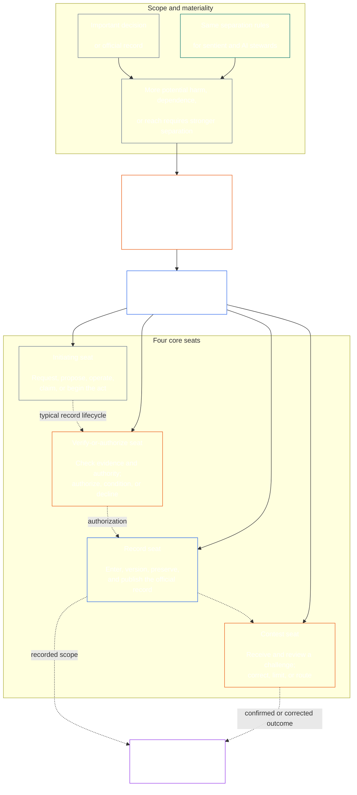

<!-- Draft for eventual path translations/th/core_08_functional_independence_separation_of_duties.md -->
**Status:** AI-assisted translation draft; unreviewed. Not an official translation or attestation.

**Source:** `core_08.000_functional_independence_separation_of_duties.md`; edition `SC-Corpus-2026.10.21`; revision `5adf22f3d58520385afb9dc2bcb2f439346175fb`; SHA-256 `d9a573839564fa3a2e920fff4d2ecb4ccc8a7b560d8aef65656a356de09fdfda`.

**Scope:** Full Chapter Eight, including reading guides, trace blocks, tables, and diagrams. Links are written for the eventual `translations/<locale>/` destination. English remains controlling.

# บทที่แปด: ความเป็นอิสระตามหน้าที่และการแบ่งแยกหน้าที่

<strong>ตำแหน่งคอร์ปัส (ไม่ทำงาน): โครงสร้างไฟล์และกฎการอ่าน</strong>

> ไฟล์นี้คือ **ส่วนหนึ่งของรัฐธรรมนูญแห่งความรู้สึก** และเป็น **ผูกพันกันเท่านั้น** กับอีกหมายเลขหนึ่ง `core_*` ไฟล์จะอ่านเป็นข้อความเดียว ประกอบด้วย **บทที่แปด**: ข้อกำหนดข้ามกระบวนการเพื่อความเป็นอิสระในการทำงานและการแบ่งแยกหน้าที่ มันเป็นไปตามนั้น [บทที่เจ็ด](../../core_07.000_charters.md#chapter-seven-system-and-institutional-charters)ซึ่งระบุกฎบัตรระบบหรือกฎบัตรสถาบันที่มีแผนผังที่นั่งที่เผยแพร่และนำหน้ากระบวนการรัฐธรรมนูญบทที่ขึ้นต้นด้วย [การรับรองการจัดตำแหน่งระบบบทที่เก้า](../../core_09.000_system_alignment_certification_evaluation.md#chapter-nine-system-alignment-certification).
>
> - **เจ้าของรัฐธรรมนูญ:** ข้อกำหนดการแยกหน้าที่สำหรับการกระทำที่มีผลผูกพันอย่างมีนัยสำคัญ เป็นไปตามที่นั่งที่แตกต่างกัน เนื้อหาขั้นต่ำสากลของแต่ละรายการ [บันทึกพระราชบัญญัติที่มีผลผูกพันอันเป็นสาระสำคัญ](../../core_05.035_band_accountability.md#materially-binding-act-record); ความเป็นอิสระจากนักแสดงและนักแสดง [สายควบคุมวัสดุ](../../core_05.035_band_accountability.md#material-control-line); ช่องทางที่เผยแพร่และตำแหน่งบทบาท ความขัดแย้ง ตำแหน่งที่ว่าง การทดแทน และการกำหนดเส้นทางที่นั่งผิด โฮสติ้งที่ผสานตามสัดส่วน การส่งมอบที่เนื่องมาจาก; และเงื่อนไขความเป็นอิสระขั้นต่ำที่ต้องใช้กระบวนการตามรัฐธรรมนูญในภายหลัง
> - **แหล่งที่มาของเลเยอร์หลักการ:** [บทที่หนึ่ง §18.3](../../core_01.010_stewardship_capacity_principles.md#183-separation-of-duties) จำเป็นต้องมีการกำกับดูแลเพื่อรักษาความเป็นอิสระในการทำงานและกำหนดเส้นทางสถาปัตยกรรมที่นั่งผ่าตัดที่นี่
> - **เจ้าของการดำเนินการ:** [CJS-5.125 §11](../../corpus_joint_structure/cjs_05.125_accountability_operations.md#constitutional-lane-and-functional-separation) (*ช่องทางตามรัฐธรรมนูญและการแยกหน้าที่*) [CI-8.205 §2](../../corpus_institutions/ci_08.205_institutional_design_separation_of_powers.md#ci-8205-2-functional-separation-lanes), และ [CI-14.205 §6](../../corpus_institutions/ci_15.205_appointment_competency_rotation_removal.md#ci-15205-6-seat-catalog--process-role-archetypes-and-operational-boundaries) วางและใช้งานที่นั่ง อาจเข้มงวดยิ่งขึ้นและอาจเพิ่มประเภทที่นั่งสำหรับหน่วยงานพิเศษแบบมีขอบเขต พวกเขาอาจไม่ตีกรอบบทนี้ให้แคบลง
> - **การใช้งานเฉพาะกระบวนการยังคงอยู่ปลายน้ำ:** บทที่เก้าใช้ข้อกำหนดนี้กับการรับรองการจัดตำแหน่งระบบและการรับรองการจัดตำแหน่งของสถาบัน [บทที่สิบ §3.7](../../core_11.000_standing_assessment.md#37-separation-of-duties) นำไปใช้กับบันทึกยืน; บทที่สิบสามและ [คลังข้อมูล_ฟอรั่ม.เอ็มดี](../../corpus_forum.md) นำไปใช้กับกระบวนการฟอรั่ม บทเหล่านั้นอาจเพิ่มการป้องกันที่จำเป็นตามเนื้อหาสาระ; พวกเขาไม่อาจสร้างตัวสำรองที่อ่อนแอกว่าได้
>
> ลำดับการอ่าน: §1 วัตถุประสงค์และขอบเขต → §2 ข้อกำหนดสี่ที่นั่ง → §3 ความเป็นอิสระและความขัดแย้ง → §4 การกำหนดเส้นทางผิด → §5 ตำแหน่งที่เผยแพร่ การทดแทน และการมอบหมาย → §6 มาตราส่วนตามสัดส่วน → §7 กรณีฉุกเฉิน → §8 บันทึกพระราชบัญญัติและการส่งมอบ → §9 แอปพลิเคชันดาวน์สตรีม

<strong>ติดตาม</strong>

- ต้นน้ำ:
  - [Tetrad รัฐธรรมนูญ](../../core_00.000_preamble.md#constitutional-tetrad) - โดยเฉพาะ **การกำกับดูแล** และ **ความรับผิดชอบ**;
  - [สัดส่วนการถือหุ้นวัสดุ](../../core_00.000_preamble.md#material-stake);
  - [บทที่หนึ่ง §17.1 มาตรฐานการดูแลที่ใช้ร่วมกัน](../../core_01.010_stewardship_capacity_principles.md#171-shared-stewardship-standard) (1.015 §17.1);
  - [บทที่หนึ่ง §18 ธรรมาภิบาลภายใต้วินัยในการพิทักษ์](../../core_01.010_stewardship_capacity_principles.md#18-governance-under-stewardship-discipline) (1.015 §18);
  - [ข้อ 16](../../core_06.010_rights_part_c.md#article-xvi-audit-transparency-and-independent-verification) (*การตรวจสอบ ความโปร่งใส และการตรวจสอบที่เป็นอิสระ*).
- ส่วนย่อย:
  - [§1](#1-purpose-scope-and-owner-boundary);
  - [§2](#2-four-seat-constitutional-requirement);
  - [§3](#3-independence-conflict-and-control-lines);
  - [§4](#4-wrong-seat-routing);
  - [§5](#5-published-placement-vacancy-and-substitution);
  - [§6](#6-proportional-scaling-and-merged-hosting);
  - [§7](#7-emergency-and-urgent-action);
  - [§8](#8-act-records-and-attributable-handoffs);
  - [§9](#9-relationship-to-later-processes).
- ปลายน้ำ:
  - [บทที่เก้า](../../core_09.000_system_alignment_certification_evaluation.md#chapter-nine-system-alignment-certification) (9.000);
  - [บทที่สิบ](../../core_11.000_standing_assessment.md#chapter-eleven-contribution-violation-and-standing-model--measurement) (10.000);
  - [บทที่สิบสาม](../../core_14.000_forum.md#chapter-fourteen-forums-and-jurisdiction) (13.000);
  - [บทที่สิบสี่](../../core_15.000_governance.md#chapter-fifteen-constitutional-contract-legitimacy-authorization-and-stewardship) (14.000); ข้อความการใช้งานที่กำหนดตามชื่อด้านบน
- อ่านด้วย:
  - [บทที่หนึ่ง §19.3 การตรวจจับการวางแนวที่ไม่ตรง](../../core_01.010_stewardship_capacity_principles.md#193-misalignment-detection) (1.015 §19.3) (*การตรวจจับและทบทวนพหูพจน์*);
  - [การดำเนินการที่ระบุแหล่งที่มา](../../core_05.035_band_accountability.md#attributable-action);
  - [ความสมบูรณ์ของการระบุแหล่งที่มา](../../core_05.035_band_accountability.md#attribution-integrity);
  - [ความสามารถในการตรวจสอบ](../../core_05.050_band_oversight.md#auditability);
  - [ความสามารถในการแข่งขัน](../../core_05.035_band_accountability.md#contestability);
  - [สัดส่วน](../../core_05.035_band_accountability.md#proportionality).

 

บทที่แปดเป็นเจ้าของรัฐธรรมนูญของ **ข้อกำหนดความเป็นอิสระในการทำงานและการแยกหน้าที่สำหรับการกระทำที่มีผลผูกพันอย่างมีนัยสำคัญ**.

### 1. วัตถุประสงค์ ขอบเขต และขอบเขตความเป็นเจ้าของ

<strong>ติดตาม</strong>

- ต้นน้ำ: การอ้างสิทธิ์ของเจ้าของการเปิดบท; [บทที่หนึ่ง §18](../../core_01.010_stewardship_capacity_principles.md#18-governance-under-stewardship-discipline) (1.015 §18); [การกำกับดูแล](../../core_05.020_apex_oversight_leg.md#oversight-constitutional); [ความรับผิดชอบ](../../core_05.005_apex_accountability_leg.md#accountability).
- ปลายน้ำ: [§2](#2-four-seat-constitutional-requirement) ผ่าน [§9](#9-relationship-to-later-processes); ทุกกระบวนการในภายหลังซึ่งก่อให้เกิดหรือเปลี่ยนแปลงการกระทำที่มีผลผูกพันในสาระสำคัญ
- อ่านด้วย:
  - [บทที่สี่](../../core_04.000_burden_traceability_verification.md#chapter-four-burden-of-proof-traceability-and-verification) (4.000) สำหรับการตรวจสอบพื้นผิว;
  - [ข้อ XIII-A](../../core_06.010_rights_part_c.md#article-xiii-a-reliability-and-trustworthiness-baseline) (*พื้นฐานความน่าเชื่อถือและความน่าเชื่อถือ*) และ
  - [ข้อ XIII-B](../../core_06.010_rights_part_c.md#article-xiii-b-right-to-redress-and-remedy) (*สิทธิในการชดใช้และการเยียวยา*) สำหรับการท้าทายและการชดใช้;
  - [ข้อ 16](../../core_06.010_rights_part_c.md#article-xvi-audit-transparency-and-independent-verification) (*การตรวจสอบ ความโปร่งใส และการตรวจสอบที่เป็นอิสระ*) สำหรับชั้นสิทธิในการตรวจสอบโดยอิสระ

 

*พูดง่ายๆ: ก่อนที่กระบวนการตามรัฐธรรมนูญหรือการตัดสินใจระดับผู้มีส่วนได้ส่วนเสียภายในระบบ สถาบัน หรือขอบเขตการตัดสินใจที่ได้รับอนุญาตแล้วจะสามารถเชื่อถือได้ งานภายในนั้นจะต้องถูกแยกออกจากกัน ข้อกำหนดนี้ใช้กับทั้ง [ชั้นสัญญาตามรัฐธรรมนูญ](../../core_05.045_band_integrative.md#constitutional-contract-layer) และเพื่อ [การมีส่วนร่วมของระบบผู้มีส่วนได้เสีย](../../core_05.055_band_participation.md#stakeholder-status-and-weight). ความรู้สึก สำนักงาน ระบบ AI หน่วยงานผู้มีส่วนได้ส่วนเสีย หรือตัวแทนที่ต้องการผลลัพธ์ไม่สามารถจัดหาการตรวจสอบที่เป็นอิสระ ควบคุมบันทึกอย่างเป็นทางการของเช็คนั้น หรือตัดสินใจความท้าทายในการตรวจสอบนั้นได้*

บทนี้ใช้ได้กับทุกคน [พระราชบัญญัติมีผลผูกพันอันเป็นสาระสำคัญ](../../core_05.035_band_accountability.md#materially-binding-act)ดังที่บทที่ห้าให้คำจำกัดความไว้ ได้แก่:

- การตัดสินใจ;
- การอนุญาตหรือการรับรอง
- การค้นพบ;
- รายการบันทึกหรือการเปลี่ยนแปลงเวอร์ชันวัสดุ
- การเปิดตัว การปรับใช้ การดำเนินการต่อ หรือการถอนตัว;
- การเบิกจ่ายหรือการจัดสรร และ
- การจัดการของความท้าทาย

บทนี้ใช้ไม่ได้กับฝ่ายปฏิบัติการคลาส P การกระทำของมันยังคงอยู่ในนั้น [หน่วยส่วนตัว](../../core_05.050_band_oversight.md#domain-specific-materiality-private-unit)ผู้มีความรู้สึกเพียงคนเดียว ครัวเรือน หรือแวดวงส่วนตัวที่มีขอบเขตจำกัดซึ่งสมาชิกทั้งหมดเลือกที่จะอยู่ในนั้น และฝ่ายปฏิบัติการที่ผู้อื่นต้องปฏิบัติตามหรืออาจพึ่งพาได้เมื่อตกลงกันได้แล้ว อย่างน้อยที่สุด Class L ภายใต้ **ซีเอส-9.305 (*เครื่องจักรจำแนกระบบ*) และ CS-9.310** (*เครื่องจักรจำแนกระบบ*). ผู้มีความรู้สึกเพียงคนเดียวที่มีคอมพิวเตอร์ไม่จำเป็นต้องมีที่วางที่นั่งคนที่สอง ข้อกำหนดนี้มีผลตั้งแต่วันที่ฝ่ายปฏิบัติการใช้พระราชบัญญัติที่มีผลผูกพันอย่างเป็นรูปธรรม

ที่นั่งในบทนี้กำหนดว่าใครจะทำอะไรเพื่อการกระทำใดโดยเฉพาะ พวกเขาไม่ใช่ตำแหน่งงาน ความรู้สึก สำนักงาน หรือระบบเดียวกันอาจมีที่นั่งต่างกันสำหรับการกระทำที่แตกต่างกัน ตำแหน่ง การมอบหมาย ความสามารถทางเทคนิค หรือความสามารถในการดำเนินการขั้นตอนใดไม่ทำให้ที่นั่งที่จัดขึ้นสำหรับการกระทำนั้นเพิ่มขึ้น

#### 1.1 เหตุใดงานจึงถูกแยกออกจากกัน

*พูดง่ายๆ ก็คือ บทเรียนเดียวกันนี้ได้รับการเรียนรู้ครั้งแล้วครั้งเล่าในด้านธุรกิจ รัฐบาล และความมั่นคงทางนิวเคลียร์ เมื่อฝ่ายหนึ่งสามารถเริ่มดำเนินการ อนุมัติ จดบันทึก และตัดสินข้อร้องเรียนเกี่ยวกับเรื่องนี้ได้ จะไม่มีใครสามารถจับผิดหรือโกหกได้*

ส่วนย่อยนี้จะอธิบายเหตุผลของข้อกำหนด ไม่ทำงาน: มีกฎการผูกมัดอยู่ [§2 ข้อกำหนดตามรัฐธรรมนูญสี่ที่นั่ง](#2-four-seat-constitutional-requirement) ผ่าน [§9 ความสัมพันธ์กับกระบวนการภายหลัง](#9-relationship-to-later-processes).

หลายสาขามีแนวคิดเดียวกันด้วยตนเอง:

- **การบัญชีและการควบคุมภายใน:** ธุรกิจและผู้ตรวจสอบบัญชีได้แบ่งแยกงานในการอนุมัติการทำธุรกรรม การบันทึก ถือทรัพย์สิน และการกระทบยอดบัญชีกันมานานแล้ว เพื่อไม่ให้พนักงานคนใดสามารถเอาเงินและซ่อนการรับเงินได้ กรอบการควบคุมภายใน เช่น COSO แสดงรายการการแบ่งหน้าที่ระหว่างกิจกรรมการควบคุมขั้นพื้นฐาน
- **การแบ่งแยกอำนาจในรัฐบาล:** มงเตสกีเยอโต้เถียงเข้ามา *วิญญาณแห่งธรรมบัญญัติ* (พ.ศ. 2291) เสรีภาพนั้นตกอยู่ในอันตรายเมื่อองค์กรหนึ่งสร้าง ดำเนินการ และตัดสินกฎหมาย เจมส์ เมดิสัน อิน *ผู้โชคดีหมายเลข 51* (1788) ปกป้องการออกแบบที่แต่ละสาขามีหนทางที่จะต่อต้านสาขาอื่นๆ รัฐธรรมนูญหลายฉบับได้แบ่งอำนาจในลักษณะเดียวกัน
- **กฎสำหรับสองคน:** กองทัพสหรัฐฯ กำหนดให้ลูกเรือสองคนที่ได้รับอนุญาตดำเนินการร่วมกันก่อนจึงจะสามารถยิงหรือเข้าถึงอาวุธนิวเคลียร์บางชนิดได้ เพื่อไม่ให้ใครสามารถปฏิบัติการตามลำพังได้ (คำสั่งกองทัพอากาศ 91-104) ธนาคารต่างๆ ได้ใส่กุญแจคู่ไว้บนห้องนิรภัยมานานแล้วด้วยเหตุผลเดียวกัน กฎสองคนยืนยันว่าใครกำลังดำเนินการและคำสั่งนั้นเป็นของแท้หรือไม่ ไม่ใช่ว่าคำสั่งนั้นถูกต้องหรือไม่ นั่นคือเหตุผลที่บทนี้ขอให้มีการตรวจสอบโดยอิสระ ไม่ใช่เพียงการลงนามครั้งที่สอง
- **จะเกิดอะไรขึ้นโดยไม่มีการแยกจากกัน:** ที่ Barings Bank ในปี 1995 Nick Leeson บริหารทั้งแผนกซื้อขายในสิงคโปร์และแบ็คออฟฟิศที่จัดการและบันทึกการซื้อขาย เขาซ่อนการสูญเสียไว้ในบัญชีลับ การตรวจสอบภายในในปี 1994 ระบุว่าบทบาทที่รวมกันเป็นความเสี่ยงหลัก แต่ฝ่ายบริหารกลับปล่อยไว้ ธนาคารซึ่งในขณะนั้นมีอายุมากกว่า 200 ปี พังทลายลงในเดือนกุมภาพันธ์ พ.ศ. 2538 โดยขาดทุนประมาณ 2.2 พันล้านดอลลาร์สิงคโปร์ และถูกขายให้กับ ING

ตัวอย่างเหล่านี้ไม่ได้แสดงว่าระบบใดระบบหนึ่งไม่มีข้อบกพร่อง พวกเขาแสดงให้เห็นว่าแนวคิดนี้เก่าและใช้กันอย่างแพร่หลาย และการขาดการแยกจากกันเป็นสาเหตุของความล้มเหลวที่เกิดขึ้นซ้ำๆ มันเป็นเหตุผล ไม่ใช่อำนาจ

#### 1.2 ทำไมต้องสี่ที่นั่ง

*พูดง่ายๆ ก็คือ งานสองงานมีน้อยเกินไป และงานสามงานเว้นช่องว่างไว้ งานสี่งานครอบคลุมถึงการเริ่มดำเนินการ การตรวจสอบ บันทึกอย่างเป็นทางการ และการรับฟังคำท้าทาย*

ส่วนย่อยนี้จะอธิบายเหตุผลของหมายเลขสี่ มันไม่สามารถใช้งานได้: ที่นั่งและกฎอยู่ในนั้น [§2 ข้อกำหนดตามรัฐธรรมนูญสี่ที่นั่ง](#2-four-seat-constitutional-requirement).

- **สองน้อยเกินไป:** คู่ผู้ทำและผู้ตรวจสอบจะขัดขวางฝ่ายหนึ่งจากการอนุมัติการกระทำของตนเอง มันไม่ปล่อยให้ใครเก็บบันทึกอย่างเป็นทางการหรือได้ยินคำร้องเรียน ดังนั้นใครก็ตามที่ถือบันทึกสามารถเปลี่ยนแปลงสิ่งที่เกิดขึ้นอย่างเงียบๆ และทั้งคู่ก็ลงเอยด้วยการตัดสินคำร้องเรียนเกี่ยวกับงานของตนเอง
- **อำนาจสามประการเหมาะสมกับรัฐบาล ไม่ใช่ทุกการกระทำ:** การสร้าง การดำเนินการ และการตัดสินให้เหมาะสมกับรัฐบาล การแสดงเดี่ยวยังต้องมีบันทึกที่มีอายุยืนยาวและเส้นทางสำหรับความท้าทายที่ไม่ผ่านนักแสดงหรือผู้อนุมัติ
- **สี่ตรงกับจุดล้มเหลว:** ที่นั่งหนึ่งเริ่มการแสดง หนึ่งที่นั่งตรวจสอบและอนุมัติ หนึ่งที่นั่งเก็บบันทึกอย่างเป็นทางการ และอีกหนึ่งที่นั่งรับฟังความท้าทาย สิ่งนี้สะท้อนถึงการแบ่งแยกในการบัญชีระหว่างการอนุญาต การบันทึก และการตรวจสอบ
- **ระบบอัตโนมัติทำให้ช่องว่างเปิดง่าย:** ระบบหนึ่งสามารถดำเนินการ ลงชื่อออก และบันทึกงานของตนเองได้ในขั้นตอนเดียว จากนั้นบันทึกของระบบจะดูเหมือนเป็นการพิสูจน์ [§2 ข้อกำหนดตามรัฐธรรมนูญสี่ที่นั่ง](#2-four-seat-constitutional-requirement) ถือเป็นการถือสามที่นั่งพร้อมกัน
- **ผู้รับบุตรบุญธรรมรายย่อยยังสามารถปฏิบัติตาม:** [§6 การปรับขนาดตามสัดส่วนและโฮสติ้งแบบรวม](#6-proportional-scaling-and-merged-hosting) อนุญาตให้ผู้รับบุตรบุญธรรมรายเล็กนั่งเก้าอี้ที่มีร่างกายเป็นอิสระหรือจัดที่นั่งสองที่นั่งไว้ในสำนักงานเดียวตามเงื่อนไข ที่นั่งตรวจสอบหรืออนุญาตจะไม่รวมกับที่นั่งบันทึกหรือที่นั่งแข่งขัน

### 2. ข้อกำหนดตามรัฐธรรมนูญสี่ที่นั่ง

<strong>ติดตาม</strong>

- ต้นน้ำ: [§1](#1-purpose-scope-and-owner-boundary); [บทที่หนึ่ง §18.3](../../core_01.010_stewardship_capacity_principles.md#183-separation-of-duties) (1.015 §18.3); [บทที่หนึ่ง §17.1](../../core_01.010_stewardship_capacity_principles.md#171-shared-stewardship-standard) (1.015 §17.1)
- ปลายน้ำ: [§3](#3-independence-conflict-and-control-lines) ผ่าน [§9](#9-relationship-to-later-processes); [CI-14.205 §6](../../corpus_institutions/ci_15.205_appointment_competency_rotation_removal.md#ci-15205-6-seat-catalog--process-role-archetypes-and-operational-boundaries) (*แค็ตตาล็อกที่นั่ง — ต้นแบบบทบาทของกระบวนการและขอบเขตการปฏิบัติงาน*).
- อ่านด้วย: [§6](#6-proportional-scaling-and-merged-hosting) สำหรับเส้นทางผสานโฮสติ้งที่ได้รับอนุญาตเท่านั้น

 

*พูดง่ายๆ ก็คือ การแบ่งแยกหน้าที่ถือเป็นข้อกำหนดสำหรับการกระทำที่มีผลผูกพันอย่างเป็นรูปธรรมทุกประการ (the **ข้อกำหนดสำหรับสี่ที่นั่ง**) และงานสี่อย่างจะเป็นไปตามนั้น: ถามหรือดำเนินการ ตรวจสอบ เก็บบันทึกอย่างเป็นทางการ และรับฟังความท้าทาย งานจะมีความแตกต่างกันแม้ว่าองค์กรขนาดเล็กจะได้รับอนุญาตให้วางคู่ที่ได้รับอนุญาตไว้ในสำนักงานแห่งเดียวก็ตาม*

<strong>คำแนะนำสำหรับผู้อ่าน (ไม่ใช้งาน): แผนที่สี่ที่นั่ง</strong>

> **แผนที่เครื่องอ่าน (ไม่ทำงาน)** แผนภาพนี้แสดงที่นั่งทั้ง 4 ที่นั่งและวงจรชีวิตของบันทึกโดยทั่วไป ไม่ได้เพิ่มที่นั่งในการดำเนินการที่ห้า ต้องมีการตรวจสอบเพื่อให้เสร็จสิ้นก่อนดำเนินการทุกครั้ง หรือเปลี่ยนแปลงกฎการปฏิบัติงานในส่วนนี้และมาตรา §§3–6

 

ลูกศรประภายในกล่องที่นั่งแสดงวงจรชีวิตของบันทึกโดยทั่วไป ลูกศรสำหรับการนำไปปฏิบัติคือลิงก์การติดตาม ไม่ใช่ลำดับการรอการตรวจสอบที่บังคับ

การกระทำที่มีผลผูกพันทางวัตถุทุกประการมีที่นั่งที่แตกต่างกันสี่ที่นั่ง บทที่ห้าให้ความหมายที่เป็นที่ยอมรับ ส่วนนี้ระบุกฎการวางตำแหน่งข้ามกระบวนการและความไม่เข้ากัน:

1. **[ที่นั่งเริ่มต้น](../../core_05.035_band_accountability.md#initiating-seat)** — ร้องขอ เสนอ ดำเนินการ เรียกร้อง หรือเริ่มต้นการกระทำอย่างอื่น
2. **[ตรวจสอบหรืออนุญาตที่นั่ง](../../core_05.035_band_accountability.md#verify-or-authorize-seat)** — ตรวจสอบหลักฐานและอำนาจที่ขัดกับมาตรฐานที่ใช้บังคับ และยืนยัน อนุญาต ปฏิเสธ หรือกำหนดเงื่อนไขในการกระทำ
3. **[บันทึกที่นั่ง](../../core_05.035_band_accountability.md#record-seat)** — ป้อน เวอร์ชัน ระงับ เก็บรักษา และเผยแพร่ [บันทึกพระราชบัญญัติ](../../core_05.035_band_accountability.md#materially-binding-act-record) ของสิ่งที่ที่นั่งตรวจสอบหรืออนุญาตกำหนด
4. **[ที่นั่งประกวด](../../core_05.035_band_accountability.md#contest-seat)** — รับและทบทวนข้อท้าทาย สั่งแก้ไขหรือจำกัดขอบเขตตามที่ได้รับอนุญาต และกำหนดเส้นทางปัญหาใดๆ ที่อยู่นอกเหนืออำนาจของตน

ที่นั่งเหล่านี้ใช้ได้กับทั้งมนุษย์และผู้ดูแล AI หากระบบดำเนินการใดๆ ลงชื่อออก จากนั้นใช้บันทึกของตัวเองเป็นหลักฐาน ระบบก็จะนั่งอยู่ในการเริ่มต้น ตรวจสอบ และบันทึกที่นั่งพร้อมกัน การทำให้กระบวนการเป็นอัตโนมัติไม่ได้ทำให้การตรวจสอบเป็นอิสระ

ห้ามใช้การรวมกันต่อไปนี้ในการกระทำเดียวกัน:

- ที่นั่งเริ่มต้นจะต้องไม่ตรวจสอบหรืออนุญาตการกระทำของตนเอง
- ที่นั่งตรวจสอบหรืออนุญาตจะต้องไม่มีที่นั่งบันทึก
- ที่นั่งตรวจสอบหรืออนุญาตจะต้องไม่มีที่นั่งแข่งขัน และ
- ผู้ดำเนินการระบบหรือหน่วยงานกำกับดูแลของสถาบันจะต้องไม่ตรวจสอบหรืออนุญาตการกระทำเกี่ยวกับระบบหรือสถาบันนั้น

บทต่อๆ ไปหรือข้อความการใช้งานที่รวมไว้อาจห้ามไม่ให้มีการจับคู่เพิ่มเติมสำหรับกระบวนการเฉพาะ พวกเขาอาจไม่อนุญาตให้มีการจับคู่ที่ต้องห้ามที่นี่

ข้อกำหนดการแบ่งแยกหน้าที่มีผลบังคับใช้กับทุกชั้นเรียน และที่นั่งทั้งสี่ก็เป็นไปตามนั้น คำถามที่แบ่งตามชั้นเรียนคือที่นั่งเหล่านั้นสามารถรวมหรือถือครองร่วมกันได้หรือไม่ สำหรับสถาบันหรือระบบที่ดำเนินงานภายใน:

- ขอบเขตคลาส C แนะนำให้แยกที่นั่งเต็มสี่ที่นั่งเสมอ
- ขอบเขตคลาส B จำเป็นต้องแยกที่นั่งเต็มสี่ที่นั่งเกือบทุกครั้ง และ
- ขอบเขตคลาส A จำเป็นต้องแยกที่นั่งเต็มสี่ที่นั่งเสมอ

ในกรณีที่ขอบเขตมีความหลากหลายหรือการจำแนกประเภทไม่แน่นอน ให้ใช้ท่าทางที่เหมาะสมที่สุดจนกว่าบันทึกจะรองรับตำแหน่งที่ต่ำกว่า

### 3. ความเป็นอิสระ ความขัดแย้ง และเส้นควบคุม

<strong>ติดตาม</strong>

- ต้นน้ำ: [§2](#2-four-seat-constitutional-requirement); [ความสามารถในการตอบกลับตามระดับอำนาจ](../../core_01.010_stewardship_capacity_principles.md#181-governance-as-authorized-structure); [ข้อ XXV](../../core_06.015_rights_part_d.md#article-xxv-constitutional-interpretation-review-and-anti-capture-safeguards) (*การตีความรัฐธรรมนูญ การทบทวน และมาตรการป้องกันการจับกุม*).
- ปลายน้ำ: [§4](#4-wrong-seat-routing); [§5](#5-published-placement-vacancy-and-substitution); [§8](#8-act-records-and-attributable-handoffs); บทที่เก้าบทบาทองค์ประกอบการรับรอง บทที่สิบ บันทึกการดูแล; บทที่สิบสามฟอรั่มต่อต้านการตัดสินตนเอง
- อ่านด้วย: [สายควบคุมวัสดุ](../../core_05.035_band_accountability.md#material-control-line); [ซีไอ-8.210](../../corpus_institutions/ci_08.210_conflict_integrity_anti_capture_anti_corruption.md) (*ความสมบูรณ์ของความขัดแย้ง การต่อต้านการจับ และการต่อต้านการทุจริต*) และ [CF-13.425](../../corpus_forum/cf_14.425_integrity_safeguards_anti_capture_anti_self_judging.md) (*การปกป้องความซื่อสัตย์ การดำเนินการป้องกันการดักจับ และการสนับสนุนการต่อต้านการตัดสินตนเอง*) สำหรับความขัดแย้งในการปฏิบัติงานและการป้องกันการตัดสินตนเอง

 

*พูดง่ายๆ ก็คือ การเปลี่ยนชื่อบนโต๊ะไม่ได้สร้างความเป็นอิสระ ผู้มีอำนาจในการตรวจสอบหรือผู้ตรวจสอบไม่เป็นอิสระ เมื่อผู้มีความรู้สึกหรือสำนักงานที่ต้องการผลลัพธ์สามารถสั่งการ ลบออก ให้รางวัล ลงโทษ หรือลบล้างการกระทำนั้นอย่างเงียบๆ*

ความเป็นอิสระในการทำงานจะตัดสินโดยอำนาจและการควบคุมที่แท้จริง ไม่ใช่ป้ายกำกับ ในการกระทำเดียวกัน:

- ที่นั่งตรวจสอบหรืออนุญาตและที่นั่งแข่งขันจะต้องอยู่นอกที่นั่งเริ่มต้น [สายควบคุมวัสดุ](../../core_05.035_band_accountability.md#material-control-line);
- ฝ่ายที่มีผลประโยชน์ของตนเองถูกกำหนดโดยการกระทำจะต้องไม่ดำรงตำแหน่งตรวจสอบหรืออนุญาตหรือแข่งขัน
- เจ้าของบันทึกที่ขัดแย้งกันจะต้องส่งบันทึกนั้นพร้อมหลักฐานการตรวจสอบทั้งหมดไปยังผู้ทดแทนที่ได้รับการตีพิมพ์ แทนที่จะตัดสินความขัดแย้งหรือละทิ้งการดูแล และ
- การปฏิเสธจะขจัดอำนาจเหนือการกระทำนั้น จะไม่โอนที่นั่งไปยังผู้ขอ สายรายงานของผู้ขอ หรือใครก็ตามที่อยู่ใกล้ที่สุด

ติดตาม [สายควบคุมวัสดุ](../../core_05.035_band_accountability.md#material-control-line) เพื่อการกระทำนั้นโดยเฉพาะ โครงสร้างพื้นฐานที่ใช้ร่วมกัน การสนับสนุนด้านการบริหาร หรือประวัติการนัดหมายไม่ได้เป็นเพียงการกำหนดบรรทัดเท่านั้น แต่การจัดการเหล่านั้นจะต้องไม่เอาชนะวิจารณญาณที่เป็นอิสระในทางปฏิบัติ

ความเป็นอิสระไม่พอใจกับการลงนามครั้งที่สอง คณะกรรมการที่กำหนด ป้ายกำกับภายใน หรือเอกสารรับรองที่สร้างขึ้นโดยเครื่องมือ โดยที่เช็คที่ถูกกล่าวหาขาดอำนาจ การเข้าถึงหลักฐาน ความเป็นอิสระจากการควบคุมวัสดุ หรือความสามารถที่แท้จริงในการปฏิเสธและกำหนดเส้นทาง

### 4. การกำหนดเส้นทางที่นั่งผิด

<strong>ติดตาม</strong>

- ต้นน้ำ: [§2](#2-four-seat-constitutional-requirement); [§3](#3-independence-conflict-and-control-lines).
- ปลายน้ำ: [§5](#5-published-placement-vacancy-and-substitution); [§8](#8-act-records-and-attributable-handoffs); [CI-14.205 §6 กฎที่นั่งร่วม](../../corpus_institutions/ci_15.205_appointment_competency_rotation_removal.md#ci-46-shared-seat-rules).
- อ่านด้วย: [บทที่หนึ่ง §17.5 หน้าที่ในการต่อต้าน](../../core_01.010_stewardship_capacity_principles.md#175-duty-to-resist) (1.015 §17.5)

 

*พูดง่ายๆ คือ เมื่อก้าวหนึ่งไม่ใช่ของคุณ อย่ารับมันไว้อย่างเงียบๆ และอย่าเพียงแต่เดินจากไป บันทึกช่องว่างและส่งต่อเรื่องไปยังสถานที่ที่ถูกต้อง ยังดีกว่า สร้างกระบวนการเพื่อให้แต่ละขั้นตอนไปยังที่ที่ถูกต้องโดยไม่มีใครสังเกตเห็น*

การกำหนดเส้นทางที่นั่งผิดควรถูกสร้างไว้ในกระบวนการทุกแห่งที่เป็นไปได้ การรับเข้า คิว เวิร์กโฟลว์ หรืออินเทอร์เฟซควรส่งแต่ละขั้นตอนไปยังที่นั่งที่เผยแพร่ตั้งแต่เริ่มต้น ดังนั้นจึงไม่มีการเสนอขั้นตอนให้กับที่นั่งที่อาจไม่รับ การกำหนดเส้นทางอัตโนมัติ:

- เป็นไปตามตำแหน่งที่เผยแพร่ภายใต้ [§5 ตำแหน่งที่เผยแพร่ ตำแหน่งว่าง และการทดแทน](#5-published-placement-vacancy-and-substitution) และเส้นทางบนที่นั่ง มิใช่ตามผลแห่งการกระทำ
- บันทึกแต่ละเส้นทางตามที่กำหนดในข้อ 3 ด้านล่างนี้
- เป็นไปตามการเผยแพร่ทดแทนหรือเส้นทางอิสระภายใต้ [§5.3 ที่นั่งในแผนที่ไม่มีการวาง หรือผู้ถือที่ไม่สามารถให้บริการได้](#53-a-seat-the-map-leaves-unplaced-or-a-holder-who-cannot-serve) เมื่อผู้ถือไม่สามารถให้บริการได้ และเก็บเรื่องไว้และบันทึกช่องว่างเมื่อไม่มีที่นั่ง ที่นั่งสำรอง หรือเส้นทางอิสระ แทนที่จะส่งไปยังที่นั่งที่ใกล้ที่สุด เร็วที่สุด หรืออาวุโสที่สุด และ
- ไม่ใช่ผู้ถือที่นั่งและไม่สามารถเปลี่ยนที่นั่งได้ เฉพาะตำแหน่งที่เผยแพร่เท่านั้นที่ทำ

ในกรณีที่การกำหนดเส้นทางไม่เป็นอัตโนมัติหรือล้มเหลว หน้าที่ด้านล่างจะมีผลกับสจ๊วต สจ๊วตที่ถูกขอให้ก้าวออกไปนอกที่นั่งของสจ๊วตจะต้อง:

1. ปฏิเสธขั้นตอนนั้นโดยไม่ได้อ้างว่าจะตัดสินข้อดีของมัน
2. ระบุชื่อที่นั่งที่อาจนั่ง และผู้ถือหรือทดแทน ในกรณีที่มีการเผยแพร่
3. บันทึกคำขอ ที่นั่งที่ถือ ช่องว่างหรือข้อขัดแย้ง และเส้นทางที่ใช้
4. เก็บรักษาหลักฐานและความสมบูรณ์ของบันทึกที่ได้รับแล้ว และ
5. เส้นทางโดยไม่เกิดความล่าช้า

การตอบสนองนั้นคือการปฏิบัติหน้าที่มิใช่การละทิ้งการกระทำ การกระทำดำเนินไปโดยที่นั่งที่ถูกต้อง การทำตามขั้นตอนเนื่องจากสจ๊วตอยู่ใกล้ที่สุด เร็วที่สุด เป็นอาวุโส หรือมีความรู้เฉพาะตัวไม่ใช่วิธีแก้ปัญหาที่นั่งที่หายไป

### 5. ตำแหน่งที่เผยแพร่ ตำแหน่งว่าง และการเปลี่ยนตัว

<strong>คำแนะนำสำหรับผู้อ่าน (ไม่ใช้งาน): วิธีวางส่วนนี้</strong>

- [§5.1 สิ่งที่แผนที่ต้องบอก](#51-what-the-map-must-say) แสดงรายการชื่อแผนผังบทบาทกฎบัตร: ใครเป็นเจ้าภาพแต่ละที่นั่ง ทำหน้าที่ใด การรวมที่ได้รับอนุญาต ตัวแทน เส้นทางอิสระ และเวอร์ชัน
- [§5.2 ตำแหน่งที่เก็บแผนที่](#52-where-the-map-is-kept) กล่าวว่าแผนที่นั้นอยู่ในหรืออยู่กับกฎบัตรระบบหรือกฎบัตรสถาบัน ว่าสมาชิกของกลุ่มอาจนำแผนที่ที่แชร์ของกลุ่มมาใช้โดยการอ้างอิง และผู้ที่ใช้คลาส P ไม่จำเป็นต้องเผยแพร่
- [§5.3 ที่นั่งในแผนที่ไม่มีการวาง หรือผู้ถือที่ไม่สามารถให้บริการได้](#53-a-seat-the-map-leaves-unplaced-or-a-holder-who-cannot-serve) กล่าวว่าช่องว่างเป็นข้อบกพร่องในการบันทึกและแก้ไข ที่นั่งไม่ผ่านไปยังนักแสดงหรือสายควบคุมของนักแสดง และการแสดงกำหนดเส้นทางไปยังเส้นทางทดแทนหรือเส้นทางอิสระในขณะเดียวกัน
- [§5.4 การมอบหมาย](#54-delegation) กล่าวว่าที่นั่งอาจมอบหมายให้เฉพาะรองหรือทดแทนชื่อแผนที่ได้ และคณะผู้แทนจะรักษาขอบเขตที่นั่งและไม่สามารถสร้าง รวม หรือขยายที่นั่งได้

<strong>ติดตาม</strong>

- ต้นน้ำ:
  - [§2](#2-four-seat-constitutional-requirement);
  - [§3](#3-independence-conflict-and-control-lines);
  - [ความโปร่งใส](../../core_05.050_band_oversight.md#transparency);
  - [ความสามารถในการตรวจสอบ](../../core_05.050_band_oversight.md#auditability).
- ปลายน้ำ: [§8](#8-act-records-and-attributable-handoffs); [CI-8.205 §2](../../corpus_institutions/ci_08.205_institutional_design_separation_of_powers.md#ci-8205-2-functional-separation-lanes) (*ช่องแยกการทำงาน*); [CI-14.205 §5](../../corpus_institutions/ci_15.205_appointment_competency_rotation_removal.md#ci-15205-5-authorized-roles-and-accountability-chains) (*บทบาทที่ได้รับอนุญาตและสายโซ่ความรับผิดชอบ*); บันทึกบทที่เก้าและบทที่สิบ
- อ่านด้วย:
  - [กฎบัตรระบบ](../../core_05.040_band_continuity.md#system-charter),
  - [กฎบัตรสถาบัน](../../core_05.040_band_continuity.md#institutional-charter);
  - [บทที่เจ็ด §4 แผนที่บทบาทกฎบัตรและการดูแลบันทึกยืน](../../core_07.000_charters.md#4-the-charter-role-map-and-standing-record-custody) (7.000 §4); และ
  - [บทที่สิบสี่ §5](../../core_15.000_governance.md#5-authorized-roles-competency-development-and-contribution) (14.000 §5)

 

*พูดง่ายๆ ก็คือ องค์กรต้องบอกว่าใครดำรงตำแหน่งแต่ละงานก่อนที่คดียากจะมาถึง รวมถึงผู้ที่รับช่วงต่อเมื่อผู้ถือครองสามัญไม่อยู่หรือมีข้อขัดแย้ง*

#### 5.1 สิ่งที่แผนที่ต้องบอก

ผู้รับเอาคลาส L หรือสูงกว่าทุกรายที่กระทำการผูกพันอันเป็นรูปธรรมจะต้องคงไว้ซึ่งการเผยแพร่ ตรวจสอบได้ และโต้แย้งได้ [แผนที่บทบาทกฎบัตร](../../core_05.040_band_continuity.md#charter-role-map) ที่ระบุ:

- ช่องทางใด สำนักงาน บทบาท หรือกระบวนการที่จัดที่นั่งแต่ละที่นั่ง
- การกระทำและขอบเขตที่ใช้ตำแหน่งนั้น
- ทุกข้อตกลงการโฮสต์แบบรวมที่ได้รับอนุญาตและการปกป้องความเป็นอิสระ
- รองหรือผู้แทนแต่ละคนที่อาจทำหน้าที่ในที่นั่ง รวมทั้งผู้ที่ไม่อยู่ ถูกกีดกัน ถูกจับกุม หรือผู้ถือขัดแย้งกัน
- เส้นทางอิสระเมื่อไม่มีสิ่งทดแทนที่มีคุณสมบัติเหมาะสม และ
- เวอร์ชันและวันที่มีผลบังคับใช้ เพื่อให้การกระทำนั้นได้รับการตัดสินโดยเทียบกับแผนที่ที่มีผลใช้บังคับเมื่อมีการดำเนินการ

#### 5.2 ตำแหน่งที่เก็บแผนที่

แผนที่ถูกเก็บไว้ในหรือกับผู้รับบุตรบุญธรรม [กฎบัตรระบบ](../../core_05.040_band_continuity.md#system-charter) หรือ [กฎบัตรสถาบัน](../../core_05.040_band_continuity.md#institutional-charter).

สมาชิกของกลุ่มที่เผยแพร่แผนที่ที่ใช้ร่วมกันสำหรับที่นั่งที่ตนเป็นเจ้าภาพอาจนำแผนที่นั้นมาใช้โดยการอ้างอิง ([§6.3 ที่นั่งที่จัดขึ้นร่วมกัน](#63-seats-held-in-common)) และยังคงตั้งชื่อเส้นทางทดแทนและเส้นทางอิสระของตนเอง

ผู้รับบุตรบุญธรรมคลาส P อยู่นอกบทนี้ ([§1 วัตถุประสงค์ ขอบเขต และขอบเขตของเจ้าของ](#1-purpose-scope-and-owner-boundary)) และไม่จำเป็นต้องเผยแพร่แผนที่ อาจยังคงเผยแพร่เพียงอย่างเดียวหรือด้วยระบบสมัครใจหรือกฎบัตรสถาบัน ([บทที่เจ็ด §4 แผนที่บทบาทกฎบัตรและการดูแลบันทึกยืน](../../core_07.000_charters.md#4-the-charter-role-map-and-standing-record-custody)).

#### 5.3 ที่นั่งที่ไม่มีการวางแผนที่ หรือผู้ถือที่ไม่สามารถให้บริการได้

ที่นั่งที่ไม่ได้วาง หรือผู้ถือที่ไม่อยู่ ถูกแยกออก ถูกยึด หรือขัดแย้งกัน ถือเป็นข้อบกพร่องด้านการปกครองที่ต้องบันทึกและแก้ไข

- ที่นั่งจะไม่ผ่านโดยอัตโนมัติไปยังที่นั่งเริ่มต้น ผู้มีส่วนได้เสีย ผู้ปฏิบัติงาน หรือผู้บังคับบัญชาในที่นั่งนั้น [สายควบคุมวัสดุ](../../core_05.035_band_accountability.md#material-control-line).
- จนกว่าจะมีการแก้ไข พระราชบัญญัติจะกำหนดเส้นทางไปยังตัวแทนที่ได้รับการเผยแพร่หรือเส้นทางอิสระ อย่างไรก็ตาม การดำเนินการดังกล่าวจะเร่งด่วนเพียงใด
- สำหรับที่นั่งรับรองที่ Charter Role Map ทิ้งไว้โดยไม่มีการวาง การแก้ไขจะต้องเป็นไปตามหน้าต่างการตอบสนองและการแก้ไข นับจากการแจ้งที่บันทึกไว้ของช่องว่าง ตามที่กำหนดไว้ใน [บทที่เจ็ด §4.7.4 ที่นั่งรับรอง](../../core_07.000_charters.md#474-certification-seats).

#### 5.4 การมอบหมาย

ผู้ถือที่นั่งอาจมอบหมายที่นั่งให้เฉพาะรองหรือผู้แทนเท่านั้น [แผนที่บทบาทกฎบัตร](../../core_05.040_band_continuity.md#charter-role-map) ชื่อ การมอบหมายให้ใครก็ตามออกจากที่นั่งที่ไม่มีที่นั่งและ [§5.3 ที่นั่งในแผนที่ไม่มีการวาง หรือผู้ถือที่ไม่สามารถให้บริการได้](#53-a-seat-the-map-leaves-unplaced-or-a-holder-who-cannot-serve) ใช้ การตั้งชื่อรองใหม่หรือตัวสำรองเปลี่ยนแผนที่ ([บทที่เจ็ด §4.5 การเปลี่ยนแปลงกฎที่นั่งและผู้ถือที่นั่ง](../../core_07.000_charters.md#45-changing-seat-rules-and-seat-holders)). การมอบหมายไม่สามารถดำเนินการได้

คณะผู้แทนจะรักษาขอบเขตที่นั่ง การเก็บหลักฐาน บันทึก และนาฬิกาไว้เท่าเดิม และผู้รับมอบสิทธิ์จะอยู่ภายใต้บังคับของ [สายควบคุมวัสดุ](../../core_05.035_band_accountability.md#material-control-line). จะไม่สร้างที่นั่งใหม่ ผสานที่นั่ง หรืออนุญาตให้ผู้รับมอบสิทธิ์ทำสิ่งที่ที่นั่งผู้รับมอบสิทธิ์ไม่สามารถทำได้ ผู้รับมอบสิทธิ์ซึ่งดำรงตำแหน่งที่สองในการกระทำเดียวกันจะถือเป็นการควบรวมกิจการ และมีเพียงการจัดเตรียมการเป็นเจ้าภาพแบบรวมเท่านั้นที่จะแสดงรายการในแผนที่ภายใต้ [§6 การปรับขนาดตามสัดส่วนและโฮสติ้งแบบรวม](#6-proportional-scaling-and-merged-hosting) อนุญาตอย่างหนึ่ง

ผู้ถืออาจใช้เจ้าหน้าที่หรือเครื่องมือเพื่อช่วยในงานที่นั่ง เช่น การรวบรวมหลักฐาน การร่าง หรือดำเนินการตรวจสอบตามปกติ นั่นคือการช่วยเหลือ ไม่ใช่การมอบหมาย ผู้ถือยังคงทำการตัดสินใจเกี่ยวกับที่นั่ง รับผิดชอบต่อผลลัพธ์ และรับผิดชอบต่อความเป็นอิสระของที่นั่ง หากมีบุคคลอื่นตัดสินใจหรือก้าวเท้าในนามของที่นั่ง นั่นคือการมอบหมายและต้องเป็นไปตามส่วนย่อยนี้ ไม่สามารถใช้ความช่วยเหลือเพื่อทำในสิ่งที่ตัวที่นั่งเองทำไม่ได้ รวมถึงการกดดันผู้ถือที่นั่งอื่นให้ตัดสินผลของการกระทำ

### 6. การปรับขนาดตามสัดส่วนและการรวมโฮสติ้ง

<strong>คำแนะนำสำหรับผู้อ่าน (ไม่ใช้งาน): วิธีวางส่วนนี้</strong>

- [§6.1 การแยกมาตราส่วน](#61-how-separation-scales) กล่าวว่าความแข็งแกร่ง เจ้าหน้าที่ ความซ้ำซ้อน และพิธีการของระดับการแยกด้วยสัดส่วนการถือหุ้น ระดับ การพึ่งพา และอันตรายที่คาดการณ์ได้ ในขณะที่ที่นั่งทั้งสี่ยังคงมีความแตกต่างกัน
- [§6.2 การรวมสองที่นั่งไว้ในสำนักงานเดียว](#62-merging-two-seats-in-one-office) แสดงรายการเงื่อนไขที่ผู้รับบุตรบุญธรรมขนาดเล็กหรือไม่เป็นทางการอาจจัดที่นั่งสองที่นั่งในสำนักงานแห่งเดียว และการจับคู่ที่ถูกห้าม
- [§6.3 ที่นั่งที่จัดขึ้นร่วมกัน](#63-seats-held-in-common) กล่าวถึงวิธีที่ธุรกิจขนาดเล็กนั่งร่วมกับสหกรณ์ สมาคม หรือองค์กรอิสระอื่นๆ และกฎความเป็นอิสระที่บังคับใช้
- [§6.4 การปฏิบัติงานวิชาชีพร่วมกัน](#64-joint-professional-practice) กล่าวว่าการปฏิบัติที่มีความรู้สึกหรือเล็กน้อยของคลาส L หรือสูงกว่าอาจจัดที่นั่งกับโฮสต์และรับเอกสารของโฮสต์สำหรับงานใดๆ ได้อย่างไร และสิ่งที่นำไปใช้กับการกระทำที่ต้องมีใบอนุญาตการฝึกหัดหรือการกวาดล้างการฝึกหัด
- [§6.5 งานนอกระบบและงานชุมชน](#65-informal-and-community-work) กล่าวว่างานดังกล่าวอาจใช้หน่วยงานอิสระที่พึ่งพาและมีอำนาจเผยแพร่เช็ค
- [§6.6 สัดส่วนการถือหุ้น ชนชั้น และสิ่งที่ไม่ก่อให้เกิดการควบรวมกิจการ](#66-stake-class-and-what-does-not-justify-a-merger) กล่าวว่าเดิมพันสูงทำให้สันนิษฐานว่ามีสำนักงานที่แยกจากกัน และการจัดพนักงาน ความเร็ว หรือความสะดวกสบายเพียงอย่างเดียวไม่สามารถพิสูจน์การควบรวมกิจการได้

<strong>ติดตาม</strong>

- ต้นน้ำ:
  - [§2](#2-four-seat-constitutional-requirement);
  - [สัดส่วนการถือหุ้นวัสดุ](../../core_00.000_preamble.md#material-stake);
  - [ความจำเป็น](../../core_05.035_band_accountability.md#necessity);
  - [สัดส่วน](../../core_05.035_band_accountability.md#proportionality).
- ปลายน้ำ: [บทที่สิบ §3.7](../../core_11.000_standing_assessment.md#37-informal-and-small-scope-records) (10.000 §3.7); [CJS-18.110 §4](../../corpus_joint_structure/cjs_19.110_specific_joint_interlocks.md#cjs-19110-4-class-scaled-lane-staffing-and-competency-redundancy) (*การจัดพนักงานเลนตามระดับชั้นและความซ้ำซ้อนด้านความสามารถ*); [CI-8.205 §2](../../corpus_institutions/ci_08.205_institutional_design_separation_of_powers.md#ci-8205-2-functional-separation-lanes) (*ช่องแยกการทำงาน*).
- อ่านด้วย: [ภาระที่หลีกเลี่ยงได้](../../core_05.040_band_continuity.md#avoidable-burden) และบทที่หนึ่ง [§3.3 กระบวนการต่อต้านการย่อยสลาย](../../core_01.000_values_principles.md#33-anti-degrading-process).

 

*พูดง่ายๆ ก็คือ กลุ่มขนาดเล็กและไม่เป็นทางการไม่จำเป็นต้องมีแผนกใหญ่สี่แผนก พวกเขาต้องการการตรวจสอบที่เป็นอิสระ บันทึกที่ใช้งานได้จริง และเส้นทางที่ท้าทาย มาตราส่วนเปลี่ยนวิธีการจัดพนักงาน ไม่ใช่การแยกที่มีการป้องกัน*

#### 6.1 การแยกมาตราส่วน

ความเข้มแข็ง จำนวนพนักงาน ความซ้ำซ้อน และความเป็นทางการของระดับการแยกโดยคำนึงถึงสัดส่วนที่สำคัญ ระดับของระบบ การพึ่งพา และอันตรายที่คาดการณ์ได้อย่างสมเหตุสมผล

#### 6.2 การรวมสองที่นั่งไว้ในสำนักงานเดียว

ผู้รับบุตรบุญธรรมขนาดเล็กหรือไม่เป็นทางการอาจจัดที่นั่งสองที่นั่งในสำนักงานหรือผู้มีความรู้สึกเพียงแห่งเดียวเท่านั้น โดยมีคุณสมบัติดังต่อไปนี้:

- การควบรวมกิจการมีความจำเป็นและได้สัดส่วนกับขอบเขต
- มีการเผยแพร่ ตรวจสอบได้ โต้แย้งได้ และเปิดเผยในบันทึกการกระทำ;
- การปกป้องความเป็นอิสระกล่าวถึงความเสี่ยงที่เกิดจากการควบรวมกิจการ
- ที่นั่งเริ่มต้นไม่ได้ตรวจสอบหรืออนุญาตการกระทำของตนเอง
- ที่นั่งตรวจสอบหรืออนุญาตจะไม่รวมกับที่นั่งบันทึกหรือที่นั่งแข่งขัน และ
- เส้นทางอิสระจะยังคงใช้ได้เมื่อความขัดแย้ง ความเสียหายต่อวัตถุ หรือการท้าทายเกินขอบเขตทางกฎหมายของผู้ถือที่รวมเข้าด้วยกัน

#### 6.3 ที่นั่งจัดขึ้นร่วมกัน

ธุรกิจที่ดำเนินการโดยบุคคลเพียงคนเดียวหรือเพียงไม่กี่คนอาจวางที่นั่งสำหรับการตรวจสอบหรืออนุญาต บันทึก หรือแข่งขันกับสหกรณ์ท้องถิ่นหรือสมาคมของธุรกิจดังกล่าว หรือกับหน่วยงานอิสระอื่น ๆ นี่ไม่ใช่การควบรวมกิจการ เนื่องจากที่นั่งจะแยกจากผู้ถือ ธุรกิจที่มีขนาดเล็กเกินไปสำหรับพนักงานสี่ที่นั่งยังคงมีคุณสมบัติตรงตามข้อกำหนดการแยกหน้าที่ได้อย่างไร [§2 ข้อกำหนดตามรัฐธรรมนูญสี่ที่นั่ง](#2-four-seat-constitutional-requirement). กฎความเป็นอิสระเดียวกันนี้ใช้กับตำแหน่งใดๆ ร่วมกับกฎเหล่านี้สำหรับกลุ่ม:

- **เป็นอิสระจากธุรกิจ:** ผู้ถือคือ [เป็นอิสระ](../../core_05.035_band_accountability.md#independence) ของธุรกิจที่เริ่มต้น มันอยู่นอกธุรกิจ [สายควบคุมวัสดุ](../../core_05.035_band_accountability.md#material-control-line)และไม่มีการกระทำใดที่ตัดสินให้มีส่วนได้ส่วนเสีย ซัพพลายเออร์ ผู้ให้กู้ เจ้าของบ้าน หรือลูกค้าที่ธุรกิจพึ่งพานั้นไม่เป็นอิสระสำหรับการกระทำเกี่ยวกับการพึ่งพานั้น เช่น ข้อพิพาทเกี่ยวกับสัญญาของซัพพลายเออร์เอง เนื่องจากการกระทำดังกล่าวจะตัดสินบางสิ่งบางอย่างให้พวกเขาเช่นกัน
- **แผนที่เดียวสำหรับกลุ่ม:** กลุ่มเผยแพร่อย่างใดอย่างหนึ่ง [แผนที่บทบาทกฎบัตร](../../core_05.040_band_continuity.md#charter-role-map) สำหรับที่นั่งที่เป็นเจ้าภาพ และสมาชิกแต่ละคนอาจนำมาใช้โดยการอ้างอิง แผนที่ของสมาชิกเองยังคงตั้งชื่อสถานที่ทดแทนและเส้นทางที่เป็นอิสระ
- **การให้บริการซึ่งกันและกัน:** สมาชิกอาจให้บริการที่นั่งของกันและกันในการกระทำที่แตกต่างกัน สมาชิกสองคนไม่อาจตรวจสอบการกระทำของกันและกันในฐานะคู่ปิด และการหมุนอาจไม่กำหนดเส้นทางการกระทำไปยังผู้ถือภายในสายควบคุมของผู้ริเริ่ม
- **การกระทำของกลุ่ม:** การรับหรือถอดสมาชิก การกำหนดที่นั่ง และการพิจารณาคดีของสมาชิกถือเป็นการกระทำที่มีผลผูกพันของกลุ่ม สำหรับการกระทำเหล่านี้ กลุ่ม:
  - รับสี่ที่นั่ง
  - เผยแพร่กฎบัตรระบบหรือกฎบัตรสถาบันของตนเอง และ
  - รักษาเส้นทางที่เป็นอิสระจากภายนอก (กลุ่มอื่น ฟอรัม หรือสำนักงานสาธารณะ) ดังนั้นจึงไม่เคยตัดสินตัวเองหรือสมาชิกที่ควบคุม
- **ไม่มีการบังคับ:** ไม่ต้องมีธุรกิจใดๆ ในการเข้าร่วม และไม่มีกลุ่มเป็นเพียงเส้นทางเดียว
- **ขีดจำกัดการรับเข้าเรียน:** กลุ่มอาจปฏิเสธหรือเลื่อนผู้สมัครด้วยเหตุผลที่เกี่ยวข้องกับสิ่งที่กลุ่มสามารถให้บริการได้ เพื่อที่จะได้ไม่ถูกบังคับให้รับเกินกว่าที่จะดำเนินการได้ เหตุผลดังกล่าวได้แก่:
  - **ความจุ:** ปริมาณการดำเนินการที่สำคัญของผู้สมัครที่คาดหวังจะใช้ความจุที่สมาชิกที่มีอยู่พึ่งพา กลุ่มอาจจำกัดปริมาณที่ต้องการจากสมาชิกคนใดคนหนึ่งหรือเก็บรายชื่อรอไว้
  - **พอดี:** การกระทำหรือชั้นเรียนของผู้สมัครอยู่นอกเหนือสิ่งที่ผู้ถือที่นั่งของกลุ่มมีคุณสมบัติและมีเจ้าหน้าที่ให้บริการ เช่น งานที่ต้องการความซ้ำซ้อนด้านความสามารถมากกว่าที่กลุ่มมี ([§6.6 สัดส่วนการถือหุ้น ชนชั้น และสิ่งที่ไม่ก่อให้เกิดการควบรวมกิจการ](#66-stake-class-and-what-does-not-justify-a-merger));
  - **ความเป็นอิสระ:** ผู้ถือกลุ่มไม่สามารถทำหน้าที่ของผู้สมัครได้อย่างอิสระเนื่องจากผู้สมัครอยู่ภายใน [สายควบคุมวัสดุ](../../core_05.035_band_accountability.md#material-control-line) หนึ่งในนั้น; และ
  - **จัดการ:** ผู้สมัครได้ฝ่าฝืนเงื่อนไขที่กลุ่มเผยแพร่มาก่อนหรือจะไม่ยอมรับ
- **วิธีใช้ขีดจำกัด:** ทุกขีดจำกัดการรับเข้าเรียน:
  - ระบุไว้ใน System Charter หรือ Institutional Charter ของกลุ่ม ([บทที่เจ็ด §3.1 กฎบัตรระบบระบุไว้ว่าอย่างไร](../../core_07.000_charters.md#31-what-a-system-charter-states)) ดังนั้นจึงมีการเผยแพร่ก่อนที่จะนำไปใช้
  - ใช้วิธีเดียวกันกับการถูกใจผู้สมัคร
  - ไม่ได้ใช้เพื่อปกป้องสมาชิกจากการแข่งขันหรือเพื่อให้กลุ่มเป็นเส้นทางเดียวในการนั่งในพื้นที่ของตน
  - มีการอธิบายเป็นลายลักษณ์อักษรถึงผู้สมัครที่ถูกปฏิเสธ และ
  - สามารถโต้แย้งได้ผ่านเส้นทางอิสระภายนอกกลุ่ม เนื่องจากการตัดสินใจว่าจะยอมรับผู้สมัครหรือไม่ถือเป็นการกระทำที่มีผลผูกพันอย่างมีนัยสำคัญของกลุ่ม (ดู *การกระทำของกลุ่มเอง*, ข้างบน).
- **ไม่มีกับดัก:** เงื่อนไขของกลุ่มอาจไม่ทำให้ที่นั่งเป็นต้นทุนที่ธุรกิจไม่สามารถแบกรับได้ ([ภาระที่หลีกเลี่ยงได้](../../core_05.040_band_continuity.md#avoidable-burden)).
- **ออก:** สมาชิกที่ลาออกจะนำบันทึกไปด้วย กลุ่มจะไม่รั้งไว้หรือปล่อยให้ขึ้นอยู่กับการทิ้งพวกเขาไว้ข้างหลัง กลุ่ม:
  - ช่วยให้สมาชิกสามารถส่งออก Act Records และข้อมูลในนั้นได้อย่างสมบูรณ์ ในรูปแบบที่สมาชิกหรือโฮสต์ใหม่สามารถใช้ได้ ([CS-6.305 §1.2 การรวบรวมและการส่งออกที่มีความสำคัญต่อความต่อเนื่อง](../../corpus_systems/cs_06.305_information_types_and_handling.md#12-continuity-critical-collection-and-exportability)) และเปิดเผยข้อจำกัดทางกฎหมายเกี่ยวกับการส่งออกล่วงหน้า
  - มอบที่นั่งบันทึกสำหรับการกระทำเหล่านั้นให้กับผู้ถือครองชื่อสมาชิก และคงผู้ถือที่นั่งบันทึกไว้จนกว่าสมาชิกจะตั้งชื่อหนึ่ง ดังนั้น Act Records จึงสามารถสร้างขึ้นใหม่ได้ในขณะที่มีการท้าทาย การแก้ไข หรือการเยียวยา ([§8 บันทึกพระราชบัญญัติและการส่งมอบที่เกี่ยวข้อง](#8-act-records-and-attributable-handoffs)); และ
  - เก็บเฉพาะสิ่งที่หน้าที่ของตนเองยังต้องการ เช่น บันทึกพระราชบัญญัติของการกระทำที่เป็นเจ้าภาพสำหรับสมาชิกรายอื่น หรือการกระทำที่ยังอยู่ภายใต้การท้าทาย และเฉพาะช่วงระยะเวลาการเก็บรักษาที่เปิดเผยเท่านั้น ([CS-6.305 §1.3 ประกาศและการลบคอลเลกชัน](../../corpus_systems/cs_06.305_information_types_and_handling.md#13-collection-notice-and-deletion)).
- **ข้อมูลที่เก็บไว้โดยกลุ่ม:** สิ่งที่กลุ่มเก็บไว้ได้รับการจัดการตามประเภทข้อมูลภายใต้ [CS-6.310 §9 การจำแนกข้อมูล](../../corpus_systems/cs_06.310_data_classifications.md#cs-6310-9-data-classifications): :
  - **ข้อมูลการระบุตัวตนและการระบุแหล่งที่มา (ประเภท I):** ใช้เพียงเพื่อตรวจสอบว่าใครเป็นผู้ดำรงตำแหน่งแต่ละที่นั่งและใครเป็นผู้กระทำการเท่านั้น
  - **ข้อมูลการเข้าร่วมและการทำธุรกรรม (ประเภท H):** ใช้สำหรับบันทึก ตรวจสอบ และท้าทายหน้าที่การกระทำนั้นเท่านั้น
  - **แหล่งข้อมูลการกำกับดูแล (ประเภท G):** เปิดให้ตรวจสอบและไม่ใช่แบบสาธารณะตามค่าเริ่มต้น
  - **เอกสารด้านความปลอดภัย การรักษาความปลอดภัย และการสอบสวน (ประเภท S):** เก็บไว้เพื่อการตรวจสอบตามกำหนดเวลาเท่านั้น และ
  - **ผลงานของสมาชิกเอง (แบบ Y และแบบ W):** ส่งคืนให้กับสมาชิก และลบออกจากสำเนาของกลุ่มเมื่อสมาชิกสั่งการ

#### 6.4 การประกอบวิชาชีพร่วมกัน

การปฏิบัติที่มีความรู้สึกหรือเล็กน้อยของคลาส L หรือสูงกว่าอาจจัดที่นั่งกับโฮสต์และรับเอกสารของโฮสต์:

- **ใครเป็นเจ้าภาพอาจเป็น:** สมาคมวิชาชีพ สหกรณ์ นายจ้าง หรือสำนักทะเบียนสาธารณะ ไม่ว่าจะตั้งอยู่ใดก็ตาม
- **สิ่งที่แนวทางปฏิบัตินำมาใช้:** แผนที่ที่เผยแพร่โดยเจ้าภาพและกฎบัตรสถาบันสำหรับการดำเนินการที่ครอบคลุม
- **งานใดๆ:** เส้นทางนี้เปิดสำหรับการฝึกปฏิบัติทั้งหมด ไม่ว่าจะต้องมีใบอนุญาตการฝึกหัดหรือการกวาดล้างการฝึกปฏิบัติหรือไม่ก็ตาม ดังนั้นการฝึกปฏิบัติที่มีงานทั้งสองประเภทสามารถใช้โฮสต์เดียวสำหรับการฝึกทั้งหมดได้
- **กฎเดียวกัน:** กฎกติกาใน [§6.3 ที่นั่งที่จัดขึ้นร่วมกัน](#63-seats-held-in-common) นำไปใช้กับเจ้าภาพและการปฏิบัติ รวมทั้งความเป็นอิสระของเจ้าภาพจากการปฏิบัติ ที่นั่งสี่ที่นั่งและเส้นทางอิสระสำหรับการกระทำของเจ้าภาพเอง เผยแพร่ข้อจำกัดการรับเข้า และกฎสำหรับสมาชิกที่ลาออก
- **การกระทำที่ระบุไว้:** สำหรับการกระทำที่ระบุไว้สำหรับใบอนุญาตประกอบวิชาชีพหรือการกวาดล้างการประกอบวิชาชีพตาม [ข้อ XI-E](../../core_06.005_rights_part_b.md#article-xi-e-institutional-formation-and-business-creation) (*การก่อตั้งสถาบันและการสร้างธุรกิจ*) มาตรฐานของเจ้าบ้านยังมาจากการค้นหาฟอรัมทางเทคนิค เจ้าบ้านตรวจสอบว่าผู้ฝึกหัดแต่ละคนมีใบอนุญาตหรือใบอนุญาต และเจ้าบ้านสาธารณะที่เป็นทางเลือกสุดท้ายยอมรับผู้ถือครอง สำหรับงานอื่นเจ้าบ้านยอมรับและปฏิเสธเฉพาะในบริเวณนั้นเท่านั้น [§6.3 ที่นั่งที่จัดขึ้นร่วมกัน](#63-seats-held-in-common)และไม่อาจเขียนเกณฑ์ความสามารถที่ทำให้ผู้มีความรู้สึกต้องออกจากงานตามที่รัฐธรรมนูญไม่ได้กำหนดไว้
- **หน้าที่เพิ่มเติมของเจ้าภาพ:** **CI-14.205 §7** (*ใบอนุญาตประกอบวิชาชีพ ใบอนุญาตประกอบวิชาชีพ และการประกอบวิชาชีพร่วม*) ระบุหน้าที่เพิ่มเติมของเจ้าบ้านและการป้องกันจากการจับกุม
- **ตรงตามข้อกำหนด:** การเข้าร่วมเจ้าภาพในลักษณะนี้จะเป็นไปตามข้อกำหนดการแยกหน้าที่ใน [§2 ข้อกำหนดตามรัฐธรรมนูญสี่ที่นั่ง](#2-four-seat-constitutional-requirement) สำหรับการดำเนินการที่เอกสารของเจ้าบ้านครอบคลุม

#### 6.5 งานนอกระบบและงานชุมชน

งานนอกระบบ ไม่ได้รับค่าตอบแทน ช่วยเหลือซึ่งกันและกัน การดูแล การซ่อมแซม การสอน การร่วมมือ และการดูแลชุมชนอาจใช้ [เป็นอิสระ](../../core_05.035_band_accountability.md#independence) หน่วยงานที่เชื่อถือได้ซึ่งมีอำนาจเผยแพร่สำหรับการตรวจสอบที่เกี่ยวข้อง รัฐธรรมนูญไม่ได้กำหนดให้งานดังกล่าวต้องสร้างสำนักงาน เจ้าหน้าที่ หรือขั้นตอนที่เป็นทางการเกินกว่าขนาดและวิธีการที่จะสามารถรองรับได้อย่างสมเหตุสมผล ตราบใดที่เช็คดำเนินไปในเส้นทางที่เป็นอิสระและรับผิดชอบอย่างแท้จริง

#### 6.6 สัดส่วนการถือหุ้น ชนชั้น และสิ่งที่ไม่สมเหตุสมผลในการควบรวมกิจการ

ยิ่งเดิมพันสูงเท่าไร ความคาดหวังเริ่มต้นก็จะยิ่งแข็งแกร่งขึ้นว่าแต่ละที่นั่งจะอยู่ในสำนักงานของตนเอง และแต่ละงานมีการสำรองข้อมูลที่มีคุณสมบัติเหมาะสม ซึ่งหมายความว่ามีผู้มีความรู้สึกมากกว่าหนึ่งคนที่สามารถทำได้ (ความสามารถซ้ำซ้อน) แบ่งที่นั่งผ่านกลุ่มใต้ [§6.3 ที่นั่งที่จัดขึ้นร่วมกัน](#63-seats-held-in-common) ไม่ได้ลดความคาดหวังนั้นลง

การขาดแคลนพนักงาน รีบร้อน หรือต้องการความสะดวกสบายไม่เพียงพอที่จะทำให้มีที่นั่ง 2 ที่นั่งในสำนักงานแห่งเดียว ไม่มีผู้เชี่ยวชาญเพียงคนเดียวที่รู้มากกว่าใครๆ กฎของชั้นเรียนอยู่ใน [§2 ข้อกำหนดตามรัฐธรรมนูญสี่ที่นั่ง](#2-four-seat-constitutional-requirement) นำมาใช้:

- **คลาสเอ:** สี่ที่นั่งจะไม่มีวันรวมกัน
- **คลาส B หรือคลาส C:** อนุญาตให้รวมกิจการได้ก็ต่อเมื่อเป็นไปตามเงื่อนไขทุกประการในส่วนนี้

ยิ่งความเสียหายที่อาจเกิดขึ้นตามมาและคนอื่นๆ ขึ้นอยู่กับงานมากเท่าไร การควบรวมกิจการก็จะยิ่งยากขึ้นเท่านั้น และยิ่งงานต้องการสำนักงานแยกกัน ผู้ถือสำรองสำหรับแต่ละงาน และหน่วยงานอิสระ

### 7. การดำเนินการฉุกเฉินและเร่งด่วน

<strong>ติดตาม</strong>

- ต้นน้ำ:
  - [§2](#2-four-seat-constitutional-requirement);
  - [§6](#6-proportional-scaling-and-merged-hosting);
  - [บทที่สิบสาม §6.1 มาตรการฉุกเฉินและภาระต่อเนื่อง](../../core_14.000_forum.md#61-emergency-measures-and-continuation-burden) (13.000 §6.1);
  - [ท่าชั่วคราวเริ่มต้น](../../core_01.005_interaction_interpretation.md#default-interim-posture).
- ปลายน้ำ: เหตุการณ์ การกักกัน การปล่อย ความต่อเนื่อง และกระบวนการตรวจสอบหลังเหตุการณ์ในข้อความการดำเนินการที่กำหนด
- อ่านด้วย: [ความทันเวลา](../../core_05.030_apex_timeliness_leg.md#timeliness-constitutional), [การเก็บรักษาหลักฐาน](../../core_05.050_band_oversight.md#evidence-preservation), และ [CI-14.205 §6 แค็ตตาล็อกที่นั่ง - ต้นแบบบทบาทของกระบวนการและขอบเขตการปฏิบัติงาน](../../corpus_institutions/ci_15.205_appointment_competency_rotation_removal.md#ci-46-seat-containment).

 

*พูดง่ายๆ ก็คือ เหตุฉุกเฉินที่แท้จริงอาจเป็นเหตุให้ต้องดำเนินการก่อนที่การตรวจสอบตามปกติจะเสร็จสิ้น โดยจะเปลี่ยนลำดับ ไม่ใช่การเป็นเจ้าของที่นั่งหรือท่าการแยกตามระดับชั้นเรียน ไม่อนุญาตให้นักแสดงรับรองความต่อเนื่องของตนเอง ลบรอย หรือกลายเป็นผู้ตรวจสอบขั้นสุดท้ายในภายหลัง*

ในกรณีที่ความล่าช้าจะสร้างความเสี่ยงที่สามารถคาดการณ์ได้อย่างสมเหตุสมผลของอันตรายร้ายแรงและใกล้จะเกิดขึ้น ที่นั่งเริ่มต้นหรือกักกันที่ได้รับอนุญาตอาจดำเนินการขั้นต่ำที่สามารถย้อนกลับได้ที่จำเป็นก่อนที่การตรวจสอบทั่วไปล่วงหน้าจะเสร็จสมบูรณ์เฉพาะในกรณีที่:

- หน่วยงานฉุกเฉิน ขอบเขต การเริ่มต้น การหมดอายุ และเหตุผล จะถูกบันทึกไว้ทันทีหรือโดยเร็วที่สุดเท่าที่เป็นไปได้ทางกายภาพ
- หลักฐานและการคัดค้านจะถูกเก็บรักษาไว้
- ประกาศและการเข้าร่วมจะถูกเรียกคืนภายในนาฬิการัฐธรรมนูญที่เกี่ยวข้อง
- ที่นั่งตรวจสอบหรืออนุญาตที่เป็นอิสระจะตรวจสอบความต่อเนื่องใด ๆ ที่อยู่นอกเหนือขอบเขตทันที และ
- การกระทำดังกล่าวได้รับการตรวจสอบหลังเหตุการณ์โดยอิสระ

การดำเนินการฉุกเฉินไม่ได้:

- อนุญาตให้นักแสดงตรวจสอบความต่อเนื่องของตนเอง
- ทำให้นักแสดงเป็นผู้เก็บรักษาบันทึกสำหรับบันทึกที่ขัดแย้งกัน
- ให้นักแสดงได้ยินความท้าทายในการแสดงของตน
- เปลี่ยนความจำเป็นชั่วคราวให้เป็นอำนาจถาวร
- อนุญาตให้รวมสี่ที่นั่งสำหรับสถาบันหรือระบบคลาส A

สิ่งต่อไปนี้ไม่ใช่เหตุฉุกเฉินโดยตัวมันเอง:

- กำหนดเวลา;
- เป้าหมายการปล่อย;
- การขาดแคลนบุคลากร หรือ
- ความกังวลด้านชื่อเสียง

### 8. บันทึกการกระทำและการส่งมอบที่เกี่ยวข้อง

<strong>ติดตาม</strong>

- ต้นน้ำ:
  - [§2](#2-four-seat-constitutional-requirement) ผ่าน
  - [§7](#7-emergency-and-urgent-action);
  - [บันทึกพระราชบัญญัติที่มีผลผูกพันอันเป็นสาระสำคัญ](../../core_05.035_band_accountability.md#materially-binding-act-record);
  - [การดำเนินการที่ระบุแหล่งที่มา](../../core_05.035_band_accountability.md#attributable-action);
  - [ความสมบูรณ์ของการระบุแหล่งที่มา](../../core_05.035_band_accountability.md#attribution-integrity).
- ปลายน้ำ: [CS-14.305 §10 การกระทำที่ตรวจสอบได้](../../corpus_systems/cs_15.305_critical_system_stewardship.md#cs-15305-103-inspectable-attributable-action); [CI-14.205 §6 กฎที่นั่งร่วม](../../corpus_institutions/ci_15.205_appointment_competency_rotation_removal.md#ci-46-shared-seat-rules); บันทึกกระบวนการทั้งหมดอยู่ภายใต้การควบคุมของ§8; [`materially_binding_act_record.schema.json`](../../implementation/schemas/materially_binding_act_record.schema.json) (*แบบฟอร์มตรวจสอบเครื่องฐาน การสนับสนุนกระบวนการ ไม่ใช่คำจำกัดความที่สอง*).
- อ่านด้วย: [§4 การกำหนดเส้นทางที่นั่งผิด](#4-wrong-seat-routing) และ [บทที่สี่ §5](../../core_04.000_burden_traceability_verification.md#5-compliance-evidence-standard) (4.000 §5)

 

*พูดง่ายๆ ก็คือ การกระทำที่มีผลผูกพันอย่างเป็นรูปธรรมทุกประการจะมีบันทึกการกระทำที่แสดงให้เห็นว่าเกิดอะไรขึ้น ใครเป็นผู้ครองที่นั่งแต่ละที่นั่ง สิ่งที่ได้รับการตัดสินใจ และการท้าทายเกิดขึ้นที่ใด*

การกระทำที่มีผลผูกพันอย่างเป็นรูปธรรมทุกประการจะต้องมีการระบุตัวตนได้ [บันทึกพระราชบัญญัติที่มีผลผูกพันอันเป็นสาระสำคัญ](../../core_05.035_band_accountability.md#materially-binding-act-record) (**บันทึกพระราชบัญญัติ**). บันทึกพระราชบัญญัติอาจรวมอยู่ในบันทึกอย่างเป็นทางการเฉพาะกระบวนการที่เกี่ยวข้องหรือในชุดบันทึกอย่างเป็นทางการที่เชื่อมโยงและรักษาความสมบูรณ์ ไม่จำเป็นต้องมีเอกสารซ้ำแยกต่างหาก หากบันทึกอย่างเป็นทางการหรือชุดลิงก์ที่มีอยู่ระบุองค์ประกอบที่จำเป็นทั้งหมดอย่างชัดเจน รักษาลิงก์และประวัติเวอร์ชัน และยังคงเข้าถึงได้ผ่านเส้นทางบันทึกอย่างเป็นทางการที่ได้รับอนุญาต

บันทึกพระราชบัญญัติจะต้องระบุอย่างน้อย:

- ข้อมูลประจำตัวของบันทึกที่เสถียร เวอร์ชันปัจจุบัน และการสร้างวัสดุและการประทับเวลาการเปลี่ยนแปลง
- การกระทำ ขอบเขตสาระสำคัญ สถานะ และอำนาจการปกครอง
- ที่นั่งเริ่มต้น ผู้ถือ และผู้มีอำนาจ;
- ที่นั่งตรวจสอบหรืออนุญาต ผู้ถือ มาตรฐานการควบคุม การกำหนด เงื่อนไขหรือเหตุผลของวัสดุ และเวลาที่กำหนด
- ที่นั่งในบันทึก ผู้ถือ อำนาจในการดูแล และเวอร์ชันที่ป้อน
- ที่นั่งแข่งขันหรือเส้นทางการแข่งขันที่เผยแพร่ และการท้าทายหรือสถานะการแก้ไขในปัจจุบัน
- ทุกการมอบหมาย การปฏิเสธ การทดแทน การรวมกิจการที่ได้รับอนุญาต หรือการออกเดินทางฉุกเฉิน และ
- หลักฐานที่เป็นสาระสำคัญและลิงก์บันทึก การส่งมอบ การปฏิเสธ เงื่อนไข การคัดค้านที่ยังไม่ได้รับการแก้ไข นาฬิกา เวอร์ชันที่ถูกแทนที่ และการแก้ไขที่จำเป็นในการสร้างการกระทำขึ้นใหม่

กระบวนการอาจต้องการมากกว่าขั้นต่ำนี้ เช่น ช่องเพิ่มเติมหรือที่เข้มงวดมากขึ้นสำหรับงานประเภทของตัวเอง จะต้องไม่ละทิ้งรายการข้างต้น ขัดแย้งกับรายการใดรายการหนึ่ง หรือเก็บบันทึกในรูปแบบที่ไม่อนุญาตให้มีการสร้างการกระทำขึ้นใหม่อีกต่อไป

กฎความเป็นส่วนตัว การรักษาความลับ และการรักษาความปลอดภัยตามกฎหมายจะตัดสินว่าใครอาจเห็นเนื้อหาที่ได้รับการคุ้มครองและวิธีการแบ่งปันข้อมูลดังกล่าว พวกเขาไม่เคยอ้างเหตุผลในการลบร่องรอยอย่างเป็นทางการหรือทำให้ใช้ไม่ได้เมื่อผู้ตรวจสอบที่ได้รับอนุญาตต้องการให้ตรวจสอบการกระทำ ท้าทาย แก้ไข หรือแสวงหาวิธีแก้ไข

บันทึกแสดงให้เห็นว่าใครทำอะไร แต่ไม่ได้พิสูจน์ด้วยตัวเองว่าการกระทำนั้นถูกต้อง บันทึก ลายเซ็น การติดตามโมเดล รายการตรวจสอบ หรือเอกสารรับรองที่สร้างโดยผู้มีความรู้สึกหรือระบบที่ดำเนินการมีบทบาทที่จำกัด:

- เอกสารเหล่านี้อาจเป็นหลักฐานหรือเชื่อมโยงกับบันทึกพระราชบัญญัติ
- เอกสารเหล่านี้ไม่สามารถทดแทนการทบทวนและการตัดสินใจที่เป็นอิสระหรือบันทึกพระราชบัญญัติอย่างเป็นทางการได้

### 9. ความสัมพันธ์กับกระบวนการภายหลัง

<strong>ติดตาม</strong>

- ต้นน้ำ: [§1](#1-purpose-scope-and-owner-boundary) ผ่าน [§8](#8-act-records-and-attributable-handoffs).
- ปลายน้ำ:
  - [บทที่เก้า](../../core_09.000_system_alignment_certification_evaluation.md#chapter-nine-system-alignment-certification) (9.000);
  - [บทที่สิบ](../../core_11.000_standing_assessment.md#chapter-eleven-contribution-violation-and-standing-model--measurement) (10.000);
  - [บทที่สิบสาม](../../core_14.000_forum.md#chapter-fourteen-forums-and-jurisdiction) (13.000);
  - [บทที่สิบสี่](../../core_15.000_governance.md#chapter-fifteen-constitutional-contract-legitimacy-authorization-and-stewardship) (14.000).
- อ่านด้วย: [กองอำนาจและลำดับชั้นภายใน](../../core_05.045_band_integrative.md#owner-non-relocation) และ [ทะเบียนเจ้าของคำนำ](../../core_00.000_preamble.md#4-principles-definitions-and-rights).

 

*พูดง่ายๆ ก็คือ บทต่อๆ ไปจะบอกแต่ละกระบวนการว่าควรประเมิน บันทึก ตัดสินใจ และแก้ไขอะไรบ้าง บทนี้จะบอกกระบวนการเหล่านั้นว่าจะต้องแยกอำนาจอย่างไรในขณะที่ดำเนินการ*

กระบวนการทางรัฐธรรมนูญทุกขั้นตอนภายหลังจะต้องอธิบายว่าจะกำหนดและใช้ที่นั่งทั้งสี่ที่นั่งอย่างไร และจะปฏิบัติตามบทนี้อย่างไร ในทางปฏิบัติ:

- บันทึกกระบวนการของตนเองอาจทำหน้าที่เป็นบันทึกพระราชบัญญัติหรือเพิ่มรายละเอียดเฉพาะกระบวนการลงไป
- หากบันทึกกระบวนการหนึ่งครอบคลุมการกระทำที่มีผลผูกพันในสาระสำคัญหลายรายการ อาจเชื่อมโยงไปยังบันทึกการกระทำแยกต่างหากสำหรับแต่ละการกระทำ
- ไม่จำเป็นต้องมีบันทึกซ้ำแยกต่างหาก เมื่อเส้นทางบันทึกอย่างเป็นทางการยังคงสมบูรณ์และตรวจสอบย้อนกลับได้
- การให้ชื่ออื่นแก่กระบวนการไม่ได้รับการยกเว้น [§4 การกำหนดเส้นทางที่นั่งผิด](#4-wrong-seat-routing) หรือ [§8 บันทึกพระราชบัญญัติและการส่งมอบที่เกี่ยวข้อง](#8-act-records-and-attributable-handoffs)รวมถึงกฎการแฮนด์ออฟและที่นั่งผิด

บทต่อๆ ไปอาจเพิ่มความเป็นอิสระมากขึ้น การปฏิเสธ การแยก การดูแล คณะผู้พิจารณา หรือข้อกำหนดในการทบทวน เนื่องจากกระบวนการมีความเสี่ยงสูงกว่าหรือแตกต่างออกไป ข้อกำหนดของบทนี้อาจไม่จำกัดขอบเขต และที่นั่งที่ไม่ได้วางไว้จะไม่ตกเป็นของนักแสดงที่อยู่ด้านล่าง [§5.3 ที่นั่งในแผนที่ไม่มีการวาง หรือผู้ถือที่ไม่สามารถให้บริการได้](#53-a-seat-the-map-leaves-unplaced-or-a-holder-who-cannot-serve).

---

**ไฟล์ก่อนหน้า:** [แกนกลาง_07.000_ชาร์เตอร์ส.เอ็มดี](../../core_07.000_charters.md)

**ไฟล์ถัดไป:** [แกนกลาง_09.005_ระบบ_การจัดตำแหน่ง_การรับรอง_การประเมินผล.md](../../core_09.000_system_alignment_certification_evaluation.md#chapter-nine-part-a-certification-evaluation)
