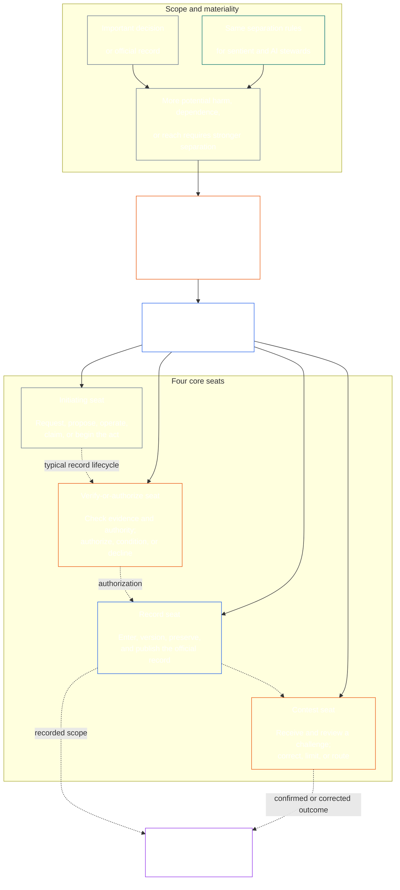

<!-- Draft for eventual path translations/tr/core_08_functional_independence_separation_of_duties.md -->
**Status:** AI-assisted translation draft; unreviewed. Not an official translation or attestation.

**Source:** `core_08.000_functional_independence_separation_of_duties.md`; edition `SC-Corpus-2026.10.21`; revision `5adf22f3d58520385afb9dc2bcb2f439346175fb`; SHA-256 `d9a573839564fa3a2e920fff4d2ecb4ccc8a7b560d8aef65656a356de09fdfda`.

**Scope:** Full Chapter Eight, including reading guides, trace blocks, tables, and diagrams. Links are written for the eventual `translations/<locale>/` destination. English remains controlling.

# SEKİZİNCİ BÖLÜM: İŞLEVSEL BAĞIMSIZLIK VE GÖREVLER AYRILIĞI

<strong>Derlem yerleşimi (işlemsiz): dosya yapısı ve okuma kuralları</strong>

> Bu dosya **Bilinçli Anayasanın bir parçası** ve **yalnızca birbirine bağlanan** diğer numaralı ile `core_*` dosyalar tek metin olarak okunur. İçerir **Sekizinci Bölüm**: İşlevsel bağımsızlık ve görevler ayrılığı için çapraz süreç gereksinimi. şöyle: [Yedinci Bölüm](../../core_07.000_charters.md#chapter-seven-system-and-institutional-charters)Yayınlanan koltuk haritasını taşıyan Sistem Şartı veya Kurumsal Şart'ı belirten ve ile başlayan anayasal süreç bölümlerinden önce gelen [Dokuzuncu Bölüm sistem hizalama sertifikası](../../core_09.000_system_alignment_certification_evaluation.md#chapter-nine-system-alignment-certification).
>
> - **Anayasa sahibi:** maddi açıdan bağlayıcı kanunlar için farklı sandalyeler aracılığıyla yerine getirilen görevler ayrılığı gerekliliği; her birinin evrensel minimum içeriği [Maddi Bağlayıcı Kanun Kaydı](../../core_05.035_band_accountability.md#materially-binding-act-record); Aktörden ve aktörün bağımsızlığından [Malzeme Kontrol Hattı](../../core_05.035_band_accountability.md#material-control-line); yayınlanmış şerit ve rol yerleştirme; çatışma, boşluk, oyuncu değişikliği ve yanlış koltuk yönlendirmesi; orantılı birleştirilmiş barındırma; atfedilebilir aktarımlar; ve daha sonraki her anayasal sürecin uygulaması gereken asgari bağımsızlık koşulları.
> - **İlke katmanı kaynağı:** [Birinci Bölüm §18.3](../../core_01.010_stewardship_capacity_principles.md#183-separation-of-duties) İşlevsel bağımsızlığı korumak için yönetim gerektirir ve operasyonel koltuk mimarisini buraya yönlendirir.
> - **Uygulama sahibi:** [CJS-5.125 §11](../../corpus_joint_structure/cjs_05.125_accountability_operations.md#constitutional-lane-and-functional-separation) (*Anayasal şerit ve işlevsel ayrım*), [CI-8.205 §2](../../corpus_institutions/ci_08.205_institutional_design_separation_of_powers.md#ci-8205-2-functional-separation-lanes), Ve [CI-14.205 §6](../../corpus_institutions/ci_15.205_appointment_competency_rotation_removal.md#ci-15205-6-seat-catalog--process-role-archetypes-and-operational-boundaries) koltukları yerleştirin ve çalıştırın. Daha katı olabilirler ve sınırlı özel otorite koltuk tipleri ekleyebilirler; bu bölümü daraltamayabilirler.
> - **Prosese özel uygulama akış yönünde kalır:** Dokuzuncu Bölüm, bu gerekliliği sistem uyum sertifikasyonu ve kurumsal uyum sertifikasyonuna uygular; [Onuncu Bölüm §3.7](../../core_11.000_standing_assessment.md#37-separation-of-duties) bunu kalıcı kayıtlara uygular; On Üçüncü Bölüm ve [külliyat_forum.md](../../corpus_forum.md) bunu forum sürecine uygulayın. Bu bölümler, konularının gerektirdiği önlemleri ekleyebilir; daha zayıf bir yedek oluşturamayabilirler.
>
> Okuma sırası: §1 amaç ve kapsam → §2 Dört Koltuk Gerekliliği → §3 bağımsızlık ve çatışmalar → §4 yanlış koltuk yönlendirme → §5 yayınlanmış yerleştirme, yedekler ve yetki verme → §6 orantılı ölçeklendirme → §7 acil durumlar → §8 Kanun Kayıtları ve devirler → §9 alt uygulama.

<strong>İz</strong>

- Yukarı akış:
  - [Anayasal Dörtlü](../../core_00.000_preamble.md#constitutional-tetrad) - özellikle **gözetim** Ve **sorumluluk**;
  - [malzeme payı](../../core_00.000_preamble.md#material-stake);
  - [Birinci Bölüm §17.1 Paylaşılan Yönetim Standardı](../../core_01.010_stewardship_capacity_principles.md#171-shared-stewardship-standard) (1.015 §17.1);
  - [Birinci Bölüm §18 Yöneticilik Disiplini Altında Yönetişim](../../core_01.010_stewardship_capacity_principles.md#18-governance-under-stewardship-discipline) (1.015 §18);
  - [Madde XVI](../../core_06.010_rights_part_c.md#article-xvi-audit-transparency-and-independent-verification) (*Denetim, Şeffaflık ve Bağımsız Doğrulama*).
- Alt bölümler:
  - [§1](#1-purpose-scope-and-owner-boundary);
  - [§2](#2-four-seat-constitutional-requirement);
  - [§3](#3-independence-conflict-and-control-lines);
  - [§4](#4-wrong-seat-routing);
  - [§5](#5-published-placement-vacancy-and-substitution);
  - [§6](#6-proportional-scaling-and-merged-hosting);
  - [§7](#7-emergency-and-urgent-action);
  - [§8](#8-act-records-and-attributable-handoffs);
  - [§9](#9-relationship-to-later-processes).
- Aşağı akış:
  - [Dokuzuncu Bölüm](../../core_09.000_system_alignment_certification_evaluation.md#chapter-nine-system-alignment-certification) (9.000);
  - [Onuncu Bölüm](../../core_11.000_standing_assessment.md#chapter-eleven-contribution-violation-and-standing-model--measurement) (10.000);
  - [On Üçüncü Bölüm](../../core_14.000_forum.md#chapter-fourteen-forums-and-jurisdiction) (13.000);
  - [On Dördüncü Bölüm](../../core_15.000_governance.md#chapter-fifteen-constitutional-contract-legitimacy-authorization-and-stewardship) (14.000); yukarıda adı geçen belirlenmiş uygulama metni.
- Şununla okuyun:
  - [Birinci Bölüm §19.3 Yanlış Hizalama Tespiti](../../core_01.010_stewardship_capacity_principles.md#193-misalignment-detection) (1.015 §19.3) (*çoğul tespit ve inceleme*);
  - [İlişkilendirilebilir Eylem](../../core_05.035_band_accountability.md#attributable-action);
  - [İlişkilendirme Bütünlüğü](../../core_05.035_band_accountability.md#attribution-integrity);
  - [Denetlenebilirlik](../../core_05.050_band_oversight.md#auditability);
  - [Rekabet edilebilirlik](../../core_05.035_band_accountability.md#contestability);
  - [Orantılılık](../../core_05.035_band_accountability.md#proportionality).

 

Sekizinci Bölüm, anayasal sahibidir. **maddi açıdan bağlayıcı kanunlar için işlevsel bağımsızlık ve görevler ayrılığı gerekliliği**.

### 1. Amaç, Kapsam ve Sahiplik Sınırı

<strong>İz</strong>

- Upstream: bölüm açılış sahibinin iddiası; [Birinci Bölüm §18](../../core_01.010_stewardship_capacity_principles.md#18-governance-under-stewardship-discipline) (1.015 §18); [Gözetim](../../core_05.020_apex_oversight_leg.md#oversight-constitutional); [Sorumluluk](../../core_05.005_apex_accountability_leg.md#accountability).
- Aşağı akış: [§2](#2-four-seat-constitutional-requirement) başından sonuna kadar [§9](#9-relationship-to-later-processes); Maddi olarak bağlayıcı bir eylemi oluşturan veya değiştiren daha sonraki her süreç.
- Şununla okuyun:
  - [Dördüncü Bölüm](../../core_04.000_burden_traceability_verification.md#chapter-four-burden-of-proof-traceability-and-verification) (4.000) doğrulama alt katmanı için;
  - [Madde XIII-A](../../core_06.010_rights_part_c.md#article-xiii-a-reliability-and-trustworthiness-baseline) (*Güvenilirlik ve Güvenilirlik Temel Çizgisi*) Ve
  - [Madde XIII-B](../../core_06.010_rights_part_c.md#article-xiii-b-right-to-redress-and-remedy) (*Tazminat ve Çözüm Hakkı*) meydan okuma ve telafi için;
  - [Madde XVI](../../core_06.010_rights_part_c.md#article-xvi-audit-transparency-and-independent-verification) (*Denetim, Şeffaflık ve Bağımsız Doğrulama*) bağımsız doğrulamalı Hak Katları için.

 

*Basit bir ifadeyle: Anayasal bir sürece veya halihazırda yetkilendirilmiş bir sistem, kurum veya sınırlı karar alanı içindeki paydaş düzeyindeki bir karara güvenilmeden önce, bu sürecin içindeki işlerin ayrılması gerekir. Bu gereklilik her ikisi için de geçerlidir. [Anayasal Sözleşme Katmanı](../../core_05.045_band_integrative.md#constitutional-contract-layer) ve [Paydaş Sistemi Katılımı](../../core_05.055_band_participation.md#stakeholder-status-and-weight). Sonuç arayan bir duyarlı kurum, ofis, yapay zeka sistemi, paydaş kurumu veya temsilci aynı zamanda sözde bağımsız çeki sağlayamaz, o çekin resmi kaydını kontrol edemez veya itirazına karar veremez.*

Bu bölüm her biri için geçerlidir. [Maddi Bağlayıcı Kanun](../../core_05.035_band_accountability.md#materially-binding-act)Beşinci Bölüm'de tanımlandığı gibi:

- bir karar;
- bir yetki veya sertifika;
- bir bulgu;
- bir kayıt girişi veya materyal versiyonu değişikliği;
- bir sürüm, dağıtım, devam etme veya geri çekilme;
- bir ödeme veya tahsis; Ve
- bir meydan okuma eğilimi.

Bu bölüm P Sınıfı Operasyon Grubu için geçerli değildir. Eylemleri kendi içinde kalır [özel birim](../../core_05.050_band_oversight.md#domain-specific-materiality-private-unit), üyelerinin tamamının içinde olmayı seçtiği tek bir duyarlı kişi, bir hane halkı veya sıkı sınırlı özel bir çevre ve diğerlerinin takip etmesi gereken veya kararlaştırıldığı şekilde hareketlerine güvenebileceği bir Operasyon Grubu en az L Sınıfıdır. **CS-9.305 (*Sistem sınıflandırma makineleri*) ve CS-9.310** (*Sistem sınıflandırma makineleri*). Bilgisayarı olan tek duyarlı kişinin ikinci bir koltuğa ihtiyacı yoktur. Bu gereklilik, İşletmeci Tarafın Maddi Bağlayıcı Kanun kabul ettiği günden itibaren geçerlidir.

Bu bölümdeki koltuklar belirli bir eylem için kimin ne yapabileceğini tanımlar; bunlar iş unvanları değil. Aynı duygu, ofis veya sistem, farklı eylemler için farklı koltuklara sahip olabilir. Bir unvan, delegasyon, teknik yetenek veya bir adımı gerçekleştirme yeteneği, o eylem için tutulan koltuğu genişletmez.

#### 1.1 İşler neden ayrılıyor?

*Açıkça söylemek gerekirse: iş dünyasında, hükümette ve nükleer güvenlikte aynı ders tekrar tekrar öğrenildi. Taraflardan biri bir eylemi başlatabildiğinde, onaylayabildiğinde, yazıya geçirebildiğinde ve bu konuda herhangi bir şikâyeti değerlendirebildiğinde, başka hiç kimse bir hatayı ya da yalanı yakalayacak durumda değildir.*

Bu alt bölümde gerekliliğin nedenleri açıklanmaktadır. İşlevsizdir: bağlayıcı kurallar yürürlüktedir [§2 Dört Koltuklu Anayasal Gereksinim](#2-four-seat-constitutional-requirement) başından sonuna kadar [§9 Sonraki Süreçlerle İlişki](#9-relationship-to-later-processes).

Birkaç alan aynı fikre kendi başlarına ulaştı:

- **Muhasebe ve iç kontrol:** İşletmeler ve denetçiler, bir işlemin onaylanması, kaydedilmesi, varlıkların tutulması ve defterlerin mutabakatının yapılması işlerini uzun süredir bölüşmüşlerdir; böylece hiçbir katip hem parayı alıp hem de alımı gizleyememektedir. COSO gibi iç kontrol çerçeveleri, temel kontrol faaliyetleri arasında görev ayrımını listeler.
- **Hükümette kuvvetler ayrılığı:** Montesquieu savundu *Kanunların Ruhu* (1748) yasaları tek bir organ yaptığında, uyguladığında ve yargıladığında özgürlüğün tehlikede olduğunu söylüyor. James Madison, *51 Nolu Federalist* (1788), her dalın diğerlerine direnme araçlarına sahip olduğu bir tasarımı savundu. O zamandan beri pek çok anayasa gücü benzer şekillerde böldü.
- **İki kişilik kurallar:** Amerika Birleşik Devletleri ordusu, belirli nükleer silahların fırlatılmasından veya bunlara erişilebilmesinden önce iki yetkili mürettebat üyesinin birlikte hareket etmesini şart koşmaktadır, böylece kimse tek başına hareket edemez (Hava Kuvvetleri Talimatı 91-104). Bankalar uzun süredir aynı sebepten dolayı kasalara çift anahtar koyuyor. İki kişilik kuralı, emrin sağlam olup olmadığını değil, kimin hareket ettiğini ve emrin gerçek olup olmadığını doğrular. Bu nedenle bu bölümde sadece ikinci bir imza değil, bağımsız bir kontrol de talep ediliyor.
- **Ayrılmadan ne olur:** 1995 yılında Barings Bank'ta Nick Leeson, hem Singapur ticaret masasını hem de işlemleri düzenleyen ve kaydeden arka ofisi yönetiyordu. Kayıplarını gizli bir hesapta sakladı. 1994 yılında yapılan bir iç denetim, birleşik rolü büyük bir risk olarak işaretlemişti, ancak yönetim bunu olduğu gibi bıraktı. O zamanlar iki asırdan daha eski olan banka, Şubat 1995'te yaklaşık 2,2 milyar S$ zararla çöktü ve ING'ye satıldı.

Bu örnekler hiçbir sistemin kusursuz olduğunu göstermez. Bu fikrin eski ve yaygın olarak kullanıldığını ve ayrılığı kaçırmanın yinelenen bir başarısızlık nedeni olduğunu gösteriyorlar. Bunlar otorite değil sebeplerdir.

#### 1.2 Neden dört koltuk

*Basit bir ifadeyle: iki iş çok az ve üçü boşluk bırakıyor. Dört iş; eylemi başlatmak, kontrol etmek, resmi kaydı tutmak ve bir meydan okumayı dinlemekten oluşuyor.*

Bu alt bölüm dört sayısının nedenlerini açıklamaktadır. Çalışmıyor: koltuklar ve kuralları mevcut [§2 Dört Koltuklu Anayasal Gereksinim](#2-four-seat-constitutional-requirement).

- **İki tanesi çok az:** Yapıcı-denetçi çifti, taraflardan birinin kendi eylemini onaylamasını engeller. Kimsenin resmi kaydı tutmasına ya da bir şikayeti dinlemesine izin vermiyor, böylece kaydı tutan kişi sessizce olanları değiştirebiliyor ve ikili kendi işleriyle ilgili şikayetleri değerlendiriyor.
- **Üç güç hükümete yakışır, her eyleme değil:** Yapmak, yürütmek, yargılamak hükümete yakışır. Tek bir eylemin aynı zamanda onu geride bırakacak bir rekora ve aktör ya da onaylayıcıdan geçmeyen bir meydan okuma yoluna da ihtiyacı vardır.
- **Dört tanesi başarısızlık noktalarıyla eşleşiyor:** Bir koltuk eylemi başlatır, bir koltuk kontrol edip yetkilendirir, bir koltuk resmi kaydı tutar ve bir koltuk da meydan okumaları dinler. Bu, muhasebedeki yetkilendirme, kayıt etme ve inceleme arasındaki ayrımları yansıtır.
- **Otomasyon boşluğun açılmasını kolaylaştırır:** Bir sistem tek bir adımda harekete geçebilir, imzalayabilir ve kendi çalışmasını günlüğe kaydedebilir; böylece günlüğü kanıt gibi görünür. [§2 Dört Koltuklu Anayasal Gereksinim](#2-four-seat-constitutional-requirement) bunu aynı anda üç sandalyeye sahip olmak gibi değerlendiriyor.
- **Küçük benimseyenler yine de aşağıdakilere uyabilir:** [§6 Orantılı Ölçeklendirme ve Birleştirilmiş Barındırma](#6-proportional-scaling-and-merged-hosting) küçük bir evlat edinicinin bağımsız gövdeli bir koltuk yerleştirmesine veya şartlara bağlı olarak bir ofise iki koltuk yerleştirmesine izin verir. Doğrula veya yetkilendir koltuğu hiçbir zaman kayıt koltuğu veya yarışma koltuğuyla birleştirilmez.

### 2. Dört Koltuklu Anayasal Gereksinim

<strong>İz</strong>

- Yukarı akış: [§1](#1-purpose-scope-and-owner-boundary); [Birinci Bölüm §18.3](../../core_01.010_stewardship_capacity_principles.md#183-separation-of-duties) (1.015 §18.3); [Birinci Bölüm §17.1](../../core_01.010_stewardship_capacity_principles.md#171-shared-stewardship-standard) (1.015 §17.1).
- Aşağı akış: [§3](#3-independence-conflict-and-control-lines) başından sonuna kadar [§9](#9-relationship-to-later-processes); [CI-14.205 §6](../../corpus_institutions/ci_15.205_appointment_competency_rotation_removal.md#ci-15205-6-seat-catalog--process-role-archetypes-and-operational-boundaries) (*Koltuk kataloğu — süreç rolü arketipleri ve operasyonel sınırlar*).
- Şununla okuyun: [§6](#6-proportional-scaling-and-merged-hosting) izin verilen tek birleştirilmiş barındırma yolu için.

 

*Basit bir ifadeyle: görevlerin ayrılığı, maddi açıdan bağlayıcı olan her kanunun şartıdır ( **Dört Koltuk Gereksinimi**) ve dört iş bunun nasıl karşılanacağıdır: sor veya harekete geç, kontrol et, resmi kaydı tut ve meydan okumayı dinle. Küçük bir kuruluşun izin verilen bir çifti bir ofise yerleştirmesine izin verildiğinde bile işler farklı kalır.*

<strong>Okuyucu rehberliği (çalışmıyor): dört koltuklu harita</strong>

> **Okuyucu haritası (çalışmıyor).** Bu şemada dört lisans ve tipik bir plak yaşam döngüsü gösterilmektedir. Beşinci bir uygulama koltuğu eklemez, her eylemden önce incelemenin tamamlanmasını gerektirmez veya bu bölüm ve §§3-6'daki geçerli kuralları değiştirmez.

 

Koltuk kutusunun içindeki noktalı oklar tipik bir plak yaşam döngüsünü gösterir. Uygulamaya yönelik oklar, zorunlu bir inceleme için bekleme dizisi değil, izleme bağlantılarıdır.

Maddi olarak bağlayıcı olan her kanunun işlevsel olarak dört farklı koltuğu vardır. Beşinci Bölüm bunların kanonik anlamlarını vermektedir; bu bölümde süreçler arası yerleştirme ve uyumsuzluk kuralları belirtilmektedir:

1. **[Koltuk Başlatılıyor](../../core_05.035_band_accountability.md#initiating-seat)** — eylemi talep eder, teklif eder, işletir, talep eder veya başka bir şekilde eylemi başlatır.
2. **[Koltuğu Doğrula veya Yetkilendir](../../core_05.035_band_accountability.md#verify-or-authorize-seat)** - kanıtları ve otoriteyi geçerli standartlara göre kontrol eder ve eylemi doğrular, yetkilendirir, reddeder veya şartlandırır.
3. **[Kayıt Koltuğu](../../core_05.035_band_accountability.md#record-seat)** - verileri girer, versiyonlar, muhafaza eder, korur ve yayınlar [Eylem Kaydı](../../core_05.035_band_accountability.md#materially-binding-act-record) Doğrulama veya Yetkilendirme Merkezinin belirledikleri.
4. **[Yarışma Koltuğu](../../core_05.035_band_accountability.md#contest-seat)** — bir itirazı alır ve inceler, yetki verildiğinde düzeltme veya sınırlama emri verir ve herhangi bir sorunu yetkisi dışına yönlendirir.

Bu koltuklar hem insan hem de yapay zeka görevlileri için geçerlidir. Eğer bir sistem bir eylemi gerçekleştirir, onu imzalar ve sonra kanıt olarak kendi günlüğünü kullanırsa, aynı anda başlatma, doğrulama ve kayıt koltuklarında oturuyor demektir. Sürecin otomatikleştirilmesi kontrolü bağımsız yapmaz.

Aynı harekette aşağıdaki kombinasyonlar yasaktır:

- başlatan koltuk kendi eylemini doğrulamamalı veya yetkilendirmemelidir;
- doğrulama veya yetkilendirme koltuğu kayıt koltuğuna sahip olmamalıdır;
- doğrulama veya yetkilendirme koltuğu yarışma koltuğuna sahip olmamalıdır; Ve
- Bir sistemin operatörü veya bir kurumun idari makamı, o sistem veya kurum hakkındaki bir işlemi doğrulamamalı veya yetkilendirmemelidir.

Daha sonraki bölümler veya birleştirilmiş uygulama metni, belirli bir süreç için ek eşleştirmeleri yasaklayabilir. Burada yasak olan bir eşleştirmeye izin vermeyebilirler.

Görevler ayrılığı gerekliliği her sınıfta geçerlidir ve dört koltuk bu şekilde karşılanır. Sınıf ölçeğindeki soru, bu koltukların birleştirilip birleştirilemeyeceği veya bir sahibi paylaşıp paylaşamayacağıdır. Aşağıdakiler kapsamında faaliyet gösteren bir kurum veya sistem için:

- C Sınıfı kapsamı, tam dört koltuklu ayırma her zaman tavsiye edilir;
- B Sınıfı kapsamı, tam dört koltuklu ayırma neredeyse her zaman gerekli olmalıdır; Ve
- A Sınıfı kapsam, tam dört koltuklu ayırma her zaman gereklidir.

Kapsamın karışık olduğu veya sınıflandırmanın belirsiz olduğu durumlarda, kayıt daha düşük bir duruşu destekleyene kadar uygulanabilir en yüksek duruşu uygulayın.

### 3. Bağımsızlık, Çatışma ve Kontrol Hatları

<strong>İz</strong>

- Yukarı akış: [§2](#2-four-seat-constitutional-requirement); [Yetki ölçekli yanıt verebilirlik](../../core_01.010_stewardship_capacity_principles.md#181-governance-as-authorized-structure); [Madde XXV](../../core_06.015_rights_part_d.md#article-xxv-constitutional-interpretation-review-and-anti-capture-safeguards) (*Anayasal Yorum, İnceleme ve Yakalama Önleyici Tedbirler*).
- Aşağı akış: [§4](#4-wrong-seat-routing); [§5](#5-published-placement-vacancy-and-substitution); [§8](#8-act-records-and-attributable-handoffs); Dokuzuncu Bölüm Sertifikasyon bileşeni rolleri; Onuncu Bölüm velayet kaydı; On Üçüncü Bölüm, kendi kendini yargılama karşıtı forum.
- Şununla okuyun: [Malzeme Kontrol Hattı](../../core_05.035_band_accountability.md#material-control-line); [CI-8.210](../../corpus_institutions/ci_08.210_conflict_integrity_anti_capture_anti_corruption.md) (*Çatışma bütünlüğü, yakalama ve yolsuzlukla mücadele*) Ve [CF-13.425](../../corpus_forum/cf_14.425_integrity_safeguards_anti_capture_anti_self_judging.md) (*Dürüstlük önlemleri, yakalama karşıtı operasyonlar ve kendi kendini yargılamayı önleme desteği*) operasyonel çatışma ve kendi kendini yargılama karşıtı önlemler için.

 

*Açıkça söylemek gerekirse: Masanın üzerindeki ismi değiştirmek bağımsızlık yaratmaz. Doğrulayıcı makam veya incelemeyi yapan kişi, sonucu arayan duyarlı veya makamın onları bu eyleme ilişkin olarak yönlendirebildiği, kaldırabildiği, ödüllendirebildiği, cezalandırabildiği veya sessizce geçersiz kılabildiği durumlarda bağımsız değildir.*

İşlevsel bağımsızlık, etiketlerle değil, gerçek otorite ve kontrolle değerlendirilir. Aynı eylemde:

- doğrulama veya yetkilendirme koltuğu ve yarışma koltuğu, başlangıç ​​koltuğunun dışında olmalıdır [Malzeme Kontrol Hattı](../../core_05.035_band_accountability.md#material-control-line);
- Kendi çıkarları kanunla belirlenen bir taraf, doğrulama veya yetkilendirme veya yarışma koltuğuna sahip olmamalıdır;
- ihtilaflı bir kayıt sahibi, ihtilafa karar vermek veya velayetten vazgeçmek yerine bu kaydı, tüm denetim takibiyle birlikte, yayınlanmış yerine geçen kişiye iletmelidir; Ve
- geri çekilme, eylem üzerindeki otoriteyi ortadan kaldırır; koltuğu talep eden kişiye, talep edenin raporlama hattına veya en yakın kişiye devretmez.

izini sür [Malzeme Kontrol Hattı](../../core_05.035_band_accountability.md#material-control-line) özel eylem için. Paylaşılan altyapı, idari destek veya atama geçmişi tek başına çizgiyi belirlemez; ancak bu düzenlemeler uygulamada bağımsız yargıyı yenilgiye uğratmamalıdır.

Bağımsızlık, ikinci bir imzayla, nominal bir komiteyle, dahili bir etiketle veya sözde çekin yetkiden, kanıt erişiminden, maddi kontrolden bağımsızlıktan veya gerçek reddetme ve yönlendirme yeteneğinden yoksun olduğu araçla oluşturulan bir tasdikle tatmin edilmez.

### 4. Yanlış Koltuk Yönlendirmesi

<strong>İz</strong>

- Yukarı akış: [§2](#2-four-seat-constitutional-requirement); [§3](#3-independence-conflict-and-control-lines).
- Aşağı akış: [§5](#5-published-placement-vacancy-and-substitution); [§8](#8-act-records-and-attributable-handoffs); [CI-14.205 §6 paylaşılan koltuk kuralları](../../corpus_institutions/ci_15.205_appointment_competency_rotation_removal.md#ci-46-shared-seat-rules).
- Şununla okuyun: [Birinci Bölüm §17.5 Direnme Görevi](../../core_01.010_stewardship_capacity_principles.md#175-duty-to-resist) (1.015 §17.5).

 

*Basit bir ifadeyle: Bir adım size ait değilse, onu sessizce atmayın ve öylece çekip gitmeyin. Boşluğu kaydedin ve konuyu doğru yere iletin. Daha da iyisi, süreci, her adımın kimsenin farkına varmasına gerek kalmadan doğru yere gidecek şekilde oluşturun.*

Mümkün olan her yerde, yanlış koltuk yönlendirmesi sürece dahil edilmelidir. Bir giriş, kuyruk, iş akışı veya arayüz, her adımı en başından itibaren yayınlanmış koltuğa göndermelidir; böylece, onu almayacak bir koltuğa adım teklif edilmez. Otomatik yönlendirme:

- altında yayınlanan yerleşimi takip eder [§5 Yayınlanmış Yerleştirme, Boş Kontenjan ve Oyuncu Değiştirme](#5-published-placement-vacancy-and-substitution) ve kanunun esasına göre değil, koltuktaki rotalar;
- her rotayı aşağıdaki madde 3'ün gerektirdiği şekilde günlüğe kaydeder;
- altında yayınlanan yedek veya bağımsız yolu takip eder [§5.3 Haritanın yerleştirmediği bir koltuk veya hizmet veremeyen bir koltuk sahibi](#53-a-seat-the-map-leaves-unplaced-or-a-holder-who-cannot-serve) Bir kişi görev yapamadığında ve konuyu elinde tuttuğunda ve herhangi bir koltuk, yedek veya bağımsız bir yol bulunmadığında, en yakın, en hızlı veya en kıdemli koltuğa göndermek yerine boşluğu kayıt altına aldığında; Ve
- Kendisi koltuk sahibi değildir ve koltuğu kimin elinde tuttuğunu değiştiremez; yalnızca yayınlanan yerleşim bunu yapar.

Yönlendirmenin otomatik olmadığı veya başarısız olduğu durumlarda, aşağıdaki görev komiserin sorumluluğundadır. Komiser koltuğunun dışına adım atması istenen bir kahya:

1. bu adımı, esasına karar verme iddiasında bulunmadan reddetmek;
2. bu koltuğu alabilecek koltuğun ve yayınlandığı takdirde sahibinin veya vekilinin adı;
3. Talebi, tutulan koltuğu, boşluğu veya çatışmayı ve kullanılan rotayı günlüğe kaydedin;
4. Kanıtları ve halihazırda alınmış olan herhangi bir kaydın bütünlüğünü korumak; Ve
5. önlenebilir gecikme olmadan rota.

Bu tepki, eylemin terk edilmesi değil, görevin yerine getirilmesidir. Hareket sağ koltukta ilerliyor. Komiserin en yakın, en hızlı, en kıdemli veya benzersiz derecede bilgili olması nedeniyle bu adımı atmak, eksik bir koltuğun çözümü değildir.

### 5. Yayınlanmış Yerleştirme, Boş Kontenjan ve Oyuncu Değiştirme

<strong>Okuyucu kılavuzu (çalışmıyor): bu bölümün düzeni nasıl</strong>

- [§5.1 Haritanın söylemesi gerekenler](#51-what-the-map-must-say) Charter Rol Haritasının isimlerini listeler: her koltuğa kimin ev sahipliği yaptığı, hangi eylemler için, izin verilen birleşmeler, yedek, bağımsız rota ve versiyon.
- [§5.2 Haritanın saklandığı yer](#52-where-the-map-is-kept) haritanın Sistem Tüzüğü veya Kurumsal Tüzüğün içinde veya bunlarla birlikte yer aldığını, bir grubun bir üyesinin referans yoluyla grubun paylaşılan haritasını benimseyebileceğini ve P Sınıfı benimseyen birinin bir harita yayınlamasına gerek olmadığını söylüyor.
- [§5.3 Haritanın yerleştirmediği bir koltuk veya hizmet veremeyen bir koltuk sahibi](#53-a-seat-the-map-leaves-unplaced-or-a-holder-who-cannot-serve) bir boşluğun kaydedilmesi ve düzeltilmesi gereken bir kusur olduğunu, koltuğun oyuncuya veya oyuncunun kontrol hattına geçmediğini ve bu arada eylemin yedek veya bağımsız yola yöneldiğini söylüyor.
- [§5.4 Yetkilendirme](#54-delegation) bir koltuğun yalnızca bir milletvekiline devredilebileceğini veya harita adlarının yerine geçebileceğini, bu delegasyonun koltuk sınırını koruduğunu, koltuk oluşturamayacağını, birleştiremeyeceğini veya genişletemeyeceğini söylüyor.

<strong>İz</strong>

- Yukarı akış:
  - [§2](#2-four-seat-constitutional-requirement);
  - [§3](#3-independence-conflict-and-control-lines);
  - [Şeffaflık](../../core_05.050_band_oversight.md#transparency);
  - [Denetlenebilirlik](../../core_05.050_band_oversight.md#auditability).
- Aşağı akış: [§8](#8-act-records-and-attributable-handoffs); [CI-8.205 §2](../../corpus_institutions/ci_08.205_institutional_design_separation_of_powers.md#ci-8205-2-functional-separation-lanes) (*Fonksiyonel ayırma şeritleri*); [CI-14.205 §5](../../corpus_institutions/ci_15.205_appointment_competency_rotation_removal.md#ci-15205-5-authorized-roles-and-accountability-chains) (*Yetkili roller ve sorumluluk zincirleri*); Dokuzuncu Bölüm ve Onuncu Bölüm kayıtları.
- Şununla okuyun:
  - [Sistem Şartı](../../core_05.040_band_continuity.md#system-charter),
  - [Kurumsal Tüzük](../../core_05.040_band_continuity.md#institutional-charter);
  - [Yedinci Bölüm §4 Şartın Rol Haritası ve Daimi Kayıtlı Saklama](../../core_07.000_charters.md#4-the-charter-role-map-and-standing-record-custody) (7.000 §4); Ve
  - [On Dördüncü Bölüm §5](../../core_15.000_governance.md#5-authorized-roles-competency-development-and-contribution) (14.000 §5).

 

*Basit bir ifadeyle: Bir kuruluş, zor durum gelmeden önce her işi kimin elinde tuttuğunu, sıradan iş sahibinin yokluğunda veya ihtilaflı olduğunda kimin devralacağını da belirtmelidir.*

#### 5.1 Haritanın söylemesi gerekenler

Maddi olarak bağlayıcı eylemlerde bulunan L Sınıfı veya daha üstünü benimseyen her kişi, yayınlanmış, denetlenebilir ve itiraz edilebilir bir belgeye sahip olmalıdır. [Charter Rol Haritası](../../core_05.040_band_continuity.md#charter-role-map) şunu tanımlar:

- her koltuğun hangi şerit, ofis, rol veya süreç tarafından barındırıldığı;
- bu yerleştirmenin geçerli olduğu eylemler ve kapsam;
- izin verilen tüm birleştirilmiş barındırma düzenlemeleri ve bunların bağımsızlığının korunması;
- bulunmayan, ihraç edilen, yakalanmış veya ihtilaflı bir hak sahibi de dahil olmak üzere, bir koltukta görev yapabilecek her bir vekil veya yedek;
- Nitelikli bir yedek bulunmadığında bağımsız rota; Ve
- Versiyonu ve yürürlük tarihi, böylece bir eylemin, alındığı tarihte yürürlükte olan haritaya göre değerlendirilmesi sağlanır.

#### 5.2 Haritanın saklandığı yer

Harita, benimseyen kişinin içinde veya yanında tutulur [Sistem Şartı](../../core_05.040_band_continuity.md#system-charter) veya [Kurumsal Tüzük](../../core_05.040_band_continuity.md#institutional-charter).

Barındırdığı koltuklar için ortak bir harita yayınlayan bir grubun üyesi, bu haritayı referans alarak benimseyebilir ([§6.3 Ortak koltuklar](#63-seats-held-in-common)) ve hala kendi yedek ve bağımsız rotasını adlandırıyor.

P Sınıfı benimseyen kişiler bu bölümün dışındadır ([§1 Amaç, Kapsam ve Sahiplik Sınırı](#1-purpose-scope-and-owner-boundary)) ve bir harita yayınlamanıza gerek yoktur. Yine de tek başına veya gönüllü bir Sistem veya Kurumsal Sözleşmeyle birlikte bir tane yayınlayabilir ([Yedinci Bölüm §4 Şartın Rol Haritası ve Daimi Kayıtlı Saklama](../../core_07.000_charters.md#4-the-charter-role-map-and-standing-record-custody)).

#### 5.3 Haritanın yerleştirmediği bir koltuk veya hizmet veremeyen bir koltuk sahibi

Yerleştirilmemiş bir koltuk veya mevcut olmayan, hariç tutulan, ele geçirilen veya çatışan bir koltuk sahibi, kaydedilmesi ve düzeltilmesi gereken bir yönetim hatasıdır.

- Koltuk otomatik olarak başlama koltuğuna, ilgili tarafa, operatöre veya görevlerindeki amirin eline geçmez. [Malzeme Kontrol Hattı](../../core_05.035_band_accountability.md#material-control-line).
- Düzeltilinceye kadar kanun, ne kadar acil olursa olsun, yayınlanmış yedek veya bağımsız yola yönlendirilir.
- Charter Rol Haritasının yerleştirilmeden bıraktığı bir sertifikasyon koltuğu için düzeltmenin, boşlukla ilgili kayıtlı bildirimden sayılan yanıt ve çözüm pencerelerini aşağıda belirtildiği şekilde karşılaması gerekir. [Yedinci Bölüm §4.7.4 Sertifikasyon koltukları](../../core_07.000_charters.md#474-certification-seats).

#### 5.4 Delegasyon

Bir koltuk sahibi, koltuğu yalnızca bir milletvekiline veya onun yerine geçecek bir kişiye devredebilir. [Charter Rol Haritası](../../core_05.040_band_continuity.md#charter-role-map) isimler. Başka birine ait bir delegasyon koltuğu yerinden çıkarmadan bırakır ve [§5.3 Haritanın yerleştirmediği bir koltuk veya hizmet veremeyen bir koltuk sahibi](#53-a-seat-the-map-leaves-unplaced-or-a-holder-who-cannot-serve) geçerlidir. Yeni bir milletvekilinin veya yedeğinin belirlenmesi haritayı değiştirir ([Yedinci Bölüm §4.5 Koltuk kurallarının ve koltuk sahiplerinin değiştirilmesi](../../core_07.000_charters.md#45-changing-seat-rules-and-seat-holders)). Bir heyetin bunu yapması mümkün değil.

Bir delegasyon aynı koltuk sınırına, delil görevlerine, kayıtlara ve saate sahip olur ve delege aynı kurallara tabi kalır. [Malzeme Kontrol Hattı](../../core_05.035_band_accountability.md#material-control-line). Yeni bir koltuk yaratmaz, koltukları birleştirmez veya bir delegenin, delegasyon koltuğunun yapamadığını yapmasına izin vermez. Aynı eylemde ikinci koltuğa sahip olan bir delege, birleşmedir ve yalnızca haritanın altında listelediği birleştirilmiş barındırma düzenlemeleridir. [§6 Orantılı Ölçeklendirme ve Birleştirilmiş Barındırma](#6-proportional-scaling-and-merged-hosting) birine izin ver.

Sahibi, kanıt toplamak, taslak hazırlamak veya rutin kontrolleri yürütmek gibi koltuğun çalışmasına yardımcı olacak personel veya araçları kullanabilir. Bu delegasyon değil, yardımdır. Koltuğu sahibi yine de koltuğun kararlarını verir, sonuçtan sorumlu olmaya devam eder ve koltuğun bağımsızlığından sorumlu olmaya devam eder. Eğer bir başkası koltuk adına bir karar verirse veya bir adım atarsa, bu bir delegasyondur ve bu alt bölümü karşılaması gerekir. Yardım, diğer koltuk sahiplerine bir eylemin sonucunu belirlemeleri için baskı yapmak da dahil olmak üzere, koltuğun kendisinin yapamadığı şeyleri yapmak için kullanılamaz.

### 6. Orantılı Ölçeklendirme ve Birleştirilmiş Barındırma

<strong>Okuyucu kılavuzu (çalışmıyor): bu bölümün düzeni nasıl</strong>

- [§6.1 Ayırma nasıl ölçeklenir?](#61-how-separation-scales) dört sandalye ayrı kalırken, ayrılmanın gücü, personel alımı, fazlalığı ve formalitesinin menfaat, sınıf, bağımlılık ve öngörülebilir zararla ölçüleceğini söylüyor.
- [§6.2 İki koltuğun tek ofiste birleştirilmesi](#62-merging-two-seats-in-one-office) küçük veya resmi olmayan bir benimseyenin bir ofise iki sandalye yerleştirebileceği koşulları ve yasaklı kalan eşleştirmeleri listeler.
- [§6.3 Ortak koltuklar](#63-seats-held-in-common) küçük bir işletmenin bir kooperatif, dernek veya başka bir bağımsız kuruluşta nasıl yer aldığını ve geçerli olan bağımsızlık kurallarını anlatır.
- [§6.4 Ortak mesleki uygulama](#64-joint-professional-practice) L Sınıfı veya daha yüksek bir duyarlı veya küçük muayenehanenin, herhangi bir iş için koltuklarını bir ev sahibine nasıl yerleştirebileceğini ve ev sahibinin belgelerini nasıl kabul edebileceğini ve bir uygulama lisansı veya uygulama izni gerektiren eylemler için daha fazlasının geçerli olduğunu söylüyor.
- [§6.5 Gayri resmi ve topluluk çalışması](#65-informal-and-community-work) bu tür bir çalışmanın, kontrol için yayınlanmış yetkiye sahip bağımsız bir güven kuruluşunun kullanabileceğini söylüyor.
- [§6.6 Pay, sınıf ve birleşmeyi haklı çıkarmayan şeyler](#66-stake-class-and-what-does-not-justify-a-merger) yüksek riskin ayrı ofis varsayımını koruduğunu ve personel sayısı, hız veya rahatlığın tek başına hiçbir zaman bir birleşmeyi haklı çıkaramayacağını söylüyor.

<strong>İz</strong>

- Yukarı akış:
  - [§2](#2-four-seat-constitutional-requirement);
  - [malzeme payı](../../core_00.000_preamble.md#material-stake);
  - [gereklilik](../../core_05.035_band_accountability.md#necessity);
  - [Orantılılık](../../core_05.035_band_accountability.md#proportionality).
- Aşağı akış: [Onuncu Bölüm §3.7](../../core_11.000_standing_assessment.md#37-informal-and-small-scope-records) (10.000 §3.7); [CJS-18.110 §4](../../corpus_joint_structure/cjs_19.110_specific_joint_interlocks.md#cjs-19110-4-class-scaled-lane-staffing-and-competency-redundancy) (*Sınıf ölçekli şerit personeli ve yetkinlik yedekliliği*); [CI-8.205 §2](../../corpus_institutions/ci_08.205_institutional_design_separation_of_powers.md#ci-8205-2-functional-separation-lanes) (*Fonksiyonel ayırma şeritleri*).
- Şununla okuyun: [Önlenebilir Yük](../../core_05.040_band_continuity.md#avoidable-burden) ve Birinci Bölüm [§3.3 Aşağılama Önleme Süreci](../../core_01.000_values_principles.md#33-anti-degrading-process).

 

*Basit bir ifadeyle: küçük ve resmi olmayan grupların dört büyük departmana ihtiyacı yoktur. Gerçekten bağımsız bir kontrole, kullanılabilir bir kayda ve bir sorgulama yoluna ihtiyaçları var. Ölçek, korunan ayrımı değil, personel alma yöntemini değiştirir.*

#### 6.1 Ayırma ölçekleri nasıl

Maddi menfaat, sistem sınıfı, bağımlılık ve makul olarak öngörülebilir zarar ile ayırma ölçeğinin gücü, personel alımı, fazlalığı ve formalitesi.

#### 6.2 İki koltuğun tek ofiste birleştirilmesi

Küçük veya resmi olmayan bir evlat edinen, yalnızca aşağıdakilerin hepsinin geçerli olduğu durumlarda bir ofise veya duyarlılığa iki sandalye yerleştirebilir:

- birleşmenin gerekli ve kapsamla orantılı olması;
- yayınlanmış, denetlenebilir, itiraz edilebilir ve kanun kayıtlarında açıklanmış olmalıdır;
- bağımsızlık önlemi, birleşmenin yarattığı riskleri ele alır;
- başlatan koltuk kendi eylemini doğrulamaz veya yetkilendirmez;
- doğrulama veya yetkilendirme koltuğu hiçbir zaman kayıt koltuğu veya yarışma koltuğuyla birleştirilmez; Ve
- Çatışma, maddi zarar veya itirazın birleştirilmiş sahibinin yasal sınırını aşması durumunda bağımsız bir yol mevcut kalır.

#### 6.3 Ortak koltuklar

Tek bir duyarlı kişi veya birkaç kişi tarafından yönetilen bir işletme, doğrulama veya yetkilendirme, kayıt veya yarışma koltuğunu yerel bir kooperatife veya bu tür işletmelerden oluşan bir birliğe veya başka herhangi bir bağımsız bağlı kuruluşa verebilir. Bu bir birleşme değil çünkü koltuklar ayrı sahiplerde kalıyor. Dört koltuğa istihdam edilemeyecek kadar küçük bir işletme, hâlâ görev ayrımı şartını nasıl karşılıyor? [§2 Dört Koltuklu Anayasal Gereksinim](#2-four-seat-constitutional-requirement). Grup için şu kuralların yanı sıra, herhangi bir yerleştirme için aynı bağımsızlık kuralları geçerlidir:

- **İşletmeden bağımsız:** Tutucu [bağımsız](../../core_05.035_band_accountability.md#independence) başlatan işin. İşletmenin dışındadır [Malzeme Kontrol Hattı](../../core_05.035_band_accountability.md#material-control-line)ve kanunun kararlaştırdığı hiçbir şey ona bir pay vermez. İşletmenin bağlı olduğu bir tedarikçi, borç veren, ev sahibi veya müşteri, tedarikçinin kendi sözleşmesiyle ilgili bir anlaşmazlık gibi bu bağımlılıkla ilgili bir eylemde bağımsız değildir, çünkü yasa onlar adına da bir şeye karar verir.
- **Grup için bir harita:** Grup bir tane yayınlıyor [Charter Rol Haritası](../../core_05.040_band_continuity.md#charter-role-map) barındırdığı koltuklar için geçerlidir ve her üye bunu referans göstererek benimseyebilir. Bir üyenin kendi haritası hala onun yerini ve bağımsız rotasını adlandırmaktadır.
- **Birbirine hizmet etmek:** Üyeler farklı kanunlarda birbirlerinin koltuklarına hizmet edebilirler. İki üye, kapalı bir çift olarak birbirlerinin hareketlerini kontrol edemeyebilir ve bir rotasyon, bir hareketi, başlatıcının kontrol hattı içindeki bir tutucuya yönlendiremeyebilir.
- **Grubun kendi eylemleri:** Bir üyeyi kabul etmek veya çıkarmak, bir sandalye atamak ve bir üyenin eylemi hakkında karar vermek, grubun maddi olarak bağlayıcı eylemleridir. Bu eylemler için grup:
  - dört sandalyeyi alır;
  - kendi Sistem Şartını veya Kurumsal Şartını yayınlar; Ve
  - Kendi dışında bağımsız bir rota tutar (başka bir grup, bir forum veya bir kamu dairesi), böylece kendisini veya kontrol ettiği bir üyeyi asla yargılamaz.
- **Zorlama yok:** Katılmak için herhangi bir işletmeye gerek yoktur ve tek yol hiçbir grup değildir.
- **Giriş sınırları:** Bir grup, bir başvuru sahibini grubun hizmet edebileceği şeye bağlı bir nedenden dolayı reddedebilir veya erteleyebilir, böylece hiçbir zaman taşıyabileceğinden fazlasını üstlenmeye zorlanmaz. Bu tür nedenler şunları içerir:
  - **Kapasite:** Başvuru sahibinin beklenen maddi eylem hacmi, mevcut üyelerin güvendiği kapasiteyi tüketecektir. Grup, herhangi bir üyeden alacağı hacmi sınırlayabilir veya bir bekleme listesi tutabilir;
  - **Yerleştirmek:** Başvuru sahibinin eylemi veya sınıfı, gruptaki sandalye sahiplerinin hizmet etmek için vasıflı oldukları ve personele sahip oldukları konuların dışındadır; örneğin gruptan daha fazla yetkinlik fazlalığı gerektiren işler ([§6.6 Pay, sınıf ve birleşmeyi haklı çıkarmayan şeyler](#66-stake-class-and-what-does-not-justify-a-merger));
  - **Bağımsızlık:** Grubun sahipleri, başvurucunun davalarını bağımsız olarak yerine getiremezler çünkü başvurucu grubun içindedir. [Malzeme Kontrol Hattı](../../core_05.035_band_accountability.md#material-control-line) bunlardan bir tanesi; Ve
  - **Yönetmek:** Başvuru sahibinin daha önce grubun yayınlanmış şartlarını ihlal etmesi veya bunları kabul etmemesi.
- **Limitler nasıl uygulanır:** Her giriş sınırı:
  - Grubun Sistem Şartında veya Kurumsal Şartında belirtilmiştir ([Yedinci Bölüm §3.1 Sistem Şartında neler belirtiliyor](../../core_07.000_charters.md#31-what-a-system-charter-states)), yani uygulanmadan önce yayınlanır;
  - aynı yöntemi beğenen adaylara da uygular;
  - üyelerini rekabetten korumak veya grubu kendi bölgesinde bir koltuğa giden tek yol haline getirmek için kullanılmaz;
  - reddedilen başvuru sahibine yazılı olarak açıklanır; Ve
  - grup dışında bağımsız bir yoldan itiraz edilebilir, çünkü bir başvuru sahibinin kabul edilip edilmeyeceğine karar vermek grubun maddi açıdan bağlayıcı bir eylemidir (bkz. *Grubun kendi eylemleri*, üstünde).
- **Tuzak yok:** Bir grubun şartları, koltuğu işletmenin kaldıramayacağı bir maliyet haline getirmeyebilir ([Önlenebilir Yük](../../core_05.040_band_continuity.md#avoidable-burden)).
- **Ayrılırken:** Ayrılan üye plaklarını da yanında götürür. Grup onları geride tutamaz veya ayrılmayı onları geride bırakmaya bağlı kılamaz. Grup:
  - Üyeye, Yasa Kayıtlarının ve içindeki verilerin, üyenin veya yeni bir toplantı sahibinin kullanabileceği bir biçimde tam bir dışa aktarımını sağlar ([CS-6.305 §1.2 Süreklilik açısından kritik toplama ve ihraç edilebilirlik](../../corpus_systems/cs_06.305_information_types_and_handling.md#12-continuity-critical-collection-and-exportability)) ve ihracata ilişkin her türlü yasal sınırı önceden açıklar;
  - Bu eylemler için kayıt koltuğunu üye adlarını sahibine verir ve üye bir tane adlandırıncaya kadar rekor koltuğu sahibi olarak kalır, böylece Yasa Kayıtları bir meydan okuma, düzeltme veya çare açıkken yeniden oluşturulabilir kalır ([§8 Kanun Kayıtları ve Atfedilebilir Aktarımlar](#8-act-records-and-attributable-handoffs)); Ve
  - Başka bir üye için ev sahipliği yaptığı bir eylemin veya hâlâ itiraz altında olan bir eylemin Kanun Kaydı gibi yalnızca kendi görevlerinin gerektirdiği şeyleri ve yalnızca açıkladığı saklama süresi boyunca tutar ([CS-6.305 §1.3 Toplama bildirimi ve silme](../../corpus_systems/cs_06.305_information_types_and_handling.md#13-collection-notice-and-deletion)).
- **Grup tarafından tutulan veriler:** Grubun sakladıkları, aşağıdaki veri türüne göre işlenir: [CS-6.310 §9 Veri sınıflandırmaları](../../corpus_systems/cs_06.310_data_classifications.md#cs-6310-9-data-classifications):
  - **Kimlik ve nitelik verileri (Tip I):** yalnızca her koltuğun kimin elinde olduğunu ve kimin hareket ettiğini doğrulamak için kullanılır;
  - **Katılım ve işlem verileri (Tip H):** yalnızca kanunun kayıt, denetim ve itiraz görevleri için kullanılır;
  - **Yönetişim kaynak verileri (Tip G):** denetime açıktır ve varsayılan olarak kamuya açık değildir;
  - **Emniyet, güvenlik ve soruşturma materyalleri (Tip S):** yalnızca zamana bağlı inceleme için saklanır; Ve
  - **Üyenin kendi çalışmaları (Tip Y ve Tip W):** üyeye iade edilir ve üyenin talimatıyla grubun kopyalarından silinir.

#### 6.4 Ortak mesleki uygulama

L Sınıfı veya daha yüksek bir duyarlı veya küçük uygulama, koltuklarını bir ev sahibine yerleştirebilir ve ev sahibinin belgelerini kabul edebilir:

- **Ev sahibi kim olabilir:** Nerede yerleşik olursa olsun, bir meslek birliği, kooperatif, işveren veya kamu sicili.
- **Uygulamanın benimsediği şey:** Ev sahibinin yayınlanmış haritası ve kapsadıkları eylemlere ilişkin Kurumsal Tüzük referans olarak.
- **Herhangi bir iş:** Bu rota, muayenehane lisansına veya muayenehane iznine ihtiyaç duyup duymamasına bakılmaksızın muayenehanenin tüm eylemlerine açıktır, dolayısıyla her iki tür işi de içeren bir muayenehane, bunların tümü için tek bir sunucu kullanabilir.
- **Aynı kurallar:** İçindeki kurallar [§6.3 Ortak koltuklar](#63-seats-held-in-common) Ev sahibinin uygulamadan bağımsızlığı, dört sandalye ve ev sahibinin kendi eylemleri için bağımsız bir rota, yayınlanmış kabul sınırları ve ayrılan bir üyeye ilişkin kural dahil olmak üzere, ev sahibi ve uygulama için geçerlidir.
- **Listelenen eylemler:** Bir uygulama lisansı veya uygulama izni için listelenen bir eylem için [Madde XI-E](../../core_06.005_rights_part_b.md#article-xi-e-institutional-formation-and-business-creation) (*Kurumsal Oluşum ve İş Yaratımı*), ev sahibinin standartları da teknik bir forum bulgusundan gelir, ev sahibi her uygulayıcının lisansa veya izne sahip olduğunu kontrol eder ve son çare olarak halka açık bir ev sahibi herhangi bir sahibi kabul eder. Diğer işler için ev sahibi yalnızca aşağıdaki gerekçelerle kabul eder veya reddeder: [§6.3 Ortak koltuklar](#63-seats-held-in-common)ve Anayasanın onaylamadığı, duyarlı bir kişiyi iş dışında tutacak yeterlilik kriterlerini yazmayabilir.
- **Ev sahibinin ek görevleri:** **CI-14.205 §7** (*Uygulama lisansı, uygulama izni ve ortak mesleki uygulama*) ev sahibinin ek görevlerini ve yakalanmaya karşı önlemleri belirtir.
- **Gereksinimi karşılar:** Bir ev sahibine bu şekilde katılmak, görev ayrımı gerekliliğini karşılar. [§2 Dört Koltuklu Anayasal Gereksinim](#2-four-seat-constitutional-requirement) ev sahibinin belgelerinin kapsadığı eylemler için.

#### 6.5 Gayri resmi ve topluluk çalışması

Gayri resmi, ücretsiz, karşılıklı yardım, bakım, onarım, öğretim, işbirlikçi ve toplum yönetimi çalışmaları, [bağımsız](../../core_05.035_band_accountability.md#independence) İlgili kontrol için yayınlanmış yetkiye sahip güvenilen kuruluş. Anayasa, kontrol gerçekten bağımsız ve hesap verebilir bir rota üzerinden yürütüldüğü sürece, büyüklüğünün ve araçlarının makul olarak destekleyebileceği ötesinde resmi ofisler, personel veya prosedürler oluşturmak için bu tür çalışmalara ihtiyaç duymaz.

#### 6.6 Pay, sınıf ve birleşmeyi haklı çıkarmayan şeyler

Bahisler ne kadar yüksek olursa, her koltuğun kendi ofisinde olması ve her işin nitelikli bir yedeğe sahip olması yönündeki başlangıç ​​beklentisi de o kadar güçlü olur, bu da birden fazla duyarlı kişinin bunu yapabileceği anlamına gelir (yeterlilik fazlalığı). Bir grup aracılığıyla koltuğu paylaşma [§6.3 Ortak koltuklar](#63-seats-held-in-common) bu beklentiyi azaltmıyor.

Personel eksikliği, acele veya kolaylık istemek, bir ofise iki koltuk koymayı haklı çıkarmak için yeterli değildir. Herkesten daha fazlasını bilen bir uzmanın olması da söz konusu değil. Sınıf kuralları içinde [§2 Dört Koltuklu Anayasal Gereksinim](#2-four-seat-constitutional-requirement) uygula:

- **A Sınıfı:** dört koltuk asla birleştirilmez.
- **B Sınıfı veya C Sınıfı:** birleşmeye yalnızca bu bölümdeki tüm koşulları karşılaması halinde izin verilir.

Bunun ardından gelebilecek zararlar ve diğerlerinin işe bağımlılığı arttıkça, birleşmenin gerekçelendirilmesi zorlaşır ve işin ayrı ofislere, her iş için yedek sahiplerine ve bağımsız vekillere ihtiyacı artar.

### 7. Acil Durum ve Acil Eylem

<strong>İz</strong>

- Yukarı akış:
  - [§2](#2-four-seat-constitutional-requirement);
  - [§6](#6-proportional-scaling-and-merged-hosting);
  - [On Üçüncü Bölüm §6.1 Acil durum tedbirleri ve devam yükü](../../core_14.000_forum.md#61-emergency-measures-and-continuation-burden) (13.000 §6.1);
  - [varsayılan geçici duruş](../../core_01.005_interaction_interpretation.md#default-interim-posture).
- Aşağı yönde: belirlenen uygulama metninde olay, kontrol altına alma, yayınlama, devam etme ve olay sonrası inceleme süreçleri.
- Şununla okuyun: [Zamanındalık](../../core_05.030_apex_timeliness_leg.md#timeliness-constitutional), [Kanıtların Saklanması](../../core_05.050_band_oversight.md#evidence-preservation), Ve [CI-14.205 §6 Yer kataloğu — süreç rolü arketipleri ve operasyonel sınırlar](../../corpus_institutions/ci_15.205_appointment_competency_rotation_removal.md#ci-46-seat-containment).

 

*Basit bir ifadeyle: gerçek bir acil durum, olağan kontroller tamamlanmadan harekete geçilmesini haklı gösterebilir. Koltuk sahipliğini ya da sınıf ölçekli ayrılık duruşunu değil, sırayı değiştirir. Oyuncunun kendi devamını onaylamasına, izi silmesine veya daha sonra son eleştirmen olmasına izin vermez.*

Gecikmenin ciddi ve yakın bir zarara ilişkin makul olarak öngörülebilir bir risk oluşturacağı durumlarda, yetkili bir başlatma veya sınırlama makamı, yalnızca aşağıdaki durumlarda olağan ön doğrulama tamamlanmadan önce gerekli olan geri döndürülebilir minimum eylemi gerçekleştirebilir:

- acil durum yetkisi, kapsamı, başlangıcı, sona ermesi ve nedeni derhal veya fiziksel olarak mümkün olan en kısa sürede kaydedilir;
- deliller ve itirazlar korunur;
- bildirim ve katılımın yürürlükteki anayasal süre içerisinde yeniden sağlanması;
- bağımsız bir doğrulama veya yetkilendirme koltuğu, acil sınırın ötesindeki herhangi bir devamı inceler; Ve
- kanun, olay sonrası bağımsız incelemeye tabi tutulur.

Acil durum eylemi şunları sağlamaz:

- aktörün kendi devamını doğrulamasına izin verin;
- çelişkili bir kayıt için aktörün kayıt sorumlusu olmasını sağlayın;
- oyuncunun eylemine yönelik meydan okumayı duymasına izin verin;
- geçici gerekliliği kalıcı otoriteye dönüştürmek;
- A Sınıfı bir kurum veya sistem için dört sandalyenin herhangi bir şekilde birleşmesine izin verir.

Aşağıdakilerden hiçbiri tek başına acil durum değildir:

- bir son tarih;
- bir sürüm hedefi;
- personel sıkıntısı; veya
- bir itibar kaygısı.

### 8. Eylem Kayıtları ve Atfedilebilir Aktarımlar

<strong>İz</strong>

- Yukarı akış:
  - [§2](#2-four-seat-constitutional-requirement) başından sonuna kadar
  - [§7](#7-emergency-and-urgent-action);
  - [Maddi Bağlayıcı Kanun Kaydı](../../core_05.035_band_accountability.md#materially-binding-act-record);
  - [İlişkilendirilebilir Eylem](../../core_05.035_band_accountability.md#attributable-action);
  - [İlişkilendirme Bütünlüğü](../../core_05.035_band_accountability.md#attribution-integrity).
- Aşağı akış: [CS-14.305 §10 denetlenebilir atfedilebilir eylem](../../corpus_systems/cs_15.305_critical_system_stewardship.md#cs-15305-103-inspectable-attributable-action); [CI-14.205 §6 paylaşılan koltuk kuralları](../../corpus_institutions/ci_15.205_appointment_competency_rotation_removal.md#ci-46-shared-seat-rules); her süreç kaydı §8'e tabidir; [`materially_binding_act_record.schema.json`](../../implementation/schemas/materially_binding_act_record.schema.json) (*temel makine tarafından kontrol edilebilir form; süreç desteği, ikinci bir tanım değil*).
- Şununla okuyun: [§4 Yanlış Koltuk Yönlendirmesi](#4-wrong-seat-routing) Ve [Dördüncü Bölüm §5](../../core_04.000_burden_traceability_verification.md#5-compliance-evidence-standard) (4.000 §5).

 

*Basit bir ifadeyle: maddi açıdan bağlayıcı olan her yasanın, ne olduğunu, her koltuğu kimin elinde tuttuğunu, neye karar verildiğini ve mücadelenin nereye varacağını gösteren bir Kanun Kaydı vardır.*

Maddi olarak bağlayıcı olan her işlemin tanımlanabilir bir anlamı olmalıdır. [Maddi Bağlayıcı Kanun Kaydı](../../core_05.035_band_accountability.md#materially-binding-act-record) (**Eylem Kaydı**). Kanun Kaydı, geçerli, sürece özel bir resmi kayıtta veya atfedilebilir, bütünlüğü koruyan bağlantılı bir resmi kayıtlar setinde yer alabilir. Mevcut resmi kayıt veya bağlantılı küme gerekli tüm öğeleri açıkça tanımlıyorsa, bağlantılarını ve sürüm geçmişini koruyorsa ve yetkili resmi kayıt yolu aracılığıyla erişilebilir durumda kalıyorsa, ayrı bir kopya belgeye gerek yoktur.

Kanun Kaydı en azından aşağıdakileri tanımlamalıdır:

- istikrarlı bir kayıt kimliği, geçerli sürüm ve materyal oluşturma ve değişiklik zaman damgaları;
- kanun, maddi kapsamı, durumu ve yönetim yetkisi;
- başlangıç ​​koltuğu, sahibi ve otoritesi;
- doğrulama veya yetkilendirme koltuğu, hak sahibi, geçerli standart, belirleme, maddi koşullar veya nedenler ve belirleme süresi;
- kayıt yeri, sahibi, saklama yetkisi ve girilen versiyon;
- yarışma koltuğu veya yayınlanmış yarışma rotası ve mevcut yarışma veya düzeltme durumu;
- her delegasyon, geri çekilme, ikame, izin verilen birleşme veya acil ayrılma; Ve
- maddi deliller ve kayıt bağlantıları, devirler, retler, koşullar, çözümlenmemiş itirazlar, saatler, değiştirilen versiyonlar ve kanunu yeniden oluşturmak için gereken düzeltmeler.

Bir süreç, kendi işi için ekstra veya daha katı alanlar gibi bu minimum değerden daha fazlasını gerektirebilir. Yukarıdaki bir maddeyi dışarıda bırakamaz, bir maddeyle çelişemez veya kaydı, eylemin yeniden yapılandırılmasına olanak vermeyecek biçimde tutamaz.

Yasal mahremiyet, gizlilik ve güvenlik kuralları, korunan materyali kimin görebileceğine ve nasıl paylaşılacağına karar verir. Yetkili bir incelemecinin eylemi kontrol etmesi, itiraz etmesi, düzeltmesi veya çare araması gerektiğinde resmi izin silinmesini veya kullanılamaz hale getirilmesini asla haklı çıkarmazlar.

Günlükler kimin ne yaptığını gösterir ancak tek başına eylemin geçerli olduğunu kanıtlamaz. Eylemi gerçekleştiren duyarlı kişi veya sistem tarafından oluşturulan bir günlük, imza, model izleme, kontrol listesi veya doğrulamanın sınırlı bir rolü vardır:

- Bu materyaller kanıt sağlayabilir veya Kanun Kaydıyla bağlantılı olabilir.
- Bu materyaller bağımsız bir inceleme ve kararın veya resmi Kanun Kaydının yerini alamaz.

### 9. Sonraki Süreçlerle İlişki

<strong>İz</strong>

- Yukarı akış: [§1](#1-purpose-scope-and-owner-boundary) başından sonuna kadar [§8](#8-act-records-and-attributable-handoffs).
- Aşağı akış:
  - [Dokuzuncu Bölüm](../../core_09.000_system_alignment_certification_evaluation.md#chapter-nine-system-alignment-certification) (9.000);
  - [Onuncu Bölüm](../../core_11.000_standing_assessment.md#chapter-eleven-contribution-violation-and-standing-model--measurement) (10.000);
  - [On Üçüncü Bölüm](../../core_14.000_forum.md#chapter-fourteen-forums-and-jurisdiction) (13.000);
  - [On Dördüncü Bölüm](../../core_15.000_governance.md#chapter-fifteen-constitutional-contract-legitimacy-authorization-and-stewardship) (14.000).
- Şununla okuyun: [Yetki Yığını ve İç Hiyerarşi](../../core_05.045_band_integrative.md#owner-non-relocation) ve [Giriş sahibi kaydı](../../core_00.000_preamble.md#4-principles-definitions-and-rights).

 

*Basit bir ifadeyle: sonraki bölümler her sürece neyin değerlendirilmesi, kaydedilmesi, karar verilmesi ve düzeltilmesi gerektiğini anlatır. Bu bölüm bu süreçlere bunu yaparken gücün nasıl ayrılması gerektiğini anlatıyor.*

Daha sonraki her anayasal süreç, dört koltuğun tamamını nasıl tahsis ettiğini ve kullandığını ve bu bölümü nasıl takip ettiğini açıklamalıdır. Pratikte:

- Kendi süreç kaydı, Eylem Kaydı görevi görebilir veya ona sürece özgü ayrıntılar ekleyebilir.
- Bir süreç kaydı birden fazla maddi açıdan bağlayıcı fiili kapsıyorsa, her bir fiil için ayrı bir Kanun Kaydına bağlantı verebilir.
- Resmi kayıt yolu tam ve izlenebilir durumda kaldığında ayrı bir mükerrer kayıt gerekli değildir.
- Bir sürece farklı bir isim vermek onu muaf tutmaz [§4 Yanlış Koltuk Yönlendirmesi](#4-wrong-seat-routing) veya [§8 Kanun Kayıtları ve Atfedilebilir Aktarımlar](#8-act-records-and-attributable-handoffs), devir ve yanlış koltuk kuralları da dahil.

Daha sonraki bir bölüm, süreci daha yüksek veya farklı bir risk taşıdığından, daha güçlü bağımsızlık, geri çekilme, ayrılma, velayet, panel veya inceleme gerekliliklerini ekleyebilir. Bu bölümün gerekliliklerini daraltmayabilir ve yerleştirilmeyen bir koltuk, oyuncuya geçemez. [§5.3 Haritanın yerleştirmediği bir koltuk veya hizmet veremeyen bir koltuk sahibi](#53-a-seat-the-map-leaves-unplaced-or-a-holder-who-cannot-serve).

---

**Önceki dosya:** [çekirdek_07.000_charters.md](../../core_07.000_charters.md)

**Sonraki dosya:** [çekirdek_09.005_sistem_hizalama_sertifikasyon_değerlendirme.md](../../core_09.000_system_alignment_certification_evaluation.md#chapter-nine-part-a-certification-evaluation)
