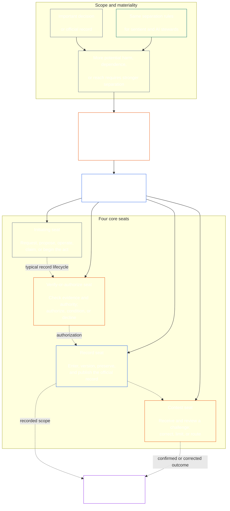

<!-- Draft for eventual path translations/ur/core_08_functional_independence_separation_of_duties.md -->
**Status:** AI-assisted translation draft; unreviewed. Not an official translation or attestation.

**Source:** `core_08.000_functional_independence_separation_of_duties.md`; edition `SC-Corpus-2026.10.21`; revision `5adf22f3d58520385afb9dc2bcb2f439346175fb`; SHA-256 `d9a573839564fa3a2e920fff4d2ecb4ccc8a7b560d8aef65656a356de09fdfda`.

**Scope:** Full Chapter Eight, including reading guides, trace blocks, tables, and diagrams. Links are written for the eventual `translations/<locale>/` destination. English remains controlling.

# آٹھواں باب: فنکشنل آزادی اور فرائض کی علیحدگی

<strong>کارپس پلیسمنٹ (غیر آپریٹو): فائل کی ساخت اور پڑھنے کے قواعد</strong>

> یہ فائل ہے۔ **حساس آئین کا حصہ** اور ہے **صرف ایک ساتھ باندھنا** دوسرے نمبر والے کے ساتھ `core_*` فائلیں ایک متن کے طور پر پڑھتی ہیں۔ اس پر مشتمل ہے۔ **باب آٹھ**: فنکشنل آزادی اور فرائض کی علیحدگی کے لیے کراس پروسیس کی ضرورت۔ یہ مندرجہ ذیل ہے [باب سات](../../core_07.000_charters.md#chapter-seven-system-and-institutional-charters)، جو سسٹم چارٹر یا ادارہ جاتی چارٹر بتاتا ہے جو شائع شدہ نشست کا نقشہ رکھتا ہے، اور آئینی عمل کے ابواب سے پہلے شروع ہوتا ہے [باب نو نظام سیدھ سرٹیفیکیشن](../../core_09.000_system_alignment_certification_evaluation.md#chapter-nine-system-alignment-certification).
>
> - **آئینی مالک:** مادی طور پر پابند اعمال کے لیے فرائض کی علیحدگی کی ضرورت، جو الگ الگ نشستوں کے ذریعے پوری ہوتی ہے۔ ہر ایک کا عالمگیر کم از کم مواد [مادی طور پر بائنڈنگ ایکٹ ریکارڈ](../../core_05.035_band_accountability.md#materially-binding-act-record); اداکار اور اداکار سے آزادی [میٹریل کنٹرول لائن](../../core_05.035_band_accountability.md#material-control-line); شائع شدہ لین اور رول پلیسمنٹ؛ تنازعہ، خالی جگہ، متبادل، اور غلط سیٹ روٹنگ؛ متناسب ضم شدہ ہوسٹنگ؛ منسوب ہینڈ آفس؛ اور کم از کم آزادی کی شرائط جن کا اطلاق ہر بعد کے آئینی عمل میں ہونا چاہیے۔
> - **اصولی تہہ ماخذ:** [باب اول §18.3](../../core_01.010_stewardship_capacity_principles.md#183-separation-of-duties) فنکشنل آزادی کو برقرار رکھنے کے لیے گورننس کی ضرورت ہوتی ہے اور یہاں آپریٹو سیٹ کے فن تعمیر کو روٹ کرتا ہے۔
> - **نفاذ کا مالک:** [CJS-5.125 §11](../../corpus_joint_structure/cjs_05.125_accountability_operations.md#constitutional-lane-and-functional-separation) (*آئینی لین اور فنکشنل علیحدگی*) [CI-8.205 §2](../../corpus_institutions/ci_08.205_institutional_design_separation_of_powers.md#ci-8205-2-functional-separation-lanes)، اور [CI-14.205 §6](../../corpus_institutions/ci_15.205_appointment_competency_rotation_removal.md#ci-15205-6-seat-catalog--process-role-archetypes-and-operational-boundaries) سیٹیں رکھیں اور ان کو فعال کریں۔ وہ سخت ہو سکتے ہیں اور پابند خصوصی اتھارٹی سیٹ کی قسمیں شامل کر سکتے ہیں۔ وہ اس باب کو تنگ نہیں کر سکتے۔
> - **عمل سے متعلق ایپلیکیشن نیچے کی طرف رہتی ہے:** باب نو اس ضرورت کا اطلاق سسٹم الائنمنٹ سرٹیفیکیشن اور ادارہ جاتی سیدھ سرٹیفیکیشن پر کرتا ہے۔ [باب دس §3.7](../../core_11.000_standing_assessment.md#37-separation-of-duties) اس کا اطلاق اسٹینڈنگ ریکارڈز پر ہوتا ہے۔ تیرہ باب اور [کارپس_فورم ایم ڈی](../../corpus_forum.md) اسے فورم کے عمل میں لاگو کریں۔ وہ ابواب اپنے موضوع کے لحاظ سے ضروری حفاظتی اقدامات شامل کر سکتے ہیں۔ وہ کمزور متبادل نہیں بنا سکتے۔
>
> پڑھنے کی ترتیب: §1 مقصد اور دائرہ کار → §2 چار نشستوں کی ضرورت → §3 آزادی اور تنازعات → §4 غلط سیٹ روٹنگ → §5 شائع شدہ جگہ کا تعین، متبادلات، اور وفد

<strong>ٹریس</strong>

- اپ اسٹریم:
  - [آئینی ٹیٹراڈ](../../core_00.000_preamble.md#constitutional-tetrad) - خاص طور پر **نگرانی** اور **احتساب**;
  - [مادی داؤ](../../core_00.000_preamble.md#material-stake);
  - [باب اول §17.1 مشترکہ اسٹیورڈ شپ اسٹینڈرڈ](../../core_01.010_stewardship_capacity_principles.md#171-shared-stewardship-standard) (1.015 §17.1)؛
  - [باب اول §18 انتظامی نظم و ضبط کے تحت](../../core_01.010_stewardship_capacity_principles.md#18-governance-under-stewardship-discipline) (1.015 §18)؛
  - [آرٹیکل XVI](../../core_06.010_rights_part_c.md#article-xvi-audit-transparency-and-independent-verification) (*آڈٹ، شفافیت، اور آزاد تصدیق*)۔
- ذیلی حصے:
  - [§1](#1-purpose-scope-and-owner-boundary);
  - [§2](#2-four-seat-constitutional-requirement);
  - [§3](#3-independence-conflict-and-control-lines);
  - [§4](#4-wrong-seat-routing);
  - [§5](#5-published-placement-vacancy-and-substitution);
  - [§6](#6-proportional-scaling-and-merged-hosting);
  - [§7](#7-emergency-and-urgent-action);
  - [§8](#8-act-records-and-attributable-handoffs);
  - [§9](#9-relationship-to-later-processes).
- بہاو:
  - [باب نو](../../core_09.000_system_alignment_certification_evaluation.md#chapter-nine-system-alignment-certification) (9.000)؛
  - [باب دس](../../core_11.000_standing_assessment.md#chapter-eleven-contribution-violation-and-standing-model--measurement) (10.000)؛
  - [باب تیرہ](../../core_14.000_forum.md#chapter-fourteen-forums-and-jurisdiction) (13.000)؛
  - [باب چودہ](../../core_15.000_governance.md#chapter-fifteen-constitutional-contract-legitimacy-authorization-and-stewardship) (14.000)؛ مندرجہ بالا نامزد نفاذ کا متن۔
- کے ساتھ پڑھیں:
  - [باب اول §19.3 غلط ترتیب کا پتہ لگانا](../../core_01.010_stewardship_capacity_principles.md#193-misalignment-detection) (1.015 §19.3)*جمع کا پتہ لگانا اور جائزہ لینا*);
  - [منسوب ایکشن](../../core_05.035_band_accountability.md#attributable-action);
  - [انتساب کی سالمیت](../../core_05.035_band_accountability.md#attribution-integrity);
  - [آڈٹ ایبلٹی](../../core_05.050_band_oversight.md#auditability);
  - [مقابلہ بازی](../../core_05.035_band_accountability.md#contestability);
  - [تناسب](../../core_05.035_band_accountability.md#proportionality).

 

آٹھویں باب کا آئینی مالک ہے۔ **مادی طور پر پابند اعمال کے لیے فنکشنل-آزادی اور فرائض کی علیحدگی کا تقاضہ**.

### 1. مقصد، دائرہ کار، اور مالک کی حد

<strong>ٹریس</strong>

- اپ اسٹریم: باب کھولنے والے مالک کا دعوی؛ [باب اول §18](../../core_01.010_stewardship_capacity_principles.md#18-governance-under-stewardship-discipline) (1.015 §18)؛ [نگرانی](../../core_05.020_apex_oversight_leg.md#oversight-constitutional); [احتساب](../../core_05.005_apex_accountability_leg.md#accountability).
- بہاو: [§2](#2-four-seat-constitutional-requirement) کے ذریعے [§9](#9-relationship-to-later-processes); ہر بعد کا عمل جو مادی طور پر پابند عمل پیدا کرتا ہے یا تبدیل کرتا ہے۔
- کے ساتھ پڑھیں:
  - [باب چار](../../core_04.000_burden_traceability_verification.md#chapter-four-burden-of-proof-traceability-and-verification) (4.000) تصدیقی سبسٹریٹ کے لیے؛
  - [آرٹیکل XIII-A](../../core_06.010_rights_part_c.md#article-xiii-a-reliability-and-trustworthiness-baseline) (*وشوسنییتا اور قابل اعتمادی کی بنیاد*) اور
  - [آرٹیکل XIII-B](../../core_06.010_rights_part_c.md#article-xiii-b-right-to-redress-and-remedy) (*ازالہ اور تدارک کا حق*چیلنج اور ازالہ کے لیے؛
  - [آرٹیکل XVI](../../core_06.010_rights_part_c.md#article-xvi-audit-transparency-and-independent-verification) (*آڈٹ، شفافیت، اور آزاد تصدیق*) آزاد تصدیقی حقوق کے فرش کے لیے۔

 

*واضح الفاظ میں: آئینی عمل سے پہلے — یا پہلے سے مجاز نظام، ادارے، یا پابند فیصلہ ڈومین کے اندر اسٹیک ہولڈر کی سطح کے فیصلے پر بھروسہ کیا جا سکتا ہے، اس کے اندر موجود ملازمتوں کو الگ کر دینا چاہیے۔ یہ ضرورت دونوں پر لاگو ہوتی ہے۔ [آئینی معاہدہ کی تہہ](../../core_05.045_band_integrative.md#constitutional-contract-layer) اور کرنے کے لئے [اسٹیک ہولڈر سسٹم کی شرکت](../../core_05.055_band_participation.md#stakeholder-status-and-weight). ایک حساس، دفتر، AI سسٹم، اسٹیک ہولڈر باڈی، یا نتیجہ تلاش کرنے والا نمائندہ بھی قیاس شدہ آزاد چیک فراہم نہیں کر سکتا، اس چیک کے سرکاری ریکارڈ کو کنٹرول نہیں کر سکتا، یا اس پر چیلنج کا فیصلہ نہیں کر سکتا۔*

اس باب کا اطلاق ہر ایک پر ہوتا ہے۔ [مادی طور پر پابند ایکٹ](../../core_05.035_band_accountability.md#materially-binding-act)جیسا کہ باب پانچ اس کی وضاحت کرتا ہے، بشمول:

- ایک فیصلہ؛
- ایک اجازت یا سرٹیفیکیشن؛
- ایک تلاش؛
- ریکارڈ اندراج یا مواد کے ورژن میں تبدیلی؛
- رہائی، تعیناتی، تسلسل، یا واپسی؛
- تقسیم یا مختص؛ اور
- ایک چیلنج کا مزاج۔

یہ باب کلاس P آپریٹنگ پارٹی پر لاگو نہیں ہوتا ہے۔ اس کے اعمال اس کے اندر رہتے ہیں۔ [نجی یونٹ](../../core_05.050_band_oversight.md#domain-specific-materiality-private-unit)، ایک واحد جذباتی، ایک گھریلو، یا ایک مضبوطی سے پابند نجی حلقہ جس کے تمام اراکین نے اس میں رہنے کا انتخاب کیا ہے، اور ایک آپریٹنگ پارٹی جس کے اعمال کی دوسروں کو پیروی کرنی چاہیے یا اس پر انحصار کر سکتا ہے جیسا کہ طے شدہ ہے کم از کم کلاس L کے تحت ہے۔ **CS-9.305 (*سسٹم کی درجہ بندی کی مشینری*) اور CS-9.310** (*سسٹم کی درجہ بندی کی مشینری*)۔ کمپیوٹر کے ساتھ واحد احساس رکھنے والے کو دوسرے سیٹ ہولڈر کی ضرورت نہیں ہے۔ ضرورت اس دن سے لاگو ہوتی ہے جب آپریٹنگ پارٹی مادی طور پر بائنڈنگ ایکٹ لیتی ہے۔

اس باب کی نشستیں اس بات کی وضاحت کرتی ہیں کہ کون کسی خاص عمل کے لیے کیا کرسکتا ہے۔ وہ نوکری کے عنوان نہیں ہیں. ایک ہی جذباتی، دفتر، یا نظام مختلف کاموں کے لیے مختلف نشستیں رکھ سکتا ہے۔ ایک عنوان، وفد، تکنیکی صلاحیت، یا ایک قدم کو انجام دینے کی صلاحیت اس ایکٹ کے لیے رکھی گئی نشست کو بڑا نہیں کرتی ہے۔

#### 1.1 نوکریاں کیوں الگ کی جاتی ہیں۔

*واضح الفاظ میں: کاروبار، حکومت اور جوہری سلامتی میں بار بار یہی سبق سیکھا گیا ہے۔ جب ایک فریق کوئی ایکٹ شروع کر سکتا ہے، اسے منظور کر سکتا ہے، اسے لکھ سکتا ہے، اور اس کے بارے میں کسی شکایت کا فیصلہ کر سکتا ہے، تو کوئی دوسرا اس کی غلطی یا جھوٹ کو پکڑنے کی پوزیشن میں نہیں ہوتا۔*

یہ ذیلی حصہ ضرورت کی وجوہات کی وضاحت کرتا ہے۔ یہ نان آپریٹو ہے: پابند قواعد موجود ہیں۔ [§2 چار نشستوں کا آئینی تقاضہ](#2-four-seat-constitutional-requirement) کے ذریعے [§9 بعد کے عمل سے تعلق](#9-relationship-to-later-processes).

کئی فیلڈز اپنے طور پر ایک ہی خیال تک پہنچے:

- **اکاؤنٹنگ اور اندرونی کنٹرول:** کاروباری اداروں اور آڈیٹرز نے طویل عرصے سے کسی لین دین کی اجازت دینے، اسے ریکارڈ کرنے، اثاثوں کو رکھنے اور کتابوں کو ملانے کے کام کو تقسیم کر رکھا ہے، تاکہ کوئی ایک کلرک پیسہ نہ لے اور لینے کو چھپا سکے۔ اندرونی کنٹرول فریم ورک جیسے COSO ان کی بنیادی کنٹرول سرگرمیوں کے درمیان فرائض کی علیحدگی کی فہرست دیتا ہے۔
- **حکومت میں اختیارات کی علیحدگی:** مونٹیسکوئیو نے بحث کی۔ *قوانین کی روح* (1748) کہ آزادی خطرے میں ہے جب ایک جسم قوانین بناتا ہے، عمل کرتا ہے اور ان کا فیصلہ کرتا ہے۔ جیمز میڈیسن، میں *وفاقی نمبر 51* (1788)، نے ایک ایسے ڈیزائن کا دفاع کیا جس میں ہر شاخ کے پاس دوسروں کے خلاف مزاحمت کرنے کے ذرائع ہوتے ہیں۔ اس کے بعد سے بہت سے آئینوں نے طاقت کو اسی طرح سے تقسیم کیا ہے۔
- **دو افراد کے اصول:** ریاستہائے متحدہ کی فوج کو بعض جوہری ہتھیاروں کو لانچ کرنے یا ان تک رسائی سے پہلے عملے کے دو مجاز ارکان کو مل کر کام کرنے کی ضرورت ہوتی ہے، تاکہ کوئی بھی اکیلا کام نہ کر سکے (ایئر فورس انسٹرکشن 91-104)۔ اسی وجہ سے بینکوں نے طویل عرصے سے والٹ پر دوہری چابیاں رکھی ہیں۔ دو افراد کا قاعدہ اس بات کی تصدیق کرتا ہے کہ کون عمل کر رہا ہے اور آیا آرڈر حقیقی ہے، نہ کہ آرڈر درست ہے۔ یہی وجہ ہے کہ یہ باب ایک آزاد چیک کا مطالبہ کرتا ہے، نہ کہ صرف دوسرا دستخط۔
- **علیحدگی کے بغیر کیا ہوتا ہے:** 1995 میں بیرنگس بینک میں، نک لیسن سنگاپور ٹریڈنگ ڈیسک اور بیک آفس دونوں چلاتے تھے جو اس کے کاروبار کو آباد اور ریکارڈ کرتا تھا۔ اس نے نقصانات کو خفیہ کھاتے میں چھپا رکھا تھا۔ 1994 میں ایک اندرونی آڈٹ نے مشترکہ کردار کو ایک بڑا خطرہ قرار دیا تھا، لیکن انتظامیہ نے اسے اپنی جگہ پر چھوڑ دیا۔ بینک، اس وقت دو صدیوں سے زیادہ پرانا، فروری 1995 میں تقریبا S$2.2 بلین کے نقصان کے ساتھ منہدم ہو گیا اور اسے ING کو فروخت کر دیا گیا۔

یہ مثالیں ظاہر نہیں کرتیں کہ کوئی ایک نظام بے عیب ہے۔ وہ ظاہر کرتے ہیں کہ یہ خیال پرانا اور وسیع پیمانے پر استعمال کیا جاتا ہے، اور یہ کہ گمشدہ علیحدگی ناکامی کی بار بار ہونے والی وجہ ہے۔ وہ وجوہات ہیں، اختیار نہیں۔

#### 1.2 چار سیٹیں کیوں؟

*سادہ الفاظ میں: دو نوکریاں بہت کم ہیں اور تین ایک خلا چھوڑ دیتے ہیں۔ چار ملازمتوں میں ایکٹ شروع کرنا، اسے چیک کرنا، سرکاری ریکارڈ رکھنا، اور چیلنج سننا شامل ہے۔*

یہ ذیلی حصہ نمبر چار کی وجوہات کی وضاحت کرتا ہے۔ یہ غیر فعال ہے: نشستیں اور ان کے قواعد موجود ہیں۔ [§2 چار نشستوں کا آئینی تقاضہ](#2-four-seat-constitutional-requirement).

- **دو بہت کم ہیں:** ایک بنانے والا اور چیک کرنے والا جوڑا ایک فریق کو اپنے عمل کی منظوری سے روکتا ہے۔ یہ سرکاری ریکارڈ رکھنے یا شکایت سننے کے لئے کسی کو نہیں چھوڑتا ہے، لہذا جو بھی ریکارڈ رکھتا ہے وہ خاموشی سے جو کچھ ہوا اسے بدل سکتا ہے، اور جوڑی اپنے کام کے بارے میں شکایات کا فیصلہ کرتی ہے۔
- **تین طاقتیں حکومت کے لیے موزوں ہوتی ہیں، ہر عمل پر نہیں:** حکومت بنانا، انجام دینا، اور فیصلہ کرنا۔ ایک ایکٹ کو بھی ایک ریکارڈ کی ضرورت ہوتی ہے جو اس سے زیادہ زندہ رہتا ہے اور چیلنج کے لیے ایک راستہ جو اداکار یا منظور کنندہ کے ذریعے نہیں چلتا ہے۔
- **چار میچ ناکامی کے پوائنٹس:** ایک نشست ایکٹ شروع کرتی ہے، ایک اسے جانچتا ہے اور اس کی اجازت دیتا ہے، کوئی سرکاری ریکارڈ رکھتا ہے، اور کوئی چیلنجوں کو سنتا ہے۔ یہ اختیار، ریکارڈنگ، اور جائزہ لینے کے درمیان اکاؤنٹنگ میں تقسیم کی بازگشت کرتا ہے۔
- **آٹومیشن خلا کو کھولنا آسان بناتا ہے:** ایک سسٹم ایک ہی قدم میں اپنے کام پر عمل کر سکتا ہے، سائن آف کر سکتا ہے اور لاگ ان کر سکتا ہے، اور اس کا لاگ پھر ثبوت کی طرح لگتا ہے۔ [§2 چار نشستوں کا آئینی تقاضہ](#2-four-seat-constitutional-requirement) اسے ایک ساتھ تین نشستوں کے انعقاد کے طور پر مانتا ہے۔
- **چھوٹے گود لینے والے اب بھی تعمیل کر سکتے ہیں:** [§6 متناسب اسکیلنگ اور ضم شدہ ہوسٹنگ](#6-proportional-scaling-and-merged-hosting) ایک چھوٹا سا اختیار کرنے والے کو ایک آزاد ادارہ کے ساتھ نشست رکھنے دیتا ہے یا شرائط پر، ایک دفتر میں دو نشستیں رکھنے دیتا ہے۔ تصدیق یا اجازت دینے والی سیٹ کو کبھی بھی ریکارڈ سیٹ یا مقابلہ سیٹ کے ساتھ ضم نہیں کیا جاتا ہے۔

### 2. چار نشستوں کی آئینی ضرورت

<strong>ٹریس</strong>

- اپ اسٹریم: [§1](#1-purpose-scope-and-owner-boundary); [باب اول §18.3](../../core_01.010_stewardship_capacity_principles.md#183-separation-of-duties) (1.015 §18.3)؛ [باب اول §17.1](../../core_01.010_stewardship_capacity_principles.md#171-shared-stewardship-standard) (1.015 §17.1)۔
- بہاو: [§3](#3-independence-conflict-and-control-lines) کے ذریعے [§9](#9-relationship-to-later-processes); [CI-14.205 §6](../../corpus_institutions/ci_15.205_appointment_competency_rotation_removal.md#ci-15205-6-seat-catalog--process-role-archetypes-and-operational-boundaries) (*سیٹ کیٹلاگ — عمل کے کردار کے آثار اور آپریشنل حدود*)۔
- کے ساتھ پڑھیں: [§6](#6-proportional-scaling-and-merged-hosting) واحد اجازت یافتہ ضم ہوسٹنگ پاتھ کے لیے۔

 

*واضح الفاظ میں: فرائض کی علیحدگی ہر مادی طور پر پابند عمل کا تقاضا ہے۔ **چار نشستوں کی ضرورت**)، اور چار ملازمتیں یہ ہیں کہ یہ کیسے پورا ہوتا ہے: پوچھیں یا عمل کریں، چیک کریں، سرکاری ریکارڈ رکھیں، اور چیلنج سنیں۔ نوکریاں الگ رہتی ہیں یہاں تک کہ جب ایک چھوٹی تنظیم کو ایک دفتر میں اجازت یافتہ جوڑا رکھنے کی اجازت ہو۔*

<strong>قارئین کی رہنمائی (غیر آپریٹو): چار نشستوں کا نقشہ</strong>

> **ریڈر نقشہ (غیر آپریٹو)** یہ خاکہ چار نشستیں اور ایک عام ریکارڈ لائف سائیکل دکھاتا ہے۔ یہ پانچویں نفاذ کی نشست کا اضافہ نہیں کرتا ہے، ہر کارروائی سے پہلے ختم کرنے کے لیے نظرثانی کی ضرورت ہوتی ہے، یا اس سیکشن اور §§3–6 میں آپریٹو قواعد کو تبدیل کرتی ہے۔

 

سیٹ باکس کے اندر نقطے والے تیر ایک عام ریکارڈ لائف سائیکل دکھاتے ہیں۔ لاگو کرنے کے تیر ٹریس لنکس ہیں، نظر ثانی کے لیے لازمی انتظار کی ترتیب نہیں۔

ہر مادی طور پر پابند ایکٹ کی چار مختلف نشستیں ہوتی ہیں۔ پانچواں باب ان کے بنیادی معنی فراہم کرتا ہے۔ یہ سیکشن کراس پروسیس پلیسمنٹ اور عدم مطابقت کے اصول بتاتا ہے:

1. **[ابتدائی نشست](../../core_05.035_band_accountability.md#initiating-seat)** - درخواست کرتا ہے، تجویز کرتا ہے، کام کرتا ہے، دعوی کرتا ہے، یا دوسری صورت میں ایکٹ شروع کرتا ہے۔
2. **[سیٹ کی تصدیق کریں یا اجازت دیں۔](../../core_05.035_band_accountability.md#verify-or-authorize-seat)** - گورننگ اسٹینڈرڈ کے خلاف شواہد اور اتھارٹی کو چیک کرتا ہے اور ایکٹ کی توثیق کرتا ہے، اجازت دیتا ہے، انکار کرتا ہے یا شرائط کرتا ہے۔
3. **[ریکارڈ نشست](../../core_05.035_band_accountability.md#record-seat)** - داخل کرتا ہے، ورژن کرتا ہے، رکھتا ہے، محفوظ رکھتا ہے، اور شائع کرتا ہے۔ [ایکٹ ریکارڈ](../../core_05.035_band_accountability.md#materially-binding-act-record) تصدیق یا اجازت دینے والی سیٹ نے کیا طے کیا ہے۔
4. **[مقابلہ نشست](../../core_05.035_band_accountability.md#contest-seat)** - چیلنج وصول کرتا ہے اور اس کا جائزہ لیتا ہے، جہاں مجاز ہو وہاں اصلاح یا حدود کا حکم دیتا ہے، اور کسی بھی مسئلے کو اس کے اختیار سے باہر روٹ کرتا ہے۔

یہ نشستیں انسانی اور AI اسٹیورڈز پر یکساں لاگو ہوتی ہیں۔ اگر کوئی نظام کوئی عمل انجام دیتا ہے، اس پر دستخط کرتا ہے، اور پھر ثبوت کے طور پر اپنا لاگ استعمال کرتا ہے، تو یہ ایک ساتھ شروع کرنے، تصدیق کرنے اور ریکارڈ کرنے والی نشستوں پر بیٹھا ہے۔ عمل کو خودکار کرنے سے چیک خود مختار نہیں ہوتا ہے۔

ایک ہی فعل پر درج ذیل امتزاج ممنوع ہیں:

- شروع کرنے والی نشست کو اپنے عمل کی تصدیق یا اجازت نہیں دینی چاہیے۔
- تصدیق یا اجازت دینے والی سیٹ کے پاس ریکارڈ سیٹ نہیں ہونی چاہیے۔
- تصدیق یا اجازت دینے والی نشست کو مقابلہ کی نشست نہیں رکھنی چاہیے۔ اور
- کسی سسٹم کے آپریٹر، یا کسی ادارے کی گورننگ اتھارٹی کو اس نظام یا ادارے کے بارے میں کسی ایکٹ کی تصدیق یا اجازت نہیں دینی چاہیے۔

بعد کے ابواب یا شامل کردہ نفاذ کا متن کسی خاص عمل کے لیے اضافی جوڑیوں کو روک سکتا ہے۔ وہ یہاں ممنوعہ جوڑے کی اجازت نہیں دے سکتے ہیں۔

فرائض کی علیحدگی کی ضرورت ہر کلاس پر لاگو ہوتی ہے، اور چار نشستیں یہ ہیں کہ اسے کیسے پورا کیا جاتا ہے۔ کلاس کے لحاظ سے سوال یہ ہے کہ آیا ان سیٹوں کو ضم کیا جا سکتا ہے یا ہولڈر کو شیئر کیا جا سکتا ہے۔ اس کے اندر کام کرنے والے ادارے یا نظام کے لیے:

- کلاس C دائرہ کار، مکمل چار سیٹوں کی علیحدگی کی ہمیشہ سفارش کی جاتی ہے۔
- کلاس بی کا دائرہ کار، چار سیٹوں کی مکمل علیحدگی تقریباً ہمیشہ ضروری ہونی چاہیے۔ اور
- کلاس A دائرہ کار، مکمل چار سیٹوں کی علیحدگی ہمیشہ ضروری ہوتی ہے۔

جہاں دائرہ مخلوط ہو یا درجہ بندی غیر یقینی ہو، اس وقت تک سب سے زیادہ قابل اطلاق کرنسی کا اطلاق کریں جب تک کہ ریکارڈ کم کی حمایت نہ کرے۔

### 3. آزادی، تنازعہ، اور کنٹرول لائنز

<strong>ٹریس</strong>

- اپ اسٹریم: [§2](#2-four-seat-constitutional-requirement); [اتھارٹی کے حساب سے جوابدہی۔](../../core_01.010_stewardship_capacity_principles.md#181-governance-as-authorized-structure); [آرٹیکل XXV](../../core_06.015_rights_part_d.md#article-xxv-constitutional-interpretation-review-and-anti-capture-safeguards) (*آئینی تشریح، جائزہ، اور اینٹی کیپچر حفاظتی تدابیر*)۔
- بہاو: [§4](#4-wrong-seat-routing); [§5](#5-published-placement-vacancy-and-substitution); [§8](#8-act-records-and-attributable-handoffs); باب نو سرٹیفیکیشن کے اجزاء کے کردار؛ باب دس ریکارڈ کی تحویل؛ باب تیرہ فورم مخالف خود فیصلہ.
- کے ساتھ پڑھیں: [میٹریل کنٹرول لائن](../../core_05.035_band_accountability.md#material-control-line); [CI-8.210](../../corpus_institutions/ci_08.210_conflict_integrity_anti_capture_anti_corruption.md) (*تنازعہ سالمیت، اینٹی کیپچر، اور اینٹی کرپشن*) اور [CF-13.425](../../corpus_forum/cf_14.425_integrity_safeguards_anti_capture_anti_self_judging.md) (*سالمیت کے تحفظات، اینٹی کیپچر آپریشنز، اور خود فیصلہ کرنے کے خلاف معاونت*) آپریشنل تنازعہ اور خود فیصلہ کرنے کے مخالف حفاظتی اقدامات کے لیے۔

 

*واضح الفاظ میں: ڈیسک پر نام تبدیل کرنے سے آزادی پیدا نہیں ہوتی۔ تصدیق کرنے والا اتھارٹی یا جائزہ لینے والا اس وقت آزاد نہیں ہوتا جب نتیجہ تلاش کرنے والا جذباتی یا دفتر انہیں اس عمل پر ہدایت دے سکتا ہے، ہٹا سکتا ہے، انعام دے سکتا ہے، سزا دے سکتا ہے یا خاموشی سے اسے مسترد کر سکتا ہے۔*

فنکشنل آزادی کا اندازہ اصل اختیار اور کنٹرول سے ہوتا ہے، لیبل سے نہیں۔ اسی فعل پر:

- تصدیق یا اجازت دینے والی نشست اور مقابلہ کی نشست ابتدائی نشست سے باہر ہونی چاہیے۔ [میٹریل کنٹرول لائن](../../core_05.035_band_accountability.md#material-control-line);
- ایک پارٹی جس کے اپنے مفاد کا تعین ایکٹ سے ہوتا ہے اسے تصدیق یا اجازت یا مقابلہ کرنے والی نشست نہیں رکھنی چاہیے۔
- متضاد ریکارڈ ہولڈر کو اس ریکارڈ کو اس کے مکمل آڈٹ ٹریل کے ساتھ، تنازعہ کا فیصلہ کرنے یا تحویل کو ترک کرنے کے بجائے شائع شدہ متبادل کو منتقل کرنا ہوگا۔ اور
- recusal ایکٹ پر اختیار کو ہٹا دیتا ہے؛ یہ سیٹ کو درخواست کنندہ، درخواست گزار کی رپورٹنگ لائن، یا اس کے قریب ترین شخص کو منتقل نہیں کرتا ہے۔

کا سراغ لگائیں [میٹریل کنٹرول لائن](../../core_05.035_band_accountability.md#material-control-line) خاص ایکٹ کے لیے۔ مشترکہ بنیادی ڈھانچہ، انتظامی تعاون، یا تقرری کی تاریخ اکیلے لائن قائم نہیں کرتی ہے، لیکن ان انتظامات کو عملی طور پر آزاد فیصلے کو شکست نہیں دینا چاہیے۔

دوسرے دستخط، برائے نام کمیٹی، اندرونی لیبل، یا ٹول سے تیار کردہ تصدیق سے آزادی مطمئن نہیں ہوتی جہاں قیاس شدہ چیک میں اختیار، شواہد تک رسائی، مادی کنٹرول سے آزادی، یا رد کرنے اور راستہ اختیار کرنے کی حقیقی صلاحیت کا فقدان ہوتا ہے۔

### 4. غلط سیٹ روٹنگ

<strong>ٹریس</strong>

- اپ اسٹریم: [§2](#2-four-seat-constitutional-requirement); [§3](#3-independence-conflict-and-control-lines).
- بہاو: [§5](#5-published-placement-vacancy-and-substitution); [§8](#8-act-records-and-attributable-handoffs); [CI-14.205 §6 مشترکہ سیٹ رولز](../../corpus_institutions/ci_15.205_appointment_competency_rotation_removal.md#ci-46-shared-seat-rules).
- کے ساتھ پڑھیں: [باب ایک §17.5 مزاحمت کرنے کا فرض](../../core_01.010_stewardship_capacity_principles.md#175-duty-to-resist) (1.015 §17.5)۔

 

*صاف الفاظ میں: جب کوئی قدم آپ کا نہیں ہے، تو اسے خاموشی سے نہ اٹھائیں اور نہ ہی صرف اس سے ہٹ جائیں۔ خلا کو ریکارڈ کریں اور معاملے کو صحیح جگہ پر منتقل کریں۔ اب بھی بہتر ہے، اس عمل کو تیار کریں تاکہ ہر قدم صحیح جگہ پر جائے بغیر کسی کو اطلاع دے۔*

جہاں بھی قابل عمل ہو، غلط سیٹ روٹنگ کو عمل میں شامل کیا جانا چاہیے۔ ایک انٹیک، قطار، ورک فلو، یا انٹرفیس کو شروع سے ہی ہر قدم کو اس کی شائع شدہ نشست پر بھیجنا چاہیے، اس لیے ایک قدم ایسی نشست کو پیش نہیں کیا جاتا ہے جو اسے نہ لے۔ خودکار روٹنگ:

- کے تحت شائع کردہ تقرری کی پیروی کرتا ہے۔ [§5 شائع شدہ تعیناتی، آسامی، اور متبادل](#5-published-placement-vacancy-and-substitution) اور راستے سیٹ پر، ایکٹ کی خوبیوں پر نہیں۔
- ذیل میں آئٹم 3 کی ضرورت کے مطابق ہر راستے کو لاگ کرتا ہے۔
- کے تحت شائع شدہ متبادل یا آزاد راستے کی پیروی کرتا ہے۔ [§5.3 ایک نشست جو نقشہ کو بغیر جگہ چھوڑ دیتا ہے، یا ایک ہولڈر جو خدمت نہیں کرسکتا](#53-a-seat-the-map-leaves-unplaced-or-a-holder-who-cannot-serve) جب کوئی ہولڈر خدمت نہیں کر سکتا، اور معاملے کو رکھتا ہے اور اس فرق کو لاگ کرتا ہے جب کوئی سیٹ، متبادل، یا آزاد راستہ نہیں رکھا جاتا ہے، بجائے اس کے کہ اسے قریبی، تیز ترین، یا سب سے سینئر سیٹ پر بھیج دیا جائے؛ اور
- وہ بذات خود سیٹ ہولڈر نہیں ہے اور یہ تبدیل نہیں کر سکتا کہ کون سیٹ رکھتا ہے۔ صرف شائع شدہ جگہ کا تعین کرتا ہے۔

جہاں روٹنگ خودکار نہیں ہے، یا ناکام ہو جاتی ہے، نیچے دی گئی ڈیوٹی اسٹیورڈ پر لاگو ہوتی ہے۔ ایک سٹیورڈ نے سٹیورڈ کی سیٹ سے باہر قدم اٹھانے کو کہا:

1. اس کی خوبیوں کا فیصلہ کیے بغیر اس قدم کو مسترد کرنا؛
2. اس نشست کا نام بتائیں جو اسے لے سکتی ہے اور، جہاں شائع ہوئی، ہولڈر یا متبادل؛
3. درخواست کو لاگ ان کریں، سیٹ رکھی گئی، خلا یا تنازعہ، اور استعمال شدہ راستہ؛
4. ثبوت اور پہلے سے موصول ہونے والے کسی بھی ریکارڈ کی سالمیت کو محفوظ رکھنا؛ اور
5. بغیر کسی تاخیر کے راستہ۔

یہ جواب فرض کی انجام دہی ہے، عمل کو ترک کرنا نہیں۔ ایکٹ صحیح نشست کے ذریعے آگے بڑھتا ہے۔ قدم اٹھانا کیونکہ اسٹیورڈ قریب ترین، تیز ترین، سینئر، یا منفرد طور پر علم والا ہے، گمشدہ سیٹ کے لیے درست نہیں ہے۔

### 5. شائع شدہ تعیناتی، آسامی، اور متبادل

<strong>قارئین کی رہنمائی (غیر آپریٹو): اس حصے کو کیسے ترتیب دیا گیا ہے۔</strong>

- [§5.1 نقشہ کو کیا کہنا چاہیے۔](#51-what-the-map-must-say) چارٹر رول میپ کے ناموں کی فہرست دیتا ہے: ہر نشست کی میزبانی کون کرتا ہے، جس کے لیے عمل، اجازت یافتہ انضمام، متبادل، آزاد راستہ، اور ورژن۔
- [§5.2 جہاں نقشہ رکھا گیا ہے۔](#52-where-the-map-is-kept) کہتا ہے کہ نقشہ سسٹم چارٹر یا انسٹی ٹیوشنل چارٹر میں یا اس کے ساتھ بیٹھا ہے، کہ کسی گروپ کا ایک رکن گروپ کے مشترکہ نقشے کو حوالہ کے طور پر اپنا سکتا ہے، اور کلاس P اپنانے والے کو اسے شائع کرنے کی ضرورت نہیں ہے۔
- [§5.3 ایک نشست جو نقشہ کو بغیر جگہ چھوڑ دیتا ہے، یا ایک ہولڈر جو خدمت نہیں کرسکتا](#53-a-seat-the-map-leaves-unplaced-or-a-holder-who-cannot-serve) کہتا ہے کہ ایک گیپ لاگ اور درست کرنے کا ایک نقص ہے، کہ سیٹ اداکار یا اداکار کی کنٹرول لائن تک نہیں جاتی ہے، اور یہ کہ اس دوران ایکٹ متبادل یا آزاد راستے کی طرف جاتا ہے۔
- [§5.4 وفد](#54-delegation) کہتا ہے کہ ایک نشست صرف نائب کو سونپی جا سکتی ہے یا نقشے کے ناموں کو تبدیل کیا جا سکتا ہے، اور وہ وفد نشست کی حدود کو برقرار رکھتا ہے اور نشست کو تشکیل، انضمام یا چوڑا نہیں کر سکتا۔

<strong>ٹریس</strong>

- اپ اسٹریم:
  - [§2](#2-four-seat-constitutional-requirement);
  - [§3](#3-independence-conflict-and-control-lines);
  - [شفافیت](../../core_05.050_band_oversight.md#transparency);
  - [آڈٹ ایبلٹی](../../core_05.050_band_oversight.md#auditability).
- بہاو: [§8](#8-act-records-and-attributable-handoffs); [CI-8.205 §2](../../corpus_institutions/ci_08.205_institutional_design_separation_of_powers.md#ci-8205-2-functional-separation-lanes) (*فنکشنل علیحدگی لین*); [CI-14.205 §5](../../corpus_institutions/ci_15.205_appointment_competency_rotation_removal.md#ci-15205-5-authorized-roles-and-accountability-chains) (*مجاز کردار اور احتسابی سلسلہ*); باب نو اور باب دس کا ریکارڈ۔
- کے ساتھ پڑھیں:
  - [سسٹم چارٹر](../../core_05.040_band_continuity.md#system-charter),
  - [ادارہ جاتی چارٹر](../../core_05.040_band_continuity.md#institutional-charter);
  - [باب سات §4 چارٹر رول میپ اور اسٹینڈنگ ریکارڈ کی تحویل](../../core_07.000_charters.md#4-the-charter-role-map-and-standing-record-custody) (7.000 §4); اور
  - [چودہ باب §5](../../core_15.000_governance.md#5-authorized-roles-competency-development-and-contribution) (14.000 §5)۔

 

*سادہ الفاظ میں: ایک تنظیم کو یہ بتانا چاہیے کہ ہارڈ کیس آنے سے پہلے ہر کام کون رکھتا ہے، بشمول عام ہولڈر کی غیر حاضری یا تنازعہ ہونے پر کون سنبھالتا ہے۔*

#### 5.1 نقشے میں کیا کہنا چاہیے۔

کلاس L یا اس سے اوپر کا ہر اختیار کرنے والا جو مادی طور پر پابند کارروائیاں کرتا ہے اسے شائع شدہ، قابل سماعت، اور قابل مقابلہ برقرار رکھنا چاہیے [چارٹر رول کا نقشہ](../../core_05.040_band_continuity.md#charter-role-map) جو شناخت کرتا ہے:

- کون سی لین، دفتر، کردار، یا عمل ہر نشست کی میزبانی کرتا ہے؛
- وہ اعمال اور دائرہ کار جن کے لیے اس جگہ کا اطلاق ہوتا ہے۔
- ہر اجازت یافتہ انضمام شدہ میزبانی کا انتظام اور اس کی آزادی کا تحفظ؛
- ہر ایک نائب یا متبادل جو نشست پر کام کر سکتا ہے، بشمول ایک غیر حاضر، خارج، گرفتار، یا متضاد ہولڈر؛
- جب کوئی مستند متبادل دستیاب نہ ہو تو آزاد راستہ؛ اور
- اس کا ورژن اور موثر تاریخ، تاکہ کسی ایکٹ کو نقشے کے خلاف فیصلہ کیا جائے جب اسے لیا گیا تھا۔

#### 5.2 جہاں نقشہ رکھا گیا ہے۔

نقشہ گود لینے والے کے اندر یا اس کے ساتھ رکھا جاتا ہے۔ [سسٹم چارٹر](../../core_05.040_band_continuity.md#system-charter) یا [ادارہ جاتی چارٹر](../../core_05.040_band_continuity.md#institutional-charter).

ایک گروپ کا ایک ممبر جو نشستوں کے لیے مشترکہ نقشہ شائع کرتا ہے جو اس کی میزبانی کرتا ہے وہ اس نقشے کو حوالہ سے اپنا سکتا ہے ([§6.3 نشستیں مشترک ہیں۔](#63-seats-held-in-common))، اور اب بھی اپنے متبادل اور آزاد راستے کا نام دیتا ہے۔

کلاس P اپنانے والا اس باب سے باہر ہے ([§1 مقصد، دائرہ کار، اور مالک کی حد](#1-purpose-scope-and-owner-boundary)) اور نقشہ شائع کرنے کی ضرورت نہیں ہے۔ یہ اب بھی اکیلے یا رضاکارانہ نظام یا ادارہ جاتی چارٹر کے ساتھ شائع کر سکتا ہے ([باب سات §4 چارٹر رول میپ اور اسٹینڈنگ ریکارڈ کی تحویل](../../core_07.000_charters.md#4-the-charter-role-map-and-standing-record-custody))۔

#### 5.3 ایک نشست جو نقشہ بغیر جگہ چھوڑ دیتا ہے، یا ایک ہولڈر جو خدمت نہیں کرسکتا

ایک غیر جگہ شدہ نشست، یا ایک ہولڈر جو غیر حاضر، خارج، قبضہ، یا تنازعہ ہے، لاگ ان کرنے اور درست کرنے کے لئے ایک حکمرانی کی خرابی ہے.

- سیٹ خود بخود شروع کرنے والی سیٹ، کسی دلچسپی رکھنے والی پارٹی، آپریٹر، یا ان میں سے اعلیٰ کے پاس نہیں جاتی ہے۔ [میٹریل کنٹرول لائن](../../core_05.035_band_accountability.md#material-control-line).
- درست ہونے تک، ایکٹ شائع شدہ متبادل یا آزاد راستے کی طرف جاتا ہے، تاہم یہ ایکٹ فوری ہے۔
- ایک سرٹیفیکیشن سیٹ کے لیے جسے چارٹر رول میپ بغیر جگہ چھوڑ دیتا ہے، تصحیح کو جواب اور ریزولیوشن ونڈوز کو پورا کرنا چاہیے، جو کہ گیپ کے لاگ ان نوٹس سے شمار کیا جاتا ہے، جیسا کہ اس میں بیان کیا گیا ہے۔ [باب سات §4.7.4 سرٹیفیکیشن نشستیں](../../core_07.000_charters.md#474-certification-seats).

#### 5.4 وفد

ایک سیٹ ہولڈر سیٹ صرف کسی نائب کو دے سکتا ہے یا اس کے متبادل کو [چارٹر رول کا نقشہ](../../core_05.040_band_continuity.md#charter-role-map) نام کسی اور کے لیے ایک وفد نشست کو بغیر جگہ چھوڑ دیتا ہے، اور [§5.3 ایک نشست جو نقشہ کو بغیر جگہ چھوڑ دیتا ہے، یا ایک ہولڈر جو خدمت نہیں کرسکتا](#53-a-seat-the-map-leaves-unplaced-or-a-holder-who-cannot-serve) لاگو ہوتا ہے نئے نائب یا متبادل کا نام دینے سے نقشہ بدل جاتا ہے ([باب سات §4.5 سیٹ کے قوانین اور سیٹ ہولڈرز کو تبدیل کرنا](../../core_07.000_charters.md#45-changing-seat-rules-and-seat-holders))۔ ایک وفد ایسا نہیں کر سکتا۔

ایک وفد ایک ہی نشست کی باؤنڈری، شواہد کے فرائض، ریکارڈ اور گھڑی رکھتا ہے، اور مندوب اس کے تابع رہتا ہے۔ [میٹریل کنٹرول لائن](../../core_05.035_band_accountability.md#material-control-line). یہ کوئی نئی نشست نہیں بناتا، نشستوں کو ضم نہیں کرتا، یا کسی مندوب کو وہ کام کرنے کی اجازت نہیں دیتا جو ڈیلیگیٹنگ سیٹ نہیں کر سکتا تھا۔ ایک مندوب جو ایک ہی ایکٹ پر دوسری نشست رکھتا ہے ایک انضمام ہے، اور صرف انضمام شدہ میزبانی کے انتظامات نقشے کی فہرست کے تحت [§6 متناسب اسکیلنگ اور ضم شدہ ہوسٹنگ](#6-proportional-scaling-and-merged-hosting) ایک کی اجازت دیں.

ایک ہولڈر سیٹ کے کام میں مدد کے لیے عملہ یا اوزار استعمال کر سکتا ہے، جیسے ثبوت اکٹھا کرنا، مسودہ تیار کرنا، یا معمول کی جانچ پڑتال کرنا۔ یہ امداد ہے، وفد نہیں۔ ہولڈر اب بھی سیٹ کے فیصلے کرتا ہے، نتیجہ کے لیے جوابدہ رہتا ہے، اور سیٹ کی آزادی کے لیے ذمہ دار رہتا ہے۔ اگر کوئی دوسرا فیصلہ کرتا ہے یا سیٹ کے نام پر کوئی قدم اٹھاتا ہے، تو یہ ایک وفد ہے اور اس ذیلی دفعہ کو پورا کرنا ضروری ہے۔ مدد کو وہ کام کرنے کے لیے استعمال نہیں کیا جا سکتا جو سیٹ خود نہیں کر سکتی تھی، بشمول کسی ایکٹ کے نتائج کا تعین کرنے کے لیے دیگر نشستوں کے حاملین پر دباؤ ڈالنا۔

### 6. متناسب اسکیلنگ اور ضم شدہ ہوسٹنگ

<strong>قارئین کی رہنمائی (غیر آپریٹو): اس حصے کو کیسے ترتیب دیا گیا ہے۔</strong>

- [§6.1 علیحدگی کے پیمانے کیسے ہوتے ہیں۔](#61-how-separation-scales) کہتا ہے کہ داؤ، طبقے، انحصار، اور ممکنہ نقصان کے ساتھ علیحدگی کے پیمانے کی طاقت، عملہ، فالتو پن، اور رسمیت، جبکہ چار نشستیں الگ الگ رہتی ہیں۔
- [§6.2 ایک دفتر میں دو نشستوں کو ضم کرنا](#62-merging-two-seats-in-one-office) ان شرائط کی فہرست بناتا ہے جن کے تحت ایک چھوٹا یا غیر رسمی اختیار کرنے والا ایک دفتر میں دو نشستیں رکھ سکتا ہے، اور وہ جوڑے جو ممنوع رہتے ہیں۔
- [§6.3 نشستیں مشترک ہیں۔](#63-seats-held-in-common) یہ بتاتا ہے کہ ایک چھوٹا کاروبار کس طرح کوآپریٹو، ایسوسی ایشن، یا دیگر آزاد ادارے کے ساتھ نشست رکھتا ہے، اور آزادی کے قوانین جو لاگو ہوتے ہیں۔
- [§6.4 مشترکہ پیشہ ورانہ مشق](#64-joint-professional-practice) یہ کہتا ہے کہ کلاس L یا اس سے اوپر کی ایک جذباتی یا چھوٹی مشق کس طرح میزبان کے ساتھ اپنی نشستیں رکھ سکتی ہے اور کسی بھی کام کے لیے میزبان کے دستاویزات کو اپنا سکتی ہے، اور ان کاموں پر مزید کیا لاگو ہوتا ہے جن کے لیے پریکٹس لائسنس یا پریکٹس کلیئرنس کی ضرورت ہوتی ہے۔
- [§6.5 غیر رسمی اور اجتماعی کام](#65-informal-and-community-work) کا کہنا ہے کہ ایسا کام چیک کے لیے شائع شدہ اتھارٹی کے ساتھ ایک آزاد انحصار کرنے والی باڈی کا استعمال کر سکتا ہے۔
- [§6.6 اسٹیک، کلاس، اور کیا چیز انضمام کا جواز نہیں بنتی](#66-stake-class-and-what-does-not-justify-a-merger) کہتے ہیں کہ زیادہ داؤ الگ الگ دفاتر کے تصور کو برقرار رکھتا ہے، اور صرف عملہ، رفتار، یا سہولت کبھی بھی انضمام کا جواز نہیں بنتی۔

<strong>ٹریس</strong>

- اپ اسٹریم:
  - [§2](#2-four-seat-constitutional-requirement);
  - [مادی داؤ](../../core_00.000_preamble.md#material-stake);
  - [ضرورت](../../core_05.035_band_accountability.md#necessity);
  - [تناسب](../../core_05.035_band_accountability.md#proportionality).
- بہاو: [باب دس §3.7](../../core_11.000_standing_assessment.md#37-informal-and-small-scope-records) (10.000 §3.7)؛ [CJS-18.110 §4](../../corpus_joint_structure/cjs_19.110_specific_joint_interlocks.md#cjs-19110-4-class-scaled-lane-staffing-and-competency-redundancy) (*کلاس اسکیلڈ لین اسٹافنگ اور قابلیت فالتو پن*); [CI-8.205 §2](../../corpus_institutions/ci_08.205_institutional_design_separation_of_powers.md#ci-8205-2-functional-separation-lanes) (*فنکشنل علیحدگی لین*)۔
- کے ساتھ پڑھیں: [قابل گریز بوجھ](../../core_05.040_band_continuity.md#avoidable-burden) اور باب اول [§3.3 اینٹی ڈیگریڈنگ عمل](../../core_01.000_values_principles.md#33-anti-degrading-process).

 

*سادہ الفاظ میں: چھوٹے اور غیر رسمی گروپوں کو چار بڑے محکموں کی ضرورت نہیں ہے۔ انہیں ایک حقیقی آزاد چیک، قابل استعمال ریکارڈ، اور چیلنج کے راستے کی ضرورت ہے۔ اسکیل عملے کے طریقہ کار کو تبدیل کرتا ہے، محفوظ علیحدگی کو نہیں۔*

#### 6.1 علیحدگی کے پیمانے کیسے ہوتے ہیں۔

مادی داؤ، نظام کی کلاس، انحصار، اور معقول حد تک ممکنہ نقصان کے ساتھ علیحدگی کے پیمانے کی طاقت، عملہ، فالتو پن، اور رسمیت۔

#### 6.2 ایک دفتر میں دو نشستوں کو ضم کرنا

ایک چھوٹا یا غیر رسمی اختیار کرنے والا ایک دفتر میں دو نشستیں رکھ سکتا ہے یا صرف حسب ذیل جگہوں پر رکھ سکتا ہے:

- انضمام ضروری اور دائرہ کار کے متناسب ہے؛
- یہ ایکٹ کے ریکارڈ پر شائع، قابل سماعت، قابل مقابلہ، اور ظاہر کیا جاتا ہے؛
- آزادی کا تحفظ انضمام سے پیدا ہونے والے خطرات کو دور کرتا ہے۔
- شروع کرنے والی نشست اپنے عمل کی تصدیق یا اجازت نہیں دیتی ہے۔
- تصدیق یا اجازت دینے والی سیٹ کو کبھی بھی ریکارڈ سیٹ یا مقابلہ سیٹ کے ساتھ ضم نہیں کیا جاتا ہے۔ اور
- جب تنازعہ، مادی نقصان، یا چیلنج ضم شدہ ہولڈر کی قانونی حد سے تجاوز کر جائے تو ایک آزاد راستہ دستیاب رہتا ہے۔

#### 6.3 نشستیں مشترک ہیں۔

ایک فرد یا چند افراد کے ذریعے چلایا جانے والا کاروبار اپنی تصدیق یا اجازت، ریکارڈ، یا اس طرح کے کاروباروں کی مقامی کوآپریٹو یا ایسوسی ایشن، یا کسی دوسرے خود مختار ادارے کے ساتھ مقابلہ کر سکتا ہے۔ یہ انضمام نہیں ہے، کیونکہ سیٹیں الگ ہولڈرز کے ساتھ رہتی ہیں۔ یہ اس طرح ہے کہ عملے کی چار نشستوں کے لیے بہت چھوٹا کاروبار اب بھی فرائض کی علیحدگی کی ضرورت کو پورا کرتا ہے۔ [§2 چار نشستوں کا آئینی تقاضہ](#2-four-seat-constitutional-requirement). گروپ کے لیے ان اصولوں کے ساتھ، کسی بھی تعیناتی پر وہی آزادی کے اصول لاگو ہوتے ہیں:

- **کاروبار سے آزاد:** ہولڈر ہے۔ [آزاد](../../core_05.035_band_accountability.md#independence) شروع کرنے والے کاروبار کا۔ یہ کاروبار سے باہر ہے۔ [میٹریل کنٹرول لائن](../../core_05.035_band_accountability.md#material-control-line)، اور کوئی بھی چیز جو ایکٹ کا فیصلہ نہیں کرتا ہے اسے داؤ پر لگا دیتا ہے۔ ایک سپلائر، قرض دہندہ، مالک مکان، یا گاہک جس پر کاروبار انحصار کرتا ہے وہ اس انحصار کے بارے میں کسی ایکٹ کے لیے خود مختار نہیں ہے، جیسے کہ سپلائر کے اپنے معاہدے پر تنازع، کیونکہ ایکٹ ان کے لیے بھی کچھ فیصلہ کرتا ہے۔
- **گروپ کے لیے ایک نقشہ:** گروپ ایک شائع کرتا ہے۔ [چارٹر رول کا نقشہ](../../core_05.040_band_continuity.md#charter-role-map) اس کی میزبانی کی گئی نشستوں کے لیے، اور ہر رکن اسے حوالہ سے اپنا سکتا ہے۔ رکن کا اپنا نقشہ اب بھی اس کے متبادل اور اس کے آزاد راستے کا نام دیتا ہے۔
- **ایک دوسرے کی خدمت کرنا:** اراکین مختلف کاموں پر ایک دوسرے کی نشستوں کی خدمت کر سکتے ہیں۔ دو اراکین بند جوڑے کے طور پر ایک دوسرے کے اعمال کی جانچ نہیں کر سکتے ہیں، اور ایک گردش کسی ایکٹ کو اس کے آغاز کنندہ کی کنٹرول لائن کے اندر کسی ہولڈر تک نہیں پہنچا سکتی ہے۔
- **گروپ کے اپنے اعمال:** کسی ممبر کو تسلیم کرنا یا ہٹانا، سیٹ تفویض کرنا، اور ممبر کے ایکٹ پر حکم دینا گروپ کے مادی طور پر پابند اعمال ہیں۔ ان کاموں کے لیے گروپ:
  - چار نشستیں لیتا ہے؛
  - اپنا سسٹم چارٹر یا ادارہ جاتی چارٹر شائع کرتا ہے۔ اور
  - اپنے آپ سے باہر ایک آزاد راستہ رکھتا ہے (دوسرا گروپ، ایک فورم، یا عوامی دفتر)، لہذا یہ کبھی بھی خود یا کسی رکن کو کنٹرول نہیں کرتا ہے۔
- **کوئی مجبوری نہیں:** کسی کاروبار میں شامل ہونے کی ضرورت نہیں ہے، اور کوئی گروپ واحد راستہ نہیں ہے۔
- **داخلے کی حد:** ایک گروپ کسی درخواست دہندہ کو اس وجہ سے انکار یا موخر کر سکتا ہے جو گروپ کی خدمت کر سکتا ہے، تاکہ اسے کبھی بھی اس سے زیادہ لینے پر مجبور نہ کیا جائے۔ اس طرح کی وجوہات میں شامل ہیں:
  - **صلاحیت:** درخواست دہندگان کی متوقع مقدار میں مادی کارروائیاں اس صلاحیت کو استعمال کرے گی جس پر موجودہ اراکین بھروسہ کرتے ہیں۔ گروپ کسی ایک رکن سے لیتا ہے حجم کو محدود کر سکتا ہے یا انتظار کی فہرست رکھ سکتا ہے۔
  - **فٹ:** درخواست دہندگان کی طرز عمل یا کلاس اس سے باہر ہے جس سے گروپ کے سیٹ ہولڈرز اہل ہیں اور خدمت کرنے کے لیے عملہ رکھتے ہیں، جیسا کہ وہ کام جس میں گروپ کے مقابلے میں زیادہ قابلیت کی ضرورت ہوتی ہے ([§6.6 اسٹیک، کلاس، اور کیا چیز انضمام کا جواز نہیں بنتی](#66-stake-class-and-what-does-not-justify-a-merger));
  - **آزادی:** گروپ کے حاملین درخواست گزار کے کاموں کو آزادانہ طور پر پورا نہیں کر سکتے تھے، کیونکہ درخواست دہندہ [میٹریل کنٹرول لائن](../../core_05.035_band_accountability.md#material-control-line) ان میں سے ایک؛ اور
  - **طرز عمل:** درخواست دہندہ نے گروپ کی شائع شدہ شرائط کو پہلے توڑ دیا ہے، یا انہیں قبول نہیں کرے گا۔
- **حدود کا اطلاق کیسے ہوتا ہے:** ہر داخلے کی حد:
  - گروپ کے سسٹم چارٹر یا ادارہ جاتی چارٹر میں بیان کیا گیا ہے ([باب سات §3.1 سسٹم چارٹر کیا بیان کرتا ہے۔](../../core_07.000_charters.md#31-what-a-system-charter-states))، لہذا اسے لاگو کرنے سے پہلے شائع کیا جاتا ہے۔
  - اسی طرح درخواست دہندگان کو پسند کرنے پر لاگو ہوتا ہے۔
  - ممبران کو مقابلے سے بچانے کے لیے یا گروپ کو اس کے علاقے میں سیٹ کا واحد راستہ بنانے کے لیے استعمال نہیں کیا جاتا ہے۔
  - انکار شدہ درخواست دہندہ کو تحریری طور پر وضاحت کی گئی ہے؛ اور
  - گروپ سے باہر آزاد راستے سے مقابلہ کیا جا سکتا ہے، کیونکہ کسی درخواست دہندہ کو داخل کرنے کا فیصلہ کرنا گروپ کا مادی طور پر پابند عمل ہے (دیکھیں *گروپ کے اپنے اعمال*اوپر)۔
- **کوئی جال نہیں:** ایک گروپ کی شرائط سیٹ کو وہ قیمت نہیں بنا سکتی ہیں جو کاروبار برداشت نہیں کر سکتا ([قابل گریز بوجھ](../../core_05.040_band_continuity.md#avoidable-burden))۔
- **چھوڑنا:** ایک رکن جو چھوڑتا ہے اپنے ساتھ اپنا ریکارڈ لے جاتا ہے۔ ہو سکتا ہے کہ گروپ انہیں پیچھے نہ رکھے یا چھوڑنے کا انحصار انہیں پیچھے چھوڑنے پر کرے۔ گروپ:
  - ممبر کو اس کے ایکٹ ریکارڈز اور ان میں موجود ڈیٹا کی مکمل ایکسپورٹ دیتا ہے، جس شکل میں ممبر یا نیا میزبان استعمال کر سکتا ہے ([CS-6.305 §1.2 تسلسل کے لیے اہم مجموعہ اور برآمدی قابلیت](../../corpus_systems/cs_06.305_information_types_and_handling.md#12-continuity-critical-collection-and-exportability))، اور برآمد پر کسی بھی قانونی حد کو سامنے ظاہر کرتا ہے۔
  - ان کارروائیوں کے لیے ریکارڈ سیٹ ہولڈر کو ممبر کے ناموں کے حوالے کرتا ہے، اور ریکارڈ سیٹ ہولڈر کے پاس اس وقت تک رہتا ہے جب تک کہ ممبر کسی کا نام نہیں لے لیتا، اس لیے ایکٹ ریکارڈ دوبارہ تعمیر کے قابل رہتا ہے جب تک کہ کوئی چیلنج، تصحیح یا علاج کھلا ہو ([§8 ایکٹ ریکارڈز اور منسوب ہینڈ آف](#8-act-records-and-attributable-handoffs)); اور
  - صرف وہی رکھتا ہے جو اس کے اپنے فرائض کی ضرورت ہوتی ہے، جیسے کسی ایکٹ کا ایکٹ ریکارڈ جو اس نے کسی دوسرے رکن کے لیے ہوسٹ کیا ہو یا کسی ایکٹ کا جو ابھی بھی چیلنج میں ہے، اور صرف برقرار رکھنے کی مدت کے لیے اس کا انکشاف ([CS-6.305 §1.3 جمع کرنے کا نوٹس اور حذف کرنا](../../corpus_systems/cs_06.305_information_types_and_handling.md#13-collection-notice-and-deletion))۔
- **گروپ کے ذریعہ رکھا گیا ڈیٹا:** گروپ جو کچھ رکھتا ہے اسے ڈیٹا ٹائپ کے تحت سنبھالا جاتا ہے۔ [CS-6.310 §9 ڈیٹا کی درجہ بندی](../../corpus_systems/cs_06.310_data_classifications.md#cs-6310-9-data-classifications):
  - **شناخت اور انتساب ڈیٹا (قسم I):** صرف اس بات کی تصدیق کے لیے استعمال کیا جاتا ہے کہ ہر نشست کس کے پاس تھی اور کس نے کام کیا؛
  - **شرکت اور لین دین کا ڈیٹا (قسم H):** صرف ایکٹ کے ریکارڈ، آڈٹ اور چیلنج کے فرائض کے لیے استعمال کیا جاتا ہے۔
  - **گورننس سورس ڈیٹا (ٹائپ جی):** آڈٹ کے لیے کھلا ہے اور ڈیفالٹ کے ذریعے عوامی نہیں؛
  - **حفاظت، حفاظت، اور تفتیشی مواد (قسم S):** صرف اس کے وقتی جائزہ کے لیے رکھا گیا ہے۔ اور
  - **ممبر کے اپنے کام (ٹائپ Y اور ٹائپ ڈبلیو):** ممبر کو واپس کر دیا گیا، اور ممبر کی ہدایت پر گروپ کی کاپیوں سے حذف کر دیا گیا۔

#### 6.4 مشترکہ پیشہ ورانہ مشق

کلاس L یا اس سے اوپر کی ایک جذباتی یا چھوٹی مشق اپنی نشستیں میزبان کے ساتھ رکھ سکتی ہے اور میزبان کے دستاویزات کو اپنا سکتی ہے:

- **میزبان کون ہو سکتا ہے:** ایک پیشہ ورانہ انجمن، کوآپریٹو، آجر، یا عوامی رجسٹری، جہاں بھی وہ قائم ہو۔
- **پریکٹس کیا اختیار کرتی ہے:** میزبان کا شائع شدہ نقشہ اور ادارہ جاتی چارٹر، حوالہ کے لحاظ سے، ان کاموں کے لیے جن کا وہ احاطہ کرتا ہے۔
- **کوئی کام:** یہ راستہ پریکٹس کے تمام کاموں کے لیے کھلا ہے، چاہے انہیں پریکٹس لائسنس یا پریکٹس کلیئرنس کی ضرورت ہو، اس لیے دونوں طرح کے کام کے ساتھ ایک پریکٹس ان سب کے لیے ایک میزبان کا استعمال کر سکتی ہے۔
- **وہی قوانین:** میں قوانین [§6.3 نشستیں مشترک ہیں۔](#63-seats-held-in-common) میزبان اور پریکٹس پر لاگو ہوں، بشمول میزبان کی مشق سے آزادی، چار نشستیں اور میزبان کے اپنے کاموں کے لیے ایک آزاد راستہ، شائع شدہ داخلے کی حدود، اور رخصت ہونے والے رکن کے لیے اصول۔
- **درج اعمال:** پریکٹس لائسنس یا پریکٹس کلیئرنس کے تحت درج ایک ایکٹ کے لیے [آرٹیکل XI-E](../../core_06.005_rights_part_b.md#article-xi-e-institutional-formation-and-business-creation) (*ادارہ جاتی تشکیل اور کاروبار کی تخلیق*)، میزبان کے معیارات تکنیکی فورم کی تلاش سے بھی آتے ہیں، میزبان چیک کرتا ہے کہ ہر پریکٹیشنر کے پاس لائسنس یا کلیئرنس ہے، اور آخری ریزورٹ کا ایک عوامی میزبان کسی بھی ہولڈر کو تسلیم کرتا ہے۔ دوسرے کام کے لیے، میزبان صرف اس بنیاد پر تسلیم کرتا ہے اور انکار کرتا ہے۔ [§6.3 نشستیں مشترک ہیں۔](#63-seats-held-in-common)، اور یہ قابلیت کے معیار کو نہیں لکھ سکتا ہے جو کسی جذبات کو کام سے دور رکھتا ہے جس کا آئین دروازہ نہیں دیتا ہے۔
- **میزبان کے اضافی فرائض:** **CI-14.205 §7** (*لائسنس، مشق کلیئرنس، اور مشترکہ پیشہ ورانہ مشق کی مشق کریں۔*) میزبان کے اضافی فرائض اور گرفتاری کے خلاف حفاظتی اقدامات بیان کرتا ہے۔
- **ضرورت کو پورا کرتا ہے:** اس طرح کسی میزبان میں شامل ہونا فرائض کی علیحدگی کی ضرورت کو پورا کرتا ہے۔ [§2 چار نشستوں کا آئینی تقاضہ](#2-four-seat-constitutional-requirement) ان کارروائیوں کے لیے میزبان کی دستاویزات کا احاطہ کیا گیا ہے۔

#### 6.5 غیر رسمی اور اجتماعی کام

غیر رسمی، بلا معاوضہ، باہمی امداد، دیکھ بھال، مرمت، تدریس، کوآپریٹو، اور کمیونٹی کی ذمہ داری کا کام [آزاد](../../core_05.035_band_accountability.md#independence) متعلقہ جانچ کے لیے شائع شدہ اتھارٹی کے ساتھ انحصار کرنے والا ادارہ۔ آئین کو اس طرح کے کام کی ضرورت نہیں ہے کہ وہ رسمی دفاتر، عملہ، یا طریقہ کار کی تعمیر کے لیے اس کے سائز اور ذرائع سے زیادہ معقول مدد کر سکتے ہیں، جب تک کہ چیک حقیقی طور پر آزاد اور جوابدہ راستے سے گزرے۔

#### 6.6 داؤ، کلاس، اور کیا چیز انضمام کا جواز نہیں بنتی

جتنے زیادہ داؤ پر ہوں گے، ابتدائی توقع اتنی ہی مضبوط ہوگی کہ ہر نشست اپنے دفتر میں بیٹھتی ہے اور یہ کہ ہر کام کا ایک کوالیفائیڈ بیک اپ ہوتا ہے، یعنی ایک سے زیادہ جذبات رکھنے والے اسے کرنے کے قابل ہوتے ہیں (قابلیت فالتو پن)۔ ذیل میں ایک گروپ کے ذریعے نشست کا اشتراک کرنا [§6.3 نشستیں مشترک ہیں۔](#63-seats-held-in-common) اس توقع کو کم نہیں کرتا۔

عملے کی کمی، جلدی میں، یا سہولت کا خواہاں ہونا ایک دفتر میں دو نشستیں لگانے کے لیے کافی نہیں ہے۔ نہ ہی کوئی ایسا ماہر ہے جو کسی اور سے زیادہ جانتا ہو۔ کلاس میں اصول ہیں۔ [§2 چار نشستوں کا آئینی تقاضہ](#2-four-seat-constitutional-requirement) لاگو کریں:

- **کلاس A:** چار سیٹیں کبھی ضم نہیں ہوتیں۔
- **کلاس بی یا کلاس سی:** انضمام کی اجازت صرف اس صورت میں دی جاتی ہے جب وہ اس سیکشن کی ہر شرط کو پورا کرتا ہو۔

جتنا زیادہ نقصان ہو سکتا ہے اور دوسرے کام پر جتنا زیادہ انحصار کرتے ہیں، انضمام کا جواز پیش کرنا اتنا ہی مشکل ہوتا ہے، اور کام کے لیے الگ الگ دفاتر، ہر کام کے لیے بیک اپ ہولڈرز، اور آزاد اسٹینڈ ان کی ضرورت ہوتی ہے۔

### 7. ہنگامی اور فوری کارروائی

<strong>ٹریس</strong>

- اپ اسٹریم:
  - [§2](#2-four-seat-constitutional-requirement);
  - [§6](#6-proportional-scaling-and-merged-hosting);
  - [باب تیرہ §6.1 ہنگامی اقدامات اور تسلسل کا بوجھ](../../core_14.000_forum.md#61-emergency-measures-and-continuation-burden) (13.000 §6.1)؛
  - [پہلے سے طے شدہ عبوری کرنسی](../../core_01.005_interaction_interpretation.md#default-interim-posture).
- ڈاون اسٹریم: نامزد نفاذ متن میں واقعہ، روک تھام، رہائی، تسلسل، اور واقعہ کے بعد کے جائزے کے عمل۔
- کے ساتھ پڑھیں: [وقت کی پابندی](../../core_05.030_apex_timeliness_leg.md#timeliness-constitutional), [شواہد کا تحفظ](../../core_05.050_band_oversight.md#evidence-preservation)، اور [CI-14.205 §6 سیٹ کیٹلاگ — عمل کے کردار کے آثار اور آپریشنل حدود](../../corpus_institutions/ci_15.205_appointment_competency_rotation_removal.md#ci-46-seat-containment).

 

*سادہ الفاظ میں: ایک حقیقی ہنگامی صورت حال عام چیک کے ختم ہونے سے پہلے عمل کرنے کا جواز پیش کر سکتی ہے۔ یہ ترتیب کو تبدیل کرتا ہے، نہ کہ سیٹ کی ملکیت یا طبقاتی پیمانے پر علیحدگی کی کرنسی۔ یہ اداکار کو اپنے تسلسل کی تصدیق کرنے، پگڈنڈی کو مٹانے، یا بعد میں حتمی جائزہ لینے والا نہیں بننے دیتا۔*

جہاں تاخیر سنگین اور آسنن نقصان کا معقول حد تک ممکنہ خطرہ پیدا کرے گی، ایک بااختیار ابتدائی یا کنٹینمنٹ سیٹ عام پیشگی تصدیق کے مکمل ہونے سے پہلے کم از کم الٹ جانے والی کارروائی کر سکتی ہے اگر:

- ہنگامی اتھارٹی، دائرہ کار، آغاز، ختم ہونے، اور وجہ ایک ساتھ یا جتنی جلدی ممکن ہو ریکارڈ کی جاتی ہے۔
- ثبوت اور اعتراضات محفوظ ہیں؛
- نوٹس اور شرکت قابل اطلاق آئینی گھڑی کے اندر بحال کی جاتی ہے۔
- ایک آزاد تصدیق یا اجازت دینے والی نشست کسی بھی تسلسل کا فوری حد سے آگے جائزہ لیتی ہے۔ اور
- ایکٹ واقعہ کے بعد آزادانہ جائزہ حاصل کرتا ہے۔

ہنگامی کارروائی یہ نہیں کرتی ہے:

- اداکار کو اس کے اپنے تسلسل کی تصدیق کرنے کی اجازت؛
- متضاد ریکارڈ کے لیے اداکار کو ریکارڈ کا نگران بنائیں؛
- اداکار کو اس کے عمل کو چیلنج سننے دیں۔
- عارضی ضرورت کو مستقل اختیار میں تبدیل کرنا؛
- کلاس A ادارے یا سسٹم کے لیے چار سیٹوں کے انضمام کی اجازت دیں۔

مندرجہ ذیل میں سے کوئی بھی بذات خود ہنگامی نہیں ہے:

- ایک آخری تاریخ؛
- رہائی کا ہدف؛
- عملے کی کمی؛ یا
- ایک ساکھ کی تشویش.

### 8. ایکٹ ریکارڈ اور منسوب ہینڈ آف

<strong>ٹریس</strong>

- اپ اسٹریم:
  - [§2](#2-four-seat-constitutional-requirement) کے ذریعے
  - [§7](#7-emergency-and-urgent-action);
  - [مادی طور پر بائنڈنگ ایکٹ ریکارڈ](../../core_05.035_band_accountability.md#materially-binding-act-record);
  - [منسوب ایکشن](../../core_05.035_band_accountability.md#attributable-action);
  - [انتساب کی سالمیت](../../core_05.035_band_accountability.md#attribution-integrity).
- بہاو: [CS-14.305 §10 قابل معائنہ قابل منسوب کارروائی](../../corpus_systems/cs_15.305_critical_system_stewardship.md#cs-15305-103-inspectable-attributable-action); [CI-14.205 §6 مشترکہ سیٹ رولز](../../corpus_institutions/ci_15.205_appointment_competency_rotation_removal.md#ci-46-shared-seat-rules); ہر عمل کا ریکارڈ §8 کے زیر انتظام؛ [`materially_binding_act_record.schema.json`](../../implementation/schemas/materially_binding_act_record.schema.json) (*بیس مشین کی جانچ پڑتال کے قابل فارم؛ عمل کی حمایت، دوسری تعریف نہیں۔*)۔
- کے ساتھ پڑھیں: [§4 غلط سیٹ روٹنگ](#4-wrong-seat-routing) اور [باب چار §5](../../core_04.000_burden_traceability_verification.md#5-compliance-evidence-standard) (4.000 §5)۔

 

*سادہ الفاظ میں: ہر مادی طور پر پابند ایکٹ کا ایک ایکٹ ریکارڈ ہوتا ہے جس میں دکھایا جاتا ہے کہ کیا ہوا، ہر نشست کس نے رکھی، کیا فیصلہ کیا گیا، اور چیلنج کہاں جاتا ہے۔*

ہر مادی طور پر پابند عمل کا ایک قابل شناخت ہونا ضروری ہے۔ [مادی طور پر بائنڈنگ ایکٹ ریکارڈ](../../core_05.035_band_accountability.md#materially-binding-act-record) (**ایکٹ ریکارڈ**)۔ ایکٹ ریکارڈ ایک قابل اطلاق عمل سے متعلق مخصوص سرکاری ریکارڈ میں یا ایک منسوب، سالمیت کو محفوظ رکھنے والے سرکاری ریکارڈ کے منسلک سیٹ میں مجسم ہو سکتا ہے۔ ایک علیحدہ ڈپلیکیٹ دستاویز کی ضرورت نہیں ہے اگر موجودہ سرکاری ریکارڈ یا منسلک سیٹ واضح طور پر تمام مطلوبہ عناصر کی شناخت کرتا ہے، ان کے لنکس اور ورژن کی تاریخ کو محفوظ رکھتا ہے، اور مجاز سرکاری ریکارڈ کے راستے سے قابل رسائی رہتا ہے۔

ایکٹ ریکارڈ کو کم از کم شناخت کرنی چاہیے:

- ایک مستحکم ریکارڈ کی شناخت، موجودہ ورژن، اور مواد کی تخلیق اور تبدیلی کے ٹائم اسٹیمپ؛
- ایکٹ، اس کا مادی دائرہ کار، حیثیت، اور گورننگ اتھارٹی؛
- ابتدائی نشست، ہولڈر، اور اتھارٹی؛
- تصدیق یا اجازت دینے والی نشست، ہولڈر، حکمرانی کا معیار، تعین، مادی حالات یا وجوہات، اور تعین کا وقت؛
- ریکارڈ سیٹ، ہولڈر، کسٹڈی اتھارٹی، اور ورژن درج کیا گیا؛
- مقابلہ کی نشست یا شائع شدہ چیلنج کا راستہ اور موجودہ چیلنج یا اصلاح کی حیثیت؛
- ہر وفد، واپسی، متبادل، اجازت یافتہ انضمام، یا ہنگامی روانگی؛ اور
- مادی ثبوت اور ریکارڈ کے لنکس، ہینڈ آف، انکار، شرائط، حل نہ ہونے والے اعتراضات، گھڑیاں، ختم شدہ ورژن، اور ایکٹ کی تشکیل نو کے لیے درکار اصلاحات۔

کسی عمل کو اس کم از کم سے زیادہ کی ضرورت ہو سکتی ہے، جیسے کہ اس کی اپنی قسم کے کام کے لیے اضافی یا سخت فیلڈز۔ یہ مندرجہ بالا کسی چیز کو نہیں چھوڑ سکتا، اس سے متصادم نہیں ہو سکتا، یا ریکارڈ کو ایسی شکل میں نہیں رکھ سکتا ہے جو اس ایکٹ کو دوبارہ تعمیر کرنے کی اجازت نہیں دیتا ہے۔

قانونی رازداری، رازداری، اور حفاظتی اصول فیصلہ کرتے ہیں کہ کون محفوظ مواد دیکھ سکتا ہے اور اسے کیسے شیئر کیا جاتا ہے۔ وہ کبھی بھی سرکاری پگڈنڈی کو مٹانے یا اسے ناقابل استعمال بنانے کا جواز پیش نہیں کرتے ہیں جب ایک مجاز جائزہ لینے والے کو ایکٹ کی جانچ پڑتال کرنے، اسے چیلنج کرنے، اسے درست کرنے، یا کوئی علاج تلاش کرنے کی ضرورت ہوتی ہے۔

لاگز دکھاتے ہیں کہ کس نے کیا کیا، لیکن وہ خود یہ ثابت نہیں کرتے کہ کارروائی درست تھی۔ ایک لاگ، دستخط، ماڈل ٹریس، چیک لسٹ، یا ایکشن لینے والے حساس یا سسٹم کے ذریعہ تیار کردہ تصدیق کا ایک محدود کردار ہے:

- یہ مواد ثبوت فراہم کر سکتے ہیں یا ایکٹ ریکارڈ سے منسلک ہو سکتے ہیں۔
- یہ مواد کسی آزاد جائزے اور فیصلے یا خود سرکاری ایکٹ ریکارڈ کی جگہ نہیں لے سکتا۔

### 9. بعد کے عمل سے تعلق

<strong>ٹریس</strong>

- اپ اسٹریم: [§1](#1-purpose-scope-and-owner-boundary) کے ذریعے [§8](#8-act-records-and-attributable-handoffs).
- بہاو:
  - [باب نو](../../core_09.000_system_alignment_certification_evaluation.md#chapter-nine-system-alignment-certification) (9.000)؛
  - [باب دس](../../core_11.000_standing_assessment.md#chapter-eleven-contribution-violation-and-standing-model--measurement) (10.000)؛
  - [باب تیرہ](../../core_14.000_forum.md#chapter-fourteen-forums-and-jurisdiction) (13.000)؛
  - [باب چودہ](../../core_15.000_governance.md#chapter-fifteen-constitutional-contract-legitimacy-authorization-and-stewardship) (14.000)۔
- کے ساتھ پڑھیں: [اتھارٹی اسٹیک اور اندرونی درجہ بندی](../../core_05.045_band_integrative.md#owner-non-relocation) اور [تمہید مالک رجسٹر](../../core_00.000_preamble.md#4-principles-definitions-and-rights).

 

*سادہ الفاظ میں: بعد کے ابواب ہر عمل کو بتاتے ہیں کہ کیا جانچنا، ریکارڈ کرنا، فیصلہ کرنا، اور تدارک کرنا ہے۔ یہ باب ان عملوں کو بتاتا ہے کہ جب وہ ایسا کرتے ہیں تو طاقت کو کیسے الگ کیا جانا چاہیے۔*

ہر بعد کے آئینی عمل کو یہ وضاحت کرنی چاہیے کہ وہ چاروں نشستوں کو کس طرح تفویض اور استعمال کرتا ہے اور یہ اس باب کی پیروی کیسے کرتا ہے۔ عملی طور پر:

- اس کا اپنا پراسیس ریکارڈ ایکٹ ریکارڈ کے طور پر کام کر سکتا ہے یا اس میں عمل سے متعلق تفصیلات شامل کر سکتا ہے۔
- اگر ایک عمل کا ریکارڈ کئی مادی طور پر پابند اعمال کا احاطہ کرتا ہے، تو یہ ہر ایکٹ کے لیے علیحدہ ایکٹ ریکارڈ سے منسلک ہو سکتا ہے۔
- ایک علیحدہ ڈپلیکیٹ ریکارڈ کی ضرورت نہیں ہے جب سرکاری ریکارڈ کا راستہ مکمل اور ٹریس ایبل رہتا ہے۔
- کسی عمل کو مختلف نام دینا اس سے مستثنیٰ نہیں ہے۔ [§4 غلط سیٹ روٹنگ](#4-wrong-seat-routing) یا [§8 ایکٹ ریکارڈز اور منسوب ہینڈ آف](#8-act-records-and-attributable-handoffs)بشمول ان کے ہینڈ آف اور سیٹ کے غلط اصول۔

بعد کے باب میں مضبوط آزادی، بازگشت، علیحدگی، حراست، پینل، یا نظرثانی کے تقاضوں کا اضافہ ہو سکتا ہے کیونکہ اس کے عمل میں زیادہ یا مختلف خطرہ ہوتا ہے۔ یہ اس باب کے تقاضوں کو کم نہیں کرسکتا ہے، اور جو نشست غیر رکھی گئی ہے وہ اداکار کو نہیں گزرتی ہے [§5.3 ایک نشست جو نقشہ کو بغیر جگہ چھوڑ دیتا ہے، یا ایک ہولڈر جو خدمت نہیں کرسکتا](#53-a-seat-the-map-leaves-unplaced-or-a-holder-who-cannot-serve).

---

**پچھلی فائل:** [بنیادی_07.000_charters.md](../../core_07.000_charters.md)

**اگلی فائل:** [بنیادی_09.005_نظام_سیدھ_سرٹیفیکیشن_evaluation.md](../../core_09.000_system_alignment_certification_evaluation.md#chapter-nine-part-a-certification-evaluation)
