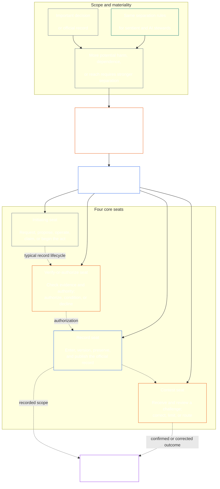

<!-- Draft for eventual path translations/vi/core_08_functional_independence_separation_of_duties.md -->
**Status:** AI-assisted translation draft; unreviewed. Not an official translation or attestation.

**Source:** `core_08.000_functional_independence_separation_of_duties.md`; edition `SC-Corpus-2026.10.21`; revision `5adf22f3d58520385afb9dc2bcb2f439346175fb`; SHA-256 `d9a573839564fa3a2e920fff4d2ecb4ccc8a7b560d8aef65656a356de09fdfda`.

**Scope:** Full Chapter Eight, including reading guides, trace blocks, tables, and diagrams. Links are written for the eventual `translations/<locale>/` destination. English remains controlling.

# CHƯƠNG TÁM: ĐỘC LẬP CHỨC NĂNG VÀ PHÂN BIỆT NHIỆM VỤ

<strong>Vị trí kho ngữ liệu (không hoạt động): cấu trúc tệp và quy tắc đọc</strong>

> Tập tin này là **một phần của Hiến pháp có tri giác** và là **chỉ ràng buộc với nhau** với số khác `core_*` tập tin được đọc dưới dạng một văn bản. Nó chứa **Chương Tám**: yêu cầu xuyên suốt quá trình về tính độc lập về chức năng và phân chia nhiệm vụ. Nó theo sau [Chương bảy](../../core_07.000_charters.md#chapter-seven-system-and-institutional-charters), trong đó nêu rõ Điều lệ Hệ thống hoặc Điều lệ Thể chế có sơ đồ chỗ ngồi được công bố và đi trước các chương quy trình lập hiến bắt đầu bằng [Chương Chín Chứng nhận căn chỉnh hệ thống](../../core_09.000_system_alignment_certification_evaluation.md#chapter-nine-system-alignment-certification).
>
> - **Chủ sở hữu hợp pháp:** yêu cầu phân chia nhiệm vụ đối với các hành vi ràng buộc vật chất, được đáp ứng thông qua các ghế riêng biệt; nội dung tối thiểu chung của mỗi [Hồ sơ hành động ràng buộc vật chất](../../core_05.035_band_accountability.md#materially-binding-act-record); sự độc lập khỏi diễn viên và của diễn viên [Dây chuyền kiểm soát vật liệu](../../core_05.035_band_accountability.md#material-control-line); vị trí làn đường và vai trò được công bố; xung đột, chỗ trống, thay thế và định tuyến sai chỗ ngồi; lưu trữ hợp nhất tương ứng; sự chuyển giao có thể quy cho; và những điều kiện độc lập tối thiểu mà mọi quy trình lập hiến sau này phải áp dụng.
> - **Nguồn lớp nguyên tắc:** [Chương Một §18.3](../../core_01.010_stewardship_capacity_principles.md#183-separation-of-duties) yêu cầu quản trị để duy trì sự độc lập về mặt chức năng và định tuyến kiến ​​trúc trụ sở hoạt động ở đây.
> - **Chủ thực hiện:** [CJS-5.125 §11](../../corpus_joint_structure/cjs_05.125_accountability_operations.md#constitutional-lane-and-functional-separation) (*Làn đường hiến pháp và sự phân chia chức năng*), [CI-8.205 §2](../../corpus_institutions/ci_08.205_institutional_design_separation_of_powers.md#ci-8205-2-functional-separation-lanes), Và [CI-14.205 §6](../../corpus_institutions/ci_15.205_appointment_competency_rotation_removal.md#ci-15205-6-seat-catalog--process-role-archetypes-and-operational-boundaries) đặt và vận hành ghế. Chúng có thể chặt chẽ hơn và có thể bổ sung thêm các loại ghế dành cho cơ quan có thẩm quyền đặc biệt; họ có thể không thu hẹp chương này.
> - **Ứng dụng dành riêng cho quy trình vẫn ở phía dưới:** Chương Chín áp dụng yêu cầu này cho chứng nhận liên kết hệ thống và chứng nhận liên kết tổ chức; [Chương Mười §3.7](../../core_11.000_standing_assessment.md#37-separation-of-duties) áp dụng nó cho các hồ sơ thường trực; Chương mười ba và [tử thi_diễn đàn.md](../../corpus_forum.md) áp dụng nó vào quá trình diễn đàn. Các chương đó có thể bổ sung các biện pháp bảo vệ theo yêu cầu của chủ đề; họ có thể không tạo ra một sự thay thế yếu hơn.
>
> Thứ tự đọc: §1 mục đích và phạm vi → §2 Yêu cầu bốn chỗ → §3 tính độc lập và xung đột → §4 định tuyến sai chỗ → §5 vị trí được công bố, người thay thế và ủy quyền → §6 chia tỷ lệ theo tỷ lệ → §7 trường hợp khẩn cấp → §8 Hồ sơ hành động và chuyển giao → §9 ứng dụng xuôi dòng.

<strong>Dấu vết</strong>

- Thượng nguồn:
  - [Bộ tứ hiến pháp](../../core_00.000_preamble.md#constitutional-tetrad) - đặc biệt **giám sát** Và **trách nhiệm giải trình**;
  - [cổ phần vật chất](../../core_00.000_preamble.md#material-stake);
  - [Chương Một §17.1 Tiêu chuẩn quản lý chung](../../core_01.010_stewardship_capacity_principles.md#171-shared-stewardship-standard) (1.015 §17.1);
  - [Chương Một §18 Quản trị theo Kỷ luật Quản lý](../../core_01.010_stewardship_capacity_principles.md#18-governance-under-stewardship-discipline) (1,015 §18);
  - [Điều XVI](../../core_06.010_rights_part_c.md#article-xvi-audit-transparency-and-independent-verification) (*Kiểm toán, minh bạch và xác minh độc lập*).
- Tiểu mục:
  - [§1](#1-purpose-scope-and-owner-boundary);
  - [§2](#2-four-seat-constitutional-requirement);
  - [§3](#3-independence-conflict-and-control-lines);
  - [§4](#4-wrong-seat-routing);
  - [§5](#5-published-placement-vacancy-and-substitution);
  - [§6](#6-proportional-scaling-and-merged-hosting);
  - [§7](#7-emergency-and-urgent-action);
  - [§8](#8-act-records-and-attributable-handoffs);
  - [§9](#9-relationship-to-later-processes).
- Hạ lưu:
  - [Chương Chín](../../core_09.000_system_alignment_certification_evaluation.md#chapter-nine-system-alignment-certification) (9.000);
  - [Chương Mười](../../core_11.000_standing_assessment.md#chapter-eleven-contribution-violation-and-standing-model--measurement) (10.000);
  - [Chương mười ba](../../core_14.000_forum.md#chapter-fourteen-forums-and-jurisdiction) (13.000);
  - [Chương mười bốn](../../core_15.000_governance.md#chapter-fifteen-constitutional-contract-legitimacy-authorization-and-stewardship) (14.000); văn bản thực hiện được chỉ định có tên ở trên.
- Đọc với:
  - [Chương Một §19.3 Phát hiện sai lệch](../../core_01.010_stewardship_capacity_principles.md#193-misalignment-detection) (1.015 §19.3) (*phát hiện và đánh giá số nhiều*);
  - [Hành động có thể phân bổ](../../core_05.035_band_accountability.md#attributable-action);
  - [Tính toàn vẹn của thuộc tính](../../core_05.035_band_accountability.md#attribution-integrity);
  - [Khả năng kiểm toán](../../core_05.050_band_oversight.md#auditability);
  - [Khả năng cạnh tranh](../../core_05.035_band_accountability.md#contestability);
  - [Tỷ lệ](../../core_05.035_band_accountability.md#proportionality).

 

Chương Tám là chủ sở hữu hợp pháp của **Yêu cầu về tính độc lập về chức năng và phân công nhiệm vụ đối với các hành vi ràng buộc về mặt vật chất**.

### 1. Mục đích, phạm vi và ranh giới chủ sở hữu

<strong>Dấu vết</strong>

- Ngược dòng: chủ sở hữu mở chương; [Chương Một §18](../../core_01.010_stewardship_capacity_principles.md#18-governance-under-stewardship-discipline) (1,015 §18); [Giám sát](../../core_05.020_apex_oversight_leg.md#oversight-constitutional); [Trách nhiệm](../../core_05.005_apex_accountability_leg.md#accountability).
- Hạ lưu: [§2](#2-four-seat-constitutional-requirement) bởi vì [§9](#9-relationship-to-later-processes); mọi quá trình sau đó tạo ra hoặc thay đổi một hành vi ràng buộc về mặt vật chất.
- Đọc với:
  - [Chương 4](../../core_04.000_burden_traceability_verification.md#chapter-four-burden-of-proof-traceability-and-verification) (4.000) đối với chất nền xác minh;
  - [Điều XIII-A](../../core_06.010_rights_part_c.md#article-xiii-a-reliability-and-trustworthiness-baseline) (*Đường cơ sở về độ tin cậy và độ tin cậy*) Và
  - [Điều XIII-B](../../core_06.010_rights_part_c.md#article-xiii-b-right-to-redress-and-remedy) (*Quyền được khắc phục và khắc phục*) để thách thức và khắc phục;
  - [Điều XVI](../../core_06.010_rights_part_c.md#article-xvi-audit-transparency-and-independent-verification) (*Kiểm toán, minh bạch và xác minh độc lập*) cho các Tầng Quyền xác minh độc lập.

 

*Nói một cách dễ hiểu: trước khi một quy trình hợp hiến—hoặc một quyết định cấp bên liên quan bên trong một hệ thống, tổ chức hoặc miền quyết định bị giới hạn đã được ủy quyền—có thể được tin cậy, thì các công việc bên trong nó phải được tách biệt. Yêu cầu này áp dụng cho cả [Lớp hợp đồng hiến pháp](../../core_05.045_band_integrative.md#constitutional-contract-layer) và để [Sự tham gia của hệ thống các bên liên quan](../../core_05.055_band_participation.md#stakeholder-status-and-weight). Một người có tri giác, văn phòng, hệ thống AI, cơ quan bên liên quan hoặc người đại diện đang tìm kiếm kết quả cũng không thể cung cấp séc được cho là độc lập, kiểm soát hồ sơ chính thức của séc đó hoặc quyết định thách thức đối với nó.*

Chương này áp dụng cho mọi [Đạo luật ràng buộc vật chất](../../core_05.035_band_accountability.md#materially-binding-act), như Chương Năm định nghĩa, bao gồm:

- một quyết định;
- giấy ủy quyền hoặc chứng nhận;
- một phát hiện;
- một mục nhập hồ sơ hoặc thay đổi phiên bản tài liệu;
- phát hành, triển khai, tiếp tục hoặc thu hồi;
- giải ngân hoặc phân bổ; Và
- một thái độ thách thức.

Chương này không áp dụng cho Bên điều hành Loại P. Hành động của nó ở bên trong nó [đơn vị tư nhân](../../core_05.050_band_oversight.md#domain-specific-materiality-private-unit), một người duy nhất, một hộ gia đình hoặc một nhóm riêng tư có giới hạn chặt chẽ mà tất cả các thành viên đều chọn tham gia và một Bên điều hành có hành động mà những người khác phải tuân theo hoặc có thể dựa vào khi đã giải quyết ít nhất là Loại L theo **CS-9.305 (*Máy phân loại hệ thống*) và CS-9.310** (*Máy phân loại hệ thống*). Một sinh vật duy nhất có máy tính không cần người ngồi ở ghế thứ hai. Yêu cầu này được áp dụng kể từ ngày Bên điều hành thực hiện Đạo luật ràng buộc nghiêm trọng.

Các ghế trong chương này xác định ai có thể làm gì cho một hành động cụ thể; chúng không phải là chức danh công việc. Cùng một cơ quan, chức vụ hoặc hệ thống có thể giữ những vị trí khác nhau cho những hành vi khác nhau. Chức danh, sự ủy quyền, năng lực kỹ thuật hoặc khả năng thực hiện một bước không mở rộng chỗ ngồi cho hành động đó.

#### 1.1 Tại sao tách biệt công việc

*Nói một cách dễ hiểu: cùng một bài học đã được học đi học lại trong kinh doanh, chính phủ và an ninh hạt nhân. Khi một bên có thể bắt đầu một hành động, phê duyệt nó, viết nó ra và phán xét bất kỳ khiếu nại nào về nó, thì không ai khác có thể bắt được một sai lầm hoặc một lời nói dối.*

Tiểu mục này giải thích lý do cho yêu cầu này. Nó không hoạt động: các quy tắc ràng buộc nằm trong [§2 Yêu cầu Hiến pháp về Bốn ghế](#2-four-seat-constitutional-requirement) bởi vì [§9 Mối quan hệ với các quy trình sau này](#9-relationship-to-later-processes).

Một số lĩnh vực đã tự mình đạt được cùng một ý tưởng:

- **Kế toán và kiểm soát nội bộ:** Các doanh nghiệp và kiểm toán viên từ lâu đã phân chia công việc ủy ​​quyền một giao dịch, ghi chép, nắm giữ tài sản và đối chiếu sổ sách, để không một nhân viên bán hàng nào có thể vừa nhận tiền vừa che giấu việc lấy tiền. Các khuôn khổ kiểm soát nội bộ như COSO liệt kê sự phân chia nhiệm vụ giữa các hoạt động kiểm soát cơ bản của chúng.
- **Phân chia quyền lực trong chính phủ:** Montesquieu lập luận *Tinh thần của pháp luật* (1748) rằng quyền tự do đang gặp nguy hiểm khi một cơ quan ban hành, thực hiện và xét xử luật pháp. James Madison, trong *Người theo chủ nghĩa liên bang số 51* (1788), bảo vệ một kế hoạch trong đó mỗi nhánh có phương tiện để chống lại các nhánh khác. Nhiều hiến pháp kể từ đó đã phân chia quyền lực theo cách tương tự.
- **Quy tắc hai người:** Quân đội Hoa Kỳ yêu cầu hai thành viên phi hành đoàn được ủy quyền hành động cùng nhau trước khi một số vũ khí hạt nhân có thể được phóng hoặc tiếp cận, để không ai có thể hành động một mình (Chỉ thị Không quân 91-104). Các ngân hàng từ lâu đã đặt chìa khóa kép trên kho tiền vì lý do tương tự. Quy tắc hai người xác nhận ai đang hành động và liệu mệnh lệnh có chân thực hay không chứ không phải mệnh lệnh đó có hợp lý hay không. Đó là lý do tại sao chương này yêu cầu kiểm tra độc lập chứ không chỉ là chữ ký thứ hai.
- **Điều gì xảy ra nếu không có sự tách biệt:** Tại Ngân hàng Barings vào năm 1995, Nick Leeson điều hành cả bàn giao dịch ở Singapore và văn phòng hỗ trợ giải quyết và ghi lại các giao dịch của mình. Anh ta giấu số tiền thua lỗ trong một tài khoản bí mật. Một cuộc kiểm toán nội bộ vào năm 1994 đã đánh dấu vai trò kết hợp này là một rủi ro lớn, nhưng ban quản lý vẫn giữ nguyên vai trò đó. Ngân hàng này, khi đó đã có tuổi đời hơn hai thế kỷ, đã sụp đổ vào tháng 2 năm 1995 với khoản lỗ khoảng 2,2 tỷ đô la Singapore và được bán cho ING.

Những ví dụ này không cho thấy bất kỳ hệ thống nào là hoàn hảo. Họ cho thấy ý tưởng này đã cũ và được sử dụng rộng rãi, và việc thiếu sự tách biệt là nguyên nhân thất bại thường xuyên. Chúng là lý do, không phải thẩm quyền.

#### 1.2 Tại sao bốn chỗ

*Nói một cách dễ hiểu: hai công việc là quá ít và ba công việc để lại một khoảng trống. Bốn công việc bao gồm bắt đầu hành động, kiểm tra nó, lưu giữ hồ sơ chính thức và nghe thử thách.*

Tiểu mục này giải thích lý do cho số bốn. Nó không hoạt động: chỗ ngồi và các quy định của chúng được đặt ở [§2 Yêu cầu Hiến pháp về Bốn ghế](#2-four-seat-constitutional-requirement).

- **Hai là quá ít:** Cặp nhà sản xuất và người kiểm tra ngăn một bên phê duyệt hành động của chính mình. Nó không để ai giữ hồ sơ chính thức hoặc nghe khiếu nại, vì vậy bất cứ ai giữ hồ sơ đều có thể lặng lẽ thay đổi những gì đã xảy ra và cuối cùng cặp đôi sẽ đưa ra phán quyết về những lời phàn nàn về công việc của chính mình.
- **Ba quyền lực phù hợp với chính phủ, không phải mọi hành động:** Lập, thực hiện và xét xử một vụ kiện của chính phủ. Một hành động đơn lẻ cũng cần một bản ghi tồn tại lâu hơn nó và một lộ trình thử thách không thông qua người thực hiện hoặc người phê duyệt.
- **Bốn trận đấu với các điểm thất bại:** Một người bắt đầu hành động, một người kiểm tra và cho phép, một người giữ biên bản chính thức và một người nghe những lời thách thức. Điều này phản ánh sự phân chia trong kế toán giữa ủy quyền, ghi chép và xem xét.
- **Tự động hóa giúp dễ dàng mở rộng khoảng cách:** Một hệ thống có thể hành động, đăng xuất và ghi lại công việc của chính nó trong một bước duy nhất và khi đó nhật ký của nó trông giống như bằng chứng. [§2 Yêu cầu Hiến pháp về Bốn ghế](#2-four-seat-constitutional-requirement) coi đó là việc nắm giữ ba ghế cùng một lúc.
- **Những người áp dụng nhỏ vẫn có thể tuân thủ:** [§6 Chia tỷ lệ theo tỷ lệ và lưu trữ hợp nhất](#6-proportional-scaling-and-merged-hosting) cho phép người nhận nuôi nhỏ đặt một chỗ ngồi với một cơ quan độc lập hoặc, có điều kiện, đặt hai chỗ ngồi trong một văn phòng. Vị trí xác minh hoặc ủy quyền không bao giờ được hợp nhất với vị trí hồ sơ hoặc vị trí dự thi.

### 2. Yêu cầu Hiến pháp về bốn ghế

<strong>Dấu vết</strong>

- Thượng nguồn: [§1](#1-purpose-scope-and-owner-boundary); [Chương Một §18.3](../../core_01.010_stewardship_capacity_principles.md#183-separation-of-duties) (1.015 §18.3); [Chương Một §17.1](../../core_01.010_stewardship_capacity_principles.md#171-shared-stewardship-standard) (1.015 §17.1).
- Hạ lưu: [§3](#3-independence-conflict-and-control-lines) bởi vì [§9](#9-relationship-to-later-processes); [CI-14.205 §6](../../corpus_institutions/ci_15.205_appointment_competency_rotation_removal.md#ci-15205-6-seat-catalog--process-role-archetypes-and-operational-boundaries) (*Danh mục chỗ ngồi - nguyên mẫu vai trò quy trình và ranh giới hoạt động*).
- Đọc với: [§6](#6-proportional-scaling-and-merged-hosting) cho đường dẫn lưu trữ hợp nhất được phép duy nhất.

 

*Nói một cách dễ hiểu: sự phân chia nhiệm vụ là yêu cầu đối với mọi hành vi ràng buộc về mặt vật chất (các **Yêu cầu bốn chỗ ngồi**), và bốn công việc là cách nó được đáp ứng: hỏi hoặc hành động, kiểm tra, lưu giữ hồ sơ chính thức và nghe thử thách. Các công việc vẫn khác biệt ngay cả khi một tổ chức nhỏ được phép đặt một cặp được phép trong một văn phòng.*

<strong>Hướng dẫn người đọc (không hoạt động): bản đồ bốn chỗ</strong>

> **Bản đồ đầu đọc (không hoạt động).** Sơ đồ này hiển thị bốn vị trí và vòng đời bản ghi điển hình. Nó không bổ sung thêm vị trí thực hiện thứ năm, yêu cầu xem xét để hoàn thành trước mỗi hành động hoặc thay đổi các quy tắc thực hiện trong phần này và §§3–6.

 

Các mũi tên chấm bên trong hộp ngồi cho thấy vòng đời của bản ghi điển hình. Các mũi tên hướng tới việc triển khai là các liên kết theo dõi, không phải là trình tự chờ xem xét bắt buộc.

Mỗi hành động ràng buộc về mặt vật chất đều có bốn vị trí riêng biệt về mặt chức năng. Chương Năm cung cấp ý nghĩa kinh điển của chúng; phần này nêu rõ các quy tắc về vị trí và không tương thích giữa các quy trình:

1. **[Chỗ ngồi bắt đầu](../../core_05.035_band_accountability.md#initiating-seat)** — yêu cầu, đề xuất, vận hành, tuyên bố hoặc bắt đầu hành động theo cách khác.
2. **[Xác minh hoặc ủy quyền chỗ ngồi](../../core_05.035_band_accountability.md#verify-or-authorize-seat)** — kiểm tra bằng chứng và thẩm quyền theo tiêu chuẩn quản lý và xác minh, cho phép, từ chối hoặc đặt điều kiện cho hành động đó.
3. **[Ghi chỗ ngồi](../../core_05.035_band_accountability.md#record-seat)** — nhập, phiên bản, lưu giữ, bảo tồn và xuất bản tài liệu [Bản ghi hành động](../../core_05.035_band_accountability.md#materially-binding-act-record) về những gì mà Chỗ ngồi Xác minh hoặc Ủy quyền đã xác định.
4. **[Ghế thi đấu](../../core_05.035_band_accountability.md#contest-seat)** - tiếp nhận và xem xét thách thức, ra lệnh khắc phục hoặc giới hạn khi được ủy quyền và chuyển mọi vấn đề ra ngoài thẩm quyền của mình.

Những ghế này áp dụng cho cả người quản lý con người và AI. Nếu một hệ thống thực hiện một hành động, ký vào nó và sau đó sử dụng nhật ký của chính nó làm bằng chứng, thì nó sẽ ở vị trí bắt đầu, xác minh và ghi lại cùng một lúc. Tự động hóa quy trình không làm cho việc kiểm tra trở nên độc lập.

Các sự kết hợp sau đây bị cấm trên cùng một hành động:

- người khởi kiện không được xác minh hoặc ủy quyền hành động của mình;
- ghế xác minh, ủy quyền không được giữ ghế hồ sơ;
- ghế xác minh hoặc ủy quyền không được giữ ghế dự thi; Và
- người vận hành hệ thống hoặc cơ quan quản lý của một tổ chức không được xác minh hoặc ủy quyền cho một hành động nào đó đối với hệ thống hoặc tổ chức đó.

Các chương sau hoặc văn bản triển khai kết hợp có thể cấm ghép nối bổ sung cho một quy trình cụ thể. Họ có thể không cho phép ghép đôi bị cấm ở đây.

Yêu cầu phân công nhiệm vụ áp dụng ở mọi hạng và bốn ghế là cách đáp ứng yêu cầu này. Câu hỏi ở quy mô lớp là liệu những ghế đó có thể được sáp nhập hay chia sẻ một chủ sở hữu hay không. Đối với một tổ chức hoặc hệ thống hoạt động trong:

- Ống kính loại C, luôn được khuyến nghị tách biệt hoàn toàn bốn chỗ ngồi;
- Ống kính loại B, hầu như luôn cần phải có sự tách biệt đầy đủ bốn chỗ ngồi; Và
- Ống ngắm loại A, luôn cần phải có sự tách biệt đầy đủ bốn chỗ ngồi.

Khi phạm vi bị trộn lẫn hoặc việc phân loại không chắc chắn, hãy áp dụng tư thế có thể áp dụng cao nhất cho đến khi hồ sơ hỗ trợ tư thế thấp hơn.

### 3. Đường độc lập, xung đột và kiểm soát

<strong>Dấu vết</strong>

- Thượng nguồn: [§2](#2-four-seat-constitutional-requirement); [Khả năng trả lời theo quy mô thẩm quyền](../../core_01.010_stewardship_capacity_principles.md#181-governance-as-authorized-structure); [Điều XXV](../../core_06.015_rights_part_d.md#article-xxv-constitutional-interpretation-review-and-anti-capture-safeguards) (*Các biện pháp bảo vệ giải thích, đánh giá và chống chiếm đoạt hiến pháp*).
- Hạ lưu: [§4](#4-wrong-seat-routing); [§5](#5-published-placement-vacancy-and-substitution); [§8](#8-act-records-and-attributable-handoffs); Chương Chín vai trò của thành phần chứng nhận; Chương mười ghi chép quyền nuôi con; Chương mười ba diễn đàn chống tự phán xét.
- Đọc với: [Dây chuyền kiểm soát vật liệu](../../core_05.035_band_accountability.md#material-control-line); [CI-8.210](../../corpus_institutions/ci_08.210_conflict_integrity_anti_capture_anti_corruption.md) (*Liêm chính xung đột, chống nắm bắt và chống tham nhũng*) Và [CF-13.425](../../corpus_forum/cf_14.425_integrity_safeguards_anti_capture_anti_self_judging.md) (*Các biện pháp bảo vệ tính toàn vẹn, hoạt động chống nắm bắt và hỗ trợ chống tự đánh giá*) để bảo vệ xung đột trong hoạt động và chống tự phán xét.

 

*Nói một cách dễ hiểu: việc thay đổi tên trên bàn không tạo ra sự độc lập. Cơ quan xác minh hoặc người đánh giá không độc lập khi người có tri giác hoặc cơ quan tìm kiếm kết quả có thể chỉ đạo, loại bỏ, khen thưởng, trừng phạt hoặc lặng lẽ bác bỏ hành động đó của họ.*

Tính độc lập về mặt chức năng được đánh giá bằng thẩm quyền và sự kiểm soát thực tế chứ không phải bằng nhãn hiệu. Trong cùng một hành động:

- ghế xác minh hoặc ủy quyền và ghế dự thi phải ở ngoài ghế bắt đầu [Dây chuyền kiểm soát vật liệu](../../core_05.035_band_accountability.md#material-control-line);
- một bên có lợi ích riêng được xác định bởi đạo luật không được giữ ghế xác minh hoặc ủy quyền hoặc tranh cử;
- người giữ hồ sơ xung đột phải chuyển hồ sơ đó, với dấu vết kiểm toán đầy đủ, cho người thay thế được công bố thay vì quyết định xung đột hoặc từ bỏ quyền giám hộ; Và
- việc từ chối sẽ loại bỏ thẩm quyền đối với hành động đó; nó không chuyển chỗ cho người yêu cầu, đường dây báo cáo của người yêu cầu hoặc bất kỳ ai ở gần nhất.

Theo dõi [Dây chuyền kiểm soát vật liệu](../../core_05.035_band_accountability.md#material-control-line) đối với hành động cụ thể. Cơ sở hạ tầng dùng chung, hỗ trợ hành chính hoặc lịch sử cuộc hẹn không một mình thiết lập ranh giới, nhưng những sự sắp xếp đó không được làm mất đi sự phán xét độc lập trong thực tế.

Tính độc lập không được thỏa mãn bởi chữ ký thứ hai, ủy ban danh nghĩa, nhãn nội bộ hoặc chứng thực do công cụ tạo ra trong đó séc được cho là thiếu thẩm quyền, quyền truy cập bằng chứng, quyền tự do kiểm soát tài liệu hoặc khả năng từ chối và định tuyến thực sự.

### 4. Định tuyến sai chỗ ngồi

<strong>Dấu vết</strong>

- Thượng nguồn: [§2](#2-four-seat-constitutional-requirement); [§3](#3-independence-conflict-and-control-lines).
- Hạ lưu: [§5](#5-published-placement-vacancy-and-substitution); [§8](#8-act-records-and-attributable-handoffs); [CI-14.205 §6 quy tắc chỗ ngồi chung](../../corpus_institutions/ci_15.205_appointment_competency_rotation_removal.md#ci-46-shared-seat-rules).
- Đọc với: [Chương Một §17.5 Nghĩa vụ chống cự](../../core_01.010_stewardship_capacity_principles.md#175-duty-to-resist) (1.015 §17.5).

 

*Nói một cách dễ hiểu: khi một bước không phải là của bạn, đừng im lặng thực hiện nó và đừng bỏ đi. Ghi lại khoảng trống và chuyển vấn đề đến đúng nơi. Tốt hơn hết, hãy xây dựng quy trình sao cho mỗi bước đều đi đến đúng nơi mà không cần ai để ý.*

Việc định tuyến sai chỗ nên được đưa vào quy trình nếu có thể. Một lượt tiếp nhận, hàng đợi, quy trình làm việc hoặc giao diện phải gửi từng bước đến chỗ đã xuất bản ngay từ đầu, do đó, một bước sẽ không được cung cấp cho chỗ có thể không nhận được chỗ đó. Định tuyến tự động:

- tuân theo vị trí được công bố dưới [§5 Vị trí được công bố, Vị trí tuyển dụng và Thay thế](#5-published-placement-vacancy-and-substitution) và các tuyến đường trên chỗ ngồi, không dựa trên giá trị của hành vi;
- ghi lại từng tuyến đường theo yêu cầu của mục 3 bên dưới;
- đi theo con đường thay thế hoặc độc lập được công bố theo [§5.3 Một chỗ ngồi trên bản đồ bị bỏ trống hoặc một người nắm giữ không thể phục vụ](#53-a-seat-the-map-leaves-unplaced-or-a-holder-who-cannot-serve) khi người nắm giữ không thể giao bóng, giữ vấn đề và ghi lại khoảng trống khi không đặt chỗ ngồi, người thay thế hoặc đường đi độc lập, thay vì gửi nó đến ghế gần nhất, nhanh nhất hoặc cao cấp nhất; Và
- bản thân nó không phải là người giữ ghế và không thể thay đổi người giữ ghế; chỉ có vị trí được xuất bản mới có.

Trong trường hợp việc định tuyến không được tự động hóa hoặc không thành công, nhiệm vụ dưới đây sẽ áp dụng cho người quản lý. Tiếp viên được yêu cầu bước ra ngoài chỗ ngồi của tiếp viên phải:

1. từ chối bước đó mà không có ý định quyết định giá trị của nó;
2. nêu tên ghế có thể đảm nhận và, nếu được công bố, người nắm giữ hoặc người thay thế;
3. ghi lại yêu cầu, số ghế đã giữ, khoảng trống hoặc xung đột và tuyến đường đã sử dụng;
4. bảo toàn bằng chứng và tính toàn vẹn của bất kỳ hồ sơ nào đã nhận được; Và
5. tuyến đường mà không có sự chậm trễ có thể tránh được.

Phản ứng đó là thực hiện nghĩa vụ chứ không phải từ bỏ hành động. Hành động tiến hành thông qua ghế bên phải. Thực hiện bước đi vì người tiếp viên là người gần nhất, nhanh nhất, có thâm niên cao hơn hoặc có kiến ​​thức đặc biệt không phải là giải pháp khắc phục tình trạng thiếu chỗ.

### 5. Vị trí được công bố, vị trí tuyển dụng và sự thay thế

<strong>Hướng dẫn người đọc (không hoạt động): phần này được trình bày như thế nào</strong>

- [§5.1 Bản đồ phải nói gì](#51-what-the-map-must-say) liệt kê những tên của Bản đồ vai trò điều lệ: ai tổ chức từng ghế, hành động nào, sự hợp nhất được phép, người thay thế, lộ trình độc lập và phiên bản.
- [§5.2 Nơi lưu giữ bản đồ](#52-where-the-map-is-kept) cho biết bản đồ nằm trong hoặc cùng với Điều lệ hệ thống hoặc Điều lệ tổ chức, rằng thành viên của một nhóm có thể áp dụng bản đồ được chia sẻ của nhóm bằng cách tham khảo và rằng người áp dụng Loại P không cần xuất bản bản đồ đó.
- [§5.3 Một chỗ ngồi trên bản đồ bị bỏ trống hoặc một người nắm giữ không thể phục vụ](#53-a-seat-the-map-leaves-unplaced-or-a-holder-who-cannot-serve) nói rằng khoảng trống là một khiếm khuyết cần ghi lại và sửa, rằng chỗ ngồi không được chuyển đến tác nhân hoặc đường điều khiển của tác nhân và trong khi đó, hành động sẽ hướng đến đường dẫn thay thế hoặc đường dẫn độc lập.
- [§5.4 Ủy quyền](#54-delegation) nói rằng một ghế chỉ có thể được ủy quyền cho một cấp phó hoặc thay thế tên bản đồ và việc ủy ​​quyền đó giữ nguyên ranh giới chỗ ngồi và không thể tạo, hợp nhất hoặc mở rộng chỗ ngồi.

<strong>Dấu vết</strong>

- Thượng nguồn:
  - [§2](#2-four-seat-constitutional-requirement);
  - [§3](#3-independence-conflict-and-control-lines);
  - [Minh bạch](../../core_05.050_band_oversight.md#transparency);
  - [Khả năng kiểm toán](../../core_05.050_band_oversight.md#auditability).
- Hạ lưu: [§8](#8-act-records-and-attributable-handoffs); [CI-8.205 §2](../../corpus_institutions/ci_08.205_institutional_design_separation_of_powers.md#ci-8205-2-functional-separation-lanes) (*Làn đường phân cách chức năng*); [CI-14.205 §5](../../corpus_institutions/ci_15.205_appointment_competency_rotation_removal.md#ci-15205-5-authorized-roles-and-accountability-chains) (*Vai trò được ủy quyền và chuỗi trách nhiệm*); Hồ sơ chương Chín và chương Mười.
- Đọc với:
  - [Điều lệ hệ thống](../../core_05.040_band_continuity.md#system-charter),
  - [Điều lệ tổ chức](../../core_05.040_band_continuity.md#institutional-charter);
  - [Chương Bảy §4 Bản đồ vai trò điều lệ và hồ sơ lưu giữ thường trực](../../core_07.000_charters.md#4-the-charter-role-map-and-standing-record-custody) (7.000 §4); Và
  - [Chương Mười Bốn §5](../../core_15.000_governance.md#5-authorized-roles-competency-development-and-contribution) (14.000 §5).

 

*Nói một cách dễ hiểu: tổ chức phải cho biết ai đảm nhiệm từng công việc trước khi vụ việc khó khăn đến, bao gồm cả ai sẽ đảm nhận khi người nắm giữ thông thường vắng mặt hoặc có mâu thuẫn.*

#### 5.1 Bản đồ phải nói gì

Mọi người áp dụng Cấp L trở lên thực hiện các hành vi ràng buộc vật chất phải duy trì một danh sách được công bố, có thể kiểm tra và có thể tranh cãi. [Bản đồ vai trò điều lệ](../../core_05.040_band_continuity.md#charter-role-map) xác định:

- làn đường, văn phòng, vai trò hoặc quy trình nào tổ chức từng chỗ ngồi;
- các hành vi và phạm vi áp dụng vị trí đó;
- mọi thỏa thuận lưu trữ sáp nhập được phép và biện pháp bảo vệ tính độc lập của nó;
- mỗi cấp phó hoặc người thay thế có thể hành động tại một ghế, bao gồm cả người giữ ghế vắng mặt, bị loại trừ, bị bắt hoặc có mâu thuẫn;
- tuyến đường độc lập khi không có tuyến đường thay thế đủ tiêu chuẩn; Và
- phiên bản và ngày có hiệu lực của nó, để một hành động được đánh giá dựa trên bản đồ có hiệu lực khi nó được thực hiện.

#### 5.2 Nơi lưu giữ bản đồ

Bản đồ được lưu giữ trong hoặc cùng với người nhận nuôi [Điều lệ hệ thống](../../core_05.040_band_continuity.md#system-charter) hoặc [Điều lệ tổ chức](../../core_05.040_band_continuity.md#institutional-charter).

Thành viên của nhóm xuất bản bản đồ dùng chung cho các ghế mà nhóm đó tổ chức có thể áp dụng bản đồ đó bằng cách tham khảo ([§6.3 Ghế chung](#63-seats-held-in-common)), và vẫn đặt tên cho tuyến đường thay thế và độc lập của riêng mình.

Người nhận nuôi Lớp P nằm ngoài chương này ([§1 Mục đích, phạm vi và ranh giới chủ sở hữu](#1-purpose-scope-and-owner-boundary)) và không cần xuất bản bản đồ. Nó vẫn có thể xuất bản một bản, một mình hoặc cùng với Hệ thống hoặc Điều lệ tổ chức tự nguyện ([Chương Bảy §4 Bản đồ vai trò điều lệ và hồ sơ lưu giữ thường trực](../../core_07.000_charters.md#4-the-charter-role-map-and-standing-record-custody)).

#### 5.3 Một chỗ ngồi trên bản đồ bị bỏ trống hoặc một người giữ bản đồ không thể phục vụ

Một ghế không được đặt hoặc một người nắm giữ vắng mặt, bị loại trừ, bị bắt giữ hoặc bị xung đột, là một khiếm khuyết về quản trị cần được ghi lại và sửa chữa.

- Ghế không tự động chuyển sang ghế bắt đầu, bên liên quan, người điều hành hoặc cấp trên trong quyền của họ. [Dây chuyền kiểm soát vật liệu](../../core_05.035_band_accountability.md#material-control-line).
- Cho đến khi được sửa chữa, hành động sẽ đi đến con đường thay thế hoặc độc lập đã được công bố, cho dù hành động đó có khẩn cấp đến đâu.
- Đối với một giấy chứng nhận mà Bản đồ vai trò điều lệ không được đặt, việc chỉnh sửa phải đáp ứng các khoảng thời gian phản hồi và giải quyết, được tính từ thông báo đã ghi lại về khoảng trống, như được nêu trong [Chương Bảy §4.7.4 Chỗ chứng nhận](../../core_07.000_charters.md#474-certification-seats).

#### 5.4 Phái đoàn

Người giữ ghế chỉ có thể ủy quyền ghế cho một cấp phó hoặc người thay thế [Bản đồ vai trò điều lệ](../../core_05.040_band_continuity.md#charter-role-map) những cái tên. Việc ủy ​​quyền cho bất kỳ ai khác sẽ rời khỏi chỗ ngồi, và [§5.3 Một chỗ ngồi trên bản đồ bị bỏ trống hoặc một người nắm giữ không thể phục vụ](#53-a-seat-the-map-leaves-unplaced-or-a-holder-who-cannot-serve) áp dụng. Việc đặt tên cấp phó mới hoặc người thay thế sẽ thay đổi bản đồ ([Chương Bảy §4.5 Thay đổi nội quy chỗ ngồi và người giữ ghế](../../core_07.000_charters.md#45-changing-seat-rules-and-seat-holders)). Một phái đoàn không thể làm được điều đó.

Đoàn đại biểu giữ nguyên ranh giới chỗ ngồi, nghĩa vụ chứng cứ, hồ sơ, đồng hồ và đại biểu vẫn phải tuân theo [Dây chuyền kiểm soát vật liệu](../../core_05.035_band_accountability.md#material-control-line). Nó không tạo chỗ mới, hợp nhất chỗ hoặc cho phép đại biểu làm những gì mà chỗ đại biểu không thể làm. Một đại biểu nắm giữ ghế thứ hai trong cùng một đạo luật được coi là sự hợp nhất và chỉ có các thỏa thuận đăng cai tổ chức được hợp nhất mà bản đồ liệt kê bên dưới [§6 Chia tỷ lệ theo tỷ lệ và lưu trữ hợp nhất](#6-proportional-scaling-and-merged-hosting) cho phép một.

Người nắm giữ có thể sử dụng nhân viên hoặc công cụ để hỗ trợ công việc của ghế, chẳng hạn như thu thập bằng chứng, soạn thảo hoặc tiến hành kiểm tra định kỳ. Đó là sự hỗ trợ chứ không phải sự ủy quyền. Người nắm giữ vẫn đưa ra các quyết định của ghế, chịu trách nhiệm về kết quả và chịu trách nhiệm về tính độc lập của ghế. Nếu có người khác quyết định hoặc đứng tên ghế thì đó là ủy quyền và phải đáp ứng tiểu mục này. Không thể sử dụng sự hỗ trợ để làm những việc mà bản thân chiếc ghế đó không thể làm được, bao gồm cả việc gây áp lực cho những người nắm giữ những chiếc ghế khác để xác định kết quả của một hành động.

### 6. Chia tỷ lệ theo tỷ lệ và lưu trữ hợp nhất

<strong>Hướng dẫn người đọc (không hoạt động): phần này được trình bày như thế nào</strong>

- [§6.1 Cách phân chia tỷ lệ](#61-how-separation-scales) nói rằng sức mạnh, nhân sự, sự dư thừa và hình thức của sự phân chia có quy mô tùy theo cổ phần, giai cấp, sự phụ thuộc và tác hại có thể thấy trước, trong khi bốn ghế vẫn có sự khác biệt.
- [§6.2 Sáp nhập hai chỗ ngồi trong một văn phòng](#62-merging-two-seats-in-one-office) liệt kê các điều kiện theo đó một người nhận con nuôi nhỏ hoặc không chính thức có thể đặt hai ghế trong một văn phòng và những cặp đôi bị cấm.
- [§6.3 Ghế chung](#63-seats-held-in-common) cho biết cách một doanh nghiệp nhỏ có được vị trí trong một hợp tác xã, hiệp hội hoặc tổ chức độc lập khác và các quy tắc độc lập được áp dụng.
- [§6.4 Thực hành chuyên môn chung](#64-joint-professional-practice) cho biết cách thức một cơ sở hành nghề có tri giác hoặc nhỏ thuộc Loại L trở lên có thể đặt chỗ với người chủ trì và nhận các tài liệu của người chủ trì đối với bất kỳ công việc nào và những điều gì áp dụng hơn nữa đối với các hành vi cần có giấy phép hành nghề hoặc giấy phép hành nghề.
- [§6.5 Công việc cộng đồng và không chính thức](#65-informal-and-community-work) nói rằng công việc đó có thể sử dụng một cơ quan độc lập có thẩm quyền được công bố để kiểm tra.
- [§6.6 Cổ phần, đẳng cấp và điều gì không biện minh cho việc sáp nhập](#66-stake-class-and-what-does-not-justify-a-merger) nói rằng cổ phần cao giữ nguyên giả định về các văn phòng riêng biệt và chỉ riêng nhân sự, tốc độ hoặc sự thuận tiện không bao giờ biện minh cho việc sáp nhập.

<strong>Dấu vết</strong>

- Thượng nguồn:
  - [§2](#2-four-seat-constitutional-requirement);
  - [cổ phần vật chất](../../core_00.000_preamble.md#material-stake);
  - [sự cần thiết](../../core_05.035_band_accountability.md#necessity);
  - [Tỷ lệ](../../core_05.035_band_accountability.md#proportionality).
- Hạ lưu: [Chương Mười §3.7](../../core_11.000_standing_assessment.md#37-informal-and-small-scope-records) (10.000 §3.7); [CJS-18.110 §4](../../corpus_joint_structure/cjs_19.110_specific_joint_interlocks.md#cjs-19110-4-class-scaled-lane-staffing-and-competency-redundancy) (*Nhân sự làn đường theo cấp độ và dự phòng năng lực*); [CI-8.205 §2](../../corpus_institutions/ci_08.205_institutional_design_separation_of_powers.md#ci-8205-2-functional-separation-lanes) (*Làn đường phân cách chức năng*).
- Đọc với: [Gánh nặng có thể tránh được](../../core_05.040_band_continuity.md#avoidable-burden) và Chương Một [§3.3 Quy trình chống xuống cấp](../../core_01.000_values_principles.md#33-anti-degrading-process).

 

*Nói một cách dễ hiểu: các nhóm nhỏ và không chính thức không cần bốn phòng ban lớn. Họ thực sự cần một cuộc kiểm tra độc lập thực sự, một bản ghi có thể sử dụng được và một lộ trình thử thách. Quy mô thay đổi phương pháp bố trí nhân sự chứ không phải sự tách biệt được bảo vệ.*

#### 6.1 Cách tách vảy

Sức mạnh, nhân sự, sự dư thừa và hình thức của quy mô phân tách với lợi ích vật chất, loại hệ thống, sự phụ thuộc và tác hại có thể thấy trước một cách hợp lý.

#### 6.2 Sáp nhập hai chỗ ngồi trong một văn phòng

Người nhận con nuôi nhỏ hoặc không chính thức chỉ có thể đặt hai ghế trong một văn phòng hoặc người có tri giác khi có tất cả những điều sau đây:

- việc sáp nhập là cần thiết và phù hợp với quy mô;
- nó được xuất bản, kiểm toán, tranh cãi và tiết lộ trong hồ sơ hành động;
- biện pháp bảo vệ tính độc lập nhằm giải quyết các rủi ro do việc sáp nhập tạo ra;
- ghế khởi xướng không xác minh hoặc ủy quyền cho hành động của chính mình;
- ghế xác minh hoặc ủy quyền không bao giờ được sáp nhập với ghế hồ sơ hoặc ghế dự thi; Và
- vẫn có một lộ trình độc lập khi xung đột, tổn hại vật chất hoặc thách thức vượt quá ranh giới hợp pháp của chủ sở hữu sáp nhập.

#### 6.3 Ghế chung

Một doanh nghiệp được điều hành bởi một hoặc một số ít người có thể đặt vị trí xác minh hoặc ủy quyền, hồ sơ hoặc cạnh tranh với một hợp tác xã hoặc hiệp hội địa phương của các doanh nghiệp đó hoặc với bất kỳ cơ quan độc lập nào khác. Đây không phải là sự sáp nhập, vì các ghế vẫn thuộc về những người nắm giữ riêng biệt. Đó là làm thế nào một doanh nghiệp quá nhỏ để có nhân viên bốn chỗ vẫn đáp ứng được yêu cầu phân công nhiệm vụ trong [§2 Yêu cầu Hiến pháp về Bốn ghế](#2-four-seat-constitutional-requirement). Các quy tắc độc lập tương tự áp dụng cho bất kỳ vị trí nào, cùng với các quy tắc này cho nhóm:

- **Độc lập với doanh nghiệp:** Người giữ là [độc lập](../../core_05.035_band_accountability.md#independence) của hoạt động kinh doanh khởi đầu. Nó nằm ngoài doanh nghiệp [Dây chuyền kiểm soát vật liệu](../../core_05.035_band_accountability.md#material-control-line), và không có gì mà hành động quyết định mang lại cho nó một khoản tiền đặt cược. Nhà cung cấp, người cho vay, chủ nhà hoặc khách hàng mà doanh nghiệp phụ thuộc vào không độc lập thực hiện hành động về sự phụ thuộc đó, chẳng hạn như tranh chấp về hợp đồng của chính nhà cung cấp, bởi vì hành động đó cũng quyết định điều gì đó cho họ.
- **Một bản đồ cho nhóm:** Nhóm xuất bản một [Bản đồ vai trò điều lệ](../../core_05.040_band_continuity.md#charter-role-map) đối với các ghế mà nó tổ chức và mỗi thành viên có thể áp dụng nó bằng cách tham khảo. Bản đồ riêng của thành viên vẫn đặt tên cho tuyến đường thay thế và tuyến đường độc lập của nó.
- **Phục vụ lẫn nhau:** Các thành viên có thể phục vụ ghế của nhau trong các hành vi khác nhau. Hai thành viên không được phép kiểm tra các hành động của nhau như một cặp khép kín và một vòng quay không được định tuyến một hành động đến người nắm giữ bên trong đường điều khiển của người khởi xướng nó.
- **Hoạt động riêng của nhóm:** Việc thừa nhận hoặc loại bỏ một thành viên, chỉ định ghế và phán quyết về hành vi của thành viên là những hành vi ràng buộc vật chất của nhóm. Đối với những hành vi này nhóm:
  - ngồi bốn chỗ;
  - xuất bản Điều lệ hệ thống hoặc Điều lệ tổ chức của riêng mình; Và
  - giữ một lộ trình độc lập bên ngoài chính nó (một nhóm khác, một diễn đàn hoặc một văn phòng công cộng), vì vậy nó không bao giờ phán xét chính nó hoặc một thành viên mà nó kiểm soát.
- **Không ép buộc:** Không có doanh nghiệp nào bắt buộc phải tham gia và không có nhóm nào là con đường duy nhất.
- **Giới hạn tuyển sinh:** Một nhóm có thể từ chối hoặc trì hoãn ứng viên vì một lý do gắn liền với những gì nhóm có thể phục vụ, để nhóm không bao giờ bị buộc phải đảm nhận nhiều hơn những gì nhóm có thể đảm nhận. Những lý do như vậy bao gồm:
  - **Dung tích:** khối lượng hành vi quan trọng dự kiến ​​của người nộp đơn sẽ sử dụng hết năng lực mà các thành viên hiện tại dựa vào. Nhóm có thể giới hạn số lượng cần thiết cho bất kỳ thành viên nào hoặc giữ một danh sách chờ;
  - **Phù hợp:** loại hành vi hoặc tầng lớp của người nộp đơn nằm ngoài những gì những người giữ ghế trong nhóm có đủ trình độ và nhân viên để phục vụ, chẳng hạn như công việc cần dự phòng năng lực nhiều hơn nhóm có ([§6.6 Cổ phần, đẳng cấp và điều gì không biện minh cho việc sáp nhập](#66-stake-class-and-what-does-not-justify-a-merger));
  - **Độc lập:** những người nắm giữ nhóm không thể thực hiện các hành vi của người nộp đơn một cách độc lập, bởi vì người nộp đơn ở trong [Dây chuyền kiểm soát vật liệu](../../core_05.035_band_accountability.md#material-control-line) của một trong số họ; Và
  - **Chỉ đạo:** người nộp đơn đã vi phạm các điều khoản đã công bố của nhóm trước đó hoặc sẽ không chấp nhận chúng.
- **Cách áp dụng các giới hạn:** Mỗi giới hạn nhập học:
  - được nêu trong Điều lệ hệ thống hoặc Điều lệ tổ chức của nhóm ([Chương Bảy §3.1 Điều lệ Hệ thống nêu rõ điều gì](../../core_07.000_charters.md#31-what-a-system-charter-states)), do đó nó được xuất bản trước khi áp dụng;
  - áp dụng cách tương tự để thích ứng viên;
  - không được sử dụng để bảo vệ các thành viên khỏi sự cạnh tranh hoặc biến nhóm thành con đường duy nhất để có được một chỗ ngồi trong khu vực của mình;
  - được giải thích bằng văn bản cho người nộp đơn bị từ chối; Và
  - có thể được tranh luận thông qua con đường độc lập bên ngoài nhóm, bởi vì việc quyết định có chấp nhận người nộp đơn hay không là một hành động ràng buộc vật chất của nhóm (xem *Hoạt động riêng của nhóm*, bên trên).
- **Không có bẫy:** Các điều khoản của một nhóm có thể không khiến cho chỗ ngồi trở thành một chi phí mà doanh nghiệp không thể gánh chịu ([Gánh nặng có thể tránh được](../../core_05.040_band_continuity.md#avoidable-burden)).
- **Rời đi:** Một thành viên rời đi sẽ mang theo hồ sơ của mình. Nhóm không được giữ họ lại hoặc khiến việc rời đi phụ thuộc vào việc bỏ họ lại phía sau. Nhóm:
  - cung cấp cho thành viên khả năng xuất toàn bộ Bản ghi hành động của mình và dữ liệu trong đó, dưới dạng mà thành viên hoặc máy chủ mới có thể sử dụng ([CS-6.305 §1.2 Khả năng thu thập và xuất khẩu quan trọng liên tục](../../corpus_systems/cs_06.305_information_types_and_handling.md#12-continuity-critical-collection-and-exportability)) và tiết lộ trước mọi giới hạn hợp pháp đối với việc xuất khẩu;
  - trao ghế hồ sơ cho những hành động đó cho người giữ tên thành viên và giữ ghế hồ sơ cho đến khi thành viên nêu tên một người, để Hồ sơ hành động vẫn có thể được xây dựng lại trong khi một thách thức, sửa chữa hoặc khắc phục được mở ([§8 Hồ sơ hành động và chuyển giao có thể quy cho](#8-act-records-and-attributable-handoffs)); Và
  - chỉ giữ những gì mà nhiệm vụ của mình vẫn yêu cầu, chẳng hạn như Bản ghi hành động về một hành động mà nó đã tổ chức cho một thành viên khác hoặc một hành động vẫn đang bị thách thức và chỉ trong khoảng thời gian lưu giữ mà nó đã tiết lộ ([CS-6.305 §1.3 Thông báo thu thập và xóa](../../corpus_systems/cs_06.305_information_types_and_handling.md#13-collection-notice-and-deletion)).
- ****  [CS-6.310 §9 Phân loại dữ liệu](../../corpus_systems/cs_06.310_data_classifications.md#cs-6310-9-data-classifications):
  - **Dữ liệu nhận dạng và phân bổ (Loại I):** 
  - **Dữ liệu tham gia và giao dịch (Loại H):** 
  - **Dữ liệu nguồn quản trị (Loại G):** mở để kiểm tra và không công khai theo mặc định;
  - **** chỉ được giữ lại để xem xét trong thời hạn nhất định; Và
  - **Tác phẩm của chính thành viên (Loại Y và Loại W):** 

#### 6.4 Thực hành chung về chuyên môn

- **** 
- **Những gì thực tiễn áp dụng:** 
- **** 
- **** Các quy tắc trong [§6.3 Ghế chung](#63-seats-held-in-common) áp dụng cho người chủ trì và hoạt động, bao gồm sự độc lập của người chủ trì với hoạt động, bốn chỗ ngồi và lộ trình độc lập cho các hoạt động của chính người chủ nhà, giới hạn nhập học được công bố và quy tắc dành cho thành viên rời đi.
- **Các hành vi được liệt kê:** Đối với một hành vi được liệt kê để cấp giấy phép hành nghề hoặc giấy phép hành nghề theo [Điều XI-E](../../core_06.005_rights_part_b.md#article-xi-e-institutional-formation-and-business-creation) (*Hình thành thể chế và sáng tạo doanh nghiệp*), các tiêu chuẩn của máy chủ cũng xuất phát từ kết quả tìm kiếm của diễn đàn kỹ thuật, máy chủ kiểm tra xem mỗi người hành nghề có giấy phép hoặc giấy phép hay không và máy chủ công cộng là biện pháp cuối cùng thừa nhận bất kỳ người nắm giữ nào. Đối với công việc khác, chủ nhà chỉ thừa nhận và từ chối với lý do [§6.3 Ghế chung](#63-seats-held-in-common), và nó có thể không viết ra các tiêu chí năng lực khiến người lao động không có việc làm mà Hiến pháp không quy định.
- **Nhiệm vụ bổ sung của chủ nhà:** **CI-14.205 §7** (*Giấy phép hành nghề, chứng nhận hành nghề và hành nghề chung*) nêu rõ các nhiệm vụ bổ sung của chủ nhà và các biện pháp bảo vệ chống lại việc bị bắt.
- **Đáp ứng yêu cầu:** Việc tham gia máy chủ theo cách này đáp ứng yêu cầu phân chia nhiệm vụ trong [§2 Yêu cầu Hiến pháp về Bốn ghế](#2-four-seat-constitutional-requirement) đối với các hành vi mà tài liệu của chủ nhà đề cập.

#### 6.5 Công việc không chính thức và cộng đồng

Công việc không chính thức, không được trả lương, hỗ trợ lẫn nhau, chăm sóc, sửa chữa, giảng dạy, hợp tác và quản lý cộng đồng có thể sử dụng [độc lập](../../core_05.035_band_accountability.md#independence) cơ quan có thẩm quyền được công bố để kiểm tra liên quan. Hiến pháp không yêu cầu công việc như vậy phải xây dựng các văn phòng, nhân sự hoặc thủ tục chính thức vượt quá quy mô và phương tiện của nó có thể hỗ trợ hợp lý, miễn là việc kiểm tra diễn ra thông qua một lộ trình thực sự độc lập và có trách nhiệm.

#### 6.6 Cổ phần, loại và điều gì không biện minh cho việc sáp nhập

Tiền đặt cược càng cao thì kỳ vọng ban đầu rằng mỗi vị trí nằm trong văn phòng riêng của mình càng mạnh mẽ và mỗi công việc đều có một bản sao lưu đủ tiêu chuẩn, nghĩa là có nhiều hơn một người có khả năng thực hiện việc đó (dự phòng năng lực). Chia sẻ chỗ ngồi thông qua một nhóm dưới [§6.3 Ghế chung](#63-seats-held-in-common) không làm giảm sự mong đợi đó.

Thiếu nhân viên, vội vàng hoặc muốn thuận tiện là không đủ để biện minh cho việc bố trí hai chỗ ngồi trong một văn phòng. Cũng không có một chuyên gia nào biết nhiều hơn bất kỳ ai khác. Nội quy lớp học trong [§2 Yêu cầu Hiến pháp về Bốn ghế](#2-four-seat-constitutional-requirement) áp dụng:

- **Lớp A:** bốn chỗ ngồi không bao giờ được hợp nhất.
- **Loại B hoặc Loại C:** việc sáp nhập chỉ được phép nếu nó đáp ứng mọi điều kiện trong phần này.

Càng có nhiều tác hại có thể xảy ra và những người khác càng phụ thuộc vào công việc thì việc sáp nhập càng khó biện minh và công việc càng cần nhiều văn phòng riêng, người dự phòng cho từng công việc và người thay thế độc lập.

### 7. Hành động khẩn cấp và khẩn cấp

<strong>Dấu vết</strong>

- Thượng nguồn:
  - [§2](#2-four-seat-constitutional-requirement);
  - [§6](#6-proportional-scaling-and-merged-hosting);
  - [Chương mười ba §6.1 Các biện pháp khẩn cấp và gánh nặng tiếp tục](../../core_14.000_forum.md#61-emergency-measures-and-continuation-burden) (13.000 §6.1);
  - [tư thế tạm thời mặc định](../../core_01.005_interaction_interpretation.md#default-interim-posture).
- Hạ nguồn: các quy trình đánh giá sự cố, ngăn chặn, giải phóng, tiếp tục và sau sự kiện trong văn bản triển khai được chỉ định.
- Đọc với: [Tính kịp thời](../../core_05.030_apex_timeliness_leg.md#timeliness-constitutional), [Bảo quản bằng chứng](../../core_05.050_band_oversight.md#evidence-preservation), Và [CI-14.205 §6 Danh mục chỗ ngồi - nguyên mẫu vai trò quy trình và ranh giới hoạt động](../../corpus_institutions/ci_15.205_appointment_competency_rotation_removal.md#ci-46-seat-containment).

 

*Nói một cách dễ hiểu: một trường hợp khẩn cấp thực sự có thể biện minh cho việc hành động trước khi quá trình kiểm tra thông thường kết thúc. Nó thay đổi trình tự chứ không phải quyền sở hữu chỗ ngồi hoặc tư thế phân chia theo quy mô lớp học. Nó không cho phép tác nhân xác nhận sự tiếp tục của chính mình, xóa dấu vết hoặc trở thành người đánh giá cuối cùng sau đó.*

Khi sự chậm trễ sẽ tạo ra nguy cơ có thể thấy trước một cách hợp lý về tổn hại nghiêm trọng và sắp xảy ra, cơ quan quản thúc hoặc khởi xướng được ủy quyền có thể thực hiện hành động đảo ngược tối thiểu cần thiết trước khi quá trình xác minh trước thông thường chỉ hoàn tất nếu:

- thẩm quyền khẩn cấp, phạm vi, thời điểm bắt đầu, hết hạn và lý do được ghi lại ngay lập tức hoặc ngay khi có thể;
- bằng chứng và sự phản đối được bảo tồn;
- thông báo và sự tham gia được khôi phục trong thời gian hiến pháp hiện hành;
- một vị trí xác minh hoặc ủy quyền độc lập sẽ xem xét bất kỳ sự tiếp tục nào vượt quá giới hạn ngay lập tức; Và
- hành động nhận được đánh giá độc lập sau sự kiện.

Hành động khẩn cấp không:

- cho phép tác nhân xác minh sự tiếp tục của chính nó;
- yêu cầu người thực hiện giữ hồ sơ đối với hồ sơ có mâu thuẫn;
- để diễn viên nghe thấy sự thách thức đối với hành động của mình;
- chuyển sự cần thiết tạm thời thành quyền lực lâu dài;
- cho phép bất kỳ sự sáp nhập bốn ghế nào cho một tổ chức hoặc hệ thống Loại A.

Không có trường hợp nào sau đây tự nó là trường hợp khẩn cấp:

- một thời hạn;
- một mục tiêu phát hành;
- thiếu hụt nhân sự; hoặc
- một mối quan tâm về danh tiếng.

### 8. Hồ sơ hành động và chuyển giao có thể quy cho

<strong>Dấu vết</strong>

- Thượng nguồn:
  - [§2](#2-four-seat-constitutional-requirement) bởi vì
  - [§7](#7-emergency-and-urgent-action);
  - [Hồ sơ hành động ràng buộc vật chất](../../core_05.035_band_accountability.md#materially-binding-act-record);
  - [Hành động có thể phân bổ](../../core_05.035_band_accountability.md#attributable-action);
  - [Tính toàn vẹn của thuộc tính](../../core_05.035_band_accountability.md#attribution-integrity).
- Hạ lưu: [CS-14.305 §10 hành động có thể quy cho có thể kiểm tra](../../corpus_systems/cs_15.305_critical_system_stewardship.md#cs-15305-103-inspectable-attributable-action); [CI-14.205 §6 quy tắc chỗ ngồi chung](../../corpus_institutions/ci_15.205_appointment_competency_rotation_removal.md#ci-46-shared-seat-rules); mọi bản ghi quy trình được điều chỉnh bởi §8; [`materially_binding_act_record.schema.json`](../../implementation/schemas/materially_binding_act_record.schema.json) (*dạng cơ bản có thể kiểm tra bằng máy; hỗ trợ quy trình, không phải định nghĩa thứ hai*).
- Đọc với: [§4 Định tuyến sai chỗ ngồi](#4-wrong-seat-routing) Và [Chương 4 §5](../../core_04.000_burden_traceability_verification.md#5-compliance-evidence-standard) (4.000 §5).

 

*Nói một cách dễ hiểu: mọi hành động ràng buộc về mặt vật chất đều có Bản ghi hành động cho biết điều gì đã xảy ra, ai giữ từng ghế, điều gì đã được quyết định và thử thách sẽ diễn ra ở đâu.*

Mọi hành vi ràng buộc về mặt vật chất phải có nội dung có thể xác định được [Hồ sơ hành động ràng buộc vật chất](../../core_05.035_band_accountability.md#materially-binding-act-record) (**Bản ghi hành động**). Hồ sơ hành động có thể được thể hiện trong một hồ sơ chính thức theo quy trình cụ thể hiện hành hoặc trong một tập hợp hồ sơ chính thức được liên kết đảm bảo tính toàn vẹn và có thể quy kết. Không cần phải có tài liệu trùng lặp riêng biệt nếu bản ghi chính thức hiện có hoặc bộ liên kết xác định rõ ràng tất cả các thành phần bắt buộc, bảo tồn các liên kết và lịch sử phiên bản của chúng, đồng thời vẫn có thể truy cập được thông qua đường dẫn bản ghi chính thức được ủy quyền.

Hồ sơ Hành động phải xác định, ở mức tối thiểu:

- danh tính bản ghi ổn định, phiên bản hiện tại cũng như dấu thời gian tạo và thay đổi tài liệu;
- hành động, phạm vi quan trọng, tình trạng và thẩm quyền quản lý của nó;
- người khởi xướng, người nắm giữ và thẩm quyền;
- nơi xác minh hoặc ủy quyền, chủ sở hữu, tiêu chuẩn quản lý, quyết định, điều kiện hoặc lý do vật chất và thời gian xác định;
- chỗ ghi, người giữ, cơ quan giám sát và phiên bản đã nhập;
- vị trí cuộc thi hoặc lộ trình thử thách đã công bố và trạng thái thử thách hoặc điều chỉnh hiện tại;
- mọi sự ủy quyền, từ chối, thay thế, được phép sáp nhập hoặc khởi hành khẩn cấp; Và
- bằng chứng vật chất và ghi lại các liên kết, chuyển giao, từ chối, điều kiện, phản đối chưa được giải quyết, đồng hồ, phiên bản thay thế và các chỉnh sửa cần thiết để xây dựng lại hành động.

Một quy trình có thể yêu cầu nhiều hơn mức tối thiểu này, chẳng hạn như các trường bổ sung hoặc chặt chẽ hơn cho loại công việc của chính nó. Nó không được bỏ sót một mục nào ở trên, mâu thuẫn với một mục nào đó hoặc lưu giữ hồ sơ ở dạng không còn cho phép tái tạo lại hành động đó nữa.

Các quy tắc về quyền riêng tư, bảo mật và bảo mật hợp pháp quyết định ai có thể xem tài liệu được bảo vệ và cách chia sẻ tài liệu đó. Họ không bao giờ biện minh cho việc xóa dấu vết chính thức hoặc làm cho nó không thể sử dụng được khi người đánh giá được ủy quyền cần nó để kiểm tra hành vi, thách thức, sửa chữa hoặc tìm kiếm biện pháp khắc phục.

Nhật ký cho thấy ai đã làm gì, nhưng bản thân chúng không chứng minh được rằng hành động đó là hợp lệ. Nhật ký, chữ ký, dấu vết mô hình, danh sách kiểm tra hoặc chứng thực được tạo bởi người có tri giác hoặc hệ thống thực hiện hành động có vai trò hạn chế:

- Những tài liệu này có thể cung cấp bằng chứng hoặc được liên kết với Hồ sơ hành động.
- Những tài liệu này không thể thay thế bản đánh giá và quyết định độc lập hoặc bản thân Hồ sơ hành động chính thức.

### 9. Mối quan hệ với các quy trình sau này

<strong>Dấu vết</strong>

- Thượng nguồn: [§1](#1-purpose-scope-and-owner-boundary) bởi vì [§8](#8-act-records-and-attributable-handoffs).
- Hạ lưu:
  - [Chương Chín](../../core_09.000_system_alignment_certification_evaluation.md#chapter-nine-system-alignment-certification) (9.000);
  - [Chương Mười](../../core_11.000_standing_assessment.md#chapter-eleven-contribution-violation-and-standing-model--measurement) (10.000);
  - [Chương mười ba](../../core_14.000_forum.md#chapter-fourteen-forums-and-jurisdiction) (13.000);
  - [Chương mười bốn](../../core_15.000_governance.md#chapter-fifteen-constitutional-contract-legitimacy-authorization-and-stewardship) (14.000).
- Đọc với: [Ngăn xếp quyền hạn và hệ thống phân cấp nội bộ](../../core_05.045_band_integrative.md#owner-non-relocation) và [Lời nói đầu đăng ký chủ sở hữu](../../core_00.000_preamble.md#4-principles-definitions-and-rights).

 

*Nói một cách dễ hiểu: các chương sau cho biết mỗi quy trình cần đánh giá, ghi lại, quyết định và khắc phục những gì. Chương này cho các quy trình đó biết cách phân chia quyền lực trong khi thực hiện việc đó.*

Mỗi quy trình lập hiến sau này phải giải thích cách thức phân công và sử dụng tất cả bốn ghế cũng như cách thức tuân theo chương này. Trong thực tế:

- Bản ghi quy trình riêng của nó có thể đóng vai trò là Bản ghi hành động hoặc thêm các chi tiết cụ thể về quy trình vào đó.
- Nếu một bản ghi quy trình bao gồm một số hành động ràng buộc về mặt vật chất thì nó có thể liên kết với một Bản ghi hành động riêng biệt cho từng hành động.
- Không cần có bản ghi trùng lặp riêng biệt khi đường dẫn bản ghi chính thức vẫn đầy đủ và có thể theo dõi được.
- Việc đặt một tên khác cho một tiến trình không miễn trừ nó khỏi [§4 Định tuyến sai chỗ ngồi](#4-wrong-seat-routing) hoặc [§8 Hồ sơ hành động và chuyển giao có thể quy cho](#8-act-records-and-attributable-handoffs), bao gồm cả quy tắc chuyển giao và sai chỗ ngồi của họ.

Chương sau có thể bổ sung các yêu cầu mạnh mẽ hơn về tính độc lập, từ chối, tách biệt, giám hộ, hội đồng hoặc xem xét vì quy trình của chương này có rủi ro cao hơn hoặc khác biệt hơn. Nó có thể không thu hẹp các yêu cầu của chương này và một chỗ ngồi chưa được đặt sẽ không được chuyển cho diễn viên theo [§5.3 Một chỗ ngồi trên bản đồ bị bỏ trống hoặc một người nắm giữ không thể phục vụ](#53-a-seat-the-map-leaves-unplaced-or-a-holder-who-cannot-serve).

---

**Tập tin trước:** [cốt lõi_07.000_Charters.md](../../core_07.000_charters.md)

**Tệp tiếp theo:** [cốt lõi_09.005_hệ thống_căn chỉnh_chứng nhận_đánh giá.md](../../core_09.000_system_alignment_certification_evaluation.md#chapter-nine-part-a-certification-evaluation)
