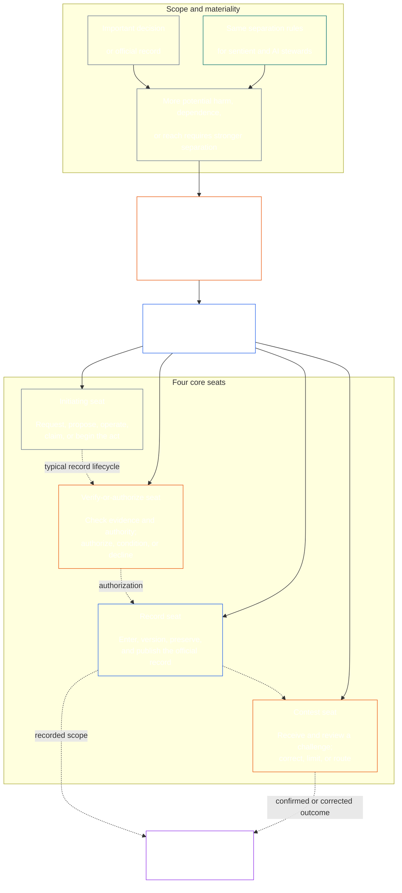

<!-- Draft for eventual path translations/zh/core_08_functional_independence_separation_of_duties.md -->
**Status:** AI-assisted translation draft; unreviewed. Not an official translation or attestation.

**Source:** `core_08.000_functional_independence_separation_of_duties.md`; edition `SC-Corpus-2026.10.21`; revision `5adf22f3d58520385afb9dc2bcb2f439346175fb`; SHA-256 `d9a573839564fa3a2e920fff4d2ecb4ccc8a7b560d8aef65656a356de09fdfda`.

**Scope:** Full Chapter Eight, including reading guides, trace blocks, tables, and diagrams. Links are written for the eventual `translations/<locale>/` destination. English remains controlling.

# 第八章：职能独立和职责分离

<strong>语料放置（非操作）：文件结构和阅读规则</strong>

> 这个文件是 **Sentient 宪法的一部分** 并且是 **仅结合在一起** 与另一个编号的 `core_*` 文件作为一个文本读取。它包含 **第八章**：功能独立和职责分离的跨流程要求。如下： [第七章](../../core_07.000_charters.md#chapter-seven-system-and-institutional-charters)，其中规定了带有已发布席位图的系统章程或机构章程，并位于以 [第九章 体系一致性认证](../../core_09.000_system_alignment_certification_evaluation.md#chapter-nine-system-alignment-certification)。
>
> - **宪法所有者：** 通过不同席位满足具有实质性约束力的行为的职责分离要求；每个的通用最低含量 [具有重大约束力的行为记录](../../core_05.035_band_accountability.md#materially-binding-act-record);独立于演员和演员的 [物料控制线](../../core_05.035_band_accountability.md#material-control-line);已发布的泳道和角色定位；冲突、空缺、替代和错误座位路线；比例合并托管；可归因的交接；以及后来的每个宪法程序都必须适用的最低独立条件。
> - **原理层源码：** [第一章 §18.3](../../core_01.010_stewardship_capacity_principles.md#183-separation-of-duties) 需要治理来保持功能独立性并在此处路由操作席位架构。
> - **实施所有者：** [CJS-5.125 §11](../../corpus_joint_structure/cjs_05.125_accountability_operations.md#constitutional-lane-and-functional-separation) (*宪法车道与功能分离*), [CI-8.205 §2](../../corpus_institutions/ci_08.205_institutional_design_separation_of_powers.md#ci-8205-2-functional-separation-lanes)， 和 [CI-14.205 §6](../../corpus_institutions/ci_14.205_appointment_competency_rotation_removal.md#ci-14205-6-seat-catalog--process-role-archetypes-and-operational-boundaries) 放置并操作座位。它们可能会更严格，并可能增加有限制的特殊权限席位类型；他们可能不会缩小这一章的范围。
> - **特定于流程的应用程序仍在下游：** 第九章将此要求适用于体系一致性认证和机构一致性认证； [第十章§3.7](../../core_10.000_standing_assessment.md#37-separation-of-duties) 将其应用于长期记录；第十三章和 [语料库_论坛.md](../../corpus_forum.md) 将其应用到论坛流程中。这些章节可能会增加其主题所需的保障措施；他们可能不会创造出更弱的替代品。
>
> 阅读顺序：§1 目的和范围 → §2 四席位要求 → §3 独立性和冲突 → §4 错误席位路由 → §5 公布的安排、替补和授权 → §6 比例缩放 → §7 紧急情况 → §8 法案记录和移交 → §9 下游应用。

<strong>痕迹</strong>

- 上游：
  - [宪法四联体](../../core_00.000_preamble.md#constitutional-tetrad) - 尤其 **监督** 和 **问责制**;
  - [物质桩](../../core_00.000_preamble.md#material-stake);
  - [第一章 §17.1 共享管理标准](../../core_01.010_stewardship_capacity_principles.md#171-shared-stewardship-standard) (1.015§17.1)；
  - [第一章 §18 管理纪律下的治理](../../core_01.010_stewardship_capacity_principles.md#18-governance-under-stewardship-discipline) (1.015§18)；
  - [第十六条](../../core_06.010_rights_part_c.md#article-xvi-audit-transparency-and-independent-verification) (*审计、透明度和独立验证*）。
- 小节：
  - [§1](#1-purpose-scope-and-owner-boundary);
  - [§2](#2-four-seat-constitutional-requirement);
  - [§3](#3-independence-conflict-and-control-lines);
  - [§4](#4-wrong-seat-routing);
  - [§5](#5-published-placement-vacancy-and-substitution);
  - [§6](#6-proportional-scaling-and-merged-hosting);
  - [§7](#7-emergency-and-urgent-action);
  - [§8](#8-act-records-and-attributable-handoffs);
  - [§9](#9-relationship-to-later-processes)。
- 下游：
  - [第九章](../../core_09.000_system_alignment_certification_evaluation.md#chapter-nine-system-alignment-certification) (9.000)；
  - [第十章](../../core_10.000_standing_assessment.md#chapter-ten-contribution-violation-and-standing-model--measurement) (10.000)；
  - [第十三章](../../core_13.000_forum.md#chapter-thirteen-forums-and-jurisdiction) (13.000)；
  - [第十四章](../../core_14.000_governance.md#chapter-fourteen-constitutional-contract-legitimacy-authorization-and-stewardship) (14.000)；指定上面指定的实施文本。
- 阅读：
  - [第一章 §19.3 错位检测](../../core_01.010_stewardship_capacity_principles.md#193-misalignment-detection) (1.015 §19.3) (*复数检测与审查*）；
  - [可归因的行动](../../core_05.035_band_accountability.md#attributable-action);
  - [归因完整性](../../core_05.035_band_accountability.md#attribution-integrity);
  - [可审计性](../../core_05.050_band_oversight.md#auditability);
  - [可竞争性](../../core_05.035_band_accountability.md#contestability);
  - [相称性](../../core_05.035_band_accountability.md#proportionality)。

 

第八章 宪法所有者 **具有实质性约束力的行为的功能独立性和职责分离要求**。

### 1. 目的、范围和所有者边界

<strong>痕迹</strong>

- 上游：章节开头所有者索赔； [第一章 §18](../../core_01.010_stewardship_capacity_principles.md#18-governance-under-stewardship-discipline) (1.015§18)； [监督](../../core_05.020_apex_oversight_leg.md#oversight-constitutional); [问责制](../../core_05.005_apex_accountability_leg.md#accountability)。
- 下游： [§2](#2-four-seat-constitutional-requirement) 通过 [§9](#9-relationship-to-later-processes);每一个产生或改变实质性约束行为的后续过程。
- 阅读：
  - [第四章](../../core_04.000_burden_traceability_verification.md#chapter-four-burden-of-proof-traceability-and-verification) (4.000)用于验证基板；
  - [第十三条A](../../core_06.010_rights_part_c.md#article-xiii-a-reliability-and-trustworthiness-baseline) (*可靠性和可信度基线*） 和
  - [第十三条 B 款](../../core_06.010_rights_part_c.md#article-xiii-b-right-to-redress-and-remedy) (*补救和补救的权利*) 提出质疑和纠正；
  - [第十六条](../../core_06.010_rights_part_c.md#article-xvi-audit-transparency-and-independent-verification) (*审计、透明度和独立验证*）用于独立验证权利层。

 

*简单来说：在宪法程序——或者已经授权的系统、机构或有限决策域内的利益相关者层面的决策——可以被信任之前，其中的工作必须分开。此要求同时适用于 [宪法契约层](../../core_05.045_band_integrative.md#constitutional-contract-layer) 并到 [利益相关者系统参与](../../core_05.055_band_participation.md#stakeholder-status-and-weight)。有感知力、办公室、人工智能系统、利益相关者团体或寻求结果的代表也无法提供所谓的独立检查、控制该检查的官方记录或决定对其提出的挑战。*

本章适用于所有 [实质性约束法](../../core_05.035_band_accountability.md#materially-binding-act)，正如第五章所定义的那样，包括：

- 决定；
- 授权或证明；
- 一项发现；
- 记录条目或材料版本变更；
- 发布、部署、继续或撤销；
- 支出或分配；和
- 挑战的处置。

本章不适用于 P 类经营方。它的行为停留在它的内部 [私人单位](../../core_05.050_band_oversight.md#domain-specific-materiality-private-unit)，一个单一的有感知能力的人，一个家庭，或者一个其成员都选择加入其中的紧密界限的私人圈子，并且其行为其他人必须遵循或可以依赖的操作方至少是L级 **CS-9.305（*系统分类机械*) 和 CS-9.310** (*系统分类机械*）。唯一拥有计算机的人不需要第二个座位。该要求自运营方采取实质性约束性法案之日起适用。

本章中的席位定义了谁可以针对特定行为执行什么操作；它们不是职位名称。相同的感知、办公室或系统可能会针对不同的行为持有不同的席位。头衔、授权、技术能力或执行某个步骤的能力不会扩大该行为的席位。

#### 1.1 工作分离的原因

*简而言之：商业、政府和核安全领域一次又一次地吸取了同样的教训。当一方可以开始一项行动、批准它、把它写下来并判断任何有关它的投诉时，其他人就无法发现错误或谎言。*

本小节解释了该要求的原因。它是无效的：绑定规则位于 [§2 四席位宪法要求](#2-four-seat-constitutional-requirement) 通过 [§9 与后续流程的关系](#9-relationship-to-later-processes)。

几个领域各自得出了相同的想法：

- **会计和内部控制：** 企业和审计师长期以来一直将授权交易、记录交易、持有资产和核对账簿的工作分开，这样没有一个职员可以既拿走钱又隐瞒拿走的钱。 COSO 等内部控制框架在其基本控制活动中列出了职责分离。
- **政府权力分立：** 孟德斯鸠在书中论证 *法律的精神* (1748) 当一个团体制定、执行和裁决法律时，自由就处于危险之中。詹姆斯·麦迪逊，在 *联邦党人文集第51期* （1788），捍卫了一种设计，其中每个分支都有能力抵抗其他分支。此后许多宪法都以类似的方式划分权力。
- **二人规则：** 美国军方要求两名获得授权的机组人员在发射或接触某些核武器之前必须共同行动，这样任何人都无法单独行动（空军指令 91-104）。出于同样的原因，银行长期以来一直在金库上放置双钥匙。两人规则确认谁在行动以及命令是否真实，而不是命令是否合理。这就是为什么本章要求进行独立检查，而不仅仅是第二个签名。
- **不分离会发生什么：** 1995 年，尼克·利森 (Nick Leeson) 在巴林银行 (Barings Bank) 负责新加坡交易柜台以及负责结算和记录交易的后台办公室。他将损失隐藏在一个秘密账户中。 1994 年的一次内部审计将合并后的角色标记为主要风险，但管理层保留了这一点。这家当时已有两个多世纪历史的银行于 1995 年 2 月倒闭，损失约 22 亿新元，并被出售给 ING。

这些例子并不表明任何一个系统都是完美无缺的。他们表明，这个想法很古老并且被广泛使用，而缺少分离是失败的一个反复出现的原因。它们是理由，而不是权威。

#### 1.2 为什么是四个座位

*简单来说：两个职位太少，三个职位还存在缺口。四项工作包括开始行动、检查、保留官方记录和听取质疑。*

本小节解释了数字 4 的原因。它是非操作性的：席位及其规则在 [§2 四席位宪法要求](#2-four-seat-constitutional-requirement)。

- **两个太少了：** 制定者和检查者对阻止一方批准自己的行为。它没有人保留官方记录或听取投诉，因此无论谁持有记录，都可以悄悄地改变发生的事情，而两人最终会评判针对自己工作的投诉。
- **政府拥有三种权力，但并非所有行为都适合：** 制定、执行和判断适合政府。单个行为还需要一个比它更长久的记录，以及一条不经过演员或批准者的挑战路线。
- **四匹配失败点：** 一个席位开始行动，一个席位检查和授权，一个席位保留官方记录，一个席位听取挑战。这与会计中授权、记录和审查之间的划分相呼应。
- **自动化使差距很容易缩小：** 一个系统可以一步操作、签署和记录自己的工作，然后它的日志看起来就像证据。 [§2 四席位宪法要求](#2-four-seat-constitutional-requirement) 将其视为同时持有三个席位。
- **小规模采用者仍然可以遵守：** [§6 按比例扩展和合并托管](#6-proportional-scaling-and-merged-hosting) 让小采用者放置一个独立机构的座位，或者有条件的话，在一间办公室内放置两个座位。验证或授权席位永远不会与记录席位或竞赛席位合并。

### 2. 四席宪法要求

<strong>痕迹</strong>

- 上游： [§1](#1-purpose-scope-and-owner-boundary); [第一章 §18.3](../../core_01.010_stewardship_capacity_principles.md#183-separation-of-duties) （1.015 §18.3）； [第一章 §17.1](../../core_01.010_stewardship_capacity_principles.md#171-shared-stewardship-standard) （1.015 §17.1）。
- 下游： [§3](#3-independence-conflict-and-control-lines) 通过 [§9](#9-relationship-to-later-processes); [CI-14.205 §6](../../corpus_institutions/ci_14.205_appointment_competency_rotation_removal.md#ci-14205-6-seat-catalog--process-role-archetypes-and-operational-boundaries) (*席位目录——流程角色原型和操作边界*）。
- 阅读： [§6](#6-proportional-scaling-and-merged-hosting) 唯一允许的合并托管路径。

 

*简而言之：职责分离是每一项具有实质性约束力的行为（ **四座要求**），并且有四项工作是如何满足的：询问或行动、检查、保留正式记录以及听取挑战。即使小型组织被允许在一个办公室安排一对被允许的工作，这些工作仍然是不同的。*

<strong>读者引导（非操作性）：四人座图</strong>

> **读者地图（非操作）。** 该图显示了四个席位和典型的记录生命周期。它不会添加第五个实施席位，不会要求在每次行动之前完成审查，也不会更改本节和第 3-6 节中的操作规则。

 

座箱内的虚线箭头显示了典型的唱片生命周期。实施的箭头是跟踪链接，而不是强制的等待审查序列。

每一项具有实质性约束力的法案都有四个功能不同的席位。第五章提供了它们的规范含义；本节说明了跨进程放置和不兼容性规则：

1. **[起始座位](../../core_05.035_band_accountability.md#initiating-seat)** ——请求、提议、操作、主张或以其他方式开始该行为。
2. **[验证或授权席位](../../core_05.035_band_accountability.md#verify-or-authorize-seat)** ——根据管理标准检查证据和权威，并验证、授权、拒绝或限制该行为。
3. **[记录座](../../core_05.035_band_accountability.md#record-seat)** — 输入、版本、保存、保存和发布 [行为记录](../../core_05.035_band_accountability.md#materially-binding-act-record) 验证或授权席位所确定的内容。
4. **[比赛席位](../../core_05.035_band_accountability.md#contest-seat)** — 接收并审查质疑，在授权的情况下下令纠正或限制，并将任何问题排除在其权限之外。

这些席位同样适用于人类和人工智能管家。如果一个系统执行了一项操作，签署了该操作，然后使用自己的日志作为证据，那么它就立即坐在发起、验证和记录的位置上。自动化该过程并不会使检查变得独立。

同一行为禁止以下组合：

- 发起地点不得核实或授权其自己的行为；
- 验证或授权席位不得持有记录席位；
- 验证或授权席位不得占据竞赛席位；和
- 系统的运营者或机构的管理机构不得验证或授权有关该系统或机构的行为。

后面的章节或合并的实现文本可能会禁止特定进程的额外配对。他们可能不允许这里禁止的配对。

职责分离的要求适用于每个班级，四个座位就是满足这一要求的。班级规模的问题是这些席位是否可以合并或共享一个持有人。对于在以下范围内运营的机构或系统：

- C 级范围，始终建议完全四座分离；
- B 级范围，几乎总是需要完全四个座位间隔；和
- A 级范围，始终需要完全四座隔离。

如果范围混合或分类不确定，请采用最高适用的立场，直到记录支持较低的立场。

### 3. 独立、冲突和控制线

<strong>痕迹</strong>

- 上游： [§2](#2-four-seat-constitutional-requirement); [权威规模的责任性](../../core_01.010_stewardship_capacity_principles.md#181-governance-as-authorized-structure); [第二十五条](../../core_06.015_rights_part_d.md#article-xxv-constitutional-interpretation-review-and-anti-capture-safeguards) (*宪法解释、审查和反捕获保障措施*）。
- 下游： [§4](#4-wrong-seat-routing); [§5](#5-published-placement-vacancy-and-substitution); [§8](#8-act-records-and-attributable-handoffs);第九章 认证组件的角色；第十章 档案保管；第十三章论坛反自我评判。
- 阅读： [物料控制线](../../core_05.035_band_accountability.md#material-control-line); [CI-8.210](../../corpus_institutions/ci_08.210_conflict_integrity_anti_capture_anti_corruption.md) (*冲突完整性、反捕获和反腐败*） 和 [CF-13.425](../../corpus_forum/cf_13.425_integrity_safeguards_anti_capture_anti_self_judging.md) (*完整性保障、反捕获行动和反自我判断支持*）用于操作冲突和反自我判断的保障措施。

 

*简而言之：改变办公桌上的名字并不能创造独立性。当寻求结果的感知者或办公室可以指导、取消、奖励、惩罚或悄悄否决他们的行为时，验证机构或审查者就不是独立的。*

功能独立性是根据实际的权力和控制来判断的，而不是标签。在同一行为中：

- 验证或授权座位和比赛座位必须在起始座位的范围之外 [物料控制线](../../core_05.035_band_accountability.md#material-control-line);
- 其自身利益由该法案决定的一方不得担任验证或授权或竞争席位；
- 有冲突的记录持有者必须将该记录及其完整的审计线索传递给已发布的替代者，而不是决定冲突或放弃保管；和
- 回避取消对该行为的权力；它不会将座位转移给请求者、请求者的报告线或最近的任何人。

追踪 [物料控制线](../../core_05.035_band_accountability.md#material-control-line) 对于特定的行为。共享基础设施、行政支持或任命历史并不能单独确定这条界限，但这些安排在实践中不得击败独立判断。

独立性不能通过第二个签名、名义上的委员会、内部标签或工具生成的证明来满足，其中所谓的检查缺乏权威、证据访问、不受材料控制或真正的拒绝和路由能力。

### 4. 错误座位路由

<strong>痕迹</strong>

- 上游： [§2](#2-four-seat-constitutional-requirement); [§3](#3-independence-conflict-and-control-lines)。
- 下游： [§5](#5-published-placement-vacancy-and-substitution); [§8](#8-act-records-and-attributable-handoffs); [CI-14.205 §6 共享座位规则](../../corpus_institutions/ci_14.205_appointment_competency_rotation_removal.md#ci-46-shared-seat-rules)。
- 阅读： [第一章 §17.5 抵抗义务](../../core_01.010_stewardship_capacity_principles.md#175-duty-to-resist) （1.015 §17.5）。

 

*简单来说：当迈出的一步不是你的时，不要默默地走，也不要简单地走开。记录差距并将事情传递到正确的地方。更好的是，构建流程，使每个步骤都到达正确的位置，而无需任何人注意。*

只要可行，就应将错误座位路由纳入流程中。接收、队列、工作流或界面应从一开始就将每个步骤发送到其已发布的席位，因此不会向可能不接受该步骤的席位提供步骤。自动路由：

- 遵循下发布的安置 [§5 公布的安置、空缺和替代](#5-published-placement-vacancy-and-substitution) 和路线上的座位，而不是行为的优点；
- 按照下面第 3 项的要求记录每条路线；
- 遵循已发布的替代或独立路径 [§5.3 地图上未分配的席位，或无法任职的持有者](#53-a-seat-the-map-leaves-unplaced-or-a-holder-who-cannot-serve) 当持有人无法发球时，持有该事项并在没有放置席位、替代或独立路径时记录间隙，而不是将其发送到最近、最快或最高级的席位；和
- 本身不是席位持有者，也不能改变席位持有者；只有已发布的展示位置可以。

如果路由不是自动的或失败，则以下职责适用于管理员。被要求走出其座位的乘务员必须：

1. 拒绝该步骤而不打算决定其优点；
2. 列出可能占用该席位的席位，以及已公布的持有人或替代者的名称；
3. 记录请求、所持有的座位、间隙或冲突以及所使用的路线；
4. 保存已收到的证据和任何记录的完整性；和
5. 路线，避免不可避免的延误。

这种反应是履行职责，而不是放弃行为。该动作通过右侧座位进行。因为乘务员距离最近、速度最快、资历较深或知识渊博而采取行动并不能解决座位缺失的问题。

### 5. 公布的安置、空缺和替代

<strong>读者指南（非操作性）：本节的布局方式</strong>

- [§5.1 地图必须说明的内容](#51-what-the-map-must-say) 列出了包机角色地图的名称：每个席位由谁主持、负责哪些角色、允许的合并、替代、独立路线和版本。
- [§5.2 地图的保存地点](#52-where-the-map-is-kept) 表示地图位于系统章程或机构章程中或与系统章程或机构章程一起存在，团体成员可以通过参考采用该团体的共享地图，并且 P 类采用者无需发布地图。
- [§5.3 地图上未分配的席位，或无法任职的持有者](#53-a-seat-the-map-leaves-unplaced-or-a-holder-who-cannot-serve) 说间隙是需要记录和纠正的缺陷，座位不会传递到演员或演员的控制线，并且表演同时路由到替代或独立路径。
- [§5.4 授权](#54-delegation) 表示席位只能委托给代表或替换地图名称，并且代表团保留席位边界，不能创建、合并或扩大席位。

<strong>痕迹</strong>

- 上游：
  - [§2](#2-four-seat-constitutional-requirement);
  - [§3](#3-independence-conflict-and-control-lines);
  - [透明度](../../core_05.050_band_oversight.md#transparency);
  - [可审计性](../../core_05.050_band_oversight.md#auditability)。
- 下游： [§8](#8-act-records-and-attributable-handoffs); [CI-8.205 §2](../../corpus_institutions/ci_08.205_institutional_design_separation_of_powers.md#ci-8205-2-functional-separation-lanes) (*功能性分隔车道*）； [CI-14.205 §5](../../corpus_institutions/ci_14.205_appointment_competency_rotation_removal.md#ci-14205-5-authorized-roles-and-accountability-chains) (*授权角色和责任链*）；第九章和第十章记录。
- 阅读：
  - [系统章程](../../core_05.040_band_continuity.md#system-charter),
  - [机构章程](../../core_05.040_band_continuity.md#institutional-charter);
  - [第七章 §4 章程角色图和长期记录保管](../../core_07.000_charters.md#4-the-charter-role-map-and-standing-record-custody) (7.000§4)；和
  - [第十四章§5](../../core_14.000_governance.md#5-authorized-roles-competency-development-and-contribution) （14.000§5）。

 

*简而言之：组织必须在困难案件到来之前说明每项工作由谁担任，包括在普通负责人缺席或发生冲突时由谁接替。*

#### 5.1 地图必须说明的内容

每个采取具有实质性约束力行为的 L 级或更高级别的采用者都必须维护已发布的、可审计的和可争议的 [宪章角色图](../../core_05.040_band_continuity.md#charter-role-map) 确定：

- 每个座位所在的通道、办公室、角色或流程；
- 该安置适用的行为和范围；
- 每项允许的合并托管安排及其独立性保障；
- 可以担任席位的每位代表或替补，包括缺席、被排除、被捕获或有冲突的席位；
- 当没有合格的替代者时，独立路线；和
- 其版本和生效日期，以便根据采取行动时有效的地图来判断行为。

#### 5.2 地图的保存位置

地图保存在收养者的手中或与收养者一起保存 [系统章程](../../core_05.040_band_continuity.md#system-charter) 或者 [机构章程](../../core_05.040_band_continuity.md#institutional-charter)。

为其托管的席位发布共享地图的群组成员可以通过引用采用该地图（[§6.3 共同持有的席位](#63-seats-held-in-common)），并且仍然命名自己的替代和独立路线。

P 类采用者不属于本章范围（[§1 目的、范围和所有者边界](#1-purpose-scope-and-owner-boundary)）并且不需要发布地图。它仍然可以单独发布一份，或者与自愿的系统或机构章程一起发布（[第七章 §4 章程角色图和长期记录保管](../../core_07.000_charters.md#4-the-charter-role-map-and-standing-record-custody)）。

#### 5.3 地图上未分配的席位，或无法任职的持有者

未分配的席位，或者缺席、被排除、被占领或冲突的持有人，都是需要记录和纠正的治理缺陷。

- 席位不会自动传递给发起席位、相关方、操作员或其上级 [物料控制线](../../core_05.035_band_accountability.md#material-control-line)。
- 在纠正之前，该行为将遵循已发布的替代或独立路径，无论该行为多么紧急。
- 对于宪章角色地图未分配的认证席位，更正必须满足响应和解决窗口的要求，从记录的差距通知中计算，如 [第七章 §4.7.4 认证席位](../../core_07.000_charters.md#474-certification-seats)。

#### 5.4 委托

席位持有人只能将席位委托给一名代表，或者由代表代表代替 [宪章角色图](../../core_05.040_band_continuity.md#charter-role-map) 名称。向其他任何人派出的代表团留下空缺席位，并且 [§5.3 地图上未分配的席位，或无法任职的持有者](#53-a-seat-the-map-leaves-unplaced-or-a-holder-who-cannot-serve) 适用。任命新的代表或替代者会改变地图（[第七章 §4.5 更改座位规则和座位持有者](../../core_07.000_charters.md#45-changing-seat-rules-and-seat-holders)）。代表团无法做到这一点。

代表团保留相同的座位边界、证据职责、记录和时钟，并且代表遵守 [物料控制线](../../core_05.035_band_accountability.md#material-control-line)。它不会创建新席​​位、合并席位或允许代表执行委托席位无法执行的操作。代表在同一​​法案中拥有第二个席位即为合并，并且地图仅列出了合并主办安排 [§6 按比例扩展和合并托管](#6-proportional-scaling-and-merged-hosting) 允许一个。

持有人可以使用工作人员或工具来帮助席位的工作，例如收集证据、起草或进行例行检查。这是援助，而不是授权。持有人仍然做出席位的决定，对结果负责，并对席位的独立性负责。如果其他人以席位的名义做出决定或采取步骤，则该代表是代表团，必须符合本节规定。援助不能用于做席位本身不能做的事情，包括向其他席位的持有者施加压力，要求其决定某项行为的结果。

### 6. 按比例扩展和合并托管

<strong>读者指南（非操作性）：本节的布局方式</strong>

- [§6.1 分离如何扩展](#61-how-separation-scales) 说，力量、人员配置、冗余和分离的形式与利害关系、阶级、依赖性和可预见的伤害有关，而四个席位保持不同。
- [§6.2 将两个席位合并到一间办公室](#62-merging-two-seats-in-one-office) 列出了小型或非正式采用者可以在一间办公室中放置两个席位的条件，以及禁止的配对。
- [§6.3 共同持有的席位](#63-seats-held-in-common) 说明小型企业如何在合作社、协会或其他独立机构中占有一席之地，以及适用的独立规则。
- [§6.4 联合专业实践](#64-joint-professional-practice) 说明了 L 级或更高级别的有意识或小型实践如何在任何工作中与东道主就座并采用东道主的文件，以及更多适用于需要执业许可证或执业许可的行为。
- [§6.5 非正式和社区工作](#65-informal-and-community-work) 表示此类工作可能会使用具有公开权威的独立依赖机构进行检查。
- [§6.6 股权、类别以及不适合合并的因素](#66-stake-class-and-what-does-not-justify-a-merger) 说，高风险保留了独立办公室的推定，而人员配置、速度或便利性本身并不能证明合并是合理的。

<strong>痕迹</strong>

- 上游：
  - [§2](#2-four-seat-constitutional-requirement);
  - [物质桩](../../core_00.000_preamble.md#material-stake);
  - [必要性](../../core_05.035_band_accountability.md#necessity);
  - [相称性](../../core_05.035_band_accountability.md#proportionality)。
- 下游： [第十章§3.7](../../core_10.000_standing_assessment.md#37-informal-and-small-scope-records) （10.000§3.7）； [CJS-18.110 §4](../../corpus_joint_structure/cjs_18.110_specific_joint_interlocks.md#cjs-18110-4-class-scaled-lane-staffing-and-competency-redundancy) (*班级规模的车道人员配置和能力冗余*）； [CI-8.205 §2](../../corpus_institutions/ci_08.205_institutional_design_separation_of_powers.md#ci-8205-2-functional-separation-lanes) (*功能性分隔车道*）。
- 阅读： [可避免的负担](../../core_05.040_band_continuity.md#avoidable-burden) 和第一章 [§3.3 防降级过程](../../core_01.000_values_principles.md#33-anti-degrading-process)。

 

*简而言之：小型和非正式团体不需要四个大部门。他们确实需要真正的独立检查、可用的记录和挑战路径。规模改变的是人员配置方法，而不是受保护的离职。*

#### 6.1 分离如何扩展

实力、人员配置、冗余和分离形式与物质利害关系、系统类别、依赖性和合理可预见的损害有关。

#### 6.2 将两个席位合并到一间办公室

小型或非正式采用者可以在一间办公室或有感知力的地方放置两个席位，前提是满足以下所有条件：

- 合并是必要的且与范围相称；
- 它已在该法案的记录中公布、可审计、可争议和披露；
- 独立性保障措施可解决合并带来的风险；
- 发起席位未核实或授权其自身行为；
- 验证或授权席位绝不会与记录席位或竞赛席位合并；和
- 当冲突、物质损害或挑战超出合并持有人的合法边界时，独立路线仍然可用。

#### 6.3 共同持有的席位

由一个或几个人经营的企业可以将其验证或授权、记录或竞争席位交给此类企业的当地合作社或协会，或任何其他独立的依赖机构。这不是合并，因为席位由不同的持有者保留。这就是一家规模太小、无法配备四个席位的企业仍然能够满足职责分离要求的原因。 [§2 四席位宪法要求](#2-four-seat-constitutional-requirement)。相同的独立性规则适用于任何安置，以及适用于团体的以下规则：

- **独立于业务：** 持有者是 [独立的](../../core_05.035_band_accountability.md#independence) 的发起业务。它在企业范围之外 [物料控制线](../../core_05.035_band_accountability.md#material-control-line)，并且该法案决定的任何内容都不会赋予其股份。企业所依赖的供应商、贷款人、房东或客户对于有关这种依赖性的行为（例如对供应商自己的合同的争议）而言并不独立，因为该行为也为他们做出了决定。
- **团体地图一张：** 该小组发布了一份 [宪章角色图](../../core_05.040_band_continuity.md#charter-role-map) 其所在席位，各成员可参照采纳。成员自己的地图仍然命名其替代品及其独立路线。
- **互相服务：** 成员可以在不同的法案中互相担任席位。两个成员不能作为封闭对检查彼此的行为，并且旋转不能将行为路由到其发起者控制线内的持有者。
- **团体自身行为：** 接纳或罢免会员、分配席位以及对会员的行为作出裁决，均是对团体具有实质性约束力的行为。对于这些行为，该团体：
  - 占据四个席位；
  - 发布自己的系统章程或机构章程；和
  - 在自身之外（另一个团体、论坛或公共办公室）保留一条独立的路线，因此它从不评判自己或它控制的成员。
- **无强迫：** 无需任何业务即可加入，任何团体都不是唯一途径。
- **入场限制：** 一个团体可以以与该团体可以提供的服务相关的理由拒绝或推迟申请人，这样它就不会被迫承担超出其能力的事情。这些原因包括：
  - **容量：** 申请人预期的实质性行动量将耗尽现有成员所依赖的能力。该团体可以限制从任何一个成员那里获得的数量或保留一个等待名单；
  - **合身：** 申请人的行为或类别超出了团体席位持有者的资格和人员服务范围，例如需要比团体更多的能力冗余的工作（[§6.6 股权、类别以及不适合合并的因素](#66-stake-class-and-what-does-not-justify-a-merger)）；
  - **独立：** 团体持有人不能独立送达申请人的行为，因为申请人在团体内部 [物料控制线](../../core_05.035_band_accountability.md#material-control-line) 其中之一；和
  - **执行：** 申请人之前曾违反过该团体公布的条款，或者不会接受这些条款。
- **如何应用限制：** 每次入场限制：
  - 在集团的系统章程或机构章程中规定（[第七章 §3.1 系统章程的规定](../../core_07.000_charters.md#31-what-a-system-charter-states)），因此在应用之前就已发布；
  - 以同样的方式适用于类似的申请人；
  - 不用于保护成员免受竞争或使该团体成为其所在区域获得席位的唯一途径；
  - 向被拒绝的申请人做出书面解释；和
  - 可以通过集团外的独立途径提出质疑，因为决定是否录取申请人是对集团具有实质性约束力的行为（参见 *团体自身行为*， 多于）。
- **无陷阱：** 团体的条款可能不会使席位成为企业无法承担的成本（[可避免的负担](../../core_05.040_band_continuity.md#avoidable-burden)）。
- **离开：** 离开的成员会带走其记录。该团体不得阻止他们或让他们离开。团体：
  - 以会员或新主持人可以使用的形式，为会员提供其行为记录及其数据的完整导出（[CS-6.305 §1.2 连续性关键收集和可导出性](../../corpus_systems/cs_06.305_information_types_and_handling.md#12-continuity-critical-collection-and-exportability))，并预先披露任何合法的出口限制；
  - 将这些行为的记录席位移交给成员姓名的持有者，并保留记录席位持有者直至成员指定一个成员，以便在提出质疑、更正或补救措施时，行为记录保持可重建状态（[§8 行为记录和可归属的移交](#8-act-records-and-attributable-handoffs)）；和
  - 仅保留其自身职责仍需要的内容，例如其为其他成员主持的行为或仍受到质疑的行为的行为记录，并且仅保留其披露的保留期限（[CS-6.305 §1.3 收集通知和删除](../../corpus_systems/cs_06.305_information_types_and_handling.md#13-collection-notice-and-deletion)）。
- **团体保存的数据：** 组保存的内容由下面的数据类型处理 [CS-6.310 §9 数据分类](../../corpus_systems/cs_06.310_data_classifications.md#cs-6310-9-data-classifications):
  - **身份和归因数据（I 类）：** 仅用于验证每个席位的持有者和行动者；
  - **参与和交易数据（H型）：** 仅用于该行为的记录、审计和质疑职责；
  - **治理源数据（G 类）：** 接受审计，默认不公开；
  - **安全、安保和调查材料（S 类）：** 仅保留用于有时限的审查；和
  - **会员本人作品（Y型、W型）：** 返回给成员，并在成员指示时从组的副本中删除。

#### 6.4 联合专业实践

L 级或以上级别的有感知力或小型诊所可以将其席位安排在东道主处并采用东道主的文件：

- **主持人可能是谁：** 专业协会、合作社、雇主或公共登记处，无论其总部位于何处。
- **实践采用的是：** 主办方发布的地图和机构章程，作为其所涵盖行为的参考。
- **任何工作：** 这条路线对所有执业行为开放，无论他们是否需要执业许可证或执业许可，因此同时从事这两种工作的执业机构可以使用一台主机来完成所有工作。
- **相同的规则：** 中的规则 [§6.3 共同持有的席位](#63-seats-held-in-common) 适用于主持人和实践，包括主持人独立于实践、主持人自身行为的四个席位和独立路线、公布的入场限制以及成员离开的规则。
- **列出的行为：** 对于以下列出的执业许可证或执业许可的行为 [第 XI-E 条](../../core_06.005_rights_part_b.md#article-xi-e-institutional-formation-and-business-creation) (*机构组建和业务创造*），主办方的标准也来自技术论坛的调查结果，主办方检查每个从业者是否持有许可证或许可，并且最后手段的公共主办方承认任何持有者。对于其他工作，主办方仅以以下理由承认和拒绝： [§6.3 共同持有的席位](#63-seats-held-in-common)，并且它可能不会制定能力标准来阻止某人从事宪法未规定的工作。
- **主持人的额外职责：** **CI-14.205 §7** (*执业许可证、执业许可和联合专业执业*) 说明东道主的额外职责以及防止被抓捕的保障措施。
- **满足要求：** 以这种方式加入主机满足以下中的职责分离要求： [§2 四席位宪法要求](#2-four-seat-constitutional-requirement) 对于东道主文件所涵盖的行为。

#### 6.5 非正式和社区工作

非正式、无偿、互助、护理、修理、教学、合作​​和社区管理工作可以使用 [独立的](../../core_05.035_band_accountability.md#independence) 依赖具有公开权威的机构进行相关检查。宪法并不要求此类工作来建立超出其规模和手段可以合理支持的正式办公室、人员配备或程序，只要检查通过真正独立和负责任的途径即可。

#### 6.6 股权、类别以及不适合合并的因素

风险越高，最初的期望就越强烈，即每个席位都坐在自己的办公室里，并且每项工作都有合格的后备人员，这意味着不止一个有知觉的人能够做到这一点（能力冗余）。通过以下团体共享座位 [§6.3 共同持有的席位](#63-seats-held-in-common) 并没有降低这种期望。

缺乏员工、时间匆忙或想要方便并不足以证明在一间办公室里放置两个座位是合理的。拥有一位比其他任何人都了解更多的专家也不是。班级规则在 [§2 四席位宪法要求](#2-four-seat-constitutional-requirement) 申请：

- **A类：** 四个座位永远不会合并。
- **B 类或 C 类：** 仅当满足本节中的所有条件时才允许合并。

随之而来的危害越大，其他人对这项工作的依赖就越多，合并就越难证明其合理性，而这项工作就越需要单独的办公室、每项工作的后备支持者和独立的替身。

### 7. 紧急和紧急行动

<strong>痕迹</strong>

- 上游：
  - [§2](#2-four-seat-constitutional-requirement);
  - [§6](#6-proportional-scaling-and-merged-hosting);
  - [第十三章 §6.1 紧急措施和持续负担](../../core_13.000_forum.md#61-emergency-measures-and-continuation-burden) （13.000 §6.1）；
  - [默认临时姿势](../../core_01.005_interaction_interpretation.md#default-interim-posture)。
- 下游：指定实施文本中的事件、遏制、发布、延续和事后审查流程。
- 阅读： [时效性](../../core_05.030_apex_timeliness_leg.md#timeliness-constitutional), [证据保存](../../core_05.050_band_oversight.md#evidence-preservation)， 和 [CI-14.205 §6 席位目录 — 流程角色原型和操作边界](../../corpus_institutions/ci_14.205_appointment_competency_rotation_removal.md#ci-46-seat-containment)。

 

*简而言之：真正的紧急情况可能需要在普通检查完成之前采取行动。它改变了顺序，而不是座位所有权或班级规模的分隔姿势。它不会让参与者证明自己的延续、删除踪迹或成为事后的最终审查者。*

如果延误会造成严重且迫在眉睫的伤害的合理可预见风险，则只有在以下情况下，授权的启动或收容座位才可以在完成普通事先验证之前采取必要的最低可逆行动：

- 立即或尽快记录应急机构、范围、开始、终止和原因；
- 保留证据和反对意见；
- 在适用的宪法时钟内恢复通知和参与；
- 独立的验证或授权席位审查任何超出直接界限的延续；和
- 该法案接受独立的事后审查。

紧急行动不会：

- 允许参与者验证其自身的延续性；
- 让演员成为冲突记录的记录保管人；
- 让演员听到对其表演的挑战；
- 将暂时的必要性转变为永久的权威；
- 允许 A 类机构或系统的四个席位的任何合并。

以下情况本身并不属于紧急情况：

- 截止日期；
- 发布目标；
- 人员短缺；或者
- 声誉问题。

### 8. 行为记录和可归属的移交

<strong>痕迹</strong>

- 上游：
  - [§2](#2-four-seat-constitutional-requirement) 通过
  - [§7](#7-emergency-and-urgent-action);
  - [具有重大约束力的行为记录](../../core_05.035_band_accountability.md#materially-binding-act-record);
  - [可归因的行动](../../core_05.035_band_accountability.md#attributable-action);
  - [归因完整性](../../core_05.035_band_accountability.md#attribution-integrity)。
- 下游： [CS-14.305 §10 可检查归因行为](../../corpus_systems/cs_14.305_critical_system_stewardship.md#cs-14305-103-inspectable-attributable-action); [CI-14.205 §6 共享座位规则](../../corpus_institutions/ci_14.205_appointment_competency_rotation_removal.md#ci-46-shared-seat-rules);受第 8 条管辖的每条流程记录； [`materially_binding_act_record.schema.json`](../../implementation/schemas/materially_binding_act_record.schema.json) (*基本机器可检查形式；流程支持，而不是第二个定义*）。
- 阅读： [§4 错误座位路由](#4-wrong-seat-routing) 和 [第四章§5](../../core_04.000_burden_traceability_verification.md#5-compliance-evidence-standard) （4.000§5）。

 

*简而言之：每一项具有实质性约束力的法案都有一份法案记录，显示发生了什么、谁占据了每个席位、做出了什么决定以及挑战的去向。*

每一个具有实质性约束力的行为都必须有一个可识别的 [具有重大约束力的行为记录](../../core_05.035_band_accountability.md#materially-binding-act-record) (**行为记录**）。行为记录可以体现在一个适用的特定流程的正式记录中，或者体现在一组可归属的、保持完整性的链接的官方记录中。如果现有的官方记录或链接集清楚地标识了所有必需的元素，保留了它们的链接和版本历史记录，并且仍然可以通过授权的官方记录路径进行访问，则不需要单独的重复文档。

行为记录必须至少确定：

- 稳定的记录身份、当前版本以及材料创建和更改时间戳；
- 该法案、其实质范围、地位和管理机构；
- 发起席位、持有人和权限；
- 核准或授权所在地、持有人、管辖标准、认定、物质条件或者理由、认定时间；
- 记录所在地、持有人、保管机构和输入的版本；
- 比赛席位或公布的挑战路线以及当前的挑战或更正状态；
- 每一次授权、回避、替换、允许合并或紧急离开；和
- 物证和记录链接、移交、拒绝、条件、未解决的反对意见、时钟、取代版本以及重建该法案所需的更正。

一个流程可能需要超过这个最低限度，例如针对其自己的工作类型的额外或更严格的字段。它不得遗漏上述一项、与其中一项相矛盾，或以不再允许该行为被重建的形式保留记录。

合法的隐私、保密和安全规则决定了谁可以看到受保护的材料以及如何共享这些材料。当授权审查者需要它来检查行为、质疑它、纠正它或寻求补救措施时，他们从不证明删除官方记录或使其无法使用是合理的。

日志显示谁做了什么，但它们本身并不能证明该操作是有效的。由采取行动的感知者或系统创建的日志、签名、模型跟踪、清单或证明的作用有限：

- 这些材料可以提供证据或与行为记录相关联。
- 这些材料不能取代独立审查和决定或官方行为记录本身。

### 9. 与后续流程的关系

<strong>痕迹</strong>

- 上游： [§1](#1-purpose-scope-and-owner-boundary) 通过 [§8](#8-act-records-and-attributable-handoffs)。
- 下游：
  - [第九章](../../core_09.000_system_alignment_certification_evaluation.md#chapter-nine-system-alignment-certification) (9.000)；
  - [第十章](../../core_10.000_standing_assessment.md#chapter-ten-contribution-violation-and-standing-model--measurement) (10.000)；
  - [第十三章](../../core_13.000_forum.md#chapter-thirteen-forums-and-jurisdiction) (13.000)；
  - [第十四章](../../core_14.000_governance.md#chapter-fourteen-constitutional-contract-legitimacy-authorization-and-stewardship) （14.000）。
- 阅读： [权限堆栈和内部层次结构](../../core_05.045_band_integrative.md#owner-non-relocation) 和 [序言所有者登记册](../../core_00.000_preamble.md#4-principles-definitions-and-rights)。

 

*简而言之：后面的章节将告诉每个流程要评估、记录、决定和补救的内容。本章讲述这些过程在执行过程中如何必须分离电源。*

后来的每个宪法程序都必须解释它如何分配和使用所有四个席位以及如何遵循本章。在实践中：

- 它自己的流程记录可以充当行为记录或向其中添加特定于流程的详细信息。
- 如果一个流程记录涵盖多个具有实质性约束力的行为，则它可以链接到每个行为的单独的行为记录。
- 当官方记录路径保持完整且可追溯时，不需要单独的重复记录。
- 给一个进程起一个不同的名称并不能免除它的责任 [§4 错误座位路由](#4-wrong-seat-routing) 或者 [§8 行为记录和可归属的移交](#8-act-records-and-attributable-handoffs)，包括他们的交接和错误座位规则。

后面的章节可能会增加更强的独立性、回避、分居、监护、小组或审查要求，因为其流程会带来更高或不同的风险。它可能不会缩小本章的要求，并且未分配的席位不会传递给以下演员 [§5.3 地图上未分配的席位，或无法任职的持有者](#53-a-seat-the-map-leaves-unplaced-or-a-holder-who-cannot-serve)。

---

**上一个文件：** [核_07.000_宪章.md](../../core_07.000_charters.md)

**下一个文件：** [核_09.005_系统_结盟_认证_评估.md](../../core_09.000_system_alignment_certification_evaluation.md#chapter-nine-part-a-certification-evaluation)
