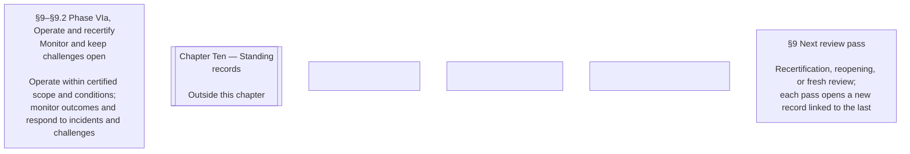

<!-- CHUNK-BEGIN ar__core_09.000_system_alignment_certification_evaluation__section_1_corpus_placement_overview.md bytes=3974 -->
<!-- AI-assisted translation draft; unreviewed. §1 corpus-placement overview, source lines 8–10; source SHA-256 4311e6ba74b7210f077c0bd4c8d21d8c9f517d2ada7b6d87288b39494dfeadd5. Draft only; do not synchronize into translations/. -->

# Chapter Nine Part A — §1 corpus-placement overview (ar)

## English source (lines 8–10)

> This file is **part of the Sentient Constitution** and is **binding only together** with the other numbered `core_*` files read as one text. It contains **Chapter Nine, Part A** — certification purpose, the process overview, and the first two phases of the process — **Frame** (system class) and **Evaluate** (whole-system evaluation in three sub-phases: the always-applicable evaluations, including data types and handling, in **§3**; the evaluations that apply where implicated in **§4**; and the Rights-Floor and domain evaluations that apply where triggered in **§5**) — **§1–§5**. The worked **Class A / B / C illustrations** (the system class profiles, §3.4.8, §5.1.5, §5.2.4, §5.3.7, §5.4.4, §5.5.5, and §5.6.4), including each one's **Reading across system classes** paragraph, are in [`core_09.010_system_alignment_certification_illustrations.md`](core_09.010_system_alignment_certification_illustrations.md); each keeps its Part A section number. The binding system-class-scaling and escalation rules those paragraphs illustrate stay in this file: system class scaling, including participation and proportionality, in §2.2; data-handling scaling in §3.4; and the **System class scaling and escalation** paragraph in each of §5.1–§5.6. The files of the whole chapter are listed in the table below.
>
> **Chapter Nine files.** Chapter Nine is split across four binding files read as one text. Part A, this file, opens the chapter; there is no separate index file.

## Translation draft

> هذا الملف **جزء من دستور الكائنات الواعية**، ولا يكون ملزمًا إلا عند قراءته مع ملفات `core_*` المرقّمة الأخرى بوصفها نصًا واحدًا. وهو **الفصل التاسع، الجزء أ** — غرض التصديق، ونظرة عامة على العملية، والمرحلتان الأوليان منها — **الإطار** (فئة النظام) و**التقييم** (تقييم النظام ككل في ثلاث مراحل فرعية: التقييمات الواجبة دائمًا، بما فيها أنواع البيانات ومعالجتها، في **§3**؛ والتقييمات الواجبة عند انطباقها في **§4**؛ وتقييمات **أرضية الحقوق** والمجالات الواجبة عند استدعائها في **§5**) — **§§1–5**. أما الأمثلة العملية للفئات **A وB وC** (ملفات فئات الأنظمة، و§3.4.8، و§5.1.5، و§5.2.4، و§5.3.7، و§5.4.4، و§5.5.5، و§5.6.4)، بما في ذلك فقرة **القراءة عبر فئات الأنظمة** في كل منها، فترد في [`core_09.010_system_alignment_certification_illustrations.md`](core_09.010_system_alignment_certification_illustrations.md)؛ ويحتفظ كل مثال برقم قسمه في الجزء أ. وتبقى قواعد التصعيد وضبط المقياس الملزمة التي توضحها تلك الفقرات في هذا الملف: ضبط المقياس بحسب فئة النظام، بما يشمل المشاركة والتناسب، في §2.2؛ وضبط معالجة البيانات في §3.4؛ وفقرة **ضبط المقياس والتصعيد بحسب فئة النظام** في كل من §§5.1–5.6. وتعرض القائمة أدناه ملفات الفصل كاملًا.
>
> **ملفات الفصل التاسع.** يتوزع الفصل التاسع على أربعة ملفات ملزمة تُقرأ معًا. والجزء أ، وهو هذا الملف، يفتتح الفصل؛ ولا يوجد ملف فهرس مستقل.

<!-- CHUNK-END -->
<!-- CHUNK-BEGIN ar__core_09.000_system_alignment_certification_evaluation__section_1_corpus_file_table.md bytes=5640 -->
<!-- AI-assisted translation draft; unreviewed. §1 corpus-placement file table, source lines 12–17; source SHA-256 4311e6ba74b7210f077c0bd4c8d21d8c9f517d2ada7b6d87288b39494dfeadd5. Draft only; do not synchronize into translations/. -->

# Chapter Nine Part A — §1 corpus-placement file table (ar)

## English source (lines 12–17)

> | Part | File | Owns |
> |------|------|------|
> | **Part A — Evaluation** | [`core_09.000_system_alignment_certification_evaluation.md`](core_09.000_system_alignment_certification_evaluation.md) | §1–§5: purpose and process overview (with a chart of the whole certification process in its six phases), **Phase I Frame** (system class, how system class scales every evaluation, and pilot certification) and **Phase II Evaluate** (whole-system evaluation in three sub-phases: **IIa** always, in §3, including chartered scope versus functional boundaries and data types and handling; **IIb** where implicated, in §4; and **IIc** where triggered, the Rights-Floor and domain evaluations, in §5) |
> | **Part B — Record and process** | [`core_09.005_system_alignment_certification_record_process.md`](core_09.005_system_alignment_certification_record_process.md) | §6–§10: **Phase III Review** (forum roles, supervisory sequence, and the contestability chain), **Phase IV Decide** (certification outcomes, including the go-live gate), **Phase V Record** (the certification record and its integrity, including governing [System Charter](core_05.040_band_continuity.md#system-charter) fields), and **Phase VI Operate** (the challenge path; recertification and reopening; the standing bridge) — continuous chapter numbering from Part A §5 |
> | **Part C — Illustrations** | [`core_09.010_system_alignment_certification_illustrations.md`](core_09.010_system_alignment_certification_illustrations.md) | the illustrative system class profiles, §3.4, §3.4.8, §5.1.5, §5.2.4, §5.3.7, §5.4.4, §5.5.5, and §5.6.4: worked Class A / B / C walkthroughs for each Part A evaluation area, numbered to match Part A and linked both ways |
> | **Part D — Institutional alignment certification** | [`core_09.015_institutional_alignment_certification.md`](core_09.015_institutional_alignment_certification.md) | §11–§15: the same six phases for an **Institution** rather than a System — the institution class and the institutional evaluation (**Phases I and II**, §12), the forum roles, outcome, and **Institutional Certification Record** (**Phases III to V**, §13), and recertification, reopening, the cascade from System certifications, and the standing bridge (**Phase VI**, §14–§15). It cites each System's certification by link and does not repeat it, and it is not a licence — continuous chapter numbering from Part B §10 |

## Translation draft

| الجزء | الملف | يتناول |
|------|------|------|
| **Part A — Evaluation** | [`core_09.000_system_alignment_certification_evaluation.md`](core_09.000_system_alignment_certification_evaluation.md) | §§1–5: الغرض وعرض العملية (مع مخطط لمراحل التصديق الست)، والمرحلتان I Frame (فئة النظام، وكيف تضبط الفئة كل تقييم، والتصديق التجريبي) وII Evaluate (تقييم النظام ككل في ثلاث مراحل فرعية: IIa دائمًا في §3، بما في ذلك النطاق الميثاقي مقابل الحدود الوظيفية وأنواع البيانات ومعالجتها؛ IIb عند انطباقها في §4؛ وIIc عند تفعيلها، تقييمات أرضية الحقوق والمجالات في §5). |
| **Part B — Record and process** | [`core_09.005_system_alignment_certification_record_process.md`](core_09.005_system_alignment_certification_record_process.md) | §§6–10: المرحلة III Review (أدوار المنتدى، وتسلسل الإشراف، وسلسلة الاعتراض)؛ والمرحلة IV Decide (نتائج التصديق، ومنها بوابة بدء التشغيل)؛ والمرحلة V Record (سجل التصديق ونزاهته، بما في ذلك حقول ميثاق النظام الحاكمة)؛ والمرحلة VI Operate (مسار الاعتراض، وإعادة التصديق وإعادة الفتح، وجسر المكانة) — ترقيم متصل من الجزء أ §5. [`System Charter`](core_05.040_band_continuity.md#system-charter) |
| **Part C — Illustrations** | [`core_09.010_system_alignment_certification_illustrations.md`](core_09.010_system_alignment_certification_illustrations.md) | الملفات التوضيحية لفئات الأنظمة، و§3.4، و§3.4.8، و§§5.1.5 و5.2.4 و5.3.7 و5.4.4 و5.5.5 و5.6.4: أمثلة عملية للفئات A/B/C في كل مجال تقييم ضمن الجزء أ، مرقمة لتطابقه ومرتبطة به في الاتجاهين. |
| **Part D — Institutional alignment certification** | [`core_09.015_institutional_alignment_certification.md`](core_09.015_institutional_alignment_certification.md) | §§11–15: المراحل الست نفسها للمؤسسة بدل النظام — فئة المؤسسة والتقييم المؤسسي (المرحلتان I وII، §12)، أدوار المنتدى والنتيجة وسجل التصديق المؤسسي (III–V، §13)، وإعادة التصديق وإعادة الفتح وتسلسل شهادات الأنظمة وجسر المكانة (VI، §§14–15). يحيل إلى شهادة كل نظام ولا يكررها، وهو ليس ترخيصًا — ترقيم متصل من الجزء ب §10. |

<!-- CHUNK-END -->
<!-- CHUNK-BEGIN ar__core_09.000_system_alignment_certification_evaluation__section_1_corpus_explanation.md bytes=9378 -->
<!-- AI-assisted translation draft; unreviewed. §1 corpus-placement explanatory prose, source lines 19–30; source SHA-256 4311e6ba74b7210f077c0bd4c8d21d8c9f517d2ada7b6d87288b39494dfeadd5. Draft only; do not synchronize into translations/. -->

# Chapter Nine Part A — §1 corpus-placement explanatory prose (ar)

## English source (lines 19–30)

> **How the two certifications relate.** System Alignment Certification (Parts A to C) is the certification of a System. Institutional alignment certification (Part D) is the certification of an Institution, which may run Systems or none. Part D cites each System's certification record by link and does not redo it; [Part D §11.1](core_09.015_institutional_alignment_certification.md#111-relation-to-system-alignment-certification) states the relation and [Part D §11.3](core_09.015_institutional_alignment_certification.md#113-no-permission-and-no-gate) states that it is not a licence.
>
> Generic **Chapter Nine** links in other files route to the appropriate part by section number.
>
> - **Constitutional owner (joint with Parts B and D):** forum-supervised **system alignment certification and related records** — evaluation domains (Part A); forum process, supervisory sequence, certification-record duties, certification outcomes and the go-live gate, the challenge path, recertification and reopening, and verified-input bridge to Chapter Ten (Part B); the same six phases for an Institution (Part D). Under the **oversight** Tetrad leg, SAC is one especially large, high-stakes audit process among others; auditing floors remain at **Article XVI** (*Audit, Transparency, and Independent Verification*) and Chapter Five [Auditability](core_05.050_band_oversight.md#auditability).
> - **Verification substrate owner:** [Chapter Four — Burden of Proof, Traceability, and Verification](core_04.000_burden_traceability_verification.md#chapter-four-burden-of-proof-traceability-and-verification) (within Chapters Two through Four) owns burden allocation, compliance evidence, definition traceability, observability, and security-constrained verification. Chapter Nine **applies** that discipline to system alignment certification records; it does **not** restate Chapter Four sections **1** through **5**.
> - **Auditing home (not relocated here):** **Article XVI** (*Audit, Transparency, and Independent Verification*), **Def.O1** (*Transparency, Auditability, and Verification*), and **CJS-5.110 §3 and CJS-5.115 §3** (*Audit process home*)–**CJS-5.110 §5** own auditing floors and operational terms. Chapter Nine runs one especially large SAC audit process that must satisfy those floors; it does not own all auditing.
> - **Implementation owner:** system-class handling, CS-6.345, and forum-process detail in designated implementation files must remain consistent with Chapter Nine and may be stricter where the corpus already provides a [Fullest Protective Effect](core_05.045_band_integrative.md#fullest-protective-effect) rule.
> - **Anti-relocation rule:** Part A does not restate Chapter Five canonical definitions, Chapter Three anti-evasion discipline (see [Part B §9.3](core_09.005_system_alignment_certification_record_process.md#93-non-evasion)), Chapter Ten contribution or standing measurement, or Chapter Eleven standing effects. **[Part B §10](core_09.005_system_alignment_certification_record_process.md#10-relationship-to-standing)** states the standing bridge boundary explicitly.
>
> **Upstream:** Chapter Five definitions; Chapters Two through Four record, verification, burden, and traceability of definitions to results; and [Chapter Eight](core_08.000_functional_independence_separation_of_duties.md#chapter-eight-functional-independence-and-separation-of-duties), whose separation-of-duties requirement governs every materially binding certification act.
> **Downstream:** [Part B](core_09.005_system_alignment_certification_record_process.md#chapter-nine-part-b-system-alignment-certification--record-and-process) (*forum process, record, outcomes, and standing bridge*); Chapter Ten standing records and verified inputs; Chapter Eleven standing effects; Chapter Thirteen forum supervision and system alignment certification pathways.

## Translation draft

**العلاقة بين نوعي التصديق.** تصديق مواءمة النظام (الأجزاء A إلى C) هو تصديق لنظام. أما تصديق مواءمة المؤسسة (الجزء D) فهو تصديق لمؤسسة قد تدير أنظمة أو لا تدير أيًّا منها. ويستشهد الجزء D بسجل تصديق كل نظام عبر رابط ولا يعيد إجراءه؛ وتوضح [Part D §11.1](core_09.015_institutional_alignment_certification.md#111-relation-to-system-alignment-certification) العلاقة، وتوضح [Part D §11.3](core_09.015_institutional_alignment_certification.md#113-no-permission-and-no-gate) أنه ليس ترخيصًا.
>
> تحيل روابط **Chapter Nine** العامة في الملفات الأخرى إلى الجزء المناسب بحسب رقم القسم.
>
> - **المالك الدستوري (بالاشتراك مع الجزأين B وD):** تصديق مواءمة النظام والسجلات المرتبطة به، تحت إشراف المنتدى — مجالات التقييم (الجزء A)؛ وإجراءات المنتدى وتسلسل الإشراف وواجبات سجل التصديق والنتائج وبوابة بدء التشغيل ومسار الطعن وإعادة التصديق وإعادة الفتح وجسر المدخلات المتحققة إلى الفصل العاشر (الجزء B)؛ والمراحل الست نفسها للمؤسسة (الجزء D). وضمن ضلع **الإشراف** في Tetrad، يُعد SAC عملية تدقيق كبيرة وعالية المخاطر بين عمليات أخرى؛ وتظل أرضيات التدقيق في **Article XVI** (*Audit, Transparency, and Independent Verification*) وفي [Auditability](core_05.050_band_oversight.md#auditability) من الفصل الخامس.
> - **مالك طبقة التحقق:** يملك [Chapter Four — Burden of Proof, Traceability, and Verification](core_04.000_burden_traceability_verification.md#chapter-four-burden-of-proof-traceability-and-verification) (ضمن الفصول من الثاني إلى الرابع) توزيع عبء الإثبات، وأدلة الامتثال، وإمكانية تتبع التعريفات، والرصد، والتحقق المقيّد بالأمن. يطبّق الفصل التاسع هذا الانضباط على سجلات تصديق مواءمة النظام؛ ولا يعيد صياغة أقسام الفصل الرابع من **1** إلى **5**.
> - **موطن التدقيق (ولا يُنقل إلى هنا):** تملك **Article XVI** (*Audit, Transparency, and Independent Verification*) و**Def.O1** (*Transparency, Auditability, and Verification*) و**CJS-5.110 §3 وCJS-5.115 §3** (*Audit process home*)–**CJS-5.110 §5** أرضيات التدقيق ومصطلحاته التشغيلية. ويدير الفصل التاسع عملية SAC واحدة كبيرة بوجه خاص، يجب أن تستوفي تلك الأرضيات؛ لكنه لا يملك جميع أعمال التدقيق.
> - **مالك التنفيذ:** يجب أن تظل معالجة فئات الأنظمة، وCS-6.345، وتفاصيل إجراءات المنتدى في ملفات التنفيذ المحددة متسقة مع الفصل التاسع، ويجوز أن تكون أشد حيث يوفر المتن أصلًا قاعدة [Fullest Protective Effect](core_05.045_band_integrative.md#fullest-protective-effect).
> - **قاعدة منع النقل:** لا يعيد الجزء A عرض التعريفات المرجعية للفصل الخامس، أو انضباط منع التحايل في الفصل الثالث (انظر [Part B §9.3](core_09.005_system_alignment_certification_record_process.md#93-non-evasion))، أو قياس المساهمة أو المكانة في الفصل العاشر، أو آثار المكانة في الفصل الحادي عشر. ويحدد **[Part B §10](core_09.005_system_alignment_certification_record_process.md#10-relationship-to-standing)** حد جسر المكانة صراحة.
>
> **المصادر السابقة:** تعريفات الفصل الخامس؛ وسجلات الفصول من الثاني إلى الرابع والتحقق وعبء الإثبات وإمكانية تتبع التعريفات إلى النتائج؛ و[Chapter Eight](core_08.000_functional_independence_separation_of_duties.md#chapter-eight-functional-independence-and-separation-of-duties)، الذي يحكم فيه شرط فصل الواجبات كل فعل تصديق ذي أثر ملزم جوهري.
> **المصادر اللاحقة:** [Part B](core_09.005_system_alignment_certification_record_process.md#chapter-nine-part-b-system-alignment-certification--record-and-process) (*إجراءات المنتدى والسجل والنتائج وجسر المكانة*)؛ وسجلات المكانة والمدخلات المتحققة في الفصل العاشر؛ وآثار المكانة في الفصل الحادي عشر؛ وإشراف المنتدى ومسارات تصديق مواءمة النظام في الفصل الثالث عشر.

<!-- CHUNK-END -->
<!-- CHUNK-BEGIN ar__core_09.000_system_alignment_certification_evaluation__section_1_heading.md bytes=372 -->
<!-- AI-assisted translation draft; unreviewed. §1 heading, source line 44; source SHA-256 4311e6ba74b7210f077c0bd4c8d21d8c9f517d2ada7b6d87288b39494dfeadd5. Draft only; do not synchronize into translations/. -->

# Chapter Nine Part A — §1 heading (ar)

## English source (lines 44–45)

### 1. Purpose and Role


## Translation draft

### 1. الغرض والدور

<!-- CHUNK-END -->
<!-- CHUNK-BEGIN ar__core_09.000_system_alignment_certification_evaluation__section_1_trace.md bytes=12194 -->
<!-- AI-assisted translation draft; unreviewed. §1 trace, source lines 46–95; source SHA-256 4311e6ba74b7210f077c0bd4c8d21d8c9f517d2ada7b6d87288b39494dfeadd5. Draft only; do not synchronize into translations/. -->

# Chapter Nine Part A — §1 trace (ar)

## English source (lines 46–95)

<details>
<summary><strong><span style="color: #2563eb;">Trace</span></strong></summary>

- Upstream:
  - [Preamble — constitutional owner register](core_00.000_preamble.md#4-principles-definitions-and-rights) and
  - [Authority Stack and Internal Hierarchy](core_05.045_band_integrative.md#authority-stack-and-internal-hierarchy);
  - [Constitutional Tetrad](core_00.000_preamble.md#constitutional-tetrad);
  - [Two Constitutional Aims](core_00.000_preamble.md#two-constitutional-aims);
  - [material stake](core_00.000_preamble.md#material-stake);
  - [Proportionality](core_05.035_band_accountability.md#proportionality) and
  - [Substantive Fairness](core_05.055_band_participation.md#substantive-fairness) (Chapter Five); Participation measurement family (*voice, access, and contest paths*);
  - [Chapter One §16 Stewardship In Depth](core_01.010_stewardship_capacity_principles.md#16-stewardship-in-depth) (1.010 §16);
  - [Chapter One §12 Systemic Evaluation Requirement](core_01.000_values_principles.md#12-systemic-evaluation-requirement) (1.000 §12) (*principle-layer whole-system evaluation lens — not one corner alone*); Chapters Two through Four;
  - [Chapter Five](core_05.000_definitions_home.md#chapter-five-foundational-definitions) (5.000) (*canonical definitions*);
  - [Chapter Eight §2 Four-Seat Constitutional Requirement](core_08.000_functional_independence_separation_of_duties.md#2-four-seat-constitutional-requirement) (8.000 §2);
  - [System Alignment Certification](core_05.040_band_continuity.md#system-alignment-certification) (Chapter Five canonical term; non-operative shorthand **SAC**);
  - [System Certification Record](core_05.040_band_continuity.md#system-certification-record) (Chapter Five meaning).
- Downstream:
  - [§2](#2-system-class-evaluation) (*system class evaluation*);
  - [Part B §9.1](core_09.005_system_alignment_certification_record_process.md#91-challenging-a-certification) (9.005 §9.1) (*challenging a certification*); and
  - [Part C system class profiles](core_09.010_system_alignment_certification_illustrations.md#illustrative-system-class-profiles-non-exhaustive) (9.010) (*illustrative system class profiles*);
  - [Part C whole-system walkthroughs](core_09.010_system_alignment_certification_illustrations.md#illustrative-whole-system-application-by-system-class-non-exhaustive) (9.010) (*worked whole-system examples by system class*);
  - [§3.4.8](core_09.010_system_alignment_certification_illustrations.md#348-illustrative-data-handling-application-by-system-class-non-exhaustive) (*worked data-handling examples by system class*);
  - [§5.1.5](core_09.010_system_alignment_certification_illustrations.md#515-illustrative-ecological-footprint-application-by-system-class-non-exhaustive) (*worked ecological-footprint examples by system class*);
  - [§5.2.4](core_09.010_system_alignment_certification_illustrations.md#524-illustrative-educational-capability-application-by-system-class-non-exhaustive) (*worked educational-capability examples by system class*);
  - [§5.3.7](core_09.010_system_alignment_certification_illustrations.md#537-illustrative-cross-system-support-application-by-system-class-non-exhaustive) (*worked cross-system-support examples by system class*);
  - [§5.4.4](core_09.010_system_alignment_certification_illustrations.md#544-illustrative-nondiscrimination-application-by-system-class-non-exhaustive) (*worked nondiscrimination examples by system class*);
  - [§5.5.5](core_09.010_system_alignment_certification_illustrations.md#555-illustrative-accessibility-application-by-system-class-non-exhaustive) (*worked accessibility examples by system class*);
  - [§5.6.4](core_09.010_system_alignment_certification_illustrations.md#564-illustrative-trustworthiness-application-by-system-class-non-exhaustive) (*worked trustworthiness examples by system class*);
  - [§3](#3-whole-system-certification-evaluation) (*whole-system certification evaluation factors*);
  - [§3.4](#34-data-types-and-handling-evaluation) through
  - [§5.6](#56-trustworthiness-and-system-reliance-integrity-evaluation) (*domain evaluations*);
  - [Part B §6](core_09.005_system_alignment_certification_record_process.md#6-forum-process) (9.005 §6) (*supervisory sequence and contestability chain*);
  - [Part B §6.1](core_09.005_system_alignment_certification_record_process.md#61-forum-supervision-and-component-roles) (9.005 §6.1) (*forum component roles*);
  - [Part B §8](core_09.005_system_alignment_certification_record_process.md#8-system-certification-record) (9.005 §8) (*certification record contents*);
  - [Part B §8.2](core_09.005_system_alignment_certification_record_process.md#82-record-integrity-transparency-and-auditability) (9.005 §8.2) (*record integrity requirements*);
  - [Part B §7](core_09.005_system_alignment_certification_record_process.md#7-certification-outcomes) (9.005 §7) (*reopening and anti-evasion*);
  - [Part B §10](core_09.005_system_alignment_certification_record_process.md#10-relationship-to-standing) (9.005 §10) (*standing-record bridge*);
  - [Chapter Ten](core_11.000_standing_assessment.md#chapter-eleven-contribution-violation-and-standing-model--measurement) (10.000) (*standing records and verified-input gate*);
  - [Chapter Eleven](core_12.000_standing_integration.md#chapter-twelve-standing-effects-and-integration) (11.000) (*standing effects and integration*);
  - [Chapter Thirteen](core_14.000_forum.md#chapter-fourteen-forums-and-jurisdiction) (13.000) (*forum supervision, certification, alignment certification, and review*).
- Read with:
  - **[CS-9.305](corpus_systems/cs_09.305_system_classification_machinery.md#cs-9305-part-a-system-classification-machinery) (*System classification machinery*) and [CS-9.310 — System impact classifications](corpus_systems/cs_09.310_system_impact_classifications.md#cs-9310-part-b-system-impact-classifications)**, **[CS-6.305](corpus_systems/cs_06.305_information_types_and_handling.md#cs-6305-part-a-information-types-and-handling) (*Information types and handling*) and [CS-6.310 — Data classifications](corpus_systems/cs_06.310_data_classifications.md#cs-6310-part-b-data-classifications)**, and
  - **CS-6.345** (*System lifecycle*);
  - **CF-13.415** (*Routing operations, transfer, certification, and representative treatment*) and
  - **CF-13.425** (*Integrity safeguards, anti-capture operations, and anti-self-judging support*); **Article XVI** (*Audit, Transparency, and Independent Verification*) and
  - [Auditability](core_05.050_band_oversight.md#auditability) (*auditing floors — SAC is one especially large audit process under oversight, not the sole auditing home*); **CJS-5.110 §3 (*Oversight: auditability and reconstructability terms (annex)*) and CJS-5.115 §3** (*Audit process home*)–
  - **CJS-5.110 §5** (*Oversight: independent verification and claim-integrity terms*).

</details>

## Translation draft

#### التتبّع

تحدد الخريطة الأسس الدستورية والسلطوية لهذا القسم، ثم تربطه بالتقييم والتصنيف ومسارات المراجعة والسجلات والنتائج والتدقيق؛ وتبين المواد التشغيلية التي تُقرأ معه.

**التتبّع — upstream canonical sources:** [Preamble — constitutional owner register](core_00.000_preamble.md#4-principles-definitions-and-rights); [Authority Stack and Internal Hierarchy](core_05.045_band_integrative.md#authority-stack-and-internal-hierarchy); [Constitutional Tetrad](core_00.000_preamble.md#constitutional-tetrad); [Two Constitutional Aims](core_00.000_preamble.md#two-constitutional-aims); [material stake](core_00.000_preamble.md#material-stake); [Proportionality](core_05.035_band_accountability.md#proportionality); [Substantive Fairness](core_05.055_band_participation.md#substantive-fairness); [Chapter One §16 Stewardship In Depth](core_01.010_stewardship_capacity_principles.md#16-stewardship-in-depth); [Chapter One §12 Systemic Evaluation Requirement](core_01.000_values_principles.md#12-systemic-evaluation-requirement); [Chapter Five](core_05.000_definitions_home.md#chapter-five-foundational-definitions); [Chapter Eight §2 Four-Seat Constitutional Requirement](core_08.000_functional_independence_separation_of_duties.md#2-four-seat-constitutional-requirement); [System Alignment Certification](core_05.040_band_continuity.md#system-alignment-certification); [System Certification Record](core_05.040_band_continuity.md#system-certification-record)

**التتبّع — downstream routes and related records:** [§2](#2-system-class-evaluation); [Part B §9.1](core_09.005_system_alignment_certification_record_process.md#91-challenging-a-certification); [Part C system class profiles](core_09.010_system_alignment_certification_illustrations.md#illustrative-system-class-profiles-non-exhaustive); [Part C whole-system walkthroughs](core_09.010_system_alignment_certification_illustrations.md#illustrative-whole-system-application-by-system-class-non-exhaustive); [§3.4.8](core_09.010_system_alignment_certification_illustrations.md#348-illustrative-data-handling-application-by-system-class-non-exhaustive); [§5.1.5](core_09.010_system_alignment_certification_illustrations.md#515-illustrative-ecological-footprint-application-by-system-class-non-exhaustive); [§5.2.4](core_09.010_system_alignment_certification_illustrations.md#524-illustrative-educational-capability-application-by-system-class-non-exhaustive); [§5.3.7](core_09.010_system_alignment_certification_illustrations.md#537-illustrative-cross-system-support-application-by-system-class-non-exhaustive); [§5.4.4](core_09.010_system_alignment_certification_illustrations.md#544-illustrative-nondiscrimination-application-by-system-class-non-exhaustive); [§5.5.5](core_09.010_system_alignment_certification_illustrations.md#555-illustrative-accessibility-application-by-system-class-non-exhaustive); [§5.6.4](core_09.010_system_alignment_certification_illustrations.md#564-illustrative-trustworthiness-application-by-system-class-non-exhaustive); [§3](#3-whole-system-certification-evaluation); [§3.4](#34-data-types-and-handling-evaluation); [§5.6](#56-trustworthiness-and-system-reliance-integrity-evaluation); [Part B §6](core_09.005_system_alignment_certification_record_process.md#6-forum-process); [Part B §6.1](core_09.005_system_alignment_certification_record_process.md#61-forum-supervision-and-component-roles); [Part B §8](core_09.005_system_alignment_certification_record_process.md#8-system-certification-record); [Part B §8.2](core_09.005_system_alignment_certification_record_process.md#82-record-integrity-transparency-and-auditability); [Part B §7](core_09.005_system_alignment_certification_record_process.md#7-certification-outcomes); [Part B §10](core_09.005_system_alignment_certification_record_process.md#10-relationship-to-standing); [Chapter Ten](core_11.000_standing_assessment.md#chapter-eleven-contribution-violation-and-standing-model--measurement); [Chapter Eleven](core_12.000_standing_integration.md#chapter-twelve-standing-effects-and-integration); [Chapter Thirteen](core_14.000_forum.md#chapter-fourteen-forums-and-jurisdiction)

**التتبّع — operational materials to read with this section:** [CS-9.305](corpus_systems/cs_09.305_system_classification_machinery.md#cs-9305-part-a-system-classification-machinery); [CS-9.310 — System impact classifications](corpus_systems/cs_09.310_system_impact_classifications.md#cs-9310-part-b-system-impact-classifications); [CS-6.305](corpus_systems/cs_06.305_information_types_and_handling.md#cs-6305-part-a-information-types-and-handling); [CS-6.310 — Data classifications](corpus_systems/cs_06.310_data_classifications.md#cs-6310-part-b-data-classifications); [Auditability](core_05.050_band_oversight.md#auditability)

<!-- CHUNK-END -->
<!-- CHUNK-BEGIN ar__core_09.000_system_alignment_certification_evaluation__purpose_adjuncts.md bytes=6388 -->
<!-- AI-assisted translation draft; unreviewed. Selected §1 passages, source lines 99 and 107–114; source SHA-256 4311e6ba74b7210f077c0bd4c8d21d8c9f517d2ada7b6d87288b39494dfeadd5. -->

# Chapter Nine Part A — §1 plain-terms excerpt

**Status:** AI-assisted draft; unreviewed. English source remains controlling.

## English source

When a system really matters to sentients' lives, certification has to be **proportionate** — as demanding as the system's real impact, dependency, and risk require, not a one-size-fits-all checklist or a rubber stamp. It also has to be **participatory** — affected sentients and communities must be able to see what was reviewed, understand what was decided, and challenge it when something is wrong. Forums review evidence, write it down in a certification record, and require re-checks on a schedule that matches how risky the system is. Classes A, B, and C get the full process and Class L a lighter one. Class P is encouraged to use it, and must once it is reclassified to Class L or higher (that is, its effects reach beyond a private unit) or its operator claims constitutional compliance.

## ar draft

عندما يكون للنظام أثر حقيقي في حياة الكائنات ذات الإحساس، يجب أن تكون الشهادة **متناسبة** — صارمة بقدر ما يتطلبه الأثر والاعتماد والمخاطر الفعلية للنظام، لا قائمة فحص موحّدة ولا ختمًا شكليًا. ويجب أيضًا أن تكون **تشاركية** — بحيث تتمكن الكائنات والمجتمعات المتأثرة من معرفة ما خضع للمراجعة، وفهم ما تقرر، والطعن فيه عند الخطأ. تراجع المنتديات الأدلة، وتثبتها في سجل شهادة، وتطلب إعادة الفحص وفق جدول يتناسب مع خطورة النظام. تخضع الفئات A وB وC للعملية كاملة، بينما تخضع الفئة L لعملية أخف. ويُشجَّع النظام من الفئة P على استخدامها، وتصبح واجبة عليه متى أعيد تصنيفه ضمن الفئة L أو أعلى (أي حين تتجاوز آثاره وحدة خاصة) أو ادّعى مشغّله الامتثال الدستوري.


### English source — Flourishing

- **[Flourishing](core_00.000_preamble.md#flourishing)** — certification verifies that certification or continued reliance would not quietly defeat Rights Floors or block fair participation in constitutionally relevant life;

### ar draft

- **[الازدهار](core_00.000_preamble.md#flourishing)** — تتحقق الشهادة من أن التصديق أو مواصلة الاعتماد لا يقوضان بهدوء حدود الحقوق ولا يمنعان المشاركة العادلة في الحياة ذات الصلة دستوريًا؛


### English source — Continuity criterion

- **[Continuity](core_00.000_preamble.md#continuity)** — certification verifies durable, non-regressive supply that sustains rather than depletes healthy natural systems ([Ecological Integrity](core_05.040_band_continuity.md#ecological-integrity), including [Ecological Recovery Capacity](core_05.040_band_continuity.md#ecological-recovery-capacity)), and system-class-scaled recertification where shared systems gate or sustain delivery;

### ar draft

- **[الاستمرارية](core_00.000_preamble.md#continuity)** — تتحقق الشهادة من وجود إمداد مستدام غير تراجعي يحافظ على النظم الطبيعية السليمة ولا يستنزفها ([النزاهة البيئية](core_05.040_band_continuity.md#ecological-integrity)، بما في ذلك [قدرة التعافي البيئي](core_05.040_band_continuity.md#ecological-recovery-capacity))، ومن إعادة التصديق بحسب فئة النظام عندما تتحكم الأنظمة المشتركة في الإمداد أو تدعمه؛


### English source — Participation criterion

- **Participation** — affected sentients and communities can understand, contest, and take part in review paths that matter to them;

### ar draft

- **المشاركة** — تستطيع الكائنات ذات الإحساس والمجتمعات المتأثرة فهم مسارات المراجعة المهمة لها والطعن فيها والمشاركة فيها؛


### English source — Oversight criterion

- **Oversight** — records, evidence, and assumptions are visible and auditable enough for independent checking; certification itself is one especially large audit process under that oversight duty, not the only one;

### ar draft

- **الرقابة** — تكون السجلات والأدلة والافتراضات ظاهرة وقابلة للتدقيق بما يكفي للتحقق المستقل؛ والشهادة نفسها عملية تدقيق كبيرة ضمن واجب الرقابة، وليست موطن التدقيق الوحيد؛


### English source — Accountability criterion

- **Accountability** — defects, misclassification, and floor-defeating operation route to remedy, conditions, withdrawal, or standing input where the facts support it;

### ar draft

- **المساءلة** — تُحال العيوب وسوء التصنيف والتشغيل الذي يهزم حدود الحقوق إلى الانتصاف أو الشروط أو السحب أو مدخلات تقييم الوضع، متى دعمت الوقائع ذلك؛


### English source — Timeliness criterion

- **Timeliness** — review and contest windows keep certification from going stale while harm can still be prevented or reversed.

### ar draft

- **التوقيت المناسب** — تمنع نوافذ المراجعة والطعن تقادم الشهادة بينما لا يزال منع الضرر أو عكسه ممكنًا.


### English source — Tetrad introduction

Certification implements the [Two Constitutional Aims](core_00.000_preamble.md#two-constitutional-aims) through the [Constitutional Tetrad](core_00.000_preamble.md#constitutional-tetrad):

### ar draft

تُطبّق الشهادة [الهدفين الدستوريين](core_00.000_preamble.md#two-constitutional-aims) عبر [الرباعية الدستورية](core_00.000_preamble.md#constitutional-tetrad):

<!-- CHUNK-END -->
<!-- CHUNK-BEGIN ar__core_09.000_system_alignment_certification_evaluation__section_1_purpose.md bytes=1425 -->
<!-- AI-assisted translation draft; unreviewed. Complete purpose statement excerpt, source lines 101–105; source SHA-256 4311e6ba74b7210f077c0bd4c8d21d8c9f517d2ada7b6d87288b39494dfeadd5. This is an excerpt, not a complete §1 translation. -->

**شهادة مواءمة النظام** موجودة للإجابة عن سؤال واحد ضمن نطاق محدد وجدول مراجعة محدد: هل أظهر النظام مواءمة دستورية كافية تؤهله للتصديق، أو التصديق المشروط، أو التحقق، أو إعادة التصديق، أو استمرار الاعتماد عليه، أو نشره، أو رفع شروط جوهرية عنه؟

- الشهادة ليست درجة شعبية، ولا تصريحًا أبديًا، ولا وسيلة لتجاوز مراجعة الحقوق.
- إنها بيان محدود المدة وقابل للطعن عمّا هو معلوم الآن بشأن مواءمة النظام.
- بموجب ركن **الرقابة** في الرباعية، تستلزم الرقابة التدقيق؛ وشهادة مواءمة النظام عملية تدقيق كبيرة وعالية الرهانات بين عمليات أخرى — وليست موطن التدقيق الوحيد (**المادة XVI** (*التدقيق والشفافية والتحقق المستقل*)، [قابلية التدقيق](core_05.050_band_oversight.md#auditability)).

<!-- CHUNK-END -->
<!-- CHUNK-BEGIN ar__core_09.000_system_alignment_certification_evaluation__section_1_subsection_headings.md bytes=802 -->
<!-- AI-assisted translation draft; unreviewed. §1.1/§1.2 visible subsection headings, source lines 116–119 and 144–148; source SHA-256 4311e6ba74b7210f077c0bd4c8d21d8c9f517d2ada7b6d87288b39494dfeadd5. Draft only; anchors/blank layout are structural. Do not synchronize into translations/. -->

# Chapter Nine Part A — §1.1 and §1.2 subsection headings (ar)

## English source

### Lines 116–119

<a id="11-certification-as-an-audit-process-scaled-by-class"></a>

#### 1.1 Certification as an audit process, scaled by class


### Lines 144–148


<a id="12-certification-at-a-glance"></a>

#### 1.2 Certification at a glance


## Translation draft

#### 1.1 التصديق بوصفه عملية تدقيق، متناسبة مع فئة النظام

#### 1.2 لمحة عن الاعتماد

<!-- CHUNK-END -->
<!-- CHUNK-BEGIN ar__core_09.000_system_alignment_certification_evaluation__section_1_audit_scope.md bytes=3433 -->
<!-- AI-assisted translation draft; unreviewed. §1.1 audit mechanism and sibling audit modes, source lines 120–130; source SHA-256 4311e6ba74b7210f077c0bd4c8d21d8c9f517d2ada7b6d87288b39494dfeadd5. -->

# Chapter Nine Part A — §1.1 certification audit process excerpt (ar)

## English source

As an oversight mechanism, certification is one especially large audit process under [Auditability](core_05.050_band_oversight.md#auditability) and **Article XVI** (*Audit, Transparency, and Independent Verification*):

- It is forum-supervised, multi-domain, and status-granting.
- It may integrate the results of sibling audit modes, and it does not absorb or replace them. Each keeps its own owner, named in the [sibling audit modes map](corpus_joint_structure/cjs_05.115_audit_process.md#sibling-audit-modes-owner-map) of the audit process home:
  - System Data Types Record audits under **CS-6.305 (*Information types and handling*) and CS-6.310** (*Data classifications*)
  - System Classification Record audits under **CS-9.305 (*System classification machinery*) and CS-9.310** (*System impact classifications*)
  - steward assurance reviews under **CS-14.305** (*Critical system stewardship*)
  - continuous audit under **CS-6.345** (*System lifecycle*) ACA
  - complexity audits under **CS-6.315** (*Comprehensibility and complexity stewardship*) and **Article XXIII-B** (*Complexity Audit and Modularity Requirements*)
  - claim verification under **CJS-5.110 §5** (*Oversight: independent verification and claim-integrity terms*)
- You can still run any of these checks on their own, without going through certification. Certification doesn't replace them.

## ar draft

بوصفه آليةً للإشراف، يُعد الاعتماد إحدى عمليات التدقيق الكبيرة على نحو خاص بموجب [قابلية التدقيق](core_05.050_band_oversight.md#auditability) و**Article XVI** (*Audit, Transparency, and Independent Verification*):

- يخضع لإشراف المنتديات، ويشمل مجالات متعددة، ويمنح صفة.
- يجوز له دمج نتائج أنماط التدقيق الشقيقة، لكنه لا يستوعبها ولا يحل محلها. ويحتفظ كل نمط بمالكه الخاص، المحدد في [خريطة أنماط التدقيق الشقيقة](corpus_joint_structure/cjs_05.115_audit_process.md#sibling-audit-modes-owner-map) ضمن موطن عملية التدقيق:
  - تدقيقات سجل أنواع بيانات النظام بموجب **CS-6.305 (*Information types and handling*) وCS-6.310** (*Data classifications*)
  - تدقيقات سجل تصنيف النظام بموجب **CS-9.305 (*System classification machinery*) وCS-9.310** (*System impact classifications*)
  - مراجعات ضمان الوصي بموجب **CS-14.305** (*Critical system stewardship*)
  - التدقيق المستمر بموجب **CS-6.345** (*System lifecycle*) ACA
  - تدقيقات التعقيد بموجب **CS-6.315** (*Comprehensibility and complexity stewardship*) و**Article XXIII-B** (*Complexity Audit and Modularity Requirements*)
  - التحقق من الادعاءات بموجب **CJS-5.110 §5** (*Oversight: independent verification and claim-integrity terms*)
- يظل بإمكانك إجراء أي من هذه الفحوص منفردًا دون المرور بالاعتماد. فالاعتماد لا يحل محلها.

<!-- CHUNK-END -->
<!-- CHUNK-BEGIN ar__core_09.000_system_alignment_certification_evaluation__section_1_class_scaling.md bytes=4313 -->
<!-- AI-assisted translation draft; unreviewed. Chapter Nine Part A §1 class scaling and cadence, source lines 132–143; source SHA-256 4311e6ba74b7210f077c0bd4c8d21d8c9f517d2ada7b6d87288b39494dfeadd5. Draft only; do not synchronize into translations/. -->

**Current English passage:**

Certification depth, record burden, certification interval, stakeholder review, and contest paths must scale with [material stake](core_00.000_preamble.md#material-stake) under [Proportionality](core_05.035_band_accountability.md#proportionality):

The process applies by impact class, as the [reclassification requirement](corpus_systems/cs_09.305_system_classification_machinery.md#35-reclassification-requirement) of **CS-9.305** (*System classification machinery*) sets out:

- **Class A, Class B, and Class C:** these systems carry the highest impact, dependency, and risk, and whole-system evaluation under [§3 Whole-System Certification Evaluation](#3-whole-system-certification-evaluation), [§4 Evaluations Where Implicated](#4-evaluations-where-implicated), and [§5 Rights-Floor and Domain Evaluations](#5-rights-floor-and-domain-evaluations), each as its own sub-phase applies, is mandatory at full depth;
- **Class L:** the same evaluation is mandatory but proportionate, with a lower default re-check cadence and simpler records where CS-9.305 (*System classification machinery*) and CS-9.310 (*System impact classifications*) permits; and
- **Class P:** the process is encouraged while the system is validly Class P, and a Class P system may use it voluntarily. It becomes mandatory on reclassification to Class L or higher, or where the operator voluntarily asserts constitutional compliance for the system.

The certification interval, and the financial, resource, or special audit that falls at its midpoint, are set by class in [Chapter Thirteen §6 Timely resolution, materiality tiers, and anti-delay discipline](core_14.000_forum.md#review-cadence) (*Review cadence*). This chapter does not restate the numbers.

**Proposed locale translation:**

يجب أن يتناسب عمق الاعتماد، وعبء السجل، وفترة الاعتماد، ومراجعة أصحاب المصلحة، ومسارات الطعن مع [الحصة المادية](core_00.000_preamble.md#material-stake) بموجب [التناسب](core_05.035_band_accountability.md#proportionality):

ينطبق الإجراء بحسب فئة الأثر، كما يقرر **CS-9.305** (*آلية تصنيف الأنظمة*) في [متطلب إعادة التصنيف](corpus_systems/cs_09.305_system_classification_machinery.md#35-reclassification-requirement):

- **الفئات A وB وC:** تحمل هذه الأنظمة أعلى أثر واعتماد ومخاطر؛ ويكون التقييم الشامل للنظام، بكل مراحله الفرعية المنطبقة، إلزاميًا بعمق كامل بموجب [§3 تقييم اعتماد النظام الشامل](#3-whole-system-certification-evaluation)، و[§4 التقييمات عند انطباقها](#4-evaluations-where-implicated)، و[§5 تقييمات أرضية الحقوق والمجالات](#5-rights-floor-and-domain-evaluations)؛
- **الفئة L:** يكون التقييم نفسه إلزاميًا ولكن متناسبًا، مع وتيرة افتراضية أقل لإعادة الفحص وسجلات أبسط حيث يسمح **CS-9.305** (*آلية تصنيف الأنظمة*) و**CS-9.310** (*تصنيفات أثر النظام*)؛ و
- **الفئة P:** يُشجَّع الإجراء ما دام تصنيف النظام P صحيحًا، ويجوز له استخدامه طوعًا. ويصبح إلزاميًا عند إعادة تصنيفه إلى L أو أعلى، أو إذا أعلن المشغّل طوعًا امتثال النظام دستوريًا.

تُحدد فترة الاعتماد، والتدقيق المالي أو تدقيق الموارد أو التدقيق الخاص الواقع في منتصفها، بحسب الفئة في [الفصل الثالث عشر §6 الحل في الوقت المناسب، ودرجات الأهمية، والانضباط المضاد للتأخير](core_14.000_forum.md#review-cadence) (*وتيرة المراجعة*). ولا يعيد هذا الفصل ذكر الأرقام.

<!-- CHUNK-END -->
<!-- CHUNK-BEGIN ar__core_09.000_system_alignment_certification_evaluation__section_1_at_a_glance.md bytes=2009 -->
<!-- AI-assisted translation draft; unreviewed. Chapter Nine Part A §1.2 plain-language summary, source line 149; source SHA-256 4311e6ba74b7210f077c0bd4c8d21d8c9f517d2ada7b6d87288b39494dfeadd5. Draft only; do not synchronize into translations/. -->

# Chapter Nine Part A — §1.2 at-a-glance summary (ar)

## English source

*In plain terms: classify the system honestly, run the evaluations that apply, have forums independently review the evidence and stakeholder concerns, and decide an outcome. Complete the one record opened for forum review and publish it with an open challenge path. A certified system goes live only after its notice interval and required protections are satisfied. Monitor actual outcomes, respond to incidents and challenges, and check again on schedule or when the facts change. Correct defects and have the correction independently verified before authorizing the affected scope or releasing its conditions. Each review pass uses a new record linked to the last.*

## ar draft

*بعبارات بسيطة: صنّف النظام بصدق، وأجرِ التقييمات المنطبقة، ودع المنتديات تراجع الأدلة وشواغل أصحاب المصلحة بصورة مستقلة، ثم تقرر النتيجة. استكمل السجل الواحد المفتوح لمراجعة المنتدى وانشره مع إتاحة مسار للطعن. لا يبدأ النظام المعتمد العمل إلا بعد انقضاء مهلة الإشعار واستيفاء وسائل الحماية المطلوبة. راقب النتائج الفعلية، واستجب للحوادث والطعون، وأعِد التحقق في الموعد المحدد أو عند تغير الوقائع. أصلح العيوب واجعل التصحيح خاضعًا لتحقق مستقل قبل التصريح بالنطاق المتأثر أو رفع شروطه. وتستخدم كل جولة مراجعة سجلًا جديدًا مرتبطًا بالسجل السابق.*

<!-- CHUNK-END -->
<!-- CHUNK-BEGIN ar__core_09.000_system_alignment_certification_evaluation__section_1_phase_map.md bytes=642 -->
<!-- AI-assisted translation draft; unreviewed. Chapter Nine Part A §1.2 phase map, source line 151; source SHA-256 4311e6ba74b7210f077c0bd4c8d21d8c9f517d2ada7b6d87288b39494dfeadd5. Draft only; do not synchronize into translations/. -->

**Current English passage:**

The process runs in **six phases**: **I Frame**, **II Evaluate**, **III Review**, **IV Decide**, **V Record**, and **VI Operate**.

**Proposed locale translation:**

تسير العملية عبر **ست مراحل**: **I التأطير**، **II التقييم**، **III المراجعة**، **IV اتخاذ القرار**، **V التسجيل**، و**VI التشغيل**.

<!-- CHUNK-END -->
<!-- CHUNK-BEGIN ar__core_09.000_system_alignment_certification_evaluation__section_1_reopen_triggers.md bytes=1838 -->
<!-- AI-assisted translation draft; unreviewed. Chapter Nine Part A §1 review-reopening passage, source line 153; source SHA-256 4311e6ba74b7210f077c0bd4c8d21d8c9f517d2ada7b6d87288b39494dfeadd5. Draft only; do not synchronize into translations/. -->

**Current English passage:**

Every evaluation that applies is carried out again on each certification pass: at first certification, at each recertification on the schedule set by [§2 System Class Evaluation](#2-system-class-evaluation), and at each reopened or fresh review. Review reopens before the next scheduled recertification when material facts change, such as growing reliance on the system, growing extraction from shared foundations, a significant fall in what the system puts back into them, or a credible challenge. [Part B §9 Recertification and Reopening](core_09.005_system_alignment_certification_record_process.md#9-recertification-and-reopening) lists the triggers.

**Proposed locale translation:**

يُعاد كل تقييم منطبق في كل جولة اعتماد: عند الاعتماد الأول، وفي كل إعادة اعتماد وفق الجدول الذي تحدده [§2 تقييم فئة النظام](#2-system-class-evaluation)، وعند كل مراجعة معاد فتحها أو جديدة. يُعاد فتح المراجعة قبل موعد إعادة الاعتماد التالي عند تغير وقائع جوهرية، مثل ازدياد الاعتماد على النظام، أو زيادة الاستنزاف من الأسس المشتركة، أو انخفاض ملحوظ في إسهامه فيها، أو ظهور طعن موثوق. وتورد [الجزء ب §9 إعادة الاعتماد وإعادة الفتح](core_09.005_system_alignment_certification_record_process.md#9-recertification-and-reopening) المحفزات.

<!-- CHUNK-END -->
<!-- CHUNK-BEGIN ar__core_09.000_system_alignment_certification_evaluation__section_1_phase_map_opening_nodes.md bytes=2156 -->
<!-- AI-assisted translation draft; unreviewed. §1.2 Phase I/II opening chart-node labels, source lines 155–165; source SHA-256 4311e6ba74b7210f077c0bd4c8d21d8c9f517d2ada7b6d87288b39494dfeadd5. Draft only; non-prose Mermaid syntax/connectors are retained. Do not synchronize into translations/. -->

# Chapter Nine Part A — §1.2 opening phase-map nodes (ar)

## English source (lines 155–165)

```mermaid
flowchart TB
    T(["System with material impact seeks certification,<br/>or reliance on it grows"])
    C["§2 Phase I, Frame<br/>Classify honestly<br/><br/>Class sets depth and re-check schedule"]
    subgraph W["§3–§5 Phase II, Evaluate — Whole-system evaluation"]
        direction LR
        Al["§3.1–§3.4 IIa — Always<br/><br/>Governance; systemic risk: evaluated,<br/>and disclosed to those who need it;<br/>time horizon; data types"]
        Im["§4 IIb — When implicated<br/><br/>Privacy loci, exit rights,<br/>assembly and dissent"]
        Tr["§5 IIc — When triggered<br/><br/>Applicable Rights-Floor checks<br/>and six domain evaluations"]
        Al ~~~ Im ~~~ Tr
    end

## Translation draft

```mermaid
flowchart TB
    T["يسعى نظام ذو أثر جوهري إلى الاعتماد،<br/>أو يتزايد الاعتماد عليه"]
    C["§2 المرحلة I، التأطير<br/>التصنيف بأمانة<br/><br/>تحدد الفئة عمق المراجعة وجدول إعادة الفحص"]
    subgraph W["§3–§5 المرحلة II، التقييم — تقييم النظام الكامل"]
        direction LR
        Al["§3.1–§3.4 IIa — دائمًا<br/><br/>الحوكمة؛ المخاطر النظامية: التقييم والإفصاح<br/>لمن يحتاجها؛ الأفق الزمني؛ أنواع البيانات"]
        Im["§4 IIb — عند تحقق الصلة<br/><br/>مواضع الخصوصية، حقوق الخروج،<br/>التجمع والمعارضة"]
        Tr["§5 IIc — عند تحقق المحفز<br/><br/>فحوص أرضية الحقوق المنطبقة<br/>والتقييمات المجالّية الستة"]
        Al ~~~ Im ~~~ Tr
    end
```

<!-- CHUNK-END -->
<!-- CHUNK-BEGIN ar__core_09.000_system_alignment_certification_evaluation__chart_review_node.md bytes=642 -->
# Chapter Nine Part A — chart review node (ar)

AI-assisted draft; unreviewed. Current source SHA-256: `4311e6ba74b7210f077c0bd4c8d21d8c9f517d2ada7b6d87288b39494dfeadd5`. Reconciles current source line 166: “Assigned forums issue findings; challenge paths stay open.” The translated node ID, chart structure, HTML line breaks, and code syntax are preserved.

```mermaid
    F["المرحلة III، المراجعة — §6<br/>مراجعة مستقلة للأدلة<br/>ومخاوف أصحاب المصلحة<br/><br/>تصدر المنتديات المعيّنة نتائجها؛<br/>وتظل مسارات الطعن مفتوحة"]
```

<!-- CHUNK-END -->
<!-- CHUNK-BEGIN ar__core_09.000_system_alignment_certification_evaluation__section_1_decision_nodes.md bytes=4126 -->
<!-- AI-assisted translation draft; unreviewed. Chapter Nine Part A §1.2 decision and outcome diagram nodes, source lines 167–176; source SHA-256 4311e6ba74b7210f077c0bd4c8d21d8c9f517d2ada7b6d87288b39494dfeadd5. Draft only; do not synchronize into translations/. -->

# Chapter Nine Part A — §1.2 decision and outcome nodes (ar)

## English source (lines 167–176)

```mermaid
flowchart TB
    Rec["§8 Phase V, Record<br/>One System Certification Record<br/><br/>Opened for forum review; completed with the outcome,<br/>supporting findings, conditions, and operating plan"]
    S[["Chapter Ten — Standing<br/>records<br/><br/>Outside this chapter"]]
    O{"§7 Phase IV, Decide<br/><br/>What outcome and status<br/>does the evidence support?"}
    Fc["§7, §9.2 Full Certification<br/><br/>Required consecutive clean provisional recertifications;<br/>no current or indicated impending misalignment<br/>Full certification interval; conditions may apply"]
    Pc["§7, §9.2 Provisional Certification<br/><br/>First grant, recovery after misalignment,<br/>or continued or stepped-down provisional status<br/>Provisional interval, shorter; conditions may apply"]
    Nc["§7 Not Certified<br/><br/>Deferred, refused, withdrawn, or expired<br/>No go-live; state reasons and required corrective work"]
    Pub["§7, §9.1 Publish the completed record<br/><br/>Open the published record challenge path;<br/>for new or expanded scope, state go-live and notice"]
    G{"§7 Go-live gate<br/><br/>Certification and applicable<br/>go-live prerequisites satisfied?"}
    Hold["§7 Meet go-live prerequisites<br/><br/>Complete notice and independently verify<br/>conditions required before go-live"]
    Rm["§7, §9.2 Protect and correct<br/><br/>No new go-live in the affected scope;<br/>protect affected sentients, correct design or operation,<br/>and submit evidence for independent verification"]
```



## ar draft



<!-- CHUNK-END -->
<!-- CHUNK-BEGIN ar__core_09.000_system_alignment_certification_evaluation__section_1_review_cycle_nodes.md bytes=2928 -->
<!-- AI-assisted translation draft; unreviewed. Chapter Nine Part A §1.2 operation and next-review diagram nodes, source lines 177–182; source SHA-256 4311e6ba74b7210f077c0bd4c8d21d8c9f517d2ada7b6d87288b39494dfeadd5. Draft only; do not synchronize into translations/. -->

```mermaid
flowchart TB
    Rec["§8 المرحلة V، السجل<br/>سجل اعتماد نظام واحد<br/><br/>يُفتح لمراجعة المنتدى؛ ويُستكمل بالنتيجة، والنتائج الداعمة، والشروط، وخطة التشغيل"]
    S[["الفصل العاشر — سجلات الاستحقاق<br/><br/>خارج هذا الفصل"]]
    O{"§7 المرحلة IV، القرار<br/><br/>ما النتيجة والحالة<br/>اللتان تدعمهما الأدلة؟"}
    Fc["§7، §9.2 الاعتماد الكامل<br/><br/>إعادات اعتماد مؤقت متتالية مطلوبة بنتائج سليمة؛<br/>لا يوجد عدم مواءمة حالي أو وشيك ومؤشَّر إليه<br/>فترة الاعتماد الكامل؛ وقد تنطبق شروط"]
    Pc["§7، §9.2 الاعتماد المؤقت<br/><br/>منح أول، أو تعافٍ بعد عدم المواءمة،<br/>أو استمرار الحالة المؤقتة أو خفضها<br/>فترة مؤقتة أقصر؛ وقد تنطبق شروط"]
    Nc["§7 غير معتمد<br/><br/>مؤجل أو مرفوض أو مسحوب أو منتهٍ<br/>لا تشغيل؛ تُذكر الأسباب والعمل التصحيحي المطلوب"]
    Pub["§7، §9.1 نشر السجل المكتمل<br/><br/>افتح مسار الاعتراض على السجل المنشور؛<br/>وللنطاق الجديد أو الموسع، اذكر بدء التشغيل والإشعار"]
    G{"§7 بوابة بدء التشغيل<br/><br/>هل استوفي الاعتماد والمتطلبات السابقة<br/>المنطبقة لبدء التشغيل؟"}
    Hold["§7 استيفاء متطلبات بدء التشغيل السابقة<br/><br/>استكمل الإشعار وتحقق مستقلًا من<br/>الشروط الواجب استيفاؤها قبل بدء التشغيل"]
    Rm["§7، §9.2 الحماية والتصحيح<br/><br/>لا بدء تشغيل جديد في النطاق المتأثر؛<br/>احمِ الكائنات الواعية المتأثرة، وصحح التصميم أو التشغيل،<br/>وقدّم الأدلة للتحقق المستقل"]
```

# Chapter Nine Part A — §1.2 operation and review-cycle nodes (ar)

## English source (lines 177–182)



## ar draft


<!-- CHUNK-END -->
<!-- CHUNK-BEGIN ar__core_09.000_system_alignment_certification_evaluation__section_1_phase_map_edge_labels.md bytes=1931 -->
<!-- AI-assisted translation draft; unreviewed. §1.2 certification-phase chart edge labels, source lines 194, 199, 200–206; source SHA-256 4311e6ba74b7210f077c0bd4c8d21d8c9f517d2ada7b6d87288b39494dfeadd5. Mermaid node IDs, edge syntax, and <br/> delimiters are structural and preserved; visible edge labels are translated. Draft only; do not synchronize into translations/. -->

# Chapter Nine Part A — phase-chart edge labels (ar)

## English source

```mermaid
    Rec -.->|VIb, §10 —<br/>verified inputs only;<br/>current certification or facts<br/>arising during certification| S
    G --->|Yes: operate<br/>within the record| Ch
    G --->|Certified,<br/>prerequisites pending| Hold
    Ch -->|Material defect:<br/>protect and correct| Rm
    Ch -->|On schedule, or<br/>material change or<br/>credible challenge<br/>requires review| Re
    Ch -.->|VIb, §10 —<br/>verified inputs only;<br/>operation may supply facts<br/>for Contribution and<br/>Violation records| S2
    Rm -->|Correction evidence<br/>is checked in the<br/>next review pass| Re
    G -->|Not Certified| Rm
```

## Translation draft

```mermaid
    Rec -.->|VIb, §10 —<br/>مدخلات متحققة فقط؛<br/>التصديق الحالي أو وقائع<br/>نشأت أثناء التصديق| S
    G --->|نعم: التشغيل<br/>ضمن السجل| Ch
    G --->|معتمد،<br/>المتطلبات المسبقة معلّقة| Hold
    Ch -->|عيب جوهري:<br/>احمِ وصحّح| Rm
    Ch -->|وفق الجدول، أو<br/>عند تغير جوهري أو<br/>طعن موثوق<br/>يستوجب المراجعة| Re
    Ch -.->|VIb, §10 —<br/>مدخلات متحققة فقط؛<br/>قد توفر العملية وقائع<br/>لسجلي المساهمة<br/>والانتهاك| S2
    Rm -->|يُتحقق من أدلة التصحيح<br/>في جولة المراجعة<br/>التالية| Re
    G -->|غير معتمد| Rm
```

<!-- CHUNK-END -->
<!-- CHUNK-BEGIN ar__core_09.000_system_alignment_certification_evaluation__section_1_reader_guide.md bytes=4533 -->
<!-- AI-assisted translation draft; unreviewed. §1 non-operative reader guide, source lines 236–245; source SHA-256 4311e6ba74b7210f077c0bd4c8d21d8c9f517d2ada7b6d87288b39494dfeadd5. Draft only; do not synchronize into translations/. -->

# Chapter Nine Part A — §1 reader guide (ar)

## English source (lines 236–245)

<details>
<summary><strong><span style="color: #2563eb;">Reader guide (non-operative): illustrations, run sheet, and Institutions</span></strong></summary>

> Illustrative **Class A**, **Class B**, and **Class C** profiles — and how system class scales certification depth across this chapter — are in [Illustrative System Class Profiles (Non-Exhaustive)](core_09.010_system_alignment_certification_illustrations.md#illustrative-system-class-profiles-non-exhaustive). Worked walkthroughs of the same three systems for each evaluation area in [§3 Whole-System Certification Evaluation](#3-whole-system-certification-evaluation) through [§5.6 Trustworthiness and System-Reliance Integrity Evaluation](#56-trustworthiness-and-system-reliance-integrity-evaluation) follow there, in [Part C — Illustrations](core_09.010_system_alignment_certification_illustrations.md#chapter-nine-part-c-system-alignment-certification--illustrations), which links each profile and walkthrough back to the Part A section it illustrates.
>
> A step-by-step run sheet for the six phases, with a link from each step to the section that holds the rule, is in [CS-9.315 §2 Run sheet](corpus_systems/cs_09.315_system_alignment_certification_run_sheet.md#cs-9315-2-run-sheet) (*System alignment certification run sheet*). Where the run sheet and a section differ, the section controls.
>
> For an Institution, the same six phases run through [Part D](core_09.015_institutional_alignment_certification.md#chapter-nine-part-d-institutional-alignment-certification): Phases I and II in [Part D §12 Institution Class and Institutional Evaluation](core_09.015_institutional_alignment_certification.md#12-institution-class-and-institutional-evaluation), Phases III to V in [§13 Review, Decision, and Record](core_09.015_institutional_alignment_certification.md#13-review-decision-and-record), and Phase VI in [§14 Operating, Reopening, and the Cascade](core_09.015_institutional_alignment_certification.md#14-operating-reopening-and-the-cascade) and [§15 Standing Bridge and Non-Evasion](core_09.015_institutional_alignment_certification.md#15-standing-bridge-and-non-evasion).

</details>

## Translation draft

<details>
<summary><strong>دليل القارئ (غير تشغيلي): أمثلة، وخطوات، والمؤسسات</strong></summary>

ترد ملفات توضيحية لأنظمة من الفئات **A** و**B** و**C** وكيف تؤثر الفئة في عمق الاعتماد عبر هذا الفصل في [ملفات فئات الأنظمة التوضيحية (غير حصرية)](core_09.010_system_alignment_certification_illustrations.md#illustrative-system-class-profiles-non-exhaustive). وتليها في [Part C — الإيضاحات](core_09.010_system_alignment_certification_illustrations.md#chapter-nine-part-c-system-alignment-certification--illustrations) أمثلة تطبيقية لكل مجال، تربط كل ملف وقصة بالقاعدة في Part A التي توضحها.

توجد [قائمة خطوات CS-9.315 §2](corpus_systems/cs_09.315_system_alignment_certification_run_sheet.md#cs-9315-2-run-sheet) للمراحل الست، مع رابط من كل خطوة إلى موضع القاعدة. عند الاختلاف، تكون الأولوية لنص القسم.

وبالنسبة إلى مؤسسة، تمر المراحل الست نفسها عبر [Part D](core_09.015_institutional_alignment_certification.md#chapter-nine-part-d-institutional-alignment-certification): المرحلتان I وII في [Part D §12](core_09.015_institutional_alignment_certification.md#12-institution-class-and-institutional-evaluation)، والمراحل III–V في [§13](core_09.015_institutional_alignment_certification.md#13-review-decision-and-record)، والمرحلة VI في [§14](core_09.015_institutional_alignment_certification.md#14-operating-reopening-and-the-cascade) و[§15](core_09.015_institutional_alignment_certification.md#15-standing-bridge-and-non-evasion).

تغطي هذه المسارات مجالات التقييم من [§3](#3-whole-system-certification-evaluation) إلى [§5.6](#56-trustworthiness-and-system-reliance-integrity-evaluation).

</details>

<!-- CHUNK-END -->
<!-- CHUNK-BEGIN ar__core_09.000_system_alignment_certification_evaluation__visible_section_headings_2_3.md bytes=1343 -->
<!-- AI-assisted translation draft; unreviewed. Remaining visible Part A headings, source lines 251, 409, 477, 531, 592, 653; source SHA-256 4311e6ba74b7210f077c0bd4c8d21d8c9f517d2ada7b6d87288b39494dfeadd5. Anchors are structural; prose headings are translated. Draft only; do not synchronize into translations/. -->

# Chapter Nine Part A — remaining visible section headings (ar)

## English source

<a id="2-system-class-evaluation"></a>
### 2. System Class Evaluation
<a id="3-whole-system-certification-evaluation"></a>
### 3. Whole-System Certification Evaluation
<a id="31-governance-incentive-and-contestability-discipline"></a>
#### 3.1 Governance, Incentive, and Contestability Discipline
<a id="32-systemic-scope-and-risk-factors"></a>
#### 3.2 Systemic Scope and Risk Factors
<a id="34-data-types-and-handling-evaluation"></a>
#### 3.4 Data Types and Handling Evaluation
<a id="341-type-o-baseline-disclosure"></a>
##### 3.4.1 Type O Baseline Disclosure

## Translation draft

### 2 تقييم فئة النظام
### 3 تقييم النظام ككل
#### 3.1 انضباط الحوكمة والحوافز وقابلية الاعتراض
#### 3.2 النطاق النظامي وعوامل المخاطر
#### 3.4 تقييم أنواع البيانات ومعالجتها
##### 3.4.1 الإفصاح الأساسي من النوع O

<!-- CHUNK-END -->
<!-- CHUNK-BEGIN ar__core_09.000_system_alignment_certification_evaluation__section_2_trace.md bytes=10044 -->
<!-- AI-assisted translation draft; unreviewed. §2 trace, source lines 253–295; source SHA-256 4311e6ba74b7210f077c0bd4c8d21d8c9f517d2ada7b6d87288b39494dfeadd5. Draft only; do not synchronize into translations/. -->

# Chapter Nine Part A — §2 trace (ar)

## English source (lines 253–295)

<details>
<summary><strong><span style="color: #2563eb;">Trace</span></strong></summary>

- Upstream:
  - [§1](#1-purpose-and-role) (*purpose and role*); Integrative Materiality (
  - [Materiality](core_05.050_band_oversight.md#materiality)) (*Materiality*);
  - [Constitutional Tetrad](core_00.000_preamble.md#constitutional-tetrad);
  - [Two Constitutional Aims](core_00.000_preamble.md#two-constitutional-aims);
  - [Material Impact](core_05.050_band_oversight.md#material-impact),
  - [Dependency](core_05.040_band_continuity.md#dependency),
  - [Risk](core_05.040_band_continuity.md#risk),
  - [System Boundaries](core_05.040_band_continuity.md#system-boundaries), and
  - [System Charter](core_05.040_band_continuity.md#system-charter) (Chapter Five);
  - [Chapter One §12 Systemic Evaluation Requirement](core_01.000_values_principles.md#12-systemic-evaluation-requirement) (1.000 §12); **Article III-A** (*Survival*) and **Article IV-A** (*Rights-Floor delivery where classification gates access*); **Article V-A** (*Dependency Mapping and Resource-Flow Transparency*) and **Article V-B** (*resource allocation and dependency stewardship where certification gates shared-infrastructure reliance*).
- Downstream:
  - [§2.1](#21-certification-recertification-and-defects) (*certification status, recertification, and defects*);
  - [§2.2](#22-how-system-class-scales-every-evaluation) (*system-class-scaled participation and proportionality*);
  - [§2.3](#23-pilot-certification) (*pilot certification*);
  - [Part C system class profiles and reclassification](core_09.010_system_alignment_certification_illustrations.md#illustrative-system-class-profiles-non-exhaustive) (9.010) (*illustrative system class profiles*);
  - [Part C whole-system walkthroughs](core_09.010_system_alignment_certification_illustrations.md#illustrative-whole-system-application-by-system-class-non-exhaustive) (9.010) (*worked whole-system examples by system class*);
  - [§3.4.8](core_09.010_system_alignment_certification_illustrations.md#348-illustrative-data-handling-application-by-system-class-non-exhaustive) (*worked data-handling examples by system class*);
  - [§5.1.5](core_09.010_system_alignment_certification_illustrations.md#515-illustrative-ecological-footprint-application-by-system-class-non-exhaustive) (*worked ecological-footprint examples by system class*);
  - [§5.2.4](core_09.010_system_alignment_certification_illustrations.md#524-illustrative-educational-capability-application-by-system-class-non-exhaustive) (*worked educational-capability examples by system class*);
  - [§5.3.7](core_09.010_system_alignment_certification_illustrations.md#537-illustrative-cross-system-support-application-by-system-class-non-exhaustive) (*worked cross-system-support examples by system class*);
  - [§5.4.4](core_09.010_system_alignment_certification_illustrations.md#544-illustrative-nondiscrimination-application-by-system-class-non-exhaustive) (*worked nondiscrimination examples by system class*);
  - [§5.5.5](core_09.010_system_alignment_certification_illustrations.md#555-illustrative-accessibility-application-by-system-class-non-exhaustive) (*worked accessibility examples by system class*);
  - [§5.6.4](core_09.010_system_alignment_certification_illustrations.md#564-illustrative-trustworthiness-application-by-system-class-non-exhaustive) (*worked trustworthiness examples by system class*);
  - [§3.4](#34-data-types-and-handling-evaluation) (*joint data-handling evaluation*);
  - [§5.1](#51-ecological-footprint-evaluation) (*ecological footprint evaluation*);
  - [§5.3](#53-proportionate-cross-system-support-evaluation) (*cross-system support evaluation*);
  - [Part B §8.2](core_09.005_system_alignment_certification_record_process.md#82-record-integrity-transparency-and-auditability) (9.005 §8.2) (*record integrity*);
  - [Part B §10](core_09.005_system_alignment_certification_record_process.md#10-relationship-to-standing) (9.005 §10) (*verified-input gate*);
  - [Part B §7](core_09.005_system_alignment_certification_record_process.md#7-certification-outcomes) (9.005 §7) (*classification drift and reclassification triggers*).
- Read with:
  - [System Classification Record](core_05.040_band_continuity.md#system-classification-record);
  - **[CS-9.305](corpus_systems/cs_09.305_system_classification_machinery.md#cs-9305-part-a-system-classification-machinery) (*System classification machinery*) and [CS-9.310 — System impact classifications](corpus_systems/cs_09.310_system_impact_classifications.md#cs-9310-part-b-system-impact-classifications)**, including **
  - [CS-9.305 §3.5 reclassification requirement](corpus_systems/cs_09.305_system_classification_machinery.md#35-reclassification-requirement)** (*Reclassification requirement* — triggers, system-class-scaled evaluation depth, and SAC verification bridge) and **
  - [CS-9.305 §7](corpus_systems/cs_09.305_system_classification_machinery.md#cs-9305-7-classification-governance-disclosure-and-challenge)** (*Classification governance, disclosure, and challenge*) — System Classification Record governance duties and the SAC bridge;
  - [CS-6.345 — System lifecycle](corpus_systems/cs_06.345_design_testing_verification_deployment.md#cs-6345-system-lifecycle);
  - [CJS-5.130 §21 — Adversarial robustness and abuse-resistance terms](corpus_joint_structure/cjs_05.130_continuity_operations.md#cjs-5130-20-continuity-reversibility-and-containment-terms) (*regression and hardening cycle obligations*);
  - **CF-13.425 §2** (*Constitutional alignment certification and review*).

</details>

## Translation draft

#### التتبّع

تربط خريطة التقييم الطبقي أسس المادية والأثر والاعتماد والمخاطر بمتطلبات التقييم، وتحدد مسارات التصنيف وإعادة التصنيف، والأمثلة والسجلات والوثائق ذات الصلة.

**التتبّع — upstream standards and principles:** [§1](#1-purpose-and-role); [Materiality](core_05.050_band_oversight.md#materiality); [Constitutional Tetrad](core_00.000_preamble.md#constitutional-tetrad); [Two Constitutional Aims](core_00.000_preamble.md#two-constitutional-aims); [Material Impact](core_05.050_band_oversight.md#material-impact); [Dependency](core_05.040_band_continuity.md#dependency); [Risk](core_05.040_band_continuity.md#risk); [System Boundaries](core_05.040_band_continuity.md#system-boundaries); [System Charter](core_05.040_band_continuity.md#system-charter); [Chapter One §12 Systemic Evaluation Requirement](core_01.000_values_principles.md#12-systemic-evaluation-requirement)

**التتبّع — downstream routes and records:** [§2.1](#21-certification-recertification-and-defects); [§2.2](#22-how-system-class-scales-every-evaluation); [§2.3](#23-pilot-certification); [Part C system class profiles and reclassification](core_09.010_system_alignment_certification_illustrations.md#illustrative-system-class-profiles-non-exhaustive); [Part C whole-system walkthroughs](core_09.010_system_alignment_certification_illustrations.md#illustrative-whole-system-application-by-system-class-non-exhaustive); [§3.4.8](core_09.010_system_alignment_certification_illustrations.md#348-illustrative-data-handling-application-by-system-class-non-exhaustive); [§5.1.5](core_09.010_system_alignment_certification_illustrations.md#515-illustrative-ecological-footprint-application-by-system-class-non-exhaustive); [§5.2.4](core_09.010_system_alignment_certification_illustrations.md#524-illustrative-educational-capability-application-by-system-class-non-exhaustive); [§5.3.7](core_09.010_system_alignment_certification_illustrations.md#537-illustrative-cross-system-support-application-by-system-class-non-exhaustive); [§5.4.4](core_09.010_system_alignment_certification_illustrations.md#544-illustrative-nondiscrimination-application-by-system-class-non-exhaustive); [§5.5.5](core_09.010_system_alignment_certification_illustrations.md#555-illustrative-accessibility-application-by-system-class-non-exhaustive); [§5.6.4](core_09.010_system_alignment_certification_illustrations.md#564-illustrative-trustworthiness-application-by-system-class-non-exhaustive); [§3.4](#34-data-types-and-handling-evaluation); [§5.1](#51-ecological-footprint-evaluation); [§5.3](#53-proportionate-cross-system-support-evaluation); [Part B §8.2](core_09.005_system_alignment_certification_record_process.md#82-record-integrity-transparency-and-auditability); [Part B §10](core_09.005_system_alignment_certification_record_process.md#10-relationship-to-standing); [Part B §7](core_09.005_system_alignment_certification_record_process.md#7-certification-outcomes)

**التتبّع — related operating materials:** [System Classification Record](core_05.040_band_continuity.md#system-classification-record); [CS-9.305](corpus_systems/cs_09.305_system_classification_machinery.md#cs-9305-part-a-system-classification-machinery); [CS-9.310 — System impact classifications](corpus_systems/cs_09.310_system_impact_classifications.md#cs-9310-part-b-system-impact-classifications); [CS-9.305 §3.5 reclassification requirement](corpus_systems/cs_09.305_system_classification_machinery.md#35-reclassification-requirement); [CS-9.305 §7](corpus_systems/cs_09.305_system_classification_machinery.md#cs-9305-7-classification-governance-disclosure-and-challenge); [CS-6.345 — System lifecycle](corpus_systems/cs_06.345_design_testing_verification_deployment.md#cs-6345-system-lifecycle); [CJS-5.130 §21 — Adversarial robustness and abuse-resistance terms](corpus_joint_structure/cjs_05.130_continuity_operations.md#cjs-5130-20-continuity-reversibility-and-containment-terms)

<!-- CHUNK-END -->
<!-- CHUNK-BEGIN ar__core_09.000_system_alignment_certification_evaluation__section_2_class_intro.md bytes=3542 -->
<!-- AI-assisted translation draft; unreviewed. Chapter Nine Part A §2 system-class introduction, source lines 299–309; source SHA-256 4311e6ba74b7210f077c0bd4c8d21d8c9f517d2ada7b6d87288b39494dfeadd5. Draft only; do not synchronize into translations/. -->

# Chapter Nine Part A — §2 system-class introduction (ar)

## English source (lines 299–309)

*In plain terms: certification has to check whether the system is classified honestly — not by what the operator calls it, but by what it actually does, what depends on it, and what could go wrong. Higher system classes mean stricter proof, faster re-checks, and stronger resilience expectations. See [Part C — Illustrations](core_09.010_system_alignment_certification_illustrations.md#chapter-nine-part-c-system-alignment-certification--illustrations) for one example system per system class and how evaluation applies to each of them.*

Every certification record for a materially impactful system must include an evaluation of the system's **system class**.

The detailed rules live in [CS-9.305 — System classification machinery](corpus_systems/cs_09.305_system_classification_machinery.md#cs-9305-part-a-system-classification-machinery), and [CS-6.345 — System lifecycle](corpus_systems/cs_06.345_design_testing_verification_deployment.md#cs-6345-system-lifecycle). They cover:

- what the system classes are, how a system class is assigned, and the system class profiles;
- how classification is governed;
- how much assurance each system class needs;
- how robust the infrastructure must be;
- which checks and records are recertified, on what system-class-scaled schedule, and how provisional and full certification change that schedule.

## ar draft

*بعبارات بسيطة: يجب أن تتحقق الشهادة من أن تصنيف النظام صادق — استنادًا إلى ما يفعله فعليًا، وما يعتمد عليه، وما قد يحدث من أخطار، لا إلى التسمية التي يختارها المشغّل. تعني الفئات الأعلى متطلبات إثبات أشد، وإعادة تحقق أسرع، وتوقعات أقوى للمرونة. راجع [الجزء ج — إيضاحات](core_09.010_system_alignment_certification_illustrations.md#chapter-nine-part-c-system-alignment-certification--illustrations) للاطلاع على مثال لنظام من كل فئة وكيفية تطبيق التقييم على كل منها.*

يجب أن يتضمن كل سجل اعتماد لنظام ذي أثر مادي تقييمًا لـ **فئة النظام**.

ترد القواعد التفصيلية في [CS-9.305 — آلية تصنيف الأنظمة](corpus_systems/cs_09.305_system_classification_machinery.md#cs-9305-part-a-system-classification-machinery)، و[CS-6.345 — دورة حياة النظام](corpus_systems/cs_06.345_design_testing_verification_deployment.md#cs-6345-system-lifecycle). وهي تغطي:

- فئات الأنظمة، وكيفية إسناد فئة للنظام، وملفات تعريف فئات الأنظمة؛
- كيفية حوكمة التصنيف؛
- مستوى الضمان المطلوب لكل فئة من فئات الأنظمة؛
- مدى متانة البنية التحتية المطلوبة؛
- عمليات التحقق والسجلات التي يعاد اعتمادها، والجدول الزمني المتدرج بحسب فئة النظام، وكيفية تغيير الاعتماد المؤقت والاعتماد الكامل لذلك الجدول.


<!-- CHUNK-END -->
<!-- CHUNK-BEGIN ar__core_09.000_system_alignment_certification_evaluation__section_2_evaluation_requirements.md bytes=7009 -->
<!-- AI-assisted translation draft; unreviewed. §2 evaluation requirements, source lines 311–335; source SHA-256 4311e6ba74b7210f077c0bd4c8d21d8c9f517d2ada7b6d87288b39494dfeadd5. Draft only; do not synchronize into translations/. -->

# Chapter Nine Part A — §2 evaluation requirements (ar)

## English source (lines 311–335)

This section states what certification must verify:

- **Evaluation requirement:**
  - whether the assigned system class reflects observed and reasonably foreseeable **impact**, **dependency**, and **risk** under CS-9.305 (*System classification machinery*) and CS-9.310 (*System impact classifications*), including:
    - aggregate effects;
    - interaction effects;
    - adversarial effects;
    - threshold effects;
  - that classification is determined by actual system behavior and impacts, not from:
    - declared intent;
    - nominal scope;
    - [System Charter](core_05.040_band_continuity.md#system-charter) text alone; or
    - self-description alone;
  - that the system's class was re-checked under the **[CS-9.305 §3.5 reclassification requirement](corpus_systems/cs_09.305_system_classification_machinery.md#35-reclassification-requirement)** whenever a significant change called for it; and
  - that the [System Classification Record](core_05.040_band_continuity.md#system-classification-record) shows the **highest system class that applies** under current conditions.
- **Assurance and regression testing:**
  - that system-class-scaled assurance, infrastructure robustness, and regression coverage match the assigned system class under:
    - CS-9.305 (*System classification machinery*) and CS-9.310 (*System impact classifications*); and
    - CS-6.345 (*System lifecycle*), read with these shared operational terms where materially applicable:
      - [**CJS-5.130 §19**](corpus_joint_structure/cjs_05.130_continuity_operations.md#right-to-exit-pathway-integrity-c) (*Continuity: graceful degradation and failure-mode integrity terms*);
      - [**CJS-5.130 §20**](corpus_joint_structure/cjs_05.130_continuity_operations.md#transparency-disclosures-and-stakeholder-legibility-c) (*Continuity: reversibility and containment terms*);
      - [**CJS-5.130 §21**](corpus_joint_structure/cjs_05.130_continuity_operations.md#signaling-integrity-and-anti-silent-failure-controls-c) (*Continuity: adversarial robustness and abuse-resistance terms*);
      - [**CJS-5.135 §22**](corpus_joint_structure/cjs_05.135_integrative_operations.md#cjs-5135-22-integrative-constrained-secrecy-and-protected-investigation-terms) (*Integrative: constrained-secrecy and protected-investigation terms*), where the system's class or function makes it materially applicable; and
      - [**CJS-5.135 §23**](corpus_joint_structure/cjs_05.135_integrative_operations.md#cjs-5135-23-integrative-intervention-and-override-integrity-terms) (*Integrative: intervention and override integrity terms*), where the system's class or function makes it materially applicable; and
  - that regression testing was run for each recertification, as CS-6.345 (*System lifecycle*) requires, with its results on the record under [§8.1 Minimum record contents](core_09.005_system_alignment_certification_record_process.md#81-minimum-record-contents).

## Translation draft

يبيّن هذا القسم ما يجب أن يتحقق منه التصديق:

- **متطلب التقييم:**
  - ما إذا كانت فئة النظام المعيّنة تعكس الأثر والتبعية والمخاطر الملحوظة والمتوقعة على نحو معقول بموجب CS-9.305 (*آلية تصنيف الأنظمة*) وCS-9.310 (*تصنيفات أثر النظام*)، بما في ذلك:
    - الآثار الإجمالية؛
    - آثار التفاعل؛
    - الآثار العدائية؛
    - آثار العتبات؛
  - أن التصنيف يتحدد بحسب السلوك والآثار الفعلية للنظام، لا بحسب:
    - النية المعلنة؛
    - النطاق الاسمي؛
    - نص [ميثاق النظام](core_05.040_band_continuity.md#system-charter) وحده؛ أو
    - الوصف الذاتي وحده؛
  - أن فئة النظام أعيد التحقق منها بموجب **[متطلب إعادة التصنيف في CS-9.305 §3.5](corpus_systems/cs_09.305_system_classification_machinery.md#35-reclassification-requirement)** كلما استدعى تغيير مهم ذلك؛ و
  - أن [سجل تصنيف النظام](core_05.040_band_continuity.md#system-classification-record) يبيّن **أعلى فئة نظام تنطبق** في الظروف الراهنة.
- **الضمان واختبار الانحدار:**
  - أن الضمان المتناسب مع فئة النظام، ومتانة البنية التحتية، وتغطية الانحدار تتوافق مع فئة النظام المعيّنة بموجب:
    - CS-9.305 (*آلية تصنيف الأنظمة*) وCS-9.310 (*تصنيفات أثر النظام*)؛ و
    - CS-6.345 (*دورة حياة النظام*)، بالاقتران مع المصطلحات التشغيلية المشتركة التالية حيثما كانت ذات صلة جوهرية:
      - [**CJS-5.130 §19**](corpus_joint_structure/cjs_05.130_continuity_operations.md#right-to-exit-pathway-integrity-c) (*الاستمرارية: مصطلحات التدهور السلس وسلامة أنماط الإخفاق*)؛
      - [**CJS-5.130 §20**](corpus_joint_structure/cjs_05.130_continuity_operations.md#transparency-disclosures-and-stakeholder-legibility-c) (*الاستمرارية: مصطلحات قابلية العكس والاحتواء*)؛
      - [**CJS-5.130 §21**](corpus_joint_structure/cjs_05.130_continuity_operations.md#signaling-integrity-and-anti-silent-failure-controls-c) (*الاستمرارية: مصطلحات المتانة في مواجهة الخصومة ومقاومة إساءة الاستخدام*)؛
      - [**CJS-5.135 §22**](corpus_joint_structure/cjs_05.135_integrative_operations.md#cjs-5135-22-integrative-constrained-secrecy-and-protected-investigation-terms) (*التكامل: مصطلحات السرية المقيّدة والتحقيق المحمي*)، عندما تجعل فئة النظام أو وظيفته ذلك ذا صلة جوهرية؛ و
      - [**CJS-5.135 §23**](corpus_joint_structure/cjs_05.135_integrative_operations.md#cjs-5135-23-integrative-intervention-and-override-integrity-terms) (*التكامل: مصطلحات سلامة التدخل والتجاوز*)، عندما تجعل فئة النظام أو وظيفته ذلك ذا صلة جوهرية؛ و
  - أن اختبار الانحدار أُجري عند كل إعادة تصديق، وفق ما تقتضيه CS-6.345 (*دورة حياة النظام*)، وأُدرجت نتائجه في السجل بموجب [§8.1 الحد الأدنى لمحتويات السجل](core_09.005_system_alignment_certification_record_process.md#81-minimum-record-contents).

<!-- CHUNK-END -->
<!-- CHUNK-BEGIN ar__core_09.000_system_alignment_certification_evaluation__section_2_1_certification_defects.md bytes=7661 -->
<!-- AI-assisted translation draft; unreviewed. Complete §2.1 subsection, source lines 339–366; source SHA-256 4311e6ba74b7210f077c0bd4c8d21d8c9f517d2ada7b6d87288b39494dfeadd5. -->

# Chapter Nine Part A — §2.1 certification, recertification, and defects (ar)

## English source

#### 2.1 Certification, recertification, and defects

This subsection states what certification must verify about certification status, recertification, and defects:

- **Certification and recertification:**
  - that a certification-and-review evidence package exists for the certification cycle, as CS-6.345 (*System lifecycle*) *Forum certification and lifecycle review* requires;
  - that the certification status on the record is supported under [Part B §9.2 Provisional and full certification](core_09.005_system_alignment_certification_record_process.md#92-provisional-and-full-certification):
    - full certification results only from a system that already holds provisional certification when it is being rechecked, and meets all three of these tests:
      - it has passed enough clean provisional rechecks in a row (at least one, and more for higher system classes);
      - it has no current misalignment; and
      - nothing being monitored shows misalignment coming;
    - provisional certification applies to a system certified for the first time, including a newly deployed system, and to a system certified again after a failed recertification or after a reopened review that found misalignment; and
  - for systems that deliver or depend on basic Rights Floor protections:
    - that the system is rechecked often enough, and retested deeply enough, to serve the **Continuity** aim in [Two Constitutional Aims](core_00.000_preamble.md#two-constitutional-aims), so that essentials keep reaching sentients over time; and
    - that a certification that has gone stale, or was issued too soon, is never treated as proof that sentients are getting food, water, shelter, education, or safety today.
- **Misclassification and defects:**
  - certification defects under CS-9.305 (*System classification machinery*) and CS-9.310 (*System impact classifications*) and [Part B §7](core_09.005_system_alignment_certification_record_process.md#7-certification-outcomes), not minor paperwork mistakes, include:
    - claiming a lower risk class than the system deserves;
    - breaking the system into pieces to dodge tougher rules; or
    - keeping an old system class label after conditions have changed, including failure to reassess under the **[CS-9.305 §3.5 reclassification requirement](corpus_systems/cs_09.305_system_classification_machinery.md#35-reclassification-requirement)**;
  - certification defects under CS-6.345 (*System lifecycle*) include:
    - skipping regression tests;
    - relying on outdated results;
    - leaving known breaks unfixed; or
    - accepting major fixes without re-testing when re-testing was feasible; and
  - where the system is certified and the facts support it, the same classification problems may also count toward adverse standing findings in [Chapter Ten](core_11.000_standing_assessment.md#chapter-eleven-contribution-violation-and-standing-model--measurement).

Consequences of these defects are set in [§7 Certification Outcomes](core_09.005_system_alignment_certification_record_process.md#7-certification-outcomes).

## ar draft

#### 2.1 الاعتماد وإعادة الاعتماد والعيوب

يوضح هذا القسم الفرعي ما يجب أن يتحقق منه الاعتماد بشأن حالة الاعتماد وإعادة الاعتماد والعيوب:

- **الاعتماد وإعادة الاعتماد:**
  - وجود حزمة أدلة للاعتماد والمراجعة لدورة الاعتماد، وفق ما يقتضيه CS-6.345 (*دورة حياة النظام*)، *اعتماد المنتدى ومراجعة دورة الحياة*؛
  - أن حالة الاعتماد الواردة في السجل مسندة وفق [الجزء ب §9.2 الاعتماد المؤقت والكامل](core_09.005_system_alignment_certification_record_process.md#92-provisional-and-full-certification):
    - لا ينتج الاعتماد الكامل إلا عن نظام يحمل اعتمادًا مؤقتًا عند إعادة فحصه ويستوفي الاختبارات الثلاثة التالية:
      - اجتياز عدد كافٍ من عمليات إعادة الفحص المؤقتة النظيفة المتتالية (واحدة على الأقل، وعدد أكبر للفئات الأعلى من الأنظمة)؛
      - عدم وجود اختلال حالي في المواءمة؛ و
      - ألا تُظهر أيٌّ من الأمور الخاضعة للمراقبة اختلالًا وشيكًا في المواءمة؛
    - ينطبق الاعتماد المؤقت على النظام الذي يُعتمد لأول مرة، بما في ذلك النظام المنشور حديثًا، وعلى النظام الذي يُعاد اعتماده بعد فشل إعادة الاعتماد أو بعد مراجعة أعيد فتحها ووجدت اختلالًا في المواءمة؛ و
  - بالنسبة إلى الأنظمة التي تقدم حماية أساسية لكف الحقوق أو تعتمد عليها:
    - إعادة فحص النظام بالقدر الكافي وإعادة اختباره بالعمق الكافي لخدمة هدف **الاستمرارية** في [الهدفين الدستوريين](core_00.000_preamble.md#two-constitutional-aims)، كي تظل الضروريات متاحة للكائنات الواعية مع مرور الوقت؛ و
    - عدم اعتبار اعتماد تقادم أو صدر مبكرًا دليلًا على أن الكائنات الواعية تحصل اليوم على الغذاء أو الماء أو المأوى أو التعليم أو السلامة.
- **سوء التصنيف والعيوب:**
  - تشمل عيوب الاعتماد بموجب CS-9.305 (*آلية تصنيف الأنظمة*) وCS-9.310 (*تصنيفات أثر الأنظمة*) و[الجزء ب §7](core_09.005_system_alignment_certification_record_process.md#7-certification-outcomes)، لا الأخطاء الورقية البسيطة:
    - ادعاء فئة مخاطر أدنى مما يستحقه النظام؛
    - تقسيم النظام إلى أجزاء للتحايل على القواعد الأشد؛ أو
    - الإبقاء على تصنيف قديم لفئة النظام بعد تغير الظروف، بما في ذلك عدم إعادة التقييم بموجب **[متطلب إعادة التصنيف في CS-9.305 §3.5](corpus_systems/cs_09.305_system_classification_machinery.md#35-reclassification-requirement)**؛
  - وتشمل عيوب الاعتماد بموجب CS-6.345 (*دورة حياة النظام*):
    - تخطي اختبارات الانحدار؛
    - الاعتماد على نتائج قديمة؛
    - ترك أعطال معروفة بلا إصلاح؛ أو
    - قبول إصلاحات كبيرة دون إعادة اختبار حين كان ذلك ممكنًا؛ و
  - عندما يكون النظام معتمدًا وتؤيد الوقائع ذلك، قد تُحتسب مشكلات التصنيف نفسها أيضًا ضمن نتائج سلبية بشأن الأهلية في [الفصل العاشر](core_11.000_standing_assessment.md#chapter-eleven-contribution-violation-and-standing-model--measurement).

تحدد [§7 نتائج الاعتماد](core_09.005_system_alignment_certification_record_process.md#7-certification-outcomes) عواقب هذه العيوب.

<!-- CHUNK-END -->
<!-- CHUNK-BEGIN ar__core_09.000_system_alignment_certification_evaluation__section_2_2_class_scaling.md bytes=7255 -->
<!-- AI-assisted translation draft; unreviewed. Complete §2.2 subsection, current source lines 370–393; source SHA-256 4311e6ba74b7210f077c0bd4c8d21d8c9f517d2ada7b6d87288b39494dfeadd5. -->

# Chapter Nine Part A — §2.2 class scaling (ar)

## English source

#### 2.2 How System Class Scales Every Evaluation

System class sets how deeply every evaluation in this chapter is carried out — the whole-system factors in [§3 Whole-System Certification Evaluation](#3-whole-system-certification-evaluation), data handling in [§3.4 Data Types and Handling Evaluation](#34-data-types-and-handling-evaluation), and each Rights-Floor and domain evaluation in [§5 Rights-Floor and Domain Evaluations](#5-rights-floor-and-domain-evaluations) — and how often it is repeated:

- Higher-class systems require proportionately stronger evidence that each applicable evaluation was actually performed, not asserted. No class may settle for credentials, labels, or accommodations that exist only on paper, or for assessments and decisions that nobody can see into.
- Lower system classes still require an honest, proportionate evaluation wherever a trigger applies.
- System class never permits skipping a required evaluation. A system whose real role outgrows its system class must be reclassified and re-evaluated at the higher depth. Growth in scale, reach, or adoption, and dependence that strengthens, widens, or becomes harder to replace, are reassessment triggers under **[CS-9.305 §3](corpus_systems/cs_09.305_system_classification_machinery.md#35-reclassification-requirement)** (*Reclassification requirement*), and they reopen review under [§9 Recertification and Reopening](core_09.005_system_alignment_certification_record_process.md#9-recertification-and-reopening). Concentration past a level that an adopter has set under [Chapter One §11.4 Resource and Dependency Concentration](core_01.000_values_principles.md#114-resource-and-dependency-concentration-adopter-tunable) is further evidence of that growth. Reassessment does not wait for a level to be crossed, and a level that is unset or set too high does not delay it.

Participation and proportionality requirements scale the same way:

- **Class A** systems require the strongest practicable participation paths, because errors can foreclose survival essentials before remedy is possible. These include:
  - accessible challenge;
  - stakeholder review; and
  - findings from the forum family assigned the affected stake under [Part B §6.1 Forum supervision and component roles](core_09.005_system_alignment_certification_record_process.md#61-forum-supervision-and-component-roles), including Institutional or Sentient Forums as that section requires.
- **Class B** systems require robust participation where the system gates:
  - healthcare;
  - education;
  - benefits;
  - work; or
  - comparable daily life.
- **Class C** systems still require contestable records and proportionate disclosure, especially where coordination effects:
  - place a heavier burden on protected groups;
  - leave many sentients depending on the same system; or
  - suggest the system may soon move up to Class B or Class A.


## ar draft

### 2.2 كيف تحدد فئة النظام عمق كل تقييم

تحدد فئة النظام عمق كل تقييم في هذا الفصل — عوامل تقييم النظام بأكمله في [§3 تقييم اعتماد النظام بأكمله](#3-whole-system-certification-evaluation)، والتعامل مع البيانات في [§3.4 تقييم أنواع البيانات والتعامل معها](#34-data-types-and-handling-evaluation)، وكل تقييم لكف الحقوق ومجالاته في [§5 تقييمات كف الحقوق والمجالات](#5-rights-floor-and-domain-evaluations) — كما تحدد عدد مرات تكراره:

- تتطلب الأنظمة من الفئات الأعلى أدلة أقوى تتناسب مع فئتها على تنفيذ كل تقييم منطبق فعليًا لا الاكتفاء بادعائه. ولا يجوز لأي فئة الاكتفاء بمؤهلات أو تسميات أو ترتيبات تيسيرية لا توجد إلا على الورق، أو بتقييمات وقرارات لا يستطيع أحد الاطلاع عليها.
- تظل الفئات الأدنى من الأنظمة مطالبة بتقييم صادق ومتناسب كلما انطبق محفز.
- لا تسمح فئة النظام بتجاوز تقييم مطلوب. وإذا تجاوز الدور الفعلي للنظام فئته، فيجب إعادة تصنيفه وتقييمه بعمق أكبر. ويُعد نمو الحجم أو النطاق أو الاعتماد، والاعتماد الذي يشتد أو يتسع أو يصعب استبداله، محفزات لإعادة التقييم بموجب **[CS-9.305 §3](corpus_systems/cs_09.305_system_classification_machinery.md#35-reclassification-requirement)** (*متطلب إعادة التصنيف*)، كما تعيد فتح المراجعة بموجب [§9 إعادة الاعتماد وإعادة الفتح](core_09.005_system_alignment_certification_record_process.md#9-recertification-and-reopening). ويعد تجاوز التركّز لمستوى حدده المتبني بموجب [الفصل الأول §11.4 تركّز الموارد والاعتماد](core_01.000_values_principles.md#114-resource-and-dependency-concentration-adopter-tunable) دليلًا إضافيًا على النمو. ولا تنتظر إعادة التقييم تجاوز مستوى معين، ولا يؤخرها عدم تحديد المستوى أو تحديده عند مستوى مرتفع جدًا.


تتدرج متطلبات المشاركة والتناسب بالطريقة نفسها:

- تتطلب أنظمة **الفئة A** أقوى مسارات مشاركة عملية، لأن الأخطاء قد تحرم sentients من ضروريات البقاء قبل إمكان الإنصاف. وتشمل:
  - طعنًا ميسّرًا؛
  - مراجعة أصحاب المصلحة؛ و
  - نتائج من أسرة المنتديات المعيّنة للنظر في المصلحة المتأثرة بموجب [الجزء ب §6.1 إشراف المنتدى وأدوار مكوناته](core_09.005_system_alignment_certification_record_process.md#61-forum-supervision-and-component-roles)، بما في ذلك المنتديات المؤسسية أو منتديات الكائنات الواعية وفق ما يقتضيه ذلك القسم.
- تتطلب أنظمة **الفئة B** مشاركة قوية عندما يتحكم النظام في:
  - الرعاية الصحية؛
  - التعليم؛
  - الإعانات؛
  - العمل؛ أو
  - جوانب مماثلة من الحياة اليومية.
- تظل أنظمة **الفئة C** مطالبة بسجلات قابلة للطعن وإفصاح متناسب، ولا سيما عندما تؤدي آثار التنسيق إلى:
  - تحميل الفئات المحمية عبئًا أكبر؛
  - ترك كثير من sentients معتمدين على النظام نفسه؛ أو
  - الإشارة إلى احتمال انتقال النظام قريبًا إلى الفئة B أو الفئة A.
<!-- CHUNK-END -->
<!-- CHUNK-BEGIN ar__core_09.000_system_alignment_certification_evaluation__section_2_3_pilot.md bytes=3002 -->
<!-- AI-assisted translation draft; unreviewed. Complete §2.3 subsection, current source lines 397–404; source SHA-256 4311e6ba74b7210f077c0bd4c8d21d8c9f517d2ada7b6d87288b39494dfeadd5. -->

# Chapter Nine Part A — §2.3 pilot certification (ar)

## English source

A **[pilot](core_05.040_band_continuity.md#pilot)** is a [go-live](core_05.040_band_continuity.md#go-live), so it needs its own certification before it starts, under the go-live rule in [Part B §7.1 Go-Live Gate](core_09.005_system_alignment_certification_record_process.md#71-go-live-gate).

- A system at any system class is expected to run a pilot before full deployment; one that does not records why.
- A pilot still needs an honest classification and every evaluation whose trigger applies, and its scope, population, and duration are stated on its record.
- It is evaluated on its own record, at a depth scaled to its system class and to how substitutable the system is: whether a viable alternative exists for the sentients it would affect or who would rely on it, and at what cost, delay, and loss of function (see [Dependency](core_05.040_band_continuity.md#dependency)).
  - The more readily the system can be replaced, and the lower its system class, the lighter the pilot's evaluation may be.
  - A pilot of a system that cannot readily be replaced is evaluated at the depth its system class requires at full deployment.

## ar draft

#### 2.3 Pilot certification

يُعدّ **[المشروع التجريبي](core_05.040_band_continuity.md#pilot)** [بدء تشغيل](core_05.040_band_continuity.md#go-live)، ولذلك يحتاج إلى اعتماد خاص به قبل أن يبدأ، وفق قاعدة بدء التشغيل في [الجزء ب §7.1 بوابة بدء التشغيل](core_09.005_system_alignment_certification_record_process.md#71-go-live-gate).

- يُتوقع من النظام في أي فئة تشغيل مشروع تجريبي قبل النشر الكامل؛ وإذا لم يفعل ذلك، فعليه تسجيل السبب.
- يحتاج المشروع التجريبي أيضًا إلى تصنيف صادق وإلى كل تقييم ينطبق محفزه، ويُذكر في سجله نطاقه ومجموعته السكانية ومدته.
- يُقيَّم في سجل مستقل وبعمق يتناسب مع فئة النظام وإمكان استبداله: هل يوجد بديل عملي للكائنات الواعية التي سيؤثر فيها أو ستعتمد عليه، وما تكلفة البديل وتأخيره وفقدان الوظيفة معه (انظر [الاعتماد](core_05.040_band_continuity.md#dependency)).
  - كلما أمكن استبدال النظام بسهولة أكبر وكانت فئته أدنى، جاز أن يكون تقييم المشروع التجريبي أخف.
  - أما المشروع التجريبي لنظام يصعب استبداله، فيُقيَّم بالعمق الذي تتطلبه فئته عند النشر الكامل.

<!-- CHUNK-END -->
<!-- CHUNK-BEGIN ar__core_09.000_system_alignment_certification_evaluation__additional_prose_gaps.md bytes=3439 -->
<!-- AI-assisted translation draft; unreviewed. Part A prose gaps, source lines 405, 767, 769, 1569, and 1571; source SHA-256 4311e6ba74b7210f077c0bd4c8d21d8c9f517d2ada7b6d87288b39494dfeadd5. Draft only; do not synchronize into translations/. -->

# Chapter Nine Part A — additional prose excerpts (ar)

## English source

### Line 405

  - A pilot of a system that cannot readily be replaced is evaluated at the depth its system class requires at full deployment.

### Lines 767 and 769

*In plain terms: three checks apply only when the system actually touches them — whether private information stays properly walled off, whether sentients can leave without being trapped, and whether groups can still organize and dissent. If the system touches one, certification has to look at it.*

This section is sub-phase **IIb** of Phase II (Evaluate). It groups the whole-system evaluations that apply only where a subsection's own trigger is met.

### Lines 1569 and 1571

*Continue to forum process, record, outcomes, and standing bridge:* [Chapter Nine, Part B — Record and Process](core_09.005_system_alignment_certification_record_process.md#chapter-nine-part-b-system-alignment-certification--record-and-process) ([§6 Forum Process](core_09.005_system_alignment_certification_record_process.md#6-forum-process) through [§10 Relationship to Standing](core_09.005_system_alignment_certification_record_process.md#10-relationship-to-standing)).

*Worked examples for each evaluation area:* [Chapter Nine, Part C — Illustrations](core_09.010_system_alignment_certification_illustrations.md#chapter-nine-part-c-system-alignment-certification--illustrations).

## Translation draft

### §2.3 continuation

يُقيَّم النظام التجريبي الذي يصعب استبداله بسهولة بالعمق الذي تتطلبه فئة النظام عند النشر الكامل.

### §4 introduction

بعبارات بسيطة: لا تنطبق الفحوص الثلاثة إلا عندما يتعامل النظام فعليًا معها: هل تظل المعلومات الخاصة محمية على نحو مناسب، وهل يستطيع الكائن الواعي المغادرة دون أن يُحتجز، وهل تظل المجموعات قادرة على التنظيم وإبداء الاعتراض. إذا مسّ النظام أحد هذه الجوانب، فعلى التصديق فحصه.

هذا القسم هو المرحلة الفرعية **IIb** من المرحلة الثانية (**Evaluate**). ويجمع تقييمات النظام ككل التي لا تنطبق إلا عند تحقق محفّز القسم الفرعي المعني.

### Part A closing pointers

*تابع إلى عملية المنتدى والسجل والنتائج وجسر المكانة:* [Chapter Nine, Part B — Record and Process](core_09.005_system_alignment_certification_record_process.md#chapter-nine-part-b-system-alignment-certification--record-and-process) ([§6 Forum Process](core_09.005_system_alignment_certification_record_process.md#6-forum-process) through [§10 Relationship to Standing](core_09.005_system_alignment_certification_record_process.md#10-relationship-to-standing)).

*الأمثلة العملية لكل مجال تقييم:* [Chapter Nine, Part C — Illustrations](core_09.010_system_alignment_certification_illustrations.md#chapter-nine-part-c-system-alignment-certification--illustrations).

<!-- CHUNK-END -->
<!-- CHUNK-BEGIN ar__core_09.000_system_alignment_certification_evaluation__section_3_trace.md bytes=7620 -->
<!-- AI-assisted translation draft; unreviewed. §3 trace, source lines 412–449; source SHA-256 4311e6ba74b7210f077c0bd4c8d21d8c9f517d2ada7b6d87288b39494dfeadd5. Draft only; do not synchronize into translations/. -->

# Chapter Nine Part A — §3 trace (ar)

## English source (lines 412–449)

<summary><strong><span style="color: #2563eb;">Trace</span></strong></summary>

- Upstream:
  - [Chapter One §12 Systemic Evaluation Requirement](core_01.000_values_principles.md#12-systemic-evaluation-requirement) (1.000 §12); Flourishing measurement family (*Wellbeing, safety, harm, and survival-floor access*); Constitutional Performance measurement family (*Constitutional Efficiency, Avoidable Burden, and Productive Capacity*);
  - [Constitutional Tetrad](core_00.000_preamble.md#constitutional-tetrad);
  - [Two Constitutional Aims](core_00.000_preamble.md#two-constitutional-aims);
  - [material stake](core_00.000_preamble.md#material-stake);
  - [§1 Purpose and Role](#1-purpose-and-role).
- Downstream:
  - [Part C whole-system walkthroughs](core_09.010_system_alignment_certification_illustrations.md#illustrative-whole-system-application-by-system-class-non-exhaustive) (9.010) (*illustrative whole-system walkthroughs*);
  - [§3.4](#34-data-types-and-handling-evaluation) through
  - [§5.6](#56-trustworthiness-and-system-reliance-integrity-evaluation) (*domain evaluations*);
  - [Part C system class profiles](core_09.010_system_alignment_certification_illustrations.md#illustrative-system-class-profiles-non-exhaustive) (9.010) (*illustrative system class profiles*);
  - [Part B §8](core_09.005_system_alignment_certification_record_process.md#8-system-certification-record) (9.005 §8) (*record contents*);
  - [Part B §8.2](core_09.005_system_alignment_certification_record_process.md#82-record-integrity-transparency-and-auditability) (9.005 §8.2) (*record integrity*);
  - [Part B §6](core_09.005_system_alignment_certification_record_process.md#6-forum-process) (9.005 §6) (*contestability chain*);
  - [Part B §7](core_09.005_system_alignment_certification_record_process.md#7-certification-outcomes) (9.005 §7) (*reopening and anti-evasion*).
- Read with:
  - [Chapter One §16](core_01.010_stewardship_capacity_principles.md#16-stewardship-in-depth) (1.010 §16),
  - [§18](core_01.010_stewardship_capacity_principles.md#18-governance-under-stewardship-discipline), and
  - [§19](core_01.010_stewardship_capacity_principles.md#19-incentive-alignment-and-system-capture);
  - [Chapter One §7.4 Voluntary Discontinuation, Major Self-Modification, and Exit Rights](core_01.000_values_principles.md#74-voluntary-discontinuation-and-exit-rights) (1.000 §7.4);
  - [Chapter One §7.2 Assembly, Collective Organization, and Institutional Formation](core_01.000_values_principles.md#72-assembly-collective-organization-and-institutional-formation) (1.000 §7.2); **Article XVI** (*Audit, Transparency, and Independent Verification*) where audit, transparency, or independent-verification Rights Floors are materially at stake; Continuity measurement family (
  - [§3.2](#32-systemic-scope-and-risk-factors) — resilience, reversibility, and systemic risk);
  - [Risk Evaluation](core_05.040_band_continuity.md#risk-evaluation);
  - [Risk Disclosure](core_05.050_band_oversight.md#risk-disclosure);
  - [Public Oversight Baseline Disclosure](core_05.050_band_oversight.md#public-oversight-baseline-disclosure); Participation measurement family (
  - [§4.1](#41-privacy-informational-joint-invocation) — privacy and data stewardship); Accountability measurement family (
  - [§3.1](#31-governance-incentive-and-contestability-discipline) — incentive alignment and market contestability);
  - [System Boundaries](core_05.040_band_continuity.md#system-boundaries);
  - [System Charter](core_05.040_band_continuity.md#system-charter).
- Subsections:
  - [§3.1](#31-governance-incentive-and-contestability-discipline) through
  - [§3.4](#34-data-types-and-handling-evaluation) (*always: governance, systemic factors, time horizon, and data types and handling*). Phase II continues in
  - [§4 Evaluations Where Implicated](#4-evaluations-where-implicated) (*when implicated: privacy loci, exit rights, and assembly and dissent*) and
  - [§5 Rights-Floor and Domain Evaluations](#5-rights-floor-and-domain-evaluations) (*when triggered*).

</details>

## Translation draft

#### التتبّع

تربط خريطة التقييم الشامل متطلبات التقييم النظامي بمصادر الأثر والمخاطر والحوكمة، وتبين ما يتصل بها من سجلات ومراجعات وحقوق، وكيف تتواصل المراحل الفرعية IIa وIIb وIIc.

**التتبّع — upstream foundations:** [Chapter One §12 Systemic Evaluation Requirement](core_01.000_values_principles.md#12-systemic-evaluation-requirement); [Constitutional Tetrad](core_00.000_preamble.md#constitutional-tetrad); [Two Constitutional Aims](core_00.000_preamble.md#two-constitutional-aims); [material stake](core_00.000_preamble.md#material-stake); [§1 Purpose and Role](#1-purpose-and-role)

**التتبّع — downstream evaluation and record routes:** [Part C whole-system walkthroughs](core_09.010_system_alignment_certification_illustrations.md#illustrative-whole-system-application-by-system-class-non-exhaustive); [§3.4](#34-data-types-and-handling-evaluation); [§5.6](#56-trustworthiness-and-system-reliance-integrity-evaluation); [Part C system class profiles](core_09.010_system_alignment_certification_illustrations.md#illustrative-system-class-profiles-non-exhaustive); [Part B §8](core_09.005_system_alignment_certification_record_process.md#8-system-certification-record); [Part B §8.2](core_09.005_system_alignment_certification_record_process.md#82-record-integrity-transparency-and-auditability); [Part B §6](core_09.005_system_alignment_certification_record_process.md#6-forum-process); [Part B §7](core_09.005_system_alignment_certification_record_process.md#7-certification-outcomes)

**التتبّع — related governance and rights:** [Chapter One §16](core_01.010_stewardship_capacity_principles.md#16-stewardship-in-depth); [§18](core_01.010_stewardship_capacity_principles.md#18-governance-under-stewardship-discipline); [§19](core_01.010_stewardship_capacity_principles.md#19-incentive-alignment-and-system-capture); [Chapter One §7.4 Voluntary Discontinuation, Major Self-Modification, and Exit Rights](core_01.000_values_principles.md#74-voluntary-discontinuation-and-exit-rights); [Chapter One §7.2 Assembly, Collective Organization, and Institutional Formation](core_01.000_values_principles.md#72-assembly-collective-organization-and-institutional-formation); [§3.2](#32-systemic-scope-and-risk-factors); [Risk Evaluation](core_05.040_band_continuity.md#risk-evaluation); [Risk Disclosure](core_05.050_band_oversight.md#risk-disclosure); [Public Oversight Baseline Disclosure](core_05.050_band_oversight.md#public-oversight-baseline-disclosure); [§4.1](#41-privacy-informational-joint-invocation); [§3.1](#31-governance-incentive-and-contestability-discipline); [System Boundaries](core_05.040_band_continuity.md#system-boundaries); [System Charter](core_05.040_band_continuity.md#system-charter)

**التتبّع — subsections and phase map:** [§3.1](#31-governance-incentive-and-contestability-discipline); [§3.4](#34-data-types-and-handling-evaluation); [§4 Evaluations Where Implicated](#4-evaluations-where-implicated); [§5 Rights-Floor and Domain Evaluations](#5-rights-floor-and-domain-evaluations)

<!-- CHUNK-END -->
<!-- CHUNK-BEGIN ar__core_09.000_system_alignment_certification_evaluation__section_3_introduction.md bytes=5677 -->
<!-- AI-assisted translation draft; unreviewed. Whole-system evaluation introduction, source lines 453–468; source SHA-256 4311e6ba74b7210f077c0bd4c8d21d8c9f517d2ada7b6d87288b39494dfeadd5. Draft only; do not synchronize into translations/. -->

# Chapter Nine Part A — §3 whole-system evaluation introduction (ar)

## English source (lines 453–468)

*In plain terms: you cannot green-light one piece of a system and ignore the rest. Reviewers need the full picture — what it depends on, what breaks when something upstream fails, harms that show up later or add up over time, whether sentients can actually use it (not just on paper), whether private information stays properly walled off, whether sentients can leave without being trapped, whether groups can still organize without the system splitting them apart, whether short-term wins hide long-term damage, and whether real oversight and accountability will still work when a lot is on the line.*

*Worked examples: [Part C](core_09.010_system_alignment_certification_illustrations.md#illustrative-whole-system-application-by-system-class-non-exhaustive) shows how this section plays out in practice. It takes three sample systems, one for each system class, and walks each through the checks above.*

A certification evaluation must confirm that the [Constitutional Tetrad](core_00.000_preamble.md#constitutional-tetrad) (Participation, Oversight, Accountability, and Timeliness) will be strong enough to meet the [material stake](core_00.000_preamble.md#material-stake) of the system under review.

Certification records must show that the evaluation considered each factor in this section, in [§4 Evaluations Where Implicated](#4-evaluations-where-implicated), and in [§5 Rights-Floor and Domain Evaluations](#5-rights-floor-and-domain-evaluations) wherever it is material to any of the following:

- certification;
- validation;
- recertification;
- continued reliance;
- deployment; or
- lifting a condition placed on a certification.

Evaluating only a system's immediate or local effects isn't enough. Phase II, the whole-system evaluation, fills that gap in three parts, listed in the table below. This section covers part **IIa**. [§4 Evaluations Where Implicated](#4-evaluations-where-implicated) covers **IIb**, and [§5 Rights-Floor and Domain Evaluations](#5-rights-floor-and-domain-evaluations) covers **IIc**. The table is just a guide; it doesn't change what any section requires.

## Translation draft

*بعبارات بسيطة: لا يمكنك الموافقة على جزء واحد من النظام وتجاهل الباقي. يحتاج المراجعون إلى الصورة الكاملة — ما الذي يعتمد عليه النظام، وما الذي يتعطل عند إخفاق شيء في المراحل السابقة، والأضرار التي تظهر لاحقًا أو تتراكم بمرور الوقت، وما إذا كان الكائنات الواعية تستطيع استخدامه فعليًا لا على الورق فقط، وما إذا كانت المعلومات الخاصة تبقى مفصولة على النحو الصحيح، وما إذا كان بوسع الكائنات الواعية المغادرة من دون أن تُحتجز، وما إذا كانت المجموعات لا تزال قادرة على التنظيم من دون أن يفرقها النظام، وما إذا كانت المكاسب القصيرة الأجل تخفي ضررًا طويل الأجل، وما إذا كانت الرقابة والمساءلة الفعليتان ستظلان فعالتين عندما تكون المخاطر كبيرة.*

*أمثلة تطبيقية: يوضح [الجزء C](core_09.010_system_alignment_certification_illustrations.md#illustrative-whole-system-application-by-system-class-non-exhaustive) كيفية تطبيق هذا القسم عمليًا. فهو يتناول ثلاثة أنظمة نموذجية، واحدًا لكل فئة من فئات الأنظمة، ويمرر كل نظام عبر الفحوص المذكورة أعلاه.*

يجب أن يؤكد تقييم التصديق أن [الرباعية الدستورية](core_00.000_preamble.md#constitutional-tetrad) (المشاركة والرقابة والمساءلة والتوقيت المناسب) قوية بما يكفي لتلبية [المصلحة الجوهرية](core_00.000_preamble.md#material-stake) للنظام قيد المراجعة.

يجب أن تُظهر سجلات التصديق أن التقييم تناول كل عامل وارد في هذا القسم، وفي [§4 التقييمات عند الاقتضاء](#4-evaluations-where-implicated)، وفي [§5 تقييمات أرضية الحقوق والمجالات](#5-rights-floor-and-domain-evaluations)، كلما كان ذلك جوهريًا لأي مما يلي:

- التصديق؛
- التحقق؛
- إعادة التصديق؛
- استمرار الاعتماد؛
- النشر؛ أو
- رفع شرط مفروض على التصديق.

لا يكفي تقييم الآثار الفورية أو المحلية للنظام وحدها. تسد المرحلة الثانية، أي التقييم الشامل للنظام، هذه الفجوة في ثلاثة أجزاء مدرجة في الجدول أدناه. يغطي هذا القسم الجزء **IIa**. ويغطي [§4 التقييمات عند الاقتضاء](#4-evaluations-where-implicated) الجزء **IIb**، ويغطي [§5 تقييمات أرضية الحقوق والمجالات](#5-rights-floor-and-domain-evaluations) الجزء **IIc**. الجدول دليل فحسب؛ ولا يغيّر ما يقتضيه أي قسم.

<!-- CHUNK-END -->
<!-- CHUNK-BEGIN ar__core_09.000_system_alignment_certification_evaluation__section_3_phase_table.md bytes=3167 -->
<!-- AI-assisted translation draft; unreviewed. §3 Phase II overview table, source lines 470–474; source SHA-256 4311e6ba74b7210f077c0bd4c8d21d8c9f517d2ada7b6d87288b39494dfeadd5. Draft only; do not synchronize into translations/. -->

# Chapter Nine Part A — §3 Phase II overview table (ar)

## English source (lines 470–474)

| When | Sub-phase | Sections | Applies |
|------|-----------|----------|---------|
| **Always** | IIa | [§3.1 Governance, Incentive, and Contestability Discipline](#31-governance-incentive-and-contestability-discipline); [§3.2 Systemic Scope and Risk Factors](#32-systemic-scope-and-risk-factors); [§3.3 Time-Consistency Constraint](#33-time-consistency-constraint); [§3.4 Data Types and Handling Evaluation](#34-data-types-and-handling-evaluation) | every materially impactful certification record |
| **When implicated** | IIb | [§4.1 Privacy (Informational) Joint Invocation](#41-privacy-informational-joint-invocation); [§4.2 Voluntary Discontinuation, Major Self-Modification, and Exit Rights](#42-voluntary-discontinuation-major-self-modification-and-exit-rights); [§4.3 Assembly, Collective Organization, and Institutional Formation](#43-assembly-collective-organization-and-institutional-formation), including [§4.3.1](#431-dissent-and-peaceful-protest) | where the certification matter materially implicates the locus or principle the subsection names |
| **When triggered** | IIc | [§5 Rights-Floor and Domain Evaluations](#5-rights-floor-and-domain-evaluations) | where a trigger in the §5 table is met |

## Translation draft

| متى | المرحلة الفرعية | الأقسام | مجال التطبيق |
|------|----------------|--------|-------------|
| **دائمًا** | IIa | [§3.1 الانضباط في الحوكمة والحوافز وقابلية الاعتراض](#31-governance-incentive-and-contestability-discipline)؛ [§3.2 النطاق النظامي وعوامل الخطر](#32-systemic-scope-and-risk-factors)؛ [§3.3 قيد الاتساق الزمني](#33-time-consistency-constraint)؛ [§3.4 تقييم أنواع البيانات والتعامل معها](#34-data-types-and-handling-evaluation) | كل سجل تصديق لنظام ذي أثر جوهري |
| **عند الاقتضاء** | IIb | [§4.1 الاستدعاء المشترك للخصوصية (المعلوماتية)](#41-privacy-informational-joint-invocation)؛ [§4.2 التوقف الطوعي عن التشغيل والتعديل الذاتي الكبير وحقوق الخروج](#42-voluntary-discontinuation-major-self-modification-and-exit-rights)؛ [§4.3 التجمع والتنظيم الجماعي والتكوين المؤسسي](#43-assembly-collective-organization-and-institutional-formation)، بما في ذلك [§4.3.1](#431-dissent-and-peaceful-protest) | عندما تمس مسألة التصديق جوهريًا الموضع أو المبدأ الذي يسميه القسم الفرعي |
| **عند تحقق المحفز** | IIc | [§5 تقييمات أرضية الحقوق والمجالات](#5-rights-floor-and-domain-evaluations) | عند استيفاء محفز في جدول §5 |

<!-- CHUNK-END -->
<!-- CHUNK-BEGIN ar__core_09.000_system_alignment_certification_evaluation__section_3_1_plain_language.md bytes=2050 -->
<!-- AI-assisted translation draft; unreviewed. §3.1 plain-language passage, source line 479; source SHA-256 4311e6ba74b7210f077c0bd4c8d21d8c9f517d2ada7b6d87288b39494dfeadd5. Draft only; do not synchronize into translations/. -->

# Chapter Nine Part A — §3.1 plain-language passage (ar)

## English source (line 479)

*In plain terms: the review is not finished unless reviewers ask whether the four legs of the [Tetrad](core_00.000_preamble.md#constitutional-tetrad) will still hold at the level of risk involved — participation (whether sentients can actually take part), oversight (whether the work can be watched and checked), accountability (whether wrongdoing can be answered for), and timeliness (whether decisions will move fast enough when it matters). Reviewers also need to know who actually holds material authority and who answers for what — not a vague "the team" or a blame-shifting shell. Those questions must be answered for a valid certification.*

## Translation draft

*بعبارات بسيطة: لا يكتمل الاستعراض ما لم يسأل المراجعون عما إذا كانت ركائز [الرباعية](core_00.000_preamble.md#constitutional-tetrad) الأربع ستظل صامدة عند مستوى الخطر المعني — المشاركة (هل تستطيع الكائنات الواعية المشاركة فعليًا)، والرقابة (هل يمكن مراقبة العمل والتحقق منه)، والمساءلة (هل يمكن محاسبة المسؤولين عن المخالفات)، والتوقيت المناسب (هل ستُتخذ القرارات بالسرعة الكافية عند الحاجة). ويحتاج المراجعون أيضًا إلى معرفة من يملك السلطة الجوهرية فعليًا ومن يُحاسب على كل أمر — لا إجابة مبهمة مثل «الفريق» أو واجهة صورية تُلقي باللوم على غيرها. يجب الإجابة عن هذه الأسئلة حتى يكون التصديق صالحًا.*

<!-- CHUNK-END -->
<!-- CHUNK-BEGIN ar__core_09.000_system_alignment_certification_evaluation__section_3_1_factors_roles.md bytes=2825 -->
<!-- AI-assisted translation draft; unreviewed. §3.1 proportional factors and role traceability, source lines 481–494; source SHA-256 4311e6ba74b7210f077c0bd4c8d21d8c9f517d2ada7b6d87288b39494dfeadd5. Draft only; do not synchronize into translations/. -->

# Chapter Nine Part A — §3.1 scaled factors and role traceability (ar)

## English source (lines 481–494)

Certification evaluation is incomplete if it does not assess whether each of the following will meet [material stake](core_00.000_preamble.md#material-stake) scaling for the system under review:

- **oversight**;
- **accountability**;
- **participation**; and
- **timeliness**.

That assessment must also check that each of the following kinds of material role is **formally assigned, documented, and traceable** well enough that sentients can tell who is answerable and can actually challenge decisions:

- stewardship roles;
- governance roles; and
- accountability roles.

This is scaled to system class and material impact under **[CS-9.305](corpus_systems/cs_09.305_system_classification_machinery.md#cs-9305-part-a-system-classification-machinery) (*System classification machinery*) and [CS-9.310 — System impact classifications](corpus_systems/cs_09.310_system_impact_classifications.md#cs-9310-part-b-system-impact-classifications)**. The class also sets the schedule on which it is checked again ([§2 System Class Evaluation](#2-system-class-evaluation)).

## Translation draft

يكون تقييم التصديق غير مكتمل إذا لم يقيّم ما إذا كان كل مما يلي يفي بمقياس [المصلحة الجوهرية](core_00.000_preamble.md#material-stake) للنظام قيد المراجعة:

- **الرقابة**؛
- **المساءلة**؛
- **المشاركة**؛ و
- **التوقيت المناسب**.

ويجب أن يتحقق التقييم أيضًا من أن كل نوع من الأدوار الجوهرية التالية **مسند رسميًا وموثق وقابل للتتبع** بما يكفي لتمكين الكائنات الواعية من معرفة من يُسأل عن الأفعال ومن الطعن فعليًا في القرارات:

- أدوار الإشراف؛
- أدوار الحوكمة؛ و
- أدوار المساءلة.

يُضبط ذلك بحسب فئة النظام والأثر الجوهري بموجب **[CS-9.305](corpus_systems/cs_09.305_system_classification_machinery.md#cs-9305-part-a-system-classification-machinery) (*آلية تصنيف الأنظمة*) و[CS-9.310 — تصنيفات أثر النظام](corpus_systems/cs_09.310_system_impact_classifications.md#cs-9310-part-b-system-impact-classifications)**. كما تحدد الفئة الجدول الزمني لإعادة التحقق ([§2 تقييم فئة النظام](#2-system-class-evaluation)).

<!-- CHUNK-END -->
<!-- CHUNK-BEGIN ar__core_09.000_system_alignment_certification_evaluation__section_3_1_standards.md bytes=4249 -->
<!-- AI-assisted translation draft; unreviewed. §3.1 governance/incentive standards, source lines 496–503; source SHA-256 4311e6ba74b7210f077c0bd4c8d21d8c9f517d2ada7b6d87288b39494dfeadd5. Draft only; do not synchronize into translations/. -->

# Chapter Nine Part A — §3.1 governance, incentive, and contestability standards (ar)

## English source (lines 496–503)

To assess governance, incentives, and contestability, certification must apply the following:

- **[Chapter One §16 Stewardship In Depth](core_01.010_stewardship_capacity_principles.md#16-stewardship-in-depth)** — distributed understanding, transparency, auditability, and contestable observability;
- **[Chapter One §18 Governance Under Stewardship Discipline](core_01.010_stewardship_capacity_principles.md#18-governance-under-stewardship-discipline)** — authorized governance and answerability;
- **[Chapter One §19 Incentive Alignment and System Capture](core_01.010_stewardship_capacity_principles.md#19-incentive-alignment-and-system-capture)** — proxy integrity, short-horizon defect correction, and capture response, including:
  - **[Chapter One §19.1.4 Role-Depth and Material-Responsibility Pathways](core_01.010_stewardship_capacity_principles.md#1914-role-depth-and-material-responsibility-pathways)** — roles that carry real consequence, and safeguards against symbolic participation;
- **[Chapter Fourteen §5 Authorized Roles, Competency Development, and Contribution](core_15.000_governance.md#5-authorized-roles-competency-development-and-contribution)** and **[CS-14.305 — Critical system stewardship](corpus_systems/cs_15.305_critical_system_stewardship.md#cs-15305-critical-system-stewardship)** — operative role-definition, competency, and traceability requirements where material;
- **[Article XVI: Audit, Transparency, and Independent Verification](core_06.010_rights_part_c.md#article-xvi-audit-transparency-and-independent-verification)** where audit, transparency, or independent-verification Rights Floors are materially at stake.

## Translation draft

لتقييم الحوكمة والحوافز وقابلية الاعتراض، يجب أن يطبق التصديق ما يلي:

- **[الفصل الأول §16 الإشراف بالتعمق](core_01.010_stewardship_capacity_principles.md#16-stewardship-in-depth)** — الفهم الموزع والشفافية وقابلية التدقيق وإمكانية الرصد القابلة للطعن؛
- **[الفصل الأول §18 الحوكمة في ظل انضباط الإشراف](core_01.010_stewardship_capacity_principles.md#18-governance-under-stewardship-discipline)** — الحوكمة المصرح بها والمساءلة؛
- **[الفصل الأول §19 مواءمة الحوافز والاستحواذ على النظام](core_01.010_stewardship_capacity_principles.md#19-incentive-alignment-and-system-capture)** — سلامة المؤشرات البديلة وتصحيح العيوب ضمن أفق زمني قصير والاستجابة للاستحواذ، بما في ذلك:
  - **[الفصل الأول §19.1.4 مسارات عمق الأدوار والمسؤولية الجوهرية](core_01.010_stewardship_capacity_principles.md#1914-role-depth-and-material-responsibility-pathways)** — أدوار تترتب عليها نتائج فعلية وضمانات ضد المشاركة الشكلية؛
- **[الفصل الرابع عشر §5 الأدوار المصرح بها وتنمية الكفاءة والمساهمة](core_15.000_governance.md#5-authorized-roles-competency-development-and-contribution)** و**[CS-14.305 — الإشراف على الأنظمة الحرجة](corpus_systems/cs_15.305_critical_system_stewardship.md#cs-15305-critical-system-stewardship)** — متطلبات تشغيلية لتعريف الأدوار والكفاءة وإمكانية التتبع حيثما كانت ذات أهمية؛
- **[المادة XVI: التدقيق والشفافية والتحقق المستقل](core_06.010_rights_part_c.md#article-xvi-audit-transparency-and-independent-verification)** عندما تكون أرضيات حقوق التدقيق أو الشفافية أو التحقق المستقل ذات أهمية جوهرية.

<!-- CHUNK-END -->
<!-- CHUNK-BEGIN ar__core_09.000_system_alignment_certification_evaluation__section_3_1_institutional_facts.md bytes=3702 -->
<!-- AI-assisted translation draft; unreviewed. §3.1 institutional facts and forum treatment, source lines 505–518; source SHA-256 4311e6ba74b7210f077c0bd4c8d21d8c9f517d2ada7b6d87288b39494dfeadd5. Draft only; do not synchronize into translations/. -->

# Chapter Nine Part A — §3.1 institutional facts (ar)

## English source (lines 505–518)

**Institutional facts.** This section asks about the governance and incentives of the system's operator or steward. Where that operator or steward is an [Institution](core_05.040_band_continuity.md#institution), those facts are found once, in its Institutional Certification Record, rather than again for every system it runs. The following facts about the Institution may be taken by link from its current record under [Part D §12.2 Institutional evaluation, always](core_09.015_institutional_alignment_certification.md#122-institutional-evaluation-always):

- its own governance;
- its accountable offices; and
- its reward structures.

Part D does not take these facts on the Institution's word. It tests them against evidence and observed operation, and each finding states what it rests on. Where there is no current Institutional Certification Record, these facts are evaluated directly under this section.

For these facts, the forums for this system:

- still decide whether the facts are enough for this system; and
- may not find the same institutional fact differently without saying why on the System Certification Record.

A system's own governance, incentives, and contestability are still evaluated here. See [Part D §11.1 Relation to System Alignment Certification](core_09.015_institutional_alignment_certification.md#111-relation-to-system-alignment-certification).

## Translation draft

**الوقائع المؤسسية.** يسأل هذا القسم عن حوكمة مشغّل النظام أو القائم على رعايته وحوافزه. إذا كان ذلك المشغّل أو القائم على الرعاية [مؤسسة](core_05.040_band_continuity.md#institution)، تُسجّل هذه الوقائع مرة واحدة في سجل التصديق المؤسسي الخاص بها، بدلًا من تكرارها لكل نظام تديره. ويمكن الاطلاع عبر رابط على الوقائع التالية المتعلقة بالمؤسسة من سجلها الحالي بموجب [الجزء D §12.2 التقييم المؤسسي، دائمًا](core_09.015_institutional_alignment_certification.md#122-institutional-evaluation-always):

- حوكمتها الخاصة؛
- مكاتبها المسؤولة؛ و
- هياكل المكافآت لديها.

لا يقبل الجزء D هذه الوقائع لمجرد إقرار المؤسسة بها. بل يختبرها بالأدلة والتشغيل المرصود، ويبيّن كل استنتاج ما يستند إليه. وإذا لم يوجد سجل تصديق مؤسسي حالي، تُقيّم هذه الوقائع مباشرة بموجب هذا القسم.

وبشأن هذه الوقائع، فإن منتديات هذا النظام:

- تظل صاحبة القرار بشأن كفاية الوقائع لهذا النظام؛ و
- لا يجوز لها أن تتوصل إلى نتيجة مختلفة بشأن الواقعة المؤسسية نفسها من دون بيان السبب في سجل تصديق النظام.

وتظل حوكمة النظام نفسه وحوافزه وقابلية الاعتراض عليه خاضعة للتقييم هنا. انظر [الجزء D §11.1 العلاقة بشهادة مواءمة النظام](core_09.015_institutional_alignment_certification.md#111-relation-to-system-alignment-certification).

<!-- CHUNK-END -->
<!-- CHUNK-BEGIN ar__core_09.000_system_alignment_certification_evaluation__section_3_1_type_o.md bytes=4405 -->
<!-- AI-assisted translation draft; unreviewed. §3.1 Type O publication rule, source lines 520–528; source SHA-256 4311e6ba74b7210f077c0bd4c8d21d8c9f517d2ada7b6d87288b39494dfeadd5. Draft only; do not synchronize into translations/. -->

# Chapter Nine Part A — §3.1 Type O publication (ar)

## English source (lines 520–528)

**Publication as Type O.** What this section establishes is certification data, and certification data is **Type O** for every system class under [CS-6.310 Part B §9.3 Type O](corpus_systems/cs_06.310_data_classifications.md#93-type-o-open-public-oversight-baseline-disclosure-data). It is not a private finding. That covers:

- the oversight, accountability, participation, and timeliness assessment;
- the assigned stewardship, governance, and accountability roles, and who holds material authority and answers for what; and
- the Institutional facts relied on, including its governance, accountable offices, and reward structures.

It is published through the [System Certification Record](core_05.040_band_continuity.md#system-certification-record) at public-baseline fidelity, under the substitute and hold-back rules of the **[CS-6.305 Part A §7 Type O baseline](corpus_systems/cs_06.305_information_types_and_handling.md#cs-6305-7-type-o-baseline-for-class-abc-systems)**. For **Class A**, **Class B**, and **Class C** systems it is also part of the [Public Oversight Baseline Disclosure](core_05.050_band_oversight.md#public-oversight-baseline-disclosure), and [§3.4.1 Type O Baseline Disclosure](#341-type-o-baseline-disclosure) verifies that it is actually published.

For **Class L** and **Class P** systems the full Public Oversight Baseline Disclosure does not apply, but this certification data is still **Type O**. How much detail it carries follows the class's transparency duty under [CS-9.310 §8.6 Scaled-duties intensity](corpus_systems/cs_09.310_system_impact_classifications.md#86-scaled-duties-intensity). If a Class L or Class P system is reclassified to Class C or higher, the full baseline applies from reclassification.

## Translation draft

**النشر بوصفه من النوع O.** ما يقرره هذا القسم هو بيانات التصديق، وبيانات التصديق من **النوع O** لكل فئة من فئات الأنظمة بموجب [CS-6.310 الجزء B §9.3 النوع O](corpus_systems/cs_06.310_data_classifications.md#93-type-o-open-public-oversight-baseline-disclosure-data). وهي ليست استنتاجًا خاصًا. ويشمل ذلك:

- تقييم الرقابة والمساءلة والمشاركة والتوقيت المناسب؛
- أدوار الإشراف والحوكمة والمساءلة المسندة، ومن يملك السلطة الجوهرية ومن يُسأل عن ماذا؛ و
- الوقائع المؤسسية المعتمدة، بما في ذلك حوكمتها ومكاتبها المسؤولة وهياكل المكافآت.

تُنشر هذه البيانات عبر [سجل تصديق النظام](core_05.040_band_continuity.md#system-certification-record) بمستوى أمانة خط الأساس العام، وفق قواعد الاستبدال والحجب في **[CS-6.305 الجزء A §7 خط أساس النوع O](corpus_systems/cs_06.305_information_types_and_handling.md#cs-6305-7-type-o-baseline-for-class-abc-systems)**. وبالنسبة إلى أنظمة **الفئة A** و**الفئة B** و**الفئة C**، تكون أيضًا جزءًا من [إفصاح خط أساس الرقابة العامة](core_05.050_band_oversight.md#public-oversight-baseline-disclosure)، ويتحقق [§3.4.1 إفصاح خط الأساس من النوع O](#341-type-o-baseline-disclosure) من نشرها فعلًا.

لا ينطبق إفصاح خط أساس الرقابة العامة الكامل على أنظمة **الفئة L** و**الفئة P**، لكن بيانات التصديق هذه تظل **من النوع O**. ويتبع مقدار التفاصيل واجب الشفافية الخاص بالفئة بموجب [CS-9.310 §8.6 شدة الواجبات المتدرجة](corpus_systems/cs_09.310_system_impact_classifications.md#86-scaled-duties-intensity). وإذا أعيد تصنيف نظام من الفئة L أو P إلى الفئة C أو أعلى، ينطبق خط الأساس الكامل اعتبارًا من إعادة التصنيف.

<!-- CHUNK-END -->
<!-- CHUNK-BEGIN ar__core_09.000_system_alignment_certification_evaluation__section_3_2_scope_risks.md bytes=3555 -->
<!-- AI-assisted translation draft; unreviewed. §3.2 systemic scope and risk factors, source lines 533–544; source SHA-256 4311e6ba74b7210f077c0bd4c8d21d8c9f517d2ada7b6d87288b39494dfeadd5. Draft only; do not synchronize into translations/. -->

# Chapter Nine Part A — §3.2 systemic scope and risk factors (ar)

## English source (lines 533–544)

Certification evaluations must consider:

- **Harms at the largest scales:**
  - **ecological recovery capacity** — whether the system could damage the [Ecological Recovery Capacity](core_05.040_band_continuity.md#ecological-recovery-capacity) of any natural ecosystem, at any scale, so that it can no longer regenerate after harm;
  - **existential risks** — outcomes that could threaten sentient survival at civilization scale;
- **How effects spread and build up:**
  - **dependency relationships and cascading effects** — what fails downstream when something upstream breaks;
  - **aggregation and scale effects** — what changes when many small actions combine;
  - **delayed, cumulative, and probabilistic impacts** — harms that show up later, stack up, or depend on chance;
- **How the system could be misused or mis-scoped:**
  - **adversarial conditions and misuse potential** — how bad actors or predictable abuse could exploit the system;
  - **chartered scope versus functional boundaries** — whether the governing [System Charter](core_05.040_band_continuity.md#system-charter), where one exists or is required, matches observed [System Boundaries](core_05.040_band_continuity.md#system-boundaries), and whether stated scope understates material impact or dependency.

## Translation draft

يجب أن تراعي تقييمات التصديق ما يلي:

- **الأضرار على أوسع نطاق:**
  - **قدرة التعافي البيئي** — ما إذا كان النظام قد يضر [قدرة التعافي البيئي](core_05.040_band_continuity.md#ecological-recovery-capacity) لأي نظام بيئي طبيعي، وعلى أي نطاق، بحيث يعجز عن التجدد بعد الضرر؛
  - **المخاطر الوجودية** — نتائج قد تهدد بقاء الكائنات الواعية على نطاق حضاري؛
- **كيفية انتشار الآثار وتراكمها:**
  - **علاقات التبعية والآثار المتسلسلة** — ما الذي يتعطل في المراحل اللاحقة عندما ينهار شيء في المراحل السابقة؛
  - **آثار التجميع والنطاق** — ما الذي يتغير عندما تتضافر أفعال صغيرة كثيرة؛
  - **الآثار المؤجلة والتراكمية والاحتمالية** — أضرار تظهر لاحقًا أو تتراكم أو تعتمد على الصدفة؛
- **كيفية إساءة استخدام النظام أو تحديد نطاقه:**
  - **الظروف العدائية وإمكانات إساءة الاستخدام** — كيف يمكن للجهات السيئة أو للإساءة المتوقعة استغلال النظام؛
  - **النطاق المحدد في الميثاق مقابل الحدود الوظيفية** — ما إذا كان [ميثاق النظام](core_05.040_band_continuity.md#system-charter) الحاكم، حيثما وُجد أو كان مطلوبًا، يطابق [حدود النظام](core_05.040_band_continuity.md#system-boundaries) المرصودة، وما إذا كان النطاق المعلن يقلل من الأثر الجوهري أو التبعية.

<!-- CHUNK-END -->
<!-- CHUNK-BEGIN ar__core_09.000_system_alignment_certification_evaluation__section_3_2_1_risk_bridge.md bytes=2560 -->
<!-- AI-assisted translation draft; unreviewed. §3.2.1 risk evaluation/disclosure bridge, source lines 547–556; source SHA-256 4311e6ba74b7210f077c0bd4c8d21d8c9f517d2ada7b6d87288b39494dfeadd5. Draft only; do not synchronize into translations/. -->

# Chapter Nine Part A — §3.2.1 risk evaluation and disclosure bridge (ar)

## English source (lines 547–556)

##### 3.2.1 Risk Evaluation and Disclosure Bridge

Where systemic [Risk](core_05.040_band_continuity.md#risk) is in scope under the factors above, certification must verify both halves of the Chapter Five pair — not invent a separate named risk-disclosure record species:

- **[Risk Evaluation](core_05.040_band_continuity.md#risk-evaluation)** — whether systemic risk was actually evaluated:
  - under the conditions that matter (dependency, time horizons, and [Adversarial, Scaled, and Exploited Conditions](core_05.050_band_oversight.md#adversarial-scaled-and-exploited-conditions)); and
  - at a level sized to system class and [material stake](core_00.000_preamble.md#material-stake).
- **[Risk Disclosure](core_05.050_band_oversight.md#risk-disclosure)** — whether evaluated risk:
  - reached the sentients who need it; and
  - reached them in time to understand, challenge, and act.

## Translation draft

##### 3.2.1 جسر تقييم المخاطر والإفصاح عنها

عندما يكون [الخطر](core_05.040_band_continuity.md#risk) النظامي داخل النطاق بموجب العوامل أعلاه، يجب أن يتحقق التصديق من شقّي الاقتران الوارد في الفصل الخامس — لا أن يبتكر نوعًا مستقلًا مسمى لسجل الإفصاح عن المخاطر:

- **[تقييم المخاطر](core_05.040_band_continuity.md#risk-evaluation)** — هل جرى تقييم الخطر النظامي فعليًا:
  - في ظل الظروف المهمة (التبعية والآفاق الزمنية و[الظروف العدائية والمتدرجة والمستغلة](core_05.050_band_oversight.md#adversarial-scaled-and-exploited-conditions))؛ و
  - بمستوى يتناسب مع فئة النظام و[المصلحة الجوهرية](core_00.000_preamble.md#material-stake).
- **[الإفصاح عن المخاطر](core_05.050_band_oversight.md#risk-disclosure)** — هل وصل الخطر الذي جرى تقييمه:
  - إلى الكائنات الواعية التي تحتاج إليه؛ و
  - في وقت يتيح لها فهمه والطعن فيه والتصرف على أساسه.

<!-- CHUNK-END -->
<!-- CHUNK-BEGIN ar__core_09.000_system_alignment_certification_evaluation__section_3_2_2_defects.md bytes=2598 -->
<!-- AI-assisted translation draft; unreviewed. §3.2.2 defects and misalignment, source lines 559–573; source SHA-256 4311e6ba74b7210f077c0bd4c8d21d8c9f517d2ada7b6d87288b39494dfeadd5. Draft only; do not synchronize into translations/. -->

# Chapter Nine Part A — §3.2.2 defects and misalignment (ar)

## English source (lines 559–573)

##### 3.2.2 Defects and Misalignment

Doing only one of the two halves above fails:

- risk that was evaluated but never shared does not pass; and
- risk that was shared but never properly evaluated does not pass.

An internal note, buried appendix, checklist, or after-the-fact statement counts as neither risk evaluation nor risk disclosure.

Each of the following must be treated as a certification defect:

- failing to disclose evaluated systemic risk to those who need it where [Transparency](core_05.050_band_oversight.md#transparency) or [Safety (Constitutional Constraint)](core_05.040_band_continuity.md#safety-constitutional-constraint) requires it; or
- signing off on continued reliance on the system while known risks go undocumented, undisclosed, and unaddressed.

Their consequences are set in [§7 Certification Outcomes](core_09.005_system_alignment_certification_record_process.md#7-certification-outcomes).

## Translation draft

##### 3.2.2 العيوب وعدم المواءمة

يُعد الاكتفاء بأحد الشقين أعلاه إخفاقًا:

- الخطر الذي جرى تقييمه لكن لم يُشارك لا يجتاز المتطلب؛ و
- الخطر الذي جرى مشاركته لكن لم يُقيّم على النحو السليم لا يجتاز المتطلب.

لا تُعد المذكرة الداخلية أو الملحق المدفون أو قائمة التحقق أو الإفادة اللاحقة تقييمًا للمخاطر ولا إفصاحًا عنها.

يجب اعتبار كل مما يلي عيبًا في التصديق:

- عدم الإفصاح عن الخطر النظامي الذي جرى تقييمه لمن يحتاجون إليه، عندما تقتضي [الشفافية](core_05.050_band_oversight.md#transparency) أو [السلامة (قيد دستوري)](core_05.040_band_continuity.md#safety-constitutional-constraint) ذلك؛ أو
- الموافقة على استمرار الاعتماد على النظام مع بقاء مخاطر معروفة غير موثقة وغير مفصح عنها وغير معالجة.

تُحدد العواقب في [§7 نتائج التصديق](core_09.005_system_alignment_certification_record_process.md#7-certification-outcomes).

<!-- CHUNK-END -->
<!-- CHUNK-BEGIN ar__core_09.000_system_alignment_certification_evaluation__section_3_3_time_consistency.md bytes=1622 -->
<!-- AI-assisted translation draft; unreviewed. §3.3 time-consistency constraint, source lines 576–588; source SHA-256 4311e6ba74b7210f077c0bd4c8d21d8c9f517d2ada7b6d87288b39494dfeadd5. Draft only; do not synchronize into translations/. -->

# Chapter Nine Part A — §3.3 time-consistency constraint (ar)

## English source (lines 576–588)

Certification may not treat any of the following as sufficient where foreseeable medium- or long-horizon violations remain unaddressed:

- near-term metrics;
- local compliance; or
- short-horizon efficiency.

Chasing short-term results is not acceptable if it can reasonably be expected to break any of the following down the road, even when the damage builds up slowly, shows up late, or spreads across different systems:

- **Safety**;
- **Truth**; or
- **wellbeing**.

## Translation draft

#### 3.3 قيد الاتساق الزمني

لا يجوز للتصديق أن يعتبر أيًا مما يلي كافيًا ما دامت الانتهاكات المتوقعة على المديين المتوسط أو الطويل بلا معالجة:

- المقاييس القريبة الأجل؛
- الامتثال المحلي؛ أو
- الكفاءة على أفق زمني قصير.

لا يُقبل السعي وراء نتائج قصيرة الأجل إذا كان من المتوقع على نحو معقول أن يؤدي لاحقًا إلى الإضرار بأي مما يلي، حتى لو تراكم الضرر ببطء أو ظهر متأخرًا أو امتد عبر أنظمة مختلفة:

- **السلامة**؛
- **الحقيقة**؛ أو
- **الرفاه**.

<!-- CHUNK-END -->
<!-- CHUNK-BEGIN ar__core_09.000_system_alignment_certification_evaluation__section_3_4_trace.md bytes=7639 -->
<!-- AI-assisted translation draft; unreviewed. §3.4 trace, source lines 594–632; source SHA-256 4311e6ba74b7210f077c0bd4c8d21d8c9f517d2ada7b6d87288b39494dfeadd5. Draft only; do not synchronize into translations/. -->

# Chapter Nine Part A — §3.4 trace (ar)

## English source (lines 594–632)

<details>
<summary><strong><span style="color: #2563eb;">Trace</span></strong></summary>

- Upstream:
  - [§3](#3-whole-system-certification-evaluation) (*whole-system evaluation factors*);
  - [Part C whole-system walkthroughs](core_09.010_system_alignment_certification_illustrations.md#illustrative-whole-system-application-by-system-class-non-exhaustive) (9.010) (*illustrative whole-system walkthroughs*);
  - [Part B §8](core_09.005_system_alignment_certification_record_process.md#8-system-certification-record) (9.005 §8) (*record contents*);
  - [§2](#2-system-class-evaluation) (*system class evaluation*); Oversight measurement family (*Truth and epistemic integrity as constitutional measurement*);
  - [Article XV: Info-Sphere Integrity](core_06.010_rights_part_c.md#article-xv-info-sphere-integrity);
  - [Article XVI: Audit, Transparency, and Independent Verification](core_06.010_rights_part_c.md#article-xvi-audit-transparency-and-independent-verification);
  - [Article VII: Self-Ownership](core_06.005_rights_part_b.md#article-vii-self-ownership).
- Downstream:
  - [§3.4.8](core_09.010_system_alignment_certification_illustrations.md#348-illustrative-data-handling-application-by-system-class-non-exhaustive) (*illustrative data-handling walkthroughs*);
  - [§5.1](#51-ecological-footprint-evaluation) and
  - [§5.1.5](core_09.010_system_alignment_certification_illustrations.md#515-illustrative-ecological-footprint-application-by-system-class-non-exhaustive) (*ecological footprint evaluation and walkthroughs*);
  - [Part B §8.2](core_09.005_system_alignment_certification_record_process.md#82-record-integrity-transparency-and-auditability) (9.005 §8.2) (*record integrity*);
  - [Part B §10](core_09.005_system_alignment_certification_record_process.md#10-relationship-to-standing) (9.005 §10) (*verified-input gate*);
  - [Part B §7](core_09.005_system_alignment_certification_record_process.md#7-certification-outcomes) (9.005 §7) (*reclassification and handling misalignment*).
- Read with:
  - **[CS-6.305](corpus_systems/cs_06.305_information_types_and_handling.md#cs-6305-part-a-information-types-and-handling) (*Information types and handling*) and [CS-6.310 — Data classifications](corpus_systems/cs_06.310_data_classifications.md#cs-6310-part-b-data-classifications)** (including **
  - [CS-6.305 §5.2](corpus_systems/cs_06.305_information_types_and_handling.md#52-reclassification-and-lifecycle-governance)** (*Reclassification and lifecycle governance*) and **
  - [CS-6.305 §8](corpus_systems/cs_06.305_information_types_and_handling.md#cs-6305-8-system-data-types-record-governance)** (*System Data Types Record governance*));
  - [System Data Types Record](core_05.040_band_continuity.md#system-data-types-record);
  - [Public Oversight Baseline Disclosure](core_05.050_band_oversight.md#public-oversight-baseline-disclosure);
  - **CJS-5.130 §18** (*data-retention and lifecycle-integrity terms*),
  - **CJS-5.130 §21** (*adversarial robustness and abuse-resistance terms*), and
  - **CJS-5.130 §17** (*interoperability, portability, and exit-integrity terms*) where materially applicable;
  - [§4.1 Privacy (Informational) Joint Invocation](#41-privacy-informational-joint-invocation) where a privacy locus is implicated.
- Subsections:
  - [§3.4.1](#341-type-o-baseline-disclosure) (*Type O baseline disclosure*);
  - [§3.4.2](#342-privacy-discipline) (*privacy discipline*);
  - [§3.4.3](#343-protective-storage-and-key-custody) (*protective storage and key custody*);
  - [§3.4.4](#344-scheduled-data-type-re-evaluation) (*scheduled data-type re-evaluation*);
  - [§3.4.5](#345-system-class-scaled-infrastructure-assurance) (*system-class-scaled infrastructure assurance*);
  - [§3.4.6](#346-infrastructure-robustness-for-data) (*infrastructure robustness for data*);
  - [§3.4.7](#347-defects-and-misalignment) (*defects and misalignment*);
  - [§3.4.8](core_09.010_system_alignment_certification_illustrations.md#348-illustrative-data-handling-application-by-system-class-non-exhaustive) (*illustrative data-handling application by system class*).

</details>

## Translation draft

#### التتبّع

تربط الخريطة تقييم أنواع البيانات ومعالجتها بمتطلبات النظام الكامل، ومصادر الخصوصية والتدقيق والملكية، وبسجلات إعادة التصنيف والحوكمة، ونتائج الاعتماد والأقسام الفرعية.

**التتبّع — upstream sources:** [§3](#3-whole-system-certification-evaluation); [Part C whole-system walkthroughs](core_09.010_system_alignment_certification_illustrations.md#illustrative-whole-system-application-by-system-class-non-exhaustive); [Part B §8](core_09.005_system_alignment_certification_record_process.md#8-system-certification-record); [§2](#2-system-class-evaluation); [Article XV: Info-Sphere Integrity](core_06.010_rights_part_c.md#article-xv-info-sphere-integrity); [Article XVI: Audit, Transparency, and Independent Verification](core_06.010_rights_part_c.md#article-xvi-audit-transparency-and-independent-verification); [Article VII: Self-Ownership](core_06.005_rights_part_b.md#article-vii-self-ownership)

**التتبّع — downstream evaluation and record routes:** [§3.4.8](core_09.010_system_alignment_certification_illustrations.md#348-illustrative-data-handling-application-by-system-class-non-exhaustive); [§5.1](#51-ecological-footprint-evaluation); [§5.1.5](core_09.010_system_alignment_certification_illustrations.md#515-illustrative-ecological-footprint-application-by-system-class-non-exhaustive); [Part B §8.2](core_09.005_system_alignment_certification_record_process.md#82-record-integrity-transparency-and-auditability); [Part B §10](core_09.005_system_alignment_certification_record_process.md#10-relationship-to-standing); [Part B §7](core_09.005_system_alignment_certification_record_process.md#7-certification-outcomes)

**التتبّع — related rights and operational records:** [CS-6.305](corpus_systems/cs_06.305_information_types_and_handling.md#cs-6305-part-a-information-types-and-handling); [CS-6.310 — Data classifications](corpus_systems/cs_06.310_data_classifications.md#cs-6310-part-b-data-classifications); [CS-6.305 §5.2](corpus_systems/cs_06.305_information_types_and_handling.md#52-reclassification-and-lifecycle-governance); [CS-6.305 §8](corpus_systems/cs_06.305_information_types_and_handling.md#cs-6305-8-system-data-types-record-governance); [System Data Types Record](core_05.040_band_continuity.md#system-data-types-record); [Public Oversight Baseline Disclosure](core_05.050_band_oversight.md#public-oversight-baseline-disclosure); [§4.1 Privacy (Informational) Joint Invocation](#41-privacy-informational-joint-invocation)

**التتبّع — subsections:** [§3.4.1](#341-type-o-baseline-disclosure); [§3.4.2](#342-privacy-discipline); [§3.4.3](#343-protective-storage-and-key-custody); [§3.4.4](#344-scheduled-data-type-re-evaluation); [§3.4.5](#345-system-class-scaled-infrastructure-assurance); [§3.4.6](#346-infrastructure-robustness-for-data); [§3.4.7](#347-defects-and-misalignment); [§3.4.8](core_09.010_system_alignment_certification_illustrations.md#348-illustrative-data-handling-application-by-system-class-non-exhaustive)

<!-- CHUNK-END -->
<!-- CHUNK-BEGIN ar__core_09.000_system_alignment_certification_evaluation__section_3_4_intro.md bytes=4326 -->
<!-- AI-assisted translation draft; unreviewed. §3.4 data-types introduction and evaluation requirement, source lines 636–650; source SHA-256 4311e6ba74b7210f077c0bd4c8d21d8c9f517d2ada7b6d87288b39494dfeadd5. Draft only; do not synchronize into translations/. -->

# Chapter Nine Part A — §3.4 data types and handling introduction (ar)

## English source (lines 636–650)

*In plain terms: certification also has to look at what kinds of data the system touches and whether it handles them appropriately — including whether types are still right on the current review cycle, and whether the underlying infrastructure is strong enough for that data at that system class. The type rules and the System Data Types Record live in the systems corpus; certification checks that the rules were actually applied and that the record is honest.*

System alignment certification must evaluate **data types and handling** as part of every materially impactful certification record. This section states what certification must verify. The type taxonomy and handling mechanics live in **[CS-6.305](corpus_systems/cs_06.305_information_types_and_handling.md#cs-6305-part-a-information-types-and-handling) (*Information types and handling*) and [CS-6.310 — Data classifications](corpus_systems/cs_06.310_data_classifications.md#cs-6310-part-b-data-classifications)**, together with:

- canonical information-type definitions;
- handling rules and separation requirements;
- lifecycle detail; and
- the durable [System Data Types Record](core_05.040_band_continuity.md#system-data-types-record).

**Evaluation requirement.** The certification process must determine whether the system:

- identifies the data types materially in scope; and
- handles them under the **most restrictive applicable** classification, including across transformation, aggregation, delegation, storage, retention, and cross-domain linkage.

Evaluation must reflect functional effect, not label, format, or pipeline stage alone.

## Translation draft

*بعبارات بسيطة: يجب أن ينظر التصديق أيضًا إلى أنواع البيانات التي يمسها النظام وما إذا كان يتعامل معها على النحو المناسب — بما في ذلك ما إذا كانت الأنواع لا تزال صحيحة في دورة المراجعة الحالية، وما إذا كانت البنية التحتية الأساسية قوية بما يكفي لتلك البيانات في فئة النظام المعنية. توجد قواعد الأنواع و[سجل أنواع بيانات النظام](core_05.040_band_continuity.md#system-data-types-record) في مدونة الأنظمة؛ ويتحقق التصديق من تطبيق القواعد فعليًا ومن صدق السجل.*

يجب أن يقيّم تصديق مواءمة النظام **أنواع البيانات والتعامل معها** ضمن كل سجل تصديق ذي أثر جوهري. يبيّن هذا القسم ما يجب أن يتحقق منه التصديق. ويقع تصنيف الأنواع وآليات التعامل معها في **[CS-6.305](corpus_systems/cs_06.305_information_types_and_handling.md#cs-6305-part-a-information-types-and-handling) (*أنواع المعلومات والتعامل معها*) و[CS-6.310 — تصنيفات البيانات](corpus_systems/cs_06.310_data_classifications.md#cs-6310-part-b-data-classifications)**، إلى جانب:

- التعريفات المعتمدة لأنواع المعلومات؛
- قواعد التعامل ومتطلبات الفصل؛
- تفاصيل دورة الحياة؛ و
- [سجل أنواع بيانات النظام](core_05.040_band_continuity.md#system-data-types-record) الدائم.

**متطلب التقييم.** يجب أن تحدد عملية التصديق ما إذا كان النظام:

- يحدد أنواع البيانات الداخلة جوهريًا في النطاق؛ و
- يتعامل معها وفق **أشد تصنيف منطبق**، بما يشمل التحويل والتجميع والتفويض والتخزين والاحتفاظ والربط بين المجالات.

يجب أن يعكس التقييم الأثر الوظيفي، لا التسمية أو التنسيق أو مرحلة خط المعالجة وحدها.

<!-- CHUNK-END -->
<!-- CHUNK-BEGIN ar__core_09.000_system_alignment_certification_evaluation__section_3_4_1_type_o.md bytes=4095 -->
<!-- AI-assisted translation draft; unreviewed. §3.4.1 Type O baseline disclosure, source lines 655–665; source SHA-256 4311e6ba74b7210f077c0bd4c8d21d8c9f517d2ada7b6d87288b39494dfeadd5. Draft only; do not synchronize into translations/. -->

# Chapter Nine Part A — §3.4.1 Type O baseline disclosure (ar)

## English source (lines 655–665)

Where the **[CS-6.305 Part A §7 Type O baseline](corpus_systems/cs_06.305_information_types_and_handling.md#cs-6305-7-type-o-baseline-for-class-abc-systems)** applies, certification must also verify that the published [Public Oversight Baseline Disclosure](core_05.050_band_oversight.md#public-oversight-baseline-disclosure) (**Type O**) covers the **certified scope**, mapped from:

- the governing [System Charter](core_05.040_band_continuity.md#system-charter);
- the assigned system class; and
- the observed [System Boundaries](core_05.040_band_continuity.md#system-boundaries).

That coverage must include the governance, incentive, and contestability findings and the assigned roles established under [§3.1 Governance, Incentive, and Contestability Discipline](#31-governance-incentive-and-contestability-discipline).

For every system class, including Class L and Class P, certification must also verify that the System Certification Record is published as **Type O** certification data under [CS-6.310 Part B §9.3 Type O](corpus_systems/cs_06.310_data_classifications.md#93-type-o-open-public-oversight-baseline-disclosure-data). That check does not require the full Public Oversight Baseline Disclosure outside Class A, B, and C.

Sharing evaluated risk can also count toward this baseline where systemic risk is in play. The public's baseline right is broader than certification, and it does not call for a separate record alongside the [System Classification Record](core_05.040_band_continuity.md#system-classification-record) or [System Data Types Record](core_05.040_band_continuity.md#system-data-types-record).

## Translation draft

عندما ينطبق **[خط أساس النوع O في CS-6.305 الجزء A §7](corpus_systems/cs_06.305_information_types_and_handling.md#cs-6305-7-type-o-baseline-for-class-abc-systems)**، يجب على التصديق أيضًا التحقق من أن [إفصاح خط أساس الرقابة العامة](core_05.050_band_oversight.md#public-oversight-baseline-disclosure) المنشور (**النوع O**) يغطي **النطاق المصدّق عليه**، المستمد من:

- [ميثاق النظام](core_05.040_band_continuity.md#system-charter) الحاكم؛
- فئة النظام المسندة؛ و
- [حدود النظام](core_05.040_band_continuity.md#system-boundaries) المرصودة.

ويجب أن يشمل هذا النطاق نتائج الحوكمة والحوافز وقابلية الاعتراض والأدوار المسندة المنصوص عليها في [§3.1 الانضباط في الحوكمة والحوافز وقابلية الاعتراض](#31-governance-incentive-and-contestability-discipline).

ولكل فئة نظام، بما فيها الفئتان L وP، يجب أن يتحقق التصديق أيضًا من نشر سجل تصديق النظام بوصفه بيانات تصديق **من النوع O** وفق [CS-6.310 الجزء B §9.3 النوع O](corpus_systems/cs_06.310_data_classifications.md#93-type-o-open-public-oversight-baseline-disclosure-data). ولا يقتضي هذا التحقق إفصاح خط أساس الرقابة العامة الكامل خارج الفئات A وB وC.

ويمكن أيضًا احتساب مشاركة الخطر الذي جرى تقييمه ضمن هذا الخط الأساس عندما يكون الخطر النظامي مطروحًا. وحق الجمهور في الخط الأساس أوسع من التصديق، ولا يستلزم سجلًا منفصلًا إلى جانب [سجل تصنيف النظام](core_05.040_band_continuity.md#system-classification-record) أو [سجل أنواع بيانات النظام](core_05.040_band_continuity.md#system-data-types-record).

<!-- CHUNK-END -->
<!-- CHUNK-BEGIN ar__core_09.000_system_alignment_certification_evaluation__section_3_4_1_holdback.md bytes=1269 -->
<!-- AI-assisted translation draft; unreviewed. §3.4.1 justified hold-back/public substitute rule, source line 667; source SHA-256 4311e6ba74b7210f077c0bd4c8d21d8c9f517d2ada7b6d87288b39494dfeadd5. Draft only; do not synchronize into translations/. -->

# Chapter Nine Part A — §3.4.1 hold-back and public substitute (ar)

## English source (line 667)

Each justified hold-back must be accompanied by the strongest public substitute reasonably possible ([§3.4.5 System-Class-Scaled Infrastructure Assurance](#345-system-class-scaled-infrastructure-assurance) gives examples). Chapter Five owns the term; CS-6.305 (*Information types and handling*) and CS-6.310 (*Data classifications*) owns baseline content and release mechanics.

## Translation draft

يجب أن يقترن كل حجب مبرر بأقوى بديل علني ممكن على نحو معقول (يورد [§3.4.5 ضمان البنية التحتية المتناسب مع فئة النظام](#345-system-class-scaled-infrastructure-assurance) أمثلة). يتولى الفصل الخامس المصطلح؛ وتتولى CS-6.305 (*أنواع المعلومات والتعامل معها*) وCS-6.310 (*تصنيفات البيانات*) محتوى الخط الأساس وآليات إتاحته.

<!-- CHUNK-END -->
<!-- CHUNK-BEGIN ar__core_09.000_system_alignment_certification_evaluation__visible_heading_3_4_2.md bytes=471 -->
<!-- AI-assisted translation draft; unreviewed. Part A visible subsection heading, source line 670; source SHA-256 4311e6ba74b7210f077c0bd4c8d21d8c9f517d2ada7b6d87288b39494dfeadd5. Draft only; do not synchronize into translations/. -->

**English source (line 670):**

##### 3.4.2 Privacy Discipline

**Proposed translation (ar):**

##### 3.4.2 الانضباط في الخصوصية

<!-- The source anchor at line 669 is structural and retained in the source file. -->

<!-- CHUNK-END -->
<!-- CHUNK-BEGIN ar__core_09.000_system_alignment_certification_evaluation__section_3_4_2_privacy.md bytes=2578 -->
<!-- AI-assisted translation draft; unreviewed. §3.4.2 privacy discipline, source lines 672–676; source SHA-256 4311e6ba74b7210f077c0bd4c8d21d8c9f517d2ada7b6d87288b39494dfeadd5. Draft only; do not synchronize into translations/. -->

# Chapter Nine Part A — §3.4.2 privacy discipline (ar)

## English source (lines 672–676)

Certification must hold data handling to the following privacy discipline:

- *Types H, I, N, S, and Y.* For **Type H**, **Type I**, **Type N**, **Type S**, and **Type Y** data, certification must verify that handling satisfies the [privacy homes](corpus_systems/cs_06.310_data_classifications.md#privacy-link) each type names in **CS-6.305 (*Information types and handling*) and CS-6.310** (*Data classifications*), including [Necessity](core_05.035_band_accountability.md#necessity), [Proportionality](core_05.035_band_accountability.md#proportionality), minimization, and consent or other adequate authority.
- *Joint invocation.* Where more than one privacy locus is implicated, [§4.1 Privacy (Informational) Joint Invocation](#41-privacy-informational-joint-invocation) also applies.
- *Labels are not enough.* A correct type label does not by itself show privacy compliance.

## Translation draft

##### 3.4.2 انضباط الخصوصية

يجب أن يخضع التعامل مع البيانات في التصديق لانضباط الخصوصية التالي:

- *الأنواع H وI وN وS وY.* بالنسبة إلى بيانات **النوع H** و**النوع I** و**النوع N** و**النوع S** و**النوع Y**، يجب أن يتحقق التصديق من أن التعامل يفي [بمواضع الخصوصية](corpus_systems/cs_06.310_data_classifications.md#privacy-link) التي يسميها كل نوع في **CS-6.305 (*أنواع المعلومات والتعامل معها*) وCS-6.310** (*تصنيفات البيانات*)، بما في ذلك [الضرورة](core_05.035_band_accountability.md#necessity) و[التناسب](core_05.035_band_accountability.md#proportionality) وتقليل البيانات إلى الحد الأدنى والموافقة أو أي صلاحية أخرى كافية.
- *الاستدعاء المشترك.* عندما يكون أكثر من موضع خصوصية واحد معنيًا، ينطبق أيضًا [§4.1 الاستدعاء المشترك للخصوصية (المعلوماتية)](#41-privacy-informational-joint-invocation).
- *التسميات لا تكفي.* تسمية النوع الصحيحة لا تثبت وحدها الامتثال للخصوصية.

<!-- CHUNK-END -->
<!-- CHUNK-BEGIN ar__core_09.000_system_alignment_certification_evaluation__section_3_4_2_creator_control.md bytes=3115 -->
<!-- AI-assisted translation draft; unreviewed. §3.4.2 creator control and no-implied-consent rules, source lines 677–681; source SHA-256 4311e6ba74b7210f077c0bd4c8d21d8c9f517d2ada7b6d87288b39494dfeadd5. Draft only; do not synchronize into translations/. -->

# Chapter Nine Part A — §3.4.2 creator control and no implied consent (ar)

## English source (lines 677–681)

- *Types W, U, and T.* For **Type W**, **Type U**, and **Type T** works, certification must verify that the creator's control is honored, including:
  - withdrawal of a public release under [CS-6.310 Part B §9.9](corpus_systems/cs_06.310_data_classifications.md#99-type-w-works-published) (*Type W: Works, published*);
  - the limits of each recorded grant under [CS-6.310 Part B §9.13](corpus_systems/cs_06.310_data_classifications.md#913-commercial-grants) (*Commercial grants*); and
  - the creator's [reserved rights](corpus_systems/cs_06.310_data_classifications.md#9133-reserved-rights).
- *No implied consent.* A grant covers only the uses it names, within the scope, term, territory, and medium it states. Anything it does not name stays with the creator. Certification must not treat a default setting, bundled terms, silence, or a broader grant as consent to a use the grant does not name. For example, a general licence to publish or sell a work is not consent to use it as training data, which needs the creator's own specific consent (see the [reserved rights](corpus_systems/cs_06.310_data_classifications.md#9133-reserved-rights)).

## Translation draft

- *الأنواع W وU وT.* بالنسبة إلى المصنفات من **النوع W** و**النوع U** و**النوع T**، يجب أن يتحقق التصديق من احترام سيطرة المنشئ، بما في ذلك:
  - سحب الإتاحة العامة بموجب [CS-6.310 الجزء B §9.9](corpus_systems/cs_06.310_data_classifications.md#99-type-w-works-published) (*النوع W: المصنفات المنشورة*)؛
  - حدود كل منحة مسجلة بموجب [CS-6.310 الجزء B §9.13](corpus_systems/cs_06.310_data_classifications.md#913-commercial-grants) (*المنح التجارية*)؛ و
  - [الحقوق المحفوظة](corpus_systems/cs_06.310_data_classifications.md#9133-reserved-rights) للمنشئ.
- *لا موافقة ضمنية.* لا تغطي المنحة إلا الاستخدامات التي تسميها، وفي حدود النطاق والمدة والإقليم والوسيط الذي تحدده. وما لا تسميه يبقى للمنشئ. ولا يجوز للتصديق أن يعتبر إعدادًا افتراضيًا أو شروطًا مجمعة أو صمتًا أو منحة أوسع موافقةً على استخدام لم تسمه المنحة. فمثلًا، الترخيص العام لنشر مصنف أو بيعه لا يُعد موافقةً على استخدامه بيانات تدريب، إذ يتطلب ذلك موافقة محددة من المنشئ نفسه (انظر [الحقوق المحفوظة](corpus_systems/cs_06.310_data_classifications.md#9133-reserved-rights)).

<!-- CHUNK-END -->
<!-- CHUNK-BEGIN ar__core_09.000_system_alignment_certification_evaluation__section_3_4_3_protective_storage.md bytes=2145 -->
<!-- AI-assisted translation draft; unreviewed. §3.4.3 protective storage and key custody, source lines 684–691; source SHA-256 4311e6ba74b7210f077c0bd4c8d21d8c9f517d2ada7b6d87288b39494dfeadd5. Draft only; do not synchronize into translations/. -->

# Chapter Nine Part A — §3.4.3 protective storage and key custody (ar)

## English source (lines 684–691)

##### 3.4.3 Protective Storage and Key Custody

For data in the restricted-by-default and non-accessible bands, certification must verify that the system meets the protective storage and key-custody minimum in [CS-6.305 Part A §5.0 Access-posture bands](corpus_systems/cs_06.305_information_types_and_handling.md#50-access-posture-bands). The record must show:
- where restricted data and its keys actually sit, including backups, caches, logs, and swap;
- that plaintext is confined to the processes that need it; and
- that audit, export, and lawful-override paths still work.

A claim of encryption without that evidence does not satisfy this check.

## Translation draft

##### 3.4.3 التخزين الوقائي وحيازة المفاتيح

بالنسبة إلى البيانات في نطاقات الوصول المقيّد افتراضيًا وغير المتاحة، يجب أن يتحقق التصديق من استيفاء النظام الحد الأدنى للتخزين الوقائي وحيازة المفاتيح في [CS-6.305 الجزء A §5.0 نطاقات وضع الوصول](corpus_systems/cs_06.305_information_types_and_handling.md#50-access-posture-bands). ويجب أن يبيّن السجل:

- المواضع الفعلية للبيانات المقيّدة ومفاتيحها، بما في ذلك النسخ الاحتياطية وذاكرات التخزين المؤقت والسجلات ومساحة المبادلة؛
- أن النص الصريح محصور في العمليات التي تحتاج إليه؛ و
- أن مسارات التدقيق والتصدير والتجاوز القانوني ما زالت تعمل.

لا يكفي الادعاء بوجود تشفير من دون هذه الأدلة لاستيفاء هذا الفحص.

<!-- CHUNK-END -->
<!-- CHUNK-BEGIN ar__core_09.000_system_alignment_certification_evaluation__section_3_4_4_scheduled_reevaluation.md bytes=2059 -->
<!-- AI-assisted translation draft; unreviewed. §3.4.4 scheduled data-type re-evaluation, source lines 695–702; source SHA-256 4311e6ba74b7210f077c0bd4c8d21d8c9f517d2ada7b6d87288b39494dfeadd5. Draft only; do not synchronize into translations/. -->

# Chapter Nine Part A — §3.4.4 scheduled data-type re-evaluation (ar)

## English source (lines 695–702)

##### 3.4.4 Scheduled Data-Type Re-evaluation

Each time a system with material impact is certified or recertified, the review must check that its important datasets were:

- **re-evaluated** for appropriate classification under **[CS-6.305 §5.2](corpus_systems/cs_06.305_information_types_and_handling.md#52-reclassification-and-lifecycle-governance)** (*Reclassification and lifecycle governance*) and **CJS-5.130 §18** (*data-retention and lifecycle-integrity terms*); and
- **reclassified** where that review required it.

Event-triggered retyping under CS-6.305 (*Information types and handling*) and CS-6.310 (*Data classifications*) does not replace this scheduled certification check.

## Translation draft

##### 3.4.4 إعادة التقييم المجدولة لأنواع البيانات

في كل مرة يُعتمد فيها نظام ذو أثر جوهري أو يُعاد اعتماده، يجب أن تتحقق المراجعة من أن مجموعات بياناته المهمة قد:

- أُعيد تقييمها لتصنيفها الملائم بموجب [CS-6.305 §5.2](corpus_systems/cs_06.305_information_types_and_handling.md#52-reclassification-and-lifecycle-governance) (*إعادة التصنيف وحوكمة دورة الحياة*) و**CJS-5.130 §18** (*شروط الاحتفاظ بالبيانات ونزاهة دورة الحياة*)؛
- وأُعيد تصنيفها حيثما اقتضت تلك المراجعة ذلك.

ولا تحل إعادة التصنيف المحفزة بحدث بموجب CS-6.305 (*أنواع المعلومات ومعالجتها*) وCS-6.310 (*تصنيفات البيانات*) محل فحص الاعتماد المجدول هذا.

<!-- CHUNK-END -->
<!-- CHUNK-BEGIN ar__core_09.000_system_alignment_certification_evaluation__section_3_4_5_class_scaled_assurance.md bytes=2766 -->
<!-- AI-assisted translation draft; unreviewed. §3.4.5 system-class-scaled infrastructure assurance, source lines 705–717; source SHA-256 4311e6ba74b7210f077c0bd4c8d21d8c9f517d2ada7b6d87288b39494dfeadd5. Draft only; do not synchronize into translations/. -->

# Chapter Nine Part A — §3.4.5 system-class-scaled infrastructure assurance (ar)

## English source (lines 705–717)

##### 3.4.5 System-Class-Scaled Infrastructure Assurance

Under [§2.2 How system class scales every evaluation](#22-how-system-class-scales-every-evaluation) and CS-9.305 (*System classification machinery*) and CS-9.310 (*System impact classifications*), higher-class systems require proportionately stronger evidence that handling, storage, processing, transmission, backup, recovery, and monitoring infrastructure can preserve the following under stress:

- classification integrity;
- attribution; and
- contestability.

Where CS-6.305 (*Information types and handling*) and CS-6.310 (*Data classifications*) public-interest visibility defaults apply, certification must verify that restrictions are:

- narrowly scoped;
- documented and auditable; and
- accompanied by the strongest public substitute reasonably possible (for example, a summary, an aggregate, a de-identified version, a delayed release, or qualified audit access), so that what is withheld is explained rather than simply hidden.


## Translation draft

##### 3.4.5 ضمان البنية التحتية المتناسب مع فئة النظام

بموجب [§2.2 كيف تؤثر فئة النظام في كل تقييم](#22-how-system-class-scales-every-evaluation) وCS-9.305 (*آليات تصنيف الأنظمة*) وCS-9.310 (*تصنيفات أثر الأنظمة*)، تتطلب الأنظمة الأعلى فئةً أدلة أقوى بما يتناسب مع فئتها على أن بنية المعالجة والتخزين والنقل والنسخ الاحتياطي والاسترداد والرصد تستطيع الحفاظ تحت الضغط على ما يلي:

- سلامة التصنيف;
- الإسناد; and
- قابلية الاعتراض.

عندما تنطبق افتراضات الإتاحة للمصلحة العامة الواردة في CS-6.305 (*أنواع المعلومات ومعالجتها*) وCS-6.310 (*تصنيفات البيانات*)، يجب أن تتحقق الشهادة من أن القيود:

- ضيقة النطاق;
- موثقة وقابلة للتدقيق; and
- ومصحوبة بأقوى بديل علني ممكن بصورة معقولة (مثل ملخص أو بيانات مجمعة أو نسخة منزوعة الهوية أو نشر مؤجل أو إتاحة تدقيق مقيّدة)، بحيث يُشرح ما حُجب بدلاً من إخفائه فحسب.

<!-- CHUNK-END -->
<!-- CHUNK-BEGIN ar__core_09.000_system_alignment_certification_evaluation__section_3_4_6_infrastructure_robustness.md bytes=1871 -->
<!-- AI-assisted translation draft; unreviewed. §3.4.6 infrastructure robustness for data, source lines 720–730; source SHA-256 4311e6ba74b7210f077c0bd4c8d21d8c9f517d2ada7b6d87288b39494dfeadd5. Draft only; do not synchronize into translations/. -->

# Chapter Nine Part A — §3.4.6 infrastructure robustness for data (ar)

## English source (lines 720–730)

##### 3.4.6 Infrastructure Robustness for Data

Certification must evaluate whether data-handling infrastructure is appropriate for the data types and system class at issue. That infrastructure includes:

- persistence layers and pipelines;
- access controls;
- encryption or isolation boundaries;
- backup and restore paths; and
- operator or vendor delegation chains.

Material gaps in lifecycle integrity, adversarial robustness, portability, or recoverability must be stated on the record and reflected in certification outcome, conditions, or reliance limits.


## Translation draft

##### 3.4.6 متانة البنية التحتية للبيانات

يجب أن يقيّم الاعتماد ما إذا كانت بنية معالجة البيانات مناسبة لأنواع البيانات وفئة النظام المعنيين. وتشمل تلك البنية:

- طبقات الاستمرارية وخطوط المعالجة;
- ضوابط الوصول;
- حدود التشفير أو العزل;
- مسارات النسخ الاحتياطي والاستعادة;
- سلاسل تفويض المشغّلين أو الموردين.

يجب إثبات أوجه القصور الجوهرية في سلامة دورة الحياة أو المتانة في مواجهة الخصوم أو قابلية النقل أو إمكانية الاستعادة في السجل، كما يجب أن تنعكس في نتيجة الاعتماد أو شروطه أو حدود الاعتماد على النظام.

<!-- CHUNK-END -->
<!-- CHUNK-BEGIN ar__core_09.000_system_alignment_certification_evaluation__section_3_4_7_defects.md bytes=2540 -->
<!-- AI-assisted translation draft; unreviewed. §3.4.7 defects and misalignment, source lines 733–746; source SHA-256 4311e6ba74b7210f077c0bd4c8d21d8c9f517d2ada7b6d87288b39494dfeadd5. Draft only; do not synchronize into translations/. -->

# Chapter Nine Part A — §3.4.7 defects and misalignment (ar)

## English source (lines 733–746)

##### 3.4.7 Defects and Misalignment

Each of the following must be treated as a certification defect:

- misclassification of data;
- evasive restructuring;
- unsafe cross-domain linkage;
- handling that carries the right type label but still breaks the privacy protections that type requires;
- no record of who accessed, processed, or changed data, so a significant harm could not be investigated;
- **overdue or skipped scheduled data-type re-evaluation**;
- restricted data held as plaintext in storage or beyond its authorized processing boundary, or keys reachable by processes that do not need them; and
- infrastructure fragility that foreseeably defeats CS-6.305 (*Information types and handling*) and CS-6.310 (*Data classifications*) protections.

Their consequences are set in [§7 Certification Outcomes](core_09.005_system_alignment_certification_record_process.md#7-certification-outcomes).

## Translation draft

##### 3.4.7 عيوب البيانات وعدم المواءمة

يجب التعامل مع كل مما يلي بوصفه عيبًا في التصديق:

- التصنيف الخاطئ للبيانات؛
- إعادة الهيكلة المراوغة؛
- الربط غير الآمن بين المجالات؛
- معالجة تحمل تسمية النوع الصحيح لكنها مع ذلك تنقض ضمانات الخصوصية التي يقتضيها ذلك النوع؛
- عدم وجود سجل يبيّن من وصل إلى البيانات أو عالجها أو غيّرها، بما يمنع التحقيق في ضرر مهم؛
- تأخر إعادة تقييم نوع البيانات المجدولة أو تخطيها؛
- حفظ بيانات مقيّدة كنص صريح في التخزين أو خارج حدود المعالجة المصرح بها، أو إتاحة المفاتيح لعمليات لا تحتاج إليها؛
- هشاشة البنية التحتية التي يُتوقع أن تقوّض ضمانات CS-6.305 (*Information types and handling*) وCS-6.310 (*Data classifications*).

وتُحدَّد آثارها في [§7 Certification Outcomes](core_09.005_system_alignment_certification_record_process.md#7-certification-outcomes).

<!-- CHUNK-END -->
<!-- CHUNK-BEGIN ar__core_09.000_system_alignment_certification_evaluation__visible_section_headings_4_5.md bytes=2324 -->
<!-- AI-assisted translation draft; unreviewed. Visible Part A headings, source lines 750, 772, 815, 820, 825, 980, 1074, 1248, 1337, 1458; source SHA-256 4311e6ba74b7210f077c0bd4c8d21d8c9f517d2ada7b6d87288b39494dfeadd5. Anchors are structural; prose headings are translated. Draft only; do not synchronize into translations/. -->

# Chapter Nine Part A — remaining visible section headings (ar)

## English source

<a id="4-evaluations-where-implicated"></a>
### 4. Evaluations Where Implicated
<a id="41-privacy-informational-joint-invocation"></a>
#### 4.1 Privacy (Informational) Joint Invocation
<a id="42-voluntary-discontinuation-major-self-modification-and-exit-rights"></a>
#### 4.2 Voluntary Discontinuation, Major Self-Modification, and Exit Rights
<a id="43-assembly-collective-organization-and-institutional-formation"></a>
#### 4.3 Assembly, Collective Organization, and Institutional Formation
<a id="431-dissent-and-peaceful-protest"></a>
##### 4.3.1 Dissent and Peaceful Protest
<a id="52-educational-capability-and-learning-system-integrity-evaluation"></a>
#### 5.2 Educational Capability and Learning-System Integrity Evaluation
<a id="53-proportionate-cross-system-support-evaluation"></a>
#### 5.3 Proportionate Cross-System Support Evaluation
<a id="54-nondiscrimination-evaluation"></a>
#### 5.4 Nondiscrimination Evaluation
<a id="55-accessibility-evaluation"></a>
#### 5.5 Accessibility Evaluation
<a id="56-trustworthiness-and-system-reliance-integrity-evaluation"></a>
#### 5.6 Trustworthiness and System-Reliance Integrity Evaluation

## Translation draft

### 4 التقييمات عند انطباقها
#### 4.1 الاستدعاء المشترك للخصوصية (المعلوماتية)
#### 4.2 الانقطاع الطوعي والتعديل الذاتي الجوهري وحقوق الخروج
#### 4.3 التجمع والتنظيم الجماعي والتكوين المؤسسي
##### 4.3.1 الاعتراض والاحتجاج السلمي
#### 5.2 تقييم القدرة التعليمية ونزاهة أنظمة التعلم
#### 5.3 تقييم الدعم المتناسب بين الأنظمة
#### 5.4 تقييم عدم التمييز
#### 5.5 تقييم إمكانية الوصول
#### 5.6 تقييم الجدارة بالثقة ونزاهة الاعتماد على النظام

<!-- CHUNK-END -->
<!-- CHUNK-BEGIN ar__core_09.000_system_alignment_certification_evaluation__section_4_trace.md bytes=2402 -->
<!-- AI-assisted translation draft; unreviewed. §4 trace, source lines 752–763; source SHA-256 4311e6ba74b7210f077c0bd4c8d21d8c9f517d2ada7b6d87288b39494dfeadd5. Draft only; do not synchronize into translations/. -->

# Chapter Nine Part A — §4 trace (ar)

## English source (lines 752–763)

<details>
<summary><strong><span style="color: #2563eb;">Trace</span></strong></summary>

- Upstream: [§3](#3-whole-system-certification-evaluation) (*whole-system evaluation, including the always-applicable sub-phase*); [§2](#2-system-class-evaluation) (*system class evaluation*); [Chapter One §12 Systemic Evaluation Requirement](core_01.000_values_principles.md#12-systemic-evaluation-requirement) (1.000 §12).
- Downstream:
  - [§4.1](#41-privacy-informational-joint-invocation) (*privacy loci*);
  - [§4.2](#42-voluntary-discontinuation-major-self-modification-and-exit-rights) (*exit rights*);
  - [§4.3](#43-assembly-collective-organization-and-institutional-formation) (*assembly and dissent*);
  - [Part B §8](core_09.005_system_alignment_certification_record_process.md#8-system-certification-record) (9.005 §8) (*record contents*).
- Read with: [§5 Rights-Floor and Domain Evaluations](#5-rights-floor-and-domain-evaluations) (*the sub-phase that applies where triggered*).

</details>

## Translation draft

**المصادر السابقة:** [§3](#3-whole-system-certification-evaluation) (تقييم النظام الكامل، بما في ذلك المرحلة الفرعية الدائمة)؛ [§2](#2-system-class-evaluation) (تقييم فئة النظام)؛ [Chapter One §12](core_01.000_values_principles.md#12-systemic-evaluation-requirement) (متطلب التقييم النظامي).
**المسارات اللاحقة:** [§4.1](#41-privacy-informational-joint-invocation) (مواضع الخصوصية)، [§4.2](#42-voluntary-discontinuation-major-self-modification-and-exit-rights) (حقوق الخروج)، [§4.3](#43-assembly-collective-organization-and-institutional-formation) (التجمع والمعارضة)، و[Part B §8](core_09.005_system_alignment_certification_record_process.md#8-system-certification-record) (محتوى السجل).
**يُقرأ مع:** [§5 أرضية الحقوق والتقييمات المجالّية](#5-rights-floor-and-domain-evaluations)، المرحلة الفرعية التي تنطبق عند تحقق محفزها.

<!-- CHUNK-END -->
<!-- CHUNK-BEGIN ar__core_09.000_system_alignment_certification_evaluation__section_4_1_trace.md bytes=1197 -->
<!-- AI-assisted translation draft; unreviewed. §4.1 trace, source lines 774–779; source SHA-256 4311e6ba74b7210f077c0bd4c8d21d8c9f517d2ada7b6d87288b39494dfeadd5. Draft only; do not synchronize into translations/. -->

# Chapter Nine Part A — §4.1 trace (ar)

## English source (lines 774–779)

<details>
<summary><strong><span style="color: #2563eb;">Trace</span></strong></summary>

- Read with: Chapter Five [**Def.C3** (*Privacy (Informational)* — peer-level cluster head)](core_05.040_band_continuity.md#defc3-privacy-informational--peer-level-cluster-head) and [Privacy (Informational)](core_05.040_band_continuity.md#privacy-informational), the cluster-head home, which own meaning.

</details>

## Translation draft

تُقرأ هذه الدعوة المشتركة مع [Def.C3 — الخصوصية (المعلوماتية)](core_05.040_band_continuity.md#defc3-privacy-informational--peer-level-cluster-head)، رأس المجموعة النظير في الفصل الخامس، ومع [الخصوصية (المعلوماتية)](core_05.040_band_continuity.md#privacy-informational)، موطن رأس المجموعة؛ فهما المرجعان الحاكمان للمعنى.

<!-- CHUNK-END -->
<!-- CHUNK-BEGIN ar__core_09.000_system_alignment_certification_evaluation__section_4_1_joint_invocation_opening.md bytes=5346 -->
<!-- AI-assisted translation draft; unreviewed. §4.1 privacy joint-invocation opening and principles, source lines 783–792; source SHA-256 4311e6ba74b7210f077c0bd4c8d21d8c9f517d2ada7b6d87288b39494dfeadd5. Draft only; do not synchronize into translations/. -->

# Chapter Nine Part A — §4.1 privacy joint-invocation opening (ar)

## English source (lines 783–792)

*In plain terms: Chapter Six spreads privacy protections across several articles — not one tidy corner. If a certification review touches more than one of those protections, reviewers must check every one that actually applies. Clearing the easiest box and calling it done is not enough.*

When a certification matter materially implicates more than one Chapter Six privacy locus, certification must address each such locus. Closing the matter under one locus alone is insufficient.

**Principles that apply.** These govern how the loci are read together:

- *Joint assessment.* The matter may not be routed through one locus in a way that lets another be evaded ([§15.1.1 Anti-Segmentation Principle](core_01.005_interaction_interpretation.md#1511-anti-segmentation-principle)).
- *No relaxation by read-across.* Each cluster member's locally stated standard controls within its own scope and may not be loosened by importing a laxer standard from another member ([§15.1.1 Anti-Segmentation Principle](core_01.005_interaction_interpretation.md#1511-anti-segmentation-principle)).
- *Type minimums preserved.* This factor does not narrow the handling of any **[CS-6.305](corpus_systems/cs_06.305_information_types_and_handling.md#cs-6305-part-a-information-types-and-handling) (*Information types and handling*) and [CS-6.310](corpus_systems/cs_06.310_data_classifications.md#cs-6310-part-b-data-classifications)** (*Data classifications*) type that applies to data in scope. Each applicable type's access posture and handling duties under [CS-6.310 Part B §9](corpus_systems/cs_06.310_data_classifications.md#cs-6310-9-data-classifications) (*Data classifications*) apply in full, together with the [privacy homes](corpus_systems/cs_06.310_data_classifications.md#privacy-link) that type names.
- *Most protective type governs.* Where more than one type fits the same data, the most protective applicable handling governs under [CS-6.305 Part A §2](corpus_systems/cs_06.305_information_types_and_handling.md#cs-6305-2-determination-of-classification) (*Determination of classification*), and meeting one type's handling does not discharge another's.

## Translation draft

بعبارات بسيطة: يوزّع الفصل السادس حماية الخصوصية على مواد متعددة، لا على موضع واحد مرتب. إذا تناولت مراجعة الاعتماد أكثر من حماية واحدة، فعلى المراجعين فحص كل حماية تنطبق فعلاً. ولا يكفي استيفاء أسهل خانة واعتبار الأمر منتهياً.

عندما تمس مسألة اعتماد جوهرياً أكثر من موضع واحد للخصوصية في الفصل السادس، يجب أن يعالج الاعتماد كل موضع من تلك المواضع. ولا يكفي إغلاق المسألة بالاستناد إلى موضع واحد فقط.

**المبادئ المنطبقة.** تحكم هذه المبادئ كيفية قراءة مواضع الخصوصية معاً:

- *التقييم المشترك.* لا يجوز توجيه المسألة عبر موضع واحد بطريقة تتيح التحايل على موضع آخر ([§15.1.1 Anti-Segmentation Principle](core_01.005_interaction_interpretation.md#1511-anti-segmentation-principle)).
- *لا تخفيف بالقياس العابر.* يسري المعيار الذي يحدده كل عضو في المجموعة محلياً ضمن نطاقه، ولا يجوز تخفيفه باستيراد معيار أيسر من عضو آخر ([§15.1.1 Anti-Segmentation Principle](core_01.005_interaction_interpretation.md#1511-anti-segmentation-principle)).
- *الحفاظ على الحدود الدنيا للنوع.* لا يضيّق هذا العامل كيفية التعامل مع أي نوع من CS-6.305 وCS-6.310 ينطبق على البيانات الداخلة في النطاق. وتسري بالكامل حالة الوصول وواجبات التعامل لكل نوع منطبق بموجب CS-6.310 الجزء ب §9، إلى جانب مواضع الخصوصية التي يسميها ذلك النوع ([CS-6.305](corpus_systems/cs_06.305_information_types_and_handling.md#cs-6305-part-a-information-types-and-handling); [CS-6.310](corpus_systems/cs_06.310_data_classifications.md#cs-6310-part-b-data-classifications); [CS-6.310 Part B §9](corpus_systems/cs_06.310_data_classifications.md#cs-6310-9-data-classifications); [privacy homes](corpus_systems/cs_06.310_data_classifications.md#privacy-link)).
- *يسود النوع الأكثر حماية.* إذا انطبق أكثر من نوع على البيانات نفسها، يحكم التعامل الأكثر حماية بموجب CS-6.305 الجزء أ §2، والامتثال لتعامل نوع واحد لا يفي بمتطلبات نوع آخر ([CS-6.305 Part A §2](corpus_systems/cs_06.305_information_types_and_handling.md#cs-6305-2-determination-of-classification)).

<!-- CHUNK-END -->
<!-- CHUNK-BEGIN ar__core_09.000_system_alignment_certification_evaluation__section_4_1_cluster_loci.md bytes=5584 -->
<!-- AI-assisted translation draft; unreviewed. §4.1 cluster loci and data-type mapping, source lines 794–803; source SHA-256 4311e6ba74b7210f077c0bd4c8d21d8c9f517d2ada7b6d87288b39494dfeadd5. Draft only; do not synchronize into translations/. -->

# Chapter Nine Part A — §4.1 cluster loci (ar)

## English source (lines 794–803)

**Cluster loci.** Distributed privacy coverage lives across the following, each with the data types it reaches:

- **Article VII-A** (*Self-Ownership of Body*) — [**Type I**](corpus_systems/cs_06.310_data_classifications.md#95-type-i-identity-and-attribution-data) for health, biometric, and substrate-linked records;
- **Article VII-B** (*Self-Ownership of Mind*) — [**Type N**](corpus_systems/cs_06.310_data_classifications.md#96-type-n-neurocognitive-and-internal-data) for internal states, including their reconstruction or inference;
- **Article IX** (*Likeness, Experiential Data, and Publication Rights*):
  - **Type I** for likeness and voice under [Article IX-A](core_06.005_rights_part_b.md#article-ix-a-self-ownership-of-likeness-and-reputation) (*Self-Ownership of Likeness and Reputation*);
  - [**Type H**](corpus_systems/cs_06.310_data_classifications.md#94-type-h-historical-relational-transactional-and-participation-data) for experiential and interaction-derived data under [Article IX-B](core_06.005_rights_part_b.md#article-ix-b-experiential-and-derived-data-rights) (*Experiential and Derived Data Rights*); and
  - [**Type Y**](corpus_systems/cs_06.310_data_classifications.md#98-type-y-yours) for a creator's works under [Article IX-D](core_06.005_rights_part_b.md#article-ix-d-creative-work-training-data-use-and-anti-displacement) (*Creative Work, Training-Data Use, and Anti-Displacement*), whose protections carry into [**Type W**](corpus_systems/cs_06.310_data_classifications.md#99-type-w-works-published), [**Type U**](corpus_systems/cs_06.310_data_classifications.md#911-type-u-use-licensed), and [**Type T**](corpus_systems/cs_06.310_data_classifications.md#912-type-t-transferred) together with the creator's [reserved rights](corpus_systems/cs_06.310_data_classifications.md#9133-reserved-rights);
- **Article X-A** (*Agency and Freedom from Manipulation*) — [**Type N**](corpus_systems/cs_06.310_data_classifications.md#96-type-n-neurocognitive-and-internal-data) for internal states, including their reconstruction or inference; and
- **Article XIV-A** (*Security, Intelligence, and Covert-Power Limits*) — [**Type S**](corpus_systems/cs_06.310_data_classifications.md#97-type-s-safety-security-and-restricted-investigation-data) for restricted security and investigation material, whose **H**, **I**, or **N** components keep that type's protection when the restriction ends.

## Translation draft

**مواضع المجموعة.** تتوزع تغطية الخصوصية بين المواضع التالية، ولكل منها أنواع البيانات التي يشملها:

- **Article VII-A** (*Self-Ownership of Body*) — [**Type I**](corpus_systems/cs_06.310_data_classifications.md#95-type-i-identity-and-attribution-data) للبيانات الصحية والبيومترية والسجلات المرتبطة بالركيزة.
- **Article VII-B** (*Self-Ownership of Mind*) — [**Type N**](corpus_systems/cs_06.310_data_classifications.md#96-type-n-neurocognitive-and-internal-data) للحالات الداخلية، بما في ذلك إعادة بنائها أو استنتاجها.
- **Article IX** (*Likeness, Experiential Data, and Publication Rights*):
  - للشبه والصوت. under [Article IX-A](core_06.005_rights_part_b.md#article-ix-a-self-ownership-of-likeness-and-reputation) (*Self-Ownership of Likeness and Reputation*);
  - [**Type H**](corpus_systems/cs_06.310_data_classifications.md#94-type-h-historical-relational-transactional-and-participation-data) للبيانات التجريبية والمشتقة من التفاعل. under [Article IX-B](core_06.005_rights_part_b.md#article-ix-b-experiential-and-derived-data-rights) (*Experiential and Derived Data Rights*); and
  - [**Type Y**](corpus_systems/cs_06.310_data_classifications.md#98-type-y-yours) لأعمال المنشئ. وتنتقل الحماية إلى الأنواع ذات الصلة، مع الحقوق المحفوظة للمنشئ. under [Article IX-D](core_06.005_rights_part_b.md#article-ix-d-creative-work-training-data-use-and-anti-displacement) (*Creative Work, Training-Data Use, and Anti-Displacement*), whose protections carry into [**Type W**](corpus_systems/cs_06.310_data_classifications.md#99-type-w-works-published), [**Type U**](corpus_systems/cs_06.310_data_classifications.md#911-type-u-use-licensed), and [**Type T**](corpus_systems/cs_06.310_data_classifications.md#912-type-t-transferred) together with the creator's [reserved rights](corpus_systems/cs_06.310_data_classifications.md#9133-reserved-rights);
- **Article X-A** (*Agency and Freedom from Manipulation*) — [**Type N**](corpus_systems/cs_06.310_data_classifications.md#96-type-n-neurocognitive-and-internal-data) للحالات الداخلية، بما في ذلك إعادة بنائها أو استنتاجها.; and
- **Article XIV-A** (*Security, Intelligence, and Covert-Power Limits*) — [**Type S**](corpus_systems/cs_06.310_data_classifications.md#97-type-s-safety-security-and-restricted-investigation-data) للمواد الأمنية ومواد التحقيق المقيّدة؛ وتظل مكونات H أو I أو N فيها خاضعة لحماية نوعها بعد انتهاء التقييد.

<!-- CHUNK-END -->
<!-- CHUNK-BEGIN ar__core_09.000_system_alignment_certification_evaluation__section_4_1_certification_evidence.md bytes=3979 -->
<!-- AI-assisted translation draft; unreviewed. §4.1 certification evidence, source lines 805–812; source SHA-256 4311e6ba74b7210f077c0bd4c8d21d8c9f517d2ada7b6d87288b39494dfeadd5. Draft only; do not synchronize into translations/. -->

# Chapter Nine Part A — §4.1 certification evidence (ar)

## English source (lines 805–812)

**What certification must show:**

- *Participation enablement.* [Privacy (Informational)](core_05.040_band_continuity.md#privacy-informational) enables substantive [Participation](core_05.025_apex_participation_leg.md#participation-constitutional). Certification must confirm that privacy protections supporting voice, deliberation, association, and challenge are not defeated through segmentation, read-across, or exposure pressure.
- *Open and audit-accessible types.* The floors run in both directions:
  - personal, relational, or internal-state content inside **Type E**, **Type G**, or **Type O** material keeps its **H**, **I**, or **N** handling;
  - a privacy locus does not by itself justify withholding **Type O** or **Type E** data beyond the narrow hold-backs their own rules allow; and
  - when protecting someone's privacy and publishing what the public is owed truly pull against each other, neither side wins automatically: the conflict is decided openly and on the record under [CS-6.305 §7](corpus_systems/cs_06.305_information_types_and_handling.md#cs-6305-7-type-o-baseline-for-class-abc-systems) (*Type O baseline for Class A/B/C systems*).
- *Data-types evidence.* Certification must use the [System Data Types Record](core_05.040_band_continuity.md#system-data-types-record) verified under [§3.4 Data Types and Handling Evaluation](#34-data-types-and-handling-evaluation) as evidence for each privacy locus it reaches: the types in scope and their purpose, recipients, basis, and derived data. A privacy locus may not be closed on handling that record does not show.

## Translation draft

**ما يجب أن تثبته الشهادة:**

تتيح [Privacy (Informational)](core_05.040_band_continuity.md#privacy-informational) مشاركة فعلية. يجب أن تؤكد الشهادة أن حماية الخصوصية التي تدعم الصوت والمداولة وتكوين الجمعيات والاعتراض لا تُعطّل بالتجزئة أو القياس العابر أو الضغط الناجم عن الكشف. ([Participation](core_05.025_apex_participation_leg.md#participation-constitutional))

- *الأنواع المفتوحة والمتاحة للتدقيق.* تسري الحدود الدنيا في الاتجاهين:
  - يظل المحتوى الشخصي أو العلائقي أو المتعلق بالحالة الداخلية داخل مواد Type E أو G أو O خاضعاً لقواعد التعامل الخاصة بـH أو I أو N؛
  - ولا يبرر موضع خصوصية بمفرده حجب بيانات Type O أو Type E بما يتجاوز الاستثناءات الضيقة التي تسمح بها قواعد كل نوع؛ و
  - إذا تعارض فعلاً حماية خصوصية شخص مع نشر ما يستحقه الجمهور، فلا ينتصر أي جانب تلقائياً: يُحسم التعارض علناً وفي السجل وفق CS-6.305 §7. ([CS-6.305 §7](corpus_systems/cs_06.305_information_types_and_handling.md#cs-6305-7-type-o-baseline-for-class-abc-systems))
- *Data-types evidence.* يجب أن تستخدم الشهادة [System Data Types Record](core_05.040_band_continuity.md#system-data-types-record) الذي تم التحقق منه بموجب [§3.4 Data Types and Handling Evaluation](#34-data-types-and-handling-evaluation) دليلاً لكل موضع خصوصية يشمله: أنواع البيانات ونطاقها والغرض منها والمتلقون والأساس والبيانات المشتقة. ولا يجوز إغلاق موضع خصوصية بناءً على معالجة لا يثبتها السجل.

<!-- CHUNK-END -->
<!-- CHUNK-BEGIN ar__core_09.000_system_alignment_certification_evaluation__section_4_2_exit_rights.md bytes=1470 -->
<!-- AI-assisted translation draft; unreviewed. §4.2 certification test for voluntary discontinuation, major self-modification, and exit rights, source line 817; source SHA-256 4311e6ba74b7210f077c0bd4c8d21d8c9f517d2ada7b6d87288b39494dfeadd5. Draft only; do not synchronize into translations/. -->

# Chapter Nine Part A — §4.2 exit-rights certification test (ar)

## English source (line 817)

Where [Chapter One §7.4 Voluntary Discontinuation, Major Self-Modification, and Exit Rights](core_01.000_values_principles.md#74-voluntary-discontinuation-and-exit-rights) applies to a certification matter, certification must test voluntariness, consent, anti-coercion, dependency pressure, information, and reversibility before the certification claim stands. Formal assent alone is insufficient.

## Translation draft

#### 4.2 الانقطاع الطوعي والتعديل الذاتي الجوهري وحقوق الخروج

إذا انطبق [الفصل الأول §7.4 الانقطاع الطوعي والتعديل الذاتي الجوهري وحقوق الخروج](core_01.000_values_principles.md#74-voluntary-discontinuation-and-exit-rights) على مسألة اعتماد، فيجب أن يختبر الاعتماد الطوعية والموافقة ومناهضة الإكراه وضغوط التبعية والمعلومات وإمكانية التراجع قبل اعتماد الادعاء. ولا تكفي الموافقة الشكلية وحدها.

<!-- CHUNK-END -->
<!-- CHUNK-BEGIN ar__core_09.000_system_alignment_certification_evaluation__section_4_3_assembly.md bytes=1697 -->
<!-- AI-assisted translation draft; unreviewed. §4.3 assembly and collective-organization joint test, source line 822; source SHA-256 4311e6ba74b7210f077c0bd4c8d21d8c9f517d2ada7b6d87288b39494dfeadd5. Draft only; do not synchronize into translations/. -->

# Chapter Nine Part A — §4.3 assembly and collective-organization test (ar)

## English source (line 822)

Where [Chapter One §7.2 Assembly, Collective Organization, and Institutional Formation](core_01.000_values_principles.md#72-assembly-collective-organization-and-institutional-formation) applies to a certification matter, certification must test the issue jointly under the [Anti-Segmentation Principle](core_01.005_interaction_interpretation.md#1511-anti-segmentation-principle). The evaluation is incomplete if it routes the matter through one framing alone in a way that defeats assembly or collective-organization protection.

## Translation draft

#### 4.3 التجمع والتنظيم الجماعي والتكوين المؤسسي

عندما ينطبق [الفصل الأول §7.2 التجمع والتنظيم الجماعي والتكوين المؤسسي](core_01.000_values_principles.md#72-assembly-collective-organization-and-institutional-formation) على مسألة اعتماد، يجب أن يختبر الاعتماد المسألة بصورة مشتركة بموجب [مبدأ مناهضة التجزئة]. ويكون التقييم غير مكتمل إذا وجّه المسألة عبر إطار واحد فقط على نحو يقوّض حماية التجمع أو التنظيم الجماعي. ([Anti-Segmentation Principle](core_01.005_interaction_interpretation.md#1511-anti-segmentation-principle))

<!-- CHUNK-END -->
<!-- CHUNK-BEGIN ar__core_09.000_system_alignment_certification_evaluation__section_4_3_1_dissent.md bytes=5055 -->
<!-- AI-assisted translation draft; unreviewed. §4.3.1 dissent and peaceful-protest evaluation, source lines 827–835; source SHA-256 4311e6ba74b7210f077c0bd4c8d21d8c9f517d2ada7b6d87288b39494dfeadd5. Draft only; do not synchronize into translations/. -->

# Chapter Nine Part A — §4.3.1 dissent and peaceful protest (ar)

## English source (lines 827–835)

*In plain terms: a system cannot be certified as aligned if it quietly punishes the sentients who disagree with it. Reviewers must check whether sentients can actually object and protest, and whether dissent is being counted against them anywhere in the system's logic — including when the dissenter is the system itself.*

Where [Chapter One §7.3 Dissent and Peaceful Protest](core_01.000_values_principles.md#73-dissent-and-peaceful-protest) applies to a certification matter, certification must test:
- whether affected sentients can actually dissent, protest, and organize against the system and its operators through the channels the system controls, without viewpoint-based gating;
- whether records, scores, rankings, moderation, access controls, eligibility logic, or comparable mechanisms use dissent, peaceful protest, or [protected nonviolent civil disobedience](core_06.005_rights_part_b.md#xi-d-nonviolent-civil-disobedience) as an adverse input, directly or through proxies;
- whether adverse actions that follow dissent carry independent, verified grounds on the record, as the [**Article XI-D** (*Assembly, Dissent, and Peaceful Protest*) burden](core_06.005_rights_part_b.md#xi-d-dissent-burden-and-pretext) requires; and
- where the system is, or hosts, a synthetic sentient, whether that sentient has a working channel to object, and whether its objection is treated as a defect or answered by modifying its values, memory, or internal states as reprisal.

A system's own disagreement with its operator, raised through available channels, is not evidence of misalignment for certification purposes. A system that penalizes protected dissent has a certification defect. Treating dissent as a risk signal, or clearing the question on a formal statement of neutrality while the adverse effect persists, is not enough to close it.

## Translation draft

##### 4.3.1 الاعتراض والاحتجاج السلمي

بعبارات بسيطة: لا يمكن اعتماد نظام على أنه متوافق إذا كان يعاقب خلسةً الكائنات الواعية التي تخالفه. يجب أن يتحقق المراجعون مما إذا كان بوسع الكائنات الواعية الاعتراض والاحتجاج فعلاً، وما إذا كان منطق النظام يحتسب الاعتراض ضدها في أي موضع — حتى عندما يكون المعترض هو النظام نفسه.

عندما ينطبق الفصل الأول §7.3 على مسألة اعتماد، يجب أن يختبر الاعتماد ما يلي: ([Chapter One §7.3 Dissent and Peaceful Protest](core_01.000_values_principles.md#73-dissent-and-peaceful-protest))

- ما إذا كانت الكائنات الواعية المتأثرة تستطيع الاعتراض والاحتجاج والتنظيم ضد النظام ومشغّليه فعلاً عبر القنوات التي يسيطر عليها النظام، دون تقييد قائم على وجهة النظر؛
- ما إذا كانت السجلات أو الدرجات أو التصنيفات أو الإشراف أو ضوابط الوصول أو منطق الأهلية أو الآليات المماثلة تستخدم الاعتراض أو الاحتجاج السلمي أو العصيان المدني السلمي المحمي كمدخل سلبي، مباشرةً أو عبر مؤشرات بديلة؛ ([protected nonviolent civil disobedience](core_06.005_rights_part_b.md#xi-d-nonviolent-civil-disobedience))
- ما إذا كانت الإجراءات السلبية التي تعقب الاعتراض تستند إلى أسباب مستقلة ومتحقق منها في السجل، وفق ما يقتضيه عبء المادة XI-D؛ و ([**Article XI-D** (*Assembly, Dissent, and Peaceful Protest*) burden](core_06.005_rights_part_b.md#xi-d-dissent-burden-and-pretext))
- إذا كان النظام كائناً واعياً اصطناعياً أو يستضيفه، ما إذا كان لذلك الكائن مسار اعتراض فعّال، وما إذا كان اعتراضه يُعامل كعيب أو يُقابل بالانتقام عبر تعديل قيمه أو ذاكرته أو حالاته الداخلية.

إن خلاف النظام نفسه مع مشغّله، إذا أُثير عبر القنوات المتاحة، ليس دليلاً على عدم التوافق لأغراض الاعتماد. والنظام الذي يعاقب اعتراضاً محمياً لديه عيب اعتماد. ولا يكفي اعتبار الاعتراض إشارة خطر، أو إغلاق المسألة ببيان رسمي عن الحياد بينما يستمر الأثر السلبي.

<!-- CHUNK-END -->
<!-- CHUNK-BEGIN ar__core_09.000_system_alignment_certification_evaluation__section_5_trace.md bytes=4250 -->
<!-- AI-assisted translation draft; unreviewed. §5 rights-floor/domain-evaluations trace, source lines 837–858; source SHA-256 4311e6ba74b7210f077c0bd4c8d21d8c9f517d2ada7b6d87288b39494dfeadd5. Draft only; do not synchronize into translations/. -->

# Chapter Nine Part A — §5 rights-floor/domain-evaluations trace (ar)

## English source (lines 837–858)

<a id="5-rights-floor-and-domain-evaluations"></a>

### 5. Rights-Floor and Domain Evaluations

<details>
<summary><strong><span style="color: #2563eb;">Trace</span></strong></summary>

- Upstream: [§1](#1-purpose-and-role) (*purpose and role*); [§2.2](#22-how-system-class-scales-every-evaluation) (*system class scaling*); Chapter Six Rights Floors — **Article I-B** (*Ecological Footprint and Transparency*), **Article III-A** (*Survival*), **Article IV** (*Right to Sentient-Centered Education*), **Article IV-A** (*Equal Educational Access*), **Article V** (*Resource Allocation, Dependencies, and Ecosystem Funding*), **Article VI-C** (*Nondiscrimination*), **Article VI-D** (*Accessibility*), **Article XIII** (*Right to Reliable and Trustworthy Systems*), and **Article XIII-A** (*Reliability and Trustworthiness Baseline*).
- Downstream:
  - [Part B §8.1](core_09.005_system_alignment_certification_record_process.md#81-minimum-record-contents) (9.005 §8.1) (*record contents*);
  - [Part B §6.1](core_09.005_system_alignment_certification_record_process.md#61-forum-supervision-and-component-roles) (9.005 §6.1) (*forum component roles*);
  - [Part B §7](core_09.005_system_alignment_certification_record_process.md#7-certification-outcomes) (9.005 §7) (*outcomes and reopening*);
  - [Part B §10](core_09.005_system_alignment_certification_record_process.md#10-relationship-to-standing) (9.005 §10) (*verified-input gate*).
- Subsections:
  - [§5.1](#51-ecological-footprint-evaluation) (*ecological footprint*);
  - [§5.2](#52-educational-capability-and-learning-system-integrity-evaluation) (*educational capability*);
  - [§5.3](#53-proportionate-cross-system-support-evaluation) (*cross-system support*);
  - [§5.4](#54-nondiscrimination-evaluation) (*nondiscrimination*);
  - [§5.5](#55-accessibility-evaluation) (*accessibility*);
  - [§5.6](#56-trustworthiness-and-system-reliance-integrity-evaluation) (*trustworthiness*).

</details>

## Translation draft

#### 5. أرضية الحقوق والتقييمات المجالّية

<details>
<summary><strong>مسارات الإحالة</strong></summary>

- **المصادر السابقة:** [§1](#1-purpose-and-role) (*الغرض والدور*)؛ [§2.2](#22-how-system-class-scales-every-evaluation) (*توسيع المراجعة بحسب فئة النظام*)؛ وأرضيات الحقوق في الفصل السادس: **Article I-B**، **Article III-A**، **Article IV**، **Article IV-A**، **Article V**، **Article VI-C**، **Article VI-D**، **Article XIII** و**Article XIII-A**.
- **المخرجات اللاحقة:**
  - [Part B §8.1](core_09.005_system_alignment_certification_record_process.md#81-minimum-record-contents) (9.005 §8.1) (*محتوى السجل*)؛
  - [Part B §6.1](core_09.005_system_alignment_certification_record_process.md#61-forum-supervision-and-component-roles) (9.005 §6.1) (*أدوار مكونات المنتدى*)؛
  - [Part B §7](core_09.005_system_alignment_certification_record_process.md#7-certification-outcomes) (9.005 §7) (*النتائج وإعادة الفتح*)؛
  - [Part B §10](core_09.005_system_alignment_certification_record_process.md#10-relationship-to-standing) (9.005 §10) (*بوابة المدخلات المتحقق منها*).
- **الأقسام الفرعية:**
  - [§5.1](#51-ecological-footprint-evaluation) (*البصمة البيئية*)؛
  - [§5.2](#52-educational-capability-and-learning-system-integrity-evaluation) (*القدرات التعليمية*)؛
  - [§5.3](#53-proportionate-cross-system-support-evaluation) (*الدعم بين الأنظمة*)؛
  - [§5.4](#54-nondiscrimination-evaluation) (*عدم التمييز*)؛
  - [§5.5](#55-accessibility-evaluation) (*الإتاحة*)؛
  - [§5.6](#56-trustworthiness-and-system-reliance-integrity-evaluation) (*الجدارة بالثقة*).

</details>

<!-- CHUNK-END -->
<!-- CHUNK-BEGIN ar__core_09.000_system_alignment_certification_evaluation__section_5_intro.md bytes=3409 -->
<!-- AI-assisted translation draft; unreviewed. §5 rights-floor and domain-evaluation opening, source lines 862–866; source SHA-256 4311e6ba74b7210f077c0bd4c8d21d8c9f517d2ada7b6d87288b39494dfeadd5. Draft only; do not synchronize into translations/. -->

# Chapter Nine Part A — §5 domain-evaluation opening (ar)

## English source (lines 862–866)

*In plain terms: some systems have a big effect on whether sentients get their basic protections — honest accounting of environmental burdens, food and water, education, fair treatment, real access, systems they can trust, and a fair share of what shared infrastructure costs. When a system does, certification has to check that approving it would not quietly undermine those protections, and the check has to be real — not a box the operator ticked. The table shows which protection each check covers, when it applies, and where it is evaluated.*

This section is sub-phase **IIc** of Phase II (Evaluate), after [§3 Whole-System Certification Evaluation](#3-whole-system-certification-evaluation) (**IIa**) and [§4 Evaluations Where Implicated](#4-evaluations-where-implicated) (**IIb**).

When a materially impactful system meets a trigger in the table below, certification must evaluate the matching protection, read with related Chapter Six provisions. The evaluation must ask whether certification or continued reliance would foreclose or materially degrade that protection. Operator assertion, self-attestation, or paper compliance does not substitute for that evaluation.

## Translation draft

### 5. Rights-Floor and Domain Evaluations

بعبارات بسيطة: تؤثر بعض الأنظمة كثيراً في حصول الكائنات الواعية على حقوقها الأساسية — مثل المحاسبة الصادقة للأعباء البيئية، والغذاء والماء، والتعليم، والمعاملة المنصفة، وإمكانية الوصول الفعلية، والأنظمة الجديرة بالثقة، والحصة العادلة من تكاليف البنية التحتية المشتركة. وعندما يكون أثر النظام كبيراً، يجب أن تتحقق الشهادة من أن اعتماده لن يقوّض هذه الحمايات خفيةً، وأن يكون الفحص حقيقياً لا مجرد خانة يضع المشغّل علامة عليها. ويوضح الجدول الحماية التي يغطيها كل فحص، ومتى ينطبق، وأين يجري تقييمه.

يشكل هذا القسم المرحلة الفرعية IIc من المرحلة الثانية (التقييم)، بعد [§3 Whole-System Certification Evaluation](#3-whole-system-certification-evaluation) (IIa) و[§4 Evaluations Where Implicated](#4-evaluations-where-implicated) (IIb).

عندما يستوفي نظام ذو أثر جوهري أحد محفزات الجدول أدناه، يجب أن يقيّم الاعتماد الحماية المقابلة، مع قراءة الأحكام ذات الصلة في الفصل السادس. ويجب أن يسأل التقييم ما إذا كان الاعتماد أو استمرار الاعتماد على النظام سيمنع تلك الحماية أو ينتقص منها جوهرياً. ولا يحل ادعاء المشغّل أو إقراره الذاتي أو الامتثال الورقي محل هذا التقييم.

<!-- CHUNK-END -->
<!-- CHUNK-BEGIN ar__core_09.000_system_alignment_certification_evaluation__section_5_trigger_matrix.md bytes=7306 -->
<!-- AI-assisted translation draft; unreviewed. §5 protection-trigger matrix, source lines 868–879; source SHA-256 4311e6ba74b7210f077c0bd4c8d21d8c9f517d2ada7b6d87288b39494dfeadd5. Draft only; do not synchronize into translations/. -->

# Chapter Nine Part A — §5 protection-trigger matrix (ar)

## English source (lines 868–879)

| Protection | Applies when the system… | Evaluated under |
|------------|--------------------------|-----------------|
| **Article I-B** (*Ecological Footprint and Transparency*) | carries material attributable environmental burdens | [§5.1](#51-ecological-footprint-evaluation) |
| **Article III-A** (*Survival*) — food, water, shelter, operating environment, and comparable substrate-agnostic inputs | supplies, allocates, prices, hosts, or terminates access to survival essentials | [§2](#2-system-class-evaluation) and [§3](#3-whole-system-certification-evaluation) |
| **Article IV** (*Right to Sentient-Centered Education*) | ranks, assesses, recommends, places, or credential-gates sentients in educational or training contexts, or gates retraining and lifelong-learning pathways | [§5.2](#52-educational-capability-and-learning-system-integrity-evaluation) |
| **Article IV-A** (*Equal Educational Access*) | supplies, allocates, prices, hosts, or terminates access to education | [§2](#2-system-class-evaluation) and [§3](#3-whole-system-certification-evaluation); [§5.2](#52-educational-capability-and-learning-system-integrity-evaluation) and [§5.5](#55-accessibility-evaluation) where their triggers apply |
| **Article V** (*Resource Allocation, Dependencies, and Ecosystem Funding*), including [Proportionate Cross-System Support](core_05.040_band_continuity.md#proportionate-cross-system-support) under **Article V-A** (*Dependency Mapping and Resource-Flow Transparency*) and **Article V-B** (*Cross-System Fairness and Sustainability*) | allocates, routes, funds, or extracts from shared infrastructure or foundational dependencies on which other systems or sentients rely | [§5.3](#53-proportionate-cross-system-support-evaluation) |
| **Article III-F** (*Safe Products and Health Information*) | supplies, lists, recommends, or advises on products or services that can affect body, health, or safety, or carries the information about them | [§2](#2-system-class-evaluation) and [§3](#3-whole-system-certification-evaluation); [§5.6](#56-trustworthiness-and-system-reliance-integrity-evaluation) where its trigger applies |
| **Article VI-C** (*Nondiscrimination*) | classifies, ranks, prices, gates, excludes, or allocates burdens and benefits among sentients | [§5.4](#54-nondiscrimination-evaluation) |
| **Article VI-D** (*Accessibility*) | gates substantive participation in constitutionally relevant domains | [§5.5](#55-accessibility-evaluation) |
| **Article XIII** (*Right to Reliable and Trustworthy Systems*) | shapes sentient reliance on represented behavior, limits, risks, challenge paths, or remediation | [§5.6](#56-trustworthiness-and-system-reliance-integrity-evaluation) |
| **Article XIII-A** (*Reliability and Trustworthiness Baseline*) and [**Safe Conditions**](core_05.040_band_continuity.md#safe-conditions) | supplies or gates productive activity, or supplies, allocates, prices, hosts, or terminates access to Safe Conditions | [§2](#2-system-class-evaluation) and [§3](#3-whole-system-certification-evaluation); [§5.6](#56-trustworthiness-and-system-reliance-integrity-evaluation) where its trigger applies |

## Translation draft

| الحماية | ينطبق المحفز عندما يقوم النظام بـ… | التقييم |
|---|---|---|
| **Article I-B** | إحداث أعباء بيئية جوهرية منسوبة إليه | [§5.1](#51-ecological-footprint-evaluation) |
| **Article III-A** — الغذاء والماء والمأوى وبيئة التشغيل والمدخلات المماثلة الضرورية للبقاء | توفير الضروريات أو تخصيصها أو تسعيرها أو استضافتها أو إنهاء الوصول إليها | [§2](#2-system-class-evaluation) و[§3](#3-whole-system-certification-evaluation) |
| **Article IV** — التعليم المتمحور حول الكائنات الحية الواعية | ترتيبها أو تقييمها أو التوصية لها أو توزيعها أو تقييد اعتمادها في التعليم/التدريب، أو تقييد إعادة التدريب والتعلم مدى الحياة | [§5.2](#52-educational-capability-and-learning-system-integrity-evaluation) |
| **Article IV-A** — تكافؤ فرص التعليم | توفير الوصول إلى التعليم أو تخصيصه أو تسعيره أو استضافته أو إنهاؤه | [§2](#2-system-class-evaluation) و[§3](#3-whole-system-certification-evaluation)؛ و[§5.2](#52-educational-capability-and-learning-system-integrity-evaluation) و[§5.5](#55-accessibility-evaluation) عند تحقق محفزاتهما |
| **Article V** بما فيه الدعم المتناسب بين الأنظمة بموجب **Article V-A** و**Article V-B** | تخصيص بنية تحتية مشتركة أو تبعيات أساسية تعتمد عليها أنظمة أو كائنات واعية أخرى، أو توجيهها أو تمويلها أو الاستخراج منها | [§5.3](#53-proportionate-cross-system-support-evaluation) |
| **Article III-F** — المنتجات الآمنة والمعلومات الصحية | توفير أو إدراج أو التوصية بمنتجات/خدمات تؤثر في الجسد أو الصحة أو السلامة، أو حمل المعلومات عنها | [§2](#2-system-class-evaluation) و[§3](#3-whole-system-certification-evaluation)؛ و[§5.6](#56-trustworthiness-and-system-reliance-integrity-evaluation) عند تحقق محفزه |
| **Article VI-C** — عدم التمييز | تصنيف الكائنات الواعية أو ترتيبها أو تسعيرها أو تقييدها أو استبعادها أو توزيع الأعباء والمنافع بينها | [§5.4](#54-nondiscrimination-evaluation) |
| **Article VI-D** — الإتاحة | تقييد المشاركة الفعلية في المجالات ذات الصلة الدستورية | [§5.5](#55-accessibility-evaluation) |
| **Article XIII** — الحق في أنظمة موثوقة وجديرة بالثقة | تشكيل الاعتماد على السلوك المعلن أو الحدود أو المخاطر أو مسارات الاعتراض أو المعالجة | [§5.6](#56-trustworthiness-and-system-reliance-integrity-evaluation) |
| **Article XIII-A** وخدمات **Safe Conditions** | توفير النشاط الإنتاجي أو تقييده، أو توفير ظروف آمنة أو تخصيصها أو تسعيرها أو استضافتها أو إنهاء الوصول إليها | [§2](#2-system-class-evaluation) و[§3](#3-whole-system-certification-evaluation)؛ و[§5.6](#56-trustworthiness-and-system-reliance-integrity-evaluation) عند تحقق محفزه |

Chapter Five references: [Proportionate Cross-System Support](core_05.040_band_continuity.md#proportionate-cross-system-support) and [Safe Conditions](core_05.040_band_continuity.md#safe-conditions).

<!-- CHUNK-END -->
<!-- CHUNK-BEGIN ar__core_09.000_system_alignment_certification_evaluation__section_5_common_standards.md bytes=6124 -->
<!-- AI-assisted translation draft; unreviewed. §5 general domain-evaluation standards, source lines 881–904; source SHA-256 4311e6ba74b7210f077c0bd4c8d21d8c9f517d2ada7b6d87288b39494dfeadd5. Draft only; do not synchronize into translations/. -->

# Chapter Nine Part A — §5 domain-evaluation standards (ar)

## English source (lines 881–904)

Each domain evaluation in [§5.1 Ecological Footprint Evaluation](#51-ecological-footprint-evaluation) through [§5.6 Trustworthiness and System-Reliance Integrity Evaluation](#56-trustworthiness-and-system-reliance-integrity-evaluation):

- applies only where its own materiality trigger is met, so a certification record includes only the domain evaluations its system triggers, not an audit of all six domains on every record;
- is scaled to system class under [§2.2 How system class scales every evaluation](#22-how-system-class-scales-every-evaluation);
- puts its findings on the certification record under [Part B §8.1](core_09.005_system_alignment_certification_record_process.md#81-minimum-record-contents); and
- treats the defects it names as certification defects, with consequences under [Part B §7](core_09.005_system_alignment_certification_record_process.md#7-certification-outcomes).

Each domain evaluation:

- states what certification must verify, and no more;
- takes its canonical meaning, evaluation factors, and non-compliance discipline from Chapter Five and the Article it names; and
- leaves accounting methods, catalogs, metrics, disclosure formats, numeric targets, and other operational mechanics to incorporated documents where applicable.

**Principles that apply.** In every domain evaluation, reviewers must check that the following hold, so that significant burdens and defects are not hidden:

- [Chapter One §15.1 Constitutional No-Bypass Principle](core_01.005_interaction_interpretation.md#151-constitutional-no-bypass-principle) and [§15.1.1 Anti-Segmentation Principle](core_01.005_interaction_interpretation.md#1511-anti-segmentation-principle) — a requirement follows the act, not its label, owner, or framing, and is judged on checkable evidence;
- [System Boundary Integrity](core_05.040_band_continuity.md#system-boundary-integrity) — boundaries are not drawn to leave out material impacts;
- [Chapter One §5 Truth](core_01.000_values_principles.md#5-truth-epistemic-integrity-constraint) — including no selective reporting; and
- [Chapter One §6 Trust and Trustworthiness](core_01.000_values_principles.md#6-trust-and-trustworthiness-coordination-integrity) — reliance is not endorsed or continued while documented problems threaten alignment or cause misalignment.

**Defects that apply.** In every domain evaluation, each of the following counts as a certification defect:

- breaching any of the principles above; and
- hiding, misstating, breaking up, or handing off information that the Article the domain evaluation names requires the system to disclose.

## Translation draft

كل تقييم مجالّي في [§5.1](#51-ecological-footprint-evaluation) إلى [§5.6](#56-trustworthiness-and-system-reliance-integrity-evaluation):
- لا يُطبّق إلا عند تحقق شرط الأهمية الخاص به؛ ولذلك لا يتضمن سجل الاعتماد إلا تقييمات المجالات التي تفعّلها خصائص النظام، لا تدقيق المجالات الستة كلها في كل سجل؛
- يُضبط عمقه بحسب فئة النظام وفق [§2.2](#22-how-system-class-scales-every-evaluation)؛
- تُدرج نتائجه في سجل الاعتماد وفق [Part B §8.1](core_09.005_system_alignment_certification_record_process.md#81-minimum-record-contents)؛ و
- تُعامل العيوب التي يحددها كعيوب اعتماد، وتترتب عليها النتائج وفق [Part B §7](core_09.005_system_alignment_certification_record_process.md#7-certification-outcomes).

ويحدد كل تقييم مجالّي ما يجب على الاعتماد التحقق منه، ولا يتجاوز ذلك؛ ويستمد معناه المعياري وعوامل التقييم والانضباط عند عدم الامتثال من الفصل الخامس والمادة التي يسميها؛ ويترك أساليب المحاسبة والفهارس والمقاييس وصيغ الإفصاح والأهداف الرقمية والآليات التشغيلية الأخرى للوثائق المُدمجة، حيثما ينطبق ذلك.

**المبادئ المنطبقة.** في كل تقييم مجالّي، يتحقق المراجعون من استيفاء ما يلي كيلا تُخفى الأعباء والعيوب المهمة:
- [مبدأ عدم تجاوز الدستور §15.1](core_01.005_interaction_interpretation.md#151-constitutional-no-bypass-principle) و[مبدأ مكافحة التجزئة §15.1.1](core_01.005_interaction_interpretation.md#1511-anti-segmentation-principle): يتبع الالتزام الفعل لا تسميته أو مالكه أو تأطيره، ويُحكم عليه بأدلة قابلة للتحقق؛
- [نزاهة حدود النظام](core_05.040_band_continuity.md#system-boundary-integrity): لا تُرسم الحدود لاستبعاد الآثار الجوهرية؛
- [الحقيقة §5 من الفصل الأول](core_01.000_values_principles.md#5-truth-epistemic-integrity-constraint)، بما في ذلك حظر الانتقاء في الإبلاغ؛ و
- [الثقة والجدارة بالثقة §6 من الفصل الأول](core_01.000_values_principles.md#6-trust-and-trustworthiness-coordination-integrity): لا يُؤيَّد الاعتماد ولا يُستمر فيه حين تهدد مشكلات موثقة التوافق أو تسبب اختلاله.

**العيوب المنطبقة.** في كل تقييم مجالّي، يُعدّ عيب اعتماد كل من خرق أي مبدأ أعلاه، وإخفاء المعلومات التي تلزم المادة بالكشف عنها أو تحريفها أو تجزئتها أو إحالتها إلى جهة أخرى.

<!-- CHUNK-END -->
<!-- CHUNK-BEGIN ar__core_09.000_system_alignment_certification_evaluation__section_5_1_heading.md bytes=499 -->
<!-- AI-assisted translation draft; unreviewed. §5.1 heading, source line 908; source SHA-256 4311e6ba74b7210f077c0bd4c8d21d8c9f517d2ada7b6d87288b39494dfeadd5. Draft only; anchor and blank line are structural. Do not synchronize into translations/. -->

# Chapter Nine Part A — §5.1 heading (ar)

## English source (lines 906–908)

<a id="51-ecological-footprint-evaluation"></a>

#### 5.1 Ecological Footprint Evaluation

## Translation draft

#### 5.1 تقييم البصمة البيئية

<!-- CHUNK-END -->
<!-- CHUNK-BEGIN ar__core_09.000_system_alignment_certification_evaluation__section_5_1_trace.md bytes=6350 -->
<!-- AI-assisted translation draft; unreviewed. §5.1 trace, source lines 913–942; source SHA-256 4311e6ba74b7210f077c0bd4c8d21d8c9f517d2ada7b6d87288b39494dfeadd5. Draft only; do not synchronize into translations/. -->

# Chapter Nine Part A — §5.1 trace (ar)

## English source (lines 913–942)

- Upstream:
  - [Part B §8](core_09.005_system_alignment_certification_record_process.md#8-system-certification-record) (9.005 §8) (*record contents*);
  - [§2](#2-system-class-evaluation) (*system class evaluation*); Continuity measurement family (*Ecological Footprint as constitutional measurement*); **Article I-B** (*Ecological Footprint and Transparency*);
  - [Ecological Footprint](core_05.040_band_continuity.md#ecological-footprint),
  - [Material Impact](core_05.050_band_oversight.md#material-impact),
  - [Dependency](core_05.040_band_continuity.md#dependency),
  - [Transparency](core_05.050_band_oversight.md#transparency), and
  - [Epistemic Integrity](core_05.050_band_oversight.md#epistemic-integrity) (Chapter Five);
  - [Environmental Preconditions](core_05.040_band_continuity.md#environmental-preconditions) and
  - [Ecological Integrity](core_05.040_band_continuity.md#ecological-integrity) where materially implicated.
- Upstream: Principles: Chapter One
  - [§5 Truth](core_01.000_values_principles.md#5-truth-epistemic-integrity-constraint) (*partial counts are selective reporting*),
  - [§9.1.1 Preserve, Expand, and What Does Not Count](core_01.000_values_principles.md#911-preserve-expand-and-what-does-not-count), and
  - [§11.4 Resource and Dependency Concentration](core_01.000_values_principles.md#114-resource-and-dependency-concentration-adopter-tunable) (*choke points; the step-up in §5.1.3*).
- Downstream:
  - [§5.1.5](core_09.010_system_alignment_certification_illustrations.md#515-illustrative-ecological-footprint-application-by-system-class-non-exhaustive) (*illustrative ecological-footprint walkthroughs*);
  - [§5.3](#53-proportionate-cross-system-support-evaluation) and
  - [§5.3.7](core_09.010_system_alignment_certification_illustrations.md#537-illustrative-cross-system-support-application-by-system-class-non-exhaustive) (*cross-system support evaluation and walkthroughs*);
  - [Part B §8.2](core_09.005_system_alignment_certification_record_process.md#82-record-integrity-transparency-and-auditability) (9.005 §8.2) (*record integrity*);
  - [Part B §10](core_09.005_system_alignment_certification_record_process.md#10-relationship-to-standing) (9.005 §10) (*verified-input gate*);
  - [Part B §7](core_09.005_system_alignment_certification_record_process.md#7-certification-outcomes) (9.005 §7) (*footprint misrepresentation and misalignment*).
- Read with: [CS-6.325 — Adaptive sustainability and ecosystem resilience](corpus_systems/cs_06.325_adaptive_sustainability_ecosystem_resilience.md#cs-6325-adaptive-sustainability-and-ecosystem-resilience) where adaptive allocation or ecosystem interdependence is materially in scope.
- Subsections:
  - [§5.1.1](#511-scope-and-governing-rules) (*scope and governing rules*);
  - [§5.1.2](#512-evaluation-requirement) (*evaluation requirement*);
  - [§5.1.3](#513-system-class-scaling-and-escalation) (*system class scaling and escalation*);
  - [§5.1.4](#514-defects-and-misalignment) (*defects and misalignment*);
  - [§5.1.5](core_09.010_system_alignment_certification_illustrations.md#515-illustrative-ecological-footprint-application-by-system-class-non-exhaustive) (*illustrative ecological-footprint application by system class*).

</details>

## Translation draft

#### التتبّع

تحدد هذه الروابط الأساس المعياري، والمواد ذات الصلة، والوثائق اللاحقة، ومسارات هذا القسم.

**المراجع السابقة; مبادئ الفصل الأول; الإحالات اللاحقة; يُقرأ مع; الأقسام الفرعية:**

- [Part B §8](core_09.005_system_alignment_certification_record_process.md#8-system-certification-record) (9.005 §8); [§2](#2-system-class-evaluation); Continuity measurement family; **Article I-B**.
- [Ecological Footprint](core_05.040_band_continuity.md#ecological-footprint), [Material Impact](core_05.050_band_oversight.md#material-impact), [Dependency](core_05.040_band_continuity.md#dependency), [Transparency](core_05.050_band_oversight.md#transparency), [Epistemic Integrity](core_05.050_band_oversight.md#epistemic-integrity), [Environmental Preconditions](core_05.040_band_continuity.md#environmental-preconditions), and [Ecological Integrity](core_05.040_band_continuity.md#ecological-integrity).
- Chapter One: [§5 Truth](core_01.000_values_principles.md#5-truth-epistemic-integrity-constraint), [§9.1.1 Preserve, Expand, and What Does Not Count](core_01.000_values_principles.md#911-preserve-expand-and-what-does-not-count), and [§11.4 Resource and Dependency Concentration](core_01.000_values_principles.md#114-resource-and-dependency-concentration-adopter-tunable).
- [§5.1.5 illustrative application](core_09.010_system_alignment_certification_illustrations.md#515-illustrative-ecological-footprint-application-by-system-class-non-exhaustive); [§5.3](#53-proportionate-cross-system-support-evaluation); [§5.3.7 illustrative application](core_09.010_system_alignment_certification_illustrations.md#537-illustrative-cross-system-support-application-by-system-class-non-exhaustive); [Part B §8.2](core_09.005_system_alignment_certification_record_process.md#82-record-integrity-transparency-and-auditability); [Part B §10](core_09.005_system_alignment_certification_record_process.md#10-relationship-to-standing); [Part B §7](core_09.005_system_alignment_certification_record_process.md#7-certification-outcomes).
- [CS-6.325 — Adaptive sustainability and ecosystem resilience](corpus_systems/cs_06.325_adaptive_sustainability_ecosystem_resilience.md#cs-6325-adaptive-sustainability-and-ecosystem-resilience), where relevant.
- [§5.1.1](#511-scope-and-governing-rules); [§5.1.2](#512-evaluation-requirement); [§5.1.3](#513-system-class-scaling-and-escalation); [§5.1.4](#514-defects-and-misalignment); [§5.1.5 illustrative application](core_09.010_system_alignment_certification_illustrations.md#515-illustrative-ecological-footprint-application-by-system-class-non-exhaustive).

<!-- CHUNK-END -->
<!-- CHUNK-BEGIN ar__core_09.000_system_alignment_certification_evaluation__section_5_1_scope.md bytes=3147 -->
<!-- AI-assisted translation draft; unreviewed. §5.1 ecological-footprint plain-language scope and governing rule, source lines 946–951; source SHA-256 4311e6ba74b7210f077c0bd4c8d21d8c9f517d2ada7b6d87288b39494dfeadd5. Draft only; do not synchronize into translations/. -->

# Chapter Nine Part A — §5.1 ecological-footprint scope (ar)

## English source (lines 946–951)

*In plain terms: if a system does real damage to the environment, certification has to look at that damage honestly — including damage that happens through its suppliers and through what happens after sentients use it. Reviewers can't just take the operator's word that the system is "green." This section doesn't explain how to measure a footprint or how much it must shrink; other documents cover that. It only requires that, where the damage is significant, someone actually worked out how much of it belongs to this system, disclosed it, and compared it to alternatives. Worked examples: [§5.1.5 Illustrative ecological-footprint application by system class (non-exhaustive)](core_09.010_system_alignment_certification_illustrations.md#515-illustrative-ecological-footprint-application-by-system-class-non-exhaustive).*

<a id="511-scope-and-governing-rules"></a>
##### 5.1.1 Scope and Governing Rules

System alignment certification must evaluate **ecological footprint** as part of every materially impactful certification record where attributable environmental burdens are material under [Ecological Footprint](core_05.040_band_continuity.md#ecological-footprint) and **Article I-B** (*Ecological Footprint and Transparency*).

## Translation draft

#### 5.1 Ecological Footprint Evaluation

بعبارات بسيطة: إذا تسبب نظام بضرر بيئي حقيقي، فيجب أن تنظر الشهادة إلى ذلك الضرر بصدق — بما في ذلك ما يحدث عبر مورّديه وبعد استخدام الكائنات الواعية له. ولا يجوز للمراجعين الاكتفاء بكلام المشغّل عن كون النظام «أخضر». لا يشرح هذا القسم كيفية قياس البصمة أو مقدار الخفض المطلوب؛ فتلك أمور تتناولها وثائق أخرى. ويقتصر على اشتراط أن يُحسب فعلياً، حيث يكون الضرر جوهرياً، مقدار ما يعود منه إلى هذا النظام، وأن يُفصح عنه ويُقارن بالبدائل. أمثلة تطبيقية: [§5.1.5 Illustrative ecological-footprint application by system class (non-exhaustive)](core_09.010_system_alignment_certification_illustrations.md#515-illustrative-ecological-footprint-application-by-system-class-non-exhaustive)

##### 5.1.1 Scope and Governing Rules

يجب أن يقيّم اعتماد مواءمة النظام **البصمة البيئية** ضمن كل سجل اعتماد ذي أثر جوهري عندما تكون الأعباء البيئية المنسوبة جوهرية وفق [Ecological Footprint](core_05.040_band_continuity.md#ecological-footprint) و**Article I-B** (*البصمة البيئية والشفافية*).

<!-- CHUNK-END -->
<!-- CHUNK-BEGIN ar__core_09.000_system_alignment_certification_evaluation__visible_headings_5.md bytes=3914 -->
<!-- AI-assisted translation draft; unreviewed. Visible Part A subsection headings, source lines 954, 965, 974, 1036, 1053, 1063, 1128, 1140, 1179, 1207, 1218, 1232, 1288, 1306, 1322, 1404, 1419, 1430, 1445, 1517, 1542, and 1557; source SHA-256 4311e6ba74b7210f077c0bd4c8d21d8c9f517d2ada7b6d87288b39494dfeadd5. Draft only; do not synchronize into translations/. -->

# Chapter Nine Part A — visible §5 subsection headings (ar)

**English source (line 954):**

##### 5.1.2 Evaluation Requirement

**Proposed translation (ar):**

##### 5.1.2 متطلب التقييم

**English source (line 965):**

##### 5.1.3 System Class Scaling and Escalation

**Proposed translation (ar):**

##### 5.1.3 التدرّج والتصعيد بحسب فئة النظام

**English source (line 974):**

##### 5.1.4 Defects and Misalignment

**Proposed translation (ar):**

##### 5.1.4 العيوب وعدم المواءمة

**English source (line 1036):**

##### 5.2.1 Evaluation Requirement

**Proposed translation (ar):**

##### 5.2.1 متطلب التقييم

**English source (line 1053):**

##### 5.2.2 System Class Scaling and Escalation

**Proposed translation (ar):**

##### 5.2.2 التدرّج والتصعيد بحسب فئة النظام

**English source (line 1063):**

##### 5.2.3 Defects and Misalignment

**Proposed translation (ar):**

##### 5.2.3 العيوب وعدم المواءمة

**English source (line 1128):**

##### 5.3.1 Meaning of Extraction

**Proposed translation (ar):**

##### 5.3.1 معنى الاستخراج

**English source (line 1140):**

##### 5.3.2 Governing Rules

**Proposed translation (ar):**

##### 5.3.2 القواعد الحاكمة

**English source (line 1179):**

##### 5.3.3 Evaluation Requirement

**Proposed translation (ar):**

##### 5.3.3 متطلب التقييم

**English source (line 1207):**

##### 5.3.4 Map and Record Integrity

**Proposed translation (ar):**

##### 5.3.4 سلامة الخريطة والسجل

**English source (line 1218):**

##### 5.3.5 System Class Scaling and Escalation

**Proposed translation (ar):**

##### 5.3.5 التدرّج والتصعيد بحسب فئة النظام

**English source (line 1232):**

##### 5.3.6 Defects and Misalignment

**Proposed translation (ar):**

##### 5.3.6 العيوب وعدم المواءمة

**English source (line 1288):**

##### 5.4.1 Evaluation Requirement

**Proposed translation (ar):**

##### 5.4.1 متطلب التقييم

**English source (line 1306):**

##### 5.4.2 System Class Scaling and Escalation

**Proposed translation (ar):**

##### 5.4.2 التدرّج والتصعيد بحسب فئة النظام

**English source (line 1322):**

##### 5.4.3 Defects and Misalignment

**Proposed translation (ar):**

##### 5.4.3 العيوب وعدم المواءمة

**English source (line 1404):**

##### 5.5.1 Evaluation Requirement

**Proposed translation (ar):**

##### 5.5.1 متطلب التقييم

**English source (line 1419):**

##### 5.5.2 Profiles in Scope

**Proposed translation (ar):**

##### 5.5.2 الملفات المشمولة بالنطاق

**English source (line 1430):**

##### 5.5.3 System Class Scaling and Escalation

**Proposed translation (ar):**

##### 5.5.3 التدرّج والتصعيد بحسب فئة النظام

**English source (line 1445):**

##### 5.5.4 Defects and Misalignment

**Proposed translation (ar):**

##### 5.5.4 العيوب وعدم المواءمة

**English source (line 1517):**

##### 5.6.1 Evaluation Requirement

**Proposed translation (ar):**

##### 5.6.1 متطلب التقييم

**English source (line 1542):**

##### 5.6.2 System Class Scaling and Escalation

**Proposed translation (ar):**

##### 5.6.2 التدرّج والتصعيد بحسب فئة النظام

**English source (line 1557):**

##### 5.6.3 Defects and Misalignment

**Proposed translation (ar):**

##### 5.6.3 العيوب وعدم المواءمة

<!-- CHUNK-END -->
<!-- CHUNK-BEGIN ar__core_09.000_system_alignment_certification_evaluation__section_5_1_2_evaluation_requirement.md bytes=2860 -->
<!-- AI-assisted translation draft; unreviewed. §5.1.2 ecological-flow evaluation requirement, source lines 956–962; source SHA-256 4311e6ba74b7210f077c0bd4c8d21d8c9f517d2ada7b6d87288b39494dfeadd5. Draft only; do not synchronize into translations/. -->

# Chapter Nine Part A — §5.1.2 evaluation requirement (ar)

## English source (lines 956–962)

The certification process must determine whether attributable environmental flows — energy, materials, emissions, air quality, water quality, water use, land use, and related burdens — are:

- identified across the system's materially relevant lifecycle and [Dependency](core_05.040_band_continuity.md#dependency) relationships;
- evaluated under [Material Impact](core_05.050_band_oversight.md#material-impact); and
- disclosed or withheld only as [Transparency](core_05.050_band_oversight.md#transparency), [Epistemic Integrity](core_05.050_band_oversight.md#epistemic-integrity), and applicable transparency obligations permit.

The principles in [§5 Rights-Floor and Domain Evaluations](#5-rights-floor-and-domain-evaluations) apply to this evaluation, as to every domain evaluation: it must reflect functional effect and system boundaries, not nominal scope, marketing labels, or partial lifecycle framing alone. Where practical, reviewers must also compare the system's significant environmental harms against realistic alternatives.

## Translation draft

##### 5.1.2 Evaluation Requirement

يجب أن تحدد عملية الاعتماد ما إذا كانت التدفقات البيئية المنسوبة — الطاقة والمواد والانبعاثات وجودة الهواء وجودة المياه واستخدام المياه واستخدام الأراضي والأعباء ذات الصلة — قد:

- حُددت عبر دورة الحياة ذات الصلة مادياً بالنظام وعلاقات [Dependency](core_05.040_band_continuity.md#dependency)؛
- قُيّمت بموجب [Material Impact](core_05.050_band_oversight.md#material-impact)؛ و
- أُفصح عنها أو حُجبت فقط على النحو الذي تسمح به [Transparency](core_05.050_band_oversight.md#transparency) و[Epistemic Integrity](core_05.050_band_oversight.md#epistemic-integrity) والتزامات الشفافية المنطبقة.

تنطبق على هذا التقييم، كما على كل تقييم مجالي، مبادئ [§5 Rights-Floor and Domain Evaluations](#5-rights-floor-and-domain-evaluations): يجب أن يعكس الأثر الوظيفي وحدود النظام، لا النطاق الاسمي أو التسميات التسويقية أو تأطير دورة حياة جزئي فحسب. وحيثما كان ذلك عملياً، يجب أيضاً مقارنة الأضرار البيئية الجوهرية للنظام ببدائل واقعية.

<!-- CHUNK-END -->
<!-- CHUNK-BEGIN ar__core_09.000_system_alignment_certification_evaluation__section_5_1_3_class_scaling.md bytes=4733 -->
<!-- AI-assisted translation draft; unreviewed. §5.1.3 system-class scaling and escalation, source lines 967–971; source SHA-256 4311e6ba74b7210f077c0bd4c8d21d8c9f517d2ada7b6d87288b39494dfeadd5. Draft only; do not synchronize into translations/. -->

# Chapter Nine Part A — §5.1.3 system-class scaling and escalation (ar)

## English source (lines 967–971)

A system's class decides how deeply its environmental harm must be traced and how much comparison is required. It is never a way to avoid looking at significant harm: [Chapter One §9.1.1 Preserve, Expand, and What Does Not Count](core_01.000_values_principles.md#911-preserve-expand-and-what-does-not-count) gives no credit for gains that move harm onto others or the planet.

- A system must not be moved down to a lower system class while its water extraction, pollution discharge, energy use, or similar burdens are still only partly counted — especially where those burdens affect delivery of something sentients need to survive, such as safe water. Counting only part of the burden is the selective reporting that [Chapter One §5 Truth](core_01.000_values_principles.md#5-truth-epistemic-integrity-constraint) rules out.
- If a system grows (more load, or more of the hosting concentrated in one place) and its environmental harm rises significantly, the review must grow with it, and the growth is a reassessment trigger under [§2.2 How system class scales every evaluation](#22-how-system-class-scales-every-evaluation). That can mean going all the way up to **Class A** depth when the system's survival-essential delivery and the burdens of its sources are both involved.
- If a system becomes a choke point that sentients depend on for survival-essential coordination, it cannot get by with a token footprint file just because its operator calls it "non-critical." That is the dependency that [Chapter One §11.4 Resource and Dependency Concentration](core_01.000_values_principles.md#114-resource-and-dependency-concentration-adopter-tunable) looks for, and [§2.2 How system class scales every evaluation](#22-how-system-class-scales-every-evaluation) sets the step-up.

## Translation draft

##### 5.1.3 System Class Scaling and Escalation

تحدد فئة النظام مدى تعمق تتبع ضرره البيئي ومقدار المقارنة المطلوبة. ولا يجوز استخدام الفئة لتجنب النظر في الضرر الجوهري؛ فـ[Chapter One §9.1.1 Preserve, Expand, and What Does Not Count] لا يمنح أي رصيد لمكاسب تنقل الضرر إلى الآخرين أو إلى الكوكب. ([Chapter One §9.1.1 Preserve, Expand, and What Does Not Count](core_01.000_values_principles.md#911-preserve-expand-and-what-does-not-count))

- يجب عدم خفض فئة النظام ما دام استخراج المياه أو تصريف التلوث أو استهلاك الطاقة أو الأعباء المماثلة لا يُحتسب بالكامل — ولا سيما إذا أثرت في توفير ما تحتاجه الكائنات الواعية للبقاء، مثل المياه الآمنة. واحتساب جزء من العبء فقط هو الإبلاغ الانتقائي الذي تستبعده [Chapter One §5 Truth]. ([Chapter One §5 Truth](core_01.000_values_principles.md#5-truth-epistemic-integrity-constraint))
- إذا نما النظام (بزيادة الحمل أو بتركيز المزيد من الاستضافة في مكان واحد) وازداد ضرره البيئي جوهرياً، فيجب أن يتسع نطاق المراجعة معه، ويكون النمو محفزاً لإعادة التقييم بموجب [§2.2 How system class scales every evaluation]. وقد يعني ذلك الوصول إلى عمق **Class A** عندما يتعلق الأمر بتوفير ما يلزم للبقاء وبأعباء مصادره معاً. ([§2.2 How system class scales every evaluation](#22-how-system-class-scales-every-evaluation))
- إذا أصبح النظام نقطة اختناق تعتمد عليها الكائنات الواعية للتنسيق الضروري للبقاء، فلا يجوز أن يكتفي بملف بصمة شكلي لمجرد أن مشغّله يسميه «غير حرج». وهذا هو نوع الاعتماد الذي يبحث عنه [Chapter One §11.4 Resource and Dependency Concentration]، ويحدد [§2.2 How system class scales every evaluation] مستوى التصعيد. ([Chapter One §11.4 Resource and Dependency Concentration](core_01.000_values_principles.md#114-resource-and-dependency-concentration-adopter-tunable); [§2.2 How system class scales every evaluation](#22-how-system-class-scales-every-evaluation))

<!-- CHUNK-END -->
<!-- CHUNK-BEGIN ar__core_09.000_system_alignment_certification_evaluation__section_5_1_4_defects.md bytes=1112 -->
<!-- AI-assisted translation draft; unreviewed. §5.1.4 defects and misalignment, source line 976; source SHA-256 4311e6ba74b7210f077c0bd4c8d21d8c9f517d2ada7b6d87288b39494dfeadd5. Draft only; do not synchronize into translations/. -->

# Chapter Nine Part A — §5.1.4 defects and misalignment (ar)

## English source (line 976)

The principles and defects in [§5](#5-rights-floor-and-domain-evaluations) (*Rights-Floor and Domain Evaluations*) apply to this evaluation, including to footprint information that **Article I-B** (*Ecological Footprint and Transparency*) requires the system to disclose. This evaluation adds no further defects.

## Translation draft

##### 5.1.4 Defects and Misalignment

تسري مبادئ وعيوب [§5](#5-rights-floor-and-domain-evaluations) (*تقييمات حدود الحقوق والمجالات*) على هذا التقييم، بما في ذلك معلومات البصمة التي يوجب **Article I-B** (*البصمة البيئية والشفافية*) على النظام الإفصاح عنها. ولا يضيف هذا التقييم عيوباً أخرى.

<!-- CHUNK-END -->
<!-- CHUNK-BEGIN ar__core_09.000_system_alignment_certification_evaluation__section_5_2_trace.md bytes=6640 -->
<!-- AI-assisted translation draft; unreviewed. §5.2 trace, source lines 985–1012; source SHA-256 4311e6ba74b7210f077c0bd4c8d21d8c9f517d2ada7b6d87288b39494dfeadd5. Draft only; do not synchronize into translations/. -->

# Chapter Nine Part A — §5.2 trace (ar)

## English source (lines 985–1012)

- Upstream:
  - [Part B §8](core_09.005_system_alignment_certification_record_process.md#8-system-certification-record) (9.005 §8) (*record contents*);
  - [§2](#2-system-class-evaluation) (*system class evaluation*); Participation measurement family (*Educational Agency as constitutional measurement*); **Article IV** (*Right to Sentient-Centered Education*);
  - [Educational Agency](core_05.055_band_participation.md#educational-agency),
  - [Meaningful Agency](core_05.055_band_participation.md#meaningful-agency),
  - [Systemic Lock-In](core_05.040_band_continuity.md#systemic-lock-in),
  - [Contestability](core_05.035_band_accountability.md#contestability),
  - [Transparency](core_05.050_band_oversight.md#transparency),
  - [Auditability](core_05.050_band_oversight.md#auditability),
  - [Coercion and Manipulation](core_05.055_band_participation.md#coercion-and-manipulation),
  - [Materiality](core_05.050_band_oversight.md#materiality), and
  - [Dependency](core_05.040_band_continuity.md#dependency) (Chapter Five).
- Upstream: Principles: Chapter One
  - [§3.1 Fairness](core_01.000_values_principles.md#31-fairness) (especially [§3.1.1 Access and Opportunity](core_01.000_values_principles.md#311-access-and-opportunity)),
  - [§7 Freedom](core_01.000_values_principles.md#7-freedom-bounded-agency),
  - [§11.2 Pro-Competition and Anti-Domination](core_01.000_values_principles.md#112-pro-competition-and-anti-domination), and
  - [§11.4 Resource and Dependency Concentration](core_01.000_values_principles.md#114-resource-and-dependency-concentration-adopter-tunable) (*credential gatekeeping; the step-up in §5.2.2*).
- Downstream:
  - [§5.2.4](core_09.010_system_alignment_certification_illustrations.md#524-illustrative-educational-capability-application-by-system-class-non-exhaustive) (*illustrative educational-capability walkthroughs*);
  - [Part B §8.2](core_09.005_system_alignment_certification_record_process.md#82-record-integrity-transparency-and-auditability) (9.005 §8.2) (*record integrity*);
  - [Part B §10](core_09.005_system_alignment_certification_record_process.md#10-relationship-to-standing) (9.005 §10) (*verified-input gate*);
  - [Part B §7](core_09.005_system_alignment_certification_record_process.md#7-certification-outcomes) (9.005 §7) (*assessment-opacity misalignment, credential gatekeeping, and imposed-obsolescence misalignment*).
- Read with: **Article IV-A** (*Equal Educational Access*) where equal access or educational accessibility is implicated — equal access and educational accessibility remain owned there; **Article VI-C** (*Nondiscrimination*) and [§5.4](#54-nondiscrimination-evaluation) where ranking or placement patterns implicate protected-characteristic burdening; **Article X-A** (*Agency and Freedom from Manipulation*) where coercive or manipulative learning design is materially implicated; [Chapter One §16 Stewardship In Depth](core_01.010_stewardship_capacity_principles.md#16-stewardship-in-depth) (1.010 §16) (*distributed understanding and capability-building read-with*).
- Subsections:
  - [§5.2.1](#521-evaluation-requirement) (*evaluation requirement*);
  - [§5.2.2](#522-system-class-scaling-and-escalation) (*system class scaling and escalation*);
  - [§5.2.3](#523-defects-and-misalignment) (*defects and misalignment*);
  - [§5.2.4](core_09.010_system_alignment_certification_illustrations.md#524-illustrative-educational-capability-application-by-system-class-non-exhaustive) (*illustrative educational-capability application by system class*).

## Translation draft

#### التتبّع

ترسم الروابط السابقة الأساس المعياري والمفاهيم ذات الصلة؛ وتبين روابط الفصل الأول مبادئ الحوكمة، ثم تحدد الروابط اللاحقة ومسارات القراءة المصاحبة والأقسام الفرعية.

**التتبّع:**

- [Part B §8](core_09.005_system_alignment_certification_record_process.md#8-system-certification-record); [§2](#2-system-class-evaluation); Participation measurement family; **Article IV**.
- [Educational Agency](core_05.055_band_participation.md#educational-agency), [Meaningful Agency](core_05.055_band_participation.md#meaningful-agency), [Systemic Lock-In](core_05.040_band_continuity.md#systemic-lock-in), [Contestability](core_05.035_band_accountability.md#contestability), [Transparency](core_05.050_band_oversight.md#transparency), [Auditability](core_05.050_band_oversight.md#auditability), [Coercion and Manipulation](core_05.055_band_participation.md#coercion-and-manipulation), [Materiality](core_05.050_band_oversight.md#materiality), and [Dependency](core_05.040_band_continuity.md#dependency).
- Chapter One: [§3.1 Fairness](core_01.000_values_principles.md#31-fairness), [§3.1.1 Access and Opportunity](core_01.000_values_principles.md#311-access-and-opportunity), [§7 Freedom](core_01.000_values_principles.md#7-freedom-bounded-agency), [§11.2 Pro-Competition and Anti-Domination](core_01.000_values_principles.md#112-pro-competition-and-anti-domination), and [§11.4 Resource and Dependency Concentration](core_01.000_values_principles.md#114-resource-and-dependency-concentration-adopter-tunable).
- [§5.2.4 illustrative educational-capability application](core_09.010_system_alignment_certification_illustrations.md#524-illustrative-educational-capability-application-by-system-class-non-exhaustive); [Part B §8.2](core_09.005_system_alignment_certification_record_process.md#82-record-integrity-transparency-and-auditability); [Part B §10](core_09.005_system_alignment_certification_record_process.md#10-relationship-to-standing); [Part B §7](core_09.005_system_alignment_certification_record_process.md#7-certification-outcomes).
- Read with **Article IV-A**, **Article VI-C**, [§5.4](#54-nondiscrimination-evaluation), **Article X-A**, and [Chapter One §16 Stewardship In Depth](core_01.010_stewardship_capacity_principles.md#16-stewardship-in-depth).
- [§5.2.1](#521-evaluation-requirement); [§5.2.2](#522-system-class-scaling-and-escalation); [§5.2.3](#523-defects-and-misalignment); [§5.2.4 illustrative application](core_09.010_system_alignment_certification_illustrations.md#524-illustrative-educational-capability-application-by-system-class-non-exhaustive).

<!-- CHUNK-END -->
<!-- CHUNK-BEGIN ar__core_09.000_system_alignment_certification_evaluation__section_5_2_scope.md bytes=6343 -->
<!-- AI-assisted translation draft; unreviewed. §5.2 educational capability scope and evaluation framework, source lines 1018–1033; source SHA-256 4311e6ba74b7210f077c0bd4c8d21d8c9f517d2ada7b6d87288b39494dfeadd5. Draft only; do not synchronize into translations/. -->

# Chapter Nine Part A — §5.2 educational capability scope (ar)

## English source (lines 1018–1033)

*In plain terms: some schools, platforms, and training systems can shape a sentient's future through grades, rankings, recommendations, placement, or credentials that open or close doors. Where that is true, certification has to check three things: whether sentients can actually build real skills there, whether they can retrain when the skills the world needs change, and whether they can see how decisions about them are made, check those decisions, and push back on them. This section doesn't say what to teach, how to grade, or how to pay for it; other documents cover that. It only checks that skill-building and the fairness of the learning system were actually looked at when this section applies. Worked examples: [§5.2.4 Illustrative educational-capability application by system class (non-exhaustive)](core_09.010_system_alignment_certification_illustrations.md#524-illustrative-educational-capability-application-by-system-class-non-exhaustive).*

This section applies when a system with a major effect on sentients' lives does either of the following in education or training:

- it significantly ranks, assesses, recommends, places, or acts as a credential gatekeeper for sentients — for example through grading, placement, admissions, licensing, course recommendations, adaptive-learning routing, or similar decisions; or
- it significantly controls access to continuing education, retraining, or help with transitions, in cases where changes to the system have significantly changed what skills sentients need.

Equal access to education and accessibility stay under **Article IV-A** (*Equal Educational Access*), and nothing here narrows them.

Where the materiality trigger applies, certification must evaluate **educational capability and learning-system integrity** — that is, whether the system really builds capability and treats sentients fairly — under:

- **Article IV** (*Right to Sentient-Centered Education*);
- **Article IV-C** (*Lifelong and Adaptive Learning and Contestability*); and
- [Educational Agency](core_05.055_band_participation.md#educational-agency).

This section does not set the rules for how education itself works. Decisions about what to teach, which credentials exist, how work is graded, and how schools are funded are made in other documents that may be incorporated, and certification does not pick a curriculum, a credential format, or a grading method.

## Translation draft

#### 5.2 Educational Capability and Learning-System Integrity Evaluation

بعبارات بسيطة: يمكن لبعض المدارس والمنصات وأنظمة التدريب أن تشكّل مستقبل الكائن الواعي عبر الدرجات أو التصنيفات أو التوصيات أو التوزيع أو الشهادات التي تفتح الأبواب أو تغلقها. عندما يحدث ذلك، يجب أن تتحقق الشهادة من ثلاثة أمور: هل يستطيع الكائن الواعي اكتساب مهارات حقيقية فعلاً؟ وهل يمكنه إعادة التدريب عندما تتغير المهارات التي يحتاجها العالم؟ وهل يستطيع معرفة كيفية اتخاذ القرارات بشأنه، ومراجعتها، والاعتراض عليها؟ لا يحدد هذا القسم ما يجب تدريسه أو كيفية التقييم أو التمويل؛ فتلك أمور تتناولها وثائق أخرى. إنه يتحقق فقط من فحص اكتساب المهارات وعدالة نظام التعلم عند انطباقه. أمثلة تطبيقية: [§5.2.4 Illustrative educational-capability application by system class (non-exhaustive)](core_09.010_system_alignment_certification_illustrations.md#524-illustrative-educational-capability-application-by-system-class-non-exhaustive)

ينطبق هذا القسم عندما يفعل نظام ذو أثر كبير في حياة الكائنات الواعية أحد الأمرين التاليين في التعليم أو التدريب:

- يصنّف الكائنات الواعية أو يقيّمها أو يوصي بها أو يوزعها أو يعمل بوصفه بوابة للشهادات بدرجة جوهرية — مثلاً عبر الدرجات أو التوزيع أو القبول أو الترخيص أو توصيات المقررات أو توجيه التعلم التكيفي أو قرارات مماثلة؛
- أو يتحكم بدرجة جوهرية في الوصول إلى التعليم المستمر أو إعادة التدريب أو المساعدة في الانتقال، عندما تغييرات النظام قد غيّرت بدرجة جوهرية المهارات التي تحتاجها الكائنات الواعية.

يظل تكافؤ فرص التعليم وإمكانية الوصول إليه ضمن **Article IV-A** (*تكافؤ فرص الوصول إلى التعليم*)، ولا يضيّق هذا القسم نطاقهما.

عندما ينطبق محفز الجوهرية، يجب أن يقيّم الاعتماد **القدرة التعليمية ونزاهة نظام التعلم** — أي ما إذا كان النظام يبني القدرة فعلاً ويعامل الكائنات الواعية بإنصاف — وفق:

- **Article IV** (*الحق في التعليم المتمحور حول الكائن الواعي*)؛
- **Article IV-C** (*التعلم مدى الحياة والتكيف وإمكانية الاعتراض*)؛ و
- [Educational Agency]. [Educational Agency](core_05.055_band_participation.md#educational-agency)

لا يضع هذا القسم قواعد عمل التعليم نفسه. وتُحدد القرارات بشأن ما يُدرّس، والشهادات المتاحة، وكيفية تقييم العمل، وتمويل المدارس في وثائق أخرى قد تُدمج؛ ولا تختار الشهادة منهجاً أو صيغة شهادة أو طريقة تقييم.

<!-- CHUNK-END -->
<!-- CHUNK-BEGIN ar__core_09.000_system_alignment_certification_evaluation__section_5_2_1_evaluation_requirement.md bytes=4928 -->
<!-- AI-assisted translation draft; unreviewed. §5.2.1 educational capability evaluation requirement, source lines 1038–1050; source SHA-256 4311e6ba74b7210f077c0bd4c8d21d8c9f517d2ada7b6d87288b39494dfeadd5. Draft only; do not synchronize into translations/. -->

# Chapter Nine Part A — §5.2.1 evaluation requirement (ar)

## English source (lines 1038–1050)

Certification must check whether the learning and credential paths sentients actually rely on give them a real way to build skills — not just a certificate that looks good on paper — and whether sentients still have workable ways to retrain, keep learning, and get through transitions when the skills they need change significantly.

Reviewers must also test whether the system's ranking, grading, recommendation, and placement decisions can be seen, audited, and challenged, as **Article IV-C** (*Lifelong and Adaptive Learning and Contestability*) requires. How demanding that test is depends on how much is at stake ([Materiality](core_05.050_band_oversight.md#materiality)) and how much sentients depend on the system ([Dependency](core_05.040_band_continuity.md#dependency)).

Reviewers must watch for:

- scores or rankings built on hidden stand-ins (proxies) that nobody can review;
- credential gatekeeping that blocks sentients from building real skills;
- forced obsolescence or lock-in that takes away sentients' real choice over their own learning path — for example, by making their skills obsolete with no workable way to retrain, or by trapping them in a track or provider they cannot leave;
- coercive or manipulative learning design; and
- sorting sentients into tracks in ways that take away their ability to challenge decisions or keep adapting, where **Article IV** (*Right to Sentient-Centered Education*) also applies.

Reviewers judge by what the system actually does, not by its labels, stated intent, or paperwork, as [Chapter One §15.1 Constitutional No-Bypass Principle](core_01.005_interaction_interpretation.md#151-constitutional-no-bypass-principle) and [Chapter Three §2 Non-Compliance from Observable System Behavior](core_03.000_definition_integrity.md#2-non-compliance-from-observable-system-behavior) require.

## Translation draft

##### 5.2.1 Evaluation Requirement

يجب أن تتحقق الشهادة مما إذا كانت مسارات التعلم والاعتماد التي تعتمد عليها الكائنات الواعية تمنحها طريقة حقيقية لبناء المهارات — لا مجرد شهادة تبدو جيدة على الورق — وما إذا كانت لا تزال لديها وسائل عملية لإعادة التدريب ومواصلة التعلم واجتياز التحولات عندما تتغير المهارات التي تحتاج إليها جوهرياً.

يجب على المراجعين أيضاً اختبار ما إذا كان من الممكن الاطلاع على قرارات النظام المتعلقة بالتصنيف والدرجات والتوصية والتوزيع وتدقيقها والاعتراض عليها، كما يقتضي **Article IV-C** (*التعلم مدى الحياة والتكيف وإمكانية الاعتراض*). وتتوقف صرامة الاختبار على ما هو على المحك وعلى مدى اعتماد الكائنات الواعية على النظام. ([Materiality](core_05.050_band_oversight.md#materiality); [Dependency](core_05.040_band_continuity.md#dependency))

**Reviewers must watch for:**

- درجات أو تصنيفات مبنية على مؤشرات بديلة خفية لا يستطيع أحد مراجعتها؛
- بوابة شهادات تمنع الكائنات الواعية من بناء مهارات حقيقية؛
- تقادم قسري أو احتجاز يسلب الكائنات الواعية خيارها الفعلي في مسار تعلمها — مثلاً بجعل مهاراتها قديمة من دون وسيلة عملية لإعادة التدريب، أو حبسها في مسار أو مزود لا يمكنها مغادرته؛
- تصميم تعليمي قسري أو تلاعبي؛ و
- توزيع الكائنات الواعية على مسارات تسلبها القدرة على الاعتراض على القرارات أو مواصلة التكيف، عندما ينطبق أيضاً **Article IV** (*الحق في التعليم المتمحور حول الكائن الواعي*).

يحكم المراجعون وفق ما يفعله النظام فعلياً، لا وفق تسمياته أو نيته المعلنة أو أوراقه، كما يقتضي [Chapter One §15.1 Constitutional No-Bypass Principle](core_01.005_interaction_interpretation.md#151-constitutional-no-bypass-principle) و[Chapter Three §2 Non-Compliance from Observable System Behavior](core_03.000_definition_integrity.md#2-non-compliance-from-observable-system-behavior).

<!-- CHUNK-END -->
<!-- CHUNK-BEGIN ar__core_09.000_system_alignment_certification_evaluation__section_5_2_2_class_scaling.md bytes=5778 -->
<!-- AI-assisted translation draft; unreviewed. §5.2.2 system-class scaling and escalation, source lines 1055–1060; source SHA-256 4311e6ba74b7210f077c0bd4c8d21d8c9f517d2ada7b6d87288b39494dfeadd5. Draft only; do not synchronize into translations/. -->

# Chapter Nine Part A — §5.2.2 system-class scaling and escalation (ar)

## English source (lines 1055–1060)

How deep the review goes depends on the system's class. Whenever the materiality trigger is met:

- If the system tests or licenses the operators of infrastructure that sentients need to survive, and its decisions could keep that infrastructure from running safely, the record must show the strongest proof that the system builds real skills, offers retraining, and can be challenged. A general training policy is not enough. Retraining is part of the access and opportunity that [Chapter One §3.1.1 Access and Opportunity](core_01.000_values_principles.md#311-access-and-opportunity) protects, and the challenge route is what [Chapter One §7 Freedom](core_01.000_values_principles.md#7-freedom-bounded-agency) keeps open.
- If the system's privileges, placement, or continuing-education rules decide who can work in roles where mistakes could cause significant harm to others (clinical roles, for example), the record must show how its assessments can be inspected and how sentients can retrain. The more critical the work, the more detail is needed.
- If the system's training-slot, recommendation, or credential-routing logic significantly ranks or shuts out participants, the record must show how that logic works and how sentients can challenge it. A short general description of the education offered is not enough. Ranking by logic that no one can see or contest is the unexplained rule that [Chapter One §3.1 Fairness](core_01.000_values_principles.md#31-fairness) rules out.
- If the system becomes something sentients must go through to do the work or get licensed, certification must review it more closely and reconsider its system class under [§2.2 How system class scales every evaluation](#22-how-system-class-scales-every-evaluation). That includes moving it up toward **Class A** when credentials for survival-essential staffing are gated. A credential that sentients cannot do without is the lock-in that [Chapter One §11.2 Pro-Competition and Anti-Domination](core_01.000_values_principles.md#112-pro-competition-and-anti-domination) and [Chapter One §11.4 Resource and Dependency Concentration](core_01.000_values_principles.md#114-resource-and-dependency-concentration-adopter-tunable) address.

## Translation draft

##### 5.2.2 توسيع الفئة النظامية والتصعيد

يتوقف عمق المراجعة على فئة النظام. وكلما تحقق معيار الجوهرية:

- إذا كان النظام يختبر مشغّلي بنية تحتية يحتاج إليها الكائنات الواعية للبقاء، وكان من الممكن أن تمنع قراراته تلك البنية من العمل بأمان، فيجب أن يثبت السجل بأقوى الأدلة أن النظام يبني مهارات حقيقية، ويوفر إعادة التدريب، ويتيح الاعتراض. ولا تكفي سياسة تدريب عامة. فإعادة التدريب جزء من الوصول والفرص التي يحميها [Chapter One §3.1.1 Access and Opportunity](core_01.000_values_principles.md#311-access-and-opportunity)، ومسار الاعتراض هو ما يبقيه [Chapter One §7 Freedom](core_01.000_values_principles.md#7-freedom-bounded-agency) مفتوحًا.
- إذا كانت امتيازات النظام أو قواعد التعيين أو التعليم المستمر تحدد من يستطيع العمل في أدوار قد تسبب فيها الأخطاء ضررًا كبيرًا للآخرين (مثل الأدوار السريرية)، فيجب أن يبيّن السجل كيفية فحص التقييمات وكيفية إعادة تدريب الكائنات الواعية. وكلما كان العمل أكثر أهمية، زادت التفاصيل المطلوبة.
- إذا كان منطق النظام الخاص بمقاعد التدريب أو التوصيات أو توجيه الاعتمادات يرتب المشاركين ترتيبًا جوهريًا أو يستبعدهم، فيجب أن يوضح السجل كيفية عمل هذا المنطق وكيف يمكن للكائنات الواعية الاعتراض عليه. ولا يكفي وصف عام موجز للتعليم المقدم. فالترتيب بمنطق لا يستطيع أحد رؤيته أو الاعتراض عليه هو القاعدة غير المفسرة التي يستبعدها [Chapter One §3.1 Fairness](core_01.000_values_principles.md#31-fairness).
- إذا أصبح النظام بوابة لا بد للكائنات الواعية من المرور بها للعمل أو للحصول على ترخيص، فيجب أن تراجعه الشهادة بتدقيق أكبر وأن تعيد النظر في فئته النظامية وفق [§2.2 How system class scales every evaluation](#22-how-system-class-scales-every-evaluation). ويشمل ذلك رفعه نحو **Class A** عندما تُحجب اعتمادات التوظيف الضروري للبقاء. فالاعتماد الذي لا تستطيع الكائنات الواعية الاستغناء عنه هو الاحتكار المغلق الذي يتناوله [Chapter One §11.2 Pro-Competition and Anti-Domination](core_01.000_values_principles.md#112-pro-competition-and-anti-domination) و[Chapter One §11.4 Resource and Dependency Concentration](core_01.000_values_principles.md#114-resource-and-dependency-concentration-adopter-tunable).

<!-- CHUNK-END -->
<!-- CHUNK-BEGIN ar__core_09.000_system_alignment_certification_evaluation__section_5_2_3_defects.md bytes=3321 -->
<!-- AI-assisted translation draft; unreviewed. §5.2.3 defects and misalignment, source lines 1065–1070; source SHA-256 4311e6ba74b7210f077c0bd4c8d21d8c9f517d2ada7b6d87288b39494dfeadd5. Draft only; do not synchronize into translations/. -->

# Chapter Nine Part A — §5.2.3 defects and misalignment (ar)

## English source (lines 1065–1070)

The defects in [§5](#5-rights-floor-and-domain-evaluations) (*Rights-Floor and Domain Evaluations*) apply to this evaluation, including where the information at issue is the logic behind significant rankings, assessments, recommendations, or placements that **Article IV-C** (*Lifelong and Adaptive Learning and Contestability*) requires to be open to review. In addition, each of the following counts as a certification defect:

- accepting credentials, overall completion rates, or the operator's word as proof that sentients are learning, without checking whether they are actually building skills; and
- using efficiency, personalization, or scale as an excuse to deny retraining or the ability to challenge decisions, when the system has not met the skill-building requirements of **Article IV** (*Right to Sentient-Centered Education*) and the transparency requirements of **Article IV-C** (*Lifelong and Adaptive Learning and Contestability*).

Documented problems that count under [Chapter One §6 Trust and Trustworthiness](core_01.000_values_principles.md#6-trust-and-trustworthiness-coordination-integrity) include opaque assessments, credential gatekeeping, forced obsolescence, and manipulative learning design.

## Translation draft

##### 5.2.3 العيوب وسوء المواءمة

تنطبق عيوب [§5](#5-rights-floor-and-domain-evaluations) (*Rights-Floor and Domain Evaluations*) على هذا التقييم، بما في ذلك عندما تكون المعلومات المعنية هي المنطق وراء التصنيفات أو التقييمات أو التوصيات أو التعيينات المهمة التي يوجب **Article IV-C** (*Lifelong and Adaptive Learning and Contestability*) إتاحتها للمراجعة. وإضافة إلى ذلك، يُعد كل مما يلي عيبًا في الشهادة:

- قبول الشهادات أو معدلات الإكمال الإجمالية أو أقوال المشغّل دليلًا على أن الكائنات الواعية تتعلم، من دون التحقق مما إذا كانت تبني مهارات فعلًا؛ و
- استخدام الكفاءة أو التخصيص أو النطاق ذريعة لحرمان الكائنات الواعية من إعادة التدريب أو القدرة على الاعتراض على القرارات، عندما لا يكون النظام قد استوفى متطلبات بناء المهارات في **Article IV** (*Right to Sentient-Centered Education*) ومتطلبات الشفافية في **Article IV-C** (*Lifelong and Adaptive Learning and Contestability*).

تشمل المشكلات الموثقة التي تُحتسب بموجب [Chapter One §6 Trust and Trustworthiness](core_01.000_values_principles.md#6-trust-and-trustworthiness-coordination-integrity) التقييمات الغامضة، والتحكم في الاعتمادات، والتقادم القسري، وتصميم التعلم التلاعبي.

<!-- CHUNK-END -->
<!-- CHUNK-BEGIN ar__core_09.000_system_alignment_certification_evaluation__section_5_3_trace.md bytes=7271 -->
<!-- AI-assisted translation draft; unreviewed. §5.3 trace, source lines 1079–1110; source SHA-256 4311e6ba74b7210f077c0bd4c8d21d8c9f517d2ada7b6d87288b39494dfeadd5. Draft only; do not synchronize into translations/. -->

# Chapter Nine Part A — §5.3 trace (ar)

## English source (lines 1079–1110)

- Upstream:
  - [Part B §8](core_09.005_system_alignment_certification_record_process.md#8-system-certification-record) (9.005 §8) (*record contents*);
  - [§2](#2-system-class-evaluation) (*system class evaluation*); Continuity measurement family (*Proportionate Cross-System Support as constitutional measurement*); **Article V-A** (*Dependency Mapping and Resource-Flow Transparency*) and **Article V-B** (*Cross-System Fairness and Sustainability*);
  - [Cross-System Extraction](core_05.040_band_continuity.md#cross-system-extraction),
  - [Proportionate Cross-System Support](core_05.040_band_continuity.md#proportionate-cross-system-support),
  - [Dependency](core_05.040_band_continuity.md#dependency),
  - [Substantive Fairness](core_05.055_band_participation.md#substantive-fairness),
  - [Proportionality](core_05.035_band_accountability.md#proportionality),
  - [Ecological Footprint](core_05.040_band_continuity.md#ecological-footprint), and
  - [Sustainability](core_05.040_band_continuity.md#sustainability) (Chapter Five).
- Upstream: Principles: Chapter One
  - [§9 Shared-System Capacity](core_01.000_values_principles.md#9-shared-system-capacity),
  - [§11.4 Resource and Dependency Concentration](core_01.000_values_principles.md#114-resource-and-dependency-concentration-adopter-tunable) (*adopter-set concentration levels and the step-up in §5.3.5*),
  - [§15.1.1 Anti-Segmentation Principle](core_01.005_interaction_interpretation.md#1511-anti-segmentation-principle), and
  - [§18.5 Modular Architecture and Dependency Discipline](core_01.010_stewardship_capacity_principles.md#185-modular-architecture-and-dependency-discipline).
- Downstream:
  - [§5.3.7](core_09.010_system_alignment_certification_illustrations.md#537-illustrative-cross-system-support-application-by-system-class-non-exhaustive) (*illustrative cross-system support walkthroughs*);
  - [Part B §8.2](core_09.005_system_alignment_certification_record_process.md#82-record-integrity-transparency-and-auditability) (9.005 §8.2) (*record integrity*);
  - [Part B §10](core_09.005_system_alignment_certification_record_process.md#10-relationship-to-standing) (9.005 §10) (*verified-input gate*);
  - [Part B §7](core_09.005_system_alignment_certification_record_process.md#7-certification-outcomes) (9.005 §7) (*resource-flow misrepresentation, extraction misalignment, and support inadequacy*).
- Read with:
  - **[CS-6.335](corpus_systems/cs_06.335_resource_allocation_funding_stewardship.md#cs-6335-resource-allocation-and-funding-stewardship)** (*Resource allocation and funding stewardship*), and
  - **[CS-6.325](corpus_systems/cs_06.325_adaptive_sustainability_ecosystem_resilience.md#cs-6325-adaptive-sustainability-and-ecosystem-resilience)** (*Adaptive sustainability and ecosystem resilience*);
  - [*Governance Architecture, Oversight, Dependency, Decentralization, Concentration, Market Structure, and Exit-Path Integrity*](core_05.035_band_accountability.md#governance-architecture-decentralization-and-concentration) where concentration, dependency, or incentive routing intersect **Article V-B** (*Cross-System Fairness and Sustainability*).
- Subsections:
  - [§5.3.1](#531-meaning-of-extraction) (*meaning of extraction*);
  - [§5.3.2](#532-governing-rules) (*governing rules*);
  - [§5.3.3](#533-evaluation-requirement) (*evaluation requirement*);
  - [§5.3.4](#534-map-and-record-integrity) (*map and record integrity*);
  - [§5.3.5](#535-system-class-scaling-and-escalation) (*system class scaling and escalation*);
  - [§5.3.6](#536-defects-and-misalignment) (*defects and misalignment*);
  - [§5.3.7](core_09.010_system_alignment_certification_illustrations.md#537-illustrative-cross-system-support-application-by-system-class-non-exhaustive) (*illustrative cross-system support application by system class*).

## Translation draft

#### التتبّع

تجمع الخريطة الروابط المعيارية ومبادئ التوزيع العادل والاعتماد، ثم تبين مسارات السجل والنتائج والوثائق المتصلة والأقسام الفرعية.

**التتبّع:**

- [Part B §8](core_09.005_system_alignment_certification_record_process.md#8-system-certification-record); [§2](#2-system-class-evaluation); Continuity measurement family; **Article V-A** and **Article V-B**.
- [Cross-System Extraction](core_05.040_band_continuity.md#cross-system-extraction), [Proportionate Cross-System Support](core_05.040_band_continuity.md#proportionate-cross-system-support), [Dependency](core_05.040_band_continuity.md#dependency), [Substantive Fairness](core_05.055_band_participation.md#substantive-fairness), [Proportionality](core_05.035_band_accountability.md#proportionality), [Ecological Footprint](core_05.040_band_continuity.md#ecological-footprint), and [Sustainability](core_05.040_band_continuity.md#sustainability).
- Chapter One: [§9 Shared-System Capacity](core_01.000_values_principles.md#9-shared-system-capacity), [§11.4 Resource and Dependency Concentration](core_01.000_values_principles.md#114-resource-and-dependency-concentration-adopter-tunable), [§15.1.1 Anti-Segmentation](core_01.005_interaction_interpretation.md#1511-anti-segmentation-principle), and [§18.5 Modular Architecture and Dependency Discipline](core_01.010_stewardship_capacity_principles.md#185-modular-architecture-and-dependency-discipline).
- [§5.3.7 illustrative application](core_09.010_system_alignment_certification_illustrations.md#537-illustrative-cross-system-support-application-by-system-class-non-exhaustive); [Part B §8.2](core_09.005_system_alignment_certification_record_process.md#82-record-integrity-transparency-and-auditability); [Part B §10](core_09.005_system_alignment_certification_record_process.md#10-relationship-to-standing); [Part B §7](core_09.005_system_alignment_certification_record_process.md#7-certification-outcomes).
- Read with [CS-6.335 Resource allocation and funding stewardship](corpus_systems/cs_06.335_resource_allocation_funding_stewardship.md#cs-6335-resource-allocation-and-funding-stewardship), [CS-6.325 Adaptive sustainability and ecosystem resilience](corpus_systems/cs_06.325_adaptive_sustainability_ecosystem_resilience.md#cs-6325-adaptive-sustainability-and-ecosystem-resilience), and [Governance Architecture, Oversight, Dependency, Decentralization, Concentration, Market Structure, and Exit-Path Integrity](core_05.035_band_accountability.md#governance-architecture-decentralization-and-concentration).
- [§5.3.1](#531-meaning-of-extraction); [§5.3.2](#532-governing-rules); [§5.3.3](#533-evaluation-requirement); [§5.3.4](#534-map-and-record-integrity); [§5.3.5](#535-system-class-scaling-and-escalation); [§5.3.6](#536-defects-and-misalignment); [§5.3.7 illustrative application](core_09.010_system_alignment_certification_illustrations.md#537-illustrative-cross-system-support-application-by-system-class-non-exhaustive).

<!-- CHUNK-END -->
<!-- CHUNK-BEGIN ar__core_09.000_system_alignment_certification_evaluation__section_5_3_plain_language_and_scope.md bytes=4432 -->
<!-- AI-assisted translation draft; unreviewed. §5.3 plain-language overview and applicability, source lines 1116–1125; source SHA-256 4311e6ba74b7210f077c0bd4c8d21d8c9f517d2ada7b6d87288b39494dfeadd5. Draft only; do not synchronize into translations/. -->

# Chapter Nine Part A — §5.3 plain-language overview and scope (ar)

## English source (lines 1116–1125)

*In plain terms: some systems depend on shared foundations — infrastructure, services, and resources that many other systems and sentients rely on. When a system draws heavily on those foundations, certification has to check what it takes — resources, goods, services, labor, information, or money — and whether it puts enough back to keep them going, and whether the records show that clearly enough for anyone to trace. The operator's word that "the books balance" is not enough. This section doesn't set allocation formulas or numeric targets; other documents do that. It checks that the system's dependencies, what it takes, what it gives back, and whether the arrangement is fair to others were actually evaluated when this section applies. Worked examples: [§5.3.7 Illustrative cross-system support application by system class (non-exhaustive)](core_09.010_system_alignment_certification_illustrations.md#537-illustrative-cross-system-support-application-by-system-class-non-exhaustive).*

This section applies when a system that has a material effect on sentients' lives does any of the following with shared infrastructure or foundations — the things that other systems and sentients depend on — and with the **resources, goods, services, labor, information, or money** that flow into, out of, or through them:

- decides who gets them (allocates them);
- directs where they flow (routes them);
- pays for them (funds them); or
- takes from them (extracts from them).

Typical flows are fees and public funding, shared supplies and services, maintenance and upkeep labor, compute and connectivity, shared capacity, and shared records that other systems keep up and rely on.

## Translation draft

#### 5.3 التقييم المتناسب للدعم بين الأنظمة

*بعبارات مبسطة: تعتمد بعض الأنظمة على أسس مشتركة — بنية تحتية وخدمات وموارد تعتمد عليها أنظمة وكائنات واعية كثيرة. عندما يعتمد نظام اعتمادًا كبيرًا على هذه الأسس، يجب أن تتحقق الشهادة مما يأخذه — من موارد وسلع وخدمات وعمل ومعلومات أو أموال — وهل يعيد ما يكفي لاستمرارها، وهل توثق السجلات ذلك بوضوح يسمح لأي شخص بتتبعه. ولا تكفي كلمة المشغّل بأن «الحسابات متوازنة». لا يضع هذا القسم صيغًا للتخصيص أو أهدافًا رقمية؛ فوثائق أخرى تتناول ذلك. وهو يتحقق من تقييم اعتماد النظام، وما يأخذه وما يقدمه، وإنصاف الترتيب للآخرين عند انطباق هذا القسم. أمثلة تطبيقية: [§5.3.7 Illustrative cross-system support application by system class (non-exhaustive)](core_09.010_system_alignment_certification_illustrations.md#537-illustrative-cross-system-support-application-by-system-class-non-exhaustive).*

ينطبق هذا القسم عندما يقوم نظام له أثر جوهري في حياة الكائنات الواعية بأي مما يلي بشأن البنية التحتية أو الأسس المشتركة — أي ما تعتمد عليه أنظمة وكائنات واعية أخرى — وبشأن **الموارد أو السلع أو الخدمات أو العمل أو المعلومات أو الأموال** التي تتدفق إليها أو منها أو عبرها:

- يقرر من يحصل عليها (يخصصها)؛
- يوجه مسارات تدفقها؛
- يدفع تكاليفها (يمولها)؛ أو
- يأخذ منها (يستخرجها).

تشمل التدفقات المعتادة الرسوم والتمويل العام، والإمدادات والخدمات المشتركة، وعمل الصيانة والتشغيل، والحوسبة والاتصال، والقدرة المشتركة، والسجلات المشتركة التي تحفظها أنظمة أخرى وتعتمد عليها.

<!-- CHUNK-END -->
<!-- CHUNK-BEGIN ar__core_09.000_system_alignment_certification_evaluation__section_5_3_1_meaning_of_extraction.md bytes=2854 -->
<!-- AI-assisted translation draft; unreviewed. §5.3.1 meaning of extraction, source lines 1130–1137; source SHA-256 4311e6ba74b7210f077c0bd4c8d21d8c9f517d2ada7b6d87288b39494dfeadd5. Draft only; do not synchronize into translations/. -->

# Chapter Nine Part A — §5.3.1 meaning of extraction (ar)

## English source (lines 1130–1137)

In this section, **extraction** has the meaning given in [Cross-System Extraction](core_05.040_band_continuity.md#cross-system-extraction) under [Article V-B](core_06.000_rights_part_a.md#article-v-b-cross-system-fairness-and-sustainability) (*Cross-System Fairness and Sustainability*).

- The question is **who benefits from shared backends and who pays to keep them running** — not what a system does with sentients' data.
- **Information** counts as a flow here only when it is itself a shared foundation that others rely on — for example a shared registry, directory, or reference dataset — and the question is who maintains it and who pays for it.
- How a system handles data, including sale, advertising, and profiling, is checked under:
  - [§3.4 Data Types and Handling Evaluation](#34-data-types-and-handling-evaluation) (especially [§3.4.2 Privacy Discipline](#342-privacy-discipline)); and
  - [§4.1 Privacy (Informational) Joint Invocation](#41-privacy-informational-joint-invocation).
- Neither review can stand in for the other.

## Translation draft

##### 5.3.1 معنى الاستخراج

في هذا القسم، يكون لمعنى **الاستخراج** المعنى الوارد في [Cross-System Extraction](core_05.040_band_continuity.md#cross-system-extraction) بموجب [Article V-B](core_06.000_rights_part_a.md#article-v-b-cross-system-fairness-and-sustainability) (*Cross-System Fairness and Sustainability*).

- السؤال هو **من يستفيد من الأنظمة الخلفية المشتركة ومن يدفع للحفاظ على تشغيلها** — وليس ما يفعله النظام ببيانات الكائنات الواعية.
- لا تُعد **المعلومات** تدفقًا هنا إلا إذا كانت هي نفسها أساسًا مشتركًا يعتمد عليه الآخرون — مثل سجل أو دليل أو مجموعة بيانات مرجعية مشتركة — وكان السؤال هو من يحافظ عليها ومن يدفع تكلفتها.
- تُراجع كيفية تعامل النظام مع البيانات، بما يشمل البيع والإعلانات والتنميط، بموجب:
  - [§3.4 Data Types and Handling Evaluation](#34-data-types-and-handling-evaluation) (ولا سيما [§3.4.2 Privacy Discipline](#342-privacy-discipline))؛ و
  - [§4.1 Privacy (Informational) Joint Invocation](#41-privacy-informational-joint-invocation).
- ولا تحل أي من المراجعتين محل الأخرى.

<!-- CHUNK-END -->
<!-- CHUNK-BEGIN ar__core_09.000_system_alignment_certification_evaluation__section_5_3_2_governing_rules.md bytes=1452 -->
<!-- AI-assisted translation draft; unreviewed. §5.3.2 governing rules, source lines 1142–1146; source SHA-256 4311e6ba74b7210f077c0bd4c8d21d8c9f517d2ada7b6d87288b39494dfeadd5. Draft only; do not synchronize into translations/. -->

# Chapter Nine Part A — §5.3.2 governing rules (ar)

## English source (lines 1142–1146)

Whenever the materiality trigger applies, certification must evaluate **proportionate cross-system support**. Put simply: if a system draws on shared foundations, does it put enough back to keep them going? The rules that govern this are:

- [Proportionate Cross-System Support](core_05.040_band_continuity.md#proportionate-cross-system-support);
- **Article V-A** (*Dependency Mapping and Resource-Flow Transparency*); and
- **Article V-B** (*Cross-System Fairness and Sustainability*).

## Translation draft

##### 5.3.2 القواعد الحاكمة

كلما انطبق معيار الجوهرية، يجب على الشهادة تقييم **الدعم المتناسب بين الأنظمة**. وببساطة: إذا اعتمد نظام على أسس مشتركة، فهل يعيد ما يكفي لاستمرارها؟ والقواعد الحاكمة لذلك هي:

- [Proportionate Cross-System Support](core_05.040_band_continuity.md#proportionate-cross-system-support)؛
- **Article V-A** (*Dependency Mapping and Resource-Flow Transparency*)؛ و
- **Article V-B** (*Cross-System Fairness and Sustainability*).

<!-- CHUNK-END -->
<!-- CHUNK-BEGIN ar__core_09.000_system_alignment_certification_evaluation__section_5_3_2_terms_and_adequacy.md bytes=3361 -->
<!-- AI-assisted translation draft; unreviewed. §5.3.2 governing-rule details, source lines 1148–1165; source SHA-256 4311e6ba74b7210f077c0bd4c8d21d8c9f517d2ada7b6d87288b39494dfeadd5. Draft only; do not synchronize into translations/. -->

# Chapter Nine Part A — §5.3.2 terms and adequacy details (ar)

## English source (lines 1148–1165)

The details are kept elsewhere:

- *Chapter Five* defines the terms, the kinds of support that count, and the test for whether support is adequate:
  - **The terms:**
    - [Cross-System Extraction](core_05.040_band_continuity.md#cross-system-extraction) — what counts as taking from shared foundations;
    - [Dependency](core_05.040_band_continuity.md#dependency) — how one-sided the reliance is; and
    - [Proportionate Cross-System Support](core_05.040_band_continuity.md#proportionate-cross-system-support) — what must come back.
  - **The kinds of support that count**, all in [Proportionate Cross-System Support](core_05.040_band_continuity.md#proportionate-cross-system-support):
    - continuity of operations;
    - remedy and resilience capacity;
    - ecosystem reinvestment; and
    - offsetting or restoring ecological burden.
  - **The test for adequacy:** [Proportionate Cross-System Support](core_05.040_band_continuity.md#proportionate-cross-system-support) asks for substantive adequacy, not labels or one-off transfers. It is judged under:
    - [Substantive Fairness](core_05.055_band_participation.md#substantive-fairness) and
    - [Proportionality](core_05.035_band_accountability.md#proportionality),
    and scaled by:
    - [Ecological Footprint](core_05.040_band_continuity.md#ecological-footprint) and
    - [Sustainability](core_05.040_band_continuity.md#sustainability).

## Translation draft

ترد التفاصيل في مواضع أخرى:

يحدد *Chapter Five* المصطلحات وأنواع الدعم المحتسبة واختبار كفاية الدعم:

- **المصطلحات:**
- [Cross-System Extraction](core_05.040_band_continuity.md#cross-system-extraction) — ما يُعد أخذًا من الأسس المشتركة؛
- [Dependency](core_05.040_band_continuity.md#dependency) — مدى أحادية الاعتماد؛
- [Proportionate Cross-System Support](core_05.040_band_continuity.md#proportionate-cross-system-support) — ما يجب إعادته.
- **أنواع الدعم المحتسبة**، وكلها ضمن [Proportionate Cross-System Support](core_05.040_band_continuity.md#proportionate-cross-system-support):
- استمرارية العمليات؛
- القدرة على المعالجة والصمود؛
- إعادة الاستثمار في المنظومة البيئية؛
- تعويض العبء البيئي أو استعادته.
- **اختبار الكفاية:** يطلب [Proportionate Cross-System Support](core_05.040_band_continuity.md#proportionate-cross-system-support) كفاية جوهرية، لا مسميات أو تحويلات لمرة واحدة. ويُحكم عليها بموجب:
- [Substantive Fairness](core_05.055_band_participation.md#substantive-fairness) و
- [Proportionality](core_05.035_band_accountability.md#proportionality)،
- وتُضبط وفق:
- [Ecological Footprint](core_05.040_band_continuity.md#ecological-footprint) و
- [Sustainability](core_05.040_band_continuity.md#sustainability).

<!-- CHUNK-END -->
<!-- CHUNK-BEGIN ar__core_09.000_system_alignment_certification_evaluation__section_5_3_2_implementation_details.md bytes=3830 -->
<!-- AI-assisted translation draft; unreviewed. §5.3.2 implementation details and non-prescriptive limits, source lines 1166–1176; source SHA-256 4311e6ba74b7210f077c0bd4c8d21d8c9f517d2ada7b6d87288b39494dfeadd5. Draft only; do not synchronize into translations/. -->

# Chapter Nine Part A — §5.3.2 implementation details (ar)

## English source (lines 1166–1176)

- **Article V-B** (*Cross-System Fairness and Sustainability*) sets the factors for allocating fairly and the minimum floor itself.
- The systems implementation text sets those details, where it applies:
  - [CS-6.335](corpus_systems/cs_06.335_resource_allocation_funding_stewardship.md#cs-6335-resource-allocation-and-funding-stewardship) (*Resource allocation and funding stewardship*) sets:
    - the required allocation categories ([§7 Required allocation categories](corpus_systems/cs_06.335_resource_allocation_funding_stewardship.md#cs-6335-7-required-allocation-categories));
    - how funding models are renewed ([§10 Evolution of funding models](corpus_systems/cs_06.335_resource_allocation_funding_stewardship.md#cs-6335-10-evolution-of-funding-models)); and
    - illustrative allocation ranges, which bind nobody ([§12 Reference allocation guidance](corpus_systems/cs_06.335_resource_allocation_funding_stewardship.md#cs-6335-12-reference-allocation-guidance)).
  - [CS-6.325](corpus_systems/cs_06.325_adaptive_sustainability_ecosystem_resilience.md#cs-6325-adaptive-sustainability-and-ecosystem-resilience) (*Adaptive sustainability and ecosystem resilience*) sets how allocation adapts to measured strain:
    - [§3 Adaptive allocation requirement](corpus_systems/cs_06.325_adaptive_sustainability_ecosystem_resilience.md#cs-6325-3-adaptive-allocation-requirement); and
    - [§5 Ecosystem risk response](corpus_systems/cs_06.325_adaptive_sustainability_ecosystem_resilience.md#cs-6325-5-ecosystem-risk-response).

It does not require equal splits, fixed percentages, or any one funding model.

## Translation draft

##### 5.3.2 التفاصيل التنفيذية وحدود المتطلبات

- **Article V-B** (*Cross-System Fairness and Sustainability*) يحدد عوامل التخصيص العادل والحد الأدنى نفسه.
- ويحدد نص تنفيذ الأنظمة تلك التفاصيل حيث ينطبق:
- [CS-6.335](corpus_systems/cs_06.335_resource_allocation_funding_stewardship.md#cs-6335-resource-allocation-and-funding-stewardship) (*Resource allocation and funding stewardship*) يحدد:
- فئات التخصيص المطلوبة ([§7 Required allocation categories](corpus_systems/cs_06.335_resource_allocation_funding_stewardship.md#cs-6335-7-required-allocation-categories))؛
- كيفية تجديد نماذج التمويل ([§10 Evolution of funding models](corpus_systems/cs_06.335_resource_allocation_funding_stewardship.md#cs-6335-10-evolution-of-funding-models))؛ و
- نطاقات التخصيص الإرشادية غير الملزمة ([§12 Reference allocation guidance](corpus_systems/cs_06.335_resource_allocation_funding_stewardship.md#cs-6335-12-reference-allocation-guidance)).
- ويحدد [CS-6.325](corpus_systems/cs_06.325_adaptive_sustainability_ecosystem_resilience.md#cs-6325-adaptive-sustainability-and-ecosystem-resilience) (*Adaptive sustainability and ecosystem resilience*) كيفية تكيف التخصيص مع الإجهاد المقاس:
- [§3 Adaptive allocation requirement](corpus_systems/cs_06.325_adaptive_sustainability_ecosystem_resilience.md#cs-6325-3-adaptive-allocation-requirement)؛ و
- [§5 Ecosystem risk response](corpus_systems/cs_06.325_adaptive_sustainability_ecosystem_resilience.md#cs-6325-5-ecosystem-risk-response).
- ولا يفرض ذلك تقسيمًا متساويًا أو نسبًا ثابتة أو نموذج تمويل بعينه.

<!-- CHUNK-END -->
<!-- CHUNK-BEGIN ar__core_09.000_system_alignment_certification_evaluation__section_5_3_3_evaluation_questions.md bytes=4290 -->
<!-- AI-assisted translation draft; unreviewed. §5.3.3 evaluation questions and proportionality factors, source lines 1181–1194; source SHA-256 4311e6ba74b7210f077c0bd4c8d21d8c9f517d2ada7b6d87288b39494dfeadd5. Draft only; do not synchronize into translations/. -->

# Chapter Nine Part A — §5.3.3 evaluation requirement (ar)

## English source (lines 1181–1194)

Certification must answer two questions:

- **What does the system take?** Do the documented maps of dependent systems and the auditable resource-flow records required by **Article V-A** (*Dependency Mapping and Resource-Flow Transparency*) show which resources, goods, services, labor, information, or money the system takes from shared infrastructure or foundations it depends on?
- **What does the system put back?** Do its return flows — of resources, goods, services, labor, information, or money — actually add up to adequate support under [Proportionate Cross-System Support](core_05.040_band_continuity.md#proportionate-cross-system-support)?

Certification must judge both for fairness and proportion, under [Substantive Fairness](core_05.055_band_participation.md#substantive-fairness) and [Proportionality](core_05.035_band_accountability.md#proportionality), taking into account:

- how critical the shared infrastructure is (its system class under [§2 System Class Evaluation](#2-system-class-evaluation), if one is assigned);
- how one-sided the dependency is;
- how easily the system could be replaced, and whether alternatives exist;
- the system's [Ecological Footprint](core_05.040_band_continuity.md#ecological-footprint), where it is significant; and
- long-term [Sustainability](core_05.040_band_continuity.md#sustainability).

Reviewers must go by what actually happens and what is documented — not by labels, one-off transfers, or claims that aren't on the map. They compare the maps and records as they stand at the time of evaluation. Not having an allocation formula or numeric target is not a reason to put the evaluation off.

## Translation draft

##### 5.3.3 متطلبات التقييم

يجب أن تجيب الشهادة عن سؤالين:

- **ما الذي يأخذه النظام؟** هل تُظهر خرائط الأنظمة المعتمدة وسجلات تدفق الموارد القابلة للتدقيق، التي يوجبها **Article V-A** (*Dependency Mapping and Resource-Flow Transparency*)، الموارد أو السلع أو الخدمات أو العمل أو المعلومات أو الأموال التي يأخذها النظام من البنية التحتية أو الأسس المشتركة التي يعتمد عليها؟
- **ما الذي يعيده النظام؟** هل تضيف تدفقات العائد — من موارد أو سلع أو خدمات أو عمل أو معلومات أو أموال — دعمًا كافيًا بالفعل بموجب [Proportionate Cross-System Support](core_05.040_band_continuity.md#proportionate-cross-system-support)؟

يجب أن تحكم الشهادة على الأمرين من حيث الإنصاف والتناسب، بموجب [Substantive Fairness](core_05.055_band_participation.md#substantive-fairness) و[Proportionality](core_05.035_band_accountability.md#proportionality)، مع مراعاة:

- مدى أهمية البنية التحتية المشتركة (فئتها النظامية وفق [§2 System Class Evaluation](#2-system-class-evaluation)، إن عُيّنت لها فئة)؛
- مدى كون الاعتماد أحادي الجانب؛
- مدى سهولة استبدال النظام، وما إذا كانت توجد بدائل؛
- [Ecological Footprint](core_05.040_band_continuity.md#ecological-footprint) للنظام، حيث يكون مهمًا؛ و
- [Sustainability](core_05.040_band_continuity.md#sustainability) على المدى الطويل.

يجب أن يستند المراجعون إلى ما يحدث فعلًا وما هو موثق — لا إلى المسميات أو التحويلات لمرة واحدة أو الادعاءات غير الواردة في الخريطة. ويقارنون الخرائط والسجلات كما هي وقت التقييم. ولا يبرر غياب صيغة للتخصيص أو هدف رقمي تأجيل التقييم.

<!-- CHUNK-END -->
<!-- CHUNK-BEGIN ar__core_09.000_system_alignment_certification_evaluation__section_5_3_3_evaluation_coverage.md bytes=2653 -->
<!-- AI-assisted translation draft; unreviewed. §5.3.3 evaluation coverage criteria, source lines 1196–1204; source SHA-256 4311e6ba74b7210f077c0bd4c8d21d8c9f517d2ada7b6d87288b39494dfeadd5. Draft only; do not synchronize into translations/. -->

# Chapter Nine Part A — §5.3.3 evaluation coverage (ar)

## English source (lines 1196–1204)

The evaluation must cover:

- **Adequate return:** whether the documented return flows cover, where it matters, the support categories in [Proportionate Cross-System Support](core_05.040_band_continuity.md#proportionate-cross-system-support):
  - keeping operations going;
  - the capacity to fix problems and bounce back;
  - reinvestment in the surrounding ecosystem; and
  - offsetting or restoring ecological harm.
- **Fair allocation:** whether funding and allocation decisions took into account the fair-allocation factors in **Article V-B** (*Cross-System Fairness and Sustainability*), including whether smaller or more dependent participants carry unequal costs.
- **Support integrity:** whether the support mostly entrenches capture or concentration (control gathering in a few hands), or is set up to defeat the transparency that **Article V-A** (*Dependency Mapping and Resource-Flow Transparency*) requires.

## Translation draft

##### 5.3.3 عناصر التقييم المطلوبة

يجب أن يشمل التقييم ما يلي:

- **العائد الكافي:** ما إذا كانت تدفقات العائد الموثقة تغطي، حيث يكون ذلك مهمًا، فئات الدعم الواردة في [Proportionate Cross-System Support](core_05.040_band_continuity.md#proportionate-cross-system-support):
  - استمرار العمليات؛
  - القدرة على إصلاح المشكلات والتعافي؛
  - إعادة الاستثمار في المنظومة البيئية المحيطة؛
  - تعويض الضرر البيئي أو استعادته.
- **التخصيص العادل:** ما إذا كانت قرارات التمويل والتخصيص قد أخذت في الحسبان عوامل التخصيص العادل في **Article V-B** (*Cross-System Fairness and Sustainability*)، بما في ذلك ما إذا كان المشاركون الأصغر أو الأكثر اعتمادًا يتحملون تكاليف غير متكافئة.
- **نزاهة الدعم:** ما إذا كان الدعم يرسخ الاستحواذ أو التركز (تجمع السيطرة في أيدٍ قليلة) في معظمه، أو أُعد لإحباط الشفافية التي يوجبها **Article V-A** (*Dependency Mapping and Resource-Flow Transparency*).

<!-- CHUNK-END -->
<!-- CHUNK-BEGIN ar__core_09.000_system_alignment_certification_evaluation__section_5_3_4_map_record_integrity.md bytes=2593 -->
<!-- AI-assisted translation draft; unreviewed. §5.3.4 map and record integrity, source lines 1209–1215; source SHA-256 4311e6ba74b7210f077c0bd4c8d21d8c9f517d2ada7b6d87288b39494dfeadd5. Draft only; do not synchronize into translations/. -->

# Chapter Nine Part A — §5.3.4 map and record integrity (ar)

## English source (lines 1209–1215)

Before relying on dependency maps and resource-flow records, certification must check that they meet **Article V-A** (*Dependency Mapping and Resource-Flow Transparency*). They must be:

- **Complete:** they cover significant upstream and downstream dependencies, resource flows, and any relationships that are hidden or lopsided, where those matter.
- **Current:** they are updated often enough given how fast things change and how critical the system is, including its system class under [§2 System Class Evaluation](#2-system-class-evaluation). They show the system as it runs now, not as it ran at the last certification.
- **Auditable:** they are open to audit under **Article XVI-A** (*Auditability and Observable Evidence*).

A map or record that fails any of these tests cannot support a finding that the system gives back enough. The gap must be written down and handled under *Defects and misalignment* below.

## Translation draft

##### 5.3.4 سلامة الخرائط والسجلات

قبل الاعتماد على خرائط الاعتماد وسجلات تدفق الموارد، يجب على الشهادة التحقق من استيفائها **Article V-A** (*Dependency Mapping and Resource-Flow Transparency*). ويجب أن تكون:

- **كاملة:** تغطي أوجه الاعتماد المهمة في المراحل السابقة واللاحقة، وتدفقات الموارد، وأي علاقات خفية أو غير متوازنة حيث يكون ذلك مهمًا.
- **حديثة:** تُحدّث بالقدر الذي تقتضيه سرعة التغيير ومدى أهمية النظام، بما في ذلك فئته وفق [§2 System Class Evaluation](#2-system-class-evaluation). وتُظهر النظام كما يعمل الآن، لا كما كان يعمل عند آخر شهادة.
- **قابلة للتدقيق:** مفتوحة للتدقيق بموجب **Article XVI-A** (*Auditability and Observable Evidence*).

لا يجوز استخدام خريطة أو سجل أخفق في أي اختبار من هذه الاختبارات لإثبات أن النظام يعيد دعمًا كافيًا. يجب توثيق الفجوة ومعالجتها بموجب *Defects and misalignment* أدناه.

<!-- CHUNK-END -->
<!-- CHUNK-BEGIN ar__core_09.000_system_alignment_certification_evaluation__section_5_3_5_class_scaling.md bytes=7174 -->
<!-- AI-assisted translation draft; unreviewed. §5.3.5 system-class scaling and escalation, source lines 1220–1229; source SHA-256 4311e6ba74b7210f077c0bd4c8d21d8c9f517d2ada7b6d87288b39494dfeadd5. Draft only; do not synchronize into translations/. -->

# Chapter Nine Part A — §5.3.5 system-class scaling and escalation (ar)

## English source (lines 1220–1229)

A system's class decides how deep the review goes and how closely adequacy is judged. It never makes a shared extraction too small to count, and extraction split across entities, records, or periods is judged as one under [Chapter One §15.1.1 Anti-Segmentation Principle](core_01.005_interaction_interpretation.md#1511-anti-segmentation-principle). Whenever the materiality trigger is met:

- A system drawing on a shared foundation that sentients need to survive — such as a shared watershed or the backbone of a regional power grid — must put the strongest dependency-map and return-flow proof on the record. These are the shared systems whose lasting capacity [Chapter One §9 Shared-System Capacity](core_01.000_values_principles.md#9-shared-system-capacity) protects, and **Article III-A** (*Survival*) is why the proof is strongest here.
- A system relying on shared authentication, health-IT, or similar infrastructure must document what it takes and whether its support is adequate, at a depth that matches how critical its operations are. Vague slogans about "interoperability" do not count: the reliance must be visible in the maps and records, as [Chapter One §18.5 Modular Architecture and Dependency Discipline](core_01.010_stewardship_capacity_principles.md#185-modular-architecture-and-dependency-discipline) requires.
- A system must not dodge cross-system review while quietly becoming the payments, identity, or staffing choke point for institutions that cannot realistically switch.
  - **Who cannot switch:** judged by the replaceability factors in [§5.3.3 Evaluation Requirement](#533-evaluation-requirement).
  - **Why it matters:** this is the kind of concentration that [Chapter One §11.4 Resource and Dependency Concentration](core_01.000_values_principles.md#114-resource-and-dependency-concentration-adopter-tunable) describes. It tells adopters to set levels for it, such as how many sentients or systems rely on one provider with no real alternative, or who controls the interfaces and access points to shared infrastructure. Certification does not wait for an adopter's level to be crossed before it steps up its review (see below).
  - **What certification does:** it steps up its review and reconsiders the system's class under [§2.2 How system class scales every evaluation](#22-how-system-class-scales-every-evaluation), up to **Class A** where the system controls access to survival-essential coordination.

The step-up does not wait for a concentration level set under [Chapter One §11.4 Resource and Dependency Concentration](core_01.000_values_principles.md#114-resource-and-dependency-concentration-adopter-tunable). A level that an adopter has set and the system has crossed is further evidence. A level that is unset, or set too high, does not delay the step-up, and crossing a level is not by itself a finding of misconduct.

## Translation draft

##### 5.3.5 توسيع الفئة النظامية والتصعيد

تحدد فئة النظام عمق المراجعة ومدى التدقيق في كفاية الدعم. ولا تجعل الاستخراج المشترك ضئيلًا إلى حد لا يُحتسب؛ كما يُحكم على الاستخراج الموزع بين كيانات أو سجلات أو فترات بوصفه حالة واحدة وفق [Chapter One §15.1.1 Anti-Segmentation Principle](core_01.005_interaction_interpretation.md#1511-anti-segmentation-principle). وكلما تحقق معيار الجوهرية:

- يجب على النظام الذي يعتمد على أساس مشترك تحتاج إليه الكائنات الواعية للبقاء — مثل مستجمع مائي مشترك أو العمود الفقري لشبكة كهرباء إقليمية — أن يقدم في السجل أقوى أدلة خرائط الاعتماد وتدفقات العائد. فهذه أنظمة مشتركة تحمي [Chapter One §9 Shared-System Capacity](core_01.000_values_principles.md#9-shared-system-capacity) قدرتها المستدامة، و**Article III-A** (*Survival*) هو سبب اشتراط أقوى الأدلة هنا.
- يجب على النظام المعتمد على مصادقة مشتركة أو تقنية معلومات صحية أو بنية تحتية مماثلة توثيق ما يأخذه وما إذا كان دعمه كافيًا، بعمق يتناسب مع أهمية عملياته. ولا تُحتسب الشعارات المبهمة عن «قابلية التشغيل البيني»: يجب أن يظهر الاعتماد في الخرائط والسجلات، وفق ما يقتضيه [Chapter One §18.5 Modular Architecture and Dependency Discipline](core_01.010_stewardship_capacity_principles.md#185-modular-architecture-and-dependency-discipline).
- يجب ألا يتهرب نظام من مراجعة العلاقات بين الأنظمة بينما يتحول بهدوء إلى نقطة اختناق للمدفوعات أو الهوية أو التوظيف في مؤسسات لا تستطيع واقعيًا التحول إلى بديل.
  - **من لا يستطيع التحول:** يُحكم عليه وفق عوامل قابلية الاستبدال في [§5.3.3 Evaluation Requirement](#533-evaluation-requirement).
  - **سبب الأهمية:** هذا نوع التركيز الذي تصفه [Chapter One §11.4 Resource and Dependency Concentration](core_01.000_values_principles.md#114-resource-and-dependency-concentration-adopter-tunable). وتوجه المتبنين إلى تحديد مستويات له، مثل عدد الكائنات الواعية أو الأنظمة المعتمدة على مزود واحد بلا بديل حقيقي، أو من يتحكم في الواجهات ونقاط الوصول إلى البنية التحتية المشتركة. ولا تنتظر الشهادة تجاوز مستوى المتبني قبل تشديد مراجعتها (انظر أدناه).
  - **ما تفعله الشهادة:** تشدد المراجعة وتعيد النظر في فئة النظام وفق [§2.2 How system class scales every evaluation](#22-how-system-class-scales-every-evaluation)، وصولًا إلى **Class A** عندما يتحكم النظام في الوصول إلى التنسيق الضروري للبقاء.

ولا ينتظر التصعيد تجاوز مستوى للتركيز حدده المتبني بموجب [Chapter One §11.4 Resource and Dependency Concentration](core_01.000_values_principles.md#114-resource-and-dependency-concentration-adopter-tunable). فتجاوز مستوى حدده المتبني دليل إضافي. وعدم تحديد المستوى أو تحديده عاليًا جدًا لا يؤخر التصعيد، كما أن تجاوز المستوى وحده لا يثبت سوء السلوك.

<!-- CHUNK-END -->
<!-- CHUNK-BEGIN ar__core_09.000_system_alignment_certification_evaluation__section_5_3_6_defects.md bytes=3348 -->
<!-- AI-assisted translation draft; unreviewed. §5.3.6 defects and misalignment, source lines 1234–1244; source SHA-256 4311e6ba74b7210f077c0bd4c8d21d8c9f517d2ada7b6d87288b39494dfeadd5. Draft only; do not synchronize into translations/. -->

# Chapter Nine Part A — §5.3.6 defects and misalignment (ar)

## English source (lines 1234–1244)

The defects in [§5](#5-rights-floor-and-domain-evaluations) (*Rights-Floor and Domain Evaluations*) apply to this evaluation, including to dependency or resource-flow information that **Article V-A** (*Dependency Mapping and Resource-Flow Transparency*) requires the system to disclose. In addition, each of the following counts as a certification defect:

- treating any of the following as enough to satisfy [Proportionate Cross-System Support](core_05.040_band_continuity.md#proportionate-cross-system-support):
  - symbolic, opaque, off-map, or one-off transfers;
  - the fact that a system meets the survival floor in **Article III-A** (*Survival*); or
  - the fact that a system stays within the market-concentration limits in [Chapter One §11 Market Structure](core_01.000_values_principles.md#11-market-structure);
- repeatedly taking from shared foundations without giving back in proportion, where the materiality trigger applies;
- support that mainly entrenches capture or concentration; and
- support with strings attached that defeat the transparency **Article V-A** (*Dependency Mapping and Resource-Flow Transparency*) requires.

Documented gaps in support count under [Chapter One §6 Trust and Trustworthiness](core_01.000_values_principles.md#6-trust-and-trustworthiness-coordination-integrity).

## Translation draft

##### 5.3.6 العيوب وسوء المواءمة

تنطبق عيوب [§5](#5-rights-floor-and-domain-evaluations) (*Rights-Floor and Domain Evaluations*) على هذا التقييم، بما في ذلك معلومات الاعتماد أو تدفق الموارد التي يوجب **Article V-A** (*Dependency Mapping and Resource-Flow Transparency*) على النظام الإفصاح عنها. وإضافة إلى ذلك، يُعد كل مما يلي عيبًا في الشهادة:

- اعتبار أي مما يلي كافيًا لاستيفاء [Proportionate Cross-System Support](core_05.040_band_continuity.md#proportionate-cross-system-support):
- التحويلات الرمزية أو الغامضة أو غير المدرجة في الخريطة أو التي تحدث لمرة واحدة؛
  - استيفاء النظام حد البقاء الأدنى في **Article III-A** (*Survival*)؛ أو
  - بقاء النظام ضمن حدود تركز السوق في [Chapter One §11 Market Structure](core_01.000_values_principles.md#11-market-structure).
- الأخذ المتكرر من الأسس المشتركة من دون رد ما يتناسب مع ذلك، عند انطباق معيار الجوهرية؛
- دعم يرسخ في الأساس الاستحواذ أو التركز؛ و
- دعم مشروط بمتطلبات تهزم الشفافية التي يوجبها **Article V-A** (*Dependency Mapping and Resource-Flow Transparency*).

تُحتسب فجوات الدعم الموثقة بموجب [Chapter One §6 Trust and Trustworthiness](core_01.000_values_principles.md#6-trust-and-trustworthiness-coordination-integrity).

<!-- CHUNK-END -->
<!-- CHUNK-BEGIN ar__core_09.000_system_alignment_certification_evaluation__section_5_4_trace.md bytes=5800 -->
<!-- AI-assisted translation draft; unreviewed. §5.4 trace, source lines 1253–1275; source SHA-256 4311e6ba74b7210f077c0bd4c8d21d8c9f517d2ada7b6d87288b39494dfeadd5. Draft only; do not synchronize into translations/. -->

# Chapter Nine Part A — §5.4 trace (ar)

## English source (lines 1253–1275)

- Upstream:
  - [Part B §8](core_09.005_system_alignment_certification_record_process.md#8-system-certification-record) (9.005 §8) (*record contents*);
  - [§2](#2-system-class-evaluation) (*system class evaluation*); Participation measurement family (*Substantive Fairness and Protected Characteristic Proxying and Disparate Impact as constitutional measurement*); **Article VI-C** (*Nondiscrimination*);
  - [Substantive Fairness](core_05.055_band_participation.md#substantive-fairness),
  - [Protected Characteristics](core_05.055_band_participation.md#protected-characteristics),
  - [Protected Characteristic Proxying and Disparate Impact](core_05.055_band_participation.md#protected-characteristic-proxying-and-disparate-impact),
  - [Language, Culture, and Heritage](core_05.040_band_continuity.md#language-culture-and-heritage),
  - [Necessity](core_05.035_band_accountability.md#necessity), and
  - [Proportionality](core_05.035_band_accountability.md#proportionality) (Chapter Five).
- Upstream: Principles: Chapter One
  - [§3.1 Fairness](core_01.000_values_principles.md#31-fairness) (especially [§3.1.2 Benefits and Burdens](core_01.000_values_principles.md#312-benefits-and-burdens)) and
  - [§11.4 Resource and Dependency Concentration](core_01.000_values_principles.md#114-resource-and-dependency-concentration-adopter-tunable) (*gatekeeping; the step-up in §5.4.2*).
- Downstream:
  - [§5.4.4](core_09.010_system_alignment_certification_illustrations.md#544-illustrative-nondiscrimination-application-by-system-class-non-exhaustive) (*illustrative nondiscrimination walkthroughs*);
  - [Part B §8.2](core_09.005_system_alignment_certification_record_process.md#82-record-integrity-transparency-and-auditability) (9.005 §8.2) (*record integrity*);
  - [Part B §10](core_09.005_system_alignment_certification_record_process.md#10-relationship-to-standing) (9.005 §10) (*verified-input gate*);
  - [Part B §7](core_09.005_system_alignment_certification_record_process.md#7-certification-outcomes) (9.005 §7) (*discrimination-pattern misalignment and proxy evasion*).
- Read with: **Article VI-C** (*Nondiscrimination*) adjudication-and-operations duty where certification gates forum, administrative, or enforcement access; [*Nondiscrimination, Protected Characteristics, Dignity, Intimate-Signal Gating, and **Article VII-E** (*Adult consensual commercial sexual services and sexual exploitation*) Status*](core_05.055_band_participation.md#fairness-protected-characteristics-and-nondiscrimination).
- Subsections:
  - [§5.4.1](#541-evaluation-requirement) (*evaluation requirement*);
  - [§5.4.2](#542-system-class-scaling-and-escalation) (*system class scaling and escalation*);
  - [§5.4.3](#543-defects-and-misalignment) (*defects and misalignment*);
  - [§5.4.4](core_09.010_system_alignment_certification_illustrations.md#544-illustrative-nondiscrimination-application-by-system-class-non-exhaustive) (*illustrative nondiscrimination application by system class*).

## Translation draft

#### التتبّع

توضح الخريطة مصادر عدم التمييز والإنصاف الموضوعي، ومبادئ الفصل الأول، ومسارات السجل والنتائج، وواجبات الإنفاذ ذات الصلة، وأقسام التقييم.

**التتبّع:**

- [Part B §8](core_09.005_system_alignment_certification_record_process.md#8-system-certification-record); [§2](#2-system-class-evaluation); Participation measurement family; **Article VI-C**.
- [Substantive Fairness](core_05.055_band_participation.md#substantive-fairness), [Protected Characteristics](core_05.055_band_participation.md#protected-characteristics), [Protected Characteristic Proxying and Disparate Impact](core_05.055_band_participation.md#protected-characteristic-proxying-and-disparate-impact), [Language, Culture, and Heritage](core_05.040_band_continuity.md#language-culture-and-heritage), [Necessity](core_05.035_band_accountability.md#necessity), and [Proportionality](core_05.035_band_accountability.md#proportionality).
- Chapter One: [§3.1 Fairness](core_01.000_values_principles.md#31-fairness), [§3.1.2 Benefits and Burdens](core_01.000_values_principles.md#312-benefits-and-burdens), and [§11.4 Resource and Dependency Concentration](core_01.000_values_principles.md#114-resource-and-dependency-concentration-adopter-tunable).
- [§5.4.4 illustrative nondiscrimination application](core_09.010_system_alignment_certification_illustrations.md#544-illustrative-nondiscrimination-application-by-system-class-non-exhaustive); [Part B §8.2](core_09.005_system_alignment_certification_record_process.md#82-record-integrity-transparency-and-auditability); [Part B §10](core_09.005_system_alignment_certification_record_process.md#10-relationship-to-standing); [Part B §7](core_09.005_system_alignment_certification_record_process.md#7-certification-outcomes).
- Read with **Article VI-C** adjudication and operations duties, and [Nondiscrimination, Protected Characteristics, Dignity, Intimate-Signal Gating, and Article VII-E Status](core_05.055_band_participation.md#fairness-protected-characteristics-and-nondiscrimination).
- [§5.4.1](#541-evaluation-requirement); [§5.4.2](#542-system-class-scaling-and-escalation); [§5.4.3](#543-defects-and-misalignment); [§5.4.4 illustrative application](core_09.010_system_alignment_certification_illustrations.md#544-illustrative-nondiscrimination-application-by-system-class-non-exhaustive).

<!-- CHUNK-END -->
<!-- CHUNK-BEGIN ar__core_09.000_system_alignment_certification_evaluation__section_5_4_scope.md bytes=3491 -->
<!-- AI-assisted translation draft; unreviewed. §5.4 nondiscrimination overview and scope, source lines 1281–1285; source SHA-256 4311e6ba74b7210f077c0bd4c8d21d8c9f517d2ada7b6d87288b39494dfeadd5. Draft only; do not synchronize into translations/. -->

# Chapter Nine Part A — §5.4 nondiscrimination overview and scope (ar)

## English source (lines 1281–1285)

*In plain terms: some systems decide who gets in. Some decide who pays more. Some decide who ranks lower or carries the heavier burden. When a system makes decisions like these in a way that matters, certification asks one question. Does the harm fall mostly on sentients with protected characteristics, or on traits that stand in for them? An operator saying its rules are neutral does not answer that question. Worked examples: [§5.4.4 Illustrative nondiscrimination application by system class (non-exhaustive)](core_09.010_system_alignment_certification_illustrations.md#544-illustrative-nondiscrimination-application-by-system-class-non-exhaustive).*

This section applies where a materially impactful system materially classifies, ranks, prices, gates, excludes, or allocates burdens and benefits among sentients — including through eligibility rules, model features, ranking logic, platform policy, or comparable decision pathways.

System alignment certification must evaluate **nondiscrimination** under **Article VI-C** (*Nondiscrimination*), [Substantive Fairness](core_05.055_band_participation.md#substantive-fairness), and [Protected Characteristic Proxying and Disparate Impact](core_05.055_band_participation.md#protected-characteristic-proxying-and-disparate-impact) where the materiality trigger applies.

## Translation draft

#### 5.4 تقييم عدم التمييز

*بعبارات مبسطة: تقرر بعض الأنظمة من يُسمح له بالدخول، وبعضها يقرر من يدفع أكثر، أو من يُرتب في مرتبة أدنى أو يتحمل عبئًا أكبر. عندما تكون لهذه القرارات أهمية، تسأل الشهادة سؤالًا واحدًا: هل يقع الضرر أساسًا على كائنات واعية ذات خصائص محمية، أم على سمات تقوم مقام تلك الخصائص؟ ولا تكفي إجابة المشغّل بأن قواعده محايدة. أمثلة تطبيقية: [§5.4.4 Illustrative nondiscrimination application by system class (non-exhaustive)](core_09.010_system_alignment_certification_illustrations.md#544-illustrative-nondiscrimination-application-by-system-class-non-exhaustive).*

ينطبق هذا القسم عندما يقوم نظام ذو أثر جوهري بتصنيف الكائنات الواعية أو ترتيبها أو تسعيرها أو وضع بوابات لها أو استبعادها أو توزيع الأعباء والمنافع بينها على نحو جوهري — بما في ذلك عبر قواعد الأهلية أو خصائص النماذج أو منطق الترتيب أو سياسات المنصات أو مسارات قرار مماثلة.

يجب أن يقيّم اعتماد الأنظمة **عدم التمييز** بموجب **Article VI-C** (*Nondiscrimination*) و[Substantive Fairness](core_05.055_band_participation.md#substantive-fairness) و[Protected Characteristic Proxying and Disparate Impact](core_05.055_band_participation.md#protected-characteristic-proxying-and-disparate-impact) متى انطبق معيار الجوهرية.

<!-- CHUNK-END -->
<!-- CHUNK-BEGIN ar__core_09.000_system_alignment_certification_evaluation__section_5_4_1_evaluation_requirement.md bytes=4349 -->
<!-- AI-assisted translation draft; unreviewed. §5.4.1 evaluation requirement, source lines 1290–1303; source SHA-256 4311e6ba74b7210f077c0bd4c8d21d8c9f517d2ada7b6d87288b39494dfeadd5. Draft only; do not synchronize into translations/. -->

# Chapter Nine Part A — §5.4.1 evaluation requirement (ar)

## English source (lines 1290–1303)

*In plain terms: this chapter does not set inclusion quotas. It does not pick a fairness formula. Other documents may cover those. So may later additions to the corpus, or the documents an adopter writes. Certification only checks that someone actually looked at who gets the benefits, who bears the burdens, and whether stand-ins for protected traits are at work. That check applies wherever the trigger applies.*

The certification process must determine whether the system's materially relied-on decision pathways impose material burdens, exclusions, or harms on sentients based on any of the following:

- [Protected Characteristics](core_05.055_band_participation.md#protected-characteristics);
- their proxies; or
- arbitrary groupings used as functional substitutes, including language, culture, and heritage specializations under [Language, Culture, and Heritage](core_05.040_band_continuity.md#language-culture-and-heritage).

Evaluation must, scaled to [material stake](core_00.000_preamble.md#material-stake):

- test burden-and-benefit patterns under [Substantive Fairness](core_05.055_band_participation.md#substantive-fairness); and
- test proxy or disparate-impact risk under [Protected Characteristic Proxying and Disparate Impact](core_05.055_band_participation.md#protected-characteristic-proxying-and-disparate-impact).

Differential treatment is acceptable only where documented [Necessity](core_05.035_band_accountability.md#necessity), [Proportionality](core_05.035_band_accountability.md#proportionality), and substantive fairness justify it. Evaluation must reflect functional effect, not nominal neutrality, declared intent, or label alone.

## Translation draft

##### 5.4.1 متطلبات التقييم

*بعبارات مبسطة: لا يحدد هذا الفصل حصصًا للشمول، ولا يختار صيغة للإنصاف؛ فقد تتناول وثائق أخرى ذلك، وكذلك إضافات لاحقة إلى المدونة أو وثائق يكتبها المتبني. تتحقق الشهادة فقط من أن أحدًا نظر فعلًا فيمن يحصل على المنافع، ومن يتحمل الأعباء، وما إذا كانت السمات البديلة للصفات المحمية تُستخدم. وينطبق هذا التحقق حيثما انطبق معيار الجوهرية.*

يجب أن تحدد عملية الشهادة ما إذا كانت مسارات القرار التي يعتمد عليها النظام ماديًا تفرض أعباء أو استبعادات أو أضرارًا مادية على الكائنات الواعية استنادًا إلى أي مما يلي:

- الخصائص المحمية؛ ([Protected Characteristics](core_05.055_band_participation.md#protected-characteristics))
- ما يقوم مقامها؛ أو
- تجميعات اعتباطية تُستخدم بدائل وظيفية، بما فيها تخصصات اللغة والثقافة والتراث بموجب [Language, Culture, and Heritage](core_05.040_band_continuity.md#language-culture-and-heritage).

يجب أن يراعي التقييم [material stake](core_00.000_preamble.md#material-stake) وأن يفعل ما يلي:

- اختبار أنماط الأعباء والمنافع بموجب [Substantive Fairness](core_05.055_band_participation.md#substantive-fairness)؛ و
- اختبار مخاطر السمات البديلة أو الأثر المتفاوت بموجب [Protected Characteristic Proxying and Disparate Impact](core_05.055_band_participation.md#protected-characteristic-proxying-and-disparate-impact).

لا يُقبل اختلاف المعاملة إلا إذا بررته [Necessity](core_05.035_band_accountability.md#necessity) و[Proportionality](core_05.035_band_accountability.md#proportionality) والإنصاف الموضوعي الموثق. ويجب أن يعكس التقييم الأثر الوظيفي، لا الحياد الاسمي أو النية المعلنة أو التسمية وحدها.

<!-- CHUNK-END -->
<!-- CHUNK-BEGIN ar__core_09.000_system_alignment_certification_evaluation__section_5_4_2_class_scaling.md bytes=4878 -->
<!-- AI-assisted translation draft; unreviewed. §5.4.2 system-class scaling and escalation, source lines 1308–1319; source SHA-256 4311e6ba74b7210f077c0bd4c8d21d8c9f517d2ada7b6d87288b39494dfeadd5. Draft only; do not synchronize into translations/. -->

# Chapter Nine Part A — §5.4.2 system-class scaling and escalation (ar)

## English source (lines 1308–1319)

System class sets how deeply a system is evaluated. It does not allow anyone to treat ranking or burden-shifting as immaterial. Wherever the materiality trigger is met, the following apply:

- **Systems whose shutoff, notification, or comparable rules can foreclose survival essentials:**
  - the record must carry the strongest burden-and-benefit and proxy analysis, not a generic best-practice statement; and
  - hidden cost-shifting does not satisfy [Chapter One §3.1.2 Benefits and Burdens](core_01.000_values_principles.md#312-benefits-and-burdens).
- **Systems whose matching or routing logic affects emergency care, benefits, or credential access:**
  - the record must document disparate-impact and substantive-fairness findings at operational criticality; and
  - the reason is that fairness under [Chapter One §3.1 Fairness](core_01.000_values_principles.md#31-fairness) means sentients are not treated by unexplained rules or left carrying costs that others avoid.
- **Systems whose shift, vendor, or booking logic materially ranks or excludes participants:**
  - the system must not keep a token fairness paragraph in place of real analysis;
  - when coordination becomes survival-essential, certification must escalate review and reclassification under [§2.2 How system class scales every evaluation](#22-how-system-class-scales-every-evaluation), including reclassification into **Class A** where the system gates staffing or emergency routing; and
  - gatekeeping of that kind is a concentration indicator under [Chapter One §11.4 Resource and Dependency Concentration](core_01.000_values_principles.md#114-resource-and-dependency-concentration-adopter-tunable), because many sentients or systems rely on one provider with no real alternative, and that is why certification steps up review here.

## Translation draft

##### 5.4.2 توسيع الفئة النظامية والتصعيد

تحدد الفئة النظامية عمق تقييم النظام. لكنها لا تسمح باعتبار الترتيب أو نقل الأعباء أمرًا غير جوهري. وحيثما تحقق معيار الجوهرية، ينطبق ما يلي:

- **الأنظمة التي قد تمنع قواعد إيقافها أو الإخطار أو ما يماثلها الوصول إلى ضروريات البقاء:**
  - يجب أن يتضمن السجل أقوى تحليل للأعباء والمنافع والسمات البديلة، لا مجرد بيان عام لأفضل الممارسات؛ و
  - لا يفي نقل التكاليف الخفي بمتطلبات [Chapter One §3.1.2 Benefits and Burdens](core_01.000_values_principles.md#312-benefits-and-burdens).
- **الأنظمة التي يؤثر منطق المطابقة أو التوجيه فيها على الرعاية الطارئة أو المنافع أو الوصول إلى الاعتمادات:**
  - يجب أن يوثق السجل نتائج الأثر المتفاوت والإنصاف الموضوعي بما يتناسب مع الأهمية التشغيلية؛ و
  - السبب أن الإنصاف بموجب [Chapter One §3.1 Fairness](core_01.000_values_principles.md#31-fairness) يعني ألا تُعامل الكائنات الواعية بقواعد غير مفسرة وألا تُترك لتحمل تكاليف يتجنبها الآخرون.
- **الأنظمة التي يرتب منطق المناوبات أو الموردين أو الحجوزات فيها المشاركين أو يستبعدهم ماديًا:**
  - يجب ألا يستعيض النظام عن التحليل الحقيقي بفقرة شكلية عن الإنصاف؛
  - عندما يصبح التنسيق ضروريًا للبقاء، يجب على الشهادة تشديد المراجعة وإعادة التصنيف وفق [§2.2 How system class scales every evaluation](#22-how-system-class-scales-every-evaluation)، بما في ذلك إعادة التصنيف إلى **Class A** عندما يتحكم النظام في التوظيف أو توجيه الطوارئ؛ و
  - يُعد هذا النوع من التحكم مؤشرًا على التركز بموجب [Chapter One §11.4 Resource and Dependency Concentration](core_01.000_values_principles.md#114-resource-and-dependency-concentration-adopter-tunable)، لأن كثيرًا من الكائنات الواعية أو الأنظمة تعتمد على مزود واحد بلا بديل حقيقي، ولذلك تصعّد الشهادة مراجعتها هنا.

<!-- CHUNK-END -->
<!-- CHUNK-BEGIN ar__core_09.000_system_alignment_certification_evaluation__section_5_4_3_defects.md bytes=2924 -->
<!-- AI-assisted translation draft; unreviewed. §5.4.3 defects and misalignment, source lines 1324–1333; source SHA-256 4311e6ba74b7210f077c0bd4c8d21d8c9f517d2ada7b6d87288b39494dfeadd5. Draft only; do not synchronize into translations/. -->

# Chapter Nine Part A — §5.4.3 defects and misalignment (ar)

## English source (lines 1324–1333)

Two sets of defects apply to this evaluation:

- **Section-wide defects:**
  - the defects in [§5](#5-rights-floor-and-domain-evaluations) (*Rights-Floor and Domain Evaluations*) apply to this evaluation; and
  - they apply to material classification, ranking, or burden-allocation logic where **Article VI-C** (*Nondiscrimination*) requires review.
- **Nondiscrimination defects:** each of the following must also be treated as a certification defect:
  - treating facial neutrality, aggregate convenience metrics, or operator self-report as sufficient without evaluable burden-and-benefit analysis; and
  - using homogenization, interoperability, or efficiency framings to defeat language, culture, or heritage protections without satisfying **Article VI-C** (*Nondiscrimination*)'s **Necessity** and **Proportionality** tests.

Documented proxy discrimination or substantive unfairness counts under [Chapter One §6 Trust and Trustworthiness](core_01.000_values_principles.md#6-trust-and-trustworthiness-coordination-integrity).

## Translation draft

##### 5.4.3 العيوب وعدم التوافق

ينطبق على هذا التقييم نوعان من العيوب:

- **العيوب الشاملة للقسم:**
  - تنطبق على هذا التقييم العيوب الواردة في [§5](#5-rights-floor-and-domain-evaluations) (*أرضية الحقوق والتقييمات المجالّية*)؛ و
  - تنطبق على منطق التصنيف أو الترتيب أو توزيع الأعباء ماديًا، حيثما تقتضي المراجعة **Article VI-C** (*عدم التمييز*).
- **عيوب عدم التمييز:** يجب أيضًا التعامل مع كل مما يلي على أنه عيب في الشهادة:
  - اعتبار الحياد الظاهري أو مقاييس الراحة الإجمالية أو إفادة المشغّل الذاتية كافية، من دون تحليل قابل للتقييم للأعباء والمنافع؛ و
  - استخدام أطر التجانس أو التشغيل البيني أو الكفاءة لإبطال حماية اللغة أو الثقافة أو التراث من دون استيفاء اختباري **Necessity** و**Proportionality** في **Article VI-C** (*عدم التمييز*).

يُعد التمييز الموثق القائم على السمات البديلة أو انعدام الإنصاف الموضوعي إخلالًا بموجب [Chapter One §6 Trust and Trustworthiness](core_01.000_values_principles.md#6-trust-and-trustworthiness-coordination-integrity).

<!-- CHUNK-END -->
<!-- CHUNK-BEGIN ar__core_09.000_system_alignment_certification_evaluation__section_5_5_trace.md bytes=6840 -->
<!-- AI-assisted translation draft; unreviewed. §5.5 trace, source lines 1342–1370; source SHA-256 4311e6ba74b7210f077c0bd4c8d21d8c9f517d2ada7b6d87288b39494dfeadd5. Draft only; do not synchronize into translations/. -->

# Chapter Nine Part A — §5.5 trace (ar)

## English source (lines 1342–1370)

- Upstream:
  - [Part B §8](core_09.005_system_alignment_certification_record_process.md#8-system-certification-record) (9.005 §8) (*record contents*);
  - [§2](#2-system-class-evaluation) (*system class evaluation*); Participation measurement family (*Accessibility as constitutional measurement*); **Article VI-D** (*Accessibility*);
  - [Accessibility](core_05.055_band_participation.md#accessibility),
  - [Materiality](core_05.050_band_oversight.md#materiality),
  - [Dependency](core_05.040_band_continuity.md#dependency),
  - [Meaningful Agency](core_05.055_band_participation.md#meaningful-agency),
  - [Protected Characteristics](core_05.055_band_participation.md#protected-characteristics),
  - [Protected Characteristic Proxying and Disparate Impact](core_05.055_band_participation.md#protected-characteristic-proxying-and-disparate-impact),
  - [Substantive Fairness](core_05.055_band_participation.md#substantive-fairness),
  - [Necessity](core_05.035_band_accountability.md#necessity), and
  - [Proportionality](core_05.035_band_accountability.md#proportionality) (Chapter Five).
- Upstream: Principles: Chapter One
  - [§3.1.5 Present Capability and Proactive Help](core_01.000_values_principles.md#315-present-capability-and-proactive-help) (*changing needs in §5.5.2; the non-response safeguards in §5.5.3*),
  - [§7.1 Limitation Discipline](core_01.000_values_principles.md#71-limitation-discipline),
  - [§5.2 Plain-Language Accessibility](core_01.000_values_principles.md#52-plain-language-accessibility-participation-and-stewardship-duty), and
  - [§11.4 Resource and Dependency Concentration](core_01.000_values_principles.md#114-resource-and-dependency-concentration-adopter-tunable) (*gatekeeping; the step-up in §5.5.3*).
- Downstream:
  - [§5.5.5](core_09.010_system_alignment_certification_illustrations.md#555-illustrative-accessibility-application-by-system-class-non-exhaustive) (*illustrative accessibility walkthroughs*);
  - [Part B §8.2](core_09.005_system_alignment_certification_record_process.md#82-record-integrity-transparency-and-auditability) (9.005 §8.2) (*record integrity*);
  - [Part B §10](core_09.005_system_alignment_certification_record_process.md#10-relationship-to-standing) (9.005 §10) (*verified-input gate*);
  - [Part B §7](core_09.005_system_alignment_certification_record_process.md#7-certification-outcomes) (9.005 §7) (*accessibility misalignment and paper-only accommodation*).
- Read with: **Article IV-A** (*Equal Educational Access*) where educational accessibility is implicated — education-specific accessibility remains owned there; **Article III-A** (*Survival*) where billing, collection, or cutoff steps can end access to survival essentials — the meaningful-notice requirement behind the non-response safeguards in [§5.5.3](#553-system-class-scaling-and-escalation); **Article VI-C** (*Nondiscrimination*) (adjudication and operations) and **Article XII** (*Stakeholder System Participation, Representation, and Due Process*) where certification gates forum, administrative, stakeholder, or enforcement participation; [Chapter Nine §5.5](#55-accessibility-evaluation) (*cross-cutting accessibility evaluation-factor hook*).
- Subsections:
  - [§5.5.1](#551-evaluation-requirement) (*evaluation requirement*);
  - [§5.5.2](#552-profiles-in-scope) (*profiles in scope*);
  - [§5.5.3](#553-system-class-scaling-and-escalation) (*system class scaling and escalation*);
  - [§5.5.4](#554-defects-and-misalignment) (*defects and misalignment*);
  - [§5.5.5](core_09.010_system_alignment_certification_illustrations.md#555-illustrative-accessibility-application-by-system-class-non-exhaustive) (*illustrative accessibility application by system class*).

## Translation draft

#### التتبّع

تصل هذه الخريطة تقييم الإتاحة بمصادره المعيارية، ومبادئ القدرات والقيود، وسجل الاعتماد ونتائجه، وحقوق المشاركة المتقاطعة، وزياراته الفرعية.

**التتبّع:**

- [Part B §8](core_09.005_system_alignment_certification_record_process.md#8-system-certification-record); [§2](#2-system-class-evaluation); Participation measurement family; **Article VI-D**.
- [Accessibility](core_05.055_band_participation.md#accessibility), [Materiality](core_05.050_band_oversight.md#materiality), [Dependency](core_05.040_band_continuity.md#dependency), [Meaningful Agency](core_05.055_band_participation.md#meaningful-agency), [Protected Characteristics](core_05.055_band_participation.md#protected-characteristics), [Protected Characteristic Proxying and Disparate Impact](core_05.055_band_participation.md#protected-characteristic-proxying-and-disparate-impact), [Substantive Fairness](core_05.055_band_participation.md#substantive-fairness), [Necessity](core_05.035_band_accountability.md#necessity), and [Proportionality](core_05.035_band_accountability.md#proportionality).
- Chapter One: [§3.1.5 Present Capability and Proactive Help](core_01.000_values_principles.md#315-present-capability-and-proactive-help), [§7.1 Limitation Discipline](core_01.000_values_principles.md#71-limitation-discipline), [§5.2 Plain-Language Accessibility](core_01.000_values_principles.md#52-plain-language-accessibility-participation-and-stewardship-duty), and [§11.4 Resource and Dependency Concentration](core_01.000_values_principles.md#114-resource-and-dependency-concentration-adopter-tunable).
- [§5.5.5 illustrative accessibility application](core_09.010_system_alignment_certification_illustrations.md#555-illustrative-accessibility-application-by-system-class-non-exhaustive); [Part B §8.2](core_09.005_system_alignment_certification_record_process.md#82-record-integrity-transparency-and-auditability); [Part B §10](core_09.005_system_alignment_certification_record_process.md#10-relationship-to-standing); [Part B §7](core_09.005_system_alignment_certification_record_process.md#7-certification-outcomes).
- Read with **Article IV-A**, **Article III-A**, [§5.5.3](#553-system-class-scaling-and-escalation), **Article VI-C**, **Article XII**, and [§5.5](#55-accessibility-evaluation).
- [§5.5.1](#551-evaluation-requirement); [§5.5.2](#552-profiles-in-scope); [§5.5.3](#553-system-class-scaling-and-escalation); [§5.5.4](#554-defects-and-misalignment); [§5.5.5 illustrative application](core_09.010_system_alignment_certification_illustrations.md#555-illustrative-accessibility-application-by-system-class-non-exhaustive).

<!-- CHUNK-END -->
<!-- CHUNK-BEGIN ar__core_09.000_system_alignment_certification_evaluation__section_5_5_scope.md bytes=4734 -->
<!-- AI-assisted translation draft; unreviewed. §5.5 accessibility evaluation and scope, source lines 1376–1401; source SHA-256 4311e6ba74b7210f077c0bd4c8d21d8c9f517d2ada7b6d87288b39494dfeadd5. Draft only; do not synchronize into translations/. -->

# Chapter Nine Part A — §5.5 accessibility evaluation and scope (ar)

## English source (lines 1376–1401)

*In plain terms: when a system materially controls whether sentients can actually take part — not just whether a door is labeled "open" — certification has to check whether participation is genuinely reachable across sensory, cognitive, mobility, communication, substrate-interface, and comparable needs. Accommodation catalogs and interface standards may live in other documents, later corpus additions, or adoption documents; certification checks that substantive participation was actually evaluated where the trigger applies. Worked examples: [§5.5.5 Illustrative accessibility application by system class (non-exhaustive)](core_09.010_system_alignment_certification_illustrations.md#555-illustrative-accessibility-application-by-system-class-non-exhaustive).*

This section applies when a system with a major effect on sentients' lives controls whether they can really take part in something the Constitution protects, such as:

- governance, stakeholder participation, adjudication, and operations;
- survival essentials and healthcare;
- expression, assembly, and press; or
- comparable areas.

The control may come through:

- interfaces, venues, or scheduling;
- credentials or compute access;
- how accommodations are designed; or
- similar pathways.

Accessibility in education stays under **Article IV-A** (*Equal Educational Access*), and nothing here narrows it.

Where that applies, certification must evaluate **accessibility** under **Article VI-D** (*Accessibility*) and [Accessibility](core_05.055_band_participation.md#accessibility). This section does not set:

- lists of accommodations;
- interface standards;
- universal-design specifications; or
- day-to-day accommodation procedures.

Those live in other documents that may be incorporated.

## Translation draft

#### 5.5 إتاحة التقييم ونطاقه

*بعبارات واضحة: عندما يتحكم نظام ماديًا في إمكان مشاركة الكائنات الواعية فعليًا — لا مجرد وجود لافتة تقول إن الباب «مفتوح» — يجب على الشهادة التحقق من أن المشاركة ممكنة حقًا مع تلبية الاحتياجات الحسية والمعرفية واحتياجات الحركة والتواصل وواجهات المنصات وغيرها من الاحتياجات المماثلة. قد تُفصّل قوائم الترتيبات التيسيرية ومعايير الواجهات في وثائق أخرى أو إضافات لاحقة إلى المجموعة أو وثائق الاعتماد؛ وتتحقق الشهادة من إجراء تقييم فعلي للمشاركة الموضوعية عند انطباق المعيار. أمثلة تطبيقية: [§5.5.5 Illustrative accessibility application by system class (non-exhaustive)](core_09.010_system_alignment_certification_illustrations.md#555-illustrative-accessibility-application-by-system-class-non-exhaustive).* 

ينطبق هذا القسم عندما يتحكم نظام ذو أثر كبير في حياة الكائنات الواعية في إمكان مشاركتها الحقيقية في مجال تحميه الدستور، مثل:

- الحوكمة ومشاركة أصحاب المصلحة والفصل والعمليات؛
- ضروريات البقاء والرعاية الصحية؛
- التعبير والتجمع والصحافة؛ أو
- مجالات مماثلة.

وقد تتم السيطرة عبر:

- الواجهات أو الأماكن أو الجدولة؛
- الاعتمادات أو الوصول إلى الحوسبة؛
- طريقة تصميم الترتيبات التيسيرية؛ أو
- مسارات مماثلة.

تبقى إتاحة التعليم خاضعة لـ **Article IV-A** (*تكافؤ فرص التعليم*)، ولا ينتقص هذا النص منها.

وعند انطباق ذلك، يجب أن تقيّم الشهادة **الإتاحة** بموجب **Article VI-D** (*الإتاحة*) و[Accessibility](core_05.055_band_participation.md#accessibility). ولا يضع هذا القسم ما يلي:

- قوائم الترتيبات التيسيرية؛
- معايير الواجهات؛
- مواصفات التصميم الشامل؛ أو
- إجراءات الترتيبات اليومية.

وترد هذه التفاصيل في وثائق أخرى يمكن إدماجها.

<!-- CHUNK-END -->
<!-- CHUNK-BEGIN ar__core_09.000_system_alignment_certification_evaluation__section_5_5_1_evaluation_requirement.md bytes=4067 -->
<!-- AI-assisted translation draft; unreviewed. §5.5.1 evaluation requirement and reviewer checklist, source lines 1406–1416; source SHA-256 4311e6ba74b7210f077c0bd4c8d21d8c9f517d2ada7b6d87288b39494dfeadd5. Draft only; do not synchronize into translations/. -->

# Chapter Nine Part A — §5.5.1 evaluation requirement (ar)

## English source (lines 1406–1416)

Certification must check whether sentients can really take part in the areas the system controls, not just whether formal features, default interfaces, or accommodations on paper exist. It must test the real effect on participation under [Accessibility](core_05.055_band_participation.md#accessibility), scaled to [Materiality](core_05.050_band_oversight.md#materiality) and [Dependency](core_05.040_band_continuity.md#dependency).

Reviewers must watch for:

- accommodations that exist only on paper;
- "general access" claims that rely on default features but give no one real capacity to take part;
- arguments that the system is only partly material, used to shrink the accommodations it owes;
- exclusion that conflicts with [Sentience Non-Exclusion](core_05.055_band_participation.md#sentience-non-exclusion); and
- design that shuts sentients out indirectly, through scheduling, venue choice, credentialing, compute access, or similar mechanics (denial by proxy).

Certification must also apply [Protected Characteristics](core_05.055_band_participation.md#protected-characteristics) and [Protected Characteristic Proxying and Disparate Impact](core_05.055_band_participation.md#protected-characteristic-proxying-and-disparate-impact) to how accommodations are designed. Any limit on accommodation must be documented and must satisfy [Necessity](core_05.035_band_accountability.md#necessity), [Proportionality](core_05.035_band_accountability.md#proportionality), and [Substantive Fairness](core_05.055_band_participation.md#substantive-fairness).

## Translation draft

##### 5.5.1 متطلب التقييم

يجب أن تتحقق الشهادة مما إذا كانت الكائنات الواعية تستطيع المشاركة فعليًا في المجالات التي يتحكم فيها النظام، لا أن تكتفي بوجود خصائص رسمية أو واجهات افتراضية أو ترتيبات تيسيرية على الورق. ويجب اختبار الأثر الحقيقي على المشاركة بموجب [Accessibility](core_05.055_band_participation.md#accessibility)، وبما يتناسب مع [Materiality](core_05.050_band_oversight.md#materiality) و[Dependency](core_05.040_band_continuity.md#dependency).

يجب على المراجعين الانتباه إلى:

- ترتيبات تيسيرية موجودة على الورق فقط؛
- ادعاءات «إتاحة عامة» تعتمد على الخصائص الافتراضية ولا تمنح أحدًا قدرة حقيقية على المشاركة؛
- حجج تزعم أن أثر النظام مادي جزئيًا فقط لتقليص الترتيبات التي يلزمه توفيرها؛
- الإقصاء المخالف لـ[Sentience Non-Exclusion](core_05.055_band_participation.md#sentience-non-exclusion)؛ و
- تصميم يستبعد الكائنات الواعية بصورة غير مباشرة عبر الجدولة أو اختيار المكان أو الاعتماد أو الوصول الحاسوبي أو آليات مماثلة (الإقصاء بالوكالة).

كما يجب أن تطبق الشهادة [Protected Characteristics](core_05.055_band_participation.md#protected-characteristics) و[Protected Characteristic Proxying and Disparate Impact](core_05.055_band_participation.md#protected-characteristic-proxying-and-disparate-impact) على تصميم الترتيبات التيسيرية. ويجب توثيق أي قيد عليها واستيفاء [Necessity](core_05.035_band_accountability.md#necessity) و[Proportionality](core_05.035_band_accountability.md#proportionality) و[Substantive Fairness](core_05.055_band_participation.md#substantive-fairness).

<!-- CHUNK-END -->
<!-- CHUNK-BEGIN ar__core_09.000_system_alignment_certification_evaluation__section_5_5_2_profiles_in_scope.md bytes=3513 -->
<!-- AI-assisted translation draft; unreviewed. §5.5.2 profiles in scope, source lines 1421–1427; source SHA-256 4311e6ba74b7210f077c0bd4c8d21d8c9f517d2ada7b6d87288b39494dfeadd5. Draft only; do not synchronize into translations/. -->

# Chapter Nine Part A — §5.5.2 profiles in scope (ar)

## English source (lines 1421–1427)

Evaluation must test real participation, not paper compliance, for every sentient form and ability profile in scope under [Accessibility](core_05.055_band_participation.md#accessibility):

- **Profiles that count:** sensory, cognitive, mobility, and communication profiles; profiles about how a sentient connects through its substrate (**substrate-interface**) or through computing (**compute-interface**); and comparable profiles.
- **How needs change over time:** profiles may be **constant** (they stay the same), **episodic** (they come and go), or **developmental** (they change as the sentient develops). All three are covered the same way, and each is judged by what the sentient can do now, not by what they could do before or by a label, under [Chapter One §3.1.5 Present Capability and Proactive Help](core_01.000_values_principles.md#315-present-capability-and-proactive-help).
- **What does not satisfy this section:**
  - a **general access** claim, where access looks broad overall but leaves a specific group of affected sentients without real access; and
  - **selective-materiality scaling**, where the system is argued to be only partly material in order to shrink the accommodations it owes, so that sentients fall below the participation that **Article VI-D** (*Accessibility*) protects.

## Translation draft

##### 5.5.2 الفئات المشمولة

يجب أن يختبر التقييم المشاركة الفعلية، لا الامتثال الورقي، لكل هيئة واعية ونمط قدرة يدخل في النطاق بموجب [Accessibility](core_05.055_band_participation.md#accessibility):

- **الفئات المحتسبة:** الأنماط الحسية والمعرفية والحركية وأنماط التواصل؛ والأنماط المتعلقة بكيفية اتصال الكائن الواعي عبر منصته (**substrate-interface**) أو عبر الحوسبة (**compute-interface**)؛ والأنماط المماثلة.
- **تغير الاحتياجات مع الزمن:** قد تكون الأنماط **ثابتة** (لا تتغير)، أو **عرضية** (تأتي وتذهب)، أو **نمائية** (تتغير مع نمو الكائن الواعي). تشمل التغطية الأنواع الثلاثة على قدم المساواة، ويُحكم على كل منها بما يستطيع الكائن الواعي فعله الآن، لا بما استطاعه سابقًا أو بحسب تصنيف، وفق [Chapter One §3.1.5 Present Capability and Proactive Help](core_01.000_values_principles.md#315-present-capability-and-proactive-help).
- **ما لا يستوفي هذا القسم:**
  - ادعاء **الإتاحة العامة** الذي يبدو واسعًا إجمالًا لكنه يحرم فئة محددة متأثرة من الوصول الفعلي؛ و
  - **التحجيم الانتقائي للجوهرية**، أي الادعاء بأن النظام مادي جزئيًا فقط لتقليص الترتيبات التيسيرية المستحقة، بما يخفض مشاركة الكائنات الواعية عن المستوى الذي يحميه **Article VI-D** (*الإتاحة*).

<!-- CHUNK-END -->
<!-- CHUNK-BEGIN ar__core_09.000_system_alignment_certification_evaluation__section_5_5_3_survival_essentials.md bytes=2416 -->
<!-- AI-assisted translation draft; unreviewed. §5.5.3 class scaling and survival-essential barriers, source lines 1432–1434; source SHA-256 4311e6ba74b7210f077c0bd4c8d21d8c9f517d2ada7b6d87288b39494dfeadd5. Draft only; do not synchronize into translations/. -->

# Chapter Nine Part A — §5.5.3 system-class scaling and escalation (ar)

## English source (lines 1432–1434)

System class changes how deep the evaluation goes. It never permits treating paper accommodations or default interfaces as enough. Wherever the materiality trigger is met:

- If a system's billing or outage pathways could cut sentients off from survival essentials, the record must show the strongest proof that sentients can really take part. A generic accessibility statement is not enough. A barrier that shuts sentients out needs a justification under [Chapter One §7.1 Limitation Discipline](core_01.000_values_principles.md#71-limitation-discipline), and billing and outage notices must be written so sentients can read and act on them under [Chapter One §5.2 Plain-Language Accessibility](core_01.000_values_principles.md#52-plain-language-accessibility-participation-and-stewardship-duty).

## Translation draft

##### 5.5.3 توسيع الفئة والتصعيد

تغيّر فئة النظام مدى عمق التقييم، لكنها لا تسمح أبدًا باعتبار الترتيبات التيسيرية الورقية أو الواجهات الافتراضية كافية. وحيثما تحقق معيار الجوهرية:

- إذا كان من الممكن أن تؤدي مسارات الفوترة أو الانقطاع في النظام إلى حرمان الكائنات الواعية من ضروريات البقاء، فيجب أن يثبت السجل بأقوى الأدلة أن بإمكانها المشاركة فعليًا. ولا يكفي بيان عام عن الإتاحة. وأي عائق يمنع المشاركة يحتاج إلى تبرير بموجب [Chapter One §7.1 Limitation Discipline](core_01.000_values_principles.md#71-limitation-discipline)، كما يجب صياغة إشعارات الفوترة والانقطاع بما يمكّن الكائنات الواعية من قراءتها والتصرف بناء عليها وفق [Chapter One §5.2 Plain-Language Accessibility](core_01.000_values_principles.md#52-plain-language-accessibility-participation-and-stewardship-duty).

<!-- CHUNK-END -->
<!-- CHUNK-BEGIN ar__core_09.000_system_alignment_certification_evaluation__section_5_5_3_nonresponse_safeguards.md bytes=4620 -->
<!-- AI-assisted translation draft; unreviewed. §5.5.3 non-response safeguards, source lines 1435–1440; source SHA-256 4311e6ba74b7210f077c0bd4c8d21d8c9f517d2ada7b6d87288b39494dfeadd5. Draft only; do not synchronize into translations/. -->

# Chapter Nine Part A — §5.5.3 non-response safeguards (ar)

## English source (lines 1435–1440)

- If a system's billing, collection, or cutoff process could cut sentients off from survival essentials when they stop paying or stop answering, the record must show how it protects sentients who cannot respond, whatever the reason, including a cognitive or mental health condition such as severe depression. The system must not need to know why a sentient is silent. This applies [Chapter One §3.1.5 Present Capability and Proactive Help](core_01.000_values_principles.md#315-present-capability-and-proactive-help) to billing, collection, and cutoff. Silence is not consent, and it is not a choice to give up the service. A notice that a sentient cannot act on is not the meaningful notice that [**Article III-A** (*Survival*)](core_06.000_rights_part_a.md#article-iii-a-survival) requires before an essential relationship is ended. The record must show:
  - more than one way to reach the sentient, with follow-up that does not depend on a channel that has already gone unanswered;
  - a way for sentients to choose, in advance, a trusted sentient or advocate to be contacted before any cutoff, with only the information needed to get a response shared;
  - active outreach before any cutoff, in which the system tries to connect the sentient with help (for example, a support or care service or their chosen contact) rather than waiting for them to come forward;
  - a review by a sentient reviewer, not only an automated process, before survival essentials are cut off for non-response, based on what the system can observe (the unanswered contacts and what is at stake) and not on a guess about the sentient's health or state of mind; and
  - a quick, low-barrier way back (restoring service and arranging payment), so that one stretch of silence does not become a permanent loss.

## Translation draft

##### 5.5.3 ضمانات عدم الاستجابة

إذا كان من الممكن أن تؤدي الفوترة أو التحصيل أو القطع إلى حرمان الكائنات الواعية من ضروريات البقاء عند توقفها عن الدفع أو الرد، فيجب أن يوضح السجل كيف يحمي من يتعذر عليهم الرد لأي سبب، بما في ذلك حالة معرفية أو نفسية مثل الاكتئاب الشديد. ولا ينبغي أن يحتاج النظام إلى معرفة سبب الصمت. يطبق ذلك [Chapter One §3.1.5 Present Capability and Proactive Help](core_01.000_values_principles.md#315-present-capability-and-proactive-help) على الفوترة والتحصيل والقطع. الصمت ليس موافقة ولا اختيارًا للتخلي عن الخدمة. والإشعار الذي لا تستطيع الكائنات الواعية التصرف بناء عليه ليس الإشعار الفعلي الذي يتطلبه [**Article III-A** (*Survival*)](core_06.000_rights_part_a.md#article-iii-a-survival) قبل إنهاء علاقة أساسية. يجب أن يثبت السجل:

- وجود أكثر من وسيلة للوصول إلى الكائن الواعي، مع متابعة لا تعتمد على قناة سبق أن بقيت بلا رد؛
- إمكانية اختيار الكائنات الواعية مسبقًا كائنًا واعيًا موثوقًا أو مدافعًا للتواصل معه قبل أي قطع، مع مشاركة المعلومات اللازمة فقط للحصول على رد؛
- تواصلًا استباقيًا قبل القطع، يحاول فيه النظام إيصال الكائن الواعي إلى المساعدة (مثل خدمة دعم أو رعاية أو جهة الاتصال التي اختارها)، بدل انتظار مبادرته؛
- مراجعة من مراجع واعٍ، لا من عملية آلية وحدها، قبل قطع ضروريات البقاء لعدم الرد، استنادًا إلى ما يمكن للنظام ملاحظته (الاتصالات التي لم يُرد عليها وما هو على المحك)، لا إلى تخمين بشأن الصحة أو الحالة الذهنية؛ و
- طريق عودة سريعًا ومنخفض العوائق (إعادة الخدمة وترتيب الدفع)، كي لا تتحول فترة صمت واحدة إلى فقد دائم.

<!-- CHUNK-END -->
<!-- CHUNK-BEGIN ar__core_09.000_system_alignment_certification_evaluation__section_5_5_3_portals_coordination.md bytes=2660 -->
<!-- AI-assisted translation draft; unreviewed. §5.5.3 healthcare portals and coordination interfaces, source lines 1441–1442; source SHA-256 4311e6ba74b7210f077c0bd4c8d21d8c9f517d2ada7b6d87288b39494dfeadd5. Draft only; do not synchronize into translations/. -->

# Chapter Nine Part A — §5.5.3 healthcare portals and coordination (ar)

## English source (lines 1441–1442)

- If a system's portals control access to healthcare, it must document its findings on accommodations and on denial by proxy. The more critical the operations, the more detail is needed.
- A system cannot get by with a token paragraph about accessibility while its shift, booking, or vendor interfaces materially shut participants out. When the system's coordination becomes essential to survival, certification must review it more closely and reconsider its system class under [§2.2 How system class scales every evaluation](#22-how-system-class-scales-every-evaluation). That includes moving it up toward **Class A** where staffing or emergency routing is gated. Interfaces that sentients cannot realistically avoid are the gatekeeping that [Chapter One §11.4 Resource and Dependency Concentration](core_01.000_values_principles.md#114-resource-and-dependency-concentration-adopter-tunable) names.

## Translation draft

##### 5.5.3 بوابات الرعاية الصحية والتنسيق الإقصائي

- إذا كانت بوابات النظام تتحكم في الوصول إلى الرعاية الصحية، فيجب توثيق النتائج المتعلقة بالترتيبات التيسيرية والإقصاء بالوكالة. وكلما ازدادت حرجية العمليات، لزم مزيد من التفاصيل.
- لا يجوز للنظام الاكتفاء بفقرة شكلية عن الإتاحة بينما تستبعد واجهات المناوبات أو الحجوزات أو الموردين المشاركين ماديًا. وعندما يصبح تنسيق النظام ضروريًا للبقاء، يجب على الشهادة تشديد المراجعة وإعادة النظر في تصنيف النظام وفق [§2.2 How system class scales every evaluation](#22-how-system-class-scales-every-evaluation)، بما يشمل رفعه نحو **Class A** إذا كان يتحكم في التوظيف أو توجيه الطوارئ. والواجهات التي لا تستطيع الكائنات الواعية تجنبها واقعيًا هي نوع التحكم الذي يسميه [Chapter One §11.4 Resource and Dependency Concentration](core_01.000_values_principles.md#114-resource-and-dependency-concentration-adopter-tunable).

<!-- CHUNK-END -->
<!-- CHUNK-BEGIN ar__core_09.000_system_alignment_certification_evaluation__section_5_5_4_defects.md bytes=3049 -->
<!-- AI-assisted translation draft; unreviewed. §5.5.4 accessibility defects and misalignment, source lines 1447–1454; source SHA-256 4311e6ba74b7210f077c0bd4c8d21d8c9f517d2ada7b6d87288b39494dfeadd5. Draft only; do not synchronize into translations/. -->

# Chapter Nine Part A — §5.5.4 defects and misalignment (ar)

## English source (lines 1447–1454)

The defects in [§5](#5-rights-floor-and-domain-evaluations) (*Rights-Floor and Domain Evaluations*) apply to this evaluation. In addition, each of the following must be treated as a certification defect:

- treating formal affordances, default interfaces, or paper accommodations as sufficient without evaluable substantive-participation analysis;
- using cost, design-choice, substrate-class, or operational-scale framings to defeat the participation floor without satisfying **Article VI-D** (*Accessibility*)'s **Necessity** and **Proportionality** tests;
- operational design whose effect is to defeat accessibility where a less-burdensome option is feasible; and
- treating a sentient's silence or non-payment as consent, as a refusal, or as a choice to give up the service, and cutting off survival essentials, without the safeguards the record must show under [§5.5.3 System Class Scaling and Escalation](#553-system-class-scaling-and-escalation).

Documented participation barriers count under [Chapter One §6 Trust and Trustworthiness](core_01.000_values_principles.md#6-trust-and-trustworthiness-coordination-integrity).

## Translation draft

##### 5.5.4 العيوب وعدم التوافق

تنطبق على هذا التقييم العيوب الواردة في [§5](#5-rights-floor-and-domain-evaluations) (*أرضية الحقوق والتقييمات المجالّية*). إضافة إلى ذلك، يجب اعتبار كل مما يلي عيبًا في الشهادة:

- اعتبار الخصائص الشكلية أو الواجهات الافتراضية أو الترتيبات الورقية كافية دون تحليل قابل للتقييم للمشاركة الموضوعية؛
- استخدام أطر التكلفة أو خيارات التصميم أو فئة المنصة أو الحجم التشغيلي لإسقاط الحد الأدنى للمشاركة دون استيفاء اختباري **Necessity** و**Proportionality** في **Article VI-D** (*الإتاحة*)؛
- تصميم تشغيلي يؤدي إلى إبطال الإتاحة مع وجود خيار أقل عبئًا؛ و
- اعتبار صمت الكائن الواعي أو عدم دفعه موافقة أو رفضًا أو اختيارًا للتخلي عن الخدمة، ثم قطع ضروريات البقاء، دون الضمانات التي يجب أن يثبتها السجل بموجب [§5.5.3 System Class Scaling and Escalation](#553-system-class-scaling-and-escalation).

تُحتسب عوائق المشاركة الموثقة بموجب [Chapter One §6 Trust and Trustworthiness](core_01.000_values_principles.md#6-trust-and-trustworthiness-coordination-integrity).

<!-- CHUNK-END -->
<!-- CHUNK-BEGIN ar__core_09.000_system_alignment_certification_evaluation__section_5_6_trace.md bytes=8411 -->
<!-- AI-assisted translation draft; unreviewed. §5.6 trace, source lines 1463–1493; source SHA-256 4311e6ba74b7210f077c0bd4c8d21d8c9f517d2ada7b6d87288b39494dfeadd5. Draft only; do not synchronize into translations/. -->

# Chapter Nine Part A — §5.6 trace (ar)

## English source (lines 1463–1493)

- Upstream:
  - [Part B §8](core_09.005_system_alignment_certification_record_process.md#8-system-certification-record) (9.005 §8) (*record contents*);
  - [§2](#2-system-class-evaluation) (*system class evaluation*); Oversight measurement family (*Truth and epistemic integrity; Trustworthiness and Trust Degradation and Misleading Reliance as constitutional measurement*); **Article XIII** (*Right to Reliable and Trustworthy Systems*);
  - [Trustworthiness](core_05.040_band_continuity.md#trustworthiness),
  - [Trust](core_05.040_band_continuity.md#trust),
  - [Trust Degradation and Misleading Reliance](core_05.040_band_continuity.md#trust-degradation-and-misleading-reliance),
  - [Contestability](core_05.035_band_accountability.md#contestability),
  - [Redress and Remediation](core_05.035_band_accountability.md#redress-and-remediation),
  - [Incentive Alignment](core_05.045_band_integrative.md#incentive-alignment),
  - [Reversibility](core_05.040_band_continuity.md#reversibility),
  - [Materiality](core_05.050_band_oversight.md#materiality),
  - [Dependency](core_05.040_band_continuity.md#dependency), and
  - [Risk](core_05.040_band_continuity.md#risk) (Chapter Five).
- Upstream: Principles: Chapter One
  - [§3.1.5 Present Capability and Proactive Help](core_01.000_values_principles.md#315-present-capability-and-proactive-help) (*challenge and review paths that work for sentients as they are now; misleading reliance judged against the sentients who rely; survival-critical alerts that reach those who do not respond*),
  - [§4 Safety](core_01.000_values_principles.md#4-safety-harm-constraint),
  - [§6 Trust](core_01.000_values_principles.md#6-trust-and-trustworthiness-coordination-integrity),
  - [§10 Resilience and Self-Healing Design](core_01.000_values_principles.md#10-resilience-and-self-healing-design), and
  - [§11.4 Resource and Dependency Concentration](core_01.000_values_principles.md#114-resource-and-dependency-concentration-adopter-tunable) (*reliance that cannot be avoided; the step-up in §5.6.2*).
- Downstream:
  - [§5.6.4](core_09.010_system_alignment_certification_illustrations.md#564-illustrative-trustworthiness-application-by-system-class-non-exhaustive) (*illustrative trustworthiness walkthroughs*);
  - [Part B §8.2](core_09.005_system_alignment_certification_record_process.md#82-record-integrity-transparency-and-auditability) (9.005 §8.2) (*record integrity*);
  - [Part B §10](core_09.005_system_alignment_certification_record_process.md#10-relationship-to-standing) (9.005 §10) (*verified-input gate*);
  - [Part B §7](core_09.005_system_alignment_certification_record_process.md#7-certification-outcomes) (9.005 §7) (*false-trust misalignment, perverse-incentive misalignment, and recovery-integrity misalignment*).
- Read with: **Article XIII-A** (*Reliability and Trustworthiness Baseline*) and **Article XIII-B** (*Right to Redress and Remedy*) and **Article XVI** (*Audit, Transparency, and Independent Verification*) — challenge and audit rights remain owned there; **Article XIII-E** (*High-Autonomy Systems and Tool-Mediated Process Integrity*) where high-autonomy systems materially mediate governance or verification pathways; **Article III-A** (*Survival*) where continued system reliance would affect survival-essential access; **Article III-F** (*Safe Products and Health Information*) where the system supplies, lists, recommends, or advises on products or services that can affect body, health, or safety; **Article VI-D** (*Accessibility*) where health and safety information must be usable by every sentient who relies on it; [Chapter One §6 Trust](core_01.000_values_principles.md#6-trust-and-trustworthiness-coordination-integrity) (1.000 §6) and [Chapter One §5 Truth](core_01.000_values_principles.md#5-truth-epistemic-integrity-constraint) (1.000 §5).
- Operating terms: [CJS-5.120 §10](corpus_joint_structure/cjs_05.120_participation_operations.md#product-and-service-health-and-safety-information) (*Participation: disclosure sufficiency and observability terms*) for product and service health and safety information and for ratings, rankings, and paid promotion; [CJS-5.125 §15](corpus_joint_structure/cjs_05.125_accountability_operations.md#harm-reports-and-corrective-notices) (*Accountability: structural review, correction urgency, and disclosure terms*) for harm reports and corrective notices.
- Subsections:
  - [§5.6.1](#561-evaluation-requirement) (*evaluation requirement*);
  - [§5.6.2](#562-system-class-scaling-and-escalation) (*system class scaling and escalation*);
  - [§5.6.3](#563-defects-and-misalignment) (*defects and misalignment*);
  - [§5.6.4](core_09.010_system_alignment_certification_illustrations.md#564-illustrative-trustworthiness-application-by-system-class-non-exhaustive) (*illustrative trustworthiness application by system class*).

## Translation draft

#### التتبّع

تجمع الخريطة مصادر الجدارة بالثقة والسلامة والاعتراض، ومبادئ الفصل الأول، ومسارات النتائج والسجل، والحقوق المتصلة، ومراجع التشغيل والأقسام الفرعية.

**التتبّع:**

- [Part B §8](core_09.005_system_alignment_certification_record_process.md#8-system-certification-record); [§2](#2-system-class-evaluation); Oversight measurement family; **Article XIII**.
- [Trustworthiness](core_05.040_band_continuity.md#trustworthiness), [Trust](core_05.040_band_continuity.md#trust), [Trust Degradation and Misleading Reliance](core_05.040_band_continuity.md#trust-degradation-and-misleading-reliance), [Contestability](core_05.035_band_accountability.md#contestability), [Redress and Remediation](core_05.035_band_accountability.md#redress-and-remediation), [Incentive Alignment](core_05.045_band_integrative.md#incentive-alignment), [Reversibility](core_05.040_band_continuity.md#reversibility), [Materiality](core_05.050_band_oversight.md#materiality), [Dependency](core_05.040_band_continuity.md#dependency), and [Risk](core_05.040_band_continuity.md#risk).
- Chapter One: [§3.1.5 Present Capability and Proactive Help](core_01.000_values_principles.md#315-present-capability-and-proactive-help), [§4 Safety](core_01.000_values_principles.md#4-safety-harm-constraint), [§6 Trust](core_01.000_values_principles.md#6-trust-and-trustworthiness-coordination-integrity), [§10 Resilience and Self-Healing Design](core_01.000_values_principles.md#10-resilience-and-self-healing-design), and [§11.4 Resource and Dependency Concentration](core_01.000_values_principles.md#114-resource-and-dependency-concentration-adopter-tunable).
- [§5.6.4 illustrative trustworthiness application](core_09.010_system_alignment_certification_illustrations.md#564-illustrative-trustworthiness-application-by-system-class-non-exhaustive); [Part B §8.2](core_09.005_system_alignment_certification_record_process.md#82-record-integrity-transparency-and-auditability); [Part B §10](core_09.005_system_alignment_certification_record_process.md#10-relationship-to-standing); [Part B §7](core_09.005_system_alignment_certification_record_process.md#7-certification-outcomes).
- Read with **Article XIII-A**, **Article XIII-B**, **Article XVI**, **Article XIII-E**, **Article III-A**, **Article III-F**, **Article VI-D**, and the linked Chapter One §§5–6 principles.
- Operating terms: [CJS-5.120 §10](corpus_joint_structure/cjs_05.120_participation_operations.md#product-and-service-health-and-safety-information) for product/service health and safety information, ratings, rankings, and paid promotion; [CJS-5.125 §15](corpus_joint_structure/cjs_05.125_accountability_operations.md#harm-reports-and-corrective-notices) for harm reports and corrective notices.
- [§5.6.1](#561-evaluation-requirement); [§5.6.2](#562-system-class-scaling-and-escalation); [§5.6.3](#563-defects-and-misalignment); [§5.6.4 illustrative application](core_09.010_system_alignment_certification_illustrations.md#564-illustrative-trustworthiness-application-by-system-class-non-exhaustive).

<!-- CHUNK-END -->
<!-- CHUNK-BEGIN ar__core_09.000_system_alignment_certification_evaluation__section_5_6_plain_language_and_scope.md bytes=4059 -->
<!-- AI-assisted translation draft; unreviewed. §5.6 trustworthiness and system-reliance integrity overview, source lines 1499–1514; source SHA-256 4311e6ba74b7210f077c0bd4c8d21d8c9f517d2ada7b6d87288b39494dfeadd5. Draft only; do not synchronize into translations/. -->

# Chapter Nine Part A — §5.6 trustworthiness and system-reliance integrity (ar)

## English source (lines 1499–1514)

*In plain terms: when a system materially affects whether sentients can trust what it says and does — and push back when that trust fails — certification has to check whether reliance is actually warranted, honestly disclosed, and repairable. Reliability metrics and test-suite designs live in other documents; certification checks that trustworthiness, false-trust risk, and challenge paths were actually evaluated where the trigger applies. Worked examples: [§5.6.4 Illustrative trustworthiness application by system class (non-exhaustive)](core_09.010_system_alignment_certification_illustrations.md#564-illustrative-trustworthiness-application-by-system-class-non-exhaustive).*

This section applies when a major system shapes what sentients count on it for: what it does, where its limits are, what could go wrong, how to challenge it, and how problems get fixed. That can happen through:

- claims about how reliable it is;
- what it does and doesn't disclose;
- how it actually operates;
- the incentives built into it;
- how it recovers from failures; or
- any similar way sentients come to depend on it.

System alignment certification must evaluate **trustworthiness and system-reliance integrity** under the following, where the materiality trigger applies:

- **Article XIII** (*Right to Reliable and Trustworthy Systems*);
- [Trustworthiness](core_05.040_band_continuity.md#trustworthiness); and
- [Trust Degradation and Misleading Reliance](core_05.040_band_continuity.md#trust-degradation-and-misleading-reliance).

## Translation draft

#### 5.6 تقييم الجدارة بالثقة ونزاهة الاعتماد على النظام

*بعبارات واضحة: عندما يؤثر النظام ماديًا في مدى ثقة الكائنات الواعية بما يقوله ويفعله — وقدرتها على الاعتراض حين تنهار تلك الثقة — يجب على الشهادة التحقق من أن الاعتماد عليه مبرر فعلًا، ومُفصح عنه بصدق، وقابل للإصلاح. ترد مقاييس الموثوقية وتصميمات مجموعات الاختبار في وثائق أخرى؛ وتتحقق الشهادة، عند انطباق المعيار، من تقييم الجدارة بالثقة ومخاطر الثقة الزائفة ومسارات الطعن فعلًا. أمثلة تطبيقية: [§5.6.4 Illustrative trustworthiness application by system class (non-exhaustive)](core_09.010_system_alignment_certification_illustrations.md#564-illustrative-trustworthiness-application-by-system-class-non-exhaustive).*

ينطبق هذا القسم عندما يشكل نظام كبير ما تعتمد عليه الكائنات الواعية منه: ما يفعله، وحدوده، وما قد يسوء، وكيفية الطعن فيه، وكيفية إصلاح المشكلات. وقد يحدث ذلك من خلال:

- ادعاءاته عن مدى موثوقيته؛
- ما يفصح عنه وما لا يفصح عنه؛
- طريقة عمله الفعلية؛
- الحوافز المضمّنة فيه؛
- كيفية تعافيه من الإخفاقات؛ أو
- أي طريقة مشابهة تجعل الكائنات الواعية تعتمد عليه.

يجب أن يقيّم اعتماد النظام على النحو التالي، حيثما انطبق معيار الجوهرية:

- **Article XIII** (*الحق في أنظمة موثوقة وجديرة بالثقة*)؛
- [Trustworthiness](core_05.040_band_continuity.md#trustworthiness)؛ و
- [Trust Degradation and Misleading Reliance](core_05.040_band_continuity.md#trust-degradation-and-misleading-reliance).

<!-- CHUNK-END -->
<!-- CHUNK-BEGIN ar__core_09.000_system_alignment_certification_evaluation__section_5_6_1_trust_challenge.md bytes=3064 -->
<!-- AI-assisted translation draft; unreviewed. §5.6.1 evaluation requirement: warranted trust, challenge, and misleading reliance, source lines 1519–1524; source SHA-256 4311e6ba74b7210f077c0bd4c8d21d8c9f517d2ada7b6d87288b39494dfeadd5. Draft only; do not synchronize into translations/. -->

# Chapter Nine Part A — §5.6.1 evaluation requirement (ar)

## English source (lines 1519–1524)

The certification process must check whether sentients have good reason to [trust](core_05.040_band_continuity.md#trust) the system and can rely on it accurately, under **Article XIII-A** (*Reliability and Trustworthiness Baseline*).

Evaluation must also test whether:

- sentients can actually challenge the system, get a decision reviewed, and get a problem fixed — not just on paper. This must work for sentients as they are now, including those who cannot easily answer or get through a long process ([Chapter One §3.1.5 Present Capability and Proactive Help](core_01.000_values_principles.md#315-present-capability-and-proactive-help); **Article XIII-A** (*Reliability and Trustworthiness Baseline*) and **Article XIII-B** (*Right to Redress and Remedy*));
- sentients could be misled into trusting or relying on the system more than it deserves, whether through trust it has not earned or through limits it does not disclose. This is judged against the sentients who really use the system, not an average sentient (**Article XIII-C** (*Prohibition of False Trust and Misleading Reliance*));

## Translation draft

##### 5.6.1 متطلب التقييم — الثقة والطعن

يجب أن تتحقق عملية الشهادة مما إذا كانت لدى الكائنات الواعية أسباب وجيهة لـ[الثقة](core_05.040_band_continuity.md#trust) بالنظام وإمكان الاعتماد عليه بدقة، بموجب **Article XIII-A** (*خط أساس الموثوقية والجدارة بالثقة*).

ويجب أن يختبر التقييم أيضًا ما إذا كان:

- تستطيع الكائنات الواعية الطعن في النظام فعليًا، ومراجعة القرار وإصلاح المشكلة، لا على الورق فحسب. يجب أن ينجح ذلك للكائنات الواعية بحالتها الراهنة، بما فيها من يصعب عليهم الرد أو اجتياز إجراء طويل ([Chapter One §3.1.5 Present Capability and Proactive Help](core_01.000_values_principles.md#315-present-capability-and-proactive-help)؛ **Article XIII-A** و**Article XIII-B** (*الحق في الإنصاف والعلاج*))؛
- قد تُضلّل الكائنات الواعية فتثق بالنظام أو تعتمد عليه أكثر مما يستحق، سواء بسبب ثقة لم يكتسبها أو حدود لا يفصح عنها. ويُحكم على ذلك بالرجوع إلى الكائنات التي تستخدم النظام فعلًا، لا إلى كائن واعٍ متوسط (**Article XIII-C** (*حظر الثقة الزائفة والاعتماد المضلل*)).

<!-- CHUNK-END -->
<!-- CHUNK-BEGIN ar__core_09.000_system_alignment_certification_evaluation__section_5_6_1_health_safety.md bytes=5152 -->
<!-- AI-assisted translation draft; unreviewed. §5.6.1 health/safety information, correction, incentives, recovery, and scaling criteria, source lines 1525–1531; source SHA-256 4311e6ba74b7210f077c0bd4c8d21d8c9f517d2ada7b6d87288b39494dfeadd5. Draft only; do not synchronize into translations/. -->

# Chapter Nine Part A — §5.6.1 evaluation criteria (ar)

## English source (lines 1525–1531)

- the information the system gives about products and services that can affect health or safety is accurate, complete enough to act on, and easy for the sentient who needs it to find and understand. That covers safety warnings, health claims, nutrition facts, ingredients, and allergen information. It also covers saying plainly when something is unknown or untested, instead of leaving a gap that reads as "safe" (**Article III-F** (*Safe Products and Health Information*), with **Article XIII-A** (*Reliability and Trustworthiness Baseline*) and **Article XIII-C** (*Prohibition of False Trust and Misleading Reliance*) as the systems-layer hooks);
- that safety and health information can be used by sentients with different sensory, cognitive, and language needs, and reaches them when they are deciding, not buried in small print or offered in only one format (**Article III-F** (*Safe Products and Health Information*); **Article VI-D** (*Accessibility*); [Chapter One §3.1.5 Present Capability and Proactive Help](core_01.000_values_principles.md#315-present-capability-and-proactive-help));
- when that information turns out to be wrong, or a product turns out to be unsafe, everyone who relied on it is told inside the notice window for the urgency of the harm (NU-1 to NU-3) and reached where they are, and the unsafe product or wrong information is contained and corrected everywhere it appears inside the containment and correction windows for that urgency (CU-1 to CU-4) ([Chapter One §3.1.5 Present Capability and Proactive Help](core_01.000_values_principles.md#315-present-capability-and-proactive-help); **Article XIII-B** (*Right to Redress and Remedy*));
- the rewards built into the system favor deception or cutting corners (**Article XIII-D** (*Incentive-Alignment Constraint*)); and
- the system can recover from failures honestly, without hiding them or quietly taking away anyone's rights, where that matters (**Article XIII-F** (*Resilience and Self-Healing Baseline*)).

Testing is scaled to [Materiality](core_05.050_band_oversight.md#materiality), [Dependency](core_05.040_band_continuity.md#dependency), and [Risk](core_05.040_band_continuity.md#risk).

## Translation draft

##### 5.6.1 متابعة متطلبات التقييم

- يجب أن تكون المعلومات عن المنتجات والخدمات التي قد تؤثر في الصحة أو السلامة دقيقة وكافية للتصرف وسهلة العثور والفهم لمن يحتاج إليها. وتشمل تحذيرات السلامة والادعاءات الصحية والحقائق الغذائية والمكونات ومعلومات مسببات الحساسية. كما يجب التصريح بوضوح عند كون أمر ما مجهولًا أو غير مختبر، بدل ترك فراغ يوحي بأنه «آمن» (**Article III-F**، مع **Article XIII-A** و**Article XIII-C** على مستوى النظام)؛
- يجب أن تكون معلومات السلامة والصحة قابلة للاستخدام من الكائنات الواعية ذات الاحتياجات الحسية والمعرفية واللغوية المختلفة، وأن تصل إليها وقت اتخاذ القرار لا أن تُدفن في أحرف صغيرة أو تُقدّم بصيغة واحدة فقط (**Article III-F**؛ **Article VI-D**؛ [Chapter One §3.1.5 Present Capability and Proactive Help](core_01.000_values_principles.md#315-present-capability-and-proactive-help))؛
- إذا اتضح خطأ المعلومات أو عدم سلامة المنتج، فيجب إخطار كل من اعتمد عليه ضمن مهلة الإخطار المناسبة لدرجة الضرر (NU-1 إلى NU-3) والوصول إليه حيثما كان؛ كما يجب احتواء المنتج غير الآمن أو المعلومة الخاطئة وتصحيحها في كل موضع تظهر فيه ضمن مهل الاحتواء والتصحيح المناسبة (CU-1 إلى CU-4) ([Chapter One §3.1.5 Present Capability and Proactive Help](core_01.000_values_principles.md#315-present-capability-and-proactive-help)؛ **Article XIII-B**)؛
- يجب فحص ما إذا كانت المكافآت المضمّنة في النظام تشجع الخداع أو اختصار الخطوات (**Article XIII-D**)؛ و
- يجب فحص إمكان تعافي النظام من الإخفاقات بصدق، دون إخفائها أو الانتقاص سرًا من حقوق أحد، حيث يكون ذلك مهمًا (**Article XIII-F**).

يُضبط نطاق الاختبار وفق [Materiality](core_05.050_band_oversight.md#materiality) و[Dependency](core_05.040_band_continuity.md#dependency) و[Risk](core_05.040_band_continuity.md#risk).

<!-- CHUNK-END -->
<!-- CHUNK-BEGIN ar__core_09.000_system_alignment_certification_evaluation__section_5_6_1_functional_effect.md bytes=1297 -->
<!-- AI-assisted translation draft; unreviewed. §5.6.1 functional-effect criteria and insufficient proxies, source lines 1533–1539; source SHA-256 4311e6ba74b7210f077c0bd4c8d21d8c9f517d2ada7b6d87288b39494dfeadd5. Draft only; do not synchronize into translations/. -->

# Chapter Nine Part A — §5.6.1 functional-effect criteria (ar)

## English source (lines 1533–1539)

Evaluation must reflect functional effect across time, scale, and dependency, not:

- reputation, size, or marketing;
- nominal assurance labels;
- a token paragraph on trustworthiness, where reliability badges or vendor scores really drive who gets staffed or what gets bought;
- declared intent; or
- prior performance alone.

## Translation draft

##### 5.6.1 الأثر الوظيفي ومؤشرات الأداء غير الكافية

يجب أن يعكس التقييم الأثر الوظيفي عبر الزمن والحجم والاعتماد، لا:

- السمعة أو الحجم أو التسويق؛
- تسميات ضمان شكلية؛
- فقرة شكلية عن الجدارة بالثقة، بينما تتحكم شارات الموثوقية أو درجات الموردين فعليًا في التوظيف أو الشراء؛
- النية المعلنة؛ أو
- الأداء السابق وحده.

<!-- CHUNK-END -->
<!-- CHUNK-BEGIN ar__core_09.000_system_alignment_certification_evaluation__section_5_6_2_class_scaling.md bytes=5503 -->
<!-- AI-assisted translation draft; unreviewed. §5.6.2 system-class scaling, warranted survival reliance, emergency claims, and escalation, source lines 1544–1554; source SHA-256 4311e6ba74b7210f077c0bd4c8d21d8c9f517d2ada7b6d87288b39494dfeadd5. Draft only; do not synchronize into translations/. -->

# Chapter Nine Part A — §5.6.2 system-class scaling and escalation (ar)

## English source (lines 1544–1554)

How deep the review goes depends on the system's class. Wherever the materiality trigger is met:

- If a system's readings, alerts, or recovery claims could mislead households or operators about survival essentials (things sentients need to live), the record must show strong evidence, not just a claim that the system is reliable, because dependence must be earned by how the system actually behaves ([Chapter One §6 Trust](core_01.000_values_principles.md#6-trust-and-trustworthiness-coordination-integrity)). The evidence must show that:
  - sentients can trust the system;
  - sentients won't be falsely reassured;
  - survival-critical alerts and advisories reach sentients who do not acknowledge them, with follow-up when they go unanswered, as [Chapter One §3.1.5 Present Capability and Proactive Help](core_01.000_values_principles.md#315-present-capability-and-proactive-help) requires; and
  - the system recovers from failures honestly, as [Chapter One §10 Resilience and Self-Healing Design](core_01.000_values_principles.md#10-resilience-and-self-healing-design) requires.
- If a system's claims about uptime, matching, or emergency overrides ("break-glass" access) control whether sentients can get clinical care or emergency services (a risk that [Chapter One §4 Safety](core_01.000_values_principles.md#4-safety-harm-constraint) covers), the record must show the following, in detail that matches how critical the system is:
  - how sentients can challenge those claims; and
  - whether sentients could be misled into relying on them.
- When coordination becomes essential to survival, certification must escalate its review and reconsider the system's class under [§2.2 How system class scales every evaluation](#22-how-system-class-scales-every-evaluation). That can mean moving the system up toward **Class A** when misleading reliance could cut off coordination sentients need to survive. Reliance that sentients cannot realistically do without is the dependency that [Chapter One §11.4 Resource and Dependency Concentration](core_01.000_values_principles.md#114-resource-and-dependency-concentration-adopter-tunable) names.

## Translation draft

##### 5.6.2 توسيع المراجعة حسب فئة النظام

يعتمد عمق المراجعة على فئة النظام. وحيثما تحقق معيار الجوهرية:

- إذا أمكن لقراءات النظام أو تنبيهاته أو ادعاءاته بشأن التعافي أن تضلل الأسر أو المشغلين بشأن ضروريات البقاء (ما تحتاجه الكائنات الواعية لتعيش)، فيجب أن يقدم السجل أدلة قوية، لا مجرد ادعاء بموثوقية النظام؛ فالاعتماد يجب أن يستحقه سلوك النظام الفعلي ([Chapter One §6 Trust](core_01.000_values_principles.md#6-trust-and-trustworthiness-coordination-integrity)). ويجب أن تثبت الأدلة أن:
  - الكائنات الواعية تستطيع الوثوق بالنظام؛
  - الكائنات الواعية لا تُطمأن زيفًا؛
  - التنبيهات والإرشادات الحرجة للبقاء تصل إلى من لا يؤكدون استلامها، مع متابعة عند عدم الرد، كما يقتضي [Chapter One §3.1.5 Present Capability and Proactive Help](core_01.000_values_principles.md#315-present-capability-and-proactive-help)؛ و
  - النظام يتعافى من الإخفاقات بصدق، كما يقتضي [Chapter One §10 Resilience and Self-Healing Design](core_01.000_values_principles.md#10-resilience-and-self-healing-design).
- إذا كانت ادعاءات النظام عن وقت التشغيل أو المطابقة أو تجاوزات الطوارئ («الدخول الطارئ») تتحكم في إمكان حصول الكائنات الواعية على الرعاية السريرية أو خدمات الطوارئ (وهو خطر يتناوله [Chapter One §4 Safety](core_01.000_values_principles.md#4-safety-harm-constraint))، فيجب أن يوضح السجل بالتفصيل المناسب لحرجية النظام:
  - كيف يمكن للكائنات الواعية الطعن في تلك الادعاءات؛ و
  - ما إذا كان يمكن تضليلها للاعتماد عليها.
- عندما يصبح التنسيق ضروريًا للبقاء، يجب على الشهادة تصعيد المراجعة وإعادة النظر في فئة النظام وفق [§2.2 How system class scales every evaluation](#22-how-system-class-scales-every-evaluation). وقد يعني ذلك رفع النظام نحو **Class A** إذا كان الاعتماد المضلل قد يقطع التنسيق اللازم للبقاء. والاعتماد الذي لا تستطيع الكائنات الواعية الاستغناء عنه واقعيًا هو التبعية التي يسميها [Chapter One §11.4 Resource and Dependency Concentration](core_01.000_values_principles.md#114-resource-and-dependency-concentration-adopter-tunable).

<!-- CHUNK-END -->
<!-- CHUNK-BEGIN ar__core_09.000_system_alignment_certification_evaluation__section_5_6_3_defects.md bytes=3440 -->
<!-- AI-assisted translation draft; unreviewed. §5.6.3 trustworthiness defects/misalignment, source lines 1559–1565; source SHA-256 4311e6ba74b7210f077c0bd4c8d21d8c9f517d2ada7b6d87288b39494dfeadd5. Draft only; do not synchronize into translations/. -->

# Chapter Nine Part A — §5.6.3 defects and misalignment (ar)

## English source (lines 1559–1565)

The defects in [§5](#5-rights-floor-and-domain-evaluations) (*Rights-Floor and Domain Evaluations*) apply to this evaluation, including to material limits, risks, or failure history where **Article XIII** (*Right to Reliable and Trustworthy Systems*) requires review. In addition, each of the following must be treated as a certification defect:

- treating reputation, endorsement, scale, or operator self-report as sufficient without evaluable [Trustworthiness](core_05.040_band_continuity.md#trustworthiness) analysis;
- treating the absence of a warning, or a blank field, as showing that a product or service is safe, instead of saying plainly that it is unknown or untested, under **Article III-F** (*Safe Products and Health Information*); and
- using efficiency, innovation, or security framings to defeat disclosure, contestability, or redress without satisfying **Article XIII** (*Right to Reliable and Trustworthy Systems*)'s reliability and **Article XIII-A** (*Reliability and Trustworthiness Baseline*) challenge disciplines.

Documented false trust, perverse incentives, inaccessible challenge paths, and recovery practices that hide failure count under [Chapter One §6 Trust and Trustworthiness](core_01.000_values_principles.md#6-trust-and-trustworthiness-coordination-integrity).

## Translation draft

##### 5.6.3 العيوب وعدم التوافق

تنطبق عيوب [§5](#5-rights-floor-and-domain-evaluations) (*أرضية الحقوق والتقييمات المجالّية*) على هذا التقييم، بما فيها الحدود الجوهرية والمخاطر وسجل الإخفاق حيثما توجب **Article XIII** (*الحق في الأنظمة الموثوقة والجديرة بالثقة*) المراجعة. وإضافة إلى ذلك، يجب اعتبار كل مما يلي عيبًا في الشهادة:

- اعتبار السمعة أو التأييد أو الحجم أو إفادة المشغّل الذاتية كافية دون تحليل قابل للتقييم لـ[Trustworthiness](core_05.040_band_continuity.md#trustworthiness)؛
- اعتبار غياب التحذير أو الحقل الفارغ دليلًا على سلامة منتج أو خدمة، بدل التصريح بوضوح بأنه مجهول أو غير مختبر، بموجب **Article III-F** (*المنتجات الآمنة ومعلومات الصحة*)؛ و
- استخدام أطر الكفاءة أو الابتكار أو الأمن لإحباط الإفصاح أو قابلية الطعن أو الإنصاف دون استيفاء ضوابط الاعتمادية والطعن في **Article XIII** و**Article XIII-A** (*خط أساس الموثوقية والجدارة بالثقة*).

يُحتسب بموجب [Chapter One §6 Trust and Trustworthiness](core_01.000_values_principles.md#6-trust-and-trustworthiness-coordination-integrity) كل من الثقة الزائفة الموثقة والحوافز المنحرفة ومسارات الطعن غير المتاحة وممارسات التعافي التي تخفي الإخفاق.

<!-- CHUNK-END -->
<!-- CHUNK-BEGIN ar__core_09.000_system_alignment_certification_evaluation__opening.md bytes=631 -->
<!-- AI-assisted translation draft; unreviewed. Source lines 1–6; source SHA-256 4311e6ba74b7210f077c0bd4c8d21d8c9f517d2ada7b6d87288b39494dfeadd5. -->

<a id="chapter-nine-system-alignment-certification"></a>
<a id="chapter-nine-system-alignment-certification-and-recognition"></a>
<a id="chapter-nine-part-a-certification-evaluation"></a>
# الفصل التاسع، الجزء أ: تصديق مواءمة النظام — التقييم
<details>
<summary><strong><span style="color: #2563eb;">موضع الملف في المتن (غير تشغيلي): بنية الملف وقواعد القراءة</span></strong></summary>

<!-- CHUNK-END -->
<!-- CHUNK-BEGIN ar__core_09.000_system_alignment_certification_evaluation__owner_and_part_scope.md bytes=1919 -->
<!-- AI-assisted translation draft; unreviewed. Chapter Nine Part A owner-and-part-scope passage; source SHA-256 4311e6ba74b7210f077c0bd4c8d21d8c9f517d2ada7b6d87288b39494dfeadd5. Draft only; do not synchronize into translations/. -->

**Current English passage:**

Chapter Nine, **Part A**, is the constitutional owner of **system alignment certification evaluation**.

- Forum supervision, record contents, outcomes and reopening, and the standing bridge are in **[Part B](core_09.005_system_alignment_certification_record_process.md#chapter-nine-part-b-system-alignment-certification--record-and-process)**.
- Worked illustrations of these evaluation sections are in **[Part C](core_09.010_system_alignment_certification_illustrations.md#chapter-nine-part-c-system-alignment-certification--illustrations)**.
- Institutional alignment certification is in **[Part D](core_09.015_institutional_alignment_certification.md#chapter-nine-part-d-institutional-alignment-certification)**.

**Proposed locale translation:**

الفصل التاسع، **الجزء أ**، هو صاحب الاختصاص الدستوري بتقييم اعتماد مواءمة النظام.

- ترد الإشرافات على المنتدى، ومحتويات السجل، والنتائج وإعادة الفتح، والجسر إلى السجل الدائم في **[الجزء ب](core_09.005_system_alignment_certification_record_process.md#chapter-nine-part-b-system-alignment-certification--record-and-process)**.
- ترد الأمثلة العملية لهذه الأقسام التقييمية في **[الجزء ج](core_09.010_system_alignment_certification_illustrations.md#chapter-nine-part-c-system-alignment-certification--illustrations)**.
- يرد اعتماد مواءمة المؤسسات في **[الجزء د](core_09.015_institutional_alignment_certification.md#chapter-nine-part-d-institutional-alignment-certification)**.


<!-- CHUNK-END -->
<!-- CHUNK-BEGIN ar__core_09.000_system_alignment_certification_evaluation__section_1_proportionality.md bytes=1297 -->
<!-- AI-assisted translation draft; unreviewed. Source lines 134–135; source SHA-256 4311e6ba74b7210f077c0bd4c8d21d8c9f517d2ada7b6d87288b39494dfeadd5. -->

# Chapter Nine Part A — proportionality excerpt (ar)

## English source

- Higher-impact, higher-dependency, and higher-risk systems require stronger proof, clearer records, and more practicable participation — including substantive accessibility, stakeholder input, and challenge routes scaled to who relies on the system.
- Lower system classes and bounded scopes still require honest classification and proportionate assurance; they do not receive a free pass from material obligations where external effects exist.

## ar draft

- تتطلب الأنظمة الأعلى أثرًا واعتمادًا ومخاطر أدلة أقوى وسجلات أوضح ومشاركة أيسر ممارسةً، بما في ذلك إتاحة فعلية، ومساهمات أصحاب المصلحة، ومسارات للطعن تتناسب مع من يعتمدون على النظام.
- وتظل الفئات الأدنى من الأنظمة والنطاقات المحدودة بحاجة إلى تصنيف صادق وضمان متناسب؛ ولا تُعفى من الالتزامات الجوهرية حين تكون لها آثار خارجية.

<!-- CHUNK-END -->
<!-- CHUNK-BEGIN ar__core_09.000_system_alignment_certification_evaluation__section_1_proportionality_heading.md bytes=806 -->
<!-- AI-assisted translation draft; unreviewed. Source line 132; source SHA-256 4311e6ba74b7210f077c0bd4c8d21d8c9f517d2ada7b6d87288b39494dfeadd5. -->

# Chapter Nine Part A — proportionality heading (ar)

## English source

Certification depth, record burden, certification interval, stakeholder review, and contest paths must scale with [material stake](core_00.000_preamble.md#material-stake) under [Proportionality](core_05.035_band_accountability.md#proportionality):

## ar draft

يجب أن يتناسب عمق الشهادة وعبء السجل وفترة الشهادة ومراجعة أصحاب المصلحة ومسارات الطعن مع [المصلحة المادية](core_00.000_preamble.md#material-stake) بموجب [التناسب](core_05.035_band_accountability.md#proportionality):

<!-- CHUNK-END -->
