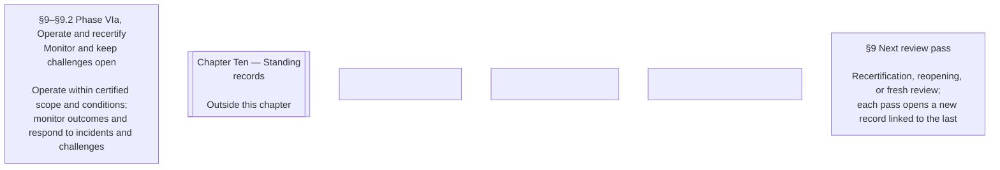
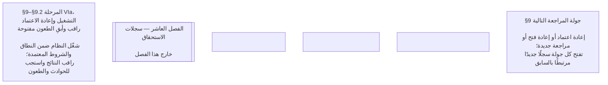

<!-- AI-assisted translation draft; unreviewed. Chapter Nine Part A §1.2 operation and next-review diagram nodes, source lines 177–182; source SHA-256 4311e6ba74b7210f077c0bd4c8d21d8c9f517d2ada7b6d87288b39494dfeadd5. Draft only; do not synchronize into translations/. -->

# Chapter Nine Part A — §1.2 operation and review-cycle nodes (ar)

## English source (lines 177–182)

## ar draft

