# الفصل التاسع، الجزء ب: تصديق مواءمة الأنظمة — إجراءات المنتدى والنتائج

<strong>موضع المتن (غير تشغيلي): بنية الملف وقواعد القراءة</strong>

> هذا الملف **جزء من دستور الكائنات الحساسة** ولا يكون **ملزماً إلا معاً** مع ملفات `core_*` المرقمة الأخرى المقروءة كنص واحد. وهو يتضمن **الفصل التاسع، الجزء ب** — **إجراءات المنتدى** (أدوار المكونات، وتسلسل الإشراف، وسلسلة القابلية للطعن) و**نتائج** التصديق مع بوابة بدء التشغيل (**§6–§7**، استمراراً من الجزء أ §§1–5). يرد **الجزء أ** — الغرض والتأطير (فئة النظام) ومتطلبات التقييم — في [`core_09.000_system_alignment_certification_evaluation.md`](core_09.000_system_alignment_certification_evaluation.md). ويرد **الجزء ج** — **سجل** التصديق ونزاهته، ومسار **الطعن** مع إعادة التصديق وإعادة الفتح، وجسر **المكانة** (**§8–§10**) — في [`core_09.010_system_alignment_certification_record_recertification.md`](core_09.010_system_alignment_certification_record_recertification.md).
>
> - **المالك الدستوري (بالاشتراك مع الجزأين أ وج):** تصديق مواءمة الأنظمة والسجلات ذات الصلة تحت إشراف المنتدى. وفي ضلع **الإشراف** من الرباعية، يمثل SAC عملية تدقيق كبيرة وعالية المخاطر بوجه خاص ضمن عمليات أخرى؛ وتظل حدود التدقيق في **المادة XVI** (*التدقيق والشفافية والتحقق المستقل*) والفصل الخامس [قابلية التدقيق](core_05.050_band_oversight.md#auditability).
> - **مدخلات التقييم:** يقدم [الجزء أ §2](core_09.000_system_alignment_certification_evaluation.md#2-system-class-evaluation) إلى [§5](core_09.000_system_alignment_certification_evaluation.md#5-rights-floor-and-domain-evaluations) مخرجات التقييم التي تراجعها المنتديات وتستند إليها النتيجة.
> - **قاعدة منع نقل المسؤولية:** لا يعيد الجزء ب ذكر آليات تقييم الجزء أ، أو التعريفات المرجعية للفصل الخامس، أو قياس المكانة في الفصل العاشر، أو آثار المكانة في الفصل الحادي عشر. ويرد حد جسر المكانة في [الجزء ج §10](core_09.010_system_alignment_certification_record_recertification.md#10-relationship-to-standing). كما لا ينقل الجزء ب ملكية التدقيق عن **المادة XVI** (*التدقيق والشفافية والتحقق المستقل*) / **Def.O1** / **CJS-5.110 §3 وCJS-5.115 §3** (*موطن عملية التدقيق*)–**CJS-5.110 §5**.
>
> **المنبع:** [الجزء أ](core_09.000_system_alignment_certification_evaluation.md#chapter-nine-part-a-system-alignment-certification--evaluation)؛ [الفصل الثامن](core_08.000_functional_independence_separation_of_duties.md#chapter-eight-functional-independence-and-separation-of-duties) الاستقلال الوظيفي وفصل الواجبات؛ إشراف المنتدى في الفصل الثالث عشر؛ انضباط التحقق في الفصول الثاني إلى الرابع.
> **المصب:** [الجزء ج](core_09.010_system_alignment_certification_record_recertification.md#chapter-nine-part-c-system-alignment-certification--record-recertification-and-standing)؛ سجلات المكانة والمدخلات المتحقق منها في الفصل العاشر؛ آثار المكانة في الفصل الحادي عشر.

<strong>التتبع</strong>

- المنبع:
  - [الجزء أ §1](core_09.000_system_alignment_certification_evaluation.md#1-purpose-and-role) (9.000 §1) (*غرض التصديق ونظرة عامة على العملية*)؛
  - [الجزء أ §2](core_09.000_system_alignment_certification_evaluation.md#2-system-class-evaluation) (9.000 §2) إلى
  - [§5](core_09.000_system_alignment_certification_evaluation.md#5-rights-floor-and-domain-evaluations) (*مخرجات التقييم للسجل*)؛
  - [الفصل الثامن §2 المتطلب الدستوري للمقاعد الأربعة](core_08.000_functional_independence_separation_of_duties.md#2-four-seat-constitutional-requirement) (8.000 §2)؛
  - [الرباعية الدستورية](core_00.000_preamble.md#constitutional-tetrad)؛
  - [الغايتان الدستوريتان](core_00.000_preamble.md#two-constitutional-aims).
- المصب:
  - [§6](#6-forum-process) و
  - [§7](#7-certification-outcomes)؛
  - [الجزء ج §8](core_09.010_system_alignment_certification_record_recertification.md#8-system-certification-record) إلى
  - [§10](core_09.010_system_alignment_certification_record_recertification.md#10-relationship-to-standing) (*السجل وإعادة التصديق وجسر المكانة*)؛
  - [الفصل العاشر](core_11.000_standing_assessment.md#chapter-eleven-contribution-violation-and-standing-model--measurement) (10.000)؛
  - [الفصل الثالث عشر](core_14.000_forum.md#chapter-fourteen-forums-and-jurisdiction) (13.000).
- يُقرأ مع: **[CF-13.415](corpus_forum/cf_14.415_routing_operations_transfer_certification_representative_treatment.md#cf-14415-routing-operations-transfer-certification-and-representative-treatment)** (*توجيه العمليات والنقل والتصديق والمعاملة التمثيلية*) و**[CF-13.425](corpus_forum/cf_14.425_integrity_safeguards_anti_capture_anti_self_judging.md#cf-14425-integrity-safeguards-anti-capture-operations-and-anti-self-judging-support)** (*ضمانات النزاهة وعمليات منع الاستحواذ ودعم منع التحكيم الذاتي*).

 

يتولى الفصل التاسع، **الجزء ب**، المسؤولية الدستورية عن جزأين من تصديق مواءمة الأنظمة:

- **المرحلة الثالثة، المراجعة:** **العملية الخاضعة لإشراف المنتدى** ([§6 إجراءات المنتدى](#6-forum-process))؛ و
- **المرحلة الرابعة، القرار:** **النتائج** ([§7 نتائج التصديق](#7-certification-outcomes)).

ويتابع **الجزء ج** **المرحلة الخامسة، السجل** و**المرحلة السادسة، التشغيل** (إعادة التصديق وإعادة الفتح وجسر المكانة): [الجزء ج §8 سجل تصديق النظام](core_09.010_system_alignment_certification_record_recertification.md#8-system-certification-record)، [§9 إعادة التصديق وإعادة الفتح](core_09.010_system_alignment_certification_record_recertification.md#9-recertification-and-reopening)، و[§10 العلاقة بالمكانة](core_09.010_system_alignment_certification_record_recertification.md#10-relationship-to-standing).

ترد متطلبات التقييم في **[الجزء أ](core_09.000_system_alignment_certification_evaluation.md#chapter-nine-part-a-system-alignment-certification--evaluation)** (**المرحلة الأولى، التأطير**، و**المرحلة الثانية، التقييم**) الذي ينتهي عند [§5 تقييم أرضية الحقوق والمجالات](core_09.000_system_alignment_certification_evaluation.md#5-rights-floor-and-domain-evaluations). ويواصل هذا الجزء الفصل عند **§6** (*إجراءات المنتدى*)، ويواصله الجزء ج عند **§8** (*سجل تصديق النظام*). ويعرض [الجزء أ §1.2 التصديق في لمحة](core_09.000_system_alignment_certification_evaluation.md#12-certification-at-a-glance) العملية كاملة.

*بعبارات مبسطة: يشرح الجزء أ كيفية **تأطير** النظام و**تقييمه**. ويشرح الجزء ب ما يحدث بعد ذلك. تراجع المنتديات النتائج وتتوصل إلى **نتيجة**، ولا يبدأ أي نظام التشغيل قبل اعتماده. ويتناول الجزء ج ما يلي القرار: **السجل** ومسار **الطعن** والحفاظ على سريان التصديق وصلته **بالمكانة**.*

التصديق بموجب هذا الجزء:

- يخضع لإشراف المنتديات ويظل مفتوحاً للطعن بموجب [§6 إجراءات المنتدى](#6-forum-process)، ويفتح مسار الطعن في السجل المنشور بموجب [الجزء ج §9.1 الطعن في شهادة](core_09.010_system_alignment_certification_record_recertification.md#91-challenging-a-certification)؛ و
- ينتهي بنتيجة معلنة بموجب [§7 نتائج التصديق](#7-certification-outcomes)، ولا يبدأ أي نظام التشغيل قبل اعتماده.

تُدرج النتيجة في **سجل تصديق نظام** واحد محدد النطاق بموجب [الجزء ج §8 سجل تصديق النظام](core_09.010_system_alignment_certification_record_recertification.md#8-system-certification-record)، ويُحدّث بموجب [الجزء ج §9 إعادة التصديق وإعادة الفتح](core_09.010_system_alignment_certification_record_recertification.md#9-recertification-and-reopening)، ولا يقدم مدخلات متحققاً منها إلى الفصل العاشر إلا عبر [الجزء ج §10 العلاقة بالمكانة](core_09.010_system_alignment_certification_record_recertification.md#10-relationship-to-standing).

المخطط أدناه هو جزء العمليّة الخاص بالجزأين ب وج من مخطط العملية في [الجزء أ §1.2 التصديق في لمحة](core_09.000_system_alignment_certification_evaluation.md#12-certification-at-a-glance): من **المرحلة الثالثة، المراجعة** إلى **المرحلة السادسة، التشغيل** ([§6 إجراءات المنتدى](#6-forum-process) إلى [الجزء ج §10 العلاقة بالمكانة](core_09.010_system_alignment_certification_record_recertification.md#10-relationship-to-standing)). ويتولى الجزء ب عقدتي المراجعة والقرار ([§6 إجراءات المنتدى](#6-forum-process) و[§7 نتائج التصديق](#7-certification-outcomes)). ويتولى الجزء ج عقد السجل وإعادة التصديق وجسر المكانة ([§8 سجل تصديق النظام](core_09.010_system_alignment_certification_record_recertification.md#8-system-certification-record) إلى [§10 العلاقة بالمكانة](core_09.010_system_alignment_certification_record_recertification.md#10-relationship-to-standing)). يبدأ المخطط من عمل التأطير والتقييم في الجزء أ، وتعود كل جولة مراجعة جديدة إليه عند الموصل A.

```mermaid
flowchart TB
    PA["§2–§5 الجزء أ — المرحلتان I–II<br/><br/>تصنيف النظام وتقييمه؛<br/>وترحيل نتائج التقييم"]
    F["§6 المرحلة الثالثة، المراجعة<br/>مراجعة مستقلة للأدلة<br/>وشواغل أصحاب المصلحة<br/><br/>تصدر المنتديات المعيّنة نتائجها؛<br/>وتظل مسارات الطعن مفتوحة"]
    Rec["§8 المرحلة الخامسة، السجل<br/>سجل تصديق نظام واحد<br/><br/>يفتح لمراجعة المنتدى؛ ويكتمل بالنتيجة،<br/>والنتائج الداعمة والشروط وخطة التشغيل"]
    S[["الفصل العاشر — سجلات<br/>المكانة<br/><br/>خارج هذا الفصل"]]
    O{"§7 المرحلة الرابعة، القرار<br/><br/>ما النتيجة والحالة<br/>اللذان تسندهما الأدلة؟"}
    Fc["§7، §9.2 شهادة كاملة<br/><br/>إعادات تصديق مؤقتة نظيفة متتالية لازمة؛<br/>لا عدم مواءمة قائمة أو وشيكة مؤشّر إليها<br/>مدة تصديق كاملة؛ وقد تنطبق شروط"]
    Pc["§7، §9.2 شهادة مؤقتة<br/><br/>منح أول، أو تعافٍ بعد عدم المواءمة،<br/>أو استمرار/خفض حالة مؤقتة<br/>مدة مؤقتة أقصر؛ وقد تنطبق شروط"]
    Nc["§7 غير معتمد<br/><br/>مؤجل أو مرفوض أو مسحوب أو منقضٍ<br/>لا تشغيل؛ تُذكر الأسباب والعمل التصحيحي"]
    Pub["§7، §9.1 نشر السجل المكتمل<br/><br/>فتح مسار الطعن في السجل المنشور؛<br/>وللنطاق الجديد أو الموسع، تحديد التشغيل والإخطار"]
    G{"§7 بوابة بدء التشغيل<br/><br/>هل استوفي التصديق والمتطلبات<br/>المسبقة المنطبقة للتشغيل؟"}
    Hold["§7 استيفاء متطلبات بدء التشغيل<br/><br/>إكمال الإخطار والتحقق المستقل من<br/>الشروط المطلوبة قبل التشغيل"]
    Rm["§7 الحماية والتصحيح<br/><br/>لا تشغيل جديد في النطاق المتأثر؛<br/>حماية المتأثرين وتصحيح التصميم أو التشغيل،<br/>وتقديم أدلة للتحقق المستقل"]
    Ch["§9–§9.2 المرحلة السادسة أ، التشغيل وإعادة التصديق<br/>المراقبة وإبقاء الطعون مفتوحة<br/><br/>التشغيل ضمن النطاق والشروط المعتمدين؛<br/>ورصد النتائج والاستجابة للحوادث والطعون"]
    S2[["الفصل العاشر — سجلات<br/>المكانة<br/><br/>خارج هذا الفصل"]]
    Re["§9 جولة المراجعة التالية<br/><br/>إعادة التصديق أو إعادة الفتح أو مراجعة جديدة؛<br/>كل جولة تفتح سجلاً جديداً مرتبطاً بالسابق"]
    Sp["&nbsp;&nbsp;&nbsp;&nbsp;&nbsp;&nbsp;&nbsp;&nbsp;&nbsp;&nbsp;&nbsp;&nbsp;&nbsp;&nbsp;&nbsp;&nbsp;&nbsp;&nbsp;&nbsp;&nbsp;&nbsp;&nbsp;&nbsp;&nbsp;&nbsp;&nbsp;&nbsp;&nbsp;&nbsp;&nbsp;&nbsp;&nbsp;&nbsp;"]
    SpL["&nbsp;&nbsp;&nbsp;&nbsp;&nbsp;&nbsp;&nbsp;&nbsp;&nbsp;&nbsp;&nbsp;&nbsp;&nbsp;&nbsp;&nbsp;&nbsp;&nbsp;&nbsp;&nbsp;&nbsp;&nbsp;&nbsp;&nbsp;&nbsp;&nbsp;&nbsp;&nbsp;&nbsp;&nbsp;&nbsp;&nbsp;&nbsp;&nbsp;&nbsp;&nbsp;"]
    SpA["&nbsp;&nbsp;&nbsp;&nbsp;&nbsp;&nbsp;&nbsp;&nbsp;&nbsp;&nbsp;&nbsp;&nbsp;&nbsp;&nbsp;&nbsp;&nbsp;&nbsp;&nbsp;&nbsp;&nbsp;&nbsp;&nbsp;&nbsp;&nbsp;&nbsp;&nbsp;&nbsp;&nbsp;&nbsp;&nbsp;&nbsp;&nbsp;&nbsp;&nbsp;&nbsp;&nbsp;&nbsp;&nbsp;&nbsp;&nbsp;&nbsp;&nbsp;&nbsp;&nbsp;&nbsp;"]
    A1((A)) --> PA
    PA --> F
    F --> O
    O --> Fc
    O --> Pc
    O --> Nc
    Fc --> Rec
    Pc --> Rec
    Nc --> Rec
    Rec -.->|VIb، §10 —<br/>مدخلات متحقق منها فقط؛<br/>التصديق الحالي أو الوقائع<br/>الناشئة أثناء التصديق| S
    Rec --> Pub
    Rec ~~~ Sp
    Pub --> G
    G ~~~ SpL
    G -->|غير معتمد| Rm
    G --->|نعم: التشغيل<br/>ضمن السجل| Ch
    G --->|معتمد،<br/>المتطلبات لم تستوف بعد| Hold
    Hold --> G
    Ch -->|عيب جوهري:<br/>احمِ وصحّح| Rm
    Ch -->|حسب الجدول، أو<br/>تغيير جوهري أو<br/>طعن موثوق<br/>يستلزم المراجعة| Re
    Ch -.->|VIb، §10 —<br/>مدخلات متحقق منها فقط؛<br/>قد يمد التشغيل سجلات<br/>المساهمة والمخالفة بالوقائع| S2
    Rm -->|تُفحص أدلة التصحيح<br/>في جولة المراجعة<br/>التالية| Re
    S2 ~~~~ SpA
    SpA ~~~ Re
    Re --> A2((A))
    style Sp fill:none,stroke:none,color:#111111
    style SpL fill:none,stroke:none,color:#111111
    style SpA fill:none,stroke:none,color:#111111
    style PA fill:none,stroke:#16a34a,color:#ffffff
    style Ch fill:none,stroke:#16a34a,color:#ffffff
    style F fill:none,stroke:#ea580c,color:#ffffff
    style Rec fill:none,stroke:#2563eb,color:#ffffff
    style S fill:none,stroke:#db2777,color:#ffffff
    style S2 fill:none,stroke:#db2777,color:#ffffff
    style O fill:none,stroke:#ea580c,color:#ffffff
    style Fc fill:none,stroke:#9333ea,color:#ffffff
    style Pc fill:none,stroke:#9333ea,color:#ffffff
    style Nc fill:none,stroke:#9333ea,color:#ffffff
    style G fill:none,stroke:#ea580c,color:#ffffff
    style Pub fill:none,stroke:#2563eb,color:#ffffff
    style Rm fill:none,stroke:#9333ea,color:#ffffff
    style Hold fill:none,stroke:#16a34a,color:#ffffff
    style Re fill:none,stroke:#16a34a,color:#ffffff
    style A1 fill:none,stroke:#64748b,color:#ffffff
    style A2 fill:none,stroke:#64748b,color:#ffffff
```

### 6. عملية المنتدى

<strong>التتبع</strong>

- المنبع:
  - [الجزء A §3 تقييم التصديق على النظام بأكمله](core_09.000_system_alignment_certification_evaluation.md#3-whole-system-certification-evaluation) (9.000 §3)،
  - [§4 التقييمات عند الاقتضاء](core_09.000_system_alignment_certification_evaluation.md#4-evaluations-where-implicated)، و
  - [§5 تقييمات أرضية الحقوق والمجالات](core_09.000_system_alignment_certification_evaluation.md#5-rights-floor-and-domain-evaluations) (*نتائج التقييم التي تراجعها المنتديات*)؛
  - [الفصل الثامن §2 المتطلب الدستوري للمقاعد الأربعة](core_08.000_functional_independence_separation_of_duties.md#2-four-seat-constitutional-requirement) (8.000 §2)، و
  - [§9 العلاقة بالعمليات اللاحقة](core_08.000_functional_independence_separation_of_duties.md#9-relationship-to-later-processes) (*المقاعد الأربعة وواجب بيان كيفية استخدام التصديق لها؛ ويُطبّق في
  - [§6.1.1](#611-four-seats-in-a-certification)*);
  - [خريطة أدوار المواثيق](core_05.040_band_continuity.md#charter-role-map) (*مواضع المقاعد المخصصة للتصديق*)؛
  - [الفصل الثالث عشر §4](core_14.000_forum.md#4-forum-family-definitions--accountability-through-adjudication) (13.000 §4) (*أسر المنتديات، وتصديق المواءمة بقيادة النزاهة، والإحالة إلى المكوّنات، والتحقق*)؛
  - [الفصل الثالث عشر §3](core_14.000_forum.md#3-transfer-consolidation-and-coordination--continuity-and-anti-capture) (13.000 §3) (*تنسيق المواءمة بقيادة النزاهة ومنع الحكم الذاتي*)؛ وأسرة قياس حسن التوقيت (*الحل في وقته والانضباط المضاد للتأخير*)؛
  - [الرباعية الدستورية](core_00.000_preamble.md#constitutional-tetrad) — **المشاركة** و**الرقابة** و**المساءلة** و**حسن التوقيت**؛
  - [قابلية الطعن](core_05.035_band_accountability.md#contestability).
- المصب:
  - [§7](#7-certification-outcomes) (*النتائج وبوابة بدء التشغيل*)؛
  - [الجزء C §8](core_09.010_system_alignment_certification_record_recertification.md#8-system-certification-record) (*محتوى السجل ونزاهته*)؛
  - [الجزء C §9](core_09.010_system_alignment_certification_record_recertification.md#9-recertification-and-reopening) (*إعادة التصديق وإعادة الفتح ومسار الطعن*)؛
  - [الجزء C §10](core_09.010_system_alignment_certification_record_recertification.md#10-relationship-to-standing) (*بوابة المدخلات المتحقق منها*)؛
  - [الفصل الثالث عشر §5](core_14.000_forum.md#5-escalation-and-certification) (13.000 §5) (*التصعيد بين الأسر والتصديق الدستوري*).
- يُقرأ مع:
  - [ترتيب النزاعات](core_14.000_forum.md#dispute-sequencing) بموجب الفصل الثالث عشر §1؛
  - [الديباجة §3.3](core_00.000_preamble.md#33-governance-layers)؛
  - **CF-13.415** (*توجيه العمليات والنقل والتصديق والمعاملة التمثيلية*)؛
  - **CF-13.425** (*ضمانات النزاهة ومكافحة الاستيلاء ودعم منع الحكم الذاتي*)؛ و
  - **CF-13.440** (*منتديات الاختصاصيين التقنيين وغرف الاختصاص*)؛
  - [المادة XIII-A](core_06.010_rights_part_c.md#article-xiii-a-reliability-and-trustworthiness-baseline) (*أرضية الموثوقية والجدارة بالثقة*)، و
  - [المادة XIII-B](core_06.010_rights_part_c.md#article-xiii-b-right-to-redress-and-remedy) (*الحق في جبر الضرر والانتصاف*).
- الأقسام الفرعية:
  - [§6.1](#61-forum-supervision-and-component-roles) (*أدوار مكوّنات المنتدى*، وتشمل
  - [§6.1.1 المقاعد الأربعة في التصديق](#611-four-seats-in-a-certification) و
  - [§6.1.2 المنتديات التقنية](#612-technical-forums) إلى
  - [§6.1.7 الأسر الدستورية وغيرها من أسر المنتديات العادية](#617-constitutional-and-other-regular-forum-families)، دورًا لكل أسرة منتديات)؛
  - [§6.2](#62-supervisory-sequence) (*تسلسل الإشراف*، ويشمل
  - [§6.2.1 مسار الطعن أولًا](#621-challenge-path-first)،
  - [§6.2.2 التسلسل الافتراضي](#622-default-sequence)،
  - [§6.2.3 الحماية العاجلة](#623-urgent-protection)، و
  - [§6.2.4 المشاركة أثناء المراجعة](#624-participation-during-review))؛
  - [§6.3](#63-contestability-chain) (*سلسلة قابلية الطعن*)؛
  - [§6.4](#64-anti-bypass) (*منع التجاوز*)؛ ويُقرأ مع
  - [الجزء C §9.1](core_09.010_system_alignment_certification_record_recertification.md#91-challenging-a-certification) (*الطعن في التصديق*)، و
  - [الجزء C §9.1.1](core_09.010_system_alignment_certification_record_recertification.md#911-contestability-paths) (*مسارات قابلية الطعن*).

 

*بعبارات بسيطة: التصديق ليس كومة آراء من زوايا متفرقة. يمكن أن يجري التقييم بالتوازي، لكن السجل ينتقل من هنا بالترتيب: المراجعة، ثم القرار، ثم السجل المنشور. تتولى كل فئة من المنتديات جزءًا محددًا من المراجعة، ويجمع منتدى قائد واحد هذه الأجزاء. ويمكن للأطراف المتأثرة الطعن على المستوى الذي يقع فيه النزاع، من دون الضياع في البيروقراطية الداخلية أو التنقل بين المنتديات بلا نتيجة.*

هذا القسم هو **المرحلة الثالثة، المراجعة**. وهو يحدد **تسلسل الإشراف** الدستوري (الترتيب الذي تشرف به المنتديات على سجل التصديق) و**سلسلة قابلية الطعن** (مسارات الطعن فيه، بما يلائم موضع نشوء النزاع).

بالنسبة إلى الأنظمة ذات الأثر المادي، تلزم عملية يشرف عليها منتدى بموجب الفصل الثالث عشر كلما اتخذ منتدى إجراءً بشأن تصديق. ويقع هذا العمل ضمن المراحل الآتية:

- **المرحلة الثالثة، المراجعة** (هذا القسم): مراجعة مستقلة للأدلة وشواغل أصحاب المصلحة في كل مرور؛
- **المرحلة الرابعة، القرار** ([§7 نتائج التصديق](#7-certification-outcomes)): النتيجة. وهي تصديق المواءمة الدستورية الرسمي (مؤقت أو كامل، بشروط أو من دونها)، أو التأجيل، أو **عدم التصديق**، أو **السحب**، أو الإعفاء من الشروط؛
- **المرحلة الخامسة، السجل** ([الجزء C §8 سجل التصديق على النظام](core_09.010_system_alignment_certification_record_recertification.md#8-system-certification-record)): استكمال سجل التصديق الواحد ونشره؛ و
- **المرحلة السادسة-أ، التشغيل وإعادة التصديق** ([الجزء C §9 إعادة التصديق وإعادة الفتح](core_09.010_system_alignment_certification_record_recertification.md#9-recertification-and-reopening)): **إعادة التصديق** و**التحقق** من نظام قائم والمراجعة المعاد فتحها أو الجديدة. ويبدأ كل منها مرورًا جديدًا يعود إلى المرحلة الأولى.

ينهي انتهاء المدة التصديق بحكم الساعة. ولا يتطلب إجراءً من المنتدى، لكنه يظل مسجلًا في [الجزء C §8 سجل التصديق على النظام](core_09.010_system_alignment_certification_record_recertification.md#8-system-certification-record).

بموجب [الرباعية الدستورية](core_00.000_preamble.md#constitutional-tetrad):

- يضع تسلسل الإشراف **الرقابة** و**المساءلة** موضع التطبيق عبر أسر المنتديات؛ و
- تضع سلسلة قابلية الطعن **المشاركة** و**حسن التوقيت** موضع التطبيق، كي تتمكن الكائنات الواعية المتأثرة من الطعن في التصديق قبل أن يصبح اعتمادها غير قابل للعكس على الأنظمة التي تتحكم في ضروريات البقاء أو التعليم أو السلامة.

تظل تفاصيل إجراءات المنتدى ضمن طبقة المالك **المنتديات والاختصاص** ([الفصل الثالث عشر](core_14.000_forum.md#chapter-fourteen-forums-and-jurisdiction)). وتُحال التفاصيل التشغيلية إلى **[CS-9.315](corpus_systems/cs_09.315_system_alignment_certification_run_sheet.md#cs-9315-system-alignment-certification-run-sheet)** (*ورقة تشغيل تصديق مواءمة النظام*) والقواعد النظامية التي تحيل إليها، وفق [الديباجة — سجل المالك الدستوري](core_00.000_preamble.md#4-principles-definitions-and-rights) و[تراتب السلطة الداخلي](core_05.045_band_integrative.md#owner-non-relocation).

#### 6.1 إشراف المنتدى وأدوار المكوّنات

*بعبارات بسيطة: يتطلب التصديق بأن نظامًا يفي بالمواءمة الدستورية فحصًا مستقلًا للأدلة ولشواغل أصحاب المصلحة. وتتولى أنواع مختلفة من المنتديات أجزاءً محددة من هذا العمل. ويمكن للكائنات الواعية المتأثرة تقديم أدلة والطعن في المراجعة قبل نشر النتيجة، عبر مسارات الطعن الخاصة بالمكوّنات والنزاهة. ولا تستطيع جهة تخصصية واحدة إدارة العملية كلها بمفردها، حتى المراجعة التقنية أو تنسيق النزاهة.*

#### 6.1 إشراف المنتدى وأدوار المكوّنات

*بعبارات بسيطة: يتطلب التصديق بأن نظامًا يفي بالمواءمة الدستورية فحصًا مستقلًا للأدلة ولشواغل أصحاب المصلحة. وتتولى أنواع مختلفة من المنتديات أجزاءً محددة من هذا العمل. ويمكن للكائنات الواعية المتأثرة تقديم أدلة والطعن في المراجعة قبل نشر النتيجة، عبر مسارات الطعن الخاصة بالمكوّنات والنزاهة. ولا تستطيع جهة تخصصية واحدة إدارة العملية كلها بمفردها، حتى المراجعة التقنية أو تنسيق النزاهة.*

يحدد هذا القسم **دور المكوّن** لكل أسرة منتديات في تصديق مواءمة النظام. ويشمل ذلك كل مرور للتصديق أو التحقق أو إعادة التصديق، بما في ذلك المرور الذي ينتهي بالسحب أو عدم التصديق، والسجلات ذات الصلة بموجب [الجزء C §8 سجل التصديق على النظام](core_09.010_system_alignment_certification_record_recertification.md#8-system-certification-record). وتغذي تلك الأدوار تسلسل الإشراف في [§6.2 تسلسل الإشراف](#62-supervisory-sequence). وتظل التعريفات الكاملة للمنتديات وتفاصيل التوجيه في [الفصل الثالث عشر](core_14.000_forum.md#chapter-fourteen-forums-and-jurisdiction) و[CF-13.405](corpus_forum/cf_14.405_forum_formation_chamber_structure.md#cf-14405-forum-formation-forum-structure-mapping-and-chamber-structure) (*تشكيل المنتدى ورسم بنية المنتدى وبنية الغرف*) و[CF-13.415](corpus_forum/cf_14.415_routing_operations_transfer_certification_representative_treatment.md#cf-14415-routing-operations-transfer-certification-and-representative-treatment) (*توجيه العمليات والنقل والتصديق والمعاملة التمثيلية*). وهنا، لا تحصل كل أسرة إلا على دورها المحدود في إعداد سجل التصديق أو الإشراف عليه أو الطعن فيه، ولا تستولي أي أسرة على عمل يعود إلى غيرها.

##### 6.1.1 المقاعد الأربعة في التصديق

تبيّن هذه الفقرة كيفية تطبيق الفصل التاسع لـ[الفصل الثامن §2 المتطلب الدستوري للمقاعد الأربعة](core_08.000_functional_independence_separation_of_duties.md#2-four-seat-constitutional-requirement). ويتطلب [الفصل الثامن §9 العلاقة بالعمليات اللاحقة](core_08.000_functional_independence_separation_of_duties.md#9-relationship-to-later-processes) من كل عملية لاحقة أن تبيّن كيف تعيّن المقاعد الأربعة كلها وتستخدمها؛ وهذه الفقرة هي بيان ذلك بالنسبة إلى التصديق. فالتصديق [فعل ملزم ماديًا](core_05.035_band_accountability.md#materially-binding-act)، ولذلك يكون لكل مرور المقاعد الأربعة التي يعرّفها الفصل الثامن، وبالأسماء التي يحددها. لا تضيف هذه الفقرة مقعدًا ولا تخفف أي قاعدة من قواعد الفصل الثامن. وقد تكون قواعد أخرى في هذا الفصل أشد، ولا يجوز أن تكون أضعف.

تُشغل المقاعد في فعل التصديق على النحو الآتي:

- **[مقعد المبادرة](core_05.035_band_accountability.md#initiating-seat):** مشغّل النظام أو أمينه أو مورّده أو أي مقترح آخر يطلب التصديق. فهو يطلبه أو يشغّل النظام أو يدّعي مواءمته.
- **[مقعد التحقق أو الإذن](core_05.035_band_accountability.md#verify-or-authorize-seat):** المنتدى أو سلطة المكوّن المحدودة التي تتحقق من الأدلة والسلطة وفق المعيار الحاكم وتصدر نتيجتها ضمن اختصاصها.
- **[مقعد السجل](core_05.035_band_accountability.md#record-seat):** المكتب الذي يفتح سجل التصديق المنسق ويدوّن فيه ويعدّله ويحفظه وينشره. ويكون ذلك السجل سجل الفعل الخاص بفعل التصديق (انظر [الجزء C §8.1 الحد الأدنى لمحتوى السجل](core_09.010_system_alignment_certification_record_recertification.md#81-minimum-record-contents)).
- **[مقعد الطعن](core_05.035_band_accountability.md#contest-seat):** مسار الطعن المنشور في السجل، مع منتدى المراجعة المختص أو الاحتياطي للفعل المطعون فيه (انظر [الجزء C §9.1.1 مسارات قابلية الطعن](core_09.010_system_alignment_certification_record_recertification.md#911-contestability-paths)).

**مواضع المقاعد:**

- تحدد [خريطة أدوار ميثاق النظام](core_05.040_band_continuity.md#charter-role-map) مواضع مقاعد المبادرة والسجل والطعن للتصديق. وتدرج لكل منها المكاتب المؤهلة والأمناء المخوّلين حاليًا بشغلها والبديل.
- يقع مقعدا السجل والطعن اللذان تسميهما الخريطة خارج [خط السيطرة المادية](core_05.035_band_accountability.md#material-control-line) للمشغّل والمقترح.
- لا تحدد الخريطة موضع مقعد التحقق أو الإذن. ويُعيّن المنتدى القائد وسلطات المكوّن بموجب [§6.2 تسلسل الإشراف](#62-supervisory-sequence) والفصل الثالث عشر، لذلك لا يستطيع المشغّل اختيار سلطة التحقق الخاصة به.
- يسمّي سجل التصديق على النظام إصدار خريطة أدوار الميثاق الساري في كل مرور (انظر [الجزء C §8.1 الحد الأدنى لمحتوى السجل](core_09.010_system_alignment_certification_record_recertification.md#81-minimum-record-contents)).
- المقعد الذي لا تحدد الخريطة موضعه عيب في ميثاق النظام يجب تسجيله وتصحيحه؛ ويتبع المرور ما يقرره [الفصل الثامن §5 التحديد المنشور والخلاء والاستبدال](core_08.000_functional_independence_separation_of_duties.md#5-published-placement-vacancy-and-substitution).

**خارج سيطرة المشغّل.** يجب أن يكون كل من يشغل مقعد التحقق أو الإذن في تصديق خارج [خط السيطرة المادية](core_05.035_band_accountability.md#material-control-line) للمشغّل والمقترح، وألا تكون له مصلحة يحسمها الناتج. وعلى وجه الخصوص:

- لا يجوز للمشغّل أو الأمين أو المورّد أو أي مقترح آخر أن يختار أو يعيّن أو يمول عبر قناة يسيطر عليها أو يعزل المنتدى أو سلطة المكوّن التي تتحقق منه.
- لا يجوز لمن يعمل لدى المقترح أو يكون مملوكًا له أو مسؤولًا أمامه أن يشغل ذلك المقعد في تصديقه.
- على الكائن الواعي الذي لا يستطيع استيفاء ذلك أن يتنحى عن ذلك المرور (التنحي بموجب الفصل الثالث عشر).
- التعيين المخالف لذلك غير صالح، أيًا كان ما تقوله خريطة أدوار الميثاق ([الفصل الثامن §3 الاستقلال والتعارض وخطوط السيطرة](core_08.000_functional_independence_separation_of_duties.md#3-independence-conflict-and-control-lines)).

يجوز لأسرة منتديات أن تشغل مقاعد مختلفة في أفعال مختلفة. ولا يجوز لها استخدام اسم الأسرة لدمج مقاعد يحظر [الفصل الثامن §2 المتطلب الدستوري للمقاعد الأربعة](core_08.000_functional_independence_separation_of_duties.md#2-four-seat-constitutional-requirement) دمجها في الفعل نفسه.

**المنتدى القائد وحائز السجل:**

- يشغل المنتدى القائد مقعد التحقق أو الإذن بالنسبة إلى الناتج؛ ويشغله كل منتدى أو سلطة تصدر نتيجة مكوّن بالنسبة إلى تلك النتيجة.
- يوجّه المنتدى القائد التسلسل، لكنه لا يشغل مقعد السجل في الفعل نفسه.
- يفتح حائز السجل المسمّى في خريطة أدوار الميثاق السجل ويعدّله ويحفظه وينشره. ويدوّن ما قررته المنتديات صاحبة القرار ولا يقرر شيئًا بنفسه.
- إن واجب «السجل المنسق الواحد» في الفصل الثالث عشر هو واجب المنتدى القائد في تنسيق السجل، لا الاحتفاظ به.

##### 6.1.2 المنتديات التقنية

**الجانب التقني:**

- تحافظ على المواصفات التقنية وطرق القياس وبروتوكولات الاختبار ومعايير الأدلة الخبيرة وطرق تقليل عدم اليقين ونتائج الكفاية التقنية وتطبّقها، ضمن نطاقها المشروع؛
- تقدم **نتائج المكوّنات** لسجل التصديق، ومنها نتائج الضمان المتناسب مع فئة النظام وبنية معالجة البيانات بموجب [§2 تقييم فئة النظام](core_09.000_system_alignment_certification_evaluation.md#2-system-class-evaluation) و[§3.4 تقييم أنواع البيانات ومعالجتها](core_09.000_system_alignment_certification_evaluation.md#34-data-types-and-handling-evaluation)؛
- تجيب عن الأسئلة التقنية التي يحيلها إليها المنتدى القائد لإدراجها في سجل التصديق، وفق ما يسمح به [الفصل الثالث عشر §4.2 مجالات المنتديات التقنية](core_14.000_forum.md#42-technical-forum-domains)؛
- تقدم نتائج مكوّن بشأن معلومات الصحة والسلامة حين يقدّم النظام منتجات أو خدمات قد تؤثر في الجسد أو الصحة أو السلامة أو يسردها أو يوصي بها أو يقدم المشورة بشأنها. ويختبر [§5.6 تقييم الجدارة بالثقة ونزاهة الاعتماد على النظام](core_09.000_system_alignment_certification_evaluation.md#56-trustworthiness-and-system-reliance-integrity-evaluation) ذلك بموجب **المادة III-F** (*المنتجات الآمنة والمعلومات الصحية*). وتحدد النتيجة التقنية ما إذا كانت التحذيرات والادعاءات الصحية والحقائق الغذائية والمكونات ومعلومات مسببات الحساسية دقيقة ومدعومة بالأدلة ومحدّثة، وما إذا كانت توضح صراحة ما هو مجهول أو غير مختبر؛ و
- تشغل دور مكوّن [البتّ في حالة الإحساس](core_05.055_band_participation.md#sentience-status-adjudication) (تقييم المؤشرات والأدلة الخبيرة وعدم اليقين المحدود):
  - ينطبق ذلك عندما يؤثر التصديق ماديًا فيمن يُعد **كائنًا واعيًا** لأغراض الحقوق أو الوضعية أو الحماية، بما يتسق مع [المادة VI-B](core_06.005_rights_part_b.md#article-vi-b-sentience-status-adjudication-floor) (*أرضية البتّ في حالة الإحساس*).
  - تكون المنتديات التقنية هي القائد الافتراضي بموجب [الفصل الثالث عشر §4.2 مجالات المنتديات التقنية](core_14.000_forum.md#42-technical-forum-domains) وخطاف [الفصل الثالث عشر §5 التصعيد والتصديق](core_14.000_forum.md#5-escalation-and-certification) (*البتّ في حالة الإحساس*).
  - وحيثما يقتضي الفصل الثالث عشر، تحيل المسألة إلى المسارات الخاصة بالنزاهة أو المؤسسية أو الدستورية بموجب ذلك الخطاف.

##### 6.1.3 منتديات النزاهة

**التنسيق القيادي الافتراضي:**

- تقود التصديق الرسمي على المواءمة الدستورية والتحقق المستمر من المواءمة، ما لم يعيّن الفصل الثالث عشر رهانًا أوليًا مختلفًا؛
- تستخدم معايير المنتديات التقنية حيث تكون منطبقة ماديًا؛ و
- تحيل أسئلة المكوّنات التي تخص أسر منتديات أخرى أو تصدر بشأنها تصديقًا أو [توقف](core_05.035_band_accountability.md#stay) (تعلّقها)، كما يقتضي [§6.2 تسلسل الإشراف](#62-supervisory-sequence).

##### 6.1.4 منتديات البيئة

**المواءمة البيئية حين تكون البيئة ذات صلة:**

- تشغل دور مكوّن المواءمة البيئية عند وجود تعرض بيئي مادي أو اعتماد على شروط بيئية مسبقة أو عبء لدورة الحياة أو واجب استعادة أو خطر بيئي متوقع على نحو معقول؛ و
- تدرج إسناد [البصمة البيئية](core_05.040_band_continuity.md#ecological-footprint) والإفصاح عنها ومقارنتها بموجب [§5.1 تقييم البصمة البيئية](core_09.000_system_alignment_certification_evaluation.md#51-ecological-footprint-evaluation) حين تكون الأعباء البيئية القابلة للإسناد مادية.

##### 6.1.5 منتديات الكائنات الواعية

حين يؤثر نظام ماديًا في كيفية إدارة جماعة لشؤونها، تقوم منتديات الكائنات الواعية بما يلي:

- تقديم **نتائج حوكمة الجماعة** بشأن اتباع قرارات النظام لإجراءات الجماعات المنشورة، وإتاحة الاستماع إلى الأعضاء المتأثرين والطعن لهم، واستيفاء اختبارات الجزء A المنطبقة ([§4.3 التجمع والتنظيم الجماعي وتشكيل المؤسسات](core_09.000_system_alignment_certification_evaluation.md#43-assembly-collective-organization-and-institutional-formation)، و[§5.3 تقييم الدعم المتناسب عبر الأنظمة](core_09.000_system_alignment_certification_evaluation.md#53-proportionate-cross-system-support-evaluation)، و[§5.4 تقييم عدم التمييز](core_09.000_system_alignment_certification_evaluation.md#54-nondiscrimination-evaluation)). ويشمل ذلك العضوية والإقصاء والإشراف والوصول إلى إجراءات الجماعة المشتركة والمدخلات التشاركية واستخدام المشاعات، بصرف النظر عمن يشغّل النظام ([الفصل الثالث عشر §4.1 منتديات الكائنات الواعية](core_14.000_forum.md#41-sentient-forums) يصف هذه المسائل)؛
- شغل مكوّن أرضية الحقوق في الرهانات على مستوى الجماعة، مثل الإقصاء أو الوصول إلى إجراءات الجماعة المشتركة أو استخدام المشاعات. وتشغل المنتديات المؤسسية أسئلة أرضية الحقوق الأوسع بموجب [§6.1.6 المنتديات المؤسسية](#616-institutional-forums). وحين لا تشغل أي أسرة ذلك المكوّن، يطبّق قائد النزاهة أرضيات الحقوق مستعينًا بنتائج المكوّنات الأخرى؛
- الخضوع للمنتدى المؤسسي إذا تعارضت نتائجها بشأن أرضية الحقوق، لأن للمنتدى المؤسسي القول الفصل في ذلك المرور. وتظل النتيجتان في السجل بموجب [§6.2 تسلسل الإشراف](#62-supervisory-sequence)، ويظل التعارض مفتوحًا للطعن بموجب [§6.3 سلسلة قابلية الطعن](#63-contestability-chain)؛
- سماع الطعون المحصورة في نتيجة حوكمة جماعية (مسار منتدى المكوّن بموجب [§6.3 سلسلة قابلية الطعن](#63-contestability-chain))، وتلقي الأدلة والشواغل على مستوى الجماعة من الأعضاء المتأثرين أثناء المراجعة، كجزء من واجب المشاركة على المنتديات المعيّنة بموجب [§6.2 تسلسل الإشراف](#62-supervisory-sequence)؛ و
- النظر في الانتصاف والاستعادة بين الكائنات الواعية بعد أن يخلص المرور إلى وقوع ضرر بأعضاء الجماعة، بموجب [الفصل الثالث عشر §4.1 منتديات الكائنات الواعية](core_14.000_forum.md#41-sentient-forums). وهذا يأتي بعد المرور ولا ينشئ مسارًا ثانيًا للفصل في الموضوع.

##### 6.1.6 المنتديات المؤسسية

عندما تكون مؤسسة معنية، تقوم المنتديات المؤسسية بما يلي:

- تقديم نتائج المكوّن بشأن ما يُسمح للمؤسسة أن تفعله وما هي مكلّفة به، ونطاق الإشراف عليها، وكيفية تصنيفها، وما إذا كانت تفي بواجباتها، متى ظهرت هذه المسائل في التصديق؛ و
- تقرير ما إذا كان التصديق سيحفظ الأرضيات المحمية دستوريًا أم يهزمها. وينطبق ذلك حين تكون تلك الأرضيات ذات صلة مادية ويتحقق أي مما يلي: أن تكون المؤسسة طرفًا لازمًا؛ أو أن يكون المشغّل أو الأمين مؤسسيًا؛ أو أن يكون التفويض المؤسسي أو الامتثال الخاضع للإشراف هو الرهان الأساسي. والأرضيات هي أرضيات الحقوق في الفصل السادس الواردة بجدول [الجزء A §5 تقييمات أرضية الحقوق والمجالات](core_09.000_system_alignment_certification_evaluation.md#5-rights-floor-and-domain-evaluations). ويتضمن القرار التقييم بموجب قسم المجال المطابق حيث ينطبق محفّزه. وهذه الأرضيات هي:
  - **المادة III-A** (*البقاء*)؛
  - **المادة IV-A** (*تكافؤ الوصول إلى التعليم*)؛
  - **المادة IV** (*الحق في تعليم متمحور حول الكائن الواعي*)؛
  - **المادة V** (*تخصيص الموارد والاعتماد وتمويل النظم البيئية*)؛
  - **المادة VI-C** (*عدم التمييز*)؛
  - **المادة VI-D** (*إمكانية الوصول*)؛
  - **المادة XIII** (*الحق في أنظمة موثوقة وجديرة بالثقة*)؛ و
  - **المادة XIII-A** (*أرضية الموثوقية والجدارة بالثقة*) مع [**الشروط الآمنة**](core_05.040_band_continuity.md#safe-conditions).

##### 6.1.7 الأسر الدستورية وغيرها من أسر المنتديات العادية

**الرهانات الدستورية والمتبقية:**

- تحتفظ بالمسائل التي يسندها إليها الفصل الثالث عشر: هل النص الدستوري صحيح، وما معناه، وهل يلزم إصلاح يشمل فئة كاملة إعادة هيكلة الحوكمة، إلى جانب أي مسألة أخرى يجعل الفصل الثالث عشر رهانها الأساسي من اختصاص أسرة لم تذكر أعلاه؛
- تجيب عن الأسئلة الدستورية التي يحيلها إليها المنتدى القائد بموجب [الفصل الثالث عشر §5 التصعيد والتصديق](core_14.000_forum.md#5-escalation-and-certification): مسألة صحة، أو مسألة بنيوية بشأن إعادة هيكلة الحوكمة، أو تعارض بين هيئات أدنى بشأن نقطة دستورية. وإلى أن تجيب، لا يجوز للمنتدى القائد اعتبار تلك النقطة محسومة نهائيًا ([§6.2 تسلسل الإشراف](#62-supervisory-sequence)، الخطوة 5)؛ و
- لا يجوز للخبرة التقنية أو تنسيق النزاهة الاستيلاء على تلك المسائل.

#### 6.2 تسلسل الإشراف

*بعبارات بسيطة: **الوقف** تعليق مؤقت. فهو يؤجل الموافقة النهائية أو الاعتماد أو خطوة المراجعة التالية إلى أن ينهي المنتدى المختص مراجعته. والوقف ليس نعمًا نهائية ولا لا نهائية.*

##### 6.2.1 مسار الطعن أولًا

قبل أن يقرّ أي منتدى سجل تصديق، يجب أن يسمّي السجل [مسار الطعن المنشور للسجل](core_09.010_system_alignment_certification_record_recertification.md#911-contestability-paths) بموجب [الجزء C §9.1 الطعن في التصديق](core_09.010_system_alignment_certification_record_recertification.md#91-challenging-a-certification). ويعني ذلك بيان الجهة التي تتلقى الطعون، وكيفية تقديمها، ومهلها. يُفتح المسار عند نشر النتيجة. وإذا كان النظام قيد التشغيل بالفعل، فيكون المسار مفتوحًا أصلًا (انظر [الجزء C §9.1.1 مسارات قابلية الطعن](core_09.010_system_alignment_certification_record_recertification.md#911-contestability-paths)). ولا يجوز إقرار سجل لا يسمّي المسار. كما لا يجوز لنظام له أصحاب مصلحة أن يحتفظ بالتصديق من دون مسار مفتوح قابل للطعن، أيًا كانت نتائج المكوّنات.

##### 6.2.2 التسلسل الافتراضي

**تسلسل الإشراف** هو الترتيب خطوة بخطوة الذي تشرف بموجبه المنتديات على سجل التصديق. وقد يقتضي الفصل الثالث عشر ترتيبًا قانونيًا مختلفًا عند انطباق الرهانات الأولية أو الحماية من الحكم الذاتي أو توجيه التصديق. وفي غير ذلك يكون التسلسل الافتراضي كما يلي:

1. **التنسيق القيادي:** يقود منتدى **النزاهة** كل مرور للتصديق الرسمي على المواءمة الدستورية أو التحقق أو إعادة التصديق، بما في ذلك المرور الذي ينتهي بالسحب أو عدم التصديق. ويوجّه حائز مقعد السجل (انظر [§6.1 إشراف المنتدى وأدوار المكوّنات](#61-forum-supervision-and-component-roles)) إلى فتح سجل التصديق المنسق الواحد لذلك المرور، ويتولى حائز مقعد السجل صيانته. ويُستكمل السجل المفتوح هنا في المرحلة الخامسة (انظر الخطوة 6). والاستثناء هو الحالات التي يعيّن فيها الفصل الثالث عشر قائدًا مشروعًا مختلفًا للرهان الأولي.
2. **نتائج المكوّنات:** تصدر كل أسرة منتديات تقنية أو بيئية أو مؤسسية أو للكائنات الواعية أو دستورية أو معيّنة أخرى نتائج مكوّن محدودة ضمن اختصاصها المشروع:
   - تقدم **المنتديات التقنية** المواصفات والطرق والاختبارات ونتائج الكفاية التقنية. ويشمل ذلك نتائج المكوّن الخاصة بـ[البتّ في حالة الإحساس](core_05.055_band_participation.md#sentience-status-adjudication) حيث يعيّن [§6.1 إشراف المنتدى وأدوار المكوّنات](#61-forum-supervision-and-component-roles) ذلك الرهان؛
   - تقدم **منتديات البيئة** نتائج مكوّن المواءمة البيئية المطلوبة عند وجود تعرض بيئي مادي. ويشمل ذلك تقييم [البصمة البيئية](core_05.040_band_continuity.md#ecological-footprint) بموجب [§5.1 تقييم البصمة البيئية](core_09.000_system_alignment_certification_evaluation.md#51-ecological-footprint-evaluation) حين تكون الأعباء البيئية القابلة للإسناد مادية؛
   - تقدم **المنتديات المؤسسية** نتائج مكوّن التفويض المؤسسي وأرضية الحقوق المطلوبة حيث يعيّن [§6.1 إشراف المنتدى وأدوار المكوّنات](#61-forum-supervision-and-component-roles) تلك الرهانات؛
   - تقدم **منتديات الكائنات الواعية** نتائج حوكمة الجماعة حيث يؤثر النظام ماديًا في طريقة إدارة الجماعة لشؤونها، ومكوّن أرضية الحقوق للرهانات على مستوى الجماعة، مع احتفاظ المنتديات المؤسسية بالقول الفصل عند تعارض النتيجتين ([§6.1.5 منتديات الكائنات الواعية](#615-sentient-forums))؛ و
   - تقدم الأسر **الدستورية** وغيرها من أسر المنتديات المعيّنة نتائج المكوّن للرهانات التي يسندها إليها الفصل الثالث عشر.
3. **الإحالة والتصديق والوقف:** يجب على المنتدى القائد إحالة أي سؤال مكوّن يخص أساسًا أسرة منتديات أخرى أو التصديق عليه أو [وقفه](core_05.035_band_accountability.md#stay). وإلى أن يكتمل عمل المكوّن المطلوب الذي يستند إليه الإذن، لا يجوز للمنتدى القائد أن يأذن بالنطاق المتأثر أو أن يزيل شروطه أو يخففها تخفيفًا ملحوظًا. ويشمل عمل المكوّن المطلوب:
   - أي نتيجة يتعين على منتدى مكوّن تقديمها؛
   - قرارًا بشأن أي اعتراض مادي (يمكن أن يؤثر في النتيجة)؛
   - التحقق من استيفاء أي شرط مطلوب قبل الإذن؛ و
   - الإجابة عن أي سؤال محال إلى منتدى آخر (سؤال مُصدّق)، إذا كان الإذن يتوقف على الإجابة.

   وتمنع قاعدتان تجاوز ذلك أو تعطيل العملية:
   - **يلزم اكتمال النتيجة للتشغيل المحدود:** يجوز لسلطة مكوّن إصدار نتيجة مكتملة تدعم التشغيل ضمن حدود محددة، وبموجب شروط مستمرة أو عمل تصحيحي معلن (انظر [§7.1 بوابة بدء التشغيل](#71-go-live-gate)). ويجب أن توضح النتيجة سبب استمرار حماية النطاق المسموح به لأرضيات الحقوق المنطبقة، وما الذي لا يزال يتطلب التحقق.
   - **الصمت ليس موافقة:** لا يُعدّ الاعتراض الذي لم يُجب عنه أو النتيجة المفقودة أو صمت المكوّن إذنًا مطلقًا.
4. **الدمج لاتخاذ القرار:** يدمج المنتدى القائد نتائج المكوّنات لاتخاذ القرار. ويدخلها حائز مقعد السجل في سجل التصديق الواحد المفتوح في الخطوة 1. ثم يبيّن السجل، بحسب الحالة عند اتخاذ القرار، المنتدى أو السلطة التي قدمت كل نتيجة مكوّن، ومضمون كل نتيجة، وكل بند لم يُحسم، وكل شرط، وكل قيد على الاعتماد.
5. **الحسم الدستوري:** إذا كان المعنى الدستوري أو الصحة أو الانتصاف البنيوي على مستوى الفئة محلًا ماديًا للنزاع، فيجب على المنتدى القائد التصديق أو التصعيد بموجب الفصل الثالث عشر قبل اعتبار المسألة محسومة نهائيًا في تلك النقطة.
6. **التسليم إلى المرحلتين الرابعة والخامسة:** يعلن المنتدى القائد النتيجة بموجب [§7 نتائج التصديق](#7-certification-outcomes) (المرحلة الرابعة، القرار). ثم يستكمل حائز مقعد السجل السجل بموجب [الجزء C §8 سجل التصديق على النظام](core_09.010_system_alignment_certification_record_recertification.md#8-system-certification-record) (المرحلة الخامسة، السجل)، بإدخال النتيجة والشواغل التي أثيرت عند التوصل إليها. ولا يُفتح سجل ثانٍ للقرار.

##### 6.2.3 الحماية العاجلة

لا تنتظر الحماية العاجلة التسلسل. فيجوز إصدار وقف أو حماية مؤقتة أو قيد على الاعتماد قبل اكتمال التسلسل، بما في ذلك قبل تقرير السحب. وتحكم هذه التدابير الأقسام التالية:

- [§7 نتائج التصديق](#7-certification-outcomes)؛
- [§6.3 سلسلة قابلية الطعن](#63-contestability-chain)؛
- الفصل الثالث عشر [الحماية المؤقتة](core_14.000_forum.md#interim-protection)؛ و
- الفصل الثالث عشر [§6.1 التدابير الطارئة وعبء الاستمرار](core_14.000_forum.md#61-emergency-measures-and-continuation-burden).

ويظل التسلسل جاريًا، وتُدرج التدابير في السجل.

##### 6.2.4 المشاركة أثناء المراجعة

يجب على المنتديات المعيّنة إتاحة سبل عملية وميسّرة للكائنات الواعية المتأثرة كي تقدم الأدلة والشواغل أثناء التقييم ومراجعة المنتدى، وبما يتناسب مع فئة النظام وأثره المادي.

- يحدد التقييم الكائنات الواعية المتأثرة عبر الآثار والاعتماد الفعلي والمتوقع على نحو معقول، بما في ذلك ما قبل النشر. وعدم تشغيل النظام بعد لا يثبت أن أحدًا غير متأثر.
- تظل مسارات المكوّن والنزاهة القيادية والتصعيد بموجب [§6.3 سلسلة قابلية الطعن](#63-contestability-chain) متاحة طوال المراجعة.
- لا يؤجل فتح مسار الطعن العادي المنشور للسجل مع النتيجة مسارات المشاركة والمراجعة هذه.

يُدرج كل تقديم أثناء المراجعة في **سجل واحد للتقديمات أثناء المراجعة** يحتفظ به حائز مقعد السجل بوصفه جزءًا من سجل التصديق على النظام. ويعمل السجل كما يلي:

- **مكان إرسال التقديم:** إلى حائز مقعد السجل أو أي منتدى معيّن. ويرسله المنتدى الذي يتلقاه إلى حائز مقعد السجل ضمن هدف الاستلام الخاص بالدرجة الموافقة لفئة النظام ([CF-13.445 §3.1](corpus_forum/cf_14.445_performance_backlog_publication_accessibility.md#cf-14445-31-stage-targets-and-outer-bounds) (*أهداف المراحل والحدود الخارجية*)).
- **ما يفعله حائز مقعد السجل:** يقيد التقديم مع تاريخه ومصدره والمنتدى الذي يتعلق به. ويؤكد للمرسل استلامه، ويرسله إلى ذلك المنتدى، ثم يدوّن لاحقًا ما فعله المنتدى حياله.
- **عدم التصفية المسبقة:** لا يحكم حائز مقعد السجل على صلة التقديم أو وزنه، ولا يجوز له رفضه أو إسقاطه أو تأخيره.
- **التقديمات المجهولة والسرية:** يجوز للمرسل طلب إبقاء هويته مجهولة أو سرية. وإلى أن يقرر المنتدى القائد، تُحجب هوية المرسل وأي محتوى في التقديم يكشفها عن الجميع، بما في ذلك المشغّل. وإذا رأى المنتدى القائد أن السرية مبررة، على نحو يحمي المُبلّغ بموجب [الإبلاغ المحمي (الإبلاغ عن المخالفات)](core_05.035_band_accountability.md#protected-reporting-whistleblowing)، تظل الهوية محجوبة مع استمرار قيد التقديم وإحالته. وإذا رأى أن السرية غير مبررة، يخطر المرسل قبل الإفصاح عن أي شيء، ويجوز للمرسل سحب التقديم. ويُعد الانتقام من المرسل أو عرقلة تقديمه [انتقامًا من الإبلاغ المحمي وعرقلة الوصول](core_05.035_band_accountability.md#protected-reporting-retaliation-and-access-interference).
- **من يمكنه الاطلاع على السجل:** الجميع. يُنشر السجل مع سجل التصديق، وتسري قواعد الإفصاح في [الجزء C §8.2 شفافية السجل وقابليته للتدقيق](core_09.010_system_alignment_certification_record_recertification.md#82-transparency-and-auditability-of-the-record)، ولذلك لا يجوز حجب أي قيد عن الاطلاع إلا بقيد تبرره السلامة أو الأمن.

#### 6.3 سلسلة قابلية الطعن

**سلسلة قابلية الطعن** هي الكيفية التي يستطيع بها الأطراف المتأثرون الطعن في سجل التصديق.

- **اتجاهان:** تعكس التسلسل الإشرافي: تتحقق الرقابة من السجل من أعلى، ويتيح الطعن للأطراف المتأثرة الاعتراض من أسفل.
- **المستوى المناسب:** يُرفع الطعن إلى المستوى الذي يقع فيه النزاع فعليًا.
- **الخطوة العادية الأولى:** تشرح [ترتيبات النزاع](core_14.000_forum.md#dispute-sequencing) بموجب الفصل الثالث عشر §1 (*الغرض والدور — بنية المشاركة*) الخطوة الأولى العادية ومتى يتولى المنتدى (هيئة رسمية تنظر النزاعات) الأمر.
- **مخارج الطوارئ:** تظل أدوات الفصل الثالث عشر الأوسع متاحة عند الحاجة: النقل والتصديق والتوجيه الاحتياطي والتصعيد من أسرة منتديات إلى أخرى. لا تبدأ بهذه الأدوات؛ ابدأ بالخطوة العادية الأولى أعلاه، ولا تلجأ إلى هذه الأدوات إلا إذا تعذر بها حل النزاع.

هناك أربعة مسارات يسمّيها [الجزء C §9.1.1 مسارات قابلية الطعن](core_09.010_system_alignment_certification_record_recertification.md#911-contestability-paths) للسجل، وهي:

1. **مسار الطعن المنشور في السجل:** يجوز للأطراف المتأثرة الطعن في محتوى سجل التصديق أو نطاقه أو افتراضات تصنيفه أو الاستناد إلى أدلته أو نتيجته أو قيود الاعتماد أو نزاهة الإشراف. انظر [الجزء C §9.1 الطعن في التصديق](core_09.010_system_alignment_certification_record_recertification.md#91-challenging-a-certification). وبالنسبة إلى نظام لم يبدأ تشغيله بعد، يُفتح هذا المسار مع النتيجة (انظر [الجزء C §9.1.1 مسارات قابلية الطعن](core_09.010_system_alignment_certification_record_recertification.md#911-contestability-paths)).
2. **مسار منتدى المكوّن:** يُحال الطعن المحصور في نتيجة مكوّن واحد إلى أسرة المنتديات المختصة بذلك المكوّن. ويجوز للمنتدى القائد [وقف](core_05.035_band_accountability.md#stay) الاعتماد على المكوّن المطعون فيه ريثما تجري مراجعة في وقتها.
3. **مسار النزاهة القيادية:** يُنظر في الطعن المتعلق بكيفية إدارة المنتدى القائد للعملية بموجب قواعد النزاهة ومنع الحكم الذاتي في [الفصل الثالث عشر](core_14.000_forum.md#chapter-fourteen-forums-and-jurisdiction). ويشمل ذلك:
   - الاستيلاء؛
   - إخفاء المعلومات؛
   - المراجعة الذاتية؛
   - التلاعب بتسلسل الخطوات؛
   - إعلان انتهاء التصديق قبل أوانه؛ و
   - مشكلات النزاهة الأخرى في المنتدى القائد.

   عندما يتعلق الطعن بتحيز المنتدى القائد نفسه أو الاستيلاء عليه أو تعارضه أو إساءة إجرائه، تنطبق قواعد التوجيه الاحتياطي في الفصل الثالث عشر. ويمكن أن تحيل تلك القواعد الطعن إلى أسرة منتديات احتياطية مستقلة أو مسار مراجعة خارجي، كيلا يظل النظر بيد المنتدى القائد نفسه وحده.
4. **مسار التصعيد:** يستمر توجيه الطعن عبر النقل والتصديق والتوجيه الاحتياطي والتصعيد بين الأسر بموجب الفصل الثالث عشر متى اقتضى أي مما يلي ذلك: الرهانات الأولية أو الصحة الدستورية أو الانتصاف البنيوي أو جمود الأسرة أو الحماية من الحكم الذاتي.

**كيفية تكامل المسارات:**

- **ابدأ بالمسار 1:** ابدأ بمسار الطعن المنشور في السجل.
- **عندما لا يكفي المسار 1:** إذا ظل مسار الطعن في السجل محل نزاع أو كان مفقودًا أو مستولى عليه أو عاجزًا عن منح الانتصاف اللازم، يوجّه الفصل الثالث عشر الطعن بحسب الرهان الأولي.
- **اختر المسار الملائم:** يلائم كل من المسارات 2 إلى 4 نوعًا معينًا من المشكلات، وتظل مفتوحة طوال المراجعة.
- **اختصار حين يكون التأخير خطرًا:** يجوز الانتقال مباشرة إلى مسار منتدى بموجب [الجزء C §9.1.1 مسارات قابلية الطعن](core_09.010_system_alignment_certification_record_recertification.md#911-contestability-paths) إذا كان الانتظار سيعرّض الحقوق أو الأدلة أو الاستقلال أو القدرة العملية على التصحيح لخطر مادي.

**قيود الاعتماد أثناء الطعن.** يجوز لطعن مادي وفي وقته أن يحدّ الاعتماد على سجل التصديق أو يوقفه بالقدر اللازم من أجل:

- منع الضرر المتوقع؛
- حفظ الأدلة؛ أو
- منع الاعتماد غير القابل للعكس على نتيجة متنازع عليها.

تبدأ المراجعة ضمن **مهلة المراجعة السريعة** ([الفصل الثالث عشر §6 الحل في الوقت المناسب ودرجات الأهمية المادية والانضباط المضاد للتأخير](core_14.000_forum.md#prompt-review) (*المراجعة السريعة*)) بموجب [المادة XXVI-C](core_06.020_rights_part_e.md#article-xxvi-c-timely-resolution-and-anti-delay-floor) (*أرضية الحل في الوقت المناسب ومكافحة التأخير*).

#### 6.4 منع التجاوز

يجب على الفاعلين ألا يهزموا تسلسل الإشراف أو سلسلة قابلية الطعن عبر:

- تقسيم تصديق واحد بين سجلات فرعية مخفية؛
- توجيه الطعون حصرًا إلى هيئات داخلية مستولى عليها؛
- السماح بانتهاء الطعن عند أدنى مستوى إداري؛ أو
- اعتبار صمت المكوّن موافقة نهائية حين لم تصدر قانونًا نتيجة مكوّن مطلوبة.

حين يلزم طعن بإشراف المنتدى، لا تحل محله مراجعة المشغّل الداخلية أو إقرار البائع أو الإقرار التقني. ويجب أن يظل للأطراف المتأثرة مسار منتدى فعلي بموجب [ترتيبات النزاع](core_14.000_forum.md#dispute-sequencing) و[مسارات قابلية الطعن](core_09.010_system_alignment_certification_record_recertification.md#911-contestability-paths) المسماة.

### 7. نتائج التصديق

<strong>التتبع</strong>

- المنبع:
  - [§6](#6-forum-process) (*عملية المنتدى والطعن الموثوق*)؛
  - [الجزء A §2](core_09.000_system_alignment_certification_evaluation.md#2-system-class-evaluation) (9.000 §2) حتى
  - [§5](core_09.000_system_alignment_certification_evaluation.md#5-rights-floor-and-domain-evaluations) (*سوء التصنيف وعدم المواءمة والعيوب التي كشفها التقييم*)؛
  - [المقصدان الدستوريان](core_00.000_preamble.md#two-constitutional-aims)؛
  - [الفصل الثالث §1](core_03.000_definition_integrity.md#1-definition-integrity-and-anti-evasion-constraints) (3.000 §1) و
  - [§2](core_03.000_definition_integrity.md#2-non-compliance-from-observable-system-behavior) (*نزاهة التعريف والتهرّب*)؛
  - [الفصل الثالث §2.1 أنماط التهرّب الشائعة](core_03.000_definition_integrity.md#21-common-evasion-patterns) (3.000 §2.1) (*التهرب من النطاق والحدود*)؛
  - [ميثاق النظام](core_05.040_band_continuity.md#system-charter) (*عدم التطابق بين سلوك النظام والميثاق والمراجعة المتأخرة*).
- المصب:
  - [الجزء C §8](core_09.010_system_alignment_certification_record_recertification.md#8-system-certification-record) (*تُذكر النتيجة في السجل*)؛
  - [الجزء C §9.1](core_09.010_system_alignment_certification_record_recertification.md#91-challenging-a-certification) (*يفتح مسار الطعن مع النتيجة*)؛
  - [الجزء C §9](core_09.010_system_alignment_certification_record_recertification.md#9-recertification-and-reopening) (*إعادة التصديق وإعادة الفتح*)؛
  - [الجزء C §10](core_09.010_system_alignment_certification_record_recertification.md#10-relationship-to-standing) (*بوابة المدخلات المتحقق منها حين تسند الوقائع نتائج سلبية*)؛
  - [الفصل الثالث عشر](core_14.000_forum.md#chapter-fourteen-forums-and-jurisdiction) (13.000) (*إشراف المنتدى*)؛
  - [الفصل العاشر](core_11.000_standing_assessment.md#chapter-eleven-contribution-violation-and-standing-model--measurement) (10.000).
- يُقرأ مع: **[CS-6.305 §5](corpus_systems/cs_06.305_information_types_and_handling.md#52-reclassification-and-lifecycle-governance)** (*إعادة التصنيف وحوكمة دورة الحياة*) لإعادة التقييم المجدولة لنوع البيانات، و**[CS-9.305 §3](corpus_systems/cs_09.305_system_classification_machinery.md#35-reclassification-requirement)** (*متطلب إعادة التصنيف*) لمحفزات إعادة تقييم فئة النظام والتحقق من SAC.
- الأقسام الفرعية:
  - [§7.1](#71-go-live-gate) (*بوابة بدء التشغيل*، وتشمل
  - [§7.1.1 الأنظمة قيد التشغيل بالفعل](#711-systems-already-operating) و
  - [§7.1.2 التجارب الأولية](#712-pilots))؛
  - [§7.2](#72-certification-defects-and-correction) (*عيوب التصديق وتصحيحها*)؛
  - [§7.3](#73-remediation-readiness-willingness-and-capacity-to-correct) (*الاستعداد للمعالجة: الرغبة والقدرة على التصحيح*، ويشمل
  - [§7.3.1 الرغبة](#731-willingness)،
  - [§7.3.2 القدرة](#732-capacity)،
  - [§7.3.3 خطوة الإثبات](#733-proof-step)،
  - [§7.3.4 النتائج](#734-findings)، و
  - [§7.3.5 الشروط نفسها لكل مشغّل](#735-same-terms-for-every-operator))؛
  - [§7.4](#74-denial-and-revocation) (*الرفض والسحب*، ويشمل
  - [§7.4.1 ماهية الرفض والسحب](#741-what-denial-and-revocation-are)،
  - [§7.4.2 متى يلزم الرفض أو السحب](#742-when-denial-or-revocation-is-required)،
  - [§7.4.3 الحماية أولًا](#743-protection-first)،
  - [§7.4.4 الإجراءات](#744-process)،
  - [§7.4.5 الأثر](#745-effect)، و
  - [§7.4.6 ليس حظرًا دائمًا](#746-not-a-permanent-bar)).

 

*بعبارات بسيطة: تنتهي كل مراجعة للتصديق بنتيجة معلنة، تسندها الأدلة والشواغل التي أُثيرت أثناء العملية. ولا يبدأ أي نظام تشغيله حتى يُصدّق عليه، وتتيح النتيجة المنشورة للكائنات الواعية المتأثرة فرصة عملية للطعن فيها، ويُتحقق من تدابير الحماية المطلوبة قبل التشغيل.*

هذا القسم هو **المرحلة الرابعة، القرار**، بعد [§6 عملية المنتدى](#6-forum-process) (**المرحلة الثالثة، المراجعة**). وهو يتناول النتيجة التي تصل إليها المنتديات. وتحدد [§7.1 بوابة بدء التشغيل](#71-go-live-gate) شرط بدء التشغيل، وتحدد [§7.2 عيوب التصديق وتصحيحها](#72-certification-defects-and-correction) ما يحدث عند العثور على عيب.

يجب أن يذكر قرار التصديق نتيجته في السجل بموجب [الجزء C §8.1 الحد الأدنى لمحتوى السجل](core_09.010_system_alignment_certification_record_recertification.md#81-minimum-record-contents)، إلى جانب الشواغل التي أثيرت عند التوصل إليه. والنتيجة واحدة مما يلي:

- تصديق مؤقت؛
- تصديق كامل؛
- تصديق مشروط؛
- تأجيل التصديق؛
- عدم التصديق؛
- السحب؛
- انتهاء المدة؛ أو
- الإعفاء من الشروط.

النظام الذي لا يحمل تصديقًا مؤقتًا ولا كاملًا هو **غير مصدّق**. ويكون ذلك حين يكون التصديق:

- مؤجلًا؛
- مرفوضًا؛
- مسحوبًا؛ أو
- منتهي المدة.

التصديق المؤقت والتصديق الكامل هما **حالَتا** التصديق. ويوضح [الجزء C §9.2 التصديق المؤقت والكامل](core_09.010_system_alignment_certification_record_recertification.md#92-provisional-and-full-certification) كيفية حصول النظام على كل حالة والاحتفاظ بها وفقدانها. وقد تنطبق شروط التصديق المشروط على أي من الحالتين.

#### 7.1 بوابة بدء التشغيل

*بعبارات بسيطة: بدء التشغيل إذن وليس مرحلة عمل منفصلة. يُمنح عندما يكون النظام مصدّقًا عليه، وتمضي مهلة الإخطار، ويُتحقق بصورة مستقلة من الشروط المطلوبة قبل بدء التشغيل. وتحدد الشروط ما يجب إنجازه قبل التشغيل، وما يجب استمراره أثناءه، وأي عمل تصحيحي يمكن أن يتبعه ضمن نطاق محدود.*

**لا [بدء تشغيل](core_05.040_band_continuity.md#go-live) قبل التصديق.** لا يبدأ تشغيل نظام يؤثر ماديًا في الكائنات الواعية أو يعتمد عليه هؤلاء ماديًا حتى تتحقق جميع الأمور الآتية:

- **التصديق:** يتضمن سجل التصديق على النظام تصديقًا مؤقتًا أو كاملًا، بشروط أو دونها؛
- **النشر مع فتح مسار الطعن:** نُشرت النتيجة المكتملة بطريقة ميسّرة، وفُتح مسار الطعن المنشور في السجل بموجب [الجزء C §9.1 الطعن في التصديق](core_09.010_system_alignment_certification_record_recertification.md#91-challenging-a-certification). ويأتي بدء التشغيل بعد النتيجة؛ فيُفتح المسار عند نشرها بما يتيح تقديم الطعن ووقف الاعتماد قبل بدء التشغيل؛
- **انتهاء مهلة الإخطار:** انقضت المهلة المحددة في السجل والمبيّنة أدناه؛
- **التحقق من الشروط:** تحقق مستقلًا من كل شرط مطلوب قبل بدء التشغيل؛ و
- **عدم وجود مانع ناشئ عن وقف أو قيد:** استوفي كل وقف أو قيد انطباق على الاعتماد.

لا يجوز لنظام غير مصدّق، بما في ذلك النظام المؤجل تصديقه أو المرفوض، أن يبدأ التشغيل.

**النشر وفرصة الطعن.** قبل بدء التشغيل للمرة الأولى أو التوسع المادي، يجب على المنتدى صاحب القرار أن يحدد في السجل أمرين:

- أقرب وقت مسموح لبدء التشغيل؛ و
- مهلة إخطار بين نشر النتيجة المكتملة بشكل ميسّر وذلك الوقت.

وتنطبق القواعد الآتية على مهلة الإخطار:

- تتناسب المهلة مع فئة النظام وأثره المادي والاعتماد عليه. كما تراعي الوقت الذي تحتاجه الكائنات الواعية المتأثرة بصورة معقولة لفهم النتيجة وتقديم الطعن وطلب الحماية المؤقتة قبل أن يصبح الاعتماد غير قابل للعكس.
- يذكر المنتدى أسباب تحديد المهلة. ويحدد الجهة المتلقية والجهة المخولة بوقف الاعتماد أو تقييده ضمن **مهلة المراجعة السريعة** ([الفصل الثالث عشر §6 الحل في الوقت المناسب ودرجات الأهمية المادية والانضباط المضاد للتأخير](core_14.000_forum.md#prompt-review) (*المراجعة السريعة*)). كما يذكر مهل الفئة المنطبقة بموجب [§6.3 سلسلة قابلية الطعن](#63-contestability-chain).
- لا يؤدي تقديم الطعن بذاته إلى وقف تلقائي. وتُحسم الحماية المؤقتة وفق إجراءات المنتدى المنطبقة.
- لا تمدد مهلة الإخطار مهل الرد على الطعن أو المراجعة بموجب [المادة XXVI-C](core_06.020_rights_part_e.md#article-xxvi-c-timely-resolution-and-anti-delay-floor) (*أرضية الحل في الوقت المناسب ومكافحة التأخير*).

**الشروط والإذن المحدود.** يجب أن يميز التصديق المشروط بين ثلاثة أنواع من المتطلبات:

- **شروط ما قبل بدء التشغيل:** النتائج والتدابير التصحيحية والحماية التي يجب التحقق منها استقلاليًا قبل تشغيل النطاق المتأثر؛
- **شروط التشغيل المستمرة:** القيود والضمانات التي يجب استمرارها طوال التشغيل المسموح، مع المراقبة وبيان الاستجابة لأي خرق؛ و
- **عمل تصحيحي بعد الإذن:** عمل يمكن تنفيذه بعد الإذن أثناء تشغيل النظام، ولكن فقط ضمن نطاق محدد صراحةً، وقد تم التحقق من حمايته. وعلى سلطة المكوّن المعيّنة أن تبيّن لماذا يحفظ ذلك النطاق أرضيات الحقوق المنطبقة أثناء انتظار التصحيح.

ويجب أن يسمّي السجل، لكل شرط أو مهمة تصحيحية:

- المسؤول عن التنفيذ؛
- موعد الإنجاز النهائي أو وتيرة الاستمرار؛
- الأدلة المطلوبة؛
- سلطة التحقق المستقلة؛ و
- عاقبة عدم الإنجاز أو الخرق.

لا يجوز لشرط تأجيل حماية يحتاج إليها النطاق المأذون لصون أرضية حقوق. ويتطلب رفع الشرط تحققًا مستقلًا من الأدلة التي تسند رفعه، بموجب [الفصل الثامن](core_08.000_functional_independence_separation_of_duties.md#2-four-seat-constitutional-requirement) و[§6.2 تسلسل الإشراف](#62-supervisory-sequence).

##### 7.1.1 الأنظمة قيد التشغيل بالفعل

إذا كان النظام يعمل بالفعل عندما اعتمدت مؤسسة هذا الدستور، فلا يخالف قاعدة «التصديق قبل التشغيل» طوال مهلة السماح المنشورة له.

- تحدد [المادة XXVIII-A](core_06.020_rights_part_e.md#xxviii-a-existing-instantiations-adoption-transition-window) (*الاعتماد المرحلي واستمرارية أرضية الحقوق*) مهلة الانتقال للتبني، والمتناسبة مع فئة النظام، لإدخاله ضمن هذا الفصل.
- تسري واجبات التقييد في تلك المادة من تاريخ النفاذ. ولا تؤخر مهلة السماح إلا أعمال الإنشاء، مثل الحصول على التصديق. ولا تؤخر قواعد «يجب ألا»، ولا حظر حذف نظام يحتمل أن يكون واعيًا أو تدميره.
- يشمل الاستثناء فترة الانتقال للتبني فقط.
- لا تتمتع الأنظمة الجديدة أو التوسعات المادية لنظام قيد التشغيل بمهلة سماح. يجب تصديقها قبل بدء تشغيلها، مثل أي نظام جديد آخر (بوابة بدء التشغيل أعلاه).
- إذا انتهت مهلة الانتقال للتبني لنظام ولم يحصل بعد على تصديق مؤقت أو كامل، فقد أخفق في موعده النهائي. وما لم يتوفر إثبات موثق لإعادة الإذن بموجب [المادة XXVIII-B](core_06.020_rights_part_e.md#article-xxviii-b-adoption-transition-authority-limits-and-reauthorization) (*حدود سلطة الانتقال للتبني وإعادة الإذن*)، يشكل ذلك إخفاقًا في إنجاز معلم من معالم الانتقال للتبني، ويُفتح مسار الامتثال والانتهاك العادي في [الفصل العاشر](core_11.000_standing_assessment.md#chapter-eleven-contribution-violation-and-standing-model--measurement). ولا تصبح الفجوة أمرًا طبيعيًا جديدًا لمجرد استمرارها.

##### 7.1.2 التجارب الأولية

تنطبق قاعدة بدء التشغيل على [التجربة الأولية](core_05.040_band_continuity.md#pilot) كما تنطبق على النشر الكامل. وتُصدّق التجربة الأولية بسجلها الخاص، وبما يتناسب مع [الجزء A §2.3 تصديق التجارب الأولية](core_09.000_system_alignment_certification_evaluation.md#23-pilot-certification). ويقتصر تصديقها على النطاق والسكان والمدة المحددة في ذلك السجل. ويتطلب النشر الكامل تصديقًا خاصًا به، ويجوز أن يستند إلى سجل التجربة الأولية.

#### 7.2 عيوب الشهادة وتصحيحها

*بعبارات مبسطة: قد تؤدي العيوب إلى فرض شروط، أو تأجيل، أو رفض، أو سحب، أو مراجعة جديدة. ويجب التحقق من التصحيح بصورة مستقلة قبل الاستناد إليه في منح الإذن أو رفع الشروط. ويتوقف اختيار ما يجب على المنتدى فعله على استعداد المشغّل للتصحيح وقدرته عليه ([§7.3 الاستعداد للمعالجة: الرغبة في التصحيح والقدرة عليه](#73-remediation-readiness-willingness-and-capacity-to-correct)، [§7.4 الرفض والسحب](#74-denial-and-revocation)).*

إن عيوب الشهادة المكتشفة في أي تقييم بموجب الجزء A ليست أخطاء ورقية بسيطة. وتشمل:

- التصنيف الخاطئ بموجب [§2 تقييم فئة النظام](core_09.000_system_alignment_certification_evaluation.md#2-system-class-evaluation)؛
- عيوب تقييم المخاطر والإفصاح عنها بموجب [§3.2.2 العيوب وعدم المواءمة](core_09.000_system_alignment_certification_evaluation.md#322-defects-and-misalignment)؛
- عيوب معالجة البيانات بموجب [§3.4 تقييم أنواع البيانات ومعالجتها](core_09.000_system_alignment_certification_evaluation.md#34-data-types-and-handling-evaluation)؛ و
- العيوب المجالّية المحددة من [§5.1 تقييم البصمة الإيكولوجية](core_09.000_system_alignment_certification_evaluation.md#51-ecological-footprint-evaluation) إلى [§5.6 تقييم الموثوقية ونزاهة الاعتماد على النظام](core_09.000_system_alignment_certification_evaluation.md#56-trustworthiness-and-system-reliance-integrity-evaluation).

عند اكتشاف عيب من هذا النوع، يجوز للمنتديات:

- منح الشهادة رهناً بشروط؛
- تأجيل الشهادة؛
- رفض الشهادة؛
- سحب الشهادة؛
- تغيير مدة الشهادة؛ أو
- إعادة فتح المراجعة بموجب [الجزء C §9 إعادة التصديق وإعادة الفتح](core_09.010_system_alignment_certification_record_recertification.md#9-recertification-and-reopening) أو الأمر بمراجعة جديدة.

ويتوقف اختيار المنتدى على استعداد المشغّل أو القيّم لتصحيح العيب وقدرته على ذلك. ويحدد [§7.3 الاستعداد للمعالجة: الرغبة في التصحيح والقدرة عليه](#73-remediation-readiness-willingness-and-capacity-to-correct) هذا الاختبار، ويحدد [§7.4 الرفض والسحب](#74-denial-and-revocation) الحالات التي يلزم فيها الرفض أو السحب.

**الحماية والتصحيح والتحقق.** عند اكتشاف عيب، يجب على المنتدى أن يحدد:

- النطاق المتأثر؛
- الحماية المؤقتة وحدود الاعتماد؛ و
- أعمال التصحيح المطلوبة.

ويستند إلى نتائج تحديد السبب ونوافذ المستويات في [الجزء C §9.2 الشهادة المؤقتة والكاملة](core_09.010_system_alignment_certification_record_recertification.md#92-provisional-and-full-certification).

يقدم المشغّل أو القيّم أدلة التصحيح. وتتحقق السلطة المعيّنة منها بصورة مستقلة قبل الاستناد إليها في الإذن بذلك النطاق أو رفع الشروط عنه. ويجب أن:

- تعالج العيب والسبب المحدد له؛ و
- تثبت استمرار الضمانات المتأثرة، بما في ذلك تأكيد اختبارات الانحدار حيثما يقتضي [CS-6.345 §10 إعادة التصديق واختبارات الانحدار وعيوب الشهادة](corpus_systems/cs_06.345_design_testing_verification_deployment.md#cs-6345-10-recertification-regression-testing-and-certification-defects) ذلك.

لا يكفي الوعد بالتصحيح أو إعلان المشغّل اكتمال العمل. ويجب على المشغّل تقديم أدلة متحقق منها تثبت أن كل تصحيح يعالج مباشرة المشكلة المحددة. ولا يكفي إثبات أن المشغّل أنجز عملاً أو أن النظام يعمل الآن، إلا إذا أثبت حل المشكلة المحددة فعلاً.

لا يجوز لنظام غير معتمد أن يبدأ تشغيلًا جديدًا. وإذا استمر الاعتماد على نظام عامل خلال هذه الفترة، فيُبت في ذلك على نحو منفصل وفق إجراءات المنتدى المنطبقة والحماية الضرورية للبقاء الواردة في [الجزء C §9.2 الشهادة المؤقتة والكاملة](core_09.010_system_alignment_certification_record_recertification.md#92-provisional-and-full-certification).

#### 7.3 الاستعداد للمعالجة: الرغبة في التصحيح والقدرة عليه

*بعبارات مبسطة: عندما تكشف المراجعة عن عدم مواءمة أمر ما، يكون السؤال التالي هو ما إذا كان المشغّل سيصححه ويستطيع ذلك. الوعد ليس إجابة. تنظر المنتديات إلى ما فعله المشغّل فعلاً منذ إبلاغه، وما إذا كان يغيّر سبب المشكلة، وما إذا كانت لديه السلطة والمهارة والمال والوقت لإنجاز العمل. وإذا كانت الإجابة الصادقة لا، فالنتيجة هي الرفض أو السحب، لا قائمة أطول من الشروط.*

هذا هو **اختبار الاستعداد للمعالجة**. ويُجرى في المرحلة الرابعة، مرحلة اتخاذ القرار، بعد ورود نتائج مكونات المرحلة الثالثة. ويُطبق كلما كشف تقييم أو إعادة تصديق أو مراجعة معاد فتحها أو جديدة عن عدم مواءمة أو عيب في الشهادة، وبعد تحديد السبب أو وسمه بأنه «لم يتحدد بعد» بموجب [الجزء C §9.2 الشهادة المؤقتة والكاملة](core_09.010_system_alignment_certification_record_recertification.md#92-provisional-and-full-certification). ويطرح سؤالاً واحداً: **هل المشغّل أو القيّم راغب وقادر على التصحيح ضمن نافذة المستوى؟** وتكون إجابته مستندة إلى السلوك والأدلة، لا إلى النوايا المعلنة مطلقاً.

توزيع الأدوار:

- **المشغّل أو القيّم:** صاحب المقترح. يقدم الأدلة. ولا يحكم على استعداده بنفسه ([§6.1.1 المقاعد الأربعة في عملية التصديق](#611-four-seats-in-a-certification)).
- **المنتدى الرئيسي:** يقرر النتيجة.
- **المنتديات التقنية:** تحتفظ بأدلة القدرة.
- **المنتديات المؤسسية:** تحتفظ بأدلة الحوكمة والحوافز حيث يكون السبب مؤسسياً. وبالنسبة إلى المؤسسة، يُجرى الاختبار على النحو الوارد في [الجزء E §13.5 الاستعداد للمعالجة والرفض والسحب لمؤسسة](core_09.020_institutional_alignment_certification.md#135-remediation-readiness-denial-and-revocation-for-an-institution).
- **الكائنات الحساسة المتأثرة:** يجوز لها تقديم الأدلة عبر المسار الوارد في [§6.2 تسلسل الإشراف](#62-supervisory-sequence).

##### 7.3.1 الرغبة

يستخلص المنتدى من السجل ما يلي:

- **السلوك منذ الإخطار:** هل أوقف المشغّل الضرر أو احتواه، ووفر حماية مؤقتة، وحافظ على الأدلة، وأبلغ الكائنات الحساسة المتأثرة ضمن النوافذ الواردة في [الجزء C §9.2 الشهادة المؤقتة والكاملة](core_09.010_system_alignment_certification_record_recertification.md#92-provisional-and-full-certification)، أم أنه أخّر أو قلل من شأن الأمر أو أخفاه؟
- **ملاءمة الإصلاح للسبب:** هل يعالج التصحيح المقترح النتيجة المتعلقة بالسبب، أم يقتصر على عرض أو مقياس أو مظهر الإصلاح ([انحراف البدائل](core_05.050_band_oversight.md#proxy-divergence))؟
- **الحوافز:** هل يجري تغيير بنية المكافآت التي أفضت إلى عدم المواءمة أم لا تزال تكافئها؟ فالإصلاح الذي يكلف المشغّل شيئاً تكافئه بنيته هو، مع ترك البنية كما هي، غير موثوق ([السؤالان الأساسيان](core_00.000_preamble.md#two-fundamental-questions)).
- **السجل السابق:** هل صُححت النتائج السابقة المتعلقة بهذا النظام أو بأنظمة أخرى تحت سيطرة مشتركة وتحقق منها، أم عادت للظهور؟
- **التعاون:** هل يقبل المشغّل التحقق المستقل، ويقدم السجلات عند الطلب، ويبقي مسار الطعن مفتوحاً، وهل عوقب أي شخص أبلغ عن المشكلة؟

الخلاف بحسن نية لا يعني عدم الرغبة. فالمشغّل الذي يطعن في نتيجة عبر المسار المنشور ويبقي الحماية المؤقتة سارية أثناء ذلك يتمتع بالحماية ([§6.3 سلسلة القابلية للطعن](#63-contestability-chain)).

##### 7.3.2 القدرة

يحدد المنتدى ما إذا كان:

- **السلطة:** أصحاب المسؤولية المحددون للتصحيح يسيطرون على السبب، سواء تعلق بالتصميم أو البيانات أو التمويل أو النشر أو القرار الحاكم. فالمسؤول الذي لا يستطيع تغيير السبب ليس خطة.
- **المهارة:** يتولى العمل كائنات حساسة مؤهلة مع وجود بديل، حتى لا يتوقف التصحيح على شخص واحد ([الفصل الأول §17.6 الكفاءة القابلة للنقل](core_01.010_stewardship_capacity_principles.md#176-portable-competence)؛ **CI-14.205 §1** (*متطلبات تقاسم الموظفين والكفاءة*)).
- **الموارد:** العمل ممول ومجدول، ولا تُلقى تكلفته على الكائنات الحساسة المتأثرة ([الفصل الحادي عشر §9.1 القدرة على المعالجة وتمويلها](core_12.000_standing_integration.md#91-remediation-capacity-and-funding)؛ **CI-11.205** (*أنظمة الانتصاف والقدرة المؤسسية على جبر الضرر*)).
- **التبعيات:** إذا كان السبب لدى طرف ثالث، مثل مورد أو نظام سابق أو مؤسسة أم، فهناك من يستطيع إلزامه أو استبداله، وفي موعد محدد.
- **قابلية التحقق:** تستطيع سلطة تحقق مستقلة اختبار الإصلاح في ضوء إمكانات الوصول والوقت الممنوحين. وما لا يستطيع أحد التحقق منه لا يثبت القدرة.
- **الوقت:** تتوافق الخطة مع نافذة المستوى الواردة في [الجزء C §9.2 الشهادة المؤقتة والكاملة](core_09.010_system_alignment_certification_record_recertification.md#92-provisional-and-full-certification).

##### 7.3.3 خطوة الإثبات

يُثبت الاستعداد عبر **خطوة إثبات**: أول إجراء تصحيحي أو حماية مؤقتة يُنفذ ويُتحقق منه بصورة مستقلة ضمن نافذة يحددها المنتدى وفق المستوى الوارد في [الجزء C §9.2 الشهادة المؤقتة والكاملة](core_09.010_system_alignment_certification_record_recertification.md#92-provisional-and-full-certification). ويعتمد مقدار ما يمكن احتسابه من الخطة على فئة النظام:

- **أنظمة الفئتين A وB:** لا يستند أي استنتاج بالاستعداد إلى خطة وحدها.
- **أنظمة الفئتين C وL:** يجوز للمنتدى قبول خطة مؤرخة تقع أول خطوة قابلة للتحقق فيها ضمن النافذة.

##### 7.3.4 النتائج

يحدد المنتدى واحدة مما يلي:

- **مستعد:** لديه الرغبة والقدرة. وتمضي الشروط والإذن المحدود كما يبين [§7.1 بوابة بدء التشغيل](#71-go-live-gate).
- **مستعد مع دعم:** لديه الرغبة، لكن تنقصه قدرة واحدة يمكن للدعم الخارجي استكمالها. وتحدد الشروط الدعم ومقدمه والموعد.
- **راغب، لكنه غير قادر:** لديه الرغبة، لكن لا يمكن إنجاز التصحيح ضمن المهلة أو مطلقاً، لأن السبب خارج سيطرة المشغّل أو لأن الوسائل غير متوفرة. لا يُعد ذلك سوء سلوك ولا يشكل مدخلاً لاعتبار وجود مخالفة. وينظر المنتدى في تقليص النطاق أو نقل الإشراف إلى قيّم قادر أو خفض التشغيل قبل الوصول إلى [§7.4 الرفض والسحب](#74-denial-and-revocation).
- **قادر، لكنه غير راغب:** لديه القدرة لكنه يرفض التصحيح أو يؤخره أو يعمل ضده.
- **غير راغب وغير قادر:** المشغّل لا يريد ولا يستطيع.
- **لم يثبت بعد:** الأدلة لا تحسم الأمر بعد. يجوز للمنتدى التأجيل مرة واحدة لمدة محدودة يحددها تصنيف الفئة، مع استمرار الحماية المؤقتة. ثم يعود الأمر إلى [§7.4 الرفض والسحب](#74-denial-and-revocation).

لا يجوز أن يستند اعتماد مشروط إلى خطة لم يخلص الاختبار إلى أنها مستعدة أو مستعدة مع دعم.

##### 7.3.5 الشروط نفسها لكل مشغّل

يقيس اختبار الاستعداد التصحيح المطلوب، ولا يقيس حجم المشغّل أو عمره أو ثروته. لذلك:

- **المشغّلون الصغار أو الجدد أو المتنافسون:** لا يجوز استخدام الاختبار لرفض مشغّل راغب ويمكن دعمه ([المادة XI-E](core_06.005_rights_part_b.md#article-xi-e-institutional-formation-and-business-creation) (*التكوين المؤسسي وإنشاء الأعمال*)).
- **المشغّلون القائمون:** ينطبق عليهم الاختبار بالشروط نفسها.

#### 7.4 الرفض والسحب

*بعبارات مبسطة: الرفض والسحب نتيجتان فعليتان وليسا تهديدين. إذا لم يكن النظام معتمداً بعد وكان مشغّله لا يريد تصحيح المشكلة أو لا يستطيع ذلك، يُرفض التصديق. وإذا كان النظام معتمداً وكان مشغّله لا يريد التصحيح أو لا يستطيع، تُسحب الشهادة. وفي الحالتين يُبلّغ الكائنات الحساسة المتأثرة، وتُحدّ الاعتمادية، ولا يُحرم أحد من ضروريات البقاء قبل توفير بديل.*

##### 7.4.1 ماهية الرفض والسحب

**الرفض** ([رفض الشهادة](core_05.040_band_continuity.md#certification-denial)) هو نتيجة عدم التصديق ([§7 نتائج التصديق](#7-certification-outcomes))، وتتحقق برفض منح الشهادة. أما **السحب** ([سحب الشهادة](core_05.040_band_continuity.md#certification-revocation)) فهو نتيجة الإلغاء، وتتحقق باسترداد شهادة سبق منحها. وهذان اسمان واضحان لنتائج مدرجة أصلاً في [§7 نتائج التصديق](#7-certification-outcomes).

##### 7.4.2 متى يكون الرفض أو السحب إلزامياً

**يكون الرفض إلزامياً** عند التصديق الأول أو المراجعة الجديدة أو اجتياز فحص نظام لا يحمل أي صفة، عندما:

1. يجد الاختبار أن المشغّل قادر لكنه غير راغب، أو أنه غير راغب وغير قادر؛
2. يجد الاختبار أنه راغب لكنه غير قادر، ولا يغلق تقليص النطاق أو الدعم أو التسليم الفجوة ضمن أطول نافذة تسمح بها الفئة؛ أو
3. ينقضي التأجيل الواحد بموجب [§7.3 الاستعداد للمعالجة: الرغبة في التصحيح والقدرة عليه](#73-remediation-readiness-willingness-and-capacity-to-correct)، وتظل النتيجة غير محسومة.

**يكون السحب إلزامياً** لنظام حاصل على شهادة، عند إعادة التصديق أو مراجعة معاد فتحها، عندما:

1. يجد الاختبار أن المشغّل قادر لكنه غير راغب، أو غير راغب وغير قادر، بعد الإخطار وإتاحة فرصة للرد؛
2. ينقضي موعد شرط مرتين من دون استيفائه، أو يُنتهك شرط مستمر انتهاكاً جوهرياً، ولا يستطيع المشغّل إثبات سبب متحقق منه خارج سيطرته؛
3. يتبين أن الأدلة المقدمة لإثبات الاستعداد أو التصحيح أو رفع شرط كاذبة أو ملفقة أو مخفية؛
4. لا تُنجز خطوة الإثبات التي طلبها المنتدى ضمن نافذتها بينما لا تزال عدم المواءمة قائمة؛ أو
5. يجد الاختبار أن المشغّل راغب لكنه غير قادر، ولا تُغلق الفجوة ضمن النافذة التي حددها المنتدى بعد بدء الحماية المؤقتة.

لا يجوز للمنتدى تلبية أي من هذه الحالات بمنح الشهادة أو مواصلة سريانها رهناً بشروط.

##### 7.4.3 الحماية أولاً

يؤثر الرفض والسحب في حالة الشهادة. وهما لا يوقفان النظام بحد ذاتهما.

- **قبل نفاذ أي منهما:** يحدد المنتدى الحماية المؤقتة وحدود الاعتماد ([§7.2 عيوب الشهادة وتصحيحها](#72-certification-defects-and-correction)، *الحماية والتصحيح والتحقق*).
- **نظام من الفئة A يؤدي انقطاعه إلى حرمان من ضروريات البقاء قبل وجود بدائل:** تتغير الحالة فوراً. ولا يستمر التشغيل إلا باعتباره اعتماداً مؤقتاً منفصلاً ومصرحاً به بموجب [الجزء C §9.2 الشهادة المؤقتة والكاملة](core_09.010_system_alignment_certification_record_recertification.md#92-provisional-and-full-certification) (*اعتماد الفئة A*)، مع خطة مؤرخة للبدائل أو لقيّم قادر.

##### 7.4.4 الإجراءات

قبل الرفض أو السحب، يُمنح المشغّل:

- إخطاراً بالنتيجة والأدلة؛
- مهلة قصيرة محددة للرد أو لإظهار خطوة الإثبات (تُحدد بحسب المستوى الوارد في [الجزء C §9.2 الشهادة المؤقتة والكاملة](core_09.010_system_alignment_certification_record_recertification.md#92-provisional-and-full-certification))؛ و
- فرصة للطعن في النتيجة عبر [سلسلة القابلية للطعن](#63-contestability-chain)، أي مسارات الطعن في سجل الشهادة.

ويذكر القرار أسبابه في السجل، بما فيها نتائج الرغبة والقدرة ([الجزء C §8.1 الحد الأدنى لمحتويات السجل](core_09.010_system_alignment_certification_record_recertification.md#81-minimum-record-contents)). ولا تنتظر الحماية العاجلة إتمام أي من ذلك ([§6.2 تسلسل الإشراف](#62-supervisory-sequence)).

##### 7.4.5 الأثر

يترتب على الرفض أو السحب ما يلي:

- **الحالة:** يصبح النظام غير معتمد. ولا يجوز تشغيله أو توسيعه توسعاً جوهرياً أو وصفه بأنه معتمد.
- **الإخطار:** يُبلغ من يعتمدون على النظام وكل مؤسسة تشغّله أو ترعاه.
- **التشغيل:** يُبت في استمرار الاعتماد على نحو منفصل وفق حماية ضرورات البقاء في [الجزء C §9.2 الشهادة المؤقتة والكاملة](core_09.010_system_alignment_certification_record_recertification.md#92-provisional-and-full-certification).
- **المؤسسة:** يُعد سحب شهادة تستشهد بها مؤسسة شهادةً مسحوبة لأغراض التسلسل في [الجزء E §14.3 التسلسل الناشئ عن شهادات الأنظمة](core_09.020_institutional_alignment_certification.md#143-cascade-from-system-certifications).
- **المكانة:** لا يغير الرفض أو السحب بذاته مكانة أي شخص. وحدهما [الفصل العاشر](core_11.000_standing_assessment.md#chapter-eleven-contribution-violation-and-standing-model--measurement) و[الفصل الحادي عشر](core_12.000_standing_integration.md#chapter-twelve-standing-effects-and-integration) يقرران ذلك. وقد تدخل الوقائع الكامنة وراءه في سجل مكانة للمخالفة، ولكن فقط عبر [الجزء C §10 العلاقة بالمكانة](core_09.010_system_alignment_certification_record_recertification.md#10-relationship-to-standing) وبوابة مدخلاته المتحقق منها:
  - قد يشكل السحب بسبب الإخفاء أو الأدلة الاحتيالية أو الانتهاك الجوهري لشرط أو التشغيل خارج النطاق المعتمد مدخلاً لذلك السجل.
  - لا يشكل العثور على أن المشغّل راغب لكنه غير قادر أي مدخل.
  - لا يشكل رفض نظام لم يحمل شهادة قط أي مدخل عبر هذا الفصل.

##### 7.4.6 ليس حظراً دائماً

يجوز للمشغّل المرفوض أو المسحوبة شهادته أن يتقدم بطلب مجدداً.

- **ما يجب أن يثبته الطلب الجديد:** ما الذي تغيّر.
  - إثبات جديد للاستعداد، مع إتمام خطوة الإثبات والتحقق منها مسبقاً؛ و
  - إذا كان السبب متعلقاً بالحوكمة أو الحوافز، إثبات أن البنية المتغيرة دخلت حيز التشغيل.
- **ما ليس جديداً:** كيان خلف أو معاد التسمية أو منقسم أو منقول يحمل المشغّل أو السيطرة أو النظام نفسه ([الجزء C §9.3 عدم التحايل](core_09.010_system_alignment_certification_record_recertification.md#93-non-evasion)؛ [الفصل الثالث §2.1 أنماط التحايل الشائعة](core_03.000_definition_integrity.md#21-common-evasion-patterns)).
- **فترات الانتظار:** لا يجوز للمنتدى فرض فترة انتظار لمجرد فرضها.

---

**الملف السابق:** [core_09.000_system_alignment_certification_evaluation.md](core_09.000_system_alignment_certification_evaluation.md#chapter-nine-part-a-certification-evaluation)

**الملف التالي:** [core_09.010_system_alignment_certification_record_recertification.md](core_09.010_system_alignment_certification_record_recertification.md#chapter-nine-part-c-certification-record-recertification-and-standing)
