# الفصل التاسع، الجزء ب: تصديق مواءمة الأنظمة — إجراءات المنتدى والنتائج

<strong>موضع المتن (غير تشغيلي): بنية الملف وقواعد القراءة</strong>

> هذا الملف **جزء من دستور الكائنات الحساسة** ولا يكون **ملزماً إلا معاً** مع ملفات `core_*` المرقمة الأخرى المقروءة كنص واحد. وهو يتضمن **الفصل التاسع، الجزء ب** — **إجراءات المنتدى** (أدوار المكونات، وتسلسل الإشراف، وسلسلة القابلية للطعن) و**نتائج** التصديق مع بوابة بدء التشغيل (**§6–§7**، استمراراً من الجزء أ §§1–5). يرد **الجزء أ** — الغرض والتأطير (فئة النظام) ومتطلبات التقييم — في [`core_09.000_system_alignment_certification_evaluation.md`](core_09.000_system_alignment_certification_evaluation.md). ويرد **الجزء ج** — **سجل** التصديق ونزاهته، ومسار **الطعن** مع إعادة التصديق وإعادة الفتح، وجسر **المكانة** (**§8–§10**) — في [`core_09.010_system_alignment_certification_record_recertification.md`](core_09.010_system_alignment_certification_record_recertification.md).
>
> - **المالك الدستوري (بالاشتراك مع الجزأين أ وج):** تصديق مواءمة الأنظمة والسجلات ذات الصلة تحت إشراف المنتدى. وفي ضلع **الإشراف** من الرباعية، يمثل SAC عملية تدقيق كبيرة وعالية المخاطر بوجه خاص ضمن عمليات أخرى؛ وتظل حدود التدقيق في **المادة XVI** (*التدقيق والشفافية والتحقق المستقل*) والفصل الخامس [قابلية التدقيق](core_05.050_band_oversight.md#auditability).
> - **مدخلات التقييم:** يقدم [الجزء أ §2](core_09.000_system_alignment_certification_evaluation.md#2-system-class-evaluation) إلى [§5](core_09.000_system_alignment_certification_evaluation.md#5-rights-floor-and-domain-evaluations) مخرجات التقييم التي تراجعها المنتديات وتستند إليها النتيجة.
> - **قاعدة منع نقل المسؤولية:** لا يعيد الجزء ب ذكر آليات تقييم الجزء أ، أو التعريفات المرجعية للفصل الخامس، أو قياس المكانة في الفصل العاشر، أو آثار المكانة في الفصل الحادي عشر. ويرد حد جسر المكانة في [الجزء ج §10](core_09.010_system_alignment_certification_record_recertification.md#10-relationship-to-standing). كما لا ينقل الجزء ب ملكية التدقيق عن **المادة XVI** (*التدقيق والشفافية والتحقق المستقل*) / **Def.O1** / **CJS-5.110 §3 وCJS-5.115 §3** (*موطن عملية التدقيق*)–**CJS-5.110 §5**.
>
> **المنبع:** [الجزء أ](core_09.000_system_alignment_certification_evaluation.md#chapter-nine-part-a-system-alignment-certification--evaluation)؛ [الفصل الثامن](core_08.000_functional_independence_separation_of_duties.md#chapter-eight-functional-independence-and-separation-of-duties) الاستقلال الوظيفي وفصل الواجبات؛ إشراف المنتدى في الفصل الثالث عشر؛ انضباط التحقق في الفصول الثاني إلى الرابع.
> **المصب:** [الجزء ج](core_09.010_system_alignment_certification_record_recertification.md#chapter-nine-part-c-system-alignment-certification--record-recertification-and-standing)؛ سجلات المكانة والمدخلات المتحقق منها في الفصل العاشر؛ آثار المكانة في الفصل الحادي عشر.

<strong>التتبع</strong>

- المنبع:
  - [الجزء أ §1](core_09.000_system_alignment_certification_evaluation.md#1-purpose-and-role) (9.000 §1) (*غرض التصديق ونظرة عامة على العملية*)؛
  - [الجزء أ §2](core_09.000_system_alignment_certification_evaluation.md#2-system-class-evaluation) (9.000 §2) إلى
  - [§5](core_09.000_system_alignment_certification_evaluation.md#5-rights-floor-and-domain-evaluations) (*مخرجات التقييم للسجل*)؛
  - [الفصل الثامن §2 المتطلب الدستوري للمقاعد الأربعة](core_08.000_functional_independence_separation_of_duties.md#2-four-seat-constitutional-requirement) (8.000 §2)؛
  - [الرباعية الدستورية](core_00.000_preamble.md#constitutional-tetrad)؛
  - [الغايتان الدستوريتان](core_00.000_preamble.md#two-constitutional-aims).
- المصب:
  - [§6](#6-forum-process) و
  - [§7](#7-certification-outcomes)؛
  - [الجزء ج §8](core_09.010_system_alignment_certification_record_recertification.md#8-system-certification-record) إلى
  - [§10](core_09.010_system_alignment_certification_record_recertification.md#10-relationship-to-standing) (*السجل وإعادة التصديق وجسر المكانة*)؛
  - [الفصل العاشر](core_11.000_standing_assessment.md#chapter-eleven-contribution-violation-and-standing-model--measurement) (10.000)؛
  - [الفصل الثالث عشر](core_14.000_forum.md#chapter-fourteen-forums-and-jurisdiction) (13.000).
- يُقرأ مع: **[CF-13.415](corpus_forum/cf_14.415_routing_operations_transfer_certification_representative_treatment.md#cf-14415-routing-operations-transfer-certification-and-representative-treatment)** (*توجيه العمليات والنقل والتصديق والمعاملة التمثيلية*) و**[CF-13.425](corpus_forum/cf_14.425_integrity_safeguards_anti_capture_anti_self_judging.md#cf-14425-integrity-safeguards-anti-capture-operations-and-anti-self-judging-support)** (*ضمانات النزاهة وعمليات منع الاستحواذ ودعم منع التحكيم الذاتي*).

 

يتولى الفصل التاسع، **الجزء ب**، المسؤولية الدستورية عن جزأين من تصديق مواءمة الأنظمة:

- **المرحلة الثالثة، المراجعة:** **العملية الخاضعة لإشراف المنتدى** ([§6 إجراءات المنتدى](#6-forum-process))؛ و
- **المرحلة الرابعة، القرار:** **النتائج** ([§7 نتائج التصديق](#7-certification-outcomes)).

ويتابع **الجزء ج** **المرحلة الخامسة، السجل** و**المرحلة السادسة، التشغيل** (إعادة التصديق وإعادة الفتح وجسر المكانة): [الجزء ج §8 سجل تصديق النظام](core_09.010_system_alignment_certification_record_recertification.md#8-system-certification-record)، [§9 إعادة التصديق وإعادة الفتح](core_09.010_system_alignment_certification_record_recertification.md#9-recertification-and-reopening)، و[§10 العلاقة بالمكانة](core_09.010_system_alignment_certification_record_recertification.md#10-relationship-to-standing).

ترد متطلبات التقييم في **[الجزء أ](core_09.000_system_alignment_certification_evaluation.md#chapter-nine-part-a-system-alignment-certification--evaluation)** (**المرحلة الأولى، التأطير**، و**المرحلة الثانية، التقييم**) الذي ينتهي عند [§5 تقييم أرضية الحقوق والمجالات](core_09.000_system_alignment_certification_evaluation.md#5-rights-floor-and-domain-evaluations). ويواصل هذا الجزء الفصل عند **§6** (*إجراءات المنتدى*)، ويواصله الجزء ج عند **§8** (*سجل تصديق النظام*). ويعرض [الجزء أ §1.2 التصديق في لمحة](core_09.000_system_alignment_certification_evaluation.md#12-certification-at-a-glance) العملية كاملة.

*بعبارات مبسطة: يشرح الجزء أ كيفية **تأطير** النظام و**تقييمه**. ويشرح الجزء ب ما يحدث بعد ذلك. تراجع المنتديات النتائج وتتوصل إلى **نتيجة**، ولا يبدأ أي نظام التشغيل قبل اعتماده. ويتناول الجزء ج ما يلي القرار: **السجل** ومسار **الطعن** والحفاظ على سريان التصديق وصلته **بالمكانة**.*

التصديق بموجب هذا الجزء:

- يخضع لإشراف المنتديات ويظل مفتوحاً للطعن بموجب [§6 إجراءات المنتدى](#6-forum-process)، ويفتح مسار الطعن في السجل المنشور بموجب [الجزء ج §9.1 الطعن في شهادة](core_09.010_system_alignment_certification_record_recertification.md#91-challenging-a-certification)؛ و
- ينتهي بنتيجة معلنة بموجب [§7 نتائج التصديق](#7-certification-outcomes)، ولا يبدأ أي نظام التشغيل قبل اعتماده.

تُدرج النتيجة في **سجل تصديق نظام** واحد محدد النطاق بموجب [الجزء ج §8 سجل تصديق النظام](core_09.010_system_alignment_certification_record_recertification.md#8-system-certification-record)، ويُحدّث بموجب [الجزء ج §9 إعادة التصديق وإعادة الفتح](core_09.010_system_alignment_certification_record_recertification.md#9-recertification-and-reopening)، ولا يقدم مدخلات متحققاً منها إلى الفصل العاشر إلا عبر [الجزء ج §10 العلاقة بالمكانة](core_09.010_system_alignment_certification_record_recertification.md#10-relationship-to-standing).

المخطط أدناه هو جزء العمليّة الخاص بالجزأين ب وج من مخطط العملية في [الجزء أ §1.2 التصديق في لمحة](core_09.000_system_alignment_certification_evaluation.md#12-certification-at-a-glance): من **المرحلة الثالثة، المراجعة** إلى **المرحلة السادسة، التشغيل** ([§6 إجراءات المنتدى](#6-forum-process) إلى [الجزء ج §10 العلاقة بالمكانة](core_09.010_system_alignment_certification_record_recertification.md#10-relationship-to-standing)). ويتولى الجزء ب عقدتي المراجعة والقرار ([§6 إجراءات المنتدى](#6-forum-process) و[§7 نتائج التصديق](#7-certification-outcomes)). ويتولى الجزء ج عقد السجل وإعادة التصديق وجسر المكانة ([§8 سجل تصديق النظام](core_09.010_system_alignment_certification_record_recertification.md#8-system-certification-record) إلى [§10 العلاقة بالمكانة](core_09.010_system_alignment_certification_record_recertification.md#10-relationship-to-standing)). يبدأ المخطط من عمل التأطير والتقييم في الجزء أ، وتعود كل جولة مراجعة جديدة إليه عند الموصل A.

```mermaid
flowchart TB
    PA["§2–§5 الجزء أ — المرحلتان I–II<br/><br/>تصنيف النظام وتقييمه؛<br/>وترحيل نتائج التقييم"]
    F["§6 المرحلة الثالثة، المراجعة<br/>مراجعة مستقلة للأدلة<br/>وشواغل أصحاب المصلحة<br/><br/>تصدر المنتديات المعيّنة نتائجها؛<br/>وتظل مسارات الطعن مفتوحة"]
    Rec["§8 المرحلة الخامسة، السجل<br/>سجل تصديق نظام واحد<br/><br/>يفتح لمراجعة المنتدى؛ ويكتمل بالنتيجة،<br/>والنتائج الداعمة والشروط وخطة التشغيل"]
    S[["الفصل العاشر — سجلات<br/>المكانة<br/><br/>خارج هذا الفصل"]]
    O{"§7 المرحلة الرابعة، القرار<br/><br/>ما النتيجة والحالة<br/>اللذان تسندهما الأدلة؟"}
    Fc["§7، §9.2 شهادة كاملة<br/><br/>إعادات تصديق مؤقتة نظيفة متتالية لازمة؛<br/>لا عدم مواءمة قائمة أو وشيكة مؤشّر إليها<br/>مدة تصديق كاملة؛ وقد تنطبق شروط"]
    Pc["§7، §9.2 شهادة مؤقتة<br/><br/>منح أول، أو تعافٍ بعد عدم المواءمة،<br/>أو استمرار/خفض حالة مؤقتة<br/>مدة مؤقتة أقصر؛ وقد تنطبق شروط"]
    Nc["§7 غير معتمد<br/><br/>مؤجل أو مرفوض أو مسحوب أو منقضٍ<br/>لا تشغيل؛ تُذكر الأسباب والعمل التصحيحي"]
    Pub["§7، §9.1 نشر السجل المكتمل<br/><br/>فتح مسار الطعن في السجل المنشور؛<br/>وللنطاق الجديد أو الموسع، تحديد التشغيل والإخطار"]
    G{"§7 بوابة بدء التشغيل<br/><br/>هل استوفي التصديق والمتطلبات<br/>المسبقة المنطبقة للتشغيل؟"}
    Hold["§7 استيفاء متطلبات بدء التشغيل<br/><br/>إكمال الإخطار والتحقق المستقل من<br/>الشروط المطلوبة قبل التشغيل"]
    Rm["§7 الحماية والتصحيح<br/><br/>لا تشغيل جديد في النطاق المتأثر؛<br/>حماية المتأثرين وتصحيح التصميم أو التشغيل،<br/>وتقديم أدلة للتحقق المستقل"]
    Ch["§9–§9.2 المرحلة السادسة أ، التشغيل وإعادة التصديق<br/>المراقبة وإبقاء الطعون مفتوحة<br/><br/>التشغيل ضمن النطاق والشروط المعتمدين؛<br/>ورصد النتائج والاستجابة للحوادث والطعون"]
    S2[["الفصل العاشر — سجلات<br/>المكانة<br/><br/>خارج هذا الفصل"]]
    Re["§9 جولة المراجعة التالية<br/><br/>إعادة التصديق أو إعادة الفتح أو مراجعة جديدة؛<br/>كل جولة تفتح سجلاً جديداً مرتبطاً بالسابق"]
    Sp["&nbsp;&nbsp;&nbsp;&nbsp;&nbsp;&nbsp;&nbsp;&nbsp;&nbsp;&nbsp;&nbsp;&nbsp;&nbsp;&nbsp;&nbsp;&nbsp;&nbsp;&nbsp;&nbsp;&nbsp;&nbsp;&nbsp;&nbsp;&nbsp;&nbsp;&nbsp;&nbsp;&nbsp;&nbsp;&nbsp;&nbsp;&nbsp;&nbsp;"]
    SpL["&nbsp;&nbsp;&nbsp;&nbsp;&nbsp;&nbsp;&nbsp;&nbsp;&nbsp;&nbsp;&nbsp;&nbsp;&nbsp;&nbsp;&nbsp;&nbsp;&nbsp;&nbsp;&nbsp;&nbsp;&nbsp;&nbsp;&nbsp;&nbsp;&nbsp;&nbsp;&nbsp;&nbsp;&nbsp;&nbsp;&nbsp;&nbsp;&nbsp;&nbsp;&nbsp;"]
    SpA["&nbsp;&nbsp;&nbsp;&nbsp;&nbsp;&nbsp;&nbsp;&nbsp;&nbsp;&nbsp;&nbsp;&nbsp;&nbsp;&nbsp;&nbsp;&nbsp;&nbsp;&nbsp;&nbsp;&nbsp;&nbsp;&nbsp;&nbsp;&nbsp;&nbsp;&nbsp;&nbsp;&nbsp;&nbsp;&nbsp;&nbsp;&nbsp;&nbsp;&nbsp;&nbsp;&nbsp;&nbsp;&nbsp;&nbsp;&nbsp;&nbsp;&nbsp;&nbsp;&nbsp;&nbsp;"]
    A1((A)) --> PA
    PA --> F
    F --> O
    O --> Fc
    O --> Pc
    O --> Nc
    Fc --> Rec
    Pc --> Rec
    Nc --> Rec
    Rec -.->|VIb، §10 —<br/>مدخلات متحقق منها فقط؛<br/>التصديق الحالي أو الوقائع<br/>الناشئة أثناء التصديق| S
    Rec --> Pub
    Rec ~~~ Sp
    Pub --> G
    G ~~~ SpL
    G -->|غير معتمد| Rm
    G --->|نعم: التشغيل<br/>ضمن السجل| Ch
    G --->|معتمد،<br/>المتطلبات لم تستوف بعد| Hold
    Hold --> G
    Ch -->|عيب جوهري:<br/>احمِ وصحّح| Rm
    Ch -->|حسب الجدول، أو<br/>تغيير جوهري أو<br/>طعن موثوق<br/>يستلزم المراجعة| Re
    Ch -.->|VIb، §10 —<br/>مدخلات متحقق منها فقط؛<br/>قد يمد التشغيل سجلات<br/>المساهمة والمخالفة بالوقائع| S2
    Rm -->|تُفحص أدلة التصحيح<br/>في جولة المراجعة<br/>التالية| Re
    S2 ~~~~ SpA
    SpA ~~~ Re
    Re --> A2((A))
    style Sp fill:none,stroke:none,color:#111111
    style SpL fill:none,stroke:none,color:#111111
    style SpA fill:none,stroke:none,color:#111111
    style PA fill:none,stroke:#16a34a,color:#ffffff
    style Ch fill:none,stroke:#16a34a,color:#ffffff
    style F fill:none,stroke:#ea580c,color:#ffffff
    style Rec fill:none,stroke:#2563eb,color:#ffffff
    style S fill:none,stroke:#db2777,color:#ffffff
    style S2 fill:none,stroke:#db2777,color:#ffffff
    style O fill:none,stroke:#ea580c,color:#ffffff
    style Fc fill:none,stroke:#9333ea,color:#ffffff
    style Pc fill:none,stroke:#9333ea,color:#ffffff
    style Nc fill:none,stroke:#9333ea,color:#ffffff
    style G fill:none,stroke:#ea580c,color:#ffffff
    style Pub fill:none,stroke:#2563eb,color:#ffffff
    style Rm fill:none,stroke:#9333ea,color:#ffffff
    style Hold fill:none,stroke:#16a34a,color:#ffffff
    style Re fill:none,stroke:#16a34a,color:#ffffff
    style A1 fill:none,stroke:#64748b,color:#ffffff
    style A2 fill:none,stroke:#64748b,color:#ffffff
```

