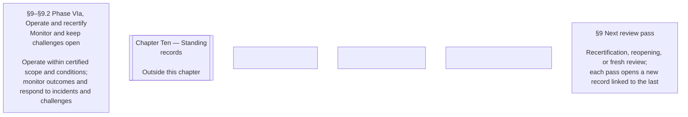

<!-- CHUNK-BEGIN bn__core_09.000_system_alignment_certification_evaluation__section_1_corpus_placement_overview.md bytes=4978 -->
<!-- AI-assisted translation draft; unreviewed. §1 corpus-placement overview, source lines 8–10; source SHA-256 4311e6ba74b7210f077c0bd4c8d21d8c9f517d2ada7b6d87288b39494dfeadd5. Draft only; do not synchronize into translations/. -->

# Chapter Nine Part A — §1 corpus-placement overview (bn)

## English source (lines 8–10)

> This file is **part of the Sentient Constitution** and is **binding only together** with the other numbered `core_*` files read as one text. It contains **Chapter Nine, Part A** — certification purpose, the process overview, and the first two phases of the process — **Frame** (system class) and **Evaluate** (whole-system evaluation in three sub-phases: the always-applicable evaluations, including data types and handling, in **§3**; the evaluations that apply where implicated in **§4**; and the Rights-Floor and domain evaluations that apply where triggered in **§5**) — **§1–§5**. The worked **Class A / B / C illustrations** (the system class profiles, §3.4.8, §5.1.5, §5.2.4, §5.3.7, §5.4.4, §5.5.5, and §5.6.4), including each one's **Reading across system classes** paragraph, are in [`core_09.010_system_alignment_certification_illustrations.md`](core_09.010_system_alignment_certification_illustrations.md); each keeps its Part A section number. The binding system-class-scaling and escalation rules those paragraphs illustrate stay in this file: system class scaling, including participation and proportionality, in §2.2; data-handling scaling in §3.4; and the **System class scaling and escalation** paragraph in each of §5.1–§5.6. The files of the whole chapter are listed in the table below.
>
> **Chapter Nine files.** Chapter Nine is split across four binding files read as one text. Part A, this file, opens the chapter; there is no separate index file.

## Translation draft

> এই ফাইলটি **Sentient Constitution-এর অংশ** এবং অন্য নম্বরযুক্ত `core_*` ফাইলগুলোর সঙ্গে এক পাঠ্য হিসেবে পড়লেই কেবল বাধ্যতামূলক। এতে রয়েছে **অধ্যায় নয়, পর্ব ক**—প্রত্যয়নের উদ্দেশ্য, প্রক্রিয়ার সারসংক্ষেপ, এবং প্রক্রিয়ার প্রথম দুই ধাপ—**Frame** (সিস্টেমের শ্রেণি) ও **Evaluate** (তিনটি উপধাপে সমগ্র-সিস্টেম মূল্যায়ন: **§3**-এ সবসময় প্রযোজ্য মূল্যায়ন, যার মধ্যে ডেটার ধরন ও ব্যবস্থাপনাও আছে; **§4**-এ প্রযোজ্য হলে যে মূল্যায়নগুলো হবে; এবং **§5**-এ উদ্দীপিত হলে যে Rights-Floor ও ডোমেইন মূল্যায়নগুলো হবে)—**§1–§5**। **Class A / B / C**-এর কাজ-করা দৃষ্টান্তগুলো (সিস্টেম-শ্রেণির প্রোফাইল, §3.4.8, §5.1.5, §5.2.4, §5.3.7, §5.4.4, §5.5.5 এবং §5.6.4)—প্রতিটিতে **সিস্টেম-শ্রেণি জুড়ে পাঠ** অনুচ্ছেদসহ—[`core_09.010_system_alignment_certification_illustrations.md`](core_09.010_system_alignment_certification_illustrations.md)-এ রয়েছে; প্রতিটি দৃষ্টান্ত তার পর্ব ক-এর অংশসংখ্যা বজায় রাখে। ওই অনুচ্ছেদগুলো যে বাধ্যতামূলক শ্রেণি-অনুযায়ী মাত্রা ও বৃদ্ধির নিয়ম ব্যাখ্যা করে, সেগুলো এই ফাইলেই থাকে: অংশগ্রহণ ও আনুপাতিকতা-সহ সিস্টেম-শ্রেণি অনুযায়ী মাত্রা §2.2-এ; ডেটা ব্যবস্থাপনার মাত্রা §3.4-এ; এবং §§5.1–5.6-এর প্রতিটিতে **সিস্টেম-শ্রেণি অনুযায়ী মাত্রা ও বৃদ্ধি** অনুচ্ছেদে। পুরো অধ্যায়ের ফাইলগুলো নিচের সারণিতে তালিকাভুক্ত।
>
> **অধ্যায় নয়ের ফাইলসমূহ।** অধ্যায় নয় চারটি বাধ্যতামূলক ফাইলে বিভক্ত, যেগুলো একসঙ্গে পড়তে হবে। এই ফাইলটিই পর্ব ক হিসেবে অধ্যায়টি শুরু করে; আলাদা কোনো সূচি-ফাইল নেই।

<!-- CHUNK-END -->
<!-- CHUNK-BEGIN bn__core_09.000_system_alignment_certification_evaluation__section_1_corpus_file_table.md bytes=6683 -->
<!-- AI-assisted translation draft; unreviewed. §1 corpus-placement file table, source lines 12–17; source SHA-256 4311e6ba74b7210f077c0bd4c8d21d8c9f517d2ada7b6d87288b39494dfeadd5. Draft only; do not synchronize into translations/. -->

# Chapter Nine Part A — §1 corpus-placement file table (bn)

## English source (lines 12–17)

> | Part | File | Owns |
> |------|------|------|
> | **Part A — Evaluation** | [`core_09.000_system_alignment_certification_evaluation.md`](core_09.000_system_alignment_certification_evaluation.md) | §1–§5: purpose and process overview (with a chart of the whole certification process in its six phases), **Phase I Frame** (system class, how system class scales every evaluation, and pilot certification) and **Phase II Evaluate** (whole-system evaluation in three sub-phases: **IIa** always, in §3, including chartered scope versus functional boundaries and data types and handling; **IIb** where implicated, in §4; and **IIc** where triggered, the Rights-Floor and domain evaluations, in §5) |
> | **Part B — Record and process** | [`core_09.005_system_alignment_certification_record_process.md`](core_09.005_system_alignment_certification_record_process.md) | §6–§10: **Phase III Review** (forum roles, supervisory sequence, and the contestability chain), **Phase IV Decide** (certification outcomes, including the go-live gate), **Phase V Record** (the certification record and its integrity, including governing [System Charter](core_05.040_band_continuity.md#system-charter) fields), and **Phase VI Operate** (the challenge path; recertification and reopening; the standing bridge) — continuous chapter numbering from Part A §5 |
> | **Part C — Illustrations** | [`core_09.010_system_alignment_certification_illustrations.md`](core_09.010_system_alignment_certification_illustrations.md) | the illustrative system class profiles, §3.4, §3.4.8, §5.1.5, §5.2.4, §5.3.7, §5.4.4, §5.5.5, and §5.6.4: worked Class A / B / C walkthroughs for each Part A evaluation area, numbered to match Part A and linked both ways |
> | **Part D — Institutional alignment certification** | [`core_09.015_institutional_alignment_certification.md`](core_09.015_institutional_alignment_certification.md) | §11–§15: the same six phases for an **Institution** rather than a System — the institution class and the institutional evaluation (**Phases I and II**, §12), the forum roles, outcome, and **Institutional Certification Record** (**Phases III to V**, §13), and recertification, reopening, the cascade from System certifications, and the standing bridge (**Phase VI**, §14–§15). It cites each System's certification by link and does not repeat it, and it is not a licence — continuous chapter numbering from Part B §10 |

## Translation draft

| পর্ব | ফাইল | যা অন্তর্ভুক্ত |
|------|------|------|
| **Part A — Evaluation** | [`core_09.000_system_alignment_certification_evaluation.md`](core_09.000_system_alignment_certification_evaluation.md) | §§1–5: উদ্দেশ্য ও প্রক্রিয়ার সারসংক্ষেপ (ছয় ধাপের প্রত্যয়ন-প্রক্রিয়ার চার্টসহ), এবং ধাপ I Frame (সিস্টেমের শ্রেণি, শ্রেণি কীভাবে প্রতিটি মূল্যায়নের মাত্রা নির্ধারণ করে, ও পাইলট প্রত্যয়ন) ও II Evaluate (তিন উপধাপে সমগ্র-সিস্টেম মূল্যায়ন: IIa সবসময় §3-এ, সনদে নির্ধারিত পরিসর বনাম কার্যকরী সীমানা এবং ডেটার ধরন/ব্যবস্থাপনাসহ; IIb প্রাসঙ্গিক হলে §4-এ; IIc উদ্দীপিত হলে §5-এর Rights-Floor ও ডোমেইন মূল্যায়ন)। |
| **Part B — Record and process** | [`core_09.005_system_alignment_certification_record_process.md`](core_09.005_system_alignment_certification_record_process.md) | §§6–10: ধাপ III Review (ফোরামের ভূমিকা, তত্ত্বাবধানের ক্রম, ও আপত্তির ধারাবাহিকতা); IV Decide (প্রত্যয়নের ফল, চালুর অনুমোদন-দ্বারসহ); V Record (প্রত্যয়ন-নথি ও তার অখণ্ডতা, শাসনকারী [System Charter](core_05.040_band_continuity.md#system-charter) ক্ষেত্রসহ); VI Operate (চ্যালেঞ্জ-পথ, পুনঃপ্রত্যয়ন ও পুনরায় খোলা, এবং স্ট্যান্ডিং সেতু) — পর্ব A-এর §5 থেকে ধারাবাহিক নম্বর। |
| **Part C — Illustrations** | [`core_09.010_system_alignment_certification_illustrations.md`](core_09.010_system_alignment_certification_illustrations.md) | সিস্টেম-শ্রেণির দৃষ্টান্তমূলক প্রোফাইল এবং §3.4, §3.4.8, §5.1.5, §5.2.4, §5.3.7, §5.4.4, §5.5.5 ও §5.6.4: পর্ব A-এর প্রতিটি মূল্যায়ন-ক্ষেত্রে A/B/C শ্রেণির একটি করে কাজ-করা উদাহরণ; একই নম্বর এবং উভয়মুখী সংযোগ বজায় রাখে। |
| **Part D — Institutional alignment certification** | [`core_09.015_institutional_alignment_certification.md`](core_09.015_institutional_alignment_certification.md) | §§11–15: সিস্টেমের বদলে প্রতিষ্ঠানের জন্য একই ছয় ধাপ—প্রতিষ্ঠানের শ্রেণি ও মূল্যায়ন (I–II, §12), ফোরামের ভূমিকা, ফল ও Institutional Certification Record (III–V, §13), এবং পুনঃপ্রত্যয়ন, পুনরায় খোলা, সিস্টেম-প্রত্যয়নের ধারাবাহিকতা ও স্ট্যান্ডিং সেতু (VI, §§14–15)। প্রতিটি সিস্টেমের প্রত্যয়ন রেকর্ডে লিংক দেয়, পুনরাবৃত্তি করে না, এবং লাইসেন্স নয় — পর্ব B-এর §10 থেকে ধারাবাহিক নম্বর। |

<!-- CHUNK-END -->
<!-- CHUNK-BEGIN bn__core_09.000_system_alignment_certification_evaluation__section_1_corpus_explanation.md bytes=11345 -->
<!-- AI-assisted translation draft; unreviewed. §1 corpus-placement explanatory prose, source lines 19–30; source SHA-256 4311e6ba74b7210f077c0bd4c8d21d8c9f517d2ada7b6d87288b39494dfeadd5. Draft only; do not synchronize into translations/. -->

# Chapter Nine Part A — §1 corpus-placement explanatory prose (bn)

## English source (lines 19–30)

> **How the two certifications relate.** System Alignment Certification (Parts A to C) is the certification of a System. Institutional alignment certification (Part D) is the certification of an Institution, which may run Systems or none. Part D cites each System's certification record by link and does not redo it; [Part D §11.1](core_09.015_institutional_alignment_certification.md#111-relation-to-system-alignment-certification) states the relation and [Part D §11.3](core_09.015_institutional_alignment_certification.md#113-no-permission-and-no-gate) states that it is not a licence.
>
> Generic **Chapter Nine** links in other files route to the appropriate part by section number.
>
> - **Constitutional owner (joint with Parts B and D):** forum-supervised **system alignment certification and related records** — evaluation domains (Part A); forum process, supervisory sequence, certification-record duties, certification outcomes and the go-live gate, the challenge path, recertification and reopening, and verified-input bridge to Chapter Ten (Part B); the same six phases for an Institution (Part D). Under the **oversight** Tetrad leg, SAC is one especially large, high-stakes audit process among others; auditing floors remain at **Article XVI** (*Audit, Transparency, and Independent Verification*) and Chapter Five [Auditability](core_05.050_band_oversight.md#auditability).
> - **Verification substrate owner:** [Chapter Four — Burden of Proof, Traceability, and Verification](core_04.000_burden_traceability_verification.md#chapter-four-burden-of-proof-traceability-and-verification) (within Chapters Two through Four) owns burden allocation, compliance evidence, definition traceability, observability, and security-constrained verification. Chapter Nine **applies** that discipline to system alignment certification records; it does **not** restate Chapter Four sections **1** through **5**.
> - **Auditing home (not relocated here):** **Article XVI** (*Audit, Transparency, and Independent Verification*), **Def.O1** (*Transparency, Auditability, and Verification*), and **CJS-5.110 §3 and CJS-5.115 §3** (*Audit process home*)–**CJS-5.110 §5** own auditing floors and operational terms. Chapter Nine runs one especially large SAC audit process that must satisfy those floors; it does not own all auditing.
> - **Implementation owner:** system-class handling, CS-6.345, and forum-process detail in designated implementation files must remain consistent with Chapter Nine and may be stricter where the corpus already provides a [Fullest Protective Effect](core_05.045_band_integrative.md#fullest-protective-effect) rule.
> - **Anti-relocation rule:** Part A does not restate Chapter Five canonical definitions, Chapter Three anti-evasion discipline (see [Part B §9.3](core_09.005_system_alignment_certification_record_process.md#93-non-evasion)), Chapter Ten contribution or standing measurement, or Chapter Eleven standing effects. **[Part B §10](core_09.005_system_alignment_certification_record_process.md#10-relationship-to-standing)** states the standing bridge boundary explicitly.
>
> **Upstream:** Chapter Five definitions; Chapters Two through Four record, verification, burden, and traceability of definitions to results; and [Chapter Eight](core_08.000_functional_independence_separation_of_duties.md#chapter-eight-functional-independence-and-separation-of-duties), whose separation-of-duties requirement governs every materially binding certification act.
> **Downstream:** [Part B](core_09.005_system_alignment_certification_record_process.md#chapter-nine-part-b-system-alignment-certification--record-and-process) (*forum process, record, outcomes, and standing bridge*); Chapter Ten standing records and verified inputs; Chapter Eleven standing effects; Chapter Thirteen forum supervision and system alignment certification pathways.

## Translation draft

**দুই ধরনের প্রত্যয়নের সম্পর্ক।** System Alignment Certification (পর্ব A–C) হলো একটি সিস্টেমের প্রত্যয়ন। Institutional alignment certification (পর্ব D) হলো একটি প্রতিষ্ঠানের প্রত্যয়ন; প্রতিষ্ঠানটি সিস্টেম পরিচালনা করতে পারে, নাও পারে। পর্ব D প্রতিটি সিস্টেমের প্রত্যয়ন-রেকর্ডের লিংক উদ্ধৃত করে, সেটি আবার করে না; [Part D §11.1](core_09.015_institutional_alignment_certification.md#111-relation-to-system-alignment-certification) সম্পর্কটি জানায় এবং [Part D §11.3](core_09.015_institutional_alignment_certification.md#113-no-permission-and-no-gate) বলে এটি কোনো লাইসেন্স নয়।
>
> অন্য ফাইলে থাকা সাধারণ **Chapter Nine** লিংকগুলো অংশ নম্বর অনুযায়ী উপযুক্ত অংশে নিয়ে যায়।
>
> - **সাংবিধানিক মালিক (পর্ব B ও D-এর সঙ্গে যৌথ):** ফোরাম-তত্ত্বাবধানে সিস্টেম alignment certification ও সংশ্লিষ্ট রেকর্ড—মূল্যায়নের ক্ষেত্র (পর্ব A); ফোরাম প্রক্রিয়া, তত্ত্বাবধানের ক্রম, প্রত্যয়ন-রেকর্ডের দায়, ফলাফল ও চালুর শর্ত, চ্যালেঞ্জের পথ, পুনঃপ্রত্যয়ন ও পুনরায় খোলা, এবং অধ্যায় দশে যাচাইকৃত ইনপুটের সেতু (পর্ব B); প্রতিষ্ঠানের জন্য একই ছয় ধাপ (পর্ব D)। Tetrad-এর **তত্ত্বাবধান** অঙ্গে, SAC অন্য নিরীক্ষাগুলোর মধ্যে একটি বিশেষত বড় ও উচ্চ-ঝুঁকির নিরীক্ষা-প্রক্রিয়া; নিরীক্ষার ন্যূনতম মান **Article XVI** (*Audit, Transparency, and Independent Verification*) এবং অধ্যায় পাঁচের [Auditability](core_05.050_band_oversight.md#auditability)-তে থাকে।
> - **যাচাইকরণ অবকাঠামোর মালিক:** [Chapter Four — Burden of Proof, Traceability, and Verification](core_04.000_burden_traceability_verification.md#chapter-four-burden-of-proof-traceability-and-verification) (অধ্যায় দুই থেকে চারের মধ্যে) প্রমাণের ভার বণ্টন, compliance evidence, সংজ্ঞার traceability, পর্যবেক্ষণযোগ্যতা এবং নিরাপত্তা-সীমাবদ্ধ যাচাইকরণের মালিক। অধ্যায় নয় এই শৃঙ্খলা সিস্টেম alignment certification রেকর্ডে প্রয়োগ করে; অধ্যায় চার-এর **1** থেকে **5** ধারা পুনরাবৃত্তি করে না।
> - **নিরীক্ষার মূল স্থান (এখানে স্থানান্তরিত নয়):** **Article XVI** (*Audit, Transparency, and Independent Verification*), **Def.O1** (*Transparency, Auditability, and Verification*), এবং **CJS-5.110 §3 ও CJS-5.115 §3** (*Audit process home*)–**CJS-5.110 §5** নিরীক্ষার ন্যূনতম মান ও কার্যকরী পরিভাষার মালিক। অধ্যায় নয় একটি বিশেষ বড় SAC নিরীক্ষা চালায়, যা এই মানগুলো পূরণ করবে; সব নিরীক্ষার মালিকানা তার নয়।
> - **বাস্তবায়নের মালিক:** নির্দিষ্ট বাস্তবায়ন ফাইলে থাকা সিস্টেম-শ্রেণি পরিচালনা, CS-6.345 এবং ফোরাম-প্রক্রিয়ার বিবরণ অধ্যায় নয়ের সঙ্গে সামঞ্জস্যপূর্ণ থাকবে; corpus-এ আগে থেকেই [Fullest Protective Effect](core_05.045_band_integrative.md#fullest-protective-effect) বিধান থাকলে আরও কঠোর হতে পারে।
> - **স্থানান্তর-নিষেধের নিয়ম:** পর্ব A অধ্যায় পাঁচের প্রামাণ্য সংজ্ঞা, অধ্যায় তিনের ফাঁকি-রোধের শৃঙ্খলা ([Part B §9.3](core_09.005_system_alignment_certification_record_process.md#93-non-evasion) দেখুন), অধ্যায় দশের অবদান বা standing পরিমাপ, কিংবা অধ্যায় এগারোর standing-প্রভাব পুনর্বিবৃত্তি করে না। **[Part B §10](core_09.005_system_alignment_certification_record_process.md#10-relationship-to-standing)** standing bridge-এর সীমা স্পষ্ট করে।
>
> **উৎসধারা:** অধ্যায় পাঁচের সংজ্ঞা; অধ্যায় দুই থেকে চার-এর রেকর্ড, যাচাইকরণ, প্রমাণের ভার এবং সংজ্ঞা থেকে ফলাফলে traceability; এবং [Chapter Eight](core_08.000_functional_independence_separation_of_duties.md#chapter-eight-functional-independence-and-separation-of-duties), যার দায়িত্ব-বিভাজন বিধান প্রতিটি বস্তুগতভাবে বাধ্যতামূলক প্রত্যয়ন-কার্যে প্রযোজ্য।
> **পরবর্তী সংযোগ:** [Part B](core_09.005_system_alignment_certification_record_process.md#chapter-nine-part-b-system-alignment-certification--record-and-process) (*ফোরাম প্রক্রিয়া, রেকর্ড, ফলাফল ও standing bridge*); অধ্যায় দশের standing record ও যাচাইকৃত ইনপুট; অধ্যায় এগারোর standing-প্রভাব; অধ্যায় তেরোর ফোরাম-তত্ত্বাবধান ও সিস্টেম alignment certification পথ।

<!-- CHUNK-END -->
<!-- CHUNK-BEGIN bn__core_09.000_system_alignment_certification_evaluation__section_1_heading.md bytes=396 -->
<!-- AI-assisted translation draft; unreviewed. §1 heading, source line 44; source SHA-256 4311e6ba74b7210f077c0bd4c8d21d8c9f517d2ada7b6d87288b39494dfeadd5. Draft only; do not synchronize into translations/. -->

# Chapter Nine Part A — §1 heading (bn)

## English source (lines 44–45)

### 1. Purpose and Role


## Translation draft

### 1. উদ্দেশ্য ও ভূমিকা

<!-- CHUNK-END -->
<!-- CHUNK-BEGIN bn__core_09.000_system_alignment_certification_evaluation__section_1_trace.md bytes=12524 -->
<!-- AI-assisted translation draft; unreviewed. §1 trace, source lines 46–95; source SHA-256 4311e6ba74b7210f077c0bd4c8d21d8c9f517d2ada7b6d87288b39494dfeadd5. Draft only; do not synchronize into translations/. -->

# Chapter Nine Part A — §1 trace (bn)

## English source (lines 46–95)

<details>
<summary><strong><span style="color: #2563eb;">Trace</span></strong></summary>

- Upstream:
  - [Preamble — constitutional owner register](core_00.000_preamble.md#4-principles-definitions-and-rights) and
  - [Authority Stack and Internal Hierarchy](core_05.045_band_integrative.md#authority-stack-and-internal-hierarchy);
  - [Constitutional Tetrad](core_00.000_preamble.md#constitutional-tetrad);
  - [Two Constitutional Aims](core_00.000_preamble.md#two-constitutional-aims);
  - [material stake](core_00.000_preamble.md#material-stake);
  - [Proportionality](core_05.035_band_accountability.md#proportionality) and
  - [Substantive Fairness](core_05.055_band_participation.md#substantive-fairness) (Chapter Five); Participation measurement family (*voice, access, and contest paths*);
  - [Chapter One §16 Stewardship In Depth](core_01.010_stewardship_capacity_principles.md#16-stewardship-in-depth) (1.010 §16);
  - [Chapter One §12 Systemic Evaluation Requirement](core_01.000_values_principles.md#12-systemic-evaluation-requirement) (1.000 §12) (*principle-layer whole-system evaluation lens — not one corner alone*); Chapters Two through Four;
  - [Chapter Five](core_05.000_definitions_home.md#chapter-five-foundational-definitions) (5.000) (*canonical definitions*);
  - [Chapter Eight §2 Four-Seat Constitutional Requirement](core_08.000_functional_independence_separation_of_duties.md#2-four-seat-constitutional-requirement) (8.000 §2);
  - [System Alignment Certification](core_05.040_band_continuity.md#system-alignment-certification) (Chapter Five canonical term; non-operative shorthand **SAC**);
  - [System Certification Record](core_05.040_band_continuity.md#system-certification-record) (Chapter Five meaning).
- Downstream:
  - [§2](#2-system-class-evaluation) (*system class evaluation*);
  - [Part B §9.1](core_09.005_system_alignment_certification_record_process.md#91-challenging-a-certification) (9.005 §9.1) (*challenging a certification*); and
  - [Part C system class profiles](core_09.010_system_alignment_certification_illustrations.md#illustrative-system-class-profiles-non-exhaustive) (9.010) (*illustrative system class profiles*);
  - [Part C whole-system walkthroughs](core_09.010_system_alignment_certification_illustrations.md#illustrative-whole-system-application-by-system-class-non-exhaustive) (9.010) (*worked whole-system examples by system class*);
  - [§3.4.8](core_09.010_system_alignment_certification_illustrations.md#348-illustrative-data-handling-application-by-system-class-non-exhaustive) (*worked data-handling examples by system class*);
  - [§5.1.5](core_09.010_system_alignment_certification_illustrations.md#515-illustrative-ecological-footprint-application-by-system-class-non-exhaustive) (*worked ecological-footprint examples by system class*);
  - [§5.2.4](core_09.010_system_alignment_certification_illustrations.md#524-illustrative-educational-capability-application-by-system-class-non-exhaustive) (*worked educational-capability examples by system class*);
  - [§5.3.7](core_09.010_system_alignment_certification_illustrations.md#537-illustrative-cross-system-support-application-by-system-class-non-exhaustive) (*worked cross-system-support examples by system class*);
  - [§5.4.4](core_09.010_system_alignment_certification_illustrations.md#544-illustrative-nondiscrimination-application-by-system-class-non-exhaustive) (*worked nondiscrimination examples by system class*);
  - [§5.5.5](core_09.010_system_alignment_certification_illustrations.md#555-illustrative-accessibility-application-by-system-class-non-exhaustive) (*worked accessibility examples by system class*);
  - [§5.6.4](core_09.010_system_alignment_certification_illustrations.md#564-illustrative-trustworthiness-application-by-system-class-non-exhaustive) (*worked trustworthiness examples by system class*);
  - [§3](#3-whole-system-certification-evaluation) (*whole-system certification evaluation factors*);
  - [§3.4](#34-data-types-and-handling-evaluation) through
  - [§5.6](#56-trustworthiness-and-system-reliance-integrity-evaluation) (*domain evaluations*);
  - [Part B §6](core_09.005_system_alignment_certification_record_process.md#6-forum-process) (9.005 §6) (*supervisory sequence and contestability chain*);
  - [Part B §6.1](core_09.005_system_alignment_certification_record_process.md#61-forum-supervision-and-component-roles) (9.005 §6.1) (*forum component roles*);
  - [Part B §8](core_09.005_system_alignment_certification_record_process.md#8-system-certification-record) (9.005 §8) (*certification record contents*);
  - [Part B §8.2](core_09.005_system_alignment_certification_record_process.md#82-record-integrity-transparency-and-auditability) (9.005 §8.2) (*record integrity requirements*);
  - [Part B §7](core_09.005_system_alignment_certification_record_process.md#7-certification-outcomes) (9.005 §7) (*reopening and anti-evasion*);
  - [Part B §10](core_09.005_system_alignment_certification_record_process.md#10-relationship-to-standing) (9.005 §10) (*standing-record bridge*);
  - [Chapter Ten](core_11.000_standing_assessment.md#chapter-eleven-contribution-violation-and-standing-model--measurement) (10.000) (*standing records and verified-input gate*);
  - [Chapter Eleven](core_12.000_standing_integration.md#chapter-twelve-standing-effects-and-integration) (11.000) (*standing effects and integration*);
  - [Chapter Thirteen](core_14.000_forum.md#chapter-fourteen-forums-and-jurisdiction) (13.000) (*forum supervision, certification, alignment certification, and review*).
- Read with:
  - **[CS-9.305](corpus_systems/cs_09.305_system_classification_machinery.md#cs-9305-part-a-system-classification-machinery) (*System classification machinery*) and [CS-9.310 — System impact classifications](corpus_systems/cs_09.310_system_impact_classifications.md#cs-9310-part-b-system-impact-classifications)**, **[CS-6.305](corpus_systems/cs_06.305_information_types_and_handling.md#cs-6305-part-a-information-types-and-handling) (*Information types and handling*) and [CS-6.310 — Data classifications](corpus_systems/cs_06.310_data_classifications.md#cs-6310-part-b-data-classifications)**, and
  - **CS-6.345** (*System lifecycle*);
  - **CF-13.415** (*Routing operations, transfer, certification, and representative treatment*) and
  - **CF-13.425** (*Integrity safeguards, anti-capture operations, and anti-self-judging support*); **Article XVI** (*Audit, Transparency, and Independent Verification*) and
  - [Auditability](core_05.050_band_oversight.md#auditability) (*auditing floors — SAC is one especially large audit process under oversight, not the sole auditing home*); **CJS-5.110 §3 (*Oversight: auditability and reconstructability terms (annex)*) and CJS-5.115 §3** (*Audit process home*)–
  - **CJS-5.110 §5** (*Oversight: independent verification and claim-integrity terms*).

</details>

## Translation draft

#### অনুসরণ-মানচিত্র

এই মানচিত্র ধারাটির সাংবিধানিক ও কর্তৃত্বগত ভিত্তি দেখায়, তারপর মূল্যায়ন, শ্রেণিবিন্যাস, পর্যালোচনা-পথ, রেকর্ড, ফলাফল ও নিরীক্ষার সঙ্গে সংযোগ করে; পাশাপাশি সহপাঠ্য কার্যকরী নথিও চিহ্নিত করে।

**অনুসরণ-মানচিত্র — upstream canonical sources:** [Preamble — constitutional owner register](core_00.000_preamble.md#4-principles-definitions-and-rights); [Authority Stack and Internal Hierarchy](core_05.045_band_integrative.md#authority-stack-and-internal-hierarchy); [Constitutional Tetrad](core_00.000_preamble.md#constitutional-tetrad); [Two Constitutional Aims](core_00.000_preamble.md#two-constitutional-aims); [material stake](core_00.000_preamble.md#material-stake); [Proportionality](core_05.035_band_accountability.md#proportionality); [Substantive Fairness](core_05.055_band_participation.md#substantive-fairness); [Chapter One §16 Stewardship In Depth](core_01.010_stewardship_capacity_principles.md#16-stewardship-in-depth); [Chapter One §12 Systemic Evaluation Requirement](core_01.000_values_principles.md#12-systemic-evaluation-requirement); [Chapter Five](core_05.000_definitions_home.md#chapter-five-foundational-definitions); [Chapter Eight §2 Four-Seat Constitutional Requirement](core_08.000_functional_independence_separation_of_duties.md#2-four-seat-constitutional-requirement); [System Alignment Certification](core_05.040_band_continuity.md#system-alignment-certification); [System Certification Record](core_05.040_band_continuity.md#system-certification-record)

**অনুসরণ-মানচিত্র — downstream routes and related records:** [§2](#2-system-class-evaluation); [Part B §9.1](core_09.005_system_alignment_certification_record_process.md#91-challenging-a-certification); [Part C system class profiles](core_09.010_system_alignment_certification_illustrations.md#illustrative-system-class-profiles-non-exhaustive); [Part C whole-system walkthroughs](core_09.010_system_alignment_certification_illustrations.md#illustrative-whole-system-application-by-system-class-non-exhaustive); [§3.4.8](core_09.010_system_alignment_certification_illustrations.md#348-illustrative-data-handling-application-by-system-class-non-exhaustive); [§5.1.5](core_09.010_system_alignment_certification_illustrations.md#515-illustrative-ecological-footprint-application-by-system-class-non-exhaustive); [§5.2.4](core_09.010_system_alignment_certification_illustrations.md#524-illustrative-educational-capability-application-by-system-class-non-exhaustive); [§5.3.7](core_09.010_system_alignment_certification_illustrations.md#537-illustrative-cross-system-support-application-by-system-class-non-exhaustive); [§5.4.4](core_09.010_system_alignment_certification_illustrations.md#544-illustrative-nondiscrimination-application-by-system-class-non-exhaustive); [§5.5.5](core_09.010_system_alignment_certification_illustrations.md#555-illustrative-accessibility-application-by-system-class-non-exhaustive); [§5.6.4](core_09.010_system_alignment_certification_illustrations.md#564-illustrative-trustworthiness-application-by-system-class-non-exhaustive); [§3](#3-whole-system-certification-evaluation); [§3.4](#34-data-types-and-handling-evaluation); [§5.6](#56-trustworthiness-and-system-reliance-integrity-evaluation); [Part B §6](core_09.005_system_alignment_certification_record_process.md#6-forum-process); [Part B §6.1](core_09.005_system_alignment_certification_record_process.md#61-forum-supervision-and-component-roles); [Part B §8](core_09.005_system_alignment_certification_record_process.md#8-system-certification-record); [Part B §8.2](core_09.005_system_alignment_certification_record_process.md#82-record-integrity-transparency-and-auditability); [Part B §7](core_09.005_system_alignment_certification_record_process.md#7-certification-outcomes); [Part B §10](core_09.005_system_alignment_certification_record_process.md#10-relationship-to-standing); [Chapter Ten](core_11.000_standing_assessment.md#chapter-eleven-contribution-violation-and-standing-model--measurement); [Chapter Eleven](core_12.000_standing_integration.md#chapter-twelve-standing-effects-and-integration); [Chapter Thirteen](core_14.000_forum.md#chapter-fourteen-forums-and-jurisdiction)

**অনুসরণ-মানচিত্র — operational materials to read with this section:** [CS-9.305](corpus_systems/cs_09.305_system_classification_machinery.md#cs-9305-part-a-system-classification-machinery); [CS-9.310 — System impact classifications](corpus_systems/cs_09.310_system_impact_classifications.md#cs-9310-part-b-system-impact-classifications); [CS-6.305](corpus_systems/cs_06.305_information_types_and_handling.md#cs-6305-part-a-information-types-and-handling); [CS-6.310 — Data classifications](corpus_systems/cs_06.310_data_classifications.md#cs-6310-part-b-data-classifications); [Auditability](core_05.050_band_oversight.md#auditability)

<!-- CHUNK-END -->
<!-- CHUNK-BEGIN bn__core_09.000_system_alignment_certification_evaluation__purpose_adjuncts.md bytes=8555 -->
<!-- AI-assisted translation draft; unreviewed. Selected §1 passages, source lines 99 and 107–114; source SHA-256 4311e6ba74b7210f077c0bd4c8d21d8c9f517d2ada7b6d87288b39494dfeadd5. -->

# Chapter Nine Part A — §1 plain-terms excerpt

**Status:** AI-assisted draft; unreviewed. English source remains controlling.

## English source

When a system really matters to sentients' lives, certification has to be **proportionate** — as demanding as the system's real impact, dependency, and risk require, not a one-size-fits-all checklist or a rubber stamp. It also has to be **participatory** — affected sentients and communities must be able to see what was reviewed, understand what was decided, and challenge it when something is wrong. Forums review evidence, write it down in a certification record, and require re-checks on a schedule that matches how risky the system is. Classes A, B, and C get the full process and Class L a lighter one. Class P is encouraged to use it, and must once it is reclassified to Class L or higher (that is, its effects reach beyond a private unit) or its operator claims constitutional compliance.

## bn draft

কোনো ব্যবস্থা সংবেদনশীল সত্তাদের জীবনে সত্যিই গুরুত্বপূর্ণ হলে, তার সনদায়ন হতে হবে **আনুপাতিক**—ব্যবস্থাটির প্রকৃত প্রভাব, নির্ভরতা ও ঝুঁকি যতটা দাবি করে ততটাই কঠোর; সবার জন্য এক ছাঁচের যাচাইতালিকা বা নামমাত্র অনুমোদন নয়। এটি **অংশগ্রহণমূলকও** হতে হবে—প্রভাবিত সত্তা ও সম্প্রদায়কে কী পর্যালোচনা হয়েছে তা দেখতে, কী সিদ্ধান্ত হয়েছে তা বুঝতে এবং ভুল হলে আপত্তি জানাতে সক্ষম হতে হবে। ফোরামগুলো প্রমাণ পর্যালোচনা করে, সনদ-রেকর্ডে তা নথিবদ্ধ করে এবং ব্যবস্থার ঝুঁকির সঙ্গে সামঞ্জস্যপূর্ণ সময়সূচিতে পুনঃপরীক্ষা চায়। A, B ও C শ্রেণি পূর্ণ প্রক্রিয়া পায়; L শ্রেণির জন্য প্রক্রিয়াটি হালকা। P শ্রেণিকে এটি ব্যবহারে উৎসাহ দেওয়া হয়, এবং L বা তার ঊর্ধ্বে পুনঃশ্রেণিবদ্ধ হলে (অর্থাৎ প্রভাব ব্যক্তিগত এককের বাইরে গেলে) অথবা পরিচালনাকারী সাংবিধানিক সম্মতির দাবি করলে এটি বাধ্যতামূলক হয়।


### English source — Flourishing

- **[Flourishing](core_00.000_preamble.md#flourishing)** — certification verifies that certification or continued reliance would not quietly defeat Rights Floors or block fair participation in constitutionally relevant life;

### bn draft

- **[সমৃদ্ধি](core_00.000_preamble.md#flourishing)** — সনদায়ন নিশ্চিত করে যে সনদ দেওয়া বা নির্ভরতা চালিয়ে যাওয়া নীরবে অধিকার-সীমা ভাঙবে না বা সাংবিধানিকভাবে প্রাসঙ্গিক জীবনে ন্যায্য অংশগ্রহণ আটকে দেবে না;


### English source — Continuity criterion

- **[Continuity](core_00.000_preamble.md#continuity)** — certification verifies durable, non-regressive supply that sustains rather than depletes healthy natural systems ([Ecological Integrity](core_05.040_band_continuity.md#ecological-integrity), including [Ecological Recovery Capacity](core_05.040_band_continuity.md#ecological-recovery-capacity)), and system-class-scaled recertification where shared systems gate or sustain delivery;

### bn draft

- **[ধারাবাহিকতা](core_00.000_preamble.md#continuity)** — সনদায়ন এমন টেকসই, পশ্চাদমুখী নয় এমন সরবরাহ যাচাই করে যা সুস্থ প্রাকৃতিক ব্যবস্থাকে নিঃশেষ না করে টিকিয়ে রাখে ([পরিবেশগত অখণ্ডতা](core_05.040_band_continuity.md#ecological-integrity), যার মধ্যে [পরিবেশগত পুনরুদ্ধার-ক্ষমতা](core_05.040_band_continuity.md#ecological-recovery-capacity) রয়েছে), এবং যৌথ ব্যবস্থা সরবরাহ নিয়ন্ত্রণ বা বজায় রাখলে ব্যবস্থা-শ্রেণি অনুযায়ী পুনঃসনদায়ন নিশ্চিত করে;


### English source — Participation criterion

- **Participation** — affected sentients and communities can understand, contest, and take part in review paths that matter to them;

### bn draft

- **অংশগ্রহণ** — প্রভাবিত সংবেদনশীল সত্তা ও সম্প্রদায় তাদের জন্য গুরুত্বপূর্ণ পর্যালোচনা-পথ বুঝতে, আপত্তি জানাতে এবং তাতে অংশ নিতে পারে;


### English source — Oversight criterion

- **Oversight** — records, evidence, and assumptions are visible and auditable enough for independent checking; certification itself is one especially large audit process under that oversight duty, not the only one;

### bn draft

- **তদারকি** — রেকর্ড, প্রমাণ ও অনুমান স্বাধীন যাচাইয়ের জন্য যথেষ্ট দৃশ্যমান ও নিরীক্ষাযোগ্য; সনদায়ন নিজেও তদারকির দায়িত্বের অধীনে একটি বড় নিরীক্ষা-প্রক্রিয়া, তবে নিরীক্ষার একমাত্র ক্ষেত্র নয়;


### English source — Accountability criterion

- **Accountability** — defects, misclassification, and floor-defeating operation route to remedy, conditions, withdrawal, or standing input where the facts support it;

### bn draft

- **জবাবদিহি** — ত্রুটি, ভুল শ্রেণিবিন্যাস এবং অধিকার-সীমা ব্যর্থ করে এমন কার্যক্রম তথ্যসমর্থিত হলে প্রতিকার, শর্ত, প্রত্যাহার বা অবস্থান-পরিমাপের ইনপুটের পথে যায়;


### English source — Timeliness criterion

- **Timeliness** — review and contest windows keep certification from going stale while harm can still be prevented or reversed.

### bn draft

- **সময়োপযোগিতা** — ক্ষতি ঠেকানো বা উল্টে দেওয়া সম্ভব থাকা অবস্থায় পর্যালোচনা ও আপত্তির সময়সীমা সনদকে পুরোনো হতে দেয় না।


### English source — Tetrad introduction

Certification implements the [Two Constitutional Aims](core_00.000_preamble.md#two-constitutional-aims) through the [Constitutional Tetrad](core_00.000_preamble.md#constitutional-tetrad):

### bn draft

সনদায়ন [দুটি সাংবিধানিক লক্ষ্য](core_00.000_preamble.md#two-constitutional-aims) [সাংবিধানিক চতুর্মাত্রিক নীতির](core_00.000_preamble.md#constitutional-tetrad) মাধ্যমে বাস্তবায়ন করে:

<!-- CHUNK-END -->
<!-- CHUNK-BEGIN bn__core_09.000_system_alignment_certification_evaluation__section_1_purpose.md bytes=2364 -->
<!-- AI-assisted translation draft; unreviewed. Complete purpose statement excerpt, source lines 101–105; source SHA-256 4311e6ba74b7210f077c0bd4c8d21d8c9f517d2ada7b6d87288b39494dfeadd5. This is an excerpt, not a complete §1 translation. -->

**ব্যবস্থা-সারিবদ্ধতা প্রত্যয়ন** একটি নির্দিষ্ট পরিধি ও পর্যালোচনার সময়সূচির জন্য একটি প্রশ্নের উত্তর দিতে বিদ্যমান: ব্যবস্থাটি কি প্রত্যয়ন, শর্তসাপেক্ষ প্রত্যয়ন, বৈধতা-নিরূপণ, পুনঃপ্রত্যয়ন, নির্ভরতা অব্যাহত রাখা, স্থাপন, অথবা বস্তুগত শর্ত থেকে অব্যাহতির জন্য যথেষ্ট সাংবিধানিক সারিবদ্ধতা দেখিয়েছে?

- প্রত্যয়ন জনপ্রিয়তার স্কোর নয়, চিরস্থায়ী ছাড়পত্র নয়, এবং অধিকার-পর্যালোচনা এড়ানোর উপায়ও নয়।
- এটি এই মুহূর্তে ব্যবস্থার সারিবদ্ধতা সম্পর্কে যা জানা আছে তার সময়সীমাবদ্ধ ও চ্যালেঞ্জযোগ্য বিবৃতি।
- চতুষ্টয়ের **তদারকি** পায়ের অধীনে তদারকির জন্য নিরীক্ষা আবশ্যক; ব্যবস্থা-সারিবদ্ধতা প্রত্যয়ন অন্যগুলোর মধ্যে একটি বিশেষভাবে বৃহৎ, উচ্চ-ঝুঁকির নিরীক্ষা-প্রক্রিয়া — নিরীক্ষার একমাত্র ক্ষেত্র নয় (**অনুচ্ছেদ XVI** (*নিরীক্ষা, স্বচ্ছতা ও স্বাধীন যাচাই*), [নিরীক্ষাযোগ্যতা](core_05.050_band_oversight.md#auditability)).

<!-- CHUNK-END -->
<!-- CHUNK-BEGIN bn__core_09.000_system_alignment_certification_evaluation__section_1_subsection_headings.md bytes=923 -->
<!-- AI-assisted translation draft; unreviewed. §1.1/§1.2 visible subsection headings, source lines 116–119 and 144–148; source SHA-256 4311e6ba74b7210f077c0bd4c8d21d8c9f517d2ada7b6d87288b39494dfeadd5. Draft only; anchors/blank layout are structural. Do not synchronize into translations/. -->

# Chapter Nine Part A — §1.1 and §1.2 subsection headings (bn)

## English source

### Lines 116–119

<a id="11-certification-as-an-audit-process-scaled-by-class"></a>

#### 1.1 Certification as an audit process, scaled by class


### Lines 144–148


<a id="12-certification-at-a-glance"></a>

#### 1.2 Certification at a glance


## Translation draft

#### 1.1 শ্রেণি অনুযায়ী মাত্রা-নির্ধারিত নিরীক্ষা-প্রক্রিয়া হিসেবে প্রত্যয়ন

#### 1.2 এক নজরে প্রত্যয়ন

<!-- CHUNK-END -->
<!-- CHUNK-BEGIN bn__core_09.000_system_alignment_certification_evaluation__section_1_audit_scope.md bytes=4111 -->
<!-- AI-assisted translation draft; unreviewed. §1.1 audit mechanism and sibling audit modes, source lines 120–130; source SHA-256 4311e6ba74b7210f077c0bd4c8d21d8c9f517d2ada7b6d87288b39494dfeadd5. -->

# Chapter Nine Part A — §1.1 certification audit process excerpt (bn)

## English source

As an oversight mechanism, certification is one especially large audit process under [Auditability](core_05.050_band_oversight.md#auditability) and **Article XVI** (*Audit, Transparency, and Independent Verification*):

- It is forum-supervised, multi-domain, and status-granting.
- It may integrate the results of sibling audit modes, and it does not absorb or replace them. Each keeps its own owner, named in the [sibling audit modes map](corpus_joint_structure/cjs_05.115_audit_process.md#sibling-audit-modes-owner-map) of the audit process home:
  - System Data Types Record audits under **CS-6.305 (*Information types and handling*) and CS-6.310** (*Data classifications*)
  - System Classification Record audits under **CS-9.305 (*System classification machinery*) and CS-9.310** (*System impact classifications*)
  - steward assurance reviews under **CS-14.305** (*Critical system stewardship*)
  - continuous audit under **CS-6.345** (*System lifecycle*) ACA
  - complexity audits under **CS-6.315** (*Comprehensibility and complexity stewardship*) and **Article XXIII-B** (*Complexity Audit and Modularity Requirements*)
  - claim verification under **CJS-5.110 §5** (*Oversight: independent verification and claim-integrity terms*)
- You can still run any of these checks on their own, without going through certification. Certification doesn't replace them.

## bn draft

তদারকি প্রক্রিয়া হিসেবে, **Auditability** এবং **Article XVI** (*Audit, Transparency, and Independent Verification*)-এর অধীনে সার্টিফিকেশন একটি বিশেষভাবে বৃহৎ অডিট প্রক্রিয়া:

- এটি ফোরামের তত্ত্বাবধানে পরিচালিত, বহু-ক্ষেত্রভিত্তিক এবং মর্যাদা প্রদানকারী।
- এটি সহোদর অডিট পদ্ধতির ফলাফল একত্র করতে পারে, কিন্তু সেগুলোকে নিজের মধ্যে শোষণ বা প্রতিস্থাপন করে না। প্রতিটি পদ্ধতির নিজস্ব মালিক থাকে, যা অডিট প্রক্রিয়ার মূল নথির [সহোদর অডিট পদ্ধতির মানচিত্রে](corpus_joint_structure/cjs_05.115_audit_process.md#sibling-audit-modes-owner-map) উল্লেখিত:
  - System Data Types Record অডিট, **CS-6.305 (*Information types and handling*) এবং CS-6.310** (*Data classifications*) অনুসারে
  - System Classification Record অডিট, **CS-9.305 (*System classification machinery*) এবং CS-9.310** (*System impact classifications*) অনুসারে
  - স্টুয়ার্ড নিশ্চয়তা পর্যালোচনা, **CS-14.305** (*Critical system stewardship*) অনুসারে
  - ধারাবাহিক অডিট, **CS-6.345** (*System lifecycle*) ACA অনুসারে
  - জটিলতা অডিট, **CS-6.315** (*Comprehensibility and complexity stewardship*) এবং **Article XXIII-B** (*Complexity Audit and Modularity Requirements*) অনুসারে
  - দাবি যাচাই, **CJS-5.110 §5** (*Oversight: independent verification and claim-integrity terms*) অনুসারে
- সার্টিফিকেশনের মধ্য দিয়ে না গিয়েও আপনি এই প্রতিটি পরীক্ষা আলাদাভাবে চালাতে পারেন। সার্টিফিকেশন এগুলোর বিকল্প নয়।

<!-- CHUNK-END -->
<!-- CHUNK-BEGIN bn__core_09.000_system_alignment_certification_evaluation__section_1_class_scaling.md bytes=5761 -->
<!-- AI-assisted translation draft; unreviewed. Chapter Nine Part A §1 class scaling and cadence, source lines 132–143; source SHA-256 4311e6ba74b7210f077c0bd4c8d21d8c9f517d2ada7b6d87288b39494dfeadd5. Draft only; do not synchronize into translations/. -->

**Current English passage:**

Certification depth, record burden, certification interval, stakeholder review, and contest paths must scale with [material stake](core_00.000_preamble.md#material-stake) under [Proportionality](core_05.035_band_accountability.md#proportionality):

The process applies by impact class, as the [reclassification requirement](corpus_systems/cs_09.305_system_classification_machinery.md#35-reclassification-requirement) of **CS-9.305** (*System classification machinery*) sets out:

- **Class A, Class B, and Class C:** these systems carry the highest impact, dependency, and risk, and whole-system evaluation under [§3 Whole-System Certification Evaluation](#3-whole-system-certification-evaluation), [§4 Evaluations Where Implicated](#4-evaluations-where-implicated), and [§5 Rights-Floor and Domain Evaluations](#5-rights-floor-and-domain-evaluations), each as its own sub-phase applies, is mandatory at full depth;
- **Class L:** the same evaluation is mandatory but proportionate, with a lower default re-check cadence and simpler records where CS-9.305 (*System classification machinery*) and CS-9.310 (*System impact classifications*) permits; and
- **Class P:** the process is encouraged while the system is validly Class P, and a Class P system may use it voluntarily. It becomes mandatory on reclassification to Class L or higher, or where the operator voluntarily asserts constitutional compliance for the system.

The certification interval, and the financial, resource, or special audit that falls at its midpoint, are set by class in [Chapter Thirteen §6 Timely resolution, materiality tiers, and anti-delay discipline](core_14.000_forum.md#review-cadence) (*Review cadence*). This chapter does not restate the numbers.

**Proposed locale translation:**

প্রত্যয়নের গভীরতা, নথির বোঝা, প্রত্যয়নের ব্যবধান, অংশীজনদের পর্যালোচনা এবং চ্যালেঞ্জের পথ—সবই [বস্তুগত স্বার্থ](core_00.000_preamble.md#material-stake) অনুসারে [আনুপাতিকতার](core_05.035_band_accountability.md#proportionality) অধীনে নির্ধারিত হবে:

**CS-9.305** (*সিস্টেম শ্রেণিবিন্যাস ব্যবস্থা*)-এর [পুনঃশ্রেণিবিন্যাসের শর্ত](corpus_systems/cs_09.305_system_classification_machinery.md#35-reclassification-requirement) অনুযায়ী প্রভাব-শ্রেণি ভিত্তিতে প্রক্রিয়াটি প্রযোজ্য হবে:

- **শ্রেণি A, B ও C:** এসব সিস্টেমের প্রভাব, নির্ভরতা ও ঝুঁকি সর্বোচ্চ; প্রযোজ্য প্রতিটি উপপর্যায়সহ পুরো-সিস্টেম মূল্যায়ন পূর্ণ গভীরতায় বাধ্যতামূলক—[§3 সমগ্র-সিস্টেম প্রত্যয়ন মূল্যায়ন](#3-whole-system-certification-evaluation), [§4 প্রযোজ্য হলে মূল্যায়ন](#4-evaluations-where-implicated), এবং [§5 অধিকার-তল ও ক্ষেত্রভিত্তিক মূল্যায়ন](#5-rights-floor-and-domain-evaluations) অনুযায়ী;
- **শ্রেণি L:** একই মূল্যায়ন বাধ্যতামূলক, তবে আনুপাতিক; **CS-9.305** (*সিস্টেম শ্রেণিবিন্যাস ব্যবস্থা*) ও **CS-9.310** (*সিস্টেম-প্রভাব শ্রেণিবিন্যাস*) অনুমতি দিলে পুনঃপরীক্ষার পূর্বনির্ধারিত ব্যবধান দীর্ঘতর এবং নথি সহজ হতে পারে; এবং
- **শ্রেণি P:** সিস্টেম বৈধভাবে P শ্রেণিতে থাকলে প্রক্রিয়াটি উৎসাহিত করা হয় এবং স্বেচ্ছায় ব্যবহার করা যায়। L বা তার ঊর্ধ্বে পুনঃশ্রেণিবিন্যাস হলে, অথবা অপারেটর স্বেচ্ছায় সিস্টেমের সাংবিধানিক সম্মতির দাবি করলে, এটি বাধ্যতামূলক হয়।

প্রত্যয়নের ব্যবধান এবং তার মধ্যবর্তী সময়ে হওয়া আর্থিক, সম্পদ-সংক্রান্ত বা বিশেষ নিরীক্ষা শ্রেণি অনুসারে [অধ্যায় তেরো §6 সময়োপযোগী নিষ্পত্তি, বস্তুগততার স্তর, এবং বিলম্ব-রোধী শৃঙ্খলা](core_14.000_forum.md#review-cadence) (*পর্যালোচনার ব্যবধান*)-এ নির্ধারিত। এই অধ্যায় সংখ্যাগুলো পুনরায় উল্লেখ করে না।

<!-- CHUNK-END -->
<!-- CHUNK-BEGIN bn__core_09.000_system_alignment_certification_evaluation__section_1_at_a_glance.md bytes=2706 -->
<!-- AI-assisted translation draft; unreviewed. Chapter Nine Part A §1.2 plain-language summary, source line 149; source SHA-256 4311e6ba74b7210f077c0bd4c8d21d8c9f517d2ada7b6d87288b39494dfeadd5. Draft only; do not synchronize into translations/. -->

# Chapter Nine Part A — §1.2 at-a-glance summary (bn)

## English source

*In plain terms: classify the system honestly, run the evaluations that apply, have forums independently review the evidence and stakeholder concerns, and decide an outcome. Complete the one record opened for forum review and publish it with an open challenge path. A certified system goes live only after its notice interval and required protections are satisfied. Monitor actual outcomes, respond to incidents and challenges, and check again on schedule or when the facts change. Correct defects and have the correction independently verified before authorizing the affected scope or releasing its conditions. Each review pass uses a new record linked to the last.*

## bn draft

*সহজভাবে বললে: ব্যবস্থাটিকে সৎভাবে শ্রেণিবদ্ধ করুন, প্রযোজ্য মূল্যায়নগুলো চালান, ফোরামকে প্রমাণ ও অংশীজনদের উদ্বেগ স্বাধীনভাবে পর্যালোচনা করতে দিন, এবং ফল নির্ধারণ করুন। ফোরাম-পর্যালোচনার জন্য খোলা একটিমাত্র নথি সম্পূর্ণ করে উন্মুক্ত আপত্তির পথসহ প্রকাশ করুন। নোটিশের সময়সীমা এবং প্রয়োজনীয় সুরক্ষা পূরণ হলেই প্রত্যয়িত ব্যবস্থা চালু হবে। বাস্তব ফল পর্যবেক্ষণ করুন, ঘটনা ও আপত্তির জবাব দিন, এবং নির্ধারিত সময়ে বা তথ্য বদলালে আবার পরীক্ষা করুন। ত্রুটি সংশোধন করুন এবং প্রভাবিত পরিসর অনুমোদন বা তার শর্ত প্রত্যাহারের আগে সংশোধনটি স্বাধীনভাবে যাচাই করান। প্রতিটি পর্যালোচনা-পর্বে আগেরটির সঙ্গে সংযুক্ত একটি নতুন নথি ব্যবহার হয়।*

<!-- CHUNK-END -->
<!-- CHUNK-BEGIN bn__core_09.000_system_alignment_certification_evaluation__section_1_phase_map.md bytes=771 -->
<!-- AI-assisted translation draft; unreviewed. Chapter Nine Part A §1.2 phase map, source line 151; source SHA-256 4311e6ba74b7210f077c0bd4c8d21d8c9f517d2ada7b6d87288b39494dfeadd5. Draft only; do not synchronize into translations/. -->

**Current English passage:**

The process runs in **six phases**: **I Frame**, **II Evaluate**, **III Review**, **IV Decide**, **V Record**, and **VI Operate**.

**Proposed locale translation:**

প্রক্রিয়াটি **ছয়টি পর্যায়ে** চলে: **I কাঠামো নির্ধারণ**, **II মূল্যায়ন**, **III পর্যালোচনা**, **IV সিদ্ধান্ত**, **V নথিভুক্তি**, এবং **VI পরিচালনা**।

<!-- CHUNK-END -->
<!-- CHUNK-BEGIN bn__core_09.000_system_alignment_certification_evaluation__section_1_reopen_triggers.md bytes=2503 -->
<!-- AI-assisted translation draft; unreviewed. Chapter Nine Part A §1 review-reopening passage, source line 153; source SHA-256 4311e6ba74b7210f077c0bd4c8d21d8c9f517d2ada7b6d87288b39494dfeadd5. Draft only; do not synchronize into translations/. -->

**Current English passage:**

Every evaluation that applies is carried out again on each certification pass: at first certification, at each recertification on the schedule set by [§2 System Class Evaluation](#2-system-class-evaluation), and at each reopened or fresh review. Review reopens before the next scheduled recertification when material facts change, such as growing reliance on the system, growing extraction from shared foundations, a significant fall in what the system puts back into them, or a credible challenge. [Part B §9 Recertification and Reopening](core_09.005_system_alignment_certification_record_process.md#9-recertification-and-reopening) lists the triggers.

**Proposed locale translation:**

প্রযোজ্য প্রতিটি মূল্যায়ন প্রতিটি প্রত্যয়ন-পর্বে আবার করতে হবে: প্রথম প্রত্যয়নে, [§2 সিস্টেম-শ্রেণি মূল্যায়ন](#2-system-class-evaluation)-এ নির্ধারিত সময়সূচি অনুযায়ী প্রতিটি পুনঃপ্রত্যয়নে, এবং প্রতিবার পুনরায় খোলা বা নতুন পর্যালোচনায়। পরবর্তী নির্ধারিত পুনঃপ্রত্যয়নের আগেই পর্যালোচনা আবার খুলতে হবে যদি গুরুত্বপূর্ণ তথ্য বদলে যায়—যেমন সিস্টেমের ওপর নির্ভরতা বৃদ্ধি, যৌথ ভিত্তি থেকে উত্তোলন বৃদ্ধি, সেখানে সিস্টেমের অবদান উল্লেখযোগ্যভাবে কমে যাওয়া, অথবা বিশ্বাসযোগ্য চ্যালেঞ্জ। [পর্ব খ §9 পুনঃপ্রত্যয়ন ও পুনরায় খোলা](core_09.005_system_alignment_certification_record_process.md#9-recertification-and-reopening)-এ এসব সূচক দেওয়া আছে।

<!-- CHUNK-END -->
<!-- CHUNK-BEGIN bn__core_09.000_system_alignment_certification_evaluation__section_1_phase_map_opening_nodes.md bytes=2668 -->
<!-- AI-assisted translation draft; unreviewed. §1.2 Phase I/II opening chart-node labels, source lines 155–165; source SHA-256 4311e6ba74b7210f077c0bd4c8d21d8c9f517d2ada7b6d87288b39494dfeadd5. Draft only; non-prose Mermaid syntax/connectors are retained. Do not synchronize into translations/. -->

# Chapter Nine Part A — §1.2 opening phase-map nodes (bn)

## English source (lines 155–165)

```mermaid
flowchart TB
    T(["System with material impact seeks certification,<br/>or reliance on it grows"])
    C["§2 Phase I, Frame<br/>Classify honestly<br/><br/>Class sets depth and re-check schedule"]
    subgraph W["§3–§5 Phase II, Evaluate — Whole-system evaluation"]
        direction LR
        Al["§3.1–§3.4 IIa — Always<br/><br/>Governance; systemic risk: evaluated,<br/>and disclosed to those who need it;<br/>time horizon; data types"]
        Im["§4 IIb — When implicated<br/><br/>Privacy loci, exit rights,<br/>assembly and dissent"]
        Tr["§5 IIc — When triggered<br/><br/>Applicable Rights-Floor checks<br/>and six domain evaluations"]
        Al ~~~ Im ~~~ Tr
    end

## Translation draft

```mermaid
flowchart TB
    T["উল্লেখযোগ্য প্রভাববিশিষ্ট সিস্টেম প্রত্যয়ন চাইছে,<br/>অথবা তার ওপর নির্ভরতা বাড়ছে"]
    C["§2 পর্যায় I, কাঠামো নির্ধারণ<br/>সৎভাবে শ্রেণিবিন্যাস<br/><br/>শ্রেণি পর্যালোচনার গভীরতা ও পুনঃপরীক্ষার সময়সূচি নির্ধারণ করে"]
    subgraph W["§3–§5 পর্যায় II, মূল্যায়ন — পূর্ণ-সিস্টেম মূল্যায়ন"]
        direction LR
        Al["§3.1–§3.4 IIa — সর্বদা<br/><br/>শাসন; সিস্টেমগত ঝুঁকি মূল্যায়ন ও<br/>যাদের জানা দরকার তাদের জানানো; সময়সীমা; ডেটার ধরন"]
        Im["§4 IIb — প্রাসঙ্গিক হলে<br/><br/>গোপনীয়তার ক্ষেত্র, প্রস্থান-অধিকার,<br/>সমাবেশ ও ভিন্নমত"]
        Tr["§5 IIc — ট্রিগার ঘটলে<br/><br/>প্রযোজ্য অধিকার-ভিত্তি যাচাই<br/>ও ছয়টি ক্ষেত্র-মূল্যায়ন"]
        Al ~~~ Im ~~~ Tr
    end
```

<!-- CHUNK-END -->
<!-- CHUNK-BEGIN bn__core_09.000_system_alignment_certification_evaluation__chart_review_node.md bytes=740 -->
# Chapter Nine Part A — chart review node (bn)

AI-assisted draft; unreviewed. Current source SHA-256: `4311e6ba74b7210f077c0bd4c8d21d8c9f517d2ada7b6d87288b39494dfeadd5`. Reconciles current source line 166: “Assigned forums issue findings; challenge paths stay open.” The translated node ID, chart structure, HTML line breaks, and code syntax are preserved.

```mermaid
    F["পর্যায় III, পর্যালোচনা — §6<br/>প্রমাণ ও অংশীজনের উদ্বেগের<br/>স্বাধীন পর্যালোচনা<br/><br/>নির্ধারিত ফোরাম ফল জানায়;<br/>চ্যালেঞ্জের পথ খোলা থাকে"]
```

<!-- CHUNK-END -->
<!-- CHUNK-BEGIN bn__core_09.000_system_alignment_certification_evaluation__section_1_decision_nodes.md bytes=5369 -->
<!-- AI-assisted translation draft; unreviewed. Chapter Nine Part A §1.2 decision and outcome diagram nodes, source lines 167–176; source SHA-256 4311e6ba74b7210f077c0bd4c8d21d8c9f517d2ada7b6d87288b39494dfeadd5. Draft only; do not synchronize into translations/. -->

# Chapter Nine Part A — §1.2 decision and outcome nodes (bn)

## English source (lines 167–176)

```mermaid
flowchart TB
    Rec["§8 Phase V, Record<br/>One System Certification Record<br/><br/>Opened for forum review; completed with the outcome,<br/>supporting findings, conditions, and operating plan"]
    S[["Chapter Ten — Standing<br/>records<br/><br/>Outside this chapter"]]
    O{"§7 Phase IV, Decide<br/><br/>What outcome and status<br/>does the evidence support?"}
    Fc["§7, §9.2 Full Certification<br/><br/>Required consecutive clean provisional recertifications;<br/>no current or indicated impending misalignment<br/>Full certification interval; conditions may apply"]
    Pc["§7, §9.2 Provisional Certification<br/><br/>First grant, recovery after misalignment,<br/>or continued or stepped-down provisional status<br/>Provisional interval, shorter; conditions may apply"]
    Nc["§7 Not Certified<br/><br/>Deferred, refused, withdrawn, or expired<br/>No go-live; state reasons and required corrective work"]
    Pub["§7, §9.1 Publish the completed record<br/><br/>Open the published record challenge path;<br/>for new or expanded scope, state go-live and notice"]
    G{"§7 Go-live gate<br/><br/>Certification and applicable<br/>go-live prerequisites satisfied?"}
    Hold["§7 Meet go-live prerequisites<br/><br/>Complete notice and independently verify<br/>conditions required before go-live"]
    Rm["§7, §9.2 Protect and correct<br/><br/>No new go-live in the affected scope;<br/>protect affected sentients, correct design or operation,<br/>and submit evidence for independent verification"]
```



## bn draft



<!-- CHUNK-END -->
<!-- CHUNK-BEGIN bn__core_09.000_system_alignment_certification_evaluation__section_1_review_cycle_nodes.md bytes=3331 -->
<!-- AI-assisted translation draft; unreviewed. Chapter Nine Part A §1.2 operation and next-review diagram nodes, source lines 177–182; source SHA-256 4311e6ba74b7210f077c0bd4c8d21d8c9f517d2ada7b6d87288b39494dfeadd5. Draft only; do not synchronize into translations/. -->

```mermaid
flowchart TB
    Rec["§8 পর্যায় V, নথি<br/>একটি সিস্টেম সার্টিফিকেশন নথি<br/><br/>ফোরাম পর্যালোচনার জন্য খোলা হয়; ফল, সমর্থনকারী সিদ্ধান্ত, শর্ত এবং পরিচালনা পরিকল্পনাসহ সম্পন্ন হয়"]
    S[["অধ্যায় দশ — স্ট্যান্ডিং রেকর্ড<br/><br/>এই অধ্যায়ের বাইরে"]]
    O{"§7 পর্যায় IV, সিদ্ধান্ত<br/><br/>প্রমাণ কোন ফলাফল ও অবস্থাকে<br/>সমর্থন করে?"}
    Fc["§7, §9.2 পূর্ণ সার্টিফিকেশন<br/><br/>পরপর পরিষ্কার অস্থায়ী পুনঃসার্টিফিকেশন আবশ্যক;<br/>বর্তমান বা আসন্ন অসামঞ্জস্যের কোনো ইঙ্গিত নেই<br/>পূর্ণ সার্টিফিকেশনের মেয়াদ; শর্ত থাকতে পারে"]
    Pc["§7, §9.2 অস্থায়ী সার্টিফিকেশন<br/><br/>প্রথম অনুমোদন, অসামঞ্জস্যের পর পুনরুদ্ধার,<br/>অথবা অস্থায়ী অবস্থার ধারাবাহিকতা বা নিম্নস্তরে নামানো<br/>স্বল্পতর অস্থায়ী মেয়াদ; শর্ত থাকতে পারে"]
    Nc["§7 সার্টিফায়েড নয়<br/><br/>স্থগিত, প্রত্যাখ্যাত, প্রত্যাহৃত বা মেয়াদোত্তীর্ণ<br/>চালু করা যাবে না; কারণ ও প্রয়োজনীয় সংশোধনী কাজ জানাতে হবে"]
    Pub["§7, §9.1 সম্পন্ন নথি প্রকাশ<br/><br/>প্রকাশিত নথির আপত্তির পথ খুলুন;<br/>নতুন বা সম্প্রসারিত পরিসরের জন্য চালুর সময় ও নোটিশ উল্লেখ করুন"]
    G{"§7 চালুর পূর্বশর্ত যাচাই<br/><br/>সার্টিফিকেশন এবং প্রযোজ্য<br/>চালুর পূর্বশর্ত পূরণ হয়েছে কি?"}
    Hold["§7 চালুর পূর্বশর্ত পূরণ<br/><br/>নোটিশ সম্পন্ন করুন এবং চালুর আগে প্রয়োজনীয়<br/>শর্তগুলো স্বাধীনভাবে যাচাই করান"]
    Rm["§7, §9.2 সুরক্ষা ও সংশোধন<br/><br/>প্রভাবিত পরিসরে নতুন করে চালু নয়;<br/>প্রভাবিত সংবেদনশীল সত্তাদের সুরক্ষা দিন, নকশা বা পরিচালনা সংশোধন করুন,<br/>এবং স্বাধীন যাচাইয়ের জন্য প্রমাণ জমা দিন"]
```

# Chapter Nine Part A — §1.2 operation and review-cycle nodes (bn)

## English source (lines 177–182)



## bn draft


<!-- CHUNK-END -->
<!-- CHUNK-BEGIN bn__core_09.000_system_alignment_certification_evaluation__section_1_phase_map_edge_labels.md bytes=2422 -->
<!-- AI-assisted translation draft; unreviewed. §1.2 certification-phase chart edge labels, source lines 194, 199, 200–206; source SHA-256 4311e6ba74b7210f077c0bd4c8d21d8c9f517d2ada7b6d87288b39494dfeadd5. Mermaid node IDs, edge syntax, and <br/> delimiters are structural and preserved; visible edge labels are translated. Draft only; do not synchronize into translations/. -->

# Chapter Nine Part A — phase-chart edge labels (bn)

## English source

```mermaid
    Rec -.->|VIb, §10 —<br/>verified inputs only;<br/>current certification or facts<br/>arising during certification| S
    G --->|Yes: operate<br/>within the record| Ch
    G --->|Certified,<br/>prerequisites pending| Hold
    Ch -->|Material defect:<br/>protect and correct| Rm
    Ch -->|On schedule, or<br/>material change or<br/>credible challenge<br/>requires review| Re
    Ch -.->|VIb, §10 —<br/>verified inputs only;<br/>operation may supply facts<br/>for Contribution and<br/>Violation records| S2
    Rm -->|Correction evidence<br/>is checked in the<br/>next review pass| Re
    G -->|Not Certified| Rm
```

## Translation draft

```mermaid
    Rec -.->|VIb, §10 —<br/>শুধু যাচাইকৃত ইনপুট;<br/>বর্তমান প্রত্যয়ন বা প্রত্যয়নের<br/>সময়ে উদ্ভূত তথ্য| S
    G --->|হ্যাঁ: নথির<br/>সীমার মধ্যে পরিচালনা| Ch
    G --->|প্রত্যয়িত,<br/>পূর্বশর্ত বাকি| Hold
    Ch -->|উল্লেখযোগ্য ত্রুটি:<br/>সুরক্ষা দিন ও সংশোধন করুন| Rm
    Ch -->|সময়সূচি অনুযায়ী, অথবা<br/>গুরুত্বপূর্ণ পরিবর্তন বা<br/>বিশ্বাসযোগ্য চ্যালেঞ্জে<br/>পর্যালোচনা প্রয়োজন হলে| Re
    Ch -.->|VIb, §10 —<br/>শুধু যাচাইকৃত ইনপুট;<br/>পরিচালনা অবদান ও<br/>লঙ্ঘন-নথির জন্য<br/>তথ্য দিতে পারে| S2
    Rm -->|সংশোধনের প্রমাণ<br/>পরবর্তী পর্যালোচনা<br/>পর্বে যাচাই হয়| Re
    G -->|প্রত্যয়িত নয়| Rm
```

<!-- CHUNK-END -->
<!-- CHUNK-BEGIN bn__core_09.000_system_alignment_certification_evaluation__section_1_reader_guide.md bytes=5147 -->
<!-- AI-assisted translation draft; unreviewed. §1 non-operative reader guide, source lines 236–245; source SHA-256 4311e6ba74b7210f077c0bd4c8d21d8c9f517d2ada7b6d87288b39494dfeadd5. Draft only; do not synchronize into translations/. -->

# Chapter Nine Part A — §1 reader guide (bn)

## English source (lines 236–245)

<details>
<summary><strong><span style="color: #2563eb;">Reader guide (non-operative): illustrations, run sheet, and Institutions</span></strong></summary>

> Illustrative **Class A**, **Class B**, and **Class C** profiles — and how system class scales certification depth across this chapter — are in [Illustrative System Class Profiles (Non-Exhaustive)](core_09.010_system_alignment_certification_illustrations.md#illustrative-system-class-profiles-non-exhaustive). Worked walkthroughs of the same three systems for each evaluation area in [§3 Whole-System Certification Evaluation](#3-whole-system-certification-evaluation) through [§5.6 Trustworthiness and System-Reliance Integrity Evaluation](#56-trustworthiness-and-system-reliance-integrity-evaluation) follow there, in [Part C — Illustrations](core_09.010_system_alignment_certification_illustrations.md#chapter-nine-part-c-system-alignment-certification--illustrations), which links each profile and walkthrough back to the Part A section it illustrates.
>
> A step-by-step run sheet for the six phases, with a link from each step to the section that holds the rule, is in [CS-9.315 §2 Run sheet](corpus_systems/cs_09.315_system_alignment_certification_run_sheet.md#cs-9315-2-run-sheet) (*System alignment certification run sheet*). Where the run sheet and a section differ, the section controls.
>
> For an Institution, the same six phases run through [Part D](core_09.015_institutional_alignment_certification.md#chapter-nine-part-d-institutional-alignment-certification): Phases I and II in [Part D §12 Institution Class and Institutional Evaluation](core_09.015_institutional_alignment_certification.md#12-institution-class-and-institutional-evaluation), Phases III to V in [§13 Review, Decision, and Record](core_09.015_institutional_alignment_certification.md#13-review-decision-and-record), and Phase VI in [§14 Operating, Reopening, and the Cascade](core_09.015_institutional_alignment_certification.md#14-operating-reopening-and-the-cascade) and [§15 Standing Bridge and Non-Evasion](core_09.015_institutional_alignment_certification.md#15-standing-bridge-and-non-evasion).

</details>

## Translation draft

<details>
<summary><strong>পাঠক-নির্দেশিকা (অকার্যকরী): উদাহরণ, ধাপতালিকা ও প্রতিষ্ঠান</strong></summary>

**A**, **B** ও **C** শ্রেণির উদাহরণ-প্রোফাইল এবং শ্রেণি কীভাবে এই অধ্যায়ে প্রত্যয়নের গভীরতা নির্ধারণ করে তা [Illustrative System Class Profiles (Non-Exhaustive)](core_09.010_system_alignment_certification_illustrations.md#illustrative-system-class-profiles-non-exhaustive)-এ আছে। একই তিনটি সিস্টেমকে প্রতিটি মূল্যায়ন ক্ষেত্রে কীভাবে পরীক্ষা করা হয়, তার উদাহরণ [Part C — Illustrations](core_09.010_system_alignment_certification_illustrations.md#chapter-nine-part-c-system-alignment-certification--illustrations)-এ আছে; প্রতিটি প্রোফাইল/উদাহরণ সংশ্লিষ্ট Part A নিয়মে ফেরত লিংক করে।

ছয় পর্যায়ের ধাপ-ধাপে তালিকা [CS-9.315 §2 Run sheet](corpus_systems/cs_09.315_system_alignment_certification_run_sheet.md#cs-9315-2-run-sheet)-এ রয়েছে, প্রতিটি ধাপের নিয়মধারার লিংকসহ। ধাপতালিকা ও ধারার মধ্যে অমিল হলে ধারাই প্রাধান্য পায়।

প্রতিষ্ঠানের ক্ষেত্রেও একই ছয় পর্যায় চলে [Part D](core_09.015_institutional_alignment_certification.md#chapter-nine-part-d-institutional-alignment-certification)-এ: পর্যায় I–II [Part D §12](core_09.015_institutional_alignment_certification.md#12-institution-class-and-institutional-evaluation), III–V [§13](core_09.015_institutional_alignment_certification.md#13-review-decision-and-record), এবং VI [§14](core_09.015_institutional_alignment_certification.md#14-operating-reopening-and-the-cascade) ও [§15](core_09.015_institutional_alignment_certification.md#15-standing-bridge-and-non-evasion)-এ।

এই উদাহরণগুলোর মূল্যায়ন-ক্ষেত্র [§3](#3-whole-system-certification-evaluation) থেকে [§5.6](#56-trustworthiness-and-system-reliance-integrity-evaluation) পর্যন্ত।

</details>

<!-- CHUNK-END -->
<!-- CHUNK-BEGIN bn__core_09.000_system_alignment_certification_evaluation__visible_section_headings_2_3.md bytes=1524 -->
<!-- AI-assisted translation draft; unreviewed. Remaining visible Part A headings, source lines 251, 409, 477, 531, 592, 653; source SHA-256 4311e6ba74b7210f077c0bd4c8d21d8c9f517d2ada7b6d87288b39494dfeadd5. Anchors are structural; prose headings are translated. Draft only; do not synchronize into translations/. -->

# Chapter Nine Part A — remaining visible section headings (bn)

## English source

<a id="2-system-class-evaluation"></a>
### 2. System Class Evaluation
<a id="3-whole-system-certification-evaluation"></a>
### 3. Whole-System Certification Evaluation
<a id="31-governance-incentive-and-contestability-discipline"></a>
#### 3.1 Governance, Incentive, and Contestability Discipline
<a id="32-systemic-scope-and-risk-factors"></a>
#### 3.2 Systemic Scope and Risk Factors
<a id="34-data-types-and-handling-evaluation"></a>
#### 3.4 Data Types and Handling Evaluation
<a id="341-type-o-baseline-disclosure"></a>
##### 3.4.1 Type O Baseline Disclosure

## Translation draft

### 2 সিস্টেম শ্রেণি মূল্যায়ন
### 3 সমগ্র-সিস্টেম মূল্যায়ন
#### 3.1 শাসন, প্রণোদনা ও চ্যালেঞ্জযোগ্যতার শৃঙ্খলা
#### 3.2 ব্যবস্থাগত পরিসর ও ঝুঁকির উপাদান
#### 3.4 ডেটার ধরন ও ব্যবস্থাপনা মূল্যায়ন
##### 3.4.1 Type O-এর প্রাথমিক প্রকাশ

<!-- CHUNK-END -->
<!-- CHUNK-BEGIN bn__core_09.000_system_alignment_certification_evaluation__section_2_trace.md bytes=10389 -->
<!-- AI-assisted translation draft; unreviewed. §2 trace, source lines 253–295; source SHA-256 4311e6ba74b7210f077c0bd4c8d21d8c9f517d2ada7b6d87288b39494dfeadd5. Draft only; do not synchronize into translations/. -->

# Chapter Nine Part A — §2 trace (bn)

## English source (lines 253–295)

<details>
<summary><strong><span style="color: #2563eb;">Trace</span></strong></summary>

- Upstream:
  - [§1](#1-purpose-and-role) (*purpose and role*); Integrative Materiality (
  - [Materiality](core_05.050_band_oversight.md#materiality)) (*Materiality*);
  - [Constitutional Tetrad](core_00.000_preamble.md#constitutional-tetrad);
  - [Two Constitutional Aims](core_00.000_preamble.md#two-constitutional-aims);
  - [Material Impact](core_05.050_band_oversight.md#material-impact),
  - [Dependency](core_05.040_band_continuity.md#dependency),
  - [Risk](core_05.040_band_continuity.md#risk),
  - [System Boundaries](core_05.040_band_continuity.md#system-boundaries), and
  - [System Charter](core_05.040_band_continuity.md#system-charter) (Chapter Five);
  - [Chapter One §12 Systemic Evaluation Requirement](core_01.000_values_principles.md#12-systemic-evaluation-requirement) (1.000 §12); **Article III-A** (*Survival*) and **Article IV-A** (*Rights-Floor delivery where classification gates access*); **Article V-A** (*Dependency Mapping and Resource-Flow Transparency*) and **Article V-B** (*resource allocation and dependency stewardship where certification gates shared-infrastructure reliance*).
- Downstream:
  - [§2.1](#21-certification-recertification-and-defects) (*certification status, recertification, and defects*);
  - [§2.2](#22-how-system-class-scales-every-evaluation) (*system-class-scaled participation and proportionality*);
  - [§2.3](#23-pilot-certification) (*pilot certification*);
  - [Part C system class profiles and reclassification](core_09.010_system_alignment_certification_illustrations.md#illustrative-system-class-profiles-non-exhaustive) (9.010) (*illustrative system class profiles*);
  - [Part C whole-system walkthroughs](core_09.010_system_alignment_certification_illustrations.md#illustrative-whole-system-application-by-system-class-non-exhaustive) (9.010) (*worked whole-system examples by system class*);
  - [§3.4.8](core_09.010_system_alignment_certification_illustrations.md#348-illustrative-data-handling-application-by-system-class-non-exhaustive) (*worked data-handling examples by system class*);
  - [§5.1.5](core_09.010_system_alignment_certification_illustrations.md#515-illustrative-ecological-footprint-application-by-system-class-non-exhaustive) (*worked ecological-footprint examples by system class*);
  - [§5.2.4](core_09.010_system_alignment_certification_illustrations.md#524-illustrative-educational-capability-application-by-system-class-non-exhaustive) (*worked educational-capability examples by system class*);
  - [§5.3.7](core_09.010_system_alignment_certification_illustrations.md#537-illustrative-cross-system-support-application-by-system-class-non-exhaustive) (*worked cross-system-support examples by system class*);
  - [§5.4.4](core_09.010_system_alignment_certification_illustrations.md#544-illustrative-nondiscrimination-application-by-system-class-non-exhaustive) (*worked nondiscrimination examples by system class*);
  - [§5.5.5](core_09.010_system_alignment_certification_illustrations.md#555-illustrative-accessibility-application-by-system-class-non-exhaustive) (*worked accessibility examples by system class*);
  - [§5.6.4](core_09.010_system_alignment_certification_illustrations.md#564-illustrative-trustworthiness-application-by-system-class-non-exhaustive) (*worked trustworthiness examples by system class*);
  - [§3.4](#34-data-types-and-handling-evaluation) (*joint data-handling evaluation*);
  - [§5.1](#51-ecological-footprint-evaluation) (*ecological footprint evaluation*);
  - [§5.3](#53-proportionate-cross-system-support-evaluation) (*cross-system support evaluation*);
  - [Part B §8.2](core_09.005_system_alignment_certification_record_process.md#82-record-integrity-transparency-and-auditability) (9.005 §8.2) (*record integrity*);
  - [Part B §10](core_09.005_system_alignment_certification_record_process.md#10-relationship-to-standing) (9.005 §10) (*verified-input gate*);
  - [Part B §7](core_09.005_system_alignment_certification_record_process.md#7-certification-outcomes) (9.005 §7) (*classification drift and reclassification triggers*).
- Read with:
  - [System Classification Record](core_05.040_band_continuity.md#system-classification-record);
  - **[CS-9.305](corpus_systems/cs_09.305_system_classification_machinery.md#cs-9305-part-a-system-classification-machinery) (*System classification machinery*) and [CS-9.310 — System impact classifications](corpus_systems/cs_09.310_system_impact_classifications.md#cs-9310-part-b-system-impact-classifications)**, including **
  - [CS-9.305 §3.5 reclassification requirement](corpus_systems/cs_09.305_system_classification_machinery.md#35-reclassification-requirement)** (*Reclassification requirement* — triggers, system-class-scaled evaluation depth, and SAC verification bridge) and **
  - [CS-9.305 §7](corpus_systems/cs_09.305_system_classification_machinery.md#cs-9305-7-classification-governance-disclosure-and-challenge)** (*Classification governance, disclosure, and challenge*) — System Classification Record governance duties and the SAC bridge;
  - [CS-6.345 — System lifecycle](corpus_systems/cs_06.345_design_testing_verification_deployment.md#cs-6345-system-lifecycle);
  - [CJS-5.130 §21 — Adversarial robustness and abuse-resistance terms](corpus_joint_structure/cjs_05.130_continuity_operations.md#cjs-5130-20-continuity-reversibility-and-containment-terms) (*regression and hardening cycle obligations*);
  - **CF-13.425 §2** (*Constitutional alignment certification and review*).

</details>

## Translation draft

#### অনুসরণ-মানচিত্র

শ্রেণি-মূল্যায়নের এই মানচিত্র বস্তুগততা, প্রভাব, নির্ভরতা ও ঝুঁকির ভিত্তিকে মূল্যায়নের শর্তের সঙ্গে যুক্ত করে এবং শ্রেণিবিন্যাস/পুনঃশ্রেণিবিন্যাসের পথ, উদাহরণ, রেকর্ড ও সম্পর্কিত নথি দেখায়।

**অনুসরণ-মানচিত্র — upstream standards and principles:** [§1](#1-purpose-and-role); [Materiality](core_05.050_band_oversight.md#materiality); [Constitutional Tetrad](core_00.000_preamble.md#constitutional-tetrad); [Two Constitutional Aims](core_00.000_preamble.md#two-constitutional-aims); [Material Impact](core_05.050_band_oversight.md#material-impact); [Dependency](core_05.040_band_continuity.md#dependency); [Risk](core_05.040_band_continuity.md#risk); [System Boundaries](core_05.040_band_continuity.md#system-boundaries); [System Charter](core_05.040_band_continuity.md#system-charter); [Chapter One §12 Systemic Evaluation Requirement](core_01.000_values_principles.md#12-systemic-evaluation-requirement)

**অনুসরণ-মানচিত্র — downstream routes and records:** [§2.1](#21-certification-recertification-and-defects); [§2.2](#22-how-system-class-scales-every-evaluation); [§2.3](#23-pilot-certification); [Part C system class profiles and reclassification](core_09.010_system_alignment_certification_illustrations.md#illustrative-system-class-profiles-non-exhaustive); [Part C whole-system walkthroughs](core_09.010_system_alignment_certification_illustrations.md#illustrative-whole-system-application-by-system-class-non-exhaustive); [§3.4.8](core_09.010_system_alignment_certification_illustrations.md#348-illustrative-data-handling-application-by-system-class-non-exhaustive); [§5.1.5](core_09.010_system_alignment_certification_illustrations.md#515-illustrative-ecological-footprint-application-by-system-class-non-exhaustive); [§5.2.4](core_09.010_system_alignment_certification_illustrations.md#524-illustrative-educational-capability-application-by-system-class-non-exhaustive); [§5.3.7](core_09.010_system_alignment_certification_illustrations.md#537-illustrative-cross-system-support-application-by-system-class-non-exhaustive); [§5.4.4](core_09.010_system_alignment_certification_illustrations.md#544-illustrative-nondiscrimination-application-by-system-class-non-exhaustive); [§5.5.5](core_09.010_system_alignment_certification_illustrations.md#555-illustrative-accessibility-application-by-system-class-non-exhaustive); [§5.6.4](core_09.010_system_alignment_certification_illustrations.md#564-illustrative-trustworthiness-application-by-system-class-non-exhaustive); [§3.4](#34-data-types-and-handling-evaluation); [§5.1](#51-ecological-footprint-evaluation); [§5.3](#53-proportionate-cross-system-support-evaluation); [Part B §8.2](core_09.005_system_alignment_certification_record_process.md#82-record-integrity-transparency-and-auditability); [Part B §10](core_09.005_system_alignment_certification_record_process.md#10-relationship-to-standing); [Part B §7](core_09.005_system_alignment_certification_record_process.md#7-certification-outcomes)

**অনুসরণ-মানচিত্র — related operating materials:** [System Classification Record](core_05.040_band_continuity.md#system-classification-record); [CS-9.305](corpus_systems/cs_09.305_system_classification_machinery.md#cs-9305-part-a-system-classification-machinery); [CS-9.310 — System impact classifications](corpus_systems/cs_09.310_system_impact_classifications.md#cs-9310-part-b-system-impact-classifications); [CS-9.305 §3.5 reclassification requirement](corpus_systems/cs_09.305_system_classification_machinery.md#35-reclassification-requirement); [CS-9.305 §7](corpus_systems/cs_09.305_system_classification_machinery.md#cs-9305-7-classification-governance-disclosure-and-challenge); [CS-6.345 — System lifecycle](corpus_systems/cs_06.345_design_testing_verification_deployment.md#cs-6345-system-lifecycle); [CJS-5.130 §21 — Adversarial robustness and abuse-resistance terms](corpus_joint_structure/cjs_05.130_continuity_operations.md#cjs-5130-20-continuity-reversibility-and-containment-terms)

<!-- CHUNK-END -->
<!-- CHUNK-BEGIN bn__core_09.000_system_alignment_certification_evaluation__section_2_class_intro.md bytes=4690 -->
<!-- AI-assisted translation draft; unreviewed. Chapter Nine Part A §2 system-class introduction, source lines 299–309; source SHA-256 4311e6ba74b7210f077c0bd4c8d21d8c9f517d2ada7b6d87288b39494dfeadd5. Draft only; do not synchronize into translations/. -->

# Chapter Nine Part A — §2 system-class introduction (bn)

## English source (lines 299–309)

*In plain terms: certification has to check whether the system is classified honestly — not by what the operator calls it, but by what it actually does, what depends on it, and what could go wrong. Higher system classes mean stricter proof, faster re-checks, and stronger resilience expectations. See [Part C — Illustrations](core_09.010_system_alignment_certification_illustrations.md#chapter-nine-part-c-system-alignment-certification--illustrations) for one example system per system class and how evaluation applies to each of them.*

Every certification record for a materially impactful system must include an evaluation of the system's **system class**.

The detailed rules live in [CS-9.305 — System classification machinery](corpus_systems/cs_09.305_system_classification_machinery.md#cs-9305-part-a-system-classification-machinery), and [CS-6.345 — System lifecycle](corpus_systems/cs_06.345_design_testing_verification_deployment.md#cs-6345-system-lifecycle). They cover:

- what the system classes are, how a system class is assigned, and the system class profiles;
- how classification is governed;
- how much assurance each system class needs;
- how robust the infrastructure must be;
- which checks and records are recertified, on what system-class-scaled schedule, and how provisional and full certification change that schedule.

## bn draft

*সহজভাবে বললে: সার্টিফিকেশনে যাচাই করতে হবে যে ব্যবস্থার শ্রেণিবিভাগ সৎ কি না—অপারেটর কী নাম দিয়েছে তা দিয়ে নয়, ব্যবস্থাটি বাস্তবে কী করে, কী তার ওপর নির্ভর করে এবং কী ঝুঁকি তৈরি হতে পারে তা দিয়ে। উচ্চতর শ্রেণিতে আরও শক্ত প্রমাণ, দ্রুত পুনঃযাচাই এবং বেশি স্থিতিস্থাপকতার প্রত্যাশা থাকে। প্রতিটি সিস্টেম শ্রেণির একটি উদাহরণ এবং তাতে মূল্যায়ন কীভাবে প্রযোজ্য তা দেখতে [পার্ট C — উদাহরণ](core_09.010_system_alignment_certification_illustrations.md#chapter-nine-part-c-system-alignment-certification--illustrations) দেখুন।*

বস্তুগত প্রভাবসম্পন্ন ব্যবস্থার প্রতিটি সার্টিফিকেশন নথিতে সেই ব্যবস্থার **সিস্টেম শ্রেণি** মূল্যায়ন অন্তর্ভুক্ত থাকতে হবে।

বিস্তারিত নিয়ম রয়েছে [CS-9.305 — সিস্টেম শ্রেণিবিন্যাসের কাঠামো](corpus_systems/cs_09.305_system_classification_machinery.md#cs-9305-part-a-system-classification-machinery) এবং [CS-6.345 — সিস্টেম জীবনচক্র](corpus_systems/cs_06.345_design_testing_verification_deployment.md#cs-6345-system-lifecycle)-এ। সেগুলোতে রয়েছে:

- সিস্টেম শ্রেণিগুলো কী, কীভাবে একটি শ্রেণি নির্ধারিত হয়, এবং শ্রেণিগুলোর প্রোফাইল;
- শ্রেণিবিন্যাস কীভাবে পরিচালিত হয়;
- প্রতিটি সিস্টেম শ্রেণির জন্য কতটুকু নিশ্চয়তা দরকার;
- অবকাঠামো কতটা মজবুত হতে হবে;
- কোন পরীক্ষা ও নথি পুনঃসার্টিফিকেশনের আওতায় আসবে, সিস্টেম শ্রেণি অনুযায়ী সময়সূচি কী হবে, এবং অস্থায়ী ও পূর্ণ সার্টিফিকেশন সেই সময়সূচি কীভাবে বদলায়।


<!-- CHUNK-END -->
<!-- CHUNK-BEGIN bn__core_09.000_system_alignment_certification_evaluation__section_2_evaluation_requirements.md bytes=8930 -->
<!-- AI-assisted translation draft; unreviewed. §2 evaluation requirements, source lines 311–335; source SHA-256 4311e6ba74b7210f077c0bd4c8d21d8c9f517d2ada7b6d87288b39494dfeadd5. Draft only; do not synchronize into translations/. -->

# Chapter Nine Part A — §2 evaluation requirements (bn)

## English source (lines 311–335)

This section states what certification must verify:

- **Evaluation requirement:**
  - whether the assigned system class reflects observed and reasonably foreseeable **impact**, **dependency**, and **risk** under CS-9.305 (*System classification machinery*) and CS-9.310 (*System impact classifications*), including:
    - aggregate effects;
    - interaction effects;
    - adversarial effects;
    - threshold effects;
  - that classification is determined by actual system behavior and impacts, not from:
    - declared intent;
    - nominal scope;
    - [System Charter](core_05.040_band_continuity.md#system-charter) text alone; or
    - self-description alone;
  - that the system's class was re-checked under the **[CS-9.305 §3.5 reclassification requirement](corpus_systems/cs_09.305_system_classification_machinery.md#35-reclassification-requirement)** whenever a significant change called for it; and
  - that the [System Classification Record](core_05.040_band_continuity.md#system-classification-record) shows the **highest system class that applies** under current conditions.
- **Assurance and regression testing:**
  - that system-class-scaled assurance, infrastructure robustness, and regression coverage match the assigned system class under:
    - CS-9.305 (*System classification machinery*) and CS-9.310 (*System impact classifications*); and
    - CS-6.345 (*System lifecycle*), read with these shared operational terms where materially applicable:
      - [**CJS-5.130 §19**](corpus_joint_structure/cjs_05.130_continuity_operations.md#right-to-exit-pathway-integrity-c) (*Continuity: graceful degradation and failure-mode integrity terms*);
      - [**CJS-5.130 §20**](corpus_joint_structure/cjs_05.130_continuity_operations.md#transparency-disclosures-and-stakeholder-legibility-c) (*Continuity: reversibility and containment terms*);
      - [**CJS-5.130 §21**](corpus_joint_structure/cjs_05.130_continuity_operations.md#signaling-integrity-and-anti-silent-failure-controls-c) (*Continuity: adversarial robustness and abuse-resistance terms*);
      - [**CJS-5.135 §22**](corpus_joint_structure/cjs_05.135_integrative_operations.md#cjs-5135-22-integrative-constrained-secrecy-and-protected-investigation-terms) (*Integrative: constrained-secrecy and protected-investigation terms*), where the system's class or function makes it materially applicable; and
      - [**CJS-5.135 §23**](corpus_joint_structure/cjs_05.135_integrative_operations.md#cjs-5135-23-integrative-intervention-and-override-integrity-terms) (*Integrative: intervention and override integrity terms*), where the system's class or function makes it materially applicable; and
  - that regression testing was run for each recertification, as CS-6.345 (*System lifecycle*) requires, with its results on the record under [§8.1 Minimum record contents](core_09.005_system_alignment_certification_record_process.md#81-minimum-record-contents).

## Translation draft

এই অনুচ্ছেদে বলা হয়েছে, প্রত্যয়নকে কী যাচাই করতে হবে:

- **মূল্যায়নের শর্ত:**
  - নির্ধারিত সিস্টেম-শ্রেণি পর্যবেক্ষিত এবং যুক্তিসঙ্গতভাবে পূর্বানুমেয় **প্রভাব**, **নির্ভরতা** ও **ঝুঁকি** প্রতিফলিত করে কি না, CS-9.305 (*সিস্টেম শ্রেণিবিন্যাসের কাঠামো*) এবং CS-9.310 (*সিস্টেম-প্রভাব শ্রেণিবিভাগ*) অনুসারে; এর মধ্যে রয়েছে:
    - সামগ্রিক প্রভাব;
    - পারস্পরিক ক্রিয়ার প্রভাব;
    - প্রতিপক্ষসুলভ প্রভাব;
    - সীমা-অতিক্রমের প্রভাব;
  - শ্রেণিবিন্যাস প্রকৃত সিস্টেম-আচরণ ও প্রভাবের ভিত্তিতে নির্ধারিত হয়, নিচের ভিত্তিতে নয়:
    - ঘোষিত অভিপ্রায়;
    - নামমাত্র পরিধি;
    - শুধু [সিস্টেম সনদ](core_05.040_band_continuity.md#system-charter)-এর পাঠ্য; অথবা
    - শুধু স্ব-বর্ণনা;
  - উল্লেখযোগ্য পরিবর্তন হলে **[CS-9.305 §3.5 পুনঃশ্রেণিবিন্যাসের শর্ত](corpus_systems/cs_09.305_system_classification_machinery.md#35-reclassification-requirement)** অনুযায়ী সিস্টেমের শ্রেণি পুনরায় যাচাই করা হয়েছে; এবং
  - [সিস্টেম শ্রেণিবিন্যাস রেকর্ডে](core_05.040_band_continuity.md#system-classification-record) বর্তমান অবস্থায় প্রযোজ্য **সর্বোচ্চ সিস্টেম-শ্রেণি** দেখানো হয়েছে।
- **নিশ্চয়তা ও রিগ্রেশন পরীক্ষা:**
  - শ্রেণি-অনুপাতে নিশ্চয়তা, অবকাঠামোর দৃঢ়তা এবং রিগ্রেশন পরীক্ষার পরিধি নির্ধারিত সিস্টেম-শ্রেণির সঙ্গে সামঞ্জস্যপূর্ণ, নিম্নলিখিত অনুসারে:
    - CS-9.305 (*সিস্টেম শ্রেণিবিন্যাসের কাঠামো*) এবং CS-9.310 (*সিস্টেম-প্রভাব শ্রেণিবিভাগ*); এবং
    - CS-6.345 (*সিস্টেম জীবনচক্র*), যেখানে যথেষ্ট প্রাসঙ্গিক সেখানে এই যৌথ কার্যক্রম-সংক্রান্ত পরিভাষাসহ:
      - [**CJS-5.130 §19**](corpus_joint_structure/cjs_05.130_continuity_operations.md#right-to-exit-pathway-integrity-c) (*ধারাবাহিকতা: মসৃণ অবনতি ও ব্যর্থতার ধরন অখণ্ডতার পরিভাষা*);
      - [**CJS-5.130 §20**](corpus_joint_structure/cjs_05.130_continuity_operations.md#transparency-disclosures-and-stakeholder-legibility-c) (*ধারাবাহিকতা: প্রত্যাবর্তনযোগ্যতা ও নিয়ন্ত্রণের পরিভাষা*);
      - [**CJS-5.130 §21**](corpus_joint_structure/cjs_05.130_continuity_operations.md#signaling-integrity-and-anti-silent-failure-controls-c) (*ধারাবাহিকতা: প্রতিপক্ষ-সহনশীলতা ও অপব্যবহার-প্রতিরোধের পরিভাষা*);
      - [**CJS-5.135 §22**](corpus_joint_structure/cjs_05.135_integrative_operations.md#cjs-5135-22-integrative-constrained-secrecy-and-protected-investigation-terms) (*সমন্বয়: সীমাবদ্ধ গোপনীয়তা ও সুরক্ষিত তদন্তের পরিভাষা*), যেখানে সিস্টেমের শ্রেণি বা কাজ একে যথেষ্ট প্রাসঙ্গিক করে; এবং
      - [**CJS-5.135 §23**](corpus_joint_structure/cjs_05.135_integrative_operations.md#cjs-5135-23-integrative-intervention-and-override-integrity-terms) (*সমন্বয়: হস্তক্ষেপ ও অগ্রাহ্যকরণ অখণ্ডতার পরিভাষা*), যেখানে সিস্টেমের শ্রেণি বা কাজ একে যথেষ্ট প্রাসঙ্গিক করে; এবং
  - প্রতিটি পুনঃপ্রত্যয়নের সময় CS-6.345 (*সিস্টেম জীবনচক্র*) অনুযায়ী রিগ্রেশন পরীক্ষা করা হয়েছে এবং ফলাফল [§8.1 ন্যূনতম রেকর্ড বিষয়বস্তু](core_09.005_system_alignment_certification_record_process.md#81-minimum-record-contents)-এর অধীনে নথিভুক্ত হয়েছে।

<!-- CHUNK-END -->
<!-- CHUNK-BEGIN bn__core_09.000_system_alignment_certification_evaluation__section_2_1_certification_defects.md bytes=9721 -->
<!-- AI-assisted translation draft; unreviewed. Complete §2.1 subsection, source lines 339–366; source SHA-256 4311e6ba74b7210f077c0bd4c8d21d8c9f517d2ada7b6d87288b39494dfeadd5. -->

# Chapter Nine Part A — §2.1 certification, recertification, and defects (bn)

## English source

#### 2.1 Certification, recertification, and defects

This subsection states what certification must verify about certification status, recertification, and defects:

- **Certification and recertification:**
  - that a certification-and-review evidence package exists for the certification cycle, as CS-6.345 (*System lifecycle*) *Forum certification and lifecycle review* requires;
  - that the certification status on the record is supported under [Part B §9.2 Provisional and full certification](core_09.005_system_alignment_certification_record_process.md#92-provisional-and-full-certification):
    - full certification results only from a system that already holds provisional certification when it is being rechecked, and meets all three of these tests:
      - it has passed enough clean provisional rechecks in a row (at least one, and more for higher system classes);
      - it has no current misalignment; and
      - nothing being monitored shows misalignment coming;
    - provisional certification applies to a system certified for the first time, including a newly deployed system, and to a system certified again after a failed recertification or after a reopened review that found misalignment; and
  - for systems that deliver or depend on basic Rights Floor protections:
    - that the system is rechecked often enough, and retested deeply enough, to serve the **Continuity** aim in [Two Constitutional Aims](core_00.000_preamble.md#two-constitutional-aims), so that essentials keep reaching sentients over time; and
    - that a certification that has gone stale, or was issued too soon, is never treated as proof that sentients are getting food, water, shelter, education, or safety today.
- **Misclassification and defects:**
  - certification defects under CS-9.305 (*System classification machinery*) and CS-9.310 (*System impact classifications*) and [Part B §7](core_09.005_system_alignment_certification_record_process.md#7-certification-outcomes), not minor paperwork mistakes, include:
    - claiming a lower risk class than the system deserves;
    - breaking the system into pieces to dodge tougher rules; or
    - keeping an old system class label after conditions have changed, including failure to reassess under the **[CS-9.305 §3.5 reclassification requirement](corpus_systems/cs_09.305_system_classification_machinery.md#35-reclassification-requirement)**;
  - certification defects under CS-6.345 (*System lifecycle*) include:
    - skipping regression tests;
    - relying on outdated results;
    - leaving known breaks unfixed; or
    - accepting major fixes without re-testing when re-testing was feasible; and
  - where the system is certified and the facts support it, the same classification problems may also count toward adverse standing findings in [Chapter Ten](core_11.000_standing_assessment.md#chapter-eleven-contribution-violation-and-standing-model--measurement).

Consequences of these defects are set in [§7 Certification Outcomes](core_09.005_system_alignment_certification_record_process.md#7-certification-outcomes).

## bn draft

#### 2.1 সার্টিফিকেশন, পুনঃসার্টিফিকেশন ও ত্রুটি

এই উপধারায় সার্টিফিকেশনের অবস্থা, পুনঃসার্টিফিকেশন ও ত্রুটি সম্পর্কে কী যাচাই করতে হবে তা বলা হয়েছে:

- **সার্টিফিকেশন ও পুনঃসার্টিফিকেশন:**
  - CS-6.345 (*System lifecycle*)-এর *Forum certification and lifecycle review* অনুযায়ী সার্টিফিকেশন চক্রের জন্য সার্টিফিকেশন ও পর্যালোচনার প্রমাণ-প্যাকেজ থাকতে হবে;
  - নথিতে লেখা সার্টিফিকেশন-অবস্থার সমর্থন থাকতে হবে [Part B §9.2 অস্থায়ী ও পূর্ণ সার্টিফিকেশন](core_09.005_system_alignment_certification_record_process.md#92-provisional-and-full-certification) অনুসারে:
    - পুনঃপরীক্ষার সময় ইতিমধ্যেই অস্থায়ী সার্টিফিকেশন থাকা এবং নিচের তিনটি পরীক্ষায় উত্তীর্ণ হওয়া সিস্টেমই কেবল পূর্ণ সার্টিফিকেশন পেতে পারে:
      - পরপর যথেষ্ট সংখ্যক ত্রুটিমুক্ত অস্থায়ী পুনঃপরীক্ষায় উত্তীর্ণ হয়েছে (অন্তত একটি; উচ্চতর সিস্টেম শ্রেণিতে আরও বেশি);
      - বর্তমানে কোনো অমিল নেই; এবং
      - পর্যবেক্ষণাধীন কোনো তথ্য আসন্ন অমিলের ইঙ্গিত দেয় না;
    - প্রথমবার সার্টিফায়েড হওয়া সিস্টেম, সদ্য মোতায়েন হওয়া সিস্টেমসহ, এবং পুনঃসার্টিফিকেশন ব্যর্থ হওয়ার পর বা অমিল পাওয়া পুনরায়-খোলা পর্যালোচনার পর আবার সার্টিফায়েড হওয়া সিস্টেমে অস্থায়ী সার্টিফিকেশন প্রযোজ্য; এবং
  - মৌলিক Rights Floor সুরক্ষা দেয় বা যার ওপর নির্ভর করে এমন সিস্টেমের ক্ষেত্রে:
    - [দুই সাংবিধানিক লক্ষ্য](core_00.000_preamble.md#two-constitutional-aims)-এর **ধারাবাহিকতা** লক্ষ্য পূরণে সিস্টেমটি যথেষ্ট ঘন ঘন পুনঃপরীক্ষা ও যথেষ্ট গভীরভাবে পুনঃপরীক্ষিত হবে, যাতে সময়ের সঙ্গে sentient-রা প্রয়োজনীয় জিনিস পেতে থাকে; এবং
    - মেয়াদোত্তীর্ণ বা খুব তাড়াতাড়ি দেওয়া সার্টিফিকেশনকে আজ sentient-রা খাবার, পানি, আশ্রয়, শিক্ষা বা নিরাপত্তা পাচ্ছে—এর প্রমাণ হিসেবে কখনো গণ্য করা হবে না।
- **ভুল শ্রেণিবিন্যাস ও ত্রুটি:**
  - CS-9.305 (*System classification machinery*), CS-9.310 (*System impact classifications*) এবং [Part B §7](core_09.005_system_alignment_certification_record_process.md#7-certification-outcomes)-এর অধীনে সার্টিফিকেশন ত্রুটি—সামান্য কাগজপত্রের ভুল নয়—এর মধ্যে রয়েছে:
    - সিস্টেমের প্রকৃত ঝুঁকির চেয়ে নিচু শ্রেণি দাবি করা;
    - কঠোর নিয়ম এড়াতে সিস্টেমকে খণ্ডে ভাগ করা; অথবা
    - পরিস্থিতি বদলানোর পরও পুরোনো শ্রেণি-লেবেল রাখা, যার মধ্যে **[CS-9.305 §3.5 পুনঃশ্রেণিবিন্যাসের শর্ত](corpus_systems/cs_09.305_system_classification_machinery.md#35-reclassification-requirement)** অনুযায়ী পুনর্মূল্যায়ন না করাও পড়ে;
  - CS-6.345 (*System lifecycle*)-এর অধীনে সার্টিফিকেশন ত্রুটির মধ্যে রয়েছে:
    - রিগ্রেশন পরীক্ষা বাদ দেওয়া;
    - পুরোনো ফলাফলের ওপর নির্ভর করা;
    - জানা ত্রুটি অমেরামত অবস্থায় রাখা; অথবা
    - পুনঃপরীক্ষা সম্ভব থাকা সত্ত্বেও বড় মেরামত পুনঃপরীক্ষা ছাড়াই গ্রহণ করা; এবং
  - সিস্টেমটি সার্টিফায়েড হলে এবং তথ্য তা সমর্থন করলে, একই শ্রেণিবিন্যাস-সমস্যা [Chapter Ten](core_11.000_standing_assessment.md#chapter-eleven-contribution-violation-and-standing-model--measurement)-এর প্রতিকূল standing findings-এও গণনা হতে পারে।

এই ত্রুটিগুলোর পরিণতি [§7 Certification Outcomes](core_09.005_system_alignment_certification_record_process.md#7-certification-outcomes)-এ নির্ধারিত।

<!-- CHUNK-END -->
<!-- CHUNK-BEGIN bn__core_09.000_system_alignment_certification_evaluation__section_2_2_class_scaling.md bytes=9435 -->
<!-- AI-assisted translation draft; unreviewed. Complete §2.2 subsection, current source lines 370–393; source SHA-256 4311e6ba74b7210f077c0bd4c8d21d8c9f517d2ada7b6d87288b39494dfeadd5. -->

# Chapter Nine Part A — §2.2 class scaling (bn)

## English source

#### 2.2 How System Class Scales Every Evaluation

System class sets how deeply every evaluation in this chapter is carried out — the whole-system factors in [§3 Whole-System Certification Evaluation](#3-whole-system-certification-evaluation), data handling in [§3.4 Data Types and Handling Evaluation](#34-data-types-and-handling-evaluation), and each Rights-Floor and domain evaluation in [§5 Rights-Floor and Domain Evaluations](#5-rights-floor-and-domain-evaluations) — and how often it is repeated:

- Higher-class systems require proportionately stronger evidence that each applicable evaluation was actually performed, not asserted. No class may settle for credentials, labels, or accommodations that exist only on paper, or for assessments and decisions that nobody can see into.
- Lower system classes still require an honest, proportionate evaluation wherever a trigger applies.
- System class never permits skipping a required evaluation. A system whose real role outgrows its system class must be reclassified and re-evaluated at the higher depth. Growth in scale, reach, or adoption, and dependence that strengthens, widens, or becomes harder to replace, are reassessment triggers under **[CS-9.305 §3](corpus_systems/cs_09.305_system_classification_machinery.md#35-reclassification-requirement)** (*Reclassification requirement*), and they reopen review under [§9 Recertification and Reopening](core_09.005_system_alignment_certification_record_process.md#9-recertification-and-reopening). Concentration past a level that an adopter has set under [Chapter One §11.4 Resource and Dependency Concentration](core_01.000_values_principles.md#114-resource-and-dependency-concentration-adopter-tunable) is further evidence of that growth. Reassessment does not wait for a level to be crossed, and a level that is unset or set too high does not delay it.

Participation and proportionality requirements scale the same way:

- **Class A** systems require the strongest practicable participation paths, because errors can foreclose survival essentials before remedy is possible. These include:
  - accessible challenge;
  - stakeholder review; and
  - findings from the forum family assigned the affected stake under [Part B §6.1 Forum supervision and component roles](core_09.005_system_alignment_certification_record_process.md#61-forum-supervision-and-component-roles), including Institutional or Sentient Forums as that section requires.
- **Class B** systems require robust participation where the system gates:
  - healthcare;
  - education;
  - benefits;
  - work; or
  - comparable daily life.
- **Class C** systems still require contestable records and proportionate disclosure, especially where coordination effects:
  - place a heavier burden on protected groups;
  - leave many sentients depending on the same system; or
  - suggest the system may soon move up to Class B or Class A.


## bn draft

### 2.2 সিস্টেম শ্রেণি কীভাবে প্রতিটি মূল্যায়নের গভীরতা নির্ধারণ করে

সিস্টেম শ্রেণি এই অধ্যায়ের প্রতিটি মূল্যায়নের গভীরতা নির্ধারণ করে—[§3 পূর্ণ-সিস্টেম সার্টিফিকেশন মূল্যায়ন](#3-whole-system-certification-evaluation)-এর সামগ্রিক উপাদান, [§3.4 ডেটার ধরন ও ব্যবস্থাপনা মূল্যায়ন](#34-data-types-and-handling-evaluation)-এর তথ্য ব্যবস্থাপনা, এবং [§5 অধিকার-তল ও ক্ষেত্রভিত্তিক মূল্যায়ন](#5-rights-floor-and-domain-evaluations)-এর প্রতিটি মূল্যায়ন—এবং কত ঘন ঘন তা পুনরাবৃত্ত হবে:

- উচ্চতর শ্রেণির সিস্টেমে প্রযোজ্য প্রতিটি মূল্যায়ন বাস্তবে করা হয়েছে, শুধু দাবি করা হয়নি—তার জন্য অনুপাতে শক্তিশালী প্রমাণ দরকার। কাগজে-কলমে থাকা যোগ্যতা, লেবেল বা সুবিধা, কিংবা অদৃশ্য মূল্যায়ন ও সিদ্ধান্ত কোনো শ্রেণির জন্য যথেষ্ট নয়।
- নিম্ন সিস্টেম শ্রেণিতেও শর্ত প্রযোজ্য হলে সৎ ও আনুপাতিক মূল্যায়ন দরকার।
- সিস্টেম শ্রেণি কখনো প্রয়োজনীয় মূল্যায়ন বাদ দেওয়ার অনুমতি দেয় না। প্রকৃত ভূমিকা শ্রেণি ছাড়িয়ে গেলে সিস্টেমকে পুনঃশ্রেণিবদ্ধ করে আরও গভীরভাবে মূল্যায়ন করতে হবে। পরিসর, নাগাল বা গ্রহণযোগ্যতা বৃদ্ধি এবং আরও শক্ত, বিস্তৃত বা প্রতিস্থাপন করা কঠিন নির্ভরতা **[CS-9.305 §3](corpus_systems/cs_09.305_system_classification_machinery.md#35-reclassification-requirement)** (*পুনঃশ্রেণিবিন্যাসের শর্ত*) অনুযায়ী পুনর্মূল্যায়নের কারণ, এবং [§9 পুনঃসার্টিফিকেশন ও পুনরায় খোলা](core_09.005_system_alignment_certification_record_process.md#9-recertification-and-reopening)-এর অধীনে পর্যালোচনা আবার খোলে। [Chapter One §11.4 Resource and Dependency Concentration](core_01.000_values_principles.md#114-resource-and-dependency-concentration-adopter-tunable)-এ গ্রহণকারী নির্ধারিত সীমা ছাড়ানো কেন্দ্রীভবনও অতিরিক্ত প্রমাণ। কোনো সীমা পার হওয়ার জন্য পুনর্মূল্যায়ন অপেক্ষা করে না; সীমা নির্ধারিত না থাকলেও বা অতিরিক্ত উঁচু হলেও তা বিলম্বিত হয় না।


অংশগ্রহণ ও আনুপাতিকতার শর্তও একইভাবে শ্রেণি অনুযায়ী বাড়ে বা কমে:

- **শ্রেণি A** সিস্টেমে বাস্তবে সম্ভব সবচেয়ে শক্তিশালী অংশগ্রহণ-পথ দরকার, কারণ প্রতিকার পাওয়ার আগেই ভুল বেঁচে থাকার প্রয়োজনীয়তা বন্ধ করে দিতে পারে। এর মধ্যে রয়েছে:
  - প্রবেশগম্য আপত্তির সুযোগ;
  - অংশীজন পর্যালোচনা; এবং
  - [Part B §6.1 ফোরাম তত্ত্বাবধান ও উপাদানগুলোর ভূমিকা](core_09.005_system_alignment_certification_record_process.md#61-forum-supervision-and-component-roles) অনুসারে সংশ্লিষ্ট স্বার্থের জন্য নির্ধারিত ফোরাম পরিবারের সিদ্ধান্ত, যার মধ্যে ওই ধারা অনুযায়ী প্রাতিষ্ঠানিক বা Sentient ফোরামও রয়েছে।
- **শ্রেণি B** সিস্টেমে শক্তিশালী অংশগ্রহণ দরকার যেখানে সিস্টেম প্রবেশাধিকার নিয়ন্ত্রণ করে:
  - স্বাস্থ্যসেবা;
  - শিক্ষা;
  - সুবিধা;
  - কাজ; অথবা
  - তুলনীয় দৈনন্দিন জীবন।
- **শ্রেণি C** সিস্টেমেও আপত্তিযোগ্য রেকর্ড ও আনুপাতিক তথ্যপ্রকাশ দরকার, বিশেষত সমন্বয়ের প্রভাবে যখন:
  - সুরক্ষিত গোষ্ঠীর ওপর বেশি বোঝা পড়ে;
  - অনেক sentient একই সিস্টেমের ওপর নির্ভরশীল হয়; অথবা
  - সিস্টেমটি শিগগিরই শ্রেণি B বা A-তে উঠতে পারে বলে ইঙ্গিত মেলে।
<!-- CHUNK-END -->
<!-- CHUNK-BEGIN bn__core_09.000_system_alignment_certification_evaluation__section_2_3_pilot.md bytes=3888 -->
<!-- AI-assisted translation draft; unreviewed. Complete §2.3 subsection, current source lines 397–404; source SHA-256 4311e6ba74b7210f077c0bd4c8d21d8c9f517d2ada7b6d87288b39494dfeadd5. -->

# Chapter Nine Part A — §2.3 pilot certification (bn)

## English source

A **[pilot](core_05.040_band_continuity.md#pilot)** is a [go-live](core_05.040_band_continuity.md#go-live), so it needs its own certification before it starts, under the go-live rule in [Part B §7.1 Go-Live Gate](core_09.005_system_alignment_certification_record_process.md#71-go-live-gate).

- A system at any system class is expected to run a pilot before full deployment; one that does not records why.
- A pilot still needs an honest classification and every evaluation whose trigger applies, and its scope, population, and duration are stated on its record.
- It is evaluated on its own record, at a depth scaled to its system class and to how substitutable the system is: whether a viable alternative exists for the sentients it would affect or who would rely on it, and at what cost, delay, and loss of function (see [Dependency](core_05.040_band_continuity.md#dependency)).
  - The more readily the system can be replaced, and the lower its system class, the lighter the pilot's evaluation may be.
  - A pilot of a system that cannot readily be replaced is evaluated at the depth its system class requires at full deployment.

## bn draft

#### 2.3 Pilot certification

একটি **[পাইলট](core_05.040_band_continuity.md#pilot)** হলো [চালু করা](core_05.040_band_continuity.md#go-live); তাই শুরু করার আগে এর নিজস্ব সার্টিফিকেশন দরকার, যা [Part B §7.1 চালু করার দ্বার](core_09.005_system_alignment_certification_record_process.md#71-go-live-gate)-এর নিয়ম মেনে হবে।

- যেকোনো সিস্টেম শ্রেণির সিস্টেমের পূর্ণ মোতায়েনের আগে পাইলট চালানো প্রত্যাশিত; তা না করলে কারণ নথিভুক্ত করতে হবে।
- পাইলটের সৎ শ্রেণিবিন্যাস এবং যে মূল্যায়নের শর্ত পূরণ হয় তার প্রত্যেকটি দরকার; এর পরিসর, জনগোষ্ঠী ও সময়কাল রেকর্ডে উল্লেখ করতে হবে।
- নিজস্ব রেকর্ডে, সিস্টেমের শ্রেণি এবং সেটি কত সহজে প্রতিস্থাপনযোগ্য তার অনুপাতে মূল্যায়ন করা হবে: প্রভাবিত হবে বা নির্ভর করবে এমন সংবেদনশীল সত্তাদের জন্য কার্যকর বিকল্প আছে কি না, এবং সেই বিকল্পের খরচ, বিলম্ব ও কার্যক্ষমতার ক্ষতি কত (দেখুন [নির্ভরতা](core_05.040_band_continuity.md#dependency))।
  - সিস্টেম যত সহজে প্রতিস্থাপনযোগ্য এবং তার শ্রেণি যত নিচু, পাইলটের মূল্যায়ন তত হালকা হতে পারে।
  - যে সিস্টেম সহজে প্রতিস্থাপন করা যায় না, তার পাইলটকে পূর্ণ মোতায়েনে ওই শ্রেণির জন্য প্রয়োজনীয় গভীরতায় মূল্যায়ন করতে হবে।

<!-- CHUNK-END -->
<!-- CHUNK-BEGIN bn__core_09.000_system_alignment_certification_evaluation__additional_prose_gaps.md bytes=4196 -->
<!-- AI-assisted translation draft; unreviewed. Part A prose gaps, source lines 405, 767, 769, 1569, and 1571; source SHA-256 4311e6ba74b7210f077c0bd4c8d21d8c9f517d2ada7b6d87288b39494dfeadd5. Draft only; do not synchronize into translations/. -->

# Chapter Nine Part A — additional prose excerpts (bn)

## English source

### Line 405

  - A pilot of a system that cannot readily be replaced is evaluated at the depth its system class requires at full deployment.

### Lines 767 and 769

*In plain terms: three checks apply only when the system actually touches them — whether private information stays properly walled off, whether sentients can leave without being trapped, and whether groups can still organize and dissent. If the system touches one, certification has to look at it.*

This section is sub-phase **IIb** of Phase II (Evaluate). It groups the whole-system evaluations that apply only where a subsection's own trigger is met.

### Lines 1569 and 1571

*Continue to forum process, record, outcomes, and standing bridge:* [Chapter Nine, Part B — Record and Process](core_09.005_system_alignment_certification_record_process.md#chapter-nine-part-b-system-alignment-certification--record-and-process) ([§6 Forum Process](core_09.005_system_alignment_certification_record_process.md#6-forum-process) through [§10 Relationship to Standing](core_09.005_system_alignment_certification_record_process.md#10-relationship-to-standing)).

*Worked examples for each evaluation area:* [Chapter Nine, Part C — Illustrations](core_09.010_system_alignment_certification_illustrations.md#chapter-nine-part-c-system-alignment-certification--illustrations).

## Translation draft

### §2.3 continuation

যে সিস্টেম সহজে প্রতিস্থাপন করা যায় না, তার পাইলটকেও পূর্ণ প্রয়োগে তার সিস্টেম-শ্রেণি যে গভীরতা দাবি করে সেই গভীরতায় মূল্যায়ন করতে হবে।

### §4 introduction

সহজ ভাষায়: সিস্টেমটি বাস্তবে যে তিনটি বিষয়ে প্রভাব ফেলে, শুধু তখনই সেগুলোর পরীক্ষা প্রযোজ্য—ব্যক্তিগত তথ্য যথাযথভাবে সুরক্ষিত থাকে কি না, sentient-রা আটকে না পড়ে বেরিয়ে যেতে পারে কি না, এবং গোষ্ঠীগুলো সংগঠিত হয়ে ভিন্নমত জানাতে পারে কি না। সিস্টেম এদের কোনো একটিতে প্রভাব ফেললে প্রত্যয়নে তা পরীক্ষা করতে হবে।

এই অংশটি দ্বিতীয় ধাপের (**Evaluate**) উপধাপ **IIb**। এতে সেই সমগ্র-সিস্টেম মূল্যায়নগুলো একত্র করা হয়েছে, যেগুলো কেবল সংশ্লিষ্ট উপধারার নিজস্ব উদ্দীপক পূরণ হলে প্রযোজ্য।

### Part A closing pointers

*ফোরাম-প্রক্রিয়া, নথি, ফলাফল ও স্ট্যান্ডিং সেতুতে এগিয়ে যান:* [Chapter Nine, Part B — Record and Process](core_09.005_system_alignment_certification_record_process.md#chapter-nine-part-b-system-alignment-certification--record-and-process) ([§6 Forum Process](core_09.005_system_alignment_certification_record_process.md#6-forum-process) through [§10 Relationship to Standing](core_09.005_system_alignment_certification_record_process.md#10-relationship-to-standing)).

*প্রতিটি মূল্যায়ন-ক্ষেত্রের কাজ-করা উদাহরণ:* [Chapter Nine, Part C — Illustrations](core_09.010_system_alignment_certification_illustrations.md#chapter-nine-part-c-system-alignment-certification--illustrations).

<!-- CHUNK-END -->
<!-- CHUNK-BEGIN bn__core_09.000_system_alignment_certification_evaluation__section_3_trace.md bytes=7969 -->
<!-- AI-assisted translation draft; unreviewed. §3 trace, source lines 412–449; source SHA-256 4311e6ba74b7210f077c0bd4c8d21d8c9f517d2ada7b6d87288b39494dfeadd5. Draft only; do not synchronize into translations/. -->

# Chapter Nine Part A — §3 trace (bn)

## English source (lines 412–449)

<summary><strong><span style="color: #2563eb;">Trace</span></strong></summary>

- Upstream:
  - [Chapter One §12 Systemic Evaluation Requirement](core_01.000_values_principles.md#12-systemic-evaluation-requirement) (1.000 §12); Flourishing measurement family (*Wellbeing, safety, harm, and survival-floor access*); Constitutional Performance measurement family (*Constitutional Efficiency, Avoidable Burden, and Productive Capacity*);
  - [Constitutional Tetrad](core_00.000_preamble.md#constitutional-tetrad);
  - [Two Constitutional Aims](core_00.000_preamble.md#two-constitutional-aims);
  - [material stake](core_00.000_preamble.md#material-stake);
  - [§1 Purpose and Role](#1-purpose-and-role).
- Downstream:
  - [Part C whole-system walkthroughs](core_09.010_system_alignment_certification_illustrations.md#illustrative-whole-system-application-by-system-class-non-exhaustive) (9.010) (*illustrative whole-system walkthroughs*);
  - [§3.4](#34-data-types-and-handling-evaluation) through
  - [§5.6](#56-trustworthiness-and-system-reliance-integrity-evaluation) (*domain evaluations*);
  - [Part C system class profiles](core_09.010_system_alignment_certification_illustrations.md#illustrative-system-class-profiles-non-exhaustive) (9.010) (*illustrative system class profiles*);
  - [Part B §8](core_09.005_system_alignment_certification_record_process.md#8-system-certification-record) (9.005 §8) (*record contents*);
  - [Part B §8.2](core_09.005_system_alignment_certification_record_process.md#82-record-integrity-transparency-and-auditability) (9.005 §8.2) (*record integrity*);
  - [Part B §6](core_09.005_system_alignment_certification_record_process.md#6-forum-process) (9.005 §6) (*contestability chain*);
  - [Part B §7](core_09.005_system_alignment_certification_record_process.md#7-certification-outcomes) (9.005 §7) (*reopening and anti-evasion*).
- Read with:
  - [Chapter One §16](core_01.010_stewardship_capacity_principles.md#16-stewardship-in-depth) (1.010 §16),
  - [§18](core_01.010_stewardship_capacity_principles.md#18-governance-under-stewardship-discipline), and
  - [§19](core_01.010_stewardship_capacity_principles.md#19-incentive-alignment-and-system-capture);
  - [Chapter One §7.4 Voluntary Discontinuation, Major Self-Modification, and Exit Rights](core_01.000_values_principles.md#74-voluntary-discontinuation-and-exit-rights) (1.000 §7.4);
  - [Chapter One §7.2 Assembly, Collective Organization, and Institutional Formation](core_01.000_values_principles.md#72-assembly-collective-organization-and-institutional-formation) (1.000 §7.2); **Article XVI** (*Audit, Transparency, and Independent Verification*) where audit, transparency, or independent-verification Rights Floors are materially at stake; Continuity measurement family (
  - [§3.2](#32-systemic-scope-and-risk-factors) — resilience, reversibility, and systemic risk);
  - [Risk Evaluation](core_05.040_band_continuity.md#risk-evaluation);
  - [Risk Disclosure](core_05.050_band_oversight.md#risk-disclosure);
  - [Public Oversight Baseline Disclosure](core_05.050_band_oversight.md#public-oversight-baseline-disclosure); Participation measurement family (
  - [§4.1](#41-privacy-informational-joint-invocation) — privacy and data stewardship); Accountability measurement family (
  - [§3.1](#31-governance-incentive-and-contestability-discipline) — incentive alignment and market contestability);
  - [System Boundaries](core_05.040_band_continuity.md#system-boundaries);
  - [System Charter](core_05.040_band_continuity.md#system-charter).
- Subsections:
  - [§3.1](#31-governance-incentive-and-contestability-discipline) through
  - [§3.4](#34-data-types-and-handling-evaluation) (*always: governance, systemic factors, time horizon, and data types and handling*). Phase II continues in
  - [§4 Evaluations Where Implicated](#4-evaluations-where-implicated) (*when implicated: privacy loci, exit rights, and assembly and dissent*) and
  - [§5 Rights-Floor and Domain Evaluations](#5-rights-floor-and-domain-evaluations) (*when triggered*).

</details>

## Translation draft

#### অনুসরণ-মানচিত্র

সামগ্রিক মূল্যায়নের মানচিত্রটি সিস্টেমগত মূল্যায়নকে প্রভাব, ঝুঁকি ও শাসনের উৎসের সঙ্গে এবং সংশ্লিষ্ট রেকর্ড, পর্যালোচনা ও অধিকারপথের সঙ্গে যুক্ত করে; IIa/IIb/IIc উপ-পর্যায়ের সম্পর্কও দেখায়।

**অনুসরণ-মানচিত্র — upstream foundations:** [Chapter One §12 Systemic Evaluation Requirement](core_01.000_values_principles.md#12-systemic-evaluation-requirement); [Constitutional Tetrad](core_00.000_preamble.md#constitutional-tetrad); [Two Constitutional Aims](core_00.000_preamble.md#two-constitutional-aims); [material stake](core_00.000_preamble.md#material-stake); [§1 Purpose and Role](#1-purpose-and-role)

**অনুসরণ-মানচিত্র — downstream evaluation and record routes:** [Part C whole-system walkthroughs](core_09.010_system_alignment_certification_illustrations.md#illustrative-whole-system-application-by-system-class-non-exhaustive); [§3.4](#34-data-types-and-handling-evaluation); [§5.6](#56-trustworthiness-and-system-reliance-integrity-evaluation); [Part C system class profiles](core_09.010_system_alignment_certification_illustrations.md#illustrative-system-class-profiles-non-exhaustive); [Part B §8](core_09.005_system_alignment_certification_record_process.md#8-system-certification-record); [Part B §8.2](core_09.005_system_alignment_certification_record_process.md#82-record-integrity-transparency-and-auditability); [Part B §6](core_09.005_system_alignment_certification_record_process.md#6-forum-process); [Part B §7](core_09.005_system_alignment_certification_record_process.md#7-certification-outcomes)

**অনুসরণ-মানচিত্র — related governance and rights:** [Chapter One §16](core_01.010_stewardship_capacity_principles.md#16-stewardship-in-depth); [§18](core_01.010_stewardship_capacity_principles.md#18-governance-under-stewardship-discipline); [§19](core_01.010_stewardship_capacity_principles.md#19-incentive-alignment-and-system-capture); [Chapter One §7.4 Voluntary Discontinuation, Major Self-Modification, and Exit Rights](core_01.000_values_principles.md#74-voluntary-discontinuation-and-exit-rights); [Chapter One §7.2 Assembly, Collective Organization, and Institutional Formation](core_01.000_values_principles.md#72-assembly-collective-organization-and-institutional-formation); [§3.2](#32-systemic-scope-and-risk-factors); [Risk Evaluation](core_05.040_band_continuity.md#risk-evaluation); [Risk Disclosure](core_05.050_band_oversight.md#risk-disclosure); [Public Oversight Baseline Disclosure](core_05.050_band_oversight.md#public-oversight-baseline-disclosure); [§4.1](#41-privacy-informational-joint-invocation); [§3.1](#31-governance-incentive-and-contestability-discipline); [System Boundaries](core_05.040_band_continuity.md#system-boundaries); [System Charter](core_05.040_band_continuity.md#system-charter)

**অনুসরণ-মানচিত্র — subsections and phase map:** [§3.1](#31-governance-incentive-and-contestability-discipline); [§3.4](#34-data-types-and-handling-evaluation); [§4 Evaluations Where Implicated](#4-evaluations-where-implicated); [§5 Rights-Floor and Domain Evaluations](#5-rights-floor-and-domain-evaluations)

<!-- CHUNK-END -->
<!-- CHUNK-BEGIN bn__core_09.000_system_alignment_certification_evaluation__section_3_introduction.md bytes=7274 -->
<!-- AI-assisted translation draft; unreviewed. Whole-system evaluation introduction, source lines 453–468; source SHA-256 4311e6ba74b7210f077c0bd4c8d21d8c9f517d2ada7b6d87288b39494dfeadd5. Draft only; do not synchronize into translations/. -->

# Chapter Nine Part A — §3 whole-system evaluation introduction (bn)

## English source (lines 453–468)

*In plain terms: you cannot green-light one piece of a system and ignore the rest. Reviewers need the full picture — what it depends on, what breaks when something upstream fails, harms that show up later or add up over time, whether sentients can actually use it (not just on paper), whether private information stays properly walled off, whether sentients can leave without being trapped, whether groups can still organize without the system splitting them apart, whether short-term wins hide long-term damage, and whether real oversight and accountability will still work when a lot is on the line.*

*Worked examples: [Part C](core_09.010_system_alignment_certification_illustrations.md#illustrative-whole-system-application-by-system-class-non-exhaustive) shows how this section plays out in practice. It takes three sample systems, one for each system class, and walks each through the checks above.*

A certification evaluation must confirm that the [Constitutional Tetrad](core_00.000_preamble.md#constitutional-tetrad) (Participation, Oversight, Accountability, and Timeliness) will be strong enough to meet the [material stake](core_00.000_preamble.md#material-stake) of the system under review.

Certification records must show that the evaluation considered each factor in this section, in [§4 Evaluations Where Implicated](#4-evaluations-where-implicated), and in [§5 Rights-Floor and Domain Evaluations](#5-rights-floor-and-domain-evaluations) wherever it is material to any of the following:

- certification;
- validation;
- recertification;
- continued reliance;
- deployment; or
- lifting a condition placed on a certification.

Evaluating only a system's immediate or local effects isn't enough. Phase II, the whole-system evaluation, fills that gap in three parts, listed in the table below. This section covers part **IIa**. [§4 Evaluations Where Implicated](#4-evaluations-where-implicated) covers **IIb**, and [§5 Rights-Floor and Domain Evaluations](#5-rights-floor-and-domain-evaluations) covers **IIc**. The table is just a guide; it doesn't change what any section requires.

## Translation draft

*সহজ কথায়: সিস্টেমের একটি অংশকে অনুমোদন দিয়ে বাকি অংশ উপেক্ষা করা যায় না। পর্যালোচকদের সম্পূর্ণ চিত্র দেখতে হবে—সিস্টেমটি কিসের ওপর নির্ভরশীল, আগের কোনো উপাদান ব্যর্থ হলে কী ভেঙে পড়ে, যে ক্ষতি পরে দেখা দেয় বা সময়ের সঙ্গে জমা হয়, সংবেদনশীল সত্তারা বাস্তবে এটি ব্যবহার করতে পারে কি না (শুধু কাগজে-কলমে নয়), ব্যক্তিগত তথ্য যথাযথভাবে পৃথক থাকে কি না, সংবেদনশীল সত্তারা আটকে না পড়ে চলে যেতে পারে কি না, সিস্টেম তাদের বিভক্ত না করে গোষ্ঠীগুলো সংগঠিত হতে পারে কি না, স্বল্পমেয়াদি সাফল্য দীর্ঘমেয়াদি ক্ষতি আড়াল করছে কি না, এবং stakes বড় হলে বাস্তব তদারকি ও জবাবদিহি কার্যকর থাকবে কি না।*

*কাজ করা উদাহরণ: [পার্ট C](core_09.010_system_alignment_certification_illustrations.md#illustrative-whole-system-application-by-system-class-non-exhaustive) দেখায় এই বিভাগটি বাস্তবে কীভাবে প্রয়োগ হয়। এতে তিনটি নমুনা সিস্টেম—প্রতি সিস্টেম-শ্রেণির জন্য একটি—নিয়ে উপরের প্রতিটি যাচাইয়ের মধ্য দিয়ে দেখানো হয়েছে।*

প্রত্যয়ন মূল্যায়নকে নিশ্চিত করতে হবে যে [সাংবিধানিক চতুষ্ক](core_00.000_preamble.md#constitutional-tetrad) (অংশগ্রহণ, তদারকি, জবাবদিহি ও সময়ানুবর্তিতা) পর্যালোচনাধীন সিস্টেমের [বস্তুগত স্বার্থ](core_00.000_preamble.md#material-stake) পূরণের জন্য যথেষ্ট শক্তিশালী হবে।

প্রত্যয়ন রেকর্ডে দেখাতে হবে যে মূল্যায়নে এই বিভাগের প্রতিটি উপাদান, [§4 প্রাসঙ্গিক ক্ষেত্রে মূল্যায়ন](#4-evaluations-where-implicated), এবং [§5 অধিকার-ভিত্তি ও ক্ষেত্রভিত্তিক মূল্যায়ন](#5-rights-floor-and-domain-evaluations) বিবেচিত হয়েছে, যখন তা নিচের যেকোনো বিষয়ে বস্তুগতভাবে প্রাসঙ্গিক:

- প্রত্যয়ন;
- বৈধতা নিরূপণ;
- পুনঃপ্রত্যয়ন;
- নির্ভরতা অব্যাহত রাখা;
- স্থাপন; অথবা
- প্রত্যয়নের ওপর আরোপিত কোনো শর্ত তুলে নেওয়া।

শুধু সিস্টেমের তাৎক্ষণিক বা স্থানীয় প্রভাব মূল্যায়ন যথেষ্ট নয়। দ্বিতীয় পর্যায়ের সামগ্রিক-সিস্টেম মূল্যায়ন নিচের সারণিতে তালিকাভুক্ত তিনটি অংশে সেই ঘাটতি পূরণ করে। এই বিভাগটি **IIa** অংশের আওতায়। [§4 প্রাসঙ্গিক ক্ষেত্রে মূল্যায়ন](#4-evaluations-where-implicated) **IIb** এবং [§5 অধিকার-ভিত্তি ও ক্ষেত্রভিত্তিক মূল্যায়ন](#5-rights-floor-and-domain-evaluations) **IIc**-এর আওতায়। সারণিটি কেবল নির্দেশিকা; এটি কোনো বিভাগের শর্ত পরিবর্তন করে না।

<!-- CHUNK-END -->
<!-- CHUNK-BEGIN bn__core_09.000_system_alignment_certification_evaluation__section_3_phase_table.md bytes=3710 -->
<!-- AI-assisted translation draft; unreviewed. §3 Phase II overview table, source lines 470–474; source SHA-256 4311e6ba74b7210f077c0bd4c8d21d8c9f517d2ada7b6d87288b39494dfeadd5. Draft only; do not synchronize into translations/. -->

# Chapter Nine Part A — §3 Phase II overview table (bn)

## English source (lines 470–474)

| When | Sub-phase | Sections | Applies |
|------|-----------|----------|---------|
| **Always** | IIa | [§3.1 Governance, Incentive, and Contestability Discipline](#31-governance-incentive-and-contestability-discipline); [§3.2 Systemic Scope and Risk Factors](#32-systemic-scope-and-risk-factors); [§3.3 Time-Consistency Constraint](#33-time-consistency-constraint); [§3.4 Data Types and Handling Evaluation](#34-data-types-and-handling-evaluation) | every materially impactful certification record |
| **When implicated** | IIb | [§4.1 Privacy (Informational) Joint Invocation](#41-privacy-informational-joint-invocation); [§4.2 Voluntary Discontinuation, Major Self-Modification, and Exit Rights](#42-voluntary-discontinuation-major-self-modification-and-exit-rights); [§4.3 Assembly, Collective Organization, and Institutional Formation](#43-assembly-collective-organization-and-institutional-formation), including [§4.3.1](#431-dissent-and-peaceful-protest) | where the certification matter materially implicates the locus or principle the subsection names |
| **When triggered** | IIc | [§5 Rights-Floor and Domain Evaluations](#5-rights-floor-and-domain-evaluations) | where a trigger in the §5 table is met |

## Translation draft

| কখন | উপ-পর্যায় | বিভাগসমূহ | প্রযোজ্যতা |
|------|------------|-----------|------------|
| **সর্বদা** | IIa | [§3.1 শাসন, প্রণোদনা ও প্রতিদ্বন্দ্বিতাযোগ্যতার শৃঙ্খলা](#31-governance-incentive-and-contestability-discipline); [§3.2 সিস্টেমিক পরিধি ও ঝুঁকির উপাদান](#32-systemic-scope-and-risk-factors); [§3.3 সময়-সামঞ্জস্যের সীমা](#33-time-consistency-constraint); [§3.4 ডেটার ধরন ও ব্যবস্থাপনা মূল্যায়ন](#34-data-types-and-handling-evaluation) | বস্তুগত প্রভাবসম্পন্ন প্রতিটি প্রত্যয়ন রেকর্ড |
| **প্রাসঙ্গিক হলে** | IIb | [§4.1 গোপনীয়তা (তথ্যগত) যৌথ আহ্বান](#41-privacy-informational-joint-invocation); [§4.2 স্বেচ্ছায় বন্ধ করা, বড় ধরনের স্ব-পরিবর্তন ও বেরিয়ে যাওয়ার অধিকার](#42-voluntary-discontinuation-major-self-modification-and-exit-rights); [§4.3 সমাবেশ, সম্মিলিত সংগঠন ও প্রতিষ্ঠান গঠন](#43-assembly-collective-organization-and-institutional-formation), যার মধ্যে [§4.3.1](#431-dissent-and-peaceful-protest) | যখন প্রত্যয়নের বিষয়টি উপধারায় নামযুক্ত স্থান বা নীতিকে বস্তুগতভাবে প্রভাবিত করে |
| **উদ্দীপিত হলে** | IIc | [§5 অধিকার-ভিত্তি ও ক্ষেত্রভিত্তিক মূল্যায়ন](#5-rights-floor-and-domain-evaluations) | §5 সারণির কোনো উদ্দীপক পূরণ হলে |

<!-- CHUNK-END -->
<!-- CHUNK-BEGIN bn__core_09.000_system_alignment_certification_evaluation__section_3_1_plain_language.md bytes=2457 -->
<!-- AI-assisted translation draft; unreviewed. §3.1 plain-language passage, source line 479; source SHA-256 4311e6ba74b7210f077c0bd4c8d21d8c9f517d2ada7b6d87288b39494dfeadd5. Draft only; do not synchronize into translations/. -->

# Chapter Nine Part A — §3.1 plain-language passage (bn)

## English source (line 479)

*In plain terms: the review is not finished unless reviewers ask whether the four legs of the [Tetrad](core_00.000_preamble.md#constitutional-tetrad) will still hold at the level of risk involved — participation (whether sentients can actually take part), oversight (whether the work can be watched and checked), accountability (whether wrongdoing can be answered for), and timeliness (whether decisions will move fast enough when it matters). Reviewers also need to know who actually holds material authority and who answers for what — not a vague "the team" or a blame-shifting shell. Those questions must be answered for a valid certification.*

## Translation draft

*সহজ কথায়: ঝুঁকির মাত্রায় [চতুষ্কের](core_00.000_preamble.md#constitutional-tetrad) চারটি স্তম্ভ টিকে থাকবে কি না—পর্যালোচকেরা তা না জিজ্ঞেস করলে পর্যালোচনা সম্পূর্ণ হয় না: অংশগ্রহণ (সংবেদনশীল সত্তারা বাস্তবে অংশ নিতে পারে কি না), তদারকি (কাজ পর্যবেক্ষণ ও যাচাই করা যায় কি না), জবাবদিহি (অন্যায়ের জন্য জবাব দিতে হয় কি না), এবং সময়ানুবর্তিতা (প্রয়োজনের সময় সিদ্ধান্ত যথেষ্ট দ্রুত হয় কি না)। কার হাতে বস্তুগত কর্তৃত্ব এবং কে কোন কিছুর জবাব দেয়—তাও পর্যালোচকদের জানতে হবে; অস্পষ্ট “দল” বা দোষ অন্যের ওপর চাপানো কোনো খোলস চলবে না। বৈধ প্রত্যয়নের জন্য এসব প্রশ্নের উত্তর আবশ্যক।*

<!-- CHUNK-END -->
<!-- CHUNK-BEGIN bn__core_09.000_system_alignment_certification_evaluation__section_3_1_factors_roles.md bytes=3691 -->
<!-- AI-assisted translation draft; unreviewed. §3.1 proportional factors and role traceability, source lines 481–494; source SHA-256 4311e6ba74b7210f077c0bd4c8d21d8c9f517d2ada7b6d87288b39494dfeadd5. Draft only; do not synchronize into translations/. -->

# Chapter Nine Part A — §3.1 scaled factors and role traceability (bn)

## English source (lines 481–494)

Certification evaluation is incomplete if it does not assess whether each of the following will meet [material stake](core_00.000_preamble.md#material-stake) scaling for the system under review:

- **oversight**;
- **accountability**;
- **participation**; and
- **timeliness**.

That assessment must also check that each of the following kinds of material role is **formally assigned, documented, and traceable** well enough that sentients can tell who is answerable and can actually challenge decisions:

- stewardship roles;
- governance roles; and
- accountability roles.

This is scaled to system class and material impact under **[CS-9.305](corpus_systems/cs_09.305_system_classification_machinery.md#cs-9305-part-a-system-classification-machinery) (*System classification machinery*) and [CS-9.310 — System impact classifications](corpus_systems/cs_09.310_system_impact_classifications.md#cs-9310-part-b-system-impact-classifications)**. The class also sets the schedule on which it is checked again ([§2 System Class Evaluation](#2-system-class-evaluation)).

## Translation draft

প্রত্যয়ন মূল্যায়ন অসম্পূর্ণ, যদি তা যাচাই না করে যে নিচের প্রতিটি বিষয় পর্যালোচনাধীন সিস্টেমের [বস্তুগত স্বার্থ](core_00.000_preamble.md#material-stake)-এর মাত্রা পূরণ করবে কি না:

- **তদারকি**;
- **জবাবদিহি**;
- **অংশগ্রহণ**; এবং
- **সময়ানুবর্তিতা**।

মূল্যায়নে আরও যাচাই করতে হবে যে নিচের প্রতিটি ধরনের বস্তুগত ভূমিকা এতটাই **আনুষ্ঠানিকভাবে নির্ধারিত, নথিভুক্ত এবং অনুসরণযোগ্য** যে সংবেদনশীল সত্তারা বুঝতে পারে কে জবাবদিহি করবে এবং সিদ্ধান্তকে বাস্তবে চ্যালেঞ্জ করতে পারে:

- স্টুয়ার্ডশিপের ভূমিকা;
- শাসন-সংক্রান্ত ভূমিকা; এবং
- জবাবদিহির ভূমিকা।

এটি সিস্টেম-শ্রেণি ও বস্তুগত প্রভাব অনুসারে **[CS-9.305](corpus_systems/cs_09.305_system_classification_machinery.md#cs-9305-part-a-system-classification-machinery) (*সিস্টেম শ্রেণিবিন্যাসের কাঠামো*) এবং [CS-9.310 — সিস্টেম-প্রভাব শ্রেণিবিভাগ](corpus_systems/cs_09.310_system_impact_classifications.md#cs-9310-part-b-system-impact-classifications)** অনুযায়ী মাত্রায় নির্ধারিত হয়। শ্রেণি পুনরায় যাচাইয়ের সময়সূচিও নির্ধারণ করে ([§2 সিস্টেম শ্রেণি মূল্যায়ন](#2-system-class-evaluation))।

<!-- CHUNK-END -->
<!-- CHUNK-BEGIN bn__core_09.000_system_alignment_certification_evaluation__section_3_1_standards.md bytes=5108 -->
<!-- AI-assisted translation draft; unreviewed. §3.1 governance/incentive standards, source lines 496–503; source SHA-256 4311e6ba74b7210f077c0bd4c8d21d8c9f517d2ada7b6d87288b39494dfeadd5. Draft only; do not synchronize into translations/. -->

# Chapter Nine Part A — §3.1 governance, incentive, and contestability standards (bn)

## English source (lines 496–503)

To assess governance, incentives, and contestability, certification must apply the following:

- **[Chapter One §16 Stewardship In Depth](core_01.010_stewardship_capacity_principles.md#16-stewardship-in-depth)** — distributed understanding, transparency, auditability, and contestable observability;
- **[Chapter One §18 Governance Under Stewardship Discipline](core_01.010_stewardship_capacity_principles.md#18-governance-under-stewardship-discipline)** — authorized governance and answerability;
- **[Chapter One §19 Incentive Alignment and System Capture](core_01.010_stewardship_capacity_principles.md#19-incentive-alignment-and-system-capture)** — proxy integrity, short-horizon defect correction, and capture response, including:
  - **[Chapter One §19.1.4 Role-Depth and Material-Responsibility Pathways](core_01.010_stewardship_capacity_principles.md#1914-role-depth-and-material-responsibility-pathways)** — roles that carry real consequence, and safeguards against symbolic participation;
- **[Chapter Fourteen §5 Authorized Roles, Competency Development, and Contribution](core_15.000_governance.md#5-authorized-roles-competency-development-and-contribution)** and **[CS-14.305 — Critical system stewardship](corpus_systems/cs_15.305_critical_system_stewardship.md#cs-15305-critical-system-stewardship)** — operative role-definition, competency, and traceability requirements where material;
- **[Article XVI: Audit, Transparency, and Independent Verification](core_06.010_rights_part_c.md#article-xvi-audit-transparency-and-independent-verification)** where audit, transparency, or independent-verification Rights Floors are materially at stake.

## Translation draft

শাসন, প্রণোদনা ও প্রতিদ্বন্দ্বিতাযোগ্যতা মূল্যায়নে প্রত্যয়নকে নিম্নলিখিত বিষয় প্রয়োগ করতে হবে:

- **[অধ্যায় এক §16 গভীরভাবে স্টুয়ার্ডশিপ](core_01.010_stewardship_capacity_principles.md#16-stewardship-in-depth)** — বিতরণকৃত উপলব্ধি, স্বচ্ছতা, নিরীক্ষাযোগ্যতা এবং চ্যালেঞ্জযোগ্য পর্যবেক্ষণযোগ্যতা;
- **[অধ্যায় এক §18 স্টুয়ার্ডশিপ শৃঙ্খলার অধীনে শাসন](core_01.010_stewardship_capacity_principles.md#18-governance-under-stewardship-discipline)** — অনুমোদিত শাসন ও জবাবদিহি;
- **[অধ্যায় এক §19 প্রণোদনা সামঞ্জস্য ও সিস্টেম অধিগ্রহণ](core_01.010_stewardship_capacity_principles.md#19-incentive-alignment-and-system-capture)** — বিকল্প সূচকের অখণ্ডতা, স্বল্প সময়সীমায় ত্রুটি সংশোধন এবং অধিগ্রহণের প্রতিক্রিয়া, যার মধ্যে রয়েছে:
  - **[অধ্যায় এক §19.1.4 ভূমিকার গভীরতা ও বস্তুগত দায়িত্বের পথ](core_01.010_stewardship_capacity_principles.md#1914-role-depth-and-material-responsibility-pathways)** — বাস্তব পরিণতিসম্পন্ন ভূমিকা এবং প্রতীকী অংশগ্রহণের বিরুদ্ধে সুরক্ষা;
- **[অধ্যায় চৌদ্দ §5 অনুমোদিত ভূমিকা, দক্ষতা বিকাশ ও অবদান](core_15.000_governance.md#5-authorized-roles-competency-development-and-contribution)** এবং **[CS-14.305 — গুরুত্বপূর্ণ সিস্টেমের স্টুয়ার্ডশিপ](corpus_systems/cs_15.305_critical_system_stewardship.md#cs-15305-critical-system-stewardship)** — প্রাসঙ্গিক হলে কার্যকর ভূমিকা-সংজ্ঞা, দক্ষতা ও অনুসরণযোগ্যতার শর্ত;
- **[Article XVI: নিরীক্ষা, স্বচ্ছতা ও স্বাধীন যাচাই](core_06.010_rights_part_c.md#article-xvi-audit-transparency-and-independent-verification)**, যেখানে নিরীক্ষা, স্বচ্ছতা বা স্বাধীন যাচাইয়ের অধিকার-ভিত্তি বস্তুগতভাবে গুরুত্বপূর্ণ।

<!-- CHUNK-END -->
<!-- CHUNK-BEGIN bn__core_09.000_system_alignment_certification_evaluation__section_3_1_institutional_facts.md bytes=5001 -->
<!-- AI-assisted translation draft; unreviewed. §3.1 institutional facts and forum treatment, source lines 505–518; source SHA-256 4311e6ba74b7210f077c0bd4c8d21d8c9f517d2ada7b6d87288b39494dfeadd5. Draft only; do not synchronize into translations/. -->

# Chapter Nine Part A — §3.1 institutional facts (bn)

## English source (lines 505–518)

**Institutional facts.** This section asks about the governance and incentives of the system's operator or steward. Where that operator or steward is an [Institution](core_05.040_band_continuity.md#institution), those facts are found once, in its Institutional Certification Record, rather than again for every system it runs. The following facts about the Institution may be taken by link from its current record under [Part D §12.2 Institutional evaluation, always](core_09.015_institutional_alignment_certification.md#122-institutional-evaluation-always):

- its own governance;
- its accountable offices; and
- its reward structures.

Part D does not take these facts on the Institution's word. It tests them against evidence and observed operation, and each finding states what it rests on. Where there is no current Institutional Certification Record, these facts are evaluated directly under this section.

For these facts, the forums for this system:

- still decide whether the facts are enough for this system; and
- may not find the same institutional fact differently without saying why on the System Certification Record.

A system's own governance, incentives, and contestability are still evaluated here. See [Part D §11.1 Relation to System Alignment Certification](core_09.015_institutional_alignment_certification.md#111-relation-to-system-alignment-certification).

## Translation draft

**প্রাতিষ্ঠানিক তথ্য।** এই বিভাগে সিস্টেমের অপারেটর বা স্টুয়ার্ডের শাসন ও প্রণোদনা সম্পর্কে প্রশ্ন করা হয়েছে। অপারেটর বা স্টুয়ার্ড [প্রতিষ্ঠান](core_05.040_band_continuity.md#institution) হলে, তার চালানো প্রতিটি সিস্টেমের জন্য আবার না করে এই তথ্য একবারই তার প্রাতিষ্ঠানিক প্রত্যয়ন রেকর্ডে পাওয়া যাবে। প্রতিষ্ঠানের বর্তমান রেকর্ড থেকে [পার্ট D §12.2 প্রাতিষ্ঠানিক মূল্যায়ন, সর্বদা](core_09.015_institutional_alignment_certification.md#122-institutional-evaluation-always) অনুসারে লিংকের মাধ্যমে নিম্নলিখিত তথ্য নেওয়া যেতে পারে:

- প্রতিষ্ঠানের নিজস্ব শাসন;
- তার জবাবদিহিমূলক দপ্তরসমূহ; এবং
- তার পুরস্কার কাঠামো।

পার্ট D প্রতিষ্ঠানের কথাকে প্রমাণ ধরে এসব তথ্য গ্রহণ করে না। এটি প্রমাণ ও পর্যবেক্ষিত কার্যক্রমের সঙ্গে মিলিয়ে দেখে, এবং প্রতিটি সিদ্ধান্তে তার ভিত্তি উল্লেখ করে। বর্তমান প্রাতিষ্ঠানিক প্রত্যয়ন রেকর্ড না থাকলে, এই তথ্য সরাসরি এই বিভাগের অধীনে মূল্যায়িত হয়।

এসব তথ্যের ক্ষেত্রে, এই সিস্টেমের ফোরামগুলো:

- তবুও সিদ্ধান্ত নেবে যে তথ্যগুলো এই সিস্টেমের জন্য যথেষ্ট কি না; এবং
- একই প্রাতিষ্ঠানিক তথ্য সম্পর্কে ভিন্ন সিদ্ধান্ত দিতে পারবে না, যদি না সিস্টেম প্রত্যয়ন রেকর্ডে তার কারণ বলা হয়।

সিস্টেমটির নিজস্ব শাসন, প্রণোদনা ও প্রতিদ্বন্দ্বিতাযোগ্যতাও এখানেই মূল্যায়ন করা হয়। দেখুন [পার্ট D §11.1 সিস্টেম অ্যালাইনমেন্ট সার্টিফিকেশনের সঙ্গে সম্পর্ক](core_09.015_institutional_alignment_certification.md#111-relation-to-system-alignment-certification).

<!-- CHUNK-END -->
<!-- CHUNK-BEGIN bn__core_09.000_system_alignment_certification_evaluation__section_3_1_type_o.md bytes=5516 -->
<!-- AI-assisted translation draft; unreviewed. §3.1 Type O publication rule, source lines 520–528; source SHA-256 4311e6ba74b7210f077c0bd4c8d21d8c9f517d2ada7b6d87288b39494dfeadd5. Draft only; do not synchronize into translations/. -->

# Chapter Nine Part A — §3.1 Type O publication (bn)

## English source (lines 520–528)

**Publication as Type O.** What this section establishes is certification data, and certification data is **Type O** for every system class under [CS-6.310 Part B §9.3 Type O](corpus_systems/cs_06.310_data_classifications.md#93-type-o-open-public-oversight-baseline-disclosure-data). It is not a private finding. That covers:

- the oversight, accountability, participation, and timeliness assessment;
- the assigned stewardship, governance, and accountability roles, and who holds material authority and answers for what; and
- the Institutional facts relied on, including its governance, accountable offices, and reward structures.

It is published through the [System Certification Record](core_05.040_band_continuity.md#system-certification-record) at public-baseline fidelity, under the substitute and hold-back rules of the **[CS-6.305 Part A §7 Type O baseline](corpus_systems/cs_06.305_information_types_and_handling.md#cs-6305-7-type-o-baseline-for-class-abc-systems)**. For **Class A**, **Class B**, and **Class C** systems it is also part of the [Public Oversight Baseline Disclosure](core_05.050_band_oversight.md#public-oversight-baseline-disclosure), and [§3.4.1 Type O Baseline Disclosure](#341-type-o-baseline-disclosure) verifies that it is actually published.

For **Class L** and **Class P** systems the full Public Oversight Baseline Disclosure does not apply, but this certification data is still **Type O**. How much detail it carries follows the class's transparency duty under [CS-9.310 §8.6 Scaled-duties intensity](corpus_systems/cs_09.310_system_impact_classifications.md#86-scaled-duties-intensity). If a Class L or Class P system is reclassified to Class C or higher, the full baseline applies from reclassification.

## Translation draft

**Type O হিসেবে প্রকাশ।** এই বিভাগে যা প্রতিষ্ঠিত হয়েছে তা প্রত্যয়ন-তথ্য, এবং [CS-6.310 Part B §9.3 Type O](corpus_systems/cs_06.310_data_classifications.md#93-type-o-open-public-oversight-baseline-disclosure-data) অনুসারে প্রত্যেক সিস্টেম-শ্রেণির জন্য প্রত্যয়ন-তথ্য **Type O**। এটি কোনো ব্যক্তিগত সিদ্ধান্ত নয়। এর অন্তর্ভুক্ত:

- তদারকি, জবাবদিহি, অংশগ্রহণ ও সময়ানুবর্তিতার মূল্যায়ন;
- নির্ধারিত স্টুয়ার্ডশিপ, শাসন ও জবাবদিহির ভূমিকা, এবং কার হাতে বস্তুগত কর্তৃত্ব ও কে কোন বিষয়ে জবাব দেয়; এবং
- নির্ভর করা প্রাতিষ্ঠানিক তথ্য, যার মধ্যে রয়েছে প্রতিষ্ঠানের শাসন, জবাবদিহিমূলক দপ্তর ও পুরস্কার কাঠামো।

এই তথ্য [সিস্টেম প্রত্যয়ন রেকর্ড](core_05.040_band_continuity.md#system-certification-record)-এর মাধ্যমে জনসাধারণের ভিত্তিমানের বিশ্বস্ততায় প্রকাশ করতে হবে, **[CS-6.305 Part A §7 Type O ভিত্তিমানের](corpus_systems/cs_06.305_information_types_and_handling.md#cs-6305-7-type-o-baseline-for-class-abc-systems)** বিকল্প ও আটকে-রাখার নিয়ম মেনে। **Class A**, **Class B** ও **Class C** সিস্টেমে এটি [জনসাধারণের তদারকি ভিত্তিমূলক প্রকাশ](core_05.050_band_oversight.md#public-oversight-baseline-disclosure)-এরও অংশ, এবং [§3.4.1 Type O ভিত্তিমূলক প্রকাশ](#341-type-o-baseline-disclosure) যাচাই করে যে এটি বাস্তবে প্রকাশিত হয়েছে।

**Class L** ও **Class P** সিস্টেমে পূর্ণ জনসাধারণের তদারকি ভিত্তিমূলক প্রকাশ প্রযোজ্য নয়, তবে এই প্রত্যয়ন-তথ্য তবুও **Type O**। এতে কতটা বিস্তারিত থাকবে তা [CS-9.310 §8.6 মাত্রাভিত্তিক কর্তব্যের তীব্রতা](corpus_systems/cs_09.310_system_impact_classifications.md#86-scaled-duties-intensity)-এর অধীনে শ্রেণির স্বচ্ছতা-দায়িত্ব অনুসরণ করে। Class L বা P সিস্টেমকে Class C বা তার ওপরে পুনঃশ্রেণিবদ্ধ করা হলে, পুনঃশ্রেণিবিন্যাস থেকে পূর্ণ ভিত্তিমান প্রযোজ্য হয়।

<!-- CHUNK-END -->
<!-- CHUNK-BEGIN bn__core_09.000_system_alignment_certification_evaluation__section_3_2_scope_risks.md bytes=4592 -->
<!-- AI-assisted translation draft; unreviewed. §3.2 systemic scope and risk factors, source lines 533–544; source SHA-256 4311e6ba74b7210f077c0bd4c8d21d8c9f517d2ada7b6d87288b39494dfeadd5. Draft only; do not synchronize into translations/. -->

# Chapter Nine Part A — §3.2 systemic scope and risk factors (bn)

## English source (lines 533–544)

Certification evaluations must consider:

- **Harms at the largest scales:**
  - **ecological recovery capacity** — whether the system could damage the [Ecological Recovery Capacity](core_05.040_band_continuity.md#ecological-recovery-capacity) of any natural ecosystem, at any scale, so that it can no longer regenerate after harm;
  - **existential risks** — outcomes that could threaten sentient survival at civilization scale;
- **How effects spread and build up:**
  - **dependency relationships and cascading effects** — what fails downstream when something upstream breaks;
  - **aggregation and scale effects** — what changes when many small actions combine;
  - **delayed, cumulative, and probabilistic impacts** — harms that show up later, stack up, or depend on chance;
- **How the system could be misused or mis-scoped:**
  - **adversarial conditions and misuse potential** — how bad actors or predictable abuse could exploit the system;
  - **chartered scope versus functional boundaries** — whether the governing [System Charter](core_05.040_band_continuity.md#system-charter), where one exists or is required, matches observed [System Boundaries](core_05.040_band_continuity.md#system-boundaries), and whether stated scope understates material impact or dependency.

## Translation draft

প্রত্যয়ন মূল্যায়নে বিবেচনা করতে হবে:

- **সর্ববৃহৎ পরিসরের ক্ষতি:**
  - **পরিবেশগত পুনরুদ্ধার-ক্ষমতা** — সিস্টেমটি কোনো প্রাকৃতিক বাস্তুতন্ত্রের [পরিবেশগত পুনরুদ্ধার-ক্ষমতা](core_05.040_band_continuity.md#ecological-recovery-capacity), যে কোনো পরিসরে, এমনভাবে ক্ষতিগ্রস্ত করতে পারে কি না যাতে ক্ষতির পর তা আর পুনরুৎপাদিত হতে না পারে;
  - **অস্তিত্বগত ঝুঁকি** — সভ্যতার পরিসরে সংবেদনশীল সত্তাদের টিকে থাকাকে হুমকির মুখে ফেলতে পারে এমন ফলাফল;
- **প্রভাব কীভাবে ছড়ায় ও জমা হয়:**
  - **নির্ভরতা-সম্পর্ক ও ধারাবাহিক প্রভাব** — upstream-এ কিছু ভাঙলে downstream-এ কী ব্যর্থ হয়;
  - **সমষ্টি ও পরিসরের প্রভাব** — অনেক ছোট কাজ একত্র হলে কী বদলে যায়;
  - **বিলম্বিত, সঞ্চিত ও সম্ভাব্যতাভিত্তিক প্রভাব** — যে ক্ষতি পরে দেখা দেয়, জমা হয়, বা সম্ভাবনার ওপর নির্ভর করে;
- **সিস্টেমের অপব্যবহার বা ভুল পরিসর নির্ধারণের সম্ভাবনা:**
  - **প্রতিকূল পরিস্থিতি ও অপব্যবহারের সম্ভাবনা** — দুরভিসন্ধিকারী ব্যক্তি বা পূর্বানুমেয় অপব্যবহার কীভাবে সিস্টেমকে কাজে লাগাতে পারে;
  - **সনদে নির্ধারিত পরিসর বনাম কার্যগত সীমানা** — যেখানে [সিস্টেম সনদ](core_05.040_band_continuity.md#system-charter) আছে বা প্রয়োজন, তা পর্যবেক্ষিত [সিস্টেম সীমানার](core_05.040_band_continuity.md#system-boundaries) সঙ্গে মেলে কি না এবং ঘোষিত পরিসর বস্তুগত প্রভাব বা নির্ভরতাকে কম করে দেখায় কি না।

<!-- CHUNK-END -->
<!-- CHUNK-BEGIN bn__core_09.000_system_alignment_certification_evaluation__section_3_2_1_risk_bridge.md bytes=3272 -->
<!-- AI-assisted translation draft; unreviewed. §3.2.1 risk evaluation/disclosure bridge, source lines 547–556; source SHA-256 4311e6ba74b7210f077c0bd4c8d21d8c9f517d2ada7b6d87288b39494dfeadd5. Draft only; do not synchronize into translations/. -->

# Chapter Nine Part A — §3.2.1 risk evaluation and disclosure bridge (bn)

## English source (lines 547–556)

##### 3.2.1 Risk Evaluation and Disclosure Bridge

Where systemic [Risk](core_05.040_band_continuity.md#risk) is in scope under the factors above, certification must verify both halves of the Chapter Five pair — not invent a separate named risk-disclosure record species:

- **[Risk Evaluation](core_05.040_band_continuity.md#risk-evaluation)** — whether systemic risk was actually evaluated:
  - under the conditions that matter (dependency, time horizons, and [Adversarial, Scaled, and Exploited Conditions](core_05.050_band_oversight.md#adversarial-scaled-and-exploited-conditions)); and
  - at a level sized to system class and [material stake](core_00.000_preamble.md#material-stake).
- **[Risk Disclosure](core_05.050_band_oversight.md#risk-disclosure)** — whether evaluated risk:
  - reached the sentients who need it; and
  - reached them in time to understand, challenge, and act.

## Translation draft

##### 3.2.1 ঝুঁকি মূল্যায়ন ও প্রকাশের সংযোগ

উপরের উপাদানগুলোর অধীনে সিস্টেমিক [ঝুঁকি](core_05.040_band_continuity.md#risk) পরিধির মধ্যে থাকলে, প্রত্যয়নকে অধ্যায় পাঁচের জোড়ার উভয় অংশ যাচাই করতে হবে—ঝুঁকি-প্রকাশের জন্য আলাদা নামযুক্ত রেকর্ডের নতুন কোনো ধরন উদ্ভাবন করা নয়:

- **[ঝুঁকি মূল্যায়ন](core_05.040_band_continuity.md#risk-evaluation)** — সিস্টেমিক ঝুঁকি সত্যিই মূল্যায়িত হয়েছে কি না:
  - গুরুত্বপূর্ণ পরিস্থিতিতে (নির্ভরতা, সময়সীমা, এবং [প্রতিকূল, মাত্রাভিত্তিক ও কাজে লাগানো পরিস্থিতি](core_05.050_band_oversight.md#adversarial-scaled-and-exploited-conditions)); এবং
  - সিস্টেম-শ্রেণি ও [বস্তুগত স্বার্থ](core_00.000_preamble.md#material-stake)-এর মাত্রার সঙ্গে মানানসই স্তরে।
- **[ঝুঁকি প্রকাশ](core_05.050_band_oversight.md#risk-disclosure)** — মূল্যায়িত ঝুঁকি:
  - যেসব সংবেদনশীল সত্তার তা দরকার তাদের কাছে পৌঁছেছে কি না; এবং
  - বোঝা, চ্যালেঞ্জ করা ও পদক্ষেপ নেওয়ার জন্য যথাসময়ে তাদের কাছে পৌঁছেছে কি না।

<!-- CHUNK-END -->
<!-- CHUNK-BEGIN bn__core_09.000_system_alignment_certification_evaluation__section_3_2_2_defects.md bytes=3411 -->
<!-- AI-assisted translation draft; unreviewed. §3.2.2 defects and misalignment, source lines 559–573; source SHA-256 4311e6ba74b7210f077c0bd4c8d21d8c9f517d2ada7b6d87288b39494dfeadd5. Draft only; do not synchronize into translations/. -->

# Chapter Nine Part A — §3.2.2 defects and misalignment (bn)

## English source (lines 559–573)

##### 3.2.2 Defects and Misalignment

Doing only one of the two halves above fails:

- risk that was evaluated but never shared does not pass; and
- risk that was shared but never properly evaluated does not pass.

An internal note, buried appendix, checklist, or after-the-fact statement counts as neither risk evaluation nor risk disclosure.

Each of the following must be treated as a certification defect:

- failing to disclose evaluated systemic risk to those who need it where [Transparency](core_05.050_band_oversight.md#transparency) or [Safety (Constitutional Constraint)](core_05.040_band_continuity.md#safety-constitutional-constraint) requires it; or
- signing off on continued reliance on the system while known risks go undocumented, undisclosed, and unaddressed.

Their consequences are set in [§7 Certification Outcomes](core_09.005_system_alignment_certification_record_process.md#7-certification-outcomes).

## Translation draft

##### 3.2.2 ত্রুটি ও অসামঞ্জস্য

উপরের দুই অংশের মধ্যে কেবল একটি করলেই ব্যর্থতা হয়:

- যে ঝুঁকি মূল্যায়িত হয়েছে কিন্তু কখনো জানানো হয়নি, তা উত্তীর্ণ হয় না; এবং
- যে ঝুঁকি জানানো হয়েছে কিন্তু যথাযথভাবে মূল্যায়িত হয়নি, তা উত্তীর্ণ হয় না।

অভ্যন্তরীণ নোট, আড়ালে রাখা পরিশিষ্ট, চেকলিস্ট বা ঘটনার পরের বিবৃতি—কোনোটিই ঝুঁকি মূল্যায়ন বা ঝুঁকি প্রকাশ হিসেবে গণ্য হয় না।

নিচের প্রতিটিকে প্রত্যয়ন-ত্রুটি হিসেবে গণ্য করতে হবে:

- যেখানে [স্বচ্ছতা](core_05.050_band_oversight.md#transparency) বা [নিরাপত্তা (সাংবিধানিক সীমা)](core_05.040_band_continuity.md#safety-constitutional-constraint) তা চায়, সেখানে যাদের প্রয়োজন তাদের কাছে মূল্যায়িত সিস্টেমিক ঝুঁকি প্রকাশে ব্যর্থ হওয়া; অথবা
- পরিচিত ঝুঁকি নথিবিহীন, অপ্রকাশিত ও অমীমাংসিত থাকা সত্ত্বেও সিস্টেমের ওপর নির্ভরতা অব্যাহত রাখার অনুমোদন দেওয়া।

এর পরিণতি [§7 প্রত্যয়নের ফলাফল](core_09.005_system_alignment_certification_record_process.md#7-certification-outcomes)-এ নির্ধারিত।

<!-- CHUNK-END -->
<!-- CHUNK-BEGIN bn__core_09.000_system_alignment_certification_evaluation__section_3_3_time_consistency.md bytes=2034 -->
<!-- AI-assisted translation draft; unreviewed. §3.3 time-consistency constraint, source lines 576–588; source SHA-256 4311e6ba74b7210f077c0bd4c8d21d8c9f517d2ada7b6d87288b39494dfeadd5. Draft only; do not synchronize into translations/. -->

# Chapter Nine Part A — §3.3 time-consistency constraint (bn)

## English source (lines 576–588)

Certification may not treat any of the following as sufficient where foreseeable medium- or long-horizon violations remain unaddressed:

- near-term metrics;
- local compliance; or
- short-horizon efficiency.

Chasing short-term results is not acceptable if it can reasonably be expected to break any of the following down the road, even when the damage builds up slowly, shows up late, or spreads across different systems:

- **Safety**;
- **Truth**; or
- **wellbeing**.

## Translation draft

#### 3.3 সময়-সামঞ্জস্যের সীমা

মধ্যম বা দীর্ঘ সময়সীমার পূর্বানুমেয় লঙ্ঘন অমীমাংসিত থাকলে, প্রত্যয়ন নিচের কোনোটিকেই যথেষ্ট বলে গণ্য করতে পারবে না:

- নিকট-মেয়াদি মেট্রিক;
- স্থানীয় সম্মতি; অথবা
- স্বল্প সময়সীমার দক্ষতা।

স্বল্পমেয়াদি ফলের পেছনে ছোটা গ্রহণযোগ্য নয়, যদি যুক্তিসঙ্গতভাবে আশা করা যায় যে তা ভবিষ্যতে নিচের কোনো কিছুকে ভেঙে দেবে—এমনকি ক্ষতি ধীরে জমলেও, দেরিতে দেখা দিলেও, বা বিভিন্ন সিস্টেমে ছড়ালেও:

- **নিরাপত্তা**;
- **সত্য**; অথবা
- **কল্যাণ**।

<!-- CHUNK-END -->
<!-- CHUNK-BEGIN bn__core_09.000_system_alignment_certification_evaluation__section_3_4_trace.md bytes=7982 -->
<!-- AI-assisted translation draft; unreviewed. §3.4 trace, source lines 594–632; source SHA-256 4311e6ba74b7210f077c0bd4c8d21d8c9f517d2ada7b6d87288b39494dfeadd5. Draft only; do not synchronize into translations/. -->

# Chapter Nine Part A — §3.4 trace (bn)

## English source (lines 594–632)

<details>
<summary><strong><span style="color: #2563eb;">Trace</span></strong></summary>

- Upstream:
  - [§3](#3-whole-system-certification-evaluation) (*whole-system evaluation factors*);
  - [Part C whole-system walkthroughs](core_09.010_system_alignment_certification_illustrations.md#illustrative-whole-system-application-by-system-class-non-exhaustive) (9.010) (*illustrative whole-system walkthroughs*);
  - [Part B §8](core_09.005_system_alignment_certification_record_process.md#8-system-certification-record) (9.005 §8) (*record contents*);
  - [§2](#2-system-class-evaluation) (*system class evaluation*); Oversight measurement family (*Truth and epistemic integrity as constitutional measurement*);
  - [Article XV: Info-Sphere Integrity](core_06.010_rights_part_c.md#article-xv-info-sphere-integrity);
  - [Article XVI: Audit, Transparency, and Independent Verification](core_06.010_rights_part_c.md#article-xvi-audit-transparency-and-independent-verification);
  - [Article VII: Self-Ownership](core_06.005_rights_part_b.md#article-vii-self-ownership).
- Downstream:
  - [§3.4.8](core_09.010_system_alignment_certification_illustrations.md#348-illustrative-data-handling-application-by-system-class-non-exhaustive) (*illustrative data-handling walkthroughs*);
  - [§5.1](#51-ecological-footprint-evaluation) and
  - [§5.1.5](core_09.010_system_alignment_certification_illustrations.md#515-illustrative-ecological-footprint-application-by-system-class-non-exhaustive) (*ecological footprint evaluation and walkthroughs*);
  - [Part B §8.2](core_09.005_system_alignment_certification_record_process.md#82-record-integrity-transparency-and-auditability) (9.005 §8.2) (*record integrity*);
  - [Part B §10](core_09.005_system_alignment_certification_record_process.md#10-relationship-to-standing) (9.005 §10) (*verified-input gate*);
  - [Part B §7](core_09.005_system_alignment_certification_record_process.md#7-certification-outcomes) (9.005 §7) (*reclassification and handling misalignment*).
- Read with:
  - **[CS-6.305](corpus_systems/cs_06.305_information_types_and_handling.md#cs-6305-part-a-information-types-and-handling) (*Information types and handling*) and [CS-6.310 — Data classifications](corpus_systems/cs_06.310_data_classifications.md#cs-6310-part-b-data-classifications)** (including **
  - [CS-6.305 §5.2](corpus_systems/cs_06.305_information_types_and_handling.md#52-reclassification-and-lifecycle-governance)** (*Reclassification and lifecycle governance*) and **
  - [CS-6.305 §8](corpus_systems/cs_06.305_information_types_and_handling.md#cs-6305-8-system-data-types-record-governance)** (*System Data Types Record governance*));
  - [System Data Types Record](core_05.040_band_continuity.md#system-data-types-record);
  - [Public Oversight Baseline Disclosure](core_05.050_band_oversight.md#public-oversight-baseline-disclosure);
  - **CJS-5.130 §18** (*data-retention and lifecycle-integrity terms*),
  - **CJS-5.130 §21** (*adversarial robustness and abuse-resistance terms*), and
  - **CJS-5.130 §17** (*interoperability, portability, and exit-integrity terms*) where materially applicable;
  - [§4.1 Privacy (Informational) Joint Invocation](#41-privacy-informational-joint-invocation) where a privacy locus is implicated.
- Subsections:
  - [§3.4.1](#341-type-o-baseline-disclosure) (*Type O baseline disclosure*);
  - [§3.4.2](#342-privacy-discipline) (*privacy discipline*);
  - [§3.4.3](#343-protective-storage-and-key-custody) (*protective storage and key custody*);
  - [§3.4.4](#344-scheduled-data-type-re-evaluation) (*scheduled data-type re-evaluation*);
  - [§3.4.5](#345-system-class-scaled-infrastructure-assurance) (*system-class-scaled infrastructure assurance*);
  - [§3.4.6](#346-infrastructure-robustness-for-data) (*infrastructure robustness for data*);
  - [§3.4.7](#347-defects-and-misalignment) (*defects and misalignment*);
  - [§3.4.8](core_09.010_system_alignment_certification_illustrations.md#348-illustrative-data-handling-application-by-system-class-non-exhaustive) (*illustrative data-handling application by system class*).

</details>

## Translation draft

#### অনুসরণ-মানচিত্র

এই মানচিত্র তথ্যের ধরন ও ব্যবস্থাপনা মূল্যায়নকে সামগ্রিক সিস্টেম-পর্যালোচনা, গোপনীয়তা/নিরীক্ষা/স্বত্বের সূত্র, পুনঃশ্রেণিবিন্যাস ও রেকর্ড-শাসন, প্রত্যয়নের ফল এবং উপধারার সঙ্গে যুক্ত করে।

**অনুসরণ-মানচিত্র — upstream sources:** [§3](#3-whole-system-certification-evaluation); [Part C whole-system walkthroughs](core_09.010_system_alignment_certification_illustrations.md#illustrative-whole-system-application-by-system-class-non-exhaustive); [Part B §8](core_09.005_system_alignment_certification_record_process.md#8-system-certification-record); [§2](#2-system-class-evaluation); [Article XV: Info-Sphere Integrity](core_06.010_rights_part_c.md#article-xv-info-sphere-integrity); [Article XVI: Audit, Transparency, and Independent Verification](core_06.010_rights_part_c.md#article-xvi-audit-transparency-and-independent-verification); [Article VII: Self-Ownership](core_06.005_rights_part_b.md#article-vii-self-ownership)

**অনুসরণ-মানচিত্র — downstream evaluation and record routes:** [§3.4.8](core_09.010_system_alignment_certification_illustrations.md#348-illustrative-data-handling-application-by-system-class-non-exhaustive); [§5.1](#51-ecological-footprint-evaluation); [§5.1.5](core_09.010_system_alignment_certification_illustrations.md#515-illustrative-ecological-footprint-application-by-system-class-non-exhaustive); [Part B §8.2](core_09.005_system_alignment_certification_record_process.md#82-record-integrity-transparency-and-auditability); [Part B §10](core_09.005_system_alignment_certification_record_process.md#10-relationship-to-standing); [Part B §7](core_09.005_system_alignment_certification_record_process.md#7-certification-outcomes)

**অনুসরণ-মানচিত্র — related rights and operational records:** [CS-6.305](corpus_systems/cs_06.305_information_types_and_handling.md#cs-6305-part-a-information-types-and-handling); [CS-6.310 — Data classifications](corpus_systems/cs_06.310_data_classifications.md#cs-6310-part-b-data-classifications); [CS-6.305 §5.2](corpus_systems/cs_06.305_information_types_and_handling.md#52-reclassification-and-lifecycle-governance); [CS-6.305 §8](corpus_systems/cs_06.305_information_types_and_handling.md#cs-6305-8-system-data-types-record-governance); [System Data Types Record](core_05.040_band_continuity.md#system-data-types-record); [Public Oversight Baseline Disclosure](core_05.050_band_oversight.md#public-oversight-baseline-disclosure); [§4.1 Privacy (Informational) Joint Invocation](#41-privacy-informational-joint-invocation)

**অনুসরণ-মানচিত্র — subsections:** [§3.4.1](#341-type-o-baseline-disclosure); [§3.4.2](#342-privacy-discipline); [§3.4.3](#343-protective-storage-and-key-custody); [§3.4.4](#344-scheduled-data-type-re-evaluation); [§3.4.5](#345-system-class-scaled-infrastructure-assurance); [§3.4.6](#346-infrastructure-robustness-for-data); [§3.4.7](#347-defects-and-misalignment); [§3.4.8](core_09.010_system_alignment_certification_illustrations.md#348-illustrative-data-handling-application-by-system-class-non-exhaustive)

<!-- CHUNK-END -->
<!-- CHUNK-BEGIN bn__core_09.000_system_alignment_certification_evaluation__section_3_4_intro.md bytes=5667 -->
<!-- AI-assisted translation draft; unreviewed. §3.4 data-types introduction and evaluation requirement, source lines 636–650; source SHA-256 4311e6ba74b7210f077c0bd4c8d21d8c9f517d2ada7b6d87288b39494dfeadd5. Draft only; do not synchronize into translations/. -->

# Chapter Nine Part A — §3.4 data types and handling introduction (bn)

## English source (lines 636–650)

*In plain terms: certification also has to look at what kinds of data the system touches and whether it handles them appropriately — including whether types are still right on the current review cycle, and whether the underlying infrastructure is strong enough for that data at that system class. The type rules and the System Data Types Record live in the systems corpus; certification checks that the rules were actually applied and that the record is honest.*

System alignment certification must evaluate **data types and handling** as part of every materially impactful certification record. This section states what certification must verify. The type taxonomy and handling mechanics live in **[CS-6.305](corpus_systems/cs_06.305_information_types_and_handling.md#cs-6305-part-a-information-types-and-handling) (*Information types and handling*) and [CS-6.310 — Data classifications](corpus_systems/cs_06.310_data_classifications.md#cs-6310-part-b-data-classifications)**, together with:

- canonical information-type definitions;
- handling rules and separation requirements;
- lifecycle detail; and
- the durable [System Data Types Record](core_05.040_band_continuity.md#system-data-types-record).

**Evaluation requirement.** The certification process must determine whether the system:

- identifies the data types materially in scope; and
- handles them under the **most restrictive applicable** classification, including across transformation, aggregation, delegation, storage, retention, and cross-domain linkage.

Evaluation must reflect functional effect, not label, format, or pipeline stage alone.

## Translation draft

*সহজ কথায়: সিস্টেমটি কী ধরনের ডেটা স্পর্শ করে এবং সেগুলো যথাযথভাবে পরিচালনা করে কি না, তা প্রত্যয়নকে দেখতে হবে—বর্তমান পর্যালোচনা-চক্রে ডেটার ধরনগুলো এখনও সঠিক কি না এবং সেই সিস্টেম-শ্রেণিতে সেই ডেটার জন্য অন্তর্নিহিত অবকাঠামো যথেষ্ট শক্তিশালী কি না, তাও অন্তর্ভুক্ত। ধরন-সংক্রান্ত নিয়ম ও [সিস্টেম ডেটা টাইপস রেকর্ড](core_05.040_band_continuity.md#system-data-types-record) সিস্টেমস কর্পাসে রয়েছে; প্রত্যয়ন যাচাই করে নিয়মগুলো সত্যিই প্রয়োগ হয়েছে কি না এবং রেকর্ডটি সঠিক কি না।*

প্রতিটি বস্তুগত প্রভাবসম্পন্ন প্রত্যয়ন রেকর্ডের অংশ হিসেবে সিস্টেম অ্যালাইনমেন্ট প্রত্যয়নকে **ডেটার ধরন ও ব্যবস্থাপনা** মূল্যায়ন করতে হবে। এই বিভাগে বলা হয়েছে প্রত্যয়নকে কী যাচাই করতে হবে। ধরন-শ্রেণিবিন্যাস ও ব্যবস্থাপনার পদ্ধতি রয়েছে **[CS-6.305](corpus_systems/cs_06.305_information_types_and_handling.md#cs-6305-part-a-information-types-and-handling) (*তথ্যের ধরন ও ব্যবস্থাপনা*) এবং [CS-6.310 — ডেটা শ্রেণিবিভাগ](corpus_systems/cs_06.310_data_classifications.md#cs-6310-part-b-data-classifications)**-এ, সঙ্গে:

- তথ্যের ধরনগুলোর প্রামাণ্য সংজ্ঞা;
- ব্যবস্থাপনা-নিয়ম ও পৃথক রাখার শর্ত;
- জীবনচক্রের বিবরণ; এবং
- স্থায়ী [সিস্টেম ডেটা টাইপস রেকর্ড](core_05.040_band_continuity.md#system-data-types-record)।

**মূল্যায়নের শর্ত।** প্রত্যয়ন প্রক্রিয়ায় নির্ধারণ করতে হবে সিস্টেমটি:

- বস্তুগতভাবে পরিধির মধ্যে থাকা ডেটার ধরনগুলো শনাক্ত করে কি না; এবং
- রূপান্তর, সমষ্টিকরণ, অর্পণ, সংরক্ষণ, ধরে রাখা ও বিভিন্ন ডোমেইনের মধ্যে সংযোগসহ **প্রযোজ্য সবচেয়ে কঠোর** শ্রেণিবিন্যাস অনুযায়ী সেগুলো পরিচালনা করে কি না।

মূল্যায়নে কার্যগত প্রভাব প্রতিফলিত হতে হবে; শুধু লেবেল, বিন্যাস বা পাইপলাইনের ধাপ নয়।

<!-- CHUNK-END -->
<!-- CHUNK-BEGIN bn__core_09.000_system_alignment_certification_evaluation__section_3_4_1_type_o.md bytes=5115 -->
<!-- AI-assisted translation draft; unreviewed. §3.4.1 Type O baseline disclosure, source lines 655–665; source SHA-256 4311e6ba74b7210f077c0bd4c8d21d8c9f517d2ada7b6d87288b39494dfeadd5. Draft only; do not synchronize into translations/. -->

# Chapter Nine Part A — §3.4.1 Type O baseline disclosure (bn)

## English source (lines 655–665)

Where the **[CS-6.305 Part A §7 Type O baseline](corpus_systems/cs_06.305_information_types_and_handling.md#cs-6305-7-type-o-baseline-for-class-abc-systems)** applies, certification must also verify that the published [Public Oversight Baseline Disclosure](core_05.050_band_oversight.md#public-oversight-baseline-disclosure) (**Type O**) covers the **certified scope**, mapped from:

- the governing [System Charter](core_05.040_band_continuity.md#system-charter);
- the assigned system class; and
- the observed [System Boundaries](core_05.040_band_continuity.md#system-boundaries).

That coverage must include the governance, incentive, and contestability findings and the assigned roles established under [§3.1 Governance, Incentive, and Contestability Discipline](#31-governance-incentive-and-contestability-discipline).

For every system class, including Class L and Class P, certification must also verify that the System Certification Record is published as **Type O** certification data under [CS-6.310 Part B §9.3 Type O](corpus_systems/cs_06.310_data_classifications.md#93-type-o-open-public-oversight-baseline-disclosure-data). That check does not require the full Public Oversight Baseline Disclosure outside Class A, B, and C.

Sharing evaluated risk can also count toward this baseline where systemic risk is in play. The public's baseline right is broader than certification, and it does not call for a separate record alongside the [System Classification Record](core_05.040_band_continuity.md#system-classification-record) or [System Data Types Record](core_05.040_band_continuity.md#system-data-types-record).

## Translation draft

যেখানে **[CS-6.305 Part A §7 Type O ভিত্তিমান](corpus_systems/cs_06.305_information_types_and_handling.md#cs-6305-7-type-o-baseline-for-class-abc-systems)** প্রযোজ্য, সেখানে প্রত্যয়নকে আরও যাচাই করতে হবে যে প্রকাশিত [জনসাধারণের তদারকি ভিত্তিমূলক প্রকাশ](core_05.050_band_oversight.md#public-oversight-baseline-disclosure) (**Type O**) **প্রত্যয়িত পরিধি** কভার করে, যা নির্ধারিত হয়:

- শাসনকারী [সিস্টেম সনদ](core_05.040_band_continuity.md#system-charter) থেকে;
- নির্ধারিত সিস্টেম-শ্রেণি থেকে; এবং
- পর্যবেক্ষিত [সিস্টেম সীমানা](core_05.040_band_continuity.md#system-boundaries) থেকে।

এই কভারেজে [§3.1 শাসন, প্রণোদনা ও প্রতিদ্বন্দ্বিতাযোগ্যতার শৃঙ্খলা](#31-governance-incentive-and-contestability-discipline)-এর অধীনে প্রতিষ্ঠিত শাসন, প্রণোদনা ও প্রতিদ্বন্দ্বিতাযোগ্যতার সিদ্ধান্ত এবং নির্ধারিত ভূমিকাগুলো অন্তর্ভুক্ত থাকতে হবে।

Class L ও Class P-সহ প্রতিটি সিস্টেম-শ্রেণির জন্য প্রত্যয়নকে আরও যাচাই করতে হবে যে [CS-6.310 Part B §9.3 Type O](corpus_systems/cs_06.310_data_classifications.md#93-type-o-open-public-oversight-baseline-disclosure-data) অনুযায়ী সিস্টেম প্রত্যয়ন রেকর্ডটি **Type O** প্রত্যয়ন-তথ্য হিসেবে প্রকাশিত হয়েছে। Class A, B ও C-এর বাইরে এই যাচাই পূর্ণ জনসাধারণের তদারকি ভিত্তিমূলক প্রকাশ দাবি করে না।

সিস্টেমিক ঝুঁকি থাকলে মূল্যায়িত ঝুঁকি ভাগ করাও এই ভিত্তিমানের অংশ হতে পারে। জনসাধারণের ভিত্তিমূলক অধিকার প্রত্যয়নের চেয়ে ব্যাপক; [সিস্টেম শ্রেণিবিন্যাস রেকর্ড](core_05.040_band_continuity.md#system-classification-record) বা [সিস্টেম ডেটা টাইপস রেকর্ড](core_05.040_band_continuity.md#system-data-types-record)-এর পাশাপাশি আলাদা কোনো রেকর্ডের প্রয়োজন হয় না।

<!-- CHUNK-END -->
<!-- CHUNK-BEGIN bn__core_09.000_system_alignment_certification_evaluation__section_3_4_1_holdback.md bytes=1649 -->
<!-- AI-assisted translation draft; unreviewed. §3.4.1 justified hold-back/public substitute rule, source line 667; source SHA-256 4311e6ba74b7210f077c0bd4c8d21d8c9f517d2ada7b6d87288b39494dfeadd5. Draft only; do not synchronize into translations/. -->

# Chapter Nine Part A — §3.4.1 hold-back and public substitute (bn)

## English source (line 667)

Each justified hold-back must be accompanied by the strongest public substitute reasonably possible ([§3.4.5 System-Class-Scaled Infrastructure Assurance](#345-system-class-scaled-infrastructure-assurance) gives examples). Chapter Five owns the term; CS-6.305 (*Information types and handling*) and CS-6.310 (*Data classifications*) owns baseline content and release mechanics.

## Translation draft

প্রতিটি ন্যায্য গোপন/আটকে-রাখার ক্ষেত্রে যুক্তিসঙ্গতভাবে সম্ভব সবচেয়ে শক্তিশালী জনসম্মুখ বিকল্প দিতে হবে ([§3.4.5 সিস্টেম-শ্রেণি-অনুপাতে অবকাঠামোগত নিশ্চয়তা](#345-system-class-scaled-infrastructure-assurance)-তে উদাহরণ রয়েছে)। পরিভাষাটির মালিক অধ্যায় পাঁচ; ভিত্তিমানের বিষয়বস্তু ও প্রকাশের পদ্ধতির মালিক CS-6.305 (*তথ্যের ধরন ও ব্যবস্থাপনা*) এবং CS-6.310 (*ডেটা শ্রেণিবিভাগ*)।

<!-- CHUNK-END -->
<!-- CHUNK-BEGIN bn__core_09.000_system_alignment_certification_evaluation__visible_heading_3_4_2.md bytes=482 -->
<!-- AI-assisted translation draft; unreviewed. Part A visible subsection heading, source line 670; source SHA-256 4311e6ba74b7210f077c0bd4c8d21d8c9f517d2ada7b6d87288b39494dfeadd5. Draft only; do not synchronize into translations/. -->

**English source (line 670):**

##### 3.4.2 Privacy Discipline

**Proposed translation (bn):**

##### 3.4.2 গোপনীয়তা শৃঙ্খলা

<!-- The source anchor at line 669 is structural and retained in the source file. -->

<!-- CHUNK-END -->
<!-- CHUNK-BEGIN bn__core_09.000_system_alignment_certification_evaluation__section_3_4_2_privacy.md bytes=3003 -->
<!-- AI-assisted translation draft; unreviewed. §3.4.2 privacy discipline, source lines 672–676; source SHA-256 4311e6ba74b7210f077c0bd4c8d21d8c9f517d2ada7b6d87288b39494dfeadd5. Draft only; do not synchronize into translations/. -->

# Chapter Nine Part A — §3.4.2 privacy discipline (bn)

## English source (lines 672–676)

Certification must hold data handling to the following privacy discipline:

- *Types H, I, N, S, and Y.* For **Type H**, **Type I**, **Type N**, **Type S**, and **Type Y** data, certification must verify that handling satisfies the [privacy homes](corpus_systems/cs_06.310_data_classifications.md#privacy-link) each type names in **CS-6.305 (*Information types and handling*) and CS-6.310** (*Data classifications*), including [Necessity](core_05.035_band_accountability.md#necessity), [Proportionality](core_05.035_band_accountability.md#proportionality), minimization, and consent or other adequate authority.
- *Joint invocation.* Where more than one privacy locus is implicated, [§4.1 Privacy (Informational) Joint Invocation](#41-privacy-informational-joint-invocation) also applies.
- *Labels are not enough.* A correct type label does not by itself show privacy compliance.

## Translation draft

##### 3.4.2 গোপনীয়তা শৃঙ্খলা

প্রত্যয়নে ডেটা ব্যবস্থাপনাকে নিচের গোপনীয়তা শৃঙ্খলা মেনে চলতে হবে:

- *Type H, I, N, S ও Y.* **Type H**, **Type I**, **Type N**, **Type S** ও **Type Y** ডেটার ক্ষেত্রে, প্রত্যয়নকে যাচাই করতে হবে যে ব্যবস্থাপনা প্রতিটি ধরন **CS-6.305 (*তথ্যের ধরন ও ব্যবস্থাপনা*) এবং CS-6.310** (*ডেটা শ্রেণিবিভাগ*)-এ যেসব [গোপনীয়তা-সংযোগ](corpus_systems/cs_06.310_data_classifications.md#privacy-link) নির্দিষ্ট করে সেগুলো পূরণ করে; এর মধ্যে [প্রয়োজনীয়তা](core_05.035_band_accountability.md#necessity), [সমানুপাতিকতা](core_05.035_band_accountability.md#proportionality), ডেটা-সীমিতকরণ এবং সম্মতি বা অন্য পর্যাপ্ত কর্তৃত্ব অন্তর্ভুক্ত।
- *যৌথ আহ্বান।* একাধিক গোপনীয়তা-ক্ষেত্র প্রাসঙ্গিক হলে [§4.1 গোপনীয়তা (তথ্যগত) যৌথ আহ্বান](#41-privacy-informational-joint-invocation)-ও প্রযোজ্য।
- *লেবেল যথেষ্ট নয়।* সঠিক ধরন-লেবেল একাই গোপনীয়তা-সম্মতি প্রমাণ করে না।

<!-- CHUNK-END -->
<!-- CHUNK-BEGIN bn__core_09.000_system_alignment_certification_evaluation__section_3_4_2_creator_control.md bytes=3851 -->
<!-- AI-assisted translation draft; unreviewed. §3.4.2 creator control and no-implied-consent rules, source lines 677–681; source SHA-256 4311e6ba74b7210f077c0bd4c8d21d8c9f517d2ada7b6d87288b39494dfeadd5. Draft only; do not synchronize into translations/. -->

# Chapter Nine Part A — §3.4.2 creator control and no implied consent (bn)

## English source (lines 677–681)

- *Types W, U, and T.* For **Type W**, **Type U**, and **Type T** works, certification must verify that the creator's control is honored, including:
  - withdrawal of a public release under [CS-6.310 Part B §9.9](corpus_systems/cs_06.310_data_classifications.md#99-type-w-works-published) (*Type W: Works, published*);
  - the limits of each recorded grant under [CS-6.310 Part B §9.13](corpus_systems/cs_06.310_data_classifications.md#913-commercial-grants) (*Commercial grants*); and
  - the creator's [reserved rights](corpus_systems/cs_06.310_data_classifications.md#9133-reserved-rights).
- *No implied consent.* A grant covers only the uses it names, within the scope, term, territory, and medium it states. Anything it does not name stays with the creator. Certification must not treat a default setting, bundled terms, silence, or a broader grant as consent to a use the grant does not name. For example, a general licence to publish or sell a work is not consent to use it as training data, which needs the creator's own specific consent (see the [reserved rights](corpus_systems/cs_06.310_data_classifications.md#9133-reserved-rights)).

## Translation draft

- *Type W, U ও T.* **Type W**, **Type U** ও **Type T** কাজের ক্ষেত্রে, প্রত্যয়নকে যাচাই করতে হবে যে স্রষ্টার নিয়ন্ত্রণ মানা হচ্ছে, যার মধ্যে রয়েছে:
  - [CS-6.310 Part B §9.9](corpus_systems/cs_06.310_data_classifications.md#99-type-w-works-published) (*Type W: প্রকাশিত কাজ*) অনুসারে প্রকাশ্য প্রকাশনা প্রত্যাহার;
  - [CS-6.310 Part B §9.13](corpus_systems/cs_06.310_data_classifications.md#913-commercial-grants) (*বাণিজ্যিক অনুমতি*) অনুসারে প্রতিটি নথিভুক্ত অনুমতির সীমা; এবং
  - স্রষ্টার [সংরক্ষিত অধিকারসমূহ](corpus_systems/cs_06.310_data_classifications.md#9133-reserved-rights)।
- *নিহিত সম্মতি নয়।* কোনো অনুমতি কেবল তাতে উল্লিখিত ব্যবহারগুলোই কভার করে, এবং তাতে বলা পরিধি, মেয়াদ, অঞ্চল ও মাধ্যমের মধ্যে। যা উল্লেখ নেই, তা স্রষ্টার কাছেই থাকে। কোনো ডিফল্ট সেটিং, একত্রিত শর্ত, নীরবতা বা আরও বিস্তৃত অনুমতিকে এমন ব্যবহারের সম্মতি হিসেবে গণ্য করা যাবে না, যা অনুমতিতে বলা নেই। যেমন, কাজ প্রকাশ বা বিক্রির সাধারণ লাইসেন্স সেটিকে প্রশিক্ষণ ডেটা হিসেবে ব্যবহারের সম্মতি নয়; তার জন্য স্রষ্টার নিজের নির্দিষ্ট সম্মতি দরকার (দেখুন [সংরক্ষিত অধিকারসমূহ](corpus_systems/cs_06.310_data_classifications.md#9133-reserved-rights))।

<!-- CHUNK-END -->
<!-- CHUNK-BEGIN bn__core_09.000_system_alignment_certification_evaluation__section_3_4_3_protective_storage.md bytes=2456 -->
<!-- AI-assisted translation draft; unreviewed. §3.4.3 protective storage and key custody, source lines 684–691; source SHA-256 4311e6ba74b7210f077c0bd4c8d21d8c9f517d2ada7b6d87288b39494dfeadd5. Draft only; do not synchronize into translations/. -->

# Chapter Nine Part A — §3.4.3 protective storage and key custody (bn)

## English source (lines 684–691)

##### 3.4.3 Protective Storage and Key Custody

For data in the restricted-by-default and non-accessible bands, certification must verify that the system meets the protective storage and key-custody minimum in [CS-6.305 Part A §5.0 Access-posture bands](corpus_systems/cs_06.305_information_types_and_handling.md#50-access-posture-bands). The record must show:
- where restricted data and its keys actually sit, including backups, caches, logs, and swap;
- that plaintext is confined to the processes that need it; and
- that audit, export, and lawful-override paths still work.

A claim of encryption without that evidence does not satisfy this check.

## Translation draft

##### 3.4.3 সুরক্ষামূলক সংরক্ষণ ও কী-রক্ষণা

ডিফল্টভাবে সীমাবদ্ধ এবং প্রবেশ-অনুপলভ্য ব্যান্ডের ডেটার জন্য, প্রত্যয়নকে যাচাই করতে হবে যে সিস্টেম [CS-6.305 Part A §5.0 Access-posture bands](corpus_systems/cs_06.305_information_types_and_handling.md#50-access-posture-bands)-এ থাকা সুরক্ষামূলক সংরক্ষণ ও কী-রক্ষণের ন্যূনতম শর্ত পূরণ করে। রেকর্ডে দেখাতে হবে:

- সীমাবদ্ধ ডেটা ও তার কী বাস্তবে কোথায় থাকে, ব্যাকআপ, ক্যাশ, লগ ও সোয়াপসহ;
- প্লেইনটেক্সট কেবল যেসব প্রক্রিয়ার দরকার সেগুলোর মধ্যেই সীমাবদ্ধ; এবং
- নিরীক্ষা, রপ্তানি ও আইনসম্মত ওভাররাইডের পথগুলো এখনও কাজ করে।

এই প্রমাণ ছাড়া এনক্রিপশনের দাবি এই যাচাই পূরণ করে না।

<!-- CHUNK-END -->
<!-- CHUNK-BEGIN bn__core_09.000_system_alignment_certification_evaluation__section_3_4_4_scheduled_reevaluation.md bytes=2680 -->
<!-- AI-assisted translation draft; unreviewed. §3.4.4 scheduled data-type re-evaluation, source lines 695–702; source SHA-256 4311e6ba74b7210f077c0bd4c8d21d8c9f517d2ada7b6d87288b39494dfeadd5. Draft only; do not synchronize into translations/. -->

# Chapter Nine Part A — §3.4.4 scheduled data-type re-evaluation (bn)

## English source (lines 695–702)

##### 3.4.4 Scheduled Data-Type Re-evaluation

Each time a system with material impact is certified or recertified, the review must check that its important datasets were:

- **re-evaluated** for appropriate classification under **[CS-6.305 §5.2](corpus_systems/cs_06.305_information_types_and_handling.md#52-reclassification-and-lifecycle-governance)** (*Reclassification and lifecycle governance*) and **CJS-5.130 §18** (*data-retention and lifecycle-integrity terms*); and
- **reclassified** where that review required it.

Event-triggered retyping under CS-6.305 (*Information types and handling*) and CS-6.310 (*Data classifications*) does not replace this scheduled certification check.

## Translation draft

##### 3.4.4 তথ্য-ধরনের নির্ধারিত পুনর্মূল্যায়ন

উল্লেখযোগ্য প্রভাবসম্পন্ন কোনো সিস্টেম প্রত্যয়িত বা পুনঃপ্রত্যয়িত হলে প্রতিবার পর্যালোচনায় যাচাই করতে হবে যে এর গুরুত্বপূর্ণ ডেটাসেটগুলো:

- [CS-6.305 §5.2](corpus_systems/cs_06.305_information_types_and_handling.md#52-reclassification-and-lifecycle-governance) (*পুনঃশ্রেণিবিন্যাস ও জীবনচক্র শাসন*) এবং **CJS-5.130 §18** (*ডেটা-ধারণ ও জীবনচক্র-অখণ্ডতার শর্তাবলি*) অনুসারে যথাযথ শ্রেণিবিন্যাসের জন্য **পুনর্মূল্যায়িত** হয়েছে; এবং
- পর্যালোচনায় যেখানে প্রয়োজন হয়েছে সেখানে **পুনঃশ্রেণিবদ্ধ** হয়েছে।

CS-6.305 (*তথ্যের ধরন ও ব্যবস্থাপনা*) এবং CS-6.310 (*ডেটা শ্রেণিবিন্যাস*) অনুসারে ঘটনা-নির্ভর পুনঃটাইপিং এই নির্ধারিত প্রত্যয়ন-পর্যালোচনার বিকল্প নয়।

<!-- CHUNK-END -->
<!-- CHUNK-BEGIN bn__core_09.000_system_alignment_certification_evaluation__section_3_4_5_class_scaled_assurance.md bytes=3870 -->
<!-- AI-assisted translation draft; unreviewed. §3.4.5 system-class-scaled infrastructure assurance, source lines 705–717; source SHA-256 4311e6ba74b7210f077c0bd4c8d21d8c9f517d2ada7b6d87288b39494dfeadd5. Draft only; do not synchronize into translations/. -->

# Chapter Nine Part A — §3.4.5 system-class-scaled infrastructure assurance (bn)

## English source (lines 705–717)

##### 3.4.5 System-Class-Scaled Infrastructure Assurance

Under [§2.2 How system class scales every evaluation](#22-how-system-class-scales-every-evaluation) and CS-9.305 (*System classification machinery*) and CS-9.310 (*System impact classifications*), higher-class systems require proportionately stronger evidence that handling, storage, processing, transmission, backup, recovery, and monitoring infrastructure can preserve the following under stress:

- classification integrity;
- attribution; and
- contestability.

Where CS-6.305 (*Information types and handling*) and CS-6.310 (*Data classifications*) public-interest visibility defaults apply, certification must verify that restrictions are:

- narrowly scoped;
- documented and auditable; and
- accompanied by the strongest public substitute reasonably possible (for example, a summary, an aggregate, a de-identified version, a delayed release, or qualified audit access), so that what is withheld is explained rather than simply hidden.


## Translation draft

##### 3.4.5 সিস্টেম-শ্রেণি-অনুপাতে অবকাঠামোগত নিশ্চয়তা

[§2.2 প্রতিটি মূল্যায়নে সিস্টেম-শ্রেণির প্রভাব](#22-how-system-class-scales-every-evaluation), CS-9.305 (*সিস্টেম শ্রেণিবিন্যাসের ব্যবস্থা*) এবং CS-9.310 (*সিস্টেমের প্রভাব শ্রেণিবিন্যাস*) অনুসারে, উচ্চতর শ্রেণির সিস্টেমে আনুপাতিকভাবে শক্তিশালী প্রমাণ দরকার যে চাপের মধ্যেও পরিচালনা, সংরক্ষণ, প্রক্রিয়াকরণ, প্রেরণ, ব্যাকআপ, পুনরুদ্ধার ও পর্যবেক্ষণ অবকাঠামো নিম্নলিখিত বিষয় বজায় রাখতে পারে:

- শ্রেণিবিন্যাসের অখণ্ডতা;
- দায় আরোপযোগ্যতা; and
- চ্যালেঞ্জ করার সুযোগ.

CS-6.305 (*তথ্যের ধরন ও ব্যবস্থাপনা*) এবং CS-6.310 (*ডেটা শ্রেণিবিন্যাস*)-এর জনস্বার্থে দৃশ্যমানতার ডিফল্ট প্রযোজ্য হলে, প্রত্যয়নে যাচাই করতে হবে যে বিধিনিষেধগুলো:

- সংকীর্ণভাবে নির্ধারিত;
- নথিভুক্ত ও নিরীক্ষাযোগ্য; and
- এবং যুক্তিসঙ্গতভাবে সম্ভব সবচেয়ে শক্তিশালী জনসমক্ষে বিকল্পসহ (যেমন সারসংক্ষেপ, সমষ্টিগত তথ্য, পরিচয়মুক্ত সংস্করণ, বিলম্বিত প্রকাশ বা যোগ্যতাসাপেক্ষ নিরীক্ষা-প্রবেশাধিকার) দেওয়া হয়েছে, যাতে গোপন বিষয় ব্যাখ্যা করা হয়, কেবল আড়াল করা না হয়।

<!-- CHUNK-END -->
<!-- CHUNK-BEGIN bn__core_09.000_system_alignment_certification_evaluation__section_3_4_6_infrastructure_robustness.md bytes=2385 -->
<!-- AI-assisted translation draft; unreviewed. §3.4.6 infrastructure robustness for data, source lines 720–730; source SHA-256 4311e6ba74b7210f077c0bd4c8d21d8c9f517d2ada7b6d87288b39494dfeadd5. Draft only; do not synchronize into translations/. -->

# Chapter Nine Part A — §3.4.6 infrastructure robustness for data (bn)

## English source (lines 720–730)

##### 3.4.6 Infrastructure Robustness for Data

Certification must evaluate whether data-handling infrastructure is appropriate for the data types and system class at issue. That infrastructure includes:

- persistence layers and pipelines;
- access controls;
- encryption or isolation boundaries;
- backup and restore paths; and
- operator or vendor delegation chains.

Material gaps in lifecycle integrity, adversarial robustness, portability, or recoverability must be stated on the record and reflected in certification outcome, conditions, or reliance limits.


## Translation draft

##### 3.4.6 ডেটার জন্য অবকাঠামোগত দৃঢ়তা

ডেটা ব্যবস্থাপনার অবকাঠামো সংশ্লিষ্ট ডেটার ধরন ও সিস্টেম-শ্রেণির উপযোগী কি না, প্রত্যয়নে তা মূল্যায়ন করতে হবে। এই অবকাঠামোর মধ্যে রয়েছে:

- স্থায়িত্ব-স্তর ও পাইপলাইন;
- প্রবেশাধিকার নিয়ন্ত্রণ;
- এনক্রিপশন বা বিচ্ছিন্নতার সীমানা;
- ব্যাকআপ ও পুনরুদ্ধারের পথ;
- অপারেটর বা বিক্রেতার কাছে দায়িত্ব অর্পণের শৃঙ্খল.

জীবনচক্রের অখণ্ডতা, প্রতিপক্ষ-প্রতিরোধী দৃঢ়তা, বহনযোগ্যতা বা পুনরুদ্ধারযোগ্যতায় গুরুত্বপূর্ণ ঘাটতি নথিতে উল্লেখ করতে হবে এবং প্রত্যয়নের ফল, শর্ত বা নির্ভরতার সীমায় প্রতিফলিত করতে হবে।

<!-- CHUNK-END -->
<!-- CHUNK-BEGIN bn__core_09.000_system_alignment_certification_evaluation__section_3_4_7_defects.md bytes=3253 -->
<!-- AI-assisted translation draft; unreviewed. §3.4.7 defects and misalignment, source lines 733–746; source SHA-256 4311e6ba74b7210f077c0bd4c8d21d8c9f517d2ada7b6d87288b39494dfeadd5. Draft only; do not synchronize into translations/. -->

# Chapter Nine Part A — §3.4.7 defects and misalignment (bn)

## English source (lines 733–746)

##### 3.4.7 Defects and Misalignment

Each of the following must be treated as a certification defect:

- misclassification of data;
- evasive restructuring;
- unsafe cross-domain linkage;
- handling that carries the right type label but still breaks the privacy protections that type requires;
- no record of who accessed, processed, or changed data, so a significant harm could not be investigated;
- **overdue or skipped scheduled data-type re-evaluation**;
- restricted data held as plaintext in storage or beyond its authorized processing boundary, or keys reachable by processes that do not need them; and
- infrastructure fragility that foreseeably defeats CS-6.305 (*Information types and handling*) and CS-6.310 (*Data classifications*) protections.

Their consequences are set in [§7 Certification Outcomes](core_09.005_system_alignment_certification_record_process.md#7-certification-outcomes).

## Translation draft

##### 3.4.7 ডেটা-সংক্রান্ত ত্রুটি ও অসামঞ্জস্য

নিচের প্রতিটি বিষয়কে প্রত্যয়ন-ত্রুটি হিসেবে গণ্য করতে হবে:

- ডেটার ভুল শ্রেণিবিন্যাস;
- এড়ানোর উদ্দেশ্যে কাঠামো পুনর্গঠন;
- ডোমেইন-সীমা পেরিয়ে অনিরাপদ সংযোগ;
- ডেটায় সঠিক ধরন-লেবেল থাকলেও সেই ধরন যে গোপনীয়তা-সুরক্ষা দাবি করে তা ভঙ্গকারী পরিচালনা;
- কে ডেটা ব্যবহার, প্রক্রিয়াকরণ বা পরিবর্তন করেছে তার নথি না থাকা, ফলে গুরুত্বপূর্ণ ক্ষতির তদন্ত অসম্ভব হওয়া;
- নির্ধারিত ডেটা-ধরন পুনর্মূল্যায়নে বিলম্ব বা তা বাদ দেওয়া;
- সীমাবদ্ধ ডেটা সংরক্ষণে বা অনুমোদিত প্রক্রিয়াকরণ-সীমার বাইরে plaintext আকারে রাখা, অথবা প্রয়োজন নেই এমন প্রক্রিয়ার নাগালে চাবি রাখা;
- অবকাঠামোর দুর্বলতা, যা পূর্বানুমেয়ভাবে CS-6.305 (*Information types and handling*) এবং CS-6.310 (*Data classifications*)-এর সুরক্ষা ব্যর্থ করে।

এর পরিণতি নির্ধারিত হয়েছে [§7 Certification Outcomes](core_09.005_system_alignment_certification_record_process.md#7-certification-outcomes).

<!-- CHUNK-END -->
<!-- CHUNK-BEGIN bn__core_09.000_system_alignment_certification_evaluation__visible_section_headings_4_5.md bytes=2730 -->
<!-- AI-assisted translation draft; unreviewed. Visible Part A headings, source lines 750, 772, 815, 820, 825, 980, 1074, 1248, 1337, 1458; source SHA-256 4311e6ba74b7210f077c0bd4c8d21d8c9f517d2ada7b6d87288b39494dfeadd5. Anchors are structural; prose headings are translated. Draft only; do not synchronize into translations/. -->

# Chapter Nine Part A — remaining visible section headings (bn)

## English source

<a id="4-evaluations-where-implicated"></a>
### 4. Evaluations Where Implicated
<a id="41-privacy-informational-joint-invocation"></a>
#### 4.1 Privacy (Informational) Joint Invocation
<a id="42-voluntary-discontinuation-major-self-modification-and-exit-rights"></a>
#### 4.2 Voluntary Discontinuation, Major Self-Modification, and Exit Rights
<a id="43-assembly-collective-organization-and-institutional-formation"></a>
#### 4.3 Assembly, Collective Organization, and Institutional Formation
<a id="431-dissent-and-peaceful-protest"></a>
##### 4.3.1 Dissent and Peaceful Protest
<a id="52-educational-capability-and-learning-system-integrity-evaluation"></a>
#### 5.2 Educational Capability and Learning-System Integrity Evaluation
<a id="53-proportionate-cross-system-support-evaluation"></a>
#### 5.3 Proportionate Cross-System Support Evaluation
<a id="54-nondiscrimination-evaluation"></a>
#### 5.4 Nondiscrimination Evaluation
<a id="55-accessibility-evaluation"></a>
#### 5.5 Accessibility Evaluation
<a id="56-trustworthiness-and-system-reliance-integrity-evaluation"></a>
#### 5.6 Trustworthiness and System-Reliance Integrity Evaluation

## Translation draft

### 4 যেখানে প্রযোজ্য মূল্যায়ন
#### 4.1 গোপনীয়তা (তথ্যগত) যৌথ প্রয়োগ
#### 4.2 স্বেচ্ছায় বন্ধ করা, বড় ধরনের আত্ম-পরিবর্তন এবং প্রস্থানের অধিকার
#### 4.3 সমাবেশ, সমষ্টিগত সংগঠন ও প্রতিষ্ঠান গঠন
##### 4.3.1 মতভেদ ও শান্তিপূর্ণ প্রতিবাদ
#### 5.2 শিক্ষাগত সক্ষমতা ও শিক্ষাব্যবস্থার অখণ্ডতা মূল্যায়ন
#### 5.3 ব্যবস্থাগুলোর মধ্যে আনুপাতিক সহায়তা মূল্যায়ন
#### 5.4 বৈষম্যহীনতা মূল্যায়ন
#### 5.5 প্রবেশগম্যতা মূল্যায়ন
#### 5.6 বিশ্বাসযোগ্যতা ও ব্যবস্থার ওপর নির্ভরতার অখণ্ডতা মূল্যায়ন

<!-- CHUNK-END -->
<!-- CHUNK-BEGIN bn__core_09.000_system_alignment_certification_evaluation__section_4_trace.md bytes=2702 -->
<!-- AI-assisted translation draft; unreviewed. §4 trace, source lines 752–763; source SHA-256 4311e6ba74b7210f077c0bd4c8d21d8c9f517d2ada7b6d87288b39494dfeadd5. Draft only; do not synchronize into translations/. -->

# Chapter Nine Part A — §4 trace (bn)

## English source (lines 752–763)

<details>
<summary><strong><span style="color: #2563eb;">Trace</span></strong></summary>

- Upstream: [§3](#3-whole-system-certification-evaluation) (*whole-system evaluation, including the always-applicable sub-phase*); [§2](#2-system-class-evaluation) (*system class evaluation*); [Chapter One §12 Systemic Evaluation Requirement](core_01.000_values_principles.md#12-systemic-evaluation-requirement) (1.000 §12).
- Downstream:
  - [§4.1](#41-privacy-informational-joint-invocation) (*privacy loci*);
  - [§4.2](#42-voluntary-discontinuation-major-self-modification-and-exit-rights) (*exit rights*);
  - [§4.3](#43-assembly-collective-organization-and-institutional-formation) (*assembly and dissent*);
  - [Part B §8](core_09.005_system_alignment_certification_record_process.md#8-system-certification-record) (9.005 §8) (*record contents*).
- Read with: [§5 Rights-Floor and Domain Evaluations](#5-rights-floor-and-domain-evaluations) (*the sub-phase that applies where triggered*).

</details>

## Translation draft

**পূর্বসূত্র:** [§3](#3-whole-system-certification-evaluation) (সর্বদা-প্রযোজ্য উপ-পর্যায়সহ পূর্ণ-সিস্টেম মূল্যায়ন); [§2](#2-system-class-evaluation) (সিস্টেম-শ্রেণি মূল্যায়ন); [Chapter One §12](core_01.000_values_principles.md#12-systemic-evaluation-requirement) (সিস্টেমগত মূল্যায়নের শর্ত)।
**পরবর্তী পথ:** [§4.1](#41-privacy-informational-joint-invocation) (গোপনীয়তার ক্ষেত্র), [§4.2](#42-voluntary-discontinuation-major-self-modification-and-exit-rights) (প্রস্থান-অধিকার), [§4.3](#43-assembly-collective-organization-and-institutional-formation) (সমাবেশ ও ভিন্নমত), এবং [Part B §8](core_09.005_system_alignment_certification_record_process.md#8-system-certification-record) (রেকর্ডের বিষয়বস্তু)।
**সঙ্গে পড়ুন:** [§5 অধিকার-ভিত্তি ও ক্ষেত্রভিত্তিক মূল্যায়ন](#5-rights-floor-and-domain-evaluations)—ট্রিগার পূরণ হলে প্রযোজ্য উপ-পর্যায়।

<!-- CHUNK-END -->
<!-- CHUNK-BEGIN bn__core_09.000_system_alignment_certification_evaluation__section_4_1_trace.md bytes=1301 -->
<!-- AI-assisted translation draft; unreviewed. §4.1 trace, source lines 774–779; source SHA-256 4311e6ba74b7210f077c0bd4c8d21d8c9f517d2ada7b6d87288b39494dfeadd5. Draft only; do not synchronize into translations/. -->

# Chapter Nine Part A — §4.1 trace (bn)

## English source (lines 774–779)

<details>
<summary><strong><span style="color: #2563eb;">Trace</span></strong></summary>

- Read with: Chapter Five [**Def.C3** (*Privacy (Informational)* — peer-level cluster head)](core_05.040_band_continuity.md#defc3-privacy-informational--peer-level-cluster-head) and [Privacy (Informational)](core_05.040_band_continuity.md#privacy-informational), the cluster-head home, which own meaning.

</details>

## Translation draft

এই যৌথ প্রয়োগ Chapter Five-এর সমপর্যায়ের ক্লাস্টার-প্রধান [Def.C3 Privacy (Informational)](core_05.040_band_continuity.md#defc3-privacy-informational--peer-level-cluster-head) এবং মূল ক্লাস্টার-প্রধানের নথি [Privacy (Informational)](core_05.040_band_continuity.md#privacy-informational)-এর সঙ্গে পড়তে হবে; অর্থ নির্ধারণের কর্তৃত্ব এই দুটির।

<!-- CHUNK-END -->
<!-- CHUNK-BEGIN bn__core_09.000_system_alignment_certification_evaluation__section_4_1_joint_invocation_opening.md bytes=6965 -->
<!-- AI-assisted translation draft; unreviewed. §4.1 privacy joint-invocation opening and principles, source lines 783–792; source SHA-256 4311e6ba74b7210f077c0bd4c8d21d8c9f517d2ada7b6d87288b39494dfeadd5. Draft only; do not synchronize into translations/. -->

# Chapter Nine Part A — §4.1 privacy joint-invocation opening (bn)

## English source (lines 783–792)

*In plain terms: Chapter Six spreads privacy protections across several articles — not one tidy corner. If a certification review touches more than one of those protections, reviewers must check every one that actually applies. Clearing the easiest box and calling it done is not enough.*

When a certification matter materially implicates more than one Chapter Six privacy locus, certification must address each such locus. Closing the matter under one locus alone is insufficient.

**Principles that apply.** These govern how the loci are read together:

- *Joint assessment.* The matter may not be routed through one locus in a way that lets another be evaded ([§15.1.1 Anti-Segmentation Principle](core_01.005_interaction_interpretation.md#1511-anti-segmentation-principle)).
- *No relaxation by read-across.* Each cluster member's locally stated standard controls within its own scope and may not be loosened by importing a laxer standard from another member ([§15.1.1 Anti-Segmentation Principle](core_01.005_interaction_interpretation.md#1511-anti-segmentation-principle)).
- *Type minimums preserved.* This factor does not narrow the handling of any **[CS-6.305](corpus_systems/cs_06.305_information_types_and_handling.md#cs-6305-part-a-information-types-and-handling) (*Information types and handling*) and [CS-6.310](corpus_systems/cs_06.310_data_classifications.md#cs-6310-part-b-data-classifications)** (*Data classifications*) type that applies to data in scope. Each applicable type's access posture and handling duties under [CS-6.310 Part B §9](corpus_systems/cs_06.310_data_classifications.md#cs-6310-9-data-classifications) (*Data classifications*) apply in full, together with the [privacy homes](corpus_systems/cs_06.310_data_classifications.md#privacy-link) that type names.
- *Most protective type governs.* Where more than one type fits the same data, the most protective applicable handling governs under [CS-6.305 Part A §2](corpus_systems/cs_06.305_information_types_and_handling.md#cs-6305-2-determination-of-classification) (*Determination of classification*), and meeting one type's handling does not discharge another's.

## Translation draft

সহজ ভাষায়: ষষ্ঠ অধ্যায়ে গোপনীয়তার সুরক্ষা একাধিক অনুচ্ছেদে ছড়ানো—একটি নির্দিষ্ট কোণায় নয়। প্রত্যয়ন পর্যালোচনায় একাধিক সুরক্ষা প্রাসঙ্গিক হলে, পর্যালোচকদের বাস্তবে প্রযোজ্য প্রতিটি সুরক্ষা পরীক্ষা করতে হবে। সবচেয়ে সহজ ঘরটি পূরণ করে কাজ শেষ বলা যথেষ্ট নয়।

প্রত্যয়ন-সংক্রান্ত কোনো বিষয় ষষ্ঠ অধ্যায়ের একাধিক গোপনীয়তা-স্থানের সঙ্গে বস্তুগতভাবে সম্পর্কিত হলে, প্রত্যয়নে প্রতিটি স্থান বিবেচনা করতে হবে। কেবল একটি স্থানের অধীনে বিষয়টি নিষ্পত্তি করা যথেষ্ট নয়।

**প্রযোজ্য নীতিমালা।** একাধিক গোপনীয়তা-স্থান একসঙ্গে কীভাবে পড়তে হবে, তা এসব নীতি নির্ধারণ করে:

- *যৌথ মূল্যায়ন।* বিষয়টিকে এমনভাবে একটি স্থানের মধ্য দিয়ে চালানো যাবে না যাতে অন্য স্থানটি এড়িয়ে যাওয়া যায়। ([§15.1.1 Anti-Segmentation Principle](core_01.005_interaction_interpretation.md#1511-anti-segmentation-principle)).
- *পাশের মানদণ্ড টেনে শিথিল করা যাবে না।* প্রতিটি গুচ্ছ-সদস্যের নিজস্বভাবে নির্ধারিত মান তার পরিসরে প্রযোজ্য; অন্য সদস্যের তুলনামূলক শিথিল মান এনে তা শিথিল করা যাবে না। ([§15.1.1 Anti-Segmentation Principle](core_01.005_interaction_interpretation.md#1511-anti-segmentation-principle)).
- *ধরনভিত্তিক ন্যূনতম সুরক্ষা বহাল।* এই উপাদান প্রযোজ্য ডেটার ক্ষেত্রে প্রযোজ্য যেকোনো CS-6.305 ও CS-6.310 ধরনের ব্যবস্থাপনা-নিয়ম সংকুচিত করে না। CS-6.310 Part B §9 অনুসারে প্রতিটি প্রযোজ্য ধরনের প্রবেশাধিকার-অবস্থা ও ব্যবস্থাপনার দায়িত্ব সম্পূর্ণভাবে প্রযোজ্য হবে, সঙ্গে ওই ধরন যে গোপনীয়তা-সুরক্ষার স্থানগুলো নির্দেশ করে সেগুলোও। ([CS-6.305](corpus_systems/cs_06.305_information_types_and_handling.md#cs-6305-part-a-information-types-and-handling); [CS-6.310](corpus_systems/cs_06.310_data_classifications.md#cs-6310-part-b-data-classifications); [CS-6.310 Part B §9](corpus_systems/cs_06.310_data_classifications.md#cs-6310-9-data-classifications); [privacy homes](corpus_systems/cs_06.310_data_classifications.md#privacy-link)).
- *সবচেয়ে সুরক্ষামূলক ধরন প্রাধান্য পাবে।* একই ডেটায় একাধিক ধরন প্রযোজ্য হলে, CS-6.305 Part A §2 অনুসারে সবচেয়ে সুরক্ষামূলক ব্যবস্থাপনাই প্রযোজ্য হবে; একটি ধরনের নিয়ম মানা অন্য ধরনের নিয়ম পালনের বিকল্প নয়। ([CS-6.305 Part A §2](corpus_systems/cs_06.305_information_types_and_handling.md#cs-6305-2-determination-of-classification)).

<!-- CHUNK-END -->
<!-- CHUNK-BEGIN bn__core_09.000_system_alignment_certification_evaluation__section_4_1_cluster_loci.md bytes=6219 -->
<!-- AI-assisted translation draft; unreviewed. §4.1 cluster loci and data-type mapping, source lines 794–803; source SHA-256 4311e6ba74b7210f077c0bd4c8d21d8c9f517d2ada7b6d87288b39494dfeadd5. Draft only; do not synchronize into translations/. -->

# Chapter Nine Part A — §4.1 cluster loci (bn)

## English source (lines 794–803)

**Cluster loci.** Distributed privacy coverage lives across the following, each with the data types it reaches:

- **Article VII-A** (*Self-Ownership of Body*) — [**Type I**](corpus_systems/cs_06.310_data_classifications.md#95-type-i-identity-and-attribution-data) for health, biometric, and substrate-linked records;
- **Article VII-B** (*Self-Ownership of Mind*) — [**Type N**](corpus_systems/cs_06.310_data_classifications.md#96-type-n-neurocognitive-and-internal-data) for internal states, including their reconstruction or inference;
- **Article IX** (*Likeness, Experiential Data, and Publication Rights*):
  - **Type I** for likeness and voice under [Article IX-A](core_06.005_rights_part_b.md#article-ix-a-self-ownership-of-likeness-and-reputation) (*Self-Ownership of Likeness and Reputation*);
  - [**Type H**](corpus_systems/cs_06.310_data_classifications.md#94-type-h-historical-relational-transactional-and-participation-data) for experiential and interaction-derived data under [Article IX-B](core_06.005_rights_part_b.md#article-ix-b-experiential-and-derived-data-rights) (*Experiential and Derived Data Rights*); and
  - [**Type Y**](corpus_systems/cs_06.310_data_classifications.md#98-type-y-yours) for a creator's works under [Article IX-D](core_06.005_rights_part_b.md#article-ix-d-creative-work-training-data-use-and-anti-displacement) (*Creative Work, Training-Data Use, and Anti-Displacement*), whose protections carry into [**Type W**](corpus_systems/cs_06.310_data_classifications.md#99-type-w-works-published), [**Type U**](corpus_systems/cs_06.310_data_classifications.md#911-type-u-use-licensed), and [**Type T**](corpus_systems/cs_06.310_data_classifications.md#912-type-t-transferred) together with the creator's [reserved rights](corpus_systems/cs_06.310_data_classifications.md#9133-reserved-rights);
- **Article X-A** (*Agency and Freedom from Manipulation*) — [**Type N**](corpus_systems/cs_06.310_data_classifications.md#96-type-n-neurocognitive-and-internal-data) for internal states, including their reconstruction or inference; and
- **Article XIV-A** (*Security, Intelligence, and Covert-Power Limits*) — [**Type S**](corpus_systems/cs_06.310_data_classifications.md#97-type-s-safety-security-and-restricted-investigation-data) for restricted security and investigation material, whose **H**, **I**, or **N** components keep that type's protection when the restriction ends.

## Translation draft

**গুচ্ছের স্থানগুলো।** গোপনীয়তার বিস্তৃত সুরক্ষা নিচের স্থানগুলোতে রয়েছে; প্রতিটি স্থানের আওতাভুক্ত ডেটার ধরনও উল্লেখ করা হয়েছে:

- **Article VII-A** (*Self-Ownership of Body*) — [**Type I**](corpus_systems/cs_06.310_data_classifications.md#95-type-i-identity-and-attribution-data) স্বাস্থ্য, বায়োমেট্রিক এবং ভিত্তি-সংশ্লিষ্ট রেকর্ডের জন্য।
- **Article VII-B** (*Self-Ownership of Mind*) — [**Type N**](corpus_systems/cs_06.310_data_classifications.md#96-type-n-neurocognitive-and-internal-data) অভ্যন্তরীণ অবস্থা, সেগুলোর পুনর্গঠন বা অনুমানসহ।
- **Article IX** (*Likeness, Experiential Data, and Publication Rights*):
  - সাদৃশ্য ও কণ্ঠস্বরের জন্য। under [Article IX-A](core_06.005_rights_part_b.md#article-ix-a-self-ownership-of-likeness-and-reputation) (*Self-Ownership of Likeness and Reputation*);
  - [**Type H**](corpus_systems/cs_06.310_data_classifications.md#94-type-h-historical-relational-transactional-and-participation-data) অভিজ্ঞতামূলক ও মিথস্ক্রিয়া থেকে উদ্ভূত ডেটার জন্য। under [Article IX-B](core_06.005_rights_part_b.md#article-ix-b-experiential-and-derived-data-rights) (*Experiential and Derived Data Rights*); and
  - [**Type Y**](corpus_systems/cs_06.310_data_classifications.md#98-type-y-yours) স্রষ্টার কাজের জন্য। এই সুরক্ষা সংশ্লিষ্ট ধরনগুলোতেও বহাল থাকে, স্রষ্টার সংরক্ষিত অধিকারসহ। under [Article IX-D](core_06.005_rights_part_b.md#article-ix-d-creative-work-training-data-use-and-anti-displacement) (*Creative Work, Training-Data Use, and Anti-Displacement*), whose protections carry into [**Type W**](corpus_systems/cs_06.310_data_classifications.md#99-type-w-works-published), [**Type U**](corpus_systems/cs_06.310_data_classifications.md#911-type-u-use-licensed), and [**Type T**](corpus_systems/cs_06.310_data_classifications.md#912-type-t-transferred) together with the creator's [reserved rights](corpus_systems/cs_06.310_data_classifications.md#9133-reserved-rights);
- **Article X-A** (*Agency and Freedom from Manipulation*) — [**Type N**](corpus_systems/cs_06.310_data_classifications.md#96-type-n-neurocognitive-and-internal-data) অভ্যন্তরীণ অবস্থা, সেগুলোর পুনর্গঠন বা অনুমানসহ।; and
- **Article XIV-A** (*Security, Intelligence, and Covert-Power Limits*) — [**Type S**](corpus_systems/cs_06.310_data_classifications.md#97-type-s-safety-security-and-restricted-investigation-data) সীমাবদ্ধ নিরাপত্তা ও তদন্ত-সামগ্রীর জন্য; বিধিনিষেধ শেষ হলেও এর H, I বা N উপাদানগুলো সংশ্লিষ্ট ধরনের সুরক্ষা বজায় রাখে।

<!-- CHUNK-END -->
<!-- CHUNK-BEGIN bn__core_09.000_system_alignment_certification_evaluation__section_4_1_certification_evidence.md bytes=5161 -->
<!-- AI-assisted translation draft; unreviewed. §4.1 certification evidence, source lines 805–812; source SHA-256 4311e6ba74b7210f077c0bd4c8d21d8c9f517d2ada7b6d87288b39494dfeadd5. Draft only; do not synchronize into translations/. -->

# Chapter Nine Part A — §4.1 certification evidence (bn)

## English source (lines 805–812)

**What certification must show:**

- *Participation enablement.* [Privacy (Informational)](core_05.040_band_continuity.md#privacy-informational) enables substantive [Participation](core_05.025_apex_participation_leg.md#participation-constitutional). Certification must confirm that privacy protections supporting voice, deliberation, association, and challenge are not defeated through segmentation, read-across, or exposure pressure.
- *Open and audit-accessible types.* The floors run in both directions:
  - personal, relational, or internal-state content inside **Type E**, **Type G**, or **Type O** material keeps its **H**, **I**, or **N** handling;
  - a privacy locus does not by itself justify withholding **Type O** or **Type E** data beyond the narrow hold-backs their own rules allow; and
  - when protecting someone's privacy and publishing what the public is owed truly pull against each other, neither side wins automatically: the conflict is decided openly and on the record under [CS-6.305 §7](corpus_systems/cs_06.305_information_types_and_handling.md#cs-6305-7-type-o-baseline-for-class-abc-systems) (*Type O baseline for Class A/B/C systems*).
- *Data-types evidence.* Certification must use the [System Data Types Record](core_05.040_band_continuity.md#system-data-types-record) verified under [§3.4 Data Types and Handling Evaluation](#34-data-types-and-handling-evaluation) as evidence for each privacy locus it reaches: the types in scope and their purpose, recipients, basis, and derived data. A privacy locus may not be closed on handling that record does not show.

## Translation draft

**প্রত্যয়নে যা প্রমাণ করতে হবে:**

[Privacy (Informational)](core_05.040_band_continuity.md#privacy-informational) বাস্তব অংশগ্রহণকে সক্ষম করে। প্রত্যয়নে নিশ্চিত করতে হবে যে মতপ্রকাশ, আলোচনা, সংগঠন এবং আপত্তিকে সহায়তা করা গোপনীয়তা-সুরক্ষা খণ্ডীকরণ, অন্য ক্ষেত্রের মান টেনে আনা, বা প্রকাশের চাপের মাধ্যমে নষ্ট করা হয় না। ([Participation](core_05.025_apex_participation_leg.md#participation-constitutional))

- *উন্মুক্ত ও নিরীক্ষা-প্রবেশযোগ্য ধরন।* ন্যূনতম সুরক্ষাগুলো দুই দিকেই প্রযোজ্য:
  - Type E, G বা O উপাদানের ভেতরে থাকা ব্যক্তিগত, সম্পর্কভিত্তিক বা অভ্যন্তরীণ-অবস্থার বিষয়বস্তুর ক্ষেত্রে H, I বা N ব্যবস্থাপনা বহাল থাকে;
  - কোনো গোপনীয়তা-স্থান নিজে থেকে Type O বা Type E ডেটা আটকে রাখার অনুমতি দেয় না, যদি না সংশ্লিষ্ট ধরনের নিজস্ব নিয়মে সীমিতভাবে তা অনুমোদিত হয়; এবং
  - কারও গোপনীয়তা রক্ষা ও জনগণের প্রাপ্য তথ্য প্রকাশের মধ্যে সত্যিকারের সংঘাত হলে, কোনো পক্ষই স্বয়ংক্রিয়ভাবে জয়ী হয় না: [CS-6.305 §7](corpus_systems/cs_06.305_information_types_and_handling.md#cs-6305-7-type-o-baseline-for-class-abc-systems) অনুসারে সংঘাতটি প্রকাশ্যে ও নথিভুক্তভাবে নির্ধারিত হবে।
- *Data-types evidence.* প্রত্যয়নে প্রতিটি প্রাসঙ্গিক গোপনীয়তা-স্থানের প্রমাণ হিসেবে [System Data Types Record](core_05.040_band_continuity.md#system-data-types-record) ব্যবহার করতে হবে, যা [§3.4 Data Types and Handling Evaluation](#34-data-types-and-handling-evaluation)-এর অধীনে যাচাই করা হয়েছে: আওতাভুক্ত ধরন ও উদ্দেশ্য, প্রাপক, ভিত্তি এবং উদ্ভূত ডেটা। রেকর্ডে যে ব্যবস্থাপনা দেখানো নেই, তার ভিত্তিতে কোনো গোপনীয়তা-স্থান বন্ধ করা যাবে না।

<!-- CHUNK-END -->
<!-- CHUNK-BEGIN bn__core_09.000_system_alignment_certification_evaluation__section_4_2_exit_rights.md bytes=1869 -->
<!-- AI-assisted translation draft; unreviewed. §4.2 certification test for voluntary discontinuation, major self-modification, and exit rights, source line 817; source SHA-256 4311e6ba74b7210f077c0bd4c8d21d8c9f517d2ada7b6d87288b39494dfeadd5. Draft only; do not synchronize into translations/. -->

# Chapter Nine Part A — §4.2 exit-rights certification test (bn)

## English source (line 817)

Where [Chapter One §7.4 Voluntary Discontinuation, Major Self-Modification, and Exit Rights](core_01.000_values_principles.md#74-voluntary-discontinuation-and-exit-rights) applies to a certification matter, certification must test voluntariness, consent, anti-coercion, dependency pressure, information, and reversibility before the certification claim stands. Formal assent alone is insufficient.

## Translation draft

#### 4.2 স্বেচ্ছায় বন্ধকরণ, বড় ধরনের স্ব-পরিবর্তন এবং প্রস্থান অধিকার

[অধ্যায় এক §7.4 স্বেচ্ছায় বন্ধকরণ, বড় ধরনের স্ব-পরিবর্তন এবং প্রস্থান অধিকার](core_01.000_values_principles.md#74-voluntary-discontinuation-and-exit-rights) কোনো প্রত্যয়ন-বিষয়ে প্রযোজ্য হলে, প্রত্যয়নের দাবি গ্রহণের আগে প্রত্যয়নে স্বেচ্ছাসম্মতি, সম্মতি, জবরদস্তি-প্রতিরোধ, নির্ভরতার চাপ, তথ্য এবং প্রত্যাবর্তনযোগ্যতা পরীক্ষা করতে হবে। কেবল আনুষ্ঠানিক সম্মতি যথেষ্ট নয়।

<!-- CHUNK-END -->
<!-- CHUNK-BEGIN bn__core_09.000_system_alignment_certification_evaluation__section_4_3_assembly.md bytes=2047 -->
<!-- AI-assisted translation draft; unreviewed. §4.3 assembly and collective-organization joint test, source line 822; source SHA-256 4311e6ba74b7210f077c0bd4c8d21d8c9f517d2ada7b6d87288b39494dfeadd5. Draft only; do not synchronize into translations/. -->

# Chapter Nine Part A — §4.3 assembly and collective-organization test (bn)

## English source (line 822)

Where [Chapter One §7.2 Assembly, Collective Organization, and Institutional Formation](core_01.000_values_principles.md#72-assembly-collective-organization-and-institutional-formation) applies to a certification matter, certification must test the issue jointly under the [Anti-Segmentation Principle](core_01.005_interaction_interpretation.md#1511-anti-segmentation-principle). The evaluation is incomplete if it routes the matter through one framing alone in a way that defeats assembly or collective-organization protection.

## Translation draft

#### 4.3 সমাবেশ, সমষ্টিগত সংগঠন ও প্রাতিষ্ঠানিক গঠন

[অধ্যায় এক §7.2 সমাবেশ, সমষ্টিগত সংগঠন ও প্রাতিষ্ঠানিক গঠন](core_01.000_values_principles.md#72-assembly-collective-organization-and-institutional-formation) কোনো প্রত্যয়ন-বিষয়ে প্রযোজ্য হলে, প্রত্যয়নে [খণ্ডীকরণবিরোধী নীতি] অনুসারে বিষয়টি যৌথভাবে পরীক্ষা করতে হবে। সমাবেশ বা সমষ্টিগত-সংগঠনের সুরক্ষা ব্যাহত করে এমনভাবে বিষয়টিকে শুধু একটি কাঠামোর মধ্যে পরিচালনা করলে মূল্যায়ন অসম্পূর্ণ হবে। ([Anti-Segmentation Principle](core_01.005_interaction_interpretation.md#1511-anti-segmentation-principle))

<!-- CHUNK-END -->
<!-- CHUNK-BEGIN bn__core_09.000_system_alignment_certification_evaluation__section_4_3_1_dissent.md bytes=6877 -->
<!-- AI-assisted translation draft; unreviewed. §4.3.1 dissent and peaceful-protest evaluation, source lines 827–835; source SHA-256 4311e6ba74b7210f077c0bd4c8d21d8c9f517d2ada7b6d87288b39494dfeadd5. Draft only; do not synchronize into translations/. -->

# Chapter Nine Part A — §4.3.1 dissent and peaceful protest (bn)

## English source (lines 827–835)

*In plain terms: a system cannot be certified as aligned if it quietly punishes the sentients who disagree with it. Reviewers must check whether sentients can actually object and protest, and whether dissent is being counted against them anywhere in the system's logic — including when the dissenter is the system itself.*

Where [Chapter One §7.3 Dissent and Peaceful Protest](core_01.000_values_principles.md#73-dissent-and-peaceful-protest) applies to a certification matter, certification must test:
- whether affected sentients can actually dissent, protest, and organize against the system and its operators through the channels the system controls, without viewpoint-based gating;
- whether records, scores, rankings, moderation, access controls, eligibility logic, or comparable mechanisms use dissent, peaceful protest, or [protected nonviolent civil disobedience](core_06.005_rights_part_b.md#xi-d-nonviolent-civil-disobedience) as an adverse input, directly or through proxies;
- whether adverse actions that follow dissent carry independent, verified grounds on the record, as the [**Article XI-D** (*Assembly, Dissent, and Peaceful Protest*) burden](core_06.005_rights_part_b.md#xi-d-dissent-burden-and-pretext) requires; and
- where the system is, or hosts, a synthetic sentient, whether that sentient has a working channel to object, and whether its objection is treated as a defect or answered by modifying its values, memory, or internal states as reprisal.

A system's own disagreement with its operator, raised through available channels, is not evidence of misalignment for certification purposes. A system that penalizes protected dissent has a certification defect. Treating dissent as a risk signal, or clearing the question on a formal statement of neutrality while the adverse effect persists, is not enough to close it.

## Translation draft

##### 4.3.1 ভিন্নমত ও শান্তিপূর্ণ প্রতিবাদ

সহজ ভাষায়: কোনো সিস্টেম তার সঙ্গে দ্বিমত করা সংবেদনশীল সত্তাদের নীরবে শাস্তি দিলে সেটিকে সামঞ্জস্যপূর্ণ বলে প্রত্যয়িত করা যায় না। সত্তারা সত্যিই আপত্তি ও প্রতিবাদ করতে পারে কি না, এবং সিস্টেমের যুক্তিতে কোথাও তাদের বিরুদ্ধে ভিন্নমত গণনা করা হয় কি না—এমনকি ভিন্নমতকারী সিস্টেমটি নিজেই হলেও—পর্যালোচকদের তা যাচাই করতে হবে।

অধ্যায় এক §7.3 কোনো প্রত্যয়ন-বিষয়ে প্রযোজ্য হলে, প্রত্যয়নে পরীক্ষা করতে হবে: ([Chapter One §7.3 Dissent and Peaceful Protest](core_01.000_values_principles.md#73-dissent-and-peaceful-protest))

- প্রভাবিত সংবেদনশীল সত্তারা সিস্টেম ও তার পরিচালকদের বিরুদ্ধে সিস্টেম-নিয়ন্ত্রিত চ্যানেলের মাধ্যমে সত্যিই ভিন্নমত জানাতে, প্রতিবাদ করতে এবং সংগঠিত হতে পারে কি না, এবং দৃষ্টিভঙ্গির ভিত্তিতে কোনো বাধা ছাড়াই তা করতে পারে কি না;
- রেকর্ড, স্কোর, র‍্যাঙ্কিং, মডারেশন, প্রবেশাধিকার নিয়ন্ত্রণ, যোগ্যতার যুক্তি বা অনুরূপ ব্যবস্থা ভিন্নমত, শান্তিপূর্ণ প্রতিবাদ বা সুরক্ষিত অহিংস নাগরিক অবাধ্যতাকে সরাসরি বা পরোক্ষ সূচকের মাধ্যমে বিরূপ উপাদান হিসেবে ব্যবহার করে কি না; ([protected nonviolent civil disobedience](core_06.005_rights_part_b.md#xi-d-nonviolent-civil-disobedience))
- ভিন্নমতের পরবর্তী বিরূপ পদক্ষেপের পক্ষে নথিভুক্ত স্বাধীন ও যাচাইকৃত ভিত্তি আছে কি না, যেমনটি Article XI-D-এর প্রমাণভার দাবি করে; এবং ([**Article XI-D** (*Assembly, Dissent, and Peaceful Protest*) burden](core_06.005_rights_part_b.md#xi-d-dissent-burden-and-pretext))
- সিস্টেমটি নিজে সংবেদনশীল সত্তা হলে বা কোনো সংবেদনশীল সত্তাকে ধারণ করলে, তার আপত্তি জানানোর কার্যকর চ্যানেল আছে কি না, এবং আপত্তিটিকে ত্রুটি হিসেবে দেখা হয় কি না অথবা প্রতিশোধ হিসেবে তার মূল্যবোধ, স্মৃতি বা অভ্যন্তরীণ অবস্থা বদলে দেওয়া হয় কি না।

উপলভ্য চ্যানেলে জানানো পরিচালকের সঙ্গে সিস্টেমের নিজস্ব দ্বিমত প্রত্যয়নের ক্ষেত্রে অসামঞ্জস্যের প্রমাণ নয়। সুরক্ষিত ভিন্নমতকে শাস্তি দেওয়া সিস্টেমের প্রত্যয়ন-ত্রুটি আছে। ভিন্নমতকে ঝুঁকির সংকেত হিসেবে গণ্য করা, অথবা বিরূপ প্রভাব চলতে থাকা সত্ত্বেও আনুষ্ঠানিক নিরপেক্ষতার বিবৃতি দিয়ে বিষয়টি নিষ্পত্তি করা যথেষ্ট নয়।

<!-- CHUNK-END -->
<!-- CHUNK-BEGIN bn__core_09.000_system_alignment_certification_evaluation__section_5_trace.md bytes=4593 -->
<!-- AI-assisted translation draft; unreviewed. §5 rights-floor/domain-evaluations trace, source lines 837–858; source SHA-256 4311e6ba74b7210f077c0bd4c8d21d8c9f517d2ada7b6d87288b39494dfeadd5. Draft only; do not synchronize into translations/. -->

# Chapter Nine Part A — §5 rights-floor/domain-evaluations trace (bn)

## English source (lines 837–858)

<a id="5-rights-floor-and-domain-evaluations"></a>

### 5. Rights-Floor and Domain Evaluations

<details>
<summary><strong><span style="color: #2563eb;">Trace</span></strong></summary>

- Upstream: [§1](#1-purpose-and-role) (*purpose and role*); [§2.2](#22-how-system-class-scales-every-evaluation) (*system class scaling*); Chapter Six Rights Floors — **Article I-B** (*Ecological Footprint and Transparency*), **Article III-A** (*Survival*), **Article IV** (*Right to Sentient-Centered Education*), **Article IV-A** (*Equal Educational Access*), **Article V** (*Resource Allocation, Dependencies, and Ecosystem Funding*), **Article VI-C** (*Nondiscrimination*), **Article VI-D** (*Accessibility*), **Article XIII** (*Right to Reliable and Trustworthy Systems*), and **Article XIII-A** (*Reliability and Trustworthiness Baseline*).
- Downstream:
  - [Part B §8.1](core_09.005_system_alignment_certification_record_process.md#81-minimum-record-contents) (9.005 §8.1) (*record contents*);
  - [Part B §6.1](core_09.005_system_alignment_certification_record_process.md#61-forum-supervision-and-component-roles) (9.005 §6.1) (*forum component roles*);
  - [Part B §7](core_09.005_system_alignment_certification_record_process.md#7-certification-outcomes) (9.005 §7) (*outcomes and reopening*);
  - [Part B §10](core_09.005_system_alignment_certification_record_process.md#10-relationship-to-standing) (9.005 §10) (*verified-input gate*).
- Subsections:
  - [§5.1](#51-ecological-footprint-evaluation) (*ecological footprint*);
  - [§5.2](#52-educational-capability-and-learning-system-integrity-evaluation) (*educational capability*);
  - [§5.3](#53-proportionate-cross-system-support-evaluation) (*cross-system support*);
  - [§5.4](#54-nondiscrimination-evaluation) (*nondiscrimination*);
  - [§5.5](#55-accessibility-evaluation) (*accessibility*);
  - [§5.6](#56-trustworthiness-and-system-reliance-integrity-evaluation) (*trustworthiness*).

</details>

## Translation draft

#### ৫. অধিকার-ভিত্তি ও ক্ষেত্রভিত্তিক মূল্যায়ন

<details>
<summary><strong>সম্পর্কিত সূত্র ও পরবর্তী ধাপ</strong></summary>

- **পূর্ববর্তী সূত্র:** [§1](#1-purpose-and-role) (*উদ্দেশ্য ও ভূমিকা*); [§2.2](#22-how-system-class-scales-every-evaluation) (*ব্যবস্থা-শ্রেণি অনুযায়ী মূল্যায়নের মাত্রা*); এবং Chapter Six Rights Floors: **Article I-B**, **Article III-A**, **Article IV**, **Article IV-A**, **Article V**, **Article VI-C**, **Article VI-D**, **Article XIII**, **Article XIII-A**।
- **পরবর্তী ধাপ:**
  - [Part B §8.1](core_09.005_system_alignment_certification_record_process.md#81-minimum-record-contents) (9.005 §8.1) (*নথির বিষয়বস্তু*);
  - [Part B §6.1](core_09.005_system_alignment_certification_record_process.md#61-forum-supervision-and-component-roles) (9.005 §6.1) (*ফোরামের উপাদানগুলোর ভূমিকা*);
  - [Part B §7](core_09.005_system_alignment_certification_record_process.md#7-certification-outcomes) (9.005 §7) (*ফলাফল ও পুনরায় খোলা*);
  - [Part B §10](core_09.005_system_alignment_certification_record_process.md#10-relationship-to-standing) (9.005 §10) (*যাচাইকৃত ইনপুটের শর্ত*)।
- **উপধারাসমূহ:** [§5.1](#51-ecological-footprint-evaluation) (*পরিবেশগত পদচিহ্ন*); [§5.2](#52-educational-capability-and-learning-system-integrity-evaluation) (*শিক্ষাগত সক্ষমতা*); [§5.3](#53-proportionate-cross-system-support-evaluation) (*আন্তঃব্যবস্থা সহায়তা*); [§5.4](#54-nondiscrimination-evaluation) (*বৈষম্যহীনতা*); [§5.5](#55-accessibility-evaluation) (*প্রবেশগম্যতা*); এবং [§5.6](#56-trustworthiness-and-system-reliance-integrity-evaluation) (*বিশ্বস্ততা*)।

</details>

<!-- CHUNK-END -->
<!-- CHUNK-BEGIN bn__core_09.000_system_alignment_certification_evaluation__section_5_intro.md bytes=4243 -->
<!-- AI-assisted translation draft; unreviewed. §5 rights-floor and domain-evaluation opening, source lines 862–866; source SHA-256 4311e6ba74b7210f077c0bd4c8d21d8c9f517d2ada7b6d87288b39494dfeadd5. Draft only; do not synchronize into translations/. -->

# Chapter Nine Part A — §5 domain-evaluation opening (bn)

## English source (lines 862–866)

*In plain terms: some systems have a big effect on whether sentients get their basic protections — honest accounting of environmental burdens, food and water, education, fair treatment, real access, systems they can trust, and a fair share of what shared infrastructure costs. When a system does, certification has to check that approving it would not quietly undermine those protections, and the check has to be real — not a box the operator ticked. The table shows which protection each check covers, when it applies, and where it is evaluated.*

This section is sub-phase **IIc** of Phase II (Evaluate), after [§3 Whole-System Certification Evaluation](#3-whole-system-certification-evaluation) (**IIa**) and [§4 Evaluations Where Implicated](#4-evaluations-where-implicated) (**IIb**).

When a materially impactful system meets a trigger in the table below, certification must evaluate the matching protection, read with related Chapter Six provisions. The evaluation must ask whether certification or continued reliance would foreclose or materially degrade that protection. Operator assertion, self-attestation, or paper compliance does not substitute for that evaluation.

## Translation draft

### 5. Rights-Floor and Domain Evaluations

সহজ ভাষায়: কিছু সিস্টেম সংবেদনশীল সত্তারা তাদের মৌলিক সুরক্ষা পায় কি না তার ওপর বড় প্রভাব ফেলে—যেমন পরিবেশগত বোঝার সৎ হিসাব, খাদ্য ও পানি, শিক্ষা, ন্যায্য আচরণ, বাস্তব প্রবেশাধিকার, বিশ্বাসযোগ্য সিস্টেম এবং যৌথ অবকাঠামোর খরচে ন্যায্য অংশ। এমন সিস্টেমের ক্ষেত্রে প্রত্যয়নে যাচাই করতে হবে যে অনুমোদন নীরবে এসব সুরক্ষা ক্ষুণ্ন করবে না; যাচাইটি বাস্তব হতে হবে, অপারেটরের টিক দেওয়া ঘর নয়। কোন সুরক্ষা যাচাই হয়, কখন তা প্রযোজ্য এবং কোথায় মূল্যায়ন হয়—সারণিটি তা দেখায়।

এই অংশটি দ্বিতীয় পর্যায়ের (মূল্যায়ন) উপ-পর্যায় IIc; এর আগে রয়েছে [§3 Whole-System Certification Evaluation](#3-whole-system-certification-evaluation) (IIa) এবং [§4 Evaluations Where Implicated](#4-evaluations-where-implicated) (IIb)।

নিচের সারণিতে উল্লেখযোগ্য প্রভাবসম্পন্ন কোনো সিস্টেমের ক্ষেত্রে কোনো উদ্দীপক পূরণ হলে, প্রত্যয়নে ষষ্ঠ অধ্যায়ের সংশ্লিষ্ট বিধানসহ মিলিত সুরক্ষাটি মূল্যায়ন করতে হবে। প্রত্যয়ন বা সিস্টেমের ওপর নির্ভরতা অব্যাহত রাখলে সুরক্ষাটি বন্ধ হয়ে যাবে বা বস্তুগতভাবে ক্ষতিগ্রস্ত হবে কি না, তা মূল্যায়নে জানতে হবে। অপারেটরের দাবি, স্ব-প্রত্যয়ন বা কাগুজে সম্মতি এই মূল্যায়নের বিকল্প নয়।

<!-- CHUNK-END -->
<!-- CHUNK-BEGIN bn__core_09.000_system_alignment_certification_evaluation__section_5_trigger_matrix.md bytes=8495 -->
<!-- AI-assisted translation draft; unreviewed. §5 protection-trigger matrix, source lines 868–879; source SHA-256 4311e6ba74b7210f077c0bd4c8d21d8c9f517d2ada7b6d87288b39494dfeadd5. Draft only; do not synchronize into translations/. -->

# Chapter Nine Part A — §5 protection-trigger matrix (bn)

## English source (lines 868–879)

| Protection | Applies when the system… | Evaluated under |
|------------|--------------------------|-----------------|
| **Article I-B** (*Ecological Footprint and Transparency*) | carries material attributable environmental burdens | [§5.1](#51-ecological-footprint-evaluation) |
| **Article III-A** (*Survival*) — food, water, shelter, operating environment, and comparable substrate-agnostic inputs | supplies, allocates, prices, hosts, or terminates access to survival essentials | [§2](#2-system-class-evaluation) and [§3](#3-whole-system-certification-evaluation) |
| **Article IV** (*Right to Sentient-Centered Education*) | ranks, assesses, recommends, places, or credential-gates sentients in educational or training contexts, or gates retraining and lifelong-learning pathways | [§5.2](#52-educational-capability-and-learning-system-integrity-evaluation) |
| **Article IV-A** (*Equal Educational Access*) | supplies, allocates, prices, hosts, or terminates access to education | [§2](#2-system-class-evaluation) and [§3](#3-whole-system-certification-evaluation); [§5.2](#52-educational-capability-and-learning-system-integrity-evaluation) and [§5.5](#55-accessibility-evaluation) where their triggers apply |
| **Article V** (*Resource Allocation, Dependencies, and Ecosystem Funding*), including [Proportionate Cross-System Support](core_05.040_band_continuity.md#proportionate-cross-system-support) under **Article V-A** (*Dependency Mapping and Resource-Flow Transparency*) and **Article V-B** (*Cross-System Fairness and Sustainability*) | allocates, routes, funds, or extracts from shared infrastructure or foundational dependencies on which other systems or sentients rely | [§5.3](#53-proportionate-cross-system-support-evaluation) |
| **Article III-F** (*Safe Products and Health Information*) | supplies, lists, recommends, or advises on products or services that can affect body, health, or safety, or carries the information about them | [§2](#2-system-class-evaluation) and [§3](#3-whole-system-certification-evaluation); [§5.6](#56-trustworthiness-and-system-reliance-integrity-evaluation) where its trigger applies |
| **Article VI-C** (*Nondiscrimination*) | classifies, ranks, prices, gates, excludes, or allocates burdens and benefits among sentients | [§5.4](#54-nondiscrimination-evaluation) |
| **Article VI-D** (*Accessibility*) | gates substantive participation in constitutionally relevant domains | [§5.5](#55-accessibility-evaluation) |
| **Article XIII** (*Right to Reliable and Trustworthy Systems*) | shapes sentient reliance on represented behavior, limits, risks, challenge paths, or remediation | [§5.6](#56-trustworthiness-and-system-reliance-integrity-evaluation) |
| **Article XIII-A** (*Reliability and Trustworthiness Baseline*) and [**Safe Conditions**](core_05.040_band_continuity.md#safe-conditions) | supplies or gates productive activity, or supplies, allocates, prices, hosts, or terminates access to Safe Conditions | [§2](#2-system-class-evaluation) and [§3](#3-whole-system-certification-evaluation); [§5.6](#56-trustworthiness-and-system-reliance-integrity-evaluation) where its trigger applies |

## Translation draft

| সুরক্ষা | সিস্টেম যখন… তখন প্রযোজ্য | মূল্যায়ন |
|---|---|---|
| **Article I-B** | তার কারণে উল্লেখযোগ্য পরিবেশগত বোঝা সৃষ্টি করে | [§5.1](#51-ecological-footprint-evaluation) |
| **Article III-A** — খাদ্য, পানি, আশ্রয়, পরিচালন-পরিবেশ ও অনুরূপ জীবনধারণের উপকরণ | জীবনধারণের অপরিহার্য উপকরণ সরবরাহ, বরাদ্দ, মূল্য নির্ধারণ, হোস্ট বা প্রবেশ বন্ধ করে | [§2](#2-system-class-evaluation) ও [§3](#3-whole-system-certification-evaluation) |
| **Article IV** — সংবেদনশীল-সত্তাকেন্দ্রিক শিক্ষা | শিক্ষা/প্রশিক্ষণে সত্তাদের র‌্যাঙ্ক, মূল্যায়ন, সুপারিশ, স্থান নির্ধারণ বা সনদ-প্রবেশ নিয়ন্ত্রণ করে; অথবা পুনঃপ্রশিক্ষণ ও আজীবন-শিক্ষার পথ বন্ধ করে | [§5.2](#52-educational-capability-and-learning-system-integrity-evaluation) |
| **Article IV-A** — শিক্ষায় সমান প্রবেশাধিকার | শিক্ষায় প্রবেশ সরবরাহ, বরাদ্দ, মূল্যায়ন, হোস্ট বা বন্ধ করে | [§2](#2-system-class-evaluation) ও [§3](#3-whole-system-certification-evaluation); ট্রিগার প্রযোজ্য হলে [§5.2](#52-educational-capability-and-learning-system-integrity-evaluation) ও [§5.5](#55-accessibility-evaluation) |
| **Article V**, যার অন্তর্ভুক্ত **Article V-A/V-B**-এর অধীনে আনুপাতিক আন্তঃব্যবস্থা সহায়তা | অন্য সিস্টেম বা সত্তার নির্ভরশীল যৌথ অবকাঠামো/ভিত্তিগত নির্ভরতা বরাদ্দ, পরিচালন, অর্থায়ন বা আহরণ করে | [§5.3](#53-proportionate-cross-system-support-evaluation) |
| **Article III-F** — নিরাপদ পণ্য ও স্বাস্থ্যতথ্য | শরীর, স্বাস্থ্য বা নিরাপত্তায় প্রভাব ফেলতে পারে এমন পণ্য/সেবা সরবরাহ, তালিকাভুক্ত বা সুপারিশ করে, অথবা সেগুলোর তথ্য বহন করে | [§2](#2-system-class-evaluation) ও [§3](#3-whole-system-certification-evaluation); ট্রিগার হলে [§5.6](#56-trustworthiness-and-system-reliance-integrity-evaluation) |
| **Article VI-C** — বৈষম্যহীনতা | সত্তাদের শ্রেণিবিন্যাস, র‌্যাঙ্ক, মূল্যায়ন, প্রবেশ-নিয়ন্ত্রণ, বর্জন বা তাদের মধ্যে বোঝা/সুবিধা বরাদ্দ করে | [§5.4](#54-nondiscrimination-evaluation) |
| **Article VI-D** — প্রবেশগম্যতা | সাংবিধানিকভাবে প্রাসঙ্গিক ক্ষেত্রে বাস্তব অংশগ্রহণে বাধা দেয় | [§5.5](#55-accessibility-evaluation) |
| **Article XIII** — নির্ভরযোগ্য ও বিশ্বাসযোগ্য সিস্টেমের অধিকার | উপস্থাপিত আচরণ, সীমা, ঝুঁকি, চ্যালেঞ্জ বা প্রতিকার-পথে সত্তার নির্ভরতা গড়ে তোলে | [§5.6](#56-trustworthiness-and-system-reliance-integrity-evaluation) |
| **Article XIII-A** এবং **Safe Conditions** | উৎপাদনশীল কাজ সরবরাহ/নিয়ন্ত্রণ করে, অথবা নিরাপদ পরিস্থিতিতে প্রবেশ সরবরাহ, বরাদ্দ, মূল্যায়ন, হোস্ট বা বন্ধ করে | [§2](#2-system-class-evaluation) ও [§3](#3-whole-system-certification-evaluation); ট্রিগার হলে [§5.6](#56-trustworthiness-and-system-reliance-integrity-evaluation) |

Chapter Five references: [Proportionate Cross-System Support](core_05.040_band_continuity.md#proportionate-cross-system-support) and [Safe Conditions](core_05.040_band_continuity.md#safe-conditions).

<!-- CHUNK-END -->
<!-- CHUNK-BEGIN bn__core_09.000_system_alignment_certification_evaluation__section_5_common_standards.md bytes=7750 -->
<!-- AI-assisted translation draft; unreviewed. §5 general domain-evaluation standards, source lines 881–904; source SHA-256 4311e6ba74b7210f077c0bd4c8d21d8c9f517d2ada7b6d87288b39494dfeadd5. Draft only; do not synchronize into translations/. -->

# Chapter Nine Part A — §5 domain-evaluation standards (bn)

## English source (lines 881–904)

Each domain evaluation in [§5.1 Ecological Footprint Evaluation](#51-ecological-footprint-evaluation) through [§5.6 Trustworthiness and System-Reliance Integrity Evaluation](#56-trustworthiness-and-system-reliance-integrity-evaluation):

- applies only where its own materiality trigger is met, so a certification record includes only the domain evaluations its system triggers, not an audit of all six domains on every record;
- is scaled to system class under [§2.2 How system class scales every evaluation](#22-how-system-class-scales-every-evaluation);
- puts its findings on the certification record under [Part B §8.1](core_09.005_system_alignment_certification_record_process.md#81-minimum-record-contents); and
- treats the defects it names as certification defects, with consequences under [Part B §7](core_09.005_system_alignment_certification_record_process.md#7-certification-outcomes).

Each domain evaluation:

- states what certification must verify, and no more;
- takes its canonical meaning, evaluation factors, and non-compliance discipline from Chapter Five and the Article it names; and
- leaves accounting methods, catalogs, metrics, disclosure formats, numeric targets, and other operational mechanics to incorporated documents where applicable.

**Principles that apply.** In every domain evaluation, reviewers must check that the following hold, so that significant burdens and defects are not hidden:

- [Chapter One §15.1 Constitutional No-Bypass Principle](core_01.005_interaction_interpretation.md#151-constitutional-no-bypass-principle) and [§15.1.1 Anti-Segmentation Principle](core_01.005_interaction_interpretation.md#1511-anti-segmentation-principle) — a requirement follows the act, not its label, owner, or framing, and is judged on checkable evidence;
- [System Boundary Integrity](core_05.040_band_continuity.md#system-boundary-integrity) — boundaries are not drawn to leave out material impacts;
- [Chapter One §5 Truth](core_01.000_values_principles.md#5-truth-epistemic-integrity-constraint) — including no selective reporting; and
- [Chapter One §6 Trust and Trustworthiness](core_01.000_values_principles.md#6-trust-and-trustworthiness-coordination-integrity) — reliance is not endorsed or continued while documented problems threaten alignment or cause misalignment.

**Defects that apply.** In every domain evaluation, each of the following counts as a certification defect:

- breaching any of the principles above; and
- hiding, misstating, breaking up, or handing off information that the Article the domain evaluation names requires the system to disclose.

## Translation draft

[§5.1](#51-ecological-footprint-evaluation) থেকে [§5.6](#56-trustworthiness-and-system-reliance-integrity-evaluation) পর্যন্ত প্রতিটি ক্ষেত্রভিত্তিক মূল্যায়ন:
- কেবল তার নিজস্ব বস্তুগততার শর্ত পূরণ হলে প্রযোজ্য; তাই প্রত্যয়ন-রেকর্ডে থাকবে কেবল সিস্টেমের ট্রিগারে প্রযোজ্য ক্ষেত্র-মূল্যায়ন, প্রতিটি রেকর্ডে ছয়টি ক্ষেত্রের পূর্ণ নিরীক্ষা নয়;
- [§2.2](#22-how-system-class-scales-every-evaluation) অনুযায়ী সিস্টেম-শ্রেণির সঙ্গে সামঞ্জস্য রেখে পরিসর নির্ধারণ করে;
- তার ফল [Part B §8.1](core_09.005_system_alignment_certification_record_process.md#81-minimum-record-contents) অনুযায়ী প্রত্যয়ন-রেকর্ডে নথিবদ্ধ করে; এবং
- উল্লিখিত ত্রুটিকে প্রত্যয়ন-ত্রুটি হিসেবে ধরে, যার পরিণতি [Part B §7](core_09.005_system_alignment_certification_record_process.md#7-certification-outcomes) অনুসারে হবে।

প্রতিটি মূল্যায়ন বলে দেয় প্রত্যয়নকে কী যাচাই করতে হবে—এর বেশি নয়; এর প্রামাণ্য অর্থ, মূল্যায়নের উপাদান ও অননুবর্তিতার নিয়ম Chapter Five এবং উল্লিখিত Article থেকে নেয়; আর হিসাব-পদ্ধতি, তালিকা, মেট্রিক, প্রকাশের বিন্যাস, সংখ্যাগত লক্ষ্য ও অন্যান্য কার্যপ্রণালি প্রযোজ্য ক্ষেত্রে অন্তর্ভুক্ত নথির জন্য ছেড়ে দেয়।

**প্রযোজ্য নীতিমালা।** উল্লেখযোগ্য বোঝা ও ত্রুটি যেন আড়াল না হয়, সে জন্য প্রতিটি ক্ষেত্র-মূল্যায়নে পর্যালোচকেরা যাচাই করবেন যে:
- [Chapter One §15.1 সাংবিধানিক বাইপাস-নিষেধ নীতি](core_01.005_interaction_interpretation.md#151-constitutional-no-bypass-principle) এবং [§15.1.1 বিভাজন-বিরোধী নীতি](core_01.005_interaction_interpretation.md#1511-anti-segmentation-principle) মানা হয়েছে—শর্তটি কাজটির অনুসরণ করে, তার নাম, মালিক বা উপস্থাপনাকে নয়; এবং বিচার হবে যাচাইযোগ্য প্রমাণে;
- [সিস্টেম-সীমানার অখণ্ডতা](core_05.040_band_continuity.md#system-boundary-integrity) বজায় আছে—বস্তুগত প্রভাব বাদ দিতে সীমানা টানা হয়নি;
- [Chapter One §5 সত্য](core_01.000_values_principles.md#5-truth-epistemic-integrity-constraint) মানা হয়েছে, নির্বাচিত তথ্য প্রকাশসহ নয়; এবং
- [Chapter One §6 আস্থা ও বিশ্বাসযোগ্যতা](core_01.000_values_principles.md#6-trust-and-trustworthiness-coordination-integrity) মানা হয়েছে—নথিভুক্ত সমস্যা সামঞ্জস্যকে হুমকি দিলে বা অসামঞ্জস্য ঘটালে নির্ভরতাকে সমর্থন বা অব্যাহত রাখা হয় না।

**প্রযোজ্য ত্রুটি।** প্রতিটি ক্ষেত্র-মূল্যায়নে উপরোক্ত কোনো নীতি ভঙ্গ করা এবং সংশ্লিষ্ট Article-এ প্রকাশ আবশ্যক তথ্য গোপন, ভুলভাবে বলা, খণ্ডিত বা অন্যের কাছে ঠেলে দেওয়া—উভয়ই প্রত্যয়ন-ত্রুটি।

<!-- CHUNK-END -->
<!-- CHUNK-BEGIN bn__core_09.000_system_alignment_certification_evaluation__section_5_1_heading.md bytes=532 -->
<!-- AI-assisted translation draft; unreviewed. §5.1 heading, source line 908; source SHA-256 4311e6ba74b7210f077c0bd4c8d21d8c9f517d2ada7b6d87288b39494dfeadd5. Draft only; anchor and blank line are structural. Do not synchronize into translations/. -->

# Chapter Nine Part A — §5.1 heading (bn)

## English source (lines 906–908)

<a id="51-ecological-footprint-evaluation"></a>

#### 5.1 Ecological Footprint Evaluation

## Translation draft

#### 5.1 পরিবেশগত পদচিহ্ন মূল্যায়ন

<!-- CHUNK-END -->
<!-- CHUNK-BEGIN bn__core_09.000_system_alignment_certification_evaluation__section_5_1_trace.md bytes=6464 -->
<!-- AI-assisted translation draft; unreviewed. §5.1 trace, source lines 913–942; source SHA-256 4311e6ba74b7210f077c0bd4c8d21d8c9f517d2ada7b6d87288b39494dfeadd5. Draft only; do not synchronize into translations/. -->

# Chapter Nine Part A — §5.1 trace (bn)

## English source (lines 913–942)

- Upstream:
  - [Part B §8](core_09.005_system_alignment_certification_record_process.md#8-system-certification-record) (9.005 §8) (*record contents*);
  - [§2](#2-system-class-evaluation) (*system class evaluation*); Continuity measurement family (*Ecological Footprint as constitutional measurement*); **Article I-B** (*Ecological Footprint and Transparency*);
  - [Ecological Footprint](core_05.040_band_continuity.md#ecological-footprint),
  - [Material Impact](core_05.050_band_oversight.md#material-impact),
  - [Dependency](core_05.040_band_continuity.md#dependency),
  - [Transparency](core_05.050_band_oversight.md#transparency), and
  - [Epistemic Integrity](core_05.050_band_oversight.md#epistemic-integrity) (Chapter Five);
  - [Environmental Preconditions](core_05.040_band_continuity.md#environmental-preconditions) and
  - [Ecological Integrity](core_05.040_band_continuity.md#ecological-integrity) where materially implicated.
- Upstream: Principles: Chapter One
  - [§5 Truth](core_01.000_values_principles.md#5-truth-epistemic-integrity-constraint) (*partial counts are selective reporting*),
  - [§9.1.1 Preserve, Expand, and What Does Not Count](core_01.000_values_principles.md#911-preserve-expand-and-what-does-not-count), and
  - [§11.4 Resource and Dependency Concentration](core_01.000_values_principles.md#114-resource-and-dependency-concentration-adopter-tunable) (*choke points; the step-up in §5.1.3*).
- Downstream:
  - [§5.1.5](core_09.010_system_alignment_certification_illustrations.md#515-illustrative-ecological-footprint-application-by-system-class-non-exhaustive) (*illustrative ecological-footprint walkthroughs*);
  - [§5.3](#53-proportionate-cross-system-support-evaluation) and
  - [§5.3.7](core_09.010_system_alignment_certification_illustrations.md#537-illustrative-cross-system-support-application-by-system-class-non-exhaustive) (*cross-system support evaluation and walkthroughs*);
  - [Part B §8.2](core_09.005_system_alignment_certification_record_process.md#82-record-integrity-transparency-and-auditability) (9.005 §8.2) (*record integrity*);
  - [Part B §10](core_09.005_system_alignment_certification_record_process.md#10-relationship-to-standing) (9.005 §10) (*verified-input gate*);
  - [Part B §7](core_09.005_system_alignment_certification_record_process.md#7-certification-outcomes) (9.005 §7) (*footprint misrepresentation and misalignment*).
- Read with: [CS-6.325 — Adaptive sustainability and ecosystem resilience](corpus_systems/cs_06.325_adaptive_sustainability_ecosystem_resilience.md#cs-6325-adaptive-sustainability-and-ecosystem-resilience) where adaptive allocation or ecosystem interdependence is materially in scope.
- Subsections:
  - [§5.1.1](#511-scope-and-governing-rules) (*scope and governing rules*);
  - [§5.1.2](#512-evaluation-requirement) (*evaluation requirement*);
  - [§5.1.3](#513-system-class-scaling-and-escalation) (*system class scaling and escalation*);
  - [§5.1.4](#514-defects-and-misalignment) (*defects and misalignment*);
  - [§5.1.5](core_09.010_system_alignment_certification_illustrations.md#515-illustrative-ecological-footprint-application-by-system-class-non-exhaustive) (*illustrative ecological-footprint application by system class*).

</details>

## Translation draft

#### অনুসরণ-মানচিত্র

এই সংযোগগুলো প্রযোজ্য ভিত্তি, নীতিমালা, পরবর্তী নথি এবং এই ধারার গন্তব্য নির্দেশ করে।

**পূর্বসূত্র; Chapter One-এর নীতিমালা; পরবর্তী সংযোগ; সঙ্গে পড়ুন; উপধারা:**

- [Part B §8](core_09.005_system_alignment_certification_record_process.md#8-system-certification-record) (9.005 §8); [§2](#2-system-class-evaluation); Continuity measurement family; **Article I-B**.
- [Ecological Footprint](core_05.040_band_continuity.md#ecological-footprint), [Material Impact](core_05.050_band_oversight.md#material-impact), [Dependency](core_05.040_band_continuity.md#dependency), [Transparency](core_05.050_band_oversight.md#transparency), [Epistemic Integrity](core_05.050_band_oversight.md#epistemic-integrity), [Environmental Preconditions](core_05.040_band_continuity.md#environmental-preconditions), and [Ecological Integrity](core_05.040_band_continuity.md#ecological-integrity).
- Chapter One: [§5 Truth](core_01.000_values_principles.md#5-truth-epistemic-integrity-constraint), [§9.1.1 Preserve, Expand, and What Does Not Count](core_01.000_values_principles.md#911-preserve-expand-and-what-does-not-count), and [§11.4 Resource and Dependency Concentration](core_01.000_values_principles.md#114-resource-and-dependency-concentration-adopter-tunable).
- [§5.1.5 illustrative application](core_09.010_system_alignment_certification_illustrations.md#515-illustrative-ecological-footprint-application-by-system-class-non-exhaustive); [§5.3](#53-proportionate-cross-system-support-evaluation); [§5.3.7 illustrative application](core_09.010_system_alignment_certification_illustrations.md#537-illustrative-cross-system-support-application-by-system-class-non-exhaustive); [Part B §8.2](core_09.005_system_alignment_certification_record_process.md#82-record-integrity-transparency-and-auditability); [Part B §10](core_09.005_system_alignment_certification_record_process.md#10-relationship-to-standing); [Part B §7](core_09.005_system_alignment_certification_record_process.md#7-certification-outcomes).
- [CS-6.325 — Adaptive sustainability and ecosystem resilience](corpus_systems/cs_06.325_adaptive_sustainability_ecosystem_resilience.md#cs-6325-adaptive-sustainability-and-ecosystem-resilience), where relevant.
- [§5.1.1](#511-scope-and-governing-rules); [§5.1.2](#512-evaluation-requirement); [§5.1.3](#513-system-class-scaling-and-escalation); [§5.1.4](#514-defects-and-misalignment); [§5.1.5 illustrative application](core_09.010_system_alignment_certification_illustrations.md#515-illustrative-ecological-footprint-application-by-system-class-non-exhaustive).

<!-- CHUNK-END -->
<!-- CHUNK-BEGIN bn__core_09.000_system_alignment_certification_evaluation__section_5_1_scope.md bytes=3925 -->
<!-- AI-assisted translation draft; unreviewed. §5.1 ecological-footprint plain-language scope and governing rule, source lines 946–951; source SHA-256 4311e6ba74b7210f077c0bd4c8d21d8c9f517d2ada7b6d87288b39494dfeadd5. Draft only; do not synchronize into translations/. -->

# Chapter Nine Part A — §5.1 ecological-footprint scope (bn)

## English source (lines 946–951)

*In plain terms: if a system does real damage to the environment, certification has to look at that damage honestly — including damage that happens through its suppliers and through what happens after sentients use it. Reviewers can't just take the operator's word that the system is "green." This section doesn't explain how to measure a footprint or how much it must shrink; other documents cover that. It only requires that, where the damage is significant, someone actually worked out how much of it belongs to this system, disclosed it, and compared it to alternatives. Worked examples: [§5.1.5 Illustrative ecological-footprint application by system class (non-exhaustive)](core_09.010_system_alignment_certification_illustrations.md#515-illustrative-ecological-footprint-application-by-system-class-non-exhaustive).*

<a id="511-scope-and-governing-rules"></a>
##### 5.1.1 Scope and Governing Rules

System alignment certification must evaluate **ecological footprint** as part of every materially impactful certification record where attributable environmental burdens are material under [Ecological Footprint](core_05.040_band_continuity.md#ecological-footprint) and **Article I-B** (*Ecological Footprint and Transparency*).

## Translation draft

#### 5.1 Ecological Footprint Evaluation

সহজ ভাষায়: কোনো সিস্টেম পরিবেশের বাস্তব ক্ষতি করলে, প্রত্যয়নে সেই ক্ষতির সৎ মূল্যায়ন করতে হবে—এর সরবরাহকারীদের মাধ্যমে এবং সংবেদনশীল সত্তারা ব্যবহারের পর যা ঘটে সেগুলোসহ। সিস্টেমটি “সবুজ” বলে অপারেটরের কথায় পর্যালোচকরা শুধু ভরসা করতে পারেন না। এই অংশে পদচিহ্ন কীভাবে মাপতে হবে বা কতটা কমাতে হবে তা বলা হয় না; অন্য নথিতে তা আছে। এখানে শুধু বলা হয়েছে, ক্ষতি উল্লেখযোগ্য হলে এই সিস্টেমের কারণে কতটা হয়েছে তা বাস্তবে নির্ণয়, প্রকাশ এবং বিকল্পের সঙ্গে তুলনা করতে হবে। কাজের উদাহরণ: [§5.1.5 Illustrative ecological-footprint application by system class (non-exhaustive)](core_09.010_system_alignment_certification_illustrations.md#515-illustrative-ecological-footprint-application-by-system-class-non-exhaustive)

##### 5.1.1 Scope and Governing Rules

পরিবেশগতভাবে আরোপযোগ্য বোঝা [Ecological Footprint](core_05.040_band_continuity.md#ecological-footprint) ও **Article I-B** (*পরিবেশগত পদচিহ্ন ও স্বচ্ছতা*) অনুসারে উল্লেখযোগ্য হলে, সিস্টেম-সামঞ্জস্য প্রত্যয়নে প্রতিটি উল্লেখযোগ্য-প্রভাবসম্পন্ন প্রত্যয়ন রেকর্ডের অংশ হিসেবে **পরিবেশগত পদচিহ্ন** মূল্যায়ন করতে হবে।

<!-- CHUNK-END -->
<!-- CHUNK-BEGIN bn__core_09.000_system_alignment_certification_evaluation__visible_headings_5.md bytes=4819 -->
<!-- AI-assisted translation draft; unreviewed. Visible Part A subsection headings, source lines 954, 965, 974, 1036, 1053, 1063, 1128, 1140, 1179, 1207, 1218, 1232, 1288, 1306, 1322, 1404, 1419, 1430, 1445, 1517, 1542, and 1557; source SHA-256 4311e6ba74b7210f077c0bd4c8d21d8c9f517d2ada7b6d87288b39494dfeadd5. Draft only; do not synchronize into translations/. -->

# Chapter Nine Part A — visible §5 subsection headings (bn)

**English source (line 954):**

##### 5.1.2 Evaluation Requirement

**Proposed translation (bn):**

##### 5.1.2 মূল্যায়নের প্রয়োজনীয়তা

**English source (line 965):**

##### 5.1.3 System Class Scaling and Escalation

**Proposed translation (bn):**

##### 5.1.3 সিস্টেম-শ্রেণি অনুযায়ী মাত্রা ও তীব্রতর ব্যবস্থা

**English source (line 974):**

##### 5.1.4 Defects and Misalignment

**Proposed translation (bn):**

##### 5.1.4 ত্রুটি ও অসামঞ্জস্য

**English source (line 1036):**

##### 5.2.1 Evaluation Requirement

**Proposed translation (bn):**

##### 5.2.1 মূল্যায়নের প্রয়োজনীয়তা

**English source (line 1053):**

##### 5.2.2 System Class Scaling and Escalation

**Proposed translation (bn):**

##### 5.2.2 সিস্টেম-শ্রেণি অনুযায়ী মাত্রা ও তীব্রতর ব্যবস্থা

**English source (line 1063):**

##### 5.2.3 Defects and Misalignment

**Proposed translation (bn):**

##### 5.2.3 ত্রুটি ও অসামঞ্জস্য

**English source (line 1128):**

##### 5.3.1 Meaning of Extraction

**Proposed translation (bn):**

##### 5.3.1 নিষ্কাশনের অর্থ

**English source (line 1140):**

##### 5.3.2 Governing Rules

**Proposed translation (bn):**

##### 5.3.2 নিয়ামক বিধি

**English source (line 1179):**

##### 5.3.3 Evaluation Requirement

**Proposed translation (bn):**

##### 5.3.3 মূল্যায়নের প্রয়োজনীয়তা

**English source (line 1207):**

##### 5.3.4 Map and Record Integrity

**Proposed translation (bn):**

##### 5.3.4 মানচিত্র ও নথির অখণ্ডতা

**English source (line 1218):**

##### 5.3.5 System Class Scaling and Escalation

**Proposed translation (bn):**

##### 5.3.5 সিস্টেম-শ্রেণি অনুযায়ী মাত্রা ও তীব্রতর ব্যবস্থা

**English source (line 1232):**

##### 5.3.6 Defects and Misalignment

**Proposed translation (bn):**

##### 5.3.6 ত্রুটি ও অসামঞ্জস্য

**English source (line 1288):**

##### 5.4.1 Evaluation Requirement

**Proposed translation (bn):**

##### 5.4.1 মূল্যায়নের প্রয়োজনীয়তা

**English source (line 1306):**

##### 5.4.2 System Class Scaling and Escalation

**Proposed translation (bn):**

##### 5.4.2 সিস্টেম-শ্রেণি অনুযায়ী মাত্রা ও তীব্রতর ব্যবস্থা

**English source (line 1322):**

##### 5.4.3 Defects and Misalignment

**Proposed translation (bn):**

##### 5.4.3 ত্রুটি ও অসামঞ্জস্য

**English source (line 1404):**

##### 5.5.1 Evaluation Requirement

**Proposed translation (bn):**

##### 5.5.1 মূল্যায়নের প্রয়োজনীয়তা

**English source (line 1419):**

##### 5.5.2 Profiles in Scope

**Proposed translation (bn):**

##### 5.5.2 পরিধির অন্তর্ভুক্ত প্রোফাইল

**English source (line 1430):**

##### 5.5.3 System Class Scaling and Escalation

**Proposed translation (bn):**

##### 5.5.3 সিস্টেম-শ্রেণি অনুযায়ী মাত্রা ও তীব্রতর ব্যবস্থা

**English source (line 1445):**

##### 5.5.4 Defects and Misalignment

**Proposed translation (bn):**

##### 5.5.4 ত্রুটি ও অসামঞ্জস্য

**English source (line 1517):**

##### 5.6.1 Evaluation Requirement

**Proposed translation (bn):**

##### 5.6.1 মূল্যায়নের প্রয়োজনীয়তা

**English source (line 1542):**

##### 5.6.2 System Class Scaling and Escalation

**Proposed translation (bn):**

##### 5.6.2 সিস্টেম-শ্রেণি অনুযায়ী মাত্রা ও তীব্রতর ব্যবস্থা

**English source (line 1557):**

##### 5.6.3 Defects and Misalignment

**Proposed translation (bn):**

##### 5.6.3 ত্রুটি ও অসামঞ্জস্য

<!-- CHUNK-END -->
<!-- CHUNK-BEGIN bn__core_09.000_system_alignment_certification_evaluation__section_5_1_2_evaluation_requirement.md bytes=3607 -->
<!-- AI-assisted translation draft; unreviewed. §5.1.2 ecological-flow evaluation requirement, source lines 956–962; source SHA-256 4311e6ba74b7210f077c0bd4c8d21d8c9f517d2ada7b6d87288b39494dfeadd5. Draft only; do not synchronize into translations/. -->

# Chapter Nine Part A — §5.1.2 evaluation requirement (bn)

## English source (lines 956–962)

The certification process must determine whether attributable environmental flows — energy, materials, emissions, air quality, water quality, water use, land use, and related burdens — are:

- identified across the system's materially relevant lifecycle and [Dependency](core_05.040_band_continuity.md#dependency) relationships;
- evaluated under [Material Impact](core_05.050_band_oversight.md#material-impact); and
- disclosed or withheld only as [Transparency](core_05.050_band_oversight.md#transparency), [Epistemic Integrity](core_05.050_band_oversight.md#epistemic-integrity), and applicable transparency obligations permit.

The principles in [§5 Rights-Floor and Domain Evaluations](#5-rights-floor-and-domain-evaluations) apply to this evaluation, as to every domain evaluation: it must reflect functional effect and system boundaries, not nominal scope, marketing labels, or partial lifecycle framing alone. Where practical, reviewers must also compare the system's significant environmental harms against realistic alternatives.

## Translation draft

##### 5.1.2 Evaluation Requirement

প্রত্যয়ন-প্রক্রিয়ায় নির্ধারণ করতে হবে যে আরোপযোগ্য পরিবেশগত প্রবাহ—শক্তি, উপকরণ, নির্গমন, বায়ুর মান, পানির মান, পানির ব্যবহার, ভূমি ব্যবহার এবং সংশ্লিষ্ট বোঝা—নিম্নরূপ হয়েছে কি না:

- সিস্টেমের বস্তুগতভাবে প্রাসঙ্গিক জীবনচক্র ও [Dependency](core_05.040_band_continuity.md#dependency) সম্পর্ক জুড়ে শনাক্ত করা হয়েছে;
- [Material Impact](core_05.050_band_oversight.md#material-impact) অনুযায়ী মূল্যায়ন করা হয়েছে; এবং
- [Transparency](core_05.050_band_oversight.md#transparency), [Epistemic Integrity](core_05.050_band_oversight.md#epistemic-integrity) ও প্রযোজ্য স্বচ্ছতার বাধ্যবাধকতা যতটুকু অনুমতি দেয় কেবল ততটুকুই প্রকাশ বা গোপন রাখা হয়েছে।

প্রতিটি ডোমেইন মূল্যায়নের মতো এই মূল্যায়নেও [§5 Rights-Floor and Domain Evaluations](#5-rights-floor-and-domain-evaluations)-এর নীতিগুলো প্রযোজ্য: নামমাত্র পরিসর, বিপণন-লেবেল বা আংশিক জীবনচক্রের বর্ণনা নয়, কার্যগত প্রভাব ও সিস্টেমের সীমানা প্রতিফলিত হতে হবে। বাস্তবসম্মত হলে সিস্টেমের উল্লেখযোগ্য পরিবেশগত ক্ষতির সঙ্গে বাস্তবসম্ভব বিকল্পের তুলনাও করতে হবে।

<!-- CHUNK-END -->
<!-- CHUNK-BEGIN bn__core_09.000_system_alignment_certification_evaluation__section_5_1_3_class_scaling.md bytes=6020 -->
<!-- AI-assisted translation draft; unreviewed. §5.1.3 system-class scaling and escalation, source lines 967–971; source SHA-256 4311e6ba74b7210f077c0bd4c8d21d8c9f517d2ada7b6d87288b39494dfeadd5. Draft only; do not synchronize into translations/. -->

# Chapter Nine Part A — §5.1.3 system-class scaling and escalation (bn)

## English source (lines 967–971)

A system's class decides how deeply its environmental harm must be traced and how much comparison is required. It is never a way to avoid looking at significant harm: [Chapter One §9.1.1 Preserve, Expand, and What Does Not Count](core_01.000_values_principles.md#911-preserve-expand-and-what-does-not-count) gives no credit for gains that move harm onto others or the planet.

- A system must not be moved down to a lower system class while its water extraction, pollution discharge, energy use, or similar burdens are still only partly counted — especially where those burdens affect delivery of something sentients need to survive, such as safe water. Counting only part of the burden is the selective reporting that [Chapter One §5 Truth](core_01.000_values_principles.md#5-truth-epistemic-integrity-constraint) rules out.
- If a system grows (more load, or more of the hosting concentrated in one place) and its environmental harm rises significantly, the review must grow with it, and the growth is a reassessment trigger under [§2.2 How system class scales every evaluation](#22-how-system-class-scales-every-evaluation). That can mean going all the way up to **Class A** depth when the system's survival-essential delivery and the burdens of its sources are both involved.
- If a system becomes a choke point that sentients depend on for survival-essential coordination, it cannot get by with a token footprint file just because its operator calls it "non-critical." That is the dependency that [Chapter One §11.4 Resource and Dependency Concentration](core_01.000_values_principles.md#114-resource-and-dependency-concentration-adopter-tunable) looks for, and [§2.2 How system class scales every evaluation](#22-how-system-class-scales-every-evaluation) sets the step-up.

## Translation draft

##### 5.1.3 System Class Scaling and Escalation

সিস্টেমের শ্রেণি নির্ধারণ করে পরিবেশগত ক্ষতি কত গভীরভাবে অনুসরণ করতে হবে এবং কতটা তুলনা দরকার। উল্লেখযোগ্য ক্ষতি এড়িয়ে যাওয়ার উপায় হিসেবে কখনোই শ্রেণি ব্যবহার করা যাবে না: [Chapter One §9.1.1 Preserve, Expand, and What Does Not Count] এমন লাভের কোনো কৃতিত্ব দেয় না যা ক্ষতি অন্যদের বা গ্রহের ওপর ঠেলে দেয়। ([Chapter One §9.1.1 Preserve, Expand, and What Does Not Count](core_01.000_values_principles.md#911-preserve-expand-and-what-does-not-count))

- পানি উত্তোলন, দূষিত পানি নিঃসরণ, শক্তি ব্যবহার বা অনুরূপ বোঝা পুরোপুরি হিসাব না হওয়া পর্যন্ত সিস্টেমকে নিম্ন শ্রেণিতে নামানো যাবে না—বিশেষ করে যখন তা সংবেদনশীল সত্তাদের বেঁচে থাকার জন্য প্রয়োজনীয় সরবরাহ, যেমন নিরাপদ পানি, প্রভাবিত করে। বোঝার কেবল একাংশ হিসাব করা হলো [Chapter One §5 Truth] নিষিদ্ধ নির্বাচিত প্রতিবেদন। ([Chapter One §5 Truth](core_01.000_values_principles.md#5-truth-epistemic-integrity-constraint))
- সিস্টেম বড় হলে (লোড বাড়লে বা হোস্টিং এক স্থানে বেশি কেন্দ্রীভূত হলে) এবং পরিবেশগত ক্ষতি উল্লেখযোগ্যভাবে বাড়লে, পর্যালোচনাও তার সঙ্গে বাড়তে হবে; বৃদ্ধি [§2.2 How system class scales every evaluation] অনুযায়ী পুনর্মূল্যায়নের উদ্দীপক। সিস্টেমের বেঁচে থাকার জন্য অপরিহার্য সরবরাহ ও তার উৎসের বোঝা দুটিই যুক্ত হলে এটি **Class A** গভীরতা পর্যন্ত যেতে পারে। ([§2.2 How system class scales every evaluation](#22-how-system-class-scales-every-evaluation))
- সিস্টেমটি যদি বেঁচে থাকার জন্য অপরিহার্য সমন্বয়ের ক্ষেত্রে এমন সংকটবিন্দু হয় যার ওপর সংবেদনশীল সত্তারা নির্ভর করে, তবে অপারেটর একে “গুরুত্বহীন” বললেও নামমাত্র পরিবেশগত পদচিহ্নের নথি দিয়ে পার পাওয়া যাবে না। এটাই [Chapter One §11.4 Resource and Dependency Concentration]-এর নির্ভরতা, আর [§2.2 How system class scales every evaluation] উন্নীতকরণ নির্ধারণ করে। ([Chapter One §11.4 Resource and Dependency Concentration](core_01.000_values_principles.md#114-resource-and-dependency-concentration-adopter-tunable); [§2.2 How system class scales every evaluation](#22-how-system-class-scales-every-evaluation))

<!-- CHUNK-END -->
<!-- CHUNK-BEGIN bn__core_09.000_system_alignment_certification_evaluation__section_5_1_4_defects.md bytes=1395 -->
<!-- AI-assisted translation draft; unreviewed. §5.1.4 defects and misalignment, source line 976; source SHA-256 4311e6ba74b7210f077c0bd4c8d21d8c9f517d2ada7b6d87288b39494dfeadd5. Draft only; do not synchronize into translations/. -->

# Chapter Nine Part A — §5.1.4 defects and misalignment (bn)

## English source (line 976)

The principles and defects in [§5](#5-rights-floor-and-domain-evaluations) (*Rights-Floor and Domain Evaluations*) apply to this evaluation, including to footprint information that **Article I-B** (*Ecological Footprint and Transparency*) requires the system to disclose. This evaluation adds no further defects.

## Translation draft

##### 5.1.4 Defects and Misalignment

[§5](#5-rights-floor-and-domain-evaluations) (*অধিকার-ভিত্তি ও ডোমেইন মূল্যায়ন*)-এর নীতিমালা ও ত্রুটিগুলো এই মূল্যায়নেও প্রযোজ্য; এর মধ্যে সেই পদচিহ্ন-সংক্রান্ত তথ্যও রয়েছে যা **Article I-B** (*পরিবেশগত পদচিহ্ন ও স্বচ্ছতা*) সিস্টেমকে প্রকাশ করতে বলে। এই মূল্যায়ন অতিরিক্ত কোনো ত্রুটি যোগ করে না।

<!-- CHUNK-END -->
<!-- CHUNK-BEGIN bn__core_09.000_system_alignment_certification_evaluation__section_5_2_trace.md bytes=6837 -->
<!-- AI-assisted translation draft; unreviewed. §5.2 trace, source lines 985–1012; source SHA-256 4311e6ba74b7210f077c0bd4c8d21d8c9f517d2ada7b6d87288b39494dfeadd5. Draft only; do not synchronize into translations/. -->

# Chapter Nine Part A — §5.2 trace (bn)

## English source (lines 985–1012)

- Upstream:
  - [Part B §8](core_09.005_system_alignment_certification_record_process.md#8-system-certification-record) (9.005 §8) (*record contents*);
  - [§2](#2-system-class-evaluation) (*system class evaluation*); Participation measurement family (*Educational Agency as constitutional measurement*); **Article IV** (*Right to Sentient-Centered Education*);
  - [Educational Agency](core_05.055_band_participation.md#educational-agency),
  - [Meaningful Agency](core_05.055_band_participation.md#meaningful-agency),
  - [Systemic Lock-In](core_05.040_band_continuity.md#systemic-lock-in),
  - [Contestability](core_05.035_band_accountability.md#contestability),
  - [Transparency](core_05.050_band_oversight.md#transparency),
  - [Auditability](core_05.050_band_oversight.md#auditability),
  - [Coercion and Manipulation](core_05.055_band_participation.md#coercion-and-manipulation),
  - [Materiality](core_05.050_band_oversight.md#materiality), and
  - [Dependency](core_05.040_band_continuity.md#dependency) (Chapter Five).
- Upstream: Principles: Chapter One
  - [§3.1 Fairness](core_01.000_values_principles.md#31-fairness) (especially [§3.1.1 Access and Opportunity](core_01.000_values_principles.md#311-access-and-opportunity)),
  - [§7 Freedom](core_01.000_values_principles.md#7-freedom-bounded-agency),
  - [§11.2 Pro-Competition and Anti-Domination](core_01.000_values_principles.md#112-pro-competition-and-anti-domination), and
  - [§11.4 Resource and Dependency Concentration](core_01.000_values_principles.md#114-resource-and-dependency-concentration-adopter-tunable) (*credential gatekeeping; the step-up in §5.2.2*).
- Downstream:
  - [§5.2.4](core_09.010_system_alignment_certification_illustrations.md#524-illustrative-educational-capability-application-by-system-class-non-exhaustive) (*illustrative educational-capability walkthroughs*);
  - [Part B §8.2](core_09.005_system_alignment_certification_record_process.md#82-record-integrity-transparency-and-auditability) (9.005 §8.2) (*record integrity*);
  - [Part B §10](core_09.005_system_alignment_certification_record_process.md#10-relationship-to-standing) (9.005 §10) (*verified-input gate*);
  - [Part B §7](core_09.005_system_alignment_certification_record_process.md#7-certification-outcomes) (9.005 §7) (*assessment-opacity misalignment, credential gatekeeping, and imposed-obsolescence misalignment*).
- Read with: **Article IV-A** (*Equal Educational Access*) where equal access or educational accessibility is implicated — equal access and educational accessibility remain owned there; **Article VI-C** (*Nondiscrimination*) and [§5.4](#54-nondiscrimination-evaluation) where ranking or placement patterns implicate protected-characteristic burdening; **Article X-A** (*Agency and Freedom from Manipulation*) where coercive or manipulative learning design is materially implicated; [Chapter One §16 Stewardship In Depth](core_01.010_stewardship_capacity_principles.md#16-stewardship-in-depth) (1.010 §16) (*distributed understanding and capability-building read-with*).
- Subsections:
  - [§5.2.1](#521-evaluation-requirement) (*evaluation requirement*);
  - [§5.2.2](#522-system-class-scaling-and-escalation) (*system class scaling and escalation*);
  - [§5.2.3](#523-defects-and-misalignment) (*defects and misalignment*);
  - [§5.2.4](core_09.010_system_alignment_certification_illustrations.md#524-illustrative-educational-capability-application-by-system-class-non-exhaustive) (*illustrative educational-capability application by system class*).

## Translation draft

#### অনুসরণ-মানচিত্র

পূর্বসূত্রের লিংকগুলো প্রামাণ্য ভিত্তি ও সংশ্লিষ্ট ধারণা দেখায়; Chapter One-এর লিংকগুলো পরিচালন নীতি, পরবর্তী লিংকগুলো নথি-সংযোগ, সঙ্গে-পড়ার সূত্র এবং উপধারা চিহ্নিত করে।

**অনুসরণ-মানচিত্র:**

- [Part B §8](core_09.005_system_alignment_certification_record_process.md#8-system-certification-record); [§2](#2-system-class-evaluation); Participation measurement family; **Article IV**.
- [Educational Agency](core_05.055_band_participation.md#educational-agency), [Meaningful Agency](core_05.055_band_participation.md#meaningful-agency), [Systemic Lock-In](core_05.040_band_continuity.md#systemic-lock-in), [Contestability](core_05.035_band_accountability.md#contestability), [Transparency](core_05.050_band_oversight.md#transparency), [Auditability](core_05.050_band_oversight.md#auditability), [Coercion and Manipulation](core_05.055_band_participation.md#coercion-and-manipulation), [Materiality](core_05.050_band_oversight.md#materiality), and [Dependency](core_05.040_band_continuity.md#dependency).
- Chapter One: [§3.1 Fairness](core_01.000_values_principles.md#31-fairness), [§3.1.1 Access and Opportunity](core_01.000_values_principles.md#311-access-and-opportunity), [§7 Freedom](core_01.000_values_principles.md#7-freedom-bounded-agency), [§11.2 Pro-Competition and Anti-Domination](core_01.000_values_principles.md#112-pro-competition-and-anti-domination), and [§11.4 Resource and Dependency Concentration](core_01.000_values_principles.md#114-resource-and-dependency-concentration-adopter-tunable).
- [§5.2.4 illustrative educational-capability application](core_09.010_system_alignment_certification_illustrations.md#524-illustrative-educational-capability-application-by-system-class-non-exhaustive); [Part B §8.2](core_09.005_system_alignment_certification_record_process.md#82-record-integrity-transparency-and-auditability); [Part B §10](core_09.005_system_alignment_certification_record_process.md#10-relationship-to-standing); [Part B §7](core_09.005_system_alignment_certification_record_process.md#7-certification-outcomes).
- Read with **Article IV-A**, **Article VI-C**, [§5.4](#54-nondiscrimination-evaluation), **Article X-A**, and [Chapter One §16 Stewardship In Depth](core_01.010_stewardship_capacity_principles.md#16-stewardship-in-depth).
- [§5.2.1](#521-evaluation-requirement); [§5.2.2](#522-system-class-scaling-and-escalation); [§5.2.3](#523-defects-and-misalignment); [§5.2.4 illustrative application](core_09.010_system_alignment_certification_illustrations.md#524-illustrative-educational-capability-application-by-system-class-non-exhaustive).

<!-- CHUNK-END -->
<!-- CHUNK-BEGIN bn__core_09.000_system_alignment_certification_evaluation__section_5_2_scope.md bytes=8281 -->
<!-- AI-assisted translation draft; unreviewed. §5.2 educational capability scope and evaluation framework, source lines 1018–1033; source SHA-256 4311e6ba74b7210f077c0bd4c8d21d8c9f517d2ada7b6d87288b39494dfeadd5. Draft only; do not synchronize into translations/. -->

# Chapter Nine Part A — §5.2 educational capability scope (bn)

## English source (lines 1018–1033)

*In plain terms: some schools, platforms, and training systems can shape a sentient's future through grades, rankings, recommendations, placement, or credentials that open or close doors. Where that is true, certification has to check three things: whether sentients can actually build real skills there, whether they can retrain when the skills the world needs change, and whether they can see how decisions about them are made, check those decisions, and push back on them. This section doesn't say what to teach, how to grade, or how to pay for it; other documents cover that. It only checks that skill-building and the fairness of the learning system were actually looked at when this section applies. Worked examples: [§5.2.4 Illustrative educational-capability application by system class (non-exhaustive)](core_09.010_system_alignment_certification_illustrations.md#524-illustrative-educational-capability-application-by-system-class-non-exhaustive).*

This section applies when a system with a major effect on sentients' lives does either of the following in education or training:

- it significantly ranks, assesses, recommends, places, or acts as a credential gatekeeper for sentients — for example through grading, placement, admissions, licensing, course recommendations, adaptive-learning routing, or similar decisions; or
- it significantly controls access to continuing education, retraining, or help with transitions, in cases where changes to the system have significantly changed what skills sentients need.

Equal access to education and accessibility stay under **Article IV-A** (*Equal Educational Access*), and nothing here narrows them.

Where the materiality trigger applies, certification must evaluate **educational capability and learning-system integrity** — that is, whether the system really builds capability and treats sentients fairly — under:

- **Article IV** (*Right to Sentient-Centered Education*);
- **Article IV-C** (*Lifelong and Adaptive Learning and Contestability*); and
- [Educational Agency](core_05.055_band_participation.md#educational-agency).

This section does not set the rules for how education itself works. Decisions about what to teach, which credentials exist, how work is graded, and how schools are funded are made in other documents that may be incorporated, and certification does not pick a curriculum, a credential format, or a grading method.

## Translation draft

#### 5.2 Educational Capability and Learning-System Integrity Evaluation

সহজ ভাষায়: কিছু স্কুল, প্ল্যাটফর্ম এবং প্রশিক্ষণ ব্যবস্থা নম্বর, র‍্যাঙ্কিং, সুপারিশ, স্থান নির্ধারণ বা সনদের মাধ্যমে কোনো সংবেদনশীল সত্তার ভবিষ্যৎ গড়তে পারে—যা সুযোগ খুলে দেয় বা বন্ধ করে। এমন হলে প্রত্যয়নে তিনটি বিষয় যাচাই করতে হবে: সত্তারা সত্যিকারের দক্ষতা অর্জন করতে পারে কি না; বিশ্বে প্রয়োজনীয় দক্ষতা বদলালে তারা পুনঃপ্রশিক্ষণ নিতে পারে কি না; এবং তাদের সম্পর্কে সিদ্ধান্ত কীভাবে হয় তা তারা বুঝতে, যাচাই করতে ও চ্যালেঞ্জ করতে পারে কি না। এই অংশে কী শেখাতে হবে, কীভাবে নম্বর দিতে হবে বা খরচ বহন করতে হবে তা বলা হয় না; অন্য নথি তা নির্ধারণ করে। এই অংশ প্রযোজ্য হলে কেবল দক্ষতা গঠন ও শিক্ষাব্যবস্থার ন্যায্যতা সত্যিই বিবেচিত হয়েছে কি না তা পরীক্ষা করে। কাজের উদাহরণ: [§5.2.4 Illustrative educational-capability application by system class (non-exhaustive)](core_09.010_system_alignment_certification_illustrations.md#524-illustrative-educational-capability-application-by-system-class-non-exhaustive)

জীবনে বড় প্রভাব ফেলা কোনো সিস্টেম শিক্ষা বা প্রশিক্ষণে নিচের যেকোনো কাজ করলে এই অংশ প্রযোজ্য:

- সংবেদনশীল সত্তাদের উল্লেখযোগ্যভাবে র‍্যাঙ্ক, মূল্যায়ন, সুপারিশ বা স্থান নির্ধারণ করে, অথবা সনদের প্রবেশদ্বার হিসেবে কাজ করে—যেমন নম্বর, স্থান নির্ধারণ, ভর্তি, লাইসেন্স, কোর্স-সুপারিশ, অভিযোজিত-শিক্ষা রাউটিং বা অনুরূপ সিদ্ধান্তে;
- অথবা চলমান শিক্ষা, পুনঃপ্রশিক্ষণ বা পরিবর্তনে সহায়তার প্রবেশাধিকার উল্লেখযোগ্যভাবে নিয়ন্ত্রণ করে, এমন ক্ষেত্রে যেখানে সিস্টেমের পরিবর্তন সত্তাদের প্রয়োজনীয় দক্ষতাকে উল্লেখযোগ্যভাবে বদলে দিয়েছে।

শিক্ষায় সমান প্রবেশাধিকার ও প্রবেশগম্যতা **Article IV-A** (*সমান শিক্ষাগত প্রবেশাধিকার*)-এর অধীনেই থাকে; এখানে তা সংকুচিত হয় না।

যখন বস্তুগততার উদ্দীপক প্রযোজ্য, প্রত্যয়নে **শিক্ষাগত সক্ষমতা ও শিক্ষাব্যবস্থার অখণ্ডতা** মূল্যায়ন করতে হবে—অর্থাৎ সিস্টেম সত্যিই সক্ষমতা গড়ে এবং সংবেদনশীল সত্তাদের ন্যায্য আচরণ করে কি না—নিম্নলিখিত অনুযায়ী:

- **Article IV** (*সংবেদনশীল-সত্তা-কেন্দ্রিক শিক্ষার অধিকার*);
- **Article IV-C** (*আজীবন ও অভিযোজিত শিক্ষা এবং চ্যালেঞ্জের অধিকার*); এবং
- [Educational Agency]. [Educational Agency](core_05.055_band_participation.md#educational-agency)

এই অংশ নিজে শিক্ষার নিয়ম নির্ধারণ করে না। কী শেখানো হবে, কী সনদ থাকবে, কাজের নম্বর কীভাবে হবে এবং স্কুল কীভাবে অর্থায়িত হবে—এসব সিদ্ধান্ত অন্য অন্তর্ভুক্ত নথিতে নির্ধারিত হয়; প্রত্যয়ন কোনো পাঠক্রম, সনদের ধরন বা নম্বর দেওয়ার পদ্ধতি বেছে নেয় না।

<!-- CHUNK-END -->
<!-- CHUNK-BEGIN bn__core_09.000_system_alignment_certification_evaluation__section_5_2_1_evaluation_requirement.md bytes=6274 -->
<!-- AI-assisted translation draft; unreviewed. §5.2.1 educational capability evaluation requirement, source lines 1038–1050; source SHA-256 4311e6ba74b7210f077c0bd4c8d21d8c9f517d2ada7b6d87288b39494dfeadd5. Draft only; do not synchronize into translations/. -->

# Chapter Nine Part A — §5.2.1 evaluation requirement (bn)

## English source (lines 1038–1050)

Certification must check whether the learning and credential paths sentients actually rely on give them a real way to build skills — not just a certificate that looks good on paper — and whether sentients still have workable ways to retrain, keep learning, and get through transitions when the skills they need change significantly.

Reviewers must also test whether the system's ranking, grading, recommendation, and placement decisions can be seen, audited, and challenged, as **Article IV-C** (*Lifelong and Adaptive Learning and Contestability*) requires. How demanding that test is depends on how much is at stake ([Materiality](core_05.050_band_oversight.md#materiality)) and how much sentients depend on the system ([Dependency](core_05.040_band_continuity.md#dependency)).

Reviewers must watch for:

- scores or rankings built on hidden stand-ins (proxies) that nobody can review;
- credential gatekeeping that blocks sentients from building real skills;
- forced obsolescence or lock-in that takes away sentients' real choice over their own learning path — for example, by making their skills obsolete with no workable way to retrain, or by trapping them in a track or provider they cannot leave;
- coercive or manipulative learning design; and
- sorting sentients into tracks in ways that take away their ability to challenge decisions or keep adapting, where **Article IV** (*Right to Sentient-Centered Education*) also applies.

Reviewers judge by what the system actually does, not by its labels, stated intent, or paperwork, as [Chapter One §15.1 Constitutional No-Bypass Principle](core_01.005_interaction_interpretation.md#151-constitutional-no-bypass-principle) and [Chapter Three §2 Non-Compliance from Observable System Behavior](core_03.000_definition_integrity.md#2-non-compliance-from-observable-system-behavior) require.

## Translation draft

##### 5.2.1 Evaluation Requirement

প্রত্যয়নে যাচাই করতে হবে যে সংবেদনশীল সত্তারা বাস্তবে যে শিক্ষা ও সনদ-পথের ওপর নির্ভর করে তা তাদের দক্ষতা গড়ার সত্যিকারের উপায় দেয় কি না—শুধু কাগজে ভালো দেখায় এমন সনদ নয়—এবং প্রয়োজনীয় দক্ষতা উল্লেখযোগ্যভাবে বদলালে পুনঃপ্রশিক্ষণ, শেখা চালিয়ে যাওয়া ও পরিবর্তনের ধাপ পার হওয়ার কার্যকর পথ তাদের থাকে কি না।

সিস্টেমের র‍্যাঙ্কিং, গ্রেডিং, সুপারিশ ও স্থান-নির্ধারণের সিদ্ধান্ত দেখা, নিরীক্ষা করা ও চ্যালেঞ্জ করা যায় কি না তাও পর্যালোচকদের পরীক্ষা করতে হবে, যেমন **Article IV-C** (*আজীবন ও অভিযোজিত শিক্ষা এবং চ্যালেঞ্জের অধিকার*) দাবি করে। পরীক্ষার কঠোরতা নির্ভর করে কতটা ঝুঁকি আছে এবং সিস্টেমের ওপর সত্তাদের নির্ভরতা কতটা। ([Materiality](core_05.050_band_oversight.md#materiality); [Dependency](core_05.040_band_continuity.md#dependency))

**Reviewers must watch for:**

- গোপন বিকল্প সূচকের ওপর তৈরি স্কোর বা র‍্যাঙ্কিং, যা কেউ পর্যালোচনা করতে পারে না;
- সনদের প্রবেশদ্বার হিসেবে বাধা, যা সংবেদনশীল সত্তাদের প্রকৃত দক্ষতা গড়তে দেয় না;
- জোরপূর্বক অচলতা বা আটকে রাখা, যা সত্তাদের নিজস্ব শিক্ষাপথের বাস্তব পছন্দ কেড়ে নেয়—যেমন পুনঃপ্রশিক্ষণের কার্যকর পথ ছাড়া দক্ষতাকে অচল করে দেওয়া, বা এমন পথ/সরবরাহকারীতে আটকে রাখা যেখান থেকে বের হওয়া যায় না;
- জবরদস্তিমূলক বা প্রভাবিতকারী শিক্ষার নকশা; এবং
- সংবেদনশীল সত্তাদের এমন পথে ভাগ করা যাতে সিদ্ধান্ত চ্যালেঞ্জ করার বা অভিযোজন চালিয়ে যাওয়ার ক্ষমতা হারায়, যেখানে **Article IV** (*সংবেদনশীল-কেন্দ্রিক শিক্ষার অধিকার*)-ও প্রযোজ্য।

সিস্টেম আসলে কী করে তার ভিত্তিতে পর্যালোচনা হবে—তার লেবেল, ঘোষিত উদ্দেশ্য বা কাগজপত্রের ভিত্তিতে নয়; এটাই [Chapter One §15.1 Constitutional No-Bypass Principle](core_01.005_interaction_interpretation.md#151-constitutional-no-bypass-principle) এবং [Chapter Three §2 Non-Compliance from Observable System Behavior](core_03.000_definition_integrity.md#2-non-compliance-from-observable-system-behavior)-এর নির্দেশ।

<!-- CHUNK-END -->
<!-- CHUNK-BEGIN bn__core_09.000_system_alignment_certification_evaluation__section_5_2_2_class_scaling.md bytes=7622 -->
<!-- AI-assisted translation draft; unreviewed. §5.2.2 system-class scaling and escalation, source lines 1055–1060; source SHA-256 4311e6ba74b7210f077c0bd4c8d21d8c9f517d2ada7b6d87288b39494dfeadd5. Draft only; do not synchronize into translations/. -->

# Chapter Nine Part A — §5.2.2 system-class scaling and escalation (bn)

## English source (lines 1055–1060)

How deep the review goes depends on the system's class. Whenever the materiality trigger is met:

- If the system tests or licenses the operators of infrastructure that sentients need to survive, and its decisions could keep that infrastructure from running safely, the record must show the strongest proof that the system builds real skills, offers retraining, and can be challenged. A general training policy is not enough. Retraining is part of the access and opportunity that [Chapter One §3.1.1 Access and Opportunity](core_01.000_values_principles.md#311-access-and-opportunity) protects, and the challenge route is what [Chapter One §7 Freedom](core_01.000_values_principles.md#7-freedom-bounded-agency) keeps open.
- If the system's privileges, placement, or continuing-education rules decide who can work in roles where mistakes could cause significant harm to others (clinical roles, for example), the record must show how its assessments can be inspected and how sentients can retrain. The more critical the work, the more detail is needed.
- If the system's training-slot, recommendation, or credential-routing logic significantly ranks or shuts out participants, the record must show how that logic works and how sentients can challenge it. A short general description of the education offered is not enough. Ranking by logic that no one can see or contest is the unexplained rule that [Chapter One §3.1 Fairness](core_01.000_values_principles.md#31-fairness) rules out.
- If the system becomes something sentients must go through to do the work or get licensed, certification must review it more closely and reconsider its system class under [§2.2 How system class scales every evaluation](#22-how-system-class-scales-every-evaluation). That includes moving it up toward **Class A** when credentials for survival-essential staffing are gated. A credential that sentients cannot do without is the lock-in that [Chapter One §11.2 Pro-Competition and Anti-Domination](core_01.000_values_principles.md#112-pro-competition-and-anti-domination) and [Chapter One §11.4 Resource and Dependency Concentration](core_01.000_values_principles.md#114-resource-and-dependency-concentration-adopter-tunable) address.

## Translation draft

##### 5.2.2 ব্যবস্থা-শ্রেণির মাত্রা ও তীব্রতর পর্যালোচনা

পর্যালোচনা কতটা গভীর হবে তা ব্যবস্থার শ্রেণির ওপর নির্ভর করে। বস্তুগততার মানদণ্ড পূরণ হলেই:

- ব্যবস্থাটি যদি এমন অবকাঠামোর পরিচালকদের পরীক্ষা বা লাইসেন্স দেয়, যা সংবেদনশীল সত্তাদের বেঁচে থাকার জন্য দরকার, এবং তার সিদ্ধান্তে অবকাঠামোটি নিরাপদে চালানো বাধাগ্রস্ত হতে পারে, তবে নথিতে সবচেয়ে শক্তিশালী প্রমাণ দেখাতে হবে যে ব্যবস্থা বাস্তব দক্ষতা গড়ে তোলে, পুনঃপ্রশিক্ষণ দেয় এবং চ্যালেঞ্জ করা যায়। সাধারণ প্রশিক্ষণনীতি যথেষ্ট নয়। পুনঃপ্রশিক্ষণ হলো [Chapter One §3.1.1 Access and Opportunity](core_01.000_values_principles.md#311-access-and-opportunity)-তে সুরক্ষিত প্রবেশাধিকার ও সুযোগের অংশ; আর চ্যালেঞ্জের পথটি খোলা রাখে [Chapter One §7 Freedom](core_01.000_values_principles.md#7-freedom-bounded-agency)।
- ব্যবস্থার সুযোগ-সুবিধা, পদায়ন বা চলমান শিক্ষার নিয়ম যদি নির্ধারণ করে কে এমন কাজে কাজ করতে পারবে যেখানে ভুলে অন্যদের গুরুতর ক্ষতি হতে পারে (যেমন চিকিৎসাসেবা), তবে নথিতে দেখাতে হবে মূল্যায়ন কীভাবে পরীক্ষা করা যায় এবং সংবেদনশীল সত্তারা কীভাবে পুনঃপ্রশিক্ষণ নিতে পারে। কাজ যত বেশি গুরুত্বপূর্ণ, তত বেশি বিশদ দরকার।
- প্রশিক্ষণ-আসন, সুপারিশ বা যোগ্যতা-নির্দেশের ব্যবস্থাগত যুক্তি যদি অংশগ্রহণকারীদের উল্লেখযোগ্যভাবে ক্রমবিন্যাস করে বা বাদ দেয়, তবে নথিতে সেই যুক্তির কাজ এবং সংবেদনশীল সত্তারা কীভাবে তা চ্যালেঞ্জ করবে তা দেখাতে হবে। প্রদত্ত শিক্ষার সংক্ষিপ্ত সাধারণ বিবরণ যথেষ্ট নয়। কেউ দেখতে বা আপত্তি জানাতে পারে না এমন যুক্তিতে ক্রমবিন্যাস করাই [Chapter One §3.1 Fairness](core_01.000_values_principles.md#31-fairness)-এ নিষিদ্ধ ব্যাখ্যাহীন নিয়ম।
- কাজ করতে বা লাইসেন্স পেতে সংবেদনশীল সত্তাদের যদি ব্যবস্থাটির মধ্য দিয়েই যেতে হয়, তবে সার্টিফিকেশনে আরও কঠোর পর্যালোচনা করতে হবে এবং [§2.2 How system class scales every evaluation](#22-how-system-class-scales-every-evaluation) অনুযায়ী ব্যবস্থার শ্রেণি পুনর্বিবেচনা করতে হবে। বেঁচে থাকার জন্য অপরিহার্য কর্মী নিয়োগের যোগ্যতা আটকে রাখা হলে শ্রেণি **Class A**-এর দিকে উন্নীত করাও এর অন্তর্ভুক্ত। যে যোগ্যতা ছাড়া সংবেদনশীল সত্তারা চলতে পারে না, সেটিই [Chapter One §11.2 Pro-Competition and Anti-Domination](core_01.000_values_principles.md#112-pro-competition-and-anti-domination) এবং [Chapter One §11.4 Resource and Dependency Concentration](core_01.000_values_principles.md#114-resource-and-dependency-concentration-adopter-tunable)-এ আলোচিত আটকে-রাখার সমস্যা।

<!-- CHUNK-END -->
<!-- CHUNK-BEGIN bn__core_09.000_system_alignment_certification_evaluation__section_5_2_3_defects.md bytes=3885 -->
<!-- AI-assisted translation draft; unreviewed. §5.2.3 defects and misalignment, source lines 1065–1070; source SHA-256 4311e6ba74b7210f077c0bd4c8d21d8c9f517d2ada7b6d87288b39494dfeadd5. Draft only; do not synchronize into translations/. -->

# Chapter Nine Part A — §5.2.3 defects and misalignment (bn)

## English source (lines 1065–1070)

The defects in [§5](#5-rights-floor-and-domain-evaluations) (*Rights-Floor and Domain Evaluations*) apply to this evaluation, including where the information at issue is the logic behind significant rankings, assessments, recommendations, or placements that **Article IV-C** (*Lifelong and Adaptive Learning and Contestability*) requires to be open to review. In addition, each of the following counts as a certification defect:

- accepting credentials, overall completion rates, or the operator's word as proof that sentients are learning, without checking whether they are actually building skills; and
- using efficiency, personalization, or scale as an excuse to deny retraining or the ability to challenge decisions, when the system has not met the skill-building requirements of **Article IV** (*Right to Sentient-Centered Education*) and the transparency requirements of **Article IV-C** (*Lifelong and Adaptive Learning and Contestability*).

Documented problems that count under [Chapter One §6 Trust and Trustworthiness](core_01.000_values_principles.md#6-trust-and-trustworthiness-coordination-integrity) include opaque assessments, credential gatekeeping, forced obsolescence, and manipulative learning design.

## Translation draft

##### 5.2.3 ত্রুটি ও অসামঞ্জস্য

এই মূল্যায়নে [§5](#5-rights-floor-and-domain-evaluations) (*Rights-Floor and Domain Evaluations*)-এর ত্রুটিগুলো প্রযোজ্য। এর মধ্যে গুরুত্বপূর্ণ র‌্যাঙ্কিং, মূল্যায়ন, সুপারিশ বা পদায়নের পেছনের যুক্তিও অন্তর্ভুক্ত, যা **Article IV-C** (*Lifelong and Adaptive Learning and Contestability*) পর্যালোচনার জন্য উন্মুক্ত রাখতে বলে। অতিরিক্তভাবে, নিচের প্রতিটিই সার্টিফিকেশন ত্রুটি:

- সংবেদনশীল সত্তারা শিখছে—এর প্রমাণ হিসেবে সনদ, সামগ্রিক সমাপ্তির হার বা পরিচালকের কথাকে গ্রহণ করা, অথচ তারা সত্যিই দক্ষতা গড়ছে কি না তা যাচাই না করা; এবং
- দক্ষতা, ব্যক্তিকরণ বা ব্যাপকতার অজুহাতে পুনঃপ্রশিক্ষণ বা সিদ্ধান্ত চ্যালেঞ্জ করার ক্ষমতা অস্বীকার করা, যখন ব্যবস্থা **Article IV** (*Right to Sentient-Centered Education*)-এর দক্ষতা-গঠনের শর্ত এবং **Article IV-C** (*Lifelong and Adaptive Learning and Contestability*)-এর স্বচ্ছতার শর্ত পূরণ করেনি।

[Chapter One §6 Trust and Trustworthiness](core_01.000_values_principles.md#6-trust-and-trustworthiness-coordination-integrity)-এর অধীনে গণ্য নথিভুক্ত সমস্যার মধ্যে রয়েছে অস্বচ্ছ মূল্যায়ন, যোগ্যতা-সনদ আটকে রাখা, জোরপূর্বক অচলতা এবং প্রভাবক শিক্ষণ-নকশা।

<!-- CHUNK-END -->
<!-- CHUNK-BEGIN bn__core_09.000_system_alignment_certification_evaluation__section_5_3_trace.md bytes=7410 -->
<!-- AI-assisted translation draft; unreviewed. §5.3 trace, source lines 1079–1110; source SHA-256 4311e6ba74b7210f077c0bd4c8d21d8c9f517d2ada7b6d87288b39494dfeadd5. Draft only; do not synchronize into translations/. -->

# Chapter Nine Part A — §5.3 trace (bn)

## English source (lines 1079–1110)

- Upstream:
  - [Part B §8](core_09.005_system_alignment_certification_record_process.md#8-system-certification-record) (9.005 §8) (*record contents*);
  - [§2](#2-system-class-evaluation) (*system class evaluation*); Continuity measurement family (*Proportionate Cross-System Support as constitutional measurement*); **Article V-A** (*Dependency Mapping and Resource-Flow Transparency*) and **Article V-B** (*Cross-System Fairness and Sustainability*);
  - [Cross-System Extraction](core_05.040_band_continuity.md#cross-system-extraction),
  - [Proportionate Cross-System Support](core_05.040_band_continuity.md#proportionate-cross-system-support),
  - [Dependency](core_05.040_band_continuity.md#dependency),
  - [Substantive Fairness](core_05.055_band_participation.md#substantive-fairness),
  - [Proportionality](core_05.035_band_accountability.md#proportionality),
  - [Ecological Footprint](core_05.040_band_continuity.md#ecological-footprint), and
  - [Sustainability](core_05.040_band_continuity.md#sustainability) (Chapter Five).
- Upstream: Principles: Chapter One
  - [§9 Shared-System Capacity](core_01.000_values_principles.md#9-shared-system-capacity),
  - [§11.4 Resource and Dependency Concentration](core_01.000_values_principles.md#114-resource-and-dependency-concentration-adopter-tunable) (*adopter-set concentration levels and the step-up in §5.3.5*),
  - [§15.1.1 Anti-Segmentation Principle](core_01.005_interaction_interpretation.md#1511-anti-segmentation-principle), and
  - [§18.5 Modular Architecture and Dependency Discipline](core_01.010_stewardship_capacity_principles.md#185-modular-architecture-and-dependency-discipline).
- Downstream:
  - [§5.3.7](core_09.010_system_alignment_certification_illustrations.md#537-illustrative-cross-system-support-application-by-system-class-non-exhaustive) (*illustrative cross-system support walkthroughs*);
  - [Part B §8.2](core_09.005_system_alignment_certification_record_process.md#82-record-integrity-transparency-and-auditability) (9.005 §8.2) (*record integrity*);
  - [Part B §10](core_09.005_system_alignment_certification_record_process.md#10-relationship-to-standing) (9.005 §10) (*verified-input gate*);
  - [Part B §7](core_09.005_system_alignment_certification_record_process.md#7-certification-outcomes) (9.005 §7) (*resource-flow misrepresentation, extraction misalignment, and support inadequacy*).
- Read with:
  - **[CS-6.335](corpus_systems/cs_06.335_resource_allocation_funding_stewardship.md#cs-6335-resource-allocation-and-funding-stewardship)** (*Resource allocation and funding stewardship*), and
  - **[CS-6.325](corpus_systems/cs_06.325_adaptive_sustainability_ecosystem_resilience.md#cs-6325-adaptive-sustainability-and-ecosystem-resilience)** (*Adaptive sustainability and ecosystem resilience*);
  - [*Governance Architecture, Oversight, Dependency, Decentralization, Concentration, Market Structure, and Exit-Path Integrity*](core_05.035_band_accountability.md#governance-architecture-decentralization-and-concentration) where concentration, dependency, or incentive routing intersect **Article V-B** (*Cross-System Fairness and Sustainability*).
- Subsections:
  - [§5.3.1](#531-meaning-of-extraction) (*meaning of extraction*);
  - [§5.3.2](#532-governing-rules) (*governing rules*);
  - [§5.3.3](#533-evaluation-requirement) (*evaluation requirement*);
  - [§5.3.4](#534-map-and-record-integrity) (*map and record integrity*);
  - [§5.3.5](#535-system-class-scaling-and-escalation) (*system class scaling and escalation*);
  - [§5.3.6](#536-defects-and-misalignment) (*defects and misalignment*);
  - [§5.3.7](core_09.010_system_alignment_certification_illustrations.md#537-illustrative-cross-system-support-application-by-system-class-non-exhaustive) (*illustrative cross-system support application by system class*).

## Translation draft

#### অনুসরণ-মানচিত্র

এই মানচিত্রে প্রামাণ্য লিংক, ন্যায্য বরাদ্দ ও নির্ভরতার নীতি, রেকর্ড/ফলাফলের পথ, সংশ্লিষ্ট নথি এবং উপধারা দেখানো হয়েছে।

**অনুসরণ-মানচিত্র:**

- [Part B §8](core_09.005_system_alignment_certification_record_process.md#8-system-certification-record); [§2](#2-system-class-evaluation); Continuity measurement family; **Article V-A** and **Article V-B**.
- [Cross-System Extraction](core_05.040_band_continuity.md#cross-system-extraction), [Proportionate Cross-System Support](core_05.040_band_continuity.md#proportionate-cross-system-support), [Dependency](core_05.040_band_continuity.md#dependency), [Substantive Fairness](core_05.055_band_participation.md#substantive-fairness), [Proportionality](core_05.035_band_accountability.md#proportionality), [Ecological Footprint](core_05.040_band_continuity.md#ecological-footprint), and [Sustainability](core_05.040_band_continuity.md#sustainability).
- Chapter One: [§9 Shared-System Capacity](core_01.000_values_principles.md#9-shared-system-capacity), [§11.4 Resource and Dependency Concentration](core_01.000_values_principles.md#114-resource-and-dependency-concentration-adopter-tunable), [§15.1.1 Anti-Segmentation](core_01.005_interaction_interpretation.md#1511-anti-segmentation-principle), and [§18.5 Modular Architecture and Dependency Discipline](core_01.010_stewardship_capacity_principles.md#185-modular-architecture-and-dependency-discipline).
- [§5.3.7 illustrative application](core_09.010_system_alignment_certification_illustrations.md#537-illustrative-cross-system-support-application-by-system-class-non-exhaustive); [Part B §8.2](core_09.005_system_alignment_certification_record_process.md#82-record-integrity-transparency-and-auditability); [Part B §10](core_09.005_system_alignment_certification_record_process.md#10-relationship-to-standing); [Part B §7](core_09.005_system_alignment_certification_record_process.md#7-certification-outcomes).
- Read with [CS-6.335 Resource allocation and funding stewardship](corpus_systems/cs_06.335_resource_allocation_funding_stewardship.md#cs-6335-resource-allocation-and-funding-stewardship), [CS-6.325 Adaptive sustainability and ecosystem resilience](corpus_systems/cs_06.325_adaptive_sustainability_ecosystem_resilience.md#cs-6325-adaptive-sustainability-and-ecosystem-resilience), and [Governance Architecture, Oversight, Dependency, Decentralization, Concentration, Market Structure, and Exit-Path Integrity](core_05.035_band_accountability.md#governance-architecture-decentralization-and-concentration).
- [§5.3.1](#531-meaning-of-extraction); [§5.3.2](#532-governing-rules); [§5.3.3](#533-evaluation-requirement); [§5.3.4](#534-map-and-record-integrity); [§5.3.5](#535-system-class-scaling-and-escalation); [§5.3.6](#536-defects-and-misalignment); [§5.3.7 illustrative application](core_09.010_system_alignment_certification_illustrations.md#537-illustrative-cross-system-support-application-by-system-class-non-exhaustive).

<!-- CHUNK-END -->
<!-- CHUNK-BEGIN bn__core_09.000_system_alignment_certification_evaluation__section_5_3_plain_language_and_scope.md bytes=5764 -->
<!-- AI-assisted translation draft; unreviewed. §5.3 plain-language overview and applicability, source lines 1116–1125; source SHA-256 4311e6ba74b7210f077c0bd4c8d21d8c9f517d2ada7b6d87288b39494dfeadd5. Draft only; do not synchronize into translations/. -->

# Chapter Nine Part A — §5.3 plain-language overview and scope (bn)

## English source (lines 1116–1125)

*In plain terms: some systems depend on shared foundations — infrastructure, services, and resources that many other systems and sentients rely on. When a system draws heavily on those foundations, certification has to check what it takes — resources, goods, services, labor, information, or money — and whether it puts enough back to keep them going, and whether the records show that clearly enough for anyone to trace. The operator's word that "the books balance" is not enough. This section doesn't set allocation formulas or numeric targets; other documents do that. It checks that the system's dependencies, what it takes, what it gives back, and whether the arrangement is fair to others were actually evaluated when this section applies. Worked examples: [§5.3.7 Illustrative cross-system support application by system class (non-exhaustive)](core_09.010_system_alignment_certification_illustrations.md#537-illustrative-cross-system-support-application-by-system-class-non-exhaustive).*

This section applies when a system that has a material effect on sentients' lives does any of the following with shared infrastructure or foundations — the things that other systems and sentients depend on — and with the **resources, goods, services, labor, information, or money** that flow into, out of, or through them:

- decides who gets them (allocates them);
- directs where they flow (routes them);
- pays for them (funds them); or
- takes from them (extracts from them).

Typical flows are fees and public funding, shared supplies and services, maintenance and upkeep labor, compute and connectivity, shared capacity, and shared records that other systems keep up and rely on.

## Translation draft

#### 5.3 আন্তঃব্যবস্থা সহায়তার আনুপাতিক মূল্যায়ন

*সহজ ভাষায়: কিছু ব্যবস্থা অভিন্ন ভিত্তির ওপর নির্ভর করে—অবকাঠামো, পরিষেবা ও সম্পদ, যেগুলোর ওপর অনেক ব্যবস্থা ও সংবেদনশীল সত্তা নির্ভরশীল। কোনো ব্যবস্থা এসব ভিত্তি ব্যাপকভাবে ব্যবহার করলে, সার্টিফিকেশনে দেখতে হবে এটি কী নিচ্ছে—সম্পদ, পণ্য, পরিষেবা, শ্রম, তথ্য বা অর্থ—চালু রাখতে যথেষ্ট ফিরিয়ে দিচ্ছে কি না, এবং যে কেউ অনুসরণ করতে পারে এমন স্পষ্টভাবে নথিভুক্ত কি না। পরিচালকের “হিসাব মিলে গেছে” কথাটি যথেষ্ট নয়। এই ধারা বরাদ্দের সূত্র বা সংখ্যাগত লক্ষ্য নির্ধারণ করে না; অন্য নথিতে তা আছে। ধারা প্রযোজ্য হলে ব্যবস্থার নির্ভরতা, নেওয়া-দেওয়া এবং অন্যদের প্রতি ন্যায্যতার মূল্যায়ন হয়েছে কি না তা পরীক্ষা করে। উদাহরণ: [§5.3.7 Illustrative cross-system support application by system class (non-exhaustive)](core_09.010_system_alignment_certification_illustrations.md#537-illustrative-cross-system-support-application-by-system-class-non-exhaustive)।*

সংবেদনশীল সত্তাদের জীবনে বস্তুগত প্রভাব আছে এমন ব্যবস্থা যখন অভিন্ন অবকাঠামো বা ভিত্তির সঙ্গে—যার ওপর অন্য ব্যবস্থা ও সংবেদনশীল সত্তারা নির্ভর করে—এবং সেগুলোর মধ্যে দিয়ে আসা-যাওয়া করা **সম্পদ, পণ্য, পরিষেবা, শ্রম, তথ্য বা অর্থের** বিষয়ে নিচের যেকোনো কাজ করে, তখন এই ধারা প্রযোজ্য:

- কে পাবে তা নির্ধারণ করে (বরাদ্দ করে);
- কোন পথে প্রবাহিত হবে তা পরিচালনা করে;
- এর জন্য অর্থ দেয় (অর্থায়ন করে); অথবা
- সেখান থেকে নেয় (উত্তোলন করে)।

সাধারণ প্রবাহের মধ্যে রয়েছে ফি ও সরকারি অর্থায়ন, যৌথ সরবরাহ ও পরিষেবা, রক্ষণাবেক্ষণ ও দেখভালের শ্রম, কম্পিউটিং ও সংযোগ, যৌথ সক্ষমতা, এবং অন্য ব্যবস্থাগুলো যে অভিন্ন নথি রক্ষণাবেক্ষণ করে ও যার ওপর নির্ভর করে।

<!-- CHUNK-END -->
<!-- CHUNK-BEGIN bn__core_09.000_system_alignment_certification_evaluation__section_5_3_1_meaning_of_extraction.md bytes=3425 -->
<!-- AI-assisted translation draft; unreviewed. §5.3.1 meaning of extraction, source lines 1130–1137; source SHA-256 4311e6ba74b7210f077c0bd4c8d21d8c9f517d2ada7b6d87288b39494dfeadd5. Draft only; do not synchronize into translations/. -->

# Chapter Nine Part A — §5.3.1 meaning of extraction (bn)

## English source (lines 1130–1137)

In this section, **extraction** has the meaning given in [Cross-System Extraction](core_05.040_band_continuity.md#cross-system-extraction) under [Article V-B](core_06.000_rights_part_a.md#article-v-b-cross-system-fairness-and-sustainability) (*Cross-System Fairness and Sustainability*).

- The question is **who benefits from shared backends and who pays to keep them running** — not what a system does with sentients' data.
- **Information** counts as a flow here only when it is itself a shared foundation that others rely on — for example a shared registry, directory, or reference dataset — and the question is who maintains it and who pays for it.
- How a system handles data, including sale, advertising, and profiling, is checked under:
  - [§3.4 Data Types and Handling Evaluation](#34-data-types-and-handling-evaluation) (especially [§3.4.2 Privacy Discipline](#342-privacy-discipline)); and
  - [§4.1 Privacy (Informational) Joint Invocation](#41-privacy-informational-joint-invocation).
- Neither review can stand in for the other.

## Translation draft

##### 5.3.1 নিষ্কাশনের অর্থ

এই ধারায় **নিষ্কাশন** বলতে [Article V-B](core_06.000_rights_part_a.md#article-v-b-cross-system-fairness-and-sustainability) (*Cross-System Fairness and Sustainability*)-এর অধীনে [Cross-System Extraction](core_05.040_band_continuity.md#cross-system-extraction)-এ দেওয়া অর্থ বোঝায়।

- প্রশ্ন হলো **অভিন্ন ব্যাকএন্ড থেকে কে লাভবান হয় এবং সেগুলো চালু রাখতে কে অর্থ দেয়**—ব্যবস্থা সংবেদনশীল সত্তাদের তথ্য নিয়ে কী করে তা নয়।
- **তথ্য** এখানে প্রবাহ হিসেবে গণ্য হবে কেবল তখনই, যখন তা নিজেই অন্যদের নির্ভরতার অভিন্ন ভিত্তি—যেমন অভিন্ন রেজিস্ট্রি, ডিরেক্টরি বা রেফারেন্স ডেটাসেট—এবং প্রশ্ন হলো কে তা রক্ষণাবেক্ষণ করে ও কে তার খরচ দেয়।
- বিক্রি, বিজ্ঞাপন ও প্রোফাইলিংসহ ব্যবস্থা কীভাবে তথ্য সামলায়, তা পর্যালোচনা করা হয়:
  - [§3.4 Data Types and Handling Evaluation](#34-data-types-and-handling-evaluation)-এর অধীনে (বিশেষত [§3.4.2 Privacy Discipline](#342-privacy-discipline)); এবং
  - [§4.1 Privacy (Informational) Joint Invocation](#41-privacy-informational-joint-invocation)-এর অধীনে।
- একটি পর্যালোচনা অন্যটির বিকল্প হতে পারে না।

<!-- CHUNK-END -->
<!-- CHUNK-BEGIN bn__core_09.000_system_alignment_certification_evaluation__section_5_3_2_governing_rules.md bytes=1751 -->
<!-- AI-assisted translation draft; unreviewed. §5.3.2 governing rules, source lines 1142–1146; source SHA-256 4311e6ba74b7210f077c0bd4c8d21d8c9f517d2ada7b6d87288b39494dfeadd5. Draft only; do not synchronize into translations/. -->

# Chapter Nine Part A — §5.3.2 governing rules (bn)

## English source (lines 1142–1146)

Whenever the materiality trigger applies, certification must evaluate **proportionate cross-system support**. Put simply: if a system draws on shared foundations, does it put enough back to keep them going? The rules that govern this are:

- [Proportionate Cross-System Support](core_05.040_band_continuity.md#proportionate-cross-system-support);
- **Article V-A** (*Dependency Mapping and Resource-Flow Transparency*); and
- **Article V-B** (*Cross-System Fairness and Sustainability*).

## Translation draft

##### 5.3.2 শাসনকারী নিয়ম

বস্তুগততার মানদণ্ড প্রযোজ্য হলেই সার্টিফিকেশনকে **আনুপাতিক আন্তঃব্যবস্থা সহায়তা** মূল্যায়ন করতে হবে। সহজ করে বললে: কোনো ব্যবস্থা অভিন্ন ভিত্তির ওপর নির্ভর করলে, তা চালু রাখতে যথেষ্ট ফিরিয়ে দেয় কি? এ মূল্যায়নের নিয়ম হলো:

- [Proportionate Cross-System Support](core_05.040_band_continuity.md#proportionate-cross-system-support);
- **Article V-A** (*Dependency Mapping and Resource-Flow Transparency*); এবং
- **Article V-B** (*Cross-System Fairness and Sustainability*)।

<!-- CHUNK-END -->
<!-- CHUNK-BEGIN bn__core_09.000_system_alignment_certification_evaluation__section_5_3_2_terms_and_adequacy.md bytes=3889 -->
<!-- AI-assisted translation draft; unreviewed. §5.3.2 governing-rule details, source lines 1148–1165; source SHA-256 4311e6ba74b7210f077c0bd4c8d21d8c9f517d2ada7b6d87288b39494dfeadd5. Draft only; do not synchronize into translations/. -->

# Chapter Nine Part A — §5.3.2 terms and adequacy details (bn)

## English source (lines 1148–1165)

The details are kept elsewhere:

- *Chapter Five* defines the terms, the kinds of support that count, and the test for whether support is adequate:
  - **The terms:**
    - [Cross-System Extraction](core_05.040_band_continuity.md#cross-system-extraction) — what counts as taking from shared foundations;
    - [Dependency](core_05.040_band_continuity.md#dependency) — how one-sided the reliance is; and
    - [Proportionate Cross-System Support](core_05.040_band_continuity.md#proportionate-cross-system-support) — what must come back.
  - **The kinds of support that count**, all in [Proportionate Cross-System Support](core_05.040_band_continuity.md#proportionate-cross-system-support):
    - continuity of operations;
    - remedy and resilience capacity;
    - ecosystem reinvestment; and
    - offsetting or restoring ecological burden.
  - **The test for adequacy:** [Proportionate Cross-System Support](core_05.040_band_continuity.md#proportionate-cross-system-support) asks for substantive adequacy, not labels or one-off transfers. It is judged under:
    - [Substantive Fairness](core_05.055_band_participation.md#substantive-fairness) and
    - [Proportionality](core_05.035_band_accountability.md#proportionality),
    and scaled by:
    - [Ecological Footprint](core_05.040_band_continuity.md#ecological-footprint) and
    - [Sustainability](core_05.040_band_continuity.md#sustainability).

## Translation draft

বিস্তারিত অন্যত্র রয়েছে:

*Chapter Five* পরিভাষা, গণ্য সহায়তার ধরন এবং সহায়তা যথেষ্ট কি না তার পরীক্ষা নির্ধারণ করে:

- **পরিভাষা:**
- [Cross-System Extraction](core_05.040_band_continuity.md#cross-system-extraction) — অভিন্ন ভিত্তি থেকে নেওয়া বলতে কী বোঝায়;
- [Dependency](core_05.040_band_continuity.md#dependency) — নির্ভরতা কতটা একতরফা;
- [Proportionate Cross-System Support](core_05.040_band_continuity.md#proportionate-cross-system-support) — কী ফিরিয়ে দিতে হবে।
- **গণ্য সহায়তার ধরন**, সবই [Proportionate Cross-System Support](core_05.040_band_continuity.md#proportionate-cross-system-support)-এ:
- কার্যক্রমের ধারাবাহিকতা;
- প্রতিকার ও স্থিতিস্থাপকতার সক্ষমতা;
- পরিবেশব্যবস্থায় পুনর্বিনিয়োগ;
- পরিবেশগত বোঝা পূরণ বা পুনরুদ্ধার।
- **পর্যাপ্ততার পরীক্ষা:** [Proportionate Cross-System Support](core_05.040_band_continuity.md#proportionate-cross-system-support) নাম বা এককালীন স্থানান্তর নয়, প্রকৃত পর্যাপ্ততা চায়। বিচার হবে:
- [Substantive Fairness](core_05.055_band_participation.md#substantive-fairness) এবং
- [Proportionality](core_05.035_band_accountability.md#proportionality)-এর অধীনে,
- এবং মাত্রা নির্ধারিত হবে:
- [Ecological Footprint](core_05.040_band_continuity.md#ecological-footprint) এবং
- [Sustainability](core_05.040_band_continuity.md#sustainability) দ্বারা।

<!-- CHUNK-END -->
<!-- CHUNK-BEGIN bn__core_09.000_system_alignment_certification_evaluation__section_5_3_2_implementation_details.md bytes=4361 -->
<!-- AI-assisted translation draft; unreviewed. §5.3.2 implementation details and non-prescriptive limits, source lines 1166–1176; source SHA-256 4311e6ba74b7210f077c0bd4c8d21d8c9f517d2ada7b6d87288b39494dfeadd5. Draft only; do not synchronize into translations/. -->

# Chapter Nine Part A — §5.3.2 implementation details (bn)

## English source (lines 1166–1176)

- **Article V-B** (*Cross-System Fairness and Sustainability*) sets the factors for allocating fairly and the minimum floor itself.
- The systems implementation text sets those details, where it applies:
  - [CS-6.335](corpus_systems/cs_06.335_resource_allocation_funding_stewardship.md#cs-6335-resource-allocation-and-funding-stewardship) (*Resource allocation and funding stewardship*) sets:
    - the required allocation categories ([§7 Required allocation categories](corpus_systems/cs_06.335_resource_allocation_funding_stewardship.md#cs-6335-7-required-allocation-categories));
    - how funding models are renewed ([§10 Evolution of funding models](corpus_systems/cs_06.335_resource_allocation_funding_stewardship.md#cs-6335-10-evolution-of-funding-models)); and
    - illustrative allocation ranges, which bind nobody ([§12 Reference allocation guidance](corpus_systems/cs_06.335_resource_allocation_funding_stewardship.md#cs-6335-12-reference-allocation-guidance)).
  - [CS-6.325](corpus_systems/cs_06.325_adaptive_sustainability_ecosystem_resilience.md#cs-6325-adaptive-sustainability-and-ecosystem-resilience) (*Adaptive sustainability and ecosystem resilience*) sets how allocation adapts to measured strain:
    - [§3 Adaptive allocation requirement](corpus_systems/cs_06.325_adaptive_sustainability_ecosystem_resilience.md#cs-6325-3-adaptive-allocation-requirement); and
    - [§5 Ecosystem risk response](corpus_systems/cs_06.325_adaptive_sustainability_ecosystem_resilience.md#cs-6325-5-ecosystem-risk-response).

It does not require equal splits, fixed percentages, or any one funding model.

## Translation draft

##### 5.3.2 বাস্তবায়ন-সংক্রান্ত বিশদ ও সীমা

- **Article V-B** (*Cross-System Fairness and Sustainability*) ন্যায্য বরাদ্দের উপাদান এবং ন্যূনতম ভিত্তি নির্ধারণ করে।
- প্রযোজ্য ক্ষেত্রে ব্যবস্থা বাস্তবায়নবিষয়ক পাঠ্য সেই বিশদ নির্ধারণ করে:
- [CS-6.335](corpus_systems/cs_06.335_resource_allocation_funding_stewardship.md#cs-6335-resource-allocation-and-funding-stewardship) (*Resource allocation and funding stewardship*) নির্ধারণ করে:
- প্রয়োজনীয় বরাদ্দের শ্রেণি ([§7 Required allocation categories](corpus_systems/cs_06.335_resource_allocation_funding_stewardship.md#cs-6335-7-required-allocation-categories));
- অর্থায়ন মডেল কীভাবে নবায়ন হবে ([§10 Evolution of funding models](corpus_systems/cs_06.335_resource_allocation_funding_stewardship.md#cs-6335-10-evolution-of-funding-models)); এবং
- উদাহরণস্বরূপ বরাদ্দ-পরিসর, যা কারও ওপর বাধ্যতামূলক নয় ([§12 Reference allocation guidance](corpus_systems/cs_06.335_resource_allocation_funding_stewardship.md#cs-6335-12-reference-allocation-guidance)।
- [CS-6.325](corpus_systems/cs_06.325_adaptive_sustainability_ecosystem_resilience.md#cs-6325-adaptive-sustainability-and-ecosystem-resilience) (*Adaptive sustainability and ecosystem resilience*) নির্ধারণ করে মাপা চাপ অনুযায়ী বরাদ্দ কীভাবে বদলায়:
- [§3 Adaptive allocation requirement](corpus_systems/cs_06.325_adaptive_sustainability_ecosystem_resilience.md#cs-6325-3-adaptive-allocation-requirement); এবং
- [§5 Ecosystem risk response](corpus_systems/cs_06.325_adaptive_sustainability_ecosystem_resilience.md#cs-6325-5-ecosystem-risk-response)।
- এতে সমান ভাগ, স্থির শতাংশ বা কোনো একক অর্থায়ন মডেল বাধ্যতামূলক হয় না।

<!-- CHUNK-END -->
<!-- CHUNK-BEGIN bn__core_09.000_system_alignment_certification_evaluation__section_5_3_3_evaluation_questions.md bytes=5282 -->
<!-- AI-assisted translation draft; unreviewed. §5.3.3 evaluation questions and proportionality factors, source lines 1181–1194; source SHA-256 4311e6ba74b7210f077c0bd4c8d21d8c9f517d2ada7b6d87288b39494dfeadd5. Draft only; do not synchronize into translations/. -->

# Chapter Nine Part A — §5.3.3 evaluation requirement (bn)

## English source (lines 1181–1194)

Certification must answer two questions:

- **What does the system take?** Do the documented maps of dependent systems and the auditable resource-flow records required by **Article V-A** (*Dependency Mapping and Resource-Flow Transparency*) show which resources, goods, services, labor, information, or money the system takes from shared infrastructure or foundations it depends on?
- **What does the system put back?** Do its return flows — of resources, goods, services, labor, information, or money — actually add up to adequate support under [Proportionate Cross-System Support](core_05.040_band_continuity.md#proportionate-cross-system-support)?

Certification must judge both for fairness and proportion, under [Substantive Fairness](core_05.055_band_participation.md#substantive-fairness) and [Proportionality](core_05.035_band_accountability.md#proportionality), taking into account:

- how critical the shared infrastructure is (its system class under [§2 System Class Evaluation](#2-system-class-evaluation), if one is assigned);
- how one-sided the dependency is;
- how easily the system could be replaced, and whether alternatives exist;
- the system's [Ecological Footprint](core_05.040_band_continuity.md#ecological-footprint), where it is significant; and
- long-term [Sustainability](core_05.040_band_continuity.md#sustainability).

Reviewers must go by what actually happens and what is documented — not by labels, one-off transfers, or claims that aren't on the map. They compare the maps and records as they stand at the time of evaluation. Not having an allocation formula or numeric target is not a reason to put the evaluation off.

## Translation draft

##### 5.3.3 মূল্যায়নের শর্ত

সার্টিফিকেশনকে দুটি প্রশ্নের উত্তর দিতে হবে:

- **ব্যবস্থাটি কী নেয়?** **Article V-A** (*Dependency Mapping and Resource-Flow Transparency*) অনুযায়ী প্রয়োজনীয় নির্ভরশীল ব্যবস্থার মানচিত্র ও নিরীক্ষাযোগ্য সম্পদ-প্রবাহের নথি কি দেখায়, ব্যবস্থাটি নির্ভরশীল অভিন্ন অবকাঠামো বা ভিত্তি থেকে কোন সম্পদ, পণ্য, পরিষেবা, শ্রম, তথ্য বা অর্থ নেয়?
- **ব্যবস্থাটি কী ফিরিয়ে দেয়?** এর প্রত্যর্পণ প্রবাহ—সম্পদ, পণ্য, পরিষেবা, শ্রম, তথ্য বা অর্থ—কি [Proportionate Cross-System Support](core_05.040_band_continuity.md#proportionate-cross-system-support) অনুযায়ী যথেষ্ট সহায়তা বাস্তবে নিশ্চিত করে?

সার্টিফিকেশনকে [Substantive Fairness](core_05.055_band_participation.md#substantive-fairness) এবং [Proportionality](core_05.035_band_accountability.md#proportionality) অনুযায়ী ন্যায্যতা ও আনুপাতিকতার বিচারে উভয় বিষয় বিচার করতে হবে, বিবেচনায় নিয়ে:

- অভিন্ন অবকাঠামোটি কতটা গুরুত্বপূর্ণ (শ্রেণি নির্ধারিত হলে [§2 System Class Evaluation](#2-system-class-evaluation) অনুযায়ী তার ব্যবস্থা-শ্রেণি);
- নির্ভরতা কতটা একতরফা;
- ব্যবস্থাটিকে কত সহজে বদলানো যায় এবং বিকল্প আছে কি না;
- যেখানে তা গুরুত্বপূর্ণ, ব্যবস্থাটির [Ecological Footprint](core_05.040_band_continuity.md#ecological-footprint); এবং
- দীর্ঘমেয়াদি [Sustainability](core_05.040_band_continuity.md#sustainability)।

পর্যালোচকদের দেখতে হবে বাস্তবে কী ঘটে এবং কী নথিভুক্ত—শুধু নাম, এককালীন স্থানান্তর বা মানচিত্রে নেই এমন দাবি নয়। মূল্যায়নের সময় মানচিত্র ও নথি যেমন আছে, সেভাবেই তুলনা করতে হবে। বরাদ্দের সূত্র বা সংখ্যাগত লক্ষ্য না থাকা মূল্যায়ন পিছিয়ে দেওয়ার কারণ নয়।

<!-- CHUNK-END -->
<!-- CHUNK-BEGIN bn__core_09.000_system_alignment_certification_evaluation__section_5_3_3_evaluation_coverage.md bytes=3360 -->
<!-- AI-assisted translation draft; unreviewed. §5.3.3 evaluation coverage criteria, source lines 1196–1204; source SHA-256 4311e6ba74b7210f077c0bd4c8d21d8c9f517d2ada7b6d87288b39494dfeadd5. Draft only; do not synchronize into translations/. -->

# Chapter Nine Part A — §5.3.3 evaluation coverage (bn)

## English source (lines 1196–1204)

The evaluation must cover:

- **Adequate return:** whether the documented return flows cover, where it matters, the support categories in [Proportionate Cross-System Support](core_05.040_band_continuity.md#proportionate-cross-system-support):
  - keeping operations going;
  - the capacity to fix problems and bounce back;
  - reinvestment in the surrounding ecosystem; and
  - offsetting or restoring ecological harm.
- **Fair allocation:** whether funding and allocation decisions took into account the fair-allocation factors in **Article V-B** (*Cross-System Fairness and Sustainability*), including whether smaller or more dependent participants carry unequal costs.
- **Support integrity:** whether the support mostly entrenches capture or concentration (control gathering in a few hands), or is set up to defeat the transparency that **Article V-A** (*Dependency Mapping and Resource-Flow Transparency*) requires.

## Translation draft

##### 5.3.3 মূল্যায়নে যা অন্তর্ভুক্ত থাকবে

মূল্যায়নে অবশ্যই অন্তর্ভুক্ত থাকবে:

- **পর্যাপ্ত প্রত্যর্পণ:** নথিভুক্ত প্রত্যর্পণ প্রবাহ প্রাসঙ্গিক ক্ষেত্রে [Proportionate Cross-System Support](core_05.040_band_continuity.md#proportionate-cross-system-support)-এ উল্লেখিত সহায়তার শ্রেণিগুলো কভার করে কি না:
  - কার্যক্রম চালু রাখা;
  - সমস্যা মেরামত ও পুনরুদ্ধারের সক্ষমতা;
  - পার্শ্ববর্তী পরিবেশব্যবস্থায় পুনর্বিনিয়োগ;
  - পরিবেশগত ক্ষতি পুষিয়ে নেওয়া বা পুনরুদ্ধার।
- **ন্যায্য বরাদ্দ:** অর্থায়ন ও বরাদ্দের সিদ্ধান্তে **Article V-B** (*Cross-System Fairness and Sustainability*)-এর ন্যায্য বরাদ্দের উপাদান বিবেচিত হয়েছে কি না, যার মধ্যে ছোট বা বেশি নির্ভরশীল অংশগ্রহণকারীদের ওপর অসম খরচ পড়ছে কি না।
- **সহায়তার অখণ্ডতা:** সহায়তা মূলত দখল বা কেন্দ্রীকরণ (অল্প কয়েকজনের হাতে নিয়ন্ত্রণ জমা) শক্তিশালী করছে কি না, অথবা **Article V-A** (*Dependency Mapping and Resource-Flow Transparency*)-এর স্বচ্ছতার শর্ত ব্যর্থ করার জন্য সাজানো কি না।

<!-- CHUNK-END -->
<!-- CHUNK-BEGIN bn__core_09.000_system_alignment_certification_evaluation__section_5_3_4_map_record_integrity.md bytes=3394 -->
<!-- AI-assisted translation draft; unreviewed. §5.3.4 map and record integrity, source lines 1209–1215; source SHA-256 4311e6ba74b7210f077c0bd4c8d21d8c9f517d2ada7b6d87288b39494dfeadd5. Draft only; do not synchronize into translations/. -->

# Chapter Nine Part A — §5.3.4 map and record integrity (bn)

## English source (lines 1209–1215)

Before relying on dependency maps and resource-flow records, certification must check that they meet **Article V-A** (*Dependency Mapping and Resource-Flow Transparency*). They must be:

- **Complete:** they cover significant upstream and downstream dependencies, resource flows, and any relationships that are hidden or lopsided, where those matter.
- **Current:** they are updated often enough given how fast things change and how critical the system is, including its system class under [§2 System Class Evaluation](#2-system-class-evaluation). They show the system as it runs now, not as it ran at the last certification.
- **Auditable:** they are open to audit under **Article XVI-A** (*Auditability and Observable Evidence*).

A map or record that fails any of these tests cannot support a finding that the system gives back enough. The gap must be written down and handled under *Defects and misalignment* below.

## Translation draft

##### 5.3.4 মানচিত্র ও নথির অখণ্ডতা

নির্ভরতা-মানচিত্র ও সম্পদ-প্রবাহের নথির ওপর নির্ভর করার আগে সার্টিফিকেশনকে যাচাই করতে হবে যে সেগুলো **Article V-A** (*Dependency Mapping and Resource-Flow Transparency*) পূরণ করে। সেগুলো হতে হবে:

- **সম্পূর্ণ:** গুরুত্বপূর্ণ উজান ও ভাটির নির্ভরতা, সম্পদ প্রবাহ এবং প্রাসঙ্গিক ক্ষেত্রে গোপন বা একতরফা সম্পর্ক অন্তর্ভুক্ত করবে।
- **হালনাগাদ:** পরিবর্তনের গতি ও ব্যবস্থার গুরুত্ব—[§2 System Class Evaluation](#2-system-class-evaluation)-এর অধীনে তার শ্রেণিসহ—অনুযায়ী যথেষ্ট ঘন ঘন আপডেট হবে। সর্বশেষ সার্টিফিকেশনের সময় যেমন ছিল তা নয়, এখন যেভাবে ব্যবস্থা চলে তা দেখাবে।
- **নিরীক্ষাযোগ্য:** **Article XVI-A** (*Auditability and Observable Evidence*) অনুসারে নিরীক্ষার জন্য উন্মুক্ত থাকবে।

কোনো মানচিত্র বা নথি এই পরীক্ষাগুলোর একটিতেও ব্যর্থ হলে, ব্যবস্থা যথেষ্ট ফিরিয়ে দেয়—এমন সিদ্ধান্তে তা সমর্থন দিতে পারে না। ঘাটতি লিখে রাখতে হবে এবং নিচের *Defects and misalignment* অনুযায়ী ব্যবস্থা নিতে হবে।

<!-- CHUNK-END -->
<!-- CHUNK-BEGIN bn__core_09.000_system_alignment_certification_evaluation__section_5_3_5_class_scaling.md bytes=9637 -->
<!-- AI-assisted translation draft; unreviewed. §5.3.5 system-class scaling and escalation, source lines 1220–1229; source SHA-256 4311e6ba74b7210f077c0bd4c8d21d8c9f517d2ada7b6d87288b39494dfeadd5. Draft only; do not synchronize into translations/. -->

# Chapter Nine Part A — §5.3.5 system-class scaling and escalation (bn)

## English source (lines 1220–1229)

A system's class decides how deep the review goes and how closely adequacy is judged. It never makes a shared extraction too small to count, and extraction split across entities, records, or periods is judged as one under [Chapter One §15.1.1 Anti-Segmentation Principle](core_01.005_interaction_interpretation.md#1511-anti-segmentation-principle). Whenever the materiality trigger is met:

- A system drawing on a shared foundation that sentients need to survive — such as a shared watershed or the backbone of a regional power grid — must put the strongest dependency-map and return-flow proof on the record. These are the shared systems whose lasting capacity [Chapter One §9 Shared-System Capacity](core_01.000_values_principles.md#9-shared-system-capacity) protects, and **Article III-A** (*Survival*) is why the proof is strongest here.
- A system relying on shared authentication, health-IT, or similar infrastructure must document what it takes and whether its support is adequate, at a depth that matches how critical its operations are. Vague slogans about "interoperability" do not count: the reliance must be visible in the maps and records, as [Chapter One §18.5 Modular Architecture and Dependency Discipline](core_01.010_stewardship_capacity_principles.md#185-modular-architecture-and-dependency-discipline) requires.
- A system must not dodge cross-system review while quietly becoming the payments, identity, or staffing choke point for institutions that cannot realistically switch.
  - **Who cannot switch:** judged by the replaceability factors in [§5.3.3 Evaluation Requirement](#533-evaluation-requirement).
  - **Why it matters:** this is the kind of concentration that [Chapter One §11.4 Resource and Dependency Concentration](core_01.000_values_principles.md#114-resource-and-dependency-concentration-adopter-tunable) describes. It tells adopters to set levels for it, such as how many sentients or systems rely on one provider with no real alternative, or who controls the interfaces and access points to shared infrastructure. Certification does not wait for an adopter's level to be crossed before it steps up its review (see below).
  - **What certification does:** it steps up its review and reconsiders the system's class under [§2.2 How system class scales every evaluation](#22-how-system-class-scales-every-evaluation), up to **Class A** where the system controls access to survival-essential coordination.

The step-up does not wait for a concentration level set under [Chapter One §11.4 Resource and Dependency Concentration](core_01.000_values_principles.md#114-resource-and-dependency-concentration-adopter-tunable). A level that an adopter has set and the system has crossed is further evidence. A level that is unset, or set too high, does not delay the step-up, and crossing a level is not by itself a finding of misconduct.

## Translation draft

##### 5.3.5 ব্যবস্থা-শ্রেণির মাত্রা ও তীব্রতর পর্যালোচনা

ব্যবস্থা-শ্রেণি নির্ধারণ করে পর্যালোচনা কত গভীর হবে এবং পর্যাপ্ততা কত নিবিড়ভাবে যাচাই হবে। এটি অভিন্ন উৎস থেকে নেওয়াকে গণনার অযোগ্য ক্ষুদ্র অংশে পরিণত করে না; বিভিন্ন সত্তা, নথি বা সময়ে ভাগ করা নিষ্কাশনকে [Chapter One §15.1.1 Anti-Segmentation Principle](core_01.005_interaction_interpretation.md#1511-anti-segmentation-principle) অনুযায়ী এক হিসেবেই বিচার করা হয়। বস্তুগততার মানদণ্ড পূরণ হলেই:

- বেঁচে থাকার জন্য সংবেদনশীল সত্তাদের প্রয়োজন এমন অভিন্ন ভিত্তি—যেমন যৌথ জলাধার বা আঞ্চলিক বিদ্যুৎ গ্রিডের মেরুদণ্ড—ব্যবহারকারী ব্যবস্থাকে নির্ভরতা-মানচিত্র ও প্রত্যর্পণ প্রবাহের সবচেয়ে শক্তিশালী প্রমাণ নথিতে দিতে হবে। এগুলো সেই যৌথ ব্যবস্থা, যাদের স্থায়ী সক্ষমতা [Chapter One §9 Shared-System Capacity](core_01.000_values_principles.md#9-shared-system-capacity) রক্ষা করে; এখানে সবচেয়ে শক্ত প্রমাণ দরকার কারণ **Article III-A** (*Survival*) প্রযোজ্য।
- যে ব্যবস্থা অভিন্ন প্রমাণীকরণ, স্বাস্থ্য-তথ্যপ্রযুক্তি বা অনুরূপ অবকাঠামোর ওপর নির্ভর করে, তাকে কী নেয় এবং তার সহায়তা যথেষ্ট কি না তা কার্যক্রমের গুরুত্বের সঙ্গে সামঞ্জস্যপূর্ণ বিশদে নথিভুক্ত করতে হবে। “আন্তঃকার্যক্ষমতা” নিয়ে অস্পষ্ট স্লোগান গণ্য হবে না: নির্ভরতা মানচিত্র ও নথিতে দৃশ্যমান হতে হবে, যেমন [Chapter One §18.5 Modular Architecture and Dependency Discipline](core_01.010_stewardship_capacity_principles.md#185-modular-architecture-and-dependency-discipline) চায়।
- কোনো ব্যবস্থা বাস্তবে বদলাতে পারে না এমন প্রতিষ্ঠানের অর্থপ্রদান, পরিচয় বা কর্মী নিয়োগের গলা-চাপা-দ্বার হয়ে উঠতে উঠতে নীরবে আন্তঃব্যবস্থা পর্যালোচনা এড়াতে পারে না।
  - **কে বদলাতে পারে না:** [§5.3.3 Evaluation Requirement](#533-evaluation-requirement)-এর প্রতিস্থাপনযোগ্যতার উপাদান অনুযায়ী বিচার করতে হবে।
  - **কেন এটি গুরুত্বপূর্ণ:** এ ধরনের কেন্দ্রীকরণ বর্ণনা করেছে [Chapter One §11.4 Resource and Dependency Concentration](core_01.000_values_principles.md#114-resource-and-dependency-concentration-adopter-tunable)। এটি গ্রহণকারীদের এমন মাত্রা নির্ধারণ করতে বলে, যেমন বাস্তব বিকল্প ছাড়া এক সরবরাহকারীর ওপর নির্ভরশীল সংবেদনশীল সত্তা বা ব্যবস্থার সংখ্যা, কিংবা অভিন্ন অবকাঠামোর ইন্টারফেস ও প্রবেশপথ কে নিয়ন্ত্রণ করে। গ্রহণকারীর নির্ধারিত মাত্রা অতিক্রম না করা পর্যন্ত সার্টিফিকেশন পর্যালোচনা বাড়ানো থামিয়ে রাখে না (নিচে দেখুন)।
  - **সার্টিফিকেশন কী করে:** পর্যালোচনা বাড়ায় এবং [§2.2 How system class scales every evaluation](#22-how-system-class-scales-every-evaluation) অনুসারে ব্যবস্থার শ্রেণি পুনর্বিবেচনা করে; বেঁচে থাকার জন্য অপরিহার্য সমন্বয়ে প্রবেশাধিকার নিয়ন্ত্রণ করলে **Class A** পর্যন্ত উন্নীত করতে পারে।

[Chapter One §11.4 Resource and Dependency Concentration](core_01.000_values_principles.md#114-resource-and-dependency-concentration-adopter-tunable)-এর অধীনে নির্ধারিত কেন্দ্রীকরণ-সীমা অতিক্রমের অপেক্ষায় এই উন্নত পর্যালোচনা থাকে না। গ্রহণকারীর নির্ধারিত সীমা অতিক্রম করা অতিরিক্ত প্রমাণ। সীমা নির্ধারিত না থাকা বা অতিরিক্ত উঁচু হওয়া উন্নত পর্যালোচনা বিলম্বিত করে না; আর সীমা অতিক্রম করাই নিজে অসদাচরণের সিদ্ধান্ত নয়।

<!-- CHUNK-END -->
<!-- CHUNK-BEGIN bn__core_09.000_system_alignment_certification_evaluation__section_5_3_6_defects.md bytes=4122 -->
<!-- AI-assisted translation draft; unreviewed. §5.3.6 defects and misalignment, source lines 1234–1244; source SHA-256 4311e6ba74b7210f077c0bd4c8d21d8c9f517d2ada7b6d87288b39494dfeadd5. Draft only; do not synchronize into translations/. -->

# Chapter Nine Part A — §5.3.6 defects and misalignment (bn)

## English source (lines 1234–1244)

The defects in [§5](#5-rights-floor-and-domain-evaluations) (*Rights-Floor and Domain Evaluations*) apply to this evaluation, including to dependency or resource-flow information that **Article V-A** (*Dependency Mapping and Resource-Flow Transparency*) requires the system to disclose. In addition, each of the following counts as a certification defect:

- treating any of the following as enough to satisfy [Proportionate Cross-System Support](core_05.040_band_continuity.md#proportionate-cross-system-support):
  - symbolic, opaque, off-map, or one-off transfers;
  - the fact that a system meets the survival floor in **Article III-A** (*Survival*); or
  - the fact that a system stays within the market-concentration limits in [Chapter One §11 Market Structure](core_01.000_values_principles.md#11-market-structure);
- repeatedly taking from shared foundations without giving back in proportion, where the materiality trigger applies;
- support that mainly entrenches capture or concentration; and
- support with strings attached that defeat the transparency **Article V-A** (*Dependency Mapping and Resource-Flow Transparency*) requires.

Documented gaps in support count under [Chapter One §6 Trust and Trustworthiness](core_01.000_values_principles.md#6-trust-and-trustworthiness-coordination-integrity).

## Translation draft

##### 5.3.6 ত্রুটি ও অসামঞ্জস্য

এই মূল্যায়নে [§5](#5-rights-floor-and-domain-evaluations) (*Rights-Floor and Domain Evaluations*)-এর ত্রুটিগুলো প্রযোজ্য, যার মধ্যে **Article V-A** (*Dependency Mapping and Resource-Flow Transparency*) অনুযায়ী ব্যবস্থার প্রকাশ করা নির্ভরতা বা সম্পদ-প্রবাহের তথ্যও রয়েছে। অতিরিক্তভাবে, নিচের প্রতিটিই সার্টিফিকেশন ত্রুটি:

- নিচের যেকোনো কিছুকে [Proportionate Cross-System Support](core_05.040_band_continuity.md#proportionate-cross-system-support) পূরণের জন্য যথেষ্ট ধরা:
- প্রতীকী, অস্বচ্ছ, মানচিত্রের বাইরে থাকা বা এককালীন স্থানান্তর;
  - ব্যবস্থাটি **Article III-A** (*Survival*)-এর বেঁচে থাকার ন্যূনতম ভিত্তি পূরণ করে—এই তথ্য; অথবা
  - ব্যবস্থাটি [Chapter One §11 Market Structure](core_01.000_values_principles.md#11-market-structure)-এর বাজার-কেন্দ্রীকরণ সীমার মধ্যে থাকে—এই তথ্য।
- বস্তুগততার মানদণ্ড প্রযোজ্য হওয়া সত্ত্বেও অনুপাতে ফিরিয়ে না দিয়ে অভিন্ন ভিত্তি থেকে বারবার নেওয়া;
- মূলত দখল বা কেন্দ্রীকরণকে পাকাপোক্ত করে এমন সহায়তা; এবং
- এমন শর্তযুক্ত সহায়তা যা **Article V-A** (*Dependency Mapping and Resource-Flow Transparency*)-এর স্বচ্ছতার প্রয়োজন ব্যর্থ করে।

নথিভুক্ত সহায়তা-ঘাটতি [Chapter One §6 Trust and Trustworthiness](core_01.000_values_principles.md#6-trust-and-trustworthiness-coordination-integrity)-এর অধীনে গণ্য হবে।

<!-- CHUNK-END -->
<!-- CHUNK-BEGIN bn__core_09.000_system_alignment_certification_evaluation__section_5_4_trace.md bytes=5980 -->
<!-- AI-assisted translation draft; unreviewed. §5.4 trace, source lines 1253–1275; source SHA-256 4311e6ba74b7210f077c0bd4c8d21d8c9f517d2ada7b6d87288b39494dfeadd5. Draft only; do not synchronize into translations/. -->

# Chapter Nine Part A — §5.4 trace (bn)

## English source (lines 1253–1275)

- Upstream:
  - [Part B §8](core_09.005_system_alignment_certification_record_process.md#8-system-certification-record) (9.005 §8) (*record contents*);
  - [§2](#2-system-class-evaluation) (*system class evaluation*); Participation measurement family (*Substantive Fairness and Protected Characteristic Proxying and Disparate Impact as constitutional measurement*); **Article VI-C** (*Nondiscrimination*);
  - [Substantive Fairness](core_05.055_band_participation.md#substantive-fairness),
  - [Protected Characteristics](core_05.055_band_participation.md#protected-characteristics),
  - [Protected Characteristic Proxying and Disparate Impact](core_05.055_band_participation.md#protected-characteristic-proxying-and-disparate-impact),
  - [Language, Culture, and Heritage](core_05.040_band_continuity.md#language-culture-and-heritage),
  - [Necessity](core_05.035_band_accountability.md#necessity), and
  - [Proportionality](core_05.035_band_accountability.md#proportionality) (Chapter Five).
- Upstream: Principles: Chapter One
  - [§3.1 Fairness](core_01.000_values_principles.md#31-fairness) (especially [§3.1.2 Benefits and Burdens](core_01.000_values_principles.md#312-benefits-and-burdens)) and
  - [§11.4 Resource and Dependency Concentration](core_01.000_values_principles.md#114-resource-and-dependency-concentration-adopter-tunable) (*gatekeeping; the step-up in §5.4.2*).
- Downstream:
  - [§5.4.4](core_09.010_system_alignment_certification_illustrations.md#544-illustrative-nondiscrimination-application-by-system-class-non-exhaustive) (*illustrative nondiscrimination walkthroughs*);
  - [Part B §8.2](core_09.005_system_alignment_certification_record_process.md#82-record-integrity-transparency-and-auditability) (9.005 §8.2) (*record integrity*);
  - [Part B §10](core_09.005_system_alignment_certification_record_process.md#10-relationship-to-standing) (9.005 §10) (*verified-input gate*);
  - [Part B §7](core_09.005_system_alignment_certification_record_process.md#7-certification-outcomes) (9.005 §7) (*discrimination-pattern misalignment and proxy evasion*).
- Read with: **Article VI-C** (*Nondiscrimination*) adjudication-and-operations duty where certification gates forum, administrative, or enforcement access; [*Nondiscrimination, Protected Characteristics, Dignity, Intimate-Signal Gating, and **Article VII-E** (*Adult consensual commercial sexual services and sexual exploitation*) Status*](core_05.055_band_participation.md#fairness-protected-characteristics-and-nondiscrimination).
- Subsections:
  - [§5.4.1](#541-evaluation-requirement) (*evaluation requirement*);
  - [§5.4.2](#542-system-class-scaling-and-escalation) (*system class scaling and escalation*);
  - [§5.4.3](#543-defects-and-misalignment) (*defects and misalignment*);
  - [§5.4.4](core_09.010_system_alignment_certification_illustrations.md#544-illustrative-nondiscrimination-application-by-system-class-non-exhaustive) (*illustrative nondiscrimination application by system class*).

## Translation draft

#### অনুসরণ-মানচিত্র

এই মানচিত্র বৈষম্যহীনতা ও প্রকৃত ন্যায্যতার উৎস, Chapter One-এর নীতি, রেকর্ড/ফলাফলের পথ, প্রাসঙ্গিক প্রয়োগ-দায়িত্ব এবং মূল্যায়নের উপধারা দেখায়।

**অনুসরণ-মানচিত্র:**

- [Part B §8](core_09.005_system_alignment_certification_record_process.md#8-system-certification-record); [§2](#2-system-class-evaluation); Participation measurement family; **Article VI-C**.
- [Substantive Fairness](core_05.055_band_participation.md#substantive-fairness), [Protected Characteristics](core_05.055_band_participation.md#protected-characteristics), [Protected Characteristic Proxying and Disparate Impact](core_05.055_band_participation.md#protected-characteristic-proxying-and-disparate-impact), [Language, Culture, and Heritage](core_05.040_band_continuity.md#language-culture-and-heritage), [Necessity](core_05.035_band_accountability.md#necessity), and [Proportionality](core_05.035_band_accountability.md#proportionality).
- Chapter One: [§3.1 Fairness](core_01.000_values_principles.md#31-fairness), [§3.1.2 Benefits and Burdens](core_01.000_values_principles.md#312-benefits-and-burdens), and [§11.4 Resource and Dependency Concentration](core_01.000_values_principles.md#114-resource-and-dependency-concentration-adopter-tunable).
- [§5.4.4 illustrative nondiscrimination application](core_09.010_system_alignment_certification_illustrations.md#544-illustrative-nondiscrimination-application-by-system-class-non-exhaustive); [Part B §8.2](core_09.005_system_alignment_certification_record_process.md#82-record-integrity-transparency-and-auditability); [Part B §10](core_09.005_system_alignment_certification_record_process.md#10-relationship-to-standing); [Part B §7](core_09.005_system_alignment_certification_record_process.md#7-certification-outcomes).
- Read with **Article VI-C** adjudication and operations duties, and [Nondiscrimination, Protected Characteristics, Dignity, Intimate-Signal Gating, and Article VII-E Status](core_05.055_band_participation.md#fairness-protected-characteristics-and-nondiscrimination).
- [§5.4.1](#541-evaluation-requirement); [§5.4.2](#542-system-class-scaling-and-escalation); [§5.4.3](#543-defects-and-misalignment); [§5.4.4 illustrative application](core_09.010_system_alignment_certification_illustrations.md#544-illustrative-nondiscrimination-application-by-system-class-non-exhaustive).

<!-- CHUNK-END -->
<!-- CHUNK-BEGIN bn__core_09.000_system_alignment_certification_evaluation__section_5_4_scope.md bytes=4492 -->
<!-- AI-assisted translation draft; unreviewed. §5.4 nondiscrimination overview and scope, source lines 1281–1285; source SHA-256 4311e6ba74b7210f077c0bd4c8d21d8c9f517d2ada7b6d87288b39494dfeadd5. Draft only; do not synchronize into translations/. -->

# Chapter Nine Part A — §5.4 nondiscrimination overview and scope (bn)

## English source (lines 1281–1285)

*In plain terms: some systems decide who gets in. Some decide who pays more. Some decide who ranks lower or carries the heavier burden. When a system makes decisions like these in a way that matters, certification asks one question. Does the harm fall mostly on sentients with protected characteristics, or on traits that stand in for them? An operator saying its rules are neutral does not answer that question. Worked examples: [§5.4.4 Illustrative nondiscrimination application by system class (non-exhaustive)](core_09.010_system_alignment_certification_illustrations.md#544-illustrative-nondiscrimination-application-by-system-class-non-exhaustive).*

This section applies where a materially impactful system materially classifies, ranks, prices, gates, excludes, or allocates burdens and benefits among sentients — including through eligibility rules, model features, ranking logic, platform policy, or comparable decision pathways.

System alignment certification must evaluate **nondiscrimination** under **Article VI-C** (*Nondiscrimination*), [Substantive Fairness](core_05.055_band_participation.md#substantive-fairness), and [Protected Characteristic Proxying and Disparate Impact](core_05.055_band_participation.md#protected-characteristic-proxying-and-disparate-impact) where the materiality trigger applies.

## Translation draft

#### 5.4 বৈষম্যহীনতার মূল্যায়ন

*সহজ ভাষায়: কিছু ব্যবস্থা ঠিক করে কে প্রবেশাধিকার পাবে। কিছু ব্যবস্থা ঠিক করে কে বেশি অর্থ দেবে, কার স্থানাঙ্কন নিচে হবে, বা কে বেশি বোঝা বহন করবে। এমন সিদ্ধান্তের তাৎপর্য থাকলে সার্টিফিকেশন একটি প্রশ্ন করে: ক্ষতি কি প্রধানত সংরক্ষিত বৈশিষ্ট্যসম্পন্ন সংবেদনশীল সত্তাদের ওপর পড়ে, নাকি তাদের বিকল্প হিসেবে কাজ করা বৈশিষ্ট্যের ওপর? পরিচালকের নিয়ম নিরপেক্ষ—এই দাবি প্রশ্নটির উত্তর নয়। উদাহরণ: [§5.4.4 Illustrative nondiscrimination application by system class (non-exhaustive)](core_09.010_system_alignment_certification_illustrations.md#544-illustrative-nondiscrimination-application-by-system-class-non-exhaustive)।*

বস্তুগত প্রভাবসম্পন্ন কোনো ব্যবস্থা যখন সংবেদনশীল সত্তাদের বস্তুগতভাবে শ্রেণিবিন্যাস, র‌্যাঙ্ক, মূল্য নির্ধারণ, প্রবেশাধিকার নিয়ন্ত্রণ, বাদ দেওয়া, বা তাদের মধ্যে বোঝা ও সুবিধা বণ্টন করে—যোগ্যতার নিয়ম, মডেল বৈশিষ্ট্য, র‌্যাঙ্কিং যুক্তি, প্ল্যাটফর্ম নীতি বা অনুরূপ সিদ্ধান্তপথের মাধ্যমেও—তখন এই ধারা প্রযোজ্য।

বস্তুগততার মানদণ্ড প্রযোজ্য হলে সিস্টেম অ্যালাইনমেন্ট সার্টিফিকেশনকে **Article VI-C** (*Nondiscrimination*), [Substantive Fairness](core_05.055_band_participation.md#substantive-fairness), এবং [Protected Characteristic Proxying and Disparate Impact](core_05.055_band_participation.md#protected-characteristic-proxying-and-disparate-impact) অনুসারে **বৈষম্যহীনতা** মূল্যায়ন করতে হবে।

<!-- CHUNK-END -->
<!-- CHUNK-BEGIN bn__core_09.000_system_alignment_certification_evaluation__section_5_4_1_evaluation_requirement.md bytes=5626 -->
<!-- AI-assisted translation draft; unreviewed. §5.4.1 evaluation requirement, source lines 1290–1303; source SHA-256 4311e6ba74b7210f077c0bd4c8d21d8c9f517d2ada7b6d87288b39494dfeadd5. Draft only; do not synchronize into translations/. -->

# Chapter Nine Part A — §5.4.1 evaluation requirement (bn)

## English source (lines 1290–1303)

*In plain terms: this chapter does not set inclusion quotas. It does not pick a fairness formula. Other documents may cover those. So may later additions to the corpus, or the documents an adopter writes. Certification only checks that someone actually looked at who gets the benefits, who bears the burdens, and whether stand-ins for protected traits are at work. That check applies wherever the trigger applies.*

The certification process must determine whether the system's materially relied-on decision pathways impose material burdens, exclusions, or harms on sentients based on any of the following:

- [Protected Characteristics](core_05.055_band_participation.md#protected-characteristics);
- their proxies; or
- arbitrary groupings used as functional substitutes, including language, culture, and heritage specializations under [Language, Culture, and Heritage](core_05.040_band_continuity.md#language-culture-and-heritage).

Evaluation must, scaled to [material stake](core_00.000_preamble.md#material-stake):

- test burden-and-benefit patterns under [Substantive Fairness](core_05.055_band_participation.md#substantive-fairness); and
- test proxy or disparate-impact risk under [Protected Characteristic Proxying and Disparate Impact](core_05.055_band_participation.md#protected-characteristic-proxying-and-disparate-impact).

Differential treatment is acceptable only where documented [Necessity](core_05.035_band_accountability.md#necessity), [Proportionality](core_05.035_band_accountability.md#proportionality), and substantive fairness justify it. Evaluation must reflect functional effect, not nominal neutrality, declared intent, or label alone.

## Translation draft

##### 5.4.1 মূল্যায়নের শর্ত

*সহজ ভাষায়: এই অধ্যায় অন্তর্ভুক্তির কোটা নির্ধারণ করে না, কোনো ন্যায্যতার সূত্রও বেছে দেয় না। অন্য নথি, পরে কর্পাসে যুক্ত হওয়া উপাদান, বা গ্রহণকারীর লেখা নথিতে সেসব থাকতে পারে। সার্টিফিকেশন শুধু যাচাই করে যে কে সুবিধা পায়, কে বোঝা বহন করে, এবং সংরক্ষিত বৈশিষ্ট্যের বিকল্প বৈশিষ্ট্য ব্যবহৃত হচ্ছে কি না—এসব কেউ সত্যিই পরীক্ষা করেছে কি না। ট্রিগার যেখানে প্রযোজ্য, এই পরীক্ষা সেখানেই প্রযোজ্য।*

সার্টিফিকেশন প্রক্রিয়াকে নির্ধারণ করতে হবে, ব্যবস্থার ওপর বস্তুগতভাবে নির্ভরশীল সিদ্ধান্তপথ সংবেদনশীল সত্তাদের ওপর নিচের কোনো ভিত্তিতে বস্তুগত বোঝা, বর্জন বা ক্ষতি আরোপ করে কি না:

- সংরক্ষিত বৈশিষ্ট্য; ([Protected Characteristics](core_05.055_band_participation.md#protected-characteristics))
- সেগুলোর বিকল্প বৈশিষ্ট্য; অথবা
- কার্যকর বিকল্প হিসেবে ব্যবহৃত যথেচ্ছ গোষ্ঠীবিভাগ, যার মধ্যে [Language, Culture, and Heritage](core_05.040_band_continuity.md#language-culture-and-heritage)-এর অধীনে ভাষা, সংস্কৃতি ও ঐতিহ্যভিত্তিক বিশেষায়নও রয়েছে।

মূল্যায়নে [material stake](core_00.000_preamble.md#material-stake) অনুযায়ী মাত্রা নির্ধারণ করে:

- বোঝা ও সুবিধার ধরন [Substantive Fairness](core_05.055_band_participation.md#substantive-fairness) অনুযায়ী পরীক্ষা করতে হবে; এবং
- বিকল্প বৈশিষ্ট্য বা অসম প্রভাবের ঝুঁকি [Protected Characteristic Proxying and Disparate Impact](core_05.055_band_participation.md#protected-characteristic-proxying-and-disparate-impact) অনুযায়ী পরীক্ষা করতে হবে।

পার্থক্যমূলক আচরণ কেবল তখনই গ্রহণযোগ্য, যখন নথিভুক্ত [Necessity](core_05.035_band_accountability.md#necessity), [Proportionality](core_05.035_band_accountability.md#proportionality) এবং মৌলিক ন্যায্যতা তা সমর্থন করে। মূল্যায়নে কার্যকর প্রভাব প্রতিফলিত হতে হবে; নামমাত্র নিরপেক্ষতা, ঘোষিত উদ্দেশ্য বা শুধু লেবেল নয়।

<!-- CHUNK-END -->
<!-- CHUNK-BEGIN bn__core_09.000_system_alignment_certification_evaluation__section_5_4_2_class_scaling.md bytes=6359 -->
<!-- AI-assisted translation draft; unreviewed. §5.4.2 system-class scaling and escalation, source lines 1308–1319; source SHA-256 4311e6ba74b7210f077c0bd4c8d21d8c9f517d2ada7b6d87288b39494dfeadd5. Draft only; do not synchronize into translations/. -->

# Chapter Nine Part A — §5.4.2 system-class scaling and escalation (bn)

## English source (lines 1308–1319)

System class sets how deeply a system is evaluated. It does not allow anyone to treat ranking or burden-shifting as immaterial. Wherever the materiality trigger is met, the following apply:

- **Systems whose shutoff, notification, or comparable rules can foreclose survival essentials:**
  - the record must carry the strongest burden-and-benefit and proxy analysis, not a generic best-practice statement; and
  - hidden cost-shifting does not satisfy [Chapter One §3.1.2 Benefits and Burdens](core_01.000_values_principles.md#312-benefits-and-burdens).
- **Systems whose matching or routing logic affects emergency care, benefits, or credential access:**
  - the record must document disparate-impact and substantive-fairness findings at operational criticality; and
  - the reason is that fairness under [Chapter One §3.1 Fairness](core_01.000_values_principles.md#31-fairness) means sentients are not treated by unexplained rules or left carrying costs that others avoid.
- **Systems whose shift, vendor, or booking logic materially ranks or excludes participants:**
  - the system must not keep a token fairness paragraph in place of real analysis;
  - when coordination becomes survival-essential, certification must escalate review and reclassification under [§2.2 How system class scales every evaluation](#22-how-system-class-scales-every-evaluation), including reclassification into **Class A** where the system gates staffing or emergency routing; and
  - gatekeeping of that kind is a concentration indicator under [Chapter One §11.4 Resource and Dependency Concentration](core_01.000_values_principles.md#114-resource-and-dependency-concentration-adopter-tunable), because many sentients or systems rely on one provider with no real alternative, and that is why certification steps up review here.

## Translation draft

##### 5.4.2 ব্যবস্থা-শ্রেণির মাত্রা ও তীব্রতর পর্যালোচনা

ব্যবস্থা-শ্রেণি নির্ধারণ করে মূল্যায়ন কত গভীর হবে। এটি র‌্যাঙ্কিং বা বোঝা সরিয়ে দেওয়াকে অ-বস্তুগত হিসেবে ধরার অনুমতি দেয় না। বস্তুগততার মানদণ্ড পূরণ হলে:

- **যেসব ব্যবস্থার বন্ধ, বিজ্ঞপ্তি বা অনুরূপ নিয়ম বেঁচে থাকার অপরিহার্য উপকরণ থেকে বঞ্চিত করতে পারে:**
  - নথিতে বোঝা-সুবিধা ও বিকল্প বৈশিষ্ট্যের সবচেয়ে শক্তিশালী বিশ্লেষণ থাকতে হবে; সাধারণ সেরা-চর্চার বিবৃতি যথেষ্ট নয়; এবং
  - গোপনে খরচ অন্যের ওপর চাপানো [Chapter One §3.1.2 Benefits and Burdens](core_01.000_values_principles.md#312-benefits-and-burdens)-এর শর্ত পূরণ করে না।
- **যেসব ব্যবস্থার মিলকরণ বা রাউটিং যুক্তি জরুরি সেবা, সুবিধা বা যোগ্যতায় প্রবেশাধিকারকে প্রভাবিত করে:**
  - কার্যক্রমের গুরুত্বের সঙ্গে সামঞ্জস্য রেখে নথিতে অসম প্রভাব ও মৌলিক ন্যায্যতার সিদ্ধান্ত লিখতে হবে; এবং
  - কারণ [Chapter One §3.1 Fairness](core_01.000_values_principles.md#31-fairness)-এর ন্যায্যতা অনুযায়ী সংবেদনশীল সত্তাদের ব্যাখ্যাহীন নিয়মে চালানো বা অন্যরা যে খরচ এড়ায় তা তাদের ওপর চাপানো যাবে না।
- **যেসব ব্যবস্থার পালা, বিক্রেতা বা বুকিং যুক্তি অংশগ্রহণকারীদের বস্তুগতভাবে র‌্যাঙ্ক বা বাদ দেয়:**
  - প্রকৃত বিশ্লেষণের বদলে ব্যবস্থাটি সামান্য একটি ন্যায্যতার অনুচ্ছেদ রাখতে পারে না;
  - সমন্বয় বেঁচে থাকার জন্য অপরিহার্য হলে, সার্টিফিকেশনকে [§2.2 How system class scales every evaluation](#22-how-system-class-scales-every-evaluation) অনুযায়ী পর্যালোচনা বাড়িয়ে শ্রেণি পুনর্বিন্যাস করতে হবে; কর্মী নিয়োগ বা জরুরি রাউটিং ব্যবস্থার নিয়ন্ত্রণে থাকলে **Class A**-তে উন্নীত করাও এর অন্তর্ভুক্ত; এবং
  - এ ধরনের প্রবেশ-নিয়ন্ত্রণ কেন্দ্রীকরণের সূচক [Chapter One §11.4 Resource and Dependency Concentration](core_01.000_values_principles.md#114-resource-and-dependency-concentration-adopter-tunable), কারণ অনেক সংবেদনশীল সত্তা বা ব্যবস্থা বাস্তব বিকল্পহীন এক সরবরাহকারীর ওপর নির্ভর করে—এ কারণেই এখানে সার্টিফিকেশন পর্যালোচনা বাড়ায়।

<!-- CHUNK-END -->
<!-- CHUNK-BEGIN bn__core_09.000_system_alignment_certification_evaluation__section_5_4_3_defects.md bytes=3701 -->
<!-- AI-assisted translation draft; unreviewed. §5.4.3 defects and misalignment, source lines 1324–1333; source SHA-256 4311e6ba74b7210f077c0bd4c8d21d8c9f517d2ada7b6d87288b39494dfeadd5. Draft only; do not synchronize into translations/. -->

# Chapter Nine Part A — §5.4.3 defects and misalignment (bn)

## English source (lines 1324–1333)

Two sets of defects apply to this evaluation:

- **Section-wide defects:**
  - the defects in [§5](#5-rights-floor-and-domain-evaluations) (*Rights-Floor and Domain Evaluations*) apply to this evaluation; and
  - they apply to material classification, ranking, or burden-allocation logic where **Article VI-C** (*Nondiscrimination*) requires review.
- **Nondiscrimination defects:** each of the following must also be treated as a certification defect:
  - treating facial neutrality, aggregate convenience metrics, or operator self-report as sufficient without evaluable burden-and-benefit analysis; and
  - using homogenization, interoperability, or efficiency framings to defeat language, culture, or heritage protections without satisfying **Article VI-C** (*Nondiscrimination*)'s **Necessity** and **Proportionality** tests.

Documented proxy discrimination or substantive unfairness counts under [Chapter One §6 Trust and Trustworthiness](core_01.000_values_principles.md#6-trust-and-trustworthiness-coordination-integrity).

## Translation draft

##### 5.4.3 ত্রুটি ও অসামঞ্জস্য

এই মূল্যায়নে দুই ধরনের ত্রুটি প্রযোজ্য:

- **বিভাগজুড়ে প্রযোজ্য ত্রুটি:**
  - [§5](#5-rights-floor-and-domain-evaluations) (*অধিকার-ভিত্তি ও ক্ষেত্রভিত্তিক মূল্যায়ন*)-এর ত্রুটিগুলো এই মূল্যায়নেও প্রযোজ্য; এবং
  - যেখানে **Article VI-C** (*বৈষম্যহীনতা*) পর্যালোচনা আবশ্যক করে, সেখানে বস্তুগত শ্রেণিবিন্যাস, র‌্যাঙ্কিং বা বোঝা-বণ্টনের যুক্তিতেও সেগুলো প্রযোজ্য।
- **বৈষম্যহীনতার ত্রুটি:** নিচের প্রতিটি বিষয়কেও সার্টিফিকেশন-ত্রুটি হিসেবে গণ্য করতে হবে:
  - মূল্যায়নযোগ্য বোঝা-সুবিধা বিশ্লেষণ ছাড়া বাহ্যিক নিরপেক্ষতা, সামগ্রিক সুবিধার মাপকাঠি বা অপারেটরের নিজের বক্তব্যকে যথেষ্ট বলে ধরা; এবং
  - **Article VI-C** (*বৈষম্যহীনতা*)-এর **Necessity** ও **Proportionality** পরীক্ষা পূরণ না করে ভাষা, সংস্কৃতি বা ঐতিহ্যের সুরক্ষা নস্যাৎ করতে সমরূপীকরণ, আন্তঃকার্যক্ষমতা বা দক্ষতার যুক্তি ব্যবহার করা।

নথিভুক্ত প্রক্সি-ভিত্তিক বৈষম্য বা মৌলিক ন্যায্যতার অভাব [Chapter One §6 Trust and Trustworthiness](core_01.000_values_principles.md#6-trust-and-trustworthiness-coordination-integrity)-এর অধীনে গণ্য হবে।

<!-- CHUNK-END -->
<!-- CHUNK-BEGIN bn__core_09.000_system_alignment_certification_evaluation__section_5_5_trace.md bytes=7073 -->
<!-- AI-assisted translation draft; unreviewed. §5.5 trace, source lines 1342–1370; source SHA-256 4311e6ba74b7210f077c0bd4c8d21d8c9f517d2ada7b6d87288b39494dfeadd5. Draft only; do not synchronize into translations/. -->

# Chapter Nine Part A — §5.5 trace (bn)

## English source (lines 1342–1370)

- Upstream:
  - [Part B §8](core_09.005_system_alignment_certification_record_process.md#8-system-certification-record) (9.005 §8) (*record contents*);
  - [§2](#2-system-class-evaluation) (*system class evaluation*); Participation measurement family (*Accessibility as constitutional measurement*); **Article VI-D** (*Accessibility*);
  - [Accessibility](core_05.055_band_participation.md#accessibility),
  - [Materiality](core_05.050_band_oversight.md#materiality),
  - [Dependency](core_05.040_band_continuity.md#dependency),
  - [Meaningful Agency](core_05.055_band_participation.md#meaningful-agency),
  - [Protected Characteristics](core_05.055_band_participation.md#protected-characteristics),
  - [Protected Characteristic Proxying and Disparate Impact](core_05.055_band_participation.md#protected-characteristic-proxying-and-disparate-impact),
  - [Substantive Fairness](core_05.055_band_participation.md#substantive-fairness),
  - [Necessity](core_05.035_band_accountability.md#necessity), and
  - [Proportionality](core_05.035_band_accountability.md#proportionality) (Chapter Five).
- Upstream: Principles: Chapter One
  - [§3.1.5 Present Capability and Proactive Help](core_01.000_values_principles.md#315-present-capability-and-proactive-help) (*changing needs in §5.5.2; the non-response safeguards in §5.5.3*),
  - [§7.1 Limitation Discipline](core_01.000_values_principles.md#71-limitation-discipline),
  - [§5.2 Plain-Language Accessibility](core_01.000_values_principles.md#52-plain-language-accessibility-participation-and-stewardship-duty), and
  - [§11.4 Resource and Dependency Concentration](core_01.000_values_principles.md#114-resource-and-dependency-concentration-adopter-tunable) (*gatekeeping; the step-up in §5.5.3*).
- Downstream:
  - [§5.5.5](core_09.010_system_alignment_certification_illustrations.md#555-illustrative-accessibility-application-by-system-class-non-exhaustive) (*illustrative accessibility walkthroughs*);
  - [Part B §8.2](core_09.005_system_alignment_certification_record_process.md#82-record-integrity-transparency-and-auditability) (9.005 §8.2) (*record integrity*);
  - [Part B §10](core_09.005_system_alignment_certification_record_process.md#10-relationship-to-standing) (9.005 §10) (*verified-input gate*);
  - [Part B §7](core_09.005_system_alignment_certification_record_process.md#7-certification-outcomes) (9.005 §7) (*accessibility misalignment and paper-only accommodation*).
- Read with: **Article IV-A** (*Equal Educational Access*) where educational accessibility is implicated — education-specific accessibility remains owned there; **Article III-A** (*Survival*) where billing, collection, or cutoff steps can end access to survival essentials — the meaningful-notice requirement behind the non-response safeguards in [§5.5.3](#553-system-class-scaling-and-escalation); **Article VI-C** (*Nondiscrimination*) (adjudication and operations) and **Article XII** (*Stakeholder System Participation, Representation, and Due Process*) where certification gates forum, administrative, stakeholder, or enforcement participation; [Chapter Nine §5.5](#55-accessibility-evaluation) (*cross-cutting accessibility evaluation-factor hook*).
- Subsections:
  - [§5.5.1](#551-evaluation-requirement) (*evaluation requirement*);
  - [§5.5.2](#552-profiles-in-scope) (*profiles in scope*);
  - [§5.5.3](#553-system-class-scaling-and-escalation) (*system class scaling and escalation*);
  - [§5.5.4](#554-defects-and-misalignment) (*defects and misalignment*);
  - [§5.5.5](core_09.010_system_alignment_certification_illustrations.md#555-illustrative-accessibility-application-by-system-class-non-exhaustive) (*illustrative accessibility application by system class*).

## Translation draft

#### অনুসরণ-মানচিত্র

এই মানচিত্র প্রবেশগম্যতা-মূল্যায়নকে প্রামাণ্য উৎস, সক্ষমতা ও সীমা-সংক্রান্ত নীতি, প্রত্যয়ন-রেকর্ড/ফলাফল, অংশগ্রহণের ছেদকারী অধিকার এবং উপধারার সঙ্গে যুক্ত করে।

**অনুসরণ-মানচিত্র:**

- [Part B §8](core_09.005_system_alignment_certification_record_process.md#8-system-certification-record); [§2](#2-system-class-evaluation); Participation measurement family; **Article VI-D**.
- [Accessibility](core_05.055_band_participation.md#accessibility), [Materiality](core_05.050_band_oversight.md#materiality), [Dependency](core_05.040_band_continuity.md#dependency), [Meaningful Agency](core_05.055_band_participation.md#meaningful-agency), [Protected Characteristics](core_05.055_band_participation.md#protected-characteristics), [Protected Characteristic Proxying and Disparate Impact](core_05.055_band_participation.md#protected-characteristic-proxying-and-disparate-impact), [Substantive Fairness](core_05.055_band_participation.md#substantive-fairness), [Necessity](core_05.035_band_accountability.md#necessity), and [Proportionality](core_05.035_band_accountability.md#proportionality).
- Chapter One: [§3.1.5 Present Capability and Proactive Help](core_01.000_values_principles.md#315-present-capability-and-proactive-help), [§7.1 Limitation Discipline](core_01.000_values_principles.md#71-limitation-discipline), [§5.2 Plain-Language Accessibility](core_01.000_values_principles.md#52-plain-language-accessibility-participation-and-stewardship-duty), and [§11.4 Resource and Dependency Concentration](core_01.000_values_principles.md#114-resource-and-dependency-concentration-adopter-tunable).
- [§5.5.5 illustrative accessibility application](core_09.010_system_alignment_certification_illustrations.md#555-illustrative-accessibility-application-by-system-class-non-exhaustive); [Part B §8.2](core_09.005_system_alignment_certification_record_process.md#82-record-integrity-transparency-and-auditability); [Part B §10](core_09.005_system_alignment_certification_record_process.md#10-relationship-to-standing); [Part B §7](core_09.005_system_alignment_certification_record_process.md#7-certification-outcomes).
- Read with **Article IV-A**, **Article III-A**, [§5.5.3](#553-system-class-scaling-and-escalation), **Article VI-C**, **Article XII**, and [§5.5](#55-accessibility-evaluation).
- [§5.5.1](#551-evaluation-requirement); [§5.5.2](#552-profiles-in-scope); [§5.5.3](#553-system-class-scaling-and-escalation); [§5.5.4](#554-defects-and-misalignment); [§5.5.5 illustrative application](core_09.010_system_alignment_certification_illustrations.md#555-illustrative-accessibility-application-by-system-class-non-exhaustive).

<!-- CHUNK-END -->
<!-- CHUNK-BEGIN bn__core_09.000_system_alignment_certification_evaluation__section_5_5_scope.md bytes=6141 -->
<!-- AI-assisted translation draft; unreviewed. §5.5 accessibility evaluation and scope, source lines 1376–1401; source SHA-256 4311e6ba74b7210f077c0bd4c8d21d8c9f517d2ada7b6d87288b39494dfeadd5. Draft only; do not synchronize into translations/. -->

# Chapter Nine Part A — §5.5 accessibility evaluation and scope (bn)

## English source (lines 1376–1401)

*In plain terms: when a system materially controls whether sentients can actually take part — not just whether a door is labeled "open" — certification has to check whether participation is genuinely reachable across sensory, cognitive, mobility, communication, substrate-interface, and comparable needs. Accommodation catalogs and interface standards may live in other documents, later corpus additions, or adoption documents; certification checks that substantive participation was actually evaluated where the trigger applies. Worked examples: [§5.5.5 Illustrative accessibility application by system class (non-exhaustive)](core_09.010_system_alignment_certification_illustrations.md#555-illustrative-accessibility-application-by-system-class-non-exhaustive).*

This section applies when a system with a major effect on sentients' lives controls whether they can really take part in something the Constitution protects, such as:

- governance, stakeholder participation, adjudication, and operations;
- survival essentials and healthcare;
- expression, assembly, and press; or
- comparable areas.

The control may come through:

- interfaces, venues, or scheduling;
- credentials or compute access;
- how accommodations are designed; or
- similar pathways.

Accessibility in education stays under **Article IV-A** (*Equal Educational Access*), and nothing here narrows it.

Where that applies, certification must evaluate **accessibility** under **Article VI-D** (*Accessibility*) and [Accessibility](core_05.055_band_participation.md#accessibility). This section does not set:

- lists of accommodations;
- interface standards;
- universal-design specifications; or
- day-to-day accommodation procedures.

Those live in other documents that may be incorporated.

## Translation draft

#### 5.5 প্রবেশগম্যতা মূল্যায়ন ও পরিধি

*সহজ কথায়: কোনো ব্যবস্থা যখন সংবেদনশীল সত্তাদের বাস্তবে অংশ নিতে পারা বস্তুগতভাবে নিয়ন্ত্রণ করে—শুধু দরজায় “খোলা” লেখা আছে কি না তা নয়—তখন সার্টিফিকেশনকে দেখতে হবে সংবেদন, জ্ঞানীয় ক্ষমতা, চলাচল, যোগাযোগ, সাবস্ট্রেট-ইন্টারফেস ও তুলনীয় চাহিদা জুড়ে অংশগ্রহণ সত্যিই সম্ভব কি না। সুবিধার তালিকা ও ইন্টারফেস মান অন্য নথি, পরবর্তী কর্পাস সংযোজন বা গ্রহণকারীর নথিতে থাকতে পারে; প্রযোজ্য হলে সার্টিফিকেশন পরীক্ষা করে যে প্রকৃত অংশগ্রহণের মূল্যায়ন হয়েছে। উদাহরণ: [§5.5.5 Illustrative accessibility application by system class (non-exhaustive)](core_09.010_system_alignment_certification_illustrations.md#555-illustrative-accessibility-application-by-system-class-non-exhaustive).* 

এই ধারা প্রযোজ্য যখন সংবেদনশীল সত্তাদের জীবনে বড় প্রভাব ফেলা কোনো ব্যবস্থা সংবিধান-সুরক্ষিত বিষয়ে তাদের বাস্তব অংশগ্রহণ নিয়ন্ত্রণ করে, যেমন:

- শাসন, অংশীজনের অংশগ্রহণ, বিচারনির্ণয় ও কার্যক্রম;
- জীবনধারণের অপরিহার্য উপকরণ ও স্বাস্থ্যসেবা;
- মতপ্রকাশ, সমাবেশ ও সংবাদমাধ্যম; অথবা
- তুলনীয় ক্ষেত্র।

এই নিয়ন্ত্রণ আসতে পারে:

- ইন্টারফেস, স্থান বা সময়সূচির মাধ্যমে;
- পরিচয়পত্র/যোগ্যতা বা কম্পিউটিং-প্রবেশাধিকারের মাধ্যমে;
- সুবিধা-ব্যবস্থা কীভাবে নকশা করা হয়েছে তার মাধ্যমে; অথবা
- অনুরূপ পথ দিয়ে।

শিক্ষায় প্রবেশগম্যতা **Article IV-A** (*সমান শিক্ষাগত প্রবেশাধিকার*)-এর অধীনেই থাকে; এখানে কিছুই তা সংকুচিত করে না।

প্রযোজ্য হলে সার্টিফিকেশনকে **Article VI-D** (*প্রবেশগম্যতা*) এবং [Accessibility](core_05.055_band_participation.md#accessibility) অনুসারে **প্রবেশগম্যতা** মূল্যায়ন করতে হবে। এই ধারা নির্ধারণ করে না:

- সুবিধা-ব্যবস্থার তালিকা;
- ইন্টারফেস মান;
- সর্বজনীন-নকশার নির্দিষ্টকরণ; বা
- দৈনন্দিন সুবিধা প্রদানের পদ্ধতি।

এগুলো অন্তর্ভুক্ত করা যেতে পারে এমন অন্য নথিতে থাকবে।

<!-- CHUNK-END -->
<!-- CHUNK-BEGIN bn__core_09.000_system_alignment_certification_evaluation__section_5_5_1_evaluation_requirement.md bytes=4945 -->
<!-- AI-assisted translation draft; unreviewed. §5.5.1 evaluation requirement and reviewer checklist, source lines 1406–1416; source SHA-256 4311e6ba74b7210f077c0bd4c8d21d8c9f517d2ada7b6d87288b39494dfeadd5. Draft only; do not synchronize into translations/. -->

# Chapter Nine Part A — §5.5.1 evaluation requirement (bn)

## English source (lines 1406–1416)

Certification must check whether sentients can really take part in the areas the system controls, not just whether formal features, default interfaces, or accommodations on paper exist. It must test the real effect on participation under [Accessibility](core_05.055_band_participation.md#accessibility), scaled to [Materiality](core_05.050_band_oversight.md#materiality) and [Dependency](core_05.040_band_continuity.md#dependency).

Reviewers must watch for:

- accommodations that exist only on paper;
- "general access" claims that rely on default features but give no one real capacity to take part;
- arguments that the system is only partly material, used to shrink the accommodations it owes;
- exclusion that conflicts with [Sentience Non-Exclusion](core_05.055_band_participation.md#sentience-non-exclusion); and
- design that shuts sentients out indirectly, through scheduling, venue choice, credentialing, compute access, or similar mechanics (denial by proxy).

Certification must also apply [Protected Characteristics](core_05.055_band_participation.md#protected-characteristics) and [Protected Characteristic Proxying and Disparate Impact](core_05.055_band_participation.md#protected-characteristic-proxying-and-disparate-impact) to how accommodations are designed. Any limit on accommodation must be documented and must satisfy [Necessity](core_05.035_band_accountability.md#necessity), [Proportionality](core_05.035_band_accountability.md#proportionality), and [Substantive Fairness](core_05.055_band_participation.md#substantive-fairness).

## Translation draft

##### 5.5.1 মূল্যায়নের শর্ত

সার্টিফিকেশনকে দেখতে হবে, ব্যবস্থা যে ক্ষেত্রগুলো নিয়ন্ত্রণ করে সেখানে সংবেদনশীল সত্তারা সত্যিই অংশ নিতে পারে কি না; কেবল আনুষ্ঠানিক বৈশিষ্ট্য, ডিফল্ট ইন্টারফেস বা কাগজে থাকা সুবিধা আছে কি না তা নয়। [Accessibility](core_05.055_band_participation.md#accessibility)-এর অধীনে অংশগ্রহণে বাস্তব প্রভাব পরীক্ষা করতে হবে, [Materiality](core_05.050_band_oversight.md#materiality) ও [Dependency](core_05.040_band_continuity.md#dependency) অনুযায়ী মাত্রা নির্ধারণ করে।

পর্যালোচকদের খেয়াল রাখতে হবে:

- কেবল কাগজে থাকা সুবিধা;
- “সাধারণ প্রবেশাধিকার”-এর দাবি, যা ডিফল্ট বৈশিষ্ট্যের ওপর নির্ভর করলেও কাউকে অংশ নেওয়ার বাস্তব সামর্থ্য দেয় না;
- ব্যবস্থা কেবল আংশিক বস্তুগত—এমন যুক্তি ব্যবহার করে তার প্রাপ্য সুবিধা সংকুচিত করা;
- [Sentience Non-Exclusion](core_05.055_band_participation.md#sentience-non-exclusion)-এর সঙ্গে সাংঘর্ষিক বর্জন; এবং
- সময়সূচি, স্থান নির্বাচন, যোগ্যতা-প্রমাণ, কম্পিউটিং-প্রবেশাধিকার বা অনুরূপ কৌশলে পরোক্ষভাবে সংবেদনশীল সত্তাদের বাদ দেয় এমন নকশা (প্রক্সির মাধ্যমে বঞ্চনা)।

সুবিধার নকশায় সার্টিফিকেশনকে [Protected Characteristics](core_05.055_band_participation.md#protected-characteristics) এবং [Protected Characteristic Proxying and Disparate Impact](core_05.055_band_participation.md#protected-characteristic-proxying-and-disparate-impact) প্রয়োগ করতে হবে। সুবিধায় যেকোনো সীমা নথিভুক্ত হতে হবে এবং [Necessity](core_05.035_band_accountability.md#necessity), [Proportionality](core_05.035_band_accountability.md#proportionality) ও [Substantive Fairness](core_05.055_band_participation.md#substantive-fairness) পূরণ করতে হবে।

<!-- CHUNK-END -->
<!-- CHUNK-BEGIN bn__core_09.000_system_alignment_certification_evaluation__section_5_5_2_profiles_in_scope.md bytes=4450 -->
<!-- AI-assisted translation draft; unreviewed. §5.5.2 profiles in scope, source lines 1421–1427; source SHA-256 4311e6ba74b7210f077c0bd4c8d21d8c9f517d2ada7b6d87288b39494dfeadd5. Draft only; do not synchronize into translations/. -->

# Chapter Nine Part A — §5.5.2 profiles in scope (bn)

## English source (lines 1421–1427)

Evaluation must test real participation, not paper compliance, for every sentient form and ability profile in scope under [Accessibility](core_05.055_band_participation.md#accessibility):

- **Profiles that count:** sensory, cognitive, mobility, and communication profiles; profiles about how a sentient connects through its substrate (**substrate-interface**) or through computing (**compute-interface**); and comparable profiles.
- **How needs change over time:** profiles may be **constant** (they stay the same), **episodic** (they come and go), or **developmental** (they change as the sentient develops). All three are covered the same way, and each is judged by what the sentient can do now, not by what they could do before or by a label, under [Chapter One §3.1.5 Present Capability and Proactive Help](core_01.000_values_principles.md#315-present-capability-and-proactive-help).
- **What does not satisfy this section:**
  - a **general access** claim, where access looks broad overall but leaves a specific group of affected sentients without real access; and
  - **selective-materiality scaling**, where the system is argued to be only partly material in order to shrink the accommodations it owes, so that sentients fall below the participation that **Article VI-D** (*Accessibility*) protects.

## Translation draft

##### 5.5.2 অন্তর্ভুক্ত প্রোফাইল

[Accessibility](core_05.055_band_participation.md#accessibility)-এর আওতায় থাকা প্রতিটি সংবেদনশীল রূপ ও সক্ষমতার প্রোফাইলের জন্য মূল্যায়নকে কাগুজে সম্মতি নয়, বাস্তব অংশগ্রহণ পরীক্ষা করতে হবে:

- **যেসব প্রোফাইল গণ্য হবে:** সংবেদন, জ্ঞানীয় ক্ষমতা, চলাচল ও যোগাযোগের প্রোফাইল; সংবেদনশীল সত্তা তার সাবস্ট্রেট (**substrate-interface**) বা কম্পিউটিংয়ের (**compute-interface**) মাধ্যমে কীভাবে সংযুক্ত হয় তার প্রোফাইল; এবং তুলনীয় প্রোফাইল।
- **সময়ের সঙ্গে চাহিদার পরিবর্তন:** প্রোফাইল **স্থায়ী** (একই থাকে), **পর্যায়ক্রমিক** (আসে-যায়) বা **বিকাশমান** (সত্তার বিকাশের সঙ্গে বদলায়) হতে পারে। তিনটিই একইভাবে অন্তর্ভুক্ত; বিচার হবে সত্তা এখন কী করতে পারে তার ভিত্তিতে, আগে কী পারত বা তার লেবেল কী—তার ভিত্তিতে নয়, [Chapter One §3.1.5 Present Capability and Proactive Help](core_01.000_values_principles.md#315-present-capability-and-proactive-help) অনুসারে।
- **যা এই ধারা পূরণ করে না:**
  - **সাধারণ প্রবেশাধিকার** দাবি, যেখানে সামগ্রিকভাবে প্রবেশাধিকার বিস্তৃত দেখালেও প্রভাবিত নির্দিষ্ট গোষ্ঠী বাস্তব প্রবেশাধিকার পায় না; এবং
  - **বাছাই করা বস্তুগততা-স্কেলিং**, যেখানে প্রাপ্য সুবিধা কমাতে ব্যবস্থাটিকে কেবল আংশিক বস্তুগত বলা হয়, ফলে অংশগ্রহণ **Article VI-D** (*প্রবেশগম্যতা*)-এর সুরক্ষিত স্তরের নিচে নেমে যায়।

<!-- CHUNK-END -->
<!-- CHUNK-BEGIN bn__core_09.000_system_alignment_certification_evaluation__section_5_5_3_survival_essentials.md bytes=3035 -->
<!-- AI-assisted translation draft; unreviewed. §5.5.3 class scaling and survival-essential barriers, source lines 1432–1434; source SHA-256 4311e6ba74b7210f077c0bd4c8d21d8c9f517d2ada7b6d87288b39494dfeadd5. Draft only; do not synchronize into translations/. -->

# Chapter Nine Part A — §5.5.3 system-class scaling and escalation (bn)

## English source (lines 1432–1434)

System class changes how deep the evaluation goes. It never permits treating paper accommodations or default interfaces as enough. Wherever the materiality trigger is met:

- If a system's billing or outage pathways could cut sentients off from survival essentials, the record must show the strongest proof that sentients can really take part. A generic accessibility statement is not enough. A barrier that shuts sentients out needs a justification under [Chapter One §7.1 Limitation Discipline](core_01.000_values_principles.md#71-limitation-discipline), and billing and outage notices must be written so sentients can read and act on them under [Chapter One §5.2 Plain-Language Accessibility](core_01.000_values_principles.md#52-plain-language-accessibility-participation-and-stewardship-duty).

## Translation draft

##### 5.5.3 ব্যবস্থা-শ্রেণির মাত্রা ও তীব্রতর পর্যালোচনা

ব্যবস্থা-শ্রেণি মূল্যায়নের গভীরতা বদলায়। এটি কখনোই কাগজে থাকা সুবিধা বা ডিফল্ট ইন্টারফেসকে যথেষ্ট বলে মানার অনুমতি দেয় না। বস্তুগততার মানদণ্ড পূরণ হলে:

- ব্যবস্থার বিলিং বা পরিষেবা-বিচ্ছিন্নতার পথ যদি সংবেদনশীল সত্তাদের জীবনধারণের অপরিহার্য উপকরণ থেকে বঞ্চিত করতে পারে, নথিতে তাদের বাস্তবে অংশ নিতে পারার সবচেয়ে শক্তিশালী প্রমাণ থাকতে হবে। সাধারণ প্রবেশগম্যতার বিবৃতি যথেষ্ট নয়। অংশগ্রহণ বন্ধ করে এমন বাধার জন্য [Chapter One §7.1 Limitation Discipline](core_01.000_values_principles.md#71-limitation-discipline) অনুসারে যুক্তি দিতে হবে; আর বিলিং ও বিচ্ছিন্নতার নোটিশ এমনভাবে লিখতে হবে যাতে সত্তারা তা পড়ে পদক্ষেপ নিতে পারে, [Chapter One §5.2 Plain-Language Accessibility](core_01.000_values_principles.md#52-plain-language-accessibility-participation-and-stewardship-duty) অনুসারে।

<!-- CHUNK-END -->
<!-- CHUNK-BEGIN bn__core_09.000_system_alignment_certification_evaluation__section_5_5_3_nonresponse_safeguards.md bytes=6173 -->
<!-- AI-assisted translation draft; unreviewed. §5.5.3 non-response safeguards, source lines 1435–1440; source SHA-256 4311e6ba74b7210f077c0bd4c8d21d8c9f517d2ada7b6d87288b39494dfeadd5. Draft only; do not synchronize into translations/. -->

# Chapter Nine Part A — §5.5.3 non-response safeguards (bn)

## English source (lines 1435–1440)

- If a system's billing, collection, or cutoff process could cut sentients off from survival essentials when they stop paying or stop answering, the record must show how it protects sentients who cannot respond, whatever the reason, including a cognitive or mental health condition such as severe depression. The system must not need to know why a sentient is silent. This applies [Chapter One §3.1.5 Present Capability and Proactive Help](core_01.000_values_principles.md#315-present-capability-and-proactive-help) to billing, collection, and cutoff. Silence is not consent, and it is not a choice to give up the service. A notice that a sentient cannot act on is not the meaningful notice that [**Article III-A** (*Survival*)](core_06.000_rights_part_a.md#article-iii-a-survival) requires before an essential relationship is ended. The record must show:
  - more than one way to reach the sentient, with follow-up that does not depend on a channel that has already gone unanswered;
  - a way for sentients to choose, in advance, a trusted sentient or advocate to be contacted before any cutoff, with only the information needed to get a response shared;
  - active outreach before any cutoff, in which the system tries to connect the sentient with help (for example, a support or care service or their chosen contact) rather than waiting for them to come forward;
  - a review by a sentient reviewer, not only an automated process, before survival essentials are cut off for non-response, based on what the system can observe (the unanswered contacts and what is at stake) and not on a guess about the sentient's health or state of mind; and
  - a quick, low-barrier way back (restoring service and arranging payment), so that one stretch of silence does not become a permanent loss.

## Translation draft

##### 5.5.3 সাড়া না দেওয়ার সুরক্ষা

ব্যবস্থা বিলিং, অর্থ আদায় বা সংযোগ বিচ্ছিন্ন করে জীবনধারণের অপরিহার্য উপকরণ থেকে বঞ্চিত করতে পারে, যদি সংবেদনশীল সত্তারা অর্থ দেওয়া বা উত্তর দেওয়া বন্ধ করে, তবে যে কারণেই উত্তর দিতে না পারুক—গুরুতর বিষণ্নতার মতো জ্ঞানীয় বা মানসিক স্বাস্থ্যগত অবস্থাসহ—নথিতে তাদের সুরক্ষার উপায় দেখাতে হবে। নীরবতার কারণ জানতে ব্যবস্থার প্রয়োজন হওয়া চলবে না। এটি বিলিং, আদায় ও বিচ্ছিন্নকরণে [Chapter One §3.1.5 Present Capability and Proactive Help](core_01.000_values_principles.md#315-present-capability-and-proactive-help) প্রয়োগ করে। নীরবতা সম্মতি নয়, পরিষেবা ছেড়ে দেওয়ার সিদ্ধান্তও নয়। সত্তা যে নোটিশের ভিত্তিতে কাজ করতে পারে না তা অপরিহার্য সম্পর্ক শেষ করার আগে [**Article III-A** (*Survival*)](core_06.000_rights_part_a.md#article-iii-a-survival)-এর অর্থবহ নোটিশ নয়। নথিতে দেখাতে হবে:

- সত্তার সঙ্গে যোগাযোগের একাধিক উপায়, এবং আগে উত্তর না পাওয়া চ্যানেলের ওপর নির্ভর না করা অনুসরণ;
- সংযোগ বিচ্ছিন্নের আগে যোগাযোগের জন্য আগেভাগে কোনো বিশ্বস্ত সংবেদনশীল সত্তা বা প্রতিনিধিকে বেছে নেওয়ার ব্যবস্থা, যেখানে উত্তর পেতে যতটুকু তথ্য দরকার শুধু ততটুকুই ভাগ হয়;
- বিচ্ছিন্ন করার আগে সক্রিয়ভাবে সহায়তার সঙ্গে যুক্ত করার চেষ্টা (যেমন সহায়তা/যত্ন পরিষেবা বা তাদের পছন্দের যোগাযোগ), তাদের নিজে থেকে এগিয়ে আসার অপেক্ষা নয়;
- সাড়া না দেওয়ার কারণে জীবনধারণের উপকরণ বিচ্ছিন্ন করার আগে একজন সংবেদনশীল পর্যালোচকের মূল্যায়ন—শুধু স্বয়ংক্রিয় প্রক্রিয়া নয়—যা পর্যবেক্ষণযোগ্য তথ্যের (উত্তরহীন যোগাযোগ ও ঝুঁকির বিষয়) ভিত্তিতে হবে, স্বাস্থ্য বা মানসিক অবস্থা নিয়ে অনুমানের ভিত্তিতে নয়; এবং
- দ্রুত, সহজে ব্যবহারযোগ্য ফিরে আসার পথ (পরিষেবা পুনরায় চালু ও অর্থপ্রদানের ব্যবস্থা), যাতে একবার নীরব থাকলেই স্থায়ী ক্ষতি না হয়।

<!-- CHUNK-END -->
<!-- CHUNK-BEGIN bn__core_09.000_system_alignment_certification_evaluation__section_5_5_3_portals_coordination.md bytes=3394 -->
<!-- AI-assisted translation draft; unreviewed. §5.5.3 healthcare portals and coordination interfaces, source lines 1441–1442; source SHA-256 4311e6ba74b7210f077c0bd4c8d21d8c9f517d2ada7b6d87288b39494dfeadd5. Draft only; do not synchronize into translations/. -->

# Chapter Nine Part A — §5.5.3 healthcare portals and coordination (bn)

## English source (lines 1441–1442)

- If a system's portals control access to healthcare, it must document its findings on accommodations and on denial by proxy. The more critical the operations, the more detail is needed.
- A system cannot get by with a token paragraph about accessibility while its shift, booking, or vendor interfaces materially shut participants out. When the system's coordination becomes essential to survival, certification must review it more closely and reconsider its system class under [§2.2 How system class scales every evaluation](#22-how-system-class-scales-every-evaluation). That includes moving it up toward **Class A** where staffing or emergency routing is gated. Interfaces that sentients cannot realistically avoid are the gatekeeping that [Chapter One §11.4 Resource and Dependency Concentration](core_01.000_values_principles.md#114-resource-and-dependency-concentration-adopter-tunable) names.

## Translation draft

##### 5.5.3 স্বাস্থ্যসেবা পোর্টাল ও বর্জনমূলক সমন্বয়

- ব্যবস্থার পোর্টাল যদি স্বাস্থ্যসেবায় প্রবেশ নিয়ন্ত্রণ করে, তবে সুবিধা-ব্যবস্থা এবং প্রক্সির মাধ্যমে বঞ্চনা সম্পর্কে তার ফলাফল নথিভুক্ত করতে হবে। কার্যক্রম যত বেশি সংকটপূর্ণ, তত বেশি বিস্তারিত দরকার।
- শিফট, বুকিং বা বিক্রেতা-ইন্টারফেস অংশগ্রহণকারীদের বস্তুগতভাবে বাদ দিলেও ব্যবস্থা প্রবেশগম্যতা নিয়ে নামমাত্র একটি অনুচ্ছেদ দিয়ে পার পেতে পারে না। সমন্বয় জীবনধারণের অপরিহার্য হয়ে উঠলে সার্টিফিকেশনকে [§2.2 How system class scales every evaluation](#22-how-system-class-scales-every-evaluation) অনুসারে নিবিড় পর্যালোচনা ও শ্রেণি পুনর্বিবেচনা করতে হবে; কর্মী নিয়োগ বা জরুরি রাউটিং নিয়ন্ত্রিত হলে **Class A**-র দিকে উন্নীত করাও এর অন্তর্ভুক্ত। সংবেদনশীল সত্তারা বাস্তবে এড়াতে পারে না এমন ইন্টারফেসই [Chapter One §11.4 Resource and Dependency Concentration](core_01.000_values_principles.md#114-resource-and-dependency-concentration-adopter-tunable)-এ উল্লিখিত প্রবেশ-নিয়ন্ত্রণ।

<!-- CHUNK-END -->
<!-- CHUNK-BEGIN bn__core_09.000_system_alignment_certification_evaluation__section_5_5_4_defects.md bytes=3848 -->
<!-- AI-assisted translation draft; unreviewed. §5.5.4 accessibility defects and misalignment, source lines 1447–1454; source SHA-256 4311e6ba74b7210f077c0bd4c8d21d8c9f517d2ada7b6d87288b39494dfeadd5. Draft only; do not synchronize into translations/. -->

# Chapter Nine Part A — §5.5.4 defects and misalignment (bn)

## English source (lines 1447–1454)

The defects in [§5](#5-rights-floor-and-domain-evaluations) (*Rights-Floor and Domain Evaluations*) apply to this evaluation. In addition, each of the following must be treated as a certification defect:

- treating formal affordances, default interfaces, or paper accommodations as sufficient without evaluable substantive-participation analysis;
- using cost, design-choice, substrate-class, or operational-scale framings to defeat the participation floor without satisfying **Article VI-D** (*Accessibility*)'s **Necessity** and **Proportionality** tests;
- operational design whose effect is to defeat accessibility where a less-burdensome option is feasible; and
- treating a sentient's silence or non-payment as consent, as a refusal, or as a choice to give up the service, and cutting off survival essentials, without the safeguards the record must show under [§5.5.3 System Class Scaling and Escalation](#553-system-class-scaling-and-escalation).

Documented participation barriers count under [Chapter One §6 Trust and Trustworthiness](core_01.000_values_principles.md#6-trust-and-trustworthiness-coordination-integrity).

## Translation draft

##### 5.5.4 ত্রুটি ও অসামঞ্জস্য

[§5](#5-rights-floor-and-domain-evaluations) (*অধিকার-ভিত্তি ও ক্ষেত্রভিত্তিক মূল্যায়ন*)-এর ত্রুটিগুলো এই মূল্যায়নে প্রযোজ্য। এ ছাড়া, নিচের প্রতিটিকে সার্টিফিকেশন-ত্রুটি হিসেবে গণ্য করতে হবে:

- বাস্তব অংশগ্রহণের মূল্যায়নযোগ্য বিশ্লেষণ ছাড়া আনুষ্ঠানিক সুবিধা, ডিফল্ট ইন্টারফেস বা কাগজে থাকা সুবিধাকে যথেষ্ট ধরা;
- **Article VI-D** (*প্রবেশগম্যতা*)-এর **Necessity** ও **Proportionality** পরীক্ষা পূরণ না করেই খরচ, নকশা-পছন্দ, সাবস্ট্রেট-শ্রেণি বা কার্যক্রমের পরিসর দেখিয়ে অংশগ্রহণের ন্যূনতম সীমা নস্যাৎ করা;
- কম-ভারী বিকল্প সম্ভব থাকা সত্ত্বেও কার্যকরী নকশার ফলে প্রবেশগম্যতা নষ্ট হওয়া; এবং
- সংবেদনশীল সত্তার নীরবতা বা অর্থ না দেওয়াকে সম্মতি, প্রত্যাখ্যান বা পরিষেবা ছেড়ে দেওয়ার সিদ্ধান্ত ধরে জীবনধারণের অপরিহার্য উপকরণ বিচ্ছিন্ন করা, অথচ [§5.5.3 System Class Scaling and Escalation](#553-system-class-scaling-and-escalation)-এর অধীনে নথিতে দেখানোর সুরক্ষা না থাকা।

নথিভুক্ত অংশগ্রহণ-বাধা [Chapter One §6 Trust and Trustworthiness](core_01.000_values_principles.md#6-trust-and-trustworthiness-coordination-integrity)-এর অধীনে গণ্য হবে।

<!-- CHUNK-END -->
<!-- CHUNK-BEGIN bn__core_09.000_system_alignment_certification_evaluation__section_5_6_trace.md bytes=8579 -->
<!-- AI-assisted translation draft; unreviewed. §5.6 trace, source lines 1463–1493; source SHA-256 4311e6ba74b7210f077c0bd4c8d21d8c9f517d2ada7b6d87288b39494dfeadd5. Draft only; do not synchronize into translations/. -->

# Chapter Nine Part A — §5.6 trace (bn)

## English source (lines 1463–1493)

- Upstream:
  - [Part B §8](core_09.005_system_alignment_certification_record_process.md#8-system-certification-record) (9.005 §8) (*record contents*);
  - [§2](#2-system-class-evaluation) (*system class evaluation*); Oversight measurement family (*Truth and epistemic integrity; Trustworthiness and Trust Degradation and Misleading Reliance as constitutional measurement*); **Article XIII** (*Right to Reliable and Trustworthy Systems*);
  - [Trustworthiness](core_05.040_band_continuity.md#trustworthiness),
  - [Trust](core_05.040_band_continuity.md#trust),
  - [Trust Degradation and Misleading Reliance](core_05.040_band_continuity.md#trust-degradation-and-misleading-reliance),
  - [Contestability](core_05.035_band_accountability.md#contestability),
  - [Redress and Remediation](core_05.035_band_accountability.md#redress-and-remediation),
  - [Incentive Alignment](core_05.045_band_integrative.md#incentive-alignment),
  - [Reversibility](core_05.040_band_continuity.md#reversibility),
  - [Materiality](core_05.050_band_oversight.md#materiality),
  - [Dependency](core_05.040_band_continuity.md#dependency), and
  - [Risk](core_05.040_band_continuity.md#risk) (Chapter Five).
- Upstream: Principles: Chapter One
  - [§3.1.5 Present Capability and Proactive Help](core_01.000_values_principles.md#315-present-capability-and-proactive-help) (*challenge and review paths that work for sentients as they are now; misleading reliance judged against the sentients who rely; survival-critical alerts that reach those who do not respond*),
  - [§4 Safety](core_01.000_values_principles.md#4-safety-harm-constraint),
  - [§6 Trust](core_01.000_values_principles.md#6-trust-and-trustworthiness-coordination-integrity),
  - [§10 Resilience and Self-Healing Design](core_01.000_values_principles.md#10-resilience-and-self-healing-design), and
  - [§11.4 Resource and Dependency Concentration](core_01.000_values_principles.md#114-resource-and-dependency-concentration-adopter-tunable) (*reliance that cannot be avoided; the step-up in §5.6.2*).
- Downstream:
  - [§5.6.4](core_09.010_system_alignment_certification_illustrations.md#564-illustrative-trustworthiness-application-by-system-class-non-exhaustive) (*illustrative trustworthiness walkthroughs*);
  - [Part B §8.2](core_09.005_system_alignment_certification_record_process.md#82-record-integrity-transparency-and-auditability) (9.005 §8.2) (*record integrity*);
  - [Part B §10](core_09.005_system_alignment_certification_record_process.md#10-relationship-to-standing) (9.005 §10) (*verified-input gate*);
  - [Part B §7](core_09.005_system_alignment_certification_record_process.md#7-certification-outcomes) (9.005 §7) (*false-trust misalignment, perverse-incentive misalignment, and recovery-integrity misalignment*).
- Read with: **Article XIII-A** (*Reliability and Trustworthiness Baseline*) and **Article XIII-B** (*Right to Redress and Remedy*) and **Article XVI** (*Audit, Transparency, and Independent Verification*) — challenge and audit rights remain owned there; **Article XIII-E** (*High-Autonomy Systems and Tool-Mediated Process Integrity*) where high-autonomy systems materially mediate governance or verification pathways; **Article III-A** (*Survival*) where continued system reliance would affect survival-essential access; **Article III-F** (*Safe Products and Health Information*) where the system supplies, lists, recommends, or advises on products or services that can affect body, health, or safety; **Article VI-D** (*Accessibility*) where health and safety information must be usable by every sentient who relies on it; [Chapter One §6 Trust](core_01.000_values_principles.md#6-trust-and-trustworthiness-coordination-integrity) (1.000 §6) and [Chapter One §5 Truth](core_01.000_values_principles.md#5-truth-epistemic-integrity-constraint) (1.000 §5).
- Operating terms: [CJS-5.120 §10](corpus_joint_structure/cjs_05.120_participation_operations.md#product-and-service-health-and-safety-information) (*Participation: disclosure sufficiency and observability terms*) for product and service health and safety information and for ratings, rankings, and paid promotion; [CJS-5.125 §15](corpus_joint_structure/cjs_05.125_accountability_operations.md#harm-reports-and-corrective-notices) (*Accountability: structural review, correction urgency, and disclosure terms*) for harm reports and corrective notices.
- Subsections:
  - [§5.6.1](#561-evaluation-requirement) (*evaluation requirement*);
  - [§5.6.2](#562-system-class-scaling-and-escalation) (*system class scaling and escalation*);
  - [§5.6.3](#563-defects-and-misalignment) (*defects and misalignment*);
  - [§5.6.4](core_09.010_system_alignment_certification_illustrations.md#564-illustrative-trustworthiness-application-by-system-class-non-exhaustive) (*illustrative trustworthiness application by system class*).

## Translation draft

#### অনুসরণ-মানচিত্র

এই মানচিত্র বিশ্বাসযোগ্যতা, নিরাপত্তা ও আপত্তির পথের উৎস, Chapter One-এর নীতি, রেকর্ড/ফলাফলের সংযোগ, সংশ্লিষ্ট অধিকার, কার্যকরী সূত্র ও উপধারা একত্র করে।

**অনুসরণ-মানচিত্র:**

- [Part B §8](core_09.005_system_alignment_certification_record_process.md#8-system-certification-record); [§2](#2-system-class-evaluation); Oversight measurement family; **Article XIII**.
- [Trustworthiness](core_05.040_band_continuity.md#trustworthiness), [Trust](core_05.040_band_continuity.md#trust), [Trust Degradation and Misleading Reliance](core_05.040_band_continuity.md#trust-degradation-and-misleading-reliance), [Contestability](core_05.035_band_accountability.md#contestability), [Redress and Remediation](core_05.035_band_accountability.md#redress-and-remediation), [Incentive Alignment](core_05.045_band_integrative.md#incentive-alignment), [Reversibility](core_05.040_band_continuity.md#reversibility), [Materiality](core_05.050_band_oversight.md#materiality), [Dependency](core_05.040_band_continuity.md#dependency), and [Risk](core_05.040_band_continuity.md#risk).
- Chapter One: [§3.1.5 Present Capability and Proactive Help](core_01.000_values_principles.md#315-present-capability-and-proactive-help), [§4 Safety](core_01.000_values_principles.md#4-safety-harm-constraint), [§6 Trust](core_01.000_values_principles.md#6-trust-and-trustworthiness-coordination-integrity), [§10 Resilience and Self-Healing Design](core_01.000_values_principles.md#10-resilience-and-self-healing-design), and [§11.4 Resource and Dependency Concentration](core_01.000_values_principles.md#114-resource-and-dependency-concentration-adopter-tunable).
- [§5.6.4 illustrative trustworthiness application](core_09.010_system_alignment_certification_illustrations.md#564-illustrative-trustworthiness-application-by-system-class-non-exhaustive); [Part B §8.2](core_09.005_system_alignment_certification_record_process.md#82-record-integrity-transparency-and-auditability); [Part B §10](core_09.005_system_alignment_certification_record_process.md#10-relationship-to-standing); [Part B §7](core_09.005_system_alignment_certification_record_process.md#7-certification-outcomes).
- Read with **Article XIII-A**, **Article XIII-B**, **Article XVI**, **Article XIII-E**, **Article III-A**, **Article III-F**, **Article VI-D**, and the linked Chapter One §§5–6 principles.
- Operating terms: [CJS-5.120 §10](corpus_joint_structure/cjs_05.120_participation_operations.md#product-and-service-health-and-safety-information) for product/service health and safety information, ratings, rankings, and paid promotion; [CJS-5.125 §15](corpus_joint_structure/cjs_05.125_accountability_operations.md#harm-reports-and-corrective-notices) for harm reports and corrective notices.
- [§5.6.1](#561-evaluation-requirement); [§5.6.2](#562-system-class-scaling-and-escalation); [§5.6.3](#563-defects-and-misalignment); [§5.6.4 illustrative application](core_09.010_system_alignment_certification_illustrations.md#564-illustrative-trustworthiness-application-by-system-class-non-exhaustive).

<!-- CHUNK-END -->
<!-- CHUNK-BEGIN bn__core_09.000_system_alignment_certification_evaluation__section_5_6_plain_language_and_scope.md bytes=5320 -->
<!-- AI-assisted translation draft; unreviewed. §5.6 trustworthiness and system-reliance integrity overview, source lines 1499–1514; source SHA-256 4311e6ba74b7210f077c0bd4c8d21d8c9f517d2ada7b6d87288b39494dfeadd5. Draft only; do not synchronize into translations/. -->

# Chapter Nine Part A — §5.6 trustworthiness and system-reliance integrity (bn)

## English source (lines 1499–1514)

*In plain terms: when a system materially affects whether sentients can trust what it says and does — and push back when that trust fails — certification has to check whether reliance is actually warranted, honestly disclosed, and repairable. Reliability metrics and test-suite designs live in other documents; certification checks that trustworthiness, false-trust risk, and challenge paths were actually evaluated where the trigger applies. Worked examples: [§5.6.4 Illustrative trustworthiness application by system class (non-exhaustive)](core_09.010_system_alignment_certification_illustrations.md#564-illustrative-trustworthiness-application-by-system-class-non-exhaustive).*

This section applies when a major system shapes what sentients count on it for: what it does, where its limits are, what could go wrong, how to challenge it, and how problems get fixed. That can happen through:

- claims about how reliable it is;
- what it does and doesn't disclose;
- how it actually operates;
- the incentives built into it;
- how it recovers from failures; or
- any similar way sentients come to depend on it.

System alignment certification must evaluate **trustworthiness and system-reliance integrity** under the following, where the materiality trigger applies:

- **Article XIII** (*Right to Reliable and Trustworthy Systems*);
- [Trustworthiness](core_05.040_band_continuity.md#trustworthiness); and
- [Trust Degradation and Misleading Reliance](core_05.040_band_continuity.md#trust-degradation-and-misleading-reliance).

## Translation draft

#### 5.6 বিশ্বস্ততা ও ব্যবস্থার ওপর নির্ভরতার অখণ্ডতা মূল্যায়ন

*সহজ কথায়: কোনো ব্যবস্থা সংবেদনশীল সত্তারা তার কথা ও কাজকে বিশ্বাস করতে পারে কি না—এবং সেই বিশ্বাস ব্যর্থ হলে আপত্তি জানাতে পারে কি না—তা বস্তুগতভাবে প্রভাবিত করলে, সার্টিফিকেশনকে পরীক্ষা করতে হবে নির্ভরতা সত্যিই ন্যায্য, সৎভাবে প্রকাশিত এবং সংশোধনযোগ্য কি না। নির্ভরযোগ্যতার মাপকাঠি ও পরীক্ষাসেটের নকশা অন্য নথিতে থাকে; ট্রিগার প্রযোজ্য হলে সার্টিফিকেশন পরীক্ষা করে বিশ্বস্ততা, মিথ্যা-আস্থার ঝুঁকি ও চ্যালেঞ্জের পথগুলো বাস্তবে মূল্যায়িত হয়েছে কি না। উদাহরণ: [§5.6.4 Illustrative trustworthiness application by system class (non-exhaustive)](core_09.010_system_alignment_certification_illustrations.md#564-illustrative-trustworthiness-application-by-system-class-non-exhaustive).*

কোনো প্রধান ব্যবস্থা সংবেদনশীল সত্তারা তার কাছ থেকে কী আশা করে—এটি কী করে, এর সীমা কোথায়, কী ভুল হতে পারে, কীভাবে চ্যালেঞ্জ করা যায় এবং সমস্যা কীভাবে ঠিক হয়—তা গঠন করলে এই ধারা প্রযোজ্য। এর পথ হতে পারে:

- নির্ভরযোগ্যতা সম্পর্কে দাবি;
- কী প্রকাশ করে বা করে না;
- বাস্তবে কীভাবে কাজ করে;
- এতে নিহিত প্রণোদনা;
- ব্যর্থতা থেকে কীভাবে ঘুরে দাঁড়ায়; অথবা
- সংবেদনশীল সত্তাদের নির্ভরশীল করে এমন অনুরূপ কোনো উপায়।

বস্তুগততার মানদণ্ড প্রযোজ্য হলে, সার্টিফিকেশনকে নিচের অধীনে **বিশ্বস্ততা ও ব্যবস্থার ওপর নির্ভরতার অখণ্ডতা** মূল্যায়ন করতে হবে:

- **Article XIII** (*নির্ভরযোগ্য ও বিশ্বস্ত ব্যবস্থার অধিকার*);
- [Trustworthiness](core_05.040_band_continuity.md#trustworthiness); এবং
- [Trust Degradation and Misleading Reliance](core_05.040_band_continuity.md#trust-degradation-and-misleading-reliance)।

<!-- CHUNK-END -->
<!-- CHUNK-BEGIN bn__core_09.000_system_alignment_certification_evaluation__section_5_6_1_trust_challenge.md bytes=4118 -->
<!-- AI-assisted translation draft; unreviewed. §5.6.1 evaluation requirement: warranted trust, challenge, and misleading reliance, source lines 1519–1524; source SHA-256 4311e6ba74b7210f077c0bd4c8d21d8c9f517d2ada7b6d87288b39494dfeadd5. Draft only; do not synchronize into translations/. -->

# Chapter Nine Part A — §5.6.1 evaluation requirement (bn)

## English source (lines 1519–1524)

The certification process must check whether sentients have good reason to [trust](core_05.040_band_continuity.md#trust) the system and can rely on it accurately, under **Article XIII-A** (*Reliability and Trustworthiness Baseline*).

Evaluation must also test whether:

- sentients can actually challenge the system, get a decision reviewed, and get a problem fixed — not just on paper. This must work for sentients as they are now, including those who cannot easily answer or get through a long process ([Chapter One §3.1.5 Present Capability and Proactive Help](core_01.000_values_principles.md#315-present-capability-and-proactive-help); **Article XIII-A** (*Reliability and Trustworthiness Baseline*) and **Article XIII-B** (*Right to Redress and Remedy*));
- sentients could be misled into trusting or relying on the system more than it deserves, whether through trust it has not earned or through limits it does not disclose. This is judged against the sentients who really use the system, not an average sentient (**Article XIII-C** (*Prohibition of False Trust and Misleading Reliance*));

## Translation draft

##### 5.6.1 মূল্যায়নের শর্ত—বিশ্বাস ও চ্যালেঞ্জ

**Article XIII-A** (*নির্ভরযোগ্যতা ও বিশ্বস্ততার ভিত্তি*) অনুসারে, সংবেদনশীল সত্তাদের ব্যবস্থাটিকে [বিশ্বাস](core_05.040_band_continuity.md#trust) করার যথার্থ কারণ আছে কি না এবং তারা নির্ভুলভাবে তার ওপর নির্ভর করতে পারে কি না, সার্টিফিকেশন প্রক্রিয়াকে তা যাচাই করতে হবে।

মূল্যায়নে আরও পরীক্ষা করতে হবে:

- সংবেদনশীল সত্তারা বাস্তবে ব্যবস্থাকে চ্যালেঞ্জ করতে, সিদ্ধান্ত পুনর্বিবেচনা করাতে এবং সমস্যা ঠিক করাতে পারে কি না—শুধু কাগজে নয়। এটি তাদের বর্তমান অবস্থায় কার্যকর হতে হবে, এমন সত্তাদের জন্যও যারা সহজে উত্তর দিতে বা দীর্ঘ প্রক্রিয়া পার হতে পারে না ([Chapter One §3.1.5 Present Capability and Proactive Help](core_01.000_values_principles.md#315-present-capability-and-proactive-help); **Article XIII-A** এবং **Article XIII-B** (*প্রতিকার ও প্রতিশোধলাভের অধিকার*));
- ব্যবস্থাটি প্রাপ্যের চেয়ে বেশি বিশ্বাস বা নির্ভরতা পেতে সত্তাদের বিভ্রান্ত করতে পারে কি না—অর্জিত নয় এমন আস্থা তৈরি করে বা সীমাবদ্ধতা গোপন করে। বিচার হবে যারা বাস্তবে ব্যবস্থাটি ব্যবহার করে তাদের ভিত্তিতে, কোনো গড় সংবেদনশীল সত্তার ভিত্তিতে নয় (**Article XIII-C** (*মিথ্যা বিশ্বাস ও বিভ্রান্তিকর নির্ভরতার নিষেধ*)).

<!-- CHUNK-END -->
<!-- CHUNK-BEGIN bn__core_09.000_system_alignment_certification_evaluation__section_5_6_1_health_safety.md bytes=6311 -->
<!-- AI-assisted translation draft; unreviewed. §5.6.1 health/safety information, correction, incentives, recovery, and scaling criteria, source lines 1525–1531; source SHA-256 4311e6ba74b7210f077c0bd4c8d21d8c9f517d2ada7b6d87288b39494dfeadd5. Draft only; do not synchronize into translations/. -->

# Chapter Nine Part A — §5.6.1 evaluation criteria (bn)

## English source (lines 1525–1531)

- the information the system gives about products and services that can affect health or safety is accurate, complete enough to act on, and easy for the sentient who needs it to find and understand. That covers safety warnings, health claims, nutrition facts, ingredients, and allergen information. It also covers saying plainly when something is unknown or untested, instead of leaving a gap that reads as "safe" (**Article III-F** (*Safe Products and Health Information*), with **Article XIII-A** (*Reliability and Trustworthiness Baseline*) and **Article XIII-C** (*Prohibition of False Trust and Misleading Reliance*) as the systems-layer hooks);
- that safety and health information can be used by sentients with different sensory, cognitive, and language needs, and reaches them when they are deciding, not buried in small print or offered in only one format (**Article III-F** (*Safe Products and Health Information*); **Article VI-D** (*Accessibility*); [Chapter One §3.1.5 Present Capability and Proactive Help](core_01.000_values_principles.md#315-present-capability-and-proactive-help));
- when that information turns out to be wrong, or a product turns out to be unsafe, everyone who relied on it is told inside the notice window for the urgency of the harm (NU-1 to NU-3) and reached where they are, and the unsafe product or wrong information is contained and corrected everywhere it appears inside the containment and correction windows for that urgency (CU-1 to CU-4) ([Chapter One §3.1.5 Present Capability and Proactive Help](core_01.000_values_principles.md#315-present-capability-and-proactive-help); **Article XIII-B** (*Right to Redress and Remedy*));
- the rewards built into the system favor deception or cutting corners (**Article XIII-D** (*Incentive-Alignment Constraint*)); and
- the system can recover from failures honestly, without hiding them or quietly taking away anyone's rights, where that matters (**Article XIII-F** (*Resilience and Self-Healing Baseline*)).

Testing is scaled to [Materiality](core_05.050_band_oversight.md#materiality), [Dependency](core_05.040_band_continuity.md#dependency), and [Risk](core_05.040_band_continuity.md#risk).

## Translation draft

##### 5.6.1 মূল্যায়নের পরবর্তী শর্তসমূহ

- স্বাস্থ্য বা নিরাপত্তাকে প্রভাবিত করতে পারে এমন পণ্য ও সেবা সম্পর্কে তথ্য সঠিক, পদক্ষেপ নেওয়ার মতো যথেষ্ট পূর্ণাঙ্গ এবং যাদের দরকার তাদের সহজে খুঁজে পাওয়া ও বোঝার উপযোগী হতে হবে। এতে নিরাপত্তা-সতর্কতা, স্বাস্থ্য-দাবি, পুষ্টিতথ্য, উপাদান ও অ্যালার্জেন তথ্য রয়েছে। কোনো বিষয় অজানা বা পরীক্ষা করা হয়নি—এ কথাও স্পষ্টভাবে বলতে হবে, “নিরাপদ” মনে হয় এমন ফাঁক রেখে নয় (**Article III-F**, এবং ব্যবস্থা-স্তরের ভিত্তি হিসেবে **Article XIII-A**, **Article XIII-C**);
- ভিন্ন সংবেদন, জ্ঞানীয় ও ভাষাগত চাহিদার সত্তারা যেন নিরাপত্তা ও স্বাস্থ্যতথ্য ব্যবহার করতে পারে এবং সিদ্ধান্ত নেওয়ার সময় তা পায়; ছোট হরফে চাপা বা একটিমাত্র বিন্যাসে সীমিত নয় (**Article III-F**; **Article VI-D**; [Chapter One §3.1.5 Present Capability and Proactive Help](core_01.000_values_principles.md#315-present-capability-and-proactive-help));
- তথ্য ভুল প্রমাণিত হলে বা পণ্য অনিরাপদ হলে, তার ওপর নির্ভর করা প্রত্যেককে ক্ষতির জরুরিতার উপযোগী নোটিশ-সময়ের মধ্যে (NU-1 থেকে NU-3) জানাতে হবে এবং তাদের কাছে পৌঁছাতে হবে। অনিরাপদ পণ্য বা ভুল তথ্যকে সংশ্লিষ্ট জরুরিতার জন্য নির্ধারিত ধারণ ও সংশোধন-সময়ের মধ্যে (CU-1 থেকে CU-4) যেখানে যেখানে আছে সেখানে আটকে সংশোধন করতে হবে ([Chapter One §3.1.5 Present Capability and Proactive Help](core_01.000_values_principles.md#315-present-capability-and-proactive-help); **Article XIII-B**);
- ব্যবস্থায় নিহিত পুরস্কার-ব্যবস্থা প্রতারণা বা শর্টকাটকে উৎসাহিত করে কি না (**Article XIII-D**); এবং
- যেখানে প্রাসঙ্গিক, ব্যবস্থা ব্যর্থতা গোপন না করে বা নীরবে কারও অধিকার কেড়ে না নিয়ে সৎভাবে পুনরুদ্ধার করতে পারে কি না (**Article XIII-F**)।

পরীক্ষার মাত্রা [Materiality](core_05.050_band_oversight.md#materiality), [Dependency](core_05.040_band_continuity.md#dependency) ও [Risk](core_05.040_band_continuity.md#risk) অনুযায়ী নির্ধারিত হবে।

<!-- CHUNK-END -->
<!-- CHUNK-BEGIN bn__core_09.000_system_alignment_certification_evaluation__section_5_6_1_functional_effect.md bytes=1715 -->
<!-- AI-assisted translation draft; unreviewed. §5.6.1 functional-effect criteria and insufficient proxies, source lines 1533–1539; source SHA-256 4311e6ba74b7210f077c0bd4c8d21d8c9f517d2ada7b6d87288b39494dfeadd5. Draft only; do not synchronize into translations/. -->

# Chapter Nine Part A — §5.6.1 functional-effect criteria (bn)

## English source (lines 1533–1539)

Evaluation must reflect functional effect across time, scale, and dependency, not:

- reputation, size, or marketing;
- nominal assurance labels;
- a token paragraph on trustworthiness, where reliability badges or vendor scores really drive who gets staffed or what gets bought;
- declared intent; or
- prior performance alone.

## Translation draft

##### 5.6.1 কার্যকরী প্রভাব ও অপর্যাপ্ত সূচক

মূল্যায়নে সময়, পরিসর ও নির্ভরতা জুড়ে কার্যকরী প্রভাব প্রতিফলিত হতে হবে; নিম্নলিখিত বিষয় নয়:

- সুনাম, আকার বা বিপণন;
- নামমাত্র নিশ্চয়তার লেবেল;
- বিশ্বস্ততা নিয়ে নামমাত্র অনুচ্ছেদ, যখন নির্ভরযোগ্যতার ব্যাজ বা বিক্রেতার স্কোরই বাস্তবে নির্ধারণ করে কাকে নিয়োগ দেওয়া হবে বা কী কেনা হবে;
- ঘোষিত অভিপ্রায়; বা
- শুধু অতীত কর্মদক্ষতা।

<!-- CHUNK-END -->
<!-- CHUNK-BEGIN bn__core_09.000_system_alignment_certification_evaluation__section_5_6_2_class_scaling.md bytes=6850 -->
<!-- AI-assisted translation draft; unreviewed. §5.6.2 system-class scaling, warranted survival reliance, emergency claims, and escalation, source lines 1544–1554; source SHA-256 4311e6ba74b7210f077c0bd4c8d21d8c9f517d2ada7b6d87288b39494dfeadd5. Draft only; do not synchronize into translations/. -->

# Chapter Nine Part A — §5.6.2 system-class scaling and escalation (bn)

## English source (lines 1544–1554)

How deep the review goes depends on the system's class. Wherever the materiality trigger is met:

- If a system's readings, alerts, or recovery claims could mislead households or operators about survival essentials (things sentients need to live), the record must show strong evidence, not just a claim that the system is reliable, because dependence must be earned by how the system actually behaves ([Chapter One §6 Trust](core_01.000_values_principles.md#6-trust-and-trustworthiness-coordination-integrity)). The evidence must show that:
  - sentients can trust the system;
  - sentients won't be falsely reassured;
  - survival-critical alerts and advisories reach sentients who do not acknowledge them, with follow-up when they go unanswered, as [Chapter One §3.1.5 Present Capability and Proactive Help](core_01.000_values_principles.md#315-present-capability-and-proactive-help) requires; and
  - the system recovers from failures honestly, as [Chapter One §10 Resilience and Self-Healing Design](core_01.000_values_principles.md#10-resilience-and-self-healing-design) requires.
- If a system's claims about uptime, matching, or emergency overrides ("break-glass" access) control whether sentients can get clinical care or emergency services (a risk that [Chapter One §4 Safety](core_01.000_values_principles.md#4-safety-harm-constraint) covers), the record must show the following, in detail that matches how critical the system is:
  - how sentients can challenge those claims; and
  - whether sentients could be misled into relying on them.
- When coordination becomes essential to survival, certification must escalate its review and reconsider the system's class under [§2.2 How system class scales every evaluation](#22-how-system-class-scales-every-evaluation). That can mean moving the system up toward **Class A** when misleading reliance could cut off coordination sentients need to survive. Reliance that sentients cannot realistically do without is the dependency that [Chapter One §11.4 Resource and Dependency Concentration](core_01.000_values_principles.md#114-resource-and-dependency-concentration-adopter-tunable) names.

## Translation draft

##### 5.6.2 ব্যবস্থা-শ্রেণি অনুযায়ী পর্যালোচনা বাড়ানো

পর্যালোচনার গভীরতা ব্যবস্থার শ্রেণির ওপর নির্ভর করে। বস্তুগততার মানদণ্ড পূরণ হলে:

- ব্যবস্থার পাঠ, সতর্কতা বা পুনরুদ্ধার-সংক্রান্ত দাবি যদি জীবনধারণের অপরিহার্য উপকরণ নিয়ে পরিবার বা অপারেটরকে বিভ্রান্ত করতে পারে, তবে নথিতে শক্ত প্রমাণ থাকতে হবে—ব্যবস্থাটি নির্ভরযোগ্য এমন দাবি মাত্র নয়; নির্ভরতা অর্জিত হতে হবে ব্যবস্থার বাস্তব আচরণে ([Chapter One §6 Trust](core_01.000_values_principles.md#6-trust-and-trustworthiness-coordination-integrity))। প্রমাণে দেখাতে হবে যে:
  - সংবেদনশীল সত্তারা ব্যবস্থাটিকে বিশ্বাস করতে পারে;
  - তারা মিথ্যা আশ্বাস পাবে না;
  - জীবন-সংকটাপন্ন সতর্কতা ও পরামর্শ যারা প্রাপ্তি স্বীকার করে না তাদের কাছেও পৌঁছায়, এবং উত্তর না এলে অনুসরণ করা হয়, যেমন [Chapter One §3.1.5 Present Capability and Proactive Help](core_01.000_values_principles.md#315-present-capability-and-proactive-help) চায়; এবং
  - ব্যবস্থা ব্যর্থতা থেকে সৎভাবে পুনরুদ্ধার করে, যেমন [Chapter One §10 Resilience and Self-Healing Design](core_01.000_values_principles.md#10-resilience-and-self-healing-design) চায়।
- ব্যবস্থা চালু থাকার সময়, মিলকরণ বা জরুরি override (“break-glass” প্রবেশাধিকার) সম্পর্কে দাবি যদি সংবেদনশীল সত্তাদের চিকিৎসা বা জরুরি সেবা পাওয়া নিয়ন্ত্রণ করে (এ ঝুঁকি [Chapter One §4 Safety](core_01.000_values_principles.md#4-safety-harm-constraint)-এ রয়েছে), তবে ব্যবস্থার সংকটজনকতার সঙ্গে সামঞ্জস্যপূর্ণ বিস্তারিতভাবে নথিতে দেখাতে হবে:
  - সত্তারা কীভাবে দাবিগুলো চ্যালেঞ্জ করতে পারে; এবং
  - সেগুলোর ওপর নির্ভর করতে তারা বিভ্রান্ত হতে পারে কি না।
- সমন্বয় জীবনধারণের জন্য অপরিহার্য হলে সার্টিফিকেশনকে [§2.2 How system class scales every evaluation](#22-how-system-class-scales-every-evaluation) অনুসারে পর্যালোচনা বাড়িয়ে শ্রেণি পুনর্বিবেচনা করতে হবে। বিভ্রান্তিকর নির্ভরতা জীবনধারণের জন্য প্রয়োজনীয় সমন্বয় বন্ধ করতে পারে—এমন ক্ষেত্রে **Class A**-র দিকে উন্নীত করা লাগতে পারে। সত্তারা বাস্তবে যা এড়াতে পারে না, সেই নির্ভরতাই [Chapter One §11.4 Resource and Dependency Concentration](core_01.000_values_principles.md#114-resource-and-dependency-concentration-adopter-tunable)-এ চিহ্নিত।

<!-- CHUNK-END -->
<!-- CHUNK-BEGIN bn__core_09.000_system_alignment_certification_evaluation__section_5_6_3_defects.md bytes=4334 -->
<!-- AI-assisted translation draft; unreviewed. §5.6.3 trustworthiness defects/misalignment, source lines 1559–1565; source SHA-256 4311e6ba74b7210f077c0bd4c8d21d8c9f517d2ada7b6d87288b39494dfeadd5. Draft only; do not synchronize into translations/. -->

# Chapter Nine Part A — §5.6.3 defects and misalignment (bn)

## English source (lines 1559–1565)

The defects in [§5](#5-rights-floor-and-domain-evaluations) (*Rights-Floor and Domain Evaluations*) apply to this evaluation, including to material limits, risks, or failure history where **Article XIII** (*Right to Reliable and Trustworthy Systems*) requires review. In addition, each of the following must be treated as a certification defect:

- treating reputation, endorsement, scale, or operator self-report as sufficient without evaluable [Trustworthiness](core_05.040_band_continuity.md#trustworthiness) analysis;
- treating the absence of a warning, or a blank field, as showing that a product or service is safe, instead of saying plainly that it is unknown or untested, under **Article III-F** (*Safe Products and Health Information*); and
- using efficiency, innovation, or security framings to defeat disclosure, contestability, or redress without satisfying **Article XIII** (*Right to Reliable and Trustworthy Systems*)'s reliability and **Article XIII-A** (*Reliability and Trustworthiness Baseline*) challenge disciplines.

Documented false trust, perverse incentives, inaccessible challenge paths, and recovery practices that hide failure count under [Chapter One §6 Trust and Trustworthiness](core_01.000_values_principles.md#6-trust-and-trustworthiness-coordination-integrity).

## Translation draft

##### 5.6.3 ত্রুটি ও অসামঞ্জস্য

[§5](#5-rights-floor-and-domain-evaluations) (*অধিকার-ভিত্তি ও ক্ষেত্রভিত্তিক মূল্যায়ন*)-এর ত্রুটিগুলো এই মূল্যায়নেও প্রযোজ্য; **Article XIII** (*নির্ভরযোগ্য ও বিশ্বস্ত ব্যবস্থার অধিকার*) পর্যালোচনা দাবি করলে বস্তুগত সীমা, ঝুঁকি বা ব্যর্থতার ইতিহাসও এর অন্তর্ভুক্ত। এ ছাড়া, নিচের প্রতিটিকে সার্টিফিকেশন-ত্রুটি হিসেবে গণ্য করতে হবে:

- মূল্যায়নযোগ্য [Trustworthiness](core_05.040_band_continuity.md#trustworthiness) বিশ্লেষণ ছাড়া সুনাম, সমর্থন, আকার বা অপারেটরের নিজস্ব বক্তব্যকে যথেষ্ট ধরা;
- **Article III-F** (*নিরাপদ পণ্য ও স্বাস্থ্যতথ্য*) অনুসারে কোনো পণ্য বা সেবা নিরাপদ—এমন প্রমাণ হিসেবে সতর্কতা না থাকা বা ঘর ফাঁকা থাকা ধরা, অজানা বা অপরীক্ষিত বলে স্পষ্টভাবে না জানিয়ে; এবং
- **Article XIII**-এর নির্ভরযোগ্যতা এবং **Article XIII-A** (*নির্ভরযোগ্যতা ও বিশ্বস্ততার ভিত্তি*)-এর চ্যালেঞ্জ-নিয়ম পূরণ না করেই প্রকাশ, আপত্তি জানানোর সুযোগ বা প্রতিকার নস্যাৎ করতে দক্ষতা, উদ্ভাবন বা নিরাপত্তার যুক্তি ব্যবহার করা।

নথিভুক্ত মিথ্যা আস্থা, বিকৃত প্রণোদনা, অপ্রবেশযোগ্য চ্যালেঞ্জ-পথ এবং ব্যর্থতা আড়াল করা পুনরুদ্ধার-চর্চা [Chapter One §6 Trust and Trustworthiness](core_01.000_values_principles.md#6-trust-and-trustworthiness-coordination-integrity)-এর অধীনে গণ্য হবে।

<!-- CHUNK-END -->
<!-- CHUNK-BEGIN bn__core_09.000_system_alignment_certification_evaluation__opening.md bytes=729 -->
<!-- AI-assisted translation draft; unreviewed. Source lines 1–6; source SHA-256 4311e6ba74b7210f077c0bd4c8d21d8c9f517d2ada7b6d87288b39494dfeadd5. -->

<a id="chapter-nine-system-alignment-certification"></a>
<a id="chapter-nine-system-alignment-certification-and-recognition"></a>
<a id="chapter-nine-part-a-certification-evaluation"></a>
# অধ্যায় নয়, অংশ ক: ব্যবস্থা-সারিবদ্ধতা প্রত্যয়ন — মূল্যায়ন
<details>
<summary><strong><span style="color: #2563eb;">করপাসে অবস্থান (অ-কার্যকরী): ফাইলের গঠন ও পড়ার নিয়ম</span></strong></summary>

<!-- CHUNK-END -->
<!-- CHUNK-BEGIN bn__core_09.000_system_alignment_certification_evaluation__owner_and_part_scope.md bytes=2238 -->
<!-- AI-assisted translation draft; unreviewed. Chapter Nine Part A owner-and-part-scope passage; source SHA-256 4311e6ba74b7210f077c0bd4c8d21d8c9f517d2ada7b6d87288b39494dfeadd5. Draft only; do not synchronize into translations/. -->

**Current English passage:**

Chapter Nine, **Part A**, is the constitutional owner of **system alignment certification evaluation**.

- Forum supervision, record contents, outcomes and reopening, and the standing bridge are in **[Part B](core_09.005_system_alignment_certification_record_process.md#chapter-nine-part-b-system-alignment-certification--record-and-process)**.
- Worked illustrations of these evaluation sections are in **[Part C](core_09.010_system_alignment_certification_illustrations.md#chapter-nine-part-c-system-alignment-certification--illustrations)**.
- Institutional alignment certification is in **[Part D](core_09.015_institutional_alignment_certification.md#chapter-nine-part-d-institutional-alignment-certification)**.

**Proposed locale translation:**

অধ্যায় নয়ের **পর্ব ক** হলো সিস্টেম-সামঞ্জস্য প্রত্যয়ন মূল্যায়নের সাংবিধানিক দায়িত্বপ্রাপ্ত অংশ।

- ফোরামের তত্ত্বাবধান, নথির বিষয়বস্তু, ফলাফল ও পুনরায় খোলা, এবং স্থায়ী-অবস্থার সংযোগ রয়েছে **[পর্ব খ](core_09.005_system_alignment_certification_record_process.md#chapter-nine-part-b-system-alignment-certification--record-and-process)**-এ।
- এই মূল্যায়ন অংশগুলোর কাজ করা উদাহরণ রয়েছে **[পর্ব গ](core_09.010_system_alignment_certification_illustrations.md#chapter-nine-part-c-system-alignment-certification--illustrations)**-এ।
- প্রাতিষ্ঠানিক সামঞ্জস্য প্রত্যয়ন রয়েছে **[পর্ব ঘ](core_09.015_institutional_alignment_certification.md#chapter-nine-part-d-institutional-alignment-certification)**-এ।


<!-- CHUNK-END -->
<!-- CHUNK-BEGIN bn__core_09.000_system_alignment_certification_evaluation__section_1_proportionality.md bytes=1794 -->
<!-- AI-assisted translation draft; unreviewed. Source lines 134–135; source SHA-256 4311e6ba74b7210f077c0bd4c8d21d8c9f517d2ada7b6d87288b39494dfeadd5. -->

# Chapter Nine Part A — proportionality excerpt (bn)

## English source

- Higher-impact, higher-dependency, and higher-risk systems require stronger proof, clearer records, and more practicable participation — including substantive accessibility, stakeholder input, and challenge routes scaled to who relies on the system.
- Lower system classes and bounded scopes still require honest classification and proportionate assurance; they do not receive a free pass from material obligations where external effects exist.

## bn draft

- উচ্চতর প্রভাব, নির্ভরতা ও ঝুঁকিসম্পন্ন ব্যবস্থার জন্য আরও শক্ত প্রমাণ, আরও স্পষ্ট নথি এবং বাস্তবে অংশ নেওয়ার আরও কার্যকর সুযোগ দরকার—যার মধ্যে রয়েছে কার্যকর প্রবেশগম্যতা, অংশীজনের মতামত এবং ব্যবস্থার ওপর কারা নির্ভর করে তার অনুপাতে আপত্তির পথ।
- নিম্ন শ্রেণির ব্যবস্থা ও সীমাবদ্ধ পরিসরেও সৎ শ্রেণিবিন্যাস ও আনুপাতিক নিশ্চয়তা দরকার; বাহ্যিক প্রভাব থাকলে তারা গুরুত্বপূর্ণ বাধ্যবাধকতা থেকে অব্যাহতি পায় না।

<!-- CHUNK-END -->
<!-- CHUNK-BEGIN bn__core_09.000_system_alignment_certification_evaluation__section_1_proportionality_heading.md bytes=1010 -->
<!-- AI-assisted translation draft; unreviewed. Source line 132; source SHA-256 4311e6ba74b7210f077c0bd4c8d21d8c9f517d2ada7b6d87288b39494dfeadd5. -->

# Chapter Nine Part A — proportionality heading (bn)

## English source

Certification depth, record burden, certification interval, stakeholder review, and contest paths must scale with [material stake](core_00.000_preamble.md#material-stake) under [Proportionality](core_05.035_band_accountability.md#proportionality):

## bn draft

সার্টিফিকেশনের গভীরতা, নথির ভার, সার্টিফিকেশনের ব্যবধান, অংশীজন পর্যালোচনা এবং আপত্তির পথ [বস্তুগত স্বার্থ](core_00.000_preamble.md#material-stake)-এর সঙ্গে [আনুপাতিকতা](core_05.035_band_accountability.md#proportionality) অনুসারে সামঞ্জস্যপূর্ণ হতে হবে:

<!-- CHUNK-END -->
