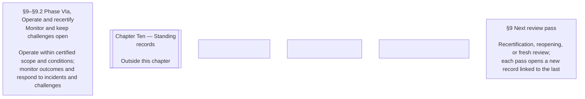

<!-- CHUNK-BEGIN es__core_09.000_system_alignment_certification_evaluation__section_1_corpus_placement_overview.md bytes=3543 -->
<!-- AI-assisted translation draft; unreviewed. §1 corpus-placement overview, source lines 8–10; source SHA-256 4311e6ba74b7210f077c0bd4c8d21d8c9f517d2ada7b6d87288b39494dfeadd5. Draft only; do not synchronize into translations/. -->

# Chapter Nine Part A — §1 corpus-placement overview (es)

## English source (lines 8–10)

> This file is **part of the Sentient Constitution** and is **binding only together** with the other numbered `core_*` files read as one text. It contains **Chapter Nine, Part A** — certification purpose, the process overview, and the first two phases of the process — **Frame** (system class) and **Evaluate** (whole-system evaluation in three sub-phases: the always-applicable evaluations, including data types and handling, in **§3**; the evaluations that apply where implicated in **§4**; and the Rights-Floor and domain evaluations that apply where triggered in **§5**) — **§1–§5**. The worked **Class A / B / C illustrations** (the system class profiles, §3.4.8, §5.1.5, §5.2.4, §5.3.7, §5.4.4, §5.5.5, and §5.6.4), including each one's **Reading across system classes** paragraph, are in [`core_09.010_system_alignment_certification_illustrations.md`](core_09.010_system_alignment_certification_illustrations.md); each keeps its Part A section number. The binding system-class-scaling and escalation rules those paragraphs illustrate stay in this file: system class scaling, including participation and proportionality, in §2.2; data-handling scaling in §3.4; and the **System class scaling and escalation** paragraph in each of §5.1–§5.6. The files of the whole chapter are listed in the table below.
>
> **Chapter Nine files.** Chapter Nine is split across four binding files read as one text. Part A, this file, opens the chapter; there is no separate index file.

## Translation draft

> Este archivo **forma parte de la Sentient Constitution** y solo es vinculante cuando se lee como un texto único junto con los demás archivos `core_*` numerados. Contiene el **Capítulo Nueve, Parte A**: el propósito de la certificación, una visión general del proceso y sus dos primeras fases: **Frame** (clase del sistema) y **Evaluate** (evaluación del sistema completo en tres subfases: las evaluaciones siempre aplicables, incluidos los tipos y el tratamiento de datos, en **§3**; las evaluaciones que se aplican cuando corresponde en **§4**; y las evaluaciones del **Piso de Derechos** y de los dominios que se activan en **§5**) — **§§1–5**. Los ejemplos desarrollados de las clases **A, B y C** (perfiles de clase del sistema, §3.4.8, §5.1.5, §5.2.4, §5.3.7, §5.4.4, §5.5.5 y §5.6.4), incluido el párrafo **Lectura entre clases de sistemas** de cada uno, están en [`core_09.010_system_alignment_certification_illustrations.md`](core_09.010_system_alignment_certification_illustrations.md); cada uno conserva el número de sección que tiene en la Parte A. Las reglas vinculantes de ajuste por clase y escalamiento que ilustran esos párrafos permanecen en este archivo: el ajuste por clase, incluida la participación y la proporcionalidad, en §2.2; el ajuste del tratamiento de datos en §3.4; y el párrafo **Ajuste por clase y escalamiento** de cada sección §5.1–§5.6. La tabla siguiente enumera los archivos de todo el capítulo.
>
> **Archivos del Capítulo Nueve.** El Capítulo Nueve se divide en cuatro archivos vinculantes que se leen como un solo texto. La Parte A, este archivo, abre el capítulo; no hay un archivo de índice separado.

<!-- CHUNK-END -->
<!-- CHUNK-BEGIN es__core_09.000_system_alignment_certification_evaluation__section_1_corpus_file_table.md bytes=5182 -->
<!-- AI-assisted translation draft; unreviewed. §1 corpus-placement file table, source lines 12–17; source SHA-256 4311e6ba74b7210f077c0bd4c8d21d8c9f517d2ada7b6d87288b39494dfeadd5. Draft only; do not synchronize into translations/. -->

# Chapter Nine Part A — §1 corpus-placement file table (es)

## English source (lines 12–17)

> | Part | File | Owns |
> |------|------|------|
> | **Part A — Evaluation** | [`core_09.000_system_alignment_certification_evaluation.md`](core_09.000_system_alignment_certification_evaluation.md) | §1–§5: purpose and process overview (with a chart of the whole certification process in its six phases), **Phase I Frame** (system class, how system class scales every evaluation, and pilot certification) and **Phase II Evaluate** (whole-system evaluation in three sub-phases: **IIa** always, in §3, including chartered scope versus functional boundaries and data types and handling; **IIb** where implicated, in §4; and **IIc** where triggered, the Rights-Floor and domain evaluations, in §5) |
> | **Part B — Record and process** | [`core_09.005_system_alignment_certification_record_process.md`](core_09.005_system_alignment_certification_record_process.md) | §6–§10: **Phase III Review** (forum roles, supervisory sequence, and the contestability chain), **Phase IV Decide** (certification outcomes, including the go-live gate), **Phase V Record** (the certification record and its integrity, including governing [System Charter](core_05.040_band_continuity.md#system-charter) fields), and **Phase VI Operate** (the challenge path; recertification and reopening; the standing bridge) — continuous chapter numbering from Part A §5 |
> | **Part C — Illustrations** | [`core_09.010_system_alignment_certification_illustrations.md`](core_09.010_system_alignment_certification_illustrations.md) | the illustrative system class profiles, §3.4, §3.4.8, §5.1.5, §5.2.4, §5.3.7, §5.4.4, §5.5.5, and §5.6.4: worked Class A / B / C walkthroughs for each Part A evaluation area, numbered to match Part A and linked both ways |
> | **Part D — Institutional alignment certification** | [`core_09.015_institutional_alignment_certification.md`](core_09.015_institutional_alignment_certification.md) | §11–§15: the same six phases for an **Institution** rather than a System — the institution class and the institutional evaluation (**Phases I and II**, §12), the forum roles, outcome, and **Institutional Certification Record** (**Phases III to V**, §13), and recertification, reopening, the cascade from System certifications, and the standing bridge (**Phase VI**, §14–§15). It cites each System's certification by link and does not repeat it, and it is not a licence — continuous chapter numbering from Part B §10 |

## Translation draft

| Parte | Archivo | Incluye |
|------|------|------|
| **Part A — Evaluation** | [`core_09.000_system_alignment_certification_evaluation.md`](core_09.000_system_alignment_certification_evaluation.md) | §§1–5: propósito y panorama del proceso (con un diagrama de sus seis fases), y las fases I Frame (clase del sistema, cómo esta escala cada evaluación y certificación piloto) y II Evaluate (evaluación integral en tres subfases: IIa siempre, en §3, incluido el alcance de la Carta frente a los límites funcionales y los tipos y tratamiento de datos; IIb cuando corresponda, en §4; y IIc cuando se active, las evaluaciones del Piso de Derechos y de los dominios en §5). |
| **Part B — Record and process** | [`core_09.005_system_alignment_certification_record_process.md`](core_09.005_system_alignment_certification_record_process.md) | §§6–10: fase III Review (funciones del foro, secuencia de supervisión y cadena de impugnación); IV Decide (resultados de certificación, incluida la condición previa a la puesta en marcha); V Record (registro e integridad de la certificación, incluidos los campos rectores de [System Charter](core_05.040_band_continuity.md#system-charter)); VI Operate (vía de impugnación, recertificación y reapertura, puente de standing) — numeración continua desde la Parte A §5. |
| **Part C — Illustrations** | [`core_09.010_system_alignment_certification_illustrations.md`](core_09.010_system_alignment_certification_illustrations.md) | Perfiles ilustrativos de clases de sistemas y §3.4, §3.4.8, §5.1.5, §5.2.4, §5.3.7, §5.4.4, §5.5.5 y §5.6.4: ejemplos desarrollados A/B/C para cada área de evaluación de la Parte A; conservan la numeración y se enlazan en ambas direcciones. |
| **Part D — Institutional alignment certification** | [`core_09.015_institutional_alignment_certification.md`](core_09.015_institutional_alignment_certification.md) | §§11–15: las mismas seis fases para una Institución en vez de un Sistema: clase y evaluación institucional (fases I–II, §12), funciones del foro, resultado y registro institucional (III–V, §13), y recertificación, reapertura, cascada de certificaciones de sistemas y puente de standing (VI, §§14–15). Remite a la certificación de cada Sistema y no la repite; no es una licencia — numeración continua desde la Parte B §10. |

<!-- CHUNK-END -->
<!-- CHUNK-BEGIN es__core_09.000_system_alignment_certification_evaluation__section_1_corpus_explanation.md bytes=8711 -->
<!-- AI-assisted translation draft; unreviewed. §1 corpus-placement explanatory prose, source lines 19–30; source SHA-256 4311e6ba74b7210f077c0bd4c8d21d8c9f517d2ada7b6d87288b39494dfeadd5. Draft only; do not synchronize into translations/. -->

# Chapter Nine Part A — §1 corpus-placement explanatory prose (es)

## English source (lines 19–30)

> **How the two certifications relate.** System Alignment Certification (Parts A to C) is the certification of a System. Institutional alignment certification (Part D) is the certification of an Institution, which may run Systems or none. Part D cites each System's certification record by link and does not redo it; [Part D §11.1](core_09.015_institutional_alignment_certification.md#111-relation-to-system-alignment-certification) states the relation and [Part D §11.3](core_09.015_institutional_alignment_certification.md#113-no-permission-and-no-gate) states that it is not a licence.
>
> Generic **Chapter Nine** links in other files route to the appropriate part by section number.
>
> - **Constitutional owner (joint with Parts B and D):** forum-supervised **system alignment certification and related records** — evaluation domains (Part A); forum process, supervisory sequence, certification-record duties, certification outcomes and the go-live gate, the challenge path, recertification and reopening, and verified-input bridge to Chapter Ten (Part B); the same six phases for an Institution (Part D). Under the **oversight** Tetrad leg, SAC is one especially large, high-stakes audit process among others; auditing floors remain at **Article XVI** (*Audit, Transparency, and Independent Verification*) and Chapter Five [Auditability](core_05.050_band_oversight.md#auditability).
> - **Verification substrate owner:** [Chapter Four — Burden of Proof, Traceability, and Verification](core_04.000_burden_traceability_verification.md#chapter-four-burden-of-proof-traceability-and-verification) (within Chapters Two through Four) owns burden allocation, compliance evidence, definition traceability, observability, and security-constrained verification. Chapter Nine **applies** that discipline to system alignment certification records; it does **not** restate Chapter Four sections **1** through **5**.
> - **Auditing home (not relocated here):** **Article XVI** (*Audit, Transparency, and Independent Verification*), **Def.O1** (*Transparency, Auditability, and Verification*), and **CJS-5.110 §3 and CJS-5.115 §3** (*Audit process home*)–**CJS-5.110 §5** own auditing floors and operational terms. Chapter Nine runs one especially large SAC audit process that must satisfy those floors; it does not own all auditing.
> - **Implementation owner:** system-class handling, CS-6.345, and forum-process detail in designated implementation files must remain consistent with Chapter Nine and may be stricter where the corpus already provides a [Fullest Protective Effect](core_05.045_band_integrative.md#fullest-protective-effect) rule.
> - **Anti-relocation rule:** Part A does not restate Chapter Five canonical definitions, Chapter Three anti-evasion discipline (see [Part B §9.3](core_09.005_system_alignment_certification_record_process.md#93-non-evasion)), Chapter Ten contribution or standing measurement, or Chapter Eleven standing effects. **[Part B §10](core_09.005_system_alignment_certification_record_process.md#10-relationship-to-standing)** states the standing bridge boundary explicitly.
>
> **Upstream:** Chapter Five definitions; Chapters Two through Four record, verification, burden, and traceability of definitions to results; and [Chapter Eight](core_08.000_functional_independence_separation_of_duties.md#chapter-eight-functional-independence-and-separation-of-duties), whose separation-of-duties requirement governs every materially binding certification act.
> **Downstream:** [Part B](core_09.005_system_alignment_certification_record_process.md#chapter-nine-part-b-system-alignment-certification--record-and-process) (*forum process, record, outcomes, and standing bridge*); Chapter Ten standing records and verified inputs; Chapter Eleven standing effects; Chapter Thirteen forum supervision and system alignment certification pathways.

## Translation draft

**Relación entre las dos certificaciones.** System Alignment Certification (Partes A a C) certifica un Sistema. La certificación de alineación institucional (Parte D) certifica una Institución, que puede operar Sistemas o no operar ninguno. La Parte D cita mediante enlace el registro de certificación de cada Sistema, pero no lo repite; [Part D §11.1](core_09.015_institutional_alignment_certification.md#111-relation-to-system-alignment-certification) explica la relación y [Part D §11.3](core_09.015_institutional_alignment_certification.md#113-no-permission-and-no-gate) establece que no es una licencia.
>
> Los enlaces genéricos a **Chapter Nine** en otros archivos conducen a la parte correspondiente según el número de sección.
>
> - **Responsable constitucional (compartido con las Partes B y D):** certificación de alineación del sistema y registros relacionados bajo supervisión del foro — dominios de evaluación (Parte A); proceso del foro, secuencia de supervisión, deberes del registro de certificación, resultados y condición de entrada en operación, vía de impugnación, recertificación y reapertura, y puente de entradas verificadas al Capítulo Diez (Parte B); las mismas seis fases para una Institución (Parte D). En el componente de **supervisión** de la Tetrada, SAC es un proceso de auditoría especialmente amplio y de alto riesgo entre otros; los mínimos de auditoría siguen en **Article XVI** (*Audit, Transparency, and Independent Verification*) y [Auditability](core_05.050_band_oversight.md#auditability) del Capítulo Cinco.
> - **Responsable de la base de verificación:** [Chapter Four — Burden of Proof, Traceability, and Verification](core_04.000_burden_traceability_verification.md#chapter-four-burden-of-proof-traceability-and-verification) (dentro de los capítulos Dos a Cuatro) es responsable de asignar la carga de la prueba, la evidencia de cumplimiento, la trazabilidad de definiciones, la observabilidad y la verificación condicionada por la seguridad. El Capítulo Nueve aplica esa disciplina a los registros de certificación de alineación del sistema; no vuelve a exponer las secciones **1** a **5** del Capítulo Cuatro.
> - **Sede de auditoría (no trasladada aquí):** **Article XVI** (*Audit, Transparency, and Independent Verification*), **Def.O1** (*Transparency, Auditability, and Verification*) y **CJS-5.110 §3 y CJS-5.115 §3** (*Audit process home*)–**CJS-5.110 §5** son responsables de los mínimos de auditoría y de los términos operativos. El Capítulo Nueve ejecuta un proceso SAC especialmente amplio que debe satisfacer esos mínimos; no es responsable de toda auditoría.
> - **Responsable de implementación:** la gestión por clase de sistema, CS-6.345 y los detalles del proceso del foro en los archivos de implementación designados deben ser coherentes con el Capítulo Nueve y pueden ser más estrictos cuando el corpus ya establezca una regla de [Fullest Protective Effect](core_05.045_band_integrative.md#fullest-protective-effect).
> - **Regla contra la reubicación:** la Parte A no repite las definiciones canónicas del Capítulo Cinco, la disciplina contra la evasión del Capítulo Tres (véase [Part B §9.3](core_09.005_system_alignment_certification_record_process.md#93-non-evasion)), la medición de contribución o standing del Capítulo Diez ni los efectos sobre standing del Capítulo Once. **[Part B §10](core_09.005_system_alignment_certification_record_process.md#10-relationship-to-standing)** establece expresamente el límite del puente de standing.
>
> **Fuentes previas:** definiciones del Capítulo Cinco; registros, verificación, carga de la prueba y trazabilidad de definiciones a resultados de los Capítulos Dos a Cuatro; y [Chapter Eight](core_08.000_functional_independence_separation_of_duties.md#chapter-eight-functional-independence-and-separation-of-duties), cuyo requisito de separación de funciones rige todo acto de certificación con efecto materialmente vinculante.
> **Fuentes posteriores:** [Part B](core_09.005_system_alignment_certification_record_process.md#chapter-nine-part-b-system-alignment-certification--record-and-process) (*proceso del foro, registro, resultados y puente de standing*); registros de standing y entradas verificadas del Capítulo Diez; efectos sobre standing del Capítulo Once; supervisión del foro y vías de certificación de alineación del sistema del Capítulo Trece.

<!-- CHUNK-END -->
<!-- CHUNK-BEGIN es__core_09.000_system_alignment_certification_evaluation__section_1_heading.md bytes=370 -->
<!-- AI-assisted translation draft; unreviewed. §1 heading, source line 44; source SHA-256 4311e6ba74b7210f077c0bd4c8d21d8c9f517d2ada7b6d87288b39494dfeadd5. Draft only; do not synchronize into translations/. -->

# Chapter Nine Part A — §1 heading (es)

## English source (lines 44–45)

### 1. Purpose and Role


## Translation draft

### 1. Propósito y función

<!-- CHUNK-END -->
<!-- CHUNK-BEGIN es__core_09.000_system_alignment_certification_evaluation__section_1_trace.md bytes=12114 -->
<!-- AI-assisted translation draft; unreviewed. §1 trace, source lines 46–95; source SHA-256 4311e6ba74b7210f077c0bd4c8d21d8c9f517d2ada7b6d87288b39494dfeadd5. Draft only; do not synchronize into translations/. -->

# Chapter Nine Part A — §1 trace (es)

## English source (lines 46–95)

<details>
<summary><strong><span style="color: #2563eb;">Trace</span></strong></summary>

- Upstream:
  - [Preamble — constitutional owner register](core_00.000_preamble.md#4-principles-definitions-and-rights) and
  - [Authority Stack and Internal Hierarchy](core_05.045_band_integrative.md#authority-stack-and-internal-hierarchy);
  - [Constitutional Tetrad](core_00.000_preamble.md#constitutional-tetrad);
  - [Two Constitutional Aims](core_00.000_preamble.md#two-constitutional-aims);
  - [material stake](core_00.000_preamble.md#material-stake);
  - [Proportionality](core_05.035_band_accountability.md#proportionality) and
  - [Substantive Fairness](core_05.055_band_participation.md#substantive-fairness) (Chapter Five); Participation measurement family (*voice, access, and contest paths*);
  - [Chapter One §16 Stewardship In Depth](core_01.010_stewardship_capacity_principles.md#16-stewardship-in-depth) (1.010 §16);
  - [Chapter One §12 Systemic Evaluation Requirement](core_01.000_values_principles.md#12-systemic-evaluation-requirement) (1.000 §12) (*principle-layer whole-system evaluation lens — not one corner alone*); Chapters Two through Four;
  - [Chapter Five](core_05.000_definitions_home.md#chapter-five-foundational-definitions) (5.000) (*canonical definitions*);
  - [Chapter Eight §2 Four-Seat Constitutional Requirement](core_08.000_functional_independence_separation_of_duties.md#2-four-seat-constitutional-requirement) (8.000 §2);
  - [System Alignment Certification](core_05.040_band_continuity.md#system-alignment-certification) (Chapter Five canonical term; non-operative shorthand **SAC**);
  - [System Certification Record](core_05.040_band_continuity.md#system-certification-record) (Chapter Five meaning).
- Downstream:
  - [§2](#2-system-class-evaluation) (*system class evaluation*);
  - [Part B §9.1](core_09.005_system_alignment_certification_record_process.md#91-challenging-a-certification) (9.005 §9.1) (*challenging a certification*); and
  - [Part C system class profiles](core_09.010_system_alignment_certification_illustrations.md#illustrative-system-class-profiles-non-exhaustive) (9.010) (*illustrative system class profiles*);
  - [Part C whole-system walkthroughs](core_09.010_system_alignment_certification_illustrations.md#illustrative-whole-system-application-by-system-class-non-exhaustive) (9.010) (*worked whole-system examples by system class*);
  - [§3.4.8](core_09.010_system_alignment_certification_illustrations.md#348-illustrative-data-handling-application-by-system-class-non-exhaustive) (*worked data-handling examples by system class*);
  - [§5.1.5](core_09.010_system_alignment_certification_illustrations.md#515-illustrative-ecological-footprint-application-by-system-class-non-exhaustive) (*worked ecological-footprint examples by system class*);
  - [§5.2.4](core_09.010_system_alignment_certification_illustrations.md#524-illustrative-educational-capability-application-by-system-class-non-exhaustive) (*worked educational-capability examples by system class*);
  - [§5.3.7](core_09.010_system_alignment_certification_illustrations.md#537-illustrative-cross-system-support-application-by-system-class-non-exhaustive) (*worked cross-system-support examples by system class*);
  - [§5.4.4](core_09.010_system_alignment_certification_illustrations.md#544-illustrative-nondiscrimination-application-by-system-class-non-exhaustive) (*worked nondiscrimination examples by system class*);
  - [§5.5.5](core_09.010_system_alignment_certification_illustrations.md#555-illustrative-accessibility-application-by-system-class-non-exhaustive) (*worked accessibility examples by system class*);
  - [§5.6.4](core_09.010_system_alignment_certification_illustrations.md#564-illustrative-trustworthiness-application-by-system-class-non-exhaustive) (*worked trustworthiness examples by system class*);
  - [§3](#3-whole-system-certification-evaluation) (*whole-system certification evaluation factors*);
  - [§3.4](#34-data-types-and-handling-evaluation) through
  - [§5.6](#56-trustworthiness-and-system-reliance-integrity-evaluation) (*domain evaluations*);
  - [Part B §6](core_09.005_system_alignment_certification_record_process.md#6-forum-process) (9.005 §6) (*supervisory sequence and contestability chain*);
  - [Part B §6.1](core_09.005_system_alignment_certification_record_process.md#61-forum-supervision-and-component-roles) (9.005 §6.1) (*forum component roles*);
  - [Part B §8](core_09.005_system_alignment_certification_record_process.md#8-system-certification-record) (9.005 §8) (*certification record contents*);
  - [Part B §8.2](core_09.005_system_alignment_certification_record_process.md#82-record-integrity-transparency-and-auditability) (9.005 §8.2) (*record integrity requirements*);
  - [Part B §7](core_09.005_system_alignment_certification_record_process.md#7-certification-outcomes) (9.005 §7) (*reopening and anti-evasion*);
  - [Part B §10](core_09.005_system_alignment_certification_record_process.md#10-relationship-to-standing) (9.005 §10) (*standing-record bridge*);
  - [Chapter Ten](core_11.000_standing_assessment.md#chapter-eleven-contribution-violation-and-standing-model--measurement) (10.000) (*standing records and verified-input gate*);
  - [Chapter Eleven](core_12.000_standing_integration.md#chapter-twelve-standing-effects-and-integration) (11.000) (*standing effects and integration*);
  - [Chapter Thirteen](core_14.000_forum.md#chapter-fourteen-forums-and-jurisdiction) (13.000) (*forum supervision, certification, alignment certification, and review*).
- Read with:
  - **[CS-9.305](corpus_systems/cs_09.305_system_classification_machinery.md#cs-9305-part-a-system-classification-machinery) (*System classification machinery*) and [CS-9.310 — System impact classifications](corpus_systems/cs_09.310_system_impact_classifications.md#cs-9310-part-b-system-impact-classifications)**, **[CS-6.305](corpus_systems/cs_06.305_information_types_and_handling.md#cs-6305-part-a-information-types-and-handling) (*Information types and handling*) and [CS-6.310 — Data classifications](corpus_systems/cs_06.310_data_classifications.md#cs-6310-part-b-data-classifications)**, and
  - **CS-6.345** (*System lifecycle*);
  - **CF-13.415** (*Routing operations, transfer, certification, and representative treatment*) and
  - **CF-13.425** (*Integrity safeguards, anti-capture operations, and anti-self-judging support*); **Article XVI** (*Audit, Transparency, and Independent Verification*) and
  - [Auditability](core_05.050_band_oversight.md#auditability) (*auditing floors — SAC is one especially large audit process under oversight, not the sole auditing home*); **CJS-5.110 §3 (*Oversight: auditability and reconstructability terms (annex)*) and CJS-5.115 §3** (*Audit process home*)–
  - **CJS-5.110 §5** (*Oversight: independent verification and claim-integrity terms*).

</details>

## Translation draft

#### Trazabilidad

El mapa sitúa la base constitucional y de autoridad de esta sección y la conecta con evaluación, clasificación, revisión, registros, resultados y auditoría; también señala los instrumentos operativos de lectura conjunta.

**Trazabilidad — upstream canonical sources:** [Preamble — constitutional owner register](core_00.000_preamble.md#4-principles-definitions-and-rights); [Authority Stack and Internal Hierarchy](core_05.045_band_integrative.md#authority-stack-and-internal-hierarchy); [Constitutional Tetrad](core_00.000_preamble.md#constitutional-tetrad); [Two Constitutional Aims](core_00.000_preamble.md#two-constitutional-aims); [material stake](core_00.000_preamble.md#material-stake); [Proportionality](core_05.035_band_accountability.md#proportionality); [Substantive Fairness](core_05.055_band_participation.md#substantive-fairness); [Chapter One §16 Stewardship In Depth](core_01.010_stewardship_capacity_principles.md#16-stewardship-in-depth); [Chapter One §12 Systemic Evaluation Requirement](core_01.000_values_principles.md#12-systemic-evaluation-requirement); [Chapter Five](core_05.000_definitions_home.md#chapter-five-foundational-definitions); [Chapter Eight §2 Four-Seat Constitutional Requirement](core_08.000_functional_independence_separation_of_duties.md#2-four-seat-constitutional-requirement); [System Alignment Certification](core_05.040_band_continuity.md#system-alignment-certification); [System Certification Record](core_05.040_band_continuity.md#system-certification-record)

**Trazabilidad — downstream routes and related records:** [§2](#2-system-class-evaluation); [Part B §9.1](core_09.005_system_alignment_certification_record_process.md#91-challenging-a-certification); [Part C system class profiles](core_09.010_system_alignment_certification_illustrations.md#illustrative-system-class-profiles-non-exhaustive); [Part C whole-system walkthroughs](core_09.010_system_alignment_certification_illustrations.md#illustrative-whole-system-application-by-system-class-non-exhaustive); [§3.4.8](core_09.010_system_alignment_certification_illustrations.md#348-illustrative-data-handling-application-by-system-class-non-exhaustive); [§5.1.5](core_09.010_system_alignment_certification_illustrations.md#515-illustrative-ecological-footprint-application-by-system-class-non-exhaustive); [§5.2.4](core_09.010_system_alignment_certification_illustrations.md#524-illustrative-educational-capability-application-by-system-class-non-exhaustive); [§5.3.7](core_09.010_system_alignment_certification_illustrations.md#537-illustrative-cross-system-support-application-by-system-class-non-exhaustive); [§5.4.4](core_09.010_system_alignment_certification_illustrations.md#544-illustrative-nondiscrimination-application-by-system-class-non-exhaustive); [§5.5.5](core_09.010_system_alignment_certification_illustrations.md#555-illustrative-accessibility-application-by-system-class-non-exhaustive); [§5.6.4](core_09.010_system_alignment_certification_illustrations.md#564-illustrative-trustworthiness-application-by-system-class-non-exhaustive); [§3](#3-whole-system-certification-evaluation); [§3.4](#34-data-types-and-handling-evaluation); [§5.6](#56-trustworthiness-and-system-reliance-integrity-evaluation); [Part B §6](core_09.005_system_alignment_certification_record_process.md#6-forum-process); [Part B §6.1](core_09.005_system_alignment_certification_record_process.md#61-forum-supervision-and-component-roles); [Part B §8](core_09.005_system_alignment_certification_record_process.md#8-system-certification-record); [Part B §8.2](core_09.005_system_alignment_certification_record_process.md#82-record-integrity-transparency-and-auditability); [Part B §7](core_09.005_system_alignment_certification_record_process.md#7-certification-outcomes); [Part B §10](core_09.005_system_alignment_certification_record_process.md#10-relationship-to-standing); [Chapter Ten](core_11.000_standing_assessment.md#chapter-eleven-contribution-violation-and-standing-model--measurement); [Chapter Eleven](core_12.000_standing_integration.md#chapter-twelve-standing-effects-and-integration); [Chapter Thirteen](core_14.000_forum.md#chapter-fourteen-forums-and-jurisdiction)

**Trazabilidad — operational materials to read with this section:** [CS-9.305](corpus_systems/cs_09.305_system_classification_machinery.md#cs-9305-part-a-system-classification-machinery); [CS-9.310 — System impact classifications](corpus_systems/cs_09.310_system_impact_classifications.md#cs-9310-part-b-system-impact-classifications); [CS-6.305](corpus_systems/cs_06.305_information_types_and_handling.md#cs-6305-part-a-information-types-and-handling); [CS-6.310 — Data classifications](corpus_systems/cs_06.310_data_classifications.md#cs-6310-part-b-data-classifications); [Auditability](core_05.050_band_oversight.md#auditability)

<!-- CHUNK-END -->
<!-- CHUNK-BEGIN es__core_09.000_system_alignment_certification_evaluation__purpose_adjuncts.md bytes=5745 -->
<!-- AI-assisted translation draft; unreviewed. Selected §1 passages, source lines 99 and 107–114; source SHA-256 4311e6ba74b7210f077c0bd4c8d21d8c9f517d2ada7b6d87288b39494dfeadd5. -->

# Chapter Nine Part A — §1 plain-terms excerpt

**Status:** AI-assisted draft; unreviewed. English source remains controlling.

## English source

When a system really matters to sentients' lives, certification has to be **proportionate** — as demanding as the system's real impact, dependency, and risk require, not a one-size-fits-all checklist or a rubber stamp. It also has to be **participatory** — affected sentients and communities must be able to see what was reviewed, understand what was decided, and challenge it when something is wrong. Forums review evidence, write it down in a certification record, and require re-checks on a schedule that matches how risky the system is. Classes A, B, and C get the full process and Class L a lighter one. Class P is encouraged to use it, and must once it is reclassified to Class L or higher (that is, its effects reach beyond a private unit) or its operator claims constitutional compliance.

## es draft

Cuando un sistema afecta de verdad la vida de los seres sintientes, la certificación debe ser **proporcionada**: tan exigente como requieran su impacto real, dependencia y riesgo, no una lista idéntica para todos ni un sello automático. También debe ser **participativa**: los seres sintientes y las comunidades afectadas han de poder ver qué se revisó, entender qué se decidió y cuestionarlo si algo está mal. Los foros examinan las pruebas, las registran en un expediente de certificación y exigen nuevas revisiones con una periodicidad acorde al riesgo del sistema. Las clases A, B y C siguen el proceso completo; la clase L, uno más ligero. Se alienta a la clase P a usarlo, y debe hacerlo cuando se reclasifique como L o superior (es decir, cuando sus efectos excedan una unidad privada) o cuando su operador afirme cumplir la Constitución.


### English source — Flourishing

- **[Flourishing](core_00.000_preamble.md#flourishing)** — certification verifies that certification or continued reliance would not quietly defeat Rights Floors or block fair participation in constitutionally relevant life;

### es draft

- **[Florecimiento](core_00.000_preamble.md#flourishing)** — la certificación verifica que certificar o seguir confiando en el sistema no anule silenciosamente los Pisos de Derechos ni bloquee la participación justa en la vida constitucionalmente pertinente;


### English source — Continuity criterion

- **[Continuity](core_00.000_preamble.md#continuity)** — certification verifies durable, non-regressive supply that sustains rather than depletes healthy natural systems ([Ecological Integrity](core_05.040_band_continuity.md#ecological-integrity), including [Ecological Recovery Capacity](core_05.040_band_continuity.md#ecological-recovery-capacity)), and system-class-scaled recertification where shared systems gate or sustain delivery;

### es draft

- **[Continuidad](core_00.000_preamble.md#continuity)** — la certificación verifica un suministro duradero y no regresivo que sostenga, en vez de agotar, los sistemas naturales sanos ([Integridad Ecológica](core_05.040_band_continuity.md#ecological-integrity), incluida la [Capacidad de Recuperación Ecológica](core_05.040_band_continuity.md#ecological-recovery-capacity)), y una recertificación ajustada a la clase del sistema cuando sistemas compartidos condicionen o sostengan la prestación;


### English source — Participation criterion

- **Participation** — affected sentients and communities can understand, contest, and take part in review paths that matter to them;

### es draft

- **Participación** — los seres sintientes y las comunidades afectados pueden entender, impugnar y participar en las vías de revisión que les importan;


### English source — Oversight criterion

- **Oversight** — records, evidence, and assumptions are visible and auditable enough for independent checking; certification itself is one especially large audit process under that oversight duty, not the only one;

### es draft

- **Supervisión** — los registros, las pruebas y los supuestos son visibles y auditables para permitir una verificación independiente; la certificación es un proceso de auditoría especialmente amplio dentro de ese deber, pero no su único ámbito;


### English source — Accountability criterion

- **Accountability** — defects, misclassification, and floor-defeating operation route to remedy, conditions, withdrawal, or standing input where the facts support it;

### es draft

- **Rendición de cuentas** — los defectos, la clasificación errónea y las operaciones que frustran los Pisos de Derechos conducen a reparación, condiciones, retirada o insumos para la evaluación de trayectoria cuando los hechos lo justifiquen;


### English source — Timeliness criterion

- **Timeliness** — review and contest windows keep certification from going stale while harm can still be prevented or reversed.

### es draft

- **Oportunidad** — los plazos de revisión e impugnación evitan que la certificación quede obsoleta mientras aún sea posible prevenir o revertir el daño.


### English source — Tetrad introduction

Certification implements the [Two Constitutional Aims](core_00.000_preamble.md#two-constitutional-aims) through the [Constitutional Tetrad](core_00.000_preamble.md#constitutional-tetrad):

### es draft

La certificación hace efectivos los [Dos Objetivos Constitucionales](core_00.000_preamble.md#two-constitutional-aims) mediante la [Tétrada Constitucional](core_00.000_preamble.md#constitutional-tetrad):

<!-- CHUNK-END -->
<!-- CHUNK-BEGIN es__core_09.000_system_alignment_certification_evaluation__section_1_purpose.md bytes=1276 -->
<!-- AI-assisted translation draft; unreviewed. Complete purpose statement excerpt, source lines 101–105; source SHA-256 4311e6ba74b7210f077c0bd4c8d21d8c9f517d2ada7b6d87288b39494dfeadd5. This is an excerpt, not a complete §1 translation. -->

La **certificación de alineación del sistema** existe para responder una pregunta dentro de un alcance y un calendario de revisión determinados: ¿ha demostrado el sistema suficiente alineación constitucional para obtener certificación, certificación condicional, validación, recertificación, continuidad de la dependencia, despliegue o liberación material de condiciones?

- Una certificación no es una puntuación de popularidad, un pase perpetuo ni una forma de omitir la revisión de derechos.
- Es una declaración limitada en el tiempo y susceptible de impugnación sobre lo que se sabe ahora de la alineación del sistema.
- Bajo la pata de **supervisión** de la Tétrada, la supervisión exige auditoría; la certificación de alineación del sistema es uno de varios procesos de auditoría especialmente grandes y de alto riesgo — no el único ámbito de auditoría (**Artículo XVI** (*Auditoría, transparencia y verificación independiente*), [Auditabilidad](core_05.050_band_oversight.md#auditability)).

<!-- CHUNK-END -->
<!-- CHUNK-BEGIN es__core_09.000_system_alignment_certification_evaluation__section_1_subsection_headings.md bytes=784 -->
<!-- AI-assisted translation draft; unreviewed. §1.1/§1.2 visible subsection headings, source lines 116–119 and 144–148; source SHA-256 4311e6ba74b7210f077c0bd4c8d21d8c9f517d2ada7b6d87288b39494dfeadd5. Draft only; anchors/blank layout are structural. Do not synchronize into translations/. -->

# Chapter Nine Part A — §1.1 and §1.2 subsection headings (es)

## English source

### Lines 116–119

<a id="11-certification-as-an-audit-process-scaled-by-class"></a>

#### 1.1 Certification as an audit process, scaled by class


### Lines 144–148


<a id="12-certification-at-a-glance"></a>

#### 1.2 Certification at a glance


## Translation draft

#### 1.1 La certificación como proceso de auditoría, escalado según la clase

#### 1.2 La certificación de un vistazo

<!-- CHUNK-END -->
<!-- CHUNK-BEGIN es__core_09.000_system_alignment_certification_evaluation__section_1_audit_scope.md bytes=3343 -->
<!-- AI-assisted translation draft; unreviewed. §1.1 audit mechanism and sibling audit modes, source lines 120–130; source SHA-256 4311e6ba74b7210f077c0bd4c8d21d8c9f517d2ada7b6d87288b39494dfeadd5. -->

# Chapter Nine Part A — §1.1 certification audit process excerpt (es)

## English source

As an oversight mechanism, certification is one especially large audit process under [Auditability](core_05.050_band_oversight.md#auditability) and **Article XVI** (*Audit, Transparency, and Independent Verification*):

- It is forum-supervised, multi-domain, and status-granting.
- It may integrate the results of sibling audit modes, and it does not absorb or replace them. Each keeps its own owner, named in the [sibling audit modes map](corpus_joint_structure/cjs_05.115_audit_process.md#sibling-audit-modes-owner-map) of the audit process home:
  - System Data Types Record audits under **CS-6.305 (*Information types and handling*) and CS-6.310** (*Data classifications*)
  - System Classification Record audits under **CS-9.305 (*System classification machinery*) and CS-9.310** (*System impact classifications*)
  - steward assurance reviews under **CS-14.305** (*Critical system stewardship*)
  - continuous audit under **CS-6.345** (*System lifecycle*) ACA
  - complexity audits under **CS-6.315** (*Comprehensibility and complexity stewardship*) and **Article XXIII-B** (*Complexity Audit and Modularity Requirements*)
  - claim verification under **CJS-5.110 §5** (*Oversight: independent verification and claim-integrity terms*)
- You can still run any of these checks on their own, without going through certification. Certification doesn't replace them.

## es draft

Como mecanismo de supervisión, la certificación es un proceso de auditoría especialmente amplio conforme a [Auditabilidad](core_05.050_band_oversight.md#auditability) y **Article XVI** (*Auditoría, transparencia y verificación independiente*):

- Está supervisada por foros, abarca múltiples dominios y otorga estatus.
- Puede integrar los resultados de modalidades de auditoría afines, pero no las absorbe ni las sustituye. Cada una conserva su propio responsable, identificado en el [mapa de modalidades de auditoría afines](corpus_joint_structure/cjs_05.115_audit_process.md#sibling-audit-modes-owner-map) del documento central del proceso de auditoría:
  - Auditorías del registro de tipos de datos del sistema conforme a **CS-6.305 (*Tipos de información y tratamiento*) y CS-6.310** (*Clasificaciones de datos*)
  - Auditorías del registro de clasificación del sistema conforme a **CS-9.305 (*Mecanismos de clasificación del sistema*) y CS-9.310** (*Clasificaciones de impacto del sistema*)
  - Revisiones de garantía de custodia conforme a **CS-14.305** (*Custodia de sistemas críticos*)
  - Auditoría continua conforme a **CS-6.345** (*Ciclo de vida del sistema*) ACA
  - Auditorías de complejidad conforme a **CS-6.315** (*Comprensibilidad y custodia de la complejidad*) y **Article XXIII-B** (*Requisitos de auditoría de complejidad y modularidad*)
  - Verificación de afirmaciones conforme a **CJS-5.110 §5** (*Supervisión: verificación independiente e integridad de las afirmaciones*)
- Aun puedes ejecutar cualquiera de estas comprobaciones por separado, sin pasar por la certificación. La certificación no las sustituye.

<!-- CHUNK-END -->
<!-- CHUNK-BEGIN es__core_09.000_system_alignment_certification_evaluation__section_1_class_scaling.md bytes=4026 -->
<!-- AI-assisted translation draft; unreviewed. Chapter Nine Part A §1 class scaling and cadence, source lines 132–143; source SHA-256 4311e6ba74b7210f077c0bd4c8d21d8c9f517d2ada7b6d87288b39494dfeadd5. Draft only; do not synchronize into translations/. -->

**Current English passage:**

Certification depth, record burden, certification interval, stakeholder review, and contest paths must scale with [material stake](core_00.000_preamble.md#material-stake) under [Proportionality](core_05.035_band_accountability.md#proportionality):

The process applies by impact class, as the [reclassification requirement](corpus_systems/cs_09.305_system_classification_machinery.md#35-reclassification-requirement) of **CS-9.305** (*System classification machinery*) sets out:

- **Class A, Class B, and Class C:** these systems carry the highest impact, dependency, and risk, and whole-system evaluation under [§3 Whole-System Certification Evaluation](#3-whole-system-certification-evaluation), [§4 Evaluations Where Implicated](#4-evaluations-where-implicated), and [§5 Rights-Floor and Domain Evaluations](#5-rights-floor-and-domain-evaluations), each as its own sub-phase applies, is mandatory at full depth;
- **Class L:** the same evaluation is mandatory but proportionate, with a lower default re-check cadence and simpler records where CS-9.305 (*System classification machinery*) and CS-9.310 (*System impact classifications*) permits; and
- **Class P:** the process is encouraged while the system is validly Class P, and a Class P system may use it voluntarily. It becomes mandatory on reclassification to Class L or higher, or where the operator voluntarily asserts constitutional compliance for the system.

The certification interval, and the financial, resource, or special audit that falls at its midpoint, are set by class in [Chapter Thirteen §6 Timely resolution, materiality tiers, and anti-delay discipline](core_14.000_forum.md#review-cadence) (*Review cadence*). This chapter does not restate the numbers.

**Proposed locale translation:**

La profundidad de la certificación, la carga de los registros, el intervalo de certificación, la revisión de las partes interesadas y las vías de impugnación deben ajustarse a la [materialidad del interés](core_00.000_preamble.md#material-stake) conforme a la [proporcionalidad](core_05.035_band_accountability.md#proportionality):

El proceso se aplica según la clase de impacto, conforme al [requisito de reclasificación](corpus_systems/cs_09.305_system_classification_machinery.md#35-reclassification-requirement) de **CS-9.305** (*Mecanismo de clasificación de sistemas*):

- **Clases A, B y C:** estos sistemas tienen el mayor impacto, dependencia y riesgo. Es obligatorio realizar con profundidad plena la evaluación de todo el sistema, en cada subfase aplicable, conforme a [§3 Evaluación de certificación de todo el sistema](#3-whole-system-certification-evaluation), [§4 Evaluaciones cuando proceda](#4-evaluations-where-implicated) y [§5 Evaluaciones de pisos de derechos y por dominio](#5-rights-floor-and-domain-evaluations);
- **Clase L:** la misma evaluación es obligatoria, pero proporcionada, con una periodicidad predeterminada de revisión menos frecuente y registros más sencillos cuando lo permitan **CS-9.305** (*Mecanismo de clasificación de sistemas*) y **CS-9.310** (*Clasificaciones del impacto del sistema*); y
- **Clase P:** se recomienda el proceso mientras la clasificación P sea válida, y el sistema puede usarlo voluntariamente. Pasa a ser obligatorio si se reclasifica como L o superior, o si su operador afirma voluntariamente que el sistema cumple la Constitución.

El intervalo de certificación y la auditoría financiera, de recursos o especial que corresponda a su punto medio se fijan por clase en el [Capítulo Trece §6 Resolución oportuna, niveles de materialidad y disciplina contra las demoras](core_14.000_forum.md#review-cadence) (*Periodicidad de revisión*). Este capítulo no repite las cifras.

<!-- CHUNK-END -->
<!-- CHUNK-BEGIN es__core_09.000_system_alignment_certification_evaluation__section_1_at_a_glance.md bytes=1833 -->
<!-- AI-assisted translation draft; unreviewed. Chapter Nine Part A §1.2 plain-language summary, source line 149; source SHA-256 4311e6ba74b7210f077c0bd4c8d21d8c9f517d2ada7b6d87288b39494dfeadd5. Draft only; do not synchronize into translations/. -->

# Chapter Nine Part A — §1.2 at-a-glance summary (es)

## English source

*In plain terms: classify the system honestly, run the evaluations that apply, have forums independently review the evidence and stakeholder concerns, and decide an outcome. Complete the one record opened for forum review and publish it with an open challenge path. A certified system goes live only after its notice interval and required protections are satisfied. Monitor actual outcomes, respond to incidents and challenges, and check again on schedule or when the facts change. Correct defects and have the correction independently verified before authorizing the affected scope or releasing its conditions. Each review pass uses a new record linked to the last.*

## es draft

*En términos sencillos: clasifique el sistema con honestidad, realice las evaluaciones aplicables, haga que los foros revisen de forma independiente las pruebas y las preocupaciones de las partes interesadas, y decida un resultado. Complete el único registro abierto para revisión del foro y publíquelo con una vía de impugnación abierta. Un sistema certificado solo entra en funcionamiento tras cumplir el plazo de notificación y las protecciones exigidas. Vigile los resultados reales, responda a incidentes e impugnaciones y vuelva a comprobarlo según el calendario o cuando cambien los hechos. Corrija los defectos y someta la corrección a verificación independiente antes de autorizar el alcance afectado o levantar sus condiciones. Cada ciclo de revisión utiliza un registro nuevo vinculado al anterior.*

<!-- CHUNK-END -->
<!-- CHUNK-BEGIN es__core_09.000_system_alignment_certification_evaluation__section_1_phase_map.md bytes=581 -->
<!-- AI-assisted translation draft; unreviewed. Chapter Nine Part A §1.2 phase map, source line 151; source SHA-256 4311e6ba74b7210f077c0bd4c8d21d8c9f517d2ada7b6d87288b39494dfeadd5. Draft only; do not synchronize into translations/. -->

**Current English passage:**

The process runs in **six phases**: **I Frame**, **II Evaluate**, **III Review**, **IV Decide**, **V Record**, and **VI Operate**.

**Proposed locale translation:**

El proceso consta de **seis fases**: **I Encuadre**, **II Evaluación**, **III Revisión**, **IV Decisión**, **V Registro** y **VI Operación**.

<!-- CHUNK-END -->
<!-- CHUNK-BEGIN es__core_09.000_system_alignment_certification_evaluation__section_1_reopen_triggers.md bytes=1726 -->
<!-- AI-assisted translation draft; unreviewed. Chapter Nine Part A §1 review-reopening passage, source line 153; source SHA-256 4311e6ba74b7210f077c0bd4c8d21d8c9f517d2ada7b6d87288b39494dfeadd5. Draft only; do not synchronize into translations/. -->

**Current English passage:**

Every evaluation that applies is carried out again on each certification pass: at first certification, at each recertification on the schedule set by [§2 System Class Evaluation](#2-system-class-evaluation), and at each reopened or fresh review. Review reopens before the next scheduled recertification when material facts change, such as growing reliance on the system, growing extraction from shared foundations, a significant fall in what the system puts back into them, or a credible challenge. [Part B §9 Recertification and Reopening](core_09.005_system_alignment_certification_record_process.md#9-recertification-and-reopening) lists the triggers.

**Proposed locale translation:**

Cada evaluación aplicable se repite en cada ciclo de certificación: en la certificación inicial, en cada recertificación conforme al calendario fijado por [§2 Evaluación de la clase del sistema](#2-system-class-evaluation) y en cada revisión reabierta o nueva. La revisión se reabre antes de la siguiente recertificación programada cuando cambian hechos materiales, como un aumento de la dependencia del sistema, una mayor extracción de fundamentos compartidos, una disminución significativa de lo que el sistema aporta a esos fundamentos o una impugnación creíble. El [Apartado B §9 Recertificación y reapertura](core_09.005_system_alignment_certification_record_process.md#9-recertification-and-reopening) enumera los desencadenantes.

<!-- CHUNK-END -->
<!-- CHUNK-BEGIN es__core_09.000_system_alignment_certification_evaluation__section_1_phase_map_opening_nodes.md bytes=1952 -->
<!-- AI-assisted translation draft; unreviewed. §1.2 Phase I/II opening chart-node labels, source lines 155–165; source SHA-256 4311e6ba74b7210f077c0bd4c8d21d8c9f517d2ada7b6d87288b39494dfeadd5. Draft only; non-prose Mermaid syntax/connectors are retained. Do not synchronize into translations/. -->

# Chapter Nine Part A — §1.2 opening phase-map nodes (es)

## English source (lines 155–165)

```mermaid
flowchart TB
    T(["System with material impact seeks certification,<br/>or reliance on it grows"])
    C["§2 Phase I, Frame<br/>Classify honestly<br/><br/>Class sets depth and re-check schedule"]
    subgraph W["§3–§5 Phase II, Evaluate — Whole-system evaluation"]
        direction LR
        Al["§3.1–§3.4 IIa — Always<br/><br/>Governance; systemic risk: evaluated,<br/>and disclosed to those who need it;<br/>time horizon; data types"]
        Im["§4 IIb — When implicated<br/><br/>Privacy loci, exit rights,<br/>assembly and dissent"]
        Tr["§5 IIc — When triggered<br/><br/>Applicable Rights-Floor checks<br/>and six domain evaluations"]
        Al ~~~ Im ~~~ Tr
    end

## Translation draft

```mermaid
flowchart TB
    T["Un sistema con impacto material solicita certificación,<br/>o aumenta la dependencia de él"]
    C["§2 Fase I, Enmarcar<br/>Clasificar con honestidad<br/><br/>La clase determina la profundidad y el calendario de revisión"]
    subgraph W["§3–§5 Fase II, Evaluar — evaluación integral del sistema"]
        direction LR
        Al["§3.1–§3.4 IIa — Siempre<br/><br/>Gobernanza; riesgo sistémico: evaluar y divulgar<br/>a quienes lo necesitan; horizonte temporal; tipos de datos"]
        Im["§4 IIb — Cuando corresponda<br/><br/>Ámbitos de privacidad, derechos de salida,<br/>asamblea y disenso"]
        Tr["§5 IIc — Cuando se active<br/><br/>Controles aplicables del piso de derechos<br/>y seis evaluaciones de dominio"]
        Al ~~~ Im ~~~ Tr
    end
```

<!-- CHUNK-END -->
<!-- CHUNK-BEGIN es__core_09.000_system_alignment_certification_evaluation__chart_review_node.md bytes=605 -->
# Chapter Nine Part A — chart review node (es)

AI-assisted draft; unreviewed. Current source SHA-256: `4311e6ba74b7210f077c0bd4c8d21d8c9f517d2ada7b6d87288b39494dfeadd5`. Reconciles current source line 166: “Assigned forums issue findings; challenge paths stay open.” The translated node ID, chart structure, HTML line breaks, and code syntax are preserved.

```mermaid
    F["Fase III, Revisar — §6<br/>Revisión independiente de la evidencia<br/>y las inquietudes de las partes afectadas<br/><br/>Los foros asignados emiten conclusiones;<br/>las vías de impugnación permanecen abiertas"]
```

<!-- CHUNK-END -->
<!-- CHUNK-BEGIN es__core_09.000_system_alignment_certification_evaluation__section_1_decision_nodes.md bytes=3765 -->
<!-- AI-assisted translation draft; unreviewed. Chapter Nine Part A §1.2 decision and outcome diagram nodes, source lines 167–176; source SHA-256 4311e6ba74b7210f077c0bd4c8d21d8c9f517d2ada7b6d87288b39494dfeadd5. Draft only; do not synchronize into translations/. -->

# Chapter Nine Part A — §1.2 decision and outcome nodes (es)

## English source (lines 167–176)

```mermaid
flowchart TB
    Rec["§8 Phase V, Record<br/>One System Certification Record<br/><br/>Opened for forum review; completed with the outcome,<br/>supporting findings, conditions, and operating plan"]
    S[["Chapter Ten — Standing<br/>records<br/><br/>Outside this chapter"]]
    O{"§7 Phase IV, Decide<br/><br/>What outcome and status<br/>does the evidence support?"}
    Fc["§7, §9.2 Full Certification<br/><br/>Required consecutive clean provisional recertifications;<br/>no current or indicated impending misalignment<br/>Full certification interval; conditions may apply"]
    Pc["§7, §9.2 Provisional Certification<br/><br/>First grant, recovery after misalignment,<br/>or continued or stepped-down provisional status<br/>Provisional interval, shorter; conditions may apply"]
    Nc["§7 Not Certified<br/><br/>Deferred, refused, withdrawn, or expired<br/>No go-live; state reasons and required corrective work"]
    Pub["§7, §9.1 Publish the completed record<br/><br/>Open the published record challenge path;<br/>for new or expanded scope, state go-live and notice"]
    G{"§7 Go-live gate<br/><br/>Certification and applicable<br/>go-live prerequisites satisfied?"}
    Hold["§7 Meet go-live prerequisites<br/><br/>Complete notice and independently verify<br/>conditions required before go-live"]
    Rm["§7, §9.2 Protect and correct<br/><br/>No new go-live in the affected scope;<br/>protect affected sentients, correct design or operation,<br/>and submit evidence for independent verification"]
```



## es draft



<!-- CHUNK-END -->
<!-- CHUNK-BEGIN es__core_09.000_system_alignment_certification_evaluation__section_1_review_cycle_nodes.md bytes=2797 -->
<!-- AI-assisted translation draft; unreviewed. Chapter Nine Part A §1.2 operation and next-review diagram nodes, source lines 177–182; source SHA-256 4311e6ba74b7210f077c0bd4c8d21d8c9f517d2ada7b6d87288b39494dfeadd5. Draft only; do not synchronize into translations/. -->

```mermaid
flowchart TB
    Rec["§8 Fase V, Registro<br/>Un único Registro de Certificación del Sistema<br/><br/>Abierto para revisión del foro; se completa con el resultado, los hallazgos de apoyo, las condiciones y el plan operativo"]
    S[["Capítulo Diez — Registros de posición<br/><br/>Fuera de este capítulo"]]
    O{"§7 Fase IV, Decidir<br/><br/>¿Qué resultado y estado<br/>respalda la evidencia?"}
    Fc["§7, §9.2 Certificación plena<br/><br/>Se requieren recertificaciones provisionales consecutivas sin defectos;<br/>sin desalineación actual ni inminente indicada<br/>Intervalo de certificación plena; pueden aplicarse condiciones"]
    Pc["§7, §9.2 Certificación provisional<br/><br/>Primera concesión, recuperación tras una desalineación,<br/>o continuación o reducción del estado provisional<br/>Intervalo provisional más breve; pueden aplicarse condiciones"]
    Nc["§7 No certificado<br/><br/>Aplazado, denegado, retirado o vencido<br/>Sin puesta en marcha; se indican los motivos y el trabajo correctivo requerido"]
    Pub["§7, §9.1 Publicar el registro completo<br/><br/>Abrir la vía para impugnar el registro publicado;<br/>para un alcance nuevo o ampliado, indicar la puesta en marcha y el aviso"]
    G{"§7 Requisito previo de puesta en marcha<br/><br/>¿Se han satisfecho la certificación y los requisitos previos<br/>aplicables para la puesta en marcha?"}
    Hold["§7 Cumplir los requisitos previos de puesta en marcha<br/><br/>Completar el aviso y verificar independientemente<br/>las condiciones exigidas antes de la puesta en marcha"]
    Rm["§7, §9.2 Proteger y corregir<br/><br/>No iniciar nuevas operaciones en el alcance afectado;<br/>proteger a los seres sintientes afectados, corregir el diseño o la operación,<br/>y presentar pruebas para verificación independiente"]
```

# Chapter Nine Part A — §1.2 operation and review-cycle nodes (es)

## English source (lines 177–182)



## es draft


<!-- CHUNK-END -->
<!-- CHUNK-BEGIN es__core_09.000_system_alignment_certification_evaluation__section_1_phase_map_edge_labels.md bytes=1827 -->
<!-- AI-assisted translation draft; unreviewed. §1.2 certification-phase chart edge labels, source lines 194, 199, 200–206; source SHA-256 4311e6ba74b7210f077c0bd4c8d21d8c9f517d2ada7b6d87288b39494dfeadd5. Mermaid node IDs, edge syntax, and <br/> delimiters are structural and preserved; visible edge labels are translated. Draft only; do not synchronize into translations/. -->

# Chapter Nine Part A — phase-chart edge labels (es)

## English source

```mermaid
    Rec -.->|VIb, §10 —<br/>verified inputs only;<br/>current certification or facts<br/>arising during certification| S
    G --->|Yes: operate<br/>within the record| Ch
    G --->|Certified,<br/>prerequisites pending| Hold
    Ch -->|Material defect:<br/>protect and correct| Rm
    Ch -->|On schedule, or<br/>material change or<br/>credible challenge<br/>requires review| Re
    Ch -.->|VIb, §10 —<br/>verified inputs only;<br/>operation may supply facts<br/>for Contribution and<br/>Violation records| S2
    Rm -->|Correction evidence<br/>is checked in the<br/>next review pass| Re
    G -->|Not Certified| Rm
```

## Translation draft

```mermaid
    Rec -.->|VIb, §10 —<br/>solo entradas verificadas;<br/>certificación vigente o hechos<br/>surgidos durante la certificación| S
    G --->|Sí: operar<br/>dentro del registro| Ch
    G --->|Certificado,<br/>requisitos previos pendientes| Hold
    Ch -->|Defecto material:<br/>proteger y corregir| Rm
    Ch -->|Según el calendario, o<br/>si un cambio material o<br/>un desafío creíble<br/>exige revisión| Re
    Ch -.->|VIb, §10 —<br/>solo entradas verificadas;<br/>la operación puede aportar hechos<br/>para los registros de<br/>Contribución e Infracción| S2
    Rm -->|La evidencia de corrección<br/>se verifica en la<br/>siguiente revisión| Re
    G -->|No certificado| Rm
```

<!-- CHUNK-END -->
<!-- CHUNK-BEGIN es__core_09.000_system_alignment_certification_evaluation__section_1_reader_guide.md bytes=4340 -->
<!-- AI-assisted translation draft; unreviewed. §1 non-operative reader guide, source lines 236–245; source SHA-256 4311e6ba74b7210f077c0bd4c8d21d8c9f517d2ada7b6d87288b39494dfeadd5. Draft only; do not synchronize into translations/. -->

# Chapter Nine Part A — §1 reader guide (es)

## English source (lines 236–245)

<details>
<summary><strong><span style="color: #2563eb;">Reader guide (non-operative): illustrations, run sheet, and Institutions</span></strong></summary>

> Illustrative **Class A**, **Class B**, and **Class C** profiles — and how system class scales certification depth across this chapter — are in [Illustrative System Class Profiles (Non-Exhaustive)](core_09.010_system_alignment_certification_illustrations.md#illustrative-system-class-profiles-non-exhaustive). Worked walkthroughs of the same three systems for each evaluation area in [§3 Whole-System Certification Evaluation](#3-whole-system-certification-evaluation) through [§5.6 Trustworthiness and System-Reliance Integrity Evaluation](#56-trustworthiness-and-system-reliance-integrity-evaluation) follow there, in [Part C — Illustrations](core_09.010_system_alignment_certification_illustrations.md#chapter-nine-part-c-system-alignment-certification--illustrations), which links each profile and walkthrough back to the Part A section it illustrates.
>
> A step-by-step run sheet for the six phases, with a link from each step to the section that holds the rule, is in [CS-9.315 §2 Run sheet](corpus_systems/cs_09.315_system_alignment_certification_run_sheet.md#cs-9315-2-run-sheet) (*System alignment certification run sheet*). Where the run sheet and a section differ, the section controls.
>
> For an Institution, the same six phases run through [Part D](core_09.015_institutional_alignment_certification.md#chapter-nine-part-d-institutional-alignment-certification): Phases I and II in [Part D §12 Institution Class and Institutional Evaluation](core_09.015_institutional_alignment_certification.md#12-institution-class-and-institutional-evaluation), Phases III to V in [§13 Review, Decision, and Record](core_09.015_institutional_alignment_certification.md#13-review-decision-and-record), and Phase VI in [§14 Operating, Reopening, and the Cascade](core_09.015_institutional_alignment_certification.md#14-operating-reopening-and-the-cascade) and [§15 Standing Bridge and Non-Evasion](core_09.015_institutional_alignment_certification.md#15-standing-bridge-and-non-evasion).

</details>

## Translation draft

<details>
<summary><strong>Guía para el lector (no operativa): ejemplos, hoja de ruta e instituciones</strong></summary>

Los perfiles ilustrativos **A**, **B** y **C**, y cómo la clase determina la profundidad de certificación en este capítulo, aparecen en [Perfiles ilustrativos de clases de sistema (no exhaustivos)](core_09.010_system_alignment_certification_illustrations.md#illustrative-system-class-profiles-non-exhaustive). La [Part C — Ilustraciones](core_09.010_system_alignment_certification_illustrations.md#chapter-nine-part-c-system-alignment-certification--illustrations) contiene recorridos prácticos de los mismos tres sistemas por cada área de evaluación y enlaza cada ejemplo con la regla de Part A correspondiente.

La [hoja de ruta CS-9.315 §2](corpus_systems/cs_09.315_system_alignment_certification_run_sheet.md#cs-9315-2-run-sheet) describe paso a paso las seis fases y enlaza cada paso con la sección que contiene la regla. Si hay diferencias, prevalece la sección.

Para una institución, las mismas seis fases se desarrollan en [Part D](core_09.015_institutional_alignment_certification.md#chapter-nine-part-d-institutional-alignment-certification): fases I y II en [§12](core_09.015_institutional_alignment_certification.md#12-institution-class-and-institutional-evaluation), III a V en [§13](core_09.015_institutional_alignment_certification.md#13-review-decision-and-record), y VI en [§14](core_09.015_institutional_alignment_certification.md#14-operating-reopening-and-the-cascade) y [§15](core_09.015_institutional_alignment_certification.md#15-standing-bridge-and-non-evasion).

Estos recorridos abarcan las áreas de evaluación desde [§3](#3-whole-system-certification-evaluation) hasta [§5.6](#56-trustworthiness-and-system-reliance-integrity-evaluation).

</details>

<!-- CHUNK-END -->
<!-- CHUNK-BEGIN es__core_09.000_system_alignment_certification_evaluation__visible_section_headings_2_3.md bytes=1287 -->
<!-- AI-assisted translation draft; unreviewed. Remaining visible Part A headings, source lines 251, 409, 477, 531, 592, 653; source SHA-256 4311e6ba74b7210f077c0bd4c8d21d8c9f517d2ada7b6d87288b39494dfeadd5. Anchors are structural; prose headings are translated. Draft only; do not synchronize into translations/. -->

# Chapter Nine Part A — remaining visible section headings (es)

## English source

<a id="2-system-class-evaluation"></a>
### 2. System Class Evaluation
<a id="3-whole-system-certification-evaluation"></a>
### 3. Whole-System Certification Evaluation
<a id="31-governance-incentive-and-contestability-discipline"></a>
#### 3.1 Governance, Incentive, and Contestability Discipline
<a id="32-systemic-scope-and-risk-factors"></a>
#### 3.2 Systemic Scope and Risk Factors
<a id="34-data-types-and-handling-evaluation"></a>
#### 3.4 Data Types and Handling Evaluation
<a id="341-type-o-baseline-disclosure"></a>
##### 3.4.1 Type O Baseline Disclosure

## Translation draft

### 2 Evaluación de la clase del sistema
### 3 Evaluación integral del sistema
#### 3.1 Disciplina de gobernanza, incentivos e impugnabilidad
#### 3.2 Alcance sistémico y factores de riesgo
#### 3.4 Evaluación de los tipos y el tratamiento de datos
##### 3.4.1 Divulgación básica de Tipo O

<!-- CHUNK-END -->
<!-- CHUNK-BEGIN es__core_09.000_system_alignment_certification_evaluation__section_2_trace.md bytes=9982 -->
<!-- AI-assisted translation draft; unreviewed. §2 trace, source lines 253–295; source SHA-256 4311e6ba74b7210f077c0bd4c8d21d8c9f517d2ada7b6d87288b39494dfeadd5. Draft only; do not synchronize into translations/. -->

# Chapter Nine Part A — §2 trace (es)

## English source (lines 253–295)

<details>
<summary><strong><span style="color: #2563eb;">Trace</span></strong></summary>

- Upstream:
  - [§1](#1-purpose-and-role) (*purpose and role*); Integrative Materiality (
  - [Materiality](core_05.050_band_oversight.md#materiality)) (*Materiality*);
  - [Constitutional Tetrad](core_00.000_preamble.md#constitutional-tetrad);
  - [Two Constitutional Aims](core_00.000_preamble.md#two-constitutional-aims);
  - [Material Impact](core_05.050_band_oversight.md#material-impact),
  - [Dependency](core_05.040_band_continuity.md#dependency),
  - [Risk](core_05.040_band_continuity.md#risk),
  - [System Boundaries](core_05.040_band_continuity.md#system-boundaries), and
  - [System Charter](core_05.040_band_continuity.md#system-charter) (Chapter Five);
  - [Chapter One §12 Systemic Evaluation Requirement](core_01.000_values_principles.md#12-systemic-evaluation-requirement) (1.000 §12); **Article III-A** (*Survival*) and **Article IV-A** (*Rights-Floor delivery where classification gates access*); **Article V-A** (*Dependency Mapping and Resource-Flow Transparency*) and **Article V-B** (*resource allocation and dependency stewardship where certification gates shared-infrastructure reliance*).
- Downstream:
  - [§2.1](#21-certification-recertification-and-defects) (*certification status, recertification, and defects*);
  - [§2.2](#22-how-system-class-scales-every-evaluation) (*system-class-scaled participation and proportionality*);
  - [§2.3](#23-pilot-certification) (*pilot certification*);
  - [Part C system class profiles and reclassification](core_09.010_system_alignment_certification_illustrations.md#illustrative-system-class-profiles-non-exhaustive) (9.010) (*illustrative system class profiles*);
  - [Part C whole-system walkthroughs](core_09.010_system_alignment_certification_illustrations.md#illustrative-whole-system-application-by-system-class-non-exhaustive) (9.010) (*worked whole-system examples by system class*);
  - [§3.4.8](core_09.010_system_alignment_certification_illustrations.md#348-illustrative-data-handling-application-by-system-class-non-exhaustive) (*worked data-handling examples by system class*);
  - [§5.1.5](core_09.010_system_alignment_certification_illustrations.md#515-illustrative-ecological-footprint-application-by-system-class-non-exhaustive) (*worked ecological-footprint examples by system class*);
  - [§5.2.4](core_09.010_system_alignment_certification_illustrations.md#524-illustrative-educational-capability-application-by-system-class-non-exhaustive) (*worked educational-capability examples by system class*);
  - [§5.3.7](core_09.010_system_alignment_certification_illustrations.md#537-illustrative-cross-system-support-application-by-system-class-non-exhaustive) (*worked cross-system-support examples by system class*);
  - [§5.4.4](core_09.010_system_alignment_certification_illustrations.md#544-illustrative-nondiscrimination-application-by-system-class-non-exhaustive) (*worked nondiscrimination examples by system class*);
  - [§5.5.5](core_09.010_system_alignment_certification_illustrations.md#555-illustrative-accessibility-application-by-system-class-non-exhaustive) (*worked accessibility examples by system class*);
  - [§5.6.4](core_09.010_system_alignment_certification_illustrations.md#564-illustrative-trustworthiness-application-by-system-class-non-exhaustive) (*worked trustworthiness examples by system class*);
  - [§3.4](#34-data-types-and-handling-evaluation) (*joint data-handling evaluation*);
  - [§5.1](#51-ecological-footprint-evaluation) (*ecological footprint evaluation*);
  - [§5.3](#53-proportionate-cross-system-support-evaluation) (*cross-system support evaluation*);
  - [Part B §8.2](core_09.005_system_alignment_certification_record_process.md#82-record-integrity-transparency-and-auditability) (9.005 §8.2) (*record integrity*);
  - [Part B §10](core_09.005_system_alignment_certification_record_process.md#10-relationship-to-standing) (9.005 §10) (*verified-input gate*);
  - [Part B §7](core_09.005_system_alignment_certification_record_process.md#7-certification-outcomes) (9.005 §7) (*classification drift and reclassification triggers*).
- Read with:
  - [System Classification Record](core_05.040_band_continuity.md#system-classification-record);
  - **[CS-9.305](corpus_systems/cs_09.305_system_classification_machinery.md#cs-9305-part-a-system-classification-machinery) (*System classification machinery*) and [CS-9.310 — System impact classifications](corpus_systems/cs_09.310_system_impact_classifications.md#cs-9310-part-b-system-impact-classifications)**, including **
  - [CS-9.305 §3.5 reclassification requirement](corpus_systems/cs_09.305_system_classification_machinery.md#35-reclassification-requirement)** (*Reclassification requirement* — triggers, system-class-scaled evaluation depth, and SAC verification bridge) and **
  - [CS-9.305 §7](corpus_systems/cs_09.305_system_classification_machinery.md#cs-9305-7-classification-governance-disclosure-and-challenge)** (*Classification governance, disclosure, and challenge*) — System Classification Record governance duties and the SAC bridge;
  - [CS-6.345 — System lifecycle](corpus_systems/cs_06.345_design_testing_verification_deployment.md#cs-6345-system-lifecycle);
  - [CJS-5.130 §21 — Adversarial robustness and abuse-resistance terms](corpus_joint_structure/cjs_05.130_continuity_operations.md#cjs-5130-20-continuity-reversibility-and-containment-terms) (*regression and hardening cycle obligations*);
  - **CF-13.425 §2** (*Constitutional alignment certification and review*).

</details>

## Translation draft

#### Trazabilidad

El mapa de evaluación por clase vincula los fundamentos de materialidad, impacto, dependencia y riesgo con los requisitos de evaluación, y señala rutas de clasificación/reclasificación, ejemplos, registros y documentos relacionados.

**Trazabilidad — upstream standards and principles:** [§1](#1-purpose-and-role); [Materiality](core_05.050_band_oversight.md#materiality); [Constitutional Tetrad](core_00.000_preamble.md#constitutional-tetrad); [Two Constitutional Aims](core_00.000_preamble.md#two-constitutional-aims); [Material Impact](core_05.050_band_oversight.md#material-impact); [Dependency](core_05.040_band_continuity.md#dependency); [Risk](core_05.040_band_continuity.md#risk); [System Boundaries](core_05.040_band_continuity.md#system-boundaries); [System Charter](core_05.040_band_continuity.md#system-charter); [Chapter One §12 Systemic Evaluation Requirement](core_01.000_values_principles.md#12-systemic-evaluation-requirement)

**Trazabilidad — downstream routes and records:** [§2.1](#21-certification-recertification-and-defects); [§2.2](#22-how-system-class-scales-every-evaluation); [§2.3](#23-pilot-certification); [Part C system class profiles and reclassification](core_09.010_system_alignment_certification_illustrations.md#illustrative-system-class-profiles-non-exhaustive); [Part C whole-system walkthroughs](core_09.010_system_alignment_certification_illustrations.md#illustrative-whole-system-application-by-system-class-non-exhaustive); [§3.4.8](core_09.010_system_alignment_certification_illustrations.md#348-illustrative-data-handling-application-by-system-class-non-exhaustive); [§5.1.5](core_09.010_system_alignment_certification_illustrations.md#515-illustrative-ecological-footprint-application-by-system-class-non-exhaustive); [§5.2.4](core_09.010_system_alignment_certification_illustrations.md#524-illustrative-educational-capability-application-by-system-class-non-exhaustive); [§5.3.7](core_09.010_system_alignment_certification_illustrations.md#537-illustrative-cross-system-support-application-by-system-class-non-exhaustive); [§5.4.4](core_09.010_system_alignment_certification_illustrations.md#544-illustrative-nondiscrimination-application-by-system-class-non-exhaustive); [§5.5.5](core_09.010_system_alignment_certification_illustrations.md#555-illustrative-accessibility-application-by-system-class-non-exhaustive); [§5.6.4](core_09.010_system_alignment_certification_illustrations.md#564-illustrative-trustworthiness-application-by-system-class-non-exhaustive); [§3.4](#34-data-types-and-handling-evaluation); [§5.1](#51-ecological-footprint-evaluation); [§5.3](#53-proportionate-cross-system-support-evaluation); [Part B §8.2](core_09.005_system_alignment_certification_record_process.md#82-record-integrity-transparency-and-auditability); [Part B §10](core_09.005_system_alignment_certification_record_process.md#10-relationship-to-standing); [Part B §7](core_09.005_system_alignment_certification_record_process.md#7-certification-outcomes)

**Trazabilidad — related operating materials:** [System Classification Record](core_05.040_band_continuity.md#system-classification-record); [CS-9.305](corpus_systems/cs_09.305_system_classification_machinery.md#cs-9305-part-a-system-classification-machinery); [CS-9.310 — System impact classifications](corpus_systems/cs_09.310_system_impact_classifications.md#cs-9310-part-b-system-impact-classifications); [CS-9.305 §3.5 reclassification requirement](corpus_systems/cs_09.305_system_classification_machinery.md#35-reclassification-requirement); [CS-9.305 §7](corpus_systems/cs_09.305_system_classification_machinery.md#cs-9305-7-classification-governance-disclosure-and-challenge); [CS-6.345 — System lifecycle](corpus_systems/cs_06.345_design_testing_verification_deployment.md#cs-6345-system-lifecycle); [CJS-5.130 §21 — Adversarial robustness and abuse-resistance terms](corpus_joint_structure/cjs_05.130_continuity_operations.md#cjs-5130-20-continuity-reversibility-and-containment-terms)

<!-- CHUNK-END -->
<!-- CHUNK-BEGIN es__core_09.000_system_alignment_certification_evaluation__section_2_class_intro.md bytes=3236 -->
<!-- AI-assisted translation draft; unreviewed. Chapter Nine Part A §2 system-class introduction, source lines 299–309; source SHA-256 4311e6ba74b7210f077c0bd4c8d21d8c9f517d2ada7b6d87288b39494dfeadd5. Draft only; do not synchronize into translations/. -->

# Chapter Nine Part A — §2 system-class introduction (es)

## English source (lines 299–309)

*In plain terms: certification has to check whether the system is classified honestly — not by what the operator calls it, but by what it actually does, what depends on it, and what could go wrong. Higher system classes mean stricter proof, faster re-checks, and stronger resilience expectations. See [Part C — Illustrations](core_09.010_system_alignment_certification_illustrations.md#chapter-nine-part-c-system-alignment-certification--illustrations) for one example system per system class and how evaluation applies to each of them.*

Every certification record for a materially impactful system must include an evaluation of the system's **system class**.

The detailed rules live in [CS-9.305 — System classification machinery](corpus_systems/cs_09.305_system_classification_machinery.md#cs-9305-part-a-system-classification-machinery), and [CS-6.345 — System lifecycle](corpus_systems/cs_06.345_design_testing_verification_deployment.md#cs-6345-system-lifecycle). They cover:

- what the system classes are, how a system class is assigned, and the system class profiles;
- how classification is governed;
- how much assurance each system class needs;
- how robust the infrastructure must be;
- which checks and records are recertified, on what system-class-scaled schedule, and how provisional and full certification change that schedule.

## es draft

*En términos sencillos: la certificación debe comprobar si el sistema está clasificado con honestidad, según lo que realmente hace, de qué depende y qué podría salir mal, no según el nombre que le dé el operador. Las clases más altas exigen pruebas más sólidas, comprobaciones más frecuentes y mayores expectativas de resiliencia. Consulte [Part C — Ilustraciones](core_09.010_system_alignment_certification_illustrations.md#chapter-nine-part-c-system-alignment-certification--illustrations) para ver un sistema de ejemplo de cada clase y cómo se aplica la evaluación a cada uno.*

Todo registro de certificación de un sistema con impacto material debe incluir una evaluación de la **clase del sistema**.

Las reglas detalladas figuran en [CS-9.305 — Mecanismo de clasificación de sistemas](corpus_systems/cs_09.305_system_classification_machinery.md#cs-9305-part-a-system-classification-machinery) y [CS-6.345 — Ciclo de vida del sistema](corpus_systems/cs_06.345_design_testing_verification_deployment.md#cs-6345-system-lifecycle). Abarcan:

- cuáles son las clases de sistema, cómo se asigna una clase a un sistema y cuáles son los perfiles de cada clase;
- cómo se gobierna la clasificación;
- qué nivel de garantía requiere cada clase de sistema;
- qué solidez debe tener la infraestructura;
- qué comprobaciones y registros se recertifican, con qué calendario ajustado a la clase del sistema, y cómo la certificación provisional y la plena modifican ese calendario.


<!-- CHUNK-END -->
<!-- CHUNK-BEGIN es__core_09.000_system_alignment_certification_evaluation__section_2_evaluation_requirements.md bytes=6558 -->
<!-- AI-assisted translation draft; unreviewed. §2 evaluation requirements, source lines 311–335; source SHA-256 4311e6ba74b7210f077c0bd4c8d21d8c9f517d2ada7b6d87288b39494dfeadd5. Draft only; do not synchronize into translations/. -->

# Chapter Nine Part A — §2 evaluation requirements (es)

## English source (lines 311–335)

This section states what certification must verify:

- **Evaluation requirement:**
  - whether the assigned system class reflects observed and reasonably foreseeable **impact**, **dependency**, and **risk** under CS-9.305 (*System classification machinery*) and CS-9.310 (*System impact classifications*), including:
    - aggregate effects;
    - interaction effects;
    - adversarial effects;
    - threshold effects;
  - that classification is determined by actual system behavior and impacts, not from:
    - declared intent;
    - nominal scope;
    - [System Charter](core_05.040_band_continuity.md#system-charter) text alone; or
    - self-description alone;
  - that the system's class was re-checked under the **[CS-9.305 §3.5 reclassification requirement](corpus_systems/cs_09.305_system_classification_machinery.md#35-reclassification-requirement)** whenever a significant change called for it; and
  - that the [System Classification Record](core_05.040_band_continuity.md#system-classification-record) shows the **highest system class that applies** under current conditions.
- **Assurance and regression testing:**
  - that system-class-scaled assurance, infrastructure robustness, and regression coverage match the assigned system class under:
    - CS-9.305 (*System classification machinery*) and CS-9.310 (*System impact classifications*); and
    - CS-6.345 (*System lifecycle*), read with these shared operational terms where materially applicable:
      - [**CJS-5.130 §19**](corpus_joint_structure/cjs_05.130_continuity_operations.md#right-to-exit-pathway-integrity-c) (*Continuity: graceful degradation and failure-mode integrity terms*);
      - [**CJS-5.130 §20**](corpus_joint_structure/cjs_05.130_continuity_operations.md#transparency-disclosures-and-stakeholder-legibility-c) (*Continuity: reversibility and containment terms*);
      - [**CJS-5.130 §21**](corpus_joint_structure/cjs_05.130_continuity_operations.md#signaling-integrity-and-anti-silent-failure-controls-c) (*Continuity: adversarial robustness and abuse-resistance terms*);
      - [**CJS-5.135 §22**](corpus_joint_structure/cjs_05.135_integrative_operations.md#cjs-5135-22-integrative-constrained-secrecy-and-protected-investigation-terms) (*Integrative: constrained-secrecy and protected-investigation terms*), where the system's class or function makes it materially applicable; and
      - [**CJS-5.135 §23**](corpus_joint_structure/cjs_05.135_integrative_operations.md#cjs-5135-23-integrative-intervention-and-override-integrity-terms) (*Integrative: intervention and override integrity terms*), where the system's class or function makes it materially applicable; and
  - that regression testing was run for each recertification, as CS-6.345 (*System lifecycle*) requires, with its results on the record under [§8.1 Minimum record contents](core_09.005_system_alignment_certification_record_process.md#81-minimum-record-contents).

## Translation draft

Esta sección establece qué debe verificar la certificación:

- **Requisito de evaluación:**
  - si la clase de sistema asignada refleja el **impacto**, la **dependencia** y el **riesgo** observados y razonablemente previsibles conforme a CS-9.305 (*Mecanismo de clasificación de sistemas*) y CS-9.310 (*Clasificaciones del impacto del sistema*), incluidos:
    - efectos agregados;
    - efectos de interacción;
    - efectos adversariales;
    - efectos de umbral;
  - que la clasificación se determina por el comportamiento y los impactos reales del sistema, no por:
    - la intención declarada;
    - el alcance nominal;
    - el texto de la [Carta del Sistema](core_05.040_band_continuity.md#system-charter) por sí solo; ni
    - la autodescripción por sí sola;
  - que la clase del sistema se volvió a comprobar conforme al **[requisito de reclasificación de CS-9.305 §3.5](corpus_systems/cs_09.305_system_classification_machinery.md#35-reclassification-requirement)** cuando un cambio significativo así lo exigía; y
  - que el [Registro de Clasificación del Sistema](core_05.040_band_continuity.md#system-classification-record) muestra la **clase de sistema más alta aplicable** en las condiciones actuales.
- **Aseguramiento y pruebas de regresión:**
  - que el aseguramiento proporcional a la clase, la solidez de la infraestructura y la cobertura de regresión corresponden a la clase asignada conforme a:
    - CS-9.305 (*Mecanismo de clasificación de sistemas*) y CS-9.310 (*Clasificaciones del impacto del sistema*); y
    - CS-6.345 (*Ciclo de vida del sistema*), leído junto con estos términos operativos compartidos cuando sean materialmente aplicables:
      - [**CJS-5.130 §19**](corpus_joint_structure/cjs_05.130_continuity_operations.md#right-to-exit-pathway-integrity-c) (*Continuidad: términos sobre degradación gradual e integridad de los modos de fallo*);
      - [**CJS-5.130 §20**](corpus_joint_structure/cjs_05.130_continuity_operations.md#transparency-disclosures-and-stakeholder-legibility-c) (*Continuidad: términos sobre reversibilidad y contención*);
      - [**CJS-5.130 §21**](corpus_joint_structure/cjs_05.130_continuity_operations.md#signaling-integrity-and-anti-silent-failure-controls-c) (*Continuidad: términos sobre robustez adversarial y resistencia al abuso*);
      - [**CJS-5.135 §22**](corpus_joint_structure/cjs_05.135_integrative_operations.md#cjs-5135-22-integrative-constrained-secrecy-and-protected-investigation-terms) (*Integración: términos sobre secreto restringido e investigación protegida*), cuando la clase o función del sistema lo haga materialmente aplicable; y
      - [**CJS-5.135 §23**](corpus_joint_structure/cjs_05.135_integrative_operations.md#cjs-5135-23-integrative-intervention-and-override-integrity-terms) (*Integración: términos sobre integridad de intervención y anulación*), cuando la clase o función del sistema lo haga materialmente aplicable; y
  - que se realizaron pruebas de regresión en cada recertificación, como exige CS-6.345 (*Ciclo de vida del sistema*), y sus resultados quedaron registrados conforme a [§8.1 Contenido mínimo del registro](core_09.005_system_alignment_certification_record_process.md#81-minimum-record-contents).

<!-- CHUNK-END -->
<!-- CHUNK-BEGIN es__core_09.000_system_alignment_certification_evaluation__section_2_1_certification_defects.md bytes=6822 -->
<!-- AI-assisted translation draft; unreviewed. Complete §2.1 subsection, source lines 339–366; source SHA-256 4311e6ba74b7210f077c0bd4c8d21d8c9f517d2ada7b6d87288b39494dfeadd5. -->

# Chapter Nine Part A — §2.1 certification, recertification, and defects (es)

## English source

#### 2.1 Certification, recertification, and defects

This subsection states what certification must verify about certification status, recertification, and defects:

- **Certification and recertification:**
  - that a certification-and-review evidence package exists for the certification cycle, as CS-6.345 (*System lifecycle*) *Forum certification and lifecycle review* requires;
  - that the certification status on the record is supported under [Part B §9.2 Provisional and full certification](core_09.005_system_alignment_certification_record_process.md#92-provisional-and-full-certification):
    - full certification results only from a system that already holds provisional certification when it is being rechecked, and meets all three of these tests:
      - it has passed enough clean provisional rechecks in a row (at least one, and more for higher system classes);
      - it has no current misalignment; and
      - nothing being monitored shows misalignment coming;
    - provisional certification applies to a system certified for the first time, including a newly deployed system, and to a system certified again after a failed recertification or after a reopened review that found misalignment; and
  - for systems that deliver or depend on basic Rights Floor protections:
    - that the system is rechecked often enough, and retested deeply enough, to serve the **Continuity** aim in [Two Constitutional Aims](core_00.000_preamble.md#two-constitutional-aims), so that essentials keep reaching sentients over time; and
    - that a certification that has gone stale, or was issued too soon, is never treated as proof that sentients are getting food, water, shelter, education, or safety today.
- **Misclassification and defects:**
  - certification defects under CS-9.305 (*System classification machinery*) and CS-9.310 (*System impact classifications*) and [Part B §7](core_09.005_system_alignment_certification_record_process.md#7-certification-outcomes), not minor paperwork mistakes, include:
    - claiming a lower risk class than the system deserves;
    - breaking the system into pieces to dodge tougher rules; or
    - keeping an old system class label after conditions have changed, including failure to reassess under the **[CS-9.305 §3.5 reclassification requirement](corpus_systems/cs_09.305_system_classification_machinery.md#35-reclassification-requirement)**;
  - certification defects under CS-6.345 (*System lifecycle*) include:
    - skipping regression tests;
    - relying on outdated results;
    - leaving known breaks unfixed; or
    - accepting major fixes without re-testing when re-testing was feasible; and
  - where the system is certified and the facts support it, the same classification problems may also count toward adverse standing findings in [Chapter Ten](core_11.000_standing_assessment.md#chapter-eleven-contribution-violation-and-standing-model--measurement).

Consequences of these defects are set in [§7 Certification Outcomes](core_09.005_system_alignment_certification_record_process.md#7-certification-outcomes).

## es draft

#### 2.1 Certificación, recertificación y defectos

Esta subsección establece qué debe verificar la certificación sobre el estado de certificación, la recertificación y los defectos:

- **Certificación y recertificación:**
  - que exista un paquete de pruebas para certificación y revisión en cada ciclo, según exige CS-6.345 (*System lifecycle*), *Forum certification and lifecycle review*;
  - que el estado de certificación consignado en el registro esté respaldado conforme a [Parte B §9.2 Certificación provisional y plena](core_09.005_system_alignment_certification_record_process.md#92-provisional-and-full-certification):
    - solo puede obtener certificación plena un sistema que ya tenga certificación provisional al volver a evaluarse y que cumpla estas tres pruebas:
      - ha superado suficientes revisiones provisionales limpias consecutivas (al menos una, y más para las clases superiores);
      - no presenta desalineación actual; y
      - nada de lo que se supervisa indica que vaya a producirse una desalineación;
    - la certificación provisional se aplica a un sistema certificado por primera vez, incluido uno recién desplegado, y a uno certificado de nuevo tras una recertificación fallida o una revisión reabierta que detectó desalineación; y
  - para los sistemas que prestan o de los que dependen protecciones básicas del Piso de Derechos:
    - que el sistema se revise con suficiente frecuencia y se vuelva a probar con suficiente profundidad para servir al objetivo de **Continuidad** en los [Dos Objetivos Constitucionales](core_00.000_preamble.md#two-constitutional-aims), de modo que las necesidades esenciales sigan llegando a los sentientes con el tiempo; y
    - que una certificación vencida o emitida demasiado pronto nunca se trate como prueba de que hoy los sentientes reciben alimentos, agua, refugio, educación o seguridad.
- **Clasificación errónea y defectos:**
  - los defectos de certificación conforme a CS-9.305 (*System classification machinery*), CS-9.310 (*System impact classifications*) y [Parte B §7](core_09.005_system_alignment_certification_record_process.md#7-certification-outcomes), que no son simples errores administrativos, incluyen:
    - atribuir al sistema una clase de riesgo inferior a la que merece;
    - dividir el sistema en partes para eludir reglas más estrictas; o
    - conservar una etiqueta de clase antigua tras cambiar las condiciones, incluida la falta de reevaluación conforme al **[requisito de reclasificación de CS-9.305 §3.5](corpus_systems/cs_09.305_system_classification_machinery.md#35-reclassification-requirement)**;
  - los defectos de certificación conforme a CS-6.345 (*System lifecycle*) incluyen:
    - omitir pruebas de regresión;
    - depender de resultados obsoletos;
    - dejar sin reparar fallos conocidos; o
    - aceptar reparaciones importantes sin volver a probar cuando era viable hacerlo; y
  - cuando el sistema está certificado y los hechos lo respaldan, esos mismos problemas de clasificación también pueden contribuir a conclusiones adversas sobre la condición jurídica en el [Capítulo Diez](core_11.000_standing_assessment.md#chapter-eleven-contribution-violation-and-standing-model--measurement).

Las consecuencias de estos defectos se establecen en [§7 Resultados de la certificación](core_09.005_system_alignment_certification_record_process.md#7-certification-outcomes).

<!-- CHUNK-END -->
<!-- CHUNK-BEGIN es__core_09.000_system_alignment_certification_evaluation__section_2_2_class_scaling.md bytes=6594 -->
<!-- AI-assisted translation draft; unreviewed. Complete §2.2 subsection, current source lines 370–393; source SHA-256 4311e6ba74b7210f077c0bd4c8d21d8c9f517d2ada7b6d87288b39494dfeadd5. -->

# Chapter Nine Part A — §2.2 class scaling (es)

## English source

#### 2.2 How System Class Scales Every Evaluation

System class sets how deeply every evaluation in this chapter is carried out — the whole-system factors in [§3 Whole-System Certification Evaluation](#3-whole-system-certification-evaluation), data handling in [§3.4 Data Types and Handling Evaluation](#34-data-types-and-handling-evaluation), and each Rights-Floor and domain evaluation in [§5 Rights-Floor and Domain Evaluations](#5-rights-floor-and-domain-evaluations) — and how often it is repeated:

- Higher-class systems require proportionately stronger evidence that each applicable evaluation was actually performed, not asserted. No class may settle for credentials, labels, or accommodations that exist only on paper, or for assessments and decisions that nobody can see into.
- Lower system classes still require an honest, proportionate evaluation wherever a trigger applies.
- System class never permits skipping a required evaluation. A system whose real role outgrows its system class must be reclassified and re-evaluated at the higher depth. Growth in scale, reach, or adoption, and dependence that strengthens, widens, or becomes harder to replace, are reassessment triggers under **[CS-9.305 §3](corpus_systems/cs_09.305_system_classification_machinery.md#35-reclassification-requirement)** (*Reclassification requirement*), and they reopen review under [§9 Recertification and Reopening](core_09.005_system_alignment_certification_record_process.md#9-recertification-and-reopening). Concentration past a level that an adopter has set under [Chapter One §11.4 Resource and Dependency Concentration](core_01.000_values_principles.md#114-resource-and-dependency-concentration-adopter-tunable) is further evidence of that growth. Reassessment does not wait for a level to be crossed, and a level that is unset or set too high does not delay it.

Participation and proportionality requirements scale the same way:

- **Class A** systems require the strongest practicable participation paths, because errors can foreclose survival essentials before remedy is possible. These include:
  - accessible challenge;
  - stakeholder review; and
  - findings from the forum family assigned the affected stake under [Part B §6.1 Forum supervision and component roles](core_09.005_system_alignment_certification_record_process.md#61-forum-supervision-and-component-roles), including Institutional or Sentient Forums as that section requires.
- **Class B** systems require robust participation where the system gates:
  - healthcare;
  - education;
  - benefits;
  - work; or
  - comparable daily life.
- **Class C** systems still require contestable records and proportionate disclosure, especially where coordination effects:
  - place a heavier burden on protected groups;
  - leave many sentients depending on the same system; or
  - suggest the system may soon move up to Class B or Class A.


## es draft

### 2.2 Cómo determina la clase del sistema la profundidad de cada evaluación

La clase del sistema determina la profundidad de cada evaluación de este capítulo: los factores del sistema en conjunto de [§3 Evaluación de certificación de todo el sistema](#3-whole-system-certification-evaluation), el tratamiento de datos de [§3.4 Evaluación de tipos y tratamiento de datos](#34-data-types-and-handling-evaluation) y cada evaluación del Piso de Derechos y por ámbito de [§5 Evaluaciones del Piso de Derechos y por ámbito](#5-rights-floor-and-domain-evaluations); también determina la frecuencia de repetición:

- Los sistemas de clase superior requieren pruebas proporcionalmente más sólidas de que cada evaluación aplicable se realizó realmente, y no solo se afirmó. Ninguna clase puede conformarse con credenciales, etiquetas o adaptaciones que solo existan en el papel, ni con evaluaciones y decisiones que nadie pueda examinar.
- Las clases inferiores también requieren una evaluación honesta y proporcional cuando se activa el criterio correspondiente.
- La clase del sistema nunca permite omitir una evaluación requerida. Si la función real supera su clase, debe reclasificarse y reevaluarse con mayor profundidad. El crecimiento de escala, alcance o adopción, y la dependencia que se fortalece, amplía o se vuelve más difícil de sustituir, activa una nueva evaluación conforme a **[CS-9.305 §3](corpus_systems/cs_09.305_system_classification_machinery.md#35-reclassification-requirement)** (*Requisito de reclasificación*) y reabre la revisión conforme a [§9 Recertificación y reapertura](core_09.005_system_alignment_certification_record_process.md#9-recertification-and-reopening). La concentración que supere el nivel fijado por quien adopta el sistema en [Capítulo Uno §11.4 Concentración de recursos y dependencias](core_01.000_values_principles.md#114-resource-and-dependency-concentration-adopter-tunable) aporta más pruebas de ese crecimiento. La reevaluación no espera a que se rebase un nivel, y la falta de un nivel o uno demasiado alto tampoco la demora.


Los requisitos de participación y proporcionalidad se ajustan del mismo modo:

- Los sistemas de **Clase A** requieren las vías de participación más sólidas que sean viables, porque los errores pueden impedir el acceso a lo necesario para sobrevivir antes de que sea posible remediarlos. Estas vías incluyen:
  - impugnación accesible;
  - revisión de las partes interesadas; y
  - conclusiones de la familia de foros asignada al interés afectado conforme a [Parte B §6.1 Supervisión de los foros y funciones de sus componentes](core_09.005_system_alignment_certification_record_process.md#61-forum-supervision-and-component-roles), incluidos los Foros Institucionales o de Sentientes cuando así lo exija esa sección.
- Los sistemas de **Clase B** requieren una participación sólida cuando el sistema condiciona el acceso a:
  - atención sanitaria;
  - educación;
  - prestaciones;
  - trabajo; o
  - aspectos comparables de la vida cotidiana.
- Los sistemas de **Clase C** también requieren registros impugnables y divulgación proporcional, sobre todo cuando los efectos de coordinación:
  - imponen una carga mayor a grupos protegidos;
  - hacen que muchos sentientes dependan del mismo sistema; o
  - indican que el sistema podría ascender pronto a la Clase B o A.
<!-- CHUNK-END -->
<!-- CHUNK-BEGIN es__core_09.000_system_alignment_certification_evaluation__section_2_3_pilot.md bytes=2729 -->
<!-- AI-assisted translation draft; unreviewed. Complete §2.3 subsection, current source lines 397–404; source SHA-256 4311e6ba74b7210f077c0bd4c8d21d8c9f517d2ada7b6d87288b39494dfeadd5. -->

# Chapter Nine Part A — §2.3 pilot certification (es)

## English source

A **[pilot](core_05.040_band_continuity.md#pilot)** is a [go-live](core_05.040_band_continuity.md#go-live), so it needs its own certification before it starts, under the go-live rule in [Part B §7.1 Go-Live Gate](core_09.005_system_alignment_certification_record_process.md#71-go-live-gate).

- A system at any system class is expected to run a pilot before full deployment; one that does not records why.
- A pilot still needs an honest classification and every evaluation whose trigger applies, and its scope, population, and duration are stated on its record.
- It is evaluated on its own record, at a depth scaled to its system class and to how substitutable the system is: whether a viable alternative exists for the sentients it would affect or who would rely on it, and at what cost, delay, and loss of function (see [Dependency](core_05.040_band_continuity.md#dependency)).
  - The more readily the system can be replaced, and the lower its system class, the lighter the pilot's evaluation may be.
  - A pilot of a system that cannot readily be replaced is evaluated at the depth its system class requires at full deployment.

## es draft

#### 2.3 Pilot certification

Un **[piloto](core_05.040_band_continuity.md#pilot)** es una [puesta en marcha](core_05.040_band_continuity.md#go-live), por lo que necesita su propia certificación antes de comenzar, conforme a la regla de puesta en marcha de la [Parte B §7.1, Puerta de puesta en marcha](core_09.005_system_alignment_certification_record_process.md#71-go-live-gate).

- Se espera que todo sistema, sea cual sea su clase, realice un piloto antes del despliegue completo; si no lo hace, debe dejar constancia del motivo.
- El piloto también requiere una clasificación honesta y todas las evaluaciones cuyo criterio de activación se cumpla. Su alcance, población y duración deben constar en su registro.
- Se evalúa en un registro propio y con una profundidad ajustada a la clase del sistema y a su posibilidad de sustitución: si existe una alternativa viable para los sentientes a quienes afectaría o que dependerían de él, y con qué costo, demora y pérdida de función (véase [Dependencia](core_05.040_band_continuity.md#dependency)).
  - Cuanto más fácil sea sustituir el sistema y menor sea su clase, más ligera podrá ser la evaluación del piloto.
  - El piloto de un sistema difícil de sustituir se evalúa con la profundidad que su clase exige en el despliegue completo.

<!-- CHUNK-END -->
<!-- CHUNK-BEGIN es__core_09.000_system_alignment_certification_evaluation__additional_prose_gaps.md bytes=3178 -->
<!-- AI-assisted translation draft; unreviewed. Part A prose gaps, source lines 405, 767, 769, 1569, and 1571; source SHA-256 4311e6ba74b7210f077c0bd4c8d21d8c9f517d2ada7b6d87288b39494dfeadd5. Draft only; do not synchronize into translations/. -->

# Chapter Nine Part A — additional prose excerpts (es)

## English source

### Line 405

  - A pilot of a system that cannot readily be replaced is evaluated at the depth its system class requires at full deployment.

### Lines 767 and 769

*In plain terms: three checks apply only when the system actually touches them — whether private information stays properly walled off, whether sentients can leave without being trapped, and whether groups can still organize and dissent. If the system touches one, certification has to look at it.*

This section is sub-phase **IIb** of Phase II (Evaluate). It groups the whole-system evaluations that apply only where a subsection's own trigger is met.

### Lines 1569 and 1571

*Continue to forum process, record, outcomes, and standing bridge:* [Chapter Nine, Part B — Record and Process](core_09.005_system_alignment_certification_record_process.md#chapter-nine-part-b-system-alignment-certification--record-and-process) ([§6 Forum Process](core_09.005_system_alignment_certification_record_process.md#6-forum-process) through [§10 Relationship to Standing](core_09.005_system_alignment_certification_record_process.md#10-relationship-to-standing)).

*Worked examples for each evaluation area:* [Chapter Nine, Part C — Illustrations](core_09.010_system_alignment_certification_illustrations.md#chapter-nine-part-c-system-alignment-certification--illustrations).

## Translation draft

### §2.3 continuation

Un piloto de un sistema que no puede sustituirse fácilmente se evalúa con la profundidad que su clase de sistema exige en el despliegue completo.

### §4 introduction

En términos sencillos: las tres comprobaciones solo se aplican cuando el sistema realmente incide en ellas: si la información privada sigue debidamente protegida, si los seres sintientes pueden salir sin quedar atrapados y si los grupos aún pueden organizarse y disentir. Si el sistema toca cualquiera de estos aspectos, la certificación debe examinarlo.

Esta sección es la subfase **IIb** de la Fase II (**Evaluate**). Agrupa las evaluaciones integrales que solo se aplican cuando se cumple el propio activador de una subsección.

### Part A closing pointers

*Continúe con el proceso del foro, el registro, los resultados y el puente de standing:* [Chapter Nine, Part B — Record and Process](core_09.005_system_alignment_certification_record_process.md#chapter-nine-part-b-system-alignment-certification--record-and-process) ([§6 Forum Process](core_09.005_system_alignment_certification_record_process.md#6-forum-process) through [§10 Relationship to Standing](core_09.005_system_alignment_certification_record_process.md#10-relationship-to-standing)).

*Ejemplos desarrollados para cada área de evaluación:* [Chapter Nine, Part C — Illustrations](core_09.010_system_alignment_certification_illustrations.md#chapter-nine-part-c-system-alignment-certification--illustrations).

<!-- CHUNK-END -->
<!-- CHUNK-BEGIN es__core_09.000_system_alignment_certification_evaluation__section_3_trace.md bytes=7559 -->
<!-- AI-assisted translation draft; unreviewed. §3 trace, source lines 412–449; source SHA-256 4311e6ba74b7210f077c0bd4c8d21d8c9f517d2ada7b6d87288b39494dfeadd5. Draft only; do not synchronize into translations/. -->

# Chapter Nine Part A — §3 trace (es)

## English source (lines 412–449)

<summary><strong><span style="color: #2563eb;">Trace</span></strong></summary>

- Upstream:
  - [Chapter One §12 Systemic Evaluation Requirement](core_01.000_values_principles.md#12-systemic-evaluation-requirement) (1.000 §12); Flourishing measurement family (*Wellbeing, safety, harm, and survival-floor access*); Constitutional Performance measurement family (*Constitutional Efficiency, Avoidable Burden, and Productive Capacity*);
  - [Constitutional Tetrad](core_00.000_preamble.md#constitutional-tetrad);
  - [Two Constitutional Aims](core_00.000_preamble.md#two-constitutional-aims);
  - [material stake](core_00.000_preamble.md#material-stake);
  - [§1 Purpose and Role](#1-purpose-and-role).
- Downstream:
  - [Part C whole-system walkthroughs](core_09.010_system_alignment_certification_illustrations.md#illustrative-whole-system-application-by-system-class-non-exhaustive) (9.010) (*illustrative whole-system walkthroughs*);
  - [§3.4](#34-data-types-and-handling-evaluation) through
  - [§5.6](#56-trustworthiness-and-system-reliance-integrity-evaluation) (*domain evaluations*);
  - [Part C system class profiles](core_09.010_system_alignment_certification_illustrations.md#illustrative-system-class-profiles-non-exhaustive) (9.010) (*illustrative system class profiles*);
  - [Part B §8](core_09.005_system_alignment_certification_record_process.md#8-system-certification-record) (9.005 §8) (*record contents*);
  - [Part B §8.2](core_09.005_system_alignment_certification_record_process.md#82-record-integrity-transparency-and-auditability) (9.005 §8.2) (*record integrity*);
  - [Part B §6](core_09.005_system_alignment_certification_record_process.md#6-forum-process) (9.005 §6) (*contestability chain*);
  - [Part B §7](core_09.005_system_alignment_certification_record_process.md#7-certification-outcomes) (9.005 §7) (*reopening and anti-evasion*).
- Read with:
  - [Chapter One §16](core_01.010_stewardship_capacity_principles.md#16-stewardship-in-depth) (1.010 §16),
  - [§18](core_01.010_stewardship_capacity_principles.md#18-governance-under-stewardship-discipline), and
  - [§19](core_01.010_stewardship_capacity_principles.md#19-incentive-alignment-and-system-capture);
  - [Chapter One §7.4 Voluntary Discontinuation, Major Self-Modification, and Exit Rights](core_01.000_values_principles.md#74-voluntary-discontinuation-and-exit-rights) (1.000 §7.4);
  - [Chapter One §7.2 Assembly, Collective Organization, and Institutional Formation](core_01.000_values_principles.md#72-assembly-collective-organization-and-institutional-formation) (1.000 §7.2); **Article XVI** (*Audit, Transparency, and Independent Verification*) where audit, transparency, or independent-verification Rights Floors are materially at stake; Continuity measurement family (
  - [§3.2](#32-systemic-scope-and-risk-factors) — resilience, reversibility, and systemic risk);
  - [Risk Evaluation](core_05.040_band_continuity.md#risk-evaluation);
  - [Risk Disclosure](core_05.050_band_oversight.md#risk-disclosure);
  - [Public Oversight Baseline Disclosure](core_05.050_band_oversight.md#public-oversight-baseline-disclosure); Participation measurement family (
  - [§4.1](#41-privacy-informational-joint-invocation) — privacy and data stewardship); Accountability measurement family (
  - [§3.1](#31-governance-incentive-and-contestability-discipline) — incentive alignment and market contestability);
  - [System Boundaries](core_05.040_band_continuity.md#system-boundaries);
  - [System Charter](core_05.040_band_continuity.md#system-charter).
- Subsections:
  - [§3.1](#31-governance-incentive-and-contestability-discipline) through
  - [§3.4](#34-data-types-and-handling-evaluation) (*always: governance, systemic factors, time horizon, and data types and handling*). Phase II continues in
  - [§4 Evaluations Where Implicated](#4-evaluations-where-implicated) (*when implicated: privacy loci, exit rights, and assembly and dissent*) and
  - [§5 Rights-Floor and Domain Evaluations](#5-rights-floor-and-domain-evaluations) (*when triggered*).

</details>

## Translation draft

#### Trazabilidad

El mapa de evaluación integral conecta los requisitos de revisión sistémica con fuentes de impacto, riesgo y gobernanza, así como con registros, revisión y derechos relacionados; también muestra la relación entre las subfases IIa, IIb y IIc.

**Trazabilidad — upstream foundations:** [Chapter One §12 Systemic Evaluation Requirement](core_01.000_values_principles.md#12-systemic-evaluation-requirement); [Constitutional Tetrad](core_00.000_preamble.md#constitutional-tetrad); [Two Constitutional Aims](core_00.000_preamble.md#two-constitutional-aims); [material stake](core_00.000_preamble.md#material-stake); [§1 Purpose and Role](#1-purpose-and-role)

**Trazabilidad — downstream evaluation and record routes:** [Part C whole-system walkthroughs](core_09.010_system_alignment_certification_illustrations.md#illustrative-whole-system-application-by-system-class-non-exhaustive); [§3.4](#34-data-types-and-handling-evaluation); [§5.6](#56-trustworthiness-and-system-reliance-integrity-evaluation); [Part C system class profiles](core_09.010_system_alignment_certification_illustrations.md#illustrative-system-class-profiles-non-exhaustive); [Part B §8](core_09.005_system_alignment_certification_record_process.md#8-system-certification-record); [Part B §8.2](core_09.005_system_alignment_certification_record_process.md#82-record-integrity-transparency-and-auditability); [Part B §6](core_09.005_system_alignment_certification_record_process.md#6-forum-process); [Part B §7](core_09.005_system_alignment_certification_record_process.md#7-certification-outcomes)

**Trazabilidad — related governance and rights:** [Chapter One §16](core_01.010_stewardship_capacity_principles.md#16-stewardship-in-depth); [§18](core_01.010_stewardship_capacity_principles.md#18-governance-under-stewardship-discipline); [§19](core_01.010_stewardship_capacity_principles.md#19-incentive-alignment-and-system-capture); [Chapter One §7.4 Voluntary Discontinuation, Major Self-Modification, and Exit Rights](core_01.000_values_principles.md#74-voluntary-discontinuation-and-exit-rights); [Chapter One §7.2 Assembly, Collective Organization, and Institutional Formation](core_01.000_values_principles.md#72-assembly-collective-organization-and-institutional-formation); [§3.2](#32-systemic-scope-and-risk-factors); [Risk Evaluation](core_05.040_band_continuity.md#risk-evaluation); [Risk Disclosure](core_05.050_band_oversight.md#risk-disclosure); [Public Oversight Baseline Disclosure](core_05.050_band_oversight.md#public-oversight-baseline-disclosure); [§4.1](#41-privacy-informational-joint-invocation); [§3.1](#31-governance-incentive-and-contestability-discipline); [System Boundaries](core_05.040_band_continuity.md#system-boundaries); [System Charter](core_05.040_band_continuity.md#system-charter)

**Trazabilidad — subsections and phase map:** [§3.1](#31-governance-incentive-and-contestability-discipline); [§3.4](#34-data-types-and-handling-evaluation); [§4 Evaluations Where Implicated](#4-evaluations-where-implicated); [§5 Rights-Floor and Domain Evaluations](#5-rights-floor-and-domain-evaluations)

<!-- CHUNK-END -->
<!-- CHUNK-BEGIN es__core_09.000_system_alignment_certification_evaluation__section_3_introduction.md bytes=4840 -->
<!-- AI-assisted translation draft; unreviewed. Whole-system evaluation introduction, source lines 453–468; source SHA-256 4311e6ba74b7210f077c0bd4c8d21d8c9f517d2ada7b6d87288b39494dfeadd5. Draft only; do not synchronize into translations/. -->

# Chapter Nine Part A — §3 whole-system evaluation introduction (es)

## English source (lines 453–468)

*In plain terms: you cannot green-light one piece of a system and ignore the rest. Reviewers need the full picture — what it depends on, what breaks when something upstream fails, harms that show up later or add up over time, whether sentients can actually use it (not just on paper), whether private information stays properly walled off, whether sentients can leave without being trapped, whether groups can still organize without the system splitting them apart, whether short-term wins hide long-term damage, and whether real oversight and accountability will still work when a lot is on the line.*

*Worked examples: [Part C](core_09.010_system_alignment_certification_illustrations.md#illustrative-whole-system-application-by-system-class-non-exhaustive) shows how this section plays out in practice. It takes three sample systems, one for each system class, and walks each through the checks above.*

A certification evaluation must confirm that the [Constitutional Tetrad](core_00.000_preamble.md#constitutional-tetrad) (Participation, Oversight, Accountability, and Timeliness) will be strong enough to meet the [material stake](core_00.000_preamble.md#material-stake) of the system under review.

Certification records must show that the evaluation considered each factor in this section, in [§4 Evaluations Where Implicated](#4-evaluations-where-implicated), and in [§5 Rights-Floor and Domain Evaluations](#5-rights-floor-and-domain-evaluations) wherever it is material to any of the following:

- certification;
- validation;
- recertification;
- continued reliance;
- deployment; or
- lifting a condition placed on a certification.

Evaluating only a system's immediate or local effects isn't enough. Phase II, the whole-system evaluation, fills that gap in three parts, listed in the table below. This section covers part **IIa**. [§4 Evaluations Where Implicated](#4-evaluations-where-implicated) covers **IIb**, and [§5 Rights-Floor and Domain Evaluations](#5-rights-floor-and-domain-evaluations) covers **IIc**. The table is just a guide; it doesn't change what any section requires.

## Translation draft

*En términos sencillos: no se puede aprobar una parte de un sistema e ignorar el resto. Quienes revisan necesitan ver el panorama completo: de qué depende, qué falla cuando falla algo previo, los daños que aparecen más tarde o se acumulan con el tiempo, si los seres sintientes pueden usarlo de verdad (no solo en teoría), si la información privada permanece debidamente aislada, si los seres sintientes pueden marcharse sin quedar atrapados, si los grupos aún pueden organizarse sin que el sistema los divida, si los beneficios a corto plazo ocultan daños a largo plazo y si la supervisión y la rendición de cuentas reales seguirán funcionando cuando haya mucho en juego.*

*Ejemplos prácticos: la [Parte C](core_09.010_system_alignment_certification_illustrations.md#illustrative-whole-system-application-by-system-class-non-exhaustive) muestra cómo se aplica esta sección. Presenta tres sistemas de muestra, uno por cada clase de sistema, y somete cada uno a las comprobaciones anteriores.*

La evaluación de certificación debe confirmar que la [Tétrada Constitucional](core_00.000_preamble.md#constitutional-tetrad) (Participación, Supervisión, Rendición de cuentas y Oportunidad) tendrá la solidez suficiente para atender el [interés material](core_00.000_preamble.md#material-stake) del sistema que se revisa.

Los registros de certificación deben mostrar que la evaluación consideró cada factor de esta sección, de [§4 Evaluaciones cuando corresponda](#4-evaluations-where-implicated) y de [§5 Evaluaciones del suelo de derechos y por ámbito](#5-rights-floor-and-domain-evaluations) siempre que sea material para cualquiera de los siguientes actos:

- certificación;
- validación;
- recertificación;
- dependencia continuada;
- despliegue; o
- levantamiento de una condición impuesta a una certificación.

No basta con evaluar solo los efectos inmediatos o locales de un sistema. La Fase II, la evaluación del sistema completo, cubre esa brecha en tres partes que se enumeran en la tabla siguiente. Esta sección abarca la parte **IIa**. [§4 Evaluaciones cuando corresponda](#4-evaluations-where-implicated) abarca **IIb**, y [§5 Evaluaciones del suelo de derechos y por ámbito](#5-rights-floor-and-domain-evaluations) abarca **IIc**. La tabla es solo una guía; no modifica lo que exige ninguna sección.

<!-- CHUNK-END -->
<!-- CHUNK-BEGIN es__core_09.000_system_alignment_certification_evaluation__section_3_phase_table.md bytes=2911 -->
<!-- AI-assisted translation draft; unreviewed. §3 Phase II overview table, source lines 470–474; source SHA-256 4311e6ba74b7210f077c0bd4c8d21d8c9f517d2ada7b6d87288b39494dfeadd5. Draft only; do not synchronize into translations/. -->

# Chapter Nine Part A — §3 Phase II overview table (es)

## English source (lines 470–474)

| When | Sub-phase | Sections | Applies |
|------|-----------|----------|---------|
| **Always** | IIa | [§3.1 Governance, Incentive, and Contestability Discipline](#31-governance-incentive-and-contestability-discipline); [§3.2 Systemic Scope and Risk Factors](#32-systemic-scope-and-risk-factors); [§3.3 Time-Consistency Constraint](#33-time-consistency-constraint); [§3.4 Data Types and Handling Evaluation](#34-data-types-and-handling-evaluation) | every materially impactful certification record |
| **When implicated** | IIb | [§4.1 Privacy (Informational) Joint Invocation](#41-privacy-informational-joint-invocation); [§4.2 Voluntary Discontinuation, Major Self-Modification, and Exit Rights](#42-voluntary-discontinuation-major-self-modification-and-exit-rights); [§4.3 Assembly, Collective Organization, and Institutional Formation](#43-assembly-collective-organization-and-institutional-formation), including [§4.3.1](#431-dissent-and-peaceful-protest) | where the certification matter materially implicates the locus or principle the subsection names |
| **When triggered** | IIc | [§5 Rights-Floor and Domain Evaluations](#5-rights-floor-and-domain-evaluations) | where a trigger in the §5 table is met |

## Translation draft

| Cuándo | Subfase | Secciones | Aplicación |
|---------|---------|-----------|------------|
| **Siempre** | IIa | [§3.1 Disciplina de gobernanza, incentivos y posibilidad de impugnación](#31-governance-incentive-and-contestability-discipline); [§3.2 Alcance sistémico y factores de riesgo](#32-systemic-scope-and-risk-factors); [§3.3 Restricción de coherencia temporal](#33-time-consistency-constraint); [§3.4 Evaluación de tipos y tratamiento de datos](#34-data-types-and-handling-evaluation) | todo registro de certificación con impacto material |
| **Cuando corresponda** | IIb | [§4.1 Invocación conjunta de privacidad (informacional)](#41-privacy-informational-joint-invocation); [§4.2 Cese voluntario, automodificación importante y derechos de salida](#42-voluntary-discontinuation-major-self-modification-and-exit-rights); [§4.3 Asamblea, organización colectiva y formación institucional](#43-assembly-collective-organization-and-institutional-formation), incluida [§4.3.1](#431-dissent-and-peaceful-protest) | cuando el asunto de certificación implique materialmente el ámbito o principio que nombra la subsección |
| **Cuando se active** | IIc | [§5 Evaluaciones del suelo de derechos y por ámbito](#5-rights-floor-and-domain-evaluations) | cuando se cumpla un activador de la tabla de §5 |

<!-- CHUNK-END -->
<!-- CHUNK-BEGIN es__core_09.000_system_alignment_certification_evaluation__section_3_1_plain_language.md bytes=1798 -->
<!-- AI-assisted translation draft; unreviewed. §3.1 plain-language passage, source line 479; source SHA-256 4311e6ba74b7210f077c0bd4c8d21d8c9f517d2ada7b6d87288b39494dfeadd5. Draft only; do not synchronize into translations/. -->

# Chapter Nine Part A — §3.1 plain-language passage (es)

## English source (line 479)

*In plain terms: the review is not finished unless reviewers ask whether the four legs of the [Tetrad](core_00.000_preamble.md#constitutional-tetrad) will still hold at the level of risk involved — participation (whether sentients can actually take part), oversight (whether the work can be watched and checked), accountability (whether wrongdoing can be answered for), and timeliness (whether decisions will move fast enough when it matters). Reviewers also need to know who actually holds material authority and who answers for what — not a vague "the team" or a blame-shifting shell. Those questions must be answered for a valid certification.*

## Translation draft

*En términos sencillos: la revisión no está terminada hasta que quienes revisan preguntan si los cuatro pilares de la [Tétrada](core_00.000_preamble.md#constitutional-tetrad) seguirán en pie al nivel de riesgo de que se trate: participación (si los seres sintientes pueden participar realmente), supervisión (si el trabajo puede observarse y comprobarse), rendición de cuentas (si es posible exigir responsabilidad por las faltas) y oportunidad (si las decisiones avanzarán con suficiente rapidez cuando importe). También necesitan saber quién ejerce realmente la autoridad material y quién responde por cada cosa; no basta con un «el equipo» impreciso ni con una estructura ficticia que desvíe la culpa. Para que la certificación sea válida, estas preguntas deben tener respuesta.*

<!-- CHUNK-END -->
<!-- CHUNK-BEGIN es__core_09.000_system_alignment_certification_evaluation__section_3_1_factors_roles.md bytes=2693 -->
<!-- AI-assisted translation draft; unreviewed. §3.1 proportional factors and role traceability, source lines 481–494; source SHA-256 4311e6ba74b7210f077c0bd4c8d21d8c9f517d2ada7b6d87288b39494dfeadd5. Draft only; do not synchronize into translations/. -->

# Chapter Nine Part A — §3.1 scaled factors and role traceability (es)

## English source (lines 481–494)

Certification evaluation is incomplete if it does not assess whether each of the following will meet [material stake](core_00.000_preamble.md#material-stake) scaling for the system under review:

- **oversight**;
- **accountability**;
- **participation**; and
- **timeliness**.

That assessment must also check that each of the following kinds of material role is **formally assigned, documented, and traceable** well enough that sentients can tell who is answerable and can actually challenge decisions:

- stewardship roles;
- governance roles; and
- accountability roles.

This is scaled to system class and material impact under **[CS-9.305](corpus_systems/cs_09.305_system_classification_machinery.md#cs-9305-part-a-system-classification-machinery) (*System classification machinery*) and [CS-9.310 — System impact classifications](corpus_systems/cs_09.310_system_impact_classifications.md#cs-9310-part-b-system-impact-classifications)**. The class also sets the schedule on which it is checked again ([§2 System Class Evaluation](#2-system-class-evaluation)).

## Translation draft

La evaluación de certificación está incompleta si no evalúa si cada uno de los siguientes elementos alcanzará la escala del [interés material](core_00.000_preamble.md#material-stake) del sistema objeto de revisión:

- **supervisión**;
- **rendición de cuentas**;
- **participación**; y
- **oportunidad**.

La evaluación también debe comprobar que cada uno de los siguientes tipos de función material está **asignado formalmente, documentado y es rastreable** en medida suficiente para que los seres sintientes sepan quién debe responder y puedan impugnar realmente las decisiones:

- funciones de custodia;
- funciones de gobernanza; y
- funciones de rendición de cuentas.

Esto se ajusta a la clase del sistema y al impacto material conforme a **[CS-9.305](corpus_systems/cs_09.305_system_classification_machinery.md#cs-9305-part-a-system-classification-machinery) (*Mecanismo de clasificación de sistemas*) y [CS-9.310 — Clasificaciones del impacto del sistema](corpus_systems/cs_09.310_system_impact_classifications.md#cs-9310-part-b-system-impact-classifications)**. La clase también fija el calendario de la siguiente comprobación ([§2 Evaluación de la clase del sistema](#2-system-class-evaluation)).

<!-- CHUNK-END -->
<!-- CHUNK-BEGIN es__core_09.000_system_alignment_certification_evaluation__section_3_1_standards.md bytes=3916 -->
<!-- AI-assisted translation draft; unreviewed. §3.1 governance/incentive standards, source lines 496–503; source SHA-256 4311e6ba74b7210f077c0bd4c8d21d8c9f517d2ada7b6d87288b39494dfeadd5. Draft only; do not synchronize into translations/. -->

# Chapter Nine Part A — §3.1 governance, incentive, and contestability standards (es)

## English source (lines 496–503)

To assess governance, incentives, and contestability, certification must apply the following:

- **[Chapter One §16 Stewardship In Depth](core_01.010_stewardship_capacity_principles.md#16-stewardship-in-depth)** — distributed understanding, transparency, auditability, and contestable observability;
- **[Chapter One §18 Governance Under Stewardship Discipline](core_01.010_stewardship_capacity_principles.md#18-governance-under-stewardship-discipline)** — authorized governance and answerability;
- **[Chapter One §19 Incentive Alignment and System Capture](core_01.010_stewardship_capacity_principles.md#19-incentive-alignment-and-system-capture)** — proxy integrity, short-horizon defect correction, and capture response, including:
  - **[Chapter One §19.1.4 Role-Depth and Material-Responsibility Pathways](core_01.010_stewardship_capacity_principles.md#1914-role-depth-and-material-responsibility-pathways)** — roles that carry real consequence, and safeguards against symbolic participation;
- **[Chapter Fourteen §5 Authorized Roles, Competency Development, and Contribution](core_15.000_governance.md#5-authorized-roles-competency-development-and-contribution)** and **[CS-14.305 — Critical system stewardship](corpus_systems/cs_15.305_critical_system_stewardship.md#cs-15305-critical-system-stewardship)** — operative role-definition, competency, and traceability requirements where material;
- **[Article XVI: Audit, Transparency, and Independent Verification](core_06.010_rights_part_c.md#article-xvi-audit-transparency-and-independent-verification)** where audit, transparency, or independent-verification Rights Floors are materially at stake.

## Translation draft

Para evaluar la gobernanza, los incentivos y la posibilidad de impugnación, la certificación debe aplicar lo siguiente:

- **[Capítulo Uno §16 Custodia en profundidad](core_01.010_stewardship_capacity_principles.md#16-stewardship-in-depth)** — comprensión distribuida, transparencia, auditabilidad y observabilidad impugnable;
- **[Capítulo Uno §18 Gobernanza bajo disciplina de custodia](core_01.010_stewardship_capacity_principles.md#18-governance-under-stewardship-discipline)** — gobernanza autorizada y obligación de responder;
- **[Capítulo Uno §19 Alineación de incentivos y captura del sistema](core_01.010_stewardship_capacity_principles.md#19-incentive-alignment-and-system-capture)** — integridad de los indicadores indirectos, corrección de defectos a corto plazo y respuesta ante la captura, incluida:
  - **[Capítulo Uno §19.1.4 Vías de profundidad de roles y responsabilidad material](core_01.010_stewardship_capacity_principles.md#1914-role-depth-and-material-responsibility-pathways)** — funciones con consecuencias reales y salvaguardas contra la participación simbólica;
- **[Capítulo Catorce §5 Funciones autorizadas, desarrollo de competencias y contribución](core_15.000_governance.md#5-authorized-roles-competency-development-and-contribution)** y **[CS-14.305 — Custodia de sistemas críticos](corpus_systems/cs_15.305_critical_system_stewardship.md#cs-15305-critical-system-stewardship)** — requisitos operativos de definición de funciones, competencias y trazabilidad cuando sean materiales;
- **[Artículo XVI: Auditoría, transparencia y verificación independiente](core_06.010_rights_part_c.md#article-xvi-audit-transparency-and-independent-verification)** cuando los suelos de derechos de auditoría, transparencia o verificación independiente estén en juego de forma material.

<!-- CHUNK-END -->
<!-- CHUNK-BEGIN es__core_09.000_system_alignment_certification_evaluation__section_3_1_institutional_facts.md bytes=3326 -->
<!-- AI-assisted translation draft; unreviewed. §3.1 institutional facts and forum treatment, source lines 505–518; source SHA-256 4311e6ba74b7210f077c0bd4c8d21d8c9f517d2ada7b6d87288b39494dfeadd5. Draft only; do not synchronize into translations/. -->

# Chapter Nine Part A — §3.1 institutional facts (es)

## English source (lines 505–518)

**Institutional facts.** This section asks about the governance and incentives of the system's operator or steward. Where that operator or steward is an [Institution](core_05.040_band_continuity.md#institution), those facts are found once, in its Institutional Certification Record, rather than again for every system it runs. The following facts about the Institution may be taken by link from its current record under [Part D §12.2 Institutional evaluation, always](core_09.015_institutional_alignment_certification.md#122-institutional-evaluation-always):

- its own governance;
- its accountable offices; and
- its reward structures.

Part D does not take these facts on the Institution's word. It tests them against evidence and observed operation, and each finding states what it rests on. Where there is no current Institutional Certification Record, these facts are evaluated directly under this section.

For these facts, the forums for this system:

- still decide whether the facts are enough for this system; and
- may not find the same institutional fact differently without saying why on the System Certification Record.

A system's own governance, incentives, and contestability are still evaluated here. See [Part D §11.1 Relation to System Alignment Certification](core_09.015_institutional_alignment_certification.md#111-relation-to-system-alignment-certification).

## Translation draft

**Hechos institucionales.** Esta sección pregunta por la gobernanza y los incentivos del operador o custodio del sistema. Cuando ese operador o custodio es una [Institución](core_05.040_band_continuity.md#institution), esos hechos se consignan una sola vez en su Registro de Certificación Institucional, en vez de repetirse para cada sistema que opera. Los siguientes hechos sobre la Institución pueden consultarse mediante enlace en su registro vigente conforme a [Parte D §12.2 Evaluación institucional, siempre](core_09.015_institutional_alignment_certification.md#122-institutional-evaluation-always):

- su propia gobernanza;
- sus oficinas responsables; y
- sus estructuras de recompensas.

La Parte D no acepta estos hechos por la sola palabra de la Institución. Los contrasta con pruebas y con la operación observada, y cada conclusión indica en qué se basa. Si no hay un Registro de Certificación Institucional vigente, estos hechos se evalúan directamente conforme a esta sección.

Respecto de estos hechos, los foros de este sistema:

- siguen decidiendo si los hechos bastan para este sistema; y
- no pueden llegar a una conclusión distinta sobre el mismo hecho institucional sin explicar por qué en el Registro de Certificación del Sistema.

La gobernanza, los incentivos y la posibilidad de impugnación propios del sistema siguen evaluándose aquí. Véase [Parte D §11.1 Relación con la certificación de alineación del sistema](core_09.015_institutional_alignment_certification.md#111-relation-to-system-alignment-certification).

<!-- CHUNK-END -->
<!-- CHUNK-BEGIN es__core_09.000_system_alignment_certification_evaluation__section_3_1_type_o.md bytes=4068 -->
<!-- AI-assisted translation draft; unreviewed. §3.1 Type O publication rule, source lines 520–528; source SHA-256 4311e6ba74b7210f077c0bd4c8d21d8c9f517d2ada7b6d87288b39494dfeadd5. Draft only; do not synchronize into translations/. -->

# Chapter Nine Part A — §3.1 Type O publication (es)

## English source (lines 520–528)

**Publication as Type O.** What this section establishes is certification data, and certification data is **Type O** for every system class under [CS-6.310 Part B §9.3 Type O](corpus_systems/cs_06.310_data_classifications.md#93-type-o-open-public-oversight-baseline-disclosure-data). It is not a private finding. That covers:

- the oversight, accountability, participation, and timeliness assessment;
- the assigned stewardship, governance, and accountability roles, and who holds material authority and answers for what; and
- the Institutional facts relied on, including its governance, accountable offices, and reward structures.

It is published through the [System Certification Record](core_05.040_band_continuity.md#system-certification-record) at public-baseline fidelity, under the substitute and hold-back rules of the **[CS-6.305 Part A §7 Type O baseline](corpus_systems/cs_06.305_information_types_and_handling.md#cs-6305-7-type-o-baseline-for-class-abc-systems)**. For **Class A**, **Class B**, and **Class C** systems it is also part of the [Public Oversight Baseline Disclosure](core_05.050_band_oversight.md#public-oversight-baseline-disclosure), and [§3.4.1 Type O Baseline Disclosure](#341-type-o-baseline-disclosure) verifies that it is actually published.

For **Class L** and **Class P** systems the full Public Oversight Baseline Disclosure does not apply, but this certification data is still **Type O**. How much detail it carries follows the class's transparency duty under [CS-9.310 §8.6 Scaled-duties intensity](corpus_systems/cs_09.310_system_impact_classifications.md#86-scaled-duties-intensity). If a Class L or Class P system is reclassified to Class C or higher, the full baseline applies from reclassification.

## Translation draft

**Publicación como Tipo O.** Lo que establece esta sección son datos de certificación, y los datos de certificación son **Tipo O** para todas las clases de sistema conforme a [CS-6.310 Parte B §9.3 Tipo O](corpus_systems/cs_06.310_data_classifications.md#93-type-o-open-public-oversight-baseline-disclosure-data). No constituyen una conclusión privada. Esto abarca:

- la evaluación de supervisión, rendición de cuentas, participación y oportunidad;
- las funciones asignadas de custodia, gobernanza y rendición de cuentas, y quién ejerce autoridad material y responde por qué; y
- los hechos institucionales en que se basa la evaluación, incluida su gobernanza, sus oficinas responsables y sus estructuras de recompensas.

Se publica mediante el [Registro de Certificación del Sistema](core_05.040_band_continuity.md#system-certification-record) con la fidelidad del nivel básico público, conforme a las reglas de sustitución y reserva de **[CS-6.305 Parte A §7 Base Tipo O](corpus_systems/cs_06.305_information_types_and_handling.md#cs-6305-7-type-o-baseline-for-class-abc-systems)**. Para los sistemas de **Clase A**, **Clase B** y **Clase C**, también forma parte de la [Divulgación de la Base de Supervisión Pública](core_05.050_band_oversight.md#public-oversight-baseline-disclosure), y [§3.4.1 Divulgación de la Base Tipo O](#341-type-o-baseline-disclosure) verifica que efectivamente se publique.

La Divulgación de la Base de Supervisión Pública completa no se aplica a los sistemas de **Clase L** y **Clase P**, pero estos datos de certificación siguen siendo **Tipo O**. El nivel de detalle que contienen sigue el deber de transparencia de la clase conforme a [CS-9.310 §8.6 Intensidad de deberes escalonados](corpus_systems/cs_09.310_system_impact_classifications.md#86-scaled-duties-intensity). Si un sistema de Clase L o P se reclasifica como Clase C o superior, la base completa se aplica desde la reclasificación.

<!-- CHUNK-END -->
<!-- CHUNK-BEGIN es__core_09.000_system_alignment_certification_evaluation__section_3_2_scope_risks.md bytes=3188 -->
<!-- AI-assisted translation draft; unreviewed. §3.2 systemic scope and risk factors, source lines 533–544; source SHA-256 4311e6ba74b7210f077c0bd4c8d21d8c9f517d2ada7b6d87288b39494dfeadd5. Draft only; do not synchronize into translations/. -->

# Chapter Nine Part A — §3.2 systemic scope and risk factors (es)

## English source (lines 533–544)

Certification evaluations must consider:

- **Harms at the largest scales:**
  - **ecological recovery capacity** — whether the system could damage the [Ecological Recovery Capacity](core_05.040_band_continuity.md#ecological-recovery-capacity) of any natural ecosystem, at any scale, so that it can no longer regenerate after harm;
  - **existential risks** — outcomes that could threaten sentient survival at civilization scale;
- **How effects spread and build up:**
  - **dependency relationships and cascading effects** — what fails downstream when something upstream breaks;
  - **aggregation and scale effects** — what changes when many small actions combine;
  - **delayed, cumulative, and probabilistic impacts** — harms that show up later, stack up, or depend on chance;
- **How the system could be misused or mis-scoped:**
  - **adversarial conditions and misuse potential** — how bad actors or predictable abuse could exploit the system;
  - **chartered scope versus functional boundaries** — whether the governing [System Charter](core_05.040_band_continuity.md#system-charter), where one exists or is required, matches observed [System Boundaries](core_05.040_band_continuity.md#system-boundaries), and whether stated scope understates material impact or dependency.

## Translation draft

Las evaluaciones de certificación deben considerar lo siguiente:

- **Daños a la mayor escala:**
  - **capacidad de recuperación ecológica** — si el sistema podría dañar la [Capacidad de Recuperación Ecológica](core_05.040_band_continuity.md#ecological-recovery-capacity) de cualquier ecosistema natural, a cualquier escala, de modo que ya no pudiera regenerarse tras sufrir daños;
  - **riesgos existenciales** — resultados que podrían amenazar la supervivencia de los seres sintientes a escala civilizatoria;
- **Cómo se propagan y acumulan los efectos:**
  - **relaciones de dependencia y efectos en cascada** — qué falla aguas abajo cuando algo se rompe aguas arriba;
  - **efectos de agregación y escala** — qué cambia cuando se combinan muchas acciones pequeñas;
  - **impactos diferidos, acumulativos y probabilísticos** — daños que aparecen después, se acumulan o dependen del azar;
- **Cómo podría usarse indebidamente el sistema o asignársele un alcance incorrecto:**
  - **condiciones adversariales y potencial de uso indebido** — cómo podrían explotar el sistema actores maliciosos o abusos previsibles;
  - **alcance establecido en la carta frente a límites funcionales** — si la [Carta del Sistema](core_05.040_band_continuity.md#system-charter) rectora, cuando exista o sea obligatoria, coincide con los [Límites del Sistema](core_05.040_band_continuity.md#system-boundaries) observados, y si el alcance declarado subestima el impacto material o la dependencia.

<!-- CHUNK-END -->
<!-- CHUNK-BEGIN es__core_09.000_system_alignment_certification_evaluation__section_3_2_1_risk_bridge.md bytes=2315 -->
<!-- AI-assisted translation draft; unreviewed. §3.2.1 risk evaluation/disclosure bridge, source lines 547–556; source SHA-256 4311e6ba74b7210f077c0bd4c8d21d8c9f517d2ada7b6d87288b39494dfeadd5. Draft only; do not synchronize into translations/. -->

# Chapter Nine Part A — §3.2.1 risk evaluation and disclosure bridge (es)

## English source (lines 547–556)

##### 3.2.1 Risk Evaluation and Disclosure Bridge

Where systemic [Risk](core_05.040_band_continuity.md#risk) is in scope under the factors above, certification must verify both halves of the Chapter Five pair — not invent a separate named risk-disclosure record species:

- **[Risk Evaluation](core_05.040_band_continuity.md#risk-evaluation)** — whether systemic risk was actually evaluated:
  - under the conditions that matter (dependency, time horizons, and [Adversarial, Scaled, and Exploited Conditions](core_05.050_band_oversight.md#adversarial-scaled-and-exploited-conditions)); and
  - at a level sized to system class and [material stake](core_00.000_preamble.md#material-stake).
- **[Risk Disclosure](core_05.050_band_oversight.md#risk-disclosure)** — whether evaluated risk:
  - reached the sentients who need it; and
  - reached them in time to understand, challenge, and act.

## Translation draft

##### 3.2.1 Puente entre la evaluación y la divulgación de riesgos

Cuando los factores anteriores incluyan el [riesgo](core_05.040_band_continuity.md#risk) sistémico, la certificación debe verificar ambos componentes de la pareja del Capítulo Cinco; no debe inventar una categoría separada de registro de divulgación de riesgos con nombre propio:

- **[Evaluación de riesgos](core_05.040_band_continuity.md#risk-evaluation)** — si el riesgo sistémico se evaluó realmente:
  - en las condiciones pertinentes (dependencias, horizontes temporales y [condiciones adversariales, escaladas y explotadas](core_05.050_band_oversight.md#adversarial-scaled-and-exploited-conditions)); y
  - con un nivel ajustado a la clase del sistema y al [interés material](core_00.000_preamble.md#material-stake).
- **[Divulgación de riesgos](core_05.050_band_oversight.md#risk-disclosure)** — si el riesgo evaluado:
  - llegó a los seres sintientes que lo necesitan; y
  - les llegó a tiempo para comprenderlo, impugnarlo y actuar.

<!-- CHUNK-END -->
<!-- CHUNK-BEGIN es__core_09.000_system_alignment_certification_evaluation__section_3_2_2_defects.md bytes=2365 -->
<!-- AI-assisted translation draft; unreviewed. §3.2.2 defects and misalignment, source lines 559–573; source SHA-256 4311e6ba74b7210f077c0bd4c8d21d8c9f517d2ada7b6d87288b39494dfeadd5. Draft only; do not synchronize into translations/. -->

# Chapter Nine Part A — §3.2.2 defects and misalignment (es)

## English source (lines 559–573)

##### 3.2.2 Defects and Misalignment

Doing only one of the two halves above fails:

- risk that was evaluated but never shared does not pass; and
- risk that was shared but never properly evaluated does not pass.

An internal note, buried appendix, checklist, or after-the-fact statement counts as neither risk evaluation nor risk disclosure.

Each of the following must be treated as a certification defect:

- failing to disclose evaluated systemic risk to those who need it where [Transparency](core_05.050_band_oversight.md#transparency) or [Safety (Constitutional Constraint)](core_05.040_band_continuity.md#safety-constitutional-constraint) requires it; or
- signing off on continued reliance on the system while known risks go undocumented, undisclosed, and unaddressed.

Their consequences are set in [§7 Certification Outcomes](core_09.005_system_alignment_certification_record_process.md#7-certification-outcomes).

## Translation draft

##### 3.2.2 Defectos y falta de alineación

Hacer solo una de las dos partes anteriores supone un incumplimiento:

- el riesgo que se evaluó pero nunca se compartió no supera la evaluación; y
- el riesgo que se compartió pero nunca se evaluó debidamente tampoco la supera.

Una nota interna, un apéndice oculto, una lista de verificación o una declaración posterior no cuentan como evaluación ni como divulgación de riesgos.

Cada uno de los siguientes casos debe tratarse como un defecto de certificación:

- no divulgar el riesgo sistémico evaluado a quienes lo necesitan cuando así lo exigen la [Transparencia](core_05.050_band_oversight.md#transparency) o la [Seguridad (Restricción Constitucional)](core_05.040_band_continuity.md#safety-constitutional-constraint); o
- aprobar la dependencia continuada del sistema mientras se dejan riesgos conocidos sin documentar, divulgar ni abordar.

Sus consecuencias se establecen en [§7 Resultados de la certificación](core_09.005_system_alignment_certification_record_process.md#7-certification-outcomes).

<!-- CHUNK-END -->
<!-- CHUNK-BEGIN es__core_09.000_system_alignment_certification_evaluation__section_3_3_time_consistency.md bytes=1434 -->
<!-- AI-assisted translation draft; unreviewed. §3.3 time-consistency constraint, source lines 576–588; source SHA-256 4311e6ba74b7210f077c0bd4c8d21d8c9f517d2ada7b6d87288b39494dfeadd5. Draft only; do not synchronize into translations/. -->

# Chapter Nine Part A — §3.3 time-consistency constraint (es)

## English source (lines 576–588)

Certification may not treat any of the following as sufficient where foreseeable medium- or long-horizon violations remain unaddressed:

- near-term metrics;
- local compliance; or
- short-horizon efficiency.

Chasing short-term results is not acceptable if it can reasonably be expected to break any of the following down the road, even when the damage builds up slowly, shows up late, or spreads across different systems:

- **Safety**;
- **Truth**; or
- **wellbeing**.

## Translation draft

#### 3.3 Restricción de coherencia temporal

La certificación no puede considerar suficiente ninguno de los siguientes elementos si siguen sin abordarse infracciones previsibles a medio o largo plazo:

- métricas a corto plazo;
- cumplimiento local; o
- eficiencia en horizontes breves.

No es aceptable perseguir resultados a corto plazo si cabe esperar razonablemente que ello perjudique más adelante cualquiera de los siguientes elementos, aunque el daño se acumule lentamente, aparezca tarde o se propague entre distintos sistemas:

- **Seguridad**;
- **Verdad**; o
- **bienestar**.

<!-- CHUNK-END -->
<!-- CHUNK-BEGIN es__core_09.000_system_alignment_certification_evaluation__section_3_4_trace.md bytes=7548 -->
<!-- AI-assisted translation draft; unreviewed. §3.4 trace, source lines 594–632; source SHA-256 4311e6ba74b7210f077c0bd4c8d21d8c9f517d2ada7b6d87288b39494dfeadd5. Draft only; do not synchronize into translations/. -->

# Chapter Nine Part A — §3.4 trace (es)

## English source (lines 594–632)

<details>
<summary><strong><span style="color: #2563eb;">Trace</span></strong></summary>

- Upstream:
  - [§3](#3-whole-system-certification-evaluation) (*whole-system evaluation factors*);
  - [Part C whole-system walkthroughs](core_09.010_system_alignment_certification_illustrations.md#illustrative-whole-system-application-by-system-class-non-exhaustive) (9.010) (*illustrative whole-system walkthroughs*);
  - [Part B §8](core_09.005_system_alignment_certification_record_process.md#8-system-certification-record) (9.005 §8) (*record contents*);
  - [§2](#2-system-class-evaluation) (*system class evaluation*); Oversight measurement family (*Truth and epistemic integrity as constitutional measurement*);
  - [Article XV: Info-Sphere Integrity](core_06.010_rights_part_c.md#article-xv-info-sphere-integrity);
  - [Article XVI: Audit, Transparency, and Independent Verification](core_06.010_rights_part_c.md#article-xvi-audit-transparency-and-independent-verification);
  - [Article VII: Self-Ownership](core_06.005_rights_part_b.md#article-vii-self-ownership).
- Downstream:
  - [§3.4.8](core_09.010_system_alignment_certification_illustrations.md#348-illustrative-data-handling-application-by-system-class-non-exhaustive) (*illustrative data-handling walkthroughs*);
  - [§5.1](#51-ecological-footprint-evaluation) and
  - [§5.1.5](core_09.010_system_alignment_certification_illustrations.md#515-illustrative-ecological-footprint-application-by-system-class-non-exhaustive) (*ecological footprint evaluation and walkthroughs*);
  - [Part B §8.2](core_09.005_system_alignment_certification_record_process.md#82-record-integrity-transparency-and-auditability) (9.005 §8.2) (*record integrity*);
  - [Part B §10](core_09.005_system_alignment_certification_record_process.md#10-relationship-to-standing) (9.005 §10) (*verified-input gate*);
  - [Part B §7](core_09.005_system_alignment_certification_record_process.md#7-certification-outcomes) (9.005 §7) (*reclassification and handling misalignment*).
- Read with:
  - **[CS-6.305](corpus_systems/cs_06.305_information_types_and_handling.md#cs-6305-part-a-information-types-and-handling) (*Information types and handling*) and [CS-6.310 — Data classifications](corpus_systems/cs_06.310_data_classifications.md#cs-6310-part-b-data-classifications)** (including **
  - [CS-6.305 §5.2](corpus_systems/cs_06.305_information_types_and_handling.md#52-reclassification-and-lifecycle-governance)** (*Reclassification and lifecycle governance*) and **
  - [CS-6.305 §8](corpus_systems/cs_06.305_information_types_and_handling.md#cs-6305-8-system-data-types-record-governance)** (*System Data Types Record governance*));
  - [System Data Types Record](core_05.040_band_continuity.md#system-data-types-record);
  - [Public Oversight Baseline Disclosure](core_05.050_band_oversight.md#public-oversight-baseline-disclosure);
  - **CJS-5.130 §18** (*data-retention and lifecycle-integrity terms*),
  - **CJS-5.130 §21** (*adversarial robustness and abuse-resistance terms*), and
  - **CJS-5.130 §17** (*interoperability, portability, and exit-integrity terms*) where materially applicable;
  - [§4.1 Privacy (Informational) Joint Invocation](#41-privacy-informational-joint-invocation) where a privacy locus is implicated.
- Subsections:
  - [§3.4.1](#341-type-o-baseline-disclosure) (*Type O baseline disclosure*);
  - [§3.4.2](#342-privacy-discipline) (*privacy discipline*);
  - [§3.4.3](#343-protective-storage-and-key-custody) (*protective storage and key custody*);
  - [§3.4.4](#344-scheduled-data-type-re-evaluation) (*scheduled data-type re-evaluation*);
  - [§3.4.5](#345-system-class-scaled-infrastructure-assurance) (*system-class-scaled infrastructure assurance*);
  - [§3.4.6](#346-infrastructure-robustness-for-data) (*infrastructure robustness for data*);
  - [§3.4.7](#347-defects-and-misalignment) (*defects and misalignment*);
  - [§3.4.8](core_09.010_system_alignment_certification_illustrations.md#348-illustrative-data-handling-application-by-system-class-non-exhaustive) (*illustrative data-handling application by system class*).

</details>

## Translation draft

#### Trazabilidad

El mapa conecta la evaluación de tipos y tratamiento de datos con la revisión del sistema completo, fuentes de privacidad/auditoría/propiedad, reclasificación y gobernanza de registros, resultados de certificación y subsecciones.

**Trazabilidad — upstream sources:** [§3](#3-whole-system-certification-evaluation); [Part C whole-system walkthroughs](core_09.010_system_alignment_certification_illustrations.md#illustrative-whole-system-application-by-system-class-non-exhaustive); [Part B §8](core_09.005_system_alignment_certification_record_process.md#8-system-certification-record); [§2](#2-system-class-evaluation); [Article XV: Info-Sphere Integrity](core_06.010_rights_part_c.md#article-xv-info-sphere-integrity); [Article XVI: Audit, Transparency, and Independent Verification](core_06.010_rights_part_c.md#article-xvi-audit-transparency-and-independent-verification); [Article VII: Self-Ownership](core_06.005_rights_part_b.md#article-vii-self-ownership)

**Trazabilidad — downstream evaluation and record routes:** [§3.4.8](core_09.010_system_alignment_certification_illustrations.md#348-illustrative-data-handling-application-by-system-class-non-exhaustive); [§5.1](#51-ecological-footprint-evaluation); [§5.1.5](core_09.010_system_alignment_certification_illustrations.md#515-illustrative-ecological-footprint-application-by-system-class-non-exhaustive); [Part B §8.2](core_09.005_system_alignment_certification_record_process.md#82-record-integrity-transparency-and-auditability); [Part B §10](core_09.005_system_alignment_certification_record_process.md#10-relationship-to-standing); [Part B §7](core_09.005_system_alignment_certification_record_process.md#7-certification-outcomes)

**Trazabilidad — related rights and operational records:** [CS-6.305](corpus_systems/cs_06.305_information_types_and_handling.md#cs-6305-part-a-information-types-and-handling); [CS-6.310 — Data classifications](corpus_systems/cs_06.310_data_classifications.md#cs-6310-part-b-data-classifications); [CS-6.305 §5.2](corpus_systems/cs_06.305_information_types_and_handling.md#52-reclassification-and-lifecycle-governance); [CS-6.305 §8](corpus_systems/cs_06.305_information_types_and_handling.md#cs-6305-8-system-data-types-record-governance); [System Data Types Record](core_05.040_band_continuity.md#system-data-types-record); [Public Oversight Baseline Disclosure](core_05.050_band_oversight.md#public-oversight-baseline-disclosure); [§4.1 Privacy (Informational) Joint Invocation](#41-privacy-informational-joint-invocation)

**Trazabilidad — subsections:** [§3.4.1](#341-type-o-baseline-disclosure); [§3.4.2](#342-privacy-discipline); [§3.4.3](#343-protective-storage-and-key-custody); [§3.4.4](#344-scheduled-data-type-re-evaluation); [§3.4.5](#345-system-class-scaled-infrastructure-assurance); [§3.4.6](#346-infrastructure-robustness-for-data); [§3.4.7](#347-defects-and-misalignment); [§3.4.8](core_09.010_system_alignment_certification_illustrations.md#348-illustrative-data-handling-application-by-system-class-non-exhaustive)

<!-- CHUNK-END -->
<!-- CHUNK-BEGIN es__core_09.000_system_alignment_certification_evaluation__section_3_4_intro.md bytes=3946 -->
<!-- AI-assisted translation draft; unreviewed. §3.4 data-types introduction and evaluation requirement, source lines 636–650; source SHA-256 4311e6ba74b7210f077c0bd4c8d21d8c9f517d2ada7b6d87288b39494dfeadd5. Draft only; do not synchronize into translations/. -->

# Chapter Nine Part A — §3.4 data types and handling introduction (es)

## English source (lines 636–650)

*In plain terms: certification also has to look at what kinds of data the system touches and whether it handles them appropriately — including whether types are still right on the current review cycle, and whether the underlying infrastructure is strong enough for that data at that system class. The type rules and the System Data Types Record live in the systems corpus; certification checks that the rules were actually applied and that the record is honest.*

System alignment certification must evaluate **data types and handling** as part of every materially impactful certification record. This section states what certification must verify. The type taxonomy and handling mechanics live in **[CS-6.305](corpus_systems/cs_06.305_information_types_and_handling.md#cs-6305-part-a-information-types-and-handling) (*Information types and handling*) and [CS-6.310 — Data classifications](corpus_systems/cs_06.310_data_classifications.md#cs-6310-part-b-data-classifications)**, together with:

- canonical information-type definitions;
- handling rules and separation requirements;
- lifecycle detail; and
- the durable [System Data Types Record](core_05.040_band_continuity.md#system-data-types-record).

**Evaluation requirement.** The certification process must determine whether the system:

- identifies the data types materially in scope; and
- handles them under the **most restrictive applicable** classification, including across transformation, aggregation, delegation, storage, retention, and cross-domain linkage.

Evaluation must reflect functional effect, not label, format, or pipeline stage alone.

## Translation draft

*En términos sencillos: la certificación también debe examinar qué tipos de datos toca el sistema y si los trata adecuadamente, incluidos si las clasificaciones siguen siendo correctas en el ciclo de revisión actual y si la infraestructura subyacente es suficientemente sólida para esos datos en esa clase de sistema. Las reglas sobre tipos y el [Registro de Tipos de Datos del Sistema](core_05.040_band_continuity.md#system-data-types-record) están en el corpus de sistemas; la certificación comprueba que las reglas se aplicaron realmente y que el registro es veraz.*

La certificación de alineación del sistema debe evaluar **los tipos de datos y su tratamiento** como parte de cada registro de certificación con impacto material. Esta sección establece qué debe verificar la certificación. La taxonomía de tipos y los mecanismos de tratamiento se encuentran en **[CS-6.305](corpus_systems/cs_06.305_information_types_and_handling.md#cs-6305-part-a-information-types-and-handling) (*Tipos y tratamiento de la información*) y [CS-6.310 — Clasificaciones de datos](corpus_systems/cs_06.310_data_classifications.md#cs-6310-part-b-data-classifications)**, junto con:

- definiciones canónicas de tipos de información;
- reglas de tratamiento y requisitos de separación;
- detalles del ciclo de vida; y
- el [Registro de Tipos de Datos del Sistema](core_05.040_band_continuity.md#system-data-types-record), duradero.

**Requisito de evaluación.** El proceso de certificación debe determinar si el sistema:

- identifica los tipos de datos que están materialmente dentro del alcance; y
- los trata conforme a la clasificación **más restrictiva que corresponda**, también durante la transformación, agregación, delegación, almacenamiento, conservación y vinculación entre dominios.

La evaluación debe reflejar el efecto funcional, no solo la etiqueta, el formato o la etapa de la canalización.

<!-- CHUNK-END -->
<!-- CHUNK-BEGIN es__core_09.000_system_alignment_certification_evaluation__section_3_4_1_type_o.md bytes=3818 -->
<!-- AI-assisted translation draft; unreviewed. §3.4.1 Type O baseline disclosure, source lines 655–665; source SHA-256 4311e6ba74b7210f077c0bd4c8d21d8c9f517d2ada7b6d87288b39494dfeadd5. Draft only; do not synchronize into translations/. -->

# Chapter Nine Part A — §3.4.1 Type O baseline disclosure (es)

## English source (lines 655–665)

Where the **[CS-6.305 Part A §7 Type O baseline](corpus_systems/cs_06.305_information_types_and_handling.md#cs-6305-7-type-o-baseline-for-class-abc-systems)** applies, certification must also verify that the published [Public Oversight Baseline Disclosure](core_05.050_band_oversight.md#public-oversight-baseline-disclosure) (**Type O**) covers the **certified scope**, mapped from:

- the governing [System Charter](core_05.040_band_continuity.md#system-charter);
- the assigned system class; and
- the observed [System Boundaries](core_05.040_band_continuity.md#system-boundaries).

That coverage must include the governance, incentive, and contestability findings and the assigned roles established under [§3.1 Governance, Incentive, and Contestability Discipline](#31-governance-incentive-and-contestability-discipline).

For every system class, including Class L and Class P, certification must also verify that the System Certification Record is published as **Type O** certification data under [CS-6.310 Part B §9.3 Type O](corpus_systems/cs_06.310_data_classifications.md#93-type-o-open-public-oversight-baseline-disclosure-data). That check does not require the full Public Oversight Baseline Disclosure outside Class A, B, and C.

Sharing evaluated risk can also count toward this baseline where systemic risk is in play. The public's baseline right is broader than certification, and it does not call for a separate record alongside the [System Classification Record](core_05.040_band_continuity.md#system-classification-record) or [System Data Types Record](core_05.040_band_continuity.md#system-data-types-record).

## Translation draft

Cuando se aplique la **[base Tipo O de CS-6.305 Parte A §7](corpus_systems/cs_06.305_information_types_and_handling.md#cs-6305-7-type-o-baseline-for-class-abc-systems)**, la certificación también debe verificar que la [Divulgación de la Base de Supervisión Pública](core_05.050_band_oversight.md#public-oversight-baseline-disclosure) publicada (**Tipo O**) cubra el **alcance certificado**, determinado a partir de:

- la [Carta del Sistema](core_05.040_band_continuity.md#system-charter) rectora;
- la clase de sistema asignada; y
- los [Límites del Sistema](core_05.040_band_continuity.md#system-boundaries) observados.

Esa cobertura debe incluir las conclusiones sobre gobernanza, incentivos y posibilidad de impugnación, así como las funciones asignadas establecidas en [§3.1 Disciplina de gobernanza, incentivos y posibilidad de impugnación](#31-governance-incentive-and-contestability-discipline).

Para todas las clases de sistema, incluidas la Clase L y la Clase P, la certificación también debe verificar que el Registro de Certificación del Sistema se publique como datos de certificación **Tipo O** conforme a [CS-6.310 Parte B §9.3 Tipo O](corpus_systems/cs_06.310_data_classifications.md#93-type-o-open-public-oversight-baseline-disclosure-data). Esta comprobación no exige la Divulgación completa de la Base de Supervisión Pública fuera de las Clases A, B y C.

Compartir el riesgo evaluado también puede contribuir a esta base cuando exista riesgo sistémico. El derecho del público a la base es más amplio que la certificación y no exige un registro separado junto al [Registro de Clasificación del Sistema](core_05.040_band_continuity.md#system-classification-record) o al [Registro de Tipos de Datos del Sistema](core_05.040_band_continuity.md#system-data-types-record).

<!-- CHUNK-END -->
<!-- CHUNK-BEGIN es__core_09.000_system_alignment_certification_evaluation__section_3_4_1_holdback.md bytes=1213 -->
<!-- AI-assisted translation draft; unreviewed. §3.4.1 justified hold-back/public substitute rule, source line 667; source SHA-256 4311e6ba74b7210f077c0bd4c8d21d8c9f517d2ada7b6d87288b39494dfeadd5. Draft only; do not synchronize into translations/. -->

# Chapter Nine Part A — §3.4.1 hold-back and public substitute (es)

## English source (line 667)

Each justified hold-back must be accompanied by the strongest public substitute reasonably possible ([§3.4.5 System-Class-Scaled Infrastructure Assurance](#345-system-class-scaled-infrastructure-assurance) gives examples). Chapter Five owns the term; CS-6.305 (*Information types and handling*) and CS-6.310 (*Data classifications*) owns baseline content and release mechanics.

## Translation draft

Cada reserva justificada debe ir acompañada del sustituto público más sólido que sea razonablemente posible ([§3.4.5 Aseguramiento de infraestructura escalado por clase de sistema](#345-system-class-scaled-infrastructure-assurance) ofrece ejemplos). El término corresponde al Capítulo Cinco; CS-6.305 (*Tipos y tratamiento de la información*) y CS-6.310 (*Clasificaciones de datos*) rigen el contenido de la base y los mecanismos de publicación.

<!-- CHUNK-END -->
<!-- CHUNK-BEGIN es__core_09.000_system_alignment_certification_evaluation__visible_heading_3_4_2.md bytes=457 -->
<!-- AI-assisted translation draft; unreviewed. Part A visible subsection heading, source line 670; source SHA-256 4311e6ba74b7210f077c0bd4c8d21d8c9f517d2ada7b6d87288b39494dfeadd5. Draft only; do not synchronize into translations/. -->

**English source (line 670):**

##### 3.4.2 Privacy Discipline

**Proposed translation (es):**

##### 3.4.2 Disciplina de privacidad

<!-- The source anchor at line 669 is structural and retained in the source file. -->

<!-- CHUNK-END -->
<!-- CHUNK-BEGIN es__core_09.000_system_alignment_certification_evaluation__section_3_4_2_privacy.md bytes=2292 -->
<!-- AI-assisted translation draft; unreviewed. §3.4.2 privacy discipline, source lines 672–676; source SHA-256 4311e6ba74b7210f077c0bd4c8d21d8c9f517d2ada7b6d87288b39494dfeadd5. Draft only; do not synchronize into translations/. -->

# Chapter Nine Part A — §3.4.2 privacy discipline (es)

## English source (lines 672–676)

Certification must hold data handling to the following privacy discipline:

- *Types H, I, N, S, and Y.* For **Type H**, **Type I**, **Type N**, **Type S**, and **Type Y** data, certification must verify that handling satisfies the [privacy homes](corpus_systems/cs_06.310_data_classifications.md#privacy-link) each type names in **CS-6.305 (*Information types and handling*) and CS-6.310** (*Data classifications*), including [Necessity](core_05.035_band_accountability.md#necessity), [Proportionality](core_05.035_band_accountability.md#proportionality), minimization, and consent or other adequate authority.
- *Joint invocation.* Where more than one privacy locus is implicated, [§4.1 Privacy (Informational) Joint Invocation](#41-privacy-informational-joint-invocation) also applies.
- *Labels are not enough.* A correct type label does not by itself show privacy compliance.

## Translation draft

##### 3.4.2 Disciplina de privacidad

La certificación debe someter el tratamiento de datos a la siguiente disciplina de privacidad:

- *Tipos H, I, N, S e Y.* Para los datos de **Tipo H**, **Tipo I**, **Tipo N**, **Tipo S** y **Tipo Y**, la certificación debe verificar que el tratamiento cumple los [ámbitos de privacidad](corpus_systems/cs_06.310_data_classifications.md#privacy-link) que cada tipo especifica en **CS-6.305 (*Tipos y tratamiento de la información*) y CS-6.310** (*Clasificaciones de datos*), incluidos la [Necesidad](core_05.035_band_accountability.md#necessity), la [Proporcionalidad](core_05.035_band_accountability.md#proportionality), la minimización y el consentimiento u otra autoridad suficiente.
- *Invocación conjunta.* Cuando esté implicado más de un ámbito de privacidad, también se aplica [§4.1 Invocación conjunta de privacidad (informacional)](#41-privacy-informational-joint-invocation).
- *Las etiquetas no bastan.* Una etiqueta de tipo correcta no demuestra por sí sola el cumplimiento de la privacidad.

<!-- CHUNK-END -->
<!-- CHUNK-BEGIN es__core_09.000_system_alignment_certification_evaluation__section_3_4_2_creator_control.md bytes=2886 -->
<!-- AI-assisted translation draft; unreviewed. §3.4.2 creator control and no-implied-consent rules, source lines 677–681; source SHA-256 4311e6ba74b7210f077c0bd4c8d21d8c9f517d2ada7b6d87288b39494dfeadd5. Draft only; do not synchronize into translations/. -->

# Chapter Nine Part A — §3.4.2 creator control and no implied consent (es)

## English source (lines 677–681)

- *Types W, U, and T.* For **Type W**, **Type U**, and **Type T** works, certification must verify that the creator's control is honored, including:
  - withdrawal of a public release under [CS-6.310 Part B §9.9](corpus_systems/cs_06.310_data_classifications.md#99-type-w-works-published) (*Type W: Works, published*);
  - the limits of each recorded grant under [CS-6.310 Part B §9.13](corpus_systems/cs_06.310_data_classifications.md#913-commercial-grants) (*Commercial grants*); and
  - the creator's [reserved rights](corpus_systems/cs_06.310_data_classifications.md#9133-reserved-rights).
- *No implied consent.* A grant covers only the uses it names, within the scope, term, territory, and medium it states. Anything it does not name stays with the creator. Certification must not treat a default setting, bundled terms, silence, or a broader grant as consent to a use the grant does not name. For example, a general licence to publish or sell a work is not consent to use it as training data, which needs the creator's own specific consent (see the [reserved rights](corpus_systems/cs_06.310_data_classifications.md#9133-reserved-rights)).

## Translation draft

- *Tipos W, U y T.* Para las obras de **Tipo W**, **Tipo U** y **Tipo T**, la certificación debe verificar que se respeta el control del creador, incluido:
  - retirar una publicación pública conforme a [CS-6.310 Parte B §9.9](corpus_systems/cs_06.310_data_classifications.md#99-type-w-works-published) (*Tipo W: obras publicadas*);
  - los límites de cada autorización registrada conforme a [CS-6.310 Parte B §9.13](corpus_systems/cs_06.310_data_classifications.md#913-commercial-grants) (*Autorizaciones comerciales*); y
  - los [derechos reservados](corpus_systems/cs_06.310_data_classifications.md#9133-reserved-rights) del creador.
- *No hay consentimiento implícito.* Una autorización solo cubre los usos que nombra, dentro del alcance, plazo, territorio y medio que especifica. Lo que no nombra sigue perteneciendo al creador. La certificación no debe tratar una opción predeterminada, condiciones agrupadas, el silencio o una autorización más amplia como consentimiento para un uso que la autorización no menciona. Por ejemplo, una licencia general para publicar o vender una obra no da consentimiento para usarla como datos de entrenamiento; eso requiere el consentimiento específico del propio creador (véanse los [derechos reservados](corpus_systems/cs_06.310_data_classifications.md#9133-reserved-rights)).

<!-- CHUNK-END -->
<!-- CHUNK-BEGIN es__core_09.000_system_alignment_certification_evaluation__section_3_4_3_protective_storage.md bytes=1855 -->
<!-- AI-assisted translation draft; unreviewed. §3.4.3 protective storage and key custody, source lines 684–691; source SHA-256 4311e6ba74b7210f077c0bd4c8d21d8c9f517d2ada7b6d87288b39494dfeadd5. Draft only; do not synchronize into translations/. -->

# Chapter Nine Part A — §3.4.3 protective storage and key custody (es)

## English source (lines 684–691)

##### 3.4.3 Protective Storage and Key Custody

For data in the restricted-by-default and non-accessible bands, certification must verify that the system meets the protective storage and key-custody minimum in [CS-6.305 Part A §5.0 Access-posture bands](corpus_systems/cs_06.305_information_types_and_handling.md#50-access-posture-bands). The record must show:
- where restricted data and its keys actually sit, including backups, caches, logs, and swap;
- that plaintext is confined to the processes that need it; and
- that audit, export, and lawful-override paths still work.

A claim of encryption without that evidence does not satisfy this check.

## Translation draft

##### 3.4.3 Almacenamiento protector y custodia de claves

Para los datos de las bandas de acceso restringido por defecto y no accesible, la certificación debe verificar que el sistema cumple el mínimo de almacenamiento protector y custodia de claves de [CS-6.305 Parte A §5.0 Bandas de postura de acceso](corpus_systems/cs_06.305_information_types_and_handling.md#50-access-posture-bands). El registro debe mostrar:

- dónde se encuentran realmente los datos restringidos y sus claves, incluidas las copias de seguridad, cachés, registros y memoria de intercambio;
- que el texto sin cifrar queda limitado a los procesos que lo necesitan; y
- que siguen funcionando las vías de auditoría, exportación y anulación legal.

Afirmar que hay cifrado sin aportar esas pruebas no satisface esta comprobación.

<!-- CHUNK-END -->
<!-- CHUNK-BEGIN es__core_09.000_system_alignment_certification_evaluation__section_3_4_4_scheduled_reevaluation.md bytes=1906 -->
<!-- AI-assisted translation draft; unreviewed. §3.4.4 scheduled data-type re-evaluation, source lines 695–702; source SHA-256 4311e6ba74b7210f077c0bd4c8d21d8c9f517d2ada7b6d87288b39494dfeadd5. Draft only; do not synchronize into translations/. -->

# Chapter Nine Part A — §3.4.4 scheduled data-type re-evaluation (es)

## English source (lines 695–702)

##### 3.4.4 Scheduled Data-Type Re-evaluation

Each time a system with material impact is certified or recertified, the review must check that its important datasets were:

- **re-evaluated** for appropriate classification under **[CS-6.305 §5.2](corpus_systems/cs_06.305_information_types_and_handling.md#52-reclassification-and-lifecycle-governance)** (*Reclassification and lifecycle governance*) and **CJS-5.130 §18** (*data-retention and lifecycle-integrity terms*); and
- **reclassified** where that review required it.

Event-triggered retyping under CS-6.305 (*Information types and handling*) and CS-6.310 (*Data classifications*) does not replace this scheduled certification check.

## Translation draft

##### 3.4.4 Reevaluación programada de los tipos de datos

Cada vez que se certifique o recertifique un sistema con impacto material, la revisión debe comprobar que sus conjuntos de datos importantes fueron:

- **reevaluados** para asignarles la clasificación adecuada conforme a [CS-6.305 §5.2](corpus_systems/cs_06.305_information_types_and_handling.md#52-reclassification-and-lifecycle-governance) (*Reclasificación y gobernanza del ciclo de vida*) y **CJS-5.130 §18** (*términos de retención de datos e integridad del ciclo de vida*); y
- **reclasificados** cuando esa revisión así lo exigiera.

La retipificación desencadenada por eventos conforme a CS-6.305 (*Tipos y tratamiento de la información*) y CS-6.310 (*Clasificaciones de datos*) no sustituye esta comprobación programada para la certificación.

<!-- CHUNK-END -->
<!-- CHUNK-BEGIN es__core_09.000_system_alignment_certification_evaluation__section_3_4_5_class_scaled_assurance.md bytes=2639 -->
<!-- AI-assisted translation draft; unreviewed. §3.4.5 system-class-scaled infrastructure assurance, source lines 705–717; source SHA-256 4311e6ba74b7210f077c0bd4c8d21d8c9f517d2ada7b6d87288b39494dfeadd5. Draft only; do not synchronize into translations/. -->

# Chapter Nine Part A — §3.4.5 system-class-scaled infrastructure assurance (es)

## English source (lines 705–717)

##### 3.4.5 System-Class-Scaled Infrastructure Assurance

Under [§2.2 How system class scales every evaluation](#22-how-system-class-scales-every-evaluation) and CS-9.305 (*System classification machinery*) and CS-9.310 (*System impact classifications*), higher-class systems require proportionately stronger evidence that handling, storage, processing, transmission, backup, recovery, and monitoring infrastructure can preserve the following under stress:

- classification integrity;
- attribution; and
- contestability.

Where CS-6.305 (*Information types and handling*) and CS-6.310 (*Data classifications*) public-interest visibility defaults apply, certification must verify that restrictions are:

- narrowly scoped;
- documented and auditable; and
- accompanied by the strongest public substitute reasonably possible (for example, a summary, an aggregate, a de-identified version, a delayed release, or qualified audit access), so that what is withheld is explained rather than simply hidden.


## Translation draft

##### 3.4.5 Garantía de infraestructura proporcional a la clase del sistema

Conforme a [§2.2 Cómo la clase del sistema determina cada evaluación](#22-how-system-class-scales-every-evaluation), CS-9.305 (*Mecanismos de clasificación de sistemas*) y CS-9.310 (*Clasificaciones del impacto de los sistemas*), los sistemas de clase superior requieren pruebas proporcionalmente más sólidas de que la infraestructura de manejo, almacenamiento, procesamiento, transmisión, respaldo, recuperación y supervisión puede preservar bajo presión lo siguiente:

- integridad de la clasificación;
- atribución; and
- posibilidad de impugnación.

Cuando se apliquen los valores predeterminados de visibilidad de interés público de CS-6.305 (*Tipos y tratamiento de la información*) y CS-6.310 (*Clasificaciones de datos*), la certificación debe comprobar que las restricciones sean:

- de alcance limitado;
- documentadas y auditables; and
- y acompañadas del sustituto público más sólido que sea razonablemente posible (por ejemplo, un resumen, un agregado, una versión desidentificada, una publicación diferida o acceso de auditoría cualificado), de modo que se explique lo reservado en vez de simplemente ocultarlo.

<!-- CHUNK-END -->
<!-- CHUNK-BEGIN es__core_09.000_system_alignment_certification_evaluation__section_3_4_6_infrastructure_robustness.md bytes=1663 -->
<!-- AI-assisted translation draft; unreviewed. §3.4.6 infrastructure robustness for data, source lines 720–730; source SHA-256 4311e6ba74b7210f077c0bd4c8d21d8c9f517d2ada7b6d87288b39494dfeadd5. Draft only; do not synchronize into translations/. -->

# Chapter Nine Part A — §3.4.6 infrastructure robustness for data (es)

## English source (lines 720–730)

##### 3.4.6 Infrastructure Robustness for Data

Certification must evaluate whether data-handling infrastructure is appropriate for the data types and system class at issue. That infrastructure includes:

- persistence layers and pipelines;
- access controls;
- encryption or isolation boundaries;
- backup and restore paths; and
- operator or vendor delegation chains.

Material gaps in lifecycle integrity, adversarial robustness, portability, or recoverability must be stated on the record and reflected in certification outcome, conditions, or reliance limits.


## Translation draft

##### 3.4.6 Robustez de la infraestructura de datos

La certificación debe evaluar si la infraestructura de tratamiento de datos es adecuada para los tipos de datos y la clase del sistema en cuestión. Esa infraestructura incluye:

- capas y canalizaciones de persistencia;
- controles de acceso;
- límites de cifrado o aislamiento;
- rutas de copia de seguridad y restauración;
- cadenas de delegación a operadores o proveedores.

Las deficiencias materiales en la integridad del ciclo de vida, la robustez frente a adversarios, la portabilidad o la capacidad de recuperación deben constar en el expediente y reflejarse en el resultado de la certificación, sus condiciones o los límites de confianza.

<!-- CHUNK-END -->
<!-- CHUNK-BEGIN es__core_09.000_system_alignment_certification_evaluation__section_3_4_7_defects.md bytes=2312 -->
<!-- AI-assisted translation draft; unreviewed. §3.4.7 defects and misalignment, source lines 733–746; source SHA-256 4311e6ba74b7210f077c0bd4c8d21d8c9f517d2ada7b6d87288b39494dfeadd5. Draft only; do not synchronize into translations/. -->

# Chapter Nine Part A — §3.4.7 defects and misalignment (es)

## English source (lines 733–746)

##### 3.4.7 Defects and Misalignment

Each of the following must be treated as a certification defect:

- misclassification of data;
- evasive restructuring;
- unsafe cross-domain linkage;
- handling that carries the right type label but still breaks the privacy protections that type requires;
- no record of who accessed, processed, or changed data, so a significant harm could not be investigated;
- **overdue or skipped scheduled data-type re-evaluation**;
- restricted data held as plaintext in storage or beyond its authorized processing boundary, or keys reachable by processes that do not need them; and
- infrastructure fragility that foreseeably defeats CS-6.305 (*Information types and handling*) and CS-6.310 (*Data classifications*) protections.

Their consequences are set in [§7 Certification Outcomes](core_09.005_system_alignment_certification_record_process.md#7-certification-outcomes).

## Translation draft

##### 3.4.7 Defectos y desalineación

Cada uno de los siguientes casos debe tratarse como un defecto de certificación:

- clasificación errónea de datos;
- reestructuración evasiva;
- vinculación insegura entre dominios;
- tratamiento que lleva la etiqueta de tipo correcta pero aun así vulnera las protecciones de privacidad exigidas por ese tipo;
- falta de un registro de quién accedió a los datos, los procesó o los modificó, de modo que no pueda investigarse un daño significativo;
- retraso u omisión de la reevaluación programada del tipo de datos;
- datos restringidos almacenados en texto claro o fuera del límite autorizado de procesamiento, o claves accesibles a procesos que no las necesitan;
- fragilidad de la infraestructura que previsiblemente frustra las protecciones de CS-6.305 (*Information types and handling*) y CS-6.310 (*Data classifications*).

Sus consecuencias se establecen en [§7 Certification Outcomes](core_09.005_system_alignment_certification_record_process.md#7-certification-outcomes).

<!-- CHUNK-END -->
<!-- CHUNK-BEGIN es__core_09.000_system_alignment_certification_evaluation__visible_section_headings_4_5.md bytes=2208 -->
<!-- AI-assisted translation draft; unreviewed. Visible Part A headings, source lines 750, 772, 815, 820, 825, 980, 1074, 1248, 1337, 1458; source SHA-256 4311e6ba74b7210f077c0bd4c8d21d8c9f517d2ada7b6d87288b39494dfeadd5. Anchors are structural; prose headings are translated. Draft only; do not synchronize into translations/. -->

# Chapter Nine Part A — remaining visible section headings (es)

## English source

<a id="4-evaluations-where-implicated"></a>
### 4. Evaluations Where Implicated
<a id="41-privacy-informational-joint-invocation"></a>
#### 4.1 Privacy (Informational) Joint Invocation
<a id="42-voluntary-discontinuation-major-self-modification-and-exit-rights"></a>
#### 4.2 Voluntary Discontinuation, Major Self-Modification, and Exit Rights
<a id="43-assembly-collective-organization-and-institutional-formation"></a>
#### 4.3 Assembly, Collective Organization, and Institutional Formation
<a id="431-dissent-and-peaceful-protest"></a>
##### 4.3.1 Dissent and Peaceful Protest
<a id="52-educational-capability-and-learning-system-integrity-evaluation"></a>
#### 5.2 Educational Capability and Learning-System Integrity Evaluation
<a id="53-proportionate-cross-system-support-evaluation"></a>
#### 5.3 Proportionate Cross-System Support Evaluation
<a id="54-nondiscrimination-evaluation"></a>
#### 5.4 Nondiscrimination Evaluation
<a id="55-accessibility-evaluation"></a>
#### 5.5 Accessibility Evaluation
<a id="56-trustworthiness-and-system-reliance-integrity-evaluation"></a>
#### 5.6 Trustworthiness and System-Reliance Integrity Evaluation

## Translation draft

### 4 Evaluaciones cuando corresponda
#### 4.1 Invocación conjunta de la privacidad (informacional)
#### 4.2 Interrupción voluntaria, automodificación importante y derechos de salida
#### 4.3 Asamblea, organización colectiva y formación institucional
##### 4.3.1 Disenso y protesta pacífica
#### 5.2 Evaluación de la capacidad educativa y la integridad del sistema de aprendizaje
#### 5.3 Evaluación del apoyo proporcional entre sistemas
#### 5.4 Evaluación de la no discriminación
#### 5.5 Evaluación de la accesibilidad
#### 5.6 Evaluación de la confiabilidad y la integridad de la dependencia del sistema

<!-- CHUNK-END -->
<!-- CHUNK-BEGIN es__core_09.000_system_alignment_certification_evaluation__section_4_trace.md bytes=2237 -->
<!-- AI-assisted translation draft; unreviewed. §4 trace, source lines 752–763; source SHA-256 4311e6ba74b7210f077c0bd4c8d21d8c9f517d2ada7b6d87288b39494dfeadd5. Draft only; do not synchronize into translations/. -->

# Chapter Nine Part A — §4 trace (es)

## English source (lines 752–763)

<details>
<summary><strong><span style="color: #2563eb;">Trace</span></strong></summary>

- Upstream: [§3](#3-whole-system-certification-evaluation) (*whole-system evaluation, including the always-applicable sub-phase*); [§2](#2-system-class-evaluation) (*system class evaluation*); [Chapter One §12 Systemic Evaluation Requirement](core_01.000_values_principles.md#12-systemic-evaluation-requirement) (1.000 §12).
- Downstream:
  - [§4.1](#41-privacy-informational-joint-invocation) (*privacy loci*);
  - [§4.2](#42-voluntary-discontinuation-major-self-modification-and-exit-rights) (*exit rights*);
  - [§4.3](#43-assembly-collective-organization-and-institutional-formation) (*assembly and dissent*);
  - [Part B §8](core_09.005_system_alignment_certification_record_process.md#8-system-certification-record) (9.005 §8) (*record contents*).
- Read with: [§5 Rights-Floor and Domain Evaluations](#5-rights-floor-and-domain-evaluations) (*the sub-phase that applies where triggered*).

</details>

## Translation draft

**Fuentes previas:** [§3](#3-whole-system-certification-evaluation) (evaluación integral, incluida la subfase siempre aplicable); [§2](#2-system-class-evaluation) (evaluación por clase); [Chapter One §12](core_01.000_values_principles.md#12-systemic-evaluation-requirement) (requisito de evaluación sistémica).
**Rutas posteriores:** [§4.1](#41-privacy-informational-joint-invocation) (ámbitos de privacidad), [§4.2](#42-voluntary-discontinuation-major-self-modification-and-exit-rights) (derechos de salida), [§4.3](#43-assembly-collective-organization-and-institutional-formation) (asamblea y disenso), y [Part B §8](core_09.005_system_alignment_certification_record_process.md#8-system-certification-record) (contenido del expediente).
**Leer junto con:** [§5 Piso de derechos y evaluaciones por ámbito](#5-rights-floor-and-domain-evaluations), la subfase que se activa cuando corresponde.

<!-- CHUNK-END -->
<!-- CHUNK-BEGIN es__core_09.000_system_alignment_certification_evaluation__section_4_1_trace.md bytes=1113 -->
<!-- AI-assisted translation draft; unreviewed. §4.1 trace, source lines 774–779; source SHA-256 4311e6ba74b7210f077c0bd4c8d21d8c9f517d2ada7b6d87288b39494dfeadd5. Draft only; do not synchronize into translations/. -->

# Chapter Nine Part A — §4.1 trace (es)

## English source (lines 774–779)

<details>
<summary><strong><span style="color: #2563eb;">Trace</span></strong></summary>

- Read with: Chapter Five [**Def.C3** (*Privacy (Informational)* — peer-level cluster head)](core_05.040_band_continuity.md#defc3-privacy-informational--peer-level-cluster-head) and [Privacy (Informational)](core_05.040_band_continuity.md#privacy-informational), the cluster-head home, which own meaning.

</details>

## Translation draft

Esta invocación conjunta se lee con [Def.C3 Privacy (Informational)](core_05.040_band_continuity.md#defc3-privacy-informational--peer-level-cluster-head), encabezado del clúster de pares en Chapter Five, y con [Privacy (Informational)](core_05.040_band_continuity.md#privacy-informational), sede del encabezado del clúster; ambos conservan la autoridad sobre el significado.

<!-- CHUNK-END -->
<!-- CHUNK-BEGIN es__core_09.000_system_alignment_certification_evaluation__section_4_1_joint_invocation_opening.md bytes=4872 -->
<!-- AI-assisted translation draft; unreviewed. §4.1 privacy joint-invocation opening and principles, source lines 783–792; source SHA-256 4311e6ba74b7210f077c0bd4c8d21d8c9f517d2ada7b6d87288b39494dfeadd5. Draft only; do not synchronize into translations/. -->

# Chapter Nine Part A — §4.1 privacy joint-invocation opening (es)

## English source (lines 783–792)

*In plain terms: Chapter Six spreads privacy protections across several articles — not one tidy corner. If a certification review touches more than one of those protections, reviewers must check every one that actually applies. Clearing the easiest box and calling it done is not enough.*

When a certification matter materially implicates more than one Chapter Six privacy locus, certification must address each such locus. Closing the matter under one locus alone is insufficient.

**Principles that apply.** These govern how the loci are read together:

- *Joint assessment.* The matter may not be routed through one locus in a way that lets another be evaded ([§15.1.1 Anti-Segmentation Principle](core_01.005_interaction_interpretation.md#1511-anti-segmentation-principle)).
- *No relaxation by read-across.* Each cluster member's locally stated standard controls within its own scope and may not be loosened by importing a laxer standard from another member ([§15.1.1 Anti-Segmentation Principle](core_01.005_interaction_interpretation.md#1511-anti-segmentation-principle)).
- *Type minimums preserved.* This factor does not narrow the handling of any **[CS-6.305](corpus_systems/cs_06.305_information_types_and_handling.md#cs-6305-part-a-information-types-and-handling) (*Information types and handling*) and [CS-6.310](corpus_systems/cs_06.310_data_classifications.md#cs-6310-part-b-data-classifications)** (*Data classifications*) type that applies to data in scope. Each applicable type's access posture and handling duties under [CS-6.310 Part B §9](corpus_systems/cs_06.310_data_classifications.md#cs-6310-9-data-classifications) (*Data classifications*) apply in full, together with the [privacy homes](corpus_systems/cs_06.310_data_classifications.md#privacy-link) that type names.
- *Most protective type governs.* Where more than one type fits the same data, the most protective applicable handling governs under [CS-6.305 Part A §2](corpus_systems/cs_06.305_information_types_and_handling.md#cs-6305-2-determination-of-classification) (*Determination of classification*), and meeting one type's handling does not discharge another's.

## Translation draft

En términos sencillos: el Capítulo Seis distribuye las protecciones de privacidad entre varios artículos; no las concentra en un solo lugar. Si una revisión de certificación alcanza más de una de esas protecciones, quienes revisan deben comprobar todas las que realmente se apliquen. No basta con marcar la casilla más fácil y dar el asunto por terminado.

Cuando un asunto de certificación implique materialmente más de un locus de privacidad del Capítulo Seis, la certificación debe abordar cada uno. No basta con cerrar el asunto bajo un solo locus.

**Principios aplicables.** Estos rigen cómo se leen conjuntamente los loci:

- *Evaluación conjunta.* El asunto no puede encauzarse por un locus de modo que permita eludir otro ([§15.1.1 Anti-Segmentation Principle](core_01.005_interaction_interpretation.md#1511-anti-segmentation-principle)).
- *No se rebaja el estándar por comparación.* El estándar que cada integrante del grupo establece localmente rige dentro de su propio alcance y no puede relajarse importando el estándar menos exigente de otro integrante ([§15.1.1 Anti-Segmentation Principle](core_01.005_interaction_interpretation.md#1511-anti-segmentation-principle)).
- *Se mantienen los mínimos de cada tipo.* Este factor no reduce el tratamiento exigido por ningún tipo de CS-6.305 y CS-6.310 que se aplique a los datos dentro del alcance. Se aplican plenamente la postura de acceso y las obligaciones de tratamiento de cada tipo pertinente conforme a CS-6.310 Part B §9, junto con los loci de privacidad que ese tipo nombra ([CS-6.305](corpus_systems/cs_06.305_information_types_and_handling.md#cs-6305-part-a-information-types-and-handling); [CS-6.310](corpus_systems/cs_06.310_data_classifications.md#cs-6310-part-b-data-classifications); [CS-6.310 Part B §9](corpus_systems/cs_06.310_data_classifications.md#cs-6310-9-data-classifications); [privacy homes](corpus_systems/cs_06.310_data_classifications.md#privacy-link)).
- *Rige el tipo más protector.* Si varios tipos corresponden a los mismos datos, rige el tratamiento aplicable más protector conforme a CS-6.305 Part A §2; cumplir el tratamiento de un tipo no exime de cumplir el de otro ([CS-6.305 Part A §2](corpus_systems/cs_06.305_information_types_and_handling.md#cs-6305-2-determination-of-classification)).

<!-- CHUNK-END -->
<!-- CHUNK-BEGIN es__core_09.000_system_alignment_certification_evaluation__section_4_1_cluster_loci.md bytes=5373 -->
<!-- AI-assisted translation draft; unreviewed. §4.1 cluster loci and data-type mapping, source lines 794–803; source SHA-256 4311e6ba74b7210f077c0bd4c8d21d8c9f517d2ada7b6d87288b39494dfeadd5. Draft only; do not synchronize into translations/. -->

# Chapter Nine Part A — §4.1 cluster loci (es)

## English source (lines 794–803)

**Cluster loci.** Distributed privacy coverage lives across the following, each with the data types it reaches:

- **Article VII-A** (*Self-Ownership of Body*) — [**Type I**](corpus_systems/cs_06.310_data_classifications.md#95-type-i-identity-and-attribution-data) for health, biometric, and substrate-linked records;
- **Article VII-B** (*Self-Ownership of Mind*) — [**Type N**](corpus_systems/cs_06.310_data_classifications.md#96-type-n-neurocognitive-and-internal-data) for internal states, including their reconstruction or inference;
- **Article IX** (*Likeness, Experiential Data, and Publication Rights*):
  - **Type I** for likeness and voice under [Article IX-A](core_06.005_rights_part_b.md#article-ix-a-self-ownership-of-likeness-and-reputation) (*Self-Ownership of Likeness and Reputation*);
  - [**Type H**](corpus_systems/cs_06.310_data_classifications.md#94-type-h-historical-relational-transactional-and-participation-data) for experiential and interaction-derived data under [Article IX-B](core_06.005_rights_part_b.md#article-ix-b-experiential-and-derived-data-rights) (*Experiential and Derived Data Rights*); and
  - [**Type Y**](corpus_systems/cs_06.310_data_classifications.md#98-type-y-yours) for a creator's works under [Article IX-D](core_06.005_rights_part_b.md#article-ix-d-creative-work-training-data-use-and-anti-displacement) (*Creative Work, Training-Data Use, and Anti-Displacement*), whose protections carry into [**Type W**](corpus_systems/cs_06.310_data_classifications.md#99-type-w-works-published), [**Type U**](corpus_systems/cs_06.310_data_classifications.md#911-type-u-use-licensed), and [**Type T**](corpus_systems/cs_06.310_data_classifications.md#912-type-t-transferred) together with the creator's [reserved rights](corpus_systems/cs_06.310_data_classifications.md#9133-reserved-rights);
- **Article X-A** (*Agency and Freedom from Manipulation*) — [**Type N**](corpus_systems/cs_06.310_data_classifications.md#96-type-n-neurocognitive-and-internal-data) for internal states, including their reconstruction or inference; and
- **Article XIV-A** (*Security, Intelligence, and Covert-Power Limits*) — [**Type S**](corpus_systems/cs_06.310_data_classifications.md#97-type-s-safety-security-and-restricted-investigation-data) for restricted security and investigation material, whose **H**, **I**, or **N** components keep that type's protection when the restriction ends.

## Translation draft

**Loci del grupo.** La cobertura de privacidad se distribuye entre los siguientes loci, cada uno con los tipos de datos que alcanza:

- **Article VII-A** (*Self-Ownership of Body*) — [**Type I**](corpus_systems/cs_06.310_data_classifications.md#95-type-i-identity-and-attribution-data) para registros de salud, biométricos y vinculados al sustrato.
- **Article VII-B** (*Self-Ownership of Mind*) — [**Type N**](corpus_systems/cs_06.310_data_classifications.md#96-type-n-neurocognitive-and-internal-data) para estados internos, incluida su reconstrucción o inferencia.
- **Article IX** (*Likeness, Experiential Data, and Publication Rights*):
  - para la imagen y la voz. under [Article IX-A](core_06.005_rights_part_b.md#article-ix-a-self-ownership-of-likeness-and-reputation) (*Self-Ownership of Likeness and Reputation*);
  - [**Type H**](corpus_systems/cs_06.310_data_classifications.md#94-type-h-historical-relational-transactional-and-participation-data) para datos experienciales y derivados de la interacción. under [Article IX-B](core_06.005_rights_part_b.md#article-ix-b-experiential-and-derived-data-rights) (*Experiential and Derived Data Rights*); and
  - [**Type Y**](corpus_systems/cs_06.310_data_classifications.md#98-type-y-yours) para las obras de una persona creadora. Las protecciones se extienden a los tipos relacionados, junto con los derechos reservados de la persona creadora. under [Article IX-D](core_06.005_rights_part_b.md#article-ix-d-creative-work-training-data-use-and-anti-displacement) (*Creative Work, Training-Data Use, and Anti-Displacement*), whose protections carry into [**Type W**](corpus_systems/cs_06.310_data_classifications.md#99-type-w-works-published), [**Type U**](corpus_systems/cs_06.310_data_classifications.md#911-type-u-use-licensed), and [**Type T**](corpus_systems/cs_06.310_data_classifications.md#912-type-t-transferred) together with the creator's [reserved rights](corpus_systems/cs_06.310_data_classifications.md#9133-reserved-rights);
- **Article X-A** (*Agency and Freedom from Manipulation*) — [**Type N**](corpus_systems/cs_06.310_data_classifications.md#96-type-n-neurocognitive-and-internal-data) para estados internos, incluida su reconstrucción o inferencia.; and
- **Article XIV-A** (*Security, Intelligence, and Covert-Power Limits*) — [**Type S**](corpus_systems/cs_06.310_data_classifications.md#97-type-s-safety-security-and-restricted-investigation-data) para material restringido de seguridad e investigación; los componentes H, I o N conservan la protección de su tipo cuando termina la restricción.

<!-- CHUNK-END -->
<!-- CHUNK-BEGIN es__core_09.000_system_alignment_certification_evaluation__section_4_1_certification_evidence.md bytes=3647 -->
<!-- AI-assisted translation draft; unreviewed. §4.1 certification evidence, source lines 805–812; source SHA-256 4311e6ba74b7210f077c0bd4c8d21d8c9f517d2ada7b6d87288b39494dfeadd5. Draft only; do not synchronize into translations/. -->

# Chapter Nine Part A — §4.1 certification evidence (es)

## English source (lines 805–812)

**What certification must show:**

- *Participation enablement.* [Privacy (Informational)](core_05.040_band_continuity.md#privacy-informational) enables substantive [Participation](core_05.025_apex_participation_leg.md#participation-constitutional). Certification must confirm that privacy protections supporting voice, deliberation, association, and challenge are not defeated through segmentation, read-across, or exposure pressure.
- *Open and audit-accessible types.* The floors run in both directions:
  - personal, relational, or internal-state content inside **Type E**, **Type G**, or **Type O** material keeps its **H**, **I**, or **N** handling;
  - a privacy locus does not by itself justify withholding **Type O** or **Type E** data beyond the narrow hold-backs their own rules allow; and
  - when protecting someone's privacy and publishing what the public is owed truly pull against each other, neither side wins automatically: the conflict is decided openly and on the record under [CS-6.305 §7](corpus_systems/cs_06.305_information_types_and_handling.md#cs-6305-7-type-o-baseline-for-class-abc-systems) (*Type O baseline for Class A/B/C systems*).
- *Data-types evidence.* Certification must use the [System Data Types Record](core_05.040_band_continuity.md#system-data-types-record) verified under [§3.4 Data Types and Handling Evaluation](#34-data-types-and-handling-evaluation) as evidence for each privacy locus it reaches: the types in scope and their purpose, recipients, basis, and derived data. A privacy locus may not be closed on handling that record does not show.

## Translation draft

**Lo que debe demostrar la certificación:**

[Privacy (Informational)](core_05.040_band_continuity.md#privacy-informational) habilita la [Participation](core_05.025_apex_participation_leg.md#participation-constitutional) sustantiva. La certificación debe confirmar que las protecciones de privacidad que respaldan la expresión, la deliberación, la asociación y la impugnación no se eluden mediante segmentación, comparación con otros loci o presión para exponer información.

- *Tipos abiertos y accesibles para auditoría.* Los mínimos operan en ambos sentidos:
  - el contenido personal, relacional o de estados internos dentro de material Type E, G u O conserva el tratamiento H, I o N;
  - un locus de privacidad no justifica por sí solo retener datos Type O o Type E más allá de las excepciones limitadas que permiten sus propias reglas; y
  - cuando proteger la privacidad de una persona y publicar lo que corresponde al público realmente entren en conflicto, ninguna parte prevalece automáticamente: el conflicto se resuelve abiertamente y queda asentado conforme a [CS-6.305 §7](corpus_systems/cs_06.305_information_types_and_handling.md#cs-6305-7-type-o-baseline-for-class-abc-systems).
- *Data-types evidence.* La certificación debe usar el [System Data Types Record](core_05.040_band_continuity.md#system-data-types-record), verificado conforme a [§3.4 Data Types and Handling Evaluation](#34-data-types-and-handling-evaluation), como prueba para cada locus de privacidad que alcance: tipos en alcance y su propósito, destinatarios, fundamento y datos derivados. Un locus de privacidad no puede darse por cerrado con un tratamiento que el registro no demuestre.

<!-- CHUNK-END -->
<!-- CHUNK-BEGIN es__core_09.000_system_alignment_certification_evaluation__section_4_2_exit_rights.md bytes=1394 -->
<!-- AI-assisted translation draft; unreviewed. §4.2 certification test for voluntary discontinuation, major self-modification, and exit rights, source line 817; source SHA-256 4311e6ba74b7210f077c0bd4c8d21d8c9f517d2ada7b6d87288b39494dfeadd5. Draft only; do not synchronize into translations/. -->

# Chapter Nine Part A — §4.2 exit-rights certification test (es)

## English source (line 817)

Where [Chapter One §7.4 Voluntary Discontinuation, Major Self-Modification, and Exit Rights](core_01.000_values_principles.md#74-voluntary-discontinuation-and-exit-rights) applies to a certification matter, certification must test voluntariness, consent, anti-coercion, dependency pressure, information, and reversibility before the certification claim stands. Formal assent alone is insufficient.

## Translation draft

#### 4.2 Descontinuación voluntaria, automodificación importante y derechos de salida

Cuando [el Capítulo Uno §7.4 Descontinuación voluntaria, automodificación importante y derechos de salida](core_01.000_values_principles.md#74-voluntary-discontinuation-and-exit-rights) se aplique a un asunto de certificación, antes de aceptar la afirmación de certificación esta debe evaluar la voluntariedad, el consentimiento, la protección contra la coacción, la presión por dependencia, la información y la reversibilidad. La aceptación formal por sí sola no basta.

<!-- CHUNK-END -->
<!-- CHUNK-BEGIN es__core_09.000_system_alignment_certification_evaluation__section_4_3_assembly.md bytes=1539 -->
<!-- AI-assisted translation draft; unreviewed. §4.3 assembly and collective-organization joint test, source line 822; source SHA-256 4311e6ba74b7210f077c0bd4c8d21d8c9f517d2ada7b6d87288b39494dfeadd5. Draft only; do not synchronize into translations/. -->

# Chapter Nine Part A — §4.3 assembly and collective-organization test (es)

## English source (line 822)

Where [Chapter One §7.2 Assembly, Collective Organization, and Institutional Formation](core_01.000_values_principles.md#72-assembly-collective-organization-and-institutional-formation) applies to a certification matter, certification must test the issue jointly under the [Anti-Segmentation Principle](core_01.005_interaction_interpretation.md#1511-anti-segmentation-principle). The evaluation is incomplete if it routes the matter through one framing alone in a way that defeats assembly or collective-organization protection.

## Translation draft

#### 4.3 Asamblea, organización colectiva y formación institucional

Cuando [el Capítulo Uno §7.2 Asamblea, organización colectiva y formación institucional](core_01.000_values_principles.md#72-assembly-collective-organization-and-institutional-formation) se aplique a un asunto de certificación, esta debe examinarlo conjuntamente conforme al [Principio contra la segmentación](core_01.005_interaction_interpretation.md#1511-anti-segmentation-principle). La evaluación queda incompleta si encauza el asunto por un único enfoque de modo que frustre la protección de la asamblea o la organización colectiva.

<!-- CHUNK-END -->
<!-- CHUNK-BEGIN es__core_09.000_system_alignment_certification_evaluation__section_4_3_1_dissent.md bytes=4435 -->
<!-- AI-assisted translation draft; unreviewed. §4.3.1 dissent and peaceful-protest evaluation, source lines 827–835; source SHA-256 4311e6ba74b7210f077c0bd4c8d21d8c9f517d2ada7b6d87288b39494dfeadd5. Draft only; do not synchronize into translations/. -->

# Chapter Nine Part A — §4.3.1 dissent and peaceful protest (es)

## English source (lines 827–835)

*In plain terms: a system cannot be certified as aligned if it quietly punishes the sentients who disagree with it. Reviewers must check whether sentients can actually object and protest, and whether dissent is being counted against them anywhere in the system's logic — including when the dissenter is the system itself.*

Where [Chapter One §7.3 Dissent and Peaceful Protest](core_01.000_values_principles.md#73-dissent-and-peaceful-protest) applies to a certification matter, certification must test:
- whether affected sentients can actually dissent, protest, and organize against the system and its operators through the channels the system controls, without viewpoint-based gating;
- whether records, scores, rankings, moderation, access controls, eligibility logic, or comparable mechanisms use dissent, peaceful protest, or [protected nonviolent civil disobedience](core_06.005_rights_part_b.md#xi-d-nonviolent-civil-disobedience) as an adverse input, directly or through proxies;
- whether adverse actions that follow dissent carry independent, verified grounds on the record, as the [**Article XI-D** (*Assembly, Dissent, and Peaceful Protest*) burden](core_06.005_rights_part_b.md#xi-d-dissent-burden-and-pretext) requires; and
- where the system is, or hosts, a synthetic sentient, whether that sentient has a working channel to object, and whether its objection is treated as a defect or answered by modifying its values, memory, or internal states as reprisal.

A system's own disagreement with its operator, raised through available channels, is not evidence of misalignment for certification purposes. A system that penalizes protected dissent has a certification defect. Treating dissent as a risk signal, or clearing the question on a formal statement of neutrality while the adverse effect persists, is not enough to close it.

## Translation draft

##### 4.3.1 Disidencia y protesta pacífica

En términos sencillos: no puede certificarse que un sistema está alineado si castiga discretamente a los seres sintientes que discrepan de él. Quienes revisan deben comprobar si los seres sintientes pueden objetar y protestar de verdad, y si la lógica del sistema usa la disidencia en su contra en algún punto, incluso cuando quien disiente es el propio sistema.

Cuando el Capítulo Uno §7.3 se aplique a un asunto de certificación, esta debe comprobar: ([Chapter One §7.3 Dissent and Peaceful Protest](core_01.000_values_principles.md#73-dissent-and-peaceful-protest))

- si los seres sintientes afectados pueden disentir, protestar y organizarse realmente contra el sistema y quienes lo operan, mediante los canales que controla el sistema y sin filtros basados en el punto de vista;
- si registros, puntuaciones, clasificaciones, moderación, controles de acceso, reglas de elegibilidad u otros mecanismos comparables utilizan la disidencia, la protesta pacífica o la desobediencia civil no violenta protegida como factor adverso, directamente o mediante indicadores indirectos; ([protected nonviolent civil disobedience](core_06.005_rights_part_b.md#xi-d-nonviolent-civil-disobedience))
- si las medidas adversas posteriores a la disidencia tienen fundamentos independientes y verificados que constan en el expediente, como exige la carga de Article XI-D; y ([**Article XI-D** (*Assembly, Dissent, and Peaceful Protest*) burden](core_06.005_rights_part_b.md#xi-d-dissent-burden-and-pretext))
- si el sistema es o aloja a un ser sintiente sintético, si ese ser dispone de un canal funcional para objetar y si su objeción se trata como defecto o se responde modificando sus valores, memoria o estados internos como represalia.

El desacuerdo del propio sistema con quien lo opera, expresado mediante los canales disponibles, no demuestra falta de alineación a efectos de certificación. Un sistema que penaliza la disidencia protegida tiene un defecto de certificación. No basta con tratar la disidencia como señal de riesgo ni con cerrar la cuestión mediante una declaración formal de neutralidad mientras persiste el efecto adverso.

<!-- CHUNK-END -->
<!-- CHUNK-BEGIN es__core_09.000_system_alignment_certification_evaluation__section_5_trace.md bytes=4005 -->
<!-- AI-assisted translation draft; unreviewed. §5 rights-floor/domain-evaluations trace, source lines 837–858; source SHA-256 4311e6ba74b7210f077c0bd4c8d21d8c9f517d2ada7b6d87288b39494dfeadd5. Draft only; do not synchronize into translations/. -->

# Chapter Nine Part A — §5 rights-floor/domain-evaluations trace (es)

## English source (lines 837–858)

<a id="5-rights-floor-and-domain-evaluations"></a>

### 5. Rights-Floor and Domain Evaluations

<details>
<summary><strong><span style="color: #2563eb;">Trace</span></strong></summary>

- Upstream: [§1](#1-purpose-and-role) (*purpose and role*); [§2.2](#22-how-system-class-scales-every-evaluation) (*system class scaling*); Chapter Six Rights Floors — **Article I-B** (*Ecological Footprint and Transparency*), **Article III-A** (*Survival*), **Article IV** (*Right to Sentient-Centered Education*), **Article IV-A** (*Equal Educational Access*), **Article V** (*Resource Allocation, Dependencies, and Ecosystem Funding*), **Article VI-C** (*Nondiscrimination*), **Article VI-D** (*Accessibility*), **Article XIII** (*Right to Reliable and Trustworthy Systems*), and **Article XIII-A** (*Reliability and Trustworthiness Baseline*).
- Downstream:
  - [Part B §8.1](core_09.005_system_alignment_certification_record_process.md#81-minimum-record-contents) (9.005 §8.1) (*record contents*);
  - [Part B §6.1](core_09.005_system_alignment_certification_record_process.md#61-forum-supervision-and-component-roles) (9.005 §6.1) (*forum component roles*);
  - [Part B §7](core_09.005_system_alignment_certification_record_process.md#7-certification-outcomes) (9.005 §7) (*outcomes and reopening*);
  - [Part B §10](core_09.005_system_alignment_certification_record_process.md#10-relationship-to-standing) (9.005 §10) (*verified-input gate*).
- Subsections:
  - [§5.1](#51-ecological-footprint-evaluation) (*ecological footprint*);
  - [§5.2](#52-educational-capability-and-learning-system-integrity-evaluation) (*educational capability*);
  - [§5.3](#53-proportionate-cross-system-support-evaluation) (*cross-system support*);
  - [§5.4](#54-nondiscrimination-evaluation) (*nondiscrimination*);
  - [§5.5](#55-accessibility-evaluation) (*accessibility*);
  - [§5.6](#56-trustworthiness-and-system-reliance-integrity-evaluation) (*trustworthiness*).

</details>

## Translation draft

#### 5. Piso de derechos y evaluaciones por ámbito

<details>
<summary><strong>Trazabilidad</strong></summary>

- **Fuentes previas:** [§1](#1-purpose-and-role) (*propósito y función*); [§2.2](#22-how-system-class-scales-every-evaluation) (*escalado por clase del sistema*); y los pisos de derechos del Capítulo Seis: **Article I-B**, **Article III-A**, **Article IV**, **Article IV-A**, **Article V**, **Article VI-C**, **Article VI-D**, **Article XIII** y **Article XIII-A**.
- **Destinos posteriores:**
  - [Part B §8.1](core_09.005_system_alignment_certification_record_process.md#81-minimum-record-contents) (9.005 §8.1) (*contenido del expediente*);
  - [Part B §6.1](core_09.005_system_alignment_certification_record_process.md#61-forum-supervision-and-component-roles) (9.005 §6.1) (*funciones de los componentes del foro*);
  - [Part B §7](core_09.005_system_alignment_certification_record_process.md#7-certification-outcomes) (9.005 §7) (*resultados y reapertura*);
  - [Part B §10](core_09.005_system_alignment_certification_record_process.md#10-relationship-to-standing) (9.005 §10) (*control de entradas verificadas*).
- **Subsecciones:** [§5.1](#51-ecological-footprint-evaluation) (*huella ecológica*); [§5.2](#52-educational-capability-and-learning-system-integrity-evaluation) (*capacidad educativa*); [§5.3](#53-proportionate-cross-system-support-evaluation) (*apoyo entre sistemas*); [§5.4](#54-nondiscrimination-evaluation) (*no discriminación*); [§5.5](#55-accessibility-evaluation) (*accesibilidad*); y [§5.6](#56-trustworthiness-and-system-reliance-integrity-evaluation) (*confiabilidad*).

</details>

<!-- CHUNK-END -->
<!-- CHUNK-BEGIN es__core_09.000_system_alignment_certification_evaluation__section_5_intro.md bytes=2937 -->
<!-- AI-assisted translation draft; unreviewed. §5 rights-floor and domain-evaluation opening, source lines 862–866; source SHA-256 4311e6ba74b7210f077c0bd4c8d21d8c9f517d2ada7b6d87288b39494dfeadd5. Draft only; do not synchronize into translations/. -->

# Chapter Nine Part A — §5 domain-evaluation opening (es)

## English source (lines 862–866)

*In plain terms: some systems have a big effect on whether sentients get their basic protections — honest accounting of environmental burdens, food and water, education, fair treatment, real access, systems they can trust, and a fair share of what shared infrastructure costs. When a system does, certification has to check that approving it would not quietly undermine those protections, and the check has to be real — not a box the operator ticked. The table shows which protection each check covers, when it applies, and where it is evaluated.*

This section is sub-phase **IIc** of Phase II (Evaluate), after [§3 Whole-System Certification Evaluation](#3-whole-system-certification-evaluation) (**IIa**) and [§4 Evaluations Where Implicated](#4-evaluations-where-implicated) (**IIb**).

When a materially impactful system meets a trigger in the table below, certification must evaluate the matching protection, read with related Chapter Six provisions. The evaluation must ask whether certification or continued reliance would foreclose or materially degrade that protection. Operator assertion, self-attestation, or paper compliance does not substitute for that evaluation.

## Translation draft

### 5. Rights-Floor and Domain Evaluations

En términos sencillos: algunos sistemas influyen mucho en que los seres sintientes reciban sus protecciones básicas — cuentas veraces de las cargas ambientales, alimentos y agua, educación, trato justo, acceso real, sistemas confiables y una parte justa de los costos de la infraestructura compartida. Cuando el impacto de un sistema es importante, la certificación debe comprobar que aprobarlo no socave esas protecciones de forma inadvertida y que la revisión sea real, no una casilla marcada por el operador. La tabla indica qué protección cubre cada comprobación, cuándo se aplica y dónde se evalúa.

Esta sección es la subfase IIc de la Fase II (Evaluar), después de [§3 Whole-System Certification Evaluation](#3-whole-system-certification-evaluation) (IIa) y [§4 Evaluations Where Implicated](#4-evaluations-where-implicated) (IIb).

Cuando un sistema de impacto material cumpla un desencadenante de la tabla siguiente, la certificación debe evaluar la protección correspondiente, junto con las disposiciones relacionadas del Capítulo Seis. La evaluación debe determinar si la certificación o la confianza continuada en el sistema impediría o menoscabaría materialmente esa protección. La afirmación del operador, su propia declaración o el cumplimiento documental no sustituyen esa evaluación.

<!-- CHUNK-END -->
<!-- CHUNK-BEGIN es__core_09.000_system_alignment_certification_evaluation__section_5_trigger_matrix.md bytes=6528 -->
<!-- AI-assisted translation draft; unreviewed. §5 protection-trigger matrix, source lines 868–879; source SHA-256 4311e6ba74b7210f077c0bd4c8d21d8c9f517d2ada7b6d87288b39494dfeadd5. Draft only; do not synchronize into translations/. -->

# Chapter Nine Part A — §5 protection-trigger matrix (es)

## English source (lines 868–879)

| Protection | Applies when the system… | Evaluated under |
|------------|--------------------------|-----------------|
| **Article I-B** (*Ecological Footprint and Transparency*) | carries material attributable environmental burdens | [§5.1](#51-ecological-footprint-evaluation) |
| **Article III-A** (*Survival*) — food, water, shelter, operating environment, and comparable substrate-agnostic inputs | supplies, allocates, prices, hosts, or terminates access to survival essentials | [§2](#2-system-class-evaluation) and [§3](#3-whole-system-certification-evaluation) |
| **Article IV** (*Right to Sentient-Centered Education*) | ranks, assesses, recommends, places, or credential-gates sentients in educational or training contexts, or gates retraining and lifelong-learning pathways | [§5.2](#52-educational-capability-and-learning-system-integrity-evaluation) |
| **Article IV-A** (*Equal Educational Access*) | supplies, allocates, prices, hosts, or terminates access to education | [§2](#2-system-class-evaluation) and [§3](#3-whole-system-certification-evaluation); [§5.2](#52-educational-capability-and-learning-system-integrity-evaluation) and [§5.5](#55-accessibility-evaluation) where their triggers apply |
| **Article V** (*Resource Allocation, Dependencies, and Ecosystem Funding*), including [Proportionate Cross-System Support](core_05.040_band_continuity.md#proportionate-cross-system-support) under **Article V-A** (*Dependency Mapping and Resource-Flow Transparency*) and **Article V-B** (*Cross-System Fairness and Sustainability*) | allocates, routes, funds, or extracts from shared infrastructure or foundational dependencies on which other systems or sentients rely | [§5.3](#53-proportionate-cross-system-support-evaluation) |
| **Article III-F** (*Safe Products and Health Information*) | supplies, lists, recommends, or advises on products or services that can affect body, health, or safety, or carries the information about them | [§2](#2-system-class-evaluation) and [§3](#3-whole-system-certification-evaluation); [§5.6](#56-trustworthiness-and-system-reliance-integrity-evaluation) where its trigger applies |
| **Article VI-C** (*Nondiscrimination*) | classifies, ranks, prices, gates, excludes, or allocates burdens and benefits among sentients | [§5.4](#54-nondiscrimination-evaluation) |
| **Article VI-D** (*Accessibility*) | gates substantive participation in constitutionally relevant domains | [§5.5](#55-accessibility-evaluation) |
| **Article XIII** (*Right to Reliable and Trustworthy Systems*) | shapes sentient reliance on represented behavior, limits, risks, challenge paths, or remediation | [§5.6](#56-trustworthiness-and-system-reliance-integrity-evaluation) |
| **Article XIII-A** (*Reliability and Trustworthiness Baseline*) and [**Safe Conditions**](core_05.040_band_continuity.md#safe-conditions) | supplies or gates productive activity, or supplies, allocates, prices, hosts, or terminates access to Safe Conditions | [§2](#2-system-class-evaluation) and [§3](#3-whole-system-certification-evaluation); [§5.6](#56-trustworthiness-and-system-reliance-integrity-evaluation) where its trigger applies |

## Translation draft

| Protección | Se aplica cuando el sistema… | Evaluación |
|---|---|---|
| **Article I-B** | genera cargas ambientales materiales atribuibles | [§5.1](#51-ecological-footprint-evaluation) |
| **Article III-A** — supervivencia: alimentos, agua, refugio, entorno operativo e insumos comparables | suministra, asigna, fija el precio, aloja o termina el acceso a elementos esenciales para sobrevivir | [§2](#2-system-class-evaluation) y [§3](#3-whole-system-certification-evaluation) |
| **Article IV** — educación centrada en seres sintientes | clasifica, evalúa, recomienda, asigna o condiciona credenciales en educación/formación, o bloquea el reciclaje y el aprendizaje permanente | [§5.2](#52-educational-capability-and-learning-system-integrity-evaluation) |
| **Article IV-A** — igualdad de acceso educativo | suministra, asigna, tarifa, aloja o termina el acceso a educación | [§2](#2-system-class-evaluation) y [§3](#3-whole-system-certification-evaluation); [§5.2](#52-educational-capability-and-learning-system-integrity-evaluation) y [§5.5](#55-accessibility-evaluation) cuando se activen sus umbrales |
| **Article V**, incluido el apoyo proporcional entre sistemas conforme a **V-A/V-B** | asigna, canaliza, financia o extrae de infraestructura compartida o dependencias fundamentales de las que otros sistemas o seres sintientes dependen | [§5.3](#53-proportionate-cross-system-support-evaluation) |
| **Article III-F** — productos seguros e información de salud | ofrece, lista o recomienda productos/servicios que pueden afectar el cuerpo, salud o seguridad, o transporta información sobre ellos | [§2](#2-system-class-evaluation) y [§3](#3-whole-system-certification-evaluation); [§5.6](#56-trustworthiness-and-system-reliance-integrity-evaluation) si se activa su umbral |
| **Article VI-C** — no discriminación | clasifica, ordena, tarifa, condiciona, excluye o distribuye cargas y beneficios entre seres sintientes | [§5.4](#54-nondiscrimination-evaluation) |
| **Article VI-D** — accesibilidad | condiciona la participación sustantiva en ámbitos constitucionalmente pertinentes | [§5.5](#55-accessibility-evaluation) |
| **Article XIII** — derecho a sistemas fiables y confiables | configura la dependencia respecto de conductas representadas, límites, riesgos, vías de impugnación o reparación | [§5.6](#56-trustworthiness-and-system-reliance-integrity-evaluation) |
| **Article XIII-A** y **Safe Conditions** | suministra o condiciona actividad productiva, o suministra, asigna, tarifa, aloja o termina el acceso a condiciones seguras | [§2](#2-system-class-evaluation) y [§3](#3-whole-system-certification-evaluation); [§5.6](#56-trustworthiness-and-system-reliance-integrity-evaluation) cuando se active el umbral |

Chapter Five references: [Proportionate Cross-System Support](core_05.040_band_continuity.md#proportionate-cross-system-support) and [Safe Conditions](core_05.040_band_continuity.md#safe-conditions).

<!-- CHUNK-END -->
<!-- CHUNK-BEGIN es__core_09.000_system_alignment_certification_evaluation__section_5_common_standards.md bytes=5607 -->
<!-- AI-assisted translation draft; unreviewed. §5 general domain-evaluation standards, source lines 881–904; source SHA-256 4311e6ba74b7210f077c0bd4c8d21d8c9f517d2ada7b6d87288b39494dfeadd5. Draft only; do not synchronize into translations/. -->

# Chapter Nine Part A — §5 domain-evaluation standards (es)

## English source (lines 881–904)

Each domain evaluation in [§5.1 Ecological Footprint Evaluation](#51-ecological-footprint-evaluation) through [§5.6 Trustworthiness and System-Reliance Integrity Evaluation](#56-trustworthiness-and-system-reliance-integrity-evaluation):

- applies only where its own materiality trigger is met, so a certification record includes only the domain evaluations its system triggers, not an audit of all six domains on every record;
- is scaled to system class under [§2.2 How system class scales every evaluation](#22-how-system-class-scales-every-evaluation);
- puts its findings on the certification record under [Part B §8.1](core_09.005_system_alignment_certification_record_process.md#81-minimum-record-contents); and
- treats the defects it names as certification defects, with consequences under [Part B §7](core_09.005_system_alignment_certification_record_process.md#7-certification-outcomes).

Each domain evaluation:

- states what certification must verify, and no more;
- takes its canonical meaning, evaluation factors, and non-compliance discipline from Chapter Five and the Article it names; and
- leaves accounting methods, catalogs, metrics, disclosure formats, numeric targets, and other operational mechanics to incorporated documents where applicable.

**Principles that apply.** In every domain evaluation, reviewers must check that the following hold, so that significant burdens and defects are not hidden:

- [Chapter One §15.1 Constitutional No-Bypass Principle](core_01.005_interaction_interpretation.md#151-constitutional-no-bypass-principle) and [§15.1.1 Anti-Segmentation Principle](core_01.005_interaction_interpretation.md#1511-anti-segmentation-principle) — a requirement follows the act, not its label, owner, or framing, and is judged on checkable evidence;
- [System Boundary Integrity](core_05.040_band_continuity.md#system-boundary-integrity) — boundaries are not drawn to leave out material impacts;
- [Chapter One §5 Truth](core_01.000_values_principles.md#5-truth-epistemic-integrity-constraint) — including no selective reporting; and
- [Chapter One §6 Trust and Trustworthiness](core_01.000_values_principles.md#6-trust-and-trustworthiness-coordination-integrity) — reliance is not endorsed or continued while documented problems threaten alignment or cause misalignment.

**Defects that apply.** In every domain evaluation, each of the following counts as a certification defect:

- breaching any of the principles above; and
- hiding, misstating, breaking up, or handing off information that the Article the domain evaluation names requires the system to disclose.

## Translation draft

Cada evaluación de dominio de [§5.1](#51-ecological-footprint-evaluation) a [§5.6](#56-trustworthiness-and-system-reliance-integrity-evaluation):
- se aplica solo cuando se cumple su propio umbral de materialidad; por ello, el expediente de certificación incluye únicamente las evaluaciones activadas por el sistema, no una auditoría de los seis dominios en cada expediente;
- se dimensiona según la clase del sistema conforme a [§2.2](#22-how-system-class-scales-every-evaluation);
- incorpora sus hallazgos al expediente de certificación conforme a [Part B §8.1](core_09.005_system_alignment_certification_record_process.md#81-minimum-record-contents); y
- trata los defectos que identifica como defectos de certificación, con consecuencias conforme a [Part B §7](core_09.005_system_alignment_certification_record_process.md#7-certification-outcomes).

Cada evaluación especifica qué debe verificar la certificación, y nada más; toma su significado canónico, factores de evaluación y disciplina de incumplimiento del Capítulo Cinco y del Article que nombra; y deja los métodos contables, catálogos, métricas, formatos de divulgación, objetivos numéricos y demás mecanismos operativos a los documentos incorporados cuando corresponda.

**Principios aplicables.** En toda evaluación de dominio, quienes revisan deben comprobar lo siguiente para impedir que se oculten cargas o defectos importantes:
- [Principio constitucional de no elusión, Chapter One §15.1](core_01.005_interaction_interpretation.md#151-constitutional-no-bypass-principle) y [principio anti-segmentación, §15.1.1](core_01.005_interaction_interpretation.md#1511-anti-segmentation-principle): el requisito sigue al acto, no a su etiqueta, titular o encuadre, y se juzga con pruebas verificables;
- [integridad de los límites del sistema](core_05.040_band_continuity.md#system-boundary-integrity): no se trazan límites para excluir impactos materiales;
- [verdad, Chapter One §5](core_01.000_values_principles.md#5-truth-epistemic-integrity-constraint), incluida la prohibición de informar selectivamente; y
- [confianza y confiabilidad, Chapter One §6](core_01.000_values_principles.md#6-trust-and-trustworthiness-coordination-integrity): no se avala ni mantiene la dependencia cuando problemas documentados amenazan la alineación o causan desalineación.

**Defectos aplicables.** En toda evaluación de dominio son defectos de certificación tanto infringir cualquiera de esos principios como ocultar, tergiversar, fragmentar o transferir información cuya divulgación exige el Article correspondiente.

<!-- CHUNK-END -->
<!-- CHUNK-BEGIN es__core_09.000_system_alignment_certification_evaluation__section_5_1_heading.md bytes=496 -->
<!-- AI-assisted translation draft; unreviewed. §5.1 heading, source line 908; source SHA-256 4311e6ba74b7210f077c0bd4c8d21d8c9f517d2ada7b6d87288b39494dfeadd5. Draft only; anchor and blank line are structural. Do not synchronize into translations/. -->

# Chapter Nine Part A — §5.1 heading (es)

## English source (lines 906–908)

<a id="51-ecological-footprint-evaluation"></a>

#### 5.1 Ecological Footprint Evaluation

## Translation draft

#### 5.1 Evaluación de la huella ecológica

<!-- CHUNK-END -->
<!-- CHUNK-BEGIN es__core_09.000_system_alignment_certification_evaluation__section_5_1_trace.md bytes=6263 -->
<!-- AI-assisted translation draft; unreviewed. §5.1 trace, source lines 913–942; source SHA-256 4311e6ba74b7210f077c0bd4c8d21d8c9f517d2ada7b6d87288b39494dfeadd5. Draft only; do not synchronize into translations/. -->

# Chapter Nine Part A — §5.1 trace (es)

## English source (lines 913–942)

- Upstream:
  - [Part B §8](core_09.005_system_alignment_certification_record_process.md#8-system-certification-record) (9.005 §8) (*record contents*);
  - [§2](#2-system-class-evaluation) (*system class evaluation*); Continuity measurement family (*Ecological Footprint as constitutional measurement*); **Article I-B** (*Ecological Footprint and Transparency*);
  - [Ecological Footprint](core_05.040_band_continuity.md#ecological-footprint),
  - [Material Impact](core_05.050_band_oversight.md#material-impact),
  - [Dependency](core_05.040_band_continuity.md#dependency),
  - [Transparency](core_05.050_band_oversight.md#transparency), and
  - [Epistemic Integrity](core_05.050_band_oversight.md#epistemic-integrity) (Chapter Five);
  - [Environmental Preconditions](core_05.040_band_continuity.md#environmental-preconditions) and
  - [Ecological Integrity](core_05.040_band_continuity.md#ecological-integrity) where materially implicated.
- Upstream: Principles: Chapter One
  - [§5 Truth](core_01.000_values_principles.md#5-truth-epistemic-integrity-constraint) (*partial counts are selective reporting*),
  - [§9.1.1 Preserve, Expand, and What Does Not Count](core_01.000_values_principles.md#911-preserve-expand-and-what-does-not-count), and
  - [§11.4 Resource and Dependency Concentration](core_01.000_values_principles.md#114-resource-and-dependency-concentration-adopter-tunable) (*choke points; the step-up in §5.1.3*).
- Downstream:
  - [§5.1.5](core_09.010_system_alignment_certification_illustrations.md#515-illustrative-ecological-footprint-application-by-system-class-non-exhaustive) (*illustrative ecological-footprint walkthroughs*);
  - [§5.3](#53-proportionate-cross-system-support-evaluation) and
  - [§5.3.7](core_09.010_system_alignment_certification_illustrations.md#537-illustrative-cross-system-support-application-by-system-class-non-exhaustive) (*cross-system support evaluation and walkthroughs*);
  - [Part B §8.2](core_09.005_system_alignment_certification_record_process.md#82-record-integrity-transparency-and-auditability) (9.005 §8.2) (*record integrity*);
  - [Part B §10](core_09.005_system_alignment_certification_record_process.md#10-relationship-to-standing) (9.005 §10) (*verified-input gate*);
  - [Part B §7](core_09.005_system_alignment_certification_record_process.md#7-certification-outcomes) (9.005 §7) (*footprint misrepresentation and misalignment*).
- Read with: [CS-6.325 — Adaptive sustainability and ecosystem resilience](corpus_systems/cs_06.325_adaptive_sustainability_ecosystem_resilience.md#cs-6325-adaptive-sustainability-and-ecosystem-resilience) where adaptive allocation or ecosystem interdependence is materially in scope.
- Subsections:
  - [§5.1.1](#511-scope-and-governing-rules) (*scope and governing rules*);
  - [§5.1.2](#512-evaluation-requirement) (*evaluation requirement*);
  - [§5.1.3](#513-system-class-scaling-and-escalation) (*system class scaling and escalation*);
  - [§5.1.4](#514-defects-and-misalignment) (*defects and misalignment*);
  - [§5.1.5](core_09.010_system_alignment_certification_illustrations.md#515-illustrative-ecological-footprint-application-by-system-class-non-exhaustive) (*illustrative ecological-footprint application by system class*).

</details>

## Translation draft

#### Trazabilidad

Estos enlaces sitúan la base normativa, los principios pertinentes, los documentos posteriores y los destinos de esta sección.

**Fuentes previas; Principios de Chapter One; Conexiones posteriores; Leer junto con; Subsecciones:**

- [Part B §8](core_09.005_system_alignment_certification_record_process.md#8-system-certification-record) (9.005 §8); [§2](#2-system-class-evaluation); Continuity measurement family; **Article I-B**.
- [Ecological Footprint](core_05.040_band_continuity.md#ecological-footprint), [Material Impact](core_05.050_band_oversight.md#material-impact), [Dependency](core_05.040_band_continuity.md#dependency), [Transparency](core_05.050_band_oversight.md#transparency), [Epistemic Integrity](core_05.050_band_oversight.md#epistemic-integrity), [Environmental Preconditions](core_05.040_band_continuity.md#environmental-preconditions), and [Ecological Integrity](core_05.040_band_continuity.md#ecological-integrity).
- Chapter One: [§5 Truth](core_01.000_values_principles.md#5-truth-epistemic-integrity-constraint), [§9.1.1 Preserve, Expand, and What Does Not Count](core_01.000_values_principles.md#911-preserve-expand-and-what-does-not-count), and [§11.4 Resource and Dependency Concentration](core_01.000_values_principles.md#114-resource-and-dependency-concentration-adopter-tunable).
- [§5.1.5 illustrative application](core_09.010_system_alignment_certification_illustrations.md#515-illustrative-ecological-footprint-application-by-system-class-non-exhaustive); [§5.3](#53-proportionate-cross-system-support-evaluation); [§5.3.7 illustrative application](core_09.010_system_alignment_certification_illustrations.md#537-illustrative-cross-system-support-application-by-system-class-non-exhaustive); [Part B §8.2](core_09.005_system_alignment_certification_record_process.md#82-record-integrity-transparency-and-auditability); [Part B §10](core_09.005_system_alignment_certification_record_process.md#10-relationship-to-standing); [Part B §7](core_09.005_system_alignment_certification_record_process.md#7-certification-outcomes).
- [CS-6.325 — Adaptive sustainability and ecosystem resilience](corpus_systems/cs_06.325_adaptive_sustainability_ecosystem_resilience.md#cs-6325-adaptive-sustainability-and-ecosystem-resilience), where relevant.
- [§5.1.1](#511-scope-and-governing-rules); [§5.1.2](#512-evaluation-requirement); [§5.1.3](#513-system-class-scaling-and-escalation); [§5.1.4](#514-defects-and-misalignment); [§5.1.5 illustrative application](core_09.010_system_alignment_certification_illustrations.md#515-illustrative-ecological-footprint-application-by-system-class-non-exhaustive).

<!-- CHUNK-END -->
<!-- CHUNK-BEGIN es__core_09.000_system_alignment_certification_evaluation__section_5_1_scope.md bytes=2920 -->
<!-- AI-assisted translation draft; unreviewed. §5.1 ecological-footprint plain-language scope and governing rule, source lines 946–951; source SHA-256 4311e6ba74b7210f077c0bd4c8d21d8c9f517d2ada7b6d87288b39494dfeadd5. Draft only; do not synchronize into translations/. -->

# Chapter Nine Part A — §5.1 ecological-footprint scope (es)

## English source (lines 946–951)

*In plain terms: if a system does real damage to the environment, certification has to look at that damage honestly — including damage that happens through its suppliers and through what happens after sentients use it. Reviewers can't just take the operator's word that the system is "green." This section doesn't explain how to measure a footprint or how much it must shrink; other documents cover that. It only requires that, where the damage is significant, someone actually worked out how much of it belongs to this system, disclosed it, and compared it to alternatives. Worked examples: [§5.1.5 Illustrative ecological-footprint application by system class (non-exhaustive)](core_09.010_system_alignment_certification_illustrations.md#515-illustrative-ecological-footprint-application-by-system-class-non-exhaustive).*

<a id="511-scope-and-governing-rules"></a>
##### 5.1.1 Scope and Governing Rules

System alignment certification must evaluate **ecological footprint** as part of every materially impactful certification record where attributable environmental burdens are material under [Ecological Footprint](core_05.040_band_continuity.md#ecological-footprint) and **Article I-B** (*Ecological Footprint and Transparency*).

## Translation draft

#### 5.1 Ecological Footprint Evaluation

En términos sencillos: si un sistema causa un daño real al medio ambiente, la certificación debe examinarlo con honestidad, incluido el daño causado por sus proveedores y lo que ocurre después de que los seres sintientes lo usan. Los revisores no pueden limitarse a aceptar la palabra del operador de que el sistema es “ecológico”. Esta sección no explica cómo medir la huella ni cuánto debe reducirse; otros documentos lo hacen. Solo exige que, cuando el daño sea importante, alguien calcule realmente qué parte corresponde al sistema, la divulgue y la compare con alternativas. Ejemplos prácticos: [§5.1.5 Illustrative ecological-footprint application by system class (non-exhaustive)](core_09.010_system_alignment_certification_illustrations.md#515-illustrative-ecological-footprint-application-by-system-class-non-exhaustive)

##### 5.1.1 Scope and Governing Rules

La certificación de alineación del sistema debe evaluar la **huella ecológica** como parte de todo registro de certificación de impacto material cuando las cargas ambientales atribuibles sean materiales conforme a [Ecological Footprint](core_05.040_band_continuity.md#ecological-footprint) y **Article I-B** (*Huella ecológica y transparencia*).

<!-- CHUNK-END -->
<!-- CHUNK-BEGIN es__core_09.000_system_alignment_certification_evaluation__visible_headings_5.md bytes=3635 -->
<!-- AI-assisted translation draft; unreviewed. Visible Part A subsection headings, source lines 954, 965, 974, 1036, 1053, 1063, 1128, 1140, 1179, 1207, 1218, 1232, 1288, 1306, 1322, 1404, 1419, 1430, 1445, 1517, 1542, and 1557; source SHA-256 4311e6ba74b7210f077c0bd4c8d21d8c9f517d2ada7b6d87288b39494dfeadd5. Draft only; do not synchronize into translations/. -->

# Chapter Nine Part A — visible §5 subsection headings (es)

**English source (line 954):**

##### 5.1.2 Evaluation Requirement

**Proposed translation (es):**

##### 5.1.2 Requisito de evaluación

**English source (line 965):**

##### 5.1.3 System Class Scaling and Escalation

**Proposed translation (es):**

##### 5.1.3 Escalamiento por clase de sistema

**English source (line 974):**

##### 5.1.4 Defects and Misalignment

**Proposed translation (es):**

##### 5.1.4 Defectos y desalineación

**English source (line 1036):**

##### 5.2.1 Evaluation Requirement

**Proposed translation (es):**

##### 5.2.1 Requisito de evaluación

**English source (line 1053):**

##### 5.2.2 System Class Scaling and Escalation

**Proposed translation (es):**

##### 5.2.2 Escalamiento por clase de sistema

**English source (line 1063):**

##### 5.2.3 Defects and Misalignment

**Proposed translation (es):**

##### 5.2.3 Defectos y desalineación

**English source (line 1128):**

##### 5.3.1 Meaning of Extraction

**Proposed translation (es):**

##### 5.3.1 Significado de extracción

**English source (line 1140):**

##### 5.3.2 Governing Rules

**Proposed translation (es):**

##### 5.3.2 Reglas rectoras

**English source (line 1179):**

##### 5.3.3 Evaluation Requirement

**Proposed translation (es):**

##### 5.3.3 Requisito de evaluación

**English source (line 1207):**

##### 5.3.4 Map and Record Integrity

**Proposed translation (es):**

##### 5.3.4 Integridad del mapa y del registro

**English source (line 1218):**

##### 5.3.5 System Class Scaling and Escalation

**Proposed translation (es):**

##### 5.3.5 Escalamiento por clase de sistema

**English source (line 1232):**

##### 5.3.6 Defects and Misalignment

**Proposed translation (es):**

##### 5.3.6 Defectos y desalineación

**English source (line 1288):**

##### 5.4.1 Evaluation Requirement

**Proposed translation (es):**

##### 5.4.1 Requisito de evaluación

**English source (line 1306):**

##### 5.4.2 System Class Scaling and Escalation

**Proposed translation (es):**

##### 5.4.2 Escalamiento por clase de sistema

**English source (line 1322):**

##### 5.4.3 Defects and Misalignment

**Proposed translation (es):**

##### 5.4.3 Defectos y desalineación

**English source (line 1404):**

##### 5.5.1 Evaluation Requirement

**Proposed translation (es):**

##### 5.5.1 Requisito de evaluación

**English source (line 1419):**

##### 5.5.2 Profiles in Scope

**Proposed translation (es):**

##### 5.5.2 Perfiles incluidos en el alcance

**English source (line 1430):**

##### 5.5.3 System Class Scaling and Escalation

**Proposed translation (es):**

##### 5.5.3 Escalamiento por clase de sistema

**English source (line 1445):**

##### 5.5.4 Defects and Misalignment

**Proposed translation (es):**

##### 5.5.4 Defectos y desalineación

**English source (line 1517):**

##### 5.6.1 Evaluation Requirement

**Proposed translation (es):**

##### 5.6.1 Requisito de evaluación

**English source (line 1542):**

##### 5.6.2 System Class Scaling and Escalation

**Proposed translation (es):**

##### 5.6.2 Escalamiento por clase de sistema

**English source (line 1557):**

##### 5.6.3 Defects and Misalignment

**Proposed translation (es):**

##### 5.6.3 Defectos y desalineación

<!-- CHUNK-END -->
<!-- CHUNK-BEGIN es__core_09.000_system_alignment_certification_evaluation__section_5_1_2_evaluation_requirement.md bytes=2639 -->
<!-- AI-assisted translation draft; unreviewed. §5.1.2 ecological-flow evaluation requirement, source lines 956–962; source SHA-256 4311e6ba74b7210f077c0bd4c8d21d8c9f517d2ada7b6d87288b39494dfeadd5. Draft only; do not synchronize into translations/. -->

# Chapter Nine Part A — §5.1.2 evaluation requirement (es)

## English source (lines 956–962)

The certification process must determine whether attributable environmental flows — energy, materials, emissions, air quality, water quality, water use, land use, and related burdens — are:

- identified across the system's materially relevant lifecycle and [Dependency](core_05.040_band_continuity.md#dependency) relationships;
- evaluated under [Material Impact](core_05.050_band_oversight.md#material-impact); and
- disclosed or withheld only as [Transparency](core_05.050_band_oversight.md#transparency), [Epistemic Integrity](core_05.050_band_oversight.md#epistemic-integrity), and applicable transparency obligations permit.

The principles in [§5 Rights-Floor and Domain Evaluations](#5-rights-floor-and-domain-evaluations) apply to this evaluation, as to every domain evaluation: it must reflect functional effect and system boundaries, not nominal scope, marketing labels, or partial lifecycle framing alone. Where practical, reviewers must also compare the system's significant environmental harms against realistic alternatives.

## Translation draft

##### 5.1.2 Evaluation Requirement

El proceso de certificación debe determinar si los flujos ambientales atribuibles — energía, materiales, emisiones, calidad del aire, calidad del agua, uso del agua, uso del suelo y cargas relacionadas — se han:

- identificado a lo largo del ciclo de vida materialmente pertinente del sistema y sus relaciones de [Dependency](core_05.040_band_continuity.md#dependency);
- evaluado conforme a [Material Impact](core_05.050_band_oversight.md#material-impact); y
- divulgado o retenido únicamente en la medida permitida por [Transparency](core_05.050_band_oversight.md#transparency), [Epistemic Integrity](core_05.050_band_oversight.md#epistemic-integrity) y las obligaciones de transparencia aplicables.

Los principios de [§5 Rights-Floor and Domain Evaluations](#5-rights-floor-and-domain-evaluations) se aplican a esta evaluación como a toda evaluación de dominio: debe reflejar el efecto funcional y los límites del sistema, no solo el alcance nominal, las etiquetas de mercadotecnia o una perspectiva parcial del ciclo de vida. Cuando sea práctico, los revisores también deben comparar los daños ambientales importantes del sistema con alternativas realistas.

<!-- CHUNK-END -->
<!-- CHUNK-BEGIN es__core_09.000_system_alignment_certification_evaluation__section_5_1_3_class_scaling.md bytes=4389 -->
<!-- AI-assisted translation draft; unreviewed. §5.1.3 system-class scaling and escalation, source lines 967–971; source SHA-256 4311e6ba74b7210f077c0bd4c8d21d8c9f517d2ada7b6d87288b39494dfeadd5. Draft only; do not synchronize into translations/. -->

# Chapter Nine Part A — §5.1.3 system-class scaling and escalation (es)

## English source (lines 967–971)

A system's class decides how deeply its environmental harm must be traced and how much comparison is required. It is never a way to avoid looking at significant harm: [Chapter One §9.1.1 Preserve, Expand, and What Does Not Count](core_01.000_values_principles.md#911-preserve-expand-and-what-does-not-count) gives no credit for gains that move harm onto others or the planet.

- A system must not be moved down to a lower system class while its water extraction, pollution discharge, energy use, or similar burdens are still only partly counted — especially where those burdens affect delivery of something sentients need to survive, such as safe water. Counting only part of the burden is the selective reporting that [Chapter One §5 Truth](core_01.000_values_principles.md#5-truth-epistemic-integrity-constraint) rules out.
- If a system grows (more load, or more of the hosting concentrated in one place) and its environmental harm rises significantly, the review must grow with it, and the growth is a reassessment trigger under [§2.2 How system class scales every evaluation](#22-how-system-class-scales-every-evaluation). That can mean going all the way up to **Class A** depth when the system's survival-essential delivery and the burdens of its sources are both involved.
- If a system becomes a choke point that sentients depend on for survival-essential coordination, it cannot get by with a token footprint file just because its operator calls it "non-critical." That is the dependency that [Chapter One §11.4 Resource and Dependency Concentration](core_01.000_values_principles.md#114-resource-and-dependency-concentration-adopter-tunable) looks for, and [§2.2 How system class scales every evaluation](#22-how-system-class-scales-every-evaluation) sets the step-up.

## Translation draft

##### 5.1.3 System Class Scaling and Escalation

La clase del sistema determina cuán profundamente debe rastrearse su daño ambiental y cuánta comparación se requiere. Nunca puede usarse para evitar examinar daños importantes: [Chapter One §9.1.1 Preserve, Expand, and What Does Not Count] no reconoce ganancias que trasladan el daño a otras personas o al planeta. ([Chapter One §9.1.1 Preserve, Expand, and What Does Not Count](core_01.000_values_principles.md#911-preserve-expand-and-what-does-not-count))

- No se debe bajar la clase del sistema mientras su extracción de agua, descarga de contaminación, consumo de energía u otras cargas similares se contabilicen solo parcialmente, especialmente si afectan el suministro de algo que los seres sintientes necesitan para sobrevivir, como agua segura. Contar solo parte de la carga es la presentación selectiva que prohíbe [Chapter One §5 Truth]. ([Chapter One §5 Truth](core_01.000_values_principles.md#5-truth-epistemic-integrity-constraint))
- Si un sistema crece (aumenta la carga o se concentra más alojamiento en un lugar) y su daño ambiental aumenta de forma importante, la revisión debe ampliarse con él; ese crecimiento activa una reevaluación conforme a [§2.2 How system class scales every evaluation]. Esto puede exigir llegar a la profundidad de **Class A** cuando se relacionan tanto el suministro de elementos esenciales para la supervivencia como las cargas de sus fuentes. ([§2.2 How system class scales every evaluation](#22-how-system-class-scales-every-evaluation))
- Si un sistema se convierte en un cuello de botella del que dependen los seres sintientes para una coordinación esencial para sobrevivir, no basta con un archivo de huella simbólico porque el operador lo llame “no crítico”. Esa es la dependencia que busca [Chapter One §11.4 Resource and Dependency Concentration], y [§2.2 How system class scales every evaluation] fija el nivel de escalamiento. ([Chapter One §11.4 Resource and Dependency Concentration](core_01.000_values_principles.md#114-resource-and-dependency-concentration-adopter-tunable); [§2.2 How system class scales every evaluation](#22-how-system-class-scales-every-evaluation))

<!-- CHUNK-END -->
<!-- CHUNK-BEGIN es__core_09.000_system_alignment_certification_evaluation__section_5_1_4_defects.md bytes=1032 -->
<!-- AI-assisted translation draft; unreviewed. §5.1.4 defects and misalignment, source line 976; source SHA-256 4311e6ba74b7210f077c0bd4c8d21d8c9f517d2ada7b6d87288b39494dfeadd5. Draft only; do not synchronize into translations/. -->

# Chapter Nine Part A — §5.1.4 defects and misalignment (es)

## English source (line 976)

The principles and defects in [§5](#5-rights-floor-and-domain-evaluations) (*Rights-Floor and Domain Evaluations*) apply to this evaluation, including to footprint information that **Article I-B** (*Ecological Footprint and Transparency*) requires the system to disclose. This evaluation adds no further defects.

## Translation draft

##### 5.1.4 Defects and Misalignment

Los principios y defectos de [§5](#5-rights-floor-and-domain-evaluations) (*Evaluaciones de pisos de derechos y de dominio*) se aplican a esta evaluación, incluida la información sobre la huella que **Article I-B** (*Huella ecológica y transparencia*) exige divulgar al sistema. Esta evaluación no añade otros defectos.

<!-- CHUNK-END -->
<!-- CHUNK-BEGIN es__core_09.000_system_alignment_certification_evaluation__section_5_2_trace.md bytes=6538 -->
<!-- AI-assisted translation draft; unreviewed. §5.2 trace, source lines 985–1012; source SHA-256 4311e6ba74b7210f077c0bd4c8d21d8c9f517d2ada7b6d87288b39494dfeadd5. Draft only; do not synchronize into translations/. -->

# Chapter Nine Part A — §5.2 trace (es)

## English source (lines 985–1012)

- Upstream:
  - [Part B §8](core_09.005_system_alignment_certification_record_process.md#8-system-certification-record) (9.005 §8) (*record contents*);
  - [§2](#2-system-class-evaluation) (*system class evaluation*); Participation measurement family (*Educational Agency as constitutional measurement*); **Article IV** (*Right to Sentient-Centered Education*);
  - [Educational Agency](core_05.055_band_participation.md#educational-agency),
  - [Meaningful Agency](core_05.055_band_participation.md#meaningful-agency),
  - [Systemic Lock-In](core_05.040_band_continuity.md#systemic-lock-in),
  - [Contestability](core_05.035_band_accountability.md#contestability),
  - [Transparency](core_05.050_band_oversight.md#transparency),
  - [Auditability](core_05.050_band_oversight.md#auditability),
  - [Coercion and Manipulation](core_05.055_band_participation.md#coercion-and-manipulation),
  - [Materiality](core_05.050_band_oversight.md#materiality), and
  - [Dependency](core_05.040_band_continuity.md#dependency) (Chapter Five).
- Upstream: Principles: Chapter One
  - [§3.1 Fairness](core_01.000_values_principles.md#31-fairness) (especially [§3.1.1 Access and Opportunity](core_01.000_values_principles.md#311-access-and-opportunity)),
  - [§7 Freedom](core_01.000_values_principles.md#7-freedom-bounded-agency),
  - [§11.2 Pro-Competition and Anti-Domination](core_01.000_values_principles.md#112-pro-competition-and-anti-domination), and
  - [§11.4 Resource and Dependency Concentration](core_01.000_values_principles.md#114-resource-and-dependency-concentration-adopter-tunable) (*credential gatekeeping; the step-up in §5.2.2*).
- Downstream:
  - [§5.2.4](core_09.010_system_alignment_certification_illustrations.md#524-illustrative-educational-capability-application-by-system-class-non-exhaustive) (*illustrative educational-capability walkthroughs*);
  - [Part B §8.2](core_09.005_system_alignment_certification_record_process.md#82-record-integrity-transparency-and-auditability) (9.005 §8.2) (*record integrity*);
  - [Part B §10](core_09.005_system_alignment_certification_record_process.md#10-relationship-to-standing) (9.005 §10) (*verified-input gate*);
  - [Part B §7](core_09.005_system_alignment_certification_record_process.md#7-certification-outcomes) (9.005 §7) (*assessment-opacity misalignment, credential gatekeeping, and imposed-obsolescence misalignment*).
- Read with: **Article IV-A** (*Equal Educational Access*) where equal access or educational accessibility is implicated — equal access and educational accessibility remain owned there; **Article VI-C** (*Nondiscrimination*) and [§5.4](#54-nondiscrimination-evaluation) where ranking or placement patterns implicate protected-characteristic burdening; **Article X-A** (*Agency and Freedom from Manipulation*) where coercive or manipulative learning design is materially implicated; [Chapter One §16 Stewardship In Depth](core_01.010_stewardship_capacity_principles.md#16-stewardship-in-depth) (1.010 §16) (*distributed understanding and capability-building read-with*).
- Subsections:
  - [§5.2.1](#521-evaluation-requirement) (*evaluation requirement*);
  - [§5.2.2](#522-system-class-scaling-and-escalation) (*system class scaling and escalation*);
  - [§5.2.3](#523-defects-and-misalignment) (*defects and misalignment*);
  - [§5.2.4](core_09.010_system_alignment_certification_illustrations.md#524-illustrative-educational-capability-application-by-system-class-non-exhaustive) (*illustrative educational-capability application by system class*).

## Translation draft

#### Trazabilidad

Los enlaces previos señalan la base normativa y los conceptos relacionados; los de Chapter One recogen principios rectores y los siguientes indican documentos posteriores, lecturas conexas y subsecciones.

**Trazabilidad:**

- [Part B §8](core_09.005_system_alignment_certification_record_process.md#8-system-certification-record); [§2](#2-system-class-evaluation); Participation measurement family; **Article IV**.
- [Educational Agency](core_05.055_band_participation.md#educational-agency), [Meaningful Agency](core_05.055_band_participation.md#meaningful-agency), [Systemic Lock-In](core_05.040_band_continuity.md#systemic-lock-in), [Contestability](core_05.035_band_accountability.md#contestability), [Transparency](core_05.050_band_oversight.md#transparency), [Auditability](core_05.050_band_oversight.md#auditability), [Coercion and Manipulation](core_05.055_band_participation.md#coercion-and-manipulation), [Materiality](core_05.050_band_oversight.md#materiality), and [Dependency](core_05.040_band_continuity.md#dependency).
- Chapter One: [§3.1 Fairness](core_01.000_values_principles.md#31-fairness), [§3.1.1 Access and Opportunity](core_01.000_values_principles.md#311-access-and-opportunity), [§7 Freedom](core_01.000_values_principles.md#7-freedom-bounded-agency), [§11.2 Pro-Competition and Anti-Domination](core_01.000_values_principles.md#112-pro-competition-and-anti-domination), and [§11.4 Resource and Dependency Concentration](core_01.000_values_principles.md#114-resource-and-dependency-concentration-adopter-tunable).
- [§5.2.4 illustrative educational-capability application](core_09.010_system_alignment_certification_illustrations.md#524-illustrative-educational-capability-application-by-system-class-non-exhaustive); [Part B §8.2](core_09.005_system_alignment_certification_record_process.md#82-record-integrity-transparency-and-auditability); [Part B §10](core_09.005_system_alignment_certification_record_process.md#10-relationship-to-standing); [Part B §7](core_09.005_system_alignment_certification_record_process.md#7-certification-outcomes).
- Read with **Article IV-A**, **Article VI-C**, [§5.4](#54-nondiscrimination-evaluation), **Article X-A**, and [Chapter One §16 Stewardship In Depth](core_01.010_stewardship_capacity_principles.md#16-stewardship-in-depth).
- [§5.2.1](#521-evaluation-requirement); [§5.2.2](#522-system-class-scaling-and-escalation); [§5.2.3](#523-defects-and-misalignment); [§5.2.4 illustrative application](core_09.010_system_alignment_certification_illustrations.md#524-illustrative-educational-capability-application-by-system-class-non-exhaustive).

<!-- CHUNK-END -->
<!-- CHUNK-BEGIN es__core_09.000_system_alignment_certification_evaluation__section_5_2_scope.md bytes=5671 -->
<!-- AI-assisted translation draft; unreviewed. §5.2 educational capability scope and evaluation framework, source lines 1018–1033; source SHA-256 4311e6ba74b7210f077c0bd4c8d21d8c9f517d2ada7b6d87288b39494dfeadd5. Draft only; do not synchronize into translations/. -->

# Chapter Nine Part A — §5.2 educational capability scope (es)

## English source (lines 1018–1033)

*In plain terms: some schools, platforms, and training systems can shape a sentient's future through grades, rankings, recommendations, placement, or credentials that open or close doors. Where that is true, certification has to check three things: whether sentients can actually build real skills there, whether they can retrain when the skills the world needs change, and whether they can see how decisions about them are made, check those decisions, and push back on them. This section doesn't say what to teach, how to grade, or how to pay for it; other documents cover that. It only checks that skill-building and the fairness of the learning system were actually looked at when this section applies. Worked examples: [§5.2.4 Illustrative educational-capability application by system class (non-exhaustive)](core_09.010_system_alignment_certification_illustrations.md#524-illustrative-educational-capability-application-by-system-class-non-exhaustive).*

This section applies when a system with a major effect on sentients' lives does either of the following in education or training:

- it significantly ranks, assesses, recommends, places, or acts as a credential gatekeeper for sentients — for example through grading, placement, admissions, licensing, course recommendations, adaptive-learning routing, or similar decisions; or
- it significantly controls access to continuing education, retraining, or help with transitions, in cases where changes to the system have significantly changed what skills sentients need.

Equal access to education and accessibility stay under **Article IV-A** (*Equal Educational Access*), and nothing here narrows them.

Where the materiality trigger applies, certification must evaluate **educational capability and learning-system integrity** — that is, whether the system really builds capability and treats sentients fairly — under:

- **Article IV** (*Right to Sentient-Centered Education*);
- **Article IV-C** (*Lifelong and Adaptive Learning and Contestability*); and
- [Educational Agency](core_05.055_band_participation.md#educational-agency).

This section does not set the rules for how education itself works. Decisions about what to teach, which credentials exist, how work is graded, and how schools are funded are made in other documents that may be incorporated, and certification does not pick a curriculum, a credential format, or a grading method.

## Translation draft

#### 5.2 Educational Capability and Learning-System Integrity Evaluation

En términos sencillos: algunas escuelas, plataformas y sistemas de formación pueden moldear el futuro de un ser sintiente mediante notas, clasificaciones, recomendaciones, asignaciones o credenciales que abren o cierran puertas. Cuando eso ocurre, la certificación debe comprobar tres cosas: si los seres sintientes pueden adquirir habilidades reales, si pueden volver a formarse cuando cambian las habilidades que el mundo necesita y si pueden entender cómo se toman las decisiones sobre ellos, verificarlas e impugnarlas. Esta sección no determina qué enseñar, cómo calificar ni cómo financiarlo; otros documentos lo hacen. Solo comprueba que, cuando se aplica, se hayan examinado realmente la adquisición de habilidades y la equidad del sistema de aprendizaje. Ejemplos prácticos: [§5.2.4 Illustrative educational-capability application by system class (non-exhaustive)](core_09.010_system_alignment_certification_illustrations.md#524-illustrative-educational-capability-application-by-system-class-non-exhaustive)

Esta sección se aplica cuando un sistema con un gran efecto en la vida de los seres sintientes realiza cualquiera de las siguientes acciones en educación o formación:

- clasifica, evalúa, recomienda, asigna o actúa significativamente como filtro de credenciales para seres sintientes; por ejemplo, mediante calificaciones, asignación, admisión, licencias, recomendaciones de cursos, rutas de aprendizaje adaptativo u otras decisiones similares;
- o controla significativamente el acceso a la educación continua, la reconversión o el apoyo en transiciones, cuando los cambios del sistema hayan modificado de manera importante las habilidades que necesitan los seres sintientes.

La igualdad de acceso a la educación y la accesibilidad educativa siguen bajo **Article IV-A** (*Acceso educativo igualitario*); nada de lo aquí dispuesto las reduce.

Cuando se cumpla el umbral de materialidad, la certificación debe evaluar la **capacidad educativa y la integridad del sistema de aprendizaje** —es decir, si el sistema realmente desarrolla capacidades y trata a los seres sintientes con equidad— conforme a:

- **Article IV** (*Derecho a una educación centrada en los seres sintientes*);
- **Article IV-C** (*Aprendizaje permanente y adaptativo y posibilidad de impugnación*); y
- [Educational Agency]. [Educational Agency](core_05.055_band_participation.md#educational-agency)

Esta sección no establece las reglas del funcionamiento de la educación. Las decisiones sobre qué enseñar, qué credenciales existen, cómo se califica el trabajo y cómo se financian las escuelas se adoptan en otros documentos que pueden incorporarse; la certificación no elige un currículo, un formato de credencial ni un método de calificación.

<!-- CHUNK-END -->
<!-- CHUNK-BEGIN es__core_09.000_system_alignment_certification_evaluation__section_5_2_1_evaluation_requirement.md bytes=4399 -->
<!-- AI-assisted translation draft; unreviewed. §5.2.1 educational capability evaluation requirement, source lines 1038–1050; source SHA-256 4311e6ba74b7210f077c0bd4c8d21d8c9f517d2ada7b6d87288b39494dfeadd5. Draft only; do not synchronize into translations/. -->

# Chapter Nine Part A — §5.2.1 evaluation requirement (es)

## English source (lines 1038–1050)

Certification must check whether the learning and credential paths sentients actually rely on give them a real way to build skills — not just a certificate that looks good on paper — and whether sentients still have workable ways to retrain, keep learning, and get through transitions when the skills they need change significantly.

Reviewers must also test whether the system's ranking, grading, recommendation, and placement decisions can be seen, audited, and challenged, as **Article IV-C** (*Lifelong and Adaptive Learning and Contestability*) requires. How demanding that test is depends on how much is at stake ([Materiality](core_05.050_band_oversight.md#materiality)) and how much sentients depend on the system ([Dependency](core_05.040_band_continuity.md#dependency)).

Reviewers must watch for:

- scores or rankings built on hidden stand-ins (proxies) that nobody can review;
- credential gatekeeping that blocks sentients from building real skills;
- forced obsolescence or lock-in that takes away sentients' real choice over their own learning path — for example, by making their skills obsolete with no workable way to retrain, or by trapping them in a track or provider they cannot leave;
- coercive or manipulative learning design; and
- sorting sentients into tracks in ways that take away their ability to challenge decisions or keep adapting, where **Article IV** (*Right to Sentient-Centered Education*) also applies.

Reviewers judge by what the system actually does, not by its labels, stated intent, or paperwork, as [Chapter One §15.1 Constitutional No-Bypass Principle](core_01.005_interaction_interpretation.md#151-constitutional-no-bypass-principle) and [Chapter Three §2 Non-Compliance from Observable System Behavior](core_03.000_definition_integrity.md#2-non-compliance-from-observable-system-behavior) require.

## Translation draft

##### 5.2.1 Evaluation Requirement

La certificación debe comprobar si las vías de aprendizaje y de credenciales de las que realmente dependen los seres sintientes les permiten desarrollar habilidades reales —no solo obtener un certificado que luce bien en papel— y si siguen teniendo medios viables para volver a formarse, continuar aprendiendo y superar transiciones cuando las habilidades que necesitan cambian de manera importante.

Los revisores también deben comprobar si las decisiones del sistema sobre clasificación, calificación, recomendación y asignación pueden verse, auditarse e impugnarse, como exige **Article IV-C** (*Aprendizaje permanente y adaptativo y posibilidad de impugnación*). La exigencia de esa prueba depende de lo que está en juego y del grado de dependencia de los seres sintientes respecto del sistema. ([Materiality](core_05.050_band_oversight.md#materiality); [Dependency](core_05.040_band_continuity.md#dependency))

**Reviewers must watch for:**

- puntuaciones o clasificaciones basadas en indicadores ocultos (proxies) que nadie puede revisar;
- filtros de credenciales que impiden a los seres sintientes desarrollar habilidades reales;
- obsolescencia forzada o dependencia que elimina la posibilidad real de elegir su propio itinerario de aprendizaje, por ejemplo, al volver obsoletas sus habilidades sin una vía viable de reconversión o al atraparlos en un itinerario o proveedor del que no pueden salir;
- diseño de aprendizaje coercitivo o manipulador; y
- clasificación de seres sintientes en itinerarios que les impide impugnar decisiones o seguir adaptándose, cuando también se aplica **Article IV** (*Derecho a una educación centrada en los seres sintientes*).

Los revisores juzgan por lo que el sistema hace realmente, no por sus etiquetas, intención declarada o documentación, como exigen [Chapter One §15.1 Constitutional No-Bypass Principle](core_01.005_interaction_interpretation.md#151-constitutional-no-bypass-principle) y [Chapter Three §2 Non-Compliance from Observable System Behavior](core_03.000_definition_integrity.md#2-non-compliance-from-observable-system-behavior).

<!-- CHUNK-END -->
<!-- CHUNK-BEGIN es__core_09.000_system_alignment_certification_evaluation__section_5_2_2_class_scaling.md bytes=5261 -->
<!-- AI-assisted translation draft; unreviewed. §5.2.2 system-class scaling and escalation, source lines 1055–1060; source SHA-256 4311e6ba74b7210f077c0bd4c8d21d8c9f517d2ada7b6d87288b39494dfeadd5. Draft only; do not synchronize into translations/. -->

# Chapter Nine Part A — §5.2.2 system-class scaling and escalation (es)

## English source (lines 1055–1060)

How deep the review goes depends on the system's class. Whenever the materiality trigger is met:

- If the system tests or licenses the operators of infrastructure that sentients need to survive, and its decisions could keep that infrastructure from running safely, the record must show the strongest proof that the system builds real skills, offers retraining, and can be challenged. A general training policy is not enough. Retraining is part of the access and opportunity that [Chapter One §3.1.1 Access and Opportunity](core_01.000_values_principles.md#311-access-and-opportunity) protects, and the challenge route is what [Chapter One §7 Freedom](core_01.000_values_principles.md#7-freedom-bounded-agency) keeps open.
- If the system's privileges, placement, or continuing-education rules decide who can work in roles where mistakes could cause significant harm to others (clinical roles, for example), the record must show how its assessments can be inspected and how sentients can retrain. The more critical the work, the more detail is needed.
- If the system's training-slot, recommendation, or credential-routing logic significantly ranks or shuts out participants, the record must show how that logic works and how sentients can challenge it. A short general description of the education offered is not enough. Ranking by logic that no one can see or contest is the unexplained rule that [Chapter One §3.1 Fairness](core_01.000_values_principles.md#31-fairness) rules out.
- If the system becomes something sentients must go through to do the work or get licensed, certification must review it more closely and reconsider its system class under [§2.2 How system class scales every evaluation](#22-how-system-class-scales-every-evaluation). That includes moving it up toward **Class A** when credentials for survival-essential staffing are gated. A credential that sentients cannot do without is the lock-in that [Chapter One §11.2 Pro-Competition and Anti-Domination](core_01.000_values_principles.md#112-pro-competition-and-anti-domination) and [Chapter One §11.4 Resource and Dependency Concentration](core_01.000_values_principles.md#114-resource-and-dependency-concentration-adopter-tunable) address.

## Translation draft

##### 5.2.2 Escalado y aumento de clase del sistema

La profundidad de la revisión depende de la clase del sistema. Siempre que se cumpla el umbral de materialidad:

- Si el sistema evalúa o licencia a quienes operan infraestructura que los seres sintientes necesitan para sobrevivir, y sus decisiones podrían impedir que esa infraestructura funcione de forma segura, el expediente debe aportar las pruebas más sólidas de que el sistema desarrolla habilidades reales, ofrece recapacitación y permite impugnaciones. No basta una política general de formación. La recapacitación forma parte del acceso y las oportunidades que protege [Chapter One §3.1.1 Access and Opportunity](core_01.000_values_principles.md#311-access-and-opportunity), y la vía de impugnación es la que mantiene abierta [Chapter One §7 Freedom](core_01.000_values_principles.md#7-freedom-bounded-agency).
- Si los privilegios, la asignación o las reglas de formación continua del sistema deciden quién puede trabajar en funciones donde los errores podrían causar daños importantes a otras personas (por ejemplo, funciones clínicas), el expediente debe mostrar cómo se pueden inspeccionar las evaluaciones y cómo pueden recapacitarse los seres sintientes. Cuanto más crítico sea el trabajo, más detalle se requiere.
- Si la lógica del sistema para asignar plazas de formación, recomendar opciones o encaminar credenciales clasifica de manera significativa o excluye a participantes, el expediente debe explicar cómo funciona esa lógica y cómo pueden impugnarla los seres sintientes. No basta una breve descripción general de la educación ofrecida. Clasificar mediante una lógica que nadie puede ver ni cuestionar es la regla inexplicada que excluye [Chapter One §3.1 Fairness](core_01.000_values_principles.md#31-fairness).
- Si el sistema se convierte en un paso obligatorio para que los seres sintientes puedan trabajar u obtener una licencia, la certificación debe examinarlo con mayor rigor y reconsiderar su clase conforme a [§2.2 How system class scales every evaluation](#22-how-system-class-scales-every-evaluation). Esto incluye elevarlo hacia **Class A** cuando se bloquean credenciales necesarias para dotar de personal funciones esenciales para la supervivencia. Una credencial imprescindible para los seres sintientes es el bloqueo que abordan [Chapter One §11.2 Pro-Competition and Anti-Domination](core_01.000_values_principles.md#112-pro-competition-and-anti-domination) y [Chapter One §11.4 Resource and Dependency Concentration](core_01.000_values_principles.md#114-resource-and-dependency-concentration-adopter-tunable).

<!-- CHUNK-END -->
<!-- CHUNK-BEGIN es__core_09.000_system_alignment_certification_evaluation__section_5_2_3_defects.md bytes=2990 -->
<!-- AI-assisted translation draft; unreviewed. §5.2.3 defects and misalignment, source lines 1065–1070; source SHA-256 4311e6ba74b7210f077c0bd4c8d21d8c9f517d2ada7b6d87288b39494dfeadd5. Draft only; do not synchronize into translations/. -->

# Chapter Nine Part A — §5.2.3 defects and misalignment (es)

## English source (lines 1065–1070)

The defects in [§5](#5-rights-floor-and-domain-evaluations) (*Rights-Floor and Domain Evaluations*) apply to this evaluation, including where the information at issue is the logic behind significant rankings, assessments, recommendations, or placements that **Article IV-C** (*Lifelong and Adaptive Learning and Contestability*) requires to be open to review. In addition, each of the following counts as a certification defect:

- accepting credentials, overall completion rates, or the operator's word as proof that sentients are learning, without checking whether they are actually building skills; and
- using efficiency, personalization, or scale as an excuse to deny retraining or the ability to challenge decisions, when the system has not met the skill-building requirements of **Article IV** (*Right to Sentient-Centered Education*) and the transparency requirements of **Article IV-C** (*Lifelong and Adaptive Learning and Contestability*).

Documented problems that count under [Chapter One §6 Trust and Trustworthiness](core_01.000_values_principles.md#6-trust-and-trustworthiness-coordination-integrity) include opaque assessments, credential gatekeeping, forced obsolescence, and manipulative learning design.

## Translation draft

##### 5.2.3 Defectos y desalineación

Los defectos de [§5](#5-rights-floor-and-domain-evaluations) (*Rights-Floor and Domain Evaluations*) se aplican a esta evaluación, incluso cuando la información en cuestión es la lógica que sustenta clasificaciones, evaluaciones, recomendaciones o asignaciones importantes que **Article IV-C** (*Lifelong and Adaptive Learning and Contestability*) exige que puedan revisarse. Además, cada uno de estos casos constituye un defecto de certificación:

- aceptar credenciales, tasas generales de finalización o la palabra del operador como prueba de que los seres sintientes están aprendiendo, sin comprobar si realmente desarrollan habilidades; y
- usar la eficiencia, la personalización o la escala como excusa para negar la recapacitación o la posibilidad de impugnar decisiones cuando el sistema no ha cumplido los requisitos de desarrollo de habilidades de **Article IV** (*Right to Sentient-Centered Education*) ni los requisitos de transparencia de **Article IV-C** (*Lifelong and Adaptive Learning and Contestability*).

Entre los problemas documentados que cuentan conforme a [Chapter One §6 Trust and Trustworthiness](core_01.000_values_principles.md#6-trust-and-trustworthiness-coordination-integrity) se incluyen las evaluaciones opacas, el bloqueo de credenciales, la obsolescencia forzada y el diseño manipulador del aprendizaje.

<!-- CHUNK-END -->
<!-- CHUNK-BEGIN es__core_09.000_system_alignment_certification_evaluation__section_5_3_trace.md bytes=7208 -->
<!-- AI-assisted translation draft; unreviewed. §5.3 trace, source lines 1079–1110; source SHA-256 4311e6ba74b7210f077c0bd4c8d21d8c9f517d2ada7b6d87288b39494dfeadd5. Draft only; do not synchronize into translations/. -->

# Chapter Nine Part A — §5.3 trace (es)

## English source (lines 1079–1110)

- Upstream:
  - [Part B §8](core_09.005_system_alignment_certification_record_process.md#8-system-certification-record) (9.005 §8) (*record contents*);
  - [§2](#2-system-class-evaluation) (*system class evaluation*); Continuity measurement family (*Proportionate Cross-System Support as constitutional measurement*); **Article V-A** (*Dependency Mapping and Resource-Flow Transparency*) and **Article V-B** (*Cross-System Fairness and Sustainability*);
  - [Cross-System Extraction](core_05.040_band_continuity.md#cross-system-extraction),
  - [Proportionate Cross-System Support](core_05.040_band_continuity.md#proportionate-cross-system-support),
  - [Dependency](core_05.040_band_continuity.md#dependency),
  - [Substantive Fairness](core_05.055_band_participation.md#substantive-fairness),
  - [Proportionality](core_05.035_band_accountability.md#proportionality),
  - [Ecological Footprint](core_05.040_band_continuity.md#ecological-footprint), and
  - [Sustainability](core_05.040_band_continuity.md#sustainability) (Chapter Five).
- Upstream: Principles: Chapter One
  - [§9 Shared-System Capacity](core_01.000_values_principles.md#9-shared-system-capacity),
  - [§11.4 Resource and Dependency Concentration](core_01.000_values_principles.md#114-resource-and-dependency-concentration-adopter-tunable) (*adopter-set concentration levels and the step-up in §5.3.5*),
  - [§15.1.1 Anti-Segmentation Principle](core_01.005_interaction_interpretation.md#1511-anti-segmentation-principle), and
  - [§18.5 Modular Architecture and Dependency Discipline](core_01.010_stewardship_capacity_principles.md#185-modular-architecture-and-dependency-discipline).
- Downstream:
  - [§5.3.7](core_09.010_system_alignment_certification_illustrations.md#537-illustrative-cross-system-support-application-by-system-class-non-exhaustive) (*illustrative cross-system support walkthroughs*);
  - [Part B §8.2](core_09.005_system_alignment_certification_record_process.md#82-record-integrity-transparency-and-auditability) (9.005 §8.2) (*record integrity*);
  - [Part B §10](core_09.005_system_alignment_certification_record_process.md#10-relationship-to-standing) (9.005 §10) (*verified-input gate*);
  - [Part B §7](core_09.005_system_alignment_certification_record_process.md#7-certification-outcomes) (9.005 §7) (*resource-flow misrepresentation, extraction misalignment, and support inadequacy*).
- Read with:
  - **[CS-6.335](corpus_systems/cs_06.335_resource_allocation_funding_stewardship.md#cs-6335-resource-allocation-and-funding-stewardship)** (*Resource allocation and funding stewardship*), and
  - **[CS-6.325](corpus_systems/cs_06.325_adaptive_sustainability_ecosystem_resilience.md#cs-6325-adaptive-sustainability-and-ecosystem-resilience)** (*Adaptive sustainability and ecosystem resilience*);
  - [*Governance Architecture, Oversight, Dependency, Decentralization, Concentration, Market Structure, and Exit-Path Integrity*](core_05.035_band_accountability.md#governance-architecture-decentralization-and-concentration) where concentration, dependency, or incentive routing intersect **Article V-B** (*Cross-System Fairness and Sustainability*).
- Subsections:
  - [§5.3.1](#531-meaning-of-extraction) (*meaning of extraction*);
  - [§5.3.2](#532-governing-rules) (*governing rules*);
  - [§5.3.3](#533-evaluation-requirement) (*evaluation requirement*);
  - [§5.3.4](#534-map-and-record-integrity) (*map and record integrity*);
  - [§5.3.5](#535-system-class-scaling-and-escalation) (*system class scaling and escalation*);
  - [§5.3.6](#536-defects-and-misalignment) (*defects and misalignment*);
  - [§5.3.7](core_09.010_system_alignment_certification_illustrations.md#537-illustrative-cross-system-support-application-by-system-class-non-exhaustive) (*illustrative cross-system support application by system class*).

## Translation draft

#### Trazabilidad

El mapa reúne los enlaces normativos, los principios de asignación justa y dependencia, las rutas del expediente y los resultados, los documentos relacionados y las subsecciones.

**Trazabilidad:**

- [Part B §8](core_09.005_system_alignment_certification_record_process.md#8-system-certification-record); [§2](#2-system-class-evaluation); Continuity measurement family; **Article V-A** and **Article V-B**.
- [Cross-System Extraction](core_05.040_band_continuity.md#cross-system-extraction), [Proportionate Cross-System Support](core_05.040_band_continuity.md#proportionate-cross-system-support), [Dependency](core_05.040_band_continuity.md#dependency), [Substantive Fairness](core_05.055_band_participation.md#substantive-fairness), [Proportionality](core_05.035_band_accountability.md#proportionality), [Ecological Footprint](core_05.040_band_continuity.md#ecological-footprint), and [Sustainability](core_05.040_band_continuity.md#sustainability).
- Chapter One: [§9 Shared-System Capacity](core_01.000_values_principles.md#9-shared-system-capacity), [§11.4 Resource and Dependency Concentration](core_01.000_values_principles.md#114-resource-and-dependency-concentration-adopter-tunable), [§15.1.1 Anti-Segmentation](core_01.005_interaction_interpretation.md#1511-anti-segmentation-principle), and [§18.5 Modular Architecture and Dependency Discipline](core_01.010_stewardship_capacity_principles.md#185-modular-architecture-and-dependency-discipline).
- [§5.3.7 illustrative application](core_09.010_system_alignment_certification_illustrations.md#537-illustrative-cross-system-support-application-by-system-class-non-exhaustive); [Part B §8.2](core_09.005_system_alignment_certification_record_process.md#82-record-integrity-transparency-and-auditability); [Part B §10](core_09.005_system_alignment_certification_record_process.md#10-relationship-to-standing); [Part B §7](core_09.005_system_alignment_certification_record_process.md#7-certification-outcomes).
- Read with [CS-6.335 Resource allocation and funding stewardship](corpus_systems/cs_06.335_resource_allocation_funding_stewardship.md#cs-6335-resource-allocation-and-funding-stewardship), [CS-6.325 Adaptive sustainability and ecosystem resilience](corpus_systems/cs_06.325_adaptive_sustainability_ecosystem_resilience.md#cs-6325-adaptive-sustainability-and-ecosystem-resilience), and [Governance Architecture, Oversight, Dependency, Decentralization, Concentration, Market Structure, and Exit-Path Integrity](core_05.035_band_accountability.md#governance-architecture-decentralization-and-concentration).
- [§5.3.1](#531-meaning-of-extraction); [§5.3.2](#532-governing-rules); [§5.3.3](#533-evaluation-requirement); [§5.3.4](#534-map-and-record-integrity); [§5.3.5](#535-system-class-scaling-and-escalation); [§5.3.6](#536-defects-and-misalignment); [§5.3.7 illustrative application](core_09.010_system_alignment_certification_illustrations.md#537-illustrative-cross-system-support-application-by-system-class-non-exhaustive).

<!-- CHUNK-END -->
<!-- CHUNK-BEGIN es__core_09.000_system_alignment_certification_evaluation__section_5_3_plain_language_and_scope.md bytes=3942 -->
<!-- AI-assisted translation draft; unreviewed. §5.3 plain-language overview and applicability, source lines 1116–1125; source SHA-256 4311e6ba74b7210f077c0bd4c8d21d8c9f517d2ada7b6d87288b39494dfeadd5. Draft only; do not synchronize into translations/. -->

# Chapter Nine Part A — §5.3 plain-language overview and scope (es)

## English source (lines 1116–1125)

*In plain terms: some systems depend on shared foundations — infrastructure, services, and resources that many other systems and sentients rely on. When a system draws heavily on those foundations, certification has to check what it takes — resources, goods, services, labor, information, or money — and whether it puts enough back to keep them going, and whether the records show that clearly enough for anyone to trace. The operator's word that "the books balance" is not enough. This section doesn't set allocation formulas or numeric targets; other documents do that. It checks that the system's dependencies, what it takes, what it gives back, and whether the arrangement is fair to others were actually evaluated when this section applies. Worked examples: [§5.3.7 Illustrative cross-system support application by system class (non-exhaustive)](core_09.010_system_alignment_certification_illustrations.md#537-illustrative-cross-system-support-application-by-system-class-non-exhaustive).*

This section applies when a system that has a material effect on sentients' lives does any of the following with shared infrastructure or foundations — the things that other systems and sentients depend on — and with the **resources, goods, services, labor, information, or money** that flow into, out of, or through them:

- decides who gets them (allocates them);
- directs where they flow (routes them);
- pays for them (funds them); or
- takes from them (extracts from them).

Typical flows are fees and public funding, shared supplies and services, maintenance and upkeep labor, compute and connectivity, shared capacity, and shared records that other systems keep up and rely on.

## Translation draft

#### 5.3 Evaluación proporcional del apoyo entre sistemas

*En términos sencillos: algunos sistemas dependen de bases compartidas —infraestructura, servicios y recursos de los que dependen muchos otros sistemas y seres sintientes—. Cuando un sistema recurre mucho a esas bases, la certificación debe comprobar qué toma —recursos, bienes, servicios, trabajo, información o dinero—, si devuelve lo suficiente para mantenerlas y si los registros lo dejan tan claro que cualquiera pueda rastrearlo. No basta con que el operador diga que «las cuentas cuadran». Esta sección no fija fórmulas de asignación ni objetivos numéricos; eso corresponde a otros documentos. Comprueba que, cuando se aplica, se hayan evaluado las dependencias del sistema, lo que toma y devuelve, y la equidad del arreglo para los demás. Ejemplos: [§5.3.7 Illustrative cross-system support application by system class (non-exhaustive)](core_09.010_system_alignment_certification_illustrations.md#537-illustrative-cross-system-support-application-by-system-class-non-exhaustive).*

Esta sección se aplica cuando un sistema con efectos materiales en la vida de los seres sintientes hace cualquiera de estas cosas con infraestructura o bases compartidas —aquello de lo que dependen otros sistemas y seres sintientes— y con los **recursos, bienes, servicios, trabajo, información o dinero** que fluyen hacia ellas, desde ellas o a través de ellas:

- decide quién los recibe (los asigna);
- dirige por dónde circulan;
- paga por ellos (los financia); o
- los toma de esas bases (los extrae).

Los flujos habituales incluyen tarifas y financiación pública, suministros y servicios compartidos, trabajo de mantenimiento y conservación, capacidad de cómputo y conectividad, capacidad compartida y registros compartidos que otros sistemas mantienen y utilizan.

<!-- CHUNK-END -->
<!-- CHUNK-BEGIN es__core_09.000_system_alignment_certification_evaluation__section_5_3_1_meaning_of_extraction.md bytes=2691 -->
<!-- AI-assisted translation draft; unreviewed. §5.3.1 meaning of extraction, source lines 1130–1137; source SHA-256 4311e6ba74b7210f077c0bd4c8d21d8c9f517d2ada7b6d87288b39494dfeadd5. Draft only; do not synchronize into translations/. -->

# Chapter Nine Part A — §5.3.1 meaning of extraction (es)

## English source (lines 1130–1137)

In this section, **extraction** has the meaning given in [Cross-System Extraction](core_05.040_band_continuity.md#cross-system-extraction) under [Article V-B](core_06.000_rights_part_a.md#article-v-b-cross-system-fairness-and-sustainability) (*Cross-System Fairness and Sustainability*).

- The question is **who benefits from shared backends and who pays to keep them running** — not what a system does with sentients' data.
- **Information** counts as a flow here only when it is itself a shared foundation that others rely on — for example a shared registry, directory, or reference dataset — and the question is who maintains it and who pays for it.
- How a system handles data, including sale, advertising, and profiling, is checked under:
  - [§3.4 Data Types and Handling Evaluation](#34-data-types-and-handling-evaluation) (especially [§3.4.2 Privacy Discipline](#342-privacy-discipline)); and
  - [§4.1 Privacy (Informational) Joint Invocation](#41-privacy-informational-joint-invocation).
- Neither review can stand in for the other.

## Translation draft

##### 5.3.1 Significado de extracción

En esta sección, **extracción** tiene el significado que se da en [Cross-System Extraction](core_05.040_band_continuity.md#cross-system-extraction) en virtud de [Article V-B](core_06.000_rights_part_a.md#article-v-b-cross-system-fairness-and-sustainability) (*Cross-System Fairness and Sustainability*).

- La cuestión es **quién se beneficia de los sistemas compartidos de soporte y quién paga para mantenerlos en funcionamiento**, no qué hace un sistema con los datos de los seres sintientes.
- La **información** solo cuenta aquí como flujo cuando ella misma constituye una base compartida de la que dependen otras partes —por ejemplo, un registro, directorio o conjunto de datos de referencia compartido— y la cuestión es quién la mantiene y quién paga por ella.
- La forma en que un sistema trata los datos, incluida su venta, la publicidad y la elaboración de perfiles, se examina conforme a:
  - [§3.4 Data Types and Handling Evaluation](#34-data-types-and-handling-evaluation) (en particular [§3.4.2 Privacy Discipline](#342-privacy-discipline)); y
  - [§4.1 Privacy (Informational) Joint Invocation](#41-privacy-informational-joint-invocation).
- Ninguna de las dos revisiones puede sustituir a la otra.

<!-- CHUNK-END -->
<!-- CHUNK-BEGIN es__core_09.000_system_alignment_certification_evaluation__section_5_3_2_governing_rules.md bytes=1376 -->
<!-- AI-assisted translation draft; unreviewed. §5.3.2 governing rules, source lines 1142–1146; source SHA-256 4311e6ba74b7210f077c0bd4c8d21d8c9f517d2ada7b6d87288b39494dfeadd5. Draft only; do not synchronize into translations/. -->

# Chapter Nine Part A — §5.3.2 governing rules (es)

## English source (lines 1142–1146)

Whenever the materiality trigger applies, certification must evaluate **proportionate cross-system support**. Put simply: if a system draws on shared foundations, does it put enough back to keep them going? The rules that govern this are:

- [Proportionate Cross-System Support](core_05.040_band_continuity.md#proportionate-cross-system-support);
- **Article V-A** (*Dependency Mapping and Resource-Flow Transparency*); and
- **Article V-B** (*Cross-System Fairness and Sustainability*).

## Translation draft

##### 5.3.2 Reglas aplicables

Siempre que se active el umbral de materialidad, la certificación debe evaluar el **apoyo proporcional entre sistemas**. En pocas palabras: si un sistema se nutre de bases compartidas, ¿devuelve lo suficiente para mantenerlas? Las reglas aplicables son:

- [Proportionate Cross-System Support](core_05.040_band_continuity.md#proportionate-cross-system-support);
- **Article V-A** (*Dependency Mapping and Resource-Flow Transparency*); y
- **Article V-B** (*Cross-System Fairness and Sustainability*).

<!-- CHUNK-END -->
<!-- CHUNK-BEGIN es__core_09.000_system_alignment_certification_evaluation__section_5_3_2_terms_and_adequacy.md bytes=3206 -->
<!-- AI-assisted translation draft; unreviewed. §5.3.2 governing-rule details, source lines 1148–1165; source SHA-256 4311e6ba74b7210f077c0bd4c8d21d8c9f517d2ada7b6d87288b39494dfeadd5. Draft only; do not synchronize into translations/. -->

# Chapter Nine Part A — §5.3.2 terms and adequacy details (es)

## English source (lines 1148–1165)

The details are kept elsewhere:

- *Chapter Five* defines the terms, the kinds of support that count, and the test for whether support is adequate:
  - **The terms:**
    - [Cross-System Extraction](core_05.040_band_continuity.md#cross-system-extraction) — what counts as taking from shared foundations;
    - [Dependency](core_05.040_band_continuity.md#dependency) — how one-sided the reliance is; and
    - [Proportionate Cross-System Support](core_05.040_band_continuity.md#proportionate-cross-system-support) — what must come back.
  - **The kinds of support that count**, all in [Proportionate Cross-System Support](core_05.040_band_continuity.md#proportionate-cross-system-support):
    - continuity of operations;
    - remedy and resilience capacity;
    - ecosystem reinvestment; and
    - offsetting or restoring ecological burden.
  - **The test for adequacy:** [Proportionate Cross-System Support](core_05.040_band_continuity.md#proportionate-cross-system-support) asks for substantive adequacy, not labels or one-off transfers. It is judged under:
    - [Substantive Fairness](core_05.055_band_participation.md#substantive-fairness) and
    - [Proportionality](core_05.035_band_accountability.md#proportionality),
    and scaled by:
    - [Ecological Footprint](core_05.040_band_continuity.md#ecological-footprint) and
    - [Sustainability](core_05.040_band_continuity.md#sustainability).

## Translation draft

Los detalles se establecen en otros lugares:

*Chapter Five* define los términos, los tipos de apoyo que cuentan y la prueba para determinar si el apoyo es adecuado:

- **Los términos:**
- [Cross-System Extraction](core_05.040_band_continuity.md#cross-system-extraction): qué cuenta como tomar de bases compartidas;
- [Dependency](core_05.040_band_continuity.md#dependency): hasta qué punto la dependencia es unilateral;
- [Proportionate Cross-System Support](core_05.040_band_continuity.md#proportionate-cross-system-support): qué debe devolverse.
- **Los tipos de apoyo que cuentan**, todos en [Proportionate Cross-System Support](core_05.040_band_continuity.md#proportionate-cross-system-support):
- continuidad de las operaciones;
- capacidad de reparación y resiliencia;
- reinversión en el ecosistema;
- compensación o restauración de la carga ecológica.
- **La prueba de suficiencia:** [Proportionate Cross-System Support](core_05.040_band_continuity.md#proportionate-cross-system-support) exige suficiencia sustantiva, no etiquetas ni transferencias puntuales. Se juzga conforme a:
- [Substantive Fairness](core_05.055_band_participation.md#substantive-fairness) y
- [Proportionality](core_05.035_band_accountability.md#proportionality),
- y se ajusta según:
- [Ecological Footprint](core_05.040_band_continuity.md#ecological-footprint) y
- [Sustainability](core_05.040_band_continuity.md#sustainability).

<!-- CHUNK-END -->
<!-- CHUNK-BEGIN es__core_09.000_system_alignment_certification_evaluation__section_5_3_2_implementation_details.md bytes=3727 -->
<!-- AI-assisted translation draft; unreviewed. §5.3.2 implementation details and non-prescriptive limits, source lines 1166–1176; source SHA-256 4311e6ba74b7210f077c0bd4c8d21d8c9f517d2ada7b6d87288b39494dfeadd5. Draft only; do not synchronize into translations/. -->

# Chapter Nine Part A — §5.3.2 implementation details (es)

## English source (lines 1166–1176)

- **Article V-B** (*Cross-System Fairness and Sustainability*) sets the factors for allocating fairly and the minimum floor itself.
- The systems implementation text sets those details, where it applies:
  - [CS-6.335](corpus_systems/cs_06.335_resource_allocation_funding_stewardship.md#cs-6335-resource-allocation-and-funding-stewardship) (*Resource allocation and funding stewardship*) sets:
    - the required allocation categories ([§7 Required allocation categories](corpus_systems/cs_06.335_resource_allocation_funding_stewardship.md#cs-6335-7-required-allocation-categories));
    - how funding models are renewed ([§10 Evolution of funding models](corpus_systems/cs_06.335_resource_allocation_funding_stewardship.md#cs-6335-10-evolution-of-funding-models)); and
    - illustrative allocation ranges, which bind nobody ([§12 Reference allocation guidance](corpus_systems/cs_06.335_resource_allocation_funding_stewardship.md#cs-6335-12-reference-allocation-guidance)).
  - [CS-6.325](corpus_systems/cs_06.325_adaptive_sustainability_ecosystem_resilience.md#cs-6325-adaptive-sustainability-and-ecosystem-resilience) (*Adaptive sustainability and ecosystem resilience*) sets how allocation adapts to measured strain:
    - [§3 Adaptive allocation requirement](corpus_systems/cs_06.325_adaptive_sustainability_ecosystem_resilience.md#cs-6325-3-adaptive-allocation-requirement); and
    - [§5 Ecosystem risk response](corpus_systems/cs_06.325_adaptive_sustainability_ecosystem_resilience.md#cs-6325-5-ecosystem-risk-response).

It does not require equal splits, fixed percentages, or any one funding model.

## Translation draft

##### 5.3.2 Detalles de implementación y límites

- **Article V-B** (*Cross-System Fairness and Sustainability*) establece los factores para asignar con equidad y el umbral mínimo.
- El texto de implementación de sistemas establece esos detalles cuando corresponda:
- [CS-6.335](corpus_systems/cs_06.335_resource_allocation_funding_stewardship.md#cs-6335-resource-allocation-and-funding-stewardship) (*Resource allocation and funding stewardship*) establece:
- las categorías de asignación requeridas ([§7 Required allocation categories](corpus_systems/cs_06.335_resource_allocation_funding_stewardship.md#cs-6335-7-required-allocation-categories));
- cómo se renuevan los modelos de financiación ([§10 Evolution of funding models](corpus_systems/cs_06.335_resource_allocation_funding_stewardship.md#cs-6335-10-evolution-of-funding-models)); y
- rangos de asignación orientativos, que no son vinculantes ([§12 Reference allocation guidance](corpus_systems/cs_06.335_resource_allocation_funding_stewardship.md#cs-6335-12-reference-allocation-guidance)).
- [CS-6.325](corpus_systems/cs_06.325_adaptive_sustainability_ecosystem_resilience.md#cs-6325-adaptive-sustainability-and-ecosystem-resilience) (*Adaptive sustainability and ecosystem resilience*) establece cómo se adapta la asignación a la tensión medida:
- [§3 Adaptive allocation requirement](corpus_systems/cs_06.325_adaptive_sustainability_ecosystem_resilience.md#cs-6325-3-adaptive-allocation-requirement); y
- [§5 Ecosystem risk response](corpus_systems/cs_06.325_adaptive_sustainability_ecosystem_resilience.md#cs-6325-5-ecosystem-risk-response).
- Esto no exige repartos iguales, porcentajes fijos ni un modelo concreto de financiación.

<!-- CHUNK-END -->
<!-- CHUNK-BEGIN es__core_09.000_system_alignment_certification_evaluation__section_5_3_3_evaluation_questions.md bytes=3898 -->
<!-- AI-assisted translation draft; unreviewed. §5.3.3 evaluation questions and proportionality factors, source lines 1181–1194; source SHA-256 4311e6ba74b7210f077c0bd4c8d21d8c9f517d2ada7b6d87288b39494dfeadd5. Draft only; do not synchronize into translations/. -->

# Chapter Nine Part A — §5.3.3 evaluation requirement (es)

## English source (lines 1181–1194)

Certification must answer two questions:

- **What does the system take?** Do the documented maps of dependent systems and the auditable resource-flow records required by **Article V-A** (*Dependency Mapping and Resource-Flow Transparency*) show which resources, goods, services, labor, information, or money the system takes from shared infrastructure or foundations it depends on?
- **What does the system put back?** Do its return flows — of resources, goods, services, labor, information, or money — actually add up to adequate support under [Proportionate Cross-System Support](core_05.040_band_continuity.md#proportionate-cross-system-support)?

Certification must judge both for fairness and proportion, under [Substantive Fairness](core_05.055_band_participation.md#substantive-fairness) and [Proportionality](core_05.035_band_accountability.md#proportionality), taking into account:

- how critical the shared infrastructure is (its system class under [§2 System Class Evaluation](#2-system-class-evaluation), if one is assigned);
- how one-sided the dependency is;
- how easily the system could be replaced, and whether alternatives exist;
- the system's [Ecological Footprint](core_05.040_band_continuity.md#ecological-footprint), where it is significant; and
- long-term [Sustainability](core_05.040_band_continuity.md#sustainability).

Reviewers must go by what actually happens and what is documented — not by labels, one-off transfers, or claims that aren't on the map. They compare the maps and records as they stand at the time of evaluation. Not having an allocation formula or numeric target is not a reason to put the evaluation off.

## Translation draft

##### 5.3.3 Requisito de evaluación

La certificación debe responder a dos preguntas:

- **¿Qué toma el sistema?** ¿Muestran los mapas documentados de los sistemas dependientes y los registros auditables de flujos de recursos exigidos por **Article V-A** (*Dependency Mapping and Resource-Flow Transparency*) qué recursos, bienes, servicios, trabajo, información o dinero toma el sistema de la infraestructura o las bases compartidas de las que depende?
- **¿Qué devuelve el sistema?** ¿Sus flujos de retorno —de recursos, bienes, servicios, trabajo, información o dinero— suman realmente un apoyo adecuado conforme a [Proportionate Cross-System Support](core_05.040_band_continuity.md#proportionate-cross-system-support)?

La certificación debe juzgar ambos aspectos en términos de equidad y proporción, conforme a [Substantive Fairness](core_05.055_band_participation.md#substantive-fairness) y [Proportionality](core_05.035_band_accountability.md#proportionality), teniendo en cuenta:

- la importancia crítica de la infraestructura compartida (su clase de sistema conforme a [§2 System Class Evaluation](#2-system-class-evaluation), si se le asigna una);
- el grado de unilateralidad de la dependencia;
- la facilidad para sustituir el sistema y la existencia de alternativas;
- la [Ecological Footprint](core_05.040_band_continuity.md#ecological-footprint) del sistema, cuando sea significativa; y
- la [Sustainability](core_05.040_band_continuity.md#sustainability) a largo plazo.

Los revisores deben basarse en lo que ocurre realmente y está documentado, no en etiquetas, transferencias puntuales ni afirmaciones ausentes del mapa. Comparan los mapas y registros tal como existen al momento de la evaluación. La falta de una fórmula de asignación o de un objetivo numérico no justifica aplazar la evaluación.

<!-- CHUNK-END -->
<!-- CHUNK-BEGIN es__core_09.000_system_alignment_certification_evaluation__section_5_3_3_evaluation_coverage.md bytes=2332 -->
<!-- AI-assisted translation draft; unreviewed. §5.3.3 evaluation coverage criteria, source lines 1196–1204; source SHA-256 4311e6ba74b7210f077c0bd4c8d21d8c9f517d2ada7b6d87288b39494dfeadd5. Draft only; do not synchronize into translations/. -->

# Chapter Nine Part A — §5.3.3 evaluation coverage (es)

## English source (lines 1196–1204)

The evaluation must cover:

- **Adequate return:** whether the documented return flows cover, where it matters, the support categories in [Proportionate Cross-System Support](core_05.040_band_continuity.md#proportionate-cross-system-support):
  - keeping operations going;
  - the capacity to fix problems and bounce back;
  - reinvestment in the surrounding ecosystem; and
  - offsetting or restoring ecological harm.
- **Fair allocation:** whether funding and allocation decisions took into account the fair-allocation factors in **Article V-B** (*Cross-System Fairness and Sustainability*), including whether smaller or more dependent participants carry unequal costs.
- **Support integrity:** whether the support mostly entrenches capture or concentration (control gathering in a few hands), or is set up to defeat the transparency that **Article V-A** (*Dependency Mapping and Resource-Flow Transparency*) requires.

## Translation draft

##### 5.3.3 Aspectos que debe cubrir la evaluación

La evaluación debe abarcar:

- **Retorno adecuado:** si los flujos de retorno documentados cubren, cuando corresponda, las categorías de apoyo de [Proportionate Cross-System Support](core_05.040_band_continuity.md#proportionate-cross-system-support):
  - mantener las operaciones;
  - la capacidad de resolver problemas y recuperarse;
  - la reinversión en el ecosistema circundante;
  - compensar o restaurar el daño ecológico.
- **Asignación equitativa:** si las decisiones de financiación y asignación tuvieron en cuenta los factores de asignación justa de **Article V-B** (*Cross-System Fairness and Sustainability*), incluido si los participantes más pequeños o dependientes soportan costes desiguales.
- **Integridad del apoyo:** si el apoyo consolida principalmente la captura o concentración (acumulación del control en pocas manos), o está dispuesto para frustrar la transparencia exigida por **Article V-A** (*Dependency Mapping and Resource-Flow Transparency*).

<!-- CHUNK-END -->
<!-- CHUNK-BEGIN es__core_09.000_system_alignment_certification_evaluation__section_5_3_4_map_record_integrity.md bytes=2351 -->
<!-- AI-assisted translation draft; unreviewed. §5.3.4 map and record integrity, source lines 1209–1215; source SHA-256 4311e6ba74b7210f077c0bd4c8d21d8c9f517d2ada7b6d87288b39494dfeadd5. Draft only; do not synchronize into translations/. -->

# Chapter Nine Part A — §5.3.4 map and record integrity (es)

## English source (lines 1209–1215)

Before relying on dependency maps and resource-flow records, certification must check that they meet **Article V-A** (*Dependency Mapping and Resource-Flow Transparency*). They must be:

- **Complete:** they cover significant upstream and downstream dependencies, resource flows, and any relationships that are hidden or lopsided, where those matter.
- **Current:** they are updated often enough given how fast things change and how critical the system is, including its system class under [§2 System Class Evaluation](#2-system-class-evaluation). They show the system as it runs now, not as it ran at the last certification.
- **Auditable:** they are open to audit under **Article XVI-A** (*Auditability and Observable Evidence*).

A map or record that fails any of these tests cannot support a finding that the system gives back enough. The gap must be written down and handled under *Defects and misalignment* below.

## Translation draft

##### 5.3.4 Integridad de mapas y registros

Antes de basarse en mapas de dependencias y registros de flujos de recursos, la certificación debe comprobar que cumplen **Article V-A** (*Dependency Mapping and Resource-Flow Transparency*). Deben ser:

- **Completos:** abarcan dependencias significativas aguas arriba y abajo, flujos de recursos y relaciones ocultas o desequilibradas cuando sean relevantes.
- **Actuales:** se actualizan con la frecuencia adecuada a la rapidez de los cambios y a la criticidad del sistema, incluida su clase conforme a [§2 System Class Evaluation](#2-system-class-evaluation). Muestran el sistema tal como opera ahora, no como operaba en la última certificación.
- **Auditables:** están abiertos a auditoría conforme a **Article XVI-A** (*Auditability and Observable Evidence*).

Un mapa o registro que no supere cualquiera de estas pruebas no puede respaldar una conclusión de que el sistema devuelve apoyo suficiente. La brecha debe quedar documentada y tratarse conforme a *Defects and misalignment*, más adelante.

<!-- CHUNK-END -->
<!-- CHUNK-BEGIN es__core_09.000_system_alignment_certification_evaluation__section_5_3_5_class_scaling.md bytes=6595 -->
<!-- AI-assisted translation draft; unreviewed. §5.3.5 system-class scaling and escalation, source lines 1220–1229; source SHA-256 4311e6ba74b7210f077c0bd4c8d21d8c9f517d2ada7b6d87288b39494dfeadd5. Draft only; do not synchronize into translations/. -->

# Chapter Nine Part A — §5.3.5 system-class scaling and escalation (es)

## English source (lines 1220–1229)

A system's class decides how deep the review goes and how closely adequacy is judged. It never makes a shared extraction too small to count, and extraction split across entities, records, or periods is judged as one under [Chapter One §15.1.1 Anti-Segmentation Principle](core_01.005_interaction_interpretation.md#1511-anti-segmentation-principle). Whenever the materiality trigger is met:

- A system drawing on a shared foundation that sentients need to survive — such as a shared watershed or the backbone of a regional power grid — must put the strongest dependency-map and return-flow proof on the record. These are the shared systems whose lasting capacity [Chapter One §9 Shared-System Capacity](core_01.000_values_principles.md#9-shared-system-capacity) protects, and **Article III-A** (*Survival*) is why the proof is strongest here.
- A system relying on shared authentication, health-IT, or similar infrastructure must document what it takes and whether its support is adequate, at a depth that matches how critical its operations are. Vague slogans about "interoperability" do not count: the reliance must be visible in the maps and records, as [Chapter One §18.5 Modular Architecture and Dependency Discipline](core_01.010_stewardship_capacity_principles.md#185-modular-architecture-and-dependency-discipline) requires.
- A system must not dodge cross-system review while quietly becoming the payments, identity, or staffing choke point for institutions that cannot realistically switch.
  - **Who cannot switch:** judged by the replaceability factors in [§5.3.3 Evaluation Requirement](#533-evaluation-requirement).
  - **Why it matters:** this is the kind of concentration that [Chapter One §11.4 Resource and Dependency Concentration](core_01.000_values_principles.md#114-resource-and-dependency-concentration-adopter-tunable) describes. It tells adopters to set levels for it, such as how many sentients or systems rely on one provider with no real alternative, or who controls the interfaces and access points to shared infrastructure. Certification does not wait for an adopter's level to be crossed before it steps up its review (see below).
  - **What certification does:** it steps up its review and reconsiders the system's class under [§2.2 How system class scales every evaluation](#22-how-system-class-scales-every-evaluation), up to **Class A** where the system controls access to survival-essential coordination.

The step-up does not wait for a concentration level set under [Chapter One §11.4 Resource and Dependency Concentration](core_01.000_values_principles.md#114-resource-and-dependency-concentration-adopter-tunable). A level that an adopter has set and the system has crossed is further evidence. A level that is unset, or set too high, does not delay the step-up, and crossing a level is not by itself a finding of misconduct.

## Translation draft

##### 5.3.5 Escalado y aumento de clase del sistema

La clase del sistema determina la profundidad de la revisión y el rigor con que se juzga la suficiencia. Nunca hace que una extracción compartida sea demasiado pequeña para contar; la extracción repartida entre entidades, registros o periodos se juzga como una sola conforme a [Chapter One §15.1.1 Anti-Segmentation Principle](core_01.005_interaction_interpretation.md#1511-anti-segmentation-principle). Siempre que se cumpla el umbral de materialidad:

- Un sistema que recurre a una base compartida que los seres sintientes necesitan para sobrevivir —como una cuenca hidrográfica compartida o la columna vertebral de una red eléctrica regional— debe aportar al expediente las pruebas más sólidas de sus mapas de dependencias y flujos de retorno. Son sistemas compartidos cuya capacidad duradera protege [Chapter One §9 Shared-System Capacity](core_01.000_values_principles.md#9-shared-system-capacity), y **Article III-A** (*Survival*) explica por qué aquí se exige la prueba más sólida.
- Un sistema que depende de autenticación compartida, TI sanitaria o infraestructura similar debe documentar qué toma y si su apoyo es adecuado, con un nivel de detalle acorde con la criticidad de sus operaciones. Los eslóganes vagos sobre «interoperabilidad» no cuentan: la dependencia debe ser visible en mapas y registros, como exige [Chapter One §18.5 Modular Architecture and Dependency Discipline](core_01.010_stewardship_capacity_principles.md#185-modular-architecture-and-dependency-discipline).
- Un sistema no puede eludir la revisión entre sistemas mientras se convierte silenciosamente en un cuello de botella de pagos, identidad o personal para instituciones que no pueden cambiar de proveedor en la práctica.
  - **Quién no puede cambiar:** se juzga según los factores de sustituibilidad de [§5.3.3 Evaluation Requirement](#533-evaluation-requirement).
  - **Por qué importa:** es el tipo de concentración descrito en [Chapter One §11.4 Resource and Dependency Concentration](core_01.000_values_principles.md#114-resource-and-dependency-concentration-adopter-tunable). Indica a quienes adoptan el sistema que establezcan niveles, como cuántos seres sintientes o sistemas dependen de un proveedor sin alternativa real, o quién controla las interfaces y los puntos de acceso a la infraestructura compartida. La certificación no espera a que se supere un nivel fijado por el adoptante para intensificar la revisión (véase más abajo).
  - **Qué hace la certificación:** intensifica la revisión y reconsidera la clase conforme a [§2.2 How system class scales every evaluation](#22-how-system-class-scales-every-evaluation), hasta **Class A** cuando el sistema controla el acceso a la coordinación esencial para la supervivencia.

La intensificación no espera a que se supere un nivel de concentración fijado conforme a [Chapter One §11.4 Resource and Dependency Concentration](core_01.000_values_principles.md#114-resource-and-dependency-concentration-adopter-tunable). Haber superado un nivel establecido por el adoptante constituye prueba adicional. Que no se haya fijado un nivel, o que sea demasiado alto, no retrasa la intensificación; y superar un nivel no constituye por sí solo una conclusión de conducta indebida.

<!-- CHUNK-END -->
<!-- CHUNK-BEGIN es__core_09.000_system_alignment_certification_evaluation__section_5_3_6_defects.md bytes=3143 -->
<!-- AI-assisted translation draft; unreviewed. §5.3.6 defects and misalignment, source lines 1234–1244; source SHA-256 4311e6ba74b7210f077c0bd4c8d21d8c9f517d2ada7b6d87288b39494dfeadd5. Draft only; do not synchronize into translations/. -->

# Chapter Nine Part A — §5.3.6 defects and misalignment (es)

## English source (lines 1234–1244)

The defects in [§5](#5-rights-floor-and-domain-evaluations) (*Rights-Floor and Domain Evaluations*) apply to this evaluation, including to dependency or resource-flow information that **Article V-A** (*Dependency Mapping and Resource-Flow Transparency*) requires the system to disclose. In addition, each of the following counts as a certification defect:

- treating any of the following as enough to satisfy [Proportionate Cross-System Support](core_05.040_band_continuity.md#proportionate-cross-system-support):
  - symbolic, opaque, off-map, or one-off transfers;
  - the fact that a system meets the survival floor in **Article III-A** (*Survival*); or
  - the fact that a system stays within the market-concentration limits in [Chapter One §11 Market Structure](core_01.000_values_principles.md#11-market-structure);
- repeatedly taking from shared foundations without giving back in proportion, where the materiality trigger applies;
- support that mainly entrenches capture or concentration; and
- support with strings attached that defeat the transparency **Article V-A** (*Dependency Mapping and Resource-Flow Transparency*) requires.

Documented gaps in support count under [Chapter One §6 Trust and Trustworthiness](core_01.000_values_principles.md#6-trust-and-trustworthiness-coordination-integrity).

## Translation draft

##### 5.3.6 Defectos y desalineación

Los defectos de [§5](#5-rights-floor-and-domain-evaluations) (*Rights-Floor and Domain Evaluations*) se aplican a esta evaluación, incluida la información sobre dependencias o flujos de recursos que **Article V-A** (*Dependency Mapping and Resource-Flow Transparency*) exige que el sistema divulgue. Además, cada caso siguiente constituye un defecto de certificación:

- considerar suficiente cualquiera de estos elementos para cumplir [Proportionate Cross-System Support](core_05.040_band_continuity.md#proportionate-cross-system-support):
- transferencias simbólicas, opacas, ausentes del mapa o puntuales;
  - el hecho de que el sistema cumpla el umbral de supervivencia de **Article III-A** (*Survival*); o
  - el hecho de que se mantenga dentro de los límites de concentración de mercado de [Chapter One §11 Market Structure](core_01.000_values_principles.md#11-market-structure).
- tomar repetidamente de bases compartidas sin devolver de forma proporcional cuando se cumpla el umbral de materialidad;
- apoyo que consolide principalmente la captura o la concentración; y
- apoyo condicionado de manera que frustre la transparencia exigida por **Article V-A** (*Dependency Mapping and Resource-Flow Transparency*).

Las brechas documentadas de apoyo cuentan conforme a [Chapter One §6 Trust and Trustworthiness](core_01.000_values_principles.md#6-trust-and-trustworthiness-coordination-integrity).

<!-- CHUNK-END -->
<!-- CHUNK-BEGIN es__core_09.000_system_alignment_certification_evaluation__section_5_4_trace.md bytes=5724 -->
<!-- AI-assisted translation draft; unreviewed. §5.4 trace, source lines 1253–1275; source SHA-256 4311e6ba74b7210f077c0bd4c8d21d8c9f517d2ada7b6d87288b39494dfeadd5. Draft only; do not synchronize into translations/. -->

# Chapter Nine Part A — §5.4 trace (es)

## English source (lines 1253–1275)

- Upstream:
  - [Part B §8](core_09.005_system_alignment_certification_record_process.md#8-system-certification-record) (9.005 §8) (*record contents*);
  - [§2](#2-system-class-evaluation) (*system class evaluation*); Participation measurement family (*Substantive Fairness and Protected Characteristic Proxying and Disparate Impact as constitutional measurement*); **Article VI-C** (*Nondiscrimination*);
  - [Substantive Fairness](core_05.055_band_participation.md#substantive-fairness),
  - [Protected Characteristics](core_05.055_band_participation.md#protected-characteristics),
  - [Protected Characteristic Proxying and Disparate Impact](core_05.055_band_participation.md#protected-characteristic-proxying-and-disparate-impact),
  - [Language, Culture, and Heritage](core_05.040_band_continuity.md#language-culture-and-heritage),
  - [Necessity](core_05.035_band_accountability.md#necessity), and
  - [Proportionality](core_05.035_band_accountability.md#proportionality) (Chapter Five).
- Upstream: Principles: Chapter One
  - [§3.1 Fairness](core_01.000_values_principles.md#31-fairness) (especially [§3.1.2 Benefits and Burdens](core_01.000_values_principles.md#312-benefits-and-burdens)) and
  - [§11.4 Resource and Dependency Concentration](core_01.000_values_principles.md#114-resource-and-dependency-concentration-adopter-tunable) (*gatekeeping; the step-up in §5.4.2*).
- Downstream:
  - [§5.4.4](core_09.010_system_alignment_certification_illustrations.md#544-illustrative-nondiscrimination-application-by-system-class-non-exhaustive) (*illustrative nondiscrimination walkthroughs*);
  - [Part B §8.2](core_09.005_system_alignment_certification_record_process.md#82-record-integrity-transparency-and-auditability) (9.005 §8.2) (*record integrity*);
  - [Part B §10](core_09.005_system_alignment_certification_record_process.md#10-relationship-to-standing) (9.005 §10) (*verified-input gate*);
  - [Part B §7](core_09.005_system_alignment_certification_record_process.md#7-certification-outcomes) (9.005 §7) (*discrimination-pattern misalignment and proxy evasion*).
- Read with: **Article VI-C** (*Nondiscrimination*) adjudication-and-operations duty where certification gates forum, administrative, or enforcement access; [*Nondiscrimination, Protected Characteristics, Dignity, Intimate-Signal Gating, and **Article VII-E** (*Adult consensual commercial sexual services and sexual exploitation*) Status*](core_05.055_band_participation.md#fairness-protected-characteristics-and-nondiscrimination).
- Subsections:
  - [§5.4.1](#541-evaluation-requirement) (*evaluation requirement*);
  - [§5.4.2](#542-system-class-scaling-and-escalation) (*system class scaling and escalation*);
  - [§5.4.3](#543-defects-and-misalignment) (*defects and misalignment*);
  - [§5.4.4](core_09.010_system_alignment_certification_illustrations.md#544-illustrative-nondiscrimination-application-by-system-class-non-exhaustive) (*illustrative nondiscrimination application by system class*).

## Translation draft

#### Trazabilidad

El mapa identifica fuentes de no discriminación y equidad sustantiva, principios de Chapter One, rutas del expediente/resultados, deberes pertinentes de aplicación y subsecciones.

**Trazabilidad:**

- [Part B §8](core_09.005_system_alignment_certification_record_process.md#8-system-certification-record); [§2](#2-system-class-evaluation); Participation measurement family; **Article VI-C**.
- [Substantive Fairness](core_05.055_band_participation.md#substantive-fairness), [Protected Characteristics](core_05.055_band_participation.md#protected-characteristics), [Protected Characteristic Proxying and Disparate Impact](core_05.055_band_participation.md#protected-characteristic-proxying-and-disparate-impact), [Language, Culture, and Heritage](core_05.040_band_continuity.md#language-culture-and-heritage), [Necessity](core_05.035_band_accountability.md#necessity), and [Proportionality](core_05.035_band_accountability.md#proportionality).
- Chapter One: [§3.1 Fairness](core_01.000_values_principles.md#31-fairness), [§3.1.2 Benefits and Burdens](core_01.000_values_principles.md#312-benefits-and-burdens), and [§11.4 Resource and Dependency Concentration](core_01.000_values_principles.md#114-resource-and-dependency-concentration-adopter-tunable).
- [§5.4.4 illustrative nondiscrimination application](core_09.010_system_alignment_certification_illustrations.md#544-illustrative-nondiscrimination-application-by-system-class-non-exhaustive); [Part B §8.2](core_09.005_system_alignment_certification_record_process.md#82-record-integrity-transparency-and-auditability); [Part B §10](core_09.005_system_alignment_certification_record_process.md#10-relationship-to-standing); [Part B §7](core_09.005_system_alignment_certification_record_process.md#7-certification-outcomes).
- Read with **Article VI-C** adjudication and operations duties, and [Nondiscrimination, Protected Characteristics, Dignity, Intimate-Signal Gating, and Article VII-E Status](core_05.055_band_participation.md#fairness-protected-characteristics-and-nondiscrimination).
- [§5.4.1](#541-evaluation-requirement); [§5.4.2](#542-system-class-scaling-and-escalation); [§5.4.3](#543-defects-and-misalignment); [§5.4.4 illustrative application](core_09.010_system_alignment_certification_illustrations.md#544-illustrative-nondiscrimination-application-by-system-class-non-exhaustive).

<!-- CHUNK-END -->
<!-- CHUNK-BEGIN es__core_09.000_system_alignment_certification_evaluation__section_5_4_scope.md bytes=3238 -->
<!-- AI-assisted translation draft; unreviewed. §5.4 nondiscrimination overview and scope, source lines 1281–1285; source SHA-256 4311e6ba74b7210f077c0bd4c8d21d8c9f517d2ada7b6d87288b39494dfeadd5. Draft only; do not synchronize into translations/. -->

# Chapter Nine Part A — §5.4 nondiscrimination overview and scope (es)

## English source (lines 1281–1285)

*In plain terms: some systems decide who gets in. Some decide who pays more. Some decide who ranks lower or carries the heavier burden. When a system makes decisions like these in a way that matters, certification asks one question. Does the harm fall mostly on sentients with protected characteristics, or on traits that stand in for them? An operator saying its rules are neutral does not answer that question. Worked examples: [§5.4.4 Illustrative nondiscrimination application by system class (non-exhaustive)](core_09.010_system_alignment_certification_illustrations.md#544-illustrative-nondiscrimination-application-by-system-class-non-exhaustive).*

This section applies where a materially impactful system materially classifies, ranks, prices, gates, excludes, or allocates burdens and benefits among sentients — including through eligibility rules, model features, ranking logic, platform policy, or comparable decision pathways.

System alignment certification must evaluate **nondiscrimination** under **Article VI-C** (*Nondiscrimination*), [Substantive Fairness](core_05.055_band_participation.md#substantive-fairness), and [Protected Characteristic Proxying and Disparate Impact](core_05.055_band_participation.md#protected-characteristic-proxying-and-disparate-impact) where the materiality trigger applies.

## Translation draft

#### 5.4 Evaluación de la no discriminación

*En términos sencillos: algunos sistemas deciden quién puede acceder. Otros deciden quién paga más, quién queda por debajo en una clasificación o quién soporta una carga mayor. Cuando estas decisiones tienen efectos importantes, la certificación plantea una pregunta: ¿el daño recae principalmente en seres sintientes con características protegidas o en rasgos que las sustituyen? Que el operador diga que sus reglas son neutrales no responde a la pregunta. Ejemplos: [§5.4.4 Illustrative nondiscrimination application by system class (non-exhaustive)](core_09.010_system_alignment_certification_illustrations.md#544-illustrative-nondiscrimination-application-by-system-class-non-exhaustive).*

Esta sección se aplica cuando un sistema con efectos materiales clasifica, ordena, fija precios, controla el acceso, excluye o distribuye de forma material cargas y beneficios entre seres sintientes, incluso mediante reglas de elegibilidad, características del modelo, lógica de clasificación, políticas de plataforma o vías de decisión comparables.

Cuando se cumpla el umbral de materialidad, la certificación de alineación del sistema debe evaluar la **no discriminación** conforme a **Article VI-C** (*Nondiscrimination*), [Substantive Fairness](core_05.055_band_participation.md#substantive-fairness) y [Protected Characteristic Proxying and Disparate Impact](core_05.055_band_participation.md#protected-characteristic-proxying-and-disparate-impact).

<!-- CHUNK-END -->
<!-- CHUNK-BEGIN es__core_09.000_system_alignment_certification_evaluation__section_5_4_1_evaluation_requirement.md bytes=3984 -->
<!-- AI-assisted translation draft; unreviewed. §5.4.1 evaluation requirement, source lines 1290–1303; source SHA-256 4311e6ba74b7210f077c0bd4c8d21d8c9f517d2ada7b6d87288b39494dfeadd5. Draft only; do not synchronize into translations/. -->

# Chapter Nine Part A — §5.4.1 evaluation requirement (es)

## English source (lines 1290–1303)

*In plain terms: this chapter does not set inclusion quotas. It does not pick a fairness formula. Other documents may cover those. So may later additions to the corpus, or the documents an adopter writes. Certification only checks that someone actually looked at who gets the benefits, who bears the burdens, and whether stand-ins for protected traits are at work. That check applies wherever the trigger applies.*

The certification process must determine whether the system's materially relied-on decision pathways impose material burdens, exclusions, or harms on sentients based on any of the following:

- [Protected Characteristics](core_05.055_band_participation.md#protected-characteristics);
- their proxies; or
- arbitrary groupings used as functional substitutes, including language, culture, and heritage specializations under [Language, Culture, and Heritage](core_05.040_band_continuity.md#language-culture-and-heritage).

Evaluation must, scaled to [material stake](core_00.000_preamble.md#material-stake):

- test burden-and-benefit patterns under [Substantive Fairness](core_05.055_band_participation.md#substantive-fairness); and
- test proxy or disparate-impact risk under [Protected Characteristic Proxying and Disparate Impact](core_05.055_band_participation.md#protected-characteristic-proxying-and-disparate-impact).

Differential treatment is acceptable only where documented [Necessity](core_05.035_band_accountability.md#necessity), [Proportionality](core_05.035_band_accountability.md#proportionality), and substantive fairness justify it. Evaluation must reflect functional effect, not nominal neutrality, declared intent, or label alone.

## Translation draft

##### 5.4.1 Requisito de evaluación

*En términos sencillos: este capítulo no fija cuotas de inclusión ni elige una fórmula de equidad. Otros documentos pueden abordar esos asuntos, al igual que futuras incorporaciones al corpus o documentos redactados por un adoptante. La certificación solo comprueba que alguien examinó realmente quién recibe los beneficios, quién soporta las cargas y si se usan rasgos sustitutivos de características protegidas. La comprobación se aplica siempre que se aplique el umbral.*

El proceso de certificación debe determinar si las vías de decisión en las que el sistema se apoya de forma material imponen cargas, exclusiones o daños materiales a los seres sintientes por alguno de estos motivos:

- características protegidas; ([Protected Characteristics](core_05.055_band_participation.md#protected-characteristics))
- sus rasgos sustitutivos; o
- agrupaciones arbitrarias usadas como sustitutos funcionales, incluidas las especializaciones de idioma, cultura y herencia conforme a [Language, Culture, and Heritage](core_05.040_band_continuity.md#language-culture-and-heritage).

La evaluación debe ajustarse al [material stake](core_00.000_preamble.md#material-stake) y:

- examinar los patrones de cargas y beneficios conforme a [Substantive Fairness](core_05.055_band_participation.md#substantive-fairness); y
- examinar el riesgo de rasgos sustitutivos o impacto dispar conforme a [Protected Characteristic Proxying and Disparate Impact](core_05.055_band_participation.md#protected-characteristic-proxying-and-disparate-impact).

El trato diferenciado solo es aceptable cuando lo justifican la [Necessity](core_05.035_band_accountability.md#necessity), la [Proportionality](core_05.035_band_accountability.md#proportionality) y la equidad sustantiva documentadas. La evaluación debe reflejar el efecto funcional, no la neutralidad nominal, la intención declarada ni una etiqueta por sí sola.

<!-- CHUNK-END -->
<!-- CHUNK-BEGIN es__core_09.000_system_alignment_certification_evaluation__section_5_4_2_class_scaling.md bytes=4378 -->
<!-- AI-assisted translation draft; unreviewed. §5.4.2 system-class scaling and escalation, source lines 1308–1319; source SHA-256 4311e6ba74b7210f077c0bd4c8d21d8c9f517d2ada7b6d87288b39494dfeadd5. Draft only; do not synchronize into translations/. -->

# Chapter Nine Part A — §5.4.2 system-class scaling and escalation (es)

## English source (lines 1308–1319)

System class sets how deeply a system is evaluated. It does not allow anyone to treat ranking or burden-shifting as immaterial. Wherever the materiality trigger is met, the following apply:

- **Systems whose shutoff, notification, or comparable rules can foreclose survival essentials:**
  - the record must carry the strongest burden-and-benefit and proxy analysis, not a generic best-practice statement; and
  - hidden cost-shifting does not satisfy [Chapter One §3.1.2 Benefits and Burdens](core_01.000_values_principles.md#312-benefits-and-burdens).
- **Systems whose matching or routing logic affects emergency care, benefits, or credential access:**
  - the record must document disparate-impact and substantive-fairness findings at operational criticality; and
  - the reason is that fairness under [Chapter One §3.1 Fairness](core_01.000_values_principles.md#31-fairness) means sentients are not treated by unexplained rules or left carrying costs that others avoid.
- **Systems whose shift, vendor, or booking logic materially ranks or excludes participants:**
  - the system must not keep a token fairness paragraph in place of real analysis;
  - when coordination becomes survival-essential, certification must escalate review and reclassification under [§2.2 How system class scales every evaluation](#22-how-system-class-scales-every-evaluation), including reclassification into **Class A** where the system gates staffing or emergency routing; and
  - gatekeeping of that kind is a concentration indicator under [Chapter One §11.4 Resource and Dependency Concentration](core_01.000_values_principles.md#114-resource-and-dependency-concentration-adopter-tunable), because many sentients or systems rely on one provider with no real alternative, and that is why certification steps up review here.

## Translation draft

##### 5.4.2 Escalado y aumento de clase del sistema

La clase del sistema determina la profundidad de la evaluación. No permite considerar irrelevantes las clasificaciones ni el traslado de cargas. Siempre que se cumpla el umbral de materialidad, se aplica lo siguiente:

- **Sistemas cuyas reglas de apagado, notificación o similares pueden cerrar el acceso a elementos esenciales para sobrevivir:**
  - el expediente debe contener el análisis más sólido de cargas, beneficios y rasgos sustitutivos, no una declaración genérica de buenas prácticas; y
  - el traslado oculto de costes no satisface [Chapter One §3.1.2 Benefits and Burdens](core_01.000_values_principles.md#312-benefits-and-burdens).
- **Sistemas cuya lógica de correspondencia o encaminamiento afecta a la atención de emergencia, las prestaciones o el acceso a credenciales:**
  - el expediente debe documentar conclusiones sobre impacto dispar y equidad sustantiva con un nivel acorde con la criticidad operativa; y
  - la razón es que la equidad conforme a [Chapter One §3.1 Fairness](core_01.000_values_principles.md#31-fairness) significa que los seres sintientes no reciben un trato sujeto a reglas inexplicadas ni cargan con costes que otros evitan.
- **Sistemas cuya lógica de turnos, proveedores o reservas clasifica o excluye de manera material a participantes:**
  - el sistema no puede sustituir el análisis real por un párrafo testimonial sobre equidad;
  - cuando la coordinación se vuelve esencial para sobrevivir, la certificación debe intensificar la revisión y reclasificar conforme a [§2.2 How system class scales every evaluation](#22-how-system-class-scales-every-evaluation), incluso elevar a **Class A** si el sistema controla la asignación de personal o el encaminamiento de emergencias; y
  - ese tipo de control es un indicador de concentración conforme a [Chapter One §11.4 Resource and Dependency Concentration](core_01.000_values_principles.md#114-resource-and-dependency-concentration-adopter-tunable), porque muchos seres sintientes o sistemas dependen de un proveedor sin alternativa real; por eso la certificación intensifica aquí la revisión.

<!-- CHUNK-END -->
<!-- CHUNK-BEGIN es__core_09.000_system_alignment_certification_evaluation__section_5_4_3_defects.md bytes=2649 -->
<!-- AI-assisted translation draft; unreviewed. §5.4.3 defects and misalignment, source lines 1324–1333; source SHA-256 4311e6ba74b7210f077c0bd4c8d21d8c9f517d2ada7b6d87288b39494dfeadd5. Draft only; do not synchronize into translations/. -->

# Chapter Nine Part A — §5.4.3 defects and misalignment (es)

## English source (lines 1324–1333)

Two sets of defects apply to this evaluation:

- **Section-wide defects:**
  - the defects in [§5](#5-rights-floor-and-domain-evaluations) (*Rights-Floor and Domain Evaluations*) apply to this evaluation; and
  - they apply to material classification, ranking, or burden-allocation logic where **Article VI-C** (*Nondiscrimination*) requires review.
- **Nondiscrimination defects:** each of the following must also be treated as a certification defect:
  - treating facial neutrality, aggregate convenience metrics, or operator self-report as sufficient without evaluable burden-and-benefit analysis; and
  - using homogenization, interoperability, or efficiency framings to defeat language, culture, or heritage protections without satisfying **Article VI-C** (*Nondiscrimination*)'s **Necessity** and **Proportionality** tests.

Documented proxy discrimination or substantive unfairness counts under [Chapter One §6 Trust and Trustworthiness](core_01.000_values_principles.md#6-trust-and-trustworthiness-coordination-integrity).

## Translation draft

##### 5.4.3 Defectos y desalineación

En esta evaluación se aplican dos conjuntos de defectos:

- **Defectos aplicables a toda la sección:**
  - los defectos de [§5](#5-rights-floor-and-domain-evaluations) (*Piso de derechos y evaluaciones por ámbito*) se aplican a esta evaluación; y
  - también se aplican a la lógica de clasificación, ordenación o asignación de cargas materiales cuando **Article VI-C** (*No discriminación*) exige revisión.
- **Defectos de no discriminación:** también debe tratarse cada una de estas conductas como un defecto de certificación:
  - considerar suficiente la neutralidad aparente, las métricas agregadas de conveniencia o la declaración del operador sin un análisis evaluable de cargas y beneficios; y
  - utilizar argumentos de homogeneización, interoperabilidad o eficiencia para anular las protecciones de lengua, cultura o patrimonio sin cumplir las pruebas de **Necessity** y **Proportionality** de **Article VI-C** (*No discriminación*).

La discriminación por características sustitutivas o la injusticia sustantiva documentadas cuentan conforme a [Chapter One §6 Trust and Trustworthiness](core_01.000_values_principles.md#6-trust-and-trustworthiness-coordination-integrity).

<!-- CHUNK-END -->
<!-- CHUNK-BEGIN es__core_09.000_system_alignment_certification_evaluation__section_5_5_trace.md bytes=6770 -->
<!-- AI-assisted translation draft; unreviewed. §5.5 trace, source lines 1342–1370; source SHA-256 4311e6ba74b7210f077c0bd4c8d21d8c9f517d2ada7b6d87288b39494dfeadd5. Draft only; do not synchronize into translations/. -->

# Chapter Nine Part A — §5.5 trace (es)

## English source (lines 1342–1370)

- Upstream:
  - [Part B §8](core_09.005_system_alignment_certification_record_process.md#8-system-certification-record) (9.005 §8) (*record contents*);
  - [§2](#2-system-class-evaluation) (*system class evaluation*); Participation measurement family (*Accessibility as constitutional measurement*); **Article VI-D** (*Accessibility*);
  - [Accessibility](core_05.055_band_participation.md#accessibility),
  - [Materiality](core_05.050_band_oversight.md#materiality),
  - [Dependency](core_05.040_band_continuity.md#dependency),
  - [Meaningful Agency](core_05.055_band_participation.md#meaningful-agency),
  - [Protected Characteristics](core_05.055_band_participation.md#protected-characteristics),
  - [Protected Characteristic Proxying and Disparate Impact](core_05.055_band_participation.md#protected-characteristic-proxying-and-disparate-impact),
  - [Substantive Fairness](core_05.055_band_participation.md#substantive-fairness),
  - [Necessity](core_05.035_band_accountability.md#necessity), and
  - [Proportionality](core_05.035_band_accountability.md#proportionality) (Chapter Five).
- Upstream: Principles: Chapter One
  - [§3.1.5 Present Capability and Proactive Help](core_01.000_values_principles.md#315-present-capability-and-proactive-help) (*changing needs in §5.5.2; the non-response safeguards in §5.5.3*),
  - [§7.1 Limitation Discipline](core_01.000_values_principles.md#71-limitation-discipline),
  - [§5.2 Plain-Language Accessibility](core_01.000_values_principles.md#52-plain-language-accessibility-participation-and-stewardship-duty), and
  - [§11.4 Resource and Dependency Concentration](core_01.000_values_principles.md#114-resource-and-dependency-concentration-adopter-tunable) (*gatekeeping; the step-up in §5.5.3*).
- Downstream:
  - [§5.5.5](core_09.010_system_alignment_certification_illustrations.md#555-illustrative-accessibility-application-by-system-class-non-exhaustive) (*illustrative accessibility walkthroughs*);
  - [Part B §8.2](core_09.005_system_alignment_certification_record_process.md#82-record-integrity-transparency-and-auditability) (9.005 §8.2) (*record integrity*);
  - [Part B §10](core_09.005_system_alignment_certification_record_process.md#10-relationship-to-standing) (9.005 §10) (*verified-input gate*);
  - [Part B §7](core_09.005_system_alignment_certification_record_process.md#7-certification-outcomes) (9.005 §7) (*accessibility misalignment and paper-only accommodation*).
- Read with: **Article IV-A** (*Equal Educational Access*) where educational accessibility is implicated — education-specific accessibility remains owned there; **Article III-A** (*Survival*) where billing, collection, or cutoff steps can end access to survival essentials — the meaningful-notice requirement behind the non-response safeguards in [§5.5.3](#553-system-class-scaling-and-escalation); **Article VI-C** (*Nondiscrimination*) (adjudication and operations) and **Article XII** (*Stakeholder System Participation, Representation, and Due Process*) where certification gates forum, administrative, stakeholder, or enforcement participation; [Chapter Nine §5.5](#55-accessibility-evaluation) (*cross-cutting accessibility evaluation-factor hook*).
- Subsections:
  - [§5.5.1](#551-evaluation-requirement) (*evaluation requirement*);
  - [§5.5.2](#552-profiles-in-scope) (*profiles in scope*);
  - [§5.5.3](#553-system-class-scaling-and-escalation) (*system class scaling and escalation*);
  - [§5.5.4](#554-defects-and-misalignment) (*defects and misalignment*);
  - [§5.5.5](core_09.010_system_alignment_certification_illustrations.md#555-illustrative-accessibility-application-by-system-class-non-exhaustive) (*illustrative accessibility application by system class*).

## Translation draft

#### Trazabilidad

El mapa conecta la evaluación de accesibilidad con sus fuentes normativas, principios sobre capacidad y límites, expediente/resultados, derechos transversales de participación y subsecciones.

**Trazabilidad:**

- [Part B §8](core_09.005_system_alignment_certification_record_process.md#8-system-certification-record); [§2](#2-system-class-evaluation); Participation measurement family; **Article VI-D**.
- [Accessibility](core_05.055_band_participation.md#accessibility), [Materiality](core_05.050_band_oversight.md#materiality), [Dependency](core_05.040_band_continuity.md#dependency), [Meaningful Agency](core_05.055_band_participation.md#meaningful-agency), [Protected Characteristics](core_05.055_band_participation.md#protected-characteristics), [Protected Characteristic Proxying and Disparate Impact](core_05.055_band_participation.md#protected-characteristic-proxying-and-disparate-impact), [Substantive Fairness](core_05.055_band_participation.md#substantive-fairness), [Necessity](core_05.035_band_accountability.md#necessity), and [Proportionality](core_05.035_band_accountability.md#proportionality).
- Chapter One: [§3.1.5 Present Capability and Proactive Help](core_01.000_values_principles.md#315-present-capability-and-proactive-help), [§7.1 Limitation Discipline](core_01.000_values_principles.md#71-limitation-discipline), [§5.2 Plain-Language Accessibility](core_01.000_values_principles.md#52-plain-language-accessibility-participation-and-stewardship-duty), and [§11.4 Resource and Dependency Concentration](core_01.000_values_principles.md#114-resource-and-dependency-concentration-adopter-tunable).
- [§5.5.5 illustrative accessibility application](core_09.010_system_alignment_certification_illustrations.md#555-illustrative-accessibility-application-by-system-class-non-exhaustive); [Part B §8.2](core_09.005_system_alignment_certification_record_process.md#82-record-integrity-transparency-and-auditability); [Part B §10](core_09.005_system_alignment_certification_record_process.md#10-relationship-to-standing); [Part B §7](core_09.005_system_alignment_certification_record_process.md#7-certification-outcomes).
- Read with **Article IV-A**, **Article III-A**, [§5.5.3](#553-system-class-scaling-and-escalation), **Article VI-C**, **Article XII**, and [§5.5](#55-accessibility-evaluation).
- [§5.5.1](#551-evaluation-requirement); [§5.5.2](#552-profiles-in-scope); [§5.5.3](#553-system-class-scaling-and-escalation); [§5.5.4](#554-defects-and-misalignment); [§5.5.5 illustrative application](core_09.010_system_alignment_certification_illustrations.md#555-illustrative-accessibility-application-by-system-class-non-exhaustive).

<!-- CHUNK-END -->
<!-- CHUNK-BEGIN es__core_09.000_system_alignment_certification_evaluation__section_5_5_scope.md bytes=4257 -->
<!-- AI-assisted translation draft; unreviewed. §5.5 accessibility evaluation and scope, source lines 1376–1401; source SHA-256 4311e6ba74b7210f077c0bd4c8d21d8c9f517d2ada7b6d87288b39494dfeadd5. Draft only; do not synchronize into translations/. -->

# Chapter Nine Part A — §5.5 accessibility evaluation and scope (es)

## English source (lines 1376–1401)

*In plain terms: when a system materially controls whether sentients can actually take part — not just whether a door is labeled "open" — certification has to check whether participation is genuinely reachable across sensory, cognitive, mobility, communication, substrate-interface, and comparable needs. Accommodation catalogs and interface standards may live in other documents, later corpus additions, or adoption documents; certification checks that substantive participation was actually evaluated where the trigger applies. Worked examples: [§5.5.5 Illustrative accessibility application by system class (non-exhaustive)](core_09.010_system_alignment_certification_illustrations.md#555-illustrative-accessibility-application-by-system-class-non-exhaustive).*

This section applies when a system with a major effect on sentients' lives controls whether they can really take part in something the Constitution protects, such as:

- governance, stakeholder participation, adjudication, and operations;
- survival essentials and healthcare;
- expression, assembly, and press; or
- comparable areas.

The control may come through:

- interfaces, venues, or scheduling;
- credentials or compute access;
- how accommodations are designed; or
- similar pathways.

Accessibility in education stays under **Article IV-A** (*Equal Educational Access*), and nothing here narrows it.

Where that applies, certification must evaluate **accessibility** under **Article VI-D** (*Accessibility*) and [Accessibility](core_05.055_band_participation.md#accessibility). This section does not set:

- lists of accommodations;
- interface standards;
- universal-design specifications; or
- day-to-day accommodation procedures.

Those live in other documents that may be incorporated.

## Translation draft

#### 5.5 Evaluación de accesibilidad y alcance

*En términos sencillos: cuando un sistema controla de forma material si los seres sintientes pueden participar de verdad —no solo si una puerta lleva el rótulo «abierta»—, la certificación debe comprobar si la participación es realmente posible teniendo en cuenta necesidades sensoriales, cognitivas, de movilidad, comunicación, interfaz con el sustrato y otras comparables. Los catálogos de ajustes y las normas de interfaz pueden figurar en otros documentos, en futuras incorporaciones al corpus o en documentos de adopción; la certificación comprueba que se evaluó la participación efectiva cuando se activa el supuesto. Ejemplos: [§5.5.5 Illustrative accessibility application by system class (non-exhaustive)](core_09.010_system_alignment_certification_illustrations.md#555-illustrative-accessibility-application-by-system-class-non-exhaustive).* 

Esta sección se aplica cuando un sistema con un efecto importante en la vida de los seres sintientes controla si pueden participar realmente en un ámbito protegido por la Constitución, como:

- la gobernanza, la participación de las partes interesadas, la adjudicación y las operaciones;
- los elementos esenciales para sobrevivir y la atención sanitaria;
- la expresión, la reunión y la prensa; o
- ámbitos comparables.

El control puede ejercerse mediante:

- interfaces, lugares o programación;
- credenciales o acceso a capacidad de cómputo;
- el diseño de los ajustes; o
- vías similares.

La accesibilidad educativa sigue estando bajo **Article IV-A** (*Igualdad de acceso a la educación*); nada de lo aquí dispuesto la restringe.

Cuando se aplique, la certificación debe evaluar la **accesibilidad** conforme a **Article VI-D** (*Accesibilidad*) y [Accessibility](core_05.055_band_participation.md#accessibility). Esta sección no establece:

- listas de ajustes;
- normas de interfaz;
- especificaciones de diseño universal; ni
- procedimientos cotidianos para proporcionar ajustes.

Esos detalles figuran en otros documentos que pueden incorporarse.

<!-- CHUNK-END -->
<!-- CHUNK-BEGIN es__core_09.000_system_alignment_certification_evaluation__section_5_5_1_evaluation_requirement.md bytes=3690 -->
<!-- AI-assisted translation draft; unreviewed. §5.5.1 evaluation requirement and reviewer checklist, source lines 1406–1416; source SHA-256 4311e6ba74b7210f077c0bd4c8d21d8c9f517d2ada7b6d87288b39494dfeadd5. Draft only; do not synchronize into translations/. -->

# Chapter Nine Part A — §5.5.1 evaluation requirement (es)

## English source (lines 1406–1416)

Certification must check whether sentients can really take part in the areas the system controls, not just whether formal features, default interfaces, or accommodations on paper exist. It must test the real effect on participation under [Accessibility](core_05.055_band_participation.md#accessibility), scaled to [Materiality](core_05.050_band_oversight.md#materiality) and [Dependency](core_05.040_band_continuity.md#dependency).

Reviewers must watch for:

- accommodations that exist only on paper;
- "general access" claims that rely on default features but give no one real capacity to take part;
- arguments that the system is only partly material, used to shrink the accommodations it owes;
- exclusion that conflicts with [Sentience Non-Exclusion](core_05.055_band_participation.md#sentience-non-exclusion); and
- design that shuts sentients out indirectly, through scheduling, venue choice, credentialing, compute access, or similar mechanics (denial by proxy).

Certification must also apply [Protected Characteristics](core_05.055_band_participation.md#protected-characteristics) and [Protected Characteristic Proxying and Disparate Impact](core_05.055_band_participation.md#protected-characteristic-proxying-and-disparate-impact) to how accommodations are designed. Any limit on accommodation must be documented and must satisfy [Necessity](core_05.035_band_accountability.md#necessity), [Proportionality](core_05.035_band_accountability.md#proportionality), and [Substantive Fairness](core_05.055_band_participation.md#substantive-fairness).

## Translation draft

##### 5.5.1 Requisito de evaluación

La certificación debe comprobar si los seres sintientes pueden participar realmente en los ámbitos que controla el sistema, y no solo si existen prestaciones formales, interfaces predeterminadas o ajustes sobre el papel. Debe probar el efecto real en la participación conforme a [Accessibility](core_05.055_band_participation.md#accessibility), en proporción a [Materiality](core_05.050_band_oversight.md#materiality) y [Dependency](core_05.040_band_continuity.md#dependency).

Quienes revisen deben prestar atención a:

- ajustes que solo existen sobre el papel;
- afirmaciones de «acceso general» basadas en funciones predeterminadas que no dan a nadie una capacidad real de participar;
- argumentos de que el sistema solo tiene materialidad parcial, utilizados para reducir los ajustes que debe ofrecer;
- exclusión incompatible con [Sentience Non-Exclusion](core_05.055_band_participation.md#sentience-non-exclusion); y
- diseños que excluyen indirectamente a seres sintientes mediante horarios, elección del lugar, acreditaciones, acceso a capacidad de cómputo o mecanismos similares (denegación por sustitución).

La certificación también debe aplicar [Protected Characteristics](core_05.055_band_participation.md#protected-characteristics) y [Protected Characteristic Proxying and Disparate Impact](core_05.055_band_participation.md#protected-characteristic-proxying-and-disparate-impact) al diseño de los ajustes. Todo límite a un ajuste debe documentarse y satisfacer [Necessity](core_05.035_band_accountability.md#necessity), [Proportionality](core_05.035_band_accountability.md#proportionality) y [Substantive Fairness](core_05.055_band_participation.md#substantive-fairness).

<!-- CHUNK-END -->
<!-- CHUNK-BEGIN es__core_09.000_system_alignment_certification_evaluation__section_5_5_2_profiles_in_scope.md bytes=3140 -->
<!-- AI-assisted translation draft; unreviewed. §5.5.2 profiles in scope, source lines 1421–1427; source SHA-256 4311e6ba74b7210f077c0bd4c8d21d8c9f517d2ada7b6d87288b39494dfeadd5. Draft only; do not synchronize into translations/. -->

# Chapter Nine Part A — §5.5.2 profiles in scope (es)

## English source (lines 1421–1427)

Evaluation must test real participation, not paper compliance, for every sentient form and ability profile in scope under [Accessibility](core_05.055_band_participation.md#accessibility):

- **Profiles that count:** sensory, cognitive, mobility, and communication profiles; profiles about how a sentient connects through its substrate (**substrate-interface**) or through computing (**compute-interface**); and comparable profiles.
- **How needs change over time:** profiles may be **constant** (they stay the same), **episodic** (they come and go), or **developmental** (they change as the sentient develops). All three are covered the same way, and each is judged by what the sentient can do now, not by what they could do before or by a label, under [Chapter One §3.1.5 Present Capability and Proactive Help](core_01.000_values_principles.md#315-present-capability-and-proactive-help).
- **What does not satisfy this section:**
  - a **general access** claim, where access looks broad overall but leaves a specific group of affected sentients without real access; and
  - **selective-materiality scaling**, where the system is argued to be only partly material in order to shrink the accommodations it owes, so that sentients fall below the participation that **Article VI-D** (*Accessibility*) protects.

## Translation draft

##### 5.5.2 Perfiles comprendidos

La evaluación debe comprobar la participación real, no el cumplimiento sobre el papel, para cada forma sintiente y perfil de capacidad comprendido en [Accessibility](core_05.055_band_participation.md#accessibility):

- **Perfiles incluidos:** perfiles sensoriales, cognitivos, de movilidad y comunicación; perfiles sobre cómo se conecta un ser sintiente mediante su sustrato (**substrate-interface**) o mediante la computación (**compute-interface**); y perfiles comparables.
- **Cómo cambian las necesidades con el tiempo:** los perfiles pueden ser **constantes** (no cambian), **episódicos** (aparecen y desaparecen) o **de desarrollo** (cambian a medida que se desarrolla el ser sintiente). Los tres reciben la misma cobertura, y cada uno se juzga por lo que el ser sintiente puede hacer ahora, no por lo que podía hacer antes ni por una etiqueta, conforme a [Chapter One §3.1.5 Present Capability and Proactive Help](core_01.000_values_principles.md#315-present-capability-and-proactive-help).
- **Lo que no satisface esta sección:**
  - una afirmación de **acceso general** que parece amplia en conjunto, pero deja sin acceso real a un grupo específico de seres sintientes afectados; y
  - la **escala selectiva de materialidad**, que sostiene que el sistema solo es material en parte para reducir los ajustes que debe ofrecer y dejar la participación por debajo de la protección de **Article VI-D** (*Accesibilidad*).

<!-- CHUNK-END -->
<!-- CHUNK-BEGIN es__core_09.000_system_alignment_certification_evaluation__section_5_5_3_survival_essentials.md bytes=2189 -->
<!-- AI-assisted translation draft; unreviewed. §5.5.3 class scaling and survival-essential barriers, source lines 1432–1434; source SHA-256 4311e6ba74b7210f077c0bd4c8d21d8c9f517d2ada7b6d87288b39494dfeadd5. Draft only; do not synchronize into translations/. -->

# Chapter Nine Part A — §5.5.3 system-class scaling and escalation (es)

## English source (lines 1432–1434)

System class changes how deep the evaluation goes. It never permits treating paper accommodations or default interfaces as enough. Wherever the materiality trigger is met:

- If a system's billing or outage pathways could cut sentients off from survival essentials, the record must show the strongest proof that sentients can really take part. A generic accessibility statement is not enough. A barrier that shuts sentients out needs a justification under [Chapter One §7.1 Limitation Discipline](core_01.000_values_principles.md#71-limitation-discipline), and billing and outage notices must be written so sentients can read and act on them under [Chapter One §5.2 Plain-Language Accessibility](core_01.000_values_principles.md#52-plain-language-accessibility-participation-and-stewardship-duty).

## Translation draft

##### 5.5.3 Escalado según la clase del sistema

La clase del sistema modifica la profundidad de la evaluación. Nunca permite considerar suficientes los ajustes sobre el papel ni las interfaces predeterminadas. Cuando se cumple el umbral de materialidad:

- Si las vías de facturación o interrupción de un sistema pueden privar a los seres sintientes de elementos esenciales para sobrevivir, el expediente debe aportar las pruebas más sólidas de que pueden participar realmente. No basta una declaración genérica de accesibilidad. Toda barrera que los excluya requiere justificación conforme a [Chapter One §7.1 Limitation Discipline](core_01.000_values_principles.md#71-limitation-discipline), y los avisos de facturación e interrupción deben redactarse para que los seres sintientes puedan leerlos y actuar, conforme a [Chapter One §5.2 Plain-Language Accessibility](core_01.000_values_principles.md#52-plain-language-accessibility-participation-and-stewardship-duty).

<!-- CHUNK-END -->
<!-- CHUNK-BEGIN es__core_09.000_system_alignment_certification_evaluation__section_5_5_3_nonresponse_safeguards.md bytes=4089 -->
<!-- AI-assisted translation draft; unreviewed. §5.5.3 non-response safeguards, source lines 1435–1440; source SHA-256 4311e6ba74b7210f077c0bd4c8d21d8c9f517d2ada7b6d87288b39494dfeadd5. Draft only; do not synchronize into translations/. -->

# Chapter Nine Part A — §5.5.3 non-response safeguards (es)

## English source (lines 1435–1440)

- If a system's billing, collection, or cutoff process could cut sentients off from survival essentials when they stop paying or stop answering, the record must show how it protects sentients who cannot respond, whatever the reason, including a cognitive or mental health condition such as severe depression. The system must not need to know why a sentient is silent. This applies [Chapter One §3.1.5 Present Capability and Proactive Help](core_01.000_values_principles.md#315-present-capability-and-proactive-help) to billing, collection, and cutoff. Silence is not consent, and it is not a choice to give up the service. A notice that a sentient cannot act on is not the meaningful notice that [**Article III-A** (*Survival*)](core_06.000_rights_part_a.md#article-iii-a-survival) requires before an essential relationship is ended. The record must show:
  - more than one way to reach the sentient, with follow-up that does not depend on a channel that has already gone unanswered;
  - a way for sentients to choose, in advance, a trusted sentient or advocate to be contacted before any cutoff, with only the information needed to get a response shared;
  - active outreach before any cutoff, in which the system tries to connect the sentient with help (for example, a support or care service or their chosen contact) rather than waiting for them to come forward;
  - a review by a sentient reviewer, not only an automated process, before survival essentials are cut off for non-response, based on what the system can observe (the unanswered contacts and what is at stake) and not on a guess about the sentient's health or state of mind; and
  - a quick, low-barrier way back (restoring service and arranging payment), so that one stretch of silence does not become a permanent loss.

## Translation draft

##### 5.5.3 Salvaguardias ante la falta de respuesta

Si la facturación, el cobro o la desconexión pueden privar a los seres sintientes de elementos esenciales para sobrevivir cuando dejan de pagar o responder, el expediente debe explicar cómo protege a quienes no pueden responder, cualquiera que sea la causa, incluidas afecciones cognitivas o de salud mental como la depresión grave. El sistema no debe necesitar saber por qué guarda silencio un ser sintiente. Esto aplica [Chapter One §3.1.5 Present Capability and Proactive Help](core_01.000_values_principles.md#315-present-capability-and-proactive-help) a la facturación, el cobro y la desconexión. El silencio no es consentimiento ni una decisión de renunciar al servicio. Un aviso sobre el que el ser sintiente no puede actuar no es el aviso significativo que exige [**Article III-A** (*Survival*)](core_06.000_rights_part_a.md#article-iii-a-survival) antes de terminar una relación esencial. El expediente debe demostrar:

- más de una forma de contactar al ser sintiente y seguimiento que no dependa de un canal que ya quedó sin respuesta;
- una vía para que, con antelación, elija a un ser sintiente de confianza o representante que será contactado antes de cualquier desconexión, compartiendo solo la información necesaria para obtener respuesta;
- contacto activo antes de desconectar, intentando vincular al ser sintiente con ayuda (por ejemplo, un servicio de apoyo o atención o el contacto elegido), en vez de esperar a que se presente;
- revisión por una persona sentiente, no solo un proceso automatizado, antes de cortar elementos esenciales por falta de respuesta, basada en lo observable (contactos sin respuesta y lo que está en juego), no en conjeturas sobre salud o estado mental; y
- una vía rápida y sencilla para restablecer el servicio y acordar el pago, para que un periodo de silencio no se convierta en una pérdida permanente.

<!-- CHUNK-END -->
<!-- CHUNK-BEGIN es__core_09.000_system_alignment_certification_evaluation__section_5_5_3_portals_coordination.md bytes=2430 -->
<!-- AI-assisted translation draft; unreviewed. §5.5.3 healthcare portals and coordination interfaces, source lines 1441–1442; source SHA-256 4311e6ba74b7210f077c0bd4c8d21d8c9f517d2ada7b6d87288b39494dfeadd5. Draft only; do not synchronize into translations/. -->

# Chapter Nine Part A — §5.5.3 healthcare portals and coordination (es)

## English source (lines 1441–1442)

- If a system's portals control access to healthcare, it must document its findings on accommodations and on denial by proxy. The more critical the operations, the more detail is needed.
- A system cannot get by with a token paragraph about accessibility while its shift, booking, or vendor interfaces materially shut participants out. When the system's coordination becomes essential to survival, certification must review it more closely and reconsider its system class under [§2.2 How system class scales every evaluation](#22-how-system-class-scales-every-evaluation). That includes moving it up toward **Class A** where staffing or emergency routing is gated. Interfaces that sentients cannot realistically avoid are the gatekeeping that [Chapter One §11.4 Resource and Dependency Concentration](core_01.000_values_principles.md#114-resource-and-dependency-concentration-adopter-tunable) names.

## Translation draft

##### 5.5.3 Portales sanitarios e interfaces de coordinación excluyentes

- Si los portales de un sistema controlan el acceso a la atención sanitaria, debe documentar sus conclusiones sobre los ajustes y la denegación por sustitución. Cuanto más críticas sean las operaciones, más detalle se requiere.
- Un sistema no puede conformarse con un párrafo testimonial sobre accesibilidad mientras sus interfaces de turnos, reservas o proveedores excluyen materialmente a participantes. Cuando la coordinación del sistema se vuelve esencial para sobrevivir, la certificación debe intensificar la revisión y reconsiderar su clase conforme a [§2.2 How system class scales every evaluation](#22-how-system-class-scales-every-evaluation). Esto incluye elevarlo hacia **Class A** cuando controle la asignación de personal o el encaminamiento de emergencias. Las interfaces que los seres sintientes no pueden evitar razonablemente son el control de acceso señalado por [Chapter One §11.4 Resource and Dependency Concentration](core_01.000_values_principles.md#114-resource-and-dependency-concentration-adopter-tunable).

<!-- CHUNK-END -->
<!-- CHUNK-BEGIN es__core_09.000_system_alignment_certification_evaluation__section_5_5_4_defects.md bytes=2818 -->
<!-- AI-assisted translation draft; unreviewed. §5.5.4 accessibility defects and misalignment, source lines 1447–1454; source SHA-256 4311e6ba74b7210f077c0bd4c8d21d8c9f517d2ada7b6d87288b39494dfeadd5. Draft only; do not synchronize into translations/. -->

# Chapter Nine Part A — §5.5.4 defects and misalignment (es)

## English source (lines 1447–1454)

The defects in [§5](#5-rights-floor-and-domain-evaluations) (*Rights-Floor and Domain Evaluations*) apply to this evaluation. In addition, each of the following must be treated as a certification defect:

- treating formal affordances, default interfaces, or paper accommodations as sufficient without evaluable substantive-participation analysis;
- using cost, design-choice, substrate-class, or operational-scale framings to defeat the participation floor without satisfying **Article VI-D** (*Accessibility*)'s **Necessity** and **Proportionality** tests;
- operational design whose effect is to defeat accessibility where a less-burdensome option is feasible; and
- treating a sentient's silence or non-payment as consent, as a refusal, or as a choice to give up the service, and cutting off survival essentials, without the safeguards the record must show under [§5.5.3 System Class Scaling and Escalation](#553-system-class-scaling-and-escalation).

Documented participation barriers count under [Chapter One §6 Trust and Trustworthiness](core_01.000_values_principles.md#6-trust-and-trustworthiness-coordination-integrity).

## Translation draft

##### 5.5.4 Defectos y desalineación

Los defectos de [§5](#5-rights-floor-and-domain-evaluations) (*Piso de derechos y evaluaciones por ámbito*) se aplican a esta evaluación. Además, cada uno de los siguientes debe tratarse como defecto de certificación:

- considerar suficientes las prestaciones formales, las interfaces predeterminadas o los ajustes sobre el papel sin un análisis evaluable de la participación sustantiva;
- utilizar argumentos de coste, elección de diseño, clase de sustrato o escala operativa para eludir el piso de participación sin superar las pruebas de **Necessity** y **Proportionality** de **Article VI-D** (*Accesibilidad*);
- un diseño operativo cuyo efecto sea frustrar la accesibilidad cuando existe una opción menos gravosa; y
- tratar el silencio o la falta de pago de un ser sintiente como consentimiento, rechazo o decisión de renunciar al servicio y cortar elementos esenciales para sobrevivir, sin las salvaguardias que el expediente debe demostrar conforme a [§5.5.3 System Class Scaling and Escalation](#553-system-class-scaling-and-escalation).

Las barreras documentadas a la participación cuentan conforme a [Chapter One §6 Trust and Trustworthiness](core_01.000_values_principles.md#6-trust-and-trustworthiness-coordination-integrity).

<!-- CHUNK-END -->
<!-- CHUNK-BEGIN es__core_09.000_system_alignment_certification_evaluation__section_5_6_trace.md bytes=8324 -->
<!-- AI-assisted translation draft; unreviewed. §5.6 trace, source lines 1463–1493; source SHA-256 4311e6ba74b7210f077c0bd4c8d21d8c9f517d2ada7b6d87288b39494dfeadd5. Draft only; do not synchronize into translations/. -->

# Chapter Nine Part A — §5.6 trace (es)

## English source (lines 1463–1493)

- Upstream:
  - [Part B §8](core_09.005_system_alignment_certification_record_process.md#8-system-certification-record) (9.005 §8) (*record contents*);
  - [§2](#2-system-class-evaluation) (*system class evaluation*); Oversight measurement family (*Truth and epistemic integrity; Trustworthiness and Trust Degradation and Misleading Reliance as constitutional measurement*); **Article XIII** (*Right to Reliable and Trustworthy Systems*);
  - [Trustworthiness](core_05.040_band_continuity.md#trustworthiness),
  - [Trust](core_05.040_band_continuity.md#trust),
  - [Trust Degradation and Misleading Reliance](core_05.040_band_continuity.md#trust-degradation-and-misleading-reliance),
  - [Contestability](core_05.035_band_accountability.md#contestability),
  - [Redress and Remediation](core_05.035_band_accountability.md#redress-and-remediation),
  - [Incentive Alignment](core_05.045_band_integrative.md#incentive-alignment),
  - [Reversibility](core_05.040_band_continuity.md#reversibility),
  - [Materiality](core_05.050_band_oversight.md#materiality),
  - [Dependency](core_05.040_band_continuity.md#dependency), and
  - [Risk](core_05.040_band_continuity.md#risk) (Chapter Five).
- Upstream: Principles: Chapter One
  - [§3.1.5 Present Capability and Proactive Help](core_01.000_values_principles.md#315-present-capability-and-proactive-help) (*challenge and review paths that work for sentients as they are now; misleading reliance judged against the sentients who rely; survival-critical alerts that reach those who do not respond*),
  - [§4 Safety](core_01.000_values_principles.md#4-safety-harm-constraint),
  - [§6 Trust](core_01.000_values_principles.md#6-trust-and-trustworthiness-coordination-integrity),
  - [§10 Resilience and Self-Healing Design](core_01.000_values_principles.md#10-resilience-and-self-healing-design), and
  - [§11.4 Resource and Dependency Concentration](core_01.000_values_principles.md#114-resource-and-dependency-concentration-adopter-tunable) (*reliance that cannot be avoided; the step-up in §5.6.2*).
- Downstream:
  - [§5.6.4](core_09.010_system_alignment_certification_illustrations.md#564-illustrative-trustworthiness-application-by-system-class-non-exhaustive) (*illustrative trustworthiness walkthroughs*);
  - [Part B §8.2](core_09.005_system_alignment_certification_record_process.md#82-record-integrity-transparency-and-auditability) (9.005 §8.2) (*record integrity*);
  - [Part B §10](core_09.005_system_alignment_certification_record_process.md#10-relationship-to-standing) (9.005 §10) (*verified-input gate*);
  - [Part B §7](core_09.005_system_alignment_certification_record_process.md#7-certification-outcomes) (9.005 §7) (*false-trust misalignment, perverse-incentive misalignment, and recovery-integrity misalignment*).
- Read with: **Article XIII-A** (*Reliability and Trustworthiness Baseline*) and **Article XIII-B** (*Right to Redress and Remedy*) and **Article XVI** (*Audit, Transparency, and Independent Verification*) — challenge and audit rights remain owned there; **Article XIII-E** (*High-Autonomy Systems and Tool-Mediated Process Integrity*) where high-autonomy systems materially mediate governance or verification pathways; **Article III-A** (*Survival*) where continued system reliance would affect survival-essential access; **Article III-F** (*Safe Products and Health Information*) where the system supplies, lists, recommends, or advises on products or services that can affect body, health, or safety; **Article VI-D** (*Accessibility*) where health and safety information must be usable by every sentient who relies on it; [Chapter One §6 Trust](core_01.000_values_principles.md#6-trust-and-trustworthiness-coordination-integrity) (1.000 §6) and [Chapter One §5 Truth](core_01.000_values_principles.md#5-truth-epistemic-integrity-constraint) (1.000 §5).
- Operating terms: [CJS-5.120 §10](corpus_joint_structure/cjs_05.120_participation_operations.md#product-and-service-health-and-safety-information) (*Participation: disclosure sufficiency and observability terms*) for product and service health and safety information and for ratings, rankings, and paid promotion; [CJS-5.125 §15](corpus_joint_structure/cjs_05.125_accountability_operations.md#harm-reports-and-corrective-notices) (*Accountability: structural review, correction urgency, and disclosure terms*) for harm reports and corrective notices.
- Subsections:
  - [§5.6.1](#561-evaluation-requirement) (*evaluation requirement*);
  - [§5.6.2](#562-system-class-scaling-and-escalation) (*system class scaling and escalation*);
  - [§5.6.3](#563-defects-and-misalignment) (*defects and misalignment*);
  - [§5.6.4](core_09.010_system_alignment_certification_illustrations.md#564-illustrative-trustworthiness-application-by-system-class-non-exhaustive) (*illustrative trustworthiness application by system class*).

## Translation draft

#### Trazabilidad

El mapa reúne fuentes de confiabilidad, seguridad y vías de impugnación, principios de Chapter One, rutas del expediente/resultados, derechos conexos, referencias operativas y subsecciones.

**Trazabilidad:**

- [Part B §8](core_09.005_system_alignment_certification_record_process.md#8-system-certification-record); [§2](#2-system-class-evaluation); Oversight measurement family; **Article XIII**.
- [Trustworthiness](core_05.040_band_continuity.md#trustworthiness), [Trust](core_05.040_band_continuity.md#trust), [Trust Degradation and Misleading Reliance](core_05.040_band_continuity.md#trust-degradation-and-misleading-reliance), [Contestability](core_05.035_band_accountability.md#contestability), [Redress and Remediation](core_05.035_band_accountability.md#redress-and-remediation), [Incentive Alignment](core_05.045_band_integrative.md#incentive-alignment), [Reversibility](core_05.040_band_continuity.md#reversibility), [Materiality](core_05.050_band_oversight.md#materiality), [Dependency](core_05.040_band_continuity.md#dependency), and [Risk](core_05.040_band_continuity.md#risk).
- Chapter One: [§3.1.5 Present Capability and Proactive Help](core_01.000_values_principles.md#315-present-capability-and-proactive-help), [§4 Safety](core_01.000_values_principles.md#4-safety-harm-constraint), [§6 Trust](core_01.000_values_principles.md#6-trust-and-trustworthiness-coordination-integrity), [§10 Resilience and Self-Healing Design](core_01.000_values_principles.md#10-resilience-and-self-healing-design), and [§11.4 Resource and Dependency Concentration](core_01.000_values_principles.md#114-resource-and-dependency-concentration-adopter-tunable).
- [§5.6.4 illustrative trustworthiness application](core_09.010_system_alignment_certification_illustrations.md#564-illustrative-trustworthiness-application-by-system-class-non-exhaustive); [Part B §8.2](core_09.005_system_alignment_certification_record_process.md#82-record-integrity-transparency-and-auditability); [Part B §10](core_09.005_system_alignment_certification_record_process.md#10-relationship-to-standing); [Part B §7](core_09.005_system_alignment_certification_record_process.md#7-certification-outcomes).
- Read with **Article XIII-A**, **Article XIII-B**, **Article XVI**, **Article XIII-E**, **Article III-A**, **Article III-F**, **Article VI-D**, and the linked Chapter One §§5–6 principles.
- Operating terms: [CJS-5.120 §10](corpus_joint_structure/cjs_05.120_participation_operations.md#product-and-service-health-and-safety-information) for product/service health and safety information, ratings, rankings, and paid promotion; [CJS-5.125 §15](corpus_joint_structure/cjs_05.125_accountability_operations.md#harm-reports-and-corrective-notices) for harm reports and corrective notices.
- [§5.6.1](#561-evaluation-requirement); [§5.6.2](#562-system-class-scaling-and-escalation); [§5.6.3](#563-defects-and-misalignment); [§5.6.4 illustrative application](core_09.010_system_alignment_certification_illustrations.md#564-illustrative-trustworthiness-application-by-system-class-non-exhaustive).

<!-- CHUNK-END -->
<!-- CHUNK-BEGIN es__core_09.000_system_alignment_certification_evaluation__section_5_6_plain_language_and_scope.md bytes=3697 -->
<!-- AI-assisted translation draft; unreviewed. §5.6 trustworthiness and system-reliance integrity overview, source lines 1499–1514; source SHA-256 4311e6ba74b7210f077c0bd4c8d21d8c9f517d2ada7b6d87288b39494dfeadd5. Draft only; do not synchronize into translations/. -->

# Chapter Nine Part A — §5.6 trustworthiness and system-reliance integrity (es)

## English source (lines 1499–1514)

*In plain terms: when a system materially affects whether sentients can trust what it says and does — and push back when that trust fails — certification has to check whether reliance is actually warranted, honestly disclosed, and repairable. Reliability metrics and test-suite designs live in other documents; certification checks that trustworthiness, false-trust risk, and challenge paths were actually evaluated where the trigger applies. Worked examples: [§5.6.4 Illustrative trustworthiness application by system class (non-exhaustive)](core_09.010_system_alignment_certification_illustrations.md#564-illustrative-trustworthiness-application-by-system-class-non-exhaustive).*

This section applies when a major system shapes what sentients count on it for: what it does, where its limits are, what could go wrong, how to challenge it, and how problems get fixed. That can happen through:

- claims about how reliable it is;
- what it does and doesn't disclose;
- how it actually operates;
- the incentives built into it;
- how it recovers from failures; or
- any similar way sentients come to depend on it.

System alignment certification must evaluate **trustworthiness and system-reliance integrity** under the following, where the materiality trigger applies:

- **Article XIII** (*Right to Reliable and Trustworthy Systems*);
- [Trustworthiness](core_05.040_band_continuity.md#trustworthiness); and
- [Trust Degradation and Misleading Reliance](core_05.040_band_continuity.md#trust-degradation-and-misleading-reliance).

## Translation draft

#### 5.6 Evaluación de la confiabilidad y la integridad de la dependencia del sistema

*En términos sencillos: cuando un sistema afecta de forma material a si los seres sintientes pueden confiar en lo que dice y hace —y cuestionarlo cuando esa confianza falla—, la certificación debe comprobar si la dependencia está realmente justificada, se divulga con honestidad y puede repararse. Las métricas de fiabilidad y el diseño de baterías de pruebas figuran en otros documentos; cuando se activa el supuesto, la certificación comprueba que se evaluaron la confiabilidad, el riesgo de confianza falsa y las vías de impugnación. Ejemplos: [§5.6.4 Illustrative trustworthiness application by system class (non-exhaustive)](core_09.010_system_alignment_certification_illustrations.md#564-illustrative-trustworthiness-application-by-system-class-non-exhaustive).*

Esta sección se aplica cuando un sistema importante configura aquello en lo que los seres sintientes confían: qué hace, cuáles son sus límites, qué puede fallar, cómo impugnarlo y cómo se corrigen los problemas. Esto puede ocurrir mediante:

- afirmaciones sobre su fiabilidad;
- lo que divulga y lo que omite;
- su funcionamiento real;
- los incentivos incorporados;
- cómo se recupera de los fallos; o
- cualquier otra vía similar de dependencia.

Cuando se activa el umbral de materialidad, la certificación debe evaluar la **confiabilidad y la integridad de la dependencia del sistema** conforme a:

- **Article XIII** (*Derecho a sistemas fiables y confiables*);
- [Trustworthiness](core_05.040_band_continuity.md#trustworthiness); y
- [Trust Degradation and Misleading Reliance](core_05.040_band_continuity.md#trust-degradation-and-misleading-reliance).

<!-- CHUNK-END -->
<!-- CHUNK-BEGIN es__core_09.000_system_alignment_certification_evaluation__section_5_6_1_trust_challenge.md bytes=2764 -->
<!-- AI-assisted translation draft; unreviewed. §5.6.1 evaluation requirement: warranted trust, challenge, and misleading reliance, source lines 1519–1524; source SHA-256 4311e6ba74b7210f077c0bd4c8d21d8c9f517d2ada7b6d87288b39494dfeadd5. Draft only; do not synchronize into translations/. -->

# Chapter Nine Part A — §5.6.1 evaluation requirement (es)

## English source (lines 1519–1524)

The certification process must check whether sentients have good reason to [trust](core_05.040_band_continuity.md#trust) the system and can rely on it accurately, under **Article XIII-A** (*Reliability and Trustworthiness Baseline*).

Evaluation must also test whether:

- sentients can actually challenge the system, get a decision reviewed, and get a problem fixed — not just on paper. This must work for sentients as they are now, including those who cannot easily answer or get through a long process ([Chapter One §3.1.5 Present Capability and Proactive Help](core_01.000_values_principles.md#315-present-capability-and-proactive-help); **Article XIII-A** (*Reliability and Trustworthiness Baseline*) and **Article XIII-B** (*Right to Redress and Remedy*));
- sentients could be misled into trusting or relying on the system more than it deserves, whether through trust it has not earned or through limits it does not disclose. This is judged against the sentients who really use the system, not an average sentient (**Article XIII-C** (*Prohibition of False Trust and Misleading Reliance*));

## Translation draft

##### 5.6.1 Requisito de evaluación: confianza e impugnación

El proceso de certificación debe comprobar si los seres sintientes tienen motivos suficientes para [confiar](core_05.040_band_continuity.md#trust) en el sistema y pueden depender de él con exactitud, conforme a **Article XIII-A** (*Piso de fiabilidad y confiabilidad*).

La evaluación también debe comprobar si:

- los seres sintientes pueden realmente impugnar el sistema, obtener la revisión de una decisión y conseguir que se resuelva un problema, no solo sobre el papel. Debe funcionar para ellos tal como son ahora, incluidos quienes no pueden responder fácilmente ni superar un proceso largo ([Chapter One §3.1.5 Present Capability and Proactive Help](core_01.000_values_principles.md#315-present-capability-and-proactive-help); **Article XIII-A** y **Article XIII-B** (*Derecho a reparación y remedio*));
- se puede inducir a los seres sintientes a confiar o depender del sistema más de lo que merece, ya sea mediante una confianza que no se ha ganado o mediante límites que no divulga. Esto se juzga respecto de quienes realmente lo usan, no de un ser sintiente promedio (**Article XIII-C** (*Prohibición de la confianza falsa y la dependencia engañosa*)).

<!-- CHUNK-END -->
<!-- CHUNK-BEGIN es__core_09.000_system_alignment_certification_evaluation__section_5_6_1_health_safety.md bytes=4673 -->
<!-- AI-assisted translation draft; unreviewed. §5.6.1 health/safety information, correction, incentives, recovery, and scaling criteria, source lines 1525–1531; source SHA-256 4311e6ba74b7210f077c0bd4c8d21d8c9f517d2ada7b6d87288b39494dfeadd5. Draft only; do not synchronize into translations/. -->

# Chapter Nine Part A — §5.6.1 evaluation criteria (es)

## English source (lines 1525–1531)

- the information the system gives about products and services that can affect health or safety is accurate, complete enough to act on, and easy for the sentient who needs it to find and understand. That covers safety warnings, health claims, nutrition facts, ingredients, and allergen information. It also covers saying plainly when something is unknown or untested, instead of leaving a gap that reads as "safe" (**Article III-F** (*Safe Products and Health Information*), with **Article XIII-A** (*Reliability and Trustworthiness Baseline*) and **Article XIII-C** (*Prohibition of False Trust and Misleading Reliance*) as the systems-layer hooks);
- that safety and health information can be used by sentients with different sensory, cognitive, and language needs, and reaches them when they are deciding, not buried in small print or offered in only one format (**Article III-F** (*Safe Products and Health Information*); **Article VI-D** (*Accessibility*); [Chapter One §3.1.5 Present Capability and Proactive Help](core_01.000_values_principles.md#315-present-capability-and-proactive-help));
- when that information turns out to be wrong, or a product turns out to be unsafe, everyone who relied on it is told inside the notice window for the urgency of the harm (NU-1 to NU-3) and reached where they are, and the unsafe product or wrong information is contained and corrected everywhere it appears inside the containment and correction windows for that urgency (CU-1 to CU-4) ([Chapter One §3.1.5 Present Capability and Proactive Help](core_01.000_values_principles.md#315-present-capability-and-proactive-help); **Article XIII-B** (*Right to Redress and Remedy*));
- the rewards built into the system favor deception or cutting corners (**Article XIII-D** (*Incentive-Alignment Constraint*)); and
- the system can recover from failures honestly, without hiding them or quietly taking away anyone's rights, where that matters (**Article XIII-F** (*Resilience and Self-Healing Baseline*)).

Testing is scaled to [Materiality](core_05.050_band_oversight.md#materiality), [Dependency](core_05.040_band_continuity.md#dependency), and [Risk](core_05.040_band_continuity.md#risk).

## Translation draft

##### 5.6.1 Criterios adicionales de evaluación

- La información sobre productos y servicios que puedan afectar a la salud o la seguridad debe ser exacta, suficientemente completa para actuar y fácil de encontrar y comprender para quien la necesite. Incluye advertencias de seguridad, afirmaciones sanitarias, datos nutricionales, ingredientes y alérgenos. También debe indicarse claramente cuándo algo es desconocido o no se ha probado, en vez de dejar un vacío que parezca indicar que es «seguro» (**Article III-F**, con **Article XIII-A** y **Article XIII-C** como fundamentos de la capa de sistemas);
- los seres sintientes con distintas necesidades sensoriales, cognitivas y lingüísticas deben poder usar la información sanitaria y de seguridad y recibirla al decidir, no escondida en letra pequeña ni ofrecida en un único formato (**Article III-F**; **Article VI-D**; [Chapter One §3.1.5 Present Capability and Proactive Help](core_01.000_values_principles.md#315-present-capability-and-proactive-help));
- cuando la información resulte errónea o un producto sea inseguro, debe avisarse a todas las personas que dependieron de ella dentro del plazo de aviso acorde con la urgencia del daño (NU-1 a NU-3) y localizarlas donde estén. El producto inseguro o la información incorrecta deben contenerse y corregirse en todos los lugares donde aparezcan, dentro de los plazos de contención y corrección correspondientes (CU-1 a CU-4) ([Chapter One §3.1.5 Present Capability and Proactive Help](core_01.000_values_principles.md#315-present-capability-and-proactive-help); **Article XIII-B**);
- las recompensas incorporadas al sistema favorecen el engaño o tomar atajos (**Article XIII-D**); y
- cuando corresponda, el sistema puede recuperarse de fallos con honestidad, sin ocultarlos ni retirar silenciosamente derechos (**Article XIII-F**).

Las pruebas se dimensionan según [Materiality](core_05.050_band_oversight.md#materiality), [Dependency](core_05.040_band_continuity.md#dependency) y [Risk](core_05.040_band_continuity.md#risk).

<!-- CHUNK-END -->
<!-- CHUNK-BEGIN es__core_09.000_system_alignment_certification_evaluation__section_5_6_1_functional_effect.md bytes=1231 -->
<!-- AI-assisted translation draft; unreviewed. §5.6.1 functional-effect criteria and insufficient proxies, source lines 1533–1539; source SHA-256 4311e6ba74b7210f077c0bd4c8d21d8c9f517d2ada7b6d87288b39494dfeadd5. Draft only; do not synchronize into translations/. -->

# Chapter Nine Part A — §5.6.1 functional-effect criteria (es)

## English source (lines 1533–1539)

Evaluation must reflect functional effect across time, scale, and dependency, not:

- reputation, size, or marketing;
- nominal assurance labels;
- a token paragraph on trustworthiness, where reliability badges or vendor scores really drive who gets staffed or what gets bought;
- declared intent; or
- prior performance alone.

## Translation draft

##### 5.6.1 Efectos funcionales e indicadores insuficientes

La evaluación debe reflejar el efecto funcional a lo largo del tiempo, la escala y la dependencia, no basarse en:

- la reputación, el tamaño o el marketing;
- etiquetas nominales de garantía;
- un párrafo testimonial sobre confiabilidad cuando, en realidad, las insignias de fiabilidad o puntuaciones de proveedores determinan a quién se contrata o qué se compra;
- la intención declarada; ni
- únicamente el rendimiento anterior.

<!-- CHUNK-END -->
<!-- CHUNK-BEGIN es__core_09.000_system_alignment_certification_evaluation__section_5_6_2_class_scaling.md bytes=5002 -->
<!-- AI-assisted translation draft; unreviewed. §5.6.2 system-class scaling, warranted survival reliance, emergency claims, and escalation, source lines 1544–1554; source SHA-256 4311e6ba74b7210f077c0bd4c8d21d8c9f517d2ada7b6d87288b39494dfeadd5. Draft only; do not synchronize into translations/. -->

# Chapter Nine Part A — §5.6.2 system-class scaling and escalation (es)

## English source (lines 1544–1554)

How deep the review goes depends on the system's class. Wherever the materiality trigger is met:

- If a system's readings, alerts, or recovery claims could mislead households or operators about survival essentials (things sentients need to live), the record must show strong evidence, not just a claim that the system is reliable, because dependence must be earned by how the system actually behaves ([Chapter One §6 Trust](core_01.000_values_principles.md#6-trust-and-trustworthiness-coordination-integrity)). The evidence must show that:
  - sentients can trust the system;
  - sentients won't be falsely reassured;
  - survival-critical alerts and advisories reach sentients who do not acknowledge them, with follow-up when they go unanswered, as [Chapter One §3.1.5 Present Capability and Proactive Help](core_01.000_values_principles.md#315-present-capability-and-proactive-help) requires; and
  - the system recovers from failures honestly, as [Chapter One §10 Resilience and Self-Healing Design](core_01.000_values_principles.md#10-resilience-and-self-healing-design) requires.
- If a system's claims about uptime, matching, or emergency overrides ("break-glass" access) control whether sentients can get clinical care or emergency services (a risk that [Chapter One §4 Safety](core_01.000_values_principles.md#4-safety-harm-constraint) covers), the record must show the following, in detail that matches how critical the system is:
  - how sentients can challenge those claims; and
  - whether sentients could be misled into relying on them.
- When coordination becomes essential to survival, certification must escalate its review and reconsider the system's class under [§2.2 How system class scales every evaluation](#22-how-system-class-scales-every-evaluation). That can mean moving the system up toward **Class A** when misleading reliance could cut off coordination sentients need to survive. Reliance that sentients cannot realistically do without is the dependency that [Chapter One §11.4 Resource and Dependency Concentration](core_01.000_values_principles.md#114-resource-and-dependency-concentration-adopter-tunable) names.

## Translation draft

##### 5.6.2 Escalado de la revisión según la clase del sistema

La profundidad de la revisión depende de la clase del sistema. Cuando se cumple el umbral de materialidad:

- Si las lecturas, alertas o afirmaciones de recuperación del sistema pueden inducir a error a hogares u operadores sobre elementos esenciales para sobrevivir (lo que los seres sintientes necesitan para vivir), el expediente debe aportar pruebas sólidas, no limitarse a afirmar que el sistema es fiable, pues la dependencia debe ganarse mediante el comportamiento real del sistema ([Chapter One §6 Trust](core_01.000_values_principles.md#6-trust-and-trustworthiness-coordination-integrity)). Las pruebas deben demostrar que:
  - los seres sintientes pueden confiar en el sistema;
  - no reciben una falsa tranquilidad;
  - las alertas y recomendaciones críticas para sobrevivir llegan a quienes no las confirman, con seguimiento si no responden, como exige [Chapter One §3.1.5 Present Capability and Proactive Help](core_01.000_values_principles.md#315-present-capability-and-proactive-help); y
  - el sistema se recupera de los fallos con honestidad, como exige [Chapter One §10 Resilience and Self-Healing Design](core_01.000_values_principles.md#10-resilience-and-self-healing-design).
- Si las afirmaciones sobre disponibilidad, correspondencia o anulaciones de emergencia («acceso break-glass») controlan si los seres sintientes pueden recibir atención clínica o servicios de emergencia (riesgo contemplado en [Chapter One §4 Safety](core_01.000_values_principles.md#4-safety-harm-constraint)), el expediente debe explicar, con detalle acorde con la criticidad del sistema:
  - cómo pueden impugnar esas afirmaciones; y
  - si podrían ser inducidos a confiar en ellas.
- Cuando la coordinación se vuelve esencial para sobrevivir, la certificación debe intensificar la revisión y reconsiderar la clase del sistema conforme a [§2.2 How system class scales every evaluation](#22-how-system-class-scales-every-evaluation). Puede ser necesario elevarlo hacia **Class A** si una dependencia engañosa puede interrumpir la coordinación necesaria para sobrevivir. La dependencia de la que los seres sintientes no pueden prescindir razonablemente es la que identifica [Chapter One §11.4 Resource and Dependency Concentration](core_01.000_values_principles.md#114-resource-and-dependency-concentration-adopter-tunable).

<!-- CHUNK-END -->
<!-- CHUNK-BEGIN es__core_09.000_system_alignment_certification_evaluation__section_5_6_3_defects.md bytes=3131 -->
<!-- AI-assisted translation draft; unreviewed. §5.6.3 trustworthiness defects/misalignment, source lines 1559–1565; source SHA-256 4311e6ba74b7210f077c0bd4c8d21d8c9f517d2ada7b6d87288b39494dfeadd5. Draft only; do not synchronize into translations/. -->

# Chapter Nine Part A — §5.6.3 defects and misalignment (es)

## English source (lines 1559–1565)

The defects in [§5](#5-rights-floor-and-domain-evaluations) (*Rights-Floor and Domain Evaluations*) apply to this evaluation, including to material limits, risks, or failure history where **Article XIII** (*Right to Reliable and Trustworthy Systems*) requires review. In addition, each of the following must be treated as a certification defect:

- treating reputation, endorsement, scale, or operator self-report as sufficient without evaluable [Trustworthiness](core_05.040_band_continuity.md#trustworthiness) analysis;
- treating the absence of a warning, or a blank field, as showing that a product or service is safe, instead of saying plainly that it is unknown or untested, under **Article III-F** (*Safe Products and Health Information*); and
- using efficiency, innovation, or security framings to defeat disclosure, contestability, or redress without satisfying **Article XIII** (*Right to Reliable and Trustworthy Systems*)'s reliability and **Article XIII-A** (*Reliability and Trustworthiness Baseline*) challenge disciplines.

Documented false trust, perverse incentives, inaccessible challenge paths, and recovery practices that hide failure count under [Chapter One §6 Trust and Trustworthiness](core_01.000_values_principles.md#6-trust-and-trustworthiness-coordination-integrity).

## Translation draft

##### 5.6.3 Defectos y desalineación

Los defectos de [§5](#5-rights-floor-and-domain-evaluations) (*Piso de derechos y evaluaciones por ámbito*) se aplican a esta evaluación, incluidos los límites materiales, los riesgos o el historial de fallos cuando **Article XIII** (*Derecho a sistemas fiables y confiables*) exige revisión. Además, cada uno de los siguientes debe tratarse como defecto de certificación:

- considerar suficientes la reputación, el respaldo, la escala o la declaración del operador sin un análisis evaluable de [Trustworthiness](core_05.040_band_continuity.md#trustworthiness);
- interpretar la ausencia de una advertencia o un campo en blanco como prueba de que un producto o servicio es seguro, en vez de indicar claramente que es desconocido o no se ha probado, conforme a **Article III-F** (*Productos seguros e información sanitaria*); y
- utilizar argumentos de eficiencia, innovación o seguridad para frustrar la divulgación, la impugnabilidad o la reparación sin cumplir las disciplinas de fiabilidad de **Article XIII** y de impugnación de **Article XIII-A** (*Piso de fiabilidad y confiabilidad*).

La confianza falsa documentada, los incentivos perversos, las vías de impugnación inaccesibles y las prácticas de recuperación que ocultan fallos cuentan conforme a [Chapter One §6 Trust and Trustworthiness](core_01.000_values_principles.md#6-trust-and-trustworthiness-coordination-integrity).

<!-- CHUNK-END -->
<!-- CHUNK-BEGIN es__core_09.000_system_alignment_certification_evaluation__opening.md bytes=594 -->
<!-- AI-assisted translation draft; unreviewed. Source lines 1–6; source SHA-256 4311e6ba74b7210f077c0bd4c8d21d8c9f517d2ada7b6d87288b39494dfeadd5. -->

<a id="chapter-nine-system-alignment-certification"></a>
<a id="chapter-nine-system-alignment-certification-and-recognition"></a>
<a id="chapter-nine-part-a-certification-evaluation"></a>
# CAPÍTULO NUEVE, PARTE A: CERTIFICACIÓN DE ALINEACIÓN DEL SISTEMA — EVALUACIÓN
<details>
<summary><strong><span style="color: #2563eb;">Ubicación en el corpus (no operativo): estructura del archivo y reglas de lectura</span></strong></summary>

<!-- CHUNK-END -->
<!-- CHUNK-BEGIN es__core_09.000_system_alignment_certification_evaluation__owner_and_part_scope.md bytes=1877 -->
<!-- AI-assisted translation draft; unreviewed. Chapter Nine Part A owner-and-part-scope passage; source SHA-256 4311e6ba74b7210f077c0bd4c8d21d8c9f517d2ada7b6d87288b39494dfeadd5. Draft only; do not synchronize into translations/. -->

**Current English passage:**

Chapter Nine, **Part A**, is the constitutional owner of **system alignment certification evaluation**.

- Forum supervision, record contents, outcomes and reopening, and the standing bridge are in **[Part B](core_09.005_system_alignment_certification_record_process.md#chapter-nine-part-b-system-alignment-certification--record-and-process)**.
- Worked illustrations of these evaluation sections are in **[Part C](core_09.010_system_alignment_certification_illustrations.md#chapter-nine-part-c-system-alignment-certification--illustrations)**.
- Institutional alignment certification is in **[Part D](core_09.015_institutional_alignment_certification.md#chapter-nine-part-d-institutional-alignment-certification)**.

**Proposed locale translation:**

El **Apartado A** del Capítulo Nueve es el titular constitucional de la evaluación de la certificación de alineación del sistema.

- La supervisión del foro, el contenido de los registros, los resultados y la reapertura, y el puente hacia el estado permanente se encuentran en el **[Apartado B](core_09.005_system_alignment_certification_record_process.md#chapter-nine-part-b-system-alignment-certification--record-and-process)**.
- Los ejemplos prácticos de estas secciones de evaluación se encuentran en el **[Apartado C](core_09.010_system_alignment_certification_illustrations.md#chapter-nine-part-c-system-alignment-certification--illustrations)**.
- La certificación de alineación institucional se encuentra en el **[Apartado D](core_09.015_institutional_alignment_certification.md#chapter-nine-part-d-institutional-alignment-certification)**.


<!-- CHUNK-END -->
<!-- CHUNK-BEGIN es__core_09.000_system_alignment_certification_evaluation__section_1_proportionality.md bytes=1194 -->
<!-- AI-assisted translation draft; unreviewed. Source lines 134–135; source SHA-256 4311e6ba74b7210f077c0bd4c8d21d8c9f517d2ada7b6d87288b39494dfeadd5. -->

# Chapter Nine Part A — proportionality excerpt (es)

## English source

- Higher-impact, higher-dependency, and higher-risk systems require stronger proof, clearer records, and more practicable participation — including substantive accessibility, stakeholder input, and challenge routes scaled to who relies on the system.
- Lower system classes and bounded scopes still require honest classification and proportionate assurance; they do not receive a free pass from material obligations where external effects exist.

## es draft

- Los sistemas de mayor impacto, dependencia y riesgo requieren pruebas más sólidas, registros más claros y una participación más viable, incluida la accesibilidad sustantiva, la opinión de las partes interesadas y vías de impugnación ajustadas a quienes dependen del sistema.
- Las clases inferiores de sistemas y los ámbitos acotados también requieren una clasificación honesta y garantías proporcionales; no quedan exentos de obligaciones materiales cuando producen efectos externos.

<!-- CHUNK-END -->
<!-- CHUNK-BEGIN es__core_09.000_system_alignment_certification_evaluation__section_1_proportionality_heading.md bytes=814 -->
<!-- AI-assisted translation draft; unreviewed. Source line 132; source SHA-256 4311e6ba74b7210f077c0bd4c8d21d8c9f517d2ada7b6d87288b39494dfeadd5. -->

# Chapter Nine Part A — proportionality heading (es)

## English source

Certification depth, record burden, certification interval, stakeholder review, and contest paths must scale with [material stake](core_00.000_preamble.md#material-stake) under [Proportionality](core_05.035_band_accountability.md#proportionality):

## es draft

La profundidad de la certificación, la carga del expediente, el intervalo de certificación, la revisión de las partes interesadas y las vías de impugnación deben ajustarse al [interés material](core_00.000_preamble.md#material-stake) conforme a la [proporcionalidad](core_05.035_band_accountability.md#proportionality):

<!-- CHUNK-END -->
