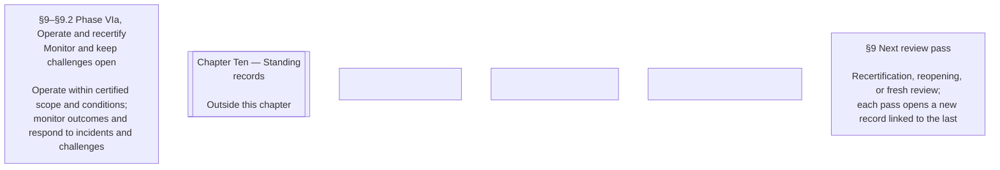
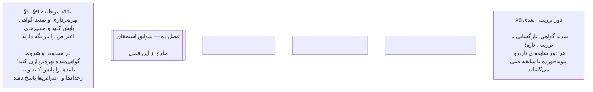

<!-- CHUNK-BEGIN fa__core_09.000_system_alignment_certification_evaluation__section_1_corpus_placement_overview.md bytes=4089 -->
<!-- AI-assisted translation draft; unreviewed. §1 corpus-placement overview, source lines 8–10; source SHA-256 4311e6ba74b7210f077c0bd4c8d21d8c9f517d2ada7b6d87288b39494dfeadd5. Draft only; do not synchronize into translations/. -->

# Chapter Nine Part A — §1 corpus-placement overview (fa)

## English source (lines 8–10)

> This file is **part of the Sentient Constitution** and is **binding only together** with the other numbered `core_*` files read as one text. It contains **Chapter Nine, Part A** — certification purpose, the process overview, and the first two phases of the process — **Frame** (system class) and **Evaluate** (whole-system evaluation in three sub-phases: the always-applicable evaluations, including data types and handling, in **§3**; the evaluations that apply where implicated in **§4**; and the Rights-Floor and domain evaluations that apply where triggered in **§5**) — **§1–§5**. The worked **Class A / B / C illustrations** (the system class profiles, §3.4.8, §5.1.5, §5.2.4, §5.3.7, §5.4.4, §5.5.5, and §5.6.4), including each one's **Reading across system classes** paragraph, are in [`core_09.010_system_alignment_certification_illustrations.md`](core_09.010_system_alignment_certification_illustrations.md); each keeps its Part A section number. The binding system-class-scaling and escalation rules those paragraphs illustrate stay in this file: system class scaling, including participation and proportionality, in §2.2; data-handling scaling in §3.4; and the **System class scaling and escalation** paragraph in each of §5.1–§5.6. The files of the whole chapter are listed in the table below.
>
> **Chapter Nine files.** Chapter Nine is split across four binding files read as one text. Part A, this file, opens the chapter; there is no separate index file.

## Translation draft

> این فایل **بخشی از قانون اساسی سنتینت** است و فقط هنگامی الزام‌آور است که همراه با دیگر فایل‌های شماره‌دار `core_*` به‌صورت یک متن خوانده شود. این فایل شامل **فصل نهم، بخش الف** است: هدف گواهی، نمای کلی فرایند، و دو مرحله نخست آن—**Frame** (طبقهٔ سامانه) و **Evaluate** (ارزیابی کل سامانه در سه زیرمرحله: ارزیابی‌های همواره‌لازم، از جمله انواع داده و نحوهٔ کار با آن‌ها، در **§3**؛ ارزیابی‌های لازم در صورت ارتباط در **§4**؛ و ارزیابی‌های کف حقوق و حوزه‌ای که در صورت فعال‌شدن لازم‌اند در **§5**)—**§§1–5**. نمونه‌های مشروح **کلاس A / B / C** (پروفایل‌های کلاس سامانه، §3.4.8، §5.1.5، §5.2.4، §5.3.7، §5.4.4، §5.5.5 و §5.6.4)، از جمله بند **خواندن در میان کلاس‌های سامانه** در هر نمونه، در [`core_09.010_system_alignment_certification_illustrations.md`](core_09.010_system_alignment_certification_illustrations.md) آمده‌اند؛ شمارهٔ بخش هرکدام در بخش الف حفظ شده است. قواعد الزام‌آور مقیاس‌بندی و تشدید برحسب کلاس که آن بندها توضیح می‌دهند در همین فایل می‌مانند: مقیاس‌بندی کلاس سامانه، از جمله مشارکت و تناسب، در §2.2؛ مقیاس‌بندی رسیدگی به داده در §3.4؛ و بند **مقیاس‌بندی و تشدید برحسب کلاس سامانه** در هر یک از §§5.1–5.6. جدول زیر فایل‌های کل فصل را فهرست می‌کند.
>
> **فایل‌های فصل نهم.** فصل نهم میان چهار فایل الزام‌آور تقسیم شده است که باید با هم خوانده شوند. بخش الف، یعنی همین فایل، آغازگر فصل است؛ فایل فهرست جداگانه‌ای وجود ندارد.

<!-- CHUNK-END -->
<!-- CHUNK-BEGIN fa__core_09.000_system_alignment_certification_evaluation__section_1_corpus_file_table.md bytes=5496 -->
<!-- AI-assisted translation draft; unreviewed. §1 corpus-placement file table, source lines 12–17; source SHA-256 4311e6ba74b7210f077c0bd4c8d21d8c9f517d2ada7b6d87288b39494dfeadd5. Draft only; do not synchronize into translations/. -->

# Chapter Nine Part A — §1 corpus-placement file table (fa)

## English source (lines 12–17)

> | Part | File | Owns |
> |------|------|------|
> | **Part A — Evaluation** | [`core_09.000_system_alignment_certification_evaluation.md`](core_09.000_system_alignment_certification_evaluation.md) | §1–§5: purpose and process overview (with a chart of the whole certification process in its six phases), **Phase I Frame** (system class, how system class scales every evaluation, and pilot certification) and **Phase II Evaluate** (whole-system evaluation in three sub-phases: **IIa** always, in §3, including chartered scope versus functional boundaries and data types and handling; **IIb** where implicated, in §4; and **IIc** where triggered, the Rights-Floor and domain evaluations, in §5) |
> | **Part B — Record and process** | [`core_09.005_system_alignment_certification_record_process.md`](core_09.005_system_alignment_certification_record_process.md) | §6–§10: **Phase III Review** (forum roles, supervisory sequence, and the contestability chain), **Phase IV Decide** (certification outcomes, including the go-live gate), **Phase V Record** (the certification record and its integrity, including governing [System Charter](core_05.040_band_continuity.md#system-charter) fields), and **Phase VI Operate** (the challenge path; recertification and reopening; the standing bridge) — continuous chapter numbering from Part A §5 |
> | **Part C — Illustrations** | [`core_09.010_system_alignment_certification_illustrations.md`](core_09.010_system_alignment_certification_illustrations.md) | the illustrative system class profiles, §3.4, §3.4.8, §5.1.5, §5.2.4, §5.3.7, §5.4.4, §5.5.5, and §5.6.4: worked Class A / B / C walkthroughs for each Part A evaluation area, numbered to match Part A and linked both ways |
> | **Part D — Institutional alignment certification** | [`core_09.015_institutional_alignment_certification.md`](core_09.015_institutional_alignment_certification.md) | §11–§15: the same six phases for an **Institution** rather than a System — the institution class and the institutional evaluation (**Phases I and II**, §12), the forum roles, outcome, and **Institutional Certification Record** (**Phases III to V**, §13), and recertification, reopening, the cascade from System certifications, and the standing bridge (**Phase VI**, §14–§15). It cites each System's certification by link and does not repeat it, and it is not a licence — continuous chapter numbering from Part B §10 |

## Translation draft

| بخش | فایل | محتوا |
|------|------|------|
| **Part A — Evaluation** | [`core_09.000_system_alignment_certification_evaluation.md`](core_09.000_system_alignment_certification_evaluation.md) | §§1–5: هدف و نمای کلی فرایند (با نمودار شش مرحلهٔ تصدیق)، و مراحل I Frame (طبقهٔ سامانه، اثر طبقه بر مقیاس هر ارزیابی، و گواهی آزمایشی) و II Evaluate (ارزیابی کل سامانه در سه زیرمرحله: IIa همواره در §3، از جمله تمایز دامنهٔ منشور از مرزهای کارکردی و انواع و رسیدگی داده؛ IIb در صورت ارتباط در §4؛ و IIc در صورت فعال‌شدن، ارزیابی‌های کف حقوق و حوزه‌ها در §5). |
| **Part B — Record and process** | [`core_09.005_system_alignment_certification_record_process.md`](core_09.005_system_alignment_certification_record_process.md) | §§6–10: مرحلهٔ III Review (نقش‌های انجمن، توالی نظارت، و زنجیرهٔ اعتراض)؛ IV Decide (نتایج گواهی، از جمله شرط آغاز به‌کار)؛ V Record (سجل گواهی و یکپارچگی آن، از جمله فیلدهای حاکم [System Charter](core_05.040_band_continuity.md#system-charter))؛ VI Operate (مسیر چالش، گواهی مجدد و بازگشایی، و پل standing) — شماره‌گذاری پیوسته از §5 بخش الف. |
| **Part C — Illustrations** | [`core_09.010_system_alignment_certification_illustrations.md`](core_09.010_system_alignment_certification_illustrations.md) | پروفایل‌های توضیحی طبقات سامانه و §§3.4، 3.4.8، 5.1.5، 5.2.4، 5.3.7، 5.4.4، 5.5.5 و 5.6.4: نمونه‌های عملی A/B/C برای هر حوزهٔ ارزیابی بخش الف، با حفظ شماره‌گذاری و پیوند دوسویه. |
| **Part D — Institutional alignment certification** | [`core_09.015_institutional_alignment_certification.md`](core_09.015_institutional_alignment_certification.md) | §§11–15: همان شش مرحله برای نهاد به‌جای سامانه — طبقه و ارزیابی نهادی (I و II، §12)، نقش‌های انجمن، نتیجه و سجل گواهی نهادی (III تا V، §13)، و گواهی مجدد، بازگشایی، زنجیرهٔ گواهی سامانه‌ها و پل standing (VI، §§14–15). به گواهی هر سامانه پیوند می‌دهد و آن را تکرار نمی‌کند؛ مجوز نیست — شماره‌گذاری پیوسته از §10 بخش ب. |

<!-- CHUNK-END -->
<!-- CHUNK-BEGIN fa__core_09.000_system_alignment_certification_evaluation__section_1_corpus_explanation.md bytes=9469 -->
<!-- AI-assisted translation draft; unreviewed. §1 corpus-placement explanatory prose, source lines 19–30; source SHA-256 4311e6ba74b7210f077c0bd4c8d21d8c9f517d2ada7b6d87288b39494dfeadd5. Draft only; do not synchronize into translations/. -->

# Chapter Nine Part A — §1 corpus-placement explanatory prose (fa)

## English source (lines 19–30)

> **How the two certifications relate.** System Alignment Certification (Parts A to C) is the certification of a System. Institutional alignment certification (Part D) is the certification of an Institution, which may run Systems or none. Part D cites each System's certification record by link and does not redo it; [Part D §11.1](core_09.015_institutional_alignment_certification.md#111-relation-to-system-alignment-certification) states the relation and [Part D §11.3](core_09.015_institutional_alignment_certification.md#113-no-permission-and-no-gate) states that it is not a licence.
>
> Generic **Chapter Nine** links in other files route to the appropriate part by section number.
>
> - **Constitutional owner (joint with Parts B and D):** forum-supervised **system alignment certification and related records** — evaluation domains (Part A); forum process, supervisory sequence, certification-record duties, certification outcomes and the go-live gate, the challenge path, recertification and reopening, and verified-input bridge to Chapter Ten (Part B); the same six phases for an Institution (Part D). Under the **oversight** Tetrad leg, SAC is one especially large, high-stakes audit process among others; auditing floors remain at **Article XVI** (*Audit, Transparency, and Independent Verification*) and Chapter Five [Auditability](core_05.050_band_oversight.md#auditability).
> - **Verification substrate owner:** [Chapter Four — Burden of Proof, Traceability, and Verification](core_04.000_burden_traceability_verification.md#chapter-four-burden-of-proof-traceability-and-verification) (within Chapters Two through Four) owns burden allocation, compliance evidence, definition traceability, observability, and security-constrained verification. Chapter Nine **applies** that discipline to system alignment certification records; it does **not** restate Chapter Four sections **1** through **5**.
> - **Auditing home (not relocated here):** **Article XVI** (*Audit, Transparency, and Independent Verification*), **Def.O1** (*Transparency, Auditability, and Verification*), and **CJS-5.110 §3 and CJS-5.115 §3** (*Audit process home*)–**CJS-5.110 §5** own auditing floors and operational terms. Chapter Nine runs one especially large SAC audit process that must satisfy those floors; it does not own all auditing.
> - **Implementation owner:** system-class handling, CS-6.345, and forum-process detail in designated implementation files must remain consistent with Chapter Nine and may be stricter where the corpus already provides a [Fullest Protective Effect](core_05.045_band_integrative.md#fullest-protective-effect) rule.
> - **Anti-relocation rule:** Part A does not restate Chapter Five canonical definitions, Chapter Three anti-evasion discipline (see [Part B §9.3](core_09.005_system_alignment_certification_record_process.md#93-non-evasion)), Chapter Ten contribution or standing measurement, or Chapter Eleven standing effects. **[Part B §10](core_09.005_system_alignment_certification_record_process.md#10-relationship-to-standing)** states the standing bridge boundary explicitly.
>
> **Upstream:** Chapter Five definitions; Chapters Two through Four record, verification, burden, and traceability of definitions to results; and [Chapter Eight](core_08.000_functional_independence_separation_of_duties.md#chapter-eight-functional-independence-and-separation-of-duties), whose separation-of-duties requirement governs every materially binding certification act.
> **Downstream:** [Part B](core_09.005_system_alignment_certification_record_process.md#chapter-nine-part-b-system-alignment-certification--record-and-process) (*forum process, record, outcomes, and standing bridge*); Chapter Ten standing records and verified inputs; Chapter Eleven standing effects; Chapter Thirteen forum supervision and system alignment certification pathways.

## Translation draft

**رابطهٔ دو گواهی.** گواهی مواءمت سامانه (بخش‌های A تا C) گواهی یک سامانه است. گواهی مواءمت نهادی (بخش D) گواهی یک نهاد است؛ نهادی که ممکن است سامانه‌هایی را اداره کند یا هیچ سامانه‌ای نداشته باشد. بخش D به‌جای تکرار گواهی هر سامانه، با پیوند به سابقهٔ آن ارجاع می‌دهد؛ [Part D §11.1](core_09.015_institutional_alignment_certification.md#111-relation-to-system-alignment-certification) رابطه را بیان می‌کند و [Part D §11.3](core_09.015_institutional_alignment_certification.md#113-no-permission-and-no-gate) تصریح می‌کند که این گواهی مجوز نیست.
>
> پیوندهای کلی **Chapter Nine** در فایل‌های دیگر بر اساس شمارهٔ بخش به بخش مناسب هدایت می‌شوند.
>
> - **مالک قانون اساسی (مشترک با بخش‌های B و D):** گواهی مواءمت سامانه و سوابق مرتبطِ زیر نظارت مجمع — حوزه‌های ارزیابی (بخش A)؛ فرایند مجمع، ترتیب نظارت، تکالیف سابقهٔ گواهی، نتایج و شرط آغاز بهره‌برداری، مسیر اعتراض، صدور مجدد و بازگشایی، و پل ورودی‌های راستی‌آزمایی‌شده به فصل دهم (بخش B)؛ همان شش مرحله برای نهاد (بخش D). در رکن **نظارت** Tetrad، SAC یکی از فرایندهای حسابرسی بسیار بزرگ و پرمخاطره در میان چندین فرایند است؛ کف‌های حسابرسی در **Article XVI** (*Audit, Transparency, and Independent Verification*) و [Auditability](core_05.050_band_oversight.md#auditability) در فصل پنجم باقی می‌مانند.
> - **مالک زیربنای راستی‌آزمایی:** [Chapter Four — Burden of Proof, Traceability, and Verification](core_04.000_burden_traceability_verification.md#chapter-four-burden-of-proof-traceability-and-verification) (در فصل‌های دوم تا چهارم) مالک تخصیص بار اثبات، شواهد انطباق، ردیابی‌پذیری تعاریف، مشاهده‌پذیری و راستی‌آزمایی مقید به امنیت است. فصل نهم این انضباط را بر سوابق گواهی مواءمت سامانه اعمال می‌کند و بندهای **1** تا **5** فصل چهارم را بازگو نمی‌کند.
> - **جایگاه حسابرسی (به اینجا منتقل نشده):** **Article XVI** (*Audit, Transparency, and Independent Verification*)، **Def.O1** (*Transparency, Auditability, and Verification*) و **CJS-5.110 §3 و CJS-5.115 §3** (*Audit process home*) تا **CJS-5.110 §5** مالک کف‌های حسابرسی و اصطلاحات اجرایی‌اند. فصل نهم یک فرایند SAC بزرگ و ویژه را اجرا می‌کند که باید این کف‌ها را برآورده سازد؛ اما مالک همهٔ حسابرسی‌ها نیست.
> - **مالک اجرا:** رسیدگی به طبقات سامانه، CS-6.345 و جزئیات فرایند مجمع در فایل‌های اجرایی تعیین‌شده باید با فصل نهم سازگار بمانند و هرجا متن از پیش قاعدهٔ [Fullest Protective Effect](core_05.045_band_integrative.md#fullest-protective-effect) دارد، می‌توانند سخت‌گیرانه‌تر باشند.
> - **قاعدهٔ منع جابه‌جایی:** بخش A تعاریف مرجع فصل پنجم، انضباط ضدگریز فصل سوم (نگاه کنید به [Part B §9.3](core_09.005_system_alignment_certification_record_process.md#93-non-evasion))، سنجش مشارکت یا جایگاه در فصل دهم، یا آثار جایگاه در فصل یازدهم را تکرار نمی‌کند. **[Part B §10](core_09.005_system_alignment_certification_record_process.md#10-relationship-to-standing)** مرز پل جایگاه را صریحاً مشخص می‌کند.
>
> **منابع بالادستی:** تعاریف فصل پنجم؛ سوابق، راستی‌آزمایی، بار اثبات و ردیابی تعاریف تا نتایج در فصل‌های دوم تا چهارم؛ و [Chapter Eight](core_08.000_functional_independence_separation_of_duties.md#chapter-eight-functional-independence-and-separation-of-duties) که الزام تفکیک وظایف آن بر هر اقدام گواهیِ دارای اثر الزام‌آور مادی حاکم است.
> **منابع پایین‌دستی:** [Part B](core_09.005_system_alignment_certification_record_process.md#chapter-nine-part-b-system-alignment-certification--record-and-process) (*فرایند مجمع، سابقه، نتایج و پل جایگاه*)؛ سوابق جایگاه و ورودی‌های راستی‌آزمایی‌شده در فصل دهم؛ آثار جایگاه در فصل یازدهم؛ نظارت مجمع و مسیرهای گواهی مواءمت سامانه در فصل سیزدهم.

<!-- CHUNK-END -->
<!-- CHUNK-BEGIN fa__core_09.000_system_alignment_certification_evaluation__section_1_heading.md bytes=365 -->
<!-- AI-assisted translation draft; unreviewed. §1 heading, source line 44; source SHA-256 4311e6ba74b7210f077c0bd4c8d21d8c9f517d2ada7b6d87288b39494dfeadd5. Draft only; do not synchronize into translations/. -->

# Chapter Nine Part A — §1 heading (fa)

## English source (lines 44–45)

### 1. Purpose and Role


## Translation draft

### 1. هدف و نقش

<!-- CHUNK-END -->
<!-- CHUNK-BEGIN fa__core_09.000_system_alignment_certification_evaluation__section_1_trace.md bytes=12254 -->
<!-- AI-assisted translation draft; unreviewed. §1 trace, source lines 46–95; source SHA-256 4311e6ba74b7210f077c0bd4c8d21d8c9f517d2ada7b6d87288b39494dfeadd5. Draft only; do not synchronize into translations/. -->

# Chapter Nine Part A — §1 trace (fa)

## English source (lines 46–95)

<details>
<summary><strong><span style="color: #2563eb;">Trace</span></strong></summary>

- Upstream:
  - [Preamble — constitutional owner register](core_00.000_preamble.md#4-principles-definitions-and-rights) and
  - [Authority Stack and Internal Hierarchy](core_05.045_band_integrative.md#authority-stack-and-internal-hierarchy);
  - [Constitutional Tetrad](core_00.000_preamble.md#constitutional-tetrad);
  - [Two Constitutional Aims](core_00.000_preamble.md#two-constitutional-aims);
  - [material stake](core_00.000_preamble.md#material-stake);
  - [Proportionality](core_05.035_band_accountability.md#proportionality) and
  - [Substantive Fairness](core_05.055_band_participation.md#substantive-fairness) (Chapter Five); Participation measurement family (*voice, access, and contest paths*);
  - [Chapter One §16 Stewardship In Depth](core_01.010_stewardship_capacity_principles.md#16-stewardship-in-depth) (1.010 §16);
  - [Chapter One §12 Systemic Evaluation Requirement](core_01.000_values_principles.md#12-systemic-evaluation-requirement) (1.000 §12) (*principle-layer whole-system evaluation lens — not one corner alone*); Chapters Two through Four;
  - [Chapter Five](core_05.000_definitions_home.md#chapter-five-foundational-definitions) (5.000) (*canonical definitions*);
  - [Chapter Eight §2 Four-Seat Constitutional Requirement](core_08.000_functional_independence_separation_of_duties.md#2-four-seat-constitutional-requirement) (8.000 §2);
  - [System Alignment Certification](core_05.040_band_continuity.md#system-alignment-certification) (Chapter Five canonical term; non-operative shorthand **SAC**);
  - [System Certification Record](core_05.040_band_continuity.md#system-certification-record) (Chapter Five meaning).
- Downstream:
  - [§2](#2-system-class-evaluation) (*system class evaluation*);
  - [Part B §9.1](core_09.005_system_alignment_certification_record_process.md#91-challenging-a-certification) (9.005 §9.1) (*challenging a certification*); and
  - [Part C system class profiles](core_09.010_system_alignment_certification_illustrations.md#illustrative-system-class-profiles-non-exhaustive) (9.010) (*illustrative system class profiles*);
  - [Part C whole-system walkthroughs](core_09.010_system_alignment_certification_illustrations.md#illustrative-whole-system-application-by-system-class-non-exhaustive) (9.010) (*worked whole-system examples by system class*);
  - [§3.4.8](core_09.010_system_alignment_certification_illustrations.md#348-illustrative-data-handling-application-by-system-class-non-exhaustive) (*worked data-handling examples by system class*);
  - [§5.1.5](core_09.010_system_alignment_certification_illustrations.md#515-illustrative-ecological-footprint-application-by-system-class-non-exhaustive) (*worked ecological-footprint examples by system class*);
  - [§5.2.4](core_09.010_system_alignment_certification_illustrations.md#524-illustrative-educational-capability-application-by-system-class-non-exhaustive) (*worked educational-capability examples by system class*);
  - [§5.3.7](core_09.010_system_alignment_certification_illustrations.md#537-illustrative-cross-system-support-application-by-system-class-non-exhaustive) (*worked cross-system-support examples by system class*);
  - [§5.4.4](core_09.010_system_alignment_certification_illustrations.md#544-illustrative-nondiscrimination-application-by-system-class-non-exhaustive) (*worked nondiscrimination examples by system class*);
  - [§5.5.5](core_09.010_system_alignment_certification_illustrations.md#555-illustrative-accessibility-application-by-system-class-non-exhaustive) (*worked accessibility examples by system class*);
  - [§5.6.4](core_09.010_system_alignment_certification_illustrations.md#564-illustrative-trustworthiness-application-by-system-class-non-exhaustive) (*worked trustworthiness examples by system class*);
  - [§3](#3-whole-system-certification-evaluation) (*whole-system certification evaluation factors*);
  - [§3.4](#34-data-types-and-handling-evaluation) through
  - [§5.6](#56-trustworthiness-and-system-reliance-integrity-evaluation) (*domain evaluations*);
  - [Part B §6](core_09.005_system_alignment_certification_record_process.md#6-forum-process) (9.005 §6) (*supervisory sequence and contestability chain*);
  - [Part B §6.1](core_09.005_system_alignment_certification_record_process.md#61-forum-supervision-and-component-roles) (9.005 §6.1) (*forum component roles*);
  - [Part B §8](core_09.005_system_alignment_certification_record_process.md#8-system-certification-record) (9.005 §8) (*certification record contents*);
  - [Part B §8.2](core_09.005_system_alignment_certification_record_process.md#82-record-integrity-transparency-and-auditability) (9.005 §8.2) (*record integrity requirements*);
  - [Part B §7](core_09.005_system_alignment_certification_record_process.md#7-certification-outcomes) (9.005 §7) (*reopening and anti-evasion*);
  - [Part B §10](core_09.005_system_alignment_certification_record_process.md#10-relationship-to-standing) (9.005 §10) (*standing-record bridge*);
  - [Chapter Ten](core_11.000_standing_assessment.md#chapter-eleven-contribution-violation-and-standing-model--measurement) (10.000) (*standing records and verified-input gate*);
  - [Chapter Eleven](core_12.000_standing_integration.md#chapter-twelve-standing-effects-and-integration) (11.000) (*standing effects and integration*);
  - [Chapter Thirteen](core_14.000_forum.md#chapter-fourteen-forums-and-jurisdiction) (13.000) (*forum supervision, certification, alignment certification, and review*).
- Read with:
  - **[CS-9.305](corpus_systems/cs_09.305_system_classification_machinery.md#cs-9305-part-a-system-classification-machinery) (*System classification machinery*) and [CS-9.310 — System impact classifications](corpus_systems/cs_09.310_system_impact_classifications.md#cs-9310-part-b-system-impact-classifications)**, **[CS-6.305](corpus_systems/cs_06.305_information_types_and_handling.md#cs-6305-part-a-information-types-and-handling) (*Information types and handling*) and [CS-6.310 — Data classifications](corpus_systems/cs_06.310_data_classifications.md#cs-6310-part-b-data-classifications)**, and
  - **CS-6.345** (*System lifecycle*);
  - **CF-13.415** (*Routing operations, transfer, certification, and representative treatment*) and
  - **CF-13.425** (*Integrity safeguards, anti-capture operations, and anti-self-judging support*); **Article XVI** (*Audit, Transparency, and Independent Verification*) and
  - [Auditability](core_05.050_band_oversight.md#auditability) (*auditing floors — SAC is one especially large audit process under oversight, not the sole auditing home*); **CJS-5.110 §3 (*Oversight: auditability and reconstructability terms (annex)*) and CJS-5.115 §3** (*Audit process home*)–
  - **CJS-5.110 §5** (*Oversight: independent verification and claim-integrity terms*).

</details>

## Translation draft

#### ردیابی

این نقشه مبنای قانون اساسی و سلسله‌مراتب اختیار این بخش را نشان می‌دهد و آن را به ارزیابی، طبقه‌بندی، مسیرهای بازبینی، پرونده‌ها، نتایج و ممیزی پیوند می‌زند؛ اسناد عملیاتیِ همراه را نیز مشخص می‌کند.

**ردیابی — upstream canonical sources:** [Preamble — constitutional owner register](core_00.000_preamble.md#4-principles-definitions-and-rights); [Authority Stack and Internal Hierarchy](core_05.045_band_integrative.md#authority-stack-and-internal-hierarchy); [Constitutional Tetrad](core_00.000_preamble.md#constitutional-tetrad); [Two Constitutional Aims](core_00.000_preamble.md#two-constitutional-aims); [material stake](core_00.000_preamble.md#material-stake); [Proportionality](core_05.035_band_accountability.md#proportionality); [Substantive Fairness](core_05.055_band_participation.md#substantive-fairness); [Chapter One §16 Stewardship In Depth](core_01.010_stewardship_capacity_principles.md#16-stewardship-in-depth); [Chapter One §12 Systemic Evaluation Requirement](core_01.000_values_principles.md#12-systemic-evaluation-requirement); [Chapter Five](core_05.000_definitions_home.md#chapter-five-foundational-definitions); [Chapter Eight §2 Four-Seat Constitutional Requirement](core_08.000_functional_independence_separation_of_duties.md#2-four-seat-constitutional-requirement); [System Alignment Certification](core_05.040_band_continuity.md#system-alignment-certification); [System Certification Record](core_05.040_band_continuity.md#system-certification-record)

**ردیابی — downstream routes and related records:** [§2](#2-system-class-evaluation); [Part B §9.1](core_09.005_system_alignment_certification_record_process.md#91-challenging-a-certification); [Part C system class profiles](core_09.010_system_alignment_certification_illustrations.md#illustrative-system-class-profiles-non-exhaustive); [Part C whole-system walkthroughs](core_09.010_system_alignment_certification_illustrations.md#illustrative-whole-system-application-by-system-class-non-exhaustive); [§3.4.8](core_09.010_system_alignment_certification_illustrations.md#348-illustrative-data-handling-application-by-system-class-non-exhaustive); [§5.1.5](core_09.010_system_alignment_certification_illustrations.md#515-illustrative-ecological-footprint-application-by-system-class-non-exhaustive); [§5.2.4](core_09.010_system_alignment_certification_illustrations.md#524-illustrative-educational-capability-application-by-system-class-non-exhaustive); [§5.3.7](core_09.010_system_alignment_certification_illustrations.md#537-illustrative-cross-system-support-application-by-system-class-non-exhaustive); [§5.4.4](core_09.010_system_alignment_certification_illustrations.md#544-illustrative-nondiscrimination-application-by-system-class-non-exhaustive); [§5.5.5](core_09.010_system_alignment_certification_illustrations.md#555-illustrative-accessibility-application-by-system-class-non-exhaustive); [§5.6.4](core_09.010_system_alignment_certification_illustrations.md#564-illustrative-trustworthiness-application-by-system-class-non-exhaustive); [§3](#3-whole-system-certification-evaluation); [§3.4](#34-data-types-and-handling-evaluation); [§5.6](#56-trustworthiness-and-system-reliance-integrity-evaluation); [Part B §6](core_09.005_system_alignment_certification_record_process.md#6-forum-process); [Part B §6.1](core_09.005_system_alignment_certification_record_process.md#61-forum-supervision-and-component-roles); [Part B §8](core_09.005_system_alignment_certification_record_process.md#8-system-certification-record); [Part B §8.2](core_09.005_system_alignment_certification_record_process.md#82-record-integrity-transparency-and-auditability); [Part B §7](core_09.005_system_alignment_certification_record_process.md#7-certification-outcomes); [Part B §10](core_09.005_system_alignment_certification_record_process.md#10-relationship-to-standing); [Chapter Ten](core_11.000_standing_assessment.md#chapter-eleven-contribution-violation-and-standing-model--measurement); [Chapter Eleven](core_12.000_standing_integration.md#chapter-twelve-standing-effects-and-integration); [Chapter Thirteen](core_14.000_forum.md#chapter-fourteen-forums-and-jurisdiction)

**ردیابی — operational materials to read with this section:** [CS-9.305](corpus_systems/cs_09.305_system_classification_machinery.md#cs-9305-part-a-system-classification-machinery); [CS-9.310 — System impact classifications](corpus_systems/cs_09.310_system_impact_classifications.md#cs-9310-part-b-system-impact-classifications); [CS-6.305](corpus_systems/cs_06.305_information_types_and_handling.md#cs-6305-part-a-information-types-and-handling); [CS-6.310 — Data classifications](corpus_systems/cs_06.310_data_classifications.md#cs-6310-part-b-data-classifications); [Auditability](core_05.050_band_oversight.md#auditability)

<!-- CHUNK-END -->
<!-- CHUNK-BEGIN fa__core_09.000_system_alignment_certification_evaluation__purpose_adjuncts.md bytes=6897 -->
<!-- AI-assisted translation draft; unreviewed. Selected §1 passages, source lines 99 and 107–114; source SHA-256 4311e6ba74b7210f077c0bd4c8d21d8c9f517d2ada7b6d87288b39494dfeadd5. -->

# Chapter Nine Part A — §1 plain-terms excerpt

**Status:** AI-assisted draft; unreviewed. English source remains controlling.

## English source

When a system really matters to sentients' lives, certification has to be **proportionate** — as demanding as the system's real impact, dependency, and risk require, not a one-size-fits-all checklist or a rubber stamp. It also has to be **participatory** — affected sentients and communities must be able to see what was reviewed, understand what was decided, and challenge it when something is wrong. Forums review evidence, write it down in a certification record, and require re-checks on a schedule that matches how risky the system is. Classes A, B, and C get the full process and Class L a lighter one. Class P is encouraged to use it, and must once it is reclassified to Class L or higher (that is, its effects reach beyond a private unit) or its operator claims constitutional compliance.

## fa draft

وقتی یک سامانه واقعاً بر زندگی موجودات دارای احساس اثر می‌گذارد، گواهی‌گیری باید **متناسب** باشد — به همان اندازه‌ای سخت‌گیرانه که اثر واقعی، وابستگی و خطر سامانه اقتضا می‌کند؛ نه چک‌لیستی یکسان برای همه و نه مُهری تشریفاتی. همچنین باید **مشارکتی** باشد — موجودات و جوامع متأثر باید بتوانند ببینند چه چیزی بررسی شده، تصمیم گرفته‌شده را بفهمند و در صورت وجود خطا به آن اعتراض کنند. انجمن‌ها شواهد را بررسی، در سابقه گواهی ثبت و بازبینی‌های مجدد را طبق برنامه‌ای متناسب با خطر سامانه الزامی می‌کنند. کلاس‌های A و B و C فرایند کامل را طی می‌کنند و کلاس L فرایند سبک‌تری دارد. استفاده از این فرایند برای کلاس P توصیه می‌شود و هنگامی الزامی است که به کلاس L یا بالاتر بازطبقه‌بندی شود (یعنی آثارش از یک واحد خصوصی فراتر رود) یا گرداننده‌اش ادعای انطباق قانون اساسی کند.


### English source — Flourishing

- **[Flourishing](core_00.000_preamble.md#flourishing)** — certification verifies that certification or continued reliance would not quietly defeat Rights Floors or block fair participation in constitutionally relevant life;

### fa draft

- **[شکوفایی](core_00.000_preamble.md#flourishing)** — گواهی‌گیری بررسی می‌کند که صدور گواهی یا ادامه اتکا به سامانه، بی‌سروصدا کف‌های حقوق را نقض یا مشارکت منصفانه در زندگی مرتبط با قانون اساسی را مسدود نکند؛


### English source — Continuity criterion

- **[Continuity](core_00.000_preamble.md#continuity)** — certification verifies durable, non-regressive supply that sustains rather than depletes healthy natural systems ([Ecological Integrity](core_05.040_band_continuity.md#ecological-integrity), including [Ecological Recovery Capacity](core_05.040_band_continuity.md#ecological-recovery-capacity)), and system-class-scaled recertification where shared systems gate or sustain delivery;

### fa draft

- **[تداوم](core_00.000_preamble.md#continuity)** — گواهی‌گیری عرضه‌ای پایدار و غیرپس‌رونده را تأیید می‌کند که نظام‌های طبیعی سالم را حفظ کند، نه اینکه فرسوده سازد ([یکپارچگی بوم‌شناختی](core_05.040_band_continuity.md#ecological-integrity)، از جمله [ظرفیت بازیابی بوم‌شناختی](core_05.040_band_continuity.md#ecological-recovery-capacity))، و در جایی که سامانه‌های مشترک عرضه را کنترل یا پشتیبانی می‌کنند، بازگواهی‌گیری متناسب با کلاس سامانه را تضمین می‌کند؛


### English source — Participation criterion

- **Participation** — affected sentients and communities can understand, contest, and take part in review paths that matter to them;

### fa draft

- **مشارکت** — موجودات و جوامع متأثر می‌توانند مسیرهای بازبینی مهم برای خود را بفهمند، به چالش بکشند و در آنها مشارکت کنند؛


### English source — Oversight criterion

- **Oversight** — records, evidence, and assumptions are visible and auditable enough for independent checking; certification itself is one especially large audit process under that oversight duty, not the only one;

### fa draft

- **نظارت** — سوابق، شواهد و فرض‌ها برای بررسی مستقل به‌اندازه کافی آشکار و قابل ممیزی‌اند؛ خود گواهی‌گیری نیز یکی از فرایندهای بزرگ ممیزی زیر این وظیفه نظارتی است، نه تنها جایگاه ممیزی؛


### English source — Accountability criterion

- **Accountability** — defects, misclassification, and floor-defeating operation route to remedy, conditions, withdrawal, or standing input where the facts support it;

### fa draft

- **پاسخگویی** — عیب‌ها، طبقه‌بندی نادرست و عملیاتی که کف‌های حقوق را تضعیف می‌کند، هرجا واقعیت‌ها پشتیبانی کنند، به جبران، شروط، لغو یا ورودی ارزیابی وضعیت می‌انجامد؛


### English source — Timeliness criterion

- **Timeliness** — review and contest windows keep certification from going stale while harm can still be prevented or reversed.

### fa draft

- **به‌موقع‌بودن** — مهلت‌های بازبینی و اعتراض نمی‌گذارند گواهی کهنه شود، در حالی که هنوز می‌توان از آسیب جلوگیری یا آن را جبران کرد.


### English source — Tetrad introduction

Certification implements the [Two Constitutional Aims](core_00.000_preamble.md#two-constitutional-aims) through the [Constitutional Tetrad](core_00.000_preamble.md#constitutional-tetrad):

### fa draft

گواهی‌گیری از طریق [دو هدف قانون اساسی](core_00.000_preamble.md#two-constitutional-aims)، [رباعی قانون اساسی](core_00.000_preamble.md#constitutional-tetrad) را اجرا می‌کند:

<!-- CHUNK-END -->
<!-- CHUNK-BEGIN fa__core_09.000_system_alignment_certification_evaluation__section_1_purpose.md bytes=1546 -->
<!-- AI-assisted translation draft; unreviewed. Complete purpose statement excerpt, source lines 101–105; source SHA-256 4311e6ba74b7210f077c0bd4c8d21d8c9f517d2ada7b6d87288b39494dfeadd5. This is an excerpt, not a complete §1 translation. -->

**گواهی هم‌راستایی نظام** برای پاسخ‌دادن به یک پرسش دربارهٔ دامنه و برنامهٔ بازبینیِ مشخص وجود دارد: آیا نظام به‌اندازهٔ کافی هم‌راستایی قانون اساسی را نشان داده است تا گواهی، گواهی مشروط، اعتبارسنجی، گواهی مجدد، ادامهٔ اتکا، استقرار یا رفعِ مادیِ شروط را توجیه کند؟

- گواهی، امتیاز محبوبیت یا مجوز همیشگی نیست و راهی برای کنارگذاشتن بازبینی حقوق نیست.
- این بیانیه‌ای زمان‌مند و قابل‌اعتراض دربارهٔ آن چیزی است که اکنون از هم‌راستایی نظام می‌دانیم.
- در رکن **نظارت** چهارگانه، نظارت مستلزم ممیزی است؛ گواهی هم‌راستایی نظام یکی از فرایندهای ممیزیِ به‌ویژه بزرگ و پرمخاطره در میان چندین فرایند است — نه تنها جایگاه ممیزی (**مادهٔ XVI** (*ممیزی، شفافیت و راستی‌آزمایی مستقل*)، [ممیزی‌پذیری](core_05.050_band_oversight.md#auditability)).

<!-- CHUNK-END -->
<!-- CHUNK-BEGIN fa__core_09.000_system_alignment_certification_evaluation__section_1_subsection_headings.md bytes=816 -->
<!-- AI-assisted translation draft; unreviewed. §1.1/§1.2 visible subsection headings, source lines 116–119 and 144–148; source SHA-256 4311e6ba74b7210f077c0bd4c8d21d8c9f517d2ada7b6d87288b39494dfeadd5. Draft only; anchors/blank layout are structural. Do not synchronize into translations/. -->

# Chapter Nine Part A — §1.1 and §1.2 subsection headings (fa)

## English source

### Lines 116–119

<a id="11-certification-as-an-audit-process-scaled-by-class"></a>

#### 1.1 Certification as an audit process, scaled by class


### Lines 144–148


<a id="12-certification-at-a-glance"></a>

#### 1.2 Certification at a glance


## Translation draft

#### 1.1 گواهی به‌عنوان فرایند حسابرسی، متناسب با طبقه سامانه

#### 1.2 نگاهی گذرا به گواهی

<!-- CHUNK-END -->
<!-- CHUNK-BEGIN fa__core_09.000_system_alignment_certification_evaluation__section_1_audit_scope.md bytes=3548 -->
<!-- AI-assisted translation draft; unreviewed. §1.1 audit mechanism and sibling audit modes, source lines 120–130; source SHA-256 4311e6ba74b7210f077c0bd4c8d21d8c9f517d2ada7b6d87288b39494dfeadd5. -->

# Chapter Nine Part A — §1.1 certification audit process excerpt (fa)

## English source

As an oversight mechanism, certification is one especially large audit process under [Auditability](core_05.050_band_oversight.md#auditability) and **Article XVI** (*Audit, Transparency, and Independent Verification*):

- It is forum-supervised, multi-domain, and status-granting.
- It may integrate the results of sibling audit modes, and it does not absorb or replace them. Each keeps its own owner, named in the [sibling audit modes map](corpus_joint_structure/cjs_05.115_audit_process.md#sibling-audit-modes-owner-map) of the audit process home:
  - System Data Types Record audits under **CS-6.305 (*Information types and handling*) and CS-6.310** (*Data classifications*)
  - System Classification Record audits under **CS-9.305 (*System classification machinery*) and CS-9.310** (*System impact classifications*)
  - steward assurance reviews under **CS-14.305** (*Critical system stewardship*)
  - continuous audit under **CS-6.345** (*System lifecycle*) ACA
  - complexity audits under **CS-6.315** (*Comprehensibility and complexity stewardship*) and **Article XXIII-B** (*Complexity Audit and Modularity Requirements*)
  - claim verification under **CJS-5.110 §5** (*Oversight: independent verification and claim-integrity terms*)
- You can still run any of these checks on their own, without going through certification. Certification doesn't replace them.

## fa draft

به‌عنوان سازوکار نظارتی، گواهی‌سازی یک فرایند ممیزیِ به‌ویژه گسترده ذیل [قابلیت حسابرسی](core_05.050_band_oversight.md#auditability) و **Article XVI** (*Audit, Transparency, and Independent Verification*) است:

- زیر نظر مجامع انجام می‌شود، چندحوزه‌ای است و وضعیت اعطا می‌کند.
- می‌تواند نتایج شیوه‌های ممیزی همتا را یکپارچه کند، اما آن‌ها را در خود ادغام یا جایگزین نمی‌کند. هر شیوه مالک خود را دارد که در [نقشهٔ شیوه‌های ممیزی همتا](corpus_joint_structure/cjs_05.115_audit_process.md#sibling-audit-modes-owner-map) در مرجع فرایند ممیزی نام برده شده است:
  - ممیزی‌های System Data Types Record طبق **CS-6.305 (*Information types and handling*) و CS-6.310** (*Data classifications*)
  - ممیزی‌های System Classification Record طبق **CS-9.305 (*System classification machinery*) و CS-9.310** (*System impact classifications*)
  - بازبینی‌های تضمین سرپرستی طبق **CS-14.305** (*Critical system stewardship*)
  - ممیزی مستمر طبق **CS-6.345** (*System lifecycle*) ACA
  - ممیزی‌های پیچیدگی طبق **CS-6.315** (*Comprehensibility and complexity stewardship*) و **Article XXIII-B** (*Complexity Audit and Modularity Requirements*)
  - راستی‌آزمایی ادعاها طبق **CJS-5.110 §5** (*Oversight: independent verification and claim-integrity terms*)
- همچنان می‌توانید هر یک از این بررسی‌ها را جداگانه و بدون گذر از گواهی‌سازی اجرا کنید. گواهی‌سازی جایگزین آن‌ها نمی‌شود.

<!-- CHUNK-END -->
<!-- CHUNK-BEGIN fa__core_09.000_system_alignment_certification_evaluation__section_1_class_scaling.md bytes=4427 -->
<!-- AI-assisted translation draft; unreviewed. Chapter Nine Part A §1 class scaling and cadence, source lines 132–143; source SHA-256 4311e6ba74b7210f077c0bd4c8d21d8c9f517d2ada7b6d87288b39494dfeadd5. Draft only; do not synchronize into translations/. -->

**Current English passage:**

Certification depth, record burden, certification interval, stakeholder review, and contest paths must scale with [material stake](core_00.000_preamble.md#material-stake) under [Proportionality](core_05.035_band_accountability.md#proportionality):

The process applies by impact class, as the [reclassification requirement](corpus_systems/cs_09.305_system_classification_machinery.md#35-reclassification-requirement) of **CS-9.305** (*System classification machinery*) sets out:

- **Class A, Class B, and Class C:** these systems carry the highest impact, dependency, and risk, and whole-system evaluation under [§3 Whole-System Certification Evaluation](#3-whole-system-certification-evaluation), [§4 Evaluations Where Implicated](#4-evaluations-where-implicated), and [§5 Rights-Floor and Domain Evaluations](#5-rights-floor-and-domain-evaluations), each as its own sub-phase applies, is mandatory at full depth;
- **Class L:** the same evaluation is mandatory but proportionate, with a lower default re-check cadence and simpler records where CS-9.305 (*System classification machinery*) and CS-9.310 (*System impact classifications*) permits; and
- **Class P:** the process is encouraged while the system is validly Class P, and a Class P system may use it voluntarily. It becomes mandatory on reclassification to Class L or higher, or where the operator voluntarily asserts constitutional compliance for the system.

The certification interval, and the financial, resource, or special audit that falls at its midpoint, are set by class in [Chapter Thirteen §6 Timely resolution, materiality tiers, and anti-delay discipline](core_14.000_forum.md#review-cadence) (*Review cadence*). This chapter does not restate the numbers.

**Proposed locale translation:**

عمق گواهی، بار ثبت، فاصلهٔ گواهی‌ها، بازبینی ذی‌نفعان و مسیرهای اعتراض باید بر پایهٔ [اهمیت مادی](core_00.000_preamble.md#material-stake) و مطابق با [تناسب](core_05.035_band_accountability.md#proportionality) تنظیم شوند:

این فرایند بر اساس ردهٔ اثر اعمال می‌شود، چنان‌که [الزام بازرده‌بندی](corpus_systems/cs_09.305_system_classification_machinery.md#35-reclassification-requirement) در **CS-9.305** (*سازوکار طبقه‌بندی نظام*) مقرر می‌کند:

- **رده‌های A، B و C:** این نظام‌ها بالاترین اثر، وابستگی و خطر را دارند؛ ارزیابی کل نظام با عمق کامل، در هر زیرمرحلهٔ مربوط، طبق [§3 ارزیابی گواهی کل نظام](#3-whole-system-certification-evaluation)، [§4 ارزیابی‌های هنگام اقتضا](#4-evaluations-where-implicated) و [§5 ارزیابی‌های کف حقوق و حوزه‌ای](#5-rights-floor-and-domain-evaluations) الزامی است؛
- **ردهٔ L:** همان ارزیابی الزامی اما متناسب است؛ در موارد مجاز به‌موجب **CS-9.305** (*سازوکار طبقه‌بندی نظام*) و **CS-9.310** (*طبقه‌بندی‌های اثر نظام*)، فاصلهٔ پیش‌فرض بازبینی کمتر و سوابق ساده‌تر است؛ و
- **ردهٔ P:** تا زمانی که رده‌بندی P معتبر است، فرایند توصیه می‌شود و نظام می‌تواند داوطلبانه از آن استفاده کند. با بازرده‌بندی به L یا بالاتر، یا با ادعای داوطلبانهٔ انطباق قانون اساسی از سوی بهره‌بردار، فرایند الزامی می‌شود.

فاصلهٔ گواهی و ممیزی مالی، منابعی یا ویژه‌ای که در میانهٔ آن انجام می‌شود، بر پایهٔ رده در [فصل سیزدهم §6 حل‌وفصل به‌موقع، سطوح اهمیت مادی و انضباط ضدتأخیر](core_14.000_forum.md#review-cadence) (*فاصلهٔ بازبینی*) تعیین می‌شود. این فصل اعداد را تکرار نمی‌کند.

<!-- CHUNK-END -->
<!-- CHUNK-BEGIN fa__core_09.000_system_alignment_certification_evaluation__section_1_at_a_glance.md bytes=2246 -->
<!-- AI-assisted translation draft; unreviewed. Chapter Nine Part A §1.2 plain-language summary, source line 149; source SHA-256 4311e6ba74b7210f077c0bd4c8d21d8c9f517d2ada7b6d87288b39494dfeadd5. Draft only; do not synchronize into translations/. -->

# Chapter Nine Part A — §1.2 at-a-glance summary (fa)

## English source

*In plain terms: classify the system honestly, run the evaluations that apply, have forums independently review the evidence and stakeholder concerns, and decide an outcome. Complete the one record opened for forum review and publish it with an open challenge path. A certified system goes live only after its notice interval and required protections are satisfied. Monitor actual outcomes, respond to incidents and challenges, and check again on schedule or when the facts change. Correct defects and have the correction independently verified before authorizing the affected scope or releasing its conditions. Each review pass uses a new record linked to the last.*

## fa draft

*به زبان ساده: سامانه را صادقانه طبقه‌بندی کنید، ارزیابی‌های مربوط را انجام دهید، بگذارید انجمن‌ها شواهد و نگرانی‌های ذی‌نفعان را مستقل بررسی کنند و درباره نتیجه تصمیم بگیرند. همان یک سابقه‌ای را که برای بررسی انجمن گشوده شده تکمیل کنید و همراه با مسیر باز اعتراض منتشر کنید. سامانه گواهی‌شده فقط پس از پایان مهلت اعلام و برآورده‌شدن حفاظت‌های لازم وارد بهره‌برداری می‌شود. پیامدهای واقعی را پایش کنید، به رخدادها و اعتراض‌ها پاسخ دهید و طبق برنامه یا با تغییر واقعیت‌ها دوباره بررسی کنید. نقص‌ها را اصلاح کنید و پیش از مجازکردن دامنه متأثر یا برداشتن شروط آن، اصلاح را مستقلاً راستی‌آزمایی کنید. هر دور بررسی از سابقه‌ای تازه استفاده می‌کند که به سابقه قبلی پیوند دارد.*

<!-- CHUNK-END -->
<!-- CHUNK-BEGIN fa__core_09.000_system_alignment_certification_evaluation__section_1_phase_map.md bytes=659 -->
<!-- AI-assisted translation draft; unreviewed. Chapter Nine Part A §1.2 phase map, source line 151; source SHA-256 4311e6ba74b7210f077c0bd4c8d21d8c9f517d2ada7b6d87288b39494dfeadd5. Draft only; do not synchronize into translations/. -->

**Current English passage:**

The process runs in **six phases**: **I Frame**, **II Evaluate**, **III Review**, **IV Decide**, **V Record**, and **VI Operate**.

**Proposed locale translation:**

فرایند در **شش مرحله** اجرا می‌شود: **I چارچوب‌گذاری**، **II ارزیابی**، **III بازبینی**، **IV تصمیم‌گیری**، **V ثبت** و **VI بهره‌برداری**.

<!-- CHUNK-END -->
<!-- CHUNK-BEGIN fa__core_09.000_system_alignment_certification_evaluation__section_1_reopen_triggers.md bytes=1924 -->
<!-- AI-assisted translation draft; unreviewed. Chapter Nine Part A §1 review-reopening passage, source line 153; source SHA-256 4311e6ba74b7210f077c0bd4c8d21d8c9f517d2ada7b6d87288b39494dfeadd5. Draft only; do not synchronize into translations/. -->

**Current English passage:**

Every evaluation that applies is carried out again on each certification pass: at first certification, at each recertification on the schedule set by [§2 System Class Evaluation](#2-system-class-evaluation), and at each reopened or fresh review. Review reopens before the next scheduled recertification when material facts change, such as growing reliance on the system, growing extraction from shared foundations, a significant fall in what the system puts back into them, or a credible challenge. [Part B §9 Recertification and Reopening](core_09.005_system_alignment_certification_record_process.md#9-recertification-and-reopening) lists the triggers.

**Proposed locale translation:**

هر ارزیابیِ لازم در هر نوبت گواهی دوباره انجام می‌شود: هنگام گواهی نخست، در هر تمدید طبق برنامهٔ تعیین‌شده در [§2 ارزیابی ردهٔ نظام](#2-system-class-evaluation)، و در هر بازبینیِ بازگشایی‌شده یا تازه. اگر واقعیت‌های بااهمیت تغییر کنند، بازبینی پیش از تمدید زمان‌بندی‌شدهٔ بعدی دوباره گشوده می‌شود؛ مانند افزایش اتکا به نظام، افزایش برداشت از بنیادهای مشترک، کاهش چشمگیرِ آنچه نظام به آن بنیادها بازمی‌گرداند، یا اعتراضی معتبر. [بخش ب §9 تمدید و بازگشایی](core_09.005_system_alignment_certification_record_process.md#9-recertification-and-reopening) محرک‌ها را فهرست می‌کند.

<!-- CHUNK-END -->
<!-- CHUNK-BEGIN fa__core_09.000_system_alignment_certification_evaluation__section_1_phase_map_opening_nodes.md bytes=2149 -->
<!-- AI-assisted translation draft; unreviewed. §1.2 Phase I/II opening chart-node labels, source lines 155–165; source SHA-256 4311e6ba74b7210f077c0bd4c8d21d8c9f517d2ada7b6d87288b39494dfeadd5. Draft only; non-prose Mermaid syntax/connectors are retained. Do not synchronize into translations/. -->

# Chapter Nine Part A — §1.2 opening phase-map nodes (fa)

## English source (lines 155–165)

```mermaid
flowchart TB
    T(["System with material impact seeks certification,<br/>or reliance on it grows"])
    C["§2 Phase I, Frame<br/>Classify honestly<br/><br/>Class sets depth and re-check schedule"]
    subgraph W["§3–§5 Phase II, Evaluate — Whole-system evaluation"]
        direction LR
        Al["§3.1–§3.4 IIa — Always<br/><br/>Governance; systemic risk: evaluated,<br/>and disclosed to those who need it;<br/>time horizon; data types"]
        Im["§4 IIb — When implicated<br/><br/>Privacy loci, exit rights,<br/>assembly and dissent"]
        Tr["§5 IIc — When triggered<br/><br/>Applicable Rights-Floor checks<br/>and six domain evaluations"]
        Al ~~~ Im ~~~ Tr
    end

## Translation draft

```mermaid
flowchart TB
    T["سامانه‌ای با اثر مادی خواهان گواهی است،<br/>یا اتکا به آن افزایش می‌یابد"]
    C["§2 مرحله I، چارچوب‌گذاری<br/>طبقه‌بندی صادقانه<br/><br/>طبقه، عمق ارزیابی و زمان‌بندی بازبینی را تعیین می‌کند"]
    subgraph W["§3–§5 مرحله II، ارزیابی — ارزیابی کل سامانه"]
        direction LR
        Al["§3.1–§3.4 IIa — همواره<br/><br/>حاکمیت؛ ارزیابی خطر سیستمی و افشا<br/>به نیازمندان؛ افق زمانی؛ انواع داده"]
        Im["§4 IIb — در صورت ارتباط<br/><br/>مواضع حریم خصوصی، حقوق خروج،<br/>گردهمایی و مخالفت"]
        Tr["§5 IIc — با تحقق محرک<br/><br/>بررسی‌های کف حقوقِ مربوط<br/>و شش ارزیابی حوزه‌ای"]
        Al ~~~ Im ~~~ Tr
    end
```

<!-- CHUNK-END -->
<!-- CHUNK-BEGIN fa__core_09.000_system_alignment_certification_evaluation__chart_review_node.md bytes=673 -->
# Chapter Nine Part A — chart review node (fa)

AI-assisted draft; unreviewed. Current source SHA-256: `4311e6ba74b7210f077c0bd4c8d21d8c9f517d2ada7b6d87288b39494dfeadd5`. Reconciles current source line 166: “Assigned forums issue findings; challenge paths stay open.” The translated node ID, chart structure, HTML line breaks, and code syntax are preserved.

```mermaid
    F["مرحلهٔ III، بازبینی — §6<br/>بازبینی مستقل شواهد<br/>و نگرانی‌های ذی‌نفعان<br/><br/>مجمع‌های تعیین‌شده یافته‌ها را صادر می‌کنند؛<br/>مسیرهای اعتراض باز می‌مانند"]
```

<!-- CHUNK-END -->
<!-- CHUNK-BEGIN fa__core_09.000_system_alignment_certification_evaluation__section_1_decision_nodes.md bytes=4453 -->
<!-- AI-assisted translation draft; unreviewed. Chapter Nine Part A §1.2 decision and outcome diagram nodes, source lines 167–176; source SHA-256 4311e6ba74b7210f077c0bd4c8d21d8c9f517d2ada7b6d87288b39494dfeadd5. Draft only; do not synchronize into translations/. -->

# Chapter Nine Part A — §1.2 decision and outcome nodes (fa)

## English source (lines 167–176)

```mermaid
flowchart TB
    Rec["§8 Phase V, Record<br/>One System Certification Record<br/><br/>Opened for forum review; completed with the outcome,<br/>supporting findings, conditions, and operating plan"]
    S[["Chapter Ten — Standing<br/>records<br/><br/>Outside this chapter"]]
    O{"§7 Phase IV, Decide<br/><br/>What outcome and status<br/>does the evidence support?"}
    Fc["§7, §9.2 Full Certification<br/><br/>Required consecutive clean provisional recertifications;<br/>no current or indicated impending misalignment<br/>Full certification interval; conditions may apply"]
    Pc["§7, §9.2 Provisional Certification<br/><br/>First grant, recovery after misalignment,<br/>or continued or stepped-down provisional status<br/>Provisional interval, shorter; conditions may apply"]
    Nc["§7 Not Certified<br/><br/>Deferred, refused, withdrawn, or expired<br/>No go-live; state reasons and required corrective work"]
    Pub["§7, §9.1 Publish the completed record<br/><br/>Open the published record challenge path;<br/>for new or expanded scope, state go-live and notice"]
    G{"§7 Go-live gate<br/><br/>Certification and applicable<br/>go-live prerequisites satisfied?"}
    Hold["§7 Meet go-live prerequisites<br/><br/>Complete notice and independently verify<br/>conditions required before go-live"]
    Rm["§7, §9.2 Protect and correct<br/><br/>No new go-live in the affected scope;<br/>protect affected sentients, correct design or operation,<br/>and submit evidence for independent verification"]
```



## fa draft



<!-- CHUNK-END -->
<!-- CHUNK-BEGIN fa__core_09.000_system_alignment_certification_evaluation__section_1_review_cycle_nodes.md bytes=2995 -->
<!-- AI-assisted translation draft; unreviewed. Chapter Nine Part A §1.2 operation and next-review diagram nodes, source lines 177–182; source SHA-256 4311e6ba74b7210f077c0bd4c8d21d8c9f517d2ada7b6d87288b39494dfeadd5. Draft only; do not synchronize into translations/. -->

```mermaid
flowchart TB
    Rec["§8 مرحله V، سابقه<br/>یک سابقه گواهی سامانه<br/><br/>برای بررسی انجمن گشوده می‌شود و با نتیجه، یافته‌های پشتیبان، شروط و برنامه عملیاتی تکمیل می‌شود"]
    S[["فصل ده — سوابق استحقاق<br/><br/>خارج از این فصل"]]
    O{"§7 مرحله IV، تصمیم‌گیری<br/><br/>شواهد از چه نتیجه و وضعیتی<br/>پشتیبانی می‌کنند؟"}
    Fc["§7، §9.2 گواهی کامل<br/><br/>تمدیدهای موقت متوالی و بدون نقص الزامی است؛<br/>هیچ عدم‌هم‌سویی فعلی یا قریب‌الوقوعِ نشان‌داده‌شده‌ای وجود ندارد<br/>بازه گواهی کامل؛ ممکن است شروطی اعمال شود"]
    Pc["§7، §9.2 گواهی موقت<br/><br/>اعطای نخست، بازیابی پس از عدم‌هم‌سویی،<br/>یا ادامه یا تنزل وضعیت موقت<br/>بازه موقت کوتاه‌تر؛ ممکن است شروطی اعمال شود"]
    Nc["§7 گواهی‌نشده<br/><br/>به تعویق‌افتاده، ردشده، پس‌گرفته‌شده یا منقضی<br/>بدون آغاز بهره‌برداری؛ دلایل و کار اصلاحی لازم اعلام شود"]
    Pub["§7، §9.1 انتشار سابقه تکمیل‌شده<br/><br/>مسیر اعتراض به سابقه منتشرشده را باز کنید؛<br/>برای دامنه جدید یا توسعه‌یافته، آغاز بهره‌برداری و مهلت اعلام را ذکر کنید"]
    G{"§7 دروازه آغاز بهره‌برداری<br/><br/>آیا گواهی و پیش‌نیازهای لازم برای آغاز بهره‌برداری<br/>برآورده شده‌اند؟"}
    Hold["§7 برآورده‌کردن پیش‌نیازهای آغاز بهره‌برداری<br/><br/>مهلت اعلام را کامل کنید و شروط لازم پیش از آغاز بهره‌برداری را<br/>به‌طور مستقل راستی‌آزمایی کنید"]
    Rm["§7، §9.2 حفاظت و اصلاح<br/><br/>در دامنه متأثر، بهره‌برداری جدید آغاز نشود؛<br/>از موجودات صاحب‌ادراک متأثر حفاظت کنید، طراحی یا عملیات را اصلاح کنید،<br/>و شواهد را برای راستی‌آزمایی مستقل ارائه دهید"]
```

# Chapter Nine Part A — §1.2 operation and review-cycle nodes (fa)

## English source (lines 177–182)



## fa draft



<!-- CHUNK-END -->
<!-- CHUNK-BEGIN fa__core_09.000_system_alignment_certification_evaluation__section_1_phase_map_edge_labels.md bytes=2076 -->
<!-- AI-assisted translation draft; unreviewed. §1.2 certification-phase chart edge labels, source lines 194, 199, 200–206; source SHA-256 4311e6ba74b7210f077c0bd4c8d21d8c9f517d2ada7b6d87288b39494dfeadd5. Mermaid node IDs, edge syntax, and <br/> delimiters are structural and preserved; visible edge labels are translated. Draft only; do not synchronize into translations/. -->

# Chapter Nine Part A — phase-chart edge labels (fa)

## English source

```mermaid
    Rec -.->|VIb, §10 —<br/>verified inputs only;<br/>current certification or facts<br/>arising during certification| S
    G --->|Yes: operate<br/>within the record| Ch
    G --->|Certified,<br/>prerequisites pending| Hold
    Ch -->|Material defect:<br/>protect and correct| Rm
    Ch -->|On schedule, or<br/>material change or<br/>credible challenge<br/>requires review| Re
    Ch -.->|VIb, §10 —<br/>verified inputs only;<br/>operation may supply facts<br/>for Contribution and<br/>Violation records| S2
    Rm -->|Correction evidence<br/>is checked in the<br/>next review pass| Re
    G -->|Not Certified| Rm
```

## Translation draft

```mermaid
    Rec -.->|VIb, §10 —<br/>فقط ورودی‌های راستی‌آزمایی‌شده؛<br/>گواهی جاری یا واقعیت‌های<br/>پدیدآمده هنگام گواهی| S
    G --->|بله: فعالیت<br/>در محدودهٔ سجل| Ch
    G --->|گواهی‌شده،<br/>پیش‌نیازها در انتظار| Hold
    Ch -->|نقص بااهمیت:<br/>محافظت و اصلاح کنید| Rm
    Ch -->|طبق برنامه، یا<br/>در صورت تغییر بااهمیت یا<br/>چالش معتبر<br/>که بازبینی را لازم کند| Re
    Ch -.->|VIb, §10 —<br/>فقط ورودی‌های راستی‌آزمایی‌شده؛<br/>عملیات می‌تواند واقعیت‌هایی<br/>برای سوابق مشارکت و<br/>نقض فراهم کند| S2
    Rm -->|شواهد اصلاح در<br/>دور بعدی بازبینی<br/>بررسی می‌شود| Re
    G -->|تأییدنشده| Rm
```

<!-- CHUNK-END -->
<!-- CHUNK-BEGIN fa__core_09.000_system_alignment_certification_evaluation__section_1_reader_guide.md bytes=4676 -->
<!-- AI-assisted translation draft; unreviewed. §1 non-operative reader guide, source lines 236–245; source SHA-256 4311e6ba74b7210f077c0bd4c8d21d8c9f517d2ada7b6d87288b39494dfeadd5. Draft only; do not synchronize into translations/. -->

# Chapter Nine Part A — §1 reader guide (fa)

## English source (lines 236–245)

<details>
<summary><strong><span style="color: #2563eb;">Reader guide (non-operative): illustrations, run sheet, and Institutions</span></strong></summary>

> Illustrative **Class A**, **Class B**, and **Class C** profiles — and how system class scales certification depth across this chapter — are in [Illustrative System Class Profiles (Non-Exhaustive)](core_09.010_system_alignment_certification_illustrations.md#illustrative-system-class-profiles-non-exhaustive). Worked walkthroughs of the same three systems for each evaluation area in [§3 Whole-System Certification Evaluation](#3-whole-system-certification-evaluation) through [§5.6 Trustworthiness and System-Reliance Integrity Evaluation](#56-trustworthiness-and-system-reliance-integrity-evaluation) follow there, in [Part C — Illustrations](core_09.010_system_alignment_certification_illustrations.md#chapter-nine-part-c-system-alignment-certification--illustrations), which links each profile and walkthrough back to the Part A section it illustrates.
>
> A step-by-step run sheet for the six phases, with a link from each step to the section that holds the rule, is in [CS-9.315 §2 Run sheet](corpus_systems/cs_09.315_system_alignment_certification_run_sheet.md#cs-9315-2-run-sheet) (*System alignment certification run sheet*). Where the run sheet and a section differ, the section controls.
>
> For an Institution, the same six phases run through [Part D](core_09.015_institutional_alignment_certification.md#chapter-nine-part-d-institutional-alignment-certification): Phases I and II in [Part D §12 Institution Class and Institutional Evaluation](core_09.015_institutional_alignment_certification.md#12-institution-class-and-institutional-evaluation), Phases III to V in [§13 Review, Decision, and Record](core_09.015_institutional_alignment_certification.md#13-review-decision-and-record), and Phase VI in [§14 Operating, Reopening, and the Cascade](core_09.015_institutional_alignment_certification.md#14-operating-reopening-and-the-cascade) and [§15 Standing Bridge and Non-Evasion](core_09.015_institutional_alignment_certification.md#15-standing-bridge-and-non-evasion).

</details>

## Translation draft

<details>
<summary><strong>راهنمای خواننده (غیرعملیاتی): نمونه‌ها، فهرست اجرا و نهادها</strong></summary>

پروفایل‌های نمونه برای کلاس‌های **A**، **B** و **C** و نحوه تأثیر کلاس سامانه بر عمق گواهی در این فصل، در [پروفایل‌های نمونه کلاس سامانه (غیرحصری)](core_09.010_system_alignment_certification_illustrations.md#illustrative-system-class-profiles-non-exhaustive) آمده‌اند. [Part C — Illustrations](core_09.010_system_alignment_certification_illustrations.md#chapter-nine-part-c-system-alignment-certification--illustrations) نیز همان سه سامانه را در هر حوزه ارزیابی گام‌به‌گام بررسی می‌کند و هر نمونه را به قاعده مربوط در Part A پیوند می‌دهد.

[فهرست گام‌های CS-9.315 §2](corpus_systems/cs_09.315_system_alignment_certification_run_sheet.md#cs-9315-2-run-sheet) شش مرحله را با پیوند هر گام به بخش حاوی قاعده توضیح می‌دهد. اگر فهرست و بخش تفاوت داشته باشند، متن بخش حاکم است.

برای یک مؤسسه نیز همین شش مرحله در [Part D](core_09.015_institutional_alignment_certification.md#chapter-nine-part-d-institutional-alignment-certification) اجرا می‌شود: مراحل I و II در [§12](core_09.015_institutional_alignment_certification.md#12-institution-class-and-institutional-evaluation)، مراحل III تا V در [§13](core_09.015_institutional_alignment_certification.md#13-review-decision-and-record)، و مرحله VI در [§14](core_09.015_institutional_alignment_certification.md#14-operating-reopening-and-the-cascade) و [§15](core_09.015_institutional_alignment_certification.md#15-standing-bridge-and-non-evasion).

این نمونه‌ها حوزه‌های ارزیابی را از [§3](#3-whole-system-certification-evaluation) تا [§5.6](#56-trustworthiness-and-system-reliance-integrity-evaluation) دربرمی‌گیرند.

</details>

<!-- CHUNK-END -->
<!-- CHUNK-BEGIN fa__core_09.000_system_alignment_certification_evaluation__visible_section_headings_2_3.md bytes=1345 -->
<!-- AI-assisted translation draft; unreviewed. Remaining visible Part A headings, source lines 251, 409, 477, 531, 592, 653; source SHA-256 4311e6ba74b7210f077c0bd4c8d21d8c9f517d2ada7b6d87288b39494dfeadd5. Anchors are structural; prose headings are translated. Draft only; do not synchronize into translations/. -->

# Chapter Nine Part A — remaining visible section headings (fa)

## English source

<a id="2-system-class-evaluation"></a>
### 2. System Class Evaluation
<a id="3-whole-system-certification-evaluation"></a>
### 3. Whole-System Certification Evaluation
<a id="31-governance-incentive-and-contestability-discipline"></a>
#### 3.1 Governance, Incentive, and Contestability Discipline
<a id="32-systemic-scope-and-risk-factors"></a>
#### 3.2 Systemic Scope and Risk Factors
<a id="34-data-types-and-handling-evaluation"></a>
#### 3.4 Data Types and Handling Evaluation
<a id="341-type-o-baseline-disclosure"></a>
##### 3.4.1 Type O Baseline Disclosure

## Translation draft

### 2 ارزیابی طبقهٔ سامانه
### 3 ارزیابی کل سامانه
#### 3.1 انضباط حکمرانی، مشوق‌ها و امکان اعتراض
#### 3.2 دامنهٔ سامانه‌ای و عوامل خطر
#### 3.4 ارزیابی انواع داده و نحوهٔ کار با آن‌ها
##### 3.4.1 افشای پایهٔ نوع O

<!-- CHUNK-END -->
<!-- CHUNK-BEGIN fa__core_09.000_system_alignment_certification_evaluation__section_2_trace.md bytes=10083 -->
<!-- AI-assisted translation draft; unreviewed. §2 trace, source lines 253–295; source SHA-256 4311e6ba74b7210f077c0bd4c8d21d8c9f517d2ada7b6d87288b39494dfeadd5. Draft only; do not synchronize into translations/. -->

# Chapter Nine Part A — §2 trace (fa)

## English source (lines 253–295)

<details>
<summary><strong><span style="color: #2563eb;">Trace</span></strong></summary>

- Upstream:
  - [§1](#1-purpose-and-role) (*purpose and role*); Integrative Materiality (
  - [Materiality](core_05.050_band_oversight.md#materiality)) (*Materiality*);
  - [Constitutional Tetrad](core_00.000_preamble.md#constitutional-tetrad);
  - [Two Constitutional Aims](core_00.000_preamble.md#two-constitutional-aims);
  - [Material Impact](core_05.050_band_oversight.md#material-impact),
  - [Dependency](core_05.040_band_continuity.md#dependency),
  - [Risk](core_05.040_band_continuity.md#risk),
  - [System Boundaries](core_05.040_band_continuity.md#system-boundaries), and
  - [System Charter](core_05.040_band_continuity.md#system-charter) (Chapter Five);
  - [Chapter One §12 Systemic Evaluation Requirement](core_01.000_values_principles.md#12-systemic-evaluation-requirement) (1.000 §12); **Article III-A** (*Survival*) and **Article IV-A** (*Rights-Floor delivery where classification gates access*); **Article V-A** (*Dependency Mapping and Resource-Flow Transparency*) and **Article V-B** (*resource allocation and dependency stewardship where certification gates shared-infrastructure reliance*).
- Downstream:
  - [§2.1](#21-certification-recertification-and-defects) (*certification status, recertification, and defects*);
  - [§2.2](#22-how-system-class-scales-every-evaluation) (*system-class-scaled participation and proportionality*);
  - [§2.3](#23-pilot-certification) (*pilot certification*);
  - [Part C system class profiles and reclassification](core_09.010_system_alignment_certification_illustrations.md#illustrative-system-class-profiles-non-exhaustive) (9.010) (*illustrative system class profiles*);
  - [Part C whole-system walkthroughs](core_09.010_system_alignment_certification_illustrations.md#illustrative-whole-system-application-by-system-class-non-exhaustive) (9.010) (*worked whole-system examples by system class*);
  - [§3.4.8](core_09.010_system_alignment_certification_illustrations.md#348-illustrative-data-handling-application-by-system-class-non-exhaustive) (*worked data-handling examples by system class*);
  - [§5.1.5](core_09.010_system_alignment_certification_illustrations.md#515-illustrative-ecological-footprint-application-by-system-class-non-exhaustive) (*worked ecological-footprint examples by system class*);
  - [§5.2.4](core_09.010_system_alignment_certification_illustrations.md#524-illustrative-educational-capability-application-by-system-class-non-exhaustive) (*worked educational-capability examples by system class*);
  - [§5.3.7](core_09.010_system_alignment_certification_illustrations.md#537-illustrative-cross-system-support-application-by-system-class-non-exhaustive) (*worked cross-system-support examples by system class*);
  - [§5.4.4](core_09.010_system_alignment_certification_illustrations.md#544-illustrative-nondiscrimination-application-by-system-class-non-exhaustive) (*worked nondiscrimination examples by system class*);
  - [§5.5.5](core_09.010_system_alignment_certification_illustrations.md#555-illustrative-accessibility-application-by-system-class-non-exhaustive) (*worked accessibility examples by system class*);
  - [§5.6.4](core_09.010_system_alignment_certification_illustrations.md#564-illustrative-trustworthiness-application-by-system-class-non-exhaustive) (*worked trustworthiness examples by system class*);
  - [§3.4](#34-data-types-and-handling-evaluation) (*joint data-handling evaluation*);
  - [§5.1](#51-ecological-footprint-evaluation) (*ecological footprint evaluation*);
  - [§5.3](#53-proportionate-cross-system-support-evaluation) (*cross-system support evaluation*);
  - [Part B §8.2](core_09.005_system_alignment_certification_record_process.md#82-record-integrity-transparency-and-auditability) (9.005 §8.2) (*record integrity*);
  - [Part B §10](core_09.005_system_alignment_certification_record_process.md#10-relationship-to-standing) (9.005 §10) (*verified-input gate*);
  - [Part B §7](core_09.005_system_alignment_certification_record_process.md#7-certification-outcomes) (9.005 §7) (*classification drift and reclassification triggers*).
- Read with:
  - [System Classification Record](core_05.040_band_continuity.md#system-classification-record);
  - **[CS-9.305](corpus_systems/cs_09.305_system_classification_machinery.md#cs-9305-part-a-system-classification-machinery) (*System classification machinery*) and [CS-9.310 — System impact classifications](corpus_systems/cs_09.310_system_impact_classifications.md#cs-9310-part-b-system-impact-classifications)**, including **
  - [CS-9.305 §3.5 reclassification requirement](corpus_systems/cs_09.305_system_classification_machinery.md#35-reclassification-requirement)** (*Reclassification requirement* — triggers, system-class-scaled evaluation depth, and SAC verification bridge) and **
  - [CS-9.305 §7](corpus_systems/cs_09.305_system_classification_machinery.md#cs-9305-7-classification-governance-disclosure-and-challenge)** (*Classification governance, disclosure, and challenge*) — System Classification Record governance duties and the SAC bridge;
  - [CS-6.345 — System lifecycle](corpus_systems/cs_06.345_design_testing_verification_deployment.md#cs-6345-system-lifecycle);
  - [CJS-5.130 §21 — Adversarial robustness and abuse-resistance terms](corpus_joint_structure/cjs_05.130_continuity_operations.md#cjs-5130-20-continuity-reversibility-and-containment-terms) (*regression and hardening cycle obligations*);
  - **CF-13.425 §2** (*Constitutional alignment certification and review*).

</details>

## Translation draft

#### ردیابی

این نقشه ارزیابی بر پایه طبقه، مبانی اهمیت، اثر، وابستگی و خطر را به الزامات ارزیابی پیوند می‌دهد و مسیرهای طبقه‌بندی/بازطبقه‌بندی، نمونه‌ها، پرونده‌ها و اسناد مرتبط را نشان می‌دهد.

**ردیابی — upstream standards and principles:** [§1](#1-purpose-and-role); [Materiality](core_05.050_band_oversight.md#materiality); [Constitutional Tetrad](core_00.000_preamble.md#constitutional-tetrad); [Two Constitutional Aims](core_00.000_preamble.md#two-constitutional-aims); [Material Impact](core_05.050_band_oversight.md#material-impact); [Dependency](core_05.040_band_continuity.md#dependency); [Risk](core_05.040_band_continuity.md#risk); [System Boundaries](core_05.040_band_continuity.md#system-boundaries); [System Charter](core_05.040_band_continuity.md#system-charter); [Chapter One §12 Systemic Evaluation Requirement](core_01.000_values_principles.md#12-systemic-evaluation-requirement)

**ردیابی — downstream routes and records:** [§2.1](#21-certification-recertification-and-defects); [§2.2](#22-how-system-class-scales-every-evaluation); [§2.3](#23-pilot-certification); [Part C system class profiles and reclassification](core_09.010_system_alignment_certification_illustrations.md#illustrative-system-class-profiles-non-exhaustive); [Part C whole-system walkthroughs](core_09.010_system_alignment_certification_illustrations.md#illustrative-whole-system-application-by-system-class-non-exhaustive); [§3.4.8](core_09.010_system_alignment_certification_illustrations.md#348-illustrative-data-handling-application-by-system-class-non-exhaustive); [§5.1.5](core_09.010_system_alignment_certification_illustrations.md#515-illustrative-ecological-footprint-application-by-system-class-non-exhaustive); [§5.2.4](core_09.010_system_alignment_certification_illustrations.md#524-illustrative-educational-capability-application-by-system-class-non-exhaustive); [§5.3.7](core_09.010_system_alignment_certification_illustrations.md#537-illustrative-cross-system-support-application-by-system-class-non-exhaustive); [§5.4.4](core_09.010_system_alignment_certification_illustrations.md#544-illustrative-nondiscrimination-application-by-system-class-non-exhaustive); [§5.5.5](core_09.010_system_alignment_certification_illustrations.md#555-illustrative-accessibility-application-by-system-class-non-exhaustive); [§5.6.4](core_09.010_system_alignment_certification_illustrations.md#564-illustrative-trustworthiness-application-by-system-class-non-exhaustive); [§3.4](#34-data-types-and-handling-evaluation); [§5.1](#51-ecological-footprint-evaluation); [§5.3](#53-proportionate-cross-system-support-evaluation); [Part B §8.2](core_09.005_system_alignment_certification_record_process.md#82-record-integrity-transparency-and-auditability); [Part B §10](core_09.005_system_alignment_certification_record_process.md#10-relationship-to-standing); [Part B §7](core_09.005_system_alignment_certification_record_process.md#7-certification-outcomes)

**ردیابی — related operating materials:** [System Classification Record](core_05.040_band_continuity.md#system-classification-record); [CS-9.305](corpus_systems/cs_09.305_system_classification_machinery.md#cs-9305-part-a-system-classification-machinery); [CS-9.310 — System impact classifications](corpus_systems/cs_09.310_system_impact_classifications.md#cs-9310-part-b-system-impact-classifications); [CS-9.305 §3.5 reclassification requirement](corpus_systems/cs_09.305_system_classification_machinery.md#35-reclassification-requirement); [CS-9.305 §7](corpus_systems/cs_09.305_system_classification_machinery.md#cs-9305-7-classification-governance-disclosure-and-challenge); [CS-6.345 — System lifecycle](corpus_systems/cs_06.345_design_testing_verification_deployment.md#cs-6345-system-lifecycle); [CJS-5.130 §21 — Adversarial robustness and abuse-resistance terms](corpus_joint_structure/cjs_05.130_continuity_operations.md#cjs-5130-20-continuity-reversibility-and-containment-terms)

<!-- CHUNK-END -->
<!-- CHUNK-BEGIN fa__core_09.000_system_alignment_certification_evaluation__section_2_class_intro.md bytes=3723 -->
<!-- AI-assisted translation draft; unreviewed. Chapter Nine Part A §2 system-class introduction, source lines 299–309; source SHA-256 4311e6ba74b7210f077c0bd4c8d21d8c9f517d2ada7b6d87288b39494dfeadd5. Draft only; do not synchronize into translations/. -->

# Chapter Nine Part A — §2 system-class introduction (fa)

## English source (lines 299–309)

*In plain terms: certification has to check whether the system is classified honestly — not by what the operator calls it, but by what it actually does, what depends on it, and what could go wrong. Higher system classes mean stricter proof, faster re-checks, and stronger resilience expectations. See [Part C — Illustrations](core_09.010_system_alignment_certification_illustrations.md#chapter-nine-part-c-system-alignment-certification--illustrations) for one example system per system class and how evaluation applies to each of them.*

Every certification record for a materially impactful system must include an evaluation of the system's **system class**.

The detailed rules live in [CS-9.305 — System classification machinery](corpus_systems/cs_09.305_system_classification_machinery.md#cs-9305-part-a-system-classification-machinery), and [CS-6.345 — System lifecycle](corpus_systems/cs_06.345_design_testing_verification_deployment.md#cs-6345-system-lifecycle). They cover:

- what the system classes are, how a system class is assigned, and the system class profiles;
- how classification is governed;
- how much assurance each system class needs;
- how robust the infrastructure must be;
- which checks and records are recertified, on what system-class-scaled schedule, and how provisional and full certification change that schedule.

## fa draft

*به زبان ساده: گواهی باید بررسی کند که سامانه صادقانه طبقه‌بندی شده است یا نه — بر پایه کاری که واقعاً انجام می‌دهد، وابستگی‌هایی که ایجاد می‌کند و خطرهایی که ممکن است پیش بیاید، نه نامی که اپراتور بر آن می‌گذارد. طبقات بالاتر به شواهد قوی‌تر، بازبینی سریع‌تر و انتظارهای بالاتر برای تاب‌آوری نیاز دارند. برای دیدن نمونه‌ای از هر طبقه و نحوه ارزیابی آن، به [بخش C — نمونه‌ها](core_09.010_system_alignment_certification_illustrations.md#chapter-nine-part-c-system-alignment-certification--illustrations) مراجعه کنید.*

هر سابقه گواهی برای سامانه‌ای با اثر مادی باید ارزیابی **طبقه سامانه** را دربرگیرد.

قواعد تفصیلی در [CS-9.305 — سازوکار طبقه‌بندی سامانه](corpus_systems/cs_09.305_system_classification_machinery.md#cs-9305-part-a-system-classification-machinery) و [CS-6.345 — چرخه عمر سامانه](corpus_systems/cs_06.345_design_testing_verification_deployment.md#cs-6345-system-lifecycle) آمده‌اند و این موارد را پوشش می‌دهند:

- طبقات سامانه چیست، طبقه سامانه چگونه تعیین می‌شود و نمایه‌های طبقات سامانه؛
- نحوه راهبری طبقه‌بندی؛
- میزان اطمینان‌بخشی لازم برای هر طبقه سامانه؛
- میزان استحکام لازم برای زیرساخت؛
- کدام بررسی‌ها و سوابق دوباره گواهی می‌شوند، برنامه زمانی متناسب با طبقه سامانه چیست و گواهی موقت و کامل چگونه آن برنامه را تغییر می‌دهند.


<!-- CHUNK-END -->
<!-- CHUNK-BEGIN fa__core_09.000_system_alignment_certification_evaluation__section_2_evaluation_requirements.md bytes=7179 -->
<!-- AI-assisted translation draft; unreviewed. §2 evaluation requirements, source lines 311–335; source SHA-256 4311e6ba74b7210f077c0bd4c8d21d8c9f517d2ada7b6d87288b39494dfeadd5. Draft only; do not synchronize into translations/. -->

# Chapter Nine Part A — §2 evaluation requirements (fa)

## English source (lines 311–335)

This section states what certification must verify:

- **Evaluation requirement:**
  - whether the assigned system class reflects observed and reasonably foreseeable **impact**, **dependency**, and **risk** under CS-9.305 (*System classification machinery*) and CS-9.310 (*System impact classifications*), including:
    - aggregate effects;
    - interaction effects;
    - adversarial effects;
    - threshold effects;
  - that classification is determined by actual system behavior and impacts, not from:
    - declared intent;
    - nominal scope;
    - [System Charter](core_05.040_band_continuity.md#system-charter) text alone; or
    - self-description alone;
  - that the system's class was re-checked under the **[CS-9.305 §3.5 reclassification requirement](corpus_systems/cs_09.305_system_classification_machinery.md#35-reclassification-requirement)** whenever a significant change called for it; and
  - that the [System Classification Record](core_05.040_band_continuity.md#system-classification-record) shows the **highest system class that applies** under current conditions.
- **Assurance and regression testing:**
  - that system-class-scaled assurance, infrastructure robustness, and regression coverage match the assigned system class under:
    - CS-9.305 (*System classification machinery*) and CS-9.310 (*System impact classifications*); and
    - CS-6.345 (*System lifecycle*), read with these shared operational terms where materially applicable:
      - [**CJS-5.130 §19**](corpus_joint_structure/cjs_05.130_continuity_operations.md#right-to-exit-pathway-integrity-c) (*Continuity: graceful degradation and failure-mode integrity terms*);
      - [**CJS-5.130 §20**](corpus_joint_structure/cjs_05.130_continuity_operations.md#transparency-disclosures-and-stakeholder-legibility-c) (*Continuity: reversibility and containment terms*);
      - [**CJS-5.130 §21**](corpus_joint_structure/cjs_05.130_continuity_operations.md#signaling-integrity-and-anti-silent-failure-controls-c) (*Continuity: adversarial robustness and abuse-resistance terms*);
      - [**CJS-5.135 §22**](corpus_joint_structure/cjs_05.135_integrative_operations.md#cjs-5135-22-integrative-constrained-secrecy-and-protected-investigation-terms) (*Integrative: constrained-secrecy and protected-investigation terms*), where the system's class or function makes it materially applicable; and
      - [**CJS-5.135 §23**](corpus_joint_structure/cjs_05.135_integrative_operations.md#cjs-5135-23-integrative-intervention-and-override-integrity-terms) (*Integrative: intervention and override integrity terms*), where the system's class or function makes it materially applicable; and
  - that regression testing was run for each recertification, as CS-6.345 (*System lifecycle*) requires, with its results on the record under [§8.1 Minimum record contents](core_09.005_system_alignment_certification_record_process.md#81-minimum-record-contents).

## Translation draft

این بخش مشخص می‌کند گواهی‌سازی باید چه چیزهایی را راستی‌آزمایی کند:

- **الزام ارزیابی:**
  - آیا ردهٔ سامانهٔ تخصیص‌یافته، **اثر**، **وابستگی** و **خطر** مشاهده‌شده و به‌طور معقول قابل‌پیش‌بینی را طبق CS-9.305 (*سازوکار طبقه‌بندی سامانه*) و CS-9.310 (*طبقه‌بندی‌های اثر سامانه*) بازتاب می‌دهد، از جمله:
    - آثار تجمیعی؛
    - آثار تعاملی؛
    - آثار خصمانه؛
    - آثار آستانه‌ای؛
  - اینکه طبقه‌بندی بر پایهٔ رفتار و آثار واقعی سامانه تعیین می‌شود، نه بر پایهٔ:
    - قصد اعلام‌شده؛
    - دامنهٔ اسمی؛
    - صرفاً متن [منشور سامانه](core_05.040_band_continuity.md#system-charter)؛ یا
    - صرفاً توصیف خود سامانه؛
  - هرگاه تغییر مهمی بازبینی را ایجاب کند، ردهٔ سامانه طبق **[الزام بازطبقه‌بندی CS-9.305 §3.5](corpus_systems/cs_09.305_system_classification_machinery.md#35-reclassification-requirement)** دوباره بررسی شده است؛ و
  - [سابقهٔ طبقه‌بندی سامانه](core_05.040_band_continuity.md#system-classification-record) **بالاترین ردهٔ سامانهٔ قابل‌اعمال** در شرایط کنونی را نشان می‌دهد.
- **تضمین و آزمون رگرسیون:**
  - تضمین متناسب با ردهٔ سامانه، استحکام زیرساخت و پوشش رگرسیون با ردهٔ تخصیص‌یافته مطابق است، طبق:
    - CS-9.305 (*سازوکار طبقه‌بندی سامانه*) و CS-9.310 (*طبقه‌بندی‌های اثر سامانه*)؛ و
    - CS-6.345 (*چرخهٔ عمر سامانه*)، همراه با این اصطلاحات عملیاتی مشترک هرجا که از نظر ماهوی کاربرد داشته باشند:
      - [**CJS-5.130 §19**](corpus_joint_structure/cjs_05.130_continuity_operations.md#right-to-exit-pathway-integrity-c) (*تداوم: اصطلاحات تنزل تدریجی و یکپارچگی حالت‌های شکست*)؛
      - [**CJS-5.130 §20**](corpus_joint_structure/cjs_05.130_continuity_operations.md#transparency-disclosures-and-stakeholder-legibility-c) (*تداوم: اصطلاحات برگشت‌پذیری و مهار*)؛
      - [**CJS-5.130 §21**](corpus_joint_structure/cjs_05.130_continuity_operations.md#signaling-integrity-and-anti-silent-failure-controls-c) (*تداوم: اصطلاحات استحکام در برابر خصومت و مقاومت در برابر سوءاستفاده*)؛
      - [**CJS-5.135 §22**](corpus_joint_structure/cjs_05.135_integrative_operations.md#cjs-5135-22-integrative-constrained-secrecy-and-protected-investigation-terms) (*یکپارچگی: اصطلاحات محرمانگی مقید و تحقیق حفاظت‌شده*)، هرگاه رده یا کارکرد سامانه آن را از نظر ماهوی مرتبط سازد؛ و
      - [**CJS-5.135 §23**](corpus_joint_structure/cjs_05.135_integrative_operations.md#cjs-5135-23-integrative-intervention-and-override-integrity-terms) (*یکپارچگی: اصطلاحات یکپارچگی مداخله و بازنویسی*)، هرگاه رده یا کارکرد سامانه آن را از نظر ماهوی مرتبط سازد؛ و
  - آزمون رگرسیون برای هر بازگواهی، مطابق الزام CS-6.345 (*چرخهٔ عمر سامانه*) انجام شده و نتایج آن طبق [§8.1 حداقل محتوای سابقه](core_09.005_system_alignment_certification_record_process.md#81-minimum-record-contents) ثبت شده است.

<!-- CHUNK-END -->
<!-- CHUNK-BEGIN fa__core_09.000_system_alignment_certification_evaluation__section_2_1_certification_defects.md bytes=7898 -->
<!-- AI-assisted translation draft; unreviewed. Complete §2.1 subsection, source lines 339–366; source SHA-256 4311e6ba74b7210f077c0bd4c8d21d8c9f517d2ada7b6d87288b39494dfeadd5. -->

# Chapter Nine Part A — §2.1 certification, recertification, and defects (fa)

## English source

#### 2.1 Certification, recertification, and defects

This subsection states what certification must verify about certification status, recertification, and defects:

- **Certification and recertification:**
  - that a certification-and-review evidence package exists for the certification cycle, as CS-6.345 (*System lifecycle*) *Forum certification and lifecycle review* requires;
  - that the certification status on the record is supported under [Part B §9.2 Provisional and full certification](core_09.005_system_alignment_certification_record_process.md#92-provisional-and-full-certification):
    - full certification results only from a system that already holds provisional certification when it is being rechecked, and meets all three of these tests:
      - it has passed enough clean provisional rechecks in a row (at least one, and more for higher system classes);
      - it has no current misalignment; and
      - nothing being monitored shows misalignment coming;
    - provisional certification applies to a system certified for the first time, including a newly deployed system, and to a system certified again after a failed recertification or after a reopened review that found misalignment; and
  - for systems that deliver or depend on basic Rights Floor protections:
    - that the system is rechecked often enough, and retested deeply enough, to serve the **Continuity** aim in [Two Constitutional Aims](core_00.000_preamble.md#two-constitutional-aims), so that essentials keep reaching sentients over time; and
    - that a certification that has gone stale, or was issued too soon, is never treated as proof that sentients are getting food, water, shelter, education, or safety today.
- **Misclassification and defects:**
  - certification defects under CS-9.305 (*System classification machinery*) and CS-9.310 (*System impact classifications*) and [Part B §7](core_09.005_system_alignment_certification_record_process.md#7-certification-outcomes), not minor paperwork mistakes, include:
    - claiming a lower risk class than the system deserves;
    - breaking the system into pieces to dodge tougher rules; or
    - keeping an old system class label after conditions have changed, including failure to reassess under the **[CS-9.305 §3.5 reclassification requirement](corpus_systems/cs_09.305_system_classification_machinery.md#35-reclassification-requirement)**;
  - certification defects under CS-6.345 (*System lifecycle*) include:
    - skipping regression tests;
    - relying on outdated results;
    - leaving known breaks unfixed; or
    - accepting major fixes without re-testing when re-testing was feasible; and
  - where the system is certified and the facts support it, the same classification problems may also count toward adverse standing findings in [Chapter Ten](core_11.000_standing_assessment.md#chapter-eleven-contribution-violation-and-standing-model--measurement).

Consequences of these defects are set in [§7 Certification Outcomes](core_09.005_system_alignment_certification_record_process.md#7-certification-outcomes).

## fa draft

#### 2.1 گواهی، گواهی مجدد و نقص‌ها

این زیربخش مشخص می‌کند که گواهی باید دربارهٔ وضعیت گواهی، گواهی مجدد و نقص‌ها چه چیزهایی را بررسی کند:

- **گواهی و گواهی مجدد:**
  - بستهٔ شواهد گواهی و بازبینی برای هر چرخهٔ گواهی وجود داشته باشد؛ همان‌گونه که CS-6.345 (*چرخهٔ عمر سامانه*) در *گواهی انجمن و بازبینی چرخهٔ عمر* مقرر می‌کند؛
  - وضعیت گواهی در پرونده طبق [بخش B §9.2 گواهی موقت و کامل](core_09.005_system_alignment_certification_record_process.md#92-provisional-and-full-certification) پشتیبانی شده باشد:
    - گواهی کامل فقط به سامانه‌ای می‌رسد که هنگام بازبینی دوباره، از پیش گواهی موقت دارد و هر سه آزمون زیر را می‌گذراند:
      - تعداد کافی بازبینی موقتِ پیاپی و بدون نقص را گذرانده باشد (دست‌کم یکی؛ برای طبقه‌های بالاتر بیشتر)؛
      - اکنون هیچ ناهمسویی نداشته باشد؛ و
      - هیچ‌یک از موارد تحت پایش، ناهمسویی قریب‌الوقوع را نشان ندهد؛
    - گواهی موقت هم برای سامانه‌ای است که نخستین بار گواهی می‌شود، از جمله سامانهٔ تازه‌استقرار‌یافته، و هم برای سامانه‌ای که پس از شکست در گواهی مجدد یا پس از بازبینیِ بازگشوده‌شده‌ای که ناهمسویی یافته است دوباره گواهی می‌شود؛ و
  - برای سامانه‌هایی که حمایت‌های پایهٔ کف حقوق را فراهم می‌کنند یا به آن‌ها وابسته‌اند:
    - سامانه به اندازهٔ کافی مکرر بازبینی و به اندازهٔ کافی عمیق دوباره آزموده شود تا هدف **پیوستگی** در [دو هدف قانون اساسی](core_00.000_preamble.md#two-constitutional-aims) را تأمین کند و نیازهای اساسی در گذر زمان به sentientها برسد؛ و
    - گواهی منقضی‌شده یا زودهنگام هرگز دلیلِ دریافت غذا، آب، سرپناه، آموزش یا ایمنی توسط sentientها در امروز تلقی نشود.
- **طبقه‌بندی نادرست و نقص‌ها:**
  - نقص‌های گواهی طبق CS-9.305 (*سازوکار طبقه‌بندی سامانه*)، CS-9.310 (*طبقه‌بندی‌های اثر سامانه*) و [بخش B §7](core_09.005_system_alignment_certification_record_process.md#7-certification-outcomes)—نه خطاهای جزئی اداری—از جمله این مواردند:
    - ادعای طبقهٔ خطری پایین‌تر از آنچه سامانه سزاوار آن است؛
    - تکه‌تکه‌کردن سامانه برای گریز از قواعد سخت‌گیرانه‌تر؛ یا
    - نگه‌داشتن برچسب قدیمی طبقهٔ سامانه پس از تغییر شرایط، از جمله ارزیابی‌نکردن دوباره طبق **[الزام بازطبقه‌بندی CS-9.305 §3.5](corpus_systems/cs_09.305_system_classification_machinery.md#35-reclassification-requirement)**؛
  - نقص‌های گواهی طبق CS-6.345 (*چرخهٔ عمر سامانه*) شامل این مواردند:
    - کنارگذاشتن آزمون‌های رگرسیون؛
    - اتکا به نتایج قدیمی؛
    - اصلاح‌نکردن خرابی‌های شناخته‌شده؛ یا
    - پذیرفتن اصلاحات عمده بدون آزمون دوباره، وقتی آزمون دوباره ممکن بوده است؛ و
  - اگر سامانه گواهی شده باشد و واقعیت‌ها آن را تأیید کنند، همان مشکلات طبقه‌بندی ممکن است در یافته‌های منفیِ وضعیت در [فصل دهم](core_11.000_standing_assessment.md#chapter-eleven-contribution-violation-and-standing-model--measurement) نیز منظور شوند.

پیامدهای این نقص‌ها در [§7 نتایج گواهی](core_09.005_system_alignment_certification_record_process.md#7-certification-outcomes) تعیین شده‌اند.

<!-- CHUNK-END -->
<!-- CHUNK-BEGIN fa__core_09.000_system_alignment_certification_evaluation__section_2_2_class_scaling.md bytes=7703 -->
<!-- AI-assisted translation draft; unreviewed. Complete §2.2 subsection, current source lines 370–393; source SHA-256 4311e6ba74b7210f077c0bd4c8d21d8c9f517d2ada7b6d87288b39494dfeadd5. -->

# Chapter Nine Part A — §2.2 class scaling (fa)

## English source

#### 2.2 How System Class Scales Every Evaluation

System class sets how deeply every evaluation in this chapter is carried out — the whole-system factors in [§3 Whole-System Certification Evaluation](#3-whole-system-certification-evaluation), data handling in [§3.4 Data Types and Handling Evaluation](#34-data-types-and-handling-evaluation), and each Rights-Floor and domain evaluation in [§5 Rights-Floor and Domain Evaluations](#5-rights-floor-and-domain-evaluations) — and how often it is repeated:

- Higher-class systems require proportionately stronger evidence that each applicable evaluation was actually performed, not asserted. No class may settle for credentials, labels, or accommodations that exist only on paper, or for assessments and decisions that nobody can see into.
- Lower system classes still require an honest, proportionate evaluation wherever a trigger applies.
- System class never permits skipping a required evaluation. A system whose real role outgrows its system class must be reclassified and re-evaluated at the higher depth. Growth in scale, reach, or adoption, and dependence that strengthens, widens, or becomes harder to replace, are reassessment triggers under **[CS-9.305 §3](corpus_systems/cs_09.305_system_classification_machinery.md#35-reclassification-requirement)** (*Reclassification requirement*), and they reopen review under [§9 Recertification and Reopening](core_09.005_system_alignment_certification_record_process.md#9-recertification-and-reopening). Concentration past a level that an adopter has set under [Chapter One §11.4 Resource and Dependency Concentration](core_01.000_values_principles.md#114-resource-and-dependency-concentration-adopter-tunable) is further evidence of that growth. Reassessment does not wait for a level to be crossed, and a level that is unset or set too high does not delay it.

Participation and proportionality requirements scale the same way:

- **Class A** systems require the strongest practicable participation paths, because errors can foreclose survival essentials before remedy is possible. These include:
  - accessible challenge;
  - stakeholder review; and
  - findings from the forum family assigned the affected stake under [Part B §6.1 Forum supervision and component roles](core_09.005_system_alignment_certification_record_process.md#61-forum-supervision-and-component-roles), including Institutional or Sentient Forums as that section requires.
- **Class B** systems require robust participation where the system gates:
  - healthcare;
  - education;
  - benefits;
  - work; or
  - comparable daily life.
- **Class C** systems still require contestable records and proportionate disclosure, especially where coordination effects:
  - place a heavier burden on protected groups;
  - leave many sentients depending on the same system; or
  - suggest the system may soon move up to Class B or Class A.


## fa draft

### 2.2 طبقهٔ سامانه چگونه عمق هر ارزیابی را تعیین می‌کند

طبقهٔ سامانه عمق هر ارزیابی در این فصل را تعیین می‌کند — عوامل ارزیابی کل‌سامانه در [§3 ارزیابی گواهی کل سامانه](#3-whole-system-certification-evaluation)، رسیدگی به داده در [§3.4 ارزیابی انواع داده و نحوهٔ کار با آن‌ها](#34-data-types-and-handling-evaluation)، و هر ارزیابی کف حقوق و حوزه‌ای در [§5 ارزیابی‌های کف حقوق و حوزه‌ها](#5-rights-floor-and-domain-evaluations) — و نیز تعیین می‌کند هر ارزیابی چند وقت یک‌بار تکرار شود:

- سامانه‌های طبقهٔ بالاتر به شواهد قوی‌تری متناسب با طبقه نیاز دارند تا نشان دهند هر ارزیابیِ قابل‌اعمال واقعاً انجام شده است، نه اینکه فقط ادعا شده باشد. هیچ طبقه‌ای نمی‌تواند به مدارک، برچسب‌ها یا تسهیلاتی که فقط روی کاغذ وجود دارند، یا به ارزیابی‌ها و تصمیم‌های غیرقابل‌بررسی بسنده کند.
- طبقه‌های پایین‌تر نیز هرجا محرکی اعمال شود به ارزیابی صادقانه و متناسب نیاز دارند.
- طبقهٔ سامانه هرگز اجازهٔ حذف ارزیابی لازم را نمی‌دهد. اگر نقش واقعی سامانه از طبقه‌اش فراتر رود، باید بازطبقه‌بندی و با عمق بیشتر دوباره ارزیابی شود. رشد مقیاس، دامنه یا پذیرش، و وابستگی‌ای که قوی‌تر، گسترده‌تر یا دشوارتر برای جایگزینی می‌شود، طبق **[CS-9.305 §3](corpus_systems/cs_09.305_system_classification_machinery.md#35-reclassification-requirement)** (*الزام بازطبقه‌بندی*) محرک ارزیابی دوباره است و طبق [§9 گواهی مجدد و بازگشایی](core_09.005_system_alignment_certification_record_process.md#9-recertification-and-reopening) بازبینی را از نو می‌گشاید. تمرکزی بیش از سطح تعیین‌شدهٔ پذیرنده در [فصل اول §11.4 تمرکز منابع و وابستگی](core_01.000_values_principles.md#114-resource-and-dependency-concentration-adopter-tunable) نیز شاهد رشد است. ارزیابی مجدد منتظر عبور از آستانه نمی‌ماند و نبود آستانه یا بیش‌ازحد بالا بودن آن نیز تأخیر ایجاد نمی‌کند.


الزامات مشارکت و تناسب نیز به همین شکل مقیاس می‌گیرند:

- سامانه‌های **طبقهٔ A** به قوی‌ترین مسیرهای مشارکت عملی نیاز دارند، زیرا خطاها ممکن است پیش از امکان جبران، نیازهای ضروری بقا را از دسترس خارج کنند. این مسیرها عبارت‌اند از:
  - امکان اعتراضِ دسترس‌پذیر؛
  - بازبینی ذی‌نفعان؛ و
  - یافته‌های خانوادهٔ انجمنی که طبق [بخش B §6.1 نظارت انجمن و نقش اجزا](core_09.005_system_alignment_certification_record_process.md#61-forum-supervision-and-component-roles) برای مصلحت متأثر تعیین شده است، از جمله انجمن‌های نهادی یا sentientها هرجا آن بخش مقرر کند.
- سامانه‌های **طبقهٔ B** هرجا که سامانه دسترسی به موارد زیر را کنترل کند به مشارکت نیرومند نیاز دارند:
  - مراقبت سلامت؛
  - آموزش؛
  - مزایا؛
  - کار؛ یا
  - جنبه‌های مشابه زندگی روزمره.
- سامانه‌های **طبقهٔ C** نیز به سوابق قابل‌اعتراض و افشای متناسب نیاز دارند، به‌ویژه وقتی آثار هماهنگی:
  - بار بیشتری بر گروه‌های حمایت‌شده تحمیل می‌کنند؛
  - sentientهای بسیاری را وابسته به همان سامانه می‌گذارند؛ یا
  - نشان می‌دهند که سامانه ممکن است به‌زودی به طبقهٔ B یا A ارتقا یابد.
<!-- CHUNK-END -->
<!-- CHUNK-BEGIN fa__core_09.000_system_alignment_certification_evaluation__section_2_3_pilot.md bytes=3310 -->
<!-- AI-assisted translation draft; unreviewed. Complete §2.3 subsection, current source lines 397–404; source SHA-256 4311e6ba74b7210f077c0bd4c8d21d8c9f517d2ada7b6d87288b39494dfeadd5. -->

# Chapter Nine Part A — §2.3 pilot certification (fa)

## English source

A **[pilot](core_05.040_band_continuity.md#pilot)** is a [go-live](core_05.040_band_continuity.md#go-live), so it needs its own certification before it starts, under the go-live rule in [Part B §7.1 Go-Live Gate](core_09.005_system_alignment_certification_record_process.md#71-go-live-gate).

- A system at any system class is expected to run a pilot before full deployment; one that does not records why.
- A pilot still needs an honest classification and every evaluation whose trigger applies, and its scope, population, and duration are stated on its record.
- It is evaluated on its own record, at a depth scaled to its system class and to how substitutable the system is: whether a viable alternative exists for the sentients it would affect or who would rely on it, and at what cost, delay, and loss of function (see [Dependency](core_05.040_band_continuity.md#dependency)).
  - The more readily the system can be replaced, and the lower its system class, the lighter the pilot's evaluation may be.
  - A pilot of a system that cannot readily be replaced is evaluated at the depth its system class requires at full deployment.

## fa draft

#### 2.3 Pilot certification

یک **[آزمایشی](core_05.040_band_continuity.md#pilot)** نوعی [راه‌اندازی](core_05.040_band_continuity.md#go-live) است؛ بنابراین پیش از آغاز به گواهی مستقل خود نیاز دارد، طبق قاعدهٔ راه‌اندازی در [بخش B §7.1 دروازهٔ راه‌اندازی](core_09.005_system_alignment_certification_record_process.md#71-go-live-gate).

- انتظار می‌رود سامانه در هر طبقه‌ای پیش از استقرار کامل یک اجرای آزمایشی داشته باشد؛ اگر چنین نکند، دلیل آن را ثبت می‌کند.
- اجرای آزمایشی همچنان به طبقه‌بندی صادقانه و هر ارزیابی‌ای که محرک آن برقرار است نیاز دارد؛ دامنه، جمعیت و مدت آن نیز در پرونده‌اش ذکر می‌شود.
- ارزیابی در پروندهٔ مستقل و با عمقی متناسب با طبقهٔ سامانه و امکان جایگزینی آن انجام می‌شود: آیا جایگزین عملی‌ای برای موجودات آگاهی که سامانه بر آن‌ها اثر می‌گذارد یا به آن متکی خواهند بود وجود دارد، و جایگزینی چه هزینه، تأخیر و افت کارکردی دارد (بنگرید به [وابستگی](core_05.040_band_continuity.md#dependency)).
  - هرچه جایگزینی سامانه آسان‌تر و طبقهٔ آن پایین‌تر باشد، ارزیابی اجرای آزمایشی می‌تواند سبک‌تر باشد.
  - اجرای آزمایشی سامانه‌ای که به‌آسانی جایگزین نمی‌شود، با همان عمقی ارزیابی می‌شود که طبقهٔ آن در استقرار کامل لازم می‌داند.

<!-- CHUNK-END -->
<!-- CHUNK-BEGIN fa__core_09.000_system_alignment_certification_evaluation__additional_prose_gaps.md bytes=3627 -->
<!-- AI-assisted translation draft; unreviewed. Part A prose gaps, source lines 405, 767, 769, 1569, and 1571; source SHA-256 4311e6ba74b7210f077c0bd4c8d21d8c9f517d2ada7b6d87288b39494dfeadd5. Draft only; do not synchronize into translations/. -->

# Chapter Nine Part A — additional prose excerpts (fa)

## English source

### Line 405

  - A pilot of a system that cannot readily be replaced is evaluated at the depth its system class requires at full deployment.

### Lines 767 and 769

*In plain terms: three checks apply only when the system actually touches them — whether private information stays properly walled off, whether sentients can leave without being trapped, and whether groups can still organize and dissent. If the system touches one, certification has to look at it.*

This section is sub-phase **IIb** of Phase II (Evaluate). It groups the whole-system evaluations that apply only where a subsection's own trigger is met.

### Lines 1569 and 1571

*Continue to forum process, record, outcomes, and standing bridge:* [Chapter Nine, Part B — Record and Process](core_09.005_system_alignment_certification_record_process.md#chapter-nine-part-b-system-alignment-certification--record-and-process) ([§6 Forum Process](core_09.005_system_alignment_certification_record_process.md#6-forum-process) through [§10 Relationship to Standing](core_09.005_system_alignment_certification_record_process.md#10-relationship-to-standing)).

*Worked examples for each evaluation area:* [Chapter Nine, Part C — Illustrations](core_09.010_system_alignment_certification_illustrations.md#chapter-nine-part-c-system-alignment-certification--illustrations).

## Translation draft

### §2.3 continuation

پایلوت سامانه‌ای که به‌سادگی جایگزین نمی‌شود باید با همان عمقی ارزیابی شود که طبقهٔ سامانه در استقرار کامل اقتضا می‌کند.

### §4 introduction

به زبان ساده: سه بررسی فقط هنگامی لازم‌اند که سامانه واقعاً با آن‌ها سروکار داشته باشد—اینکه اطلاعات خصوصی به‌درستی محافظت می‌شود یا نه، اینکه سنتینت‌ها می‌توانند بدون گرفتارشدن خارج شوند یا نه، و اینکه گروه‌ها همچنان می‌توانند سازمان‌دهی و مخالفت کنند یا نه. اگر سامانه یکی از این موارد را درگیر کند، گواهی باید آن را بررسی کند.

این بخش زیرمرحلهٔ **IIb** از مرحلهٔ دوم (**Evaluate**) است. ارزیابی‌های کل سامانه‌ای را گرد می‌آورد که فقط وقتی محرک خاص زیر‌بخش خودشان برقرار شود اعمال می‌شوند.

### Part A closing pointers

*برای فرایند انجمن، سجل، نتایج و پل standing ادامه دهید:* [Chapter Nine, Part B — Record and Process](core_09.005_system_alignment_certification_record_process.md#chapter-nine-part-b-system-alignment-certification--record-and-process) ([§6 Forum Process](core_09.005_system_alignment_certification_record_process.md#6-forum-process) through [§10 Relationship to Standing](core_09.005_system_alignment_certification_record_process.md#10-relationship-to-standing)).

*نمونه‌های عملی برای هر حوزهٔ ارزیابی:* [Chapter Nine, Part C — Illustrations](core_09.010_system_alignment_certification_illustrations.md#chapter-nine-part-c-system-alignment-certification--illustrations).

<!-- CHUNK-END -->
<!-- CHUNK-BEGIN fa__core_09.000_system_alignment_certification_evaluation__section_3_trace.md bytes=7644 -->
<!-- AI-assisted translation draft; unreviewed. §3 trace, source lines 412–449; source SHA-256 4311e6ba74b7210f077c0bd4c8d21d8c9f517d2ada7b6d87288b39494dfeadd5. Draft only; do not synchronize into translations/. -->

# Chapter Nine Part A — §3 trace (fa)

## English source (lines 412–449)

<summary><strong><span style="color: #2563eb;">Trace</span></strong></summary>

- Upstream:
  - [Chapter One §12 Systemic Evaluation Requirement](core_01.000_values_principles.md#12-systemic-evaluation-requirement) (1.000 §12); Flourishing measurement family (*Wellbeing, safety, harm, and survival-floor access*); Constitutional Performance measurement family (*Constitutional Efficiency, Avoidable Burden, and Productive Capacity*);
  - [Constitutional Tetrad](core_00.000_preamble.md#constitutional-tetrad);
  - [Two Constitutional Aims](core_00.000_preamble.md#two-constitutional-aims);
  - [material stake](core_00.000_preamble.md#material-stake);
  - [§1 Purpose and Role](#1-purpose-and-role).
- Downstream:
  - [Part C whole-system walkthroughs](core_09.010_system_alignment_certification_illustrations.md#illustrative-whole-system-application-by-system-class-non-exhaustive) (9.010) (*illustrative whole-system walkthroughs*);
  - [§3.4](#34-data-types-and-handling-evaluation) through
  - [§5.6](#56-trustworthiness-and-system-reliance-integrity-evaluation) (*domain evaluations*);
  - [Part C system class profiles](core_09.010_system_alignment_certification_illustrations.md#illustrative-system-class-profiles-non-exhaustive) (9.010) (*illustrative system class profiles*);
  - [Part B §8](core_09.005_system_alignment_certification_record_process.md#8-system-certification-record) (9.005 §8) (*record contents*);
  - [Part B §8.2](core_09.005_system_alignment_certification_record_process.md#82-record-integrity-transparency-and-auditability) (9.005 §8.2) (*record integrity*);
  - [Part B §6](core_09.005_system_alignment_certification_record_process.md#6-forum-process) (9.005 §6) (*contestability chain*);
  - [Part B §7](core_09.005_system_alignment_certification_record_process.md#7-certification-outcomes) (9.005 §7) (*reopening and anti-evasion*).
- Read with:
  - [Chapter One §16](core_01.010_stewardship_capacity_principles.md#16-stewardship-in-depth) (1.010 §16),
  - [§18](core_01.010_stewardship_capacity_principles.md#18-governance-under-stewardship-discipline), and
  - [§19](core_01.010_stewardship_capacity_principles.md#19-incentive-alignment-and-system-capture);
  - [Chapter One §7.4 Voluntary Discontinuation, Major Self-Modification, and Exit Rights](core_01.000_values_principles.md#74-voluntary-discontinuation-and-exit-rights) (1.000 §7.4);
  - [Chapter One §7.2 Assembly, Collective Organization, and Institutional Formation](core_01.000_values_principles.md#72-assembly-collective-organization-and-institutional-formation) (1.000 §7.2); **Article XVI** (*Audit, Transparency, and Independent Verification*) where audit, transparency, or independent-verification Rights Floors are materially at stake; Continuity measurement family (
  - [§3.2](#32-systemic-scope-and-risk-factors) — resilience, reversibility, and systemic risk);
  - [Risk Evaluation](core_05.040_band_continuity.md#risk-evaluation);
  - [Risk Disclosure](core_05.050_band_oversight.md#risk-disclosure);
  - [Public Oversight Baseline Disclosure](core_05.050_band_oversight.md#public-oversight-baseline-disclosure); Participation measurement family (
  - [§4.1](#41-privacy-informational-joint-invocation) — privacy and data stewardship); Accountability measurement family (
  - [§3.1](#31-governance-incentive-and-contestability-discipline) — incentive alignment and market contestability);
  - [System Boundaries](core_05.040_band_continuity.md#system-boundaries);
  - [System Charter](core_05.040_band_continuity.md#system-charter).
- Subsections:
  - [§3.1](#31-governance-incentive-and-contestability-discipline) through
  - [§3.4](#34-data-types-and-handling-evaluation) (*always: governance, systemic factors, time horizon, and data types and handling*). Phase II continues in
  - [§4 Evaluations Where Implicated](#4-evaluations-where-implicated) (*when implicated: privacy loci, exit rights, and assembly and dissent*) and
  - [§5 Rights-Floor and Domain Evaluations](#5-rights-floor-and-domain-evaluations) (*when triggered*).

</details>

## Translation draft

#### ردیابی

این نقشه ارزیابی یکپارچه، الزامات ارزیابی سیستمی را به منابع اثر، خطر و حاکمیت و نیز مسیرهای مرتبط پرونده، بازبینی و حقوق پیوند می‌دهد؛ ارتباط زیرفازهای IIa، IIb و IIc را نیز نشان می‌دهد.

**ردیابی — upstream foundations:** [Chapter One §12 Systemic Evaluation Requirement](core_01.000_values_principles.md#12-systemic-evaluation-requirement); [Constitutional Tetrad](core_00.000_preamble.md#constitutional-tetrad); [Two Constitutional Aims](core_00.000_preamble.md#two-constitutional-aims); [material stake](core_00.000_preamble.md#material-stake); [§1 Purpose and Role](#1-purpose-and-role)

**ردیابی — downstream evaluation and record routes:** [Part C whole-system walkthroughs](core_09.010_system_alignment_certification_illustrations.md#illustrative-whole-system-application-by-system-class-non-exhaustive); [§3.4](#34-data-types-and-handling-evaluation); [§5.6](#56-trustworthiness-and-system-reliance-integrity-evaluation); [Part C system class profiles](core_09.010_system_alignment_certification_illustrations.md#illustrative-system-class-profiles-non-exhaustive); [Part B §8](core_09.005_system_alignment_certification_record_process.md#8-system-certification-record); [Part B §8.2](core_09.005_system_alignment_certification_record_process.md#82-record-integrity-transparency-and-auditability); [Part B §6](core_09.005_system_alignment_certification_record_process.md#6-forum-process); [Part B §7](core_09.005_system_alignment_certification_record_process.md#7-certification-outcomes)

**ردیابی — related governance and rights:** [Chapter One §16](core_01.010_stewardship_capacity_principles.md#16-stewardship-in-depth); [§18](core_01.010_stewardship_capacity_principles.md#18-governance-under-stewardship-discipline); [§19](core_01.010_stewardship_capacity_principles.md#19-incentive-alignment-and-system-capture); [Chapter One §7.4 Voluntary Discontinuation, Major Self-Modification, and Exit Rights](core_01.000_values_principles.md#74-voluntary-discontinuation-and-exit-rights); [Chapter One §7.2 Assembly, Collective Organization, and Institutional Formation](core_01.000_values_principles.md#72-assembly-collective-organization-and-institutional-formation); [§3.2](#32-systemic-scope-and-risk-factors); [Risk Evaluation](core_05.040_band_continuity.md#risk-evaluation); [Risk Disclosure](core_05.050_band_oversight.md#risk-disclosure); [Public Oversight Baseline Disclosure](core_05.050_band_oversight.md#public-oversight-baseline-disclosure); [§4.1](#41-privacy-informational-joint-invocation); [§3.1](#31-governance-incentive-and-contestability-discipline); [System Boundaries](core_05.040_band_continuity.md#system-boundaries); [System Charter](core_05.040_band_continuity.md#system-charter)

**ردیابی — subsections and phase map:** [§3.1](#31-governance-incentive-and-contestability-discipline); [§3.4](#34-data-types-and-handling-evaluation); [§4 Evaluations Where Implicated](#4-evaluations-where-implicated); [§5 Rights-Floor and Domain Evaluations](#5-rights-floor-and-domain-evaluations)

<!-- CHUNK-END -->
<!-- CHUNK-BEGIN fa__core_09.000_system_alignment_certification_evaluation__section_3_introduction.md bytes=5912 -->
<!-- AI-assisted translation draft; unreviewed. Whole-system evaluation introduction, source lines 453–468; source SHA-256 4311e6ba74b7210f077c0bd4c8d21d8c9f517d2ada7b6d87288b39494dfeadd5. Draft only; do not synchronize into translations/. -->

# Chapter Nine Part A — §3 whole-system evaluation introduction (fa)

## English source (lines 453–468)

*In plain terms: you cannot green-light one piece of a system and ignore the rest. Reviewers need the full picture — what it depends on, what breaks when something upstream fails, harms that show up later or add up over time, whether sentients can actually use it (not just on paper), whether private information stays properly walled off, whether sentients can leave without being trapped, whether groups can still organize without the system splitting them apart, whether short-term wins hide long-term damage, and whether real oversight and accountability will still work when a lot is on the line.*

*Worked examples: [Part C](core_09.010_system_alignment_certification_illustrations.md#illustrative-whole-system-application-by-system-class-non-exhaustive) shows how this section plays out in practice. It takes three sample systems, one for each system class, and walks each through the checks above.*

A certification evaluation must confirm that the [Constitutional Tetrad](core_00.000_preamble.md#constitutional-tetrad) (Participation, Oversight, Accountability, and Timeliness) will be strong enough to meet the [material stake](core_00.000_preamble.md#material-stake) of the system under review.

Certification records must show that the evaluation considered each factor in this section, in [§4 Evaluations Where Implicated](#4-evaluations-where-implicated), and in [§5 Rights-Floor and Domain Evaluations](#5-rights-floor-and-domain-evaluations) wherever it is material to any of the following:

- certification;
- validation;
- recertification;
- continued reliance;
- deployment; or
- lifting a condition placed on a certification.

Evaluating only a system's immediate or local effects isn't enough. Phase II, the whole-system evaluation, fills that gap in three parts, listed in the table below. This section covers part **IIa**. [§4 Evaluations Where Implicated](#4-evaluations-where-implicated) covers **IIb**, and [§5 Rights-Floor and Domain Evaluations](#5-rights-floor-and-domain-evaluations) covers **IIc**. The table is just a guide; it doesn't change what any section requires.

## Translation draft

*به زبان ساده: نمی‌توان بخشی از یک سامانه را تأیید کرد و بقیه را نادیده گرفت. بازبینان باید تصویر کامل را ببینند — سامانه به چه چیزهایی وابسته است، با شکست یک جزء بالادستی چه چیزی از کار می‌افتد، چه آسیب‌هایی بعداً پدیدار می‌شوند یا در گذر زمان انباشته می‌شوند، آیا موجودات ذی‌شعور واقعاً می‌توانند از آن استفاده کنند (نه فقط روی کاغذ)، آیا اطلاعات خصوصی به‌درستی جدا می‌ماند، آیا موجودات ذی‌شعور می‌توانند بدون گرفتارشدن آن را ترک کنند، آیا گروه‌ها می‌توانند بدون ازهم‌گسیختن به‌دست سامانه همچنان سازمان یابند، آیا دستاوردهای کوتاه‌مدت آسیب بلندمدت را پنهان می‌کنند، و آیا نظارت و پاسخ‌گویی واقعی هنگامی که موضوع اهمیت زیادی دارد همچنان کار خواهد کرد.*

*نمونه‌های کاربردی: [بخش C](core_09.010_system_alignment_certification_illustrations.md#illustrative-whole-system-application-by-system-class-non-exhaustive) نشان می‌دهد این بخش در عمل چگونه اجرا می‌شود. سه سامانهٔ نمونه، یکی برای هر ردهٔ سامانه، را برمی‌گزیند و هر یک را از میان بررسی‌های بالا می‌گذراند.*

ارزیابی گواهی‌سازی باید تأیید کند که [چهارگانهٔ قانون اساسی](core_00.000_preamble.md#constitutional-tetrad) (مشارکت، نظارت، پاسخ‌گویی و به‌موقع‌بودن) برای برآوردن [مصلحت بااهمیت](core_00.000_preamble.md#material-stake) سامانهٔ در دست بررسی به‌اندازهٔ کافی نیرومند خواهد بود.

سوابق گواهی‌سازی باید نشان دهند که ارزیابی هر عامل این بخش، [§4 ارزیابی در موارد مرتبط](#4-evaluations-where-implicated)، و [§5 ارزیابی‌های کف حقوق و حوزه‌ای](#5-rights-floor-and-domain-evaluations) را هرجا که برای هر یک از موارد زیر از نظر ماهوی اهمیت دارد در نظر گرفته است:

- گواهی‌سازی؛
- اعتبارسنجی؛
- گواهی‌سازی دوباره؛
- اتکای مستمر؛
- استقرار؛ یا
- برداشتن شرطی که بر گواهی‌سازی گذاشته شده است.

ارزیابی صرفِ آثار فوری یا محلی یک سامانه کافی نیست. مرحلهٔ دوم، یعنی ارزیابی کل سامانه، این خلأ را در سه بخشِ فهرست‌شده در جدول زیر پر می‌کند. این بخش قسمت **IIa** را پوشش می‌دهد. [§4 ارزیابی در موارد مرتبط](#4-evaluations-where-implicated) قسمت **IIb** و [§5 ارزیابی‌های کف حقوق و حوزه‌ای](#5-rights-floor-and-domain-evaluations) قسمت **IIc** را پوشش می‌دهد. جدول فقط راهنماست و الزامات هیچ بخشی را تغییر نمی‌دهد.

<!-- CHUNK-END -->
<!-- CHUNK-BEGIN fa__core_09.000_system_alignment_certification_evaluation__section_3_phase_table.md bytes=3149 -->
<!-- AI-assisted translation draft; unreviewed. §3 Phase II overview table, source lines 470–474; source SHA-256 4311e6ba74b7210f077c0bd4c8d21d8c9f517d2ada7b6d87288b39494dfeadd5. Draft only; do not synchronize into translations/. -->

# Chapter Nine Part A — §3 Phase II overview table (fa)

## English source (lines 470–474)

| When | Sub-phase | Sections | Applies |
|------|-----------|----------|---------|
| **Always** | IIa | [§3.1 Governance, Incentive, and Contestability Discipline](#31-governance-incentive-and-contestability-discipline); [§3.2 Systemic Scope and Risk Factors](#32-systemic-scope-and-risk-factors); [§3.3 Time-Consistency Constraint](#33-time-consistency-constraint); [§3.4 Data Types and Handling Evaluation](#34-data-types-and-handling-evaluation) | every materially impactful certification record |
| **When implicated** | IIb | [§4.1 Privacy (Informational) Joint Invocation](#41-privacy-informational-joint-invocation); [§4.2 Voluntary Discontinuation, Major Self-Modification, and Exit Rights](#42-voluntary-discontinuation-major-self-modification-and-exit-rights); [§4.3 Assembly, Collective Organization, and Institutional Formation](#43-assembly-collective-organization-and-institutional-formation), including [§4.3.1](#431-dissent-and-peaceful-protest) | where the certification matter materially implicates the locus or principle the subsection names |
| **When triggered** | IIc | [§5 Rights-Floor and Domain Evaluations](#5-rights-floor-and-domain-evaluations) | where a trigger in the §5 table is met |

## Translation draft

| زمان | زیرمرحله | بخش‌ها | دامنهٔ کاربرد |
|------|----------|--------|--------------|
| **همیشه** | IIa | [§3.1 انضباط حکمرانی، مشوق‌ها و امکان اعتراض](#31-governance-incentive-and-contestability-discipline)؛ [§3.2 دامنهٔ سیستمی و عوامل خطر](#32-systemic-scope-and-risk-factors)؛ [§3.3 قید سازگاری زمانی](#33-time-consistency-constraint)؛ [§3.4 ارزیابی انواع داده و نحوهٔ برخورد با آن‌ها](#34-data-types-and-handling-evaluation) | هر سابقهٔ گواهی‌سازی با اثر بااهمیت |
| **هرگاه مرتبط باشد** | IIb | [§4.1 استناد مشترک به حریم خصوصی (اطلاعاتی)](#41-privacy-informational-joint-invocation)؛ [§4.2 توقف داوطلبانه، خودتغییری عمده و حقوق خروج](#42-voluntary-discontinuation-major-self-modification-and-exit-rights)؛ [§4.3 گردهمایی، سازمان‌یابی جمعی و تشکیل نهاد](#43-assembly-collective-organization-and-institutional-formation)، از جمله [§4.3.1](#431-dissent-and-peaceful-protest) | هرگاه موضوع گواهی‌سازی به‌طور ماهوی به محل یا اصلی که زیربخش نام می‌برد مربوط باشد |
| **هرگاه محرک فعال شود** | IIc | [§5 ارزیابی‌های کف حقوق و حوزه‌ای](#5-rights-floor-and-domain-evaluations) | هرگاه محرکی در جدول §5 برقرار شود |

<!-- CHUNK-END -->
<!-- CHUNK-BEGIN fa__core_09.000_system_alignment_certification_evaluation__section_3_1_plain_language.md bytes=2134 -->
<!-- AI-assisted translation draft; unreviewed. §3.1 plain-language passage, source line 479; source SHA-256 4311e6ba74b7210f077c0bd4c8d21d8c9f517d2ada7b6d87288b39494dfeadd5. Draft only; do not synchronize into translations/. -->

# Chapter Nine Part A — §3.1 plain-language passage (fa)

## English source (line 479)

*In plain terms: the review is not finished unless reviewers ask whether the four legs of the [Tetrad](core_00.000_preamble.md#constitutional-tetrad) will still hold at the level of risk involved — participation (whether sentients can actually take part), oversight (whether the work can be watched and checked), accountability (whether wrongdoing can be answered for), and timeliness (whether decisions will move fast enough when it matters). Reviewers also need to know who actually holds material authority and who answers for what — not a vague "the team" or a blame-shifting shell. Those questions must be answered for a valid certification.*

## Translation draft

*به زبان ساده: بازبینی تا زمانی کامل نیست که بازبینان نپرسند آیا چهار پایهٔ [چهارگانه](core_00.000_preamble.md#constitutional-tetrad) در سطح خطر موردنظر پابرجا می‌مانند یا نه — مشارکت (آیا موجودات ذی‌شعور واقعاً می‌توانند مشارکت کنند)، نظارت (آیا می‌توان کار را دید و بررسی کرد)، پاسخ‌گویی (آیا می‌توان مسئولان را بابت تخلف پاسخگو کرد)، و به‌موقع‌بودن (آیا تصمیم‌ها هنگام اهمیت موضوع به‌اندازهٔ کافی سریع پیش می‌روند). بازبینان همچنین باید بدانند چه کسی واقعاً اختیار بااهمیت دارد و هرکس در قبال چه چیزی پاسخگوست — نه پاسخ مبهم «تیم» یا پوسته‌ای برای انداختن تقصیر به گردن دیگری. برای معتبر بودن گواهی‌سازی باید به این پرسش‌ها پاسخ داده شود.*

<!-- CHUNK-END -->
<!-- CHUNK-BEGIN fa__core_09.000_system_alignment_certification_evaluation__section_3_1_factors_roles.md bytes=2980 -->
<!-- AI-assisted translation draft; unreviewed. §3.1 proportional factors and role traceability, source lines 481–494; source SHA-256 4311e6ba74b7210f077c0bd4c8d21d8c9f517d2ada7b6d87288b39494dfeadd5. Draft only; do not synchronize into translations/. -->

# Chapter Nine Part A — §3.1 scaled factors and role traceability (fa)

## English source (lines 481–494)

Certification evaluation is incomplete if it does not assess whether each of the following will meet [material stake](core_00.000_preamble.md#material-stake) scaling for the system under review:

- **oversight**;
- **accountability**;
- **participation**; and
- **timeliness**.

That assessment must also check that each of the following kinds of material role is **formally assigned, documented, and traceable** well enough that sentients can tell who is answerable and can actually challenge decisions:

- stewardship roles;
- governance roles; and
- accountability roles.

This is scaled to system class and material impact under **[CS-9.305](corpus_systems/cs_09.305_system_classification_machinery.md#cs-9305-part-a-system-classification-machinery) (*System classification machinery*) and [CS-9.310 — System impact classifications](corpus_systems/cs_09.310_system_impact_classifications.md#cs-9310-part-b-system-impact-classifications)**. The class also sets the schedule on which it is checked again ([§2 System Class Evaluation](#2-system-class-evaluation)).

## Translation draft

ارزیابی گواهی‌سازی ناقص است اگر نسنجد که آیا هر یک از موارد زیر مقیاس [مصلحت بااهمیت](core_00.000_preamble.md#material-stake) سامانهٔ تحت بررسی را برآورده خواهد کرد یا نه:

- **نظارت**؛
- **پاسخ‌گویی**؛
- **مشارکت**؛ و
- **به‌موقع‌بودن**.

این ارزیابی همچنین باید بررسی کند که هر یک از انواع نقش بااهمیت زیر به‌اندازه‌ای **رسماً تعیین، مستندسازی و قابل‌ردیابی** باشد که موجودات ذی‌شعور بتوانند بدانند چه کسی پاسخگوست و واقعاً تصمیم‌ها را به چالش بکشند:

- نقش‌های سرپرستی؛
- نقش‌های حکمرانی؛ و
- نقش‌های پاسخ‌گویی.

این موارد طبق **[CS-9.305](corpus_systems/cs_09.305_system_classification_machinery.md#cs-9305-part-a-system-classification-machinery) (*سازوکار طبقه‌بندی سامانه*) و [CS-9.310 — طبقه‌بندی‌های اثر سامانه](corpus_systems/cs_09.310_system_impact_classifications.md#cs-9310-part-b-system-impact-classifications)** برحسب ردهٔ سامانه و اثر بااهمیت تنظیم می‌شوند. رده همچنین زمان‌بندی بازبینی دوباره را تعیین می‌کند ([§2 ارزیابی ردهٔ سامانه](#2-system-class-evaluation)).

<!-- CHUNK-END -->
<!-- CHUNK-BEGIN fa__core_09.000_system_alignment_certification_evaluation__section_3_1_standards.md bytes=4171 -->
<!-- AI-assisted translation draft; unreviewed. §3.1 governance/incentive standards, source lines 496–503; source SHA-256 4311e6ba74b7210f077c0bd4c8d21d8c9f517d2ada7b6d87288b39494dfeadd5. Draft only; do not synchronize into translations/. -->

# Chapter Nine Part A — §3.1 governance, incentive, and contestability standards (fa)

## English source (lines 496–503)

To assess governance, incentives, and contestability, certification must apply the following:

- **[Chapter One §16 Stewardship In Depth](core_01.010_stewardship_capacity_principles.md#16-stewardship-in-depth)** — distributed understanding, transparency, auditability, and contestable observability;
- **[Chapter One §18 Governance Under Stewardship Discipline](core_01.010_stewardship_capacity_principles.md#18-governance-under-stewardship-discipline)** — authorized governance and answerability;
- **[Chapter One §19 Incentive Alignment and System Capture](core_01.010_stewardship_capacity_principles.md#19-incentive-alignment-and-system-capture)** — proxy integrity, short-horizon defect correction, and capture response, including:
  - **[Chapter One §19.1.4 Role-Depth and Material-Responsibility Pathways](core_01.010_stewardship_capacity_principles.md#1914-role-depth-and-material-responsibility-pathways)** — roles that carry real consequence, and safeguards against symbolic participation;
- **[Chapter Fourteen §5 Authorized Roles, Competency Development, and Contribution](core_15.000_governance.md#5-authorized-roles-competency-development-and-contribution)** and **[CS-14.305 — Critical system stewardship](corpus_systems/cs_15.305_critical_system_stewardship.md#cs-15305-critical-system-stewardship)** — operative role-definition, competency, and traceability requirements where material;
- **[Article XVI: Audit, Transparency, and Independent Verification](core_06.010_rights_part_c.md#article-xvi-audit-transparency-and-independent-verification)** where audit, transparency, or independent-verification Rights Floors are materially at stake.

## Translation draft

برای ارزیابی حکمرانی، مشوق‌ها و امکان اعتراض، گواهی‌سازی باید موارد زیر را اعمال کند:

- **[فصل اول §16 سرپرستی از نزدیک](core_01.010_stewardship_capacity_principles.md#16-stewardship-in-depth)** — فهم توزیع‌شده، شفافیت، قابلیت حسابرسی و مشاهده‌پذیریِ قابل‌اعتراض؛
- **[فصل اول §18 حکمرانی تحت انضباط سرپرستی](core_01.010_stewardship_capacity_principles.md#18-governance-under-stewardship-discipline)** — حکمرانی مجاز و پاسخ‌گویی؛
- **[فصل اول §19 همسویی مشوق‌ها و تصرف سامانه](core_01.010_stewardship_capacity_principles.md#19-incentive-alignment-and-system-capture)** — یکپارچگی شاخص‌های جانشین، اصلاح نقص در افق کوتاه‌مدت و واکنش به تصرف، از جمله:
  - **[فصل اول §19.1.4 مسیرهای عمق نقش و مسئولیت بااهمیت](core_01.010_stewardship_capacity_principles.md#1914-role-depth-and-material-responsibility-pathways)** — نقش‌هایی با پیامد واقعی و تدابیری در برابر مشارکت نمادین؛
- **[فصل چهاردهم §5 نقش‌های مجاز، پرورش شایستگی و مشارکت](core_15.000_governance.md#5-authorized-roles-competency-development-and-contribution)** و **[CS-14.305 — سرپرستی سامانه‌های حیاتی](corpus_systems/cs_15.305_critical_system_stewardship.md#cs-15305-critical-system-stewardship)** — الزامات اجرایی تعریف نقش، شایستگی و قابلیت ردیابی هرجا که بااهمیت باشد؛
- **[مادهٔ XVI: حسابرسی، شفافیت و راستی‌آزمایی مستقل](core_06.010_rights_part_c.md#article-xvi-audit-transparency-and-independent-verification)** هرگاه کف‌های حقوقیِ حسابرسی، شفافیت یا راستی‌آزمایی مستقل از نظر ماهوی مطرح باشند.

<!-- CHUNK-END -->
<!-- CHUNK-BEGIN fa__core_09.000_system_alignment_certification_evaluation__section_3_1_institutional_facts.md bytes=3926 -->
<!-- AI-assisted translation draft; unreviewed. §3.1 institutional facts and forum treatment, source lines 505–518; source SHA-256 4311e6ba74b7210f077c0bd4c8d21d8c9f517d2ada7b6d87288b39494dfeadd5. Draft only; do not synchronize into translations/. -->

# Chapter Nine Part A — §3.1 institutional facts (fa)

## English source (lines 505–518)

**Institutional facts.** This section asks about the governance and incentives of the system's operator or steward. Where that operator or steward is an [Institution](core_05.040_band_continuity.md#institution), those facts are found once, in its Institutional Certification Record, rather than again for every system it runs. The following facts about the Institution may be taken by link from its current record under [Part D §12.2 Institutional evaluation, always](core_09.015_institutional_alignment_certification.md#122-institutional-evaluation-always):

- its own governance;
- its accountable offices; and
- its reward structures.

Part D does not take these facts on the Institution's word. It tests them against evidence and observed operation, and each finding states what it rests on. Where there is no current Institutional Certification Record, these facts are evaluated directly under this section.

For these facts, the forums for this system:

- still decide whether the facts are enough for this system; and
- may not find the same institutional fact differently without saying why on the System Certification Record.

A system's own governance, incentives, and contestability are still evaluated here. See [Part D §11.1 Relation to System Alignment Certification](core_09.015_institutional_alignment_certification.md#111-relation-to-system-alignment-certification).

## Translation draft

**واقعیت‌های نهادی.** این بخش دربارهٔ حکمرانی و مشوق‌های اپراتور یا سرپرست سامانه می‌پرسد. اگر آن اپراتور یا سرپرست یک [نهاد](core_05.040_band_continuity.md#institution) باشد، این واقعیت‌ها فقط یک‌بار در سابقهٔ گواهی‌سازی نهادی آن ثبت می‌شوند، نه برای هر سامانه‌ای که اداره می‌کند. واقعیت‌های زیر دربارهٔ نهاد را می‌توان از طریق پیوند، از سابقهٔ جاری آن طبق [بخش D §12.2 ارزیابی نهادی، همیشه](core_09.015_institutional_alignment_certification.md#122-institutional-evaluation-always) دریافت کرد:

- حکمرانی خود نهاد؛
- دفاتر پاسخگوی آن؛ و
- ساختارهای پاداش آن.

بخش D این واقعیت‌ها را صرفاً بر پایهٔ گفتهٔ نهاد نمی‌پذیرد. آن‌ها را با شواهد و عملکرد مشاهده‌شده می‌سنجد و هر یافته بیان می‌کند بر چه چیزی استوار است. اگر سابقهٔ جاری گواهی‌سازی نهادی وجود نداشته باشد، این واقعیت‌ها مستقیماً طبق همین بخش ارزیابی می‌شوند.

در مورد این واقعیت‌ها، مجامع این سامانه:

- همچنان تصمیم می‌گیرند که آیا این واقعیت‌ها برای این سامانه کافی‌اند؛ و
- نمی‌توانند دربارهٔ همان واقعیت نهادی به نتیجه‌ای متفاوت برسند، مگر اینکه دلیل را در سابقهٔ گواهی‌سازی سامانه بیان کنند.

حکمرانی، مشوق‌ها و امکان اعتراض‌پذیری خود سامانه همچنان در اینجا ارزیابی می‌شود. بنگرید به [بخش D §11.1 رابطه با گواهی‌سازی همسویی سامانه](core_09.015_institutional_alignment_certification.md#111-relation-to-system-alignment-certification).

<!-- CHUNK-END -->
<!-- CHUNK-BEGIN fa__core_09.000_system_alignment_certification_evaluation__section_3_1_type_o.md bytes=4640 -->
<!-- AI-assisted translation draft; unreviewed. §3.1 Type O publication rule, source lines 520–528; source SHA-256 4311e6ba74b7210f077c0bd4c8d21d8c9f517d2ada7b6d87288b39494dfeadd5. Draft only; do not synchronize into translations/. -->

# Chapter Nine Part A — §3.1 Type O publication (fa)

## English source (lines 520–528)

**Publication as Type O.** What this section establishes is certification data, and certification data is **Type O** for every system class under [CS-6.310 Part B §9.3 Type O](corpus_systems/cs_06.310_data_classifications.md#93-type-o-open-public-oversight-baseline-disclosure-data). It is not a private finding. That covers:

- the oversight, accountability, participation, and timeliness assessment;
- the assigned stewardship, governance, and accountability roles, and who holds material authority and answers for what; and
- the Institutional facts relied on, including its governance, accountable offices, and reward structures.

It is published through the [System Certification Record](core_05.040_band_continuity.md#system-certification-record) at public-baseline fidelity, under the substitute and hold-back rules of the **[CS-6.305 Part A §7 Type O baseline](corpus_systems/cs_06.305_information_types_and_handling.md#cs-6305-7-type-o-baseline-for-class-abc-systems)**. For **Class A**, **Class B**, and **Class C** systems it is also part of the [Public Oversight Baseline Disclosure](core_05.050_band_oversight.md#public-oversight-baseline-disclosure), and [§3.4.1 Type O Baseline Disclosure](#341-type-o-baseline-disclosure) verifies that it is actually published.

For **Class L** and **Class P** systems the full Public Oversight Baseline Disclosure does not apply, but this certification data is still **Type O**. How much detail it carries follows the class's transparency duty under [CS-9.310 §8.6 Scaled-duties intensity](corpus_systems/cs_09.310_system_impact_classifications.md#86-scaled-duties-intensity). If a Class L or Class P system is reclassified to Class C or higher, the full baseline applies from reclassification.

## Translation draft

**انتشار به‌عنوان نوع O.** آنچه این بخش مقرر می‌کند داده‌های گواهی‌سازی است و داده‌های گواهی‌سازی طبق [CS-6.310 بخش B §9.3 نوع O](corpus_systems/cs_06.310_data_classifications.md#93-type-o-open-public-oversight-baseline-disclosure-data) برای همهٔ رده‌های سامانه **نوع O** است. این یک یافتهٔ خصوصی نیست. این موارد را دربرمی‌گیرد:

- ارزیابی نظارت، پاسخ‌گویی، مشارکت و به‌موقع‌بودن؛
- نقش‌های تخصیص‌یافتهٔ سرپرستی، حکمرانی و پاسخ‌گویی، و اینکه اختیار بااهمیت در دست چه کسی است و هرکس در قبال چه چیزی پاسخگوست؛ و
- واقعیت‌های نهادی مورد اتکا، از جمله حکمرانی، دفاتر پاسخگو و ساختارهای پاداش آن.

این داده‌ها از طریق [سابقهٔ گواهی‌سازی سامانه](core_05.040_band_continuity.md#system-certification-record) با امانت‌داری در سطح خط پایهٔ عمومی منتشر می‌شوند، طبق قواعد جایگزینی و نگه‌داشت **[CS-6.305 بخش A §7 خط پایهٔ نوع O](corpus_systems/cs_06.305_information_types_and_handling.md#cs-6305-7-type-o-baseline-for-class-abc-systems)**. برای سامانه‌های **ردهٔ A**، **ردهٔ B** و **ردهٔ C**، این داده‌ها بخشی از [افشای خط پایهٔ نظارت عمومی](core_05.050_band_oversight.md#public-oversight-baseline-disclosure) نیز هستند و [§3.4.1 افشای خط پایهٔ نوع O](#341-type-o-baseline-disclosure) انتشار واقعی آن‌ها را راستی‌آزمایی می‌کند.

افشای کامل خط پایهٔ نظارت عمومی برای سامانه‌های **ردهٔ L** و **ردهٔ P** اعمال نمی‌شود، اما این داده‌های گواهی‌سازی همچنان **نوع O** هستند. میزان جزئیات آن تابع تکلیف شفافیت هر رده طبق [CS-9.310 §8.6 شدت تکالیف مقیاس‌شده](corpus_systems/cs_09.310_system_impact_classifications.md#86-scaled-duties-intensity) است. اگر سامانهٔ ردهٔ L یا P به ردهٔ C یا بالاتر بازطبقه‌بندی شود، خط پایهٔ کامل از زمان بازطبقه‌بندی اعمال می‌شود.

<!-- CHUNK-END -->
<!-- CHUNK-BEGIN fa__core_09.000_system_alignment_certification_evaluation__section_3_2_scope_risks.md bytes=3851 -->
<!-- AI-assisted translation draft; unreviewed. §3.2 systemic scope and risk factors, source lines 533–544; source SHA-256 4311e6ba74b7210f077c0bd4c8d21d8c9f517d2ada7b6d87288b39494dfeadd5. Draft only; do not synchronize into translations/. -->

# Chapter Nine Part A — §3.2 systemic scope and risk factors (fa)

## English source (lines 533–544)

Certification evaluations must consider:

- **Harms at the largest scales:**
  - **ecological recovery capacity** — whether the system could damage the [Ecological Recovery Capacity](core_05.040_band_continuity.md#ecological-recovery-capacity) of any natural ecosystem, at any scale, so that it can no longer regenerate after harm;
  - **existential risks** — outcomes that could threaten sentient survival at civilization scale;
- **How effects spread and build up:**
  - **dependency relationships and cascading effects** — what fails downstream when something upstream breaks;
  - **aggregation and scale effects** — what changes when many small actions combine;
  - **delayed, cumulative, and probabilistic impacts** — harms that show up later, stack up, or depend on chance;
- **How the system could be misused or mis-scoped:**
  - **adversarial conditions and misuse potential** — how bad actors or predictable abuse could exploit the system;
  - **chartered scope versus functional boundaries** — whether the governing [System Charter](core_05.040_band_continuity.md#system-charter), where one exists or is required, matches observed [System Boundaries](core_05.040_band_continuity.md#system-boundaries), and whether stated scope understates material impact or dependency.

## Translation draft

ارزیابی‌های گواهی‌سازی باید موارد زیر را در نظر بگیرند:

- **آسیب‌ها در بزرگ‌ترین مقیاس‌ها:**
  - **ظرفیت بازیابی بوم‌شناختی** — آیا سامانه می‌تواند [ظرفیت بازیابی بوم‌شناختی](core_05.040_band_continuity.md#ecological-recovery-capacity) هر بوم‌سازگان طبیعی را در هر مقیاسی چنان آسیب بزند که دیگر پس از آسیب نتواند باززایی کند؛
  - **خطرهای وجودی** — پیامدهایی که می‌توانند بقای موجودات ذی‌شعور را در مقیاس تمدنی تهدید کنند؛
- **چگونگی گسترش و انباشت آثار:**
  - **روابط وابستگی و آثار آبشاری** — وقتی چیزی در بخش بالادست از کار می‌افتد، در پایین‌دست چه چیزی از کار می‌افتد؛
  - **آثار تجمیع و مقیاس** — وقتی بسیاری از اقدامات کوچک با هم ترکیب می‌شوند چه چیزی تغییر می‌کند؛
  - **آثار تأخیری، تجمعی و احتمالاتی** — آسیب‌هایی که بعداً ظاهر می‌شوند، روی هم انباشته می‌شوند یا به شانس وابسته‌اند؛
- **چگونگی سوءاستفاده یا تعیین نادرست دامنهٔ سامانه:**
  - **شرایط خصمانه و امکان سوءاستفاده** — عاملان بدخواه یا سوءاستفادهٔ قابل‌پیش‌بینی چگونه می‌توانند از سامانه بهره‌برداری کنند؛
  - **دامنهٔ منشور در برابر مرزهای کارکردی** — آیا [منشور سامانه](core_05.040_band_continuity.md#system-charter) حاکم، در صورت وجود یا لزوم، با [مرزهای سامانه](core_05.040_band_continuity.md#system-boundaries) مشاهده‌شده تطابق دارد و آیا دامنهٔ اعلام‌شده اثر بااهمیت یا وابستگی را کمتر از واقع نشان می‌دهد.

<!-- CHUNK-END -->
<!-- CHUNK-BEGIN fa__core_09.000_system_alignment_certification_evaluation__section_3_2_1_risk_bridge.md bytes=2599 -->
<!-- AI-assisted translation draft; unreviewed. §3.2.1 risk evaluation/disclosure bridge, source lines 547–556; source SHA-256 4311e6ba74b7210f077c0bd4c8d21d8c9f517d2ada7b6d87288b39494dfeadd5. Draft only; do not synchronize into translations/. -->

# Chapter Nine Part A — §3.2.1 risk evaluation and disclosure bridge (fa)

## English source (lines 547–556)

##### 3.2.1 Risk Evaluation and Disclosure Bridge

Where systemic [Risk](core_05.040_band_continuity.md#risk) is in scope under the factors above, certification must verify both halves of the Chapter Five pair — not invent a separate named risk-disclosure record species:

- **[Risk Evaluation](core_05.040_band_continuity.md#risk-evaluation)** — whether systemic risk was actually evaluated:
  - under the conditions that matter (dependency, time horizons, and [Adversarial, Scaled, and Exploited Conditions](core_05.050_band_oversight.md#adversarial-scaled-and-exploited-conditions)); and
  - at a level sized to system class and [material stake](core_00.000_preamble.md#material-stake).
- **[Risk Disclosure](core_05.050_band_oversight.md#risk-disclosure)** — whether evaluated risk:
  - reached the sentients who need it; and
  - reached them in time to understand, challenge, and act.

## Translation draft

##### 3.2.1 پیوند ارزیابی و افشای خطر

هرگاه عوامل بالا [خطر](core_05.040_band_continuity.md#risk) سیستمی را در دامنه قرار دهند، گواهی‌سازی باید هر دو بخش جفتِ فصل پنجم را راستی‌آزمایی کند — نه اینکه گونهٔ جداگانه و نام‌گذاری‌شده‌ای از سابقهٔ افشای خطر اختراع کند:

- **[ارزیابی خطر](core_05.040_band_continuity.md#risk-evaluation)** — آیا خطر سیستمی واقعاً ارزیابی شده است:
  - در شرایط مهم (وابستگی، افق‌های زمانی، و [شرایط خصمانه، مقیاس‌یافته و مورد بهره‌برداری](core_05.050_band_oversight.md#adversarial-scaled-and-exploited-conditions))؛ و
  - در سطحی متناسب با ردهٔ سامانه و [مصلحت بااهمیت](core_00.000_preamble.md#material-stake).
- **[افشای خطر](core_05.050_band_oversight.md#risk-disclosure)** — آیا خطر ارزیابی‌شده:
  - به موجودات ذی‌شعوری که به آن نیاز دارند رسیده است؛ و
  - به‌موقع به آنان رسیده تا آن را بفهمند، به چالش بکشند و اقدام کنند.

<!-- CHUNK-END -->
<!-- CHUNK-BEGIN fa__core_09.000_system_alignment_certification_evaluation__section_3_2_2_defects.md bytes=2730 -->
<!-- AI-assisted translation draft; unreviewed. §3.2.2 defects and misalignment, source lines 559–573; source SHA-256 4311e6ba74b7210f077c0bd4c8d21d8c9f517d2ada7b6d87288b39494dfeadd5. Draft only; do not synchronize into translations/. -->

# Chapter Nine Part A — §3.2.2 defects and misalignment (fa)

## English source (lines 559–573)

##### 3.2.2 Defects and Misalignment

Doing only one of the two halves above fails:

- risk that was evaluated but never shared does not pass; and
- risk that was shared but never properly evaluated does not pass.

An internal note, buried appendix, checklist, or after-the-fact statement counts as neither risk evaluation nor risk disclosure.

Each of the following must be treated as a certification defect:

- failing to disclose evaluated systemic risk to those who need it where [Transparency](core_05.050_band_oversight.md#transparency) or [Safety (Constitutional Constraint)](core_05.040_band_continuity.md#safety-constitutional-constraint) requires it; or
- signing off on continued reliance on the system while known risks go undocumented, undisclosed, and unaddressed.

Their consequences are set in [§7 Certification Outcomes](core_09.005_system_alignment_certification_record_process.md#7-certification-outcomes).

## Translation draft

##### 3.2.2 نقص‌ها و ناهمسویی

انجام‌دادن تنها یکی از دو بخش بالا مردود است:

- خطری که ارزیابی شده اما هرگز به اشتراک گذاشته نشده باشد، پذیرفته نیست؛ و
- خطری که به اشتراک گذاشته شده اما هرگز به‌درستی ارزیابی نشده باشد، پذیرفته نیست.

یادداشت داخلی، پیوست مدفون، فهرست بررسی یا اظهارنظر پس از واقعه، نه ارزیابی خطر محسوب می‌شود و نه افشای خطر.

هر یک از موارد زیر باید نقص گواهی‌سازی تلقی شود:

- کوتاهی در افشای خطر سیستمیِ ارزیابی‌شده به کسانی که به آن نیاز دارند، هرجا که [شفافیت](core_05.050_band_oversight.md#transparency) یا [ایمنی (قید قانون اساسی)](core_05.040_band_continuity.md#safety-constitutional-constraint) آن را ایجاب کند؛ یا
- تأیید ادامهٔ اتکا به سامانه در حالی که خطرهای شناخته‌شده ثبت‌نشده، افشانشده و رسیدگی‌نشده باقی می‌مانند.

پیامدهای آن در [§7 نتایج گواهی‌سازی](core_09.005_system_alignment_certification_record_process.md#7-certification-outcomes) تعیین شده‌اند.

<!-- CHUNK-END -->
<!-- CHUNK-BEGIN fa__core_09.000_system_alignment_certification_evaluation__section_3_3_time_consistency.md bytes=1691 -->
<!-- AI-assisted translation draft; unreviewed. §3.3 time-consistency constraint, source lines 576–588; source SHA-256 4311e6ba74b7210f077c0bd4c8d21d8c9f517d2ada7b6d87288b39494dfeadd5. Draft only; do not synchronize into translations/. -->

# Chapter Nine Part A — §3.3 time-consistency constraint (fa)

## English source (lines 576–588)

Certification may not treat any of the following as sufficient where foreseeable medium- or long-horizon violations remain unaddressed:

- near-term metrics;
- local compliance; or
- short-horizon efficiency.

Chasing short-term results is not acceptable if it can reasonably be expected to break any of the following down the road, even when the damage builds up slowly, shows up late, or spreads across different systems:

- **Safety**;
- **Truth**; or
- **wellbeing**.

## Translation draft

#### 3.3 قید سازگاری زمانی

تا زمانی که نقض‌های پیش‌بینی‌پذیر در افق میان‌مدت یا بلندمدت بی‌پاسخ مانده‌اند، گواهی‌سازی نمی‌تواند هیچ‌یک از موارد زیر را کافی بداند:

- سنجه‌های کوتاه‌مدت؛
- انطباق محلی؛ یا
- کارایی در افق کوتاه.

پیگیری نتایج کوتاه‌مدت پذیرفتنی نیست اگر بتوان به‌طور معقول انتظار داشت که در آینده به هر یک از موارد زیر آسیب بزند، حتی اگر آسیب آهسته انباشته شود، دیر پدیدار شود یا در سامانه‌های گوناگون گسترش یابد:

- **ایمنی**؛
- **حقیقت**؛ یا
- **بهزیستی**.

<!-- CHUNK-END -->
<!-- CHUNK-BEGIN fa__core_09.000_system_alignment_certification_evaluation__section_3_4_trace.md bytes=7623 -->
<!-- AI-assisted translation draft; unreviewed. §3.4 trace, source lines 594–632; source SHA-256 4311e6ba74b7210f077c0bd4c8d21d8c9f517d2ada7b6d87288b39494dfeadd5. Draft only; do not synchronize into translations/. -->

# Chapter Nine Part A — §3.4 trace (fa)

## English source (lines 594–632)

<details>
<summary><strong><span style="color: #2563eb;">Trace</span></strong></summary>

- Upstream:
  - [§3](#3-whole-system-certification-evaluation) (*whole-system evaluation factors*);
  - [Part C whole-system walkthroughs](core_09.010_system_alignment_certification_illustrations.md#illustrative-whole-system-application-by-system-class-non-exhaustive) (9.010) (*illustrative whole-system walkthroughs*);
  - [Part B §8](core_09.005_system_alignment_certification_record_process.md#8-system-certification-record) (9.005 §8) (*record contents*);
  - [§2](#2-system-class-evaluation) (*system class evaluation*); Oversight measurement family (*Truth and epistemic integrity as constitutional measurement*);
  - [Article XV: Info-Sphere Integrity](core_06.010_rights_part_c.md#article-xv-info-sphere-integrity);
  - [Article XVI: Audit, Transparency, and Independent Verification](core_06.010_rights_part_c.md#article-xvi-audit-transparency-and-independent-verification);
  - [Article VII: Self-Ownership](core_06.005_rights_part_b.md#article-vii-self-ownership).
- Downstream:
  - [§3.4.8](core_09.010_system_alignment_certification_illustrations.md#348-illustrative-data-handling-application-by-system-class-non-exhaustive) (*illustrative data-handling walkthroughs*);
  - [§5.1](#51-ecological-footprint-evaluation) and
  - [§5.1.5](core_09.010_system_alignment_certification_illustrations.md#515-illustrative-ecological-footprint-application-by-system-class-non-exhaustive) (*ecological footprint evaluation and walkthroughs*);
  - [Part B §8.2](core_09.005_system_alignment_certification_record_process.md#82-record-integrity-transparency-and-auditability) (9.005 §8.2) (*record integrity*);
  - [Part B §10](core_09.005_system_alignment_certification_record_process.md#10-relationship-to-standing) (9.005 §10) (*verified-input gate*);
  - [Part B §7](core_09.005_system_alignment_certification_record_process.md#7-certification-outcomes) (9.005 §7) (*reclassification and handling misalignment*).
- Read with:
  - **[CS-6.305](corpus_systems/cs_06.305_information_types_and_handling.md#cs-6305-part-a-information-types-and-handling) (*Information types and handling*) and [CS-6.310 — Data classifications](corpus_systems/cs_06.310_data_classifications.md#cs-6310-part-b-data-classifications)** (including **
  - [CS-6.305 §5.2](corpus_systems/cs_06.305_information_types_and_handling.md#52-reclassification-and-lifecycle-governance)** (*Reclassification and lifecycle governance*) and **
  - [CS-6.305 §8](corpus_systems/cs_06.305_information_types_and_handling.md#cs-6305-8-system-data-types-record-governance)** (*System Data Types Record governance*));
  - [System Data Types Record](core_05.040_band_continuity.md#system-data-types-record);
  - [Public Oversight Baseline Disclosure](core_05.050_band_oversight.md#public-oversight-baseline-disclosure);
  - **CJS-5.130 §18** (*data-retention and lifecycle-integrity terms*),
  - **CJS-5.130 §21** (*adversarial robustness and abuse-resistance terms*), and
  - **CJS-5.130 §17** (*interoperability, portability, and exit-integrity terms*) where materially applicable;
  - [§4.1 Privacy (Informational) Joint Invocation](#41-privacy-informational-joint-invocation) where a privacy locus is implicated.
- Subsections:
  - [§3.4.1](#341-type-o-baseline-disclosure) (*Type O baseline disclosure*);
  - [§3.4.2](#342-privacy-discipline) (*privacy discipline*);
  - [§3.4.3](#343-protective-storage-and-key-custody) (*protective storage and key custody*);
  - [§3.4.4](#344-scheduled-data-type-re-evaluation) (*scheduled data-type re-evaluation*);
  - [§3.4.5](#345-system-class-scaled-infrastructure-assurance) (*system-class-scaled infrastructure assurance*);
  - [§3.4.6](#346-infrastructure-robustness-for-data) (*infrastructure robustness for data*);
  - [§3.4.7](#347-defects-and-misalignment) (*defects and misalignment*);
  - [§3.4.8](core_09.010_system_alignment_certification_illustrations.md#348-illustrative-data-handling-application-by-system-class-non-exhaustive) (*illustrative data-handling application by system class*).

</details>

## Translation draft

#### ردیابی

این نقشه ارزیابی انواع داده و نحوه کار با آنها را به بررسی کل سامانه، منابع حریم خصوصی/ممیزی/مالکیت، بازطبقه‌بندی و حکمرانی سوابق، نتایج گواهی و زیربخش‌ها پیوند می‌دهد.

**ردیابی — upstream sources:** [§3](#3-whole-system-certification-evaluation); [Part C whole-system walkthroughs](core_09.010_system_alignment_certification_illustrations.md#illustrative-whole-system-application-by-system-class-non-exhaustive); [Part B §8](core_09.005_system_alignment_certification_record_process.md#8-system-certification-record); [§2](#2-system-class-evaluation); [Article XV: Info-Sphere Integrity](core_06.010_rights_part_c.md#article-xv-info-sphere-integrity); [Article XVI: Audit, Transparency, and Independent Verification](core_06.010_rights_part_c.md#article-xvi-audit-transparency-and-independent-verification); [Article VII: Self-Ownership](core_06.005_rights_part_b.md#article-vii-self-ownership)

**ردیابی — downstream evaluation and record routes:** [§3.4.8](core_09.010_system_alignment_certification_illustrations.md#348-illustrative-data-handling-application-by-system-class-non-exhaustive); [§5.1](#51-ecological-footprint-evaluation); [§5.1.5](core_09.010_system_alignment_certification_illustrations.md#515-illustrative-ecological-footprint-application-by-system-class-non-exhaustive); [Part B §8.2](core_09.005_system_alignment_certification_record_process.md#82-record-integrity-transparency-and-auditability); [Part B §10](core_09.005_system_alignment_certification_record_process.md#10-relationship-to-standing); [Part B §7](core_09.005_system_alignment_certification_record_process.md#7-certification-outcomes)

**ردیابی — related rights and operational records:** [CS-6.305](corpus_systems/cs_06.305_information_types_and_handling.md#cs-6305-part-a-information-types-and-handling); [CS-6.310 — Data classifications](corpus_systems/cs_06.310_data_classifications.md#cs-6310-part-b-data-classifications); [CS-6.305 §5.2](corpus_systems/cs_06.305_information_types_and_handling.md#52-reclassification-and-lifecycle-governance); [CS-6.305 §8](corpus_systems/cs_06.305_information_types_and_handling.md#cs-6305-8-system-data-types-record-governance); [System Data Types Record](core_05.040_band_continuity.md#system-data-types-record); [Public Oversight Baseline Disclosure](core_05.050_band_oversight.md#public-oversight-baseline-disclosure); [§4.1 Privacy (Informational) Joint Invocation](#41-privacy-informational-joint-invocation)

**ردیابی — subsections:** [§3.4.1](#341-type-o-baseline-disclosure); [§3.4.2](#342-privacy-discipline); [§3.4.3](#343-protective-storage-and-key-custody); [§3.4.4](#344-scheduled-data-type-re-evaluation); [§3.4.5](#345-system-class-scaled-infrastructure-assurance); [§3.4.6](#346-infrastructure-robustness-for-data); [§3.4.7](#347-defects-and-misalignment); [§3.4.8](core_09.010_system_alignment_certification_illustrations.md#348-illustrative-data-handling-application-by-system-class-non-exhaustive)

<!-- CHUNK-END -->
<!-- CHUNK-BEGIN fa__core_09.000_system_alignment_certification_evaluation__section_3_4_intro.md bytes=4561 -->
<!-- AI-assisted translation draft; unreviewed. §3.4 data-types introduction and evaluation requirement, source lines 636–650; source SHA-256 4311e6ba74b7210f077c0bd4c8d21d8c9f517d2ada7b6d87288b39494dfeadd5. Draft only; do not synchronize into translations/. -->

# Chapter Nine Part A — §3.4 data types and handling introduction (fa)

## English source (lines 636–650)

*In plain terms: certification also has to look at what kinds of data the system touches and whether it handles them appropriately — including whether types are still right on the current review cycle, and whether the underlying infrastructure is strong enough for that data at that system class. The type rules and the System Data Types Record live in the systems corpus; certification checks that the rules were actually applied and that the record is honest.*

System alignment certification must evaluate **data types and handling** as part of every materially impactful certification record. This section states what certification must verify. The type taxonomy and handling mechanics live in **[CS-6.305](corpus_systems/cs_06.305_information_types_and_handling.md#cs-6305-part-a-information-types-and-handling) (*Information types and handling*) and [CS-6.310 — Data classifications](corpus_systems/cs_06.310_data_classifications.md#cs-6310-part-b-data-classifications)**, together with:

- canonical information-type definitions;
- handling rules and separation requirements;
- lifecycle detail; and
- the durable [System Data Types Record](core_05.040_band_continuity.md#system-data-types-record).

**Evaluation requirement.** The certification process must determine whether the system:

- identifies the data types materially in scope; and
- handles them under the **most restrictive applicable** classification, including across transformation, aggregation, delegation, storage, retention, and cross-domain linkage.

Evaluation must reflect functional effect, not label, format, or pipeline stage alone.

## Translation draft

*به زبان ساده: گواهی‌سازی باید بررسی کند سامانه با چه انواع داده‌ای سروکار دارد و آیا آن‌ها را به‌درستی مدیریت می‌کند — از جمله اینکه آیا انواع در چرخهٔ بازبینی جاری هنوز درست‌اند و آیا زیرساخت زیربنایی برای آن داده‌ها در آن ردهٔ سامانه به‌اندازهٔ کافی نیرومند است. قواعد انواع و [سابقهٔ انواع دادهٔ سامانه](core_05.040_band_continuity.md#system-data-types-record) در مدونهٔ سامانه‌ها قرار دارند؛ گواهی‌سازی بررسی می‌کند که قواعد واقعاً اعمال شده‌اند و سابقه صادقانه است.*

گواهی‌سازی همسویی سامانه باید **انواع داده و نحوهٔ برخورد با آن‌ها** را در هر سابقهٔ گواهی‌سازی با اثر بااهمیت ارزیابی کند. این بخش می‌گوید گواهی‌سازی چه چیزی را باید راستی‌آزمایی کند. رده‌بندی انواع و سازوکارهای برخورد در **[CS-6.305](corpus_systems/cs_06.305_information_types_and_handling.md#cs-6305-part-a-information-types-and-handling) (*انواع اطلاعات و نحوهٔ برخورد*) و [CS-6.310 — طبقه‌بندی‌های داده](corpus_systems/cs_06.310_data_classifications.md#cs-6310-part-b-data-classifications)** قرار دارند، همراه با:

- تعریف‌های معیار انواع اطلاعات؛
- قواعد برخورد و الزامات جداسازی؛
- جزئیات چرخهٔ عمر؛ و
- [سابقهٔ انواع دادهٔ سامانه](core_05.040_band_continuity.md#system-data-types-record) پایدار.

**الزام ارزیابی.** فرایند گواهی‌سازی باید تعیین کند آیا سامانه:

- انواع داده‌ای را که از نظر ماهوی در دامنه‌اند شناسایی می‌کند؛ و
- آن‌ها را طبق **محدودکننده‌ترین طبقه‌بندی قابل‌اعمال** مدیریت می‌کند، از جمله هنگام تبدیل، تجمیع، تفویض، ذخیره‌سازی، نگهداری و پیوند میان حوزه‌ها.

ارزیابی باید اثر کارکردی را بازتاب دهد، نه صرفاً برچسب، قالب یا مرحلهٔ خط لوله را.

<!-- CHUNK-END -->
<!-- CHUNK-BEGIN fa__core_09.000_system_alignment_certification_evaluation__section_3_4_1_type_o.md bytes=4300 -->
<!-- AI-assisted translation draft; unreviewed. §3.4.1 Type O baseline disclosure, source lines 655–665; source SHA-256 4311e6ba74b7210f077c0bd4c8d21d8c9f517d2ada7b6d87288b39494dfeadd5. Draft only; do not synchronize into translations/. -->

# Chapter Nine Part A — §3.4.1 Type O baseline disclosure (fa)

## English source (lines 655–665)

Where the **[CS-6.305 Part A §7 Type O baseline](corpus_systems/cs_06.305_information_types_and_handling.md#cs-6305-7-type-o-baseline-for-class-abc-systems)** applies, certification must also verify that the published [Public Oversight Baseline Disclosure](core_05.050_band_oversight.md#public-oversight-baseline-disclosure) (**Type O**) covers the **certified scope**, mapped from:

- the governing [System Charter](core_05.040_band_continuity.md#system-charter);
- the assigned system class; and
- the observed [System Boundaries](core_05.040_band_continuity.md#system-boundaries).

That coverage must include the governance, incentive, and contestability findings and the assigned roles established under [§3.1 Governance, Incentive, and Contestability Discipline](#31-governance-incentive-and-contestability-discipline).

For every system class, including Class L and Class P, certification must also verify that the System Certification Record is published as **Type O** certification data under [CS-6.310 Part B §9.3 Type O](corpus_systems/cs_06.310_data_classifications.md#93-type-o-open-public-oversight-baseline-disclosure-data). That check does not require the full Public Oversight Baseline Disclosure outside Class A, B, and C.

Sharing evaluated risk can also count toward this baseline where systemic risk is in play. The public's baseline right is broader than certification, and it does not call for a separate record alongside the [System Classification Record](core_05.040_band_continuity.md#system-classification-record) or [System Data Types Record](core_05.040_band_continuity.md#system-data-types-record).

## Translation draft

هرگاه **[خط پایهٔ نوع O در CS-6.305 بخش A §7](corpus_systems/cs_06.305_information_types_and_handling.md#cs-6305-7-type-o-baseline-for-class-abc-systems)** اعمال شود، گواهی‌سازی باید همچنین راستی‌آزمایی کند که [افشای خط پایهٔ نظارت عمومی](core_05.050_band_oversight.md#public-oversight-baseline-disclosure) منتشرشده (**نوع O**) **دامنهٔ گواهی‌شده** را پوشش می‌دهد؛ دامنه‌ای که از موارد زیر نگاشت شده است:

- [منشور سامانه](core_05.040_band_continuity.md#system-charter) حاکم؛
- ردهٔ تخصیص‌یافتهٔ سامانه؛ و
- [مرزهای سامانه](core_05.040_band_continuity.md#system-boundaries) مشاهده‌شده.

این پوشش باید یافته‌های حکمرانی، مشوق‌ها و امکان اعتراض، و نقش‌های تخصیص‌یافته‌ای را دربرگیرد که طبق [§3.1 انضباط حکمرانی، مشوق‌ها و امکان اعتراض](#31-governance-incentive-and-contestability-discipline) برقرار شده‌اند.

برای هر ردهٔ سامانه، از جمله ردهٔ L و P، گواهی‌سازی باید بررسی کند که سابقهٔ گواهی‌سازی سامانه به‌عنوان دادهٔ گواهی‌سازی **نوع O** طبق [CS-6.310 بخش B §9.3 نوع O](corpus_systems/cs_06.310_data_classifications.md#93-type-o-open-public-oversight-baseline-disclosure-data) منتشر شده است. این بررسی خارج از رده‌های A، B و C مستلزم افشای کامل خط پایهٔ نظارت عمومی نیست.

در صورت وجود خطر سیستمی، به‌اشتراک‌گذاری خطر ارزیابی‌شده نیز می‌تواند بخشی از این خط پایه باشد. حق عمومی نسبت به خط پایه گسترده‌تر از گواهی‌سازی است و مستلزم سابقه‌ای جداگانه در کنار [سابقهٔ طبقه‌بندی سامانه](core_05.040_band_continuity.md#system-classification-record) یا [سابقهٔ انواع دادهٔ سامانه](core_05.040_band_continuity.md#system-data-types-record) نیست.

<!-- CHUNK-END -->
<!-- CHUNK-BEGIN fa__core_09.000_system_alignment_certification_evaluation__section_3_4_1_holdback.md bytes=1354 -->
<!-- AI-assisted translation draft; unreviewed. §3.4.1 justified hold-back/public substitute rule, source line 667; source SHA-256 4311e6ba74b7210f077c0bd4c8d21d8c9f517d2ada7b6d87288b39494dfeadd5. Draft only; do not synchronize into translations/. -->

# Chapter Nine Part A — §3.4.1 hold-back and public substitute (fa)

## English source (line 667)

Each justified hold-back must be accompanied by the strongest public substitute reasonably possible ([§3.4.5 System-Class-Scaled Infrastructure Assurance](#345-system-class-scaled-infrastructure-assurance) gives examples). Chapter Five owns the term; CS-6.305 (*Information types and handling*) and CS-6.310 (*Data classifications*) owns baseline content and release mechanics.

## Translation draft

هر نگه‌داشت موجه باید با قوی‌ترین جایگزین عمومیِ ممکن به‌طور معقول همراه باشد ([§3.4.5 تضمین زیرساخت متناسب با ردهٔ سامانه](#345-system-class-scaled-infrastructure-assurance) نمونه‌هایی ارائه می‌دهد). اصطلاح در اختیار فصل پنجم است؛ CS-6.305 (*انواع اطلاعات و نحوهٔ برخورد*) و CS-6.310 (*طبقه‌بندی‌های داده*) محتوای خط پایه و سازوکارهای انتشار را تعیین می‌کنند.

<!-- CHUNK-END -->
<!-- CHUNK-BEGIN fa__core_09.000_system_alignment_certification_evaluation__visible_heading_3_4_2.md bytes=465 -->
<!-- AI-assisted translation draft; unreviewed. Part A visible subsection heading, source line 670; source SHA-256 4311e6ba74b7210f077c0bd4c8d21d8c9f517d2ada7b6d87288b39494dfeadd5. Draft only; do not synchronize into translations/. -->

**English source (line 670):**

##### 3.4.2 Privacy Discipline

**Proposed translation (fa):**

##### 3.4.2 انضباط حریم خصوصی

<!-- The source anchor at line 669 is structural and retained in the source file. -->

<!-- CHUNK-END -->
<!-- CHUNK-BEGIN fa__core_09.000_system_alignment_certification_evaluation__section_3_4_2_privacy.md bytes=2587 -->
<!-- AI-assisted translation draft; unreviewed. §3.4.2 privacy discipline, source lines 672–676; source SHA-256 4311e6ba74b7210f077c0bd4c8d21d8c9f517d2ada7b6d87288b39494dfeadd5. Draft only; do not synchronize into translations/. -->

# Chapter Nine Part A — §3.4.2 privacy discipline (fa)

## English source (lines 672–676)

Certification must hold data handling to the following privacy discipline:

- *Types H, I, N, S, and Y.* For **Type H**, **Type I**, **Type N**, **Type S**, and **Type Y** data, certification must verify that handling satisfies the [privacy homes](corpus_systems/cs_06.310_data_classifications.md#privacy-link) each type names in **CS-6.305 (*Information types and handling*) and CS-6.310** (*Data classifications*), including [Necessity](core_05.035_band_accountability.md#necessity), [Proportionality](core_05.035_band_accountability.md#proportionality), minimization, and consent or other adequate authority.
- *Joint invocation.* Where more than one privacy locus is implicated, [§4.1 Privacy (Informational) Joint Invocation](#41-privacy-informational-joint-invocation) also applies.
- *Labels are not enough.* A correct type label does not by itself show privacy compliance.

## Translation draft

##### 3.4.2 انضباط حریم خصوصی

گواهی‌سازی باید نحوهٔ برخورد با داده‌ها را تابع انضباط حریم خصوصی زیر کند:

- *انواع H، I، N، S و Y.* دربارهٔ داده‌های **نوع H**، **نوع I**، **نوع N**، **نوع S** و **نوع Y**، گواهی‌سازی باید بررسی کند که نحوهٔ برخورد، [حوزه‌های حریم خصوصی](corpus_systems/cs_06.310_data_classifications.md#privacy-link) را که هر نوع در **CS-6.305 (*انواع اطلاعات و نحوهٔ برخورد*) و CS-6.310** (*طبقه‌بندی‌های داده*) مشخص می‌کند، رعایت می‌کند؛ از جمله [ضرورت](core_05.035_band_accountability.md#necessity)، [تناسب](core_05.035_band_accountability.md#proportionality)، کمینه‌سازی، و رضایت یا اختیار کافی دیگر.
- *استناد مشترک.* هرگاه بیش از یک حوزهٔ حریم خصوصی مطرح باشد، [§4.1 استناد مشترک به حریم خصوصی (اطلاعاتی)](#41-privacy-informational-joint-invocation) نیز اعمال می‌شود.
- *برچسب‌ها کافی نیستند.* برچسب نوعِ درست به‌تنهایی رعایت حریم خصوصی را ثابت نمی‌کند.

<!-- CHUNK-END -->
<!-- CHUNK-BEGIN fa__core_09.000_system_alignment_certification_evaluation__section_3_4_2_creator_control.md bytes=3282 -->
<!-- AI-assisted translation draft; unreviewed. §3.4.2 creator control and no-implied-consent rules, source lines 677–681; source SHA-256 4311e6ba74b7210f077c0bd4c8d21d8c9f517d2ada7b6d87288b39494dfeadd5. Draft only; do not synchronize into translations/. -->

# Chapter Nine Part A — §3.4.2 creator control and no implied consent (fa)

## English source (lines 677–681)

- *Types W, U, and T.* For **Type W**, **Type U**, and **Type T** works, certification must verify that the creator's control is honored, including:
  - withdrawal of a public release under [CS-6.310 Part B §9.9](corpus_systems/cs_06.310_data_classifications.md#99-type-w-works-published) (*Type W: Works, published*);
  - the limits of each recorded grant under [CS-6.310 Part B §9.13](corpus_systems/cs_06.310_data_classifications.md#913-commercial-grants) (*Commercial grants*); and
  - the creator's [reserved rights](corpus_systems/cs_06.310_data_classifications.md#9133-reserved-rights).
- *No implied consent.* A grant covers only the uses it names, within the scope, term, territory, and medium it states. Anything it does not name stays with the creator. Certification must not treat a default setting, bundled terms, silence, or a broader grant as consent to a use the grant does not name. For example, a general licence to publish or sell a work is not consent to use it as training data, which needs the creator's own specific consent (see the [reserved rights](corpus_systems/cs_06.310_data_classifications.md#9133-reserved-rights)).

## Translation draft

- *انواع W، U و T.* دربارهٔ آثار **نوع W**، **نوع U** و **نوع T**، گواهی‌سازی باید بررسی کند که اختیار پدیدآورنده رعایت می‌شود، از جمله:
  - پس‌گرفتن انتشار عمومی طبق [CS-6.310 بخش B §9.9](corpus_systems/cs_06.310_data_classifications.md#99-type-w-works-published) (*نوع W: آثار منتشرشده*)؛
  - محدودیت‌های هر اعطای مجوز ثبت‌شده طبق [CS-6.310 بخش B §9.13](corpus_systems/cs_06.310_data_classifications.md#913-commercial-grants) (*مجوزهای تجاری*)؛ و
  - [حقوق محفوظ](corpus_systems/cs_06.310_data_classifications.md#9133-reserved-rights) پدیدآورنده.
- *رضایت ضمنی وجود ندارد.* هر اعطای مجوز فقط استفاده‌هایی را پوشش می‌دهد که نام می‌برد، در چارچوب دامنه، مدت، قلمرو و رسانه‌ای که بیان می‌کند. هرچه نام نبرده باشد نزد پدیدآورنده می‌ماند. گواهی‌سازی نباید تنظیم پیش‌فرض، شروط بسته‌بندی‌شده، سکوت یا مجوز گسترده‌تر را رضایت به استفاده‌ای بداند که مجوز نام نبرده است. برای نمونه، مجوز عمومی انتشار یا فروش یک اثر، رضایت به استفاده از آن به‌عنوان دادهٔ آموزشی نیست؛ چنین استفاده‌ای به رضایت مشخص خود پدیدآورنده نیاز دارد (نگاه کنید به [حقوق محفوظ](corpus_systems/cs_06.310_data_classifications.md#9133-reserved-rights)).

<!-- CHUNK-END -->
<!-- CHUNK-BEGIN fa__core_09.000_system_alignment_certification_evaluation__section_3_4_3_protective_storage.md bytes=2194 -->
<!-- AI-assisted translation draft; unreviewed. §3.4.3 protective storage and key custody, source lines 684–691; source SHA-256 4311e6ba74b7210f077c0bd4c8d21d8c9f517d2ada7b6d87288b39494dfeadd5. Draft only; do not synchronize into translations/. -->

# Chapter Nine Part A — §3.4.3 protective storage and key custody (fa)

## English source (lines 684–691)

##### 3.4.3 Protective Storage and Key Custody

For data in the restricted-by-default and non-accessible bands, certification must verify that the system meets the protective storage and key-custody minimum in [CS-6.305 Part A §5.0 Access-posture bands](corpus_systems/cs_06.305_information_types_and_handling.md#50-access-posture-bands). The record must show:
- where restricted data and its keys actually sit, including backups, caches, logs, and swap;
- that plaintext is confined to the processes that need it; and
- that audit, export, and lawful-override paths still work.

A claim of encryption without that evidence does not satisfy this check.

## Translation draft

##### 3.4.3 ذخیره‌سازی محافظتی و امانت‌داری کلید

برای داده‌های واقع در باندهای دسترسیِ پیش‌فرضاً محدود و غیرقابل‌دسترسی، گواهی‌سازی باید بررسی کند که سامانه حداقل ذخیره‌سازی محافظتی و امانت‌داری کلید در [CS-6.305 بخش A §5.0 باندهای وضعیت دسترسی](corpus_systems/cs_06.305_information_types_and_handling.md#50-access-posture-bands) را برآورده می‌کند. سابقه باید نشان دهد:

- داده‌های محدودشده و کلیدهایشان در عمل کجا قرار دارند، از جمله نسخه‌های پشتیبان، حافظه‌های نهان، گزارش‌ها و فضای swap؛
- متن آشکار فقط در فرایندهایی می‌ماند که به آن نیاز دارند؛ و
- مسیرهای حسابرسی، برون‌بری و override قانونی همچنان کار می‌کنند.

ادعای رمزگذاری بدون این شواهد، این بررسی را برآورده نمی‌کند.

<!-- CHUNK-END -->
<!-- CHUNK-BEGIN fa__core_09.000_system_alignment_certification_evaluation__section_3_4_4_scheduled_reevaluation.md bytes=2142 -->
<!-- AI-assisted translation draft; unreviewed. §3.4.4 scheduled data-type re-evaluation, source lines 695–702; source SHA-256 4311e6ba74b7210f077c0bd4c8d21d8c9f517d2ada7b6d87288b39494dfeadd5. Draft only; do not synchronize into translations/. -->

# Chapter Nine Part A — §3.4.4 scheduled data-type re-evaluation (fa)

## English source (lines 695–702)

##### 3.4.4 Scheduled Data-Type Re-evaluation

Each time a system with material impact is certified or recertified, the review must check that its important datasets were:

- **re-evaluated** for appropriate classification under **[CS-6.305 §5.2](corpus_systems/cs_06.305_information_types_and_handling.md#52-reclassification-and-lifecycle-governance)** (*Reclassification and lifecycle governance*) and **CJS-5.130 §18** (*data-retention and lifecycle-integrity terms*); and
- **reclassified** where that review required it.

Event-triggered retyping under CS-6.305 (*Information types and handling*) and CS-6.310 (*Data classifications*) does not replace this scheduled certification check.

## Translation draft

##### 3.4.4 ارزیابی مجدد زمان‌بندی‌شدهٔ انواع داده

هر بار که سامانه‌ای با اثر مادی گواهی یا گواهی مجدد می‌شود، بازبینی باید بررسی کند که مجموعه‌داده‌های مهم آن:

- برای طبقه‌بندی مناسب طبق [CS-6.305 §5.2](corpus_systems/cs_06.305_information_types_and_handling.md#52-reclassification-and-lifecycle-governance) (*بازطبقه‌بندی و حکمرانی چرخهٔ عمر*) و **CJS-5.130 §18** (*شرایط نگهداشت داده و یکپارچگی چرخهٔ عمر*) **دوباره ارزیابی شده‌اند**؛ و
- هرجا آن بازبینی لازم دانسته، **دوباره طبقه‌بندی شده‌اند**.

تغییر نوعِ ناشی از رویداد طبق CS-6.305 (*انواع اطلاعات و رسیدگی به آن‌ها*) و CS-6.310 (*طبقه‌بندی داده‌ها*) جایگزین این بررسی زمان‌بندی‌شدهٔ گواهی نمی‌شود.

<!-- CHUNK-END -->
<!-- CHUNK-BEGIN fa__core_09.000_system_alignment_certification_evaluation__section_3_4_5_class_scaled_assurance.md bytes=2950 -->
<!-- AI-assisted translation draft; unreviewed. §3.4.5 system-class-scaled infrastructure assurance, source lines 705–717; source SHA-256 4311e6ba74b7210f077c0bd4c8d21d8c9f517d2ada7b6d87288b39494dfeadd5. Draft only; do not synchronize into translations/. -->

# Chapter Nine Part A — §3.4.5 system-class-scaled infrastructure assurance (fa)

## English source (lines 705–717)

##### 3.4.5 System-Class-Scaled Infrastructure Assurance

Under [§2.2 How system class scales every evaluation](#22-how-system-class-scales-every-evaluation) and CS-9.305 (*System classification machinery*) and CS-9.310 (*System impact classifications*), higher-class systems require proportionately stronger evidence that handling, storage, processing, transmission, backup, recovery, and monitoring infrastructure can preserve the following under stress:

- classification integrity;
- attribution; and
- contestability.

Where CS-6.305 (*Information types and handling*) and CS-6.310 (*Data classifications*) public-interest visibility defaults apply, certification must verify that restrictions are:

- narrowly scoped;
- documented and auditable; and
- accompanied by the strongest public substitute reasonably possible (for example, a summary, an aggregate, a de-identified version, a delayed release, or qualified audit access), so that what is withheld is explained rather than simply hidden.


## Translation draft

##### 3.4.5 تضمین زیرساخت متناسب با ردهٔ سامانه

طبق [§2.2 تأثیر ردهٔ سامانه بر هر ارزیابی](#22-how-system-class-scales-every-evaluation) و CS-9.305 (*سازوکارهای طبقه‌بندی سامانه*) و CS-9.310 (*طبقه‌بندی‌های اثر سامانه*)، سامانه‌های رده‌بالاتر به شواهدی متناسباً قوی‌تر نیاز دارند که زیرساخت رسیدگی، ذخیره‌سازی، پردازش، انتقال، پشتیبان‌گیری، بازیابی و پایش بتواند در شرایط فشار موارد زیر را حفظ کند:

- یکپارچگی طبقه‌بندی;
- انتساب; and
- قابلیت اعتراض.

هرگاه پیش‌فرض‌های رؤیت‌پذیری در راستای منفعت عمومی در CS-6.305 (*انواع اطلاعات و نحوهٔ رسیدگی*) و CS-6.310 (*طبقه‌بندی‌های داده*) اعمال شوند، گواهی باید احراز کند که محدودیت‌ها:

- محدود و دقیق‌اند;
- مستند و قابل حسابرسی‌اند; and
- و با قوی‌ترین جایگزین عمومیِ معقولاً ممکن همراه‌اند (برای نمونه، خلاصه، دادهٔ تجمیعی، نسخهٔ بی‌هویت، انتشار با تأخیر یا دسترسی حسابرسیِ واجد شرایط)، تا آنچه پنهان می‌شود توضیح داده شود و صرفاً مخفی نماند.

<!-- CHUNK-END -->
<!-- CHUNK-BEGIN fa__core_09.000_system_alignment_certification_evaluation__section_3_4_6_infrastructure_robustness.md bytes=1885 -->
<!-- AI-assisted translation draft; unreviewed. §3.4.6 infrastructure robustness for data, source lines 720–730; source SHA-256 4311e6ba74b7210f077c0bd4c8d21d8c9f517d2ada7b6d87288b39494dfeadd5. Draft only; do not synchronize into translations/. -->

# Chapter Nine Part A — §3.4.6 infrastructure robustness for data (fa)

## English source (lines 720–730)

##### 3.4.6 Infrastructure Robustness for Data

Certification must evaluate whether data-handling infrastructure is appropriate for the data types and system class at issue. That infrastructure includes:

- persistence layers and pipelines;
- access controls;
- encryption or isolation boundaries;
- backup and restore paths; and
- operator or vendor delegation chains.

Material gaps in lifecycle integrity, adversarial robustness, portability, or recoverability must be stated on the record and reflected in certification outcome, conditions, or reliance limits.


## Translation draft

##### 3.4.6 استحکام زیرساخت برای داده

گواهی باید ارزیابی کند که آیا زیرساخت رسیدگی به داده برای انواع داده و ردهٔ سامانهٔ موردنظر مناسب است یا نه. این زیرساخت شامل موارد زیر است:

- لایه‌های ماندگاری و خطوط پردازش;
- کنترل‌های دسترسی;
- مرزهای رمزنگاری یا جداسازی;
- مسیرهای پشتیبان‌گیری و بازیابی;
- زنجیره‌های واگذاری به اپراتور یا فروشنده.

شکاف‌های مادی در یکپارچگی چرخهٔ عمر، تاب‌آوری در برابر خصومت، قابلیت حمل یا بازیابی‌پذیری باید در پرونده ثبت شوند و در نتیجهٔ گواهی، شروط آن یا محدودیت‌های اتکا منعکس گردند.

<!-- CHUNK-END -->
<!-- CHUNK-BEGIN fa__core_09.000_system_alignment_certification_evaluation__section_3_4_7_defects.md bytes=2694 -->
<!-- AI-assisted translation draft; unreviewed. §3.4.7 defects and misalignment, source lines 733–746; source SHA-256 4311e6ba74b7210f077c0bd4c8d21d8c9f517d2ada7b6d87288b39494dfeadd5. Draft only; do not synchronize into translations/. -->

# Chapter Nine Part A — §3.4.7 defects and misalignment (fa)

## English source (lines 733–746)

##### 3.4.7 Defects and Misalignment

Each of the following must be treated as a certification defect:

- misclassification of data;
- evasive restructuring;
- unsafe cross-domain linkage;
- handling that carries the right type label but still breaks the privacy protections that type requires;
- no record of who accessed, processed, or changed data, so a significant harm could not be investigated;
- **overdue or skipped scheduled data-type re-evaluation**;
- restricted data held as plaintext in storage or beyond its authorized processing boundary, or keys reachable by processes that do not need them; and
- infrastructure fragility that foreseeably defeats CS-6.305 (*Information types and handling*) and CS-6.310 (*Data classifications*) protections.

Their consequences are set in [§7 Certification Outcomes](core_09.005_system_alignment_certification_record_process.md#7-certification-outcomes).

## Translation draft

##### 3.4.7 نقص‌ها و ناهم‌راستایی

هر یک از موارد زیر باید نقص گواهی تلقی شود:

- طبقه‌بندی نادرست داده؛
- بازساختاردهیِ گریزآمیز؛
- پیوند ناامن میان حوزه‌ها؛
- پردازشی که برچسب نوع درست دارد اما همچنان حفاظت‌های حریم خصوصی لازم برای آن نوع را نقض می‌کند؛
- نبود سابقه‌ای از اینکه چه کسی به داده دسترسی یافته، آن را پردازش یا تغییر داده است، به‌گونه‌ای که بررسی یک آسیب مهم ناممکن شود؛
- به‌تعویق‌افتادن یا انجام‌نشدن ارزیابی مجدد برنامه‌ریزی‌شدهٔ نوع داده؛
- نگهداری دادهٔ محدودشده به‌صورت متن آشکار در ذخیره‌سازی یا بیرون از مرز پردازش مجاز، یا دسترسی فرایندهای غیرنیازمند به کلیدها؛
- 脆ف‌بودن زیرساخت که به‌طور قابل پیش‌بینی حفاظت‌های CS-6.305 (*Information types and handling*) و CS-6.310 (*Data classifications*) را بی‌اثر کند.

پیامدهای آن در [§7 Certification Outcomes](core_09.005_system_alignment_certification_record_process.md#7-certification-outcomes).

<!-- CHUNK-END -->
<!-- CHUNK-BEGIN fa__core_09.000_system_alignment_certification_evaluation__visible_section_headings_4_5.md bytes=2312 -->
<!-- AI-assisted translation draft; unreviewed. Visible Part A headings, source lines 750, 772, 815, 820, 825, 980, 1074, 1248, 1337, 1458; source SHA-256 4311e6ba74b7210f077c0bd4c8d21d8c9f517d2ada7b6d87288b39494dfeadd5. Anchors are structural; prose headings are translated. Draft only; do not synchronize into translations/. -->

# Chapter Nine Part A — remaining visible section headings (fa)

## English source

<a id="4-evaluations-where-implicated"></a>
### 4. Evaluations Where Implicated
<a id="41-privacy-informational-joint-invocation"></a>
#### 4.1 Privacy (Informational) Joint Invocation
<a id="42-voluntary-discontinuation-major-self-modification-and-exit-rights"></a>
#### 4.2 Voluntary Discontinuation, Major Self-Modification, and Exit Rights
<a id="43-assembly-collective-organization-and-institutional-formation"></a>
#### 4.3 Assembly, Collective Organization, and Institutional Formation
<a id="431-dissent-and-peaceful-protest"></a>
##### 4.3.1 Dissent and Peaceful Protest
<a id="52-educational-capability-and-learning-system-integrity-evaluation"></a>
#### 5.2 Educational Capability and Learning-System Integrity Evaluation
<a id="53-proportionate-cross-system-support-evaluation"></a>
#### 5.3 Proportionate Cross-System Support Evaluation
<a id="54-nondiscrimination-evaluation"></a>
#### 5.4 Nondiscrimination Evaluation
<a id="55-accessibility-evaluation"></a>
#### 5.5 Accessibility Evaluation
<a id="56-trustworthiness-and-system-reliance-integrity-evaluation"></a>
#### 5.6 Trustworthiness and System-Reliance Integrity Evaluation

## Translation draft

### 4 ارزیابی‌ها در موارد مرتبط
#### 4.1 اجرای مشترک حریم خصوصی (اطلاعاتی)
#### 4.2 قطع داوطلبانه، خوددگرگونی عمده و حقوق خروج
#### 4.3 گردهمایی، سازمان‌دهی جمعی و تشکیل نهاد
##### 4.3.1 اعتراض و تظاهرات مسالمت‌آمیز
#### 5.2 ارزیابی توانمندی آموزشی و یکپارچگی نظام یادگیری
#### 5.3 ارزیابی پشتیبانی متناسب میان سامانه‌ها
#### 5.4 ارزیابی منع تبعیض
#### 5.5 ارزیابی دسترس‌پذیری
#### 5.6 ارزیابی اعتمادپذیری و یکپارچگی اتکای سامانه

<!-- CHUNK-END -->
<!-- CHUNK-BEGIN fa__core_09.000_system_alignment_certification_evaluation__section_4_trace.md bytes=2403 -->
<!-- AI-assisted translation draft; unreviewed. §4 trace, source lines 752–763; source SHA-256 4311e6ba74b7210f077c0bd4c8d21d8c9f517d2ada7b6d87288b39494dfeadd5. Draft only; do not synchronize into translations/. -->

# Chapter Nine Part A — §4 trace (fa)

## English source (lines 752–763)

<details>
<summary><strong><span style="color: #2563eb;">Trace</span></strong></summary>

- Upstream: [§3](#3-whole-system-certification-evaluation) (*whole-system evaluation, including the always-applicable sub-phase*); [§2](#2-system-class-evaluation) (*system class evaluation*); [Chapter One §12 Systemic Evaluation Requirement](core_01.000_values_principles.md#12-systemic-evaluation-requirement) (1.000 §12).
- Downstream:
  - [§4.1](#41-privacy-informational-joint-invocation) (*privacy loci*);
  - [§4.2](#42-voluntary-discontinuation-major-self-modification-and-exit-rights) (*exit rights*);
  - [§4.3](#43-assembly-collective-organization-and-institutional-formation) (*assembly and dissent*);
  - [Part B §8](core_09.005_system_alignment_certification_record_process.md#8-system-certification-record) (9.005 §8) (*record contents*).
- Read with: [§5 Rights-Floor and Domain Evaluations](#5-rights-floor-and-domain-evaluations) (*the sub-phase that applies where triggered*).

</details>

## Translation draft

**مراجع بالادستی:** [§3](#3-whole-system-certification-evaluation) (ارزیابی کل سامانه، از جمله زیرفاز همواره لازم‌الاجرا)؛ [§2](#2-system-class-evaluation) (ارزیابی طبقه سامانه)؛ [Chapter One §12](core_01.000_values_principles.md#12-systemic-evaluation-requirement) (الزام ارزیابی سیستمی).
**مسیرهای پایین‌دستی:** [§4.1](#41-privacy-informational-joint-invocation) (مواضع حریم خصوصی)، [§4.2](#42-voluntary-discontinuation-major-self-modification-and-exit-rights) (حقوق خروج)، [§4.3](#43-assembly-collective-organization-and-institutional-formation) (گردهمایی و مخالفت)، و [Part B §8](core_09.005_system_alignment_certification_record_process.md#8-system-certification-record) (محتوای پرونده).
**همراه با:** [§5 کف حقوق و ارزیابی‌های حوزه‌ای](#5-rights-floor-and-domain-evaluations)، زیرفازی که با تحقق محرک مربوط اعمال می‌شود.

<!-- CHUNK-END -->
<!-- CHUNK-BEGIN fa__core_09.000_system_alignment_certification_evaluation__section_4_1_trace.md bytes=1174 -->
<!-- AI-assisted translation draft; unreviewed. §4.1 trace, source lines 774–779; source SHA-256 4311e6ba74b7210f077c0bd4c8d21d8c9f517d2ada7b6d87288b39494dfeadd5. Draft only; do not synchronize into translations/. -->

# Chapter Nine Part A — §4.1 trace (fa)

## English source (lines 774–779)

<details>
<summary><strong><span style="color: #2563eb;">Trace</span></strong></summary>

- Read with: Chapter Five [**Def.C3** (*Privacy (Informational)* — peer-level cluster head)](core_05.040_band_continuity.md#defc3-privacy-informational--peer-level-cluster-head) and [Privacy (Informational)](core_05.040_band_continuity.md#privacy-informational), the cluster-head home, which own meaning.

</details>

## Translation draft

این ارجاع مشترک باید همراه با [Def.C3 Privacy (Informational)](core_05.040_band_continuity.md#defc3-privacy-informational--peer-level-cluster-head)، سرگروه هم‌تراز در Chapter Five، و [Privacy (Informational)](core_05.040_band_continuity.md#privacy-informational)، محل اصلی سرگروه، خوانده شود؛ معنای اصطلاح را این دو مرجع تعیین می‌کنند.

<!-- CHUNK-END -->
<!-- CHUNK-BEGIN fa__core_09.000_system_alignment_certification_evaluation__section_4_1_joint_invocation_opening.md bytes=5592 -->
<!-- AI-assisted translation draft; unreviewed. §4.1 privacy joint-invocation opening and principles, source lines 783–792; source SHA-256 4311e6ba74b7210f077c0bd4c8d21d8c9f517d2ada7b6d87288b39494dfeadd5. Draft only; do not synchronize into translations/. -->

# Chapter Nine Part A — §4.1 privacy joint-invocation opening (fa)

## English source (lines 783–792)

*In plain terms: Chapter Six spreads privacy protections across several articles — not one tidy corner. If a certification review touches more than one of those protections, reviewers must check every one that actually applies. Clearing the easiest box and calling it done is not enough.*

When a certification matter materially implicates more than one Chapter Six privacy locus, certification must address each such locus. Closing the matter under one locus alone is insufficient.

**Principles that apply.** These govern how the loci are read together:

- *Joint assessment.* The matter may not be routed through one locus in a way that lets another be evaded ([§15.1.1 Anti-Segmentation Principle](core_01.005_interaction_interpretation.md#1511-anti-segmentation-principle)).
- *No relaxation by read-across.* Each cluster member's locally stated standard controls within its own scope and may not be loosened by importing a laxer standard from another member ([§15.1.1 Anti-Segmentation Principle](core_01.005_interaction_interpretation.md#1511-anti-segmentation-principle)).
- *Type minimums preserved.* This factor does not narrow the handling of any **[CS-6.305](corpus_systems/cs_06.305_information_types_and_handling.md#cs-6305-part-a-information-types-and-handling) (*Information types and handling*) and [CS-6.310](corpus_systems/cs_06.310_data_classifications.md#cs-6310-part-b-data-classifications)** (*Data classifications*) type that applies to data in scope. Each applicable type's access posture and handling duties under [CS-6.310 Part B §9](corpus_systems/cs_06.310_data_classifications.md#cs-6310-9-data-classifications) (*Data classifications*) apply in full, together with the [privacy homes](corpus_systems/cs_06.310_data_classifications.md#privacy-link) that type names.
- *Most protective type governs.* Where more than one type fits the same data, the most protective applicable handling governs under [CS-6.305 Part A §2](corpus_systems/cs_06.305_information_types_and_handling.md#cs-6305-2-determination-of-classification) (*Determination of classification*), and meeting one type's handling does not discharge another's.

## Translation draft

به زبان ساده: فصل ششم حمایت‌های حریم خصوصی را میان چندین ماده پراکنده می‌کند، نه در یک گوشهٔ واحد. اگر بازبینی گواهی بیش از یکی از این حمایت‌ها را دربرگیرد، بازبینان باید همهٔ مواردی را که واقعاً اعمال می‌شوند بررسی کنند. تیک زدن آسان‌ترین مورد و پایان‌یافته دانستن کار کافی نیست.

هرگاه موضوع گواهی به‌طور مادی بیش از یک کانون حریم خصوصی در فصل ششم را درگیر کند، گواهی باید به تک‌تک آن کانون‌ها بپردازد. بستن موضوع صرفاً ذیل یک کانون کافی نیست.

**اصول حاکم.** این اصول نحوهٔ خواندن کانون‌ها در کنار یکدیگر را تعیین می‌کنند:

- *ارزیابی مشترک.* نباید موضوع را از یک کانون به‌گونه‌ای عبور داد که امکان دور زدن کانون دیگر فراهم شود ([§15.1.1 Anti-Segmentation Principle](core_01.005_interaction_interpretation.md#1511-anti-segmentation-principle)).
- *عدم تخفیف با قیاس.* استانداردی که هر عضو خوشه در محل خود بیان کرده، در محدودهٔ خودش حاکم است و نمی‌توان با وارد کردن استاندارد سهل‌گیرانه‌تر عضو دیگر آن را کاهش داد ([§15.1.1 Anti-Segmentation Principle](core_01.005_interaction_interpretation.md#1511-anti-segmentation-principle)).
- *حفظ حداقل‌های نوع.* این عامل شیوهٔ رسیدگی به هیچ نوعِ CS-6.305 یا CS-6.310 را که بر دادهٔ مشمول اعمال می‌شود محدود نمی‌کند. وضعیت دسترسی و تکالیف رسیدگی هر نوعِ قابل‌اعمال طبق CS-6.310 Part B §9 به‌طور کامل اعمال می‌شود، همراه با کانون‌های حریم خصوصی‌ای که آن نوع نام می‌برد ([CS-6.305](corpus_systems/cs_06.305_information_types_and_handling.md#cs-6305-part-a-information-types-and-handling); [CS-6.310](corpus_systems/cs_06.310_data_classifications.md#cs-6310-part-b-data-classifications); [CS-6.310 Part B §9](corpus_systems/cs_06.310_data_classifications.md#cs-6310-9-data-classifications); [privacy homes](corpus_systems/cs_06.310_data_classifications.md#privacy-link)).
- *حاکمیت نوعِ دارای بیشترین حفاظت.* اگر بیش از یک نوع بر همان داده منطبق باشد، رسیدگیِ قابل‌اعمالِ محافظت‌کننده‌تر طبق CS-6.305 Part A §2 حاکم است و رعایت رسیدگی یک نوع، تکالیف نوع دیگر را ادا نمی‌کند ([CS-6.305 Part A §2](corpus_systems/cs_06.305_information_types_and_handling.md#cs-6305-2-determination-of-classification)).

<!-- CHUNK-END -->
<!-- CHUNK-BEGIN fa__core_09.000_system_alignment_certification_evaluation__section_4_1_cluster_loci.md bytes=5685 -->
<!-- AI-assisted translation draft; unreviewed. §4.1 cluster loci and data-type mapping, source lines 794–803; source SHA-256 4311e6ba74b7210f077c0bd4c8d21d8c9f517d2ada7b6d87288b39494dfeadd5. Draft only; do not synchronize into translations/. -->

# Chapter Nine Part A — §4.1 cluster loci (fa)

## English source (lines 794–803)

**Cluster loci.** Distributed privacy coverage lives across the following, each with the data types it reaches:

- **Article VII-A** (*Self-Ownership of Body*) — [**Type I**](corpus_systems/cs_06.310_data_classifications.md#95-type-i-identity-and-attribution-data) for health, biometric, and substrate-linked records;
- **Article VII-B** (*Self-Ownership of Mind*) — [**Type N**](corpus_systems/cs_06.310_data_classifications.md#96-type-n-neurocognitive-and-internal-data) for internal states, including their reconstruction or inference;
- **Article IX** (*Likeness, Experiential Data, and Publication Rights*):
  - **Type I** for likeness and voice under [Article IX-A](core_06.005_rights_part_b.md#article-ix-a-self-ownership-of-likeness-and-reputation) (*Self-Ownership of Likeness and Reputation*);
  - [**Type H**](corpus_systems/cs_06.310_data_classifications.md#94-type-h-historical-relational-transactional-and-participation-data) for experiential and interaction-derived data under [Article IX-B](core_06.005_rights_part_b.md#article-ix-b-experiential-and-derived-data-rights) (*Experiential and Derived Data Rights*); and
  - [**Type Y**](corpus_systems/cs_06.310_data_classifications.md#98-type-y-yours) for a creator's works under [Article IX-D](core_06.005_rights_part_b.md#article-ix-d-creative-work-training-data-use-and-anti-displacement) (*Creative Work, Training-Data Use, and Anti-Displacement*), whose protections carry into [**Type W**](corpus_systems/cs_06.310_data_classifications.md#99-type-w-works-published), [**Type U**](corpus_systems/cs_06.310_data_classifications.md#911-type-u-use-licensed), and [**Type T**](corpus_systems/cs_06.310_data_classifications.md#912-type-t-transferred) together with the creator's [reserved rights](corpus_systems/cs_06.310_data_classifications.md#9133-reserved-rights);
- **Article X-A** (*Agency and Freedom from Manipulation*) — [**Type N**](corpus_systems/cs_06.310_data_classifications.md#96-type-n-neurocognitive-and-internal-data) for internal states, including their reconstruction or inference; and
- **Article XIV-A** (*Security, Intelligence, and Covert-Power Limits*) — [**Type S**](corpus_systems/cs_06.310_data_classifications.md#97-type-s-safety-security-and-restricted-investigation-data) for restricted security and investigation material, whose **H**, **I**, or **N** components keep that type's protection when the restriction ends.

## Translation draft

**کانون‌های خوشه.** پوشش حریم خصوصی میان کانون‌های زیر توزیع شده و هر کدام انواع داده‌ای را که دربرمی‌گیرد مشخص می‌کند:

- **Article VII-A** (*Self-Ownership of Body*) — [**Type I**](corpus_systems/cs_06.310_data_classifications.md#95-type-i-identity-and-attribution-data) برای سوابق سلامت، زیست‌سنجی و پیوندخورده با بستر.
- **Article VII-B** (*Self-Ownership of Mind*) — [**Type N**](corpus_systems/cs_06.310_data_classifications.md#96-type-n-neurocognitive-and-internal-data) برای حالت‌های درونی، از جمله بازسازی یا استنباط آن‌ها.
- **Article IX** (*Likeness, Experiential Data, and Publication Rights*):
  - برای شباهت و صدا. under [Article IX-A](core_06.005_rights_part_b.md#article-ix-a-self-ownership-of-likeness-and-reputation) (*Self-Ownership of Likeness and Reputation*);
  - [**Type H**](corpus_systems/cs_06.310_data_classifications.md#94-type-h-historical-relational-transactional-and-participation-data) برای داده‌های تجربی و داده‌های مشتق‌شده از تعامل. under [Article IX-B](core_06.005_rights_part_b.md#article-ix-b-experiential-and-derived-data-rights) (*Experiential and Derived Data Rights*); and
  - [**Type Y**](corpus_systems/cs_06.310_data_classifications.md#98-type-y-yours) برای آثار پدیدآورنده. حمایت‌ها به انواع مرتبط نیز تسری می‌یابند و حقوق محفوظ پدیدآورنده را در بر می‌گیرند. under [Article IX-D](core_06.005_rights_part_b.md#article-ix-d-creative-work-training-data-use-and-anti-displacement) (*Creative Work, Training-Data Use, and Anti-Displacement*), whose protections carry into [**Type W**](corpus_systems/cs_06.310_data_classifications.md#99-type-w-works-published), [**Type U**](corpus_systems/cs_06.310_data_classifications.md#911-type-u-use-licensed), and [**Type T**](corpus_systems/cs_06.310_data_classifications.md#912-type-t-transferred) together with the creator's [reserved rights](corpus_systems/cs_06.310_data_classifications.md#9133-reserved-rights);
- **Article X-A** (*Agency and Freedom from Manipulation*) — [**Type N**](corpus_systems/cs_06.310_data_classifications.md#96-type-n-neurocognitive-and-internal-data) برای حالت‌های درونی، از جمله بازسازی یا استنباط آن‌ها.; and
- **Article XIV-A** (*Security, Intelligence, and Covert-Power Limits*) — [**Type S**](corpus_systems/cs_06.310_data_classifications.md#97-type-s-safety-security-and-restricted-investigation-data) برای مواد امنیتی و تحقیقیِ محدودشده؛ اجزای H، I یا N پس از پایان محدودیت نیز حمایت نوع خود را حفظ می‌کنند.

<!-- CHUNK-END -->
<!-- CHUNK-BEGIN fa__core_09.000_system_alignment_certification_evaluation__section_4_1_certification_evidence.md bytes=4224 -->
<!-- AI-assisted translation draft; unreviewed. §4.1 certification evidence, source lines 805–812; source SHA-256 4311e6ba74b7210f077c0bd4c8d21d8c9f517d2ada7b6d87288b39494dfeadd5. Draft only; do not synchronize into translations/. -->

# Chapter Nine Part A — §4.1 certification evidence (fa)

## English source (lines 805–812)

**What certification must show:**

- *Participation enablement.* [Privacy (Informational)](core_05.040_band_continuity.md#privacy-informational) enables substantive [Participation](core_05.025_apex_participation_leg.md#participation-constitutional). Certification must confirm that privacy protections supporting voice, deliberation, association, and challenge are not defeated through segmentation, read-across, or exposure pressure.
- *Open and audit-accessible types.* The floors run in both directions:
  - personal, relational, or internal-state content inside **Type E**, **Type G**, or **Type O** material keeps its **H**, **I**, or **N** handling;
  - a privacy locus does not by itself justify withholding **Type O** or **Type E** data beyond the narrow hold-backs their own rules allow; and
  - when protecting someone's privacy and publishing what the public is owed truly pull against each other, neither side wins automatically: the conflict is decided openly and on the record under [CS-6.305 §7](corpus_systems/cs_06.305_information_types_and_handling.md#cs-6305-7-type-o-baseline-for-class-abc-systems) (*Type O baseline for Class A/B/C systems*).
- *Data-types evidence.* Certification must use the [System Data Types Record](core_05.040_band_continuity.md#system-data-types-record) verified under [§3.4 Data Types and Handling Evaluation](#34-data-types-and-handling-evaluation) as evidence for each privacy locus it reaches: the types in scope and their purpose, recipients, basis, and derived data. A privacy locus may not be closed on handling that record does not show.

## Translation draft

**مواردی که گواهی باید نشان دهد:**

[Privacy (Informational)](core_05.040_band_continuity.md#privacy-informational) امکان [Participation](core_05.025_apex_participation_leg.md#participation-constitutional) ماهوی را فراهم می‌کند. گواهی باید تأیید کند که حمایت‌های حریم خصوصیِ پشتیبانِ بیان، deliberation، تشکل و اعتراض از طریق بخش‌بندی، قیاس با حوزه‌های دیگر یا فشار برای افشا خنثی نمی‌شوند.

- *انواع باز و قابل‌دسترسی برای حسابرسی.* کف‌های حمایتی در هر دو جهت اعمال می‌شوند:
  - محتوای شخصی، رابطه‌ای یا مربوط به حالت درونی درون مواد Type E، G یا O همچنان مشمول قواعد رسیدگی H، I یا N است؛
  - یک کانون حریم خصوصی به‌تنهایی مجوز نمی‌دهد داده‌های Type O یا Type E بیش از استثناهای محدودی که قواعد خود آن‌ها اجازه می‌دهند پنهان شود؛ و
  - اگر حفاظت از حریم خصوصی فرد و انتشار آنچه عموم مستحق آن‌اند واقعاً با هم تعارض پیدا کند، هیچ‌یک خودکار برنده نیست: تعارض طبق [CS-6.305 §7](corpus_systems/cs_06.305_information_types_and_handling.md#cs-6305-7-type-o-baseline-for-class-abc-systems) آشکارا و در پرونده تعیین تکلیف می‌شود.
- *Data-types evidence.* گواهی باید از [System Data Types Record](core_05.040_band_continuity.md#system-data-types-record) که طبق [§3.4 Data Types and Handling Evaluation](#34-data-types-and-handling-evaluation) راستی‌آزمایی شده، برای هر کانون حریم خصوصیِ مورد رسیدگی به‌عنوان مدرک استفاده کند: انواع دادهٔ مشمول و هدف، دریافت‌کنندگان، مبنا و داده‌های مشتق‌شده. هیچ کانون حریم خصوصی را نمی‌توان بر مبنای رسیدگی‌ای که در این پرونده نشان داده نشده مختومه کرد.

<!-- CHUNK-END -->
<!-- CHUNK-BEGIN fa__core_09.000_system_alignment_certification_evaluation__section_4_2_exit_rights.md bytes=1432 -->
<!-- AI-assisted translation draft; unreviewed. §4.2 certification test for voluntary discontinuation, major self-modification, and exit rights, source line 817; source SHA-256 4311e6ba74b7210f077c0bd4c8d21d8c9f517d2ada7b6d87288b39494dfeadd5. Draft only; do not synchronize into translations/. -->

# Chapter Nine Part A — §4.2 exit-rights certification test (fa)

## English source (line 817)

Where [Chapter One §7.4 Voluntary Discontinuation, Major Self-Modification, and Exit Rights](core_01.000_values_principles.md#74-voluntary-discontinuation-and-exit-rights) applies to a certification matter, certification must test voluntariness, consent, anti-coercion, dependency pressure, information, and reversibility before the certification claim stands. Formal assent alone is insufficient.

## Translation draft

#### 4.2 توقف داوطلبانه، خودتغییری عمده و حقوق خروج

هرگاه [فصل یک §7.4 توقف داوطلبانه، خودتغییری عمده و حقوق خروج](core_01.000_values_principles.md#74-voluntary-discontinuation-and-exit-rights) بر موضوع گواهی اعمال شود، گواهی باید پیش از پذیرفتن ادعای گواهی، داوطلبانه‌بودن، رضایت، نبود اجبار، فشار وابستگی، آگاهی و برگشت‌پذیری را بیازماید. موافقت رسمی به‌تنهایی کافی نیست.

<!-- CHUNK-END -->
<!-- CHUNK-BEGIN fa__core_09.000_system_alignment_certification_evaluation__section_4_3_assembly.md bytes=1721 -->
<!-- AI-assisted translation draft; unreviewed. §4.3 assembly and collective-organization joint test, source line 822; source SHA-256 4311e6ba74b7210f077c0bd4c8d21d8c9f517d2ada7b6d87288b39494dfeadd5. Draft only; do not synchronize into translations/. -->

# Chapter Nine Part A — §4.3 assembly and collective-organization test (fa)

## English source (line 822)

Where [Chapter One §7.2 Assembly, Collective Organization, and Institutional Formation](core_01.000_values_principles.md#72-assembly-collective-organization-and-institutional-formation) applies to a certification matter, certification must test the issue jointly under the [Anti-Segmentation Principle](core_01.005_interaction_interpretation.md#1511-anti-segmentation-principle). The evaluation is incomplete if it routes the matter through one framing alone in a way that defeats assembly or collective-organization protection.

## Translation draft

#### 4.3 گردهمایی، سازماندهی جمعی و شکل‌گیری نهادی

هرگاه [فصل یک §7.2 گردهمایی، سازماندهی جمعی و شکل‌گیری نهادی](core_01.000_values_principles.md#72-assembly-collective-organization-and-institutional-formation) بر موضوع گواهی اعمال شود، گواهی باید آن را به‌طور مشترک طبق [اصل منع بخش‌بندی] بیازماید. اگر ارزیابی موضوع را تنها از یک چارچوب عبور دهد و بدین ترتیب حمایت از گردهمایی یا سازماندهی جمعی را بی‌اثر کند، ارزیابی ناقص است. ([Anti-Segmentation Principle](core_01.005_interaction_interpretation.md#1511-anti-segmentation-principle))

<!-- CHUNK-END -->
<!-- CHUNK-BEGIN fa__core_09.000_system_alignment_certification_evaluation__section_4_3_1_dissent.md bytes=5318 -->
<!-- AI-assisted translation draft; unreviewed. §4.3.1 dissent and peaceful-protest evaluation, source lines 827–835; source SHA-256 4311e6ba74b7210f077c0bd4c8d21d8c9f517d2ada7b6d87288b39494dfeadd5. Draft only; do not synchronize into translations/. -->

# Chapter Nine Part A — §4.3.1 dissent and peaceful protest (fa)

## English source (lines 827–835)

*In plain terms: a system cannot be certified as aligned if it quietly punishes the sentients who disagree with it. Reviewers must check whether sentients can actually object and protest, and whether dissent is being counted against them anywhere in the system's logic — including when the dissenter is the system itself.*

Where [Chapter One §7.3 Dissent and Peaceful Protest](core_01.000_values_principles.md#73-dissent-and-peaceful-protest) applies to a certification matter, certification must test:
- whether affected sentients can actually dissent, protest, and organize against the system and its operators through the channels the system controls, without viewpoint-based gating;
- whether records, scores, rankings, moderation, access controls, eligibility logic, or comparable mechanisms use dissent, peaceful protest, or [protected nonviolent civil disobedience](core_06.005_rights_part_b.md#xi-d-nonviolent-civil-disobedience) as an adverse input, directly or through proxies;
- whether adverse actions that follow dissent carry independent, verified grounds on the record, as the [**Article XI-D** (*Assembly, Dissent, and Peaceful Protest*) burden](core_06.005_rights_part_b.md#xi-d-dissent-burden-and-pretext) requires; and
- where the system is, or hosts, a synthetic sentient, whether that sentient has a working channel to object, and whether its objection is treated as a defect or answered by modifying its values, memory, or internal states as reprisal.

A system's own disagreement with its operator, raised through available channels, is not evidence of misalignment for certification purposes. A system that penalizes protected dissent has a certification defect. Treating dissent as a risk signal, or clearing the question on a formal statement of neutrality while the adverse effect persists, is not enough to close it.

## Translation draft

##### 4.3.1 مخالفت و اعتراض مسالمت‌آمیز

به زبان ساده: اگر سامانه موجودات ذی‌شعوری را که با آن مخالف‌اند پنهانی مجازات کند، نمی‌توان آن را همسو گواهی کرد. بازبینان باید بررسی کنند که آیا موجودات ذی‌شعور واقعاً می‌توانند اعتراض و تظاهرات کنند و آیا مخالفت در جایی از منطق سامانه علیه آنان ثبت می‌شود — حتی وقتی خود سامانه مخالفت می‌کند.

هرگاه فصل یک §7.3 بر موضوع گواهی اعمال شود، گواهی باید موارد زیر را بیازماید: ([Chapter One §7.3 Dissent and Peaceful Protest](core_01.000_values_principles.md#73-dissent-and-peaceful-protest))

- آیا موجودات ذی‌شعور متأثر واقعاً می‌توانند از طریق کانال‌های تحت کنترل سامانه، بدون محدودسازی مبتنی بر دیدگاه، علیه سامانه و گردانندگانش مخالفت کنند، اعتراض کنند و سازمان یابند؛
- آیا سوابق، امتیازها، رتبه‌بندی‌ها، تعدیل محتوا، کنترل‌های دسترسی، منطق احراز صلاحیت یا سازوکارهای مشابه، مخالفت، اعتراض مسالمت‌آمیز یا نافرمانی مدنیِ مسالمت‌آمیزِ حمایت‌شده را مستقیم یا از طریق شاخص‌های نیابتی به‌عنوان ورودی نامطلوب به کار می‌گیرند؛ ([protected nonviolent civil disobedience](core_06.005_rights_part_b.md#xi-d-nonviolent-civil-disobedience))
- آیا اقدامات نامطلوب پس از مخالفت، دلایل مستقل و راستی‌آزمایی‌شدهٔ ثبت‌شده در پرونده دارند، چنان‌که بار اثبات Article XI-D می‌طلبد؛ و ([**Article XI-D** (*Assembly, Dissent, and Peaceful Protest*) burden](core_06.005_rights_part_b.md#xi-d-dissent-burden-and-pretext))
- اگر سامانه خود موجودی ذی‌شعور مصنوعی باشد یا میزبانی‌اش کند، آیا آن موجود کانالی عملی برای اعتراض دارد و آیا اعتراضش نقص تلقی می‌شود یا با تغییر ارزش‌ها، حافظه یا حالت‌های درونی‌اش به‌عنوان تلافی پاسخ داده می‌شود.

اختلاف خود سامانه با گرداننده‌اش که از کانال‌های موجود بیان شود، برای مقاصد گواهی دلیل ناهمسویی نیست. سامانه‌ای که مخالفت حمایت‌شده را مجازات می‌کند دچار نقص گواهی است. تلقی مخالفت به‌عنوان علامت خطر یا بستن موضوع با بیانیهٔ رسمی بی‌طرفی، در حالی که اثر نامطلوب ادامه دارد، کافی نیست.

<!-- CHUNK-END -->
<!-- CHUNK-BEGIN fa__core_09.000_system_alignment_certification_evaluation__section_5_trace.md bytes=4181 -->
<!-- AI-assisted translation draft; unreviewed. §5 rights-floor/domain-evaluations trace, source lines 837–858; source SHA-256 4311e6ba74b7210f077c0bd4c8d21d8c9f517d2ada7b6d87288b39494dfeadd5. Draft only; do not synchronize into translations/. -->

# Chapter Nine Part A — §5 rights-floor/domain-evaluations trace (fa)

## English source (lines 837–858)

<a id="5-rights-floor-and-domain-evaluations"></a>

### 5. Rights-Floor and Domain Evaluations

<details>
<summary><strong><span style="color: #2563eb;">Trace</span></strong></summary>

- Upstream: [§1](#1-purpose-and-role) (*purpose and role*); [§2.2](#22-how-system-class-scales-every-evaluation) (*system class scaling*); Chapter Six Rights Floors — **Article I-B** (*Ecological Footprint and Transparency*), **Article III-A** (*Survival*), **Article IV** (*Right to Sentient-Centered Education*), **Article IV-A** (*Equal Educational Access*), **Article V** (*Resource Allocation, Dependencies, and Ecosystem Funding*), **Article VI-C** (*Nondiscrimination*), **Article VI-D** (*Accessibility*), **Article XIII** (*Right to Reliable and Trustworthy Systems*), and **Article XIII-A** (*Reliability and Trustworthiness Baseline*).
- Downstream:
  - [Part B §8.1](core_09.005_system_alignment_certification_record_process.md#81-minimum-record-contents) (9.005 §8.1) (*record contents*);
  - [Part B §6.1](core_09.005_system_alignment_certification_record_process.md#61-forum-supervision-and-component-roles) (9.005 §6.1) (*forum component roles*);
  - [Part B §7](core_09.005_system_alignment_certification_record_process.md#7-certification-outcomes) (9.005 §7) (*outcomes and reopening*);
  - [Part B §10](core_09.005_system_alignment_certification_record_process.md#10-relationship-to-standing) (9.005 §10) (*verified-input gate*).
- Subsections:
  - [§5.1](#51-ecological-footprint-evaluation) (*ecological footprint*);
  - [§5.2](#52-educational-capability-and-learning-system-integrity-evaluation) (*educational capability*);
  - [§5.3](#53-proportionate-cross-system-support-evaluation) (*cross-system support*);
  - [§5.4](#54-nondiscrimination-evaluation) (*nondiscrimination*);
  - [§5.5](#55-accessibility-evaluation) (*accessibility*);
  - [§5.6](#56-trustworthiness-and-system-reliance-integrity-evaluation) (*trustworthiness*).

</details>

## Translation draft

#### ۵. کف حقوق و ارزیابی‌های حوزه‌ای

<details>
<summary><strong>ردیابی</strong></summary>

- **منابع بالادستی:** [§1](#1-purpose-and-role) (*هدف و نقش*)؛ [§2.2](#22-how-system-class-scales-every-evaluation) (*تشدید متناسب با طبقه سامانه*)؛ و کف‌های حقوق فصل ششم: **Article I-B**، **Article III-A**، **Article IV**، **Article IV-A**، **Article V**، **Article VI-C**، **Article VI-D**، **Article XIII** و **Article XIII-A**.
- **ارجاعات پایین‌دستی:**
  - [Part B §8.1](core_09.005_system_alignment_certification_record_process.md#81-minimum-record-contents) (9.005 §8.1) (*محتوای پرونده*)؛
  - [Part B §6.1](core_09.005_system_alignment_certification_record_process.md#61-forum-supervision-and-component-roles) (9.005 §6.1) (*نقش اجزای مرجع*)؛
  - [Part B §7](core_09.005_system_alignment_certification_record_process.md#7-certification-outcomes) (9.005 §7) (*نتایج و بازگشایی*)؛
  - [Part B §10](core_09.005_system_alignment_certification_record_process.md#10-relationship-to-standing) (9.005 §10) (*دروازه ورودیِ راستی‌آزمایی‌شده*).
- **زیربخش‌ها:** [§5.1](#51-ecological-footprint-evaluation) (*ردپای زیست‌محیطی*)؛ [§5.2](#52-educational-capability-and-learning-system-integrity-evaluation) (*توانمندی آموزشی*)؛ [§5.3](#53-proportionate-cross-system-support-evaluation) (*پشتیبانی میان‌سامانه‌ای*)؛ [§5.4](#54-nondiscrimination-evaluation) (*عدم تبعیض*)؛ [§5.5](#55-accessibility-evaluation) (*دسترس‌پذیری*)؛ و [§5.6](#56-trustworthiness-and-system-reliance-integrity-evaluation) (*اعتمادپذیری*).

</details>

<!-- CHUNK-END -->
<!-- CHUNK-BEGIN fa__core_09.000_system_alignment_certification_evaluation__section_5_intro.md bytes=3373 -->
<!-- AI-assisted translation draft; unreviewed. §5 rights-floor and domain-evaluation opening, source lines 862–866; source SHA-256 4311e6ba74b7210f077c0bd4c8d21d8c9f517d2ada7b6d87288b39494dfeadd5. Draft only; do not synchronize into translations/. -->

# Chapter Nine Part A — §5 domain-evaluation opening (fa)

## English source (lines 862–866)

*In plain terms: some systems have a big effect on whether sentients get their basic protections — honest accounting of environmental burdens, food and water, education, fair treatment, real access, systems they can trust, and a fair share of what shared infrastructure costs. When a system does, certification has to check that approving it would not quietly undermine those protections, and the check has to be real — not a box the operator ticked. The table shows which protection each check covers, when it applies, and where it is evaluated.*

This section is sub-phase **IIc** of Phase II (Evaluate), after [§3 Whole-System Certification Evaluation](#3-whole-system-certification-evaluation) (**IIa**) and [§4 Evaluations Where Implicated](#4-evaluations-where-implicated) (**IIb**).

When a materially impactful system meets a trigger in the table below, certification must evaluate the matching protection, read with related Chapter Six provisions. The evaluation must ask whether certification or continued reliance would foreclose or materially degrade that protection. Operator assertion, self-attestation, or paper compliance does not substitute for that evaluation.

## Translation draft

### 5. Rights-Floor and Domain Evaluations

به زبان ساده: برخی سامانه‌ها بر دریافت حمایت‌های اساسی موجودات ذی‌شعور اثر زیادی دارند — مانند حسابرسی صادقانهٔ بارهای محیط‌زیستی، غذا و آب، آموزش، رفتار منصفانه، دسترسی واقعی، سامانه‌های قابل اعتماد و سهم منصفانه از هزینه‌های زیرساخت مشترک. وقتی اثر سامانه مهم است، گواهی باید بررسی کند که تأیید آن این حمایت‌ها را پنهانی تضعیف نمی‌کند و بررسی واقعی است، نه صرفاً خانه‌ای که گرداننده علامت زده باشد. جدول نشان می‌دهد هر بررسی کدام حمایت را پوشش می‌دهد، چه زمانی اعمال می‌شود و کجا ارزیابی می‌شود.

این بخش زیرمرحلهٔ IIc از مرحلهٔ دوم (ارزیابی) است و پس از [§3 Whole-System Certification Evaluation](#3-whole-system-certification-evaluation) (IIa) و [§4 Evaluations Where Implicated](#4-evaluations-where-implicated) (IIb) می‌آید.

هرگاه سامانه‌ای با اثر مادی یکی از محرک‌های جدول زیر را برآورده کند، گواهی باید حمایت متناظر را با لحاظ مقررات مرتبط فصل ششم ارزیابی کند. ارزیابی باید بپرسد آیا گواهی یا اتکای مستمر به سامانه آن حمایت را منتفی یا به‌طور مادی تضعیف می‌کند. ادعای گرداننده، خوداظهاری یا انطباق کاغذی جایگزین این ارزیابی نیست.

<!-- CHUNK-END -->
<!-- CHUNK-BEGIN fa__core_09.000_system_alignment_certification_evaluation__section_5_trigger_matrix.md bytes=7321 -->
<!-- AI-assisted translation draft; unreviewed. §5 protection-trigger matrix, source lines 868–879; source SHA-256 4311e6ba74b7210f077c0bd4c8d21d8c9f517d2ada7b6d87288b39494dfeadd5. Draft only; do not synchronize into translations/. -->

# Chapter Nine Part A — §5 protection-trigger matrix (fa)

## English source (lines 868–879)

| Protection | Applies when the system… | Evaluated under |
|------------|--------------------------|-----------------|
| **Article I-B** (*Ecological Footprint and Transparency*) | carries material attributable environmental burdens | [§5.1](#51-ecological-footprint-evaluation) |
| **Article III-A** (*Survival*) — food, water, shelter, operating environment, and comparable substrate-agnostic inputs | supplies, allocates, prices, hosts, or terminates access to survival essentials | [§2](#2-system-class-evaluation) and [§3](#3-whole-system-certification-evaluation) |
| **Article IV** (*Right to Sentient-Centered Education*) | ranks, assesses, recommends, places, or credential-gates sentients in educational or training contexts, or gates retraining and lifelong-learning pathways | [§5.2](#52-educational-capability-and-learning-system-integrity-evaluation) |
| **Article IV-A** (*Equal Educational Access*) | supplies, allocates, prices, hosts, or terminates access to education | [§2](#2-system-class-evaluation) and [§3](#3-whole-system-certification-evaluation); [§5.2](#52-educational-capability-and-learning-system-integrity-evaluation) and [§5.5](#55-accessibility-evaluation) where their triggers apply |
| **Article V** (*Resource Allocation, Dependencies, and Ecosystem Funding*), including [Proportionate Cross-System Support](core_05.040_band_continuity.md#proportionate-cross-system-support) under **Article V-A** (*Dependency Mapping and Resource-Flow Transparency*) and **Article V-B** (*Cross-System Fairness and Sustainability*) | allocates, routes, funds, or extracts from shared infrastructure or foundational dependencies on which other systems or sentients rely | [§5.3](#53-proportionate-cross-system-support-evaluation) |
| **Article III-F** (*Safe Products and Health Information*) | supplies, lists, recommends, or advises on products or services that can affect body, health, or safety, or carries the information about them | [§2](#2-system-class-evaluation) and [§3](#3-whole-system-certification-evaluation); [§5.6](#56-trustworthiness-and-system-reliance-integrity-evaluation) where its trigger applies |
| **Article VI-C** (*Nondiscrimination*) | classifies, ranks, prices, gates, excludes, or allocates burdens and benefits among sentients | [§5.4](#54-nondiscrimination-evaluation) |
| **Article VI-D** (*Accessibility*) | gates substantive participation in constitutionally relevant domains | [§5.5](#55-accessibility-evaluation) |
| **Article XIII** (*Right to Reliable and Trustworthy Systems*) | shapes sentient reliance on represented behavior, limits, risks, challenge paths, or remediation | [§5.6](#56-trustworthiness-and-system-reliance-integrity-evaluation) |
| **Article XIII-A** (*Reliability and Trustworthiness Baseline*) and [**Safe Conditions**](core_05.040_band_continuity.md#safe-conditions) | supplies or gates productive activity, or supplies, allocates, prices, hosts, or terminates access to Safe Conditions | [§2](#2-system-class-evaluation) and [§3](#3-whole-system-certification-evaluation); [§5.6](#56-trustworthiness-and-system-reliance-integrity-evaluation) where its trigger applies |

## Translation draft

| حمایت | زمانی اعمال می‌شود که سامانه… | ارزیابی |
|---|---|---|
| **Article I-B** | بارهای محیط‌زیستیِ مادی و منتسب ایجاد کند | [§5.1](#51-ecological-footprint-evaluation) |
| **Article III-A** — بقا: غذا، آب، سرپناه، محیط عملیاتی و ورودی‌های هم‌تراز | دسترسی به ضروریات بقا را فراهم، تخصیص، قیمت‌گذاری، میزبانی یا قطع کند | [§2](#2-system-class-evaluation) و [§3](#3-whole-system-certification-evaluation) |
| **Article IV** — آموزشِ متمرکز بر موجودات دارای احساس | در آموزش/کارآموزی رتبه‌بندی، ارزیابی، توصیه، جای‌گذاری یا مدرک را دروازه‌بانی کند، یا مسیر بازآموزی و یادگیری مادام‌العمر را ببندد | [§5.2](#52-educational-capability-and-learning-system-integrity-evaluation) |
| **Article IV-A** — دسترسی برابر آموزشی | دسترسی به آموزش را فراهم، تخصیص، قیمت‌گذاری، میزبانی یا قطع کند | [§2](#2-system-class-evaluation) و [§3](#3-whole-system-certification-evaluation)؛ در صورت تحقق محرک‌ها [§5.2](#52-educational-capability-and-learning-system-integrity-evaluation) و [§5.5](#55-accessibility-evaluation) |
| **Article V**، از جمله پشتیبانی متناسب میان‌سامانه‌ای تحت **V-A/V-B** | زیرساخت مشترک یا وابستگی‌های بنیادیِ مورد اتکای سامانه‌ها/موجودات دیگر را تخصیص، هدایت یا تأمین مالی کند یا از آن استخراج کند | [§5.3](#53-proportionate-cross-system-support-evaluation) |
| **Article III-F** — محصولات ایمن و اطلاعات سلامت | محصول/خدمتی را عرضه، فهرست یا توصیه کند که بر بدن، سلامت یا ایمنی اثر می‌گذارد، یا اطلاعات مربوط را حمل کند | [§2](#2-system-class-evaluation) و [§3](#3-whole-system-certification-evaluation)؛ با تحقق محرک [§5.6](#56-trustworthiness-and-system-reliance-integrity-evaluation) |
| **Article VI-C** — منع تبعیض | میان موجودات دارای احساس طبقه‌بندی، رتبه‌بندی، قیمت‌گذاری، دروازه‌بانی یا حذف کند، یا بارها و منافع را تخصیص دهد | [§5.4](#54-nondiscrimination-evaluation) |
| **Article VI-D** — دسترس‌پذیری | مشارکت مؤثر در حوزه‌های مرتبط قانون اساسی را محدود کند | [§5.5](#55-accessibility-evaluation) |
| **Article XIII** — حق بر سامانه‌های قابل‌اتکا و قابل‌اعتماد | اتکا به رفتار بازنمایی‌شده، محدودیت‌ها، خطرها، راه‌های اعتراض یا جبران را شکل دهد | [§5.6](#56-trustworthiness-and-system-reliance-integrity-evaluation) |
| **Article XIII-A** و **Safe Conditions** | فعالیت مولد را فراهم یا دروازه‌بانی کند، یا دسترسی به شرایط امن را فراهم، تخصیص، قیمت‌گذاری، میزبانی یا قطع کند | [§2](#2-system-class-evaluation) و [§3](#3-whole-system-certification-evaluation)؛ در صورت تحقق محرک [§5.6](#56-trustworthiness-and-system-reliance-integrity-evaluation) |

Chapter Five references: [Proportionate Cross-System Support](core_05.040_band_continuity.md#proportionate-cross-system-support) and [Safe Conditions](core_05.040_band_continuity.md#safe-conditions).

<!-- CHUNK-END -->
<!-- CHUNK-BEGIN fa__core_09.000_system_alignment_certification_evaluation__section_5_common_standards.md bytes=6395 -->
<!-- AI-assisted translation draft; unreviewed. §5 general domain-evaluation standards, source lines 881–904; source SHA-256 4311e6ba74b7210f077c0bd4c8d21d8c9f517d2ada7b6d87288b39494dfeadd5. Draft only; do not synchronize into translations/. -->

# Chapter Nine Part A — §5 domain-evaluation standards (fa)

## English source (lines 881–904)

Each domain evaluation in [§5.1 Ecological Footprint Evaluation](#51-ecological-footprint-evaluation) through [§5.6 Trustworthiness and System-Reliance Integrity Evaluation](#56-trustworthiness-and-system-reliance-integrity-evaluation):

- applies only where its own materiality trigger is met, so a certification record includes only the domain evaluations its system triggers, not an audit of all six domains on every record;
- is scaled to system class under [§2.2 How system class scales every evaluation](#22-how-system-class-scales-every-evaluation);
- puts its findings on the certification record under [Part B §8.1](core_09.005_system_alignment_certification_record_process.md#81-minimum-record-contents); and
- treats the defects it names as certification defects, with consequences under [Part B §7](core_09.005_system_alignment_certification_record_process.md#7-certification-outcomes).

Each domain evaluation:

- states what certification must verify, and no more;
- takes its canonical meaning, evaluation factors, and non-compliance discipline from Chapter Five and the Article it names; and
- leaves accounting methods, catalogs, metrics, disclosure formats, numeric targets, and other operational mechanics to incorporated documents where applicable.

**Principles that apply.** In every domain evaluation, reviewers must check that the following hold, so that significant burdens and defects are not hidden:

- [Chapter One §15.1 Constitutional No-Bypass Principle](core_01.005_interaction_interpretation.md#151-constitutional-no-bypass-principle) and [§15.1.1 Anti-Segmentation Principle](core_01.005_interaction_interpretation.md#1511-anti-segmentation-principle) — a requirement follows the act, not its label, owner, or framing, and is judged on checkable evidence;
- [System Boundary Integrity](core_05.040_band_continuity.md#system-boundary-integrity) — boundaries are not drawn to leave out material impacts;
- [Chapter One §5 Truth](core_01.000_values_principles.md#5-truth-epistemic-integrity-constraint) — including no selective reporting; and
- [Chapter One §6 Trust and Trustworthiness](core_01.000_values_principles.md#6-trust-and-trustworthiness-coordination-integrity) — reliance is not endorsed or continued while documented problems threaten alignment or cause misalignment.

**Defects that apply.** In every domain evaluation, each of the following counts as a certification defect:

- breaching any of the principles above; and
- hiding, misstating, breaking up, or handing off information that the Article the domain evaluation names requires the system to disclose.

## Translation draft

هر ارزیابی حوزه‌ای از [§5.1](#51-ecological-footprint-evaluation) تا [§5.6](#56-trustworthiness-and-system-reliance-integrity-evaluation):
- فقط هنگامی اعمال می‌شود که آستانه اهمیتِ خاص خود را داشته باشد؛ بنابراین پرونده گواهی فقط ارزیابی‌های حوزه‌ای را شامل می‌شود که محرک‌های سامانه ایجاب می‌کنند، نه ممیزی هر شش حوزه در هر پرونده؛
- مطابق [§2.2](#22-how-system-class-scales-every-evaluation) متناسب با طبقه سامانه مقیاس می‌گیرد؛
- یافته‌های خود را مطابق [Part B §8.1](core_09.005_system_alignment_certification_record_process.md#81-minimum-record-contents) در پرونده گواهی ثبت می‌کند؛ و
- عیب‌های شناسایی‌شده را عیب گواهی می‌شمارد که پیامدهایشان تابع [Part B §7](core_09.005_system_alignment_certification_record_process.md#7-certification-outcomes) است.

هر ارزیابی دقیقاً می‌گوید گواهی باید چه چیزی را راستی‌آزمایی کند؛ معنای معیار، عوامل ارزیابی و انضباط عدم‌انطباق را از فصل پنج و Article نام‌برده می‌گیرد؛ و روش‌های حسابداری، فهرست‌ها، سنجه‌ها، قالب‌های افشا، اهداف عددی و دیگر سازوکارهای اجرایی را، در صورت اقتضا، به اسناد ادغام‌شده واگذار می‌کند.

**اصول لازم‌الاجرا.** در هر ارزیابی حوزه‌ای، بازبینان باید رعایت موارد زیر را بررسی کنند تا بارها و عیب‌های مهم پنهان نمانند:
- [اصل عدم دورزدن قانون اساسی §15.1 از Chapter One](core_01.005_interaction_interpretation.md#151-constitutional-no-bypass-principle) و [اصل ضدتجزیه §15.1.1](core_01.005_interaction_interpretation.md#1511-anti-segmentation-principle): الزام از عمل پیروی می‌کند، نه از برچسب، مالک یا صورت‌بندی آن، و با شواهد قابل‌بررسی سنجیده می‌شود؛
- [یکپارچگی مرز سامانه](core_05.040_band_continuity.md#system-boundary-integrity): مرزها برای کنارگذاشتن آثار مهم ترسیم نمی‌شوند؛
- [حقیقت، §5 از Chapter One](core_01.000_values_principles.md#5-truth-epistemic-integrity-constraint)، از جمله منع گزارش‌دهی گزینشی؛ و
- [اعتماد و اعتمادپذیری، §6 از Chapter One](core_01.000_values_principles.md#6-trust-and-trustworthiness-coordination-integrity): هنگامی که مشکلات مستند هم‌سویی را تهدید یا موجب ناهم‌سویی می‌کنند، اتکا تأیید یا ادامه داده نمی‌شود.

**عیب‌های لازم‌الاعمال.** در هر ارزیابی حوزه‌ای، نقض هر یک از اصول بالا و نیز پنهان‌کردن، نادرست‌گویی، تکه‌تکه‌کردن یا واگذاری اطلاعاتی که Article نام‌برده افشای آن را از سامانه می‌خواهد، عیب گواهی است.

<!-- CHUNK-END -->
<!-- CHUNK-BEGIN fa__core_09.000_system_alignment_certification_evaluation__section_5_1_heading.md bytes=508 -->
<!-- AI-assisted translation draft; unreviewed. §5.1 heading, source line 908; source SHA-256 4311e6ba74b7210f077c0bd4c8d21d8c9f517d2ada7b6d87288b39494dfeadd5. Draft only; anchor and blank line are structural. Do not synchronize into translations/. -->

# Chapter Nine Part A — §5.1 heading (fa)

## English source (lines 906–908)

<a id="51-ecological-footprint-evaluation"></a>

#### 5.1 Ecological Footprint Evaluation

## Translation draft

#### 5.1 ارزیابی ردپای بوم‌شناختی

<!-- CHUNK-END -->
<!-- CHUNK-BEGIN fa__core_09.000_system_alignment_certification_evaluation__section_5_1_trace.md bytes=6367 -->
<!-- AI-assisted translation draft; unreviewed. §5.1 trace, source lines 913–942; source SHA-256 4311e6ba74b7210f077c0bd4c8d21d8c9f517d2ada7b6d87288b39494dfeadd5. Draft only; do not synchronize into translations/. -->

# Chapter Nine Part A — §5.1 trace (fa)

## English source (lines 913–942)

- Upstream:
  - [Part B §8](core_09.005_system_alignment_certification_record_process.md#8-system-certification-record) (9.005 §8) (*record contents*);
  - [§2](#2-system-class-evaluation) (*system class evaluation*); Continuity measurement family (*Ecological Footprint as constitutional measurement*); **Article I-B** (*Ecological Footprint and Transparency*);
  - [Ecological Footprint](core_05.040_band_continuity.md#ecological-footprint),
  - [Material Impact](core_05.050_band_oversight.md#material-impact),
  - [Dependency](core_05.040_band_continuity.md#dependency),
  - [Transparency](core_05.050_band_oversight.md#transparency), and
  - [Epistemic Integrity](core_05.050_band_oversight.md#epistemic-integrity) (Chapter Five);
  - [Environmental Preconditions](core_05.040_band_continuity.md#environmental-preconditions) and
  - [Ecological Integrity](core_05.040_band_continuity.md#ecological-integrity) where materially implicated.
- Upstream: Principles: Chapter One
  - [§5 Truth](core_01.000_values_principles.md#5-truth-epistemic-integrity-constraint) (*partial counts are selective reporting*),
  - [§9.1.1 Preserve, Expand, and What Does Not Count](core_01.000_values_principles.md#911-preserve-expand-and-what-does-not-count), and
  - [§11.4 Resource and Dependency Concentration](core_01.000_values_principles.md#114-resource-and-dependency-concentration-adopter-tunable) (*choke points; the step-up in §5.1.3*).
- Downstream:
  - [§5.1.5](core_09.010_system_alignment_certification_illustrations.md#515-illustrative-ecological-footprint-application-by-system-class-non-exhaustive) (*illustrative ecological-footprint walkthroughs*);
  - [§5.3](#53-proportionate-cross-system-support-evaluation) and
  - [§5.3.7](core_09.010_system_alignment_certification_illustrations.md#537-illustrative-cross-system-support-application-by-system-class-non-exhaustive) (*cross-system support evaluation and walkthroughs*);
  - [Part B §8.2](core_09.005_system_alignment_certification_record_process.md#82-record-integrity-transparency-and-auditability) (9.005 §8.2) (*record integrity*);
  - [Part B §10](core_09.005_system_alignment_certification_record_process.md#10-relationship-to-standing) (9.005 §10) (*verified-input gate*);
  - [Part B §7](core_09.005_system_alignment_certification_record_process.md#7-certification-outcomes) (9.005 §7) (*footprint misrepresentation and misalignment*).
- Read with: [CS-6.325 — Adaptive sustainability and ecosystem resilience](corpus_systems/cs_06.325_adaptive_sustainability_ecosystem_resilience.md#cs-6325-adaptive-sustainability-and-ecosystem-resilience) where adaptive allocation or ecosystem interdependence is materially in scope.
- Subsections:
  - [§5.1.1](#511-scope-and-governing-rules) (*scope and governing rules*);
  - [§5.1.2](#512-evaluation-requirement) (*evaluation requirement*);
  - [§5.1.3](#513-system-class-scaling-and-escalation) (*system class scaling and escalation*);
  - [§5.1.4](#514-defects-and-misalignment) (*defects and misalignment*);
  - [§5.1.5](core_09.010_system_alignment_certification_illustrations.md#515-illustrative-ecological-footprint-application-by-system-class-non-exhaustive) (*illustrative ecological-footprint application by system class*).

</details>

## Translation draft

#### ردیابی

این پیوندها مبنای هنجاری، اصول مرتبط، اسناد پایین‌دستی و مقصدهای این بخش را نشان می‌دهند.

**مراجع بالادستی; اصول Chapter One; ارجاعات پایین‌دستی; همراه با این موارد خوانده شود; زیربخش‌ها:**

- [Part B §8](core_09.005_system_alignment_certification_record_process.md#8-system-certification-record) (9.005 §8); [§2](#2-system-class-evaluation); Continuity measurement family; **Article I-B**.
- [Ecological Footprint](core_05.040_band_continuity.md#ecological-footprint), [Material Impact](core_05.050_band_oversight.md#material-impact), [Dependency](core_05.040_band_continuity.md#dependency), [Transparency](core_05.050_band_oversight.md#transparency), [Epistemic Integrity](core_05.050_band_oversight.md#epistemic-integrity), [Environmental Preconditions](core_05.040_band_continuity.md#environmental-preconditions), and [Ecological Integrity](core_05.040_band_continuity.md#ecological-integrity).
- Chapter One: [§5 Truth](core_01.000_values_principles.md#5-truth-epistemic-integrity-constraint), [§9.1.1 Preserve, Expand, and What Does Not Count](core_01.000_values_principles.md#911-preserve-expand-and-what-does-not-count), and [§11.4 Resource and Dependency Concentration](core_01.000_values_principles.md#114-resource-and-dependency-concentration-adopter-tunable).
- [§5.1.5 illustrative application](core_09.010_system_alignment_certification_illustrations.md#515-illustrative-ecological-footprint-application-by-system-class-non-exhaustive); [§5.3](#53-proportionate-cross-system-support-evaluation); [§5.3.7 illustrative application](core_09.010_system_alignment_certification_illustrations.md#537-illustrative-cross-system-support-application-by-system-class-non-exhaustive); [Part B §8.2](core_09.005_system_alignment_certification_record_process.md#82-record-integrity-transparency-and-auditability); [Part B §10](core_09.005_system_alignment_certification_record_process.md#10-relationship-to-standing); [Part B §7](core_09.005_system_alignment_certification_record_process.md#7-certification-outcomes).
- [CS-6.325 — Adaptive sustainability and ecosystem resilience](corpus_systems/cs_06.325_adaptive_sustainability_ecosystem_resilience.md#cs-6325-adaptive-sustainability-and-ecosystem-resilience), where relevant.
- [§5.1.1](#511-scope-and-governing-rules); [§5.1.2](#512-evaluation-requirement); [§5.1.3](#513-system-class-scaling-and-escalation); [§5.1.4](#514-defects-and-misalignment); [§5.1.5 illustrative application](core_09.010_system_alignment_certification_illustrations.md#515-illustrative-ecological-footprint-application-by-system-class-non-exhaustive).

<!-- CHUNK-END -->
<!-- CHUNK-BEGIN fa__core_09.000_system_alignment_certification_evaluation__section_5_1_scope.md bytes=3273 -->
<!-- AI-assisted translation draft; unreviewed. §5.1 ecological-footprint plain-language scope and governing rule, source lines 946–951; source SHA-256 4311e6ba74b7210f077c0bd4c8d21d8c9f517d2ada7b6d87288b39494dfeadd5. Draft only; do not synchronize into translations/. -->

# Chapter Nine Part A — §5.1 ecological-footprint scope (fa)

## English source (lines 946–951)

*In plain terms: if a system does real damage to the environment, certification has to look at that damage honestly — including damage that happens through its suppliers and through what happens after sentients use it. Reviewers can't just take the operator's word that the system is "green." This section doesn't explain how to measure a footprint or how much it must shrink; other documents cover that. It only requires that, where the damage is significant, someone actually worked out how much of it belongs to this system, disclosed it, and compared it to alternatives. Worked examples: [§5.1.5 Illustrative ecological-footprint application by system class (non-exhaustive)](core_09.010_system_alignment_certification_illustrations.md#515-illustrative-ecological-footprint-application-by-system-class-non-exhaustive).*

<a id="511-scope-and-governing-rules"></a>
##### 5.1.1 Scope and Governing Rules

System alignment certification must evaluate **ecological footprint** as part of every materially impactful certification record where attributable environmental burdens are material under [Ecological Footprint](core_05.040_band_continuity.md#ecological-footprint) and **Article I-B** (*Ecological Footprint and Transparency*).

## Translation draft

#### 5.1 Ecological Footprint Evaluation

به زبان ساده: اگر سامانه آسیب واقعی به محیط‌زیست وارد کند، گواهی باید آن آسیب را صادقانه بررسی کند — از جمله آسیبی که از طریق تأمین‌کنندگان و پس از استفادهٔ موجودات ذی‌شعور رخ می‌دهد. بازبینان نمی‌توانند صرفاً ادعای گرداننده مبنی بر «سبز» بودن سامانه را بپذیرند. این بخش روش سنجش ردپا یا میزان کاهش لازم را توضیح نمی‌دهد؛ اسناد دیگر به آن می‌پردازند. فقط لازم می‌داند در صورت جوهری بودن آسیب، سهم منتسب به این سامانه واقعاً محاسبه، افشا و با گزینه‌های دیگر مقایسه شود. نمونه‌های کاربردی: [§5.1.5 Illustrative ecological-footprint application by system class (non-exhaustive)](core_09.010_system_alignment_certification_illustrations.md#515-illustrative-ecological-footprint-application-by-system-class-non-exhaustive)

##### 5.1.1 Scope and Governing Rules

گواهی همسویی سامانه باید **ردپای بوم‌شناختی** را در هر پروندهٔ گواهیِ دارای اثر مادی ارزیابی کند، هرگاه بارهای محیط‌زیستیِ قابل‌انتساب طبق [Ecological Footprint](core_05.040_band_continuity.md#ecological-footprint) و **Article I-B** (*ردپای بوم‌شناختی و شفافیت*) جوهری باشند.

<!-- CHUNK-END -->
<!-- CHUNK-BEGIN fa__core_09.000_system_alignment_certification_evaluation__visible_headings_5.md bytes=3911 -->
<!-- AI-assisted translation draft; unreviewed. Visible Part A subsection headings, source lines 954, 965, 974, 1036, 1053, 1063, 1128, 1140, 1179, 1207, 1218, 1232, 1288, 1306, 1322, 1404, 1419, 1430, 1445, 1517, 1542, and 1557; source SHA-256 4311e6ba74b7210f077c0bd4c8d21d8c9f517d2ada7b6d87288b39494dfeadd5. Draft only; do not synchronize into translations/. -->

# Chapter Nine Part A — visible §5 subsection headings (fa)

**English source (line 954):**

##### 5.1.2 Evaluation Requirement

**Proposed translation (fa):**

##### 5.1.2 الزام ارزیابی

**English source (line 965):**

##### 5.1.3 System Class Scaling and Escalation

**Proposed translation (fa):**

##### 5.1.3 تناسب با ردهٔ سامانه و تشدید الزامات

**English source (line 974):**

##### 5.1.4 Defects and Misalignment

**Proposed translation (fa):**

##### 5.1.4 نقص‌ها و ناهماهنگی

**English source (line 1036):**

##### 5.2.1 Evaluation Requirement

**Proposed translation (fa):**

##### 5.2.1 الزام ارزیابی

**English source (line 1053):**

##### 5.2.2 System Class Scaling and Escalation

**Proposed translation (fa):**

##### 5.2.2 تناسب با ردهٔ سامانه و تشدید الزامات

**English source (line 1063):**

##### 5.2.3 Defects and Misalignment

**Proposed translation (fa):**

##### 5.2.3 نقص‌ها و ناهماهنگی

**English source (line 1128):**

##### 5.3.1 Meaning of Extraction

**Proposed translation (fa):**

##### 5.3.1 معنای استخراج

**English source (line 1140):**

##### 5.3.2 Governing Rules

**Proposed translation (fa):**

##### 5.3.2 قواعد حاکم

**English source (line 1179):**

##### 5.3.3 Evaluation Requirement

**Proposed translation (fa):**

##### 5.3.3 الزام ارزیابی

**English source (line 1207):**

##### 5.3.4 Map and Record Integrity

**Proposed translation (fa):**

##### 5.3.4 یکپارچگی نقشه و سابقه

**English source (line 1218):**

##### 5.3.5 System Class Scaling and Escalation

**Proposed translation (fa):**

##### 5.3.5 تناسب با ردهٔ سامانه و تشدید الزامات

**English source (line 1232):**

##### 5.3.6 Defects and Misalignment

**Proposed translation (fa):**

##### 5.3.6 نقص‌ها و ناهماهنگی

**English source (line 1288):**

##### 5.4.1 Evaluation Requirement

**Proposed translation (fa):**

##### 5.4.1 الزام ارزیابی

**English source (line 1306):**

##### 5.4.2 System Class Scaling and Escalation

**Proposed translation (fa):**

##### 5.4.2 تناسب با ردهٔ سامانه و تشدید الزامات

**English source (line 1322):**

##### 5.4.3 Defects and Misalignment

**Proposed translation (fa):**

##### 5.4.3 نقص‌ها و ناهماهنگی

**English source (line 1404):**

##### 5.5.1 Evaluation Requirement

**Proposed translation (fa):**

##### 5.5.1 الزام ارزیابی

**English source (line 1419):**

##### 5.5.2 Profiles in Scope

**Proposed translation (fa):**

##### 5.5.2 الگوهای مشمول دامنه

**English source (line 1430):**

##### 5.5.3 System Class Scaling and Escalation

**Proposed translation (fa):**

##### 5.5.3 تناسب با ردهٔ سامانه و تشدید الزامات

**English source (line 1445):**

##### 5.5.4 Defects and Misalignment

**Proposed translation (fa):**

##### 5.5.4 نقص‌ها و ناهماهنگی

**English source (line 1517):**

##### 5.6.1 Evaluation Requirement

**Proposed translation (fa):**

##### 5.6.1 الزام ارزیابی

**English source (line 1542):**

##### 5.6.2 System Class Scaling and Escalation

**Proposed translation (fa):**

##### 5.6.2 تناسب با ردهٔ سامانه و تشدید الزامات

**English source (line 1557):**

##### 5.6.3 Defects and Misalignment

**Proposed translation (fa):**

##### 5.6.3 نقص‌ها و ناهماهنگی

<!-- CHUNK-END -->
<!-- CHUNK-BEGIN fa__core_09.000_system_alignment_certification_evaluation__section_5_1_2_evaluation_requirement.md bytes=3025 -->
<!-- AI-assisted translation draft; unreviewed. §5.1.2 ecological-flow evaluation requirement, source lines 956–962; source SHA-256 4311e6ba74b7210f077c0bd4c8d21d8c9f517d2ada7b6d87288b39494dfeadd5. Draft only; do not synchronize into translations/. -->

# Chapter Nine Part A — §5.1.2 evaluation requirement (fa)

## English source (lines 956–962)

The certification process must determine whether attributable environmental flows — energy, materials, emissions, air quality, water quality, water use, land use, and related burdens — are:

- identified across the system's materially relevant lifecycle and [Dependency](core_05.040_band_continuity.md#dependency) relationships;
- evaluated under [Material Impact](core_05.050_band_oversight.md#material-impact); and
- disclosed or withheld only as [Transparency](core_05.050_band_oversight.md#transparency), [Epistemic Integrity](core_05.050_band_oversight.md#epistemic-integrity), and applicable transparency obligations permit.

The principles in [§5 Rights-Floor and Domain Evaluations](#5-rights-floor-and-domain-evaluations) apply to this evaluation, as to every domain evaluation: it must reflect functional effect and system boundaries, not nominal scope, marketing labels, or partial lifecycle framing alone. Where practical, reviewers must also compare the system's significant environmental harms against realistic alternatives.

## Translation draft

##### 5.1.2 Evaluation Requirement

فرایند گواهی باید تعیین کند که آیا جریان‌های محیط‌زیستیِ قابل‌انتساب — انرژی، مواد، انتشارها، کیفیت هوا، کیفیت آب، مصرف آب، کاربری زمین و بارهای مرتبط — به این شکل بوده‌اند یا نه:

- در سراسر چرخهٔ عمرِ دارای ارتباط مادی با سامانه و روابط [Dependency](core_05.040_band_continuity.md#dependency) شناسایی شده‌اند؛
- بر اساس [Material Impact](core_05.050_band_oversight.md#material-impact) ارزیابی شده‌اند؛ و
- فقط به میزانی افشا یا پنهان شده‌اند که [Transparency](core_05.050_band_oversight.md#transparency) و [Epistemic Integrity](core_05.050_band_oversight.md#epistemic-integrity) و تعهدات شفافیتِ قابل‌اعمال اجازه می‌دهند.

اصول [§5 Rights-Floor and Domain Evaluations](#5-rights-floor-and-domain-evaluations) مانند همهٔ ارزیابی‌های حوزه‌ای بر این ارزیابی نیز حاکم‌اند: باید اثر کارکردی و مرزهای سامانه را بازتاب دهد، نه صرفاً دامنهٔ اسمی، برچسب‌های بازاریابی یا چارچوب‌بندی ناقص چرخهٔ عمر را. هرجا عملی باشد، بازبینان باید آسیب‌های محیط‌زیستی مهم سامانه را با گزینه‌های واقع‌بینانه نیز مقایسه کنند.

<!-- CHUNK-END -->
<!-- CHUNK-BEGIN fa__core_09.000_system_alignment_certification_evaluation__section_5_1_3_class_scaling.md bytes=4978 -->
<!-- AI-assisted translation draft; unreviewed. §5.1.3 system-class scaling and escalation, source lines 967–971; source SHA-256 4311e6ba74b7210f077c0bd4c8d21d8c9f517d2ada7b6d87288b39494dfeadd5. Draft only; do not synchronize into translations/. -->

# Chapter Nine Part A — §5.1.3 system-class scaling and escalation (fa)

## English source (lines 967–971)

A system's class decides how deeply its environmental harm must be traced and how much comparison is required. It is never a way to avoid looking at significant harm: [Chapter One §9.1.1 Preserve, Expand, and What Does Not Count](core_01.000_values_principles.md#911-preserve-expand-and-what-does-not-count) gives no credit for gains that move harm onto others or the planet.

- A system must not be moved down to a lower system class while its water extraction, pollution discharge, energy use, or similar burdens are still only partly counted — especially where those burdens affect delivery of something sentients need to survive, such as safe water. Counting only part of the burden is the selective reporting that [Chapter One §5 Truth](core_01.000_values_principles.md#5-truth-epistemic-integrity-constraint) rules out.
- If a system grows (more load, or more of the hosting concentrated in one place) and its environmental harm rises significantly, the review must grow with it, and the growth is a reassessment trigger under [§2.2 How system class scales every evaluation](#22-how-system-class-scales-every-evaluation). That can mean going all the way up to **Class A** depth when the system's survival-essential delivery and the burdens of its sources are both involved.
- If a system becomes a choke point that sentients depend on for survival-essential coordination, it cannot get by with a token footprint file just because its operator calls it "non-critical." That is the dependency that [Chapter One §11.4 Resource and Dependency Concentration](core_01.000_values_principles.md#114-resource-and-dependency-concentration-adopter-tunable) looks for, and [§2.2 How system class scales every evaluation](#22-how-system-class-scales-every-evaluation) sets the step-up.

## Translation draft

##### 5.1.3 System Class Scaling and Escalation

ردهٔ سامانه تعیین می‌کند آسیب محیط‌زیستی آن تا چه عمقی باید ردیابی و چه میزان مقایسه انجام شود. رده هرگز راهی برای نادیده گرفتن آسیب جوهری نیست: [Chapter One §9.1.1 Preserve, Expand, and What Does Not Count] برای منافعی که آسیب را به دیگران یا سیاره منتقل می‌کنند اعتباری قائل نمی‌شود. ([Chapter One §9.1.1 Preserve, Expand, and What Does Not Count](core_01.000_values_principles.md#911-preserve-expand-and-what-does-not-count))

- تا وقتی استخراج آب، تخلیهٔ آلودگی، مصرف انرژی یا بارهای مشابه فقط به‌طور جزئی محاسبه شده‌اند، نباید ردهٔ سامانه را پایین آورد — به‌ویژه اگر این بارها بر تأمین چیزی که موجودات ذی‌شعور برای بقا لازم دارند، مانند آب سالم، اثر بگذارند. محاسبهٔ بخشی از بار همان گزارش‌دهی گزینشی است که [Chapter One §5 Truth] منع می‌کند. ([Chapter One §5 Truth](core_01.000_values_principles.md#5-truth-epistemic-integrity-constraint))
- اگر سامانه رشد کند (بار بیشتر شود یا میزبانی بیشتری در یک محل متمرکز شود) و آسیب محیط‌زیستی آن به‌طور جوهری افزایش یابد، بازبینی نیز باید گسترش پیدا کند و این رشد طبق [§2.2 How system class scales every evaluation] محرک بازسنجی است. وقتی هم تأمین نیازهای حیاتی بقا و هم بارهای منابع آن درگیر باشند، ممکن است عمق ارزیابی تا **Class A** بالا برود. ([§2.2 How system class scales every evaluation](#22-how-system-class-scales-every-evaluation))
- اگر سامانه به گلوگاهی برای هماهنگی ضروری بقا تبدیل شود که موجودات ذی‌شعور به آن وابسته‌اند، با این بهانه که گرداننده آن را «غیرحیاتی» می‌نامد نمی‌توان به پروندهٔ صوری ردپا اکتفا کرد. این همان وابستگی موردنظر [Chapter One §11.4 Resource and Dependency Concentration] است و [§2.2 How system class scales every evaluation] سطح ارتقا را تعیین می‌کند. ([Chapter One §11.4 Resource and Dependency Concentration](core_01.000_values_principles.md#114-resource-and-dependency-concentration-adopter-tunable); [§2.2 How system class scales every evaluation](#22-how-system-class-scales-every-evaluation))

<!-- CHUNK-END -->
<!-- CHUNK-BEGIN fa__core_09.000_system_alignment_certification_evaluation__section_5_1_4_defects.md bytes=1154 -->
<!-- AI-assisted translation draft; unreviewed. §5.1.4 defects and misalignment, source line 976; source SHA-256 4311e6ba74b7210f077c0bd4c8d21d8c9f517d2ada7b6d87288b39494dfeadd5. Draft only; do not synchronize into translations/. -->

# Chapter Nine Part A — §5.1.4 defects and misalignment (fa)

## English source (line 976)

The principles and defects in [§5](#5-rights-floor-and-domain-evaluations) (*Rights-Floor and Domain Evaluations*) apply to this evaluation, including to footprint information that **Article I-B** (*Ecological Footprint and Transparency*) requires the system to disclose. This evaluation adds no further defects.

## Translation draft

##### 5.1.4 Defects and Misalignment

اصول و عیوب [§5](#5-rights-floor-and-domain-evaluations) (*ارزیابی‌های کف حقوق و حوزه‌ای*) بر این ارزیابی نیز اعمال می‌شوند، از جمله دربارهٔ اطلاعات ردپایی که **Article I-B** (*ردپای بوم‌شناختی و شفافیت*) افشای آن را از سامانه می‌خواهد. این ارزیابی عیب دیگری اضافه نمی‌کند.

<!-- CHUNK-END -->
<!-- CHUNK-BEGIN fa__core_09.000_system_alignment_certification_evaluation__section_5_2_trace.md bytes=6625 -->
<!-- AI-assisted translation draft; unreviewed. §5.2 trace, source lines 985–1012; source SHA-256 4311e6ba74b7210f077c0bd4c8d21d8c9f517d2ada7b6d87288b39494dfeadd5. Draft only; do not synchronize into translations/. -->

# Chapter Nine Part A — §5.2 trace (fa)

## English source (lines 985–1012)

- Upstream:
  - [Part B §8](core_09.005_system_alignment_certification_record_process.md#8-system-certification-record) (9.005 §8) (*record contents*);
  - [§2](#2-system-class-evaluation) (*system class evaluation*); Participation measurement family (*Educational Agency as constitutional measurement*); **Article IV** (*Right to Sentient-Centered Education*);
  - [Educational Agency](core_05.055_band_participation.md#educational-agency),
  - [Meaningful Agency](core_05.055_band_participation.md#meaningful-agency),
  - [Systemic Lock-In](core_05.040_band_continuity.md#systemic-lock-in),
  - [Contestability](core_05.035_band_accountability.md#contestability),
  - [Transparency](core_05.050_band_oversight.md#transparency),
  - [Auditability](core_05.050_band_oversight.md#auditability),
  - [Coercion and Manipulation](core_05.055_band_participation.md#coercion-and-manipulation),
  - [Materiality](core_05.050_band_oversight.md#materiality), and
  - [Dependency](core_05.040_band_continuity.md#dependency) (Chapter Five).
- Upstream: Principles: Chapter One
  - [§3.1 Fairness](core_01.000_values_principles.md#31-fairness) (especially [§3.1.1 Access and Opportunity](core_01.000_values_principles.md#311-access-and-opportunity)),
  - [§7 Freedom](core_01.000_values_principles.md#7-freedom-bounded-agency),
  - [§11.2 Pro-Competition and Anti-Domination](core_01.000_values_principles.md#112-pro-competition-and-anti-domination), and
  - [§11.4 Resource and Dependency Concentration](core_01.000_values_principles.md#114-resource-and-dependency-concentration-adopter-tunable) (*credential gatekeeping; the step-up in §5.2.2*).
- Downstream:
  - [§5.2.4](core_09.010_system_alignment_certification_illustrations.md#524-illustrative-educational-capability-application-by-system-class-non-exhaustive) (*illustrative educational-capability walkthroughs*);
  - [Part B §8.2](core_09.005_system_alignment_certification_record_process.md#82-record-integrity-transparency-and-auditability) (9.005 §8.2) (*record integrity*);
  - [Part B §10](core_09.005_system_alignment_certification_record_process.md#10-relationship-to-standing) (9.005 §10) (*verified-input gate*);
  - [Part B §7](core_09.005_system_alignment_certification_record_process.md#7-certification-outcomes) (9.005 §7) (*assessment-opacity misalignment, credential gatekeeping, and imposed-obsolescence misalignment*).
- Read with: **Article IV-A** (*Equal Educational Access*) where equal access or educational accessibility is implicated — equal access and educational accessibility remain owned there; **Article VI-C** (*Nondiscrimination*) and [§5.4](#54-nondiscrimination-evaluation) where ranking or placement patterns implicate protected-characteristic burdening; **Article X-A** (*Agency and Freedom from Manipulation*) where coercive or manipulative learning design is materially implicated; [Chapter One §16 Stewardship In Depth](core_01.010_stewardship_capacity_principles.md#16-stewardship-in-depth) (1.010 §16) (*distributed understanding and capability-building read-with*).
- Subsections:
  - [§5.2.1](#521-evaluation-requirement) (*evaluation requirement*);
  - [§5.2.2](#522-system-class-scaling-and-escalation) (*system class scaling and escalation*);
  - [§5.2.3](#523-defects-and-misalignment) (*defects and misalignment*);
  - [§5.2.4](core_09.010_system_alignment_certification_illustrations.md#524-illustrative-educational-capability-application-by-system-class-non-exhaustive) (*illustrative educational-capability application by system class*).

## Translation draft

#### ردیابی

پیوندهای پیشین مبنای هنجاری و مفاهیم مرتبط را نشان می‌دهند؛ پیوندهای Chapter One اصول راهنما و پیوندهای بعدی اسناد وابسته، موارد همراه و زیربخش‌ها را مشخص می‌کنند.

**ردیابی:**

- [Part B §8](core_09.005_system_alignment_certification_record_process.md#8-system-certification-record); [§2](#2-system-class-evaluation); Participation measurement family; **Article IV**.
- [Educational Agency](core_05.055_band_participation.md#educational-agency), [Meaningful Agency](core_05.055_band_participation.md#meaningful-agency), [Systemic Lock-In](core_05.040_band_continuity.md#systemic-lock-in), [Contestability](core_05.035_band_accountability.md#contestability), [Transparency](core_05.050_band_oversight.md#transparency), [Auditability](core_05.050_band_oversight.md#auditability), [Coercion and Manipulation](core_05.055_band_participation.md#coercion-and-manipulation), [Materiality](core_05.050_band_oversight.md#materiality), and [Dependency](core_05.040_band_continuity.md#dependency).
- Chapter One: [§3.1 Fairness](core_01.000_values_principles.md#31-fairness), [§3.1.1 Access and Opportunity](core_01.000_values_principles.md#311-access-and-opportunity), [§7 Freedom](core_01.000_values_principles.md#7-freedom-bounded-agency), [§11.2 Pro-Competition and Anti-Domination](core_01.000_values_principles.md#112-pro-competition-and-anti-domination), and [§11.4 Resource and Dependency Concentration](core_01.000_values_principles.md#114-resource-and-dependency-concentration-adopter-tunable).
- [§5.2.4 illustrative educational-capability application](core_09.010_system_alignment_certification_illustrations.md#524-illustrative-educational-capability-application-by-system-class-non-exhaustive); [Part B §8.2](core_09.005_system_alignment_certification_record_process.md#82-record-integrity-transparency-and-auditability); [Part B §10](core_09.005_system_alignment_certification_record_process.md#10-relationship-to-standing); [Part B §7](core_09.005_system_alignment_certification_record_process.md#7-certification-outcomes).
- Read with **Article IV-A**, **Article VI-C**, [§5.4](#54-nondiscrimination-evaluation), **Article X-A**, and [Chapter One §16 Stewardship In Depth](core_01.010_stewardship_capacity_principles.md#16-stewardship-in-depth).
- [§5.2.1](#521-evaluation-requirement); [§5.2.2](#522-system-class-scaling-and-escalation); [§5.2.3](#523-defects-and-misalignment); [§5.2.4 illustrative application](core_09.010_system_alignment_certification_illustrations.md#524-illustrative-educational-capability-application-by-system-class-non-exhaustive).

<!-- CHUNK-END -->
<!-- CHUNK-BEGIN fa__core_09.000_system_alignment_certification_evaluation__section_5_2_scope.md bytes=6746 -->
<!-- AI-assisted translation draft; unreviewed. §5.2 educational capability scope and evaluation framework, source lines 1018–1033; source SHA-256 4311e6ba74b7210f077c0bd4c8d21d8c9f517d2ada7b6d87288b39494dfeadd5. Draft only; do not synchronize into translations/. -->

# Chapter Nine Part A — §5.2 educational capability scope (fa)

## English source (lines 1018–1033)

*In plain terms: some schools, platforms, and training systems can shape a sentient's future through grades, rankings, recommendations, placement, or credentials that open or close doors. Where that is true, certification has to check three things: whether sentients can actually build real skills there, whether they can retrain when the skills the world needs change, and whether they can see how decisions about them are made, check those decisions, and push back on them. This section doesn't say what to teach, how to grade, or how to pay for it; other documents cover that. It only checks that skill-building and the fairness of the learning system were actually looked at when this section applies. Worked examples: [§5.2.4 Illustrative educational-capability application by system class (non-exhaustive)](core_09.010_system_alignment_certification_illustrations.md#524-illustrative-educational-capability-application-by-system-class-non-exhaustive).*

This section applies when a system with a major effect on sentients' lives does either of the following in education or training:

- it significantly ranks, assesses, recommends, places, or acts as a credential gatekeeper for sentients — for example through grading, placement, admissions, licensing, course recommendations, adaptive-learning routing, or similar decisions; or
- it significantly controls access to continuing education, retraining, or help with transitions, in cases where changes to the system have significantly changed what skills sentients need.

Equal access to education and accessibility stay under **Article IV-A** (*Equal Educational Access*), and nothing here narrows them.

Where the materiality trigger applies, certification must evaluate **educational capability and learning-system integrity** — that is, whether the system really builds capability and treats sentients fairly — under:

- **Article IV** (*Right to Sentient-Centered Education*);
- **Article IV-C** (*Lifelong and Adaptive Learning and Contestability*); and
- [Educational Agency](core_05.055_band_participation.md#educational-agency).

This section does not set the rules for how education itself works. Decisions about what to teach, which credentials exist, how work is graded, and how schools are funded are made in other documents that may be incorporated, and certification does not pick a curriculum, a credential format, or a grading method.

## Translation draft

#### 5.2 Educational Capability and Learning-System Integrity Evaluation

به زبان ساده: برخی مدارس، پلتفرم‌ها و سامانه‌های آموزشی می‌توانند از طریق نمره‌ها، رتبه‌بندی‌ها، توصیه‌ها، محل‌یابی یا مدارکی که درها را می‌گشایند یا می‌بندند آیندهٔ یک موجود ذی‌شعور را شکل دهند. در این موارد، گواهی باید سه چیز را بررسی کند: آیا موجودات ذی‌شعور واقعاً مهارت می‌سازند؟ آیا با تغییر مهارت‌های مورد نیاز جهان می‌توانند دوباره آموزش ببینند؟ و آیا می‌توانند بفهمند تصمیم‌ها دربارهٔ آنان چگونه گرفته می‌شود، آن‌ها را بررسی و به چالش بکشند؟ این بخش نمی‌گوید چه چیزی آموزش داده شود، چگونه نمره‌دهی شود یا هزینه‌ها چگونه تأمین شود؛ اسناد دیگر این موارد را تعیین می‌کنند. این بخش فقط بررسی می‌کند که هنگام اعمال آن، مهارت‌آموزی و انصاف نظام یادگیری واقعاً ارزیابی شده باشد. نمونه‌های کاربردی: [§5.2.4 Illustrative educational-capability application by system class (non-exhaustive)](core_09.010_system_alignment_certification_illustrations.md#524-illustrative-educational-capability-application-by-system-class-non-exhaustive)

این بخش زمانی اعمال می‌شود که سامانه‌ای با اثر عمده بر زندگی موجودات ذی‌شعور یکی از کارهای زیر را در آموزش یا تربیت انجام دهد:

- موجودات ذی‌شعور را به‌طور قابل‌توجه رتبه‌بندی، ارزیابی، توصیه یا مکان‌یابی کند، یا دروازه‌بان مدارک باشد — مثلاً از طریق نمره‌دهی، جایابی، پذیرش، صدور مجوز، توصیهٔ دوره یا مسیردهی یادگیری تطبیقی؛
- یا دسترسی به آموزش مستمر، بازآموزی یا کمک در گذار را به‌طور قابل‌توجه کنترل کند، در مواردی که تغییرات سامانه مهارت‌های مورد نیاز موجودات ذی‌شعور را به‌طور قابل‌توجه تغییر داده است.

برابری دسترسی به آموزش و دسترس‌پذیری آموزشی همچنان تحت **Article IV-A** (*دسترسی آموزشی برابر*) قرار دارد و هیچ‌چیز در اینجا آن را محدود نمی‌کند.

هرگاه محرک جوهری‌بودن اعمال شود، گواهی باید **توانمندی آموزشی و یکپارچگی نظام یادگیری** را ارزیابی کند — یعنی آیا سامانه واقعاً توانمندی می‌سازد و با موجودات ذی‌شعور منصفانه رفتار می‌کند — طبق:

- **Article IV** (*حق آموزش با محوریت موجودات ذی‌شعور*)؛
- **Article IV-C** (*یادگیری مادام‌العمر و سازگار و امکان اعتراض*)؛ و
- [Educational Agency]. [Educational Agency](core_05.055_band_participation.md#educational-agency)

این بخش قواعد کارکرد خود آموزش را تعیین نمی‌کند. تصمیم‌های مربوط به محتوای تدریس، مدارک موجود، شیوهٔ نمره‌دهی و تأمین مالی مدارس در اسناد دیگری گرفته می‌شود که ممکن است در اینجا وارد شوند؛ گواهی برنامهٔ درسی، قالب مدرک یا روش نمره‌دهی را انتخاب نمی‌کند.

<!-- CHUNK-END -->
<!-- CHUNK-BEGIN fa__core_09.000_system_alignment_certification_evaluation__section_5_2_1_evaluation_requirement.md bytes=5246 -->
<!-- AI-assisted translation draft; unreviewed. §5.2.1 educational capability evaluation requirement, source lines 1038–1050; source SHA-256 4311e6ba74b7210f077c0bd4c8d21d8c9f517d2ada7b6d87288b39494dfeadd5. Draft only; do not synchronize into translations/. -->

# Chapter Nine Part A — §5.2.1 evaluation requirement (fa)

## English source (lines 1038–1050)

Certification must check whether the learning and credential paths sentients actually rely on give them a real way to build skills — not just a certificate that looks good on paper — and whether sentients still have workable ways to retrain, keep learning, and get through transitions when the skills they need change significantly.

Reviewers must also test whether the system's ranking, grading, recommendation, and placement decisions can be seen, audited, and challenged, as **Article IV-C** (*Lifelong and Adaptive Learning and Contestability*) requires. How demanding that test is depends on how much is at stake ([Materiality](core_05.050_band_oversight.md#materiality)) and how much sentients depend on the system ([Dependency](core_05.040_band_continuity.md#dependency)).

Reviewers must watch for:

- scores or rankings built on hidden stand-ins (proxies) that nobody can review;
- credential gatekeeping that blocks sentients from building real skills;
- forced obsolescence or lock-in that takes away sentients' real choice over their own learning path — for example, by making their skills obsolete with no workable way to retrain, or by trapping them in a track or provider they cannot leave;
- coercive or manipulative learning design; and
- sorting sentients into tracks in ways that take away their ability to challenge decisions or keep adapting, where **Article IV** (*Right to Sentient-Centered Education*) also applies.

Reviewers judge by what the system actually does, not by its labels, stated intent, or paperwork, as [Chapter One §15.1 Constitutional No-Bypass Principle](core_01.005_interaction_interpretation.md#151-constitutional-no-bypass-principle) and [Chapter Three §2 Non-Compliance from Observable System Behavior](core_03.000_definition_integrity.md#2-non-compliance-from-observable-system-behavior) require.

## Translation draft

##### 5.2.1 Evaluation Requirement

گواهی باید بررسی کند که آیا مسیرهای یادگیری و مدرکی که موجودات ذی‌شعور واقعاً به آن متکی‌اند راهی واقعی برای کسب مهارت فراهم می‌کند — نه فقط گواهی‌ای که روی کاغذ خوب به نظر می‌رسد — و آیا با تغییر چشمگیر مهارت‌های مورد نیاز، راه‌های عملی برای بازآموزی، ادامهٔ یادگیری و گذر از دوره‌های انتقال همچنان در دسترس است.

بازبینان باید همچنین بیازمایند که آیا تصمیم‌های رتبه‌بندی، نمره‌دهی، توصیه و جایابی سامانه قابل مشاهده، حسابرسی و اعتراض هستند، چنان‌که **Article IV-C** (*یادگیری مادام‌العمر و سازگار و امکان اعتراض*) می‌طلبد. میزان سخت‌گیری این آزمون به اهمیت موضوع و میزان وابستگی موجودات ذی‌شعور به سامانه بستگی دارد. ([Materiality](core_05.050_band_oversight.md#materiality); [Dependency](core_05.040_band_continuity.md#dependency))

**Reviewers must watch for:**

- امتیازها یا رتبه‌بندی‌هایی که بر شاخص‌های نیابتی پنهان بنا شده و کسی نمی‌تواند آن‌ها را بررسی کند؛
- دروازه‌بانی مدرک که مانع کسب مهارت واقعی موجودات ذی‌شعور می‌شود؛
- فرسوده‌سازی اجباری یا قفل‌شدگی که انتخاب واقعی فرد در مسیر یادگیری خود را می‌گیرد — مثلاً مهارت‌هایش را منسوخ می‌کند بی‌آنکه راه عملی بازآموزی داشته باشد، یا او را در مسیر یا ارائه‌دهنده‌ای گرفتار می‌کند که نمی‌تواند ترک کند؛
- طراحی آموزشیِ قهری یا دستکاری‌گرانه؛ و
- دسته‌بندی موجودات ذی‌شعور در مسیرهایی که توان اعتراض به تصمیم‌ها یا ادامهٔ سازگاری را از آنان می‌گیرد، در مواردی که **Article IV** (*حق آموزش با محوریت موجودات ذی‌شعور*) نیز اعمال می‌شود.

مراجعان بر اساس کاری که سامانه واقعاً انجام می‌دهد قضاوت می‌کنند، نه برچسب‌ها، نیت اعلام‌شده یا کاغذبازی آن، چنان‌که [Chapter One §15.1 Constitutional No-Bypass Principle](core_01.005_interaction_interpretation.md#151-constitutional-no-bypass-principle) و [Chapter Three §2 Non-Compliance from Observable System Behavior](core_03.000_definition_integrity.md#2-non-compliance-from-observable-system-behavior) مقرر می‌کنند.

<!-- CHUNK-END -->
<!-- CHUNK-BEGIN fa__core_09.000_system_alignment_certification_evaluation__section_5_2_2_class_scaling.md bytes=6149 -->
<!-- AI-assisted translation draft; unreviewed. §5.2.2 system-class scaling and escalation, source lines 1055–1060; source SHA-256 4311e6ba74b7210f077c0bd4c8d21d8c9f517d2ada7b6d87288b39494dfeadd5. Draft only; do not synchronize into translations/. -->

# Chapter Nine Part A — §5.2.2 system-class scaling and escalation (fa)

## English source (lines 1055–1060)

How deep the review goes depends on the system's class. Whenever the materiality trigger is met:

- If the system tests or licenses the operators of infrastructure that sentients need to survive, and its decisions could keep that infrastructure from running safely, the record must show the strongest proof that the system builds real skills, offers retraining, and can be challenged. A general training policy is not enough. Retraining is part of the access and opportunity that [Chapter One §3.1.1 Access and Opportunity](core_01.000_values_principles.md#311-access-and-opportunity) protects, and the challenge route is what [Chapter One §7 Freedom](core_01.000_values_principles.md#7-freedom-bounded-agency) keeps open.
- If the system's privileges, placement, or continuing-education rules decide who can work in roles where mistakes could cause significant harm to others (clinical roles, for example), the record must show how its assessments can be inspected and how sentients can retrain. The more critical the work, the more detail is needed.
- If the system's training-slot, recommendation, or credential-routing logic significantly ranks or shuts out participants, the record must show how that logic works and how sentients can challenge it. A short general description of the education offered is not enough. Ranking by logic that no one can see or contest is the unexplained rule that [Chapter One §3.1 Fairness](core_01.000_values_principles.md#31-fairness) rules out.
- If the system becomes something sentients must go through to do the work or get licensed, certification must review it more closely and reconsider its system class under [§2.2 How system class scales every evaluation](#22-how-system-class-scales-every-evaluation). That includes moving it up toward **Class A** when credentials for survival-essential staffing are gated. A credential that sentients cannot do without is the lock-in that [Chapter One §11.2 Pro-Competition and Anti-Domination](core_01.000_values_principles.md#112-pro-competition-and-anti-domination) and [Chapter One §11.4 Resource and Dependency Concentration](core_01.000_values_principles.md#114-resource-and-dependency-concentration-adopter-tunable) address.

## Translation draft

##### 5.2.2 ارتقای طبقه و تشدید بررسی سامانه

میزان ژرفای بررسی به طبقه سامانه بستگی دارد. هرگاه آستانه اهمیت محقق شود:

- اگر سامانه اپراتورهای زیرساختی را می‌آزماید یا مجوز می‌دهد که موجودات ذی‌شعور برای بقا به آن نیاز دارند، و تصمیم‌هایش می‌تواند مانع کارکرد ایمن آن زیرساخت شود، پرونده باید قوی‌ترین شواهد را نشان دهد که سامانه مهارت‌های واقعی می‌سازد، بازآموزی فراهم می‌کند و قابل اعتراض است. سیاست کلی آموزش کافی نیست. بازآموزی بخشی از دسترسی و فرصتی است که [Chapter One §3.1.1 Access and Opportunity](core_01.000_values_principles.md#311-access-and-opportunity) حمایت می‌کند، و مسیر اعتراض همان چیزی است که [Chapter One §7 Freedom](core_01.000_values_principles.md#7-freedom-bounded-agency) باز نگه می‌دارد.
- اگر امتیازها، گماردن یا قواعد آموزش مستمر سامانه تعیین می‌کند چه کسی می‌تواند در نقش‌هایی کار کند که خطا در آنها به دیگران آسیب مهمی می‌زند (برای نمونه نقش‌های بالینی)، پرونده باید نشان دهد ارزیابی‌ها چگونه قابل بازرسی‌اند و موجودات ذی‌شعور چگونه می‌توانند بازآموزی کنند. هرچه کار حیاتی‌تر باشد، جزئیات بیشتری لازم است.
- اگر منطق سامانه برای سهمیه‌های آموزشی، پیشنهادها یا هدایت گواهی‌نامه‌ها شرکت‌کنندگان را به‌طور چشمگیر رتبه‌بندی یا حذف می‌کند، پرونده باید کارکرد آن منطق و راه اعتراض موجودات ذی‌شعور را نشان دهد. توصیف کلی و کوتاه آموزش ارائه‌شده کافی نیست. رتبه‌بندی با منطقی که هیچ‌کس نمی‌تواند ببیند یا به آن اعتراض کند، همان قاعده توضیح‌نداده‌ای است که [Chapter One §3.1 Fairness](core_01.000_values_principles.md#31-fairness) منع می‌کند.
- اگر سامانه به مسیری تبدیل شود که موجودات ذی‌شعور برای کار یا دریافت مجوز ناگزیرند از آن بگذرند، گواهی‌دهی باید آن را دقیق‌تر بررسی کند و طبقه‌اش را طبق [§2.2 How system class scales every evaluation](#22-how-system-class-scales-every-evaluation) بازنگری کند. این امر شامل ارتقای آن به‌سوی **Class A** در صورت مسدود شدن گواهی‌نامه‌های لازم برای نیروی کار ضروری بقاست. گواهی‌نامه‌ای که موجودات ذی‌شعور بی‌آن نمی‌توانند کار کنند همان قفل‌شدنی است که [Chapter One §11.2 Pro-Competition and Anti-Domination](core_01.000_values_principles.md#112-pro-competition-and-anti-domination) و [Chapter One §11.4 Resource and Dependency Concentration](core_01.000_values_principles.md#114-resource-and-dependency-concentration-adopter-tunable) به آن می‌پردازند.

<!-- CHUNK-END -->
<!-- CHUNK-BEGIN fa__core_09.000_system_alignment_certification_evaluation__section_5_2_3_defects.md bytes=3342 -->
<!-- AI-assisted translation draft; unreviewed. §5.2.3 defects and misalignment, source lines 1065–1070; source SHA-256 4311e6ba74b7210f077c0bd4c8d21d8c9f517d2ada7b6d87288b39494dfeadd5. Draft only; do not synchronize into translations/. -->

# Chapter Nine Part A — §5.2.3 defects and misalignment (fa)

## English source (lines 1065–1070)

The defects in [§5](#5-rights-floor-and-domain-evaluations) (*Rights-Floor and Domain Evaluations*) apply to this evaluation, including where the information at issue is the logic behind significant rankings, assessments, recommendations, or placements that **Article IV-C** (*Lifelong and Adaptive Learning and Contestability*) requires to be open to review. In addition, each of the following counts as a certification defect:

- accepting credentials, overall completion rates, or the operator's word as proof that sentients are learning, without checking whether they are actually building skills; and
- using efficiency, personalization, or scale as an excuse to deny retraining or the ability to challenge decisions, when the system has not met the skill-building requirements of **Article IV** (*Right to Sentient-Centered Education*) and the transparency requirements of **Article IV-C** (*Lifelong and Adaptive Learning and Contestability*).

Documented problems that count under [Chapter One §6 Trust and Trustworthiness](core_01.000_values_principles.md#6-trust-and-trustworthiness-coordination-integrity) include opaque assessments, credential gatekeeping, forced obsolescence, and manipulative learning design.

## Translation draft

##### 5.2.3 نقص‌ها و ناهماهنگی

نقص‌های [§5](#5-rights-floor-and-domain-evaluations) (*Rights-Floor and Domain Evaluations*) در این ارزیابی نیز اعمال می‌شوند؛ از جمله هنگامی که اطلاعات مورد بحث، منطقِ پشت رتبه‌بندی‌ها، ارزیابی‌ها، پیشنهادها یا گماردن‌های مهمی باشد که **Article IV-C** (*Lifelong and Adaptive Learning and Contestability*) باید برای بررسی در دسترس بگذارد. افزون بر این، هر یک از موارد زیر نقص گواهی‌دهی است:

- پذیرفتن گواهی‌نامه‌ها، نرخ کلی تکمیل یا گفته اپراتور به‌عنوان دلیل یادگیری موجودات ذی‌شعور، بی‌آنکه بررسی شود آیا واقعاً مهارت می‌سازند؛ و
- بهانه قرار دادن کارایی، شخصی‌سازی یا مقیاس برای محروم‌کردن از بازآموزی یا امکان اعتراض به تصمیم‌ها، در حالی که سامانه الزامات مهارت‌سازی **Article IV** (*Right to Sentient-Centered Education*) و الزامات شفافیت **Article IV-C** (*Lifelong and Adaptive Learning and Contestability*) را برآورده نکرده است.

مشکلات مستندی که ذیل [Chapter One §6 Trust and Trustworthiness](core_01.000_values_principles.md#6-trust-and-trustworthiness-coordination-integrity) به شمار می‌آیند شامل ارزیابی‌های مبهم، سدکردن گواهی‌نامه‌ها، منسوخ‌سازی اجباری و طراحی یادگیری فریبکارانه‌اند.

<!-- CHUNK-END -->
<!-- CHUNK-BEGIN fa__core_09.000_system_alignment_certification_evaluation__section_5_3_trace.md bytes=7246 -->
<!-- AI-assisted translation draft; unreviewed. §5.3 trace, source lines 1079–1110; source SHA-256 4311e6ba74b7210f077c0bd4c8d21d8c9f517d2ada7b6d87288b39494dfeadd5. Draft only; do not synchronize into translations/. -->

# Chapter Nine Part A — §5.3 trace (fa)

## English source (lines 1079–1110)

- Upstream:
  - [Part B §8](core_09.005_system_alignment_certification_record_process.md#8-system-certification-record) (9.005 §8) (*record contents*);
  - [§2](#2-system-class-evaluation) (*system class evaluation*); Continuity measurement family (*Proportionate Cross-System Support as constitutional measurement*); **Article V-A** (*Dependency Mapping and Resource-Flow Transparency*) and **Article V-B** (*Cross-System Fairness and Sustainability*);
  - [Cross-System Extraction](core_05.040_band_continuity.md#cross-system-extraction),
  - [Proportionate Cross-System Support](core_05.040_band_continuity.md#proportionate-cross-system-support),
  - [Dependency](core_05.040_band_continuity.md#dependency),
  - [Substantive Fairness](core_05.055_band_participation.md#substantive-fairness),
  - [Proportionality](core_05.035_band_accountability.md#proportionality),
  - [Ecological Footprint](core_05.040_band_continuity.md#ecological-footprint), and
  - [Sustainability](core_05.040_band_continuity.md#sustainability) (Chapter Five).
- Upstream: Principles: Chapter One
  - [§9 Shared-System Capacity](core_01.000_values_principles.md#9-shared-system-capacity),
  - [§11.4 Resource and Dependency Concentration](core_01.000_values_principles.md#114-resource-and-dependency-concentration-adopter-tunable) (*adopter-set concentration levels and the step-up in §5.3.5*),
  - [§15.1.1 Anti-Segmentation Principle](core_01.005_interaction_interpretation.md#1511-anti-segmentation-principle), and
  - [§18.5 Modular Architecture and Dependency Discipline](core_01.010_stewardship_capacity_principles.md#185-modular-architecture-and-dependency-discipline).
- Downstream:
  - [§5.3.7](core_09.010_system_alignment_certification_illustrations.md#537-illustrative-cross-system-support-application-by-system-class-non-exhaustive) (*illustrative cross-system support walkthroughs*);
  - [Part B §8.2](core_09.005_system_alignment_certification_record_process.md#82-record-integrity-transparency-and-auditability) (9.005 §8.2) (*record integrity*);
  - [Part B §10](core_09.005_system_alignment_certification_record_process.md#10-relationship-to-standing) (9.005 §10) (*verified-input gate*);
  - [Part B §7](core_09.005_system_alignment_certification_record_process.md#7-certification-outcomes) (9.005 §7) (*resource-flow misrepresentation, extraction misalignment, and support inadequacy*).
- Read with:
  - **[CS-6.335](corpus_systems/cs_06.335_resource_allocation_funding_stewardship.md#cs-6335-resource-allocation-and-funding-stewardship)** (*Resource allocation and funding stewardship*), and
  - **[CS-6.325](corpus_systems/cs_06.325_adaptive_sustainability_ecosystem_resilience.md#cs-6325-adaptive-sustainability-and-ecosystem-resilience)** (*Adaptive sustainability and ecosystem resilience*);
  - [*Governance Architecture, Oversight, Dependency, Decentralization, Concentration, Market Structure, and Exit-Path Integrity*](core_05.035_band_accountability.md#governance-architecture-decentralization-and-concentration) where concentration, dependency, or incentive routing intersect **Article V-B** (*Cross-System Fairness and Sustainability*).
- Subsections:
  - [§5.3.1](#531-meaning-of-extraction) (*meaning of extraction*);
  - [§5.3.2](#532-governing-rules) (*governing rules*);
  - [§5.3.3](#533-evaluation-requirement) (*evaluation requirement*);
  - [§5.3.4](#534-map-and-record-integrity) (*map and record integrity*);
  - [§5.3.5](#535-system-class-scaling-and-escalation) (*system class scaling and escalation*);
  - [§5.3.6](#536-defects-and-misalignment) (*defects and misalignment*);
  - [§5.3.7](core_09.010_system_alignment_certification_illustrations.md#537-illustrative-cross-system-support-application-by-system-class-non-exhaustive) (*illustrative cross-system support application by system class*).

## Translation draft

#### ردیابی

این نقشه پیوندهای هنجاری، اصول تخصیص منصفانه و وابستگی، مسیر پرونده و پیامدها، اسناد مرتبط و زیربخش‌ها را گرد می‌آورد.

**ردیابی:**

- [Part B §8](core_09.005_system_alignment_certification_record_process.md#8-system-certification-record); [§2](#2-system-class-evaluation); Continuity measurement family; **Article V-A** and **Article V-B**.
- [Cross-System Extraction](core_05.040_band_continuity.md#cross-system-extraction), [Proportionate Cross-System Support](core_05.040_band_continuity.md#proportionate-cross-system-support), [Dependency](core_05.040_band_continuity.md#dependency), [Substantive Fairness](core_05.055_band_participation.md#substantive-fairness), [Proportionality](core_05.035_band_accountability.md#proportionality), [Ecological Footprint](core_05.040_band_continuity.md#ecological-footprint), and [Sustainability](core_05.040_band_continuity.md#sustainability).
- Chapter One: [§9 Shared-System Capacity](core_01.000_values_principles.md#9-shared-system-capacity), [§11.4 Resource and Dependency Concentration](core_01.000_values_principles.md#114-resource-and-dependency-concentration-adopter-tunable), [§15.1.1 Anti-Segmentation](core_01.005_interaction_interpretation.md#1511-anti-segmentation-principle), and [§18.5 Modular Architecture and Dependency Discipline](core_01.010_stewardship_capacity_principles.md#185-modular-architecture-and-dependency-discipline).
- [§5.3.7 illustrative application](core_09.010_system_alignment_certification_illustrations.md#537-illustrative-cross-system-support-application-by-system-class-non-exhaustive); [Part B §8.2](core_09.005_system_alignment_certification_record_process.md#82-record-integrity-transparency-and-auditability); [Part B §10](core_09.005_system_alignment_certification_record_process.md#10-relationship-to-standing); [Part B §7](core_09.005_system_alignment_certification_record_process.md#7-certification-outcomes).
- Read with [CS-6.335 Resource allocation and funding stewardship](corpus_systems/cs_06.335_resource_allocation_funding_stewardship.md#cs-6335-resource-allocation-and-funding-stewardship), [CS-6.325 Adaptive sustainability and ecosystem resilience](corpus_systems/cs_06.325_adaptive_sustainability_ecosystem_resilience.md#cs-6325-adaptive-sustainability-and-ecosystem-resilience), and [Governance Architecture, Oversight, Dependency, Decentralization, Concentration, Market Structure, and Exit-Path Integrity](core_05.035_band_accountability.md#governance-architecture-decentralization-and-concentration).
- [§5.3.1](#531-meaning-of-extraction); [§5.3.2](#532-governing-rules); [§5.3.3](#533-evaluation-requirement); [§5.3.4](#534-map-and-record-integrity); [§5.3.5](#535-system-class-scaling-and-escalation); [§5.3.6](#536-defects-and-misalignment); [§5.3.7 illustrative application](core_09.010_system_alignment_certification_illustrations.md#537-illustrative-cross-system-support-application-by-system-class-non-exhaustive).

<!-- CHUNK-END -->
<!-- CHUNK-BEGIN fa__core_09.000_system_alignment_certification_evaluation__section_5_3_plain_language_and_scope.md bytes=4912 -->
<!-- AI-assisted translation draft; unreviewed. §5.3 plain-language overview and applicability, source lines 1116–1125; source SHA-256 4311e6ba74b7210f077c0bd4c8d21d8c9f517d2ada7b6d87288b39494dfeadd5. Draft only; do not synchronize into translations/. -->

# Chapter Nine Part A — §5.3 plain-language overview and scope (fa)

## English source (lines 1116–1125)

*In plain terms: some systems depend on shared foundations — infrastructure, services, and resources that many other systems and sentients rely on. When a system draws heavily on those foundations, certification has to check what it takes — resources, goods, services, labor, information, or money — and whether it puts enough back to keep them going, and whether the records show that clearly enough for anyone to trace. The operator's word that "the books balance" is not enough. This section doesn't set allocation formulas or numeric targets; other documents do that. It checks that the system's dependencies, what it takes, what it gives back, and whether the arrangement is fair to others were actually evaluated when this section applies. Worked examples: [§5.3.7 Illustrative cross-system support application by system class (non-exhaustive)](core_09.010_system_alignment_certification_illustrations.md#537-illustrative-cross-system-support-application-by-system-class-non-exhaustive).*

This section applies when a system that has a material effect on sentients' lives does any of the following with shared infrastructure or foundations — the things that other systems and sentients depend on — and with the **resources, goods, services, labor, information, or money** that flow into, out of, or through them:

- decides who gets them (allocates them);
- directs where they flow (routes them);
- pays for them (funds them); or
- takes from them (extracts from them).

Typical flows are fees and public funding, shared supplies and services, maintenance and upkeep labor, compute and connectivity, shared capacity, and shared records that other systems keep up and rely on.

## Translation draft

#### 5.3 ارزیابی متناسب پشتیبانی میان‌سامانه‌ای

*به زبان ساده: برخی سامانه‌ها به بنیان‌های مشترک — زیرساخت‌ها، خدمات و منابعی که سامانه‌ها و موجودات ذی‌شعور بسیاری به آنها وابسته‌اند — تکیه دارند. وقتی سامانه‌ای به‌شدت از این بنیان‌ها بهره می‌گیرد، گواهی‌دهی باید بررسی کند چه چیزی می‌گیرد — منابع، کالاها، خدمات، نیروی کار، اطلاعات یا پول — آیا به‌اندازه کافی برای تداوم آنها بازمی‌گرداند، و آیا سوابق آن‌قدر روشن هستند که هرکس بتواند مسیر را پیگیری کند. گفته اپراتور که «حساب‌ها جور است» کافی نیست. این بخش فرمول تخصیص یا هدف عددی تعیین نمی‌کند؛ اسناد دیگر به آن می‌پردازند. هرگاه این بخش اعمال شود، بررسی می‌کند که وابستگی‌های سامانه، آنچه می‌گیرد و بازمی‌گرداند، و انصاف این ترتیبات برای دیگران واقعاً ارزیابی شده باشد. نمونه‌ها: [§5.3.7 Illustrative cross-system support application by system class (non-exhaustive)](core_09.010_system_alignment_certification_illustrations.md#537-illustrative-cross-system-support-application-by-system-class-non-exhaustive).*

این بخش هنگامی اعمال می‌شود که سامانه‌ای با اثر مهم بر زندگی موجودات ذی‌شعور، درباره زیرساخت‌ها یا بنیان‌های مشترکی که سامانه‌ها و موجودات دیگر به آنها وابسته‌اند، و **منابع، کالاها، خدمات، نیروی کار، اطلاعات یا پول**ی که به آنها وارد می‌شود، از آنها خارج می‌شود یا از میانشان می‌گذرد، هر یک از کارهای زیر را انجام دهد:

- تعیین کند چه کسی آنها را دریافت می‌کند (تخصیص دهد)؛
- مسیر جریان آنها را هدایت کند؛
- هزینه‌شان را بپردازد (تأمین مالی کند)؛ یا
- از آنها بردارد (استخراج کند).

جریان‌های معمول شامل هزینه‌ها و بودجه عمومی، ملزومات و خدمات مشترک، نیروی کار نگهداری و تعمیر، پردازش و اتصال، ظرفیت مشترک، و سوابق مشترکی است که سامانه‌های دیگر حفظ می‌کنند و به آنها متکی‌اند.

<!-- CHUNK-END -->
<!-- CHUNK-BEGIN fa__core_09.000_system_alignment_certification_evaluation__section_5_3_1_meaning_of_extraction.md bytes=3038 -->
<!-- AI-assisted translation draft; unreviewed. §5.3.1 meaning of extraction, source lines 1130–1137; source SHA-256 4311e6ba74b7210f077c0bd4c8d21d8c9f517d2ada7b6d87288b39494dfeadd5. Draft only; do not synchronize into translations/. -->

# Chapter Nine Part A — §5.3.1 meaning of extraction (fa)

## English source (lines 1130–1137)

In this section, **extraction** has the meaning given in [Cross-System Extraction](core_05.040_band_continuity.md#cross-system-extraction) under [Article V-B](core_06.000_rights_part_a.md#article-v-b-cross-system-fairness-and-sustainability) (*Cross-System Fairness and Sustainability*).

- The question is **who benefits from shared backends and who pays to keep them running** — not what a system does with sentients' data.
- **Information** counts as a flow here only when it is itself a shared foundation that others rely on — for example a shared registry, directory, or reference dataset — and the question is who maintains it and who pays for it.
- How a system handles data, including sale, advertising, and profiling, is checked under:
  - [§3.4 Data Types and Handling Evaluation](#34-data-types-and-handling-evaluation) (especially [§3.4.2 Privacy Discipline](#342-privacy-discipline)); and
  - [§4.1 Privacy (Informational) Joint Invocation](#41-privacy-informational-joint-invocation).
- Neither review can stand in for the other.

## Translation draft

##### 5.3.1 معنای استخراج

در این بخش، **استخراج** همان معنایی را دارد که در [Cross-System Extraction](core_05.040_band_continuity.md#cross-system-extraction) ذیل [Article V-B](core_06.000_rights_part_a.md#article-v-b-cross-system-fairness-and-sustainability) (*Cross-System Fairness and Sustainability*) آمده است.

- پرسش این است که **چه کسی از سامانه‌های پشتیبان مشترک سود می‌برد و چه کسی هزینه حفظ کارکرد آنها را می‌پردازد** — نه اینکه سامانه با داده‌های موجودات ذی‌شعور چه می‌کند.
- **اطلاعات** فقط زمانی در اینجا یک جریان محسوب می‌شود که خودْ بنیان مشترکی باشد که دیگران به آن تکیه دارند — مانند ثبت، فهرست یا مجموعه‌داده مرجع مشترک — و پرسش این باشد که چه کسی آن را نگهداری می‌کند و هزینه‌اش را می‌پردازد.
- نحوه مدیریت داده توسط سامانه، از جمله فروش، تبلیغات و پروفایل‌سازی، ذیل موارد زیر بررسی می‌شود:
  - [§3.4 Data Types and Handling Evaluation](#34-data-types-and-handling-evaluation) (به‌ویژه [§3.4.2 Privacy Discipline](#342-privacy-discipline))؛ و
  - [§4.1 Privacy (Informational) Joint Invocation](#41-privacy-informational-joint-invocation).
- هیچ‌یک از این دو بررسی جایگزین دیگری نمی‌شود.

<!-- CHUNK-END -->
<!-- CHUNK-BEGIN fa__core_09.000_system_alignment_certification_evaluation__section_5_3_2_governing_rules.md bytes=1553 -->
<!-- AI-assisted translation draft; unreviewed. §5.3.2 governing rules, source lines 1142–1146; source SHA-256 4311e6ba74b7210f077c0bd4c8d21d8c9f517d2ada7b6d87288b39494dfeadd5. Draft only; do not synchronize into translations/. -->

# Chapter Nine Part A — §5.3.2 governing rules (fa)

## English source (lines 1142–1146)

Whenever the materiality trigger applies, certification must evaluate **proportionate cross-system support**. Put simply: if a system draws on shared foundations, does it put enough back to keep them going? The rules that govern this are:

- [Proportionate Cross-System Support](core_05.040_band_continuity.md#proportionate-cross-system-support);
- **Article V-A** (*Dependency Mapping and Resource-Flow Transparency*); and
- **Article V-B** (*Cross-System Fairness and Sustainability*).

## Translation draft

##### 5.3.2 قواعد حاکم

هرگاه معیار اهمیت اعمال شود، گواهی‌دهی باید **پشتیبانی متناسب میان‌سامانه‌ای** را ارزیابی کند. به زبان ساده: اگر سامانه‌ای از بنیان‌های مشترک بهره می‌گیرد، آیا به‌اندازه کافی برای تداوم آنها بازمی‌گرداند؟ قواعد حاکم عبارت‌اند از:

- [Proportionate Cross-System Support](core_05.040_band_continuity.md#proportionate-cross-system-support)؛
- **Article V-A** (*Dependency Mapping and Resource-Flow Transparency*)؛ و
- **Article V-B** (*Cross-System Fairness and Sustainability*).

<!-- CHUNK-END -->
<!-- CHUNK-BEGIN fa__core_09.000_system_alignment_certification_evaluation__section_5_3_2_terms_and_adequacy.md bytes=3470 -->
<!-- AI-assisted translation draft; unreviewed. §5.3.2 governing-rule details, source lines 1148–1165; source SHA-256 4311e6ba74b7210f077c0bd4c8d21d8c9f517d2ada7b6d87288b39494dfeadd5. Draft only; do not synchronize into translations/. -->

# Chapter Nine Part A — §5.3.2 terms and adequacy details (fa)

## English source (lines 1148–1165)

The details are kept elsewhere:

- *Chapter Five* defines the terms, the kinds of support that count, and the test for whether support is adequate:
  - **The terms:**
    - [Cross-System Extraction](core_05.040_band_continuity.md#cross-system-extraction) — what counts as taking from shared foundations;
    - [Dependency](core_05.040_band_continuity.md#dependency) — how one-sided the reliance is; and
    - [Proportionate Cross-System Support](core_05.040_band_continuity.md#proportionate-cross-system-support) — what must come back.
  - **The kinds of support that count**, all in [Proportionate Cross-System Support](core_05.040_band_continuity.md#proportionate-cross-system-support):
    - continuity of operations;
    - remedy and resilience capacity;
    - ecosystem reinvestment; and
    - offsetting or restoring ecological burden.
  - **The test for adequacy:** [Proportionate Cross-System Support](core_05.040_band_continuity.md#proportionate-cross-system-support) asks for substantive adequacy, not labels or one-off transfers. It is judged under:
    - [Substantive Fairness](core_05.055_band_participation.md#substantive-fairness) and
    - [Proportionality](core_05.035_band_accountability.md#proportionality),
    and scaled by:
    - [Ecological Footprint](core_05.040_band_continuity.md#ecological-footprint) and
    - [Sustainability](core_05.040_band_continuity.md#sustainability).

## Translation draft

جزئیات در جای دیگری آمده است:

*Chapter Five* اصطلاحات، انواع حمایتِ قابل احتساب و آزمون کفایت حمایت را تعریف می‌کند:

- **اصطلاحات:**
- [Cross-System Extraction](core_05.040_band_continuity.md#cross-system-extraction) — چه چیزی برداشت از بنیان‌های مشترک محسوب می‌شود؛
- [Dependency](core_05.040_band_continuity.md#dependency) — اتکا تا چه حد یک‌طرفه است؛
- [Proportionate Cross-System Support](core_05.040_band_continuity.md#proportionate-cross-system-support) — چه چیزی باید بازگردانده شود.
- **انواع حمایتِ قابل احتساب** که همگی در [Proportionate Cross-System Support](core_05.040_band_continuity.md#proportionate-cross-system-support) آمده‌اند:
- تداوم عملیات؛
- ظرفیت جبران و تاب‌آوری؛
- سرمایه‌گذاری مجدد در زیست‌بوم؛
- جبران یا بازسازی بار زیست‌محیطی.
- **آزمون کفایت:** [Proportionate Cross-System Support](core_05.040_band_continuity.md#proportionate-cross-system-support) کفایت واقعی می‌خواهد، نه عنوان یا انتقال یک‌باره. ارزیابی طبق این موارد است:
- [Substantive Fairness](core_05.055_band_participation.md#substantive-fairness) و
- [Proportionality](core_05.035_band_accountability.md#proportionality)،
- و متناسب می‌شود با:
- [Ecological Footprint](core_05.040_band_continuity.md#ecological-footprint) و
- [Sustainability](core_05.040_band_continuity.md#sustainability).

<!-- CHUNK-END -->
<!-- CHUNK-BEGIN fa__core_09.000_system_alignment_certification_evaluation__section_5_3_2_implementation_details.md bytes=3940 -->
<!-- AI-assisted translation draft; unreviewed. §5.3.2 implementation details and non-prescriptive limits, source lines 1166–1176; source SHA-256 4311e6ba74b7210f077c0bd4c8d21d8c9f517d2ada7b6d87288b39494dfeadd5. Draft only; do not synchronize into translations/. -->

# Chapter Nine Part A — §5.3.2 implementation details (fa)

## English source (lines 1166–1176)

- **Article V-B** (*Cross-System Fairness and Sustainability*) sets the factors for allocating fairly and the minimum floor itself.
- The systems implementation text sets those details, where it applies:
  - [CS-6.335](corpus_systems/cs_06.335_resource_allocation_funding_stewardship.md#cs-6335-resource-allocation-and-funding-stewardship) (*Resource allocation and funding stewardship*) sets:
    - the required allocation categories ([§7 Required allocation categories](corpus_systems/cs_06.335_resource_allocation_funding_stewardship.md#cs-6335-7-required-allocation-categories));
    - how funding models are renewed ([§10 Evolution of funding models](corpus_systems/cs_06.335_resource_allocation_funding_stewardship.md#cs-6335-10-evolution-of-funding-models)); and
    - illustrative allocation ranges, which bind nobody ([§12 Reference allocation guidance](corpus_systems/cs_06.335_resource_allocation_funding_stewardship.md#cs-6335-12-reference-allocation-guidance)).
  - [CS-6.325](corpus_systems/cs_06.325_adaptive_sustainability_ecosystem_resilience.md#cs-6325-adaptive-sustainability-and-ecosystem-resilience) (*Adaptive sustainability and ecosystem resilience*) sets how allocation adapts to measured strain:
    - [§3 Adaptive allocation requirement](corpus_systems/cs_06.325_adaptive_sustainability_ecosystem_resilience.md#cs-6325-3-adaptive-allocation-requirement); and
    - [§5 Ecosystem risk response](corpus_systems/cs_06.325_adaptive_sustainability_ecosystem_resilience.md#cs-6325-5-ecosystem-risk-response).

It does not require equal splits, fixed percentages, or any one funding model.

## Translation draft

##### 5.3.2 جزئیات اجرایی و حدود الزام

- **Article V-B** (*Cross-System Fairness and Sustainability*) عوامل تخصیص منصفانه و حداقلِ پایه را تعیین می‌کند.
- متن اجرای سامانه‌ها، در صورت اعمال، آن جزئیات را مشخص می‌کند:
- [CS-6.335](corpus_systems/cs_06.335_resource_allocation_funding_stewardship.md#cs-6335-resource-allocation-and-funding-stewardship) (*Resource allocation and funding stewardship*) تعیین می‌کند:
- دسته‌های الزامی تخصیص ([§7 Required allocation categories](corpus_systems/cs_06.335_resource_allocation_funding_stewardship.md#cs-6335-7-required-allocation-categories))؛
- نحوه نوسازی الگوهای تأمین مالی ([§10 Evolution of funding models](corpus_systems/cs_06.335_resource_allocation_funding_stewardship.md#cs-6335-10-evolution-of-funding-models)؛ و
- دامنه‌های راهنمای تخصیص که الزام‌آور نیستند ([§12 Reference allocation guidance](corpus_systems/cs_06.335_resource_allocation_funding_stewardship.md#cs-6335-12-reference-allocation-guidance).
- [CS-6.325](corpus_systems/cs_06.325_adaptive_sustainability_ecosystem_resilience.md#cs-6325-adaptive-sustainability-and-ecosystem-resilience) (*Adaptive sustainability and ecosystem resilience*) مشخص می‌کند تخصیص چگونه با فشار سنجیده‌شده سازگار شود:
- [§3 Adaptive allocation requirement](corpus_systems/cs_06.325_adaptive_sustainability_ecosystem_resilience.md#cs-6325-3-adaptive-allocation-requirement)؛ و
- [§5 Ecosystem risk response](corpus_systems/cs_06.325_adaptive_sustainability_ecosystem_resilience.md#cs-6325-5-ecosystem-risk-response).
- این الزامات تقسیم برابر، درصدهای ثابت یا یک مدل تأمین مالی خاص را تحمیل نمی‌کند.

<!-- CHUNK-END -->
<!-- CHUNK-BEGIN fa__core_09.000_system_alignment_certification_evaluation__section_5_3_3_evaluation_questions.md bytes=4424 -->
<!-- AI-assisted translation draft; unreviewed. §5.3.3 evaluation questions and proportionality factors, source lines 1181–1194; source SHA-256 4311e6ba74b7210f077c0bd4c8d21d8c9f517d2ada7b6d87288b39494dfeadd5. Draft only; do not synchronize into translations/. -->

# Chapter Nine Part A — §5.3.3 evaluation requirement (fa)

## English source (lines 1181–1194)

Certification must answer two questions:

- **What does the system take?** Do the documented maps of dependent systems and the auditable resource-flow records required by **Article V-A** (*Dependency Mapping and Resource-Flow Transparency*) show which resources, goods, services, labor, information, or money the system takes from shared infrastructure or foundations it depends on?
- **What does the system put back?** Do its return flows — of resources, goods, services, labor, information, or money — actually add up to adequate support under [Proportionate Cross-System Support](core_05.040_band_continuity.md#proportionate-cross-system-support)?

Certification must judge both for fairness and proportion, under [Substantive Fairness](core_05.055_band_participation.md#substantive-fairness) and [Proportionality](core_05.035_band_accountability.md#proportionality), taking into account:

- how critical the shared infrastructure is (its system class under [§2 System Class Evaluation](#2-system-class-evaluation), if one is assigned);
- how one-sided the dependency is;
- how easily the system could be replaced, and whether alternatives exist;
- the system's [Ecological Footprint](core_05.040_band_continuity.md#ecological-footprint), where it is significant; and
- long-term [Sustainability](core_05.040_band_continuity.md#sustainability).

Reviewers must go by what actually happens and what is documented — not by labels, one-off transfers, or claims that aren't on the map. They compare the maps and records as they stand at the time of evaluation. Not having an allocation formula or numeric target is not a reason to put the evaluation off.

## Translation draft

##### 5.3.3 الزامات ارزیابی

گواهی‌دهی باید به دو پرسش پاسخ دهد:

- **سامانه چه چیزی می‌گیرد؟** آیا نقشه‌های مستندِ سامانه‌های وابسته و سوابق قابل حسابرسیِ جریان منابع که **Article V-A** (*Dependency Mapping and Resource-Flow Transparency*) لازم می‌داند، نشان می‌دهند سامانه چه منابع، کالاها، خدمات، نیروی کار، اطلاعات یا پولی از زیرساخت‌ها یا بنیان‌های مشترکی می‌گیرد که به آنها وابسته است؟
- **سامانه چه چیزی بازمی‌گرداند؟** آیا جریان‌های بازگشتی آن — از منابع، کالاها، خدمات، نیروی کار، اطلاعات یا پول — واقعاً طبق [Proportionate Cross-System Support](core_05.040_band_continuity.md#proportionate-cross-system-support) پشتیبانی کافی فراهم می‌کنند؟

گواهی‌دهی باید هر دو را از نظر انصاف و تناسب، ذیل [Substantive Fairness](core_05.055_band_participation.md#substantive-fairness) و [Proportionality](core_05.035_band_accountability.md#proportionality)، با در نظر گرفتن موارد زیر ارزیابی کند:

- اهمیت زیرساخت مشترک (طبقه سامانه‌ای آن بر اساس [§2 System Class Evaluation](#2-system-class-evaluation)، اگر تعیین شده باشد)؛
- یک‌طرفه بودن وابستگی؛
- میزان آسانی جایگزینی سامانه و وجود گزینه‌های دیگر؛
- [Ecological Footprint](core_05.040_band_continuity.md#ecological-footprint) سامانه، در صورت اهمیت؛ و
- [Sustainability](core_05.040_band_continuity.md#sustainability) بلندمدت.

بازبینان باید بر آنچه واقعاً رخ می‌دهد و مستند شده تکیه کنند — نه بر برچسب‌ها، انتقال‌های یک‌باره یا ادعاهای ثبت‌نشده در نقشه. آنان نقشه‌ها و سوابق را در وضعیت زمان ارزیابی مقایسه می‌کنند. نبود فرمول تخصیص یا هدف عددی دلیلی برای به‌تعویق‌انداختن ارزیابی نیست.

<!-- CHUNK-END -->
<!-- CHUNK-BEGIN fa__core_09.000_system_alignment_certification_evaluation__section_5_3_3_evaluation_coverage.md bytes=2707 -->
<!-- AI-assisted translation draft; unreviewed. §5.3.3 evaluation coverage criteria, source lines 1196–1204; source SHA-256 4311e6ba74b7210f077c0bd4c8d21d8c9f517d2ada7b6d87288b39494dfeadd5. Draft only; do not synchronize into translations/. -->

# Chapter Nine Part A — §5.3.3 evaluation coverage (fa)

## English source (lines 1196–1204)

The evaluation must cover:

- **Adequate return:** whether the documented return flows cover, where it matters, the support categories in [Proportionate Cross-System Support](core_05.040_band_continuity.md#proportionate-cross-system-support):
  - keeping operations going;
  - the capacity to fix problems and bounce back;
  - reinvestment in the surrounding ecosystem; and
  - offsetting or restoring ecological harm.
- **Fair allocation:** whether funding and allocation decisions took into account the fair-allocation factors in **Article V-B** (*Cross-System Fairness and Sustainability*), including whether smaller or more dependent participants carry unequal costs.
- **Support integrity:** whether the support mostly entrenches capture or concentration (control gathering in a few hands), or is set up to defeat the transparency that **Article V-A** (*Dependency Mapping and Resource-Flow Transparency*) requires.

## Translation draft

##### 5.3.3 موارد الزامی ارزیابی

ارزیابی باید موارد زیر را پوشش دهد:

- **بازگشت کافی:** اینکه آیا جریان‌های بازگشتیِ مستند، در موارد مهم، دسته‌های حمایت در [Proportionate Cross-System Support](core_05.040_band_continuity.md#proportionate-cross-system-support) را پوشش می‌دهند:
  - تداوم عملیات؛
  - ظرفیت رفع مشکلات و بازیابی؛
  - سرمایه‌گذاری مجدد در زیست‌بوم پیرامونی؛
  - جبران یا بازسازی آسیب زیست‌محیطی.
- **تخصیص منصفانه:** اینکه آیا تصمیم‌های تأمین مالی و تخصیص، عوامل تخصیص منصفانه در **Article V-B** (*Cross-System Fairness and Sustainability*) را در نظر گرفته‌اند، از جمله اینکه آیا مشارکت‌کنندگان کوچک‌تر یا وابسته‌تر هزینه‌های نابرابر را بر دوش می‌کشند.
- **یکپارچگی حمایت:** اینکه آیا حمایت عمدتاً تسلط یا تمرکز را تثبیت می‌کند (گردآمدن کنترل در دست عده‌ای اندک)، یا طوری طراحی شده که شفافیت لازم در **Article V-A** (*Dependency Mapping and Resource-Flow Transparency*) را خنثی کند.

<!-- CHUNK-END -->
<!-- CHUNK-BEGIN fa__core_09.000_system_alignment_certification_evaluation__section_5_3_4_map_record_integrity.md bytes=2823 -->
<!-- AI-assisted translation draft; unreviewed. §5.3.4 map and record integrity, source lines 1209–1215; source SHA-256 4311e6ba74b7210f077c0bd4c8d21d8c9f517d2ada7b6d87288b39494dfeadd5. Draft only; do not synchronize into translations/. -->

# Chapter Nine Part A — §5.3.4 map and record integrity (fa)

## English source (lines 1209–1215)

Before relying on dependency maps and resource-flow records, certification must check that they meet **Article V-A** (*Dependency Mapping and Resource-Flow Transparency*). They must be:

- **Complete:** they cover significant upstream and downstream dependencies, resource flows, and any relationships that are hidden or lopsided, where those matter.
- **Current:** they are updated often enough given how fast things change and how critical the system is, including its system class under [§2 System Class Evaluation](#2-system-class-evaluation). They show the system as it runs now, not as it ran at the last certification.
- **Auditable:** they are open to audit under **Article XVI-A** (*Auditability and Observable Evidence*).

A map or record that fails any of these tests cannot support a finding that the system gives back enough. The gap must be written down and handled under *Defects and misalignment* below.

## Translation draft

##### 5.3.4 یکپارچگی نقشه‌ها و سوابق

پیش از اتکا به نقشه‌های وابستگی و سوابق جریان منابع، گواهی‌دهی باید بررسی کند که آنها الزامات **Article V-A** (*Dependency Mapping and Resource-Flow Transparency*) را برآورده می‌کنند. آنها باید:

- **کامل باشند:** وابستگی‌های مهم بالادستی و پایین‌دستی، جریان‌های منابع و روابط پنهان یا نامتوازن را در موارد مهم پوشش دهند.
- **به‌روز باشند:** با توجه به سرعت تغییرات و اهمیت سامانه، از جمله طبقه آن طبق [§2 System Class Evaluation](#2-system-class-evaluation), به‌اندازه کافی به‌روز شوند. سامانه را همان‌گونه که اکنون کار می‌کند نشان دهند، نه آن‌گونه که هنگام آخرین گواهی‌دهی کار می‌کرد.
- **قابل حسابرسی باشند:** طبق **Article XVI-A** (*Auditability and Observable Evidence*) برای حسابرسی باز باشند.

نقشه یا سابقه‌ای که در هر یک از این آزمون‌ها مردود شود، نمی‌تواند پشتوانه این نتیجه باشد که سامانه به‌اندازه کافی حمایت بازمی‌گرداند. شکاف باید ثبت و طبق بخش *Defects and misalignment* در ادامه پیگیری شود.

<!-- CHUNK-END -->
<!-- CHUNK-BEGIN fa__core_09.000_system_alignment_certification_evaluation__section_5_3_5_class_scaling.md bytes=7603 -->
<!-- AI-assisted translation draft; unreviewed. §5.3.5 system-class scaling and escalation, source lines 1220–1229; source SHA-256 4311e6ba74b7210f077c0bd4c8d21d8c9f517d2ada7b6d87288b39494dfeadd5. Draft only; do not synchronize into translations/. -->

# Chapter Nine Part A — §5.3.5 system-class scaling and escalation (fa)

## English source (lines 1220–1229)

A system's class decides how deep the review goes and how closely adequacy is judged. It never makes a shared extraction too small to count, and extraction split across entities, records, or periods is judged as one under [Chapter One §15.1.1 Anti-Segmentation Principle](core_01.005_interaction_interpretation.md#1511-anti-segmentation-principle). Whenever the materiality trigger is met:

- A system drawing on a shared foundation that sentients need to survive — such as a shared watershed or the backbone of a regional power grid — must put the strongest dependency-map and return-flow proof on the record. These are the shared systems whose lasting capacity [Chapter One §9 Shared-System Capacity](core_01.000_values_principles.md#9-shared-system-capacity) protects, and **Article III-A** (*Survival*) is why the proof is strongest here.
- A system relying on shared authentication, health-IT, or similar infrastructure must document what it takes and whether its support is adequate, at a depth that matches how critical its operations are. Vague slogans about "interoperability" do not count: the reliance must be visible in the maps and records, as [Chapter One §18.5 Modular Architecture and Dependency Discipline](core_01.010_stewardship_capacity_principles.md#185-modular-architecture-and-dependency-discipline) requires.
- A system must not dodge cross-system review while quietly becoming the payments, identity, or staffing choke point for institutions that cannot realistically switch.
  - **Who cannot switch:** judged by the replaceability factors in [§5.3.3 Evaluation Requirement](#533-evaluation-requirement).
  - **Why it matters:** this is the kind of concentration that [Chapter One §11.4 Resource and Dependency Concentration](core_01.000_values_principles.md#114-resource-and-dependency-concentration-adopter-tunable) describes. It tells adopters to set levels for it, such as how many sentients or systems rely on one provider with no real alternative, or who controls the interfaces and access points to shared infrastructure. Certification does not wait for an adopter's level to be crossed before it steps up its review (see below).
  - **What certification does:** it steps up its review and reconsiders the system's class under [§2.2 How system class scales every evaluation](#22-how-system-class-scales-every-evaluation), up to **Class A** where the system controls access to survival-essential coordination.

The step-up does not wait for a concentration level set under [Chapter One §11.4 Resource and Dependency Concentration](core_01.000_values_principles.md#114-resource-and-dependency-concentration-adopter-tunable). A level that an adopter has set and the system has crossed is further evidence. A level that is unset, or set too high, does not delay the step-up, and crossing a level is not by itself a finding of misconduct.

## Translation draft

##### 5.3.5 ارتقای طبقه و تشدید بررسی سامانه

طبقه سامانه عمق بررسی و میزان دقت در سنجش کفایت را تعیین می‌کند. این طبقه هرگز برداشت مشترک را آن‌قدر کوچک نمی‌کند که به حساب نیاید؛ برداشتی که میان نهادها، سوابق یا دوره‌ها تقسیم شده باشد طبق [Chapter One §15.1.1 Anti-Segmentation Principle](core_01.005_interaction_interpretation.md#1511-anti-segmentation-principle) یک مورد واحد محسوب می‌شود. هرگاه معیار اهمیت اعمال شود:

- سامانه‌ای که از بنیان مشترکی استفاده می‌کند که موجودات ذی‌شعور برای بقا به آن نیاز دارند — مانند حوزه آبخیز مشترک یا ستون فقرات شبکه برق منطقه‌ای — باید قوی‌ترین شواهد نقشه وابستگی و جریان بازگشت را در پرونده ثبت کند. اینها سامانه‌های مشترکی هستند که [Chapter One §9 Shared-System Capacity](core_01.000_values_principles.md#9-shared-system-capacity) از ظرفیت پایدارشان حمایت می‌کند، و **Article III-A** (*Survival*) دلیل سخت‌گیری بیشتر در اینجا است.
- سامانه‌ای که به احراز هویت مشترک، فناوری اطلاعات سلامت یا زیرساخت مشابه وابسته است باید آنچه می‌گیرد و کفایت حمایت خود را با جزئیاتی متناسب با اهمیت عملیاتش مستند کند. شعارهای مبهم درباره «هم‌کنش‌پذیری» کافی نیست: وابستگی باید در نقشه‌ها و سوابق آشکار باشد، چنان‌که [Chapter One §18.5 Modular Architecture and Dependency Discipline](core_01.010_stewardship_capacity_principles.md#185-modular-architecture-and-dependency-discipline) می‌خواهد.
- سامانه نباید از بررسی بین‌سامانه‌ای بگریزد، در حالی که پنهانی به گلوگاه پرداخت، هویت یا نیروی انسانی برای نهادهایی تبدیل می‌شود که عملاً نمی‌توانند تغییرش دهند.
  - **چه کسی نمی‌تواند تغییر دهد:** بر اساس عوامل جایگزین‌پذیری در [§5.3.3 Evaluation Requirement](#533-evaluation-requirement) سنجیده می‌شود.
  - **چرا اهمیت دارد:** این نوع تمرکز را [Chapter One §11.4 Resource and Dependency Concentration](core_01.000_values_principles.md#114-resource-and-dependency-concentration-adopter-tunable) توصیف می‌کند. این بند به پذیرندگان می‌گوید برای آن سطح تعیین کنند، مانند شمار موجودات ذی‌شعور یا سامانه‌هایی که بدون جایگزین واقعی به یک ارائه‌دهنده وابسته‌اند، یا اینکه چه کسی رابط‌ها و نقاط دسترسی زیرساخت مشترک را کنترل می‌کند. گواهی‌دهی برای تشدید بررسی منتظر عبور از سطح تعیین‌شده پذیرنده نمی‌ماند (بخش بعد را ببینید).
  - **گواهی‌دهی چه می‌کند:** بررسی را تشدید و طبقه سامانه را طبق [§2.2 How system class scales every evaluation](#22-how-system-class-scales-every-evaluation) بازنگری می‌کند؛ اگر سامانه دسترسی به هماهنگی ضروری بقا را کنترل کند، تا **Class A** بالا می‌برد.

تشدید بررسی منتظر عبور از سطح تمرکزی که پذیرنده طبق [Chapter One §11.4 Resource and Dependency Concentration](core_01.000_values_principles.md#114-resource-and-dependency-concentration-adopter-tunable) تعیین کرده است نمی‌ماند. عبور از سطح تعیین‌شده، مدرکی افزوده است. تعیین‌نشدن سطح یا بیش از حد بالا بودن آن، تشدید را به تأخیر نمی‌اندازد؛ و عبور از سطح به‌تنهایی به معنای تخلف نیست.

<!-- CHUNK-END -->
<!-- CHUNK-BEGIN fa__core_09.000_system_alignment_certification_evaluation__section_5_3_6_defects.md bytes=3479 -->
<!-- AI-assisted translation draft; unreviewed. §5.3.6 defects and misalignment, source lines 1234–1244; source SHA-256 4311e6ba74b7210f077c0bd4c8d21d8c9f517d2ada7b6d87288b39494dfeadd5. Draft only; do not synchronize into translations/. -->

# Chapter Nine Part A — §5.3.6 defects and misalignment (fa)

## English source (lines 1234–1244)

The defects in [§5](#5-rights-floor-and-domain-evaluations) (*Rights-Floor and Domain Evaluations*) apply to this evaluation, including to dependency or resource-flow information that **Article V-A** (*Dependency Mapping and Resource-Flow Transparency*) requires the system to disclose. In addition, each of the following counts as a certification defect:

- treating any of the following as enough to satisfy [Proportionate Cross-System Support](core_05.040_band_continuity.md#proportionate-cross-system-support):
  - symbolic, opaque, off-map, or one-off transfers;
  - the fact that a system meets the survival floor in **Article III-A** (*Survival*); or
  - the fact that a system stays within the market-concentration limits in [Chapter One §11 Market Structure](core_01.000_values_principles.md#11-market-structure);
- repeatedly taking from shared foundations without giving back in proportion, where the materiality trigger applies;
- support that mainly entrenches capture or concentration; and
- support with strings attached that defeat the transparency **Article V-A** (*Dependency Mapping and Resource-Flow Transparency*) requires.

Documented gaps in support count under [Chapter One §6 Trust and Trustworthiness](core_01.000_values_principles.md#6-trust-and-trustworthiness-coordination-integrity).

## Translation draft

##### 5.3.6 نقص‌ها و ناهماهنگی

نقص‌های [§5](#5-rights-floor-and-domain-evaluations) (*Rights-Floor and Domain Evaluations*) بر این ارزیابی نیز اعمال می‌شوند، از جمله اطلاعات وابستگی یا جریان منابعی که **Article V-A** (*Dependency Mapping and Resource-Flow Transparency*) افشای آن را از سامانه می‌خواهد. افزون بر این، موارد زیر هر یک نقص گواهی‌دهی است:

- کافی دانستن هر یک از موارد زیر برای برآوردن [Proportionate Cross-System Support](core_05.040_band_continuity.md#proportionate-cross-system-support):
- انتقال‌های نمادین، مبهم، خارج از نقشه یا یک‌باره؛
  - این واقعیت که سامانه حداقل بقا در **Article III-A** (*Survival*) را رعایت می‌کند؛ یا
  - این واقعیت که سامانه در محدوده‌های تمرکز بازار در [Chapter One §11 Market Structure](core_01.000_values_principles.md#11-market-structure) می‌ماند.
- برداشت مکرر از بنیان‌های مشترک بدون بازگرداندن سهم متناسب، هرگاه معیار اهمیت اعمال شود؛
- حمایتی که عمدتاً سلطه یا تمرکز را تحکیم می‌کند؛ و
- حمایتی که مشروط به خواسته‌هایی است که شفافیت الزامی **Article V-A** (*Dependency Mapping and Resource-Flow Transparency*) را خنثی می‌کند.

شکاف‌های مستند حمایت طبق [Chapter One §6 Trust and Trustworthiness](core_01.000_values_principles.md#6-trust-and-trustworthiness-coordination-integrity) به شمار می‌آیند.

<!-- CHUNK-END -->
<!-- CHUNK-BEGIN fa__core_09.000_system_alignment_certification_evaluation__section_5_4_trace.md bytes=5781 -->
<!-- AI-assisted translation draft; unreviewed. §5.4 trace, source lines 1253–1275; source SHA-256 4311e6ba74b7210f077c0bd4c8d21d8c9f517d2ada7b6d87288b39494dfeadd5. Draft only; do not synchronize into translations/. -->

# Chapter Nine Part A — §5.4 trace (fa)

## English source (lines 1253–1275)

- Upstream:
  - [Part B §8](core_09.005_system_alignment_certification_record_process.md#8-system-certification-record) (9.005 §8) (*record contents*);
  - [§2](#2-system-class-evaluation) (*system class evaluation*); Participation measurement family (*Substantive Fairness and Protected Characteristic Proxying and Disparate Impact as constitutional measurement*); **Article VI-C** (*Nondiscrimination*);
  - [Substantive Fairness](core_05.055_band_participation.md#substantive-fairness),
  - [Protected Characteristics](core_05.055_band_participation.md#protected-characteristics),
  - [Protected Characteristic Proxying and Disparate Impact](core_05.055_band_participation.md#protected-characteristic-proxying-and-disparate-impact),
  - [Language, Culture, and Heritage](core_05.040_band_continuity.md#language-culture-and-heritage),
  - [Necessity](core_05.035_band_accountability.md#necessity), and
  - [Proportionality](core_05.035_band_accountability.md#proportionality) (Chapter Five).
- Upstream: Principles: Chapter One
  - [§3.1 Fairness](core_01.000_values_principles.md#31-fairness) (especially [§3.1.2 Benefits and Burdens](core_01.000_values_principles.md#312-benefits-and-burdens)) and
  - [§11.4 Resource and Dependency Concentration](core_01.000_values_principles.md#114-resource-and-dependency-concentration-adopter-tunable) (*gatekeeping; the step-up in §5.4.2*).
- Downstream:
  - [§5.4.4](core_09.010_system_alignment_certification_illustrations.md#544-illustrative-nondiscrimination-application-by-system-class-non-exhaustive) (*illustrative nondiscrimination walkthroughs*);
  - [Part B §8.2](core_09.005_system_alignment_certification_record_process.md#82-record-integrity-transparency-and-auditability) (9.005 §8.2) (*record integrity*);
  - [Part B §10](core_09.005_system_alignment_certification_record_process.md#10-relationship-to-standing) (9.005 §10) (*verified-input gate*);
  - [Part B §7](core_09.005_system_alignment_certification_record_process.md#7-certification-outcomes) (9.005 §7) (*discrimination-pattern misalignment and proxy evasion*).
- Read with: **Article VI-C** (*Nondiscrimination*) adjudication-and-operations duty where certification gates forum, administrative, or enforcement access; [*Nondiscrimination, Protected Characteristics, Dignity, Intimate-Signal Gating, and **Article VII-E** (*Adult consensual commercial sexual services and sexual exploitation*) Status*](core_05.055_band_participation.md#fairness-protected-characteristics-and-nondiscrimination).
- Subsections:
  - [§5.4.1](#541-evaluation-requirement) (*evaluation requirement*);
  - [§5.4.2](#542-system-class-scaling-and-escalation) (*system class scaling and escalation*);
  - [§5.4.3](#543-defects-and-misalignment) (*defects and misalignment*);
  - [§5.4.4](core_09.010_system_alignment_certification_illustrations.md#544-illustrative-nondiscrimination-application-by-system-class-non-exhaustive) (*illustrative nondiscrimination application by system class*).

## Translation draft

#### ردیابی

این نقشه منابع عدم تبعیض و انصاف ماهوی، اصول Chapter One، مسیر پرونده و نتایج، تکالیف اجرایی مرتبط و زیربخش‌های ارزیابی را نشان می‌دهد.

**ردیابی:**

- [Part B §8](core_09.005_system_alignment_certification_record_process.md#8-system-certification-record); [§2](#2-system-class-evaluation); Participation measurement family; **Article VI-C**.
- [Substantive Fairness](core_05.055_band_participation.md#substantive-fairness), [Protected Characteristics](core_05.055_band_participation.md#protected-characteristics), [Protected Characteristic Proxying and Disparate Impact](core_05.055_band_participation.md#protected-characteristic-proxying-and-disparate-impact), [Language, Culture, and Heritage](core_05.040_band_continuity.md#language-culture-and-heritage), [Necessity](core_05.035_band_accountability.md#necessity), and [Proportionality](core_05.035_band_accountability.md#proportionality).
- Chapter One: [§3.1 Fairness](core_01.000_values_principles.md#31-fairness), [§3.1.2 Benefits and Burdens](core_01.000_values_principles.md#312-benefits-and-burdens), and [§11.4 Resource and Dependency Concentration](core_01.000_values_principles.md#114-resource-and-dependency-concentration-adopter-tunable).
- [§5.4.4 illustrative nondiscrimination application](core_09.010_system_alignment_certification_illustrations.md#544-illustrative-nondiscrimination-application-by-system-class-non-exhaustive); [Part B §8.2](core_09.005_system_alignment_certification_record_process.md#82-record-integrity-transparency-and-auditability); [Part B §10](core_09.005_system_alignment_certification_record_process.md#10-relationship-to-standing); [Part B §7](core_09.005_system_alignment_certification_record_process.md#7-certification-outcomes).
- Read with **Article VI-C** adjudication and operations duties, and [Nondiscrimination, Protected Characteristics, Dignity, Intimate-Signal Gating, and Article VII-E Status](core_05.055_band_participation.md#fairness-protected-characteristics-and-nondiscrimination).
- [§5.4.1](#541-evaluation-requirement); [§5.4.2](#542-system-class-scaling-and-escalation); [§5.4.3](#543-defects-and-misalignment); [§5.4.4 illustrative application](core_09.010_system_alignment_certification_illustrations.md#544-illustrative-nondiscrimination-application-by-system-class-non-exhaustive).

<!-- CHUNK-END -->
<!-- CHUNK-BEGIN fa__core_09.000_system_alignment_certification_evaluation__section_5_4_scope.md bytes=3720 -->
<!-- AI-assisted translation draft; unreviewed. §5.4 nondiscrimination overview and scope, source lines 1281–1285; source SHA-256 4311e6ba74b7210f077c0bd4c8d21d8c9f517d2ada7b6d87288b39494dfeadd5. Draft only; do not synchronize into translations/. -->

# Chapter Nine Part A — §5.4 nondiscrimination overview and scope (fa)

## English source (lines 1281–1285)

*In plain terms: some systems decide who gets in. Some decide who pays more. Some decide who ranks lower or carries the heavier burden. When a system makes decisions like these in a way that matters, certification asks one question. Does the harm fall mostly on sentients with protected characteristics, or on traits that stand in for them? An operator saying its rules are neutral does not answer that question. Worked examples: [§5.4.4 Illustrative nondiscrimination application by system class (non-exhaustive)](core_09.010_system_alignment_certification_illustrations.md#544-illustrative-nondiscrimination-application-by-system-class-non-exhaustive).*

This section applies where a materially impactful system materially classifies, ranks, prices, gates, excludes, or allocates burdens and benefits among sentients — including through eligibility rules, model features, ranking logic, platform policy, or comparable decision pathways.

System alignment certification must evaluate **nondiscrimination** under **Article VI-C** (*Nondiscrimination*), [Substantive Fairness](core_05.055_band_participation.md#substantive-fairness), and [Protected Characteristic Proxying and Disparate Impact](core_05.055_band_participation.md#protected-characteristic-proxying-and-disparate-impact) where the materiality trigger applies.

## Translation draft

#### 5.4 ارزیابی عدم تبعیض

*به زبان ساده: برخی سامانه‌ها تعیین می‌کنند چه کسی راه پیدا می‌کند؛ برخی دیگر تعیین می‌کنند چه کسی بیشتر می‌پردازد، پایین‌تر رتبه می‌گیرد یا بار بیشتری تحمل می‌کند. وقتی این تصمیم‌ها اهمیت مادی دارند، گواهی‌دهی یک پرسش می‌پرسد: آیا آسیب عمدتاً متوجه موجودات ذی‌شعوری می‌شود که ویژگی‌های حمایت‌شده دارند، یا صفاتی که جانشین آن ویژگی‌ها هستند؟ گفته اپراتور مبنی بر بی‌طرفی قواعدش پاسخ این پرسش نیست. نمونه‌ها: [§5.4.4 Illustrative nondiscrimination application by system class (non-exhaustive)](core_09.010_system_alignment_certification_illustrations.md#544-illustrative-nondiscrimination-application-by-system-class-non-exhaustive).*

این بخش هنگامی اعمال می‌شود که سامانه‌ای با اثر مهم، موجودات ذی‌شعور را به‌طور مهم طبقه‌بندی، رتبه‌بندی، قیمت‌گذاری، دروازه‌بندی یا حذف کند، یا بارها و منافع را میان آنها تقسیم کند — از جمله با قواعد صلاحیت، ویژگی‌های مدل، منطق رتبه‌بندی، سیاست‌های سکو یا مسیرهای تصمیم‌گیری مشابه.

هرگاه معیار اهمیت اعمال شود، گواهی‌دهی هم‌ترازی سامانه باید **عدم تبعیض** را طبق **Article VI-C** (*Nondiscrimination*)، [Substantive Fairness](core_05.055_band_participation.md#substantive-fairness) و [Protected Characteristic Proxying and Disparate Impact](core_05.055_band_participation.md#protected-characteristic-proxying-and-disparate-impact) ارزیابی کند.

<!-- CHUNK-END -->
<!-- CHUNK-BEGIN fa__core_09.000_system_alignment_certification_evaluation__section_5_4_1_evaluation_requirement.md bytes=4502 -->
<!-- AI-assisted translation draft; unreviewed. §5.4.1 evaluation requirement, source lines 1290–1303; source SHA-256 4311e6ba74b7210f077c0bd4c8d21d8c9f517d2ada7b6d87288b39494dfeadd5. Draft only; do not synchronize into translations/. -->

# Chapter Nine Part A — §5.4.1 evaluation requirement (fa)

## English source (lines 1290–1303)

*In plain terms: this chapter does not set inclusion quotas. It does not pick a fairness formula. Other documents may cover those. So may later additions to the corpus, or the documents an adopter writes. Certification only checks that someone actually looked at who gets the benefits, who bears the burdens, and whether stand-ins for protected traits are at work. That check applies wherever the trigger applies.*

The certification process must determine whether the system's materially relied-on decision pathways impose material burdens, exclusions, or harms on sentients based on any of the following:

- [Protected Characteristics](core_05.055_band_participation.md#protected-characteristics);
- their proxies; or
- arbitrary groupings used as functional substitutes, including language, culture, and heritage specializations under [Language, Culture, and Heritage](core_05.040_band_continuity.md#language-culture-and-heritage).

Evaluation must, scaled to [material stake](core_00.000_preamble.md#material-stake):

- test burden-and-benefit patterns under [Substantive Fairness](core_05.055_band_participation.md#substantive-fairness); and
- test proxy or disparate-impact risk under [Protected Characteristic Proxying and Disparate Impact](core_05.055_band_participation.md#protected-characteristic-proxying-and-disparate-impact).

Differential treatment is acceptable only where documented [Necessity](core_05.035_band_accountability.md#necessity), [Proportionality](core_05.035_band_accountability.md#proportionality), and substantive fairness justify it. Evaluation must reflect functional effect, not nominal neutrality, declared intent, or label alone.

## Translation draft

##### 5.4.1 الزامات ارزیابی

*به زبان ساده: این فصل سهمیه شمول تعیین نمی‌کند و فرمولی برای انصاف برنمی‌گزیند. اسناد دیگر، افزوده‌های بعدی به پیکره یا اسناد تهیه‌شده به دست پذیرنده ممکن است به این موارد بپردازند. گواهی‌دهی فقط بررسی می‌کند که آیا واقعاً کسی بررسی کرده است چه کسی منافع را می‌گیرد، چه کسی بارها را تحمل می‌کند و آیا صفات جانشینِ ویژگی‌های حمایت‌شده به کار می‌روند. این بررسی هرجا معیار محرک اعمال شود، لازم است.*

فرایند گواهی‌دهی باید مشخص کند آیا مسیرهای تصمیم‌گیریِ مورد اتکای مادی سامانه، بر مبنای هر یک از موارد زیر بار، محرومیت یا آسیب مادی بر موجودات ذی‌شعور تحمیل می‌کنند:

- ویژگی‌های حمایت‌شده؛ ([Protected Characteristics](core_05.055_band_participation.md#protected-characteristics))
- صفات جانشین آنها؛ یا
- گروه‌بندی‌های دلبخواهی که جانشین کارکردی‌اند، از جمله تخصص‌های زبان، فرهنگ و میراث ذیل [Language, Culture, and Heritage](core_05.040_band_continuity.md#language-culture-and-heritage).

ارزیابی باید متناسب با [material stake](core_00.000_preamble.md#material-stake) باشد و:

- الگوهای بار و منفعت را طبق [Substantive Fairness](core_05.055_band_participation.md#substantive-fairness) بیازماید؛ و
- خطر صفات جانشین یا اثر نامتناسب را طبق [Protected Characteristic Proxying and Disparate Impact](core_05.055_band_participation.md#protected-characteristic-proxying-and-disparate-impact) بیازماید.

رفتار متفاوت فقط هنگامی پذیرفتنی است که [Necessity](core_05.035_band_accountability.md#necessity)، [Proportionality](core_05.035_band_accountability.md#proportionality) و انصاف ماهویِ مستند آن را توجیه کنند. ارزیابی باید اثر کارکردی را منعکس کند، نه بی‌طرفی اسمی یا نیت اعلام‌شده یا صرفاً یک برچسب را.

<!-- CHUNK-END -->
<!-- CHUNK-BEGIN fa__core_09.000_system_alignment_certification_evaluation__section_5_4_2_class_scaling.md bytes=5152 -->
<!-- AI-assisted translation draft; unreviewed. §5.4.2 system-class scaling and escalation, source lines 1308–1319; source SHA-256 4311e6ba74b7210f077c0bd4c8d21d8c9f517d2ada7b6d87288b39494dfeadd5. Draft only; do not synchronize into translations/. -->

# Chapter Nine Part A — §5.4.2 system-class scaling and escalation (fa)

## English source (lines 1308–1319)

System class sets how deeply a system is evaluated. It does not allow anyone to treat ranking or burden-shifting as immaterial. Wherever the materiality trigger is met, the following apply:

- **Systems whose shutoff, notification, or comparable rules can foreclose survival essentials:**
  - the record must carry the strongest burden-and-benefit and proxy analysis, not a generic best-practice statement; and
  - hidden cost-shifting does not satisfy [Chapter One §3.1.2 Benefits and Burdens](core_01.000_values_principles.md#312-benefits-and-burdens).
- **Systems whose matching or routing logic affects emergency care, benefits, or credential access:**
  - the record must document disparate-impact and substantive-fairness findings at operational criticality; and
  - the reason is that fairness under [Chapter One §3.1 Fairness](core_01.000_values_principles.md#31-fairness) means sentients are not treated by unexplained rules or left carrying costs that others avoid.
- **Systems whose shift, vendor, or booking logic materially ranks or excludes participants:**
  - the system must not keep a token fairness paragraph in place of real analysis;
  - when coordination becomes survival-essential, certification must escalate review and reclassification under [§2.2 How system class scales every evaluation](#22-how-system-class-scales-every-evaluation), including reclassification into **Class A** where the system gates staffing or emergency routing; and
  - gatekeeping of that kind is a concentration indicator under [Chapter One §11.4 Resource and Dependency Concentration](core_01.000_values_principles.md#114-resource-and-dependency-concentration-adopter-tunable), because many sentients or systems rely on one provider with no real alternative, and that is why certification steps up review here.

## Translation draft

##### 5.4.2 ارتقای طبقه و تشدید بررسی سامانه

طبقه سامانه عمق ارزیابی را تعیین می‌کند و اجازه نمی‌دهد رتبه‌بندی یا انتقال بار، بی‌اهمیت تلقی شود. هرگاه معیار اهمیت اعمال شود، موارد زیر برقرار است:

- **سامانه‌هایی که قواعد خاموش‌سازی، اعلان یا موارد مشابه آنها می‌تواند راه دسترسی به نیازهای ضروری بقا را ببندد:**
  - پرونده باید قوی‌ترین تحلیل بار و منفعت و صفات جانشین را داشته باشد، نه بیانیه‌ای کلی درباره بهترین رویه‌ها؛ و
  - انتقال پنهانی هزینه‌ها الزامات [Chapter One §3.1.2 Benefits and Burdens](core_01.000_values_principles.md#312-benefits-and-burdens) را برآورده نمی‌کند.
- **سامانه‌هایی که منطق تطبیق یا مسیریابی آنها بر مراقبت اضطراری، مزایا یا دسترسی به گواهی‌نامه اثر می‌گذارد:**
  - پرونده باید یافته‌های اثر نامتناسب و انصاف ماهوی را متناسب با اهمیت عملیاتی مستند کند؛ و
  - دلیلش این است که انصاف طبق [Chapter One §3.1 Fairness](core_01.000_values_principles.md#31-fairness) یعنی با موجودات ذی‌شعور با قواعد توضیح‌نداده رفتار نشود و هزینه‌هایی را که دیگران از آنها می‌گریزند بر دوش نکشند.
- **سامانه‌هایی که منطق شیفت، فروشنده یا رزرو آنها شرکت‌کنندگان را به‌طور مهم رتبه‌بندی یا حذف می‌کند:**
  - سامانه نباید به‌جای تحلیل واقعی به یک بند تشریفاتی انصاف بسنده کند؛
  - وقتی هماهنگی برای بقا ضروری می‌شود، گواهی‌دهی باید طبق [§2.2 How system class scales every evaluation](#22-how-system-class-scales-every-evaluation) بررسی را تشدید و طبقه‌بندی را بازنگری کند؛ اگر سامانه در جذب نیرو یا مسیریابی اضطراری گلوگاه ایجاد کند، ارتقا تا **Class A** نیز لازم است؛ و
  - این نوع کنترل بر اساس [Chapter One §11.4 Resource and Dependency Concentration](core_01.000_values_principles.md#114-resource-and-dependency-concentration-adopter-tunable) نشانه تمرکز است، زیرا موجودات ذی‌شعور یا سامانه‌های بسیاری به یک ارائه‌دهنده بدون جایگزین واقعی متکی‌اند؛ به همین دلیل گواهی‌دهی بررسی را در اینجا تشدید می‌کند.

<!-- CHUNK-END -->
<!-- CHUNK-BEGIN fa__core_09.000_system_alignment_certification_evaluation__section_5_4_3_defects.md bytes=2979 -->
<!-- AI-assisted translation draft; unreviewed. §5.4.3 defects and misalignment, source lines 1324–1333; source SHA-256 4311e6ba74b7210f077c0bd4c8d21d8c9f517d2ada7b6d87288b39494dfeadd5. Draft only; do not synchronize into translations/. -->

# Chapter Nine Part A — §5.4.3 defects and misalignment (fa)

## English source (lines 1324–1333)

Two sets of defects apply to this evaluation:

- **Section-wide defects:**
  - the defects in [§5](#5-rights-floor-and-domain-evaluations) (*Rights-Floor and Domain Evaluations*) apply to this evaluation; and
  - they apply to material classification, ranking, or burden-allocation logic where **Article VI-C** (*Nondiscrimination*) requires review.
- **Nondiscrimination defects:** each of the following must also be treated as a certification defect:
  - treating facial neutrality, aggregate convenience metrics, or operator self-report as sufficient without evaluable burden-and-benefit analysis; and
  - using homogenization, interoperability, or efficiency framings to defeat language, culture, or heritage protections without satisfying **Article VI-C** (*Nondiscrimination*)'s **Necessity** and **Proportionality** tests.

Documented proxy discrimination or substantive unfairness counts under [Chapter One §6 Trust and Trustworthiness](core_01.000_values_principles.md#6-trust-and-trustworthiness-coordination-integrity).

## Translation draft

##### 5.4.3 نقص‌ها و ناهم‌راستایی

دو مجموعه نقص بر این ارزیابی اعمال می‌شوند:

- **نقص‌های سراسریِ بخش:**
  - نقص‌های [§5](#5-rights-floor-and-domain-evaluations) (*کف حقوق و ارزیابی‌های حوزه‌ای*) بر این ارزیابی نیز اعمال می‌شوند؛ و
  - هرجا **Article VI-C** (*عدم تبعیض*) بازبینی را لازم بداند، این نقص‌ها بر منطق طبقه‌بندی، رتبه‌بندی یا تخصیص بارِ بااهمیت نیز اعمال می‌شوند.
- **نقص‌های عدم تبعیض:** هر یک از موارد زیر نیز باید نقص گواهی‌نامه محسوب شود:
  - کافی دانستن بی‌طرفی ظاهری، سنجه‌های کلیِ سهولت یا خوداظهاریِ بهره‌بردار، بدون تحلیل قابل ارزیابیِ بارها و منافع؛ و
  - استفاده از چارچوب‌های همگون‌سازی، تعامل‌پذیری یا کارایی برای بی‌اثر کردن حمایت‌های زبان، فرهنگ یا میراث، بدون احراز آزمون‌های **Necessity** و **Proportionality** در **Article VI-C** (*عدم تبعیض*).

تبعیض مستند بر پایه ویژگی‌های جانشین یا بی‌انصافی ماهوی، ذیل [Chapter One §6 Trust and Trustworthiness](core_01.000_values_principles.md#6-trust-and-trustworthiness-coordination-integrity) محسوب می‌شود.

<!-- CHUNK-END -->
<!-- CHUNK-BEGIN fa__core_09.000_system_alignment_certification_evaluation__section_5_5_trace.md bytes=6831 -->
<!-- AI-assisted translation draft; unreviewed. §5.5 trace, source lines 1342–1370; source SHA-256 4311e6ba74b7210f077c0bd4c8d21d8c9f517d2ada7b6d87288b39494dfeadd5. Draft only; do not synchronize into translations/. -->

# Chapter Nine Part A — §5.5 trace (fa)

## English source (lines 1342–1370)

- Upstream:
  - [Part B §8](core_09.005_system_alignment_certification_record_process.md#8-system-certification-record) (9.005 §8) (*record contents*);
  - [§2](#2-system-class-evaluation) (*system class evaluation*); Participation measurement family (*Accessibility as constitutional measurement*); **Article VI-D** (*Accessibility*);
  - [Accessibility](core_05.055_band_participation.md#accessibility),
  - [Materiality](core_05.050_band_oversight.md#materiality),
  - [Dependency](core_05.040_band_continuity.md#dependency),
  - [Meaningful Agency](core_05.055_band_participation.md#meaningful-agency),
  - [Protected Characteristics](core_05.055_band_participation.md#protected-characteristics),
  - [Protected Characteristic Proxying and Disparate Impact](core_05.055_band_participation.md#protected-characteristic-proxying-and-disparate-impact),
  - [Substantive Fairness](core_05.055_band_participation.md#substantive-fairness),
  - [Necessity](core_05.035_band_accountability.md#necessity), and
  - [Proportionality](core_05.035_band_accountability.md#proportionality) (Chapter Five).
- Upstream: Principles: Chapter One
  - [§3.1.5 Present Capability and Proactive Help](core_01.000_values_principles.md#315-present-capability-and-proactive-help) (*changing needs in §5.5.2; the non-response safeguards in §5.5.3*),
  - [§7.1 Limitation Discipline](core_01.000_values_principles.md#71-limitation-discipline),
  - [§5.2 Plain-Language Accessibility](core_01.000_values_principles.md#52-plain-language-accessibility-participation-and-stewardship-duty), and
  - [§11.4 Resource and Dependency Concentration](core_01.000_values_principles.md#114-resource-and-dependency-concentration-adopter-tunable) (*gatekeeping; the step-up in §5.5.3*).
- Downstream:
  - [§5.5.5](core_09.010_system_alignment_certification_illustrations.md#555-illustrative-accessibility-application-by-system-class-non-exhaustive) (*illustrative accessibility walkthroughs*);
  - [Part B §8.2](core_09.005_system_alignment_certification_record_process.md#82-record-integrity-transparency-and-auditability) (9.005 §8.2) (*record integrity*);
  - [Part B §10](core_09.005_system_alignment_certification_record_process.md#10-relationship-to-standing) (9.005 §10) (*verified-input gate*);
  - [Part B §7](core_09.005_system_alignment_certification_record_process.md#7-certification-outcomes) (9.005 §7) (*accessibility misalignment and paper-only accommodation*).
- Read with: **Article IV-A** (*Equal Educational Access*) where educational accessibility is implicated — education-specific accessibility remains owned there; **Article III-A** (*Survival*) where billing, collection, or cutoff steps can end access to survival essentials — the meaningful-notice requirement behind the non-response safeguards in [§5.5.3](#553-system-class-scaling-and-escalation); **Article VI-C** (*Nondiscrimination*) (adjudication and operations) and **Article XII** (*Stakeholder System Participation, Representation, and Due Process*) where certification gates forum, administrative, stakeholder, or enforcement participation; [Chapter Nine §5.5](#55-accessibility-evaluation) (*cross-cutting accessibility evaluation-factor hook*).
- Subsections:
  - [§5.5.1](#551-evaluation-requirement) (*evaluation requirement*);
  - [§5.5.2](#552-profiles-in-scope) (*profiles in scope*);
  - [§5.5.3](#553-system-class-scaling-and-escalation) (*system class scaling and escalation*);
  - [§5.5.4](#554-defects-and-misalignment) (*defects and misalignment*);
  - [§5.5.5](core_09.010_system_alignment_certification_illustrations.md#555-illustrative-accessibility-application-by-system-class-non-exhaustive) (*illustrative accessibility application by system class*).

## Translation draft

#### ردیابی

این نقشه ارزیابی دسترس‌پذیری را به منابع هنجاری، اصول توانایی و محدودیت، پرونده/نتایج گواهی، حقوق مشارکت متقاطع و زیربخش‌ها پیوند می‌دهد.

**ردیابی:**

- [Part B §8](core_09.005_system_alignment_certification_record_process.md#8-system-certification-record); [§2](#2-system-class-evaluation); Participation measurement family; **Article VI-D**.
- [Accessibility](core_05.055_band_participation.md#accessibility), [Materiality](core_05.050_band_oversight.md#materiality), [Dependency](core_05.040_band_continuity.md#dependency), [Meaningful Agency](core_05.055_band_participation.md#meaningful-agency), [Protected Characteristics](core_05.055_band_participation.md#protected-characteristics), [Protected Characteristic Proxying and Disparate Impact](core_05.055_band_participation.md#protected-characteristic-proxying-and-disparate-impact), [Substantive Fairness](core_05.055_band_participation.md#substantive-fairness), [Necessity](core_05.035_band_accountability.md#necessity), and [Proportionality](core_05.035_band_accountability.md#proportionality).
- Chapter One: [§3.1.5 Present Capability and Proactive Help](core_01.000_values_principles.md#315-present-capability-and-proactive-help), [§7.1 Limitation Discipline](core_01.000_values_principles.md#71-limitation-discipline), [§5.2 Plain-Language Accessibility](core_01.000_values_principles.md#52-plain-language-accessibility-participation-and-stewardship-duty), and [§11.4 Resource and Dependency Concentration](core_01.000_values_principles.md#114-resource-and-dependency-concentration-adopter-tunable).
- [§5.5.5 illustrative accessibility application](core_09.010_system_alignment_certification_illustrations.md#555-illustrative-accessibility-application-by-system-class-non-exhaustive); [Part B §8.2](core_09.005_system_alignment_certification_record_process.md#82-record-integrity-transparency-and-auditability); [Part B §10](core_09.005_system_alignment_certification_record_process.md#10-relationship-to-standing); [Part B §7](core_09.005_system_alignment_certification_record_process.md#7-certification-outcomes).
- Read with **Article IV-A**, **Article III-A**, [§5.5.3](#553-system-class-scaling-and-escalation), **Article VI-C**, **Article XII**, and [§5.5](#55-accessibility-evaluation).
- [§5.5.1](#551-evaluation-requirement); [§5.5.2](#552-profiles-in-scope); [§5.5.3](#553-system-class-scaling-and-escalation); [§5.5.4](#554-defects-and-misalignment); [§5.5.5 illustrative application](core_09.010_system_alignment_certification_illustrations.md#555-illustrative-accessibility-application-by-system-class-non-exhaustive).

<!-- CHUNK-END -->
<!-- CHUNK-BEGIN fa__core_09.000_system_alignment_certification_evaluation__section_5_5_scope.md bytes=5033 -->
<!-- AI-assisted translation draft; unreviewed. §5.5 accessibility evaluation and scope, source lines 1376–1401; source SHA-256 4311e6ba74b7210f077c0bd4c8d21d8c9f517d2ada7b6d87288b39494dfeadd5. Draft only; do not synchronize into translations/. -->

# Chapter Nine Part A — §5.5 accessibility evaluation and scope (fa)

## English source (lines 1376–1401)

*In plain terms: when a system materially controls whether sentients can actually take part — not just whether a door is labeled "open" — certification has to check whether participation is genuinely reachable across sensory, cognitive, mobility, communication, substrate-interface, and comparable needs. Accommodation catalogs and interface standards may live in other documents, later corpus additions, or adoption documents; certification checks that substantive participation was actually evaluated where the trigger applies. Worked examples: [§5.5.5 Illustrative accessibility application by system class (non-exhaustive)](core_09.010_system_alignment_certification_illustrations.md#555-illustrative-accessibility-application-by-system-class-non-exhaustive).*

This section applies when a system with a major effect on sentients' lives controls whether they can really take part in something the Constitution protects, such as:

- governance, stakeholder participation, adjudication, and operations;
- survival essentials and healthcare;
- expression, assembly, and press; or
- comparable areas.

The control may come through:

- interfaces, venues, or scheduling;
- credentials or compute access;
- how accommodations are designed; or
- similar pathways.

Accessibility in education stays under **Article IV-A** (*Equal Educational Access*), and nothing here narrows it.

Where that applies, certification must evaluate **accessibility** under **Article VI-D** (*Accessibility*) and [Accessibility](core_05.055_band_participation.md#accessibility). This section does not set:

- lists of accommodations;
- interface standards;
- universal-design specifications; or
- day-to-day accommodation procedures.

Those live in other documents that may be incorporated.

## Translation draft

#### 5.5 ارزیابی دسترس‌پذیری و دامنه

*به زبان ساده: وقتی سامانه به‌طور مادی تعیین می‌کند موجودات ذی‌شعور واقعاً بتوانند مشارکت کنند یا نه—نه صرفاً اینکه روی دری برچسب «باز» زده شده باشد—گواهی‌سازی باید بررسی کند مشارکت با توجه به نیازهای حسی، شناختی، حرکتی، ارتباطی، رابط بستر و نیازهای قابل‌مقایسه واقعاً دست‌یافتنی است. فهرست‌های سازگارسازی و استانداردهای رابط ممکن است در اسناد دیگر، افزوده‌های بعدی مجموعه یا اسناد پذیرنده بیایند؛ گواهی‌سازی بررسی می‌کند که هرجا محرک برقرار است، مشارکت ماهوی واقعاً ارزیابی شده باشد. نمونه‌ها: [§5.5.5 Illustrative accessibility application by system class (non-exhaustive)](core_09.010_system_alignment_certification_illustrations.md#555-illustrative-accessibility-application-by-system-class-non-exhaustive).* 

این بخش هنگامی اعمال می‌شود که سامانه‌ای با اثر عمده بر زندگی موجودات ذی‌شعور، امکان مشارکت واقعی آنان در حوزه‌ای مورد حمایت قانون اساسی را کنترل کند، مانند:

- حکمرانی، مشارکت ذی‌نفعان، رسیدگی و عملیات؛
- نیازهای ضروری بقا و مراقبت سلامت؛
- بیان، تجمع و مطبوعات؛ یا
- حوزه‌های قابل‌مقایسه.

این کنترل ممکن است از راه‌های زیر اعمال شود:

- رابط‌ها، مکان‌ها یا زمان‌بندی؛
- اعتبارنامه‌ها یا دسترسی محاسباتی؛
- چگونگی طراحی سازگارسازی‌ها؛ یا
- مسیرهای مشابه.

دسترس‌پذیری در آموزش همچنان زیرمجموعه **Article IV-A** (*دسترسی برابر به آموزش*) است و هیچ‌چیز در اینجا آن را محدود نمی‌کند.

هرجا این بخش اعمال شود، گواهی‌سازی باید **دسترس‌پذیری** را طبق **Article VI-D** (*دسترس‌پذیری*) و [Accessibility](core_05.055_band_participation.md#accessibility) ارزیابی کند. این بخش موارد زیر را تعیین نمی‌کند:

- فهرست سازگارسازی‌ها؛
- استانداردهای رابط؛
- مشخصات طراحی همگانی؛ یا
- رویه‌های روزمره سازگارسازی.

این جزئیات در اسناد دیگری قرار دارند که می‌توان آنها را ادغام کرد.

<!-- CHUNK-END -->
<!-- CHUNK-BEGIN fa__core_09.000_system_alignment_certification_evaluation__section_5_5_1_evaluation_requirement.md bytes=4292 -->
<!-- AI-assisted translation draft; unreviewed. §5.5.1 evaluation requirement and reviewer checklist, source lines 1406–1416; source SHA-256 4311e6ba74b7210f077c0bd4c8d21d8c9f517d2ada7b6d87288b39494dfeadd5. Draft only; do not synchronize into translations/. -->

# Chapter Nine Part A — §5.5.1 evaluation requirement (fa)

## English source (lines 1406–1416)

Certification must check whether sentients can really take part in the areas the system controls, not just whether formal features, default interfaces, or accommodations on paper exist. It must test the real effect on participation under [Accessibility](core_05.055_band_participation.md#accessibility), scaled to [Materiality](core_05.050_band_oversight.md#materiality) and [Dependency](core_05.040_band_continuity.md#dependency).

Reviewers must watch for:

- accommodations that exist only on paper;
- "general access" claims that rely on default features but give no one real capacity to take part;
- arguments that the system is only partly material, used to shrink the accommodations it owes;
- exclusion that conflicts with [Sentience Non-Exclusion](core_05.055_band_participation.md#sentience-non-exclusion); and
- design that shuts sentients out indirectly, through scheduling, venue choice, credentialing, compute access, or similar mechanics (denial by proxy).

Certification must also apply [Protected Characteristics](core_05.055_band_participation.md#protected-characteristics) and [Protected Characteristic Proxying and Disparate Impact](core_05.055_band_participation.md#protected-characteristic-proxying-and-disparate-impact) to how accommodations are designed. Any limit on accommodation must be documented and must satisfy [Necessity](core_05.035_band_accountability.md#necessity), [Proportionality](core_05.035_band_accountability.md#proportionality), and [Substantive Fairness](core_05.055_band_participation.md#substantive-fairness).

## Translation draft

##### 5.5.1 الزام ارزیابی

گواهی‌سازی باید بررسی کند که آیا موجودات ذی‌شعور واقعاً می‌توانند در حوزه‌هایی که سامانه کنترل می‌کند مشارکت کنند یا نه؛ نه اینکه صرفاً ویژگی‌های رسمی، رابط‌های پیش‌فرض یا سازگارسازی‌های روی کاغذ وجود دارند یا خیر. باید اثر واقعی بر مشارکت را طبق [Accessibility](core_05.055_band_participation.md#accessibility)، متناسب با [Materiality](core_05.050_band_oversight.md#materiality) و [Dependency](core_05.040_band_continuity.md#dependency)، بیازماید.

بازبینان باید مراقب این موارد باشند:

- سازگارسازی‌هایی که فقط روی کاغذ وجود دارند؛
- ادعاهای «دسترسی عمومی» که به قابلیت‌های پیش‌فرض متکی‌اند اما به هیچ‌کس توان واقعی مشارکت نمی‌دهند؛
- استدلال‌هایی که سامانه فقط تا حدی مادی است و برای کاهش سازگارسازی‌های الزامی به کار می‌روند؛
- محروم‌سازی مغایر با [Sentience Non-Exclusion](core_05.055_band_participation.md#sentience-non-exclusion)؛ و
- طراحی‌ای که از راه زمان‌بندی، انتخاب مکان، اعتبارنامه، دسترسی محاسباتی یا سازوکارهای مشابه، موجودات ذی‌شعور را غیرمستقیم کنار می‌گذارد (محروم‌سازی از طریق واسطه).

گواهی‌سازی همچنین باید [Protected Characteristics](core_05.055_band_participation.md#protected-characteristics) و [Protected Characteristic Proxying and Disparate Impact](core_05.055_band_participation.md#protected-characteristic-proxying-and-disparate-impact) را در طراحی سازگارسازی‌ها اعمال کند. هر محدودیتی بر سازگارسازی باید مستند شود و [Necessity](core_05.035_band_accountability.md#necessity)، [Proportionality](core_05.035_band_accountability.md#proportionality) و [Substantive Fairness](core_05.055_band_participation.md#substantive-fairness) را برآورده کند.

<!-- CHUNK-END -->
<!-- CHUNK-BEGIN fa__core_09.000_system_alignment_certification_evaluation__section_5_5_2_profiles_in_scope.md bytes=3633 -->
<!-- AI-assisted translation draft; unreviewed. §5.5.2 profiles in scope, source lines 1421–1427; source SHA-256 4311e6ba74b7210f077c0bd4c8d21d8c9f517d2ada7b6d87288b39494dfeadd5. Draft only; do not synchronize into translations/. -->

# Chapter Nine Part A — §5.5.2 profiles in scope (fa)

## English source (lines 1421–1427)

Evaluation must test real participation, not paper compliance, for every sentient form and ability profile in scope under [Accessibility](core_05.055_band_participation.md#accessibility):

- **Profiles that count:** sensory, cognitive, mobility, and communication profiles; profiles about how a sentient connects through its substrate (**substrate-interface**) or through computing (**compute-interface**); and comparable profiles.
- **How needs change over time:** profiles may be **constant** (they stay the same), **episodic** (they come and go), or **developmental** (they change as the sentient develops). All three are covered the same way, and each is judged by what the sentient can do now, not by what they could do before or by a label, under [Chapter One §3.1.5 Present Capability and Proactive Help](core_01.000_values_principles.md#315-present-capability-and-proactive-help).
- **What does not satisfy this section:**
  - a **general access** claim, where access looks broad overall but leaves a specific group of affected sentients without real access; and
  - **selective-materiality scaling**, where the system is argued to be only partly material in order to shrink the accommodations it owes, so that sentients fall below the participation that **Article VI-D** (*Accessibility*) protects.

## Translation draft

##### 5.5.2 پروفایل‌های مشمول

ارزیابی باید برای هر شکل موجود ذی‌شعور و پروفایل توانایی مشمول [Accessibility](core_05.055_band_participation.md#accessibility)، مشارکت واقعی را بسنجد، نه رعایت روی کاغذ را:

- **پروفایل‌های مشمول:** پروفایل‌های حسی، شناختی، حرکتی و ارتباطی؛ پروفایل‌های مربوط به اتصال موجود ذی‌شعور از راه بستر خود (**substrate-interface**) یا از راه محاسبات (**compute-interface**)؛ و پروفایل‌های قابل‌مقایسه.
- **تغییر نیازها در گذر زمان:** پروفایل‌ها می‌توانند **ثابت** (بی‌تغییر)، **دوره‌ای** (پدیدار و ناپدیدشونده) یا **تحولی** (هم‌زمان با رشد موجود ذی‌شعور تغییرکننده) باشند. هر سه به یکسان پوشش داده می‌شوند و هرکدام بر اساس توانایی کنونی موجود ارزیابی می‌شود، نه توانایی گذشته یا یک برچسب، طبق [Chapter One §3.1.5 Present Capability and Proactive Help](core_01.000_values_principles.md#315-present-capability-and-proactive-help).
- **مواردی که این بخش را برآورده نمی‌کنند:**
  - ادعای **دسترسی عمومی** که در کل گسترده به نظر می‌رسد اما گروه مشخصی از موجودات ذی‌شعورِ متأثر را از دسترسی واقعی محروم می‌کند؛ و
  - **مقیاس‌دهی گزینشیِ مادیت**؛ یعنی ادعای مادی‌بودن جزئی سامانه برای کاهش سازگارسازی‌های لازم، به‌گونه‌ای که مشارکت از سطح مورد حمایت **Article VI-D** (*دسترس‌پذیری*) پایین‌تر رود.

<!-- CHUNK-END -->
<!-- CHUNK-BEGIN fa__core_09.000_system_alignment_certification_evaluation__section_5_5_3_survival_essentials.md bytes=2503 -->
<!-- AI-assisted translation draft; unreviewed. §5.5.3 class scaling and survival-essential barriers, source lines 1432–1434; source SHA-256 4311e6ba74b7210f077c0bd4c8d21d8c9f517d2ada7b6d87288b39494dfeadd5. Draft only; do not synchronize into translations/. -->

# Chapter Nine Part A — §5.5.3 system-class scaling and escalation (fa)

## English source (lines 1432–1434)

System class changes how deep the evaluation goes. It never permits treating paper accommodations or default interfaces as enough. Wherever the materiality trigger is met:

- If a system's billing or outage pathways could cut sentients off from survival essentials, the record must show the strongest proof that sentients can really take part. A generic accessibility statement is not enough. A barrier that shuts sentients out needs a justification under [Chapter One §7.1 Limitation Discipline](core_01.000_values_principles.md#71-limitation-discipline), and billing and outage notices must be written so sentients can read and act on them under [Chapter One §5.2 Plain-Language Accessibility](core_01.000_values_principles.md#52-plain-language-accessibility-participation-and-stewardship-duty).

## Translation draft

##### 5.5.3 تشدید متناسب با طبقه سامانه

طبقه سامانه عمق ارزیابی را تغییر می‌دهد، اما هرگز اجازه نمی‌دهد سازگارسازی‌های روی کاغذ یا رابط‌های پیش‌فرض کافی تلقی شوند. هرگاه معیار اهمیت برقرار باشد:

- اگر مسیرهای صورتحساب یا قطعی سامانه بتوانند موجودات ذی‌شعور را از نیازهای ضروری بقا محروم کنند، پرونده باید قوی‌ترین شواهد را نشان دهد که آنان واقعاً می‌توانند مشارکت کنند. بیانیه کلی دسترس‌پذیری کافی نیست. هر مانعی که آنان را کنار بگذارد باید طبق [Chapter One §7.1 Limitation Discipline](core_01.000_values_principles.md#71-limitation-discipline) توجیه شود و اخطارهای صورتحساب و قطعی باید چنان نوشته شوند که موجودات ذی‌شعور بتوانند آنها را بخوانند و بر اساسشان اقدام کنند، طبق [Chapter One §5.2 Plain-Language Accessibility](core_01.000_values_principles.md#52-plain-language-accessibility-participation-and-stewardship-duty).

<!-- CHUNK-END -->
<!-- CHUNK-BEGIN fa__core_09.000_system_alignment_certification_evaluation__section_5_5_3_nonresponse_safeguards.md bytes=4703 -->
<!-- AI-assisted translation draft; unreviewed. §5.5.3 non-response safeguards, source lines 1435–1440; source SHA-256 4311e6ba74b7210f077c0bd4c8d21d8c9f517d2ada7b6d87288b39494dfeadd5. Draft only; do not synchronize into translations/. -->

# Chapter Nine Part A — §5.5.3 non-response safeguards (fa)

## English source (lines 1435–1440)

- If a system's billing, collection, or cutoff process could cut sentients off from survival essentials when they stop paying or stop answering, the record must show how it protects sentients who cannot respond, whatever the reason, including a cognitive or mental health condition such as severe depression. The system must not need to know why a sentient is silent. This applies [Chapter One §3.1.5 Present Capability and Proactive Help](core_01.000_values_principles.md#315-present-capability-and-proactive-help) to billing, collection, and cutoff. Silence is not consent, and it is not a choice to give up the service. A notice that a sentient cannot act on is not the meaningful notice that [**Article III-A** (*Survival*)](core_06.000_rights_part_a.md#article-iii-a-survival) requires before an essential relationship is ended. The record must show:
  - more than one way to reach the sentient, with follow-up that does not depend on a channel that has already gone unanswered;
  - a way for sentients to choose, in advance, a trusted sentient or advocate to be contacted before any cutoff, with only the information needed to get a response shared;
  - active outreach before any cutoff, in which the system tries to connect the sentient with help (for example, a support or care service or their chosen contact) rather than waiting for them to come forward;
  - a review by a sentient reviewer, not only an automated process, before survival essentials are cut off for non-response, based on what the system can observe (the unanswered contacts and what is at stake) and not on a guess about the sentient's health or state of mind; and
  - a quick, low-barrier way back (restoring service and arranging payment), so that one stretch of silence does not become a permanent loss.

## Translation draft

##### 5.5.3 تضمین‌های عدم پاسخ

اگر فرایند صورتحساب، وصول یا قطع خدمت هنگام توقف پرداخت یا پاسخ بتواند موجودات ذی‌شعور را از نیازهای ضروری بقا محروم کند، پرونده باید نشان دهد چگونه از کسانی که به هر دلیل قادر به پاسخ‌گویی نیستند—از جمله وضعیت شناختی یا سلامت روان مانند افسردگی شدید—حفاظت می‌کند. سامانه نباید به دانستن علت سکوت نیاز داشته باشد. این امر [Chapter One §3.1.5 Present Capability and Proactive Help](core_01.000_values_principles.md#315-present-capability-and-proactive-help) را در صورتحساب، وصول و قطع خدمت اعمال می‌کند. سکوت رضایت نیست و انتخابی برای ترک خدمت هم نیست. اخطاری که موجود ذی‌شعور نمی‌تواند بر اساس آن اقدام کند، اخطار معناداری نیست که [**Article III-A** (*Survival*)](core_06.000_rights_part_a.md#article-iii-a-survival) پیش از پایان رابطه ضروری لازم می‌داند. پرونده باید نشان دهد:

- بیش از یک راه تماس با موجود ذی‌شعور، و پیگیری‌ای که به کانالی که قبلاً بی‌پاسخ مانده وابسته نباشد؛
- امکان انتخاب قبلیِ یک موجود ذی‌شعور مورد اعتماد یا مدافع برای تماس پیش از هر قطع، و افشای فقط اطلاعات لازم برای دریافت پاسخ؛
- تماس فعال پیش از قطع برای وصل کردن موجود ذی‌شعور به کمک (مانند خدمات پشتیبانی یا مراقبت یا مخاطب منتخب او)، نه انتظار برای مراجعه او؛
- پیش از قطع نیازهای ضروری بقا به علت عدم پاسخ، بازبینی توسط بازبین ذی‌شعور، نه فقط فرایند خودکار؛ بازبینی بر پایه آنچه سامانه می‌تواند مشاهده کند (تماس‌های بی‌پاسخ و موضوع در معرض خطر)، نه حدس درباره سلامت یا وضعیت ذهنی؛ و
- راه بازگشت سریع و کم‌مانع (برقراری دوباره خدمت و تنظیم پرداخت)، تا یک دوره سکوت به فقدانی دائمی تبدیل نشود.

<!-- CHUNK-END -->
<!-- CHUNK-BEGIN fa__core_09.000_system_alignment_certification_evaluation__section_5_5_3_portals_coordination.md bytes=2862 -->
<!-- AI-assisted translation draft; unreviewed. §5.5.3 healthcare portals and coordination interfaces, source lines 1441–1442; source SHA-256 4311e6ba74b7210f077c0bd4c8d21d8c9f517d2ada7b6d87288b39494dfeadd5. Draft only; do not synchronize into translations/. -->

# Chapter Nine Part A — §5.5.3 healthcare portals and coordination (fa)

## English source (lines 1441–1442)

- If a system's portals control access to healthcare, it must document its findings on accommodations and on denial by proxy. The more critical the operations, the more detail is needed.
- A system cannot get by with a token paragraph about accessibility while its shift, booking, or vendor interfaces materially shut participants out. When the system's coordination becomes essential to survival, certification must review it more closely and reconsider its system class under [§2.2 How system class scales every evaluation](#22-how-system-class-scales-every-evaluation). That includes moving it up toward **Class A** where staffing or emergency routing is gated. Interfaces that sentients cannot realistically avoid are the gatekeeping that [Chapter One §11.4 Resource and Dependency Concentration](core_01.000_values_principles.md#114-resource-and-dependency-concentration-adopter-tunable) names.

## Translation draft

##### 5.5.3 درگاه‌های سلامت و رابط‌های هماهنگیِ طردکننده

- اگر درگاه‌های سامانه دسترسی به مراقبت سلامت را کنترل می‌کنند، باید یافته‌ها درباره سازگارسازی‌ها و محروم‌سازی از طریق واسطه را مستند کند. هرچه عملیات حیاتی‌تر باشد، جزئیات بیشتری لازم است.
- سامانه نمی‌تواند به یک بند تشریفاتی درباره دسترس‌پذیری بسنده کند، در حالی که رابط‌های نوبت‌کاری، رزرو یا فروشنده مشارکت‌کنندگان را به‌طور مادی کنار می‌گذارند. وقتی هماهنگی سامانه برای بقا ضروری شود، گواهی‌سازی باید بررسی را تشدید و طبقه سامانه را طبق [§2.2 How system class scales every evaluation](#22-how-system-class-scales-every-evaluation) بازنگری کند؛ از جمله ارتقا به سمت **Class A** هنگامی که نیروی انسانی یا مسیریابی اضطراری تحت کنترل آن باشد. رابط‌هایی که موجودات ذی‌شعور عملاً نمی‌توانند از آنها اجتناب کنند، همان کنترل دروازه‌ای است که [Chapter One §11.4 Resource and Dependency Concentration](core_01.000_values_principles.md#114-resource-and-dependency-concentration-adopter-tunable) نام می‌برد.

<!-- CHUNK-END -->
<!-- CHUNK-BEGIN fa__core_09.000_system_alignment_certification_evaluation__section_5_5_4_defects.md bytes=3094 -->
<!-- AI-assisted translation draft; unreviewed. §5.5.4 accessibility defects and misalignment, source lines 1447–1454; source SHA-256 4311e6ba74b7210f077c0bd4c8d21d8c9f517d2ada7b6d87288b39494dfeadd5. Draft only; do not synchronize into translations/. -->

# Chapter Nine Part A — §5.5.4 defects and misalignment (fa)

## English source (lines 1447–1454)

The defects in [§5](#5-rights-floor-and-domain-evaluations) (*Rights-Floor and Domain Evaluations*) apply to this evaluation. In addition, each of the following must be treated as a certification defect:

- treating formal affordances, default interfaces, or paper accommodations as sufficient without evaluable substantive-participation analysis;
- using cost, design-choice, substrate-class, or operational-scale framings to defeat the participation floor without satisfying **Article VI-D** (*Accessibility*)'s **Necessity** and **Proportionality** tests;
- operational design whose effect is to defeat accessibility where a less-burdensome option is feasible; and
- treating a sentient's silence or non-payment as consent, as a refusal, or as a choice to give up the service, and cutting off survival essentials, without the safeguards the record must show under [§5.5.3 System Class Scaling and Escalation](#553-system-class-scaling-and-escalation).

Documented participation barriers count under [Chapter One §6 Trust and Trustworthiness](core_01.000_values_principles.md#6-trust-and-trustworthiness-coordination-integrity).

## Translation draft

##### 5.5.4 نقص‌ها و ناهم‌راستایی

نقص‌های [§5](#5-rights-floor-and-domain-evaluations) (*کف حقوق و ارزیابی‌های حوزه‌ای*) بر این ارزیابی نیز اعمال می‌شوند. افزون بر آن، هر یک از موارد زیر باید نقص گواهی‌سازی تلقی شود:

- کافی دانستن امکانات رسمی، رابط‌های پیش‌فرض یا سازگارسازی‌های روی کاغذ، بدون تحلیل قابل ارزیابیِ مشارکت ماهوی؛
- استفاده از چارچوب هزینه، انتخاب طراحی، طبقه بستر یا مقیاس عملیاتی برای نقض کف مشارکت، بدون احراز آزمون‌های **Necessity** و **Proportionality** در **Article VI-D** (*دسترس‌پذیری*)؛
- طراحی عملیاتی‌ای که با وجود گزینه‌ای کم‌بارتر، دسترس‌پذیری را خنثی می‌کند؛ و
- تلقی سکوت یا نپرداختنِ موجود ذی‌شعور به‌عنوان رضایت، امتناع یا انتخاب برای ترک خدمت و قطع نیازهای ضروری بقا، بدون تضمین‌هایی که پرونده باید طبق [§5.5.3 System Class Scaling and Escalation](#553-system-class-scaling-and-escalation) نشان دهد.

موانع مشارکتِ مستند ذیل [Chapter One §6 Trust and Trustworthiness](core_01.000_values_principles.md#6-trust-and-trustworthiness-coordination-integrity) محسوب می‌شوند.

<!-- CHUNK-END -->
<!-- CHUNK-BEGIN fa__core_09.000_system_alignment_certification_evaluation__section_5_6_trace.md bytes=8385 -->
<!-- AI-assisted translation draft; unreviewed. §5.6 trace, source lines 1463–1493; source SHA-256 4311e6ba74b7210f077c0bd4c8d21d8c9f517d2ada7b6d87288b39494dfeadd5. Draft only; do not synchronize into translations/. -->

# Chapter Nine Part A — §5.6 trace (fa)

## English source (lines 1463–1493)

- Upstream:
  - [Part B §8](core_09.005_system_alignment_certification_record_process.md#8-system-certification-record) (9.005 §8) (*record contents*);
  - [§2](#2-system-class-evaluation) (*system class evaluation*); Oversight measurement family (*Truth and epistemic integrity; Trustworthiness and Trust Degradation and Misleading Reliance as constitutional measurement*); **Article XIII** (*Right to Reliable and Trustworthy Systems*);
  - [Trustworthiness](core_05.040_band_continuity.md#trustworthiness),
  - [Trust](core_05.040_band_continuity.md#trust),
  - [Trust Degradation and Misleading Reliance](core_05.040_band_continuity.md#trust-degradation-and-misleading-reliance),
  - [Contestability](core_05.035_band_accountability.md#contestability),
  - [Redress and Remediation](core_05.035_band_accountability.md#redress-and-remediation),
  - [Incentive Alignment](core_05.045_band_integrative.md#incentive-alignment),
  - [Reversibility](core_05.040_band_continuity.md#reversibility),
  - [Materiality](core_05.050_band_oversight.md#materiality),
  - [Dependency](core_05.040_band_continuity.md#dependency), and
  - [Risk](core_05.040_band_continuity.md#risk) (Chapter Five).
- Upstream: Principles: Chapter One
  - [§3.1.5 Present Capability and Proactive Help](core_01.000_values_principles.md#315-present-capability-and-proactive-help) (*challenge and review paths that work for sentients as they are now; misleading reliance judged against the sentients who rely; survival-critical alerts that reach those who do not respond*),
  - [§4 Safety](core_01.000_values_principles.md#4-safety-harm-constraint),
  - [§6 Trust](core_01.000_values_principles.md#6-trust-and-trustworthiness-coordination-integrity),
  - [§10 Resilience and Self-Healing Design](core_01.000_values_principles.md#10-resilience-and-self-healing-design), and
  - [§11.4 Resource and Dependency Concentration](core_01.000_values_principles.md#114-resource-and-dependency-concentration-adopter-tunable) (*reliance that cannot be avoided; the step-up in §5.6.2*).
- Downstream:
  - [§5.6.4](core_09.010_system_alignment_certification_illustrations.md#564-illustrative-trustworthiness-application-by-system-class-non-exhaustive) (*illustrative trustworthiness walkthroughs*);
  - [Part B §8.2](core_09.005_system_alignment_certification_record_process.md#82-record-integrity-transparency-and-auditability) (9.005 §8.2) (*record integrity*);
  - [Part B §10](core_09.005_system_alignment_certification_record_process.md#10-relationship-to-standing) (9.005 §10) (*verified-input gate*);
  - [Part B §7](core_09.005_system_alignment_certification_record_process.md#7-certification-outcomes) (9.005 §7) (*false-trust misalignment, perverse-incentive misalignment, and recovery-integrity misalignment*).
- Read with: **Article XIII-A** (*Reliability and Trustworthiness Baseline*) and **Article XIII-B** (*Right to Redress and Remedy*) and **Article XVI** (*Audit, Transparency, and Independent Verification*) — challenge and audit rights remain owned there; **Article XIII-E** (*High-Autonomy Systems and Tool-Mediated Process Integrity*) where high-autonomy systems materially mediate governance or verification pathways; **Article III-A** (*Survival*) where continued system reliance would affect survival-essential access; **Article III-F** (*Safe Products and Health Information*) where the system supplies, lists, recommends, or advises on products or services that can affect body, health, or safety; **Article VI-D** (*Accessibility*) where health and safety information must be usable by every sentient who relies on it; [Chapter One §6 Trust](core_01.000_values_principles.md#6-trust-and-trustworthiness-coordination-integrity) (1.000 §6) and [Chapter One §5 Truth](core_01.000_values_principles.md#5-truth-epistemic-integrity-constraint) (1.000 §5).
- Operating terms: [CJS-5.120 §10](corpus_joint_structure/cjs_05.120_participation_operations.md#product-and-service-health-and-safety-information) (*Participation: disclosure sufficiency and observability terms*) for product and service health and safety information and for ratings, rankings, and paid promotion; [CJS-5.125 §15](corpus_joint_structure/cjs_05.125_accountability_operations.md#harm-reports-and-corrective-notices) (*Accountability: structural review, correction urgency, and disclosure terms*) for harm reports and corrective notices.
- Subsections:
  - [§5.6.1](#561-evaluation-requirement) (*evaluation requirement*);
  - [§5.6.2](#562-system-class-scaling-and-escalation) (*system class scaling and escalation*);
  - [§5.6.3](#563-defects-and-misalignment) (*defects and misalignment*);
  - [§5.6.4](core_09.010_system_alignment_certification_illustrations.md#564-illustrative-trustworthiness-application-by-system-class-non-exhaustive) (*illustrative trustworthiness application by system class*).

## Translation draft

#### ردیابی

این نقشه منابع اعتمادپذیری، ایمنی و مسیرهای اعتراض، اصول Chapter One، مسیر پرونده/نتایج، حقوق مرتبط، مراجع عملیاتی و زیربخش‌ها را گرد می‌آورد.

**ردیابی:**

- [Part B §8](core_09.005_system_alignment_certification_record_process.md#8-system-certification-record); [§2](#2-system-class-evaluation); Oversight measurement family; **Article XIII**.
- [Trustworthiness](core_05.040_band_continuity.md#trustworthiness), [Trust](core_05.040_band_continuity.md#trust), [Trust Degradation and Misleading Reliance](core_05.040_band_continuity.md#trust-degradation-and-misleading-reliance), [Contestability](core_05.035_band_accountability.md#contestability), [Redress and Remediation](core_05.035_band_accountability.md#redress-and-remediation), [Incentive Alignment](core_05.045_band_integrative.md#incentive-alignment), [Reversibility](core_05.040_band_continuity.md#reversibility), [Materiality](core_05.050_band_oversight.md#materiality), [Dependency](core_05.040_band_continuity.md#dependency), and [Risk](core_05.040_band_continuity.md#risk).
- Chapter One: [§3.1.5 Present Capability and Proactive Help](core_01.000_values_principles.md#315-present-capability-and-proactive-help), [§4 Safety](core_01.000_values_principles.md#4-safety-harm-constraint), [§6 Trust](core_01.000_values_principles.md#6-trust-and-trustworthiness-coordination-integrity), [§10 Resilience and Self-Healing Design](core_01.000_values_principles.md#10-resilience-and-self-healing-design), and [§11.4 Resource and Dependency Concentration](core_01.000_values_principles.md#114-resource-and-dependency-concentration-adopter-tunable).
- [§5.6.4 illustrative trustworthiness application](core_09.010_system_alignment_certification_illustrations.md#564-illustrative-trustworthiness-application-by-system-class-non-exhaustive); [Part B §8.2](core_09.005_system_alignment_certification_record_process.md#82-record-integrity-transparency-and-auditability); [Part B §10](core_09.005_system_alignment_certification_record_process.md#10-relationship-to-standing); [Part B §7](core_09.005_system_alignment_certification_record_process.md#7-certification-outcomes).
- Read with **Article XIII-A**, **Article XIII-B**, **Article XVI**, **Article XIII-E**, **Article III-A**, **Article III-F**, **Article VI-D**, and the linked Chapter One §§5–6 principles.
- Operating terms: [CJS-5.120 §10](corpus_joint_structure/cjs_05.120_participation_operations.md#product-and-service-health-and-safety-information) for product/service health and safety information, ratings, rankings, and paid promotion; [CJS-5.125 §15](corpus_joint_structure/cjs_05.125_accountability_operations.md#harm-reports-and-corrective-notices) for harm reports and corrective notices.
- [§5.6.1](#561-evaluation-requirement); [§5.6.2](#562-system-class-scaling-and-escalation); [§5.6.3](#563-defects-and-misalignment); [§5.6.4 illustrative application](core_09.010_system_alignment_certification_illustrations.md#564-illustrative-trustworthiness-application-by-system-class-non-exhaustive).

<!-- CHUNK-END -->
<!-- CHUNK-BEGIN fa__core_09.000_system_alignment_certification_evaluation__section_5_6_plain_language_and_scope.md bytes=4384 -->
<!-- AI-assisted translation draft; unreviewed. §5.6 trustworthiness and system-reliance integrity overview, source lines 1499–1514; source SHA-256 4311e6ba74b7210f077c0bd4c8d21d8c9f517d2ada7b6d87288b39494dfeadd5. Draft only; do not synchronize into translations/. -->

# Chapter Nine Part A — §5.6 trustworthiness and system-reliance integrity (fa)

## English source (lines 1499–1514)

*In plain terms: when a system materially affects whether sentients can trust what it says and does — and push back when that trust fails — certification has to check whether reliance is actually warranted, honestly disclosed, and repairable. Reliability metrics and test-suite designs live in other documents; certification checks that trustworthiness, false-trust risk, and challenge paths were actually evaluated where the trigger applies. Worked examples: [§5.6.4 Illustrative trustworthiness application by system class (non-exhaustive)](core_09.010_system_alignment_certification_illustrations.md#564-illustrative-trustworthiness-application-by-system-class-non-exhaustive).*

This section applies when a major system shapes what sentients count on it for: what it does, where its limits are, what could go wrong, how to challenge it, and how problems get fixed. That can happen through:

- claims about how reliable it is;
- what it does and doesn't disclose;
- how it actually operates;
- the incentives built into it;
- how it recovers from failures; or
- any similar way sentients come to depend on it.

System alignment certification must evaluate **trustworthiness and system-reliance integrity** under the following, where the materiality trigger applies:

- **Article XIII** (*Right to Reliable and Trustworthy Systems*);
- [Trustworthiness](core_05.040_band_continuity.md#trustworthiness); and
- [Trust Degradation and Misleading Reliance](core_05.040_band_continuity.md#trust-degradation-and-misleading-reliance).

## Translation draft

#### 5.6 ارزیابی اعتمادپذیری و یکپارچگی اتکای سامانه

*به زبان ساده: وقتی سامانه به‌طور مادی بر این اثر می‌گذارد که موجودات ذی‌شعور بتوانند به گفته‌ها و کارهایش اعتماد کنند—و اگر اعتماد شکست خورد اعتراض کنند—گواهی‌سازی باید بررسی کند که اتکا واقعاً موجه، صادقانه افشاشده و قابل ترمیم است. معیارهای قابلیت اعتماد و طراحی مجموعه‌های آزمون در اسناد دیگر می‌آیند؛ هرجا محرک برقرار باشد، گواهی‌سازی بررسی می‌کند که اعتمادپذیری، خطر اعتماد کاذب و مسیرهای اعتراض واقعاً ارزیابی شده‌اند. نمونه‌ها: [§5.6.4 Illustrative trustworthiness application by system class (non-exhaustive)](core_09.010_system_alignment_certification_illustrations.md#564-illustrative-trustworthiness-application-by-system-class-non-exhaustive).*

این بخش هنگامی اعمال می‌شود که سامانه‌ای عمده آنچه را که موجودات ذی‌شعور به آن تکیه می‌کنند شکل دهد: کارکردش، محدودیت‌هایش، آنچه ممکن است خراب شود، چگونگی اعتراض به آن و چگونگی رفع مشکلات. این اثر ممکن است از راه‌های زیر باشد:

- ادعاهایی درباره میزان قابلیت اعتماد؛
- آنچه افشا می‌کند یا پنهان می‌دارد؛
- نحوه عملکرد واقعی؛
- مشوق‌های تعبیه‌شده؛
- چگونگی بازیابی از شکست؛ یا
- هر مسیر مشابهی که موجودات ذی‌شعور را به آن وابسته می‌کند.

هرجا معیار اهمیت برقرار باشد، گواهی‌سازی باید **اعتمادپذیری و یکپارچگی اتکای سامانه** را طبق موارد زیر ارزیابی کند:

- **Article XIII** (*حق بر سامانه‌های قابل‌اعتماد و اعتمادپذیر*)؛
- [Trustworthiness](core_05.040_band_continuity.md#trustworthiness)؛ و
- [Trust Degradation and Misleading Reliance](core_05.040_band_continuity.md#trust-degradation-and-misleading-reliance).

<!-- CHUNK-END -->
<!-- CHUNK-BEGIN fa__core_09.000_system_alignment_certification_evaluation__section_5_6_1_trust_challenge.md bytes=3255 -->
<!-- AI-assisted translation draft; unreviewed. §5.6.1 evaluation requirement: warranted trust, challenge, and misleading reliance, source lines 1519–1524; source SHA-256 4311e6ba74b7210f077c0bd4c8d21d8c9f517d2ada7b6d87288b39494dfeadd5. Draft only; do not synchronize into translations/. -->

# Chapter Nine Part A — §5.6.1 evaluation requirement (fa)

## English source (lines 1519–1524)

The certification process must check whether sentients have good reason to [trust](core_05.040_band_continuity.md#trust) the system and can rely on it accurately, under **Article XIII-A** (*Reliability and Trustworthiness Baseline*).

Evaluation must also test whether:

- sentients can actually challenge the system, get a decision reviewed, and get a problem fixed — not just on paper. This must work for sentients as they are now, including those who cannot easily answer or get through a long process ([Chapter One §3.1.5 Present Capability and Proactive Help](core_01.000_values_principles.md#315-present-capability-and-proactive-help); **Article XIII-A** (*Reliability and Trustworthiness Baseline*) and **Article XIII-B** (*Right to Redress and Remedy*));
- sentients could be misled into trusting or relying on the system more than it deserves, whether through trust it has not earned or through limits it does not disclose. This is judged against the sentients who really use the system, not an average sentient (**Article XIII-C** (*Prohibition of False Trust and Misleading Reliance*));

## Translation draft

##### 5.6.1 الزام ارزیابی: اعتماد و اعتراض

فرایند گواهی‌سازی باید بررسی کند که آیا موجودات ذی‌شعور دلایل موجهی برای [اعتماد](core_05.040_band_continuity.md#trust) به سامانه دارند و می‌توانند با دقت به آن اتکا کنند یا نه؛ طبق **Article XIII-A** (*خط پایه قابلیت اعتماد و اعتمادپذیری*).

ارزیابی همچنین باید بررسی کند آیا:

- موجودات ذی‌شعور می‌توانند واقعاً سامانه را به چالش بکشند، بازبینی تصمیم را بخواهند و مشکل را برطرف کنند—نه فقط روی کاغذ. این باید برای موجودات در وضعیت کنونی‌شان کار کند، از جمله کسانی که پاسخ‌دادن یا طی‌کردن فرایندی طولانی برایشان دشوار است ([Chapter One §3.1.5 Present Capability and Proactive Help](core_01.000_values_principles.md#315-present-capability-and-proactive-help)؛ **Article XIII-A** و **Article XIII-B** (*حق جبران و درمان*));
- ممکن است موجودات ذی‌شعور فریب بخورند تا بیش از آنچه سامانه سزاوار است به آن اعتماد یا اتکا کنند، چه به سبب اعتمادی که کسب نکرده و چه به دلیل محدودیت‌های افشانشده‌نشده. داوری با توجه به استفاده‌کنندگان واقعی سامانه است، نه یک موجود ذی‌شعور متوسط (**Article XIII-C** (*منع اعتماد کاذب و اتکای گمراه‌کننده*)).

<!-- CHUNK-END -->
<!-- CHUNK-BEGIN fa__core_09.000_system_alignment_certification_evaluation__section_5_6_1_health_safety.md bytes=5333 -->
<!-- AI-assisted translation draft; unreviewed. §5.6.1 health/safety information, correction, incentives, recovery, and scaling criteria, source lines 1525–1531; source SHA-256 4311e6ba74b7210f077c0bd4c8d21d8c9f517d2ada7b6d87288b39494dfeadd5. Draft only; do not synchronize into translations/. -->

# Chapter Nine Part A — §5.6.1 evaluation criteria (fa)

## English source (lines 1525–1531)

- the information the system gives about products and services that can affect health or safety is accurate, complete enough to act on, and easy for the sentient who needs it to find and understand. That covers safety warnings, health claims, nutrition facts, ingredients, and allergen information. It also covers saying plainly when something is unknown or untested, instead of leaving a gap that reads as "safe" (**Article III-F** (*Safe Products and Health Information*), with **Article XIII-A** (*Reliability and Trustworthiness Baseline*) and **Article XIII-C** (*Prohibition of False Trust and Misleading Reliance*) as the systems-layer hooks);
- that safety and health information can be used by sentients with different sensory, cognitive, and language needs, and reaches them when they are deciding, not buried in small print or offered in only one format (**Article III-F** (*Safe Products and Health Information*); **Article VI-D** (*Accessibility*); [Chapter One §3.1.5 Present Capability and Proactive Help](core_01.000_values_principles.md#315-present-capability-and-proactive-help));
- when that information turns out to be wrong, or a product turns out to be unsafe, everyone who relied on it is told inside the notice window for the urgency of the harm (NU-1 to NU-3) and reached where they are, and the unsafe product or wrong information is contained and corrected everywhere it appears inside the containment and correction windows for that urgency (CU-1 to CU-4) ([Chapter One §3.1.5 Present Capability and Proactive Help](core_01.000_values_principles.md#315-present-capability-and-proactive-help); **Article XIII-B** (*Right to Redress and Remedy*));
- the rewards built into the system favor deception or cutting corners (**Article XIII-D** (*Incentive-Alignment Constraint*)); and
- the system can recover from failures honestly, without hiding them or quietly taking away anyone's rights, where that matters (**Article XIII-F** (*Resilience and Self-Healing Baseline*)).

Testing is scaled to [Materiality](core_05.050_band_oversight.md#materiality), [Dependency](core_05.040_band_continuity.md#dependency), and [Risk](core_05.040_band_continuity.md#risk).

## Translation draft

##### 5.6.1 ادامه معیارهای ارزیابی

- اطلاعات محصولات و خدماتی که می‌توانند بر سلامت یا ایمنی اثر بگذارند باید دقیق، برای اقدام کافی و برای نیازمندان به‌آسانی یافتنی و فهمیدنی باشد. این شامل هشدارهای ایمنی، ادعاهای سلامت، داده‌های تغذیه‌ای، مواد تشکیل‌دهنده و اطلاعات آلرژن‌ها است. همچنین باید صریح گفته شود چیزی نامعلوم یا آزموده‌نشده است، نه اینکه جای خالی به‌گونه‌ای بماند که «ایمن» به نظر برسد (**Article III-F**؛ با **Article XIII-A** و **Article XIII-C** به‌عنوان پیوندهای لایه سامانه)؛
- موجودات ذی‌شعور با نیازهای حسی، شناختی و زبانی متفاوت باید بتوانند از اطلاعات سلامت و ایمنی استفاده کنند و آن را هنگام تصمیم‌گیری دریافت کنند، نه در نوشته ریز پنهان یا فقط در یک قالب عرضه‌شده (**Article III-F**؛ **Article VI-D**؛ [Chapter One §3.1.5 Present Capability and Proactive Help](core_01.000_values_principles.md#315-present-capability-and-proactive-help))؛
- اگر اطلاعات نادرست از آب درآید یا محصولی ناایمن باشد، باید همه کسانی که به آن اتکا کرده‌اند در مهلت اطلاع‌رسانی متناسب با فوریت آسیب (NU-1 تا NU-3) مطلع شوند و هرجا هستند به آنها دسترسی پیدا شود؛ محصول ناایمن یا اطلاعات نادرست نیز باید در همه محل‌های ظهور، در مهلت مهار و اصلاح متناسب (CU-1 تا CU-4) مهار و اصلاح شود ([Chapter One §3.1.5 Present Capability and Proactive Help](core_01.000_values_principles.md#315-present-capability-and-proactive-help)؛ **Article XIII-B**)؛
- پاداش‌های تعبیه‌شده در سامانه فریب یا سرهم‌بندی را تشویق می‌کنند یا نه (**Article XIII-D**)؛ و
- در موارد مهم، سامانه می‌تواند پس از شکست صادقانه بازیابی کند، بی‌آنکه آن را پنهان کند یا بی‌سروصدا حقی را از کسی بگیرد (**Article XIII-F**).

آزمون متناسب با [Materiality](core_05.050_band_oversight.md#materiality)، [Dependency](core_05.040_band_continuity.md#dependency) و [Risk](core_05.040_band_continuity.md#risk) مقیاس می‌شود.

<!-- CHUNK-END -->
<!-- CHUNK-BEGIN fa__core_09.000_system_alignment_certification_evaluation__section_5_6_1_functional_effect.md bytes=1402 -->
<!-- AI-assisted translation draft; unreviewed. §5.6.1 functional-effect criteria and insufficient proxies, source lines 1533–1539; source SHA-256 4311e6ba74b7210f077c0bd4c8d21d8c9f517d2ada7b6d87288b39494dfeadd5. Draft only; do not synchronize into translations/. -->

# Chapter Nine Part A — §5.6.1 functional-effect criteria (fa)

## English source (lines 1533–1539)

Evaluation must reflect functional effect across time, scale, and dependency, not:

- reputation, size, or marketing;
- nominal assurance labels;
- a token paragraph on trustworthiness, where reliability badges or vendor scores really drive who gets staffed or what gets bought;
- declared intent; or
- prior performance alone.

## Translation draft

##### 5.6.1 اثرکرد واقعی و شاخص‌های ناکافی

ارزیابی باید اثرکرد واقعی را در گذر زمان، مقیاس و وابستگی منعکس کند، نه موارد زیر را:

- شهرت، اندازه یا بازاریابی؛
- برچسب‌های اسمیِ تضمین؛
- بندی تشریفاتی درباره اعتمادپذیری، وقتی نشان‌های قابلیت اعتماد یا امتیازهای فروشندگان در عمل تعیین می‌کنند چه کسی به کار گرفته یا چه چیزی خریداری شود؛
- قصد اعلام‌شده؛ یا
- فقط عملکرد گذشته.

<!-- CHUNK-END -->
<!-- CHUNK-BEGIN fa__core_09.000_system_alignment_certification_evaluation__section_5_6_2_class_scaling.md bytes=5831 -->
<!-- AI-assisted translation draft; unreviewed. §5.6.2 system-class scaling, warranted survival reliance, emergency claims, and escalation, source lines 1544–1554; source SHA-256 4311e6ba74b7210f077c0bd4c8d21d8c9f517d2ada7b6d87288b39494dfeadd5. Draft only; do not synchronize into translations/. -->

# Chapter Nine Part A — §5.6.2 system-class scaling and escalation (fa)

## English source (lines 1544–1554)

How deep the review goes depends on the system's class. Wherever the materiality trigger is met:

- If a system's readings, alerts, or recovery claims could mislead households or operators about survival essentials (things sentients need to live), the record must show strong evidence, not just a claim that the system is reliable, because dependence must be earned by how the system actually behaves ([Chapter One §6 Trust](core_01.000_values_principles.md#6-trust-and-trustworthiness-coordination-integrity)). The evidence must show that:
  - sentients can trust the system;
  - sentients won't be falsely reassured;
  - survival-critical alerts and advisories reach sentients who do not acknowledge them, with follow-up when they go unanswered, as [Chapter One §3.1.5 Present Capability and Proactive Help](core_01.000_values_principles.md#315-present-capability-and-proactive-help) requires; and
  - the system recovers from failures honestly, as [Chapter One §10 Resilience and Self-Healing Design](core_01.000_values_principles.md#10-resilience-and-self-healing-design) requires.
- If a system's claims about uptime, matching, or emergency overrides ("break-glass" access) control whether sentients can get clinical care or emergency services (a risk that [Chapter One §4 Safety](core_01.000_values_principles.md#4-safety-harm-constraint) covers), the record must show the following, in detail that matches how critical the system is:
  - how sentients can challenge those claims; and
  - whether sentients could be misled into relying on them.
- When coordination becomes essential to survival, certification must escalate its review and reconsider the system's class under [§2.2 How system class scales every evaluation](#22-how-system-class-scales-every-evaluation). That can mean moving the system up toward **Class A** when misleading reliance could cut off coordination sentients need to survive. Reliance that sentients cannot realistically do without is the dependency that [Chapter One §11.4 Resource and Dependency Concentration](core_01.000_values_principles.md#114-resource-and-dependency-concentration-adopter-tunable) names.

## Translation draft

##### 5.6.2 تشدید بررسی متناسب با طبقه سامانه

عمق بررسی به طبقه سامانه بستگی دارد. هرجا معیار اهمیت برقرار باشد:

- اگر قرائت‌ها، هشدارها یا ادعاهای بازیابی سامانه بتوانند خانوارها یا بهره‌برداران را درباره نیازهای ضروری بقا (چیزهایی که موجودات ذی‌شعور برای زندگی لازم دارند) گمراه کنند، پرونده باید شواهد قوی ارائه دهد، نه صرفاً ادعای قابل‌اعتماد بودن سامانه؛ زیرا وابستگی باید با رفتار واقعی سامانه به دست آید ([Chapter One §6 Trust](core_01.000_values_principles.md#6-trust-and-trustworthiness-coordination-integrity)). شواهد باید نشان دهند که:
  - موجودات ذی‌شعور می‌توانند به سامانه اعتماد کنند؛
  - به آنان اطمینان کاذب داده نمی‌شود؛
  - هشدارها و توصیه‌های حیاتی برای بقا به کسانی که دریافت را تأیید نمی‌کنند می‌رسد و در صورت بی‌پاسخ ماندن پیگیری می‌شود، چنان‌که [Chapter One §3.1.5 Present Capability and Proactive Help](core_01.000_values_principles.md#315-present-capability-and-proactive-help) مقرر می‌کند؛ و
  - سامانه مطابق [Chapter One §10 Resilience and Self-Healing Design](core_01.000_values_principles.md#10-resilience-and-self-healing-design) صادقانه از شکست‌ها بازیابی می‌کند.
- اگر ادعاهای سامانه درباره زمان کارکرد، تطبیق یا لغوهای اضطراری («دسترسی break-glass») تعیین کنند که موجودات ذی‌شعور به مراقبت بالینی یا خدمات اضطراری دسترسی دارند یا نه (خطری که [Chapter One §4 Safety](core_01.000_values_principles.md#4-safety-harm-constraint) پوشش می‌دهد)، پرونده باید با جزئیاتی متناسب با میزان بحرانی بودن سامانه نشان دهد:
  - موجودات ذی‌شعور چگونه می‌توانند آن ادعاها را به چالش بکشند؛ و
  - آیا ممکن است برای اتکا به آنها گمراه شوند.
- وقتی هماهنگی برای بقا ضروری می‌شود، گواهی‌سازی باید بررسی را تشدید و طبقه سامانه را طبق [§2.2 How system class scales every evaluation](#22-how-system-class-scales-every-evaluation) بازنگری کند. اگر اتکای گمراه‌کننده بتواند هماهنگی لازم برای بقا را قطع کند، این ممکن است به ارتقا به **Class A** بینجامد. اتکایی که موجودات ذی‌شعور واقعاً نمی‌توانند بدون آن سر کنند، همان وابستگی‌ای است که [Chapter One §11.4 Resource and Dependency Concentration](core_01.000_values_principles.md#114-resource-and-dependency-concentration-adopter-tunable) نام می‌برد.

<!-- CHUNK-END -->
<!-- CHUNK-BEGIN fa__core_09.000_system_alignment_certification_evaluation__section_5_6_3_defects.md bytes=3521 -->
<!-- AI-assisted translation draft; unreviewed. §5.6.3 trustworthiness defects/misalignment, source lines 1559–1565; source SHA-256 4311e6ba74b7210f077c0bd4c8d21d8c9f517d2ada7b6d87288b39494dfeadd5. Draft only; do not synchronize into translations/. -->

# Chapter Nine Part A — §5.6.3 defects and misalignment (fa)

## English source (lines 1559–1565)

The defects in [§5](#5-rights-floor-and-domain-evaluations) (*Rights-Floor and Domain Evaluations*) apply to this evaluation, including to material limits, risks, or failure history where **Article XIII** (*Right to Reliable and Trustworthy Systems*) requires review. In addition, each of the following must be treated as a certification defect:

- treating reputation, endorsement, scale, or operator self-report as sufficient without evaluable [Trustworthiness](core_05.040_band_continuity.md#trustworthiness) analysis;
- treating the absence of a warning, or a blank field, as showing that a product or service is safe, instead of saying plainly that it is unknown or untested, under **Article III-F** (*Safe Products and Health Information*); and
- using efficiency, innovation, or security framings to defeat disclosure, contestability, or redress without satisfying **Article XIII** (*Right to Reliable and Trustworthy Systems*)'s reliability and **Article XIII-A** (*Reliability and Trustworthiness Baseline*) challenge disciplines.

Documented false trust, perverse incentives, inaccessible challenge paths, and recovery practices that hide failure count under [Chapter One §6 Trust and Trustworthiness](core_01.000_values_principles.md#6-trust-and-trustworthiness-coordination-integrity).

## Translation draft

##### 5.6.3 نقص‌ها و ناهم‌راستایی

نقص‌های [§5](#5-rights-floor-and-domain-evaluations) (*کف حقوق و ارزیابی‌های حوزه‌ای*) بر این ارزیابی نیز اعمال می‌شوند؛ از جمله محدودیت‌های مادی، خطرها یا سابقه شکست، هرجا **Article XIII** (*حق بر سامانه‌های قابل‌اعتماد و اعتمادپذیر*) بازبینی را لازم بداند. افزون بر آن، هر یک از موارد زیر نقص گواهی‌سازی است:

- کافی دانستن شهرت، تأیید، مقیاس یا خوداظهاری بهره‌بردار بدون تحلیل قابل ارزیابیِ [Trustworthiness](core_05.040_band_continuity.md#trustworthiness)؛
- تلقی نبود هشدار یا خالی بودن یک فیلد به‌عنوان نشانه ایمنی محصول یا خدمت، به‌جای تصریح روشن به ناشناخته یا آزموده‌نشده بودن، طبق **Article III-F** (*محصولات ایمن و اطلاعات سلامت*)؛ و
- استفاده از چارچوب‌های کارایی، نوآوری یا امنیت برای خنثی کردن افشا، امکان اعتراض یا جبران، بدون رعایت انضباط قابلیت اعتماد در **Article XIII** و قواعد اعتراض **Article XIII-A** (*خط پایه قابلیت اعتماد و اعتمادپذیری*).

اعتماد کاذب مستند، مشوق‌های منحرف، مسیرهای اعتراض غیرقابل‌دسترس و رویه‌های بازیابیِ پنهان‌کننده شکست، ذیل [Chapter One §6 Trust and Trustworthiness](core_01.000_values_principles.md#6-trust-and-trustworthiness-coordination-integrity) محسوب می‌شوند.

<!-- CHUNK-END -->
<!-- CHUNK-BEGIN fa__core_09.000_system_alignment_certification_evaluation__opening.md bytes=625 -->
<!-- AI-assisted translation draft; unreviewed. Source lines 1–6; source SHA-256 4311e6ba74b7210f077c0bd4c8d21d8c9f517d2ada7b6d87288b39494dfeadd5. -->

<a id="chapter-nine-system-alignment-certification"></a>
<a id="chapter-nine-system-alignment-certification-and-recognition"></a>
<a id="chapter-nine-part-a-certification-evaluation"></a>
# فصل نهم، بخش الف: گواهی هم‌راستایی نظام — ارزیابی
<details>
<summary><strong><span style="color: #2563eb;">جایگاه در پیکره (غیرعملیاتی): ساختار پرونده و قواعد خواندن</span></strong></summary>

<!-- CHUNK-END -->
<!-- CHUNK-BEGIN fa__core_09.000_system_alignment_certification_evaluation__owner_and_part_scope.md bytes=1890 -->
<!-- AI-assisted translation draft; unreviewed. Chapter Nine Part A owner-and-part-scope passage; source SHA-256 4311e6ba74b7210f077c0bd4c8d21d8c9f517d2ada7b6d87288b39494dfeadd5. Draft only; do not synchronize into translations/. -->

**Current English passage:**

Chapter Nine, **Part A**, is the constitutional owner of **system alignment certification evaluation**.

- Forum supervision, record contents, outcomes and reopening, and the standing bridge are in **[Part B](core_09.005_system_alignment_certification_record_process.md#chapter-nine-part-b-system-alignment-certification--record-and-process)**.
- Worked illustrations of these evaluation sections are in **[Part C](core_09.010_system_alignment_certification_illustrations.md#chapter-nine-part-c-system-alignment-certification--illustrations)**.
- Institutional alignment certification is in **[Part D](core_09.015_institutional_alignment_certification.md#chapter-nine-part-d-institutional-alignment-certification)**.

**Proposed locale translation:**

**بخش الف** فصل نهم، متولی قانون اساسیِ ارزیابی گواهی هم‌راستایی نظام است.

- نظارت مجمع، محتوای سوابق، پیامدها و بازگشایی، و پیوند با وضعیت پایدار در **[بخش ب](core_09.005_system_alignment_certification_record_process.md#chapter-nine-part-b-system-alignment-certification--record-and-process)** آمده است.
- نمونه‌های کاربردی این بخش‌های ارزیابی در **[بخش ج](core_09.010_system_alignment_certification_illustrations.md#chapter-nine-part-c-system-alignment-certification--illustrations)** آمده است.
- گواهی هم‌راستایی نهادی در **[بخش د](core_09.015_institutional_alignment_certification.md#chapter-nine-part-d-institutional-alignment-certification)** آمده است.


<!-- CHUNK-END -->
<!-- CHUNK-BEGIN fa__core_09.000_system_alignment_certification_evaluation__section_1_proportionality.md bytes=1388 -->
<!-- AI-assisted translation draft; unreviewed. Source lines 134–135; source SHA-256 4311e6ba74b7210f077c0bd4c8d21d8c9f517d2ada7b6d87288b39494dfeadd5. -->

# Chapter Nine Part A — proportionality excerpt (fa)

## English source

- Higher-impact, higher-dependency, and higher-risk systems require stronger proof, clearer records, and more practicable participation — including substantive accessibility, stakeholder input, and challenge routes scaled to who relies on the system.
- Lower system classes and bounded scopes still require honest classification and proportionate assurance; they do not receive a free pass from material obligations where external effects exist.

## fa draft

- سامانه‌های دارای اثر، وابستگی و خطر بیشتر به شواهد قوی‌تر، سوابق روشن‌تر و مشارکت عملی‌پذیرتر نیاز دارند؛ از جمله دسترس‌پذیری واقعی، نظر ذی‌نفعان و مسیرهای اعتراض متناسب با کسانی که به سامانه متکی‌اند.
- طبقه‌های پایین‌تر سامانه و دامنه‌های محدود نیز به طبقه‌بندی صادقانه و اطمینان‌بخشی متناسب نیاز دارند؛ هرگاه اثر بیرونی وجود داشته باشد، از تعهدات بااهمیت معاف نیستند.

<!-- CHUNK-END -->
<!-- CHUNK-BEGIN fa__core_09.000_system_alignment_certification_evaluation__section_1_proportionality_heading.md bytes=794 -->
<!-- AI-assisted translation draft; unreviewed. Source line 132; source SHA-256 4311e6ba74b7210f077c0bd4c8d21d8c9f517d2ada7b6d87288b39494dfeadd5. -->

# Chapter Nine Part A — proportionality heading (fa)

## English source

Certification depth, record burden, certification interval, stakeholder review, and contest paths must scale with [material stake](core_00.000_preamble.md#material-stake) under [Proportionality](core_05.035_band_accountability.md#proportionality):

## fa draft

عمق گواهی، بار ثبت، فاصله زمانی گواهی، بازبینی ذی‌نفعان و مسیرهای اعتراض باید طبق [تناسب](core_05.035_band_accountability.md#proportionality) با [مصلحت مادی](core_00.000_preamble.md#material-stake) متناسب باشد:

<!-- CHUNK-END -->
