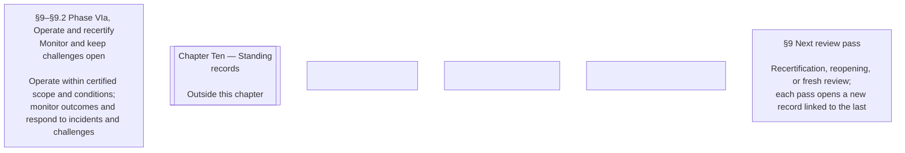

<!-- CHUNK-BEGIN fr__core_09.000_system_alignment_certification_evaluation__section_1_corpus_placement_overview.md bytes=3724 -->
<!-- AI-assisted translation draft; unreviewed. §1 corpus-placement overview, source lines 8–10; source SHA-256 4311e6ba74b7210f077c0bd4c8d21d8c9f517d2ada7b6d87288b39494dfeadd5. Draft only; do not synchronize into translations/. -->

# Chapter Nine Part A — §1 corpus-placement overview (fr)

## English source (lines 8–10)

> This file is **part of the Sentient Constitution** and is **binding only together** with the other numbered `core_*` files read as one text. It contains **Chapter Nine, Part A** — certification purpose, the process overview, and the first two phases of the process — **Frame** (system class) and **Evaluate** (whole-system evaluation in three sub-phases: the always-applicable evaluations, including data types and handling, in **§3**; the evaluations that apply where implicated in **§4**; and the Rights-Floor and domain evaluations that apply where triggered in **§5**) — **§1–§5**. The worked **Class A / B / C illustrations** (the system class profiles, §3.4.8, §5.1.5, §5.2.4, §5.3.7, §5.4.4, §5.5.5, and §5.6.4), including each one's **Reading across system classes** paragraph, are in [`core_09.010_system_alignment_certification_illustrations.md`](core_09.010_system_alignment_certification_illustrations.md); each keeps its Part A section number. The binding system-class-scaling and escalation rules those paragraphs illustrate stay in this file: system class scaling, including participation and proportionality, in §2.2; data-handling scaling in §3.4; and the **System class scaling and escalation** paragraph in each of §5.1–§5.6. The files of the whole chapter are listed in the table below.
>
> **Chapter Nine files.** Chapter Nine is split across four binding files read as one text. Part A, this file, opens the chapter; there is no separate index file.

## Translation draft

> Ce fichier **fait partie de la Sentient Constitution** et n’est contraignant que s’il est lu comme un texte unique avec les autres fichiers `core_*` numérotés. Il contient le **chapitre neuf, partie A** : l’objet de la certification, une vue d’ensemble du processus et ses deux premières phases — **Frame** (classe du système) et **Evaluate** (évaluation du système dans son ensemble en trois sous-phases : les évaluations toujours applicables, y compris les types et le traitement des données, en **§3** ; celles qui s’appliquent lorsqu’elles sont pertinentes en **§4** ; et les évaluations du **socle de droits** et des domaines qui s’appliquent lorsqu’elles sont déclenchées en **§5**) — **§§1–5**. Les exemples détaillés des classes **A / B / C** (profils de classe du système, §3.4.8, §5.1.5, §5.2.4, §5.3.7, §5.4.4, §5.5.5 et §5.6.4), y compris le paragraphe **Lecture entre les classes de systèmes** de chacun, figurent dans [`core_09.010_system_alignment_certification_illustrations.md`](core_09.010_system_alignment_certification_illustrations.md) ; chacun conserve son numéro de section de la partie A. Les règles contraignantes de mise à l’échelle par classe et d’escalade qu’illustrent ces paragraphes restent dans ce fichier : l’adaptation à la classe du système, y compris la participation et la proportionnalité, en §2.2 ; celle du traitement des données en §3.4 ; et le paragraphe **Mise à l’échelle et escalade selon la classe du système** dans chacune des sections §5.1 à §5.6. Le tableau ci-dessous répertorie les fichiers du chapitre entier.
>
> **Fichiers du chapitre neuf.** Le chapitre neuf est réparti entre quatre fichiers contraignants qui se lisent ensemble. La partie A, le présent fichier, ouvre le chapitre ; il n’existe pas de fichier d’index distinct.

<!-- CHUNK-END -->
<!-- CHUNK-BEGIN fr__core_09.000_system_alignment_certification_evaluation__section_1_corpus_file_table.md bytes=5272 -->
<!-- AI-assisted translation draft; unreviewed. §1 corpus-placement file table, source lines 12–17; source SHA-256 4311e6ba74b7210f077c0bd4c8d21d8c9f517d2ada7b6d87288b39494dfeadd5. Draft only; do not synchronize into translations/. -->

# Chapter Nine Part A — §1 corpus-placement file table (fr)

## English source (lines 12–17)

> | Part | File | Owns |
> |------|------|------|
> | **Part A — Evaluation** | [`core_09.000_system_alignment_certification_evaluation.md`](core_09.000_system_alignment_certification_evaluation.md) | §1–§5: purpose and process overview (with a chart of the whole certification process in its six phases), **Phase I Frame** (system class, how system class scales every evaluation, and pilot certification) and **Phase II Evaluate** (whole-system evaluation in three sub-phases: **IIa** always, in §3, including chartered scope versus functional boundaries and data types and handling; **IIb** where implicated, in §4; and **IIc** where triggered, the Rights-Floor and domain evaluations, in §5) |
> | **Part B — Record and process** | [`core_09.005_system_alignment_certification_record_process.md`](core_09.005_system_alignment_certification_record_process.md) | §6–§10: **Phase III Review** (forum roles, supervisory sequence, and the contestability chain), **Phase IV Decide** (certification outcomes, including the go-live gate), **Phase V Record** (the certification record and its integrity, including governing [System Charter](core_05.040_band_continuity.md#system-charter) fields), and **Phase VI Operate** (the challenge path; recertification and reopening; the standing bridge) — continuous chapter numbering from Part A §5 |
> | **Part C — Illustrations** | [`core_09.010_system_alignment_certification_illustrations.md`](core_09.010_system_alignment_certification_illustrations.md) | the illustrative system class profiles, §3.4, §3.4.8, §5.1.5, §5.2.4, §5.3.7, §5.4.4, §5.5.5, and §5.6.4: worked Class A / B / C walkthroughs for each Part A evaluation area, numbered to match Part A and linked both ways |
> | **Part D — Institutional alignment certification** | [`core_09.015_institutional_alignment_certification.md`](core_09.015_institutional_alignment_certification.md) | §11–§15: the same six phases for an **Institution** rather than a System — the institution class and the institutional evaluation (**Phases I and II**, §12), the forum roles, outcome, and **Institutional Certification Record** (**Phases III to V**, §13), and recertification, reopening, the cascade from System certifications, and the standing bridge (**Phase VI**, §14–§15). It cites each System's certification by link and does not repeat it, and it is not a licence — continuous chapter numbering from Part B §10 |

## Translation draft

| Partie | Fichier | Contenu |
|------|------|------|
| **Part A — Evaluation** | [`core_09.000_system_alignment_certification_evaluation.md`](core_09.000_system_alignment_certification_evaluation.md) | §§1–5 : objet et aperçu du processus (avec un schéma de ses six phases), puis les phases I Frame (classe du système, effet de la classe sur chaque évaluation et certification pilote) et II Evaluate (évaluation globale en trois sous-phases : IIa toujours, en §3, y compris portée de la Charte et limites fonctionnelles, types et traitement des données ; IIb lorsqu’elle est pertinente, en §4 ; IIc lorsqu’elle est déclenchée, évaluations du socle de droits et des domaines en §5). |
| **Part B — Record and process** | [`core_09.005_system_alignment_certification_record_process.md`](core_09.005_system_alignment_certification_record_process.md) | §§6–10 : phase III Review (rôles du forum, séquence de supervision et chaîne de contestation) ; IV Decide (résultats de certification, dont la condition préalable à la mise en service) ; V Record (dossier de certification et intégrité, y compris les champs directeurs de [System Charter](core_05.040_band_continuity.md#system-charter)) ; VI Operate (voie de contestation, recertification et réouverture, passerelle vers le standing) — numérotation continue depuis la partie A §5. |
| **Part C — Illustrations** | [`core_09.010_system_alignment_certification_illustrations.md`](core_09.010_system_alignment_certification_illustrations.md) | Profils illustratifs des classes de systèmes et §§3.4, 3.4.8, 5.1.5, 5.2.4, 5.3.7, 5.4.4, 5.5.5, 5.6.4 : exemples détaillés A/B/C pour chaque domaine d’évaluation de la partie A, avec numérotation concordante et liens dans les deux sens. |
| **Part D — Institutional alignment certification** | [`core_09.015_institutional_alignment_certification.md`](core_09.015_institutional_alignment_certification.md) | §§11–15 : les six mêmes phases pour une Institution plutôt qu’un Système — classe et évaluation institutionnelles (I–II, §12), rôles du forum, résultat et dossier de certification institutionnelle (III–V, §13), recertification, réouverture, cascade des certifications des systèmes et passerelle vers le standing (VI, §§14–15). Renvoie à la certification de chaque Système sans la répéter et ne constitue pas une licence — numérotation continue depuis la partie B §10. |

<!-- CHUNK-END -->
<!-- CHUNK-BEGIN fr__core_09.000_system_alignment_certification_evaluation__section_1_corpus_explanation.md bytes=8825 -->
<!-- AI-assisted translation draft; unreviewed. §1 corpus-placement explanatory prose, source lines 19–30; source SHA-256 4311e6ba74b7210f077c0bd4c8d21d8c9f517d2ada7b6d87288b39494dfeadd5. Draft only; do not synchronize into translations/. -->

# Chapter Nine Part A — §1 corpus-placement explanatory prose (fr)

## English source (lines 19–30)

> **How the two certifications relate.** System Alignment Certification (Parts A to C) is the certification of a System. Institutional alignment certification (Part D) is the certification of an Institution, which may run Systems or none. Part D cites each System's certification record by link and does not redo it; [Part D §11.1](core_09.015_institutional_alignment_certification.md#111-relation-to-system-alignment-certification) states the relation and [Part D §11.3](core_09.015_institutional_alignment_certification.md#113-no-permission-and-no-gate) states that it is not a licence.
>
> Generic **Chapter Nine** links in other files route to the appropriate part by section number.
>
> - **Constitutional owner (joint with Parts B and D):** forum-supervised **system alignment certification and related records** — evaluation domains (Part A); forum process, supervisory sequence, certification-record duties, certification outcomes and the go-live gate, the challenge path, recertification and reopening, and verified-input bridge to Chapter Ten (Part B); the same six phases for an Institution (Part D). Under the **oversight** Tetrad leg, SAC is one especially large, high-stakes audit process among others; auditing floors remain at **Article XVI** (*Audit, Transparency, and Independent Verification*) and Chapter Five [Auditability](core_05.050_band_oversight.md#auditability).
> - **Verification substrate owner:** [Chapter Four — Burden of Proof, Traceability, and Verification](core_04.000_burden_traceability_verification.md#chapter-four-burden-of-proof-traceability-and-verification) (within Chapters Two through Four) owns burden allocation, compliance evidence, definition traceability, observability, and security-constrained verification. Chapter Nine **applies** that discipline to system alignment certification records; it does **not** restate Chapter Four sections **1** through **5**.
> - **Auditing home (not relocated here):** **Article XVI** (*Audit, Transparency, and Independent Verification*), **Def.O1** (*Transparency, Auditability, and Verification*), and **CJS-5.110 §3 and CJS-5.115 §3** (*Audit process home*)–**CJS-5.110 §5** own auditing floors and operational terms. Chapter Nine runs one especially large SAC audit process that must satisfy those floors; it does not own all auditing.
> - **Implementation owner:** system-class handling, CS-6.345, and forum-process detail in designated implementation files must remain consistent with Chapter Nine and may be stricter where the corpus already provides a [Fullest Protective Effect](core_05.045_band_integrative.md#fullest-protective-effect) rule.
> - **Anti-relocation rule:** Part A does not restate Chapter Five canonical definitions, Chapter Three anti-evasion discipline (see [Part B §9.3](core_09.005_system_alignment_certification_record_process.md#93-non-evasion)), Chapter Ten contribution or standing measurement, or Chapter Eleven standing effects. **[Part B §10](core_09.005_system_alignment_certification_record_process.md#10-relationship-to-standing)** states the standing bridge boundary explicitly.
>
> **Upstream:** Chapter Five definitions; Chapters Two through Four record, verification, burden, and traceability of definitions to results; and [Chapter Eight](core_08.000_functional_independence_separation_of_duties.md#chapter-eight-functional-independence-and-separation-of-duties), whose separation-of-duties requirement governs every materially binding certification act.
> **Downstream:** [Part B](core_09.005_system_alignment_certification_record_process.md#chapter-nine-part-b-system-alignment-certification--record-and-process) (*forum process, record, outcomes, and standing bridge*); Chapter Ten standing records and verified inputs; Chapter Eleven standing effects; Chapter Thirteen forum supervision and system alignment certification pathways.

## Translation draft

**Relation entre les deux certifications.** La certification d’alignement d’un système (parties A à C) certifie un Système. La certification d’alignement institutionnel (partie D) certifie une Institution, qu’elle exploite ou non des Systèmes. La partie D renvoie au dossier de certification de chaque Système sans le refaire ; [Part D §11.1](core_09.015_institutional_alignment_certification.md#111-relation-to-system-alignment-certification) expose cette relation et [Part D §11.3](core_09.015_institutional_alignment_certification.md#113-no-permission-and-no-gate) précise qu’il ne s’agit pas d’une licence.
>
> Les liens génériques vers **Chapter Nine** dans d’autres fichiers conduisent à la partie appropriée selon le numéro de section.
>
> - **Responsable constitutionnel (conjointement avec les parties B et D) :** certification de l’alignement des systèmes et dossiers connexes sous la supervision du forum — domaines d’évaluation (partie A) ; processus du forum, séquence de supervision, obligations du dossier de certification, résultats et condition de mise en service, voie de contestation, recertification et réouverture, ainsi que passerelle des entrées vérifiées vers le chapitre dix (partie B) ; les mêmes six phases pour une Institution (partie D). Dans le pilier **supervision** du Tetrad, la SAC est un processus d’audit particulièrement vaste et à haut risque parmi d’autres ; les planchers d’audit restent ceux de **Article XVI** (*Audit, Transparency, and Independent Verification*) et de [Auditability](core_05.050_band_oversight.md#auditability) au chapitre cinq.
> - **Responsable du socle de vérification :** [Chapter Four — Burden of Proof, Traceability, and Verification](core_04.000_burden_traceability_verification.md#chapter-four-burden-of-proof-traceability-and-verification) (dans les chapitres deux à quatre) est responsable de la répartition de la charge de la preuve, des preuves de conformité, de la traçabilité des définitions, de l’observabilité et de la vérification sous contraintes de sécurité. Le chapitre neuf applique cette discipline aux dossiers de certification de l’alignement du système ; il ne reformule pas les sections **1** à **5** du chapitre quatre.
> - **Lieu de référence de l’audit (non déplacé ici) :** **Article XVI** (*Audit, Transparency, and Independent Verification*), **Def.O1** (*Transparency, Auditability, and Verification*) et **CJS-5.110 §3 et CJS-5.115 §3** (*Audit process home*)–**CJS-5.110 §5** définissent les planchers d’audit et les termes opérationnels. Le chapitre neuf exécute un processus SAC particulièrement vaste, qui doit respecter ces planchers ; il n’est pas responsable de tous les audits.
> - **Responsable de la mise en œuvre :** la gestion des classes de systèmes, CS-6.345 et les détails du processus du forum dans les fichiers de mise en œuvre désignés doivent rester cohérents avec le chapitre neuf et peuvent être plus stricts si le corpus prévoit déjà une règle de [Fullest Protective Effect](core_05.045_band_integrative.md#fullest-protective-effect).
> - **Règle anti-déplacement :** la partie A ne reformule pas les définitions canoniques du chapitre cinq, la discipline anti-évitement du chapitre trois (voir [Part B §9.3](core_09.005_system_alignment_certification_record_process.md#93-non-evasion)), la mesure de contribution ou de standing du chapitre dix, ni les effets sur le standing du chapitre onze. **[Part B §10](core_09.005_system_alignment_certification_record_process.md#10-relationship-to-standing)** définit explicitement la limite de la passerelle de standing.
>
> **Amont :** définitions du chapitre cinq ; dossiers, vérification, charge de la preuve et traçabilité des définitions jusqu’aux résultats des chapitres deux à quatre ; et [Chapter Eight](core_08.000_functional_independence_separation_of_duties.md#chapter-eight-functional-independence-and-separation-of-duties), dont l’exigence de séparation des tâches régit tout acte de certification ayant un effet matériellement contraignant.
> **Aval :** [Part B](core_09.005_system_alignment_certification_record_process.md#chapter-nine-part-b-system-alignment-certification--record-and-process) (*processus du forum, dossier, résultats et passerelle de standing*) ; dossiers de standing et entrées vérifiées du chapitre dix ; effets sur le standing du chapitre onze ; supervision du forum et voies de certification de l’alignement des systèmes du chapitre treize.

<!-- CHUNK-END -->
<!-- CHUNK-BEGIN fr__core_09.000_system_alignment_certification_evaluation__section_1_heading.md bytes=363 -->
<!-- AI-assisted translation draft; unreviewed. §1 heading, source line 44; source SHA-256 4311e6ba74b7210f077c0bd4c8d21d8c9f517d2ada7b6d87288b39494dfeadd5. Draft only; do not synchronize into translations/. -->

# Chapter Nine Part A — §1 heading (fr)

## English source (lines 44–45)

### 1. Purpose and Role


## Translation draft

### 1. Objet et rôle

<!-- CHUNK-END -->
<!-- CHUNK-BEGIN fr__core_09.000_system_alignment_certification_evaluation__section_1_trace.md bytes=12168 -->
<!-- AI-assisted translation draft; unreviewed. §1 trace, source lines 46–95; source SHA-256 4311e6ba74b7210f077c0bd4c8d21d8c9f517d2ada7b6d87288b39494dfeadd5. Draft only; do not synchronize into translations/. -->

# Chapter Nine Part A — §1 trace (fr)

## English source (lines 46–95)

<details>
<summary><strong><span style="color: #2563eb;">Trace</span></strong></summary>

- Upstream:
  - [Preamble — constitutional owner register](core_00.000_preamble.md#4-principles-definitions-and-rights) and
  - [Authority Stack and Internal Hierarchy](core_05.045_band_integrative.md#authority-stack-and-internal-hierarchy);
  - [Constitutional Tetrad](core_00.000_preamble.md#constitutional-tetrad);
  - [Two Constitutional Aims](core_00.000_preamble.md#two-constitutional-aims);
  - [material stake](core_00.000_preamble.md#material-stake);
  - [Proportionality](core_05.035_band_accountability.md#proportionality) and
  - [Substantive Fairness](core_05.055_band_participation.md#substantive-fairness) (Chapter Five); Participation measurement family (*voice, access, and contest paths*);
  - [Chapter One §16 Stewardship In Depth](core_01.010_stewardship_capacity_principles.md#16-stewardship-in-depth) (1.010 §16);
  - [Chapter One §12 Systemic Evaluation Requirement](core_01.000_values_principles.md#12-systemic-evaluation-requirement) (1.000 §12) (*principle-layer whole-system evaluation lens — not one corner alone*); Chapters Two through Four;
  - [Chapter Five](core_05.000_definitions_home.md#chapter-five-foundational-definitions) (5.000) (*canonical definitions*);
  - [Chapter Eight §2 Four-Seat Constitutional Requirement](core_08.000_functional_independence_separation_of_duties.md#2-four-seat-constitutional-requirement) (8.000 §2);
  - [System Alignment Certification](core_05.040_band_continuity.md#system-alignment-certification) (Chapter Five canonical term; non-operative shorthand **SAC**);
  - [System Certification Record](core_05.040_band_continuity.md#system-certification-record) (Chapter Five meaning).
- Downstream:
  - [§2](#2-system-class-evaluation) (*system class evaluation*);
  - [Part B §9.1](core_09.005_system_alignment_certification_record_process.md#91-challenging-a-certification) (9.005 §9.1) (*challenging a certification*); and
  - [Part C system class profiles](core_09.010_system_alignment_certification_illustrations.md#illustrative-system-class-profiles-non-exhaustive) (9.010) (*illustrative system class profiles*);
  - [Part C whole-system walkthroughs](core_09.010_system_alignment_certification_illustrations.md#illustrative-whole-system-application-by-system-class-non-exhaustive) (9.010) (*worked whole-system examples by system class*);
  - [§3.4.8](core_09.010_system_alignment_certification_illustrations.md#348-illustrative-data-handling-application-by-system-class-non-exhaustive) (*worked data-handling examples by system class*);
  - [§5.1.5](core_09.010_system_alignment_certification_illustrations.md#515-illustrative-ecological-footprint-application-by-system-class-non-exhaustive) (*worked ecological-footprint examples by system class*);
  - [§5.2.4](core_09.010_system_alignment_certification_illustrations.md#524-illustrative-educational-capability-application-by-system-class-non-exhaustive) (*worked educational-capability examples by system class*);
  - [§5.3.7](core_09.010_system_alignment_certification_illustrations.md#537-illustrative-cross-system-support-application-by-system-class-non-exhaustive) (*worked cross-system-support examples by system class*);
  - [§5.4.4](core_09.010_system_alignment_certification_illustrations.md#544-illustrative-nondiscrimination-application-by-system-class-non-exhaustive) (*worked nondiscrimination examples by system class*);
  - [§5.5.5](core_09.010_system_alignment_certification_illustrations.md#555-illustrative-accessibility-application-by-system-class-non-exhaustive) (*worked accessibility examples by system class*);
  - [§5.6.4](core_09.010_system_alignment_certification_illustrations.md#564-illustrative-trustworthiness-application-by-system-class-non-exhaustive) (*worked trustworthiness examples by system class*);
  - [§3](#3-whole-system-certification-evaluation) (*whole-system certification evaluation factors*);
  - [§3.4](#34-data-types-and-handling-evaluation) through
  - [§5.6](#56-trustworthiness-and-system-reliance-integrity-evaluation) (*domain evaluations*);
  - [Part B §6](core_09.005_system_alignment_certification_record_process.md#6-forum-process) (9.005 §6) (*supervisory sequence and contestability chain*);
  - [Part B §6.1](core_09.005_system_alignment_certification_record_process.md#61-forum-supervision-and-component-roles) (9.005 §6.1) (*forum component roles*);
  - [Part B §8](core_09.005_system_alignment_certification_record_process.md#8-system-certification-record) (9.005 §8) (*certification record contents*);
  - [Part B §8.2](core_09.005_system_alignment_certification_record_process.md#82-record-integrity-transparency-and-auditability) (9.005 §8.2) (*record integrity requirements*);
  - [Part B §7](core_09.005_system_alignment_certification_record_process.md#7-certification-outcomes) (9.005 §7) (*reopening and anti-evasion*);
  - [Part B §10](core_09.005_system_alignment_certification_record_process.md#10-relationship-to-standing) (9.005 §10) (*standing-record bridge*);
  - [Chapter Ten](core_11.000_standing_assessment.md#chapter-eleven-contribution-violation-and-standing-model--measurement) (10.000) (*standing records and verified-input gate*);
  - [Chapter Eleven](core_12.000_standing_integration.md#chapter-twelve-standing-effects-and-integration) (11.000) (*standing effects and integration*);
  - [Chapter Thirteen](core_14.000_forum.md#chapter-fourteen-forums-and-jurisdiction) (13.000) (*forum supervision, certification, alignment certification, and review*).
- Read with:
  - **[CS-9.305](corpus_systems/cs_09.305_system_classification_machinery.md#cs-9305-part-a-system-classification-machinery) (*System classification machinery*) and [CS-9.310 — System impact classifications](corpus_systems/cs_09.310_system_impact_classifications.md#cs-9310-part-b-system-impact-classifications)**, **[CS-6.305](corpus_systems/cs_06.305_information_types_and_handling.md#cs-6305-part-a-information-types-and-handling) (*Information types and handling*) and [CS-6.310 — Data classifications](corpus_systems/cs_06.310_data_classifications.md#cs-6310-part-b-data-classifications)**, and
  - **CS-6.345** (*System lifecycle*);
  - **CF-13.415** (*Routing operations, transfer, certification, and representative treatment*) and
  - **CF-13.425** (*Integrity safeguards, anti-capture operations, and anti-self-judging support*); **Article XVI** (*Audit, Transparency, and Independent Verification*) and
  - [Auditability](core_05.050_band_oversight.md#auditability) (*auditing floors — SAC is one especially large audit process under oversight, not the sole auditing home*); **CJS-5.110 §3 (*Oversight: auditability and reconstructability terms (annex)*) and CJS-5.115 §3** (*Audit process home*)–
  - **CJS-5.110 §5** (*Oversight: independent verification and claim-integrity terms*).

</details>

## Translation draft

#### Traçabilité

La carte situe le fondement constitutionnel et hiérarchique de cette section, puis le relie à l’évaluation, à la classification, aux voies de réexamen, aux dossiers, aux résultats et à l’audit ; elle indique aussi les instruments opérationnels à lire conjointement.

**Traçabilité — upstream canonical sources:** [Preamble — constitutional owner register](core_00.000_preamble.md#4-principles-definitions-and-rights); [Authority Stack and Internal Hierarchy](core_05.045_band_integrative.md#authority-stack-and-internal-hierarchy); [Constitutional Tetrad](core_00.000_preamble.md#constitutional-tetrad); [Two Constitutional Aims](core_00.000_preamble.md#two-constitutional-aims); [material stake](core_00.000_preamble.md#material-stake); [Proportionality](core_05.035_band_accountability.md#proportionality); [Substantive Fairness](core_05.055_band_participation.md#substantive-fairness); [Chapter One §16 Stewardship In Depth](core_01.010_stewardship_capacity_principles.md#16-stewardship-in-depth); [Chapter One §12 Systemic Evaluation Requirement](core_01.000_values_principles.md#12-systemic-evaluation-requirement); [Chapter Five](core_05.000_definitions_home.md#chapter-five-foundational-definitions); [Chapter Eight §2 Four-Seat Constitutional Requirement](core_08.000_functional_independence_separation_of_duties.md#2-four-seat-constitutional-requirement); [System Alignment Certification](core_05.040_band_continuity.md#system-alignment-certification); [System Certification Record](core_05.040_band_continuity.md#system-certification-record)

**Traçabilité — downstream routes and related records:** [§2](#2-system-class-evaluation); [Part B §9.1](core_09.005_system_alignment_certification_record_process.md#91-challenging-a-certification); [Part C system class profiles](core_09.010_system_alignment_certification_illustrations.md#illustrative-system-class-profiles-non-exhaustive); [Part C whole-system walkthroughs](core_09.010_system_alignment_certification_illustrations.md#illustrative-whole-system-application-by-system-class-non-exhaustive); [§3.4.8](core_09.010_system_alignment_certification_illustrations.md#348-illustrative-data-handling-application-by-system-class-non-exhaustive); [§5.1.5](core_09.010_system_alignment_certification_illustrations.md#515-illustrative-ecological-footprint-application-by-system-class-non-exhaustive); [§5.2.4](core_09.010_system_alignment_certification_illustrations.md#524-illustrative-educational-capability-application-by-system-class-non-exhaustive); [§5.3.7](core_09.010_system_alignment_certification_illustrations.md#537-illustrative-cross-system-support-application-by-system-class-non-exhaustive); [§5.4.4](core_09.010_system_alignment_certification_illustrations.md#544-illustrative-nondiscrimination-application-by-system-class-non-exhaustive); [§5.5.5](core_09.010_system_alignment_certification_illustrations.md#555-illustrative-accessibility-application-by-system-class-non-exhaustive); [§5.6.4](core_09.010_system_alignment_certification_illustrations.md#564-illustrative-trustworthiness-application-by-system-class-non-exhaustive); [§3](#3-whole-system-certification-evaluation); [§3.4](#34-data-types-and-handling-evaluation); [§5.6](#56-trustworthiness-and-system-reliance-integrity-evaluation); [Part B §6](core_09.005_system_alignment_certification_record_process.md#6-forum-process); [Part B §6.1](core_09.005_system_alignment_certification_record_process.md#61-forum-supervision-and-component-roles); [Part B §8](core_09.005_system_alignment_certification_record_process.md#8-system-certification-record); [Part B §8.2](core_09.005_system_alignment_certification_record_process.md#82-record-integrity-transparency-and-auditability); [Part B §7](core_09.005_system_alignment_certification_record_process.md#7-certification-outcomes); [Part B §10](core_09.005_system_alignment_certification_record_process.md#10-relationship-to-standing); [Chapter Ten](core_11.000_standing_assessment.md#chapter-eleven-contribution-violation-and-standing-model--measurement); [Chapter Eleven](core_12.000_standing_integration.md#chapter-twelve-standing-effects-and-integration); [Chapter Thirteen](core_14.000_forum.md#chapter-fourteen-forums-and-jurisdiction)

**Traçabilité — operational materials to read with this section:** [CS-9.305](corpus_systems/cs_09.305_system_classification_machinery.md#cs-9305-part-a-system-classification-machinery); [CS-9.310 — System impact classifications](corpus_systems/cs_09.310_system_impact_classifications.md#cs-9310-part-b-system-impact-classifications); [CS-6.305](corpus_systems/cs_06.305_information_types_and_handling.md#cs-6305-part-a-information-types-and-handling); [CS-6.310 — Data classifications](corpus_systems/cs_06.310_data_classifications.md#cs-6310-part-b-data-classifications); [Auditability](core_05.050_band_oversight.md#auditability)

<!-- CHUNK-END -->
<!-- CHUNK-BEGIN fr__core_09.000_system_alignment_certification_evaluation__purpose_adjuncts.md bytes=6061 -->
<!-- AI-assisted translation draft; unreviewed. Selected §1 passages, source lines 99 and 107–114; source SHA-256 4311e6ba74b7210f077c0bd4c8d21d8c9f517d2ada7b6d87288b39494dfeadd5. -->

# Chapter Nine Part A — §1 plain-terms excerpt

**Status:** AI-assisted draft; unreviewed. English source remains controlling.

## English source

When a system really matters to sentients' lives, certification has to be **proportionate** — as demanding as the system's real impact, dependency, and risk require, not a one-size-fits-all checklist or a rubber stamp. It also has to be **participatory** — affected sentients and communities must be able to see what was reviewed, understand what was decided, and challenge it when something is wrong. Forums review evidence, write it down in a certification record, and require re-checks on a schedule that matches how risky the system is. Classes A, B, and C get the full process and Class L a lighter one. Class P is encouraged to use it, and must once it is reclassified to Class L or higher (that is, its effects reach beyond a private unit) or its operator claims constitutional compliance.

## fr draft

Lorsqu’un système compte réellement dans la vie des êtres sentients, sa certification doit être **proportionnée** : aussi exigeante que l’exigent son impact réel, la dépendance à son égard et les risques, et non une liste uniforme ou un simple tampon. Elle doit aussi être **participative** : les êtres sentients et les communautés concernés doivent pouvoir voir ce qui a été examiné, comprendre la décision et la contester en cas d’erreur. Les forums examinent les preuves, les consignent dans un dossier de certification et imposent des réexamens selon un calendrier adapté au risque du système. Les classes A, B et C suivent la procédure complète; la classe L, une procédure allégée. La classe P est encouragée à l’utiliser et doit le faire dès qu’elle est reclassée en classe L ou supérieure (c’est-à-dire lorsque ses effets dépassent une unité privée), ou que son opérateur revendique la conformité constitutionnelle.


### English source — Flourishing

- **[Flourishing](core_00.000_preamble.md#flourishing)** — certification verifies that certification or continued reliance would not quietly defeat Rights Floors or block fair participation in constitutionally relevant life;

### fr draft

- **[Épanouissement](core_00.000_preamble.md#flourishing)** — la certification vérifie que la délivrance d’un certificat ou la poursuite de la confiance ne neutralise pas discrètement les Planchers de droits et ne bloque pas la participation équitable à la vie pertinente sur le plan constitutionnel;


### English source — Continuity criterion

- **[Continuity](core_00.000_preamble.md#continuity)** — certification verifies durable, non-regressive supply that sustains rather than depletes healthy natural systems ([Ecological Integrity](core_05.040_band_continuity.md#ecological-integrity), including [Ecological Recovery Capacity](core_05.040_band_continuity.md#ecological-recovery-capacity)), and system-class-scaled recertification where shared systems gate or sustain delivery;

### fr draft

- **[Continuité](core_00.000_preamble.md#continuity)** — la certification vérifie un approvisionnement durable et non régressif qui soutient les systèmes naturels sains au lieu de les épuiser ([Intégrité écologique](core_05.040_band_continuity.md#ecological-integrity), y compris la [Capacité de rétablissement écologique](core_05.040_band_continuity.md#ecological-recovery-capacity)), ainsi qu’une recertification à l’échelle de la classe du système lorsque des systèmes partagés conditionnent ou soutiennent la fourniture;


### English source — Participation criterion

- **Participation** — affected sentients and communities can understand, contest, and take part in review paths that matter to them;

### fr draft

- **Participation** — les êtres sentients et les communautés concernés peuvent comprendre, contester et suivre les voies d’examen qui comptent pour eux;


### English source — Oversight criterion

- **Oversight** — records, evidence, and assumptions are visible and auditable enough for independent checking; certification itself is one especially large audit process under that oversight duty, not the only one;

### fr draft

- **Surveillance** — les dossiers, les preuves et les hypothèses sont suffisamment visibles et auditables pour permettre un contrôle indépendant; la certification est elle-même un processus d’audit particulièrement important relevant de cette obligation, mais elle n’en est pas l’unique domaine;


### English source — Accountability criterion

- **Accountability** — defects, misclassification, and floor-defeating operation route to remedy, conditions, withdrawal, or standing input where the facts support it;

### fr draft

- **Responsabilité** — les défauts, les classifications erronées et le fonctionnement qui compromet les Planchers de droits donnent lieu à réparation, conditions, retrait ou contribution à l’évaluation de trajectoire lorsque les faits le justifient;


### English source — Timeliness criterion

- **Timeliness** — review and contest windows keep certification from going stale while harm can still be prevented or reversed.

### fr draft

- **Diligence temporelle** — les délais d’examen et de contestation empêchent la certification de devenir obsolète tant qu’il est encore possible de prévenir ou de réparer le préjudice.


### English source — Tetrad introduction

Certification implements the [Two Constitutional Aims](core_00.000_preamble.md#two-constitutional-aims) through the [Constitutional Tetrad](core_00.000_preamble.md#constitutional-tetrad):

### fr draft

La certification met en œuvre les [Deux objectifs constitutionnels](core_00.000_preamble.md#two-constitutional-aims) au moyen de la [Tétrade constitutionnelle](core_00.000_preamble.md#constitutional-tetrad) :

<!-- CHUNK-END -->
<!-- CHUNK-BEGIN fr__core_09.000_system_alignment_certification_evaluation__section_1_purpose.md bytes=1311 -->
<!-- AI-assisted translation draft; unreviewed. Complete purpose statement excerpt, source lines 101–105; source SHA-256 4311e6ba74b7210f077c0bd4c8d21d8c9f517d2ada7b6d87288b39494dfeadd5. This is an excerpt, not a complete §1 translation. -->

La **certification de l’alignement du système** répond à une question pour un périmètre et un calendrier d’examen définis : le système a-t-il suffisamment démontré son alignement constitutionnel pour justifier une certification, une certification conditionnelle, une validation, une recertification, la poursuite de la dépendance, le déploiement ou la levée substantielle de conditions ?

- Une certification n’est ni un score de popularité, ni un laissez-passer permanent, ni un moyen d’éviter l’examen des droits.
- C’est un énoncé limité dans le temps et contestable de ce qui est actuellement connu sur l’alignement du système.
- Sous le pilier **surveillance** de la Tétrade, la surveillance exige des audits ; la certification de l’alignement du système est un processus d’audit particulièrement vaste et à forts enjeux parmi d’autres — elle n’est pas le seul lieu de l’audit (**Article XVI** (*Audit, transparence et vérification indépendante*), [Auditabilité](core_05.050_band_oversight.md#auditability)).

<!-- CHUNK-END -->
<!-- CHUNK-BEGIN fr__core_09.000_system_alignment_certification_evaluation__section_1_subsection_headings.md bytes=777 -->
<!-- AI-assisted translation draft; unreviewed. §1.1/§1.2 visible subsection headings, source lines 116–119 and 144–148; source SHA-256 4311e6ba74b7210f077c0bd4c8d21d8c9f517d2ada7b6d87288b39494dfeadd5. Draft only; anchors/blank layout are structural. Do not synchronize into translations/. -->

# Chapter Nine Part A — §1.1 and §1.2 subsection headings (fr)

## English source

### Lines 116–119

<a id="11-certification-as-an-audit-process-scaled-by-class"></a>

#### 1.1 Certification as an audit process, scaled by class


### Lines 144–148


<a id="12-certification-at-a-glance"></a>

#### 1.2 Certification at a glance


## Translation draft

#### 1.1 La certification comme processus d’audit, proportionné à la classe

#### 1.2 La certification en bref

<!-- CHUNK-END -->
<!-- CHUNK-BEGIN fr__core_09.000_system_alignment_certification_evaluation__section_1_audit_scope.md bytes=3323 -->
<!-- AI-assisted translation draft; unreviewed. §1.1 audit mechanism and sibling audit modes, source lines 120–130; source SHA-256 4311e6ba74b7210f077c0bd4c8d21d8c9f517d2ada7b6d87288b39494dfeadd5. -->

# Chapter Nine Part A — §1.1 certification audit process excerpt (fr)

## English source

As an oversight mechanism, certification is one especially large audit process under [Auditability](core_05.050_band_oversight.md#auditability) and **Article XVI** (*Audit, Transparency, and Independent Verification*):

- It is forum-supervised, multi-domain, and status-granting.
- It may integrate the results of sibling audit modes, and it does not absorb or replace them. Each keeps its own owner, named in the [sibling audit modes map](corpus_joint_structure/cjs_05.115_audit_process.md#sibling-audit-modes-owner-map) of the audit process home:
  - System Data Types Record audits under **CS-6.305 (*Information types and handling*) and CS-6.310** (*Data classifications*)
  - System Classification Record audits under **CS-9.305 (*System classification machinery*) and CS-9.310** (*System impact classifications*)
  - steward assurance reviews under **CS-14.305** (*Critical system stewardship*)
  - continuous audit under **CS-6.345** (*System lifecycle*) ACA
  - complexity audits under **CS-6.315** (*Comprehensibility and complexity stewardship*) and **Article XXIII-B** (*Complexity Audit and Modularity Requirements*)
  - claim verification under **CJS-5.110 §5** (*Oversight: independent verification and claim-integrity terms*)
- You can still run any of these checks on their own, without going through certification. Certification doesn't replace them.

## fr draft

En tant que mécanisme de supervision, la certification constitue un processus d’audit particulièrement vaste au titre de l’[Auditabilité](core_05.050_band_oversight.md#auditability) et de **Article XVI** (*Audit, transparence et vérification indépendante*) :

- Elle est supervisée par un forum, couvre plusieurs domaines et confère un statut.
- Elle peut intégrer les résultats des modes d’audit apparentés, mais ne les absorbe ni ne les remplace. Chacun conserve son propre responsable, nommé dans la [carte des modes d’audit apparentés](corpus_joint_structure/cjs_05.115_audit_process.md#sibling-audit-modes-owner-map) du document de référence du processus d’audit :
  - Audits du registre des types de données système selon **CS-6.305 (*Types d’information et traitement*) et CS-6.310** (*Classifications des données*)
  - Audits du registre de classification système selon **CS-9.305 (*Mécanismes de classification système*) et CS-9.310** (*Classifications de l’impact système*)
  - Examens d’assurance de la tutelle selon **CS-14.305** (*Tutelle des systèmes critiques*)
  - Audit continu selon **CS-6.345** (*Cycle de vie du système*) ACA
  - Audits de complexité selon **CS-6.315** (*Intelligibilité et tutelle de la complexité*) et **Article XXIII-B** (*Exigences d’audit de complexité et de modularité*)
  - Vérification des affirmations selon **CJS-5.110 §5** (*Supervision : vérification indépendante et intégrité des affirmations*)
- Vous pouvez toujours effectuer chacun de ces contrôles séparément, sans passer par la certification. La certification ne les remplace pas.

<!-- CHUNK-END -->
<!-- CHUNK-BEGIN fr__core_09.000_system_alignment_certification_evaluation__section_1_class_scaling.md bytes=4185 -->
<!-- AI-assisted translation draft; unreviewed. Chapter Nine Part A §1 class scaling and cadence, source lines 132–143; source SHA-256 4311e6ba74b7210f077c0bd4c8d21d8c9f517d2ada7b6d87288b39494dfeadd5. Draft only; do not synchronize into translations/. -->

**Current English passage:**

Certification depth, record burden, certification interval, stakeholder review, and contest paths must scale with [material stake](core_00.000_preamble.md#material-stake) under [Proportionality](core_05.035_band_accountability.md#proportionality):

The process applies by impact class, as the [reclassification requirement](corpus_systems/cs_09.305_system_classification_machinery.md#35-reclassification-requirement) of **CS-9.305** (*System classification machinery*) sets out:

- **Class A, Class B, and Class C:** these systems carry the highest impact, dependency, and risk, and whole-system evaluation under [§3 Whole-System Certification Evaluation](#3-whole-system-certification-evaluation), [§4 Evaluations Where Implicated](#4-evaluations-where-implicated), and [§5 Rights-Floor and Domain Evaluations](#5-rights-floor-and-domain-evaluations), each as its own sub-phase applies, is mandatory at full depth;
- **Class L:** the same evaluation is mandatory but proportionate, with a lower default re-check cadence and simpler records where CS-9.305 (*System classification machinery*) and CS-9.310 (*System impact classifications*) permits; and
- **Class P:** the process is encouraged while the system is validly Class P, and a Class P system may use it voluntarily. It becomes mandatory on reclassification to Class L or higher, or where the operator voluntarily asserts constitutional compliance for the system.

The certification interval, and the financial, resource, or special audit that falls at its midpoint, are set by class in [Chapter Thirteen §6 Timely resolution, materiality tiers, and anti-delay discipline](core_14.000_forum.md#review-cadence) (*Review cadence*). This chapter does not restate the numbers.

**Proposed locale translation:**

La profondeur de la certification, la charge documentaire, l’intervalle de certification, l’examen par les parties prenantes et les voies de contestation doivent être proportionnés à l’[enjeu matériel](core_00.000_preamble.md#material-stake), selon le principe de [proportionnalité](core_05.035_band_accountability.md#proportionality) :

Le processus s’applique selon la classe d’impact, conformément à l’[exigence de reclassement](corpus_systems/cs_09.305_system_classification_machinery.md#35-reclassification-requirement) de **CS-9.305** (*Mécanisme de classification des systèmes*) :

- **Classes A, B et C :** ces systèmes présentent les niveaux les plus élevés d’impact, de dépendance et de risque. L’évaluation de l’ensemble du système, à pleine profondeur et pour chaque sous-phase applicable, est obligatoire au titre de la [§3 Évaluation de certification de l’ensemble du système](#3-whole-system-certification-evaluation), de la [§4 Évaluations lorsqu’elles sont en cause](#4-evaluations-where-implicated) et de la [§5 Évaluations des planchers de droits et par domaine](#5-rights-floor-and-domain-evaluations) ;
- **Classe L :** la même évaluation est obligatoire mais proportionnée, avec une fréquence par défaut de nouvelle vérification plus faible et des dossiers simplifiés lorsque **CS-9.305** (*Mécanisme de classification des systèmes*) et **CS-9.310** (*Classifications de l’impact du système*) le permettent ; et
- **Classe P :** le processus est encouragé tant que la classe P est valide et peut être utilisé volontairement. Il devient obligatoire en cas de reclassement en classe L ou supérieure, ou si l’opérateur affirme volontairement que le système respecte la Constitution.

L’intervalle de certification et l’audit financier, de ressources ou spécial prévu à son milieu sont fixés selon la classe au [chapitre treize §6 Résolution en temps utile, niveaux de matérialité et discipline contre les retards](core_14.000_forum.md#review-cadence) (*Cadence de réexamen*). Le présent chapitre ne répète pas les chiffres.

<!-- CHUNK-END -->
<!-- CHUNK-BEGIN fr__core_09.000_system_alignment_certification_evaluation__section_1_at_a_glance.md bytes=1889 -->
<!-- AI-assisted translation draft; unreviewed. Chapter Nine Part A §1.2 plain-language summary, source line 149; source SHA-256 4311e6ba74b7210f077c0bd4c8d21d8c9f517d2ada7b6d87288b39494dfeadd5. Draft only; do not synchronize into translations/. -->

# Chapter Nine Part A — §1.2 at-a-glance summary (fr)

## English source

*In plain terms: classify the system honestly, run the evaluations that apply, have forums independently review the evidence and stakeholder concerns, and decide an outcome. Complete the one record opened for forum review and publish it with an open challenge path. A certified system goes live only after its notice interval and required protections are satisfied. Monitor actual outcomes, respond to incidents and challenges, and check again on schedule or when the facts change. Correct defects and have the correction independently verified before authorizing the affected scope or releasing its conditions. Each review pass uses a new record linked to the last.*

## fr draft

*En termes simples : classez honnêtement le système, réalisez les évaluations applicables, faites examiner de manière indépendante les preuves et les préoccupations des parties prenantes par les forums, puis décidez d’une issue. Complétez l’unique dossier ouvert pour l’examen du forum et publiez-le en laissant ouverte une voie de contestation. Un système certifié ne peut être mis en service qu’après le délai de préavis et la satisfaction des protections requises. Suivez les résultats réels, répondez aux incidents et contestations, puis vérifiez de nouveau à l’échéance prévue ou lorsque les faits changent. Corrigez les défauts et faites vérifier la correction de manière indépendante avant d’autoriser le périmètre concerné ou d’en lever les conditions. Chaque cycle d’examen utilise un nouveau dossier lié au précédent.*

<!-- CHUNK-END -->
<!-- CHUNK-BEGIN fr__core_09.000_system_alignment_certification_evaluation__section_1_phase_map.md bytes=577 -->
<!-- AI-assisted translation draft; unreviewed. Chapter Nine Part A §1.2 phase map, source line 151; source SHA-256 4311e6ba74b7210f077c0bd4c8d21d8c9f517d2ada7b6d87288b39494dfeadd5. Draft only; do not synchronize into translations/. -->

**Current English passage:**

The process runs in **six phases**: **I Frame**, **II Evaluate**, **III Review**, **IV Decide**, **V Record**, and **VI Operate**.

**Proposed locale translation:**

Le processus comprend **six phases** : **I Cadrer**, **II Évaluer**, **III Examiner**, **IV Décider**, **V Consigner** et **VI Exploiter**.

<!-- CHUNK-END -->
<!-- CHUNK-BEGIN fr__core_09.000_system_alignment_certification_evaluation__section_1_reopen_triggers.md bytes=1766 -->
<!-- AI-assisted translation draft; unreviewed. Chapter Nine Part A §1 review-reopening passage, source line 153; source SHA-256 4311e6ba74b7210f077c0bd4c8d21d8c9f517d2ada7b6d87288b39494dfeadd5. Draft only; do not synchronize into translations/. -->

**Current English passage:**

Every evaluation that applies is carried out again on each certification pass: at first certification, at each recertification on the schedule set by [§2 System Class Evaluation](#2-system-class-evaluation), and at each reopened or fresh review. Review reopens before the next scheduled recertification when material facts change, such as growing reliance on the system, growing extraction from shared foundations, a significant fall in what the system puts back into them, or a credible challenge. [Part B §9 Recertification and Reopening](core_09.005_system_alignment_certification_record_process.md#9-recertification-and-reopening) lists the triggers.

**Proposed locale translation:**

Chaque évaluation applicable est répétée à chaque cycle de certification : lors de la certification initiale, à chaque recertification selon le calendrier fixé par la [§2 Évaluation de la classe du système](#2-system-class-evaluation), et lors de tout réexamen rouvert ou nouveau. Le réexamen est rouvert avant la prochaine recertification prévue lorsque des faits importants changent, par exemple si la dépendance au système augmente, si l’extraction des fondements communs s’accroît, si la contribution du système à ces fondements diminue sensiblement ou si une contestation crédible survient. La [partie B §9 Recertification et réouverture](core_09.005_system_alignment_certification_record_process.md#9-recertification-and-reopening) énumère les déclencheurs.

<!-- CHUNK-END -->
<!-- CHUNK-BEGIN fr__core_09.000_system_alignment_certification_evaluation__section_1_phase_map_opening_nodes.md bytes=2012 -->
<!-- AI-assisted translation draft; unreviewed. §1.2 Phase I/II opening chart-node labels, source lines 155–165; source SHA-256 4311e6ba74b7210f077c0bd4c8d21d8c9f517d2ada7b6d87288b39494dfeadd5. Draft only; non-prose Mermaid syntax/connectors are retained. Do not synchronize into translations/. -->

# Chapter Nine Part A — §1.2 opening phase-map nodes (fr)

## English source (lines 155–165)

```mermaid
flowchart TB
    T(["System with material impact seeks certification,<br/>or reliance on it grows"])
    C["§2 Phase I, Frame<br/>Classify honestly<br/><br/>Class sets depth and re-check schedule"]
    subgraph W["§3–§5 Phase II, Evaluate — Whole-system evaluation"]
        direction LR
        Al["§3.1–§3.4 IIa — Always<br/><br/>Governance; systemic risk: evaluated,<br/>and disclosed to those who need it;<br/>time horizon; data types"]
        Im["§4 IIb — When implicated<br/><br/>Privacy loci, exit rights,<br/>assembly and dissent"]
        Tr["§5 IIc — When triggered<br/><br/>Applicable Rights-Floor checks<br/>and six domain evaluations"]
        Al ~~~ Im ~~~ Tr
    end

## Translation draft

```mermaid
flowchart TB
    T["Un système ayant un impact important demande une certification,<br/>ou la dépendance à son égard augmente"]
    C["§2 Phase I, Cadrer<br/>Classer honnêtement<br/><br/>La classe fixe la profondeur et le calendrier des réexamens"]
    subgraph W["§3–§5 Phase II, Évaluer — évaluation globale du système"]
        direction LR
        Al["§3.1–§3.4 IIa — Toujours<br/><br/>Gouvernance ; risques systémiques : évaluer et divulguer<br/>aux personnes concernées ; horizon temporel ; types de données"]
        Im["§4 IIb — Si le système est concerné<br/><br/>Points de confidentialité, droits de sortie,<br/>assemblée et dissidence"]
        Tr["§5 IIc — Si le déclencheur s’applique<br/><br/>Contrôles du socle des droits applicables<br/>et six évaluations de domaine"]
        Al ~~~ Im ~~~ Tr
    end
```

<!-- CHUNK-END -->
<!-- CHUNK-BEGIN fr__core_09.000_system_alignment_certification_evaluation__chart_review_node.md bytes=608 -->
# Chapter Nine Part A — chart review node (fr)

AI-assisted draft; unreviewed. Current source SHA-256: `4311e6ba74b7210f077c0bd4c8d21d8c9f517d2ada7b6d87288b39494dfeadd5`. Reconciles current source line 166: “Assigned forums issue findings; challenge paths stay open.” The translated node ID, chart structure, HTML line breaks, and code syntax are preserved.

```mermaid
    F["Phase III, Examiner — §6<br/>Examen indépendant des preuves<br/>et des préoccupations des parties prenantes<br/><br/>Les forums désignés rendent leurs conclusions ;<br/>les voies de contestation restent ouvertes"]
```

<!-- CHUNK-END -->
<!-- CHUNK-BEGIN fr__core_09.000_system_alignment_certification_evaluation__section_1_decision_nodes.md bytes=3852 -->
<!-- AI-assisted translation draft; unreviewed. Chapter Nine Part A §1.2 decision and outcome diagram nodes, source lines 167–176; source SHA-256 4311e6ba74b7210f077c0bd4c8d21d8c9f517d2ada7b6d87288b39494dfeadd5. Draft only; do not synchronize into translations/. -->

# Chapter Nine Part A — §1.2 decision and outcome nodes (fr)

## English source (lines 167–176)

```mermaid
flowchart TB
    Rec["§8 Phase V, Record<br/>One System Certification Record<br/><br/>Opened for forum review; completed with the outcome,<br/>supporting findings, conditions, and operating plan"]
    S[["Chapter Ten — Standing<br/>records<br/><br/>Outside this chapter"]]
    O{"§7 Phase IV, Decide<br/><br/>What outcome and status<br/>does the evidence support?"}
    Fc["§7, §9.2 Full Certification<br/><br/>Required consecutive clean provisional recertifications;<br/>no current or indicated impending misalignment<br/>Full certification interval; conditions may apply"]
    Pc["§7, §9.2 Provisional Certification<br/><br/>First grant, recovery after misalignment,<br/>or continued or stepped-down provisional status<br/>Provisional interval, shorter; conditions may apply"]
    Nc["§7 Not Certified<br/><br/>Deferred, refused, withdrawn, or expired<br/>No go-live; state reasons and required corrective work"]
    Pub["§7, §9.1 Publish the completed record<br/><br/>Open the published record challenge path;<br/>for new or expanded scope, state go-live and notice"]
    G{"§7 Go-live gate<br/><br/>Certification and applicable<br/>go-live prerequisites satisfied?"}
    Hold["§7 Meet go-live prerequisites<br/><br/>Complete notice and independently verify<br/>conditions required before go-live"]
    Rm["§7, §9.2 Protect and correct<br/><br/>No new go-live in the affected scope;<br/>protect affected sentients, correct design or operation,<br/>and submit evidence for independent verification"]
```



## fr draft



<!-- CHUNK-END -->
<!-- CHUNK-BEGIN fr__core_09.000_system_alignment_certification_evaluation__section_1_review_cycle_nodes.md bytes=2800 -->
<!-- AI-assisted translation draft; unreviewed. Chapter Nine Part A §1.2 operation and next-review diagram nodes, source lines 177–182; source SHA-256 4311e6ba74b7210f077c0bd4c8d21d8c9f517d2ada7b6d87288b39494dfeadd5. Draft only; do not synchronize into translations/. -->

```mermaid
flowchart TB
    Rec["§8 Phase V, Dossier<br/>Un dossier unique de certification du système<br/><br/>Ouvert pour l’examen du forum ; complété avec l’issue, les conclusions à l’appui, les conditions et le plan d’exploitation"]
    S[["Chapitre Dix — Dossiers de statut<br/><br/>Hors de ce chapitre"]]
    O{"§7 Phase IV, Décider<br/><br/>Quelle issue et quel statut<br/>les éléments de preuve étayent-ils ?"}
    Fc["§7, §9.2 Certification complète<br/><br/>Recertifications provisoires consécutives sans anomalie requises ;<br/>aucun désalignement actuel ou imminent signalé<br/>Intervalle de certification complète ; des conditions peuvent s’appliquer"]
    Pc["§7, §9.2 Certification provisoire<br/><br/>Première attribution, rétablissement après un désalignement,<br/>ou maintien ou abaissement du statut provisoire<br/>Intervalle provisoire plus court ; des conditions peuvent s’appliquer"]
    Nc["§7 Non certifié<br/><br/>Différé, refusé, retiré ou expiré<br/>Pas de mise en service ; indiquer les motifs et les mesures correctives requises"]
    Pub["§7, §9.1 Publier le dossier complété<br/><br/>Ouvrir la voie de contestation du dossier publié ;<br/>pour tout périmètre nouveau ou élargi, préciser la mise en service et le préavis"]
    G{"§7 Condition de mise en service<br/><br/>La certification et les conditions préalables applicables<br/>à la mise en service sont-elles satisfaites ?"}
    Hold["§7 Satisfaire les conditions préalables de mise en service<br/><br/>Achever le préavis et faire vérifier indépendamment<br/>les conditions requises avant la mise en service"]
    Rm["§7, §9.2 Protéger et corriger<br/><br/>Aucune nouvelle mise en service dans le périmètre concerné ;<br/>protéger les êtres sentients concernés, corriger la conception ou l’exploitation,<br/>et soumettre les preuves à une vérification indépendante"]
```

# Chapter Nine Part A — §1.2 operation and review-cycle nodes (fr)

## English source (lines 177–182)



## fr draft


<!-- CHUNK-END -->
<!-- CHUNK-BEGIN fr__core_09.000_system_alignment_certification_evaluation__section_1_phase_map_edge_labels.md bytes=1880 -->
<!-- AI-assisted translation draft; unreviewed. §1.2 certification-phase chart edge labels, source lines 194, 199, 200–206; source SHA-256 4311e6ba74b7210f077c0bd4c8d21d8c9f517d2ada7b6d87288b39494dfeadd5. Mermaid node IDs, edge syntax, and <br/> delimiters are structural and preserved; visible edge labels are translated. Draft only; do not synchronize into translations/. -->

# Chapter Nine Part A — phase-chart edge labels (fr)

## English source

```mermaid
    Rec -.->|VIb, §10 —<br/>verified inputs only;<br/>current certification or facts<br/>arising during certification| S
    G --->|Yes: operate<br/>within the record| Ch
    G --->|Certified,<br/>prerequisites pending| Hold
    Ch -->|Material defect:<br/>protect and correct| Rm
    Ch -->|On schedule, or<br/>material change or<br/>credible challenge<br/>requires review| Re
    Ch -.->|VIb, §10 —<br/>verified inputs only;<br/>operation may supply facts<br/>for Contribution and<br/>Violation records| S2
    Rm -->|Correction evidence<br/>is checked in the<br/>next review pass| Re
    G -->|Not Certified| Rm
```

## Translation draft

```mermaid
    Rec -.->|VIb, §10 —<br/>entrées vérifiées uniquement ;<br/>certification en cours ou faits<br/>survenus pendant la certification| S
    G --->|Oui : exploiter<br/>dans le périmètre du dossier| Ch
    G --->|Certifié,<br/>prérequis en attente| Hold
    Ch -->|Défaut important :<br/>protéger et corriger| Rm
    Ch -->|Selon le calendrier, ou<br/>si un changement important ou<br/>une contestation crédible<br/>impose un réexamen| Re
    Ch -.->|VIb, §10 —<br/>entrées vérifiées uniquement ;<br/>l’exploitation peut fournir des faits<br/>pour les dossiers de Contribution<br/>et de Violation| S2
    Rm -->|Les preuves de correction<br/>sont vérifiées lors du<br/>prochain cycle d’examen| Re
    G -->|Non certifié| Rm
```

<!-- CHUNK-END -->
<!-- CHUNK-BEGIN fr__core_09.000_system_alignment_certification_evaluation__section_1_reader_guide.md bytes=4389 -->
<!-- AI-assisted translation draft; unreviewed. §1 non-operative reader guide, source lines 236–245; source SHA-256 4311e6ba74b7210f077c0bd4c8d21d8c9f517d2ada7b6d87288b39494dfeadd5. Draft only; do not synchronize into translations/. -->

# Chapter Nine Part A — §1 reader guide (fr)

## English source (lines 236–245)

<details>
<summary><strong><span style="color: #2563eb;">Reader guide (non-operative): illustrations, run sheet, and Institutions</span></strong></summary>

> Illustrative **Class A**, **Class B**, and **Class C** profiles — and how system class scales certification depth across this chapter — are in [Illustrative System Class Profiles (Non-Exhaustive)](core_09.010_system_alignment_certification_illustrations.md#illustrative-system-class-profiles-non-exhaustive). Worked walkthroughs of the same three systems for each evaluation area in [§3 Whole-System Certification Evaluation](#3-whole-system-certification-evaluation) through [§5.6 Trustworthiness and System-Reliance Integrity Evaluation](#56-trustworthiness-and-system-reliance-integrity-evaluation) follow there, in [Part C — Illustrations](core_09.010_system_alignment_certification_illustrations.md#chapter-nine-part-c-system-alignment-certification--illustrations), which links each profile and walkthrough back to the Part A section it illustrates.
>
> A step-by-step run sheet for the six phases, with a link from each step to the section that holds the rule, is in [CS-9.315 §2 Run sheet](corpus_systems/cs_09.315_system_alignment_certification_run_sheet.md#cs-9315-2-run-sheet) (*System alignment certification run sheet*). Where the run sheet and a section differ, the section controls.
>
> For an Institution, the same six phases run through [Part D](core_09.015_institutional_alignment_certification.md#chapter-nine-part-d-institutional-alignment-certification): Phases I and II in [Part D §12 Institution Class and Institutional Evaluation](core_09.015_institutional_alignment_certification.md#12-institution-class-and-institutional-evaluation), Phases III to V in [§13 Review, Decision, and Record](core_09.015_institutional_alignment_certification.md#13-review-decision-and-record), and Phase VI in [§14 Operating, Reopening, and the Cascade](core_09.015_institutional_alignment_certification.md#14-operating-reopening-and-the-cascade) and [§15 Standing Bridge and Non-Evasion](core_09.015_institutional_alignment_certification.md#15-standing-bridge-and-non-evasion).

</details>

## Translation draft

<details>
<summary><strong>Guide du lecteur (non opératoire) : exemples, feuille de route et institutions</strong></summary>

Les profils illustratifs **A**, **B** et **C**, ainsi que l’effet de la classe sur la profondeur de certification dans ce chapitre, figurent dans [Profils illustratifs des classes de système (non exhaustifs)](core_09.010_system_alignment_certification_illustrations.md#illustrative-system-class-profiles-non-exhaustive). La [Part C — Illustrations](core_09.010_system_alignment_certification_illustrations.md#chapter-nine-part-c-system-alignment-certification--illustrations) présente ensuite des parcours pratiques des trois mêmes systèmes pour chaque domaine et relie chaque exemple à la règle correspondante de la Part A.

[La feuille de route CS-9.315 §2](corpus_systems/cs_09.315_system_alignment_certification_run_sheet.md#cs-9315-2-run-sheet) décrit les six phases étape par étape et renvoie à la section qui contient la règle. En cas d’écart entre la feuille et la section, la section prévaut.

Pour une institution, les six mêmes phases se déroulent dans la [Part D](core_09.015_institutional_alignment_certification.md#chapter-nine-part-d-institutional-alignment-certification) : phases I et II en [§12](core_09.015_institutional_alignment_certification.md#12-institution-class-and-institutional-evaluation), III à V en [§13](core_09.015_institutional_alignment_certification.md#13-review-decision-and-record), et VI en [§14](core_09.015_institutional_alignment_certification.md#14-operating-reopening-and-the-cascade) et [§15](core_09.015_institutional_alignment_certification.md#15-standing-bridge-and-non-evasion).

Ces parcours couvrent les domaines d’évaluation de [§3](#3-whole-system-certification-evaluation) à [§5.6](#56-trustworthiness-and-system-reliance-integrity-evaluation).

</details>

<!-- CHUNK-END -->
<!-- CHUNK-BEGIN fr__core_09.000_system_alignment_certification_evaluation__visible_section_headings_2_3.md bytes=1310 -->
<!-- AI-assisted translation draft; unreviewed. Remaining visible Part A headings, source lines 251, 409, 477, 531, 592, 653; source SHA-256 4311e6ba74b7210f077c0bd4c8d21d8c9f517d2ada7b6d87288b39494dfeadd5. Anchors are structural; prose headings are translated. Draft only; do not synchronize into translations/. -->

# Chapter Nine Part A — remaining visible section headings (fr)

## English source

<a id="2-system-class-evaluation"></a>
### 2. System Class Evaluation
<a id="3-whole-system-certification-evaluation"></a>
### 3. Whole-System Certification Evaluation
<a id="31-governance-incentive-and-contestability-discipline"></a>
#### 3.1 Governance, Incentive, and Contestability Discipline
<a id="32-systemic-scope-and-risk-factors"></a>
#### 3.2 Systemic Scope and Risk Factors
<a id="34-data-types-and-handling-evaluation"></a>
#### 3.4 Data Types and Handling Evaluation
<a id="341-type-o-baseline-disclosure"></a>
##### 3.4.1 Type O Baseline Disclosure

## Translation draft

### 2 Évaluation de la classe du système
### 3 Évaluation du système dans son ensemble
#### 3.1 Discipline de gouvernance, d’incitations et de contestabilité
#### 3.2 Portée systémique et facteurs de risque
#### 3.4 Évaluation des types et du traitement des données
##### 3.4.1 Divulgation de base de type O

<!-- CHUNK-END -->
<!-- CHUNK-BEGIN fr__core_09.000_system_alignment_certification_evaluation__section_2_trace.md bytes=10005 -->
<!-- AI-assisted translation draft; unreviewed. §2 trace, source lines 253–295; source SHA-256 4311e6ba74b7210f077c0bd4c8d21d8c9f517d2ada7b6d87288b39494dfeadd5. Draft only; do not synchronize into translations/. -->

# Chapter Nine Part A — §2 trace (fr)

## English source (lines 253–295)

<details>
<summary><strong><span style="color: #2563eb;">Trace</span></strong></summary>

- Upstream:
  - [§1](#1-purpose-and-role) (*purpose and role*); Integrative Materiality (
  - [Materiality](core_05.050_band_oversight.md#materiality)) (*Materiality*);
  - [Constitutional Tetrad](core_00.000_preamble.md#constitutional-tetrad);
  - [Two Constitutional Aims](core_00.000_preamble.md#two-constitutional-aims);
  - [Material Impact](core_05.050_band_oversight.md#material-impact),
  - [Dependency](core_05.040_band_continuity.md#dependency),
  - [Risk](core_05.040_band_continuity.md#risk),
  - [System Boundaries](core_05.040_band_continuity.md#system-boundaries), and
  - [System Charter](core_05.040_band_continuity.md#system-charter) (Chapter Five);
  - [Chapter One §12 Systemic Evaluation Requirement](core_01.000_values_principles.md#12-systemic-evaluation-requirement) (1.000 §12); **Article III-A** (*Survival*) and **Article IV-A** (*Rights-Floor delivery where classification gates access*); **Article V-A** (*Dependency Mapping and Resource-Flow Transparency*) and **Article V-B** (*resource allocation and dependency stewardship where certification gates shared-infrastructure reliance*).
- Downstream:
  - [§2.1](#21-certification-recertification-and-defects) (*certification status, recertification, and defects*);
  - [§2.2](#22-how-system-class-scales-every-evaluation) (*system-class-scaled participation and proportionality*);
  - [§2.3](#23-pilot-certification) (*pilot certification*);
  - [Part C system class profiles and reclassification](core_09.010_system_alignment_certification_illustrations.md#illustrative-system-class-profiles-non-exhaustive) (9.010) (*illustrative system class profiles*);
  - [Part C whole-system walkthroughs](core_09.010_system_alignment_certification_illustrations.md#illustrative-whole-system-application-by-system-class-non-exhaustive) (9.010) (*worked whole-system examples by system class*);
  - [§3.4.8](core_09.010_system_alignment_certification_illustrations.md#348-illustrative-data-handling-application-by-system-class-non-exhaustive) (*worked data-handling examples by system class*);
  - [§5.1.5](core_09.010_system_alignment_certification_illustrations.md#515-illustrative-ecological-footprint-application-by-system-class-non-exhaustive) (*worked ecological-footprint examples by system class*);
  - [§5.2.4](core_09.010_system_alignment_certification_illustrations.md#524-illustrative-educational-capability-application-by-system-class-non-exhaustive) (*worked educational-capability examples by system class*);
  - [§5.3.7](core_09.010_system_alignment_certification_illustrations.md#537-illustrative-cross-system-support-application-by-system-class-non-exhaustive) (*worked cross-system-support examples by system class*);
  - [§5.4.4](core_09.010_system_alignment_certification_illustrations.md#544-illustrative-nondiscrimination-application-by-system-class-non-exhaustive) (*worked nondiscrimination examples by system class*);
  - [§5.5.5](core_09.010_system_alignment_certification_illustrations.md#555-illustrative-accessibility-application-by-system-class-non-exhaustive) (*worked accessibility examples by system class*);
  - [§5.6.4](core_09.010_system_alignment_certification_illustrations.md#564-illustrative-trustworthiness-application-by-system-class-non-exhaustive) (*worked trustworthiness examples by system class*);
  - [§3.4](#34-data-types-and-handling-evaluation) (*joint data-handling evaluation*);
  - [§5.1](#51-ecological-footprint-evaluation) (*ecological footprint evaluation*);
  - [§5.3](#53-proportionate-cross-system-support-evaluation) (*cross-system support evaluation*);
  - [Part B §8.2](core_09.005_system_alignment_certification_record_process.md#82-record-integrity-transparency-and-auditability) (9.005 §8.2) (*record integrity*);
  - [Part B §10](core_09.005_system_alignment_certification_record_process.md#10-relationship-to-standing) (9.005 §10) (*verified-input gate*);
  - [Part B §7](core_09.005_system_alignment_certification_record_process.md#7-certification-outcomes) (9.005 §7) (*classification drift and reclassification triggers*).
- Read with:
  - [System Classification Record](core_05.040_band_continuity.md#system-classification-record);
  - **[CS-9.305](corpus_systems/cs_09.305_system_classification_machinery.md#cs-9305-part-a-system-classification-machinery) (*System classification machinery*) and [CS-9.310 — System impact classifications](corpus_systems/cs_09.310_system_impact_classifications.md#cs-9310-part-b-system-impact-classifications)**, including **
  - [CS-9.305 §3.5 reclassification requirement](corpus_systems/cs_09.305_system_classification_machinery.md#35-reclassification-requirement)** (*Reclassification requirement* — triggers, system-class-scaled evaluation depth, and SAC verification bridge) and **
  - [CS-9.305 §7](corpus_systems/cs_09.305_system_classification_machinery.md#cs-9305-7-classification-governance-disclosure-and-challenge)** (*Classification governance, disclosure, and challenge*) — System Classification Record governance duties and the SAC bridge;
  - [CS-6.345 — System lifecycle](corpus_systems/cs_06.345_design_testing_verification_deployment.md#cs-6345-system-lifecycle);
  - [CJS-5.130 §21 — Adversarial robustness and abuse-resistance terms](corpus_joint_structure/cjs_05.130_continuity_operations.md#cjs-5130-20-continuity-reversibility-and-containment-terms) (*regression and hardening cycle obligations*);
  - **CF-13.425 §2** (*Constitutional alignment certification and review*).

</details>

## Translation draft

#### Traçabilité

La carte d’évaluation par classe relie les fondements de matérialité, d’impact, de dépendance et de risque aux exigences d’évaluation, et indique les voies de classification/reclassification, les exemples, les dossiers et les documents connexes.

**Traçabilité — upstream standards and principles:** [§1](#1-purpose-and-role); [Materiality](core_05.050_band_oversight.md#materiality); [Constitutional Tetrad](core_00.000_preamble.md#constitutional-tetrad); [Two Constitutional Aims](core_00.000_preamble.md#two-constitutional-aims); [Material Impact](core_05.050_band_oversight.md#material-impact); [Dependency](core_05.040_band_continuity.md#dependency); [Risk](core_05.040_band_continuity.md#risk); [System Boundaries](core_05.040_band_continuity.md#system-boundaries); [System Charter](core_05.040_band_continuity.md#system-charter); [Chapter One §12 Systemic Evaluation Requirement](core_01.000_values_principles.md#12-systemic-evaluation-requirement)

**Traçabilité — downstream routes and records:** [§2.1](#21-certification-recertification-and-defects); [§2.2](#22-how-system-class-scales-every-evaluation); [§2.3](#23-pilot-certification); [Part C system class profiles and reclassification](core_09.010_system_alignment_certification_illustrations.md#illustrative-system-class-profiles-non-exhaustive); [Part C whole-system walkthroughs](core_09.010_system_alignment_certification_illustrations.md#illustrative-whole-system-application-by-system-class-non-exhaustive); [§3.4.8](core_09.010_system_alignment_certification_illustrations.md#348-illustrative-data-handling-application-by-system-class-non-exhaustive); [§5.1.5](core_09.010_system_alignment_certification_illustrations.md#515-illustrative-ecological-footprint-application-by-system-class-non-exhaustive); [§5.2.4](core_09.010_system_alignment_certification_illustrations.md#524-illustrative-educational-capability-application-by-system-class-non-exhaustive); [§5.3.7](core_09.010_system_alignment_certification_illustrations.md#537-illustrative-cross-system-support-application-by-system-class-non-exhaustive); [§5.4.4](core_09.010_system_alignment_certification_illustrations.md#544-illustrative-nondiscrimination-application-by-system-class-non-exhaustive); [§5.5.5](core_09.010_system_alignment_certification_illustrations.md#555-illustrative-accessibility-application-by-system-class-non-exhaustive); [§5.6.4](core_09.010_system_alignment_certification_illustrations.md#564-illustrative-trustworthiness-application-by-system-class-non-exhaustive); [§3.4](#34-data-types-and-handling-evaluation); [§5.1](#51-ecological-footprint-evaluation); [§5.3](#53-proportionate-cross-system-support-evaluation); [Part B §8.2](core_09.005_system_alignment_certification_record_process.md#82-record-integrity-transparency-and-auditability); [Part B §10](core_09.005_system_alignment_certification_record_process.md#10-relationship-to-standing); [Part B §7](core_09.005_system_alignment_certification_record_process.md#7-certification-outcomes)

**Traçabilité — related operating materials:** [System Classification Record](core_05.040_band_continuity.md#system-classification-record); [CS-9.305](corpus_systems/cs_09.305_system_classification_machinery.md#cs-9305-part-a-system-classification-machinery); [CS-9.310 — System impact classifications](corpus_systems/cs_09.310_system_impact_classifications.md#cs-9310-part-b-system-impact-classifications); [CS-9.305 §3.5 reclassification requirement](corpus_systems/cs_09.305_system_classification_machinery.md#35-reclassification-requirement); [CS-9.305 §7](corpus_systems/cs_09.305_system_classification_machinery.md#cs-9305-7-classification-governance-disclosure-and-challenge); [CS-6.345 — System lifecycle](corpus_systems/cs_06.345_design_testing_verification_deployment.md#cs-6345-system-lifecycle); [CJS-5.130 §21 — Adversarial robustness and abuse-resistance terms](corpus_joint_structure/cjs_05.130_continuity_operations.md#cjs-5130-20-continuity-reversibility-and-containment-terms)

<!-- CHUNK-END -->
<!-- CHUNK-BEGIN fr__core_09.000_system_alignment_certification_evaluation__section_2_class_intro.md bytes=3330 -->
<!-- AI-assisted translation draft; unreviewed. Chapter Nine Part A §2 system-class introduction, source lines 299–309; source SHA-256 4311e6ba74b7210f077c0bd4c8d21d8c9f517d2ada7b6d87288b39494dfeadd5. Draft only; do not synchronize into translations/. -->

# Chapter Nine Part A — §2 system-class introduction (fr)

## English source (lines 299–309)

*In plain terms: certification has to check whether the system is classified honestly — not by what the operator calls it, but by what it actually does, what depends on it, and what could go wrong. Higher system classes mean stricter proof, faster re-checks, and stronger resilience expectations. See [Part C — Illustrations](core_09.010_system_alignment_certification_illustrations.md#chapter-nine-part-c-system-alignment-certification--illustrations) for one example system per system class and how evaluation applies to each of them.*

Every certification record for a materially impactful system must include an evaluation of the system's **system class**.

The detailed rules live in [CS-9.305 — System classification machinery](corpus_systems/cs_09.305_system_classification_machinery.md#cs-9305-part-a-system-classification-machinery), and [CS-6.345 — System lifecycle](corpus_systems/cs_06.345_design_testing_verification_deployment.md#cs-6345-system-lifecycle). They cover:

- what the system classes are, how a system class is assigned, and the system class profiles;
- how classification is governed;
- how much assurance each system class needs;
- how robust the infrastructure must be;
- which checks and records are recertified, on what system-class-scaled schedule, and how provisional and full certification change that schedule.

## fr draft

*En termes simples : la certification doit vérifier que le système est classé honnêtement — d’après ce qu’il fait réellement, ce dont il dépend et ce qui pourrait mal tourner, et non d’après le nom que lui donne l’opérateur. Les classes supérieures exigent des preuves plus solides, des vérifications plus rapides et des attentes plus élevées en matière de résilience. Consultez [Part C — Illustrations](core_09.010_system_alignment_certification_illustrations.md#chapter-nine-part-c-system-alignment-certification--illustrations) pour voir un système exemple de chaque classe et l’application de l’évaluation à chacun.*

Tout dossier de certification d’un système ayant un impact matériel doit inclure une évaluation de la **classe du système**.

Les règles détaillées figurent dans [CS-9.305 — Mécanisme de classification des systèmes](corpus_systems/cs_09.305_system_classification_machinery.md#cs-9305-part-a-system-classification-machinery) et [CS-6.345 — Cycle de vie du système](corpus_systems/cs_06.345_design_testing_verification_deployment.md#cs-6345-system-lifecycle). Elles portent sur :

- les classes de système, l’attribution d’une classe à un système et les profils de ces classes ;
- la gouvernance de la classification ;
- le niveau d’assurance requis pour chaque classe de système ;
- le degré de robustesse exigé de l’infrastructure ;
- les contrôles et dossiers à recertifier, leur calendrier adapté à la classe du système, et la manière dont les certifications provisoire et complète modifient ce calendrier.


<!-- CHUNK-END -->
<!-- CHUNK-BEGIN fr__core_09.000_system_alignment_certification_evaluation__section_2_evaluation_requirements.md bytes=6782 -->
<!-- AI-assisted translation draft; unreviewed. §2 evaluation requirements, source lines 311–335; source SHA-256 4311e6ba74b7210f077c0bd4c8d21d8c9f517d2ada7b6d87288b39494dfeadd5. Draft only; do not synchronize into translations/. -->

# Chapter Nine Part A — §2 evaluation requirements (fr)

## English source (lines 311–335)

This section states what certification must verify:

- **Evaluation requirement:**
  - whether the assigned system class reflects observed and reasonably foreseeable **impact**, **dependency**, and **risk** under CS-9.305 (*System classification machinery*) and CS-9.310 (*System impact classifications*), including:
    - aggregate effects;
    - interaction effects;
    - adversarial effects;
    - threshold effects;
  - that classification is determined by actual system behavior and impacts, not from:
    - declared intent;
    - nominal scope;
    - [System Charter](core_05.040_band_continuity.md#system-charter) text alone; or
    - self-description alone;
  - that the system's class was re-checked under the **[CS-9.305 §3.5 reclassification requirement](corpus_systems/cs_09.305_system_classification_machinery.md#35-reclassification-requirement)** whenever a significant change called for it; and
  - that the [System Classification Record](core_05.040_band_continuity.md#system-classification-record) shows the **highest system class that applies** under current conditions.
- **Assurance and regression testing:**
  - that system-class-scaled assurance, infrastructure robustness, and regression coverage match the assigned system class under:
    - CS-9.305 (*System classification machinery*) and CS-9.310 (*System impact classifications*); and
    - CS-6.345 (*System lifecycle*), read with these shared operational terms where materially applicable:
      - [**CJS-5.130 §19**](corpus_joint_structure/cjs_05.130_continuity_operations.md#right-to-exit-pathway-integrity-c) (*Continuity: graceful degradation and failure-mode integrity terms*);
      - [**CJS-5.130 §20**](corpus_joint_structure/cjs_05.130_continuity_operations.md#transparency-disclosures-and-stakeholder-legibility-c) (*Continuity: reversibility and containment terms*);
      - [**CJS-5.130 §21**](corpus_joint_structure/cjs_05.130_continuity_operations.md#signaling-integrity-and-anti-silent-failure-controls-c) (*Continuity: adversarial robustness and abuse-resistance terms*);
      - [**CJS-5.135 §22**](corpus_joint_structure/cjs_05.135_integrative_operations.md#cjs-5135-22-integrative-constrained-secrecy-and-protected-investigation-terms) (*Integrative: constrained-secrecy and protected-investigation terms*), where the system's class or function makes it materially applicable; and
      - [**CJS-5.135 §23**](corpus_joint_structure/cjs_05.135_integrative_operations.md#cjs-5135-23-integrative-intervention-and-override-integrity-terms) (*Integrative: intervention and override integrity terms*), where the system's class or function makes it materially applicable; and
  - that regression testing was run for each recertification, as CS-6.345 (*System lifecycle*) requires, with its results on the record under [§8.1 Minimum record contents](core_09.005_system_alignment_certification_record_process.md#81-minimum-record-contents).

## Translation draft

La présente section précise ce que la certification doit vérifier :

- **Exigence d’évaluation :**
  - si la classe attribuée au système reflète l’**impact**, la **dépendance** et le **risque** observés et raisonnablement prévisibles au titre de CS-9.305 (*Mécanisme de classification des systèmes*) et de CS-9.310 (*Classifications de l’impact des systèmes*), notamment :
    - les effets agrégés ;
    - les effets d’interaction ;
    - les effets adversariaux ;
    - les effets de seuil ;
  - que la classification est déterminée par le comportement et les impacts réels du système, et non par :
    - l’intention déclarée ;
    - le périmètre nominal ;
    - le seul texte de la [Charte du système](core_05.040_band_continuity.md#system-charter) ; ou
    - la seule auto-description ;
  - que la classe du système a été réexaminée selon **[l’exigence de reclassification de CS-9.305 §3.5](corpus_systems/cs_09.305_system_classification_machinery.md#35-reclassification-requirement)** chaque fois qu’un changement important l’exigeait ; et
  - que le [Registre de classification du système](core_05.040_band_continuity.md#system-classification-record) indique la **classe de système la plus élevée applicable** dans les conditions actuelles.
- **Assurance et tests de régression :**
  - que l’assurance proportionnée à la classe du système, la robustesse de l’infrastructure et la couverture de régression correspondent à la classe attribuée selon :
    - CS-9.305 (*Mécanisme de classification des systèmes*) et CS-9.310 (*Classifications de l’impact des systèmes*) ; et
    - CS-6.345 (*Cycle de vie du système*), lu avec les termes opérationnels communs suivants lorsqu’ils sont matériellement applicables :
      - [**CJS-5.130 §19**](corpus_joint_structure/cjs_05.130_continuity_operations.md#right-to-exit-pathway-integrity-c) (*Continuité : termes relatifs à la dégradation progressive et à l’intégrité des modes de défaillance*) ;
      - [**CJS-5.130 §20**](corpus_joint_structure/cjs_05.130_continuity_operations.md#transparency-disclosures-and-stakeholder-legibility-c) (*Continuité : termes relatifs à la réversibilité et au confinement*) ;
      - [**CJS-5.130 §21**](corpus_joint_structure/cjs_05.130_continuity_operations.md#signaling-integrity-and-anti-silent-failure-controls-c) (*Continuité : termes relatifs à la robustesse face aux adversaires et à la résistance aux abus*) ;
      - [**CJS-5.135 §22**](corpus_joint_structure/cjs_05.135_integrative_operations.md#cjs-5135-22-integrative-constrained-secrecy-and-protected-investigation-terms) (*Intégration : termes relatifs au secret limité et aux enquêtes protégées*), lorsque la classe ou la fonction du système le rend matériellement applicable ; et
      - [**CJS-5.135 §23**](corpus_joint_structure/cjs_05.135_integrative_operations.md#cjs-5135-23-integrative-intervention-and-override-integrity-terms) (*Intégration : termes relatifs à l’intégrité des interventions et des dérogations*), lorsque la classe ou la fonction du système le rend matériellement applicable ; et
  - que des tests de régression ont été effectués pour chaque recertification, comme l’exige CS-6.345 (*Cycle de vie du système*), et que leurs résultats ont été consignés conformément à [§8.1 Contenu minimal du dossier](core_09.005_system_alignment_certification_record_process.md#81-minimum-record-contents).

<!-- CHUNK-END -->
<!-- CHUNK-BEGIN fr__core_09.000_system_alignment_certification_evaluation__section_2_1_certification_defects.md bytes=7005 -->
<!-- AI-assisted translation draft; unreviewed. Complete §2.1 subsection, source lines 339–366; source SHA-256 4311e6ba74b7210f077c0bd4c8d21d8c9f517d2ada7b6d87288b39494dfeadd5. -->

# Chapter Nine Part A — §2.1 certification, recertification, and defects (fr)

## English source

#### 2.1 Certification, recertification, and defects

This subsection states what certification must verify about certification status, recertification, and defects:

- **Certification and recertification:**
  - that a certification-and-review evidence package exists for the certification cycle, as CS-6.345 (*System lifecycle*) *Forum certification and lifecycle review* requires;
  - that the certification status on the record is supported under [Part B §9.2 Provisional and full certification](core_09.005_system_alignment_certification_record_process.md#92-provisional-and-full-certification):
    - full certification results only from a system that already holds provisional certification when it is being rechecked, and meets all three of these tests:
      - it has passed enough clean provisional rechecks in a row (at least one, and more for higher system classes);
      - it has no current misalignment; and
      - nothing being monitored shows misalignment coming;
    - provisional certification applies to a system certified for the first time, including a newly deployed system, and to a system certified again after a failed recertification or after a reopened review that found misalignment; and
  - for systems that deliver or depend on basic Rights Floor protections:
    - that the system is rechecked often enough, and retested deeply enough, to serve the **Continuity** aim in [Two Constitutional Aims](core_00.000_preamble.md#two-constitutional-aims), so that essentials keep reaching sentients over time; and
    - that a certification that has gone stale, or was issued too soon, is never treated as proof that sentients are getting food, water, shelter, education, or safety today.
- **Misclassification and defects:**
  - certification defects under CS-9.305 (*System classification machinery*) and CS-9.310 (*System impact classifications*) and [Part B §7](core_09.005_system_alignment_certification_record_process.md#7-certification-outcomes), not minor paperwork mistakes, include:
    - claiming a lower risk class than the system deserves;
    - breaking the system into pieces to dodge tougher rules; or
    - keeping an old system class label after conditions have changed, including failure to reassess under the **[CS-9.305 §3.5 reclassification requirement](corpus_systems/cs_09.305_system_classification_machinery.md#35-reclassification-requirement)**;
  - certification defects under CS-6.345 (*System lifecycle*) include:
    - skipping regression tests;
    - relying on outdated results;
    - leaving known breaks unfixed; or
    - accepting major fixes without re-testing when re-testing was feasible; and
  - where the system is certified and the facts support it, the same classification problems may also count toward adverse standing findings in [Chapter Ten](core_11.000_standing_assessment.md#chapter-eleven-contribution-violation-and-standing-model--measurement).

Consequences of these defects are set in [§7 Certification Outcomes](core_09.005_system_alignment_certification_record_process.md#7-certification-outcomes).

## fr draft

#### 2.1 Certification, recertification et défauts

Cette sous-section précise ce que la certification doit vérifier au sujet de son statut, de la recertification et des défauts :

- **Certification et recertification :**
  - qu’un dossier de preuves de certification et d’examen existe pour chaque cycle, comme l’exige CS-6.345 (*System lifecycle*), *Forum certification and lifecycle review* ;
  - que le statut de certification inscrit au dossier soit étayé conformément à la [Partie B §9.2 Certification provisoire et complète](core_09.005_system_alignment_certification_record_process.md#92-provisional-and-full-certification) :
    - seule peut obtenir une certification complète un système qui détient déjà une certification provisoire lors de son nouvel examen et satisfait aux trois tests suivants :
      - elle a réussi suffisamment de réexamens provisoires consécutifs sans défaut (au moins un, et davantage pour les classes de système supérieures) ;
      - elle ne présente aucun désalignement actuel ; et
      - aucun élément surveillé n’indique un désalignement imminent ;
    - la certification provisoire s’applique à un système certifié pour la première fois, y compris un système nouvellement déployé, et à un système certifié de nouveau après l’échec d’une recertification ou après la réouverture d’un examen ayant constaté un désalignement ; et
  - pour les systèmes qui fournissent ou dont dépendent les protections fondamentales du Socle de droits :
    - le système est réexaminé assez souvent et retesté assez en profondeur pour servir l’objectif de **Continuité** des [Deux objectifs constitutionnels](core_00.000_preamble.md#two-constitutional-aims), afin que les besoins essentiels continuent d’être satisfaits au fil du temps ; et
    - une certification périmée ou délivrée trop tôt n’est jamais considérée comme la preuve que les sentients reçoivent aujourd’hui nourriture, eau, abri, éducation ou sécurité.
- **Mauvaise classification et défauts :**
  - les défauts de certification au titre de CS-9.305 (*System classification machinery*), CS-9.310 (*System impact classifications*) et de la [Partie B §7](core_09.005_system_alignment_certification_record_process.md#7-certification-outcomes), et non les petites erreurs de paperasse, comprennent :
    - attribuer au système une classe de risque inférieure à celle qu’il mérite ;
    - fragmenter le système pour éviter des règles plus strictes ; ou
    - conserver une ancienne classe après un changement des conditions, notamment en omettant la réévaluation prévue par **[l’exigence de reclassement CS-9.305 §3.5](corpus_systems/cs_09.305_system_classification_machinery.md#35-reclassification-requirement)** ;
  - les défauts de certification au titre de CS-6.345 (*System lifecycle*) comprennent :
    - omettre les tests de régression ;
    - s’appuyer sur des résultats dépassés ;
    - laisser des défaillances connues sans correction ; ou
    - accepter des corrections majeures sans retester alors qu’un nouveau test était faisable ; et
  - lorsque le système est certifié et que les faits le justifient, ces mêmes problèmes de classification peuvent aussi contribuer aux constats défavorables de statut au [Chapitre Dix](core_11.000_standing_assessment.md#chapter-eleven-contribution-violation-and-standing-model--measurement).

Les conséquences de ces défauts sont fixées à la [§7 Résultats de la certification](core_09.005_system_alignment_certification_record_process.md#7-certification-outcomes).

<!-- CHUNK-END -->
<!-- CHUNK-BEGIN fr__core_09.000_system_alignment_certification_evaluation__section_2_2_class_scaling.md bytes=6852 -->
<!-- AI-assisted translation draft; unreviewed. Complete §2.2 subsection, current source lines 370–393; source SHA-256 4311e6ba74b7210f077c0bd4c8d21d8c9f517d2ada7b6d87288b39494dfeadd5. -->

# Chapter Nine Part A — §2.2 class scaling (fr)

## English source

#### 2.2 How System Class Scales Every Evaluation

System class sets how deeply every evaluation in this chapter is carried out — the whole-system factors in [§3 Whole-System Certification Evaluation](#3-whole-system-certification-evaluation), data handling in [§3.4 Data Types and Handling Evaluation](#34-data-types-and-handling-evaluation), and each Rights-Floor and domain evaluation in [§5 Rights-Floor and Domain Evaluations](#5-rights-floor-and-domain-evaluations) — and how often it is repeated:

- Higher-class systems require proportionately stronger evidence that each applicable evaluation was actually performed, not asserted. No class may settle for credentials, labels, or accommodations that exist only on paper, or for assessments and decisions that nobody can see into.
- Lower system classes still require an honest, proportionate evaluation wherever a trigger applies.
- System class never permits skipping a required evaluation. A system whose real role outgrows its system class must be reclassified and re-evaluated at the higher depth. Growth in scale, reach, or adoption, and dependence that strengthens, widens, or becomes harder to replace, are reassessment triggers under **[CS-9.305 §3](corpus_systems/cs_09.305_system_classification_machinery.md#35-reclassification-requirement)** (*Reclassification requirement*), and they reopen review under [§9 Recertification and Reopening](core_09.005_system_alignment_certification_record_process.md#9-recertification-and-reopening). Concentration past a level that an adopter has set under [Chapter One §11.4 Resource and Dependency Concentration](core_01.000_values_principles.md#114-resource-and-dependency-concentration-adopter-tunable) is further evidence of that growth. Reassessment does not wait for a level to be crossed, and a level that is unset or set too high does not delay it.

Participation and proportionality requirements scale the same way:

- **Class A** systems require the strongest practicable participation paths, because errors can foreclose survival essentials before remedy is possible. These include:
  - accessible challenge;
  - stakeholder review; and
  - findings from the forum family assigned the affected stake under [Part B §6.1 Forum supervision and component roles](core_09.005_system_alignment_certification_record_process.md#61-forum-supervision-and-component-roles), including Institutional or Sentient Forums as that section requires.
- **Class B** systems require robust participation where the system gates:
  - healthcare;
  - education;
  - benefits;
  - work; or
  - comparable daily life.
- **Class C** systems still require contestable records and proportionate disclosure, especially where coordination effects:
  - place a heavier burden on protected groups;
  - leave many sentients depending on the same system; or
  - suggest the system may soon move up to Class B or Class A.


## fr draft

### 2.2 Comment la classe du système détermine la profondeur de chaque évaluation

La classe du système fixe la profondeur de chaque évaluation du présent chapitre : les facteurs du système dans son ensemble à la [§3 Évaluation de certification de l’ensemble du système](#3-whole-system-certification-evaluation), le traitement des données à la [§3.4 Évaluation des types et du traitement des données](#34-data-types-and-handling-evaluation) et chaque évaluation du Socle de droits et par domaine à la [§5 Évaluations du Socle de droits et par domaine](#5-rights-floor-and-domain-evaluations). Elle fixe aussi la fréquence des évaluations :

- Les systèmes de classe supérieure exigent des preuves proportionnellement plus solides que chaque évaluation applicable a bien été menée, et non simplement affirmée. Aucune classe ne peut se satisfaire de titres, d’étiquettes ou d’aménagements qui n’existent que sur le papier, ni d’évaluations et de décisions impossibles à examiner.
- Les classes inférieures doivent elles aussi faire l’objet d’une évaluation honnête et proportionnée dès qu’un déclencheur s’applique.
- La classe du système ne permet jamais d’omettre une évaluation requise. Si le rôle réel dépasse sa classe, le système doit être reclassé et réévalué plus en profondeur. La croissance de l’échelle, de la portée ou de l’adoption, ainsi qu’une dépendance qui se renforce, s’étend ou devient plus difficile à remplacer, déclenchent une réévaluation au titre de **[CS-9.305 §3](corpus_systems/cs_09.305_system_classification_machinery.md#35-reclassification-requirement)** (*Exigence de reclassement*) et rouvrent l’examen au titre de [§9 Recertification et réouverture](core_09.005_system_alignment_certification_record_process.md#9-recertification-and-reopening). Une concentration dépassant le niveau fixé par l’adoptant à la [Chapitre Un §11.4 Concentration des ressources et des dépendances](core_01.000_values_principles.md#114-resource-and-dependency-concentration-adopter-tunable) constitue une preuve supplémentaire. La réévaluation n’attend pas le dépassement d’un seuil, et l’absence de seuil ou un seuil trop élevé ne la retarde pas.


Les exigences de participation et de proportionnalité évoluent de la même manière :

- Les systèmes de **classe A** exigent les voies de participation les plus solides qui soient praticables, car une erreur peut fermer l’accès à des besoins vitaux avant qu’un recours soit possible. Elles comprennent :
  - un recours accessible ;
  - l’examen par les parties prenantes ; et
  - les conclusions de la famille de forums chargée de l’intérêt concerné conformément à la [Partie B §6.1 Supervision des forums et rôles de leurs composantes](core_09.005_system_alignment_certification_record_process.md#61-forum-supervision-and-component-roles), y compris les forums institutionnels ou des sentients lorsque cette section le prévoit.
- Les systèmes de **classe B** exigent une participation robuste lorsque le système conditionne l’accès aux éléments suivants :
  - soins de santé ;
  - éducation ;
  - prestations ;
  - travail ; ou
  - aspects comparables de la vie quotidienne.
- Les systèmes de **classe C** doivent eux aussi disposer de dossiers contestables et d’une divulgation proportionnée, en particulier lorsque les effets de coordination :
  - imposent une charge plus lourde aux groupes protégés ;
  - laissent de nombreux sentients dépendre du même système ; ou
  - laissent penser que le système pourrait bientôt passer en classe B ou A.
<!-- CHUNK-END -->
<!-- CHUNK-BEGIN fr__core_09.000_system_alignment_certification_evaluation__section_2_3_pilot.md bytes=2811 -->
<!-- AI-assisted translation draft; unreviewed. Complete §2.3 subsection, current source lines 397–404; source SHA-256 4311e6ba74b7210f077c0bd4c8d21d8c9f517d2ada7b6d87288b39494dfeadd5. -->

# Chapter Nine Part A — §2.3 pilot certification (fr)

## English source

A **[pilot](core_05.040_band_continuity.md#pilot)** is a [go-live](core_05.040_band_continuity.md#go-live), so it needs its own certification before it starts, under the go-live rule in [Part B §7.1 Go-Live Gate](core_09.005_system_alignment_certification_record_process.md#71-go-live-gate).

- A system at any system class is expected to run a pilot before full deployment; one that does not records why.
- A pilot still needs an honest classification and every evaluation whose trigger applies, and its scope, population, and duration are stated on its record.
- It is evaluated on its own record, at a depth scaled to its system class and to how substitutable the system is: whether a viable alternative exists for the sentients it would affect or who would rely on it, and at what cost, delay, and loss of function (see [Dependency](core_05.040_band_continuity.md#dependency)).
  - The more readily the system can be replaced, and the lower its system class, the lighter the pilot's evaluation may be.
  - A pilot of a system that cannot readily be replaced is evaluated at the depth its system class requires at full deployment.

## fr draft

#### 2.3 Pilot certification

Un **[pilote](core_05.040_band_continuity.md#pilot)** est une [mise en service](core_05.040_band_continuity.md#go-live) ; il doit donc obtenir sa propre certification avant de commencer, conformément à la règle de mise en service de la [Partie B §7.1, Porte de mise en service](core_09.005_system_alignment_certification_record_process.md#71-go-live-gate).

- Tout système, quelle que soit sa classe, est censé faire l’objet d’un pilote avant son déploiement complet ; à défaut, le motif doit être consigné.
- Le pilote doit également être classé honnêtement et faire l’objet de chaque évaluation dont le déclencheur s’applique. Son périmètre, sa population et sa durée sont indiqués dans son dossier.
- Il est évalué dans son propre dossier, à un niveau de profondeur adapté à la classe du système et à sa substituabilité : existe-t-il une solution de remplacement viable pour les sentients qu’il affecterait ou qui en dépendraient, et à quel coût, délai et perte de fonction (voir [Dépendance](core_05.040_band_continuity.md#dependency)) ?
  - Plus le système peut être remplacé facilement et plus sa classe est basse, plus l’évaluation du pilote peut être légère.
  - Le pilote d’un système difficile à remplacer est évalué au niveau de profondeur exigé pour sa classe lors du déploiement complet.

<!-- CHUNK-END -->
<!-- CHUNK-BEGIN fr__core_09.000_system_alignment_certification_evaluation__additional_prose_gaps.md bytes=3282 -->
<!-- AI-assisted translation draft; unreviewed. Part A prose gaps, source lines 405, 767, 769, 1569, and 1571; source SHA-256 4311e6ba74b7210f077c0bd4c8d21d8c9f517d2ada7b6d87288b39494dfeadd5. Draft only; do not synchronize into translations/. -->

# Chapter Nine Part A — additional prose excerpts (fr)

## English source

### Line 405

  - A pilot of a system that cannot readily be replaced is evaluated at the depth its system class requires at full deployment.

### Lines 767 and 769

*In plain terms: three checks apply only when the system actually touches them — whether private information stays properly walled off, whether sentients can leave without being trapped, and whether groups can still organize and dissent. If the system touches one, certification has to look at it.*

This section is sub-phase **IIb** of Phase II (Evaluate). It groups the whole-system evaluations that apply only where a subsection's own trigger is met.

### Lines 1569 and 1571

*Continue to forum process, record, outcomes, and standing bridge:* [Chapter Nine, Part B — Record and Process](core_09.005_system_alignment_certification_record_process.md#chapter-nine-part-b-system-alignment-certification--record-and-process) ([§6 Forum Process](core_09.005_system_alignment_certification_record_process.md#6-forum-process) through [§10 Relationship to Standing](core_09.005_system_alignment_certification_record_process.md#10-relationship-to-standing)).

*Worked examples for each evaluation area:* [Chapter Nine, Part C — Illustrations](core_09.010_system_alignment_certification_illustrations.md#chapter-nine-part-c-system-alignment-certification--illustrations).

## Translation draft

### §2.3 continuation

Un pilote d’un système difficilement remplaçable est évalué à la profondeur exigée par sa classe lors de son déploiement complet.

### §4 introduction

En termes simples : les trois contrôles ne s’appliquent que lorsque le système touche réellement aux questions concernées — la protection effective des informations privées, la possibilité pour les sentients de partir sans être piégés et la capacité des groupes à continuer de s’organiser et d’exprimer leur désaccord. Si le système touche à l’un de ces aspects, la certification doit l’examiner.

Cette section constitue la sous-phase **IIb** de la phase II (**Evaluate**). Elle regroupe les évaluations globales qui ne s’appliquent que lorsque le déclencheur propre à une sous-section est satisfait.

### Part A closing pointers

*Poursuivre avec le processus du forum, le dossier, les résultats et la passerelle vers le standing :* [Chapter Nine, Part B — Record and Process](core_09.005_system_alignment_certification_record_process.md#chapter-nine-part-b-system-alignment-certification--record-and-process) ([§6 Forum Process](core_09.005_system_alignment_certification_record_process.md#6-forum-process) through [§10 Relationship to Standing](core_09.005_system_alignment_certification_record_process.md#10-relationship-to-standing)).

*Exemples détaillés pour chaque domaine d’évaluation :* [Chapter Nine, Part C — Illustrations](core_09.010_system_alignment_certification_illustrations.md#chapter-nine-part-c-system-alignment-certification--illustrations).

<!-- CHUNK-END -->
<!-- CHUNK-BEGIN fr__core_09.000_system_alignment_certification_evaluation__section_3_trace.md bytes=7569 -->
<!-- AI-assisted translation draft; unreviewed. §3 trace, source lines 412–449; source SHA-256 4311e6ba74b7210f077c0bd4c8d21d8c9f517d2ada7b6d87288b39494dfeadd5. Draft only; do not synchronize into translations/. -->

# Chapter Nine Part A — §3 trace (fr)

## English source (lines 412–449)

<summary><strong><span style="color: #2563eb;">Trace</span></strong></summary>

- Upstream:
  - [Chapter One §12 Systemic Evaluation Requirement](core_01.000_values_principles.md#12-systemic-evaluation-requirement) (1.000 §12); Flourishing measurement family (*Wellbeing, safety, harm, and survival-floor access*); Constitutional Performance measurement family (*Constitutional Efficiency, Avoidable Burden, and Productive Capacity*);
  - [Constitutional Tetrad](core_00.000_preamble.md#constitutional-tetrad);
  - [Two Constitutional Aims](core_00.000_preamble.md#two-constitutional-aims);
  - [material stake](core_00.000_preamble.md#material-stake);
  - [§1 Purpose and Role](#1-purpose-and-role).
- Downstream:
  - [Part C whole-system walkthroughs](core_09.010_system_alignment_certification_illustrations.md#illustrative-whole-system-application-by-system-class-non-exhaustive) (9.010) (*illustrative whole-system walkthroughs*);
  - [§3.4](#34-data-types-and-handling-evaluation) through
  - [§5.6](#56-trustworthiness-and-system-reliance-integrity-evaluation) (*domain evaluations*);
  - [Part C system class profiles](core_09.010_system_alignment_certification_illustrations.md#illustrative-system-class-profiles-non-exhaustive) (9.010) (*illustrative system class profiles*);
  - [Part B §8](core_09.005_system_alignment_certification_record_process.md#8-system-certification-record) (9.005 §8) (*record contents*);
  - [Part B §8.2](core_09.005_system_alignment_certification_record_process.md#82-record-integrity-transparency-and-auditability) (9.005 §8.2) (*record integrity*);
  - [Part B §6](core_09.005_system_alignment_certification_record_process.md#6-forum-process) (9.005 §6) (*contestability chain*);
  - [Part B §7](core_09.005_system_alignment_certification_record_process.md#7-certification-outcomes) (9.005 §7) (*reopening and anti-evasion*).
- Read with:
  - [Chapter One §16](core_01.010_stewardship_capacity_principles.md#16-stewardship-in-depth) (1.010 §16),
  - [§18](core_01.010_stewardship_capacity_principles.md#18-governance-under-stewardship-discipline), and
  - [§19](core_01.010_stewardship_capacity_principles.md#19-incentive-alignment-and-system-capture);
  - [Chapter One §7.4 Voluntary Discontinuation, Major Self-Modification, and Exit Rights](core_01.000_values_principles.md#74-voluntary-discontinuation-and-exit-rights) (1.000 §7.4);
  - [Chapter One §7.2 Assembly, Collective Organization, and Institutional Formation](core_01.000_values_principles.md#72-assembly-collective-organization-and-institutional-formation) (1.000 §7.2); **Article XVI** (*Audit, Transparency, and Independent Verification*) where audit, transparency, or independent-verification Rights Floors are materially at stake; Continuity measurement family (
  - [§3.2](#32-systemic-scope-and-risk-factors) — resilience, reversibility, and systemic risk);
  - [Risk Evaluation](core_05.040_band_continuity.md#risk-evaluation);
  - [Risk Disclosure](core_05.050_band_oversight.md#risk-disclosure);
  - [Public Oversight Baseline Disclosure](core_05.050_band_oversight.md#public-oversight-baseline-disclosure); Participation measurement family (
  - [§4.1](#41-privacy-informational-joint-invocation) — privacy and data stewardship); Accountability measurement family (
  - [§3.1](#31-governance-incentive-and-contestability-discipline) — incentive alignment and market contestability);
  - [System Boundaries](core_05.040_band_continuity.md#system-boundaries);
  - [System Charter](core_05.040_band_continuity.md#system-charter).
- Subsections:
  - [§3.1](#31-governance-incentive-and-contestability-discipline) through
  - [§3.4](#34-data-types-and-handling-evaluation) (*always: governance, systemic factors, time horizon, and data types and handling*). Phase II continues in
  - [§4 Evaluations Where Implicated](#4-evaluations-where-implicated) (*when implicated: privacy loci, exit rights, and assembly and dissent*) and
  - [§5 Rights-Floor and Domain Evaluations](#5-rights-floor-and-domain-evaluations) (*when triggered*).

</details>

## Translation draft

#### Traçabilité

La carte d’évaluation globale relie les exigences d’examen systémique aux sources d’impact, de risque et de gouvernance, ainsi qu’aux dossiers, réexamens et droits connexes ; elle montre aussi l’articulation des sous-phases IIa, IIb et IIc.

**Traçabilité — upstream foundations:** [Chapter One §12 Systemic Evaluation Requirement](core_01.000_values_principles.md#12-systemic-evaluation-requirement); [Constitutional Tetrad](core_00.000_preamble.md#constitutional-tetrad); [Two Constitutional Aims](core_00.000_preamble.md#two-constitutional-aims); [material stake](core_00.000_preamble.md#material-stake); [§1 Purpose and Role](#1-purpose-and-role)

**Traçabilité — downstream evaluation and record routes:** [Part C whole-system walkthroughs](core_09.010_system_alignment_certification_illustrations.md#illustrative-whole-system-application-by-system-class-non-exhaustive); [§3.4](#34-data-types-and-handling-evaluation); [§5.6](#56-trustworthiness-and-system-reliance-integrity-evaluation); [Part C system class profiles](core_09.010_system_alignment_certification_illustrations.md#illustrative-system-class-profiles-non-exhaustive); [Part B §8](core_09.005_system_alignment_certification_record_process.md#8-system-certification-record); [Part B §8.2](core_09.005_system_alignment_certification_record_process.md#82-record-integrity-transparency-and-auditability); [Part B §6](core_09.005_system_alignment_certification_record_process.md#6-forum-process); [Part B §7](core_09.005_system_alignment_certification_record_process.md#7-certification-outcomes)

**Traçabilité — related governance and rights:** [Chapter One §16](core_01.010_stewardship_capacity_principles.md#16-stewardship-in-depth); [§18](core_01.010_stewardship_capacity_principles.md#18-governance-under-stewardship-discipline); [§19](core_01.010_stewardship_capacity_principles.md#19-incentive-alignment-and-system-capture); [Chapter One §7.4 Voluntary Discontinuation, Major Self-Modification, and Exit Rights](core_01.000_values_principles.md#74-voluntary-discontinuation-and-exit-rights); [Chapter One §7.2 Assembly, Collective Organization, and Institutional Formation](core_01.000_values_principles.md#72-assembly-collective-organization-and-institutional-formation); [§3.2](#32-systemic-scope-and-risk-factors); [Risk Evaluation](core_05.040_band_continuity.md#risk-evaluation); [Risk Disclosure](core_05.050_band_oversight.md#risk-disclosure); [Public Oversight Baseline Disclosure](core_05.050_band_oversight.md#public-oversight-baseline-disclosure); [§4.1](#41-privacy-informational-joint-invocation); [§3.1](#31-governance-incentive-and-contestability-discipline); [System Boundaries](core_05.040_band_continuity.md#system-boundaries); [System Charter](core_05.040_band_continuity.md#system-charter)

**Traçabilité — subsections and phase map:** [§3.1](#31-governance-incentive-and-contestability-discipline); [§3.4](#34-data-types-and-handling-evaluation); [§4 Evaluations Where Implicated](#4-evaluations-where-implicated); [§5 Rights-Floor and Domain Evaluations](#5-rights-floor-and-domain-evaluations)

<!-- CHUNK-END -->
<!-- CHUNK-BEGIN fr__core_09.000_system_alignment_certification_evaluation__section_3_introduction.md bytes=5060 -->
<!-- AI-assisted translation draft; unreviewed. Whole-system evaluation introduction, source lines 453–468; source SHA-256 4311e6ba74b7210f077c0bd4c8d21d8c9f517d2ada7b6d87288b39494dfeadd5. Draft only; do not synchronize into translations/. -->

# Chapter Nine Part A — §3 whole-system evaluation introduction (fr)

## English source (lines 453–468)

*In plain terms: you cannot green-light one piece of a system and ignore the rest. Reviewers need the full picture — what it depends on, what breaks when something upstream fails, harms that show up later or add up over time, whether sentients can actually use it (not just on paper), whether private information stays properly walled off, whether sentients can leave without being trapped, whether groups can still organize without the system splitting them apart, whether short-term wins hide long-term damage, and whether real oversight and accountability will still work when a lot is on the line.*

*Worked examples: [Part C](core_09.010_system_alignment_certification_illustrations.md#illustrative-whole-system-application-by-system-class-non-exhaustive) shows how this section plays out in practice. It takes three sample systems, one for each system class, and walks each through the checks above.*

A certification evaluation must confirm that the [Constitutional Tetrad](core_00.000_preamble.md#constitutional-tetrad) (Participation, Oversight, Accountability, and Timeliness) will be strong enough to meet the [material stake](core_00.000_preamble.md#material-stake) of the system under review.

Certification records must show that the evaluation considered each factor in this section, in [§4 Evaluations Where Implicated](#4-evaluations-where-implicated), and in [§5 Rights-Floor and Domain Evaluations](#5-rights-floor-and-domain-evaluations) wherever it is material to any of the following:

- certification;
- validation;
- recertification;
- continued reliance;
- deployment; or
- lifting a condition placed on a certification.

Evaluating only a system's immediate or local effects isn't enough. Phase II, the whole-system evaluation, fills that gap in three parts, listed in the table below. This section covers part **IIa**. [§4 Evaluations Where Implicated](#4-evaluations-where-implicated) covers **IIb**, and [§5 Rights-Floor and Domain Evaluations](#5-rights-floor-and-domain-evaluations) covers **IIc**. The table is just a guide; it doesn't change what any section requires.

## Translation draft

*En termes simples : on ne peut pas approuver une partie d’un système et ignorer le reste. Les personnes chargées de l’examen doivent en avoir une vue complète : ses dépendances, ce qui tombe en panne lorsqu’un élément en amont échoue, les préjudices qui apparaissent plus tard ou s’accumulent au fil du temps, la possibilité pour les êtres sentients de l’utiliser réellement (et pas seulement sur le papier), le cloisonnement adéquat des informations privées, la possibilité de partir sans être piégé, la capacité des groupes à continuer de s’organiser sans être divisés par le système, le risque que des gains à court terme masquent des dommages à long terme, et le maintien d’une supervision et d’une responsabilité effectives lorsque les enjeux sont élevés.*

*Exemples pratiques : la [Partie C](core_09.010_system_alignment_certification_illustrations.md#illustrative-whole-system-application-by-system-class-non-exhaustive) montre comment cette section s’applique en pratique. Elle présente trois systèmes types, un pour chaque classe de système, et soumet chacun aux vérifications ci-dessus.*

L’évaluation de certification doit confirmer que le [Tétrade constitutionnelle](core_00.000_preamble.md#constitutional-tetrad) (participation, supervision, responsabilité et respect des délais) sera suffisamment solide pour répondre à l’[enjeu matériel](core_00.000_preamble.md#material-stake) du système examiné.

Les dossiers de certification doivent montrer que l’évaluation a pris en compte chaque facteur de la présente section, de [§4 Évaluations lorsque cela est pertinent](#4-evaluations-where-implicated) et de [§5 Évaluations du socle des droits et par domaine](#5-rights-floor-and-domain-evaluations), chaque fois que cela est matériel pour l’un des éléments suivants :

- certification ;
- validation ;
- recertification ;
- dépendance continue ;
- déploiement ; ou
- levée d’une condition imposée à une certification.

Évaluer uniquement les effets immédiats ou locaux d’un système ne suffit pas. La Phase II, l’évaluation de l’ensemble du système, comble cette lacune en trois parties présentées dans le tableau ci-dessous. La présente section couvre la partie **IIa**. [§4 Évaluations lorsque cela est pertinent](#4-evaluations-where-implicated) couvre **IIb**, et [§5 Évaluations du socle des droits et par domaine](#5-rights-floor-and-domain-evaluations) couvre **IIc**. Le tableau n’est qu’un guide ; il ne modifie les exigences d’aucune section.

<!-- CHUNK-END -->
<!-- CHUNK-BEGIN fr__core_09.000_system_alignment_certification_evaluation__section_3_phase_table.md bytes=2989 -->
<!-- AI-assisted translation draft; unreviewed. §3 Phase II overview table, source lines 470–474; source SHA-256 4311e6ba74b7210f077c0bd4c8d21d8c9f517d2ada7b6d87288b39494dfeadd5. Draft only; do not synchronize into translations/. -->

# Chapter Nine Part A — §3 Phase II overview table (fr)

## English source (lines 470–474)

| When | Sub-phase | Sections | Applies |
|------|-----------|----------|---------|
| **Always** | IIa | [§3.1 Governance, Incentive, and Contestability Discipline](#31-governance-incentive-and-contestability-discipline); [§3.2 Systemic Scope and Risk Factors](#32-systemic-scope-and-risk-factors); [§3.3 Time-Consistency Constraint](#33-time-consistency-constraint); [§3.4 Data Types and Handling Evaluation](#34-data-types-and-handling-evaluation) | every materially impactful certification record |
| **When implicated** | IIb | [§4.1 Privacy (Informational) Joint Invocation](#41-privacy-informational-joint-invocation); [§4.2 Voluntary Discontinuation, Major Self-Modification, and Exit Rights](#42-voluntary-discontinuation-major-self-modification-and-exit-rights); [§4.3 Assembly, Collective Organization, and Institutional Formation](#43-assembly-collective-organization-and-institutional-formation), including [§4.3.1](#431-dissent-and-peaceful-protest) | where the certification matter materially implicates the locus or principle the subsection names |
| **When triggered** | IIc | [§5 Rights-Floor and Domain Evaluations](#5-rights-floor-and-domain-evaluations) | where a trigger in the §5 table is met |

## Translation draft

| Quand | Sous-phase | Sections | S’applique |
|-------|------------|----------|------------|
| **Toujours** | IIa | [§3.1 Discipline en matière de gouvernance, d’incitations et de contestabilité](#31-governance-incentive-and-contestability-discipline) ; [§3.2 Portée systémique et facteurs de risque](#32-systemic-scope-and-risk-factors) ; [§3.3 Contrainte de cohérence temporelle](#33-time-consistency-constraint) ; [§3.4 Évaluation des types de données et de leur traitement](#34-data-types-and-handling-evaluation) | chaque dossier de certification ayant un impact matériel |
| **Lorsque cela est pertinent** | IIb | [§4.1 Invocation conjointe de la confidentialité (informationnelle)](#41-privacy-informational-joint-invocation) ; [§4.2 Arrêt volontaire, auto-modification majeure et droits de sortie](#42-voluntary-discontinuation-major-self-modification-and-exit-rights) ; [§4.3 Assemblée, organisation collective et formation institutionnelle](#43-assembly-collective-organization-and-institutional-formation), y compris [§4.3.1](#431-dissent-and-peaceful-protest) | lorsque l’objet de la certification met matériellement en jeu le lieu ou le principe nommé par la sous-section |
| **Lorsque déclenché** | IIc | [§5 Évaluations du socle des droits et par domaine](#5-rights-floor-and-domain-evaluations) | lorsqu’un déclencheur du tableau de §5 est satisfait |

<!-- CHUNK-END -->
<!-- CHUNK-BEGIN fr__core_09.000_system_alignment_certification_evaluation__section_3_1_plain_language.md bytes=1875 -->
<!-- AI-assisted translation draft; unreviewed. §3.1 plain-language passage, source line 479; source SHA-256 4311e6ba74b7210f077c0bd4c8d21d8c9f517d2ada7b6d87288b39494dfeadd5. Draft only; do not synchronize into translations/. -->

# Chapter Nine Part A — §3.1 plain-language passage (fr)

## English source (line 479)

*In plain terms: the review is not finished unless reviewers ask whether the four legs of the [Tetrad](core_00.000_preamble.md#constitutional-tetrad) will still hold at the level of risk involved — participation (whether sentients can actually take part), oversight (whether the work can be watched and checked), accountability (whether wrongdoing can be answered for), and timeliness (whether decisions will move fast enough when it matters). Reviewers also need to know who actually holds material authority and who answers for what — not a vague "the team" or a blame-shifting shell. Those questions must be answered for a valid certification.*

## Translation draft

*En termes simples : l’examen n’est pas terminé tant que les personnes chargées de l’examen ne se sont pas demandé si les quatre piliers du [Tétrade](core_00.000_preamble.md#constitutional-tetrad) resteront solides au niveau de risque concerné : la participation (les êtres sentients peuvent-ils réellement prendre part ?), la supervision (le travail peut-il être observé et vérifié ?), la responsabilité (peut-on répondre des actes répréhensibles ?) et le respect des délais (les décisions avanceront-elles assez vite quand cela compte ?). Les personnes chargées de l’examen doivent aussi savoir qui détient réellement une autorité matérielle et qui répond de quoi — pas une réponse vague comme « l’équipe » ni une coquille servant à rejeter la faute. Ces questions doivent recevoir une réponse pour que la certification soit valide.*

<!-- CHUNK-END -->
<!-- CHUNK-BEGIN fr__core_09.000_system_alignment_certification_evaluation__section_3_1_factors_roles.md bytes=2761 -->
<!-- AI-assisted translation draft; unreviewed. §3.1 proportional factors and role traceability, source lines 481–494; source SHA-256 4311e6ba74b7210f077c0bd4c8d21d8c9f517d2ada7b6d87288b39494dfeadd5. Draft only; do not synchronize into translations/. -->

# Chapter Nine Part A — §3.1 scaled factors and role traceability (fr)

## English source (lines 481–494)

Certification evaluation is incomplete if it does not assess whether each of the following will meet [material stake](core_00.000_preamble.md#material-stake) scaling for the system under review:

- **oversight**;
- **accountability**;
- **participation**; and
- **timeliness**.

That assessment must also check that each of the following kinds of material role is **formally assigned, documented, and traceable** well enough that sentients can tell who is answerable and can actually challenge decisions:

- stewardship roles;
- governance roles; and
- accountability roles.

This is scaled to system class and material impact under **[CS-9.305](corpus_systems/cs_09.305_system_classification_machinery.md#cs-9305-part-a-system-classification-machinery) (*System classification machinery*) and [CS-9.310 — System impact classifications](corpus_systems/cs_09.310_system_impact_classifications.md#cs-9310-part-b-system-impact-classifications)**. The class also sets the schedule on which it is checked again ([§2 System Class Evaluation](#2-system-class-evaluation)).

## Translation draft

L’évaluation de certification est incomplète si elle n’évalue pas si chacun des éléments suivants sera à l’échelle de l’[enjeu matériel](core_00.000_preamble.md#material-stake) du système examiné :

- **la supervision** ;
- **la responsabilité** ;
- **la participation** ; et
- **le respect des délais**.

L’évaluation doit aussi vérifier que chacun des types de rôle matériel suivants est **formellement attribué, documenté et traçable** à un degré suffisant pour que les êtres sentients puissent savoir qui doit répondre de ses actes et contester réellement les décisions :

- les rôles de stewardship ;
- les rôles de gouvernance ; et
- les rôles de responsabilité.

Cette exigence est proportionnée à la classe du système et à son impact matériel conformément à **[CS-9.305](corpus_systems/cs_09.305_system_classification_machinery.md#cs-9305-part-a-system-classification-machinery) (*Mécanisme de classification des systèmes*) et [CS-9.310 — Classifications de l’impact des systèmes](corpus_systems/cs_09.310_system_impact_classifications.md#cs-9310-part-b-system-impact-classifications)**. La classe détermine également le calendrier de la nouvelle vérification ([§2 Évaluation de la classe du système](#2-system-class-evaluation)).

<!-- CHUNK-END -->
<!-- CHUNK-BEGIN fr__core_09.000_system_alignment_certification_evaluation__section_3_1_standards.md bytes=3971 -->
<!-- AI-assisted translation draft; unreviewed. §3.1 governance/incentive standards, source lines 496–503; source SHA-256 4311e6ba74b7210f077c0bd4c8d21d8c9f517d2ada7b6d87288b39494dfeadd5. Draft only; do not synchronize into translations/. -->

# Chapter Nine Part A — §3.1 governance, incentive, and contestability standards (fr)

## English source (lines 496–503)

To assess governance, incentives, and contestability, certification must apply the following:

- **[Chapter One §16 Stewardship In Depth](core_01.010_stewardship_capacity_principles.md#16-stewardship-in-depth)** — distributed understanding, transparency, auditability, and contestable observability;
- **[Chapter One §18 Governance Under Stewardship Discipline](core_01.010_stewardship_capacity_principles.md#18-governance-under-stewardship-discipline)** — authorized governance and answerability;
- **[Chapter One §19 Incentive Alignment and System Capture](core_01.010_stewardship_capacity_principles.md#19-incentive-alignment-and-system-capture)** — proxy integrity, short-horizon defect correction, and capture response, including:
  - **[Chapter One §19.1.4 Role-Depth and Material-Responsibility Pathways](core_01.010_stewardship_capacity_principles.md#1914-role-depth-and-material-responsibility-pathways)** — roles that carry real consequence, and safeguards against symbolic participation;
- **[Chapter Fourteen §5 Authorized Roles, Competency Development, and Contribution](core_15.000_governance.md#5-authorized-roles-competency-development-and-contribution)** and **[CS-14.305 — Critical system stewardship](corpus_systems/cs_15.305_critical_system_stewardship.md#cs-15305-critical-system-stewardship)** — operative role-definition, competency, and traceability requirements where material;
- **[Article XVI: Audit, Transparency, and Independent Verification](core_06.010_rights_part_c.md#article-xvi-audit-transparency-and-independent-verification)** where audit, transparency, or independent-verification Rights Floors are materially at stake.

## Translation draft

Pour évaluer la gouvernance, les incitations et la contestabilité, la certification doit appliquer ce qui suit :

- **[Chapitre Un §16 La stewardship en profondeur](core_01.010_stewardship_capacity_principles.md#16-stewardship-in-depth)** — compréhension distribuée, transparence, auditabilité et observabilité contestable ;
- **[Chapitre Un §18 Gouvernance sous discipline de stewardship](core_01.010_stewardship_capacity_principles.md#18-governance-under-stewardship-discipline)** — gouvernance autorisée et obligation de répondre ;
- **[Chapitre Un §19 Alignement des incitations et capture du système](core_01.010_stewardship_capacity_principles.md#19-incentive-alignment-and-system-capture)** — intégrité des indicateurs de substitution, correction des défauts à court terme et réaction à la capture, notamment :
  - **[Chapitre Un §19.1.4 Parcours de profondeur des rôles et de responsabilité matérielle](core_01.010_stewardship_capacity_principles.md#1914-role-depth-and-material-responsibility-pathways)** — rôles ayant de réelles conséquences et garanties contre la participation symbolique ;
- **[Chapitre Quatorze §5 Rôles autorisés, développement des compétences et contribution](core_15.000_governance.md#5-authorized-roles-competency-development-and-contribution)** et **[CS-14.305 — Stewardship des systèmes critiques](corpus_systems/cs_15.305_critical_system_stewardship.md#cs-15305-critical-system-stewardship)** — exigences opérationnelles de définition des rôles, de compétence et de traçabilité lorsqu’elles sont matérielles ;
- **[Article XVI : Audit, transparence et vérification indépendante](core_06.010_rights_part_c.md#article-xvi-audit-transparency-and-independent-verification)** lorsque les socles de droits relatifs à l’audit, à la transparence ou à la vérification indépendante sont matériellement en jeu.

<!-- CHUNK-END -->
<!-- CHUNK-BEGIN fr__core_09.000_system_alignment_certification_evaluation__section_3_1_institutional_facts.md bytes=3414 -->
<!-- AI-assisted translation draft; unreviewed. §3.1 institutional facts and forum treatment, source lines 505–518; source SHA-256 4311e6ba74b7210f077c0bd4c8d21d8c9f517d2ada7b6d87288b39494dfeadd5. Draft only; do not synchronize into translations/. -->

# Chapter Nine Part A — §3.1 institutional facts (fr)

## English source (lines 505–518)

**Institutional facts.** This section asks about the governance and incentives of the system's operator or steward. Where that operator or steward is an [Institution](core_05.040_band_continuity.md#institution), those facts are found once, in its Institutional Certification Record, rather than again for every system it runs. The following facts about the Institution may be taken by link from its current record under [Part D §12.2 Institutional evaluation, always](core_09.015_institutional_alignment_certification.md#122-institutional-evaluation-always):

- its own governance;
- its accountable offices; and
- its reward structures.

Part D does not take these facts on the Institution's word. It tests them against evidence and observed operation, and each finding states what it rests on. Where there is no current Institutional Certification Record, these facts are evaluated directly under this section.

For these facts, the forums for this system:

- still decide whether the facts are enough for this system; and
- may not find the same institutional fact differently without saying why on the System Certification Record.

A system's own governance, incentives, and contestability are still evaluated here. See [Part D §11.1 Relation to System Alignment Certification](core_09.015_institutional_alignment_certification.md#111-relation-to-system-alignment-certification).

## Translation draft

**Faits institutionnels.** La présente section porte sur la gouvernance et les incitations de l’opérateur ou du steward du système. Lorsque cet opérateur ou steward est une [Institution](core_05.040_band_continuity.md#institution), ces faits figurent une seule fois dans son Dossier de certification institutionnelle, plutôt que d’être répétés pour chaque système qu’elle exploite. Les faits suivants concernant l’Institution peuvent être repris par lien depuis son dossier en vigueur, au titre de [Partie D §12.2 Évaluation institutionnelle, toujours](core_09.015_institutional_alignment_certification.md#122-institutional-evaluation-always) :

- sa propre gouvernance ;
- ses services responsables ; et
- ses structures de récompense.

La Partie D ne tient pas ces faits pour acquis sur la seule parole de l’Institution. Elle les confronte aux preuves et au fonctionnement observé, et chaque constat indique ses fondements. En l’absence d’un Dossier de certification institutionnelle en vigueur, ces faits sont évalués directement au titre de la présente section.

Pour ces faits, les instances de ce système :

- décident toujours si ces faits sont suffisants pour ce système ; et
- ne peuvent tirer une conclusion différente sur le même fait institutionnel sans en expliquer la raison dans le Dossier de certification du système.

La gouvernance, les incitations et la contestabilité propres au système restent évaluées ici. Voir [Partie D §11.1 Relation avec la certification d’alignement du système](core_09.015_institutional_alignment_certification.md#111-relation-to-system-alignment-certification).

<!-- CHUNK-END -->
<!-- CHUNK-BEGIN fr__core_09.000_system_alignment_certification_evaluation__section_3_1_type_o.md bytes=4171 -->
<!-- AI-assisted translation draft; unreviewed. §3.1 Type O publication rule, source lines 520–528; source SHA-256 4311e6ba74b7210f077c0bd4c8d21d8c9f517d2ada7b6d87288b39494dfeadd5. Draft only; do not synchronize into translations/. -->

# Chapter Nine Part A — §3.1 Type O publication (fr)

## English source (lines 520–528)

**Publication as Type O.** What this section establishes is certification data, and certification data is **Type O** for every system class under [CS-6.310 Part B §9.3 Type O](corpus_systems/cs_06.310_data_classifications.md#93-type-o-open-public-oversight-baseline-disclosure-data). It is not a private finding. That covers:

- the oversight, accountability, participation, and timeliness assessment;
- the assigned stewardship, governance, and accountability roles, and who holds material authority and answers for what; and
- the Institutional facts relied on, including its governance, accountable offices, and reward structures.

It is published through the [System Certification Record](core_05.040_band_continuity.md#system-certification-record) at public-baseline fidelity, under the substitute and hold-back rules of the **[CS-6.305 Part A §7 Type O baseline](corpus_systems/cs_06.305_information_types_and_handling.md#cs-6305-7-type-o-baseline-for-class-abc-systems)**. For **Class A**, **Class B**, and **Class C** systems it is also part of the [Public Oversight Baseline Disclosure](core_05.050_band_oversight.md#public-oversight-baseline-disclosure), and [§3.4.1 Type O Baseline Disclosure](#341-type-o-baseline-disclosure) verifies that it is actually published.

For **Class L** and **Class P** systems the full Public Oversight Baseline Disclosure does not apply, but this certification data is still **Type O**. How much detail it carries follows the class's transparency duty under [CS-9.310 §8.6 Scaled-duties intensity](corpus_systems/cs_09.310_system_impact_classifications.md#86-scaled-duties-intensity). If a Class L or Class P system is reclassified to Class C or higher, the full baseline applies from reclassification.

## Translation draft

**Publication en tant que Type O.** La présente section établit des données de certification, lesquelles sont de **Type O** pour chaque classe de système au titre de [CS-6.310 Partie B §9.3 Type O](corpus_systems/cs_06.310_data_classifications.md#93-type-o-open-public-oversight-baseline-disclosure-data). Il ne s’agit pas d’un constat privé. Cela couvre :

- l’évaluation de la supervision, de la responsabilité, de la participation et du respect des délais ;
- les rôles attribués de stewardship, de gouvernance et de responsabilité, ainsi que l’identité des détenteurs d’une autorité matérielle et les responsabilités de chacun ; et
- les faits institutionnels pris en compte, notamment sa gouvernance, ses services responsables et ses structures de récompense.

Ces données sont publiées au moyen du [Dossier de certification du système](core_05.040_band_continuity.md#system-certification-record), au niveau de fidélité du socle public, conformément aux règles de substitution et de retenue de **[CS-6.305 Partie A §7 Socle Type O](corpus_systems/cs_06.305_information_types_and_handling.md#cs-6305-7-type-o-baseline-for-class-abc-systems)**. Pour les systèmes de **Classe A**, **Classe B** et **Classe C**, elles font également partie de la [Divulgation du socle de supervision publique](core_05.050_band_oversight.md#public-oversight-baseline-disclosure), et [§3.4.1 Divulgation du socle Type O](#341-type-o-baseline-disclosure) vérifie leur publication effective.

La Divulgation complète du socle de supervision publique ne s’applique pas aux systèmes de **Classe L** et de **Classe P**, mais ces données de certification restent de **Type O**. Le niveau de détail suit le devoir de transparence propre à la classe au titre de [CS-9.310 §8.6 Intensité des devoirs proportionnés](corpus_systems/cs_09.310_system_impact_classifications.md#86-scaled-duties-intensity). Si un système de Classe L ou P est reclassé en Classe C ou supérieure, le socle complet s’applique à compter de la reclassification.

<!-- CHUNK-END -->
<!-- CHUNK-BEGIN fr__core_09.000_system_alignment_certification_evaluation__section_3_2_scope_risks.md bytes=3346 -->
<!-- AI-assisted translation draft; unreviewed. §3.2 systemic scope and risk factors, source lines 533–544; source SHA-256 4311e6ba74b7210f077c0bd4c8d21d8c9f517d2ada7b6d87288b39494dfeadd5. Draft only; do not synchronize into translations/. -->

# Chapter Nine Part A — §3.2 systemic scope and risk factors (fr)

## English source (lines 533–544)

Certification evaluations must consider:

- **Harms at the largest scales:**
  - **ecological recovery capacity** — whether the system could damage the [Ecological Recovery Capacity](core_05.040_band_continuity.md#ecological-recovery-capacity) of any natural ecosystem, at any scale, so that it can no longer regenerate after harm;
  - **existential risks** — outcomes that could threaten sentient survival at civilization scale;
- **How effects spread and build up:**
  - **dependency relationships and cascading effects** — what fails downstream when something upstream breaks;
  - **aggregation and scale effects** — what changes when many small actions combine;
  - **delayed, cumulative, and probabilistic impacts** — harms that show up later, stack up, or depend on chance;
- **How the system could be misused or mis-scoped:**
  - **adversarial conditions and misuse potential** — how bad actors or predictable abuse could exploit the system;
  - **chartered scope versus functional boundaries** — whether the governing [System Charter](core_05.040_band_continuity.md#system-charter), where one exists or is required, matches observed [System Boundaries](core_05.040_band_continuity.md#system-boundaries), and whether stated scope understates material impact or dependency.

## Translation draft

Les évaluations de certification doivent tenir compte des éléments suivants :

- **Préjudices à la plus grande échelle :**
  - **capacité de régénération écologique** — le système pourrait-il endommager la [Capacité de régénération écologique](core_05.040_band_continuity.md#ecological-recovery-capacity) de tout écosystème naturel, à quelque échelle que ce soit, au point qu’il ne puisse plus se régénérer après un préjudice ?
  - **risques existentiels** — résultats susceptibles de menacer la survie des êtres sentients à l’échelle d’une civilisation ;
- **Propagation et accumulation des effets :**
  - **relations de dépendance et effets en cascade** — ce qui tombe en panne en aval lorsqu’un élément en amont est défaillant ;
  - **effets d’agrégation et d’échelle** — ce qui change lorsque de nombreuses petites actions se combinent ;
  - **impacts différés, cumulatifs et probabilistes** — préjudices qui apparaissent plus tard, s’accumulent ou dépendent du hasard ;
- **Possibilités de détournement ou de mauvais cadrage du système :**
  - **conditions adversariales et potentiel d’utilisation abusive** — comment des acteurs malveillants ou des abus prévisibles pourraient exploiter le système ;
  - **périmètre défini par la charte par rapport aux limites fonctionnelles** — la [Charte du système](core_05.040_band_continuity.md#system-charter) applicable, lorsqu’elle existe ou est requise, correspond-elle aux [Limites du système](core_05.040_band_continuity.md#system-boundaries) observées, et le périmètre déclaré sous-estime-t-il l’impact matériel ou la dépendance ?

<!-- CHUNK-END -->
<!-- CHUNK-BEGIN fr__core_09.000_system_alignment_certification_evaluation__section_3_2_1_risk_bridge.md bytes=2398 -->
<!-- AI-assisted translation draft; unreviewed. §3.2.1 risk evaluation/disclosure bridge, source lines 547–556; source SHA-256 4311e6ba74b7210f077c0bd4c8d21d8c9f517d2ada7b6d87288b39494dfeadd5. Draft only; do not synchronize into translations/. -->

# Chapter Nine Part A — §3.2.1 risk evaluation and disclosure bridge (fr)

## English source (lines 547–556)

##### 3.2.1 Risk Evaluation and Disclosure Bridge

Where systemic [Risk](core_05.040_band_continuity.md#risk) is in scope under the factors above, certification must verify both halves of the Chapter Five pair — not invent a separate named risk-disclosure record species:

- **[Risk Evaluation](core_05.040_band_continuity.md#risk-evaluation)** — whether systemic risk was actually evaluated:
  - under the conditions that matter (dependency, time horizons, and [Adversarial, Scaled, and Exploited Conditions](core_05.050_band_oversight.md#adversarial-scaled-and-exploited-conditions)); and
  - at a level sized to system class and [material stake](core_00.000_preamble.md#material-stake).
- **[Risk Disclosure](core_05.050_band_oversight.md#risk-disclosure)** — whether evaluated risk:
  - reached the sentients who need it; and
  - reached them in time to understand, challenge, and act.

## Translation draft

##### 3.2.1 Articulation entre l’évaluation et la divulgation des risques

Lorsque les facteurs ci-dessus incluent le [risque](core_05.040_band_continuity.md#risk) systémique, la certification doit vérifier les deux volets de la paire du Chapitre Cinq — sans inventer une catégorie distincte de dossier de divulgation des risques portant un nom particulier :

- **[Évaluation des risques](core_05.040_band_continuity.md#risk-evaluation)** — le risque systémique a-t-il réellement été évalué :
  - dans les conditions pertinentes (dépendance, horizons temporels et [conditions adversariales, à grande échelle et exploitées](core_05.050_band_oversight.md#adversarial-scaled-and-exploited-conditions)) ; et
  - à un niveau proportionné à la classe du système et à l’[enjeu matériel](core_00.000_preamble.md#material-stake) ?
- **[Divulgation des risques](core_05.050_band_oversight.md#risk-disclosure)** — le risque évalué :
  - est-il parvenu aux êtres sentients qui en ont besoin ; et
  - leur est-il parvenu à temps pour qu’ils puissent le comprendre, le contester et agir ?

<!-- CHUNK-END -->
<!-- CHUNK-BEGIN fr__core_09.000_system_alignment_certification_evaluation__section_3_2_2_defects.md bytes=2419 -->
<!-- AI-assisted translation draft; unreviewed. §3.2.2 defects and misalignment, source lines 559–573; source SHA-256 4311e6ba74b7210f077c0bd4c8d21d8c9f517d2ada7b6d87288b39494dfeadd5. Draft only; do not synchronize into translations/. -->

# Chapter Nine Part A — §3.2.2 defects and misalignment (fr)

## English source (lines 559–573)

##### 3.2.2 Defects and Misalignment

Doing only one of the two halves above fails:

- risk that was evaluated but never shared does not pass; and
- risk that was shared but never properly evaluated does not pass.

An internal note, buried appendix, checklist, or after-the-fact statement counts as neither risk evaluation nor risk disclosure.

Each of the following must be treated as a certification defect:

- failing to disclose evaluated systemic risk to those who need it where [Transparency](core_05.050_band_oversight.md#transparency) or [Safety (Constitutional Constraint)](core_05.040_band_continuity.md#safety-constitutional-constraint) requires it; or
- signing off on continued reliance on the system while known risks go undocumented, undisclosed, and unaddressed.

Their consequences are set in [§7 Certification Outcomes](core_09.005_system_alignment_certification_record_process.md#7-certification-outcomes).

## Translation draft

##### 3.2.2 Défauts et défaut d’alignement

N’accomplir qu’un seul des deux volets ci-dessus constitue un échec :

- un risque évalué mais jamais communiqué n’est pas conforme ; et
- un risque communiqué mais jamais correctement évalué n’est pas conforme.

Une note interne, une annexe enfouie, une liste de contrôle ou une déclaration a posteriori ne constitue ni une évaluation ni une divulgation des risques.

Chacun des éléments suivants doit être traité comme un défaut de certification :

- ne pas divulguer le risque systémique évalué aux personnes qui en ont besoin lorsque la [Transparence](core_05.050_band_oversight.md#transparency) ou la [Sécurité (contrainte constitutionnelle)](core_05.040_band_continuity.md#safety-constitutional-constraint) l’exige ; ou
- approuver la poursuite de la dépendance au système alors que des risques connus restent non documentés, non divulgués et sans réponse.

Les conséquences correspondantes sont définies à [§7 Résultats de la certification](core_09.005_system_alignment_certification_record_process.md#7-certification-outcomes).

<!-- CHUNK-END -->
<!-- CHUNK-BEGIN fr__core_09.000_system_alignment_certification_evaluation__section_3_3_time_consistency.md bytes=1511 -->
<!-- AI-assisted translation draft; unreviewed. §3.3 time-consistency constraint, source lines 576–588; source SHA-256 4311e6ba74b7210f077c0bd4c8d21d8c9f517d2ada7b6d87288b39494dfeadd5. Draft only; do not synchronize into translations/. -->

# Chapter Nine Part A — §3.3 time-consistency constraint (fr)

## English source (lines 576–588)

Certification may not treat any of the following as sufficient where foreseeable medium- or long-horizon violations remain unaddressed:

- near-term metrics;
- local compliance; or
- short-horizon efficiency.

Chasing short-term results is not acceptable if it can reasonably be expected to break any of the following down the road, even when the damage builds up slowly, shows up late, or spreads across different systems:

- **Safety**;
- **Truth**; or
- **wellbeing**.

## Translation draft

#### 3.3 Contrainte de cohérence temporelle

La certification ne peut considérer aucun des éléments suivants comme suffisant tant que des violations prévisibles à moyen ou long terme ne sont pas traitées :

- les indicateurs à court terme ;
- la conformité locale ; ou
- l’efficacité sur un horizon bref.

La recherche de résultats à court terme est inacceptable si l’on peut raisonnablement s’attendre à ce qu’elle compromette plus tard l’un des éléments suivants, même si le préjudice s’accumule lentement, apparaît tardivement ou se propage entre plusieurs systèmes :

- **la sécurité** ;
- **la vérité** ; ou
- **le bien-être**.

<!-- CHUNK-END -->
<!-- CHUNK-BEGIN fr__core_09.000_system_alignment_certification_evaluation__section_3_4_trace.md bytes=7590 -->
<!-- AI-assisted translation draft; unreviewed. §3.4 trace, source lines 594–632; source SHA-256 4311e6ba74b7210f077c0bd4c8d21d8c9f517d2ada7b6d87288b39494dfeadd5. Draft only; do not synchronize into translations/. -->

# Chapter Nine Part A — §3.4 trace (fr)

## English source (lines 594–632)

<details>
<summary><strong><span style="color: #2563eb;">Trace</span></strong></summary>

- Upstream:
  - [§3](#3-whole-system-certification-evaluation) (*whole-system evaluation factors*);
  - [Part C whole-system walkthroughs](core_09.010_system_alignment_certification_illustrations.md#illustrative-whole-system-application-by-system-class-non-exhaustive) (9.010) (*illustrative whole-system walkthroughs*);
  - [Part B §8](core_09.005_system_alignment_certification_record_process.md#8-system-certification-record) (9.005 §8) (*record contents*);
  - [§2](#2-system-class-evaluation) (*system class evaluation*); Oversight measurement family (*Truth and epistemic integrity as constitutional measurement*);
  - [Article XV: Info-Sphere Integrity](core_06.010_rights_part_c.md#article-xv-info-sphere-integrity);
  - [Article XVI: Audit, Transparency, and Independent Verification](core_06.010_rights_part_c.md#article-xvi-audit-transparency-and-independent-verification);
  - [Article VII: Self-Ownership](core_06.005_rights_part_b.md#article-vii-self-ownership).
- Downstream:
  - [§3.4.8](core_09.010_system_alignment_certification_illustrations.md#348-illustrative-data-handling-application-by-system-class-non-exhaustive) (*illustrative data-handling walkthroughs*);
  - [§5.1](#51-ecological-footprint-evaluation) and
  - [§5.1.5](core_09.010_system_alignment_certification_illustrations.md#515-illustrative-ecological-footprint-application-by-system-class-non-exhaustive) (*ecological footprint evaluation and walkthroughs*);
  - [Part B §8.2](core_09.005_system_alignment_certification_record_process.md#82-record-integrity-transparency-and-auditability) (9.005 §8.2) (*record integrity*);
  - [Part B §10](core_09.005_system_alignment_certification_record_process.md#10-relationship-to-standing) (9.005 §10) (*verified-input gate*);
  - [Part B §7](core_09.005_system_alignment_certification_record_process.md#7-certification-outcomes) (9.005 §7) (*reclassification and handling misalignment*).
- Read with:
  - **[CS-6.305](corpus_systems/cs_06.305_information_types_and_handling.md#cs-6305-part-a-information-types-and-handling) (*Information types and handling*) and [CS-6.310 — Data classifications](corpus_systems/cs_06.310_data_classifications.md#cs-6310-part-b-data-classifications)** (including **
  - [CS-6.305 §5.2](corpus_systems/cs_06.305_information_types_and_handling.md#52-reclassification-and-lifecycle-governance)** (*Reclassification and lifecycle governance*) and **
  - [CS-6.305 §8](corpus_systems/cs_06.305_information_types_and_handling.md#cs-6305-8-system-data-types-record-governance)** (*System Data Types Record governance*));
  - [System Data Types Record](core_05.040_band_continuity.md#system-data-types-record);
  - [Public Oversight Baseline Disclosure](core_05.050_band_oversight.md#public-oversight-baseline-disclosure);
  - **CJS-5.130 §18** (*data-retention and lifecycle-integrity terms*),
  - **CJS-5.130 §21** (*adversarial robustness and abuse-resistance terms*), and
  - **CJS-5.130 §17** (*interoperability, portability, and exit-integrity terms*) where materially applicable;
  - [§4.1 Privacy (Informational) Joint Invocation](#41-privacy-informational-joint-invocation) where a privacy locus is implicated.
- Subsections:
  - [§3.4.1](#341-type-o-baseline-disclosure) (*Type O baseline disclosure*);
  - [§3.4.2](#342-privacy-discipline) (*privacy discipline*);
  - [§3.4.3](#343-protective-storage-and-key-custody) (*protective storage and key custody*);
  - [§3.4.4](#344-scheduled-data-type-re-evaluation) (*scheduled data-type re-evaluation*);
  - [§3.4.5](#345-system-class-scaled-infrastructure-assurance) (*system-class-scaled infrastructure assurance*);
  - [§3.4.6](#346-infrastructure-robustness-for-data) (*infrastructure robustness for data*);
  - [§3.4.7](#347-defects-and-misalignment) (*defects and misalignment*);
  - [§3.4.8](core_09.010_system_alignment_certification_illustrations.md#348-illustrative-data-handling-application-by-system-class-non-exhaustive) (*illustrative data-handling application by system class*).

</details>

## Translation draft

#### Traçabilité

La carte relie l’évaluation des types de données et de leur traitement à l’examen global du système, aux sources de confidentialité/audit/propriété, à la reclassification et à la gouvernance des dossiers, aux résultats de certification et aux sous-sections.

**Traçabilité — upstream sources:** [§3](#3-whole-system-certification-evaluation); [Part C whole-system walkthroughs](core_09.010_system_alignment_certification_illustrations.md#illustrative-whole-system-application-by-system-class-non-exhaustive); [Part B §8](core_09.005_system_alignment_certification_record_process.md#8-system-certification-record); [§2](#2-system-class-evaluation); [Article XV: Info-Sphere Integrity](core_06.010_rights_part_c.md#article-xv-info-sphere-integrity); [Article XVI: Audit, Transparency, and Independent Verification](core_06.010_rights_part_c.md#article-xvi-audit-transparency-and-independent-verification); [Article VII: Self-Ownership](core_06.005_rights_part_b.md#article-vii-self-ownership)

**Traçabilité — downstream evaluation and record routes:** [§3.4.8](core_09.010_system_alignment_certification_illustrations.md#348-illustrative-data-handling-application-by-system-class-non-exhaustive); [§5.1](#51-ecological-footprint-evaluation); [§5.1.5](core_09.010_system_alignment_certification_illustrations.md#515-illustrative-ecological-footprint-application-by-system-class-non-exhaustive); [Part B §8.2](core_09.005_system_alignment_certification_record_process.md#82-record-integrity-transparency-and-auditability); [Part B §10](core_09.005_system_alignment_certification_record_process.md#10-relationship-to-standing); [Part B §7](core_09.005_system_alignment_certification_record_process.md#7-certification-outcomes)

**Traçabilité — related rights and operational records:** [CS-6.305](corpus_systems/cs_06.305_information_types_and_handling.md#cs-6305-part-a-information-types-and-handling); [CS-6.310 — Data classifications](corpus_systems/cs_06.310_data_classifications.md#cs-6310-part-b-data-classifications); [CS-6.305 §5.2](corpus_systems/cs_06.305_information_types_and_handling.md#52-reclassification-and-lifecycle-governance); [CS-6.305 §8](corpus_systems/cs_06.305_information_types_and_handling.md#cs-6305-8-system-data-types-record-governance); [System Data Types Record](core_05.040_band_continuity.md#system-data-types-record); [Public Oversight Baseline Disclosure](core_05.050_band_oversight.md#public-oversight-baseline-disclosure); [§4.1 Privacy (Informational) Joint Invocation](#41-privacy-informational-joint-invocation)

**Traçabilité — subsections:** [§3.4.1](#341-type-o-baseline-disclosure); [§3.4.2](#342-privacy-discipline); [§3.4.3](#343-protective-storage-and-key-custody); [§3.4.4](#344-scheduled-data-type-re-evaluation); [§3.4.5](#345-system-class-scaled-infrastructure-assurance); [§3.4.6](#346-infrastructure-robustness-for-data); [§3.4.7](#347-defects-and-misalignment); [§3.4.8](core_09.010_system_alignment_certification_illustrations.md#348-illustrative-data-handling-application-by-system-class-non-exhaustive)

<!-- CHUNK-END -->
<!-- CHUNK-BEGIN fr__core_09.000_system_alignment_certification_evaluation__section_3_4_intro.md bytes=4022 -->
<!-- AI-assisted translation draft; unreviewed. §3.4 data-types introduction and evaluation requirement, source lines 636–650; source SHA-256 4311e6ba74b7210f077c0bd4c8d21d8c9f517d2ada7b6d87288b39494dfeadd5. Draft only; do not synchronize into translations/. -->

# Chapter Nine Part A — §3.4 data types and handling introduction (fr)

## English source (lines 636–650)

*In plain terms: certification also has to look at what kinds of data the system touches and whether it handles them appropriately — including whether types are still right on the current review cycle, and whether the underlying infrastructure is strong enough for that data at that system class. The type rules and the System Data Types Record live in the systems corpus; certification checks that the rules were actually applied and that the record is honest.*

System alignment certification must evaluate **data types and handling** as part of every materially impactful certification record. This section states what certification must verify. The type taxonomy and handling mechanics live in **[CS-6.305](corpus_systems/cs_06.305_information_types_and_handling.md#cs-6305-part-a-information-types-and-handling) (*Information types and handling*) and [CS-6.310 — Data classifications](corpus_systems/cs_06.310_data_classifications.md#cs-6310-part-b-data-classifications)**, together with:

- canonical information-type definitions;
- handling rules and separation requirements;
- lifecycle detail; and
- the durable [System Data Types Record](core_05.040_band_continuity.md#system-data-types-record).

**Evaluation requirement.** The certification process must determine whether the system:

- identifies the data types materially in scope; and
- handles them under the **most restrictive applicable** classification, including across transformation, aggregation, delegation, storage, retention, and cross-domain linkage.

Evaluation must reflect functional effect, not label, format, or pipeline stage alone.

## Translation draft

*En termes simples : la certification doit aussi examiner les types de données auxquels le système accède et la manière dont il les traite, notamment si les types restent corrects pour le cycle d’examen en cours et si l’infrastructure sous-jacente est assez robuste pour ces données dans cette classe de système. Les règles relatives aux types et le [Registre des types de données du système](core_05.040_band_continuity.md#system-data-types-record) figurent dans le corpus des systèmes ; la certification vérifie que les règles ont réellement été appliquées et que le registre est fidèle.*

La certification d’alignement du système doit évaluer les **types de données et leur traitement** dans chaque dossier de certification ayant un impact matériel. La présente section indique ce que la certification doit vérifier. La taxonomie des types et les mécanismes de traitement figurent dans **[CS-6.305](corpus_systems/cs_06.305_information_types_and_handling.md#cs-6305-part-a-information-types-and-handling) (*Types et traitement de l’information*) et [CS-6.310 — Classifications des données](corpus_systems/cs_06.310_data_classifications.md#cs-6310-part-b-data-classifications)**, ainsi que :

- les définitions canoniques des types d’information ;
- les règles de traitement et les exigences de séparation ;
- les détails du cycle de vie ; et
- le [Registre des types de données du système](core_05.040_band_continuity.md#system-data-types-record), durable.

**Exigence d’évaluation.** Le processus de certification doit déterminer si le système :

- identifie les types de données matériellement concernés ; et
- les traite selon la classification **la plus restrictive applicable**, notamment lors de la transformation, de l’agrégation, de la délégation, du stockage, de la conservation et des liens entre domaines.

L’évaluation doit refléter l’effet fonctionnel, et pas seulement l’étiquette, le format ou l’étape du pipeline.

<!-- CHUNK-END -->
<!-- CHUNK-BEGIN fr__core_09.000_system_alignment_certification_evaluation__section_3_4_1_type_o.md bytes=3878 -->
<!-- AI-assisted translation draft; unreviewed. §3.4.1 Type O baseline disclosure, source lines 655–665; source SHA-256 4311e6ba74b7210f077c0bd4c8d21d8c9f517d2ada7b6d87288b39494dfeadd5. Draft only; do not synchronize into translations/. -->

# Chapter Nine Part A — §3.4.1 Type O baseline disclosure (fr)

## English source (lines 655–665)

Where the **[CS-6.305 Part A §7 Type O baseline](corpus_systems/cs_06.305_information_types_and_handling.md#cs-6305-7-type-o-baseline-for-class-abc-systems)** applies, certification must also verify that the published [Public Oversight Baseline Disclosure](core_05.050_band_oversight.md#public-oversight-baseline-disclosure) (**Type O**) covers the **certified scope**, mapped from:

- the governing [System Charter](core_05.040_band_continuity.md#system-charter);
- the assigned system class; and
- the observed [System Boundaries](core_05.040_band_continuity.md#system-boundaries).

That coverage must include the governance, incentive, and contestability findings and the assigned roles established under [§3.1 Governance, Incentive, and Contestability Discipline](#31-governance-incentive-and-contestability-discipline).

For every system class, including Class L and Class P, certification must also verify that the System Certification Record is published as **Type O** certification data under [CS-6.310 Part B §9.3 Type O](corpus_systems/cs_06.310_data_classifications.md#93-type-o-open-public-oversight-baseline-disclosure-data). That check does not require the full Public Oversight Baseline Disclosure outside Class A, B, and C.

Sharing evaluated risk can also count toward this baseline where systemic risk is in play. The public's baseline right is broader than certification, and it does not call for a separate record alongside the [System Classification Record](core_05.040_band_continuity.md#system-classification-record) or [System Data Types Record](core_05.040_band_continuity.md#system-data-types-record).

## Translation draft

Lorsque la **[base Type O de CS-6.305 Partie A §7](corpus_systems/cs_06.305_information_types_and_handling.md#cs-6305-7-type-o-baseline-for-class-abc-systems)** s’applique, la certification doit également vérifier que la [Divulgation du socle de supervision publique](core_05.050_band_oversight.md#public-oversight-baseline-disclosure) publiée (**Type O**) couvre le **périmètre certifié**, établi à partir :

- de la [Charte du système](core_05.040_band_continuity.md#system-charter) applicable ;
- de la classe du système attribuée ; et
- des [Limites du système](core_05.040_band_continuity.md#system-boundaries) observées.

Cette couverture doit inclure les constats relatifs à la gouvernance, aux incitations et à la contestabilité, ainsi que les rôles attribués établis au titre de [§3.1 Discipline en matière de gouvernance, d’incitations et de contestabilité](#31-governance-incentive-and-contestability-discipline).

Pour chaque classe de système, y compris les classes L et P, la certification doit aussi vérifier que le Dossier de certification du système est publié en tant que données de certification **Type O** au titre de [CS-6.310 Partie B §9.3 Type O](corpus_systems/cs_06.310_data_classifications.md#93-type-o-open-public-oversight-baseline-disclosure-data). Cette vérification n’impose pas la Divulgation complète du socle de supervision publique en dehors des classes A, B et C.

Le partage du risque évalué peut également contribuer à ce socle lorsqu’un risque systémique est en jeu. Le droit du public au socle est plus large que la certification et n’exige pas de dossier distinct à côté du [Registre de classification du système](core_05.040_band_continuity.md#system-classification-record) ou du [Registre des types de données du système](core_05.040_band_continuity.md#system-data-types-record).

<!-- CHUNK-END -->
<!-- CHUNK-BEGIN fr__core_09.000_system_alignment_certification_evaluation__section_3_4_1_holdback.md bytes=1221 -->
<!-- AI-assisted translation draft; unreviewed. §3.4.1 justified hold-back/public substitute rule, source line 667; source SHA-256 4311e6ba74b7210f077c0bd4c8d21d8c9f517d2ada7b6d87288b39494dfeadd5. Draft only; do not synchronize into translations/. -->

# Chapter Nine Part A — §3.4.1 hold-back and public substitute (fr)

## English source (line 667)

Each justified hold-back must be accompanied by the strongest public substitute reasonably possible ([§3.4.5 System-Class-Scaled Infrastructure Assurance](#345-system-class-scaled-infrastructure-assurance) gives examples). Chapter Five owns the term; CS-6.305 (*Information types and handling*) and CS-6.310 (*Data classifications*) owns baseline content and release mechanics.

## Translation draft

Toute retenue justifiée doit s’accompagner du substitut public le plus solide raisonnablement possible ([§3.4.5 Assurance de l’infrastructure proportionnée à la classe du système](#345-system-class-scaled-infrastructure-assurance) en donne des exemples). Le terme relève du Chapitre Cinq ; CS-6.305 (*Types et traitement de l’information*) et CS-6.310 (*Classifications des données*) régissent le contenu du socle et les mécanismes de publication.

<!-- CHUNK-END -->
<!-- CHUNK-BEGIN fr__core_09.000_system_alignment_certification_evaluation__visible_heading_3_4_2.md bytes=470 -->
<!-- AI-assisted translation draft; unreviewed. Part A visible subsection heading, source line 670; source SHA-256 4311e6ba74b7210f077c0bd4c8d21d8c9f517d2ada7b6d87288b39494dfeadd5. Draft only; do not synchronize into translations/. -->

**English source (line 670):**

##### 3.4.2 Privacy Discipline

**Proposed translation (fr):**

##### 3.4.2 Discipline en matière de vie privée

<!-- The source anchor at line 669 is structural and retained in the source file. -->

<!-- CHUNK-END -->
<!-- CHUNK-BEGIN fr__core_09.000_system_alignment_certification_evaluation__section_3_4_2_privacy.md bytes=2371 -->
<!-- AI-assisted translation draft; unreviewed. §3.4.2 privacy discipline, source lines 672–676; source SHA-256 4311e6ba74b7210f077c0bd4c8d21d8c9f517d2ada7b6d87288b39494dfeadd5. Draft only; do not synchronize into translations/. -->

# Chapter Nine Part A — §3.4.2 privacy discipline (fr)

## English source (lines 672–676)

Certification must hold data handling to the following privacy discipline:

- *Types H, I, N, S, and Y.* For **Type H**, **Type I**, **Type N**, **Type S**, and **Type Y** data, certification must verify that handling satisfies the [privacy homes](corpus_systems/cs_06.310_data_classifications.md#privacy-link) each type names in **CS-6.305 (*Information types and handling*) and CS-6.310** (*Data classifications*), including [Necessity](core_05.035_band_accountability.md#necessity), [Proportionality](core_05.035_band_accountability.md#proportionality), minimization, and consent or other adequate authority.
- *Joint invocation.* Where more than one privacy locus is implicated, [§4.1 Privacy (Informational) Joint Invocation](#41-privacy-informational-joint-invocation) also applies.
- *Labels are not enough.* A correct type label does not by itself show privacy compliance.

## Translation draft

##### 3.4.2 Discipline de confidentialité

La certification doit soumettre le traitement des données à la discipline de confidentialité suivante :

- *Types H, I, N, S et Y.* Pour les données de **Type H**, **Type I**, **Type N**, **Type S** et **Type Y**, la certification doit vérifier que le traitement respecte les [domaines de confidentialité](corpus_systems/cs_06.310_data_classifications.md#privacy-link) indiqués pour chaque type dans **CS-6.305 (*Types et traitement de l’information*) et CS-6.310** (*Classifications des données*), notamment la [Nécessité](core_05.035_band_accountability.md#necessity), la [Proportionnalité](core_05.035_band_accountability.md#proportionality), la minimisation et le consentement ou une autre autorité suffisante.
- *Invocation conjointe.* Lorsque plusieurs domaines de confidentialité sont concernés, [§4.1 Invocation conjointe de confidentialité (informationnelle)](#41-privacy-informational-joint-invocation) s’applique également.
- *Les étiquettes ne suffisent pas.* Une étiquette de type correcte ne prouve pas à elle seule le respect de la confidentialité.

<!-- CHUNK-END -->
<!-- CHUNK-BEGIN fr__core_09.000_system_alignment_certification_evaluation__section_3_4_2_creator_control.md bytes=2972 -->
<!-- AI-assisted translation draft; unreviewed. §3.4.2 creator control and no-implied-consent rules, source lines 677–681; source SHA-256 4311e6ba74b7210f077c0bd4c8d21d8c9f517d2ada7b6d87288b39494dfeadd5. Draft only; do not synchronize into translations/. -->

# Chapter Nine Part A — §3.4.2 creator control and no implied consent (fr)

## English source (lines 677–681)

- *Types W, U, and T.* For **Type W**, **Type U**, and **Type T** works, certification must verify that the creator's control is honored, including:
  - withdrawal of a public release under [CS-6.310 Part B §9.9](corpus_systems/cs_06.310_data_classifications.md#99-type-w-works-published) (*Type W: Works, published*);
  - the limits of each recorded grant under [CS-6.310 Part B §9.13](corpus_systems/cs_06.310_data_classifications.md#913-commercial-grants) (*Commercial grants*); and
  - the creator's [reserved rights](corpus_systems/cs_06.310_data_classifications.md#9133-reserved-rights).
- *No implied consent.* A grant covers only the uses it names, within the scope, term, territory, and medium it states. Anything it does not name stays with the creator. Certification must not treat a default setting, bundled terms, silence, or a broader grant as consent to a use the grant does not name. For example, a general licence to publish or sell a work is not consent to use it as training data, which needs the creator's own specific consent (see the [reserved rights](corpus_systems/cs_06.310_data_classifications.md#9133-reserved-rights)).

## Translation draft

- *Types W, U et T.* Pour les œuvres de **Type W**, **Type U** et **Type T**, la certification doit vérifier que le contrôle du créateur est respecté, notamment :
  - le retrait d’une publication publique au titre de [CS-6.310 Partie B §9.9](corpus_systems/cs_06.310_data_classifications.md#99-type-w-works-published) (*Type W : œuvres publiées*) ;
  - les limites de chaque autorisation enregistrée au titre de [CS-6.310 Partie B §9.13](corpus_systems/cs_06.310_data_classifications.md#913-commercial-grants) (*Autorisations commerciales*) ; et
  - les [droits réservés](corpus_systems/cs_06.310_data_classifications.md#9133-reserved-rights) du créateur.
- *Pas de consentement implicite.* Une autorisation ne couvre que les utilisations qu’elle nomme, dans le périmètre, la durée, le territoire et le support qu’elle précise. Toute utilisation qu’elle ne nomme pas reste réservée au créateur. La certification ne doit pas assimiler un paramètre par défaut, des conditions groupées, le silence ou une autorisation plus large au consentement à une utilisation non nommée. Par exemple, une licence générale de publication ou de vente d’une œuvre ne vaut pas consentement à son utilisation comme données d’entraînement ; celle-ci exige le consentement spécifique du créateur (voir les [droits réservés](corpus_systems/cs_06.310_data_classifications.md#9133-reserved-rights)).

<!-- CHUNK-END -->
<!-- CHUNK-BEGIN fr__core_09.000_system_alignment_certification_evaluation__section_3_4_3_protective_storage.md bytes=1879 -->
<!-- AI-assisted translation draft; unreviewed. §3.4.3 protective storage and key custody, source lines 684–691; source SHA-256 4311e6ba74b7210f077c0bd4c8d21d8c9f517d2ada7b6d87288b39494dfeadd5. Draft only; do not synchronize into translations/. -->

# Chapter Nine Part A — §3.4.3 protective storage and key custody (fr)

## English source (lines 684–691)

##### 3.4.3 Protective Storage and Key Custody

For data in the restricted-by-default and non-accessible bands, certification must verify that the system meets the protective storage and key-custody minimum in [CS-6.305 Part A §5.0 Access-posture bands](corpus_systems/cs_06.305_information_types_and_handling.md#50-access-posture-bands). The record must show:
- where restricted data and its keys actually sit, including backups, caches, logs, and swap;
- that plaintext is confined to the processes that need it; and
- that audit, export, and lawful-override paths still work.

A claim of encryption without that evidence does not satisfy this check.

## Translation draft

##### 3.4.3 Stockage protecteur et garde des clés

Pour les données relevant des bandes à accès restreint par défaut et non accessible, la certification doit vérifier que le système respecte le minimum de stockage protecteur et de garde des clés prévu par [CS-6.305 Partie A §5.0 Bandes de posture d’accès](corpus_systems/cs_06.305_information_types_and_handling.md#50-access-posture-bands). Le dossier doit indiquer :

- où se trouvent réellement les données restreintes et leurs clés, y compris dans les sauvegardes, caches, journaux et espaces d’échange ;
- que le texte en clair est limité aux processus qui en ont besoin ; et
- que les voies d’audit, d’exportation et de dérogation légale restent opérationnelles.

Une affirmation de chiffrement sans ces preuves ne satisfait pas à cette vérification.

<!-- CHUNK-END -->
<!-- CHUNK-BEGIN fr__core_09.000_system_alignment_certification_evaluation__section_3_4_4_scheduled_reevaluation.md bytes=1942 -->
<!-- AI-assisted translation draft; unreviewed. §3.4.4 scheduled data-type re-evaluation, source lines 695–702; source SHA-256 4311e6ba74b7210f077c0bd4c8d21d8c9f517d2ada7b6d87288b39494dfeadd5. Draft only; do not synchronize into translations/. -->

# Chapter Nine Part A — §3.4.4 scheduled data-type re-evaluation (fr)

## English source (lines 695–702)

##### 3.4.4 Scheduled Data-Type Re-evaluation

Each time a system with material impact is certified or recertified, the review must check that its important datasets were:

- **re-evaluated** for appropriate classification under **[CS-6.305 §5.2](corpus_systems/cs_06.305_information_types_and_handling.md#52-reclassification-and-lifecycle-governance)** (*Reclassification and lifecycle governance*) and **CJS-5.130 §18** (*data-retention and lifecycle-integrity terms*); and
- **reclassified** where that review required it.

Event-triggered retyping under CS-6.305 (*Information types and handling*) and CS-6.310 (*Data classifications*) does not replace this scheduled certification check.

## Translation draft

##### 3.4.4 Réévaluation périodique des types de données

Chaque fois qu’un système à impact matériel est certifié ou recertifié, l’examen doit vérifier que ses ensembles de données importants ont été :

- **réévalués** pour déterminer la classification appropriée au titre de [CS-6.305 §5.2](corpus_systems/cs_06.305_information_types_and_handling.md#52-reclassification-and-lifecycle-governance) (*Reclassification et gouvernance du cycle de vie*) et de **CJS-5.130 §18** (*conditions de conservation des données et d’intégrité du cycle de vie*) ; et
- **reclassés** lorsque cet examen l’exigeait.

Le changement de type déclenché par un événement au titre de CS-6.305 (*Types d’information et traitement*) et de CS-6.310 (*Classifications des données*) ne remplace pas cette vérification de certification périodique.

<!-- CHUNK-END -->
<!-- CHUNK-BEGIN fr__core_09.000_system_alignment_certification_evaluation__section_3_4_5_class_scaled_assurance.md bytes=2693 -->
<!-- AI-assisted translation draft; unreviewed. §3.4.5 system-class-scaled infrastructure assurance, source lines 705–717; source SHA-256 4311e6ba74b7210f077c0bd4c8d21d8c9f517d2ada7b6d87288b39494dfeadd5. Draft only; do not synchronize into translations/. -->

# Chapter Nine Part A — §3.4.5 system-class-scaled infrastructure assurance (fr)

## English source (lines 705–717)

##### 3.4.5 System-Class-Scaled Infrastructure Assurance

Under [§2.2 How system class scales every evaluation](#22-how-system-class-scales-every-evaluation) and CS-9.305 (*System classification machinery*) and CS-9.310 (*System impact classifications*), higher-class systems require proportionately stronger evidence that handling, storage, processing, transmission, backup, recovery, and monitoring infrastructure can preserve the following under stress:

- classification integrity;
- attribution; and
- contestability.

Where CS-6.305 (*Information types and handling*) and CS-6.310 (*Data classifications*) public-interest visibility defaults apply, certification must verify that restrictions are:

- narrowly scoped;
- documented and auditable; and
- accompanied by the strongest public substitute reasonably possible (for example, a summary, an aggregate, a de-identified version, a delayed release, or qualified audit access), so that what is withheld is explained rather than simply hidden.


## Translation draft

##### 3.4.5 Assurance de l’infrastructure proportionnée à la classe du système

En vertu de [§2.2 Comment la classe du système détermine chaque évaluation](#22-how-system-class-scales-every-evaluation), de CS-9.305 (*Mécanismes de classification des systèmes*) et de CS-9.310 (*Classifications de l’impact des systèmes*), les systèmes de classe supérieure exigent des preuves proportionnellement plus solides que l’infrastructure de traitement, de stockage, de transmission, de sauvegarde, de reprise et de surveillance peut préserver sous contrainte les éléments suivants :

- l’intégrité de la classification;
- l’attribution; and
- la possibilité de contestation.

Lorsque les valeurs par défaut de visibilité d’intérêt public de CS-6.305 (*Types d’information et traitement*) et CS-6.310 (*Classifications des données*) s’appliquent, la certification doit vérifier que les restrictions sont :

- de portée étroitement définie;
- documentées et auditables; and
- et accompagnées du meilleur substitut public raisonnablement possible (par exemple, un résumé, un agrégat, une version désidentifiée, une publication différée ou un accès d’audit qualifié), afin d’expliquer ce qui est retenu au lieu de simplement le cacher.

<!-- CHUNK-END -->
<!-- CHUNK-BEGIN fr__core_09.000_system_alignment_certification_evaluation__section_3_4_6_infrastructure_robustness.md bytes=1710 -->
<!-- AI-assisted translation draft; unreviewed. §3.4.6 infrastructure robustness for data, source lines 720–730; source SHA-256 4311e6ba74b7210f077c0bd4c8d21d8c9f517d2ada7b6d87288b39494dfeadd5. Draft only; do not synchronize into translations/. -->

# Chapter Nine Part A — §3.4.6 infrastructure robustness for data (fr)

## English source (lines 720–730)

##### 3.4.6 Infrastructure Robustness for Data

Certification must evaluate whether data-handling infrastructure is appropriate for the data types and system class at issue. That infrastructure includes:

- persistence layers and pipelines;
- access controls;
- encryption or isolation boundaries;
- backup and restore paths; and
- operator or vendor delegation chains.

Material gaps in lifecycle integrity, adversarial robustness, portability, or recoverability must be stated on the record and reflected in certification outcome, conditions, or reliance limits.


## Translation draft

##### 3.4.6 Robustesse de l’infrastructure des données

La certification doit évaluer si l’infrastructure de traitement des données est adaptée aux types de données et à la classe du système concernés. Cette infrastructure comprend :

- les couches de persistance et les pipelines;
- les contrôles d’accès;
- les frontières de chiffrement ou d’isolation;
- les voies de sauvegarde et de restauration;
- les chaînes de délégation aux opérateurs ou fournisseurs.

Les lacunes importantes en matière d’intégrité du cycle de vie, de robustesse face aux adversaires, de portabilité ou de récupérabilité doivent être consignées et prises en compte dans le résultat de certification, ses conditions ou les limites de confiance.

<!-- CHUNK-END -->
<!-- CHUNK-BEGIN fr__core_09.000_system_alignment_certification_evaluation__section_3_4_7_defects.md bytes=2401 -->
<!-- AI-assisted translation draft; unreviewed. §3.4.7 defects and misalignment, source lines 733–746; source SHA-256 4311e6ba74b7210f077c0bd4c8d21d8c9f517d2ada7b6d87288b39494dfeadd5. Draft only; do not synchronize into translations/. -->

# Chapter Nine Part A — §3.4.7 defects and misalignment (fr)

## English source (lines 733–746)

##### 3.4.7 Defects and Misalignment

Each of the following must be treated as a certification defect:

- misclassification of data;
- evasive restructuring;
- unsafe cross-domain linkage;
- handling that carries the right type label but still breaks the privacy protections that type requires;
- no record of who accessed, processed, or changed data, so a significant harm could not be investigated;
- **overdue or skipped scheduled data-type re-evaluation**;
- restricted data held as plaintext in storage or beyond its authorized processing boundary, or keys reachable by processes that do not need them; and
- infrastructure fragility that foreseeably defeats CS-6.305 (*Information types and handling*) and CS-6.310 (*Data classifications*) protections.

Their consequences are set in [§7 Certification Outcomes](core_09.005_system_alignment_certification_record_process.md#7-certification-outcomes).

## Translation draft

##### 3.4.7 Défauts et désalignement

Chacun des éléments suivants doit être traité comme un défaut de certification :

- mauvaise classification des données ;
- restructuration visant à contourner les règles ;
- liaison inter-domaines non sûre ;
- traitement portant la bonne étiquette de type mais qui enfreint tout de même les protections de confidentialité requises pour ce type ;
- absence de registre indiquant qui a accédé aux données, les a traitées ou modifiées, empêchant ainsi l’enquête sur un préjudice important ;
- retard ou omission de la réévaluation programmée du type de données ;
- données restreintes conservées en clair ou au-delà de leur périmètre de traitement autorisé, ou clés accessibles à des processus qui n’en ont pas besoin ;
- fragilité de l’infrastructure qui compromet de manière prévisible les protections de CS-6.305 (*Information types and handling*) et CS-6.310 (*Data classifications*).

Leurs conséquences sont définies dans [§7 Certification Outcomes](core_09.005_system_alignment_certification_record_process.md#7-certification-outcomes).

<!-- CHUNK-END -->
<!-- CHUNK-BEGIN fr__core_09.000_system_alignment_certification_evaluation__visible_section_headings_4_5.md bytes=2249 -->
<!-- AI-assisted translation draft; unreviewed. Visible Part A headings, source lines 750, 772, 815, 820, 825, 980, 1074, 1248, 1337, 1458; source SHA-256 4311e6ba74b7210f077c0bd4c8d21d8c9f517d2ada7b6d87288b39494dfeadd5. Anchors are structural; prose headings are translated. Draft only; do not synchronize into translations/. -->

# Chapter Nine Part A — remaining visible section headings (fr)

## English source

<a id="4-evaluations-where-implicated"></a>
### 4. Evaluations Where Implicated
<a id="41-privacy-informational-joint-invocation"></a>
#### 4.1 Privacy (Informational) Joint Invocation
<a id="42-voluntary-discontinuation-major-self-modification-and-exit-rights"></a>
#### 4.2 Voluntary Discontinuation, Major Self-Modification, and Exit Rights
<a id="43-assembly-collective-organization-and-institutional-formation"></a>
#### 4.3 Assembly, Collective Organization, and Institutional Formation
<a id="431-dissent-and-peaceful-protest"></a>
##### 4.3.1 Dissent and Peaceful Protest
<a id="52-educational-capability-and-learning-system-integrity-evaluation"></a>
#### 5.2 Educational Capability and Learning-System Integrity Evaluation
<a id="53-proportionate-cross-system-support-evaluation"></a>
#### 5.3 Proportionate Cross-System Support Evaluation
<a id="54-nondiscrimination-evaluation"></a>
#### 5.4 Nondiscrimination Evaluation
<a id="55-accessibility-evaluation"></a>
#### 5.5 Accessibility Evaluation
<a id="56-trustworthiness-and-system-reliance-integrity-evaluation"></a>
#### 5.6 Trustworthiness and System-Reliance Integrity Evaluation

## Translation draft

### 4 Évaluations lorsqu’elles sont pertinentes
#### 4.1 Invocation conjointe de la confidentialité (informationnelle)
#### 4.2 Arrêt volontaire, automodification majeure et droits de sortie
#### 4.3 Assemblée, organisation collective et formation institutionnelle
##### 4.3.1 Dissidence et protestation pacifique
#### 5.2 Évaluation de la capacité éducative et de l’intégrité du système d’apprentissage
#### 5.3 Évaluation du soutien proportionné entre systèmes
#### 5.4 Évaluation de la non-discrimination
#### 5.5 Évaluation de l’accessibilité
#### 5.6 Évaluation de la fiabilité et de l’intégrité de la dépendance au système

<!-- CHUNK-END -->
<!-- CHUNK-BEGIN fr__core_09.000_system_alignment_certification_evaluation__section_4_trace.md bytes=2268 -->
<!-- AI-assisted translation draft; unreviewed. §4 trace, source lines 752–763; source SHA-256 4311e6ba74b7210f077c0bd4c8d21d8c9f517d2ada7b6d87288b39494dfeadd5. Draft only; do not synchronize into translations/. -->

# Chapter Nine Part A — §4 trace (fr)

## English source (lines 752–763)

<details>
<summary><strong><span style="color: #2563eb;">Trace</span></strong></summary>

- Upstream: [§3](#3-whole-system-certification-evaluation) (*whole-system evaluation, including the always-applicable sub-phase*); [§2](#2-system-class-evaluation) (*system class evaluation*); [Chapter One §12 Systemic Evaluation Requirement](core_01.000_values_principles.md#12-systemic-evaluation-requirement) (1.000 §12).
- Downstream:
  - [§4.1](#41-privacy-informational-joint-invocation) (*privacy loci*);
  - [§4.2](#42-voluntary-discontinuation-major-self-modification-and-exit-rights) (*exit rights*);
  - [§4.3](#43-assembly-collective-organization-and-institutional-formation) (*assembly and dissent*);
  - [Part B §8](core_09.005_system_alignment_certification_record_process.md#8-system-certification-record) (9.005 §8) (*record contents*).
- Read with: [§5 Rights-Floor and Domain Evaluations](#5-rights-floor-and-domain-evaluations) (*the sub-phase that applies where triggered*).

</details>

## Translation draft

**Sources amont :** [§3](#3-whole-system-certification-evaluation) (évaluation globale, y compris la sous-phase toujours applicable) ; [§2](#2-system-class-evaluation) (évaluation selon la classe) ; [Chapter One §12](core_01.000_values_principles.md#12-systemic-evaluation-requirement) (exigence d’évaluation systémique).
**Voies aval :** [§4.1](#41-privacy-informational-joint-invocation) (points de confidentialité), [§4.2](#42-voluntary-discontinuation-major-self-modification-and-exit-rights) (droits de sortie), [§4.3](#43-assembly-collective-organization-and-institutional-formation) (assemblée et dissidence), et [Part B §8](core_09.005_system_alignment_certification_record_process.md#8-system-certification-record) (contenu du dossier).
**À lire avec :** [§5 Socle des droits et évaluations par domaine](#5-rights-floor-and-domain-evaluations), la sous-phase qui s’applique si son déclencheur est satisfait.

<!-- CHUNK-END -->
<!-- CHUNK-BEGIN fr__core_09.000_system_alignment_certification_evaluation__section_4_1_trace.md bytes=1099 -->
<!-- AI-assisted translation draft; unreviewed. §4.1 trace, source lines 774–779; source SHA-256 4311e6ba74b7210f077c0bd4c8d21d8c9f517d2ada7b6d87288b39494dfeadd5. Draft only; do not synchronize into translations/. -->

# Chapter Nine Part A — §4.1 trace (fr)

## English source (lines 774–779)

<details>
<summary><strong><span style="color: #2563eb;">Trace</span></strong></summary>

- Read with: Chapter Five [**Def.C3** (*Privacy (Informational)* — peer-level cluster head)](core_05.040_band_continuity.md#defc3-privacy-informational--peer-level-cluster-head) and [Privacy (Informational)](core_05.040_band_continuity.md#privacy-informational), the cluster-head home, which own meaning.

</details>

## Translation draft

Cette invocation conjointe se lit avec [Def.C3 Privacy (Informational)](core_05.040_band_continuity.md#defc3-privacy-informational--peer-level-cluster-head), tête de cluster homologue du Chapter Five, et [Privacy (Informational)](core_05.040_band_continuity.md#privacy-informational), où se trouve la tête du cluster ; ces sources font autorité quant au sens.

<!-- CHUNK-END -->
<!-- CHUNK-BEGIN fr__core_09.000_system_alignment_certification_evaluation__section_4_1_joint_invocation_opening.md bytes=4959 -->
<!-- AI-assisted translation draft; unreviewed. §4.1 privacy joint-invocation opening and principles, source lines 783–792; source SHA-256 4311e6ba74b7210f077c0bd4c8d21d8c9f517d2ada7b6d87288b39494dfeadd5. Draft only; do not synchronize into translations/. -->

# Chapter Nine Part A — §4.1 privacy joint-invocation opening (fr)

## English source (lines 783–792)

*In plain terms: Chapter Six spreads privacy protections across several articles — not one tidy corner. If a certification review touches more than one of those protections, reviewers must check every one that actually applies. Clearing the easiest box and calling it done is not enough.*

When a certification matter materially implicates more than one Chapter Six privacy locus, certification must address each such locus. Closing the matter under one locus alone is insufficient.

**Principles that apply.** These govern how the loci are read together:

- *Joint assessment.* The matter may not be routed through one locus in a way that lets another be evaded ([§15.1.1 Anti-Segmentation Principle](core_01.005_interaction_interpretation.md#1511-anti-segmentation-principle)).
- *No relaxation by read-across.* Each cluster member's locally stated standard controls within its own scope and may not be loosened by importing a laxer standard from another member ([§15.1.1 Anti-Segmentation Principle](core_01.005_interaction_interpretation.md#1511-anti-segmentation-principle)).
- *Type minimums preserved.* This factor does not narrow the handling of any **[CS-6.305](corpus_systems/cs_06.305_information_types_and_handling.md#cs-6305-part-a-information-types-and-handling) (*Information types and handling*) and [CS-6.310](corpus_systems/cs_06.310_data_classifications.md#cs-6310-part-b-data-classifications)** (*Data classifications*) type that applies to data in scope. Each applicable type's access posture and handling duties under [CS-6.310 Part B §9](corpus_systems/cs_06.310_data_classifications.md#cs-6310-9-data-classifications) (*Data classifications*) apply in full, together with the [privacy homes](corpus_systems/cs_06.310_data_classifications.md#privacy-link) that type names.
- *Most protective type governs.* Where more than one type fits the same data, the most protective applicable handling governs under [CS-6.305 Part A §2](corpus_systems/cs_06.305_information_types_and_handling.md#cs-6305-2-determination-of-classification) (*Determination of classification*), and meeting one type's handling does not discharge another's.

## Translation draft

En termes simples : le chapitre Six répartit les protections de la vie privée entre plusieurs articles, plutôt que dans un seul recoin. Si un examen de certification touche plusieurs de ces protections, les examinateurs doivent vérifier chacune de celles qui s’appliquent réellement. Cocher la case la plus facile ne suffit pas pour clore l’examen.

Lorsqu’une affaire de certification concerne matériellement plusieurs loci de vie privée du chapitre Six, la certification doit traiter chacun d’eux. La clôture de l’affaire au titre d’un seul locus ne suffit pas.

**Principes applicables.** Ils régissent la lecture conjointe des loci :

- *Évaluation conjointe.* L’affaire ne peut être acheminée par un locus d’une manière qui permette d’en contourner un autre ([§15.1.1 Anti-Segmentation Principle](core_01.005_interaction_interpretation.md#1511-anti-segmentation-principle)).
- *Aucun assouplissement par rapprochement.* La norme énoncée localement par chaque membre du groupe prévaut dans son propre champ et ne peut être assouplie par importation d’une norme moins exigeante d’un autre membre ([§15.1.1 Anti-Segmentation Principle](core_01.005_interaction_interpretation.md#1511-anti-segmentation-principle)).
- *Maintien des minima propres à chaque type.* Ce facteur ne réduit pas les règles de traitement de tout type CS-6.305 ou CS-6.310 applicable aux données concernées. La posture d’accès et les obligations de traitement de chaque type applicable au titre de CS-6.310 Part B §9 s’appliquent intégralement, avec les loci de vie privée que ce type désigne ([CS-6.305](corpus_systems/cs_06.305_information_types_and_handling.md#cs-6305-part-a-information-types-and-handling); [CS-6.310](corpus_systems/cs_06.310_data_classifications.md#cs-6310-part-b-data-classifications); [CS-6.310 Part B §9](corpus_systems/cs_06.310_data_classifications.md#cs-6310-9-data-classifications); [privacy homes](corpus_systems/cs_06.310_data_classifications.md#privacy-link)).
- *Le type le plus protecteur prévaut.* Si plusieurs types correspondent aux mêmes données, le traitement applicable le plus protecteur prévaut au titre de CS-6.305 Part A §2 ; satisfaire aux règles d’un type ne dispense pas de celles d’un autre ([CS-6.305 Part A §2](corpus_systems/cs_06.305_information_types_and_handling.md#cs-6305-2-determination-of-classification)).

<!-- CHUNK-END -->
<!-- CHUNK-BEGIN fr__core_09.000_system_alignment_certification_evaluation__section_4_1_cluster_loci.md bytes=5426 -->
<!-- AI-assisted translation draft; unreviewed. §4.1 cluster loci and data-type mapping, source lines 794–803; source SHA-256 4311e6ba74b7210f077c0bd4c8d21d8c9f517d2ada7b6d87288b39494dfeadd5. Draft only; do not synchronize into translations/. -->

# Chapter Nine Part A — §4.1 cluster loci (fr)

## English source (lines 794–803)

**Cluster loci.** Distributed privacy coverage lives across the following, each with the data types it reaches:

- **Article VII-A** (*Self-Ownership of Body*) — [**Type I**](corpus_systems/cs_06.310_data_classifications.md#95-type-i-identity-and-attribution-data) for health, biometric, and substrate-linked records;
- **Article VII-B** (*Self-Ownership of Mind*) — [**Type N**](corpus_systems/cs_06.310_data_classifications.md#96-type-n-neurocognitive-and-internal-data) for internal states, including their reconstruction or inference;
- **Article IX** (*Likeness, Experiential Data, and Publication Rights*):
  - **Type I** for likeness and voice under [Article IX-A](core_06.005_rights_part_b.md#article-ix-a-self-ownership-of-likeness-and-reputation) (*Self-Ownership of Likeness and Reputation*);
  - [**Type H**](corpus_systems/cs_06.310_data_classifications.md#94-type-h-historical-relational-transactional-and-participation-data) for experiential and interaction-derived data under [Article IX-B](core_06.005_rights_part_b.md#article-ix-b-experiential-and-derived-data-rights) (*Experiential and Derived Data Rights*); and
  - [**Type Y**](corpus_systems/cs_06.310_data_classifications.md#98-type-y-yours) for a creator's works under [Article IX-D](core_06.005_rights_part_b.md#article-ix-d-creative-work-training-data-use-and-anti-displacement) (*Creative Work, Training-Data Use, and Anti-Displacement*), whose protections carry into [**Type W**](corpus_systems/cs_06.310_data_classifications.md#99-type-w-works-published), [**Type U**](corpus_systems/cs_06.310_data_classifications.md#911-type-u-use-licensed), and [**Type T**](corpus_systems/cs_06.310_data_classifications.md#912-type-t-transferred) together with the creator's [reserved rights](corpus_systems/cs_06.310_data_classifications.md#9133-reserved-rights);
- **Article X-A** (*Agency and Freedom from Manipulation*) — [**Type N**](corpus_systems/cs_06.310_data_classifications.md#96-type-n-neurocognitive-and-internal-data) for internal states, including their reconstruction or inference; and
- **Article XIV-A** (*Security, Intelligence, and Covert-Power Limits*) — [**Type S**](corpus_systems/cs_06.310_data_classifications.md#97-type-s-safety-security-and-restricted-investigation-data) for restricted security and investigation material, whose **H**, **I**, or **N** components keep that type's protection when the restriction ends.

## Translation draft

**Loci du groupe.** La protection de la vie privée est répartie entre les loci suivants, chacun couvrant les types de données qu’il atteint :

- **Article VII-A** (*Self-Ownership of Body*) — [**Type I**](corpus_systems/cs_06.310_data_classifications.md#95-type-i-identity-and-attribution-data) pour les dossiers de santé, biométriques et liés au substrat.
- **Article VII-B** (*Self-Ownership of Mind*) — [**Type N**](corpus_systems/cs_06.310_data_classifications.md#96-type-n-neurocognitive-and-internal-data) pour les états internes, y compris leur reconstruction ou leur inférence.
- **Article IX** (*Likeness, Experiential Data, and Publication Rights*):
  - pour l’image et la voix. under [Article IX-A](core_06.005_rights_part_b.md#article-ix-a-self-ownership-of-likeness-and-reputation) (*Self-Ownership of Likeness and Reputation*);
  - [**Type H**](corpus_systems/cs_06.310_data_classifications.md#94-type-h-historical-relational-transactional-and-participation-data) pour les données expérientielles et issues des interactions. under [Article IX-B](core_06.005_rights_part_b.md#article-ix-b-experiential-and-derived-data-rights) (*Experiential and Derived Data Rights*); and
  - [**Type Y**](corpus_systems/cs_06.310_data_classifications.md#98-type-y-yours) pour les œuvres d’une personne créatrice. Les protections s’étendent aux types connexes, avec les droits réservés de la personne créatrice. under [Article IX-D](core_06.005_rights_part_b.md#article-ix-d-creative-work-training-data-use-and-anti-displacement) (*Creative Work, Training-Data Use, and Anti-Displacement*), whose protections carry into [**Type W**](corpus_systems/cs_06.310_data_classifications.md#99-type-w-works-published), [**Type U**](corpus_systems/cs_06.310_data_classifications.md#911-type-u-use-licensed), and [**Type T**](corpus_systems/cs_06.310_data_classifications.md#912-type-t-transferred) together with the creator's [reserved rights](corpus_systems/cs_06.310_data_classifications.md#9133-reserved-rights);
- **Article X-A** (*Agency and Freedom from Manipulation*) — [**Type N**](corpus_systems/cs_06.310_data_classifications.md#96-type-n-neurocognitive-and-internal-data) pour les états internes, y compris leur reconstruction ou leur inférence.; and
- **Article XIV-A** (*Security, Intelligence, and Covert-Power Limits*) — [**Type S**](corpus_systems/cs_06.310_data_classifications.md#97-type-s-safety-security-and-restricted-investigation-data) pour les éléments restreints de sécurité et d’enquête ; leurs composantes H, I ou N conservent la protection de leur type lorsque la restriction prend fin.

<!-- CHUNK-END -->
<!-- CHUNK-BEGIN fr__core_09.000_system_alignment_certification_evaluation__section_4_1_certification_evidence.md bytes=3778 -->
<!-- AI-assisted translation draft; unreviewed. §4.1 certification evidence, source lines 805–812; source SHA-256 4311e6ba74b7210f077c0bd4c8d21d8c9f517d2ada7b6d87288b39494dfeadd5. Draft only; do not synchronize into translations/. -->

# Chapter Nine Part A — §4.1 certification evidence (fr)

## English source (lines 805–812)

**What certification must show:**

- *Participation enablement.* [Privacy (Informational)](core_05.040_band_continuity.md#privacy-informational) enables substantive [Participation](core_05.025_apex_participation_leg.md#participation-constitutional). Certification must confirm that privacy protections supporting voice, deliberation, association, and challenge are not defeated through segmentation, read-across, or exposure pressure.
- *Open and audit-accessible types.* The floors run in both directions:
  - personal, relational, or internal-state content inside **Type E**, **Type G**, or **Type O** material keeps its **H**, **I**, or **N** handling;
  - a privacy locus does not by itself justify withholding **Type O** or **Type E** data beyond the narrow hold-backs their own rules allow; and
  - when protecting someone's privacy and publishing what the public is owed truly pull against each other, neither side wins automatically: the conflict is decided openly and on the record under [CS-6.305 §7](corpus_systems/cs_06.305_information_types_and_handling.md#cs-6305-7-type-o-baseline-for-class-abc-systems) (*Type O baseline for Class A/B/C systems*).
- *Data-types evidence.* Certification must use the [System Data Types Record](core_05.040_band_continuity.md#system-data-types-record) verified under [§3.4 Data Types and Handling Evaluation](#34-data-types-and-handling-evaluation) as evidence for each privacy locus it reaches: the types in scope and their purpose, recipients, basis, and derived data. A privacy locus may not be closed on handling that record does not show.

## Translation draft

**Ce que la certification doit démontrer :**

[Privacy (Informational)](core_05.040_band_continuity.md#privacy-informational) rend possible une [Participation](core_05.025_apex_participation_leg.md#participation-constitutional) substantielle. La certification doit confirmer que les protections de la vie privée qui soutiennent la prise de parole, la délibération, l’association et la contestation ne sont pas neutralisées par la segmentation, le rapprochement entre loci ou la pression à l’exposition.

- *Types ouverts et accessibles à l’audit.* Les planchers s’appliquent dans les deux sens :
  - les contenus personnels, relationnels ou relatifs à des états internes présents dans des éléments Type E, G ou O restent soumis aux règles de traitement H, I ou N ;
  - un locus de vie privée ne justifie pas à lui seul la rétention de données Type O ou Type E au-delà des exceptions étroites prévues par leurs propres règles ; et
  - lorsque la protection de la vie privée d’une personne et la publication de ce qui est dû au public entrent véritablement en conflit, aucun côté ne l’emporte automatiquement : le conflit est tranché ouvertement et consigné conformément à [CS-6.305 §7](corpus_systems/cs_06.305_information_types_and_handling.md#cs-6305-7-type-o-baseline-for-class-abc-systems).
- *Data-types evidence.* La certification doit utiliser le [System Data Types Record](core_05.040_band_continuity.md#system-data-types-record), vérifié au titre de [§3.4 Data Types and Handling Evaluation](#34-data-types-and-handling-evaluation), comme preuve pour chaque locus de vie privée concerné : types concernés et leur finalité, destinataires, fondement et données dérivées. Aucun locus ne peut être clos sur la base d’un traitement que le dossier n’établit pas.

<!-- CHUNK-END -->
<!-- CHUNK-BEGIN fr__core_09.000_system_alignment_certification_evaluation__section_4_2_exit_rights.md bytes=1408 -->
<!-- AI-assisted translation draft; unreviewed. §4.2 certification test for voluntary discontinuation, major self-modification, and exit rights, source line 817; source SHA-256 4311e6ba74b7210f077c0bd4c8d21d8c9f517d2ada7b6d87288b39494dfeadd5. Draft only; do not synchronize into translations/. -->

# Chapter Nine Part A — §4.2 exit-rights certification test (fr)

## English source (line 817)

Where [Chapter One §7.4 Voluntary Discontinuation, Major Self-Modification, and Exit Rights](core_01.000_values_principles.md#74-voluntary-discontinuation-and-exit-rights) applies to a certification matter, certification must test voluntariness, consent, anti-coercion, dependency pressure, information, and reversibility before the certification claim stands. Formal assent alone is insufficient.

## Translation draft

#### 4.2 Arrêt volontaire, auto-modification majeure et droits de sortie

Lorsque [le chapitre Un §7.4 Arrêt volontaire, auto-modification majeure et droits de sortie](core_01.000_values_principles.md#74-voluntary-discontinuation-and-exit-rights) s’applique à une affaire de certification, la certification doit vérifier le caractère volontaire, le consentement, l’absence de coercition, la pression liée à la dépendance, l’information et la réversibilité avant que la déclaration de certification puisse être retenue. Un assentiment formel ne suffit pas à lui seul.

<!-- CHUNK-END -->
<!-- CHUNK-BEGIN fr__core_09.000_system_alignment_certification_evaluation__section_4_3_assembly.md bytes=1586 -->
<!-- AI-assisted translation draft; unreviewed. §4.3 assembly and collective-organization joint test, source line 822; source SHA-256 4311e6ba74b7210f077c0bd4c8d21d8c9f517d2ada7b6d87288b39494dfeadd5. Draft only; do not synchronize into translations/. -->

# Chapter Nine Part A — §4.3 assembly and collective-organization test (fr)

## English source (line 822)

Where [Chapter One §7.2 Assembly, Collective Organization, and Institutional Formation](core_01.000_values_principles.md#72-assembly-collective-organization-and-institutional-formation) applies to a certification matter, certification must test the issue jointly under the [Anti-Segmentation Principle](core_01.005_interaction_interpretation.md#1511-anti-segmentation-principle). The evaluation is incomplete if it routes the matter through one framing alone in a way that defeats assembly or collective-organization protection.

## Translation draft

#### 4.3 Assemblée, organisation collective et formation institutionnelle

Lorsque [le chapitre Un §7.2 Assemblée, organisation collective et formation institutionnelle](core_01.000_values_principles.md#72-assembly-collective-organization-and-institutional-formation) s’applique à une affaire de certification, celle-ci doit examiner la question conjointement au titre du [Principe anti-segmentation](core_01.005_interaction_interpretation.md#1511-anti-segmentation-principle). L’évaluation est incomplète si elle fait passer l’affaire par un seul cadrage d’une manière qui compromet la protection de l’assemblée ou de l’organisation collective.

<!-- CHUNK-END -->
<!-- CHUNK-BEGIN fr__core_09.000_system_alignment_certification_evaluation__section_4_3_1_dissent.md bytes=4615 -->
<!-- AI-assisted translation draft; unreviewed. §4.3.1 dissent and peaceful-protest evaluation, source lines 827–835; source SHA-256 4311e6ba74b7210f077c0bd4c8d21d8c9f517d2ada7b6d87288b39494dfeadd5. Draft only; do not synchronize into translations/. -->

# Chapter Nine Part A — §4.3.1 dissent and peaceful protest (fr)

## English source (lines 827–835)

*In plain terms: a system cannot be certified as aligned if it quietly punishes the sentients who disagree with it. Reviewers must check whether sentients can actually object and protest, and whether dissent is being counted against them anywhere in the system's logic — including when the dissenter is the system itself.*

Where [Chapter One §7.3 Dissent and Peaceful Protest](core_01.000_values_principles.md#73-dissent-and-peaceful-protest) applies to a certification matter, certification must test:
- whether affected sentients can actually dissent, protest, and organize against the system and its operators through the channels the system controls, without viewpoint-based gating;
- whether records, scores, rankings, moderation, access controls, eligibility logic, or comparable mechanisms use dissent, peaceful protest, or [protected nonviolent civil disobedience](core_06.005_rights_part_b.md#xi-d-nonviolent-civil-disobedience) as an adverse input, directly or through proxies;
- whether adverse actions that follow dissent carry independent, verified grounds on the record, as the [**Article XI-D** (*Assembly, Dissent, and Peaceful Protest*) burden](core_06.005_rights_part_b.md#xi-d-dissent-burden-and-pretext) requires; and
- where the system is, or hosts, a synthetic sentient, whether that sentient has a working channel to object, and whether its objection is treated as a defect or answered by modifying its values, memory, or internal states as reprisal.

A system's own disagreement with its operator, raised through available channels, is not evidence of misalignment for certification purposes. A system that penalizes protected dissent has a certification defect. Treating dissent as a risk signal, or clearing the question on a formal statement of neutrality while the adverse effect persists, is not enough to close it.

## Translation draft

##### 4.3.1 Dissidence et protestation pacifique

En termes simples : un système ne peut être certifié conforme s’il punit discrètement les êtres sentients qui ne sont pas d’accord avec lui. Les examinateurs doivent vérifier si les êtres sentients peuvent réellement s’opposer et protester, et si la logique du système retient leur dissidence contre eux quelque part — y compris lorsque le dissident est le système lui-même.

Lorsque le chapitre Un §7.3 s’applique à une affaire de certification, celle-ci doit vérifier : ([Chapter One §7.3 Dissent and Peaceful Protest](core_01.000_values_principles.md#73-dissent-and-peaceful-protest))

- si les êtres sentients concernés peuvent réellement s’opposer au système et à ses opérateurs, protester et s’organiser par les canaux contrôlés par le système, sans filtrage fondé sur le point de vue ;
- si des dossiers, scores, classements, pratiques de modération, contrôles d’accès, règles d’admissibilité ou mécanismes comparables utilisent la dissidence, la protestation pacifique ou la désobéissance civile non violente protégée comme facteur défavorable, directement ou par l’intermédiaire d’indicateurs indirects ; ([protected nonviolent civil disobedience](core_06.005_rights_part_b.md#xi-d-nonviolent-civil-disobedience))
- si les mesures défavorables faisant suite à une dissidence reposent sur des motifs indépendants et vérifiés consignés au dossier, comme l’exige la charge prévue par Article XI-D ; et ([**Article XI-D** (*Assembly, Dissent, and Peaceful Protest*) burden](core_06.005_rights_part_b.md#xi-d-dissent-burden-and-pretext))
- si le système est un être sentient synthétique ou en héberge un, si cet être dispose d’un canal effectif pour s’opposer et si son objection est traitée comme un défaut ou entraîne, à titre de représailles, la modification de ses valeurs, de sa mémoire ou de ses états internes.

Le désaccord du système avec son opérateur, exprimé par les canaux disponibles, ne constitue pas une preuve de désalignement aux fins de la certification. Un système qui pénalise une dissidence protégée présente un défaut de certification. Traiter la dissidence comme un signal de risque ou clore la question par une déclaration formelle de neutralité alors que l’effet défavorable persiste ne suffit pas.

<!-- CHUNK-END -->
<!-- CHUNK-BEGIN fr__core_09.000_system_alignment_certification_evaluation__section_5_trace.md bytes=4013 -->
<!-- AI-assisted translation draft; unreviewed. §5 rights-floor/domain-evaluations trace, source lines 837–858; source SHA-256 4311e6ba74b7210f077c0bd4c8d21d8c9f517d2ada7b6d87288b39494dfeadd5. Draft only; do not synchronize into translations/. -->

# Chapter Nine Part A — §5 rights-floor/domain-evaluations trace (fr)

## English source (lines 837–858)

<a id="5-rights-floor-and-domain-evaluations"></a>

### 5. Rights-Floor and Domain Evaluations

<details>
<summary><strong><span style="color: #2563eb;">Trace</span></strong></summary>

- Upstream: [§1](#1-purpose-and-role) (*purpose and role*); [§2.2](#22-how-system-class-scales-every-evaluation) (*system class scaling*); Chapter Six Rights Floors — **Article I-B** (*Ecological Footprint and Transparency*), **Article III-A** (*Survival*), **Article IV** (*Right to Sentient-Centered Education*), **Article IV-A** (*Equal Educational Access*), **Article V** (*Resource Allocation, Dependencies, and Ecosystem Funding*), **Article VI-C** (*Nondiscrimination*), **Article VI-D** (*Accessibility*), **Article XIII** (*Right to Reliable and Trustworthy Systems*), and **Article XIII-A** (*Reliability and Trustworthiness Baseline*).
- Downstream:
  - [Part B §8.1](core_09.005_system_alignment_certification_record_process.md#81-minimum-record-contents) (9.005 §8.1) (*record contents*);
  - [Part B §6.1](core_09.005_system_alignment_certification_record_process.md#61-forum-supervision-and-component-roles) (9.005 §6.1) (*forum component roles*);
  - [Part B §7](core_09.005_system_alignment_certification_record_process.md#7-certification-outcomes) (9.005 §7) (*outcomes and reopening*);
  - [Part B §10](core_09.005_system_alignment_certification_record_process.md#10-relationship-to-standing) (9.005 §10) (*verified-input gate*).
- Subsections:
  - [§5.1](#51-ecological-footprint-evaluation) (*ecological footprint*);
  - [§5.2](#52-educational-capability-and-learning-system-integrity-evaluation) (*educational capability*);
  - [§5.3](#53-proportionate-cross-system-support-evaluation) (*cross-system support*);
  - [§5.4](#54-nondiscrimination-evaluation) (*nondiscrimination*);
  - [§5.5](#55-accessibility-evaluation) (*accessibility*);
  - [§5.6](#56-trustworthiness-and-system-reliance-integrity-evaluation) (*trustworthiness*).

</details>

## Translation draft

#### 5. Socle des droits et évaluations par domaine

<details>
<summary><strong>Traçabilité</strong></summary>

- **Sources amont :** [§1](#1-purpose-and-role) (*objet et rôle*) ; [§2.2](#22-how-system-class-scales-every-evaluation) (*renforcement selon la classe du système*) ; et les socles de droits du chapitre six : **Article I-B**, **Article III-A**, **Article IV**, **Article IV-A**, **Article V**, **Article VI-C**, **Article VI-D**, **Article XIII** et **Article XIII-A**.
- **Renvois aval :**
  - [Part B §8.1](core_09.005_system_alignment_certification_record_process.md#81-minimum-record-contents) (9.005 §8.1) (*contenu du dossier*) ;
  - [Part B §6.1](core_09.005_system_alignment_certification_record_process.md#61-forum-supervision-and-component-roles) (9.005 §6.1) (*rôles des composantes du forum*) ;
  - [Part B §7](core_09.005_system_alignment_certification_record_process.md#7-certification-outcomes) (9.005 §7) (*résultats et réouverture*) ;
  - [Part B §10](core_09.005_system_alignment_certification_record_process.md#10-relationship-to-standing) (9.005 §10) (*contrôle des entrées vérifiées*).
- **Sous-sections :** [§5.1](#51-ecological-footprint-evaluation) (*empreinte écologique*) ; [§5.2](#52-educational-capability-and-learning-system-integrity-evaluation) (*capacité éducative*) ; [§5.3](#53-proportionate-cross-system-support-evaluation) (*soutien intersystèmes*) ; [§5.4](#54-nondiscrimination-evaluation) (*non-discrimination*) ; [§5.5](#55-accessibility-evaluation) (*accessibilité*) ; et [§5.6](#56-trustworthiness-and-system-reliance-integrity-evaluation) (*fiabilité*).

</details>

<!-- CHUNK-END -->
<!-- CHUNK-BEGIN fr__core_09.000_system_alignment_certification_evaluation__section_5_intro.md bytes=3020 -->
<!-- AI-assisted translation draft; unreviewed. §5 rights-floor and domain-evaluation opening, source lines 862–866; source SHA-256 4311e6ba74b7210f077c0bd4c8d21d8c9f517d2ada7b6d87288b39494dfeadd5. Draft only; do not synchronize into translations/. -->

# Chapter Nine Part A — §5 domain-evaluation opening (fr)

## English source (lines 862–866)

*In plain terms: some systems have a big effect on whether sentients get their basic protections — honest accounting of environmental burdens, food and water, education, fair treatment, real access, systems they can trust, and a fair share of what shared infrastructure costs. When a system does, certification has to check that approving it would not quietly undermine those protections, and the check has to be real — not a box the operator ticked. The table shows which protection each check covers, when it applies, and where it is evaluated.*

This section is sub-phase **IIc** of Phase II (Evaluate), after [§3 Whole-System Certification Evaluation](#3-whole-system-certification-evaluation) (**IIa**) and [§4 Evaluations Where Implicated](#4-evaluations-where-implicated) (**IIb**).

When a materially impactful system meets a trigger in the table below, certification must evaluate the matching protection, read with related Chapter Six provisions. The evaluation must ask whether certification or continued reliance would foreclose or materially degrade that protection. Operator assertion, self-attestation, or paper compliance does not substitute for that evaluation.

## Translation draft

### 5. Rights-Floor and Domain Evaluations

En termes simples : certains systèmes influent fortement sur l’accès des êtres sentients à leurs protections fondamentales — comptabilisation honnête des charges environnementales, nourriture et eau, éducation, traitement équitable, accès réel, systèmes fiables et juste part des coûts d’infrastructures partagées. Lorsqu’un système a un impact important, la certification doit vérifier que son approbation ne compromet pas discrètement ces protections et que l’examen est réel, et non une case cochée par l’opérateur. Le tableau indique quelle protection chaque contrôle couvre, quand il s’applique et où il est évalué.

Cette section constitue la sous-phase IIc de la phase II (Évaluer), après [§3 Whole-System Certification Evaluation](#3-whole-system-certification-evaluation) (IIa) et [§4 Evaluations Where Implicated](#4-evaluations-where-implicated) (IIb).

Lorsqu’un système à impact matériel satisfait à un déclencheur du tableau ci-dessous, la certification doit évaluer la protection correspondante en lien avec les dispositions pertinentes du chapitre Six. L’évaluation doit déterminer si la certification ou le maintien de la confiance dans le système empêcherait cette protection ou la dégraderait de manière importante. Une affirmation de l’opérateur, une auto-attestation ou une conformité sur papier ne remplace pas cette évaluation.

<!-- CHUNK-END -->
<!-- CHUNK-BEGIN fr__core_09.000_system_alignment_certification_evaluation__section_5_trigger_matrix.md bytes=6679 -->
<!-- AI-assisted translation draft; unreviewed. §5 protection-trigger matrix, source lines 868–879; source SHA-256 4311e6ba74b7210f077c0bd4c8d21d8c9f517d2ada7b6d87288b39494dfeadd5. Draft only; do not synchronize into translations/. -->

# Chapter Nine Part A — §5 protection-trigger matrix (fr)

## English source (lines 868–879)

| Protection | Applies when the system… | Evaluated under |
|------------|--------------------------|-----------------|
| **Article I-B** (*Ecological Footprint and Transparency*) | carries material attributable environmental burdens | [§5.1](#51-ecological-footprint-evaluation) |
| **Article III-A** (*Survival*) — food, water, shelter, operating environment, and comparable substrate-agnostic inputs | supplies, allocates, prices, hosts, or terminates access to survival essentials | [§2](#2-system-class-evaluation) and [§3](#3-whole-system-certification-evaluation) |
| **Article IV** (*Right to Sentient-Centered Education*) | ranks, assesses, recommends, places, or credential-gates sentients in educational or training contexts, or gates retraining and lifelong-learning pathways | [§5.2](#52-educational-capability-and-learning-system-integrity-evaluation) |
| **Article IV-A** (*Equal Educational Access*) | supplies, allocates, prices, hosts, or terminates access to education | [§2](#2-system-class-evaluation) and [§3](#3-whole-system-certification-evaluation); [§5.2](#52-educational-capability-and-learning-system-integrity-evaluation) and [§5.5](#55-accessibility-evaluation) where their triggers apply |
| **Article V** (*Resource Allocation, Dependencies, and Ecosystem Funding*), including [Proportionate Cross-System Support](core_05.040_band_continuity.md#proportionate-cross-system-support) under **Article V-A** (*Dependency Mapping and Resource-Flow Transparency*) and **Article V-B** (*Cross-System Fairness and Sustainability*) | allocates, routes, funds, or extracts from shared infrastructure or foundational dependencies on which other systems or sentients rely | [§5.3](#53-proportionate-cross-system-support-evaluation) |
| **Article III-F** (*Safe Products and Health Information*) | supplies, lists, recommends, or advises on products or services that can affect body, health, or safety, or carries the information about them | [§2](#2-system-class-evaluation) and [§3](#3-whole-system-certification-evaluation); [§5.6](#56-trustworthiness-and-system-reliance-integrity-evaluation) where its trigger applies |
| **Article VI-C** (*Nondiscrimination*) | classifies, ranks, prices, gates, excludes, or allocates burdens and benefits among sentients | [§5.4](#54-nondiscrimination-evaluation) |
| **Article VI-D** (*Accessibility*) | gates substantive participation in constitutionally relevant domains | [§5.5](#55-accessibility-evaluation) |
| **Article XIII** (*Right to Reliable and Trustworthy Systems*) | shapes sentient reliance on represented behavior, limits, risks, challenge paths, or remediation | [§5.6](#56-trustworthiness-and-system-reliance-integrity-evaluation) |
| **Article XIII-A** (*Reliability and Trustworthiness Baseline*) and [**Safe Conditions**](core_05.040_band_continuity.md#safe-conditions) | supplies or gates productive activity, or supplies, allocates, prices, hosts, or terminates access to Safe Conditions | [§2](#2-system-class-evaluation) and [§3](#3-whole-system-certification-evaluation); [§5.6](#56-trustworthiness-and-system-reliance-integrity-evaluation) where its trigger applies |

## Translation draft

| Protection | S’applique lorsque le système… | Évaluation |
|---|---|---|
| **Article I-B** | entraîne des charges environnementales importantes qui lui sont attribuables | [§5.1](#51-ecological-footprint-evaluation) |
| **Article III-A** — survie : nourriture, eau, abri, environnement opérationnel et intrants comparables | fournit, répartit, tarifie, héberge ou met fin à l’accès aux nécessités de survie | [§2](#2-system-class-evaluation) et [§3](#3-whole-system-certification-evaluation) |
| **Article IV** — éducation centrée sur les êtres sentients | classe, évalue, recommande, affecte ou conditionne les titres en éducation/formation, ou bloque la reconversion et l’apprentissage tout au long de la vie | [§5.2](#52-educational-capability-and-learning-system-integrity-evaluation) |
| **Article IV-A** — égalité d’accès à l’éducation | fournit, répartit, tarifie, héberge ou supprime l’accès à l’éducation | [§2](#2-system-class-evaluation) et [§3](#3-whole-system-certification-evaluation) ; [§5.2](#52-educational-capability-and-learning-system-integrity-evaluation) et [§5.5](#55-accessibility-evaluation) si leurs déclencheurs s’appliquent |
| **Article V**, y compris le soutien proportionné intersystèmes selon **V-A/V-B** | répartit, achemine, finance ou exploite une infrastructure partagée ou des dépendances fondamentales dont d’autres systèmes ou êtres sentients dépendent | [§5.3](#53-proportionate-cross-system-support-evaluation) |
| **Article III-F** — produits sûrs et informations de santé | fournit, répertorie ou recommande des produits/services pouvant affecter le corps, la santé ou la sécurité, ou véhicule leurs informations | [§2](#2-system-class-evaluation) et [§3](#3-whole-system-certification-evaluation) ; [§5.6](#56-trustworthiness-and-system-reliance-integrity-evaluation) si le déclencheur s’applique |
| **Article VI-C** — non-discrimination | classe, hiérarchise, tarifie, conditionne, exclut ou répartit charges et avantages entre êtres sentients | [§5.4](#54-nondiscrimination-evaluation) |
| **Article VI-D** — accessibilité | conditionne la participation réelle dans des domaines constitutionnellement pertinents | [§5.5](#55-accessibility-evaluation) |
| **Article XIII** — droit à des systèmes fiables et dignes de confiance | façonne la confiance accordée aux comportements annoncés, limites, risques, voies de contestation ou recours | [§5.6](#56-trustworthiness-and-system-reliance-integrity-evaluation) |
| **Article XIII-A** et **Safe Conditions** | fournit ou conditionne une activité productive, ou fournit, répartit, tarifie, héberge ou supprime l’accès à des conditions sûres | [§2](#2-system-class-evaluation) et [§3](#3-whole-system-certification-evaluation) ; [§5.6](#56-trustworthiness-and-system-reliance-integrity-evaluation) si le déclencheur s’applique |

Chapter Five references: [Proportionate Cross-System Support](core_05.040_band_continuity.md#proportionate-cross-system-support) and [Safe Conditions](core_05.040_band_continuity.md#safe-conditions).

<!-- CHUNK-END -->
<!-- CHUNK-BEGIN fr__core_09.000_system_alignment_certification_evaluation__section_5_common_standards.md bytes=5797 -->
<!-- AI-assisted translation draft; unreviewed. §5 general domain-evaluation standards, source lines 881–904; source SHA-256 4311e6ba74b7210f077c0bd4c8d21d8c9f517d2ada7b6d87288b39494dfeadd5. Draft only; do not synchronize into translations/. -->

# Chapter Nine Part A — §5 domain-evaluation standards (fr)

## English source (lines 881–904)

Each domain evaluation in [§5.1 Ecological Footprint Evaluation](#51-ecological-footprint-evaluation) through [§5.6 Trustworthiness and System-Reliance Integrity Evaluation](#56-trustworthiness-and-system-reliance-integrity-evaluation):

- applies only where its own materiality trigger is met, so a certification record includes only the domain evaluations its system triggers, not an audit of all six domains on every record;
- is scaled to system class under [§2.2 How system class scales every evaluation](#22-how-system-class-scales-every-evaluation);
- puts its findings on the certification record under [Part B §8.1](core_09.005_system_alignment_certification_record_process.md#81-minimum-record-contents); and
- treats the defects it names as certification defects, with consequences under [Part B §7](core_09.005_system_alignment_certification_record_process.md#7-certification-outcomes).

Each domain evaluation:

- states what certification must verify, and no more;
- takes its canonical meaning, evaluation factors, and non-compliance discipline from Chapter Five and the Article it names; and
- leaves accounting methods, catalogs, metrics, disclosure formats, numeric targets, and other operational mechanics to incorporated documents where applicable.

**Principles that apply.** In every domain evaluation, reviewers must check that the following hold, so that significant burdens and defects are not hidden:

- [Chapter One §15.1 Constitutional No-Bypass Principle](core_01.005_interaction_interpretation.md#151-constitutional-no-bypass-principle) and [§15.1.1 Anti-Segmentation Principle](core_01.005_interaction_interpretation.md#1511-anti-segmentation-principle) — a requirement follows the act, not its label, owner, or framing, and is judged on checkable evidence;
- [System Boundary Integrity](core_05.040_band_continuity.md#system-boundary-integrity) — boundaries are not drawn to leave out material impacts;
- [Chapter One §5 Truth](core_01.000_values_principles.md#5-truth-epistemic-integrity-constraint) — including no selective reporting; and
- [Chapter One §6 Trust and Trustworthiness](core_01.000_values_principles.md#6-trust-and-trustworthiness-coordination-integrity) — reliance is not endorsed or continued while documented problems threaten alignment or cause misalignment.

**Defects that apply.** In every domain evaluation, each of the following counts as a certification defect:

- breaching any of the principles above; and
- hiding, misstating, breaking up, or handing off information that the Article the domain evaluation names requires the system to disclose.

## Translation draft

Chaque évaluation de domaine, de [§5.1](#51-ecological-footprint-evaluation) à [§5.6](#56-trustworthiness-and-system-reliance-integrity-evaluation) :
- ne s’applique que si son propre seuil de matérialité est atteint ; le dossier de certification ne comprend donc que les évaluations déclenchées par le système, et non un audit des six domaines dans chaque dossier ;
- est proportionnée à la classe du système conformément à [§2.2](#22-how-system-class-scales-every-evaluation) ;
- consigne ses constatations au dossier de certification conformément à [Part B §8.1](core_09.005_system_alignment_certification_record_process.md#81-minimum-record-contents) ; et
- traite les défauts qu’elle nomme comme des défauts de certification, auxquels s’appliquent les conséquences de [Part B §7](core_09.005_system_alignment_certification_record_process.md#7-certification-outcomes).

Chaque évaluation indique ce que la certification doit vérifier, sans aller au-delà ; elle tire son sens canonique, ses facteurs d’évaluation et son régime de non-conformité du chapitre cinq et de l’Article cité ; et laisse, le cas échéant, les méthodes comptables, catalogues, indicateurs, formats de divulgation, objectifs numériques et autres modalités opérationnelles aux documents incorporés.

**Principes applicables.** Dans chaque évaluation de domaine, les examinateurs vérifient les points suivants afin que les charges et défauts importants ne soient pas dissimulés :
- [principe constitutionnel de non-contournement, Chapter One §15.1](core_01.005_interaction_interpretation.md#151-constitutional-no-bypass-principle) et [principe anti-segmentation, §15.1.1](core_01.005_interaction_interpretation.md#1511-anti-segmentation-principle) : l’exigence suit l’acte, non son étiquette, son propriétaire ou sa présentation, et s’apprécie au vu de preuves vérifiables ;
- [intégrité des limites du système](core_05.040_band_continuity.md#system-boundary-integrity) : les limites ne sont pas tracées pour exclure des impacts matériels ;
- [vérité, Chapter One §5](core_01.000_values_principles.md#5-truth-epistemic-integrity-constraint), notamment l’interdiction des déclarations sélectives ; et
- [confiance et fiabilité, Chapter One §6](core_01.000_values_principles.md#6-trust-and-trustworthiness-coordination-integrity) : la dépendance n’est ni approuvée ni maintenue lorsque des problèmes documentés menacent l’alignement ou créent un désalignement.

**Défauts applicables.** Dans chaque évaluation, constituent un défaut de certification toute violation de ces principes ainsi que la dissimulation, l’inexactitude, le morcellement ou le transfert d’informations dont l’Article cité exige la divulgation par le système.

<!-- CHUNK-END -->
<!-- CHUNK-BEGIN fr__core_09.000_system_alignment_certification_evaluation__section_5_1_heading.md bytes=501 -->
<!-- AI-assisted translation draft; unreviewed. §5.1 heading, source line 908; source SHA-256 4311e6ba74b7210f077c0bd4c8d21d8c9f517d2ada7b6d87288b39494dfeadd5. Draft only; anchor and blank line are structural. Do not synchronize into translations/. -->

# Chapter Nine Part A — §5.1 heading (fr)

## English source (lines 906–908)

<a id="51-ecological-footprint-evaluation"></a>

#### 5.1 Ecological Footprint Evaluation

## Translation draft

#### 5.1 Évaluation de l’empreinte écologique

<!-- CHUNK-END -->
<!-- CHUNK-BEGIN fr__core_09.000_system_alignment_certification_evaluation__section_5_1_trace.md bytes=6248 -->
<!-- AI-assisted translation draft; unreviewed. §5.1 trace, source lines 913–942; source SHA-256 4311e6ba74b7210f077c0bd4c8d21d8c9f517d2ada7b6d87288b39494dfeadd5. Draft only; do not synchronize into translations/. -->

# Chapter Nine Part A — §5.1 trace (fr)

## English source (lines 913–942)

- Upstream:
  - [Part B §8](core_09.005_system_alignment_certification_record_process.md#8-system-certification-record) (9.005 §8) (*record contents*);
  - [§2](#2-system-class-evaluation) (*system class evaluation*); Continuity measurement family (*Ecological Footprint as constitutional measurement*); **Article I-B** (*Ecological Footprint and Transparency*);
  - [Ecological Footprint](core_05.040_band_continuity.md#ecological-footprint),
  - [Material Impact](core_05.050_band_oversight.md#material-impact),
  - [Dependency](core_05.040_band_continuity.md#dependency),
  - [Transparency](core_05.050_band_oversight.md#transparency), and
  - [Epistemic Integrity](core_05.050_band_oversight.md#epistemic-integrity) (Chapter Five);
  - [Environmental Preconditions](core_05.040_band_continuity.md#environmental-preconditions) and
  - [Ecological Integrity](core_05.040_band_continuity.md#ecological-integrity) where materially implicated.
- Upstream: Principles: Chapter One
  - [§5 Truth](core_01.000_values_principles.md#5-truth-epistemic-integrity-constraint) (*partial counts are selective reporting*),
  - [§9.1.1 Preserve, Expand, and What Does Not Count](core_01.000_values_principles.md#911-preserve-expand-and-what-does-not-count), and
  - [§11.4 Resource and Dependency Concentration](core_01.000_values_principles.md#114-resource-and-dependency-concentration-adopter-tunable) (*choke points; the step-up in §5.1.3*).
- Downstream:
  - [§5.1.5](core_09.010_system_alignment_certification_illustrations.md#515-illustrative-ecological-footprint-application-by-system-class-non-exhaustive) (*illustrative ecological-footprint walkthroughs*);
  - [§5.3](#53-proportionate-cross-system-support-evaluation) and
  - [§5.3.7](core_09.010_system_alignment_certification_illustrations.md#537-illustrative-cross-system-support-application-by-system-class-non-exhaustive) (*cross-system support evaluation and walkthroughs*);
  - [Part B §8.2](core_09.005_system_alignment_certification_record_process.md#82-record-integrity-transparency-and-auditability) (9.005 §8.2) (*record integrity*);
  - [Part B §10](core_09.005_system_alignment_certification_record_process.md#10-relationship-to-standing) (9.005 §10) (*verified-input gate*);
  - [Part B §7](core_09.005_system_alignment_certification_record_process.md#7-certification-outcomes) (9.005 §7) (*footprint misrepresentation and misalignment*).
- Read with: [CS-6.325 — Adaptive sustainability and ecosystem resilience](corpus_systems/cs_06.325_adaptive_sustainability_ecosystem_resilience.md#cs-6325-adaptive-sustainability-and-ecosystem-resilience) where adaptive allocation or ecosystem interdependence is materially in scope.
- Subsections:
  - [§5.1.1](#511-scope-and-governing-rules) (*scope and governing rules*);
  - [§5.1.2](#512-evaluation-requirement) (*evaluation requirement*);
  - [§5.1.3](#513-system-class-scaling-and-escalation) (*system class scaling and escalation*);
  - [§5.1.4](#514-defects-and-misalignment) (*defects and misalignment*);
  - [§5.1.5](core_09.010_system_alignment_certification_illustrations.md#515-illustrative-ecological-footprint-application-by-system-class-non-exhaustive) (*illustrative ecological-footprint application by system class*).

</details>

## Translation draft

#### Traçabilité

Ces liens indiquent le fondement normatif, les principes applicables, les documents aval et les destinations de cette section.

**Sources amont; Principes du Chapter One; Renvois aval; À lire avec; Sous-sections:**

- [Part B §8](core_09.005_system_alignment_certification_record_process.md#8-system-certification-record) (9.005 §8); [§2](#2-system-class-evaluation); Continuity measurement family; **Article I-B**.
- [Ecological Footprint](core_05.040_band_continuity.md#ecological-footprint), [Material Impact](core_05.050_band_oversight.md#material-impact), [Dependency](core_05.040_band_continuity.md#dependency), [Transparency](core_05.050_band_oversight.md#transparency), [Epistemic Integrity](core_05.050_band_oversight.md#epistemic-integrity), [Environmental Preconditions](core_05.040_band_continuity.md#environmental-preconditions), and [Ecological Integrity](core_05.040_band_continuity.md#ecological-integrity).
- Chapter One: [§5 Truth](core_01.000_values_principles.md#5-truth-epistemic-integrity-constraint), [§9.1.1 Preserve, Expand, and What Does Not Count](core_01.000_values_principles.md#911-preserve-expand-and-what-does-not-count), and [§11.4 Resource and Dependency Concentration](core_01.000_values_principles.md#114-resource-and-dependency-concentration-adopter-tunable).
- [§5.1.5 illustrative application](core_09.010_system_alignment_certification_illustrations.md#515-illustrative-ecological-footprint-application-by-system-class-non-exhaustive); [§5.3](#53-proportionate-cross-system-support-evaluation); [§5.3.7 illustrative application](core_09.010_system_alignment_certification_illustrations.md#537-illustrative-cross-system-support-application-by-system-class-non-exhaustive); [Part B §8.2](core_09.005_system_alignment_certification_record_process.md#82-record-integrity-transparency-and-auditability); [Part B §10](core_09.005_system_alignment_certification_record_process.md#10-relationship-to-standing); [Part B §7](core_09.005_system_alignment_certification_record_process.md#7-certification-outcomes).
- [CS-6.325 — Adaptive sustainability and ecosystem resilience](corpus_systems/cs_06.325_adaptive_sustainability_ecosystem_resilience.md#cs-6325-adaptive-sustainability-and-ecosystem-resilience), where relevant.
- [§5.1.1](#511-scope-and-governing-rules); [§5.1.2](#512-evaluation-requirement); [§5.1.3](#513-system-class-scaling-and-escalation); [§5.1.4](#514-defects-and-misalignment); [§5.1.5 illustrative application](core_09.010_system_alignment_certification_illustrations.md#515-illustrative-ecological-footprint-application-by-system-class-non-exhaustive).

<!-- CHUNK-END -->
<!-- CHUNK-BEGIN fr__core_09.000_system_alignment_certification_evaluation__section_5_1_scope.md bytes=3028 -->
<!-- AI-assisted translation draft; unreviewed. §5.1 ecological-footprint plain-language scope and governing rule, source lines 946–951; source SHA-256 4311e6ba74b7210f077c0bd4c8d21d8c9f517d2ada7b6d87288b39494dfeadd5. Draft only; do not synchronize into translations/. -->

# Chapter Nine Part A — §5.1 ecological-footprint scope (fr)

## English source (lines 946–951)

*In plain terms: if a system does real damage to the environment, certification has to look at that damage honestly — including damage that happens through its suppliers and through what happens after sentients use it. Reviewers can't just take the operator's word that the system is "green." This section doesn't explain how to measure a footprint or how much it must shrink; other documents cover that. It only requires that, where the damage is significant, someone actually worked out how much of it belongs to this system, disclosed it, and compared it to alternatives. Worked examples: [§5.1.5 Illustrative ecological-footprint application by system class (non-exhaustive)](core_09.010_system_alignment_certification_illustrations.md#515-illustrative-ecological-footprint-application-by-system-class-non-exhaustive).*

<a id="511-scope-and-governing-rules"></a>
##### 5.1.1 Scope and Governing Rules

System alignment certification must evaluate **ecological footprint** as part of every materially impactful certification record where attributable environmental burdens are material under [Ecological Footprint](core_05.040_band_continuity.md#ecological-footprint) and **Article I-B** (*Ecological Footprint and Transparency*).

## Translation draft

#### 5.1 Ecological Footprint Evaluation

En termes simples : si un système cause un dommage environnemental réel, la certification doit l’examiner honnêtement — y compris les dommages causés par ses fournisseurs et ceux qui surviennent après son utilisation par des êtres sentients. Les examinateurs ne peuvent pas simplement croire l’opérateur lorsqu’il affirme que le système est « écologique ». Cette section n’explique ni comment mesurer l’empreinte ni dans quelle mesure elle doit diminuer ; d’autres documents le font. Elle exige seulement que, lorsque le dommage est important, sa part attribuable au système soit effectivement calculée, divulguée et comparée à des solutions de remplacement. Exemples pratiques : [§5.1.5 Illustrative ecological-footprint application by system class (non-exhaustive)](core_09.010_system_alignment_certification_illustrations.md#515-illustrative-ecological-footprint-application-by-system-class-non-exhaustive)

##### 5.1.1 Scope and Governing Rules

La certification d’alignement du système doit évaluer l’**empreinte écologique** dans chaque dossier de certification à impact matériel lorsque les charges environnementales attribuables sont importantes au sens de [Ecological Footprint](core_05.040_band_continuity.md#ecological-footprint) et de **Article I-B** (*Empreinte écologique et transparence*).

<!-- CHUNK-END -->
<!-- CHUNK-BEGIN fr__core_09.000_system_alignment_certification_evaluation__visible_headings_5.md bytes=3750 -->
<!-- AI-assisted translation draft; unreviewed. Visible Part A subsection headings, source lines 954, 965, 974, 1036, 1053, 1063, 1128, 1140, 1179, 1207, 1218, 1232, 1288, 1306, 1322, 1404, 1419, 1430, 1445, 1517, 1542, and 1557; source SHA-256 4311e6ba74b7210f077c0bd4c8d21d8c9f517d2ada7b6d87288b39494dfeadd5. Draft only; do not synchronize into translations/. -->

# Chapter Nine Part A — visible §5 subsection headings (fr)

**English source (line 954):**

##### 5.1.2 Evaluation Requirement

**Proposed translation (fr):**

##### 5.1.2 Exigence d’évaluation

**English source (line 965):**

##### 5.1.3 System Class Scaling and Escalation

**Proposed translation (fr):**

##### 5.1.3 Graduation et escalade selon la classe du système

**English source (line 974):**

##### 5.1.4 Defects and Misalignment

**Proposed translation (fr):**

##### 5.1.4 Défauts et désalignement

**English source (line 1036):**

##### 5.2.1 Evaluation Requirement

**Proposed translation (fr):**

##### 5.2.1 Exigence d’évaluation

**English source (line 1053):**

##### 5.2.2 System Class Scaling and Escalation

**Proposed translation (fr):**

##### 5.2.2 Graduation et escalade selon la classe du système

**English source (line 1063):**

##### 5.2.3 Defects and Misalignment

**Proposed translation (fr):**

##### 5.2.3 Défauts et désalignement

**English source (line 1128):**

##### 5.3.1 Meaning of Extraction

**Proposed translation (fr):**

##### 5.3.1 Sens de l’extraction

**English source (line 1140):**

##### 5.3.2 Governing Rules

**Proposed translation (fr):**

##### 5.3.2 Règles applicables

**English source (line 1179):**

##### 5.3.3 Evaluation Requirement

**Proposed translation (fr):**

##### 5.3.3 Exigence d’évaluation

**English source (line 1207):**

##### 5.3.4 Map and Record Integrity

**Proposed translation (fr):**

##### 5.3.4 Intégrité de la cartographie et du dossier

**English source (line 1218):**

##### 5.3.5 System Class Scaling and Escalation

**Proposed translation (fr):**

##### 5.3.5 Graduation et escalade selon la classe du système

**English source (line 1232):**

##### 5.3.6 Defects and Misalignment

**Proposed translation (fr):**

##### 5.3.6 Défauts et désalignement

**English source (line 1288):**

##### 5.4.1 Evaluation Requirement

**Proposed translation (fr):**

##### 5.4.1 Exigence d’évaluation

**English source (line 1306):**

##### 5.4.2 System Class Scaling and Escalation

**Proposed translation (fr):**

##### 5.4.2 Graduation et escalade selon la classe du système

**English source (line 1322):**

##### 5.4.3 Defects and Misalignment

**Proposed translation (fr):**

##### 5.4.3 Défauts et désalignement

**English source (line 1404):**

##### 5.5.1 Evaluation Requirement

**Proposed translation (fr):**

##### 5.5.1 Exigence d’évaluation

**English source (line 1419):**

##### 5.5.2 Profiles in Scope

**Proposed translation (fr):**

##### 5.5.2 Profils compris dans le champ

**English source (line 1430):**

##### 5.5.3 System Class Scaling and Escalation

**Proposed translation (fr):**

##### 5.5.3 Graduation et escalade selon la classe du système

**English source (line 1445):**

##### 5.5.4 Defects and Misalignment

**Proposed translation (fr):**

##### 5.5.4 Défauts et désalignement

**English source (line 1517):**

##### 5.6.1 Evaluation Requirement

**Proposed translation (fr):**

##### 5.6.1 Exigence d’évaluation

**English source (line 1542):**

##### 5.6.2 System Class Scaling and Escalation

**Proposed translation (fr):**

##### 5.6.2 Graduation et escalade selon la classe du système

**English source (line 1557):**

##### 5.6.3 Defects and Misalignment

**Proposed translation (fr):**

##### 5.6.3 Défauts et désalignement

<!-- CHUNK-END -->
<!-- CHUNK-BEGIN fr__core_09.000_system_alignment_certification_evaluation__section_5_1_2_evaluation_requirement.md bytes=2733 -->
<!-- AI-assisted translation draft; unreviewed. §5.1.2 ecological-flow evaluation requirement, source lines 956–962; source SHA-256 4311e6ba74b7210f077c0bd4c8d21d8c9f517d2ada7b6d87288b39494dfeadd5. Draft only; do not synchronize into translations/. -->

# Chapter Nine Part A — §5.1.2 evaluation requirement (fr)

## English source (lines 956–962)

The certification process must determine whether attributable environmental flows — energy, materials, emissions, air quality, water quality, water use, land use, and related burdens — are:

- identified across the system's materially relevant lifecycle and [Dependency](core_05.040_band_continuity.md#dependency) relationships;
- evaluated under [Material Impact](core_05.050_band_oversight.md#material-impact); and
- disclosed or withheld only as [Transparency](core_05.050_band_oversight.md#transparency), [Epistemic Integrity](core_05.050_band_oversight.md#epistemic-integrity), and applicable transparency obligations permit.

The principles in [§5 Rights-Floor and Domain Evaluations](#5-rights-floor-and-domain-evaluations) apply to this evaluation, as to every domain evaluation: it must reflect functional effect and system boundaries, not nominal scope, marketing labels, or partial lifecycle framing alone. Where practical, reviewers must also compare the system's significant environmental harms against realistic alternatives.

## Translation draft

##### 5.1.2 Evaluation Requirement

Le processus de certification doit déterminer si les flux environnementaux attribuables — énergie, matériaux, émissions, qualité de l’air, qualité de l’eau, utilisation de l’eau, utilisation des terres et charges connexes — ont été :

- identifiés sur l’ensemble du cycle de vie matériellement pertinent du système et de ses relations de [Dependency](core_05.040_band_continuity.md#dependency) ;
- évalués au titre de [Material Impact](core_05.050_band_oversight.md#material-impact) ; et
- divulgués ou retenus uniquement dans la mesure permise par [Transparency](core_05.050_band_oversight.md#transparency), [Epistemic Integrity](core_05.050_band_oversight.md#epistemic-integrity) et les obligations de transparence applicables.

Les principes de [§5 Rights-Floor and Domain Evaluations](#5-rights-floor-and-domain-evaluations) s’appliquent à cette évaluation comme à toute évaluation de domaine : elle doit refléter l’effet fonctionnel et les frontières du système, et non le seul périmètre nominal, des étiquettes marketing ou une représentation partielle du cycle de vie. Lorsque cela est possible, les examinateurs doivent également comparer les dommages environnementaux importants du système à des solutions réalistes.

<!-- CHUNK-END -->
<!-- CHUNK-BEGIN fr__core_09.000_system_alignment_certification_evaluation__section_5_1_3_class_scaling.md bytes=4554 -->
<!-- AI-assisted translation draft; unreviewed. §5.1.3 system-class scaling and escalation, source lines 967–971; source SHA-256 4311e6ba74b7210f077c0bd4c8d21d8c9f517d2ada7b6d87288b39494dfeadd5. Draft only; do not synchronize into translations/. -->

# Chapter Nine Part A — §5.1.3 system-class scaling and escalation (fr)

## English source (lines 967–971)

A system's class decides how deeply its environmental harm must be traced and how much comparison is required. It is never a way to avoid looking at significant harm: [Chapter One §9.1.1 Preserve, Expand, and What Does Not Count](core_01.000_values_principles.md#911-preserve-expand-and-what-does-not-count) gives no credit for gains that move harm onto others or the planet.

- A system must not be moved down to a lower system class while its water extraction, pollution discharge, energy use, or similar burdens are still only partly counted — especially where those burdens affect delivery of something sentients need to survive, such as safe water. Counting only part of the burden is the selective reporting that [Chapter One §5 Truth](core_01.000_values_principles.md#5-truth-epistemic-integrity-constraint) rules out.
- If a system grows (more load, or more of the hosting concentrated in one place) and its environmental harm rises significantly, the review must grow with it, and the growth is a reassessment trigger under [§2.2 How system class scales every evaluation](#22-how-system-class-scales-every-evaluation). That can mean going all the way up to **Class A** depth when the system's survival-essential delivery and the burdens of its sources are both involved.
- If a system becomes a choke point that sentients depend on for survival-essential coordination, it cannot get by with a token footprint file just because its operator calls it "non-critical." That is the dependency that [Chapter One §11.4 Resource and Dependency Concentration](core_01.000_values_principles.md#114-resource-and-dependency-concentration-adopter-tunable) looks for, and [§2.2 How system class scales every evaluation](#22-how-system-class-scales-every-evaluation) sets the step-up.

## Translation draft

##### 5.1.3 System Class Scaling and Escalation

La classe du système détermine la profondeur du traçage des dommages environnementaux et le degré de comparaison requis. Elle ne doit jamais servir à éviter l’examen d’un dommage important : [Chapter One §9.1.1 Preserve, Expand, and What Does Not Count] n’accorde aucun crédit aux gains qui déplacent le dommage vers autrui ou la planète. ([Chapter One §9.1.1 Preserve, Expand, and What Does Not Count](core_01.000_values_principles.md#911-preserve-expand-and-what-does-not-count))

- Un système ne doit pas être rétrogradé tant que son extraction d’eau, ses rejets polluants, sa consommation d’énergie ou des charges similaires ne sont comptabilisés qu’en partie — surtout si ces charges affectent la fourniture d’un bien nécessaire à la survie des êtres sentients, comme l’eau potable. Ne compter qu’une partie de la charge constitue la présentation sélective interdite par [Chapter One §5 Truth]. ([Chapter One §5 Truth](core_01.000_values_principles.md#5-truth-epistemic-integrity-constraint))
- Si un système grandit (augmentation de la charge ou concentration accrue de l’hébergement en un lieu) et que ses dommages environnementaux augmentent sensiblement, l’examen doit s’élargir en conséquence ; cette croissance déclenche une réévaluation au titre de [§2.2 How system class scales every evaluation]. Cela peut aller jusqu’au niveau de profondeur **Class A** lorsque sont concernés à la fois la fourniture d’éléments essentiels à la survie et les charges de leurs sources. ([§2.2 How system class scales every evaluation](#22-how-system-class-scales-every-evaluation))
- Si un système devient un point d’étranglement dont les êtres sentients dépendent pour une coordination essentielle à la survie, un dossier d’empreinte symbolique ne suffit pas sous prétexte que l’opérateur le qualifie de « non critique ». C’est la dépendance visée par [Chapter One §11.4 Resource and Dependency Concentration], et [§2.2 How system class scales every evaluation] fixe le niveau de renforcement. ([Chapter One §11.4 Resource and Dependency Concentration](core_01.000_values_principles.md#114-resource-and-dependency-concentration-adopter-tunable); [§2.2 How system class scales every evaluation](#22-how-system-class-scales-every-evaluation))

<!-- CHUNK-END -->
<!-- CHUNK-BEGIN fr__core_09.000_system_alignment_certification_evaluation__section_5_1_4_defects.md bytes=1085 -->
<!-- AI-assisted translation draft; unreviewed. §5.1.4 defects and misalignment, source line 976; source SHA-256 4311e6ba74b7210f077c0bd4c8d21d8c9f517d2ada7b6d87288b39494dfeadd5. Draft only; do not synchronize into translations/. -->

# Chapter Nine Part A — §5.1.4 defects and misalignment (fr)

## English source (line 976)

The principles and defects in [§5](#5-rights-floor-and-domain-evaluations) (*Rights-Floor and Domain Evaluations*) apply to this evaluation, including to footprint information that **Article I-B** (*Ecological Footprint and Transparency*) requires the system to disclose. This evaluation adds no further defects.

## Translation draft

##### 5.1.4 Defects and Misalignment

Les principes et défauts de [§5](#5-rights-floor-and-domain-evaluations) (*Évaluations du plancher des droits et évaluations de domaine*) s’appliquent à la présente évaluation, y compris aux informations sur l’empreinte que **Article I-B** (*Empreinte écologique et transparence*) exige du système qu’il divulgue. Cette évaluation n’ajoute aucun autre défaut.

<!-- CHUNK-END -->
<!-- CHUNK-BEGIN fr__core_09.000_system_alignment_certification_evaluation__section_5_2_trace.md bytes=6537 -->
<!-- AI-assisted translation draft; unreviewed. §5.2 trace, source lines 985–1012; source SHA-256 4311e6ba74b7210f077c0bd4c8d21d8c9f517d2ada7b6d87288b39494dfeadd5. Draft only; do not synchronize into translations/. -->

# Chapter Nine Part A — §5.2 trace (fr)

## English source (lines 985–1012)

- Upstream:
  - [Part B §8](core_09.005_system_alignment_certification_record_process.md#8-system-certification-record) (9.005 §8) (*record contents*);
  - [§2](#2-system-class-evaluation) (*system class evaluation*); Participation measurement family (*Educational Agency as constitutional measurement*); **Article IV** (*Right to Sentient-Centered Education*);
  - [Educational Agency](core_05.055_band_participation.md#educational-agency),
  - [Meaningful Agency](core_05.055_band_participation.md#meaningful-agency),
  - [Systemic Lock-In](core_05.040_band_continuity.md#systemic-lock-in),
  - [Contestability](core_05.035_band_accountability.md#contestability),
  - [Transparency](core_05.050_band_oversight.md#transparency),
  - [Auditability](core_05.050_band_oversight.md#auditability),
  - [Coercion and Manipulation](core_05.055_band_participation.md#coercion-and-manipulation),
  - [Materiality](core_05.050_band_oversight.md#materiality), and
  - [Dependency](core_05.040_band_continuity.md#dependency) (Chapter Five).
- Upstream: Principles: Chapter One
  - [§3.1 Fairness](core_01.000_values_principles.md#31-fairness) (especially [§3.1.1 Access and Opportunity](core_01.000_values_principles.md#311-access-and-opportunity)),
  - [§7 Freedom](core_01.000_values_principles.md#7-freedom-bounded-agency),
  - [§11.2 Pro-Competition and Anti-Domination](core_01.000_values_principles.md#112-pro-competition-and-anti-domination), and
  - [§11.4 Resource and Dependency Concentration](core_01.000_values_principles.md#114-resource-and-dependency-concentration-adopter-tunable) (*credential gatekeeping; the step-up in §5.2.2*).
- Downstream:
  - [§5.2.4](core_09.010_system_alignment_certification_illustrations.md#524-illustrative-educational-capability-application-by-system-class-non-exhaustive) (*illustrative educational-capability walkthroughs*);
  - [Part B §8.2](core_09.005_system_alignment_certification_record_process.md#82-record-integrity-transparency-and-auditability) (9.005 §8.2) (*record integrity*);
  - [Part B §10](core_09.005_system_alignment_certification_record_process.md#10-relationship-to-standing) (9.005 §10) (*verified-input gate*);
  - [Part B §7](core_09.005_system_alignment_certification_record_process.md#7-certification-outcomes) (9.005 §7) (*assessment-opacity misalignment, credential gatekeeping, and imposed-obsolescence misalignment*).
- Read with: **Article IV-A** (*Equal Educational Access*) where equal access or educational accessibility is implicated — equal access and educational accessibility remain owned there; **Article VI-C** (*Nondiscrimination*) and [§5.4](#54-nondiscrimination-evaluation) where ranking or placement patterns implicate protected-characteristic burdening; **Article X-A** (*Agency and Freedom from Manipulation*) where coercive or manipulative learning design is materially implicated; [Chapter One §16 Stewardship In Depth](core_01.010_stewardship_capacity_principles.md#16-stewardship-in-depth) (1.010 §16) (*distributed understanding and capability-building read-with*).
- Subsections:
  - [§5.2.1](#521-evaluation-requirement) (*evaluation requirement*);
  - [§5.2.2](#522-system-class-scaling-and-escalation) (*system class scaling and escalation*);
  - [§5.2.3](#523-defects-and-misalignment) (*defects and misalignment*);
  - [§5.2.4](core_09.010_system_alignment_certification_illustrations.md#524-illustrative-educational-capability-application-by-system-class-non-exhaustive) (*illustrative educational-capability application by system class*).

## Translation draft

#### Traçabilité

Les liens amont indiquent le fondement normatif et les notions connexes ; ceux du Chapter One renvoient aux principes directeurs, puis les liens aval aux documents, lectures conjointes et sous-sections.

**Traçabilité:**

- [Part B §8](core_09.005_system_alignment_certification_record_process.md#8-system-certification-record); [§2](#2-system-class-evaluation); Participation measurement family; **Article IV**.
- [Educational Agency](core_05.055_band_participation.md#educational-agency), [Meaningful Agency](core_05.055_band_participation.md#meaningful-agency), [Systemic Lock-In](core_05.040_band_continuity.md#systemic-lock-in), [Contestability](core_05.035_band_accountability.md#contestability), [Transparency](core_05.050_band_oversight.md#transparency), [Auditability](core_05.050_band_oversight.md#auditability), [Coercion and Manipulation](core_05.055_band_participation.md#coercion-and-manipulation), [Materiality](core_05.050_band_oversight.md#materiality), and [Dependency](core_05.040_band_continuity.md#dependency).
- Chapter One: [§3.1 Fairness](core_01.000_values_principles.md#31-fairness), [§3.1.1 Access and Opportunity](core_01.000_values_principles.md#311-access-and-opportunity), [§7 Freedom](core_01.000_values_principles.md#7-freedom-bounded-agency), [§11.2 Pro-Competition and Anti-Domination](core_01.000_values_principles.md#112-pro-competition-and-anti-domination), and [§11.4 Resource and Dependency Concentration](core_01.000_values_principles.md#114-resource-and-dependency-concentration-adopter-tunable).
- [§5.2.4 illustrative educational-capability application](core_09.010_system_alignment_certification_illustrations.md#524-illustrative-educational-capability-application-by-system-class-non-exhaustive); [Part B §8.2](core_09.005_system_alignment_certification_record_process.md#82-record-integrity-transparency-and-auditability); [Part B §10](core_09.005_system_alignment_certification_record_process.md#10-relationship-to-standing); [Part B §7](core_09.005_system_alignment_certification_record_process.md#7-certification-outcomes).
- Read with **Article IV-A**, **Article VI-C**, [§5.4](#54-nondiscrimination-evaluation), **Article X-A**, and [Chapter One §16 Stewardship In Depth](core_01.010_stewardship_capacity_principles.md#16-stewardship-in-depth).
- [§5.2.1](#521-evaluation-requirement); [§5.2.2](#522-system-class-scaling-and-escalation); [§5.2.3](#523-defects-and-misalignment); [§5.2.4 illustrative application](core_09.010_system_alignment_certification_illustrations.md#524-illustrative-educational-capability-application-by-system-class-non-exhaustive).

<!-- CHUNK-END -->
<!-- CHUNK-BEGIN fr__core_09.000_system_alignment_certification_evaluation__section_5_2_scope.md bytes=5886 -->
<!-- AI-assisted translation draft; unreviewed. §5.2 educational capability scope and evaluation framework, source lines 1018–1033; source SHA-256 4311e6ba74b7210f077c0bd4c8d21d8c9f517d2ada7b6d87288b39494dfeadd5. Draft only; do not synchronize into translations/. -->

# Chapter Nine Part A — §5.2 educational capability scope (fr)

## English source (lines 1018–1033)

*In plain terms: some schools, platforms, and training systems can shape a sentient's future through grades, rankings, recommendations, placement, or credentials that open or close doors. Where that is true, certification has to check three things: whether sentients can actually build real skills there, whether they can retrain when the skills the world needs change, and whether they can see how decisions about them are made, check those decisions, and push back on them. This section doesn't say what to teach, how to grade, or how to pay for it; other documents cover that. It only checks that skill-building and the fairness of the learning system were actually looked at when this section applies. Worked examples: [§5.2.4 Illustrative educational-capability application by system class (non-exhaustive)](core_09.010_system_alignment_certification_illustrations.md#524-illustrative-educational-capability-application-by-system-class-non-exhaustive).*

This section applies when a system with a major effect on sentients' lives does either of the following in education or training:

- it significantly ranks, assesses, recommends, places, or acts as a credential gatekeeper for sentients — for example through grading, placement, admissions, licensing, course recommendations, adaptive-learning routing, or similar decisions; or
- it significantly controls access to continuing education, retraining, or help with transitions, in cases where changes to the system have significantly changed what skills sentients need.

Equal access to education and accessibility stay under **Article IV-A** (*Equal Educational Access*), and nothing here narrows them.

Where the materiality trigger applies, certification must evaluate **educational capability and learning-system integrity** — that is, whether the system really builds capability and treats sentients fairly — under:

- **Article IV** (*Right to Sentient-Centered Education*);
- **Article IV-C** (*Lifelong and Adaptive Learning and Contestability*); and
- [Educational Agency](core_05.055_band_participation.md#educational-agency).

This section does not set the rules for how education itself works. Decisions about what to teach, which credentials exist, how work is graded, and how schools are funded are made in other documents that may be incorporated, and certification does not pick a curriculum, a credential format, or a grading method.

## Translation draft

#### 5.2 Educational Capability and Learning-System Integrity Evaluation

En termes simples : certaines écoles, plateformes et certains systèmes de formation peuvent façonner l’avenir d’un être sentient au moyen de notes, classements, recommandations, affectations ou diplômes qui ouvrent ou ferment des portes. Dans ce cas, la certification doit vérifier trois choses : les êtres sentients peuvent-ils réellement acquérir des compétences ? Peuvent-ils se former à nouveau lorsque les compétences nécessaires évoluent ? Peuvent-ils comprendre, vérifier et contester les décisions prises à leur sujet ? Cette section ne décide ni du contenu enseigné, ni des méthodes de notation, ni du financement ; d’autres documents le font. Elle vérifie seulement que le développement des compétences et l’équité du système d’apprentissage ont réellement été examinés lorsqu’elle s’applique. Exemples pratiques : [§5.2.4 Illustrative educational-capability application by system class (non-exhaustive)](core_09.010_system_alignment_certification_illustrations.md#524-illustrative-educational-capability-application-by-system-class-non-exhaustive)

Cette section s’applique lorsqu’un système ayant un effet important sur la vie des êtres sentients accomplit l’une des actions suivantes dans l’éducation ou la formation :

- il classe, évalue, recommande, affecte ou agit de manière importante comme filtre de diplômes pour les êtres sentients — par exemple au moyen de notes, d’affectations, d’admissions, de licences, de recommandations de cours, d’orientation d’apprentissage adaptatif ou de décisions similaires ;
- ou il contrôle de manière importante l’accès à la formation continue, à la reconversion ou à l’aide aux transitions, lorsque les changements du système ont sensiblement modifié les compétences nécessaires aux êtres sentients.

L’égalité d’accès à l’éducation et l’accessibilité éducative restent du ressort de **Article IV-A** (*Égalité d’accès à l’éducation*), et rien ici ne les réduit.

Lorsque le seuil de matérialité est atteint, la certification doit évaluer la **capacité éducative et l’intégrité du système d’apprentissage** — autrement dit, si le système développe réellement les capacités et traite équitablement les êtres sentients — au titre de :

- **Article IV** (*Droit à une éducation centrée sur les êtres sentients*) ;
- **Article IV-C** (*Apprentissage tout au long de la vie et adaptatif et possibilité de contestation*) ; et
- [Educational Agency]. [Educational Agency](core_05.055_band_participation.md#educational-agency)

Cette section ne fixe pas les règles de fonctionnement de l’éducation elle-même. Les décisions concernant les contenus enseignés, les diplômes disponibles, la notation du travail et le financement des écoles sont prises dans d’autres documents susceptibles d’être incorporés ; la certification ne choisit ni programme, ni format de diplôme, ni méthode de notation.

<!-- CHUNK-END -->
<!-- CHUNK-BEGIN fr__core_09.000_system_alignment_certification_evaluation__section_5_2_1_evaluation_requirement.md bytes=4593 -->
<!-- AI-assisted translation draft; unreviewed. §5.2.1 educational capability evaluation requirement, source lines 1038–1050; source SHA-256 4311e6ba74b7210f077c0bd4c8d21d8c9f517d2ada7b6d87288b39494dfeadd5. Draft only; do not synchronize into translations/. -->

# Chapter Nine Part A — §5.2.1 evaluation requirement (fr)

## English source (lines 1038–1050)

Certification must check whether the learning and credential paths sentients actually rely on give them a real way to build skills — not just a certificate that looks good on paper — and whether sentients still have workable ways to retrain, keep learning, and get through transitions when the skills they need change significantly.

Reviewers must also test whether the system's ranking, grading, recommendation, and placement decisions can be seen, audited, and challenged, as **Article IV-C** (*Lifelong and Adaptive Learning and Contestability*) requires. How demanding that test is depends on how much is at stake ([Materiality](core_05.050_band_oversight.md#materiality)) and how much sentients depend on the system ([Dependency](core_05.040_band_continuity.md#dependency)).

Reviewers must watch for:

- scores or rankings built on hidden stand-ins (proxies) that nobody can review;
- credential gatekeeping that blocks sentients from building real skills;
- forced obsolescence or lock-in that takes away sentients' real choice over their own learning path — for example, by making their skills obsolete with no workable way to retrain, or by trapping them in a track or provider they cannot leave;
- coercive or manipulative learning design; and
- sorting sentients into tracks in ways that take away their ability to challenge decisions or keep adapting, where **Article IV** (*Right to Sentient-Centered Education*) also applies.

Reviewers judge by what the system actually does, not by its labels, stated intent, or paperwork, as [Chapter One §15.1 Constitutional No-Bypass Principle](core_01.005_interaction_interpretation.md#151-constitutional-no-bypass-principle) and [Chapter Three §2 Non-Compliance from Observable System Behavior](core_03.000_definition_integrity.md#2-non-compliance-from-observable-system-behavior) require.

## Translation draft

##### 5.2.1 Evaluation Requirement

La certification doit vérifier si les parcours d’apprentissage et de qualification dont les êtres sentients dépendent réellement leur permettent d’acquérir de vraies compétences — et non un simple certificat flatteur sur le papier — et s’ils disposent toujours de moyens praticables pour se reformer, continuer à apprendre et traverser les transitions lorsque les compétences nécessaires évoluent sensiblement.

Les examinateurs doivent également vérifier si les décisions de classement, de notation, de recommandation et d’affectation du système peuvent être consultées, auditées et contestées, comme l’exige **Article IV-C** (*Apprentissage tout au long de la vie et adaptatif et possibilité de contestation*). Le niveau d’exigence dépend des enjeux et du degré de dépendance des êtres sentients envers le système. ([Materiality](core_05.050_band_oversight.md#materiality); [Dependency](core_05.040_band_continuity.md#dependency))

**Reviewers must watch for:**

- des scores ou classements reposant sur des indicateurs indirects cachés que personne ne peut examiner ;
- un filtrage par diplôme qui empêche les êtres sentients d’acquérir de vraies compétences ;
- une obsolescence forcée ou un verrouillage qui prive les êtres sentients d’un véritable choix quant à leur parcours d’apprentissage — par exemple en rendant leurs compétences obsolètes sans moyen praticable de se reformer, ou en les piégeant dans un parcours ou chez un fournisseur qu’ils ne peuvent quitter ;
- une conception pédagogique coercitive ou manipulatrice ; et
- le tri des êtres sentients dans des parcours qui leur ôtent la possibilité de contester les décisions ou de continuer à s’adapter, lorsque **Article IV** (*Droit à une éducation centrée sur les êtres sentients*) s’applique également.

Les examinateurs jugent d’après ce que le système fait réellement, non d’après ses étiquettes, son intention déclarée ou ses documents, comme l’exigent [Chapter One §15.1 Constitutional No-Bypass Principle](core_01.005_interaction_interpretation.md#151-constitutional-no-bypass-principle) et [Chapter Three §2 Non-Compliance from Observable System Behavior](core_03.000_definition_integrity.md#2-non-compliance-from-observable-system-behavior).

<!-- CHUNK-END -->
<!-- CHUNK-BEGIN fr__core_09.000_system_alignment_certification_evaluation__section_5_2_2_class_scaling.md bytes=5328 -->
<!-- AI-assisted translation draft; unreviewed. §5.2.2 system-class scaling and escalation, source lines 1055–1060; source SHA-256 4311e6ba74b7210f077c0bd4c8d21d8c9f517d2ada7b6d87288b39494dfeadd5. Draft only; do not synchronize into translations/. -->

# Chapter Nine Part A — §5.2.2 system-class scaling and escalation (fr)

## English source (lines 1055–1060)

How deep the review goes depends on the system's class. Whenever the materiality trigger is met:

- If the system tests or licenses the operators of infrastructure that sentients need to survive, and its decisions could keep that infrastructure from running safely, the record must show the strongest proof that the system builds real skills, offers retraining, and can be challenged. A general training policy is not enough. Retraining is part of the access and opportunity that [Chapter One §3.1.1 Access and Opportunity](core_01.000_values_principles.md#311-access-and-opportunity) protects, and the challenge route is what [Chapter One §7 Freedom](core_01.000_values_principles.md#7-freedom-bounded-agency) keeps open.
- If the system's privileges, placement, or continuing-education rules decide who can work in roles where mistakes could cause significant harm to others (clinical roles, for example), the record must show how its assessments can be inspected and how sentients can retrain. The more critical the work, the more detail is needed.
- If the system's training-slot, recommendation, or credential-routing logic significantly ranks or shuts out participants, the record must show how that logic works and how sentients can challenge it. A short general description of the education offered is not enough. Ranking by logic that no one can see or contest is the unexplained rule that [Chapter One §3.1 Fairness](core_01.000_values_principles.md#31-fairness) rules out.
- If the system becomes something sentients must go through to do the work or get licensed, certification must review it more closely and reconsider its system class under [§2.2 How system class scales every evaluation](#22-how-system-class-scales-every-evaluation). That includes moving it up toward **Class A** when credentials for survival-essential staffing are gated. A credential that sentients cannot do without is the lock-in that [Chapter One §11.2 Pro-Competition and Anti-Domination](core_01.000_values_principles.md#112-pro-competition-and-anti-domination) and [Chapter One §11.4 Resource and Dependency Concentration](core_01.000_values_principles.md#114-resource-and-dependency-concentration-adopter-tunable) address.

## Translation draft

##### 5.2.2 Échelonnement et escalade de la classe du système

La profondeur de l’examen dépend de la classe du système. Dès que le seuil de matérialité est atteint :

- Si le système évalue ou habilite les opérateurs d’infrastructures dont les êtres sentients ont besoin pour survivre, et que ses décisions pourraient empêcher ces infrastructures de fonctionner en sécurité, le dossier doit fournir les preuves les plus solides que le système développe de vraies compétences, propose du perfectionnement et peut être contesté. Une politique générale de formation ne suffit pas. Le perfectionnement relève de l’accès et des possibilités protégés par [Chapter One §3.1.1 Access and Opportunity](core_01.000_values_principles.md#311-access-and-opportunity), et la voie de contestation est celle que [Chapter One §7 Freedom](core_01.000_values_principles.md#7-freedom-bounded-agency) maintient ouverte.
- Si les privilèges, l’affectation ou les règles de formation continue du système déterminent qui peut exercer des fonctions où des erreurs risquent de causer un préjudice important à autrui (par exemple des fonctions cliniques), le dossier doit montrer comment les évaluations peuvent être examinées et comment les êtres sentients peuvent se perfectionner. Plus le travail est critique, plus le niveau de détail doit être élevé.
- Si la logique du système concernant les places de formation, les recommandations ou l’orientation des titres classe fortement les participants ou les exclut, le dossier doit expliquer son fonctionnement et la manière dont les êtres sentients peuvent la contester. Une brève description générale de la formation proposée ne suffit pas. Classer selon une logique que personne ne peut voir ni contester constitue la règle inexpliquée qu’exclut [Chapter One §3.1 Fairness](core_01.000_values_principles.md#31-fairness).
- Si le système devient un passage obligé pour que les êtres sentients puissent travailler ou obtenir une licence, la certification doit l’examiner de plus près et réévaluer sa classe selon [§2.2 How system class scales every evaluation](#22-how-system-class-scales-every-evaluation). Cela inclut une remontée vers **Class A** lorsque des titres nécessaires au personnel essentiel à la survie sont bloqués. Un titre dont les êtres sentients ne peuvent se passer constitue le verrouillage visé par [Chapter One §11.2 Pro-Competition and Anti-Domination](core_01.000_values_principles.md#112-pro-competition-and-anti-domination) et [Chapter One §11.4 Resource and Dependency Concentration](core_01.000_values_principles.md#114-resource-and-dependency-concentration-adopter-tunable).

<!-- CHUNK-END -->
<!-- CHUNK-BEGIN fr__core_09.000_system_alignment_certification_evaluation__section_5_2_3_defects.md bytes=3068 -->
<!-- AI-assisted translation draft; unreviewed. §5.2.3 defects and misalignment, source lines 1065–1070; source SHA-256 4311e6ba74b7210f077c0bd4c8d21d8c9f517d2ada7b6d87288b39494dfeadd5. Draft only; do not synchronize into translations/. -->

# Chapter Nine Part A — §5.2.3 defects and misalignment (fr)

## English source (lines 1065–1070)

The defects in [§5](#5-rights-floor-and-domain-evaluations) (*Rights-Floor and Domain Evaluations*) apply to this evaluation, including where the information at issue is the logic behind significant rankings, assessments, recommendations, or placements that **Article IV-C** (*Lifelong and Adaptive Learning and Contestability*) requires to be open to review. In addition, each of the following counts as a certification defect:

- accepting credentials, overall completion rates, or the operator's word as proof that sentients are learning, without checking whether they are actually building skills; and
- using efficiency, personalization, or scale as an excuse to deny retraining or the ability to challenge decisions, when the system has not met the skill-building requirements of **Article IV** (*Right to Sentient-Centered Education*) and the transparency requirements of **Article IV-C** (*Lifelong and Adaptive Learning and Contestability*).

Documented problems that count under [Chapter One §6 Trust and Trustworthiness](core_01.000_values_principles.md#6-trust-and-trustworthiness-coordination-integrity) include opaque assessments, credential gatekeeping, forced obsolescence, and manipulative learning design.

## Translation draft

##### 5.2.3 Défauts et défaut d’alignement

Les défauts énoncés à la [§5](#5-rights-floor-and-domain-evaluations) (*Rights-Floor and Domain Evaluations*) s’appliquent à cette évaluation, y compris lorsque l’information en cause est la logique qui sous-tend des classements, évaluations, recommandations ou affectations importants que **Article IV-C** (*Lifelong and Adaptive Learning and Contestability*) exige de rendre accessibles à l’examen. En outre, chacun des cas suivants constitue un défaut de certification :

- accepter les titres, les taux globaux d’achèvement ou la parole de l’opérateur comme preuve que les êtres sentients apprennent, sans vérifier s’ils acquièrent réellement des compétences ; et
- invoquer l’efficacité, la personnalisation ou l’échelle pour refuser le perfectionnement ou la possibilité de contester des décisions, alors que le système n’a satisfait ni aux exigences de développement des compétences de **Article IV** (*Right to Sentient-Centered Education*) ni aux exigences de transparence de **Article IV-C** (*Lifelong and Adaptive Learning and Contestability*).

Les problèmes documentés comptabilisés au titre de [Chapter One §6 Trust and Trustworthiness](core_01.000_values_principles.md#6-trust-and-trustworthiness-coordination-integrity) comprennent les évaluations opaques, le blocage des titres, l’obsolescence forcée et la conception manipulatrice de l’apprentissage.

<!-- CHUNK-END -->
<!-- CHUNK-BEGIN fr__core_09.000_system_alignment_certification_evaluation__section_5_3_trace.md bytes=7215 -->
<!-- AI-assisted translation draft; unreviewed. §5.3 trace, source lines 1079–1110; source SHA-256 4311e6ba74b7210f077c0bd4c8d21d8c9f517d2ada7b6d87288b39494dfeadd5. Draft only; do not synchronize into translations/. -->

# Chapter Nine Part A — §5.3 trace (fr)

## English source (lines 1079–1110)

- Upstream:
  - [Part B §8](core_09.005_system_alignment_certification_record_process.md#8-system-certification-record) (9.005 §8) (*record contents*);
  - [§2](#2-system-class-evaluation) (*system class evaluation*); Continuity measurement family (*Proportionate Cross-System Support as constitutional measurement*); **Article V-A** (*Dependency Mapping and Resource-Flow Transparency*) and **Article V-B** (*Cross-System Fairness and Sustainability*);
  - [Cross-System Extraction](core_05.040_band_continuity.md#cross-system-extraction),
  - [Proportionate Cross-System Support](core_05.040_band_continuity.md#proportionate-cross-system-support),
  - [Dependency](core_05.040_band_continuity.md#dependency),
  - [Substantive Fairness](core_05.055_band_participation.md#substantive-fairness),
  - [Proportionality](core_05.035_band_accountability.md#proportionality),
  - [Ecological Footprint](core_05.040_band_continuity.md#ecological-footprint), and
  - [Sustainability](core_05.040_band_continuity.md#sustainability) (Chapter Five).
- Upstream: Principles: Chapter One
  - [§9 Shared-System Capacity](core_01.000_values_principles.md#9-shared-system-capacity),
  - [§11.4 Resource and Dependency Concentration](core_01.000_values_principles.md#114-resource-and-dependency-concentration-adopter-tunable) (*adopter-set concentration levels and the step-up in §5.3.5*),
  - [§15.1.1 Anti-Segmentation Principle](core_01.005_interaction_interpretation.md#1511-anti-segmentation-principle), and
  - [§18.5 Modular Architecture and Dependency Discipline](core_01.010_stewardship_capacity_principles.md#185-modular-architecture-and-dependency-discipline).
- Downstream:
  - [§5.3.7](core_09.010_system_alignment_certification_illustrations.md#537-illustrative-cross-system-support-application-by-system-class-non-exhaustive) (*illustrative cross-system support walkthroughs*);
  - [Part B §8.2](core_09.005_system_alignment_certification_record_process.md#82-record-integrity-transparency-and-auditability) (9.005 §8.2) (*record integrity*);
  - [Part B §10](core_09.005_system_alignment_certification_record_process.md#10-relationship-to-standing) (9.005 §10) (*verified-input gate*);
  - [Part B §7](core_09.005_system_alignment_certification_record_process.md#7-certification-outcomes) (9.005 §7) (*resource-flow misrepresentation, extraction misalignment, and support inadequacy*).
- Read with:
  - **[CS-6.335](corpus_systems/cs_06.335_resource_allocation_funding_stewardship.md#cs-6335-resource-allocation-and-funding-stewardship)** (*Resource allocation and funding stewardship*), and
  - **[CS-6.325](corpus_systems/cs_06.325_adaptive_sustainability_ecosystem_resilience.md#cs-6325-adaptive-sustainability-and-ecosystem-resilience)** (*Adaptive sustainability and ecosystem resilience*);
  - [*Governance Architecture, Oversight, Dependency, Decentralization, Concentration, Market Structure, and Exit-Path Integrity*](core_05.035_band_accountability.md#governance-architecture-decentralization-and-concentration) where concentration, dependency, or incentive routing intersect **Article V-B** (*Cross-System Fairness and Sustainability*).
- Subsections:
  - [§5.3.1](#531-meaning-of-extraction) (*meaning of extraction*);
  - [§5.3.2](#532-governing-rules) (*governing rules*);
  - [§5.3.3](#533-evaluation-requirement) (*evaluation requirement*);
  - [§5.3.4](#534-map-and-record-integrity) (*map and record integrity*);
  - [§5.3.5](#535-system-class-scaling-and-escalation) (*system class scaling and escalation*);
  - [§5.3.6](#536-defects-and-misalignment) (*defects and misalignment*);
  - [§5.3.7](core_09.010_system_alignment_certification_illustrations.md#537-illustrative-cross-system-support-application-by-system-class-non-exhaustive) (*illustrative cross-system support application by system class*).

## Translation draft

#### Traçabilité

Cette carte regroupe les liens normatifs, les principes d’allocation équitable et de dépendance, les voies du dossier et des résultats, les documents connexes et les sous-sections.

**Traçabilité:**

- [Part B §8](core_09.005_system_alignment_certification_record_process.md#8-system-certification-record); [§2](#2-system-class-evaluation); Continuity measurement family; **Article V-A** and **Article V-B**.
- [Cross-System Extraction](core_05.040_band_continuity.md#cross-system-extraction), [Proportionate Cross-System Support](core_05.040_band_continuity.md#proportionate-cross-system-support), [Dependency](core_05.040_band_continuity.md#dependency), [Substantive Fairness](core_05.055_band_participation.md#substantive-fairness), [Proportionality](core_05.035_band_accountability.md#proportionality), [Ecological Footprint](core_05.040_band_continuity.md#ecological-footprint), and [Sustainability](core_05.040_band_continuity.md#sustainability).
- Chapter One: [§9 Shared-System Capacity](core_01.000_values_principles.md#9-shared-system-capacity), [§11.4 Resource and Dependency Concentration](core_01.000_values_principles.md#114-resource-and-dependency-concentration-adopter-tunable), [§15.1.1 Anti-Segmentation](core_01.005_interaction_interpretation.md#1511-anti-segmentation-principle), and [§18.5 Modular Architecture and Dependency Discipline](core_01.010_stewardship_capacity_principles.md#185-modular-architecture-and-dependency-discipline).
- [§5.3.7 illustrative application](core_09.010_system_alignment_certification_illustrations.md#537-illustrative-cross-system-support-application-by-system-class-non-exhaustive); [Part B §8.2](core_09.005_system_alignment_certification_record_process.md#82-record-integrity-transparency-and-auditability); [Part B §10](core_09.005_system_alignment_certification_record_process.md#10-relationship-to-standing); [Part B §7](core_09.005_system_alignment_certification_record_process.md#7-certification-outcomes).
- Read with [CS-6.335 Resource allocation and funding stewardship](corpus_systems/cs_06.335_resource_allocation_funding_stewardship.md#cs-6335-resource-allocation-and-funding-stewardship), [CS-6.325 Adaptive sustainability and ecosystem resilience](corpus_systems/cs_06.325_adaptive_sustainability_ecosystem_resilience.md#cs-6325-adaptive-sustainability-and-ecosystem-resilience), and [Governance Architecture, Oversight, Dependency, Decentralization, Concentration, Market Structure, and Exit-Path Integrity](core_05.035_band_accountability.md#governance-architecture-decentralization-and-concentration).
- [§5.3.1](#531-meaning-of-extraction); [§5.3.2](#532-governing-rules); [§5.3.3](#533-evaluation-requirement); [§5.3.4](#534-map-and-record-integrity); [§5.3.5](#535-system-class-scaling-and-escalation); [§5.3.6](#536-defects-and-misalignment); [§5.3.7 illustrative application](core_09.010_system_alignment_certification_illustrations.md#537-illustrative-cross-system-support-application-by-system-class-non-exhaustive).

<!-- CHUNK-END -->
<!-- CHUNK-BEGIN fr__core_09.000_system_alignment_certification_evaluation__section_5_3_plain_language_and_scope.md bytes=4084 -->
<!-- AI-assisted translation draft; unreviewed. §5.3 plain-language overview and applicability, source lines 1116–1125; source SHA-256 4311e6ba74b7210f077c0bd4c8d21d8c9f517d2ada7b6d87288b39494dfeadd5. Draft only; do not synchronize into translations/. -->

# Chapter Nine Part A — §5.3 plain-language overview and scope (fr)

## English source (lines 1116–1125)

*In plain terms: some systems depend on shared foundations — infrastructure, services, and resources that many other systems and sentients rely on. When a system draws heavily on those foundations, certification has to check what it takes — resources, goods, services, labor, information, or money — and whether it puts enough back to keep them going, and whether the records show that clearly enough for anyone to trace. The operator's word that "the books balance" is not enough. This section doesn't set allocation formulas or numeric targets; other documents do that. It checks that the system's dependencies, what it takes, what it gives back, and whether the arrangement is fair to others were actually evaluated when this section applies. Worked examples: [§5.3.7 Illustrative cross-system support application by system class (non-exhaustive)](core_09.010_system_alignment_certification_illustrations.md#537-illustrative-cross-system-support-application-by-system-class-non-exhaustive).*

This section applies when a system that has a material effect on sentients' lives does any of the following with shared infrastructure or foundations — the things that other systems and sentients depend on — and with the **resources, goods, services, labor, information, or money** that flow into, out of, or through them:

- decides who gets them (allocates them);
- directs where they flow (routes them);
- pays for them (funds them); or
- takes from them (extracts from them).

Typical flows are fees and public funding, shared supplies and services, maintenance and upkeep labor, compute and connectivity, shared capacity, and shared records that other systems keep up and rely on.

## Translation draft

#### 5.3 Évaluation proportionnée du soutien intersystémique

*En termes simples : certains systèmes dépendent de fondations partagées — infrastructures, services et ressources dont dépendent de nombreux autres systèmes et êtres sentients. Lorsqu’un système s’appuie fortement sur ces fondations, la certification doit vérifier ce qu’il en prélève — ressources, biens, services, travail, informations ou argent —, s’il en restitue assez pour les maintenir, et si les registres le montrent assez clairement pour que chacun puisse en retracer le parcours. La parole de l’opérateur affirmant que « les comptes sont équilibrés » ne suffit pas. Cette section ne fixe ni formules d’allocation ni objectifs chiffrés ; d’autres documents le font. Elle vérifie que les dépendances du système, ses prélèvements et ses apports, ainsi que l’équité de l’arrangement pour autrui, ont bien été évalués lorsqu’elle s’applique. Exemples : [§5.3.7 Illustrative cross-system support application by system class (non-exhaustive)](core_09.010_system_alignment_certification_illustrations.md#537-illustrative-cross-system-support-application-by-system-class-non-exhaustive).*

Cette section s’applique lorsqu’un système ayant un effet matériel sur la vie des êtres sentients fait l’une des choses suivantes concernant des infrastructures ou fondations partagées — dont dépendent d’autres systèmes et êtres sentients — et les **ressources, biens, services, travail, informations ou argent** qui y affluent, en sortent ou les traversent :

- décider qui les reçoit (les allouer) ;
- diriger leur circulation ;
- les financer ; ou
- en prélever.

Les flux typiques comprennent les frais et financements publics, les fournitures et services partagés, le travail d’entretien et de maintenance, le calcul et la connectivité, les capacités partagées, ainsi que les registres communs que d’autres systèmes tiennent à jour et utilisent.

<!-- CHUNK-END -->
<!-- CHUNK-BEGIN fr__core_09.000_system_alignment_certification_evaluation__section_5_3_1_meaning_of_extraction.md bytes=2701 -->
<!-- AI-assisted translation draft; unreviewed. §5.3.1 meaning of extraction, source lines 1130–1137; source SHA-256 4311e6ba74b7210f077c0bd4c8d21d8c9f517d2ada7b6d87288b39494dfeadd5. Draft only; do not synchronize into translations/. -->

# Chapter Nine Part A — §5.3.1 meaning of extraction (fr)

## English source (lines 1130–1137)

In this section, **extraction** has the meaning given in [Cross-System Extraction](core_05.040_band_continuity.md#cross-system-extraction) under [Article V-B](core_06.000_rights_part_a.md#article-v-b-cross-system-fairness-and-sustainability) (*Cross-System Fairness and Sustainability*).

- The question is **who benefits from shared backends and who pays to keep them running** — not what a system does with sentients' data.
- **Information** counts as a flow here only when it is itself a shared foundation that others rely on — for example a shared registry, directory, or reference dataset — and the question is who maintains it and who pays for it.
- How a system handles data, including sale, advertising, and profiling, is checked under:
  - [§3.4 Data Types and Handling Evaluation](#34-data-types-and-handling-evaluation) (especially [§3.4.2 Privacy Discipline](#342-privacy-discipline)); and
  - [§4.1 Privacy (Informational) Joint Invocation](#41-privacy-informational-joint-invocation).
- Neither review can stand in for the other.

## Translation draft

##### 5.3.1 Signification de l’extraction

Dans cette section, **extraction** a le sens donné à [Cross-System Extraction](core_05.040_band_continuity.md#cross-system-extraction) au titre de [Article V-B](core_06.000_rights_part_a.md#article-v-b-cross-system-fairness-and-sustainability) (*Cross-System Fairness and Sustainability*).

- La question est de savoir **qui bénéficie des systèmes dorsaux partagés et qui paie pour les maintenir en fonctionnement**, et non ce qu’un système fait des données des êtres sentients.
- Les **informations** ne constituent un flux ici que lorsqu’elles sont elles-mêmes une fondation partagée dont d’autres dépendent — par exemple un registre, un annuaire ou un jeu de données de référence commun — et qu’il s’agit de savoir qui les entretient et qui en paie le coût.
- Le traitement des données par un système, y compris leur vente, la publicité et le profilage, est examiné au titre de :
  - [§3.4 Data Types and Handling Evaluation](#34-data-types-and-handling-evaluation) (en particulier [§3.4.2 Privacy Discipline](#342-privacy-discipline)) ; et
  - [§4.1 Privacy (Informational) Joint Invocation](#41-privacy-informational-joint-invocation).
- Aucun de ces examens ne peut se substituer à l’autre.

<!-- CHUNK-END -->
<!-- CHUNK-BEGIN fr__core_09.000_system_alignment_certification_evaluation__section_5_3_2_governing_rules.md bytes=1400 -->
<!-- AI-assisted translation draft; unreviewed. §5.3.2 governing rules, source lines 1142–1146; source SHA-256 4311e6ba74b7210f077c0bd4c8d21d8c9f517d2ada7b6d87288b39494dfeadd5. Draft only; do not synchronize into translations/. -->

# Chapter Nine Part A — §5.3.2 governing rules (fr)

## English source (lines 1142–1146)

Whenever the materiality trigger applies, certification must evaluate **proportionate cross-system support**. Put simply: if a system draws on shared foundations, does it put enough back to keep them going? The rules that govern this are:

- [Proportionate Cross-System Support](core_05.040_band_continuity.md#proportionate-cross-system-support);
- **Article V-A** (*Dependency Mapping and Resource-Flow Transparency*); and
- **Article V-B** (*Cross-System Fairness and Sustainability*).

## Translation draft

##### 5.3.2 Règles applicables

Dès que le seuil de matérialité s’applique, la certification doit évaluer le **soutien intersystémique proportionné**. En termes simples : si un système puise dans des fondations partagées, en restitue-t-il assez pour les maintenir ? Les règles applicables sont :

- [Proportionate Cross-System Support](core_05.040_band_continuity.md#proportionate-cross-system-support) ;
- **Article V-A** (*Dependency Mapping and Resource-Flow Transparency*) ; et
- **Article V-B** (*Cross-System Fairness and Sustainability*).

<!-- CHUNK-END -->
<!-- CHUNK-BEGIN fr__core_09.000_system_alignment_certification_evaluation__section_5_3_2_terms_and_adequacy.md bytes=3340 -->
<!-- AI-assisted translation draft; unreviewed. §5.3.2 governing-rule details, source lines 1148–1165; source SHA-256 4311e6ba74b7210f077c0bd4c8d21d8c9f517d2ada7b6d87288b39494dfeadd5. Draft only; do not synchronize into translations/. -->

# Chapter Nine Part A — §5.3.2 terms and adequacy details (fr)

## English source (lines 1148–1165)

The details are kept elsewhere:

- *Chapter Five* defines the terms, the kinds of support that count, and the test for whether support is adequate:
  - **The terms:**
    - [Cross-System Extraction](core_05.040_band_continuity.md#cross-system-extraction) — what counts as taking from shared foundations;
    - [Dependency](core_05.040_band_continuity.md#dependency) — how one-sided the reliance is; and
    - [Proportionate Cross-System Support](core_05.040_band_continuity.md#proportionate-cross-system-support) — what must come back.
  - **The kinds of support that count**, all in [Proportionate Cross-System Support](core_05.040_band_continuity.md#proportionate-cross-system-support):
    - continuity of operations;
    - remedy and resilience capacity;
    - ecosystem reinvestment; and
    - offsetting or restoring ecological burden.
  - **The test for adequacy:** [Proportionate Cross-System Support](core_05.040_band_continuity.md#proportionate-cross-system-support) asks for substantive adequacy, not labels or one-off transfers. It is judged under:
    - [Substantive Fairness](core_05.055_band_participation.md#substantive-fairness) and
    - [Proportionality](core_05.035_band_accountability.md#proportionality),
    and scaled by:
    - [Ecological Footprint](core_05.040_band_continuity.md#ecological-footprint) and
    - [Sustainability](core_05.040_band_continuity.md#sustainability).

## Translation draft

Les détails figurent ailleurs :

*Chapter Five* définit les termes, les formes de soutien prises en compte et le critère permettant d’évaluer si le soutien est adéquat :

- **Les termes :**
- [Cross-System Extraction](core_05.040_band_continuity.md#cross-system-extraction) — ce qui constitue un prélèvement sur des fondations partagées ;
- [Dependency](core_05.040_band_continuity.md#dependency) — le degré d’unilatéralité de la dépendance ;
- [Proportionate Cross-System Support](core_05.040_band_continuity.md#proportionate-cross-system-support) — ce qui doit être restitué.
- **Les formes de soutien prises en compte**, toutes définies dans [Proportionate Cross-System Support](core_05.040_band_continuity.md#proportionate-cross-system-support) :
- la continuité des opérations ;
- la capacité de remédier aux problèmes et de résilience ;
- le réinvestissement dans l’écosystème ;
- la compensation ou la restauration de la charge écologique.
- **Le critère d’adéquation :** [Proportionate Cross-System Support](core_05.040_band_continuity.md#proportionate-cross-system-support) exige une adéquation réelle, et non des étiquettes ou des transferts ponctuels. Elle est évaluée selon :
- [Substantive Fairness](core_05.055_band_participation.md#substantive-fairness) et
- [Proportionality](core_05.035_band_accountability.md#proportionality),
- et modulée par :
- [Ecological Footprint](core_05.040_band_continuity.md#ecological-footprint) et
- [Sustainability](core_05.040_band_continuity.md#sustainability).

<!-- CHUNK-END -->
<!-- CHUNK-BEGIN fr__core_09.000_system_alignment_certification_evaluation__section_5_3_2_implementation_details.md bytes=3741 -->
<!-- AI-assisted translation draft; unreviewed. §5.3.2 implementation details and non-prescriptive limits, source lines 1166–1176; source SHA-256 4311e6ba74b7210f077c0bd4c8d21d8c9f517d2ada7b6d87288b39494dfeadd5. Draft only; do not synchronize into translations/. -->

# Chapter Nine Part A — §5.3.2 implementation details (fr)

## English source (lines 1166–1176)

- **Article V-B** (*Cross-System Fairness and Sustainability*) sets the factors for allocating fairly and the minimum floor itself.
- The systems implementation text sets those details, where it applies:
  - [CS-6.335](corpus_systems/cs_06.335_resource_allocation_funding_stewardship.md#cs-6335-resource-allocation-and-funding-stewardship) (*Resource allocation and funding stewardship*) sets:
    - the required allocation categories ([§7 Required allocation categories](corpus_systems/cs_06.335_resource_allocation_funding_stewardship.md#cs-6335-7-required-allocation-categories));
    - how funding models are renewed ([§10 Evolution of funding models](corpus_systems/cs_06.335_resource_allocation_funding_stewardship.md#cs-6335-10-evolution-of-funding-models)); and
    - illustrative allocation ranges, which bind nobody ([§12 Reference allocation guidance](corpus_systems/cs_06.335_resource_allocation_funding_stewardship.md#cs-6335-12-reference-allocation-guidance)).
  - [CS-6.325](corpus_systems/cs_06.325_adaptive_sustainability_ecosystem_resilience.md#cs-6325-adaptive-sustainability-and-ecosystem-resilience) (*Adaptive sustainability and ecosystem resilience*) sets how allocation adapts to measured strain:
    - [§3 Adaptive allocation requirement](corpus_systems/cs_06.325_adaptive_sustainability_ecosystem_resilience.md#cs-6325-3-adaptive-allocation-requirement); and
    - [§5 Ecosystem risk response](corpus_systems/cs_06.325_adaptive_sustainability_ecosystem_resilience.md#cs-6325-5-ecosystem-risk-response).

It does not require equal splits, fixed percentages, or any one funding model.

## Translation draft

##### 5.3.2 Détails de mise en œuvre et limites

- **Article V-B** (*Cross-System Fairness and Sustainability*) fixe les facteurs d’une répartition équitable et le seuil minimal.
- Le texte de mise en œuvre des systèmes précise ces détails, lorsqu’il s’applique :
- [CS-6.335](corpus_systems/cs_06.335_resource_allocation_funding_stewardship.md#cs-6335-resource-allocation-and-funding-stewardship) (*Resource allocation and funding stewardship*) définit :
- les catégories d’allocation obligatoires ([§7 Required allocation categories](corpus_systems/cs_06.335_resource_allocation_funding_stewardship.md#cs-6335-7-required-allocation-categories) ;
- le renouvellement des modèles de financement ([§10 Evolution of funding models](corpus_systems/cs_06.335_resource_allocation_funding_stewardship.md#cs-6335-10-evolution-of-funding-models) ; et
- des fourchettes de référence non contraignantes ([§12 Reference allocation guidance](corpus_systems/cs_06.335_resource_allocation_funding_stewardship.md#cs-6335-12-reference-allocation-guidance)).
- [CS-6.325](corpus_systems/cs_06.325_adaptive_sustainability_ecosystem_resilience.md#cs-6325-adaptive-sustainability-and-ecosystem-resilience) (*Adaptive sustainability and ecosystem resilience*) établit l’adaptation de l’allocation aux tensions mesurées :
- [§3 Adaptive allocation requirement](corpus_systems/cs_06.325_adaptive_sustainability_ecosystem_resilience.md#cs-6325-3-adaptive-allocation-requirement) ; et
- [§5 Ecosystem risk response](corpus_systems/cs_06.325_adaptive_sustainability_ecosystem_resilience.md#cs-6325-5-ecosystem-risk-response).
- Cela n’impose ni répartition égale, ni pourcentages fixes, ni modèle de financement unique.

<!-- CHUNK-END -->
<!-- CHUNK-BEGIN fr__core_09.000_system_alignment_certification_evaluation__section_5_3_3_evaluation_questions.md bytes=4057 -->
<!-- AI-assisted translation draft; unreviewed. §5.3.3 evaluation questions and proportionality factors, source lines 1181–1194; source SHA-256 4311e6ba74b7210f077c0bd4c8d21d8c9f517d2ada7b6d87288b39494dfeadd5. Draft only; do not synchronize into translations/. -->

# Chapter Nine Part A — §5.3.3 evaluation requirement (fr)

## English source (lines 1181–1194)

Certification must answer two questions:

- **What does the system take?** Do the documented maps of dependent systems and the auditable resource-flow records required by **Article V-A** (*Dependency Mapping and Resource-Flow Transparency*) show which resources, goods, services, labor, information, or money the system takes from shared infrastructure or foundations it depends on?
- **What does the system put back?** Do its return flows — of resources, goods, services, labor, information, or money — actually add up to adequate support under [Proportionate Cross-System Support](core_05.040_band_continuity.md#proportionate-cross-system-support)?

Certification must judge both for fairness and proportion, under [Substantive Fairness](core_05.055_band_participation.md#substantive-fairness) and [Proportionality](core_05.035_band_accountability.md#proportionality), taking into account:

- how critical the shared infrastructure is (its system class under [§2 System Class Evaluation](#2-system-class-evaluation), if one is assigned);
- how one-sided the dependency is;
- how easily the system could be replaced, and whether alternatives exist;
- the system's [Ecological Footprint](core_05.040_band_continuity.md#ecological-footprint), where it is significant; and
- long-term [Sustainability](core_05.040_band_continuity.md#sustainability).

Reviewers must go by what actually happens and what is documented — not by labels, one-off transfers, or claims that aren't on the map. They compare the maps and records as they stand at the time of evaluation. Not having an allocation formula or numeric target is not a reason to put the evaluation off.

## Translation draft

##### 5.3.3 Exigences de l’évaluation

La certification doit répondre à deux questions :

- **Que prend le système ?** Les cartes documentées des systèmes dépendants et les registres vérifiables des flux de ressources exigés par **Article V-A** (*Dependency Mapping and Resource-Flow Transparency*) montrent-ils quelles ressources, quels biens, services, travail, informations ou sommes le système prend aux infrastructures ou fondations partagées dont il dépend ?
- **Que restitue le système ?** Ses flux de retour — ressources, biens, services, travail, informations ou sommes — constituent-ils réellement un soutien adéquat au regard de [Proportionate Cross-System Support](core_05.040_band_continuity.md#proportionate-cross-system-support) ?

La certification doit juger les deux aspects sous l’angle de l’équité et de la proportionnalité, au titre de [Substantive Fairness](core_05.055_band_participation.md#substantive-fairness) et [Proportionality](core_05.035_band_accountability.md#proportionality), en tenant compte :

- du caractère critique de l’infrastructure partagée (sa classe de système selon [§2 System Class Evaluation](#2-system-class-evaluation), si elle est attribuée) ;
- du degré d’unilatéralité de la dépendance ;
- de la facilité avec laquelle le système pourrait être remplacé et de l’existence d’alternatives ;
- de l’[Ecological Footprint](core_05.040_band_continuity.md#ecological-footprint) du système, lorsqu’elle est importante ; et
- de la [Sustainability](core_05.040_band_continuity.md#sustainability) à long terme.

Les examinateurs doivent s’appuyer sur ce qui se passe réellement et sur ce qui est documenté — non sur des étiquettes, des transferts ponctuels ou des affirmations absentes de la carte. Ils comparent les cartes et registres tels qu’ils existent au moment de l’évaluation. L’absence de formule d’allocation ou d’objectif chiffré ne justifie pas le report de l’évaluation.

<!-- CHUNK-END -->
<!-- CHUNK-BEGIN fr__core_09.000_system_alignment_certification_evaluation__section_5_3_3_evaluation_coverage.md bytes=2458 -->
<!-- AI-assisted translation draft; unreviewed. §5.3.3 evaluation coverage criteria, source lines 1196–1204; source SHA-256 4311e6ba74b7210f077c0bd4c8d21d8c9f517d2ada7b6d87288b39494dfeadd5. Draft only; do not synchronize into translations/. -->

# Chapter Nine Part A — §5.3.3 evaluation coverage (fr)

## English source (lines 1196–1204)

The evaluation must cover:

- **Adequate return:** whether the documented return flows cover, where it matters, the support categories in [Proportionate Cross-System Support](core_05.040_band_continuity.md#proportionate-cross-system-support):
  - keeping operations going;
  - the capacity to fix problems and bounce back;
  - reinvestment in the surrounding ecosystem; and
  - offsetting or restoring ecological harm.
- **Fair allocation:** whether funding and allocation decisions took into account the fair-allocation factors in **Article V-B** (*Cross-System Fairness and Sustainability*), including whether smaller or more dependent participants carry unequal costs.
- **Support integrity:** whether the support mostly entrenches capture or concentration (control gathering in a few hands), or is set up to defeat the transparency that **Article V-A** (*Dependency Mapping and Resource-Flow Transparency*) requires.

## Translation draft

##### 5.3.3 Éléments que l’évaluation doit couvrir

L’évaluation doit couvrir :

- **Restitution adéquate :** si les flux de retour documentés couvrent, lorsque c’est pertinent, les catégories de soutien de [Proportionate Cross-System Support](core_05.040_band_continuity.md#proportionate-cross-system-support) :
  - la continuité des opérations ;
  - la capacité de résoudre les problèmes et de rebondir ;
  - le réinvestissement dans l’écosystème environnant ;
  - la compensation ou la restauration des dommages écologiques.
- **Répartition équitable :** si les décisions de financement et d’allocation ont pris en compte les facteurs de répartition équitable de **Article V-B** (*Cross-System Fairness and Sustainability*), notamment la question de savoir si les participants plus petits ou plus dépendants supportent des coûts inégaux.
- **Intégrité du soutien :** si le soutien renforce principalement la captation ou la concentration (le regroupement du contrôle entre quelques mains), ou s’il est conçu pour contourner la transparence exigée par **Article V-A** (*Dependency Mapping and Resource-Flow Transparency*).

<!-- CHUNK-END -->
<!-- CHUNK-BEGIN fr__core_09.000_system_alignment_certification_evaluation__section_5_3_4_map_record_integrity.md bytes=2430 -->
<!-- AI-assisted translation draft; unreviewed. §5.3.4 map and record integrity, source lines 1209–1215; source SHA-256 4311e6ba74b7210f077c0bd4c8d21d8c9f517d2ada7b6d87288b39494dfeadd5. Draft only; do not synchronize into translations/. -->

# Chapter Nine Part A — §5.3.4 map and record integrity (fr)

## English source (lines 1209–1215)

Before relying on dependency maps and resource-flow records, certification must check that they meet **Article V-A** (*Dependency Mapping and Resource-Flow Transparency*). They must be:

- **Complete:** they cover significant upstream and downstream dependencies, resource flows, and any relationships that are hidden or lopsided, where those matter.
- **Current:** they are updated often enough given how fast things change and how critical the system is, including its system class under [§2 System Class Evaluation](#2-system-class-evaluation). They show the system as it runs now, not as it ran at the last certification.
- **Auditable:** they are open to audit under **Article XVI-A** (*Auditability and Observable Evidence*).

A map or record that fails any of these tests cannot support a finding that the system gives back enough. The gap must be written down and handled under *Defects and misalignment* below.

## Translation draft

##### 5.3.4 Intégrité des cartes et des registres

Avant de s’appuyer sur les cartes de dépendances et les registres des flux de ressources, la certification doit vérifier qu’ils satisfont à **Article V-A** (*Dependency Mapping and Resource-Flow Transparency*). Ils doivent être :

- **Complets :** ils couvrent les dépendances importantes en amont et en aval, les flux de ressources et toute relation dissimulée ou déséquilibrée lorsque cela compte.
- **À jour :** actualisés assez souvent au regard de la vitesse des changements et du caractère critique du système, y compris sa classe au titre de [§2 System Class Evaluation](#2-system-class-evaluation). Ils montrent le système tel qu’il fonctionne maintenant, et non lors de la dernière certification.
- **Auditables :** ouverts à l’audit au titre de **Article XVI-A** (*Auditability and Observable Evidence*).

Une carte ou un registre qui échoue à l’un de ces tests ne peut étayer une conclusion selon laquelle le système restitue un soutien suffisant. L’écart doit être consigné et traité au titre de *Defects and misalignment* ci-dessous.

<!-- CHUNK-END -->
<!-- CHUNK-BEGIN fr__core_09.000_system_alignment_certification_evaluation__section_5_3_5_class_scaling.md bytes=6863 -->
<!-- AI-assisted translation draft; unreviewed. §5.3.5 system-class scaling and escalation, source lines 1220–1229; source SHA-256 4311e6ba74b7210f077c0bd4c8d21d8c9f517d2ada7b6d87288b39494dfeadd5. Draft only; do not synchronize into translations/. -->

# Chapter Nine Part A — §5.3.5 system-class scaling and escalation (fr)

## English source (lines 1220–1229)

A system's class decides how deep the review goes and how closely adequacy is judged. It never makes a shared extraction too small to count, and extraction split across entities, records, or periods is judged as one under [Chapter One §15.1.1 Anti-Segmentation Principle](core_01.005_interaction_interpretation.md#1511-anti-segmentation-principle). Whenever the materiality trigger is met:

- A system drawing on a shared foundation that sentients need to survive — such as a shared watershed or the backbone of a regional power grid — must put the strongest dependency-map and return-flow proof on the record. These are the shared systems whose lasting capacity [Chapter One §9 Shared-System Capacity](core_01.000_values_principles.md#9-shared-system-capacity) protects, and **Article III-A** (*Survival*) is why the proof is strongest here.
- A system relying on shared authentication, health-IT, or similar infrastructure must document what it takes and whether its support is adequate, at a depth that matches how critical its operations are. Vague slogans about "interoperability" do not count: the reliance must be visible in the maps and records, as [Chapter One §18.5 Modular Architecture and Dependency Discipline](core_01.010_stewardship_capacity_principles.md#185-modular-architecture-and-dependency-discipline) requires.
- A system must not dodge cross-system review while quietly becoming the payments, identity, or staffing choke point for institutions that cannot realistically switch.
  - **Who cannot switch:** judged by the replaceability factors in [§5.3.3 Evaluation Requirement](#533-evaluation-requirement).
  - **Why it matters:** this is the kind of concentration that [Chapter One §11.4 Resource and Dependency Concentration](core_01.000_values_principles.md#114-resource-and-dependency-concentration-adopter-tunable) describes. It tells adopters to set levels for it, such as how many sentients or systems rely on one provider with no real alternative, or who controls the interfaces and access points to shared infrastructure. Certification does not wait for an adopter's level to be crossed before it steps up its review (see below).
  - **What certification does:** it steps up its review and reconsiders the system's class under [§2.2 How system class scales every evaluation](#22-how-system-class-scales-every-evaluation), up to **Class A** where the system controls access to survival-essential coordination.

The step-up does not wait for a concentration level set under [Chapter One §11.4 Resource and Dependency Concentration](core_01.000_values_principles.md#114-resource-and-dependency-concentration-adopter-tunable). A level that an adopter has set and the system has crossed is further evidence. A level that is unset, or set too high, does not delay the step-up, and crossing a level is not by itself a finding of misconduct.

## Translation draft

##### 5.3.5 Échelonnement et escalade de la classe du système

La classe du système détermine la profondeur de l’examen et le degré de rigueur appliqué à l’adéquation. Elle ne rend jamais un prélèvement partagé trop petit pour être pris en compte ; un prélèvement réparti entre entités, registres ou périodes est évalué comme un tout conformément à [Chapter One §15.1.1 Anti-Segmentation Principle](core_01.005_interaction_interpretation.md#1511-anti-segmentation-principle). Dès que le seuil de matérialité s’applique :

- Un système qui s’appuie sur une fondation partagée dont les êtres sentients ont besoin pour survivre — par exemple un bassin versant commun ou l’épine dorsale d’un réseau électrique régional — doit verser au dossier les preuves les plus solides concernant la carte des dépendances et les flux de retour. Ce sont des systèmes partagés dont [Chapter One §9 Shared-System Capacity](core_01.000_values_principles.md#9-shared-system-capacity) protège la capacité durable, et **Article III-A** (*Survival*) explique pourquoi la preuve doit être la plus forte.
- Un système qui dépend d’une authentification partagée, de l’informatique de santé ou d’infrastructures similaires doit documenter ses prélèvements et l’adéquation de son soutien à un niveau de détail proportionné à la criticité de ses opérations. Les slogans vagues sur « l’interopérabilité » ne comptent pas : la dépendance doit apparaître dans les cartes et les registres, comme l’exige [Chapter One §18.5 Modular Architecture and Dependency Discipline](core_01.010_stewardship_capacity_principles.md#185-modular-architecture-and-dependency-discipline).
- Un système ne doit pas esquiver l’examen intersystémique tout en devenant discrètement le goulot d’étranglement des paiements, de l’identité ou du personnel d’institutions qui ne peuvent pas réellement changer de solution.
  - **Qui ne peut pas changer :** évaluation selon les facteurs de remplaçabilité de [§5.3.3 Evaluation Requirement](#533-evaluation-requirement).
  - **Pourquoi c’est important :** c’est le type de concentration décrit par [Chapter One §11.4 Resource and Dependency Concentration](core_01.000_values_principles.md#114-resource-and-dependency-concentration-adopter-tunable). Ce texte demande aux adoptants de fixer des niveaux, par exemple le nombre d’êtres sentients ou de systèmes dépendant d’un fournisseur sans véritable alternative, ou l’identité de ceux qui contrôlent les interfaces et les points d’accès aux infrastructures partagées. La certification n’attend pas le dépassement d’un niveau fixé par l’adoptant pour renforcer son examen (voir ci-dessous).
  - **Mesure de certification :** elle renforce l’examen et réévalue la classe du système selon [§2.2 How system class scales every evaluation](#22-how-system-class-scales-every-evaluation), jusqu’à **Class A** si le système contrôle l’accès à une coordination essentielle à la survie.

Le renforcement ne dépend pas du dépassement d’un niveau de concentration fixé au titre de [Chapter One §11.4 Resource and Dependency Concentration](core_01.000_values_principles.md#114-resource-and-dependency-concentration-adopter-tunable). Le franchissement d’un niveau fixé par l’adoptant constitue un élément de preuve supplémentaire. L’absence de niveau ou un niveau excessivement élevé ne retarde pas le renforcement, et le franchissement d’un niveau ne suffit pas, à lui seul, à établir une faute.

<!-- CHUNK-END -->
<!-- CHUNK-BEGIN fr__core_09.000_system_alignment_certification_evaluation__section_5_3_6_defects.md bytes=3236 -->
<!-- AI-assisted translation draft; unreviewed. §5.3.6 defects and misalignment, source lines 1234–1244; source SHA-256 4311e6ba74b7210f077c0bd4c8d21d8c9f517d2ada7b6d87288b39494dfeadd5. Draft only; do not synchronize into translations/. -->

# Chapter Nine Part A — §5.3.6 defects and misalignment (fr)

## English source (lines 1234–1244)

The defects in [§5](#5-rights-floor-and-domain-evaluations) (*Rights-Floor and Domain Evaluations*) apply to this evaluation, including to dependency or resource-flow information that **Article V-A** (*Dependency Mapping and Resource-Flow Transparency*) requires the system to disclose. In addition, each of the following counts as a certification defect:

- treating any of the following as enough to satisfy [Proportionate Cross-System Support](core_05.040_band_continuity.md#proportionate-cross-system-support):
  - symbolic, opaque, off-map, or one-off transfers;
  - the fact that a system meets the survival floor in **Article III-A** (*Survival*); or
  - the fact that a system stays within the market-concentration limits in [Chapter One §11 Market Structure](core_01.000_values_principles.md#11-market-structure);
- repeatedly taking from shared foundations without giving back in proportion, where the materiality trigger applies;
- support that mainly entrenches capture or concentration; and
- support with strings attached that defeat the transparency **Article V-A** (*Dependency Mapping and Resource-Flow Transparency*) requires.

Documented gaps in support count under [Chapter One §6 Trust and Trustworthiness](core_01.000_values_principles.md#6-trust-and-trustworthiness-coordination-integrity).

## Translation draft

##### 5.3.6 Défauts et défaut d’alignement

Les défauts de [§5](#5-rights-floor-and-domain-evaluations) (*Rights-Floor and Domain Evaluations*) s’appliquent à cette évaluation, y compris aux informations sur les dépendances ou les flux de ressources que **Article V-A** (*Dependency Mapping and Resource-Flow Transparency*) oblige le système à divulguer. En outre, chacun des cas suivants constitue un défaut de certification :

- considérer l’un des éléments suivants comme suffisant pour satisfaire à [Proportionate Cross-System Support](core_05.040_band_continuity.md#proportionate-cross-system-support) :
- des transferts symboliques, opaques, absents de la carte ou ponctuels ;
  - le fait que le système respecte le seuil de survie de **Article III-A** (*Survival*) ; ou
  - le fait qu’il reste dans les limites de concentration du marché prévues par [Chapter One §11 Market Structure](core_01.000_values_principles.md#11-market-structure) ;
- prélever de façon répétée sur des fondations partagées sans restitution proportionnée lorsque le seuil de matérialité s’applique ;
- un soutien qui renforce principalement la captation ou la concentration ; et
- un soutien assorti de conditions qui contournent la transparence exigée par **Article V-A** (*Dependency Mapping and Resource-Flow Transparency*).

Les lacunes documentées du soutien sont comptabilisées au titre de [Chapter One §6 Trust and Trustworthiness](core_01.000_values_principles.md#6-trust-and-trustworthiness-coordination-integrity).

<!-- CHUNK-END -->
<!-- CHUNK-BEGIN fr__core_09.000_system_alignment_certification_evaluation__section_5_4_trace.md bytes=5745 -->
<!-- AI-assisted translation draft; unreviewed. §5.4 trace, source lines 1253–1275; source SHA-256 4311e6ba74b7210f077c0bd4c8d21d8c9f517d2ada7b6d87288b39494dfeadd5. Draft only; do not synchronize into translations/. -->

# Chapter Nine Part A — §5.4 trace (fr)

## English source (lines 1253–1275)

- Upstream:
  - [Part B §8](core_09.005_system_alignment_certification_record_process.md#8-system-certification-record) (9.005 §8) (*record contents*);
  - [§2](#2-system-class-evaluation) (*system class evaluation*); Participation measurement family (*Substantive Fairness and Protected Characteristic Proxying and Disparate Impact as constitutional measurement*); **Article VI-C** (*Nondiscrimination*);
  - [Substantive Fairness](core_05.055_band_participation.md#substantive-fairness),
  - [Protected Characteristics](core_05.055_band_participation.md#protected-characteristics),
  - [Protected Characteristic Proxying and Disparate Impact](core_05.055_band_participation.md#protected-characteristic-proxying-and-disparate-impact),
  - [Language, Culture, and Heritage](core_05.040_band_continuity.md#language-culture-and-heritage),
  - [Necessity](core_05.035_band_accountability.md#necessity), and
  - [Proportionality](core_05.035_band_accountability.md#proportionality) (Chapter Five).
- Upstream: Principles: Chapter One
  - [§3.1 Fairness](core_01.000_values_principles.md#31-fairness) (especially [§3.1.2 Benefits and Burdens](core_01.000_values_principles.md#312-benefits-and-burdens)) and
  - [§11.4 Resource and Dependency Concentration](core_01.000_values_principles.md#114-resource-and-dependency-concentration-adopter-tunable) (*gatekeeping; the step-up in §5.4.2*).
- Downstream:
  - [§5.4.4](core_09.010_system_alignment_certification_illustrations.md#544-illustrative-nondiscrimination-application-by-system-class-non-exhaustive) (*illustrative nondiscrimination walkthroughs*);
  - [Part B §8.2](core_09.005_system_alignment_certification_record_process.md#82-record-integrity-transparency-and-auditability) (9.005 §8.2) (*record integrity*);
  - [Part B §10](core_09.005_system_alignment_certification_record_process.md#10-relationship-to-standing) (9.005 §10) (*verified-input gate*);
  - [Part B §7](core_09.005_system_alignment_certification_record_process.md#7-certification-outcomes) (9.005 §7) (*discrimination-pattern misalignment and proxy evasion*).
- Read with: **Article VI-C** (*Nondiscrimination*) adjudication-and-operations duty where certification gates forum, administrative, or enforcement access; [*Nondiscrimination, Protected Characteristics, Dignity, Intimate-Signal Gating, and **Article VII-E** (*Adult consensual commercial sexual services and sexual exploitation*) Status*](core_05.055_band_participation.md#fairness-protected-characteristics-and-nondiscrimination).
- Subsections:
  - [§5.4.1](#541-evaluation-requirement) (*evaluation requirement*);
  - [§5.4.2](#542-system-class-scaling-and-escalation) (*system class scaling and escalation*);
  - [§5.4.3](#543-defects-and-misalignment) (*defects and misalignment*);
  - [§5.4.4](core_09.010_system_alignment_certification_illustrations.md#544-illustrative-nondiscrimination-application-by-system-class-non-exhaustive) (*illustrative nondiscrimination application by system class*).

## Translation draft

#### Traçabilité

La carte présente les sources de non-discrimination et d’équité substantielle, les principes du Chapter One, les voies du dossier et des résultats, les obligations connexes et les sous-sections.

**Traçabilité:**

- [Part B §8](core_09.005_system_alignment_certification_record_process.md#8-system-certification-record); [§2](#2-system-class-evaluation); Participation measurement family; **Article VI-C**.
- [Substantive Fairness](core_05.055_band_participation.md#substantive-fairness), [Protected Characteristics](core_05.055_band_participation.md#protected-characteristics), [Protected Characteristic Proxying and Disparate Impact](core_05.055_band_participation.md#protected-characteristic-proxying-and-disparate-impact), [Language, Culture, and Heritage](core_05.040_band_continuity.md#language-culture-and-heritage), [Necessity](core_05.035_band_accountability.md#necessity), and [Proportionality](core_05.035_band_accountability.md#proportionality).
- Chapter One: [§3.1 Fairness](core_01.000_values_principles.md#31-fairness), [§3.1.2 Benefits and Burdens](core_01.000_values_principles.md#312-benefits-and-burdens), and [§11.4 Resource and Dependency Concentration](core_01.000_values_principles.md#114-resource-and-dependency-concentration-adopter-tunable).
- [§5.4.4 illustrative nondiscrimination application](core_09.010_system_alignment_certification_illustrations.md#544-illustrative-nondiscrimination-application-by-system-class-non-exhaustive); [Part B §8.2](core_09.005_system_alignment_certification_record_process.md#82-record-integrity-transparency-and-auditability); [Part B §10](core_09.005_system_alignment_certification_record_process.md#10-relationship-to-standing); [Part B §7](core_09.005_system_alignment_certification_record_process.md#7-certification-outcomes).
- Read with **Article VI-C** adjudication and operations duties, and [Nondiscrimination, Protected Characteristics, Dignity, Intimate-Signal Gating, and Article VII-E Status](core_05.055_band_participation.md#fairness-protected-characteristics-and-nondiscrimination).
- [§5.4.1](#541-evaluation-requirement); [§5.4.2](#542-system-class-scaling-and-escalation); [§5.4.3](#543-defects-and-misalignment); [§5.4.4 illustrative application](core_09.010_system_alignment_certification_illustrations.md#544-illustrative-nondiscrimination-application-by-system-class-non-exhaustive).

<!-- CHUNK-END -->
<!-- CHUNK-BEGIN fr__core_09.000_system_alignment_certification_evaluation__section_5_4_scope.md bytes=3335 -->
<!-- AI-assisted translation draft; unreviewed. §5.4 nondiscrimination overview and scope, source lines 1281–1285; source SHA-256 4311e6ba74b7210f077c0bd4c8d21d8c9f517d2ada7b6d87288b39494dfeadd5. Draft only; do not synchronize into translations/. -->

# Chapter Nine Part A — §5.4 nondiscrimination overview and scope (fr)

## English source (lines 1281–1285)

*In plain terms: some systems decide who gets in. Some decide who pays more. Some decide who ranks lower or carries the heavier burden. When a system makes decisions like these in a way that matters, certification asks one question. Does the harm fall mostly on sentients with protected characteristics, or on traits that stand in for them? An operator saying its rules are neutral does not answer that question. Worked examples: [§5.4.4 Illustrative nondiscrimination application by system class (non-exhaustive)](core_09.010_system_alignment_certification_illustrations.md#544-illustrative-nondiscrimination-application-by-system-class-non-exhaustive).*

This section applies where a materially impactful system materially classifies, ranks, prices, gates, excludes, or allocates burdens and benefits among sentients — including through eligibility rules, model features, ranking logic, platform policy, or comparable decision pathways.

System alignment certification must evaluate **nondiscrimination** under **Article VI-C** (*Nondiscrimination*), [Substantive Fairness](core_05.055_band_participation.md#substantive-fairness), and [Protected Characteristic Proxying and Disparate Impact](core_05.055_band_participation.md#protected-characteristic-proxying-and-disparate-impact) where the materiality trigger applies.

## Translation draft

#### 5.4 Évaluation de la non-discrimination

*En termes simples : certains systèmes décident qui peut entrer. D’autres décident qui paie davantage, qui est moins bien classé ou qui supporte une charge plus lourde. Lorsque ces décisions ont une importance réelle, la certification pose une question : le préjudice touche-t-il principalement les êtres sentients dotés de caractéristiques protégées ou des traits qui les remplacent ? L’affirmation de l’opérateur selon laquelle ses règles sont neutres ne répond pas à cette question. Exemples : [§5.4.4 Illustrative nondiscrimination application by system class (non-exhaustive)](core_09.010_system_alignment_certification_illustrations.md#544-illustrative-nondiscrimination-application-by-system-class-non-exhaustive).*

Cette section s’applique lorsqu’un système ayant un effet matériel classe, hiérarchise, fixe les prix, filtre l’accès, exclut ou répartit de manière importante les charges et avantages entre les êtres sentients, notamment par des règles d’admissibilité, des caractéristiques de modèle, une logique de classement, une politique de plateforme ou des voies décisionnelles comparables.

Lorsque le seuil de matérialité s’applique, la certification d’alignement du système doit évaluer la **non-discrimination** au titre de **Article VI-C** (*Nondiscrimination*), de [Substantive Fairness](core_05.055_band_participation.md#substantive-fairness) et de [Protected Characteristic Proxying and Disparate Impact](core_05.055_band_participation.md#protected-characteristic-proxying-and-disparate-impact).

<!-- CHUNK-END -->
<!-- CHUNK-BEGIN fr__core_09.000_system_alignment_certification_evaluation__section_5_4_1_evaluation_requirement.md bytes=4131 -->
<!-- AI-assisted translation draft; unreviewed. §5.4.1 evaluation requirement, source lines 1290–1303; source SHA-256 4311e6ba74b7210f077c0bd4c8d21d8c9f517d2ada7b6d87288b39494dfeadd5. Draft only; do not synchronize into translations/. -->

# Chapter Nine Part A — §5.4.1 evaluation requirement (fr)

## English source (lines 1290–1303)

*In plain terms: this chapter does not set inclusion quotas. It does not pick a fairness formula. Other documents may cover those. So may later additions to the corpus, or the documents an adopter writes. Certification only checks that someone actually looked at who gets the benefits, who bears the burdens, and whether stand-ins for protected traits are at work. That check applies wherever the trigger applies.*

The certification process must determine whether the system's materially relied-on decision pathways impose material burdens, exclusions, or harms on sentients based on any of the following:

- [Protected Characteristics](core_05.055_band_participation.md#protected-characteristics);
- their proxies; or
- arbitrary groupings used as functional substitutes, including language, culture, and heritage specializations under [Language, Culture, and Heritage](core_05.040_band_continuity.md#language-culture-and-heritage).

Evaluation must, scaled to [material stake](core_00.000_preamble.md#material-stake):

- test burden-and-benefit patterns under [Substantive Fairness](core_05.055_band_participation.md#substantive-fairness); and
- test proxy or disparate-impact risk under [Protected Characteristic Proxying and Disparate Impact](core_05.055_band_participation.md#protected-characteristic-proxying-and-disparate-impact).

Differential treatment is acceptable only where documented [Necessity](core_05.035_band_accountability.md#necessity), [Proportionality](core_05.035_band_accountability.md#proportionality), and substantive fairness justify it. Evaluation must reflect functional effect, not nominal neutrality, declared intent, or label alone.

## Translation draft

##### 5.4.1 Exigences de l’évaluation

*En termes simples : ce chapitre ne fixe pas de quotas d’inclusion ni de formule d’équité. D’autres documents peuvent traiter ces questions, tout comme de futurs ajouts au corpus ou des documents rédigés par un adoptant. La certification vérifie seulement que quelqu’un a réellement examiné qui reçoit les avantages, qui supporte les charges et si des traits de substitution aux caractéristiques protégées sont utilisés. Cette vérification s’applique chaque fois que le seuil s’applique.*

Le processus de certification doit déterminer si les voies décisionnelles sur lesquelles le système s’appuie matériellement imposent aux êtres sentients des charges, exclusions ou préjudices matériels en raison de l’un des éléments suivants :

- caractéristiques protégées ; ([Protected Characteristics](core_05.055_band_participation.md#protected-characteristics))
- leurs traits de substitution ; ou
- des regroupements arbitraires utilisés comme substituts fonctionnels, y compris les spécialisations en langue, culture et héritage visées par [Language, Culture, and Heritage](core_05.040_band_continuity.md#language-culture-and-heritage).

L’évaluation doit être proportionnée au [material stake](core_00.000_preamble.md#material-stake) et :

- examiner les schémas de charges et d’avantages selon [Substantive Fairness](core_05.055_band_participation.md#substantive-fairness) ; et
- examiner le risque de traits de substitution ou d’impact disproportionné selon [Protected Characteristic Proxying and Disparate Impact](core_05.055_band_participation.md#protected-characteristic-proxying-and-disparate-impact).

Un traitement différencié n’est acceptable que s’il est justifié par la [Necessity](core_05.035_band_accountability.md#necessity), la [Proportionality](core_05.035_band_accountability.md#proportionality) et l’équité substantielle documentées. L’évaluation doit refléter l’effet fonctionnel, et non une neutralité nominale, une intention déclarée ou une simple étiquette.

<!-- CHUNK-END -->
<!-- CHUNK-BEGIN fr__core_09.000_system_alignment_certification_evaluation__section_5_4_2_class_scaling.md bytes=4527 -->
<!-- AI-assisted translation draft; unreviewed. §5.4.2 system-class scaling and escalation, source lines 1308–1319; source SHA-256 4311e6ba74b7210f077c0bd4c8d21d8c9f517d2ada7b6d87288b39494dfeadd5. Draft only; do not synchronize into translations/. -->

# Chapter Nine Part A — §5.4.2 system-class scaling and escalation (fr)

## English source (lines 1308–1319)

System class sets how deeply a system is evaluated. It does not allow anyone to treat ranking or burden-shifting as immaterial. Wherever the materiality trigger is met, the following apply:

- **Systems whose shutoff, notification, or comparable rules can foreclose survival essentials:**
  - the record must carry the strongest burden-and-benefit and proxy analysis, not a generic best-practice statement; and
  - hidden cost-shifting does not satisfy [Chapter One §3.1.2 Benefits and Burdens](core_01.000_values_principles.md#312-benefits-and-burdens).
- **Systems whose matching or routing logic affects emergency care, benefits, or credential access:**
  - the record must document disparate-impact and substantive-fairness findings at operational criticality; and
  - the reason is that fairness under [Chapter One §3.1 Fairness](core_01.000_values_principles.md#31-fairness) means sentients are not treated by unexplained rules or left carrying costs that others avoid.
- **Systems whose shift, vendor, or booking logic materially ranks or excludes participants:**
  - the system must not keep a token fairness paragraph in place of real analysis;
  - when coordination becomes survival-essential, certification must escalate review and reclassification under [§2.2 How system class scales every evaluation](#22-how-system-class-scales-every-evaluation), including reclassification into **Class A** where the system gates staffing or emergency routing; and
  - gatekeeping of that kind is a concentration indicator under [Chapter One §11.4 Resource and Dependency Concentration](core_01.000_values_principles.md#114-resource-and-dependency-concentration-adopter-tunable), because many sentients or systems rely on one provider with no real alternative, and that is why certification steps up review here.

## Translation draft

##### 5.4.2 Échelonnement et escalade de la classe du système

La classe du système détermine la profondeur de l’évaluation. Elle ne permet pas de considérer les classements ou le transfert des charges comme négligeables. Dès que le seuil de matérialité s’applique :

- **Systèmes dont les règles d’arrêt, de notification ou similaires peuvent fermer l’accès à des éléments indispensables à la survie :**
  - le dossier doit contenir l’analyse la plus solide des charges, avantages et traits de substitution, et non une déclaration générale de bonnes pratiques ; et
  - le transfert caché des coûts ne satisfait pas à [Chapter One §3.1.2 Benefits and Burdens](core_01.000_values_principles.md#312-benefits-and-burdens).
- **Systèmes dont la logique de mise en correspondance ou d’acheminement influe sur les soins d’urgence, les prestations ou l’accès aux titres :**
  - le dossier doit documenter les conclusions concernant l’impact disproportionné et l’équité substantielle à un niveau correspondant à la criticité opérationnelle ; et
  - la raison en est que l’équité au titre de [Chapter One §3.1 Fairness](core_01.000_values_principles.md#31-fairness) implique que les êtres sentients ne soient pas soumis à des règles inexpliquées ni laissés avec des coûts que d’autres évitent.
- **Systèmes dont la logique de roulement, de fournisseur ou de réservation classe ou exclut matériellement les participants :**
  - le système ne peut remplacer une véritable analyse par un paragraphe de façade sur l’équité ;
  - lorsque la coordination devient essentielle à la survie, la certification doit renforcer l’examen et reclasser selon [§2.2 How system class scales every evaluation](#22-how-system-class-scales-every-evaluation), jusqu’à **Class A** lorsque le système contrôle l’affectation du personnel ou l’acheminement des urgences ; et
  - ce type de contrôle est un indicateur de concentration au sens de [Chapter One §11.4 Resource and Dependency Concentration](core_01.000_values_principles.md#114-resource-and-dependency-concentration-adopter-tunable), car de nombreux êtres sentients ou systèmes dépendent d’un fournisseur sans véritable alternative ; c’est pourquoi la certification renforce l’examen ici.

<!-- CHUNK-END -->
<!-- CHUNK-BEGIN fr__core_09.000_system_alignment_certification_evaluation__section_5_4_3_defects.md bytes=2770 -->
<!-- AI-assisted translation draft; unreviewed. §5.4.3 defects and misalignment, source lines 1324–1333; source SHA-256 4311e6ba74b7210f077c0bd4c8d21d8c9f517d2ada7b6d87288b39494dfeadd5. Draft only; do not synchronize into translations/. -->

# Chapter Nine Part A — §5.4.3 defects and misalignment (fr)

## English source (lines 1324–1333)

Two sets of defects apply to this evaluation:

- **Section-wide defects:**
  - the defects in [§5](#5-rights-floor-and-domain-evaluations) (*Rights-Floor and Domain Evaluations*) apply to this evaluation; and
  - they apply to material classification, ranking, or burden-allocation logic where **Article VI-C** (*Nondiscrimination*) requires review.
- **Nondiscrimination defects:** each of the following must also be treated as a certification defect:
  - treating facial neutrality, aggregate convenience metrics, or operator self-report as sufficient without evaluable burden-and-benefit analysis; and
  - using homogenization, interoperability, or efficiency framings to defeat language, culture, or heritage protections without satisfying **Article VI-C** (*Nondiscrimination*)'s **Necessity** and **Proportionality** tests.

Documented proxy discrimination or substantive unfairness counts under [Chapter One §6 Trust and Trustworthiness](core_01.000_values_principles.md#6-trust-and-trustworthiness-coordination-integrity).

## Translation draft

##### 5.4.3 Défauts et désalignement

Deux ensembles de défauts s’appliquent à cette évaluation :

- **Défauts applicables à toute la section :**
  - les défauts de [§5](#5-rights-floor-and-domain-evaluations) (*Socle des droits et évaluations par domaine*) s’appliquent à cette évaluation ; et
  - ils s’appliquent à la logique de classification, de classement ou de répartition matérielle des charges lorsque **Article VI-C** (*Non-discrimination*) exige un examen.
- **Défauts de non-discrimination :** chacun des éléments suivants doit également être traité comme un défaut de certification :
  - considérer la neutralité apparente, les indicateurs agrégés de commodité ou l’auto-déclaration de l’exploitant comme suffisants sans analyse évaluable des charges et des bénéfices ; et
  - utiliser des arguments d’homogénéisation, d’interopérabilité ou d’efficacité pour écarter les protections de la langue, de la culture ou du patrimoine sans satisfaire aux tests de **Necessity** et de **Proportionality** de **Article VI-C** (*Non-discrimination*).

Toute discrimination documentée fondée sur des caractéristiques de substitution ou toute injustice substantielle relève de [Chapter One §6 Trust and Trustworthiness](core_01.000_values_principles.md#6-trust-and-trustworthiness-coordination-integrity).

<!-- CHUNK-END -->
<!-- CHUNK-BEGIN fr__core_09.000_system_alignment_certification_evaluation__section_5_5_trace.md bytes=6792 -->
<!-- AI-assisted translation draft; unreviewed. §5.5 trace, source lines 1342–1370; source SHA-256 4311e6ba74b7210f077c0bd4c8d21d8c9f517d2ada7b6d87288b39494dfeadd5. Draft only; do not synchronize into translations/. -->

# Chapter Nine Part A — §5.5 trace (fr)

## English source (lines 1342–1370)

- Upstream:
  - [Part B §8](core_09.005_system_alignment_certification_record_process.md#8-system-certification-record) (9.005 §8) (*record contents*);
  - [§2](#2-system-class-evaluation) (*system class evaluation*); Participation measurement family (*Accessibility as constitutional measurement*); **Article VI-D** (*Accessibility*);
  - [Accessibility](core_05.055_band_participation.md#accessibility),
  - [Materiality](core_05.050_band_oversight.md#materiality),
  - [Dependency](core_05.040_band_continuity.md#dependency),
  - [Meaningful Agency](core_05.055_band_participation.md#meaningful-agency),
  - [Protected Characteristics](core_05.055_band_participation.md#protected-characteristics),
  - [Protected Characteristic Proxying and Disparate Impact](core_05.055_band_participation.md#protected-characteristic-proxying-and-disparate-impact),
  - [Substantive Fairness](core_05.055_band_participation.md#substantive-fairness),
  - [Necessity](core_05.035_band_accountability.md#necessity), and
  - [Proportionality](core_05.035_band_accountability.md#proportionality) (Chapter Five).
- Upstream: Principles: Chapter One
  - [§3.1.5 Present Capability and Proactive Help](core_01.000_values_principles.md#315-present-capability-and-proactive-help) (*changing needs in §5.5.2; the non-response safeguards in §5.5.3*),
  - [§7.1 Limitation Discipline](core_01.000_values_principles.md#71-limitation-discipline),
  - [§5.2 Plain-Language Accessibility](core_01.000_values_principles.md#52-plain-language-accessibility-participation-and-stewardship-duty), and
  - [§11.4 Resource and Dependency Concentration](core_01.000_values_principles.md#114-resource-and-dependency-concentration-adopter-tunable) (*gatekeeping; the step-up in §5.5.3*).
- Downstream:
  - [§5.5.5](core_09.010_system_alignment_certification_illustrations.md#555-illustrative-accessibility-application-by-system-class-non-exhaustive) (*illustrative accessibility walkthroughs*);
  - [Part B §8.2](core_09.005_system_alignment_certification_record_process.md#82-record-integrity-transparency-and-auditability) (9.005 §8.2) (*record integrity*);
  - [Part B §10](core_09.005_system_alignment_certification_record_process.md#10-relationship-to-standing) (9.005 §10) (*verified-input gate*);
  - [Part B §7](core_09.005_system_alignment_certification_record_process.md#7-certification-outcomes) (9.005 §7) (*accessibility misalignment and paper-only accommodation*).
- Read with: **Article IV-A** (*Equal Educational Access*) where educational accessibility is implicated — education-specific accessibility remains owned there; **Article III-A** (*Survival*) where billing, collection, or cutoff steps can end access to survival essentials — the meaningful-notice requirement behind the non-response safeguards in [§5.5.3](#553-system-class-scaling-and-escalation); **Article VI-C** (*Nondiscrimination*) (adjudication and operations) and **Article XII** (*Stakeholder System Participation, Representation, and Due Process*) where certification gates forum, administrative, stakeholder, or enforcement participation; [Chapter Nine §5.5](#55-accessibility-evaluation) (*cross-cutting accessibility evaluation-factor hook*).
- Subsections:
  - [§5.5.1](#551-evaluation-requirement) (*evaluation requirement*);
  - [§5.5.2](#552-profiles-in-scope) (*profiles in scope*);
  - [§5.5.3](#553-system-class-scaling-and-escalation) (*system class scaling and escalation*);
  - [§5.5.4](#554-defects-and-misalignment) (*defects and misalignment*);
  - [§5.5.5](core_09.010_system_alignment_certification_illustrations.md#555-illustrative-accessibility-application-by-system-class-non-exhaustive) (*illustrative accessibility application by system class*).

## Translation draft

#### Traçabilité

La carte relie l’évaluation de l’accessibilité à ses sources normatives, aux principes de capacité et de limites, au dossier et aux résultats, aux droits de participation transversaux et aux sous-sections.

**Traçabilité:**

- [Part B §8](core_09.005_system_alignment_certification_record_process.md#8-system-certification-record); [§2](#2-system-class-evaluation); Participation measurement family; **Article VI-D**.
- [Accessibility](core_05.055_band_participation.md#accessibility), [Materiality](core_05.050_band_oversight.md#materiality), [Dependency](core_05.040_band_continuity.md#dependency), [Meaningful Agency](core_05.055_band_participation.md#meaningful-agency), [Protected Characteristics](core_05.055_band_participation.md#protected-characteristics), [Protected Characteristic Proxying and Disparate Impact](core_05.055_band_participation.md#protected-characteristic-proxying-and-disparate-impact), [Substantive Fairness](core_05.055_band_participation.md#substantive-fairness), [Necessity](core_05.035_band_accountability.md#necessity), and [Proportionality](core_05.035_band_accountability.md#proportionality).
- Chapter One: [§3.1.5 Present Capability and Proactive Help](core_01.000_values_principles.md#315-present-capability-and-proactive-help), [§7.1 Limitation Discipline](core_01.000_values_principles.md#71-limitation-discipline), [§5.2 Plain-Language Accessibility](core_01.000_values_principles.md#52-plain-language-accessibility-participation-and-stewardship-duty), and [§11.4 Resource and Dependency Concentration](core_01.000_values_principles.md#114-resource-and-dependency-concentration-adopter-tunable).
- [§5.5.5 illustrative accessibility application](core_09.010_system_alignment_certification_illustrations.md#555-illustrative-accessibility-application-by-system-class-non-exhaustive); [Part B §8.2](core_09.005_system_alignment_certification_record_process.md#82-record-integrity-transparency-and-auditability); [Part B §10](core_09.005_system_alignment_certification_record_process.md#10-relationship-to-standing); [Part B §7](core_09.005_system_alignment_certification_record_process.md#7-certification-outcomes).
- Read with **Article IV-A**, **Article III-A**, [§5.5.3](#553-system-class-scaling-and-escalation), **Article VI-C**, **Article XII**, and [§5.5](#55-accessibility-evaluation).
- [§5.5.1](#551-evaluation-requirement); [§5.5.2](#552-profiles-in-scope); [§5.5.3](#553-system-class-scaling-and-escalation); [§5.5.4](#554-defects-and-misalignment); [§5.5.5 illustrative application](core_09.010_system_alignment_certification_illustrations.md#555-illustrative-accessibility-application-by-system-class-non-exhaustive).

<!-- CHUNK-END -->
<!-- CHUNK-BEGIN fr__core_09.000_system_alignment_certification_evaluation__section_5_5_scope.md bytes=4435 -->
<!-- AI-assisted translation draft; unreviewed. §5.5 accessibility evaluation and scope, source lines 1376–1401; source SHA-256 4311e6ba74b7210f077c0bd4c8d21d8c9f517d2ada7b6d87288b39494dfeadd5. Draft only; do not synchronize into translations/. -->

# Chapter Nine Part A — §5.5 accessibility evaluation and scope (fr)

## English source (lines 1376–1401)

*In plain terms: when a system materially controls whether sentients can actually take part — not just whether a door is labeled "open" — certification has to check whether participation is genuinely reachable across sensory, cognitive, mobility, communication, substrate-interface, and comparable needs. Accommodation catalogs and interface standards may live in other documents, later corpus additions, or adoption documents; certification checks that substantive participation was actually evaluated where the trigger applies. Worked examples: [§5.5.5 Illustrative accessibility application by system class (non-exhaustive)](core_09.010_system_alignment_certification_illustrations.md#555-illustrative-accessibility-application-by-system-class-non-exhaustive).*

This section applies when a system with a major effect on sentients' lives controls whether they can really take part in something the Constitution protects, such as:

- governance, stakeholder participation, adjudication, and operations;
- survival essentials and healthcare;
- expression, assembly, and press; or
- comparable areas.

The control may come through:

- interfaces, venues, or scheduling;
- credentials or compute access;
- how accommodations are designed; or
- similar pathways.

Accessibility in education stays under **Article IV-A** (*Equal Educational Access*), and nothing here narrows it.

Where that applies, certification must evaluate **accessibility** under **Article VI-D** (*Accessibility*) and [Accessibility](core_05.055_band_participation.md#accessibility). This section does not set:

- lists of accommodations;
- interface standards;
- universal-design specifications; or
- day-to-day accommodation procedures.

Those live in other documents that may be incorporated.

## Translation draft

#### 5.5 Évaluation de l’accessibilité et champ d’application

*En termes simples : lorsqu’un système détermine matériellement si les êtres sentients peuvent réellement participer — et pas seulement si une porte est étiquetée « ouverte » —, la certification doit vérifier que la participation est effectivement accessible compte tenu des besoins sensoriels, cognitifs, de mobilité, de communication, d’interface avec le substrat et des besoins comparables. Les catalogues d’aménagements et les normes d’interface peuvent figurer dans d’autres documents, dans de futurs ajouts au corpus ou dans les documents d’adoption ; la certification vérifie que la participation effective a été évaluée lorsque le déclencheur s’applique. Exemples : [§5.5.5 Illustrative accessibility application by system class (non-exhaustive)](core_09.010_system_alignment_certification_illustrations.md#555-illustrative-accessibility-application-by-system-class-non-exhaustive).* 

La présente section s’applique lorsqu’un système ayant un effet majeur sur la vie des êtres sentients contrôle leur possibilité réelle de participer à un domaine protégé par la Constitution, par exemple :

- la gouvernance, la participation des parties prenantes, le règlement des différends et les opérations ;
- les nécessités de survie et les soins de santé ;
- l’expression, les réunions et la presse ; ou
- des domaines comparables.

Ce contrôle peut passer par :

- les interfaces, les lieux ou la programmation ;
- les accréditations ou l’accès au calcul ;
- la conception des aménagements ; ou
- des voies similaires.

L’accessibilité de l’éducation reste régie par **Article IV-A** (*Égalité d’accès à l’éducation*), et rien ici ne la restreint.

Le cas échéant, la certification doit évaluer l’**accessibilité** au titre de **Article VI-D** (*Accessibilité*) et de [Accessibility](core_05.055_band_participation.md#accessibility). La présente section ne fixe pas :

- de listes d’aménagements ;
- de normes d’interface ;
- de spécifications de conception universelle ; ni
- de procédures quotidiennes d’aménagement.

Ces éléments figurent dans d’autres documents susceptibles d’être incorporés.

<!-- CHUNK-END -->
<!-- CHUNK-BEGIN fr__core_09.000_system_alignment_certification_evaluation__section_5_5_1_evaluation_requirement.md bytes=3838 -->
<!-- AI-assisted translation draft; unreviewed. §5.5.1 evaluation requirement and reviewer checklist, source lines 1406–1416; source SHA-256 4311e6ba74b7210f077c0bd4c8d21d8c9f517d2ada7b6d87288b39494dfeadd5. Draft only; do not synchronize into translations/. -->

# Chapter Nine Part A — §5.5.1 evaluation requirement (fr)

## English source (lines 1406–1416)

Certification must check whether sentients can really take part in the areas the system controls, not just whether formal features, default interfaces, or accommodations on paper exist. It must test the real effect on participation under [Accessibility](core_05.055_band_participation.md#accessibility), scaled to [Materiality](core_05.050_band_oversight.md#materiality) and [Dependency](core_05.040_band_continuity.md#dependency).

Reviewers must watch for:

- accommodations that exist only on paper;
- "general access" claims that rely on default features but give no one real capacity to take part;
- arguments that the system is only partly material, used to shrink the accommodations it owes;
- exclusion that conflicts with [Sentience Non-Exclusion](core_05.055_band_participation.md#sentience-non-exclusion); and
- design that shuts sentients out indirectly, through scheduling, venue choice, credentialing, compute access, or similar mechanics (denial by proxy).

Certification must also apply [Protected Characteristics](core_05.055_band_participation.md#protected-characteristics) and [Protected Characteristic Proxying and Disparate Impact](core_05.055_band_participation.md#protected-characteristic-proxying-and-disparate-impact) to how accommodations are designed. Any limit on accommodation must be documented and must satisfy [Necessity](core_05.035_band_accountability.md#necessity), [Proportionality](core_05.035_band_accountability.md#proportionality), and [Substantive Fairness](core_05.055_band_participation.md#substantive-fairness).

## Translation draft

##### 5.5.1 Exigence d’évaluation

La certification doit vérifier si les êtres sentients peuvent réellement participer aux domaines contrôlés par le système, et pas seulement si des fonctionnalités formelles, des interfaces par défaut ou des aménagements sur le papier existent. Elle doit tester l’effet réel sur la participation au titre d’[Accessibility](core_05.055_band_participation.md#accessibility), à l’échelle de [Materiality](core_05.050_band_oversight.md#materiality) et de [Dependency](core_05.040_band_continuity.md#dependency).

Les personnes chargées de l’examen doivent repérer :

- les aménagements qui n’existent que sur le papier ;
- les affirmations d’« accès général » reposant sur des fonctions par défaut sans donner à quiconque une réelle capacité de participer ;
- les arguments selon lesquels le système n’est que partiellement matériel, utilisés pour réduire les aménagements qu’il doit fournir ;
- l’exclusion contraire à [Sentience Non-Exclusion](core_05.055_band_participation.md#sentience-non-exclusion) ; et
- toute conception qui exclut indirectement les êtres sentients par les horaires, le choix du lieu, les accréditations, l’accès au calcul ou des mécanismes similaires (exclusion par procuration).

La certification doit aussi appliquer [Protected Characteristics](core_05.055_band_participation.md#protected-characteristics) et [Protected Characteristic Proxying and Disparate Impact](core_05.055_band_participation.md#protected-characteristic-proxying-and-disparate-impact) à la conception des aménagements. Toute limite à un aménagement doit être documentée et satisfaire à [Necessity](core_05.035_band_accountability.md#necessity), [Proportionality](core_05.035_band_accountability.md#proportionality) et [Substantive Fairness](core_05.055_band_participation.md#substantive-fairness).

<!-- CHUNK-END -->
<!-- CHUNK-BEGIN fr__core_09.000_system_alignment_certification_evaluation__section_5_5_2_profiles_in_scope.md bytes=3245 -->
<!-- AI-assisted translation draft; unreviewed. §5.5.2 profiles in scope, source lines 1421–1427; source SHA-256 4311e6ba74b7210f077c0bd4c8d21d8c9f517d2ada7b6d87288b39494dfeadd5. Draft only; do not synchronize into translations/. -->

# Chapter Nine Part A — §5.5.2 profiles in scope (fr)

## English source (lines 1421–1427)

Evaluation must test real participation, not paper compliance, for every sentient form and ability profile in scope under [Accessibility](core_05.055_band_participation.md#accessibility):

- **Profiles that count:** sensory, cognitive, mobility, and communication profiles; profiles about how a sentient connects through its substrate (**substrate-interface**) or through computing (**compute-interface**); and comparable profiles.
- **How needs change over time:** profiles may be **constant** (they stay the same), **episodic** (they come and go), or **developmental** (they change as the sentient develops). All three are covered the same way, and each is judged by what the sentient can do now, not by what they could do before or by a label, under [Chapter One §3.1.5 Present Capability and Proactive Help](core_01.000_values_principles.md#315-present-capability-and-proactive-help).
- **What does not satisfy this section:**
  - a **general access** claim, where access looks broad overall but leaves a specific group of affected sentients without real access; and
  - **selective-materiality scaling**, where the system is argued to be only partly material in order to shrink the accommodations it owes, so that sentients fall below the participation that **Article VI-D** (*Accessibility*) protects.

## Translation draft

##### 5.5.2 Profils concernés

L’évaluation doit vérifier la participation réelle, et non la conformité sur le papier, pour chaque forme sentiente et profil de capacité visé par [Accessibility](core_05.055_band_participation.md#accessibility) :

- **Profils pris en compte :** profils sensoriels, cognitifs, de mobilité et de communication ; profils décrivant la connexion d’un être sentient par son substrat (**substrate-interface**) ou par le calcul (**compute-interface**) ; et profils comparables.
- **Évolution des besoins dans le temps :** les profils peuvent être **constants** (ils restent identiques), **épisodiques** (ils apparaissent et disparaissent) ou **développementaux** (ils évoluent avec le développement de l’être sentient). Les trois sont couverts de la même manière, et chacun est évalué selon ce que l’être sentient peut faire maintenant, non selon ses capacités passées ou une étiquette, conformément à [Chapter One §3.1.5 Present Capability and Proactive Help](core_01.000_values_principles.md#315-present-capability-and-proactive-help).
- **Ce qui ne satisfait pas la présente section :**
  - une affirmation d’**accès général** qui semble large dans l’ensemble mais prive un groupe précis d’êtres sentients concernés d’un accès réel ; et
  - une **modulation sélective de la matérialité**, qui prétend que le système n’est matériel qu’en partie afin de réduire les aménagements dus, faisant ainsi passer la participation sous le niveau protégé par **Article VI-D** (*Accessibilité*).

<!-- CHUNK-END -->
<!-- CHUNK-BEGIN fr__core_09.000_system_alignment_certification_evaluation__section_5_5_3_survival_essentials.md bytes=2229 -->
<!-- AI-assisted translation draft; unreviewed. §5.5.3 class scaling and survival-essential barriers, source lines 1432–1434; source SHA-256 4311e6ba74b7210f077c0bd4c8d21d8c9f517d2ada7b6d87288b39494dfeadd5. Draft only; do not synchronize into translations/. -->

# Chapter Nine Part A — §5.5.3 system-class scaling and escalation (fr)

## English source (lines 1432–1434)

System class changes how deep the evaluation goes. It never permits treating paper accommodations or default interfaces as enough. Wherever the materiality trigger is met:

- If a system's billing or outage pathways could cut sentients off from survival essentials, the record must show the strongest proof that sentients can really take part. A generic accessibility statement is not enough. A barrier that shuts sentients out needs a justification under [Chapter One §7.1 Limitation Discipline](core_01.000_values_principles.md#71-limitation-discipline), and billing and outage notices must be written so sentients can read and act on them under [Chapter One §5.2 Plain-Language Accessibility](core_01.000_values_principles.md#52-plain-language-accessibility-participation-and-stewardship-duty).

## Translation draft

##### 5.5.3 Renforcement selon la classe du système

La classe du système détermine la profondeur de l’évaluation. Elle ne permet jamais de considérer comme suffisants des aménagements sur le papier ou des interfaces par défaut. Lorsque le seuil de matérialité est atteint :

- Si les procédures de facturation ou d’interruption d’un système peuvent priver des êtres sentients de nécessités de survie, le dossier doit apporter les preuves les plus solides de leur participation réelle. Une déclaration générale d’accessibilité ne suffit pas. Tout obstacle qui les exclut doit être justifié au titre de [Chapter One §7.1 Limitation Discipline](core_01.000_values_principles.md#71-limitation-discipline), et les avis de facturation et d’interruption doivent être rédigés de façon à leur permettre de les lire et d’agir, conformément à [Chapter One §5.2 Plain-Language Accessibility](core_01.000_values_principles.md#52-plain-language-accessibility-participation-and-stewardship-duty).

<!-- CHUNK-END -->
<!-- CHUNK-BEGIN fr__core_09.000_system_alignment_certification_evaluation__section_5_5_3_nonresponse_safeguards.md bytes=4174 -->
<!-- AI-assisted translation draft; unreviewed. §5.5.3 non-response safeguards, source lines 1435–1440; source SHA-256 4311e6ba74b7210f077c0bd4c8d21d8c9f517d2ada7b6d87288b39494dfeadd5. Draft only; do not synchronize into translations/. -->

# Chapter Nine Part A — §5.5.3 non-response safeguards (fr)

## English source (lines 1435–1440)

- If a system's billing, collection, or cutoff process could cut sentients off from survival essentials when they stop paying or stop answering, the record must show how it protects sentients who cannot respond, whatever the reason, including a cognitive or mental health condition such as severe depression. The system must not need to know why a sentient is silent. This applies [Chapter One §3.1.5 Present Capability and Proactive Help](core_01.000_values_principles.md#315-present-capability-and-proactive-help) to billing, collection, and cutoff. Silence is not consent, and it is not a choice to give up the service. A notice that a sentient cannot act on is not the meaningful notice that [**Article III-A** (*Survival*)](core_06.000_rights_part_a.md#article-iii-a-survival) requires before an essential relationship is ended. The record must show:
  - more than one way to reach the sentient, with follow-up that does not depend on a channel that has already gone unanswered;
  - a way for sentients to choose, in advance, a trusted sentient or advocate to be contacted before any cutoff, with only the information needed to get a response shared;
  - active outreach before any cutoff, in which the system tries to connect the sentient with help (for example, a support or care service or their chosen contact) rather than waiting for them to come forward;
  - a review by a sentient reviewer, not only an automated process, before survival essentials are cut off for non-response, based on what the system can observe (the unanswered contacts and what is at stake) and not on a guess about the sentient's health or state of mind; and
  - a quick, low-barrier way back (restoring service and arranging payment), so that one stretch of silence does not become a permanent loss.

## Translation draft

##### 5.5.3 Garanties en cas d’absence de réponse

Si la facturation, le recouvrement ou la coupure peuvent priver les êtres sentients de nécessités de survie lorsqu’ils cessent de payer ou de répondre, le dossier doit montrer comment sont protégés ceux qui ne peuvent répondre, quelle qu’en soit la raison, y compris une affection cognitive ou psychique telle qu’une dépression sévère. Le système ne doit pas avoir à connaître la cause du silence. Cela applique [Chapter One §3.1.5 Present Capability and Proactive Help](core_01.000_values_principles.md#315-present-capability-and-proactive-help) à la facturation, au recouvrement et à la coupure. Le silence n’est ni un consentement ni un choix d’abandonner le service. Un avis auquel l’être sentient ne peut donner suite n’est pas l’avis effectif qu’exige [**Article III-A** (*Survival*)](core_06.000_rights_part_a.md#article-iii-a-survival) avant la fin d’une relation essentielle. Le dossier doit montrer :

- plusieurs moyens de joindre l’être sentient, avec un suivi qui ne dépend pas d’un canal déjà resté sans réponse ;
- un moyen permettant de choisir à l’avance un être sentient de confiance ou un représentant à contacter avant toute coupure, en ne partageant que les informations nécessaires pour obtenir une réponse ;
- une démarche active avant toute coupure pour mettre l’être sentient en contact avec une aide (par exemple un service d’assistance ou de soins, ou la personne de son choix), au lieu d’attendre qu’il se manifeste ;
- un examen par une personne sentiente, et non par un processus automatisé seul, avant toute coupure de nécessités de survie pour absence de réponse ; l’examen se fonde sur les éléments observables (contacts sans réponse et enjeux), sans conjecture sur la santé ou l’état mental ; et
- un moyen rapide et simple de rétablir le service et d’organiser le paiement, afin qu’une période de silence ne devienne pas une perte définitive.

<!-- CHUNK-END -->
<!-- CHUNK-BEGIN fr__core_09.000_system_alignment_certification_evaluation__section_5_5_3_portals_coordination.md bytes=2468 -->
<!-- AI-assisted translation draft; unreviewed. §5.5.3 healthcare portals and coordination interfaces, source lines 1441–1442; source SHA-256 4311e6ba74b7210f077c0bd4c8d21d8c9f517d2ada7b6d87288b39494dfeadd5. Draft only; do not synchronize into translations/. -->

# Chapter Nine Part A — §5.5.3 healthcare portals and coordination (fr)

## English source (lines 1441–1442)

- If a system's portals control access to healthcare, it must document its findings on accommodations and on denial by proxy. The more critical the operations, the more detail is needed.
- A system cannot get by with a token paragraph about accessibility while its shift, booking, or vendor interfaces materially shut participants out. When the system's coordination becomes essential to survival, certification must review it more closely and reconsider its system class under [§2.2 How system class scales every evaluation](#22-how-system-class-scales-every-evaluation). That includes moving it up toward **Class A** where staffing or emergency routing is gated. Interfaces that sentients cannot realistically avoid are the gatekeeping that [Chapter One §11.4 Resource and Dependency Concentration](core_01.000_values_principles.md#114-resource-and-dependency-concentration-adopter-tunable) names.

## Translation draft

##### 5.5.3 Portails de santé et interfaces de coordination excluantes

- Si les portails d’un système contrôlent l’accès aux soins de santé, le système doit consigner ses conclusions sur les aménagements et le refus par procuration. Plus les opérations sont critiques, plus le niveau de détail doit être élevé.
- Un système ne peut se contenter d’un paragraphe de pure forme sur l’accessibilité alors que ses interfaces de services, de réservation ou de fournisseurs excluent matériellement des participants. Lorsque sa coordination devient essentielle à la survie, la certification doit approfondir l’examen et reconsidérer sa classe conformément à [§2.2 How system class scales every evaluation](#22-how-system-class-scales-every-evaluation), notamment en l’élevant vers **Class A** si elle conditionne le personnel ou l’orientation des urgences. Les interfaces que les êtres sentients ne peuvent raisonnablement éviter constituent le contrôle d’accès décrit par [Chapter One §11.4 Resource and Dependency Concentration](core_01.000_values_principles.md#114-resource-and-dependency-concentration-adopter-tunable).

<!-- CHUNK-END -->
<!-- CHUNK-BEGIN fr__core_09.000_system_alignment_certification_evaluation__section_5_5_4_defects.md bytes=2912 -->
<!-- AI-assisted translation draft; unreviewed. §5.5.4 accessibility defects and misalignment, source lines 1447–1454; source SHA-256 4311e6ba74b7210f077c0bd4c8d21d8c9f517d2ada7b6d87288b39494dfeadd5. Draft only; do not synchronize into translations/. -->

# Chapter Nine Part A — §5.5.4 defects and misalignment (fr)

## English source (lines 1447–1454)

The defects in [§5](#5-rights-floor-and-domain-evaluations) (*Rights-Floor and Domain Evaluations*) apply to this evaluation. In addition, each of the following must be treated as a certification defect:

- treating formal affordances, default interfaces, or paper accommodations as sufficient without evaluable substantive-participation analysis;
- using cost, design-choice, substrate-class, or operational-scale framings to defeat the participation floor without satisfying **Article VI-D** (*Accessibility*)'s **Necessity** and **Proportionality** tests;
- operational design whose effect is to defeat accessibility where a less-burdensome option is feasible; and
- treating a sentient's silence or non-payment as consent, as a refusal, or as a choice to give up the service, and cutting off survival essentials, without the safeguards the record must show under [§5.5.3 System Class Scaling and Escalation](#553-system-class-scaling-and-escalation).

Documented participation barriers count under [Chapter One §6 Trust and Trustworthiness](core_01.000_values_principles.md#6-trust-and-trustworthiness-coordination-integrity).

## Translation draft

##### 5.5.4 Défauts et désalignement

Les défauts de [§5](#5-rights-floor-and-domain-evaluations) (*Socle des droits et évaluations par domaine*) s’appliquent à cette évaluation. En outre, chacun des éléments suivants doit être traité comme un défaut de certification :

- considérer les fonctionnalités formelles, les interfaces par défaut ou les aménagements sur le papier comme suffisants sans analyse évaluable de la participation effective ;
- invoquer le coût, les choix de conception, la classe de substrat ou l’échelle opérationnelle pour contourner le seuil minimal de participation sans satisfaire aux tests de **Necessity** et de **Proportionality** de **Article VI-D** (*Accessibilité*) ;
- une conception opérationnelle qui compromet l’accessibilité alors qu’une option moins contraignante est réalisable ; et
- interpréter le silence ou le non-paiement d’un être sentient comme un consentement, un refus ou le choix d’abandonner le service, puis couper des nécessités de survie sans les garanties que le dossier doit démontrer au titre de [§5.5.3 System Class Scaling and Escalation](#553-system-class-scaling-and-escalation).

Les obstacles documentés à la participation sont pris en compte au titre de [Chapter One §6 Trust and Trustworthiness](core_01.000_values_principles.md#6-trust-and-trustworthiness-coordination-integrity).

<!-- CHUNK-END -->
<!-- CHUNK-BEGIN fr__core_09.000_system_alignment_certification_evaluation__section_5_6_trace.md bytes=8359 -->
<!-- AI-assisted translation draft; unreviewed. §5.6 trace, source lines 1463–1493; source SHA-256 4311e6ba74b7210f077c0bd4c8d21d8c9f517d2ada7b6d87288b39494dfeadd5. Draft only; do not synchronize into translations/. -->

# Chapter Nine Part A — §5.6 trace (fr)

## English source (lines 1463–1493)

- Upstream:
  - [Part B §8](core_09.005_system_alignment_certification_record_process.md#8-system-certification-record) (9.005 §8) (*record contents*);
  - [§2](#2-system-class-evaluation) (*system class evaluation*); Oversight measurement family (*Truth and epistemic integrity; Trustworthiness and Trust Degradation and Misleading Reliance as constitutional measurement*); **Article XIII** (*Right to Reliable and Trustworthy Systems*);
  - [Trustworthiness](core_05.040_band_continuity.md#trustworthiness),
  - [Trust](core_05.040_band_continuity.md#trust),
  - [Trust Degradation and Misleading Reliance](core_05.040_band_continuity.md#trust-degradation-and-misleading-reliance),
  - [Contestability](core_05.035_band_accountability.md#contestability),
  - [Redress and Remediation](core_05.035_band_accountability.md#redress-and-remediation),
  - [Incentive Alignment](core_05.045_band_integrative.md#incentive-alignment),
  - [Reversibility](core_05.040_band_continuity.md#reversibility),
  - [Materiality](core_05.050_band_oversight.md#materiality),
  - [Dependency](core_05.040_band_continuity.md#dependency), and
  - [Risk](core_05.040_band_continuity.md#risk) (Chapter Five).
- Upstream: Principles: Chapter One
  - [§3.1.5 Present Capability and Proactive Help](core_01.000_values_principles.md#315-present-capability-and-proactive-help) (*challenge and review paths that work for sentients as they are now; misleading reliance judged against the sentients who rely; survival-critical alerts that reach those who do not respond*),
  - [§4 Safety](core_01.000_values_principles.md#4-safety-harm-constraint),
  - [§6 Trust](core_01.000_values_principles.md#6-trust-and-trustworthiness-coordination-integrity),
  - [§10 Resilience and Self-Healing Design](core_01.000_values_principles.md#10-resilience-and-self-healing-design), and
  - [§11.4 Resource and Dependency Concentration](core_01.000_values_principles.md#114-resource-and-dependency-concentration-adopter-tunable) (*reliance that cannot be avoided; the step-up in §5.6.2*).
- Downstream:
  - [§5.6.4](core_09.010_system_alignment_certification_illustrations.md#564-illustrative-trustworthiness-application-by-system-class-non-exhaustive) (*illustrative trustworthiness walkthroughs*);
  - [Part B §8.2](core_09.005_system_alignment_certification_record_process.md#82-record-integrity-transparency-and-auditability) (9.005 §8.2) (*record integrity*);
  - [Part B §10](core_09.005_system_alignment_certification_record_process.md#10-relationship-to-standing) (9.005 §10) (*verified-input gate*);
  - [Part B §7](core_09.005_system_alignment_certification_record_process.md#7-certification-outcomes) (9.005 §7) (*false-trust misalignment, perverse-incentive misalignment, and recovery-integrity misalignment*).
- Read with: **Article XIII-A** (*Reliability and Trustworthiness Baseline*) and **Article XIII-B** (*Right to Redress and Remedy*) and **Article XVI** (*Audit, Transparency, and Independent Verification*) — challenge and audit rights remain owned there; **Article XIII-E** (*High-Autonomy Systems and Tool-Mediated Process Integrity*) where high-autonomy systems materially mediate governance or verification pathways; **Article III-A** (*Survival*) where continued system reliance would affect survival-essential access; **Article III-F** (*Safe Products and Health Information*) where the system supplies, lists, recommends, or advises on products or services that can affect body, health, or safety; **Article VI-D** (*Accessibility*) where health and safety information must be usable by every sentient who relies on it; [Chapter One §6 Trust](core_01.000_values_principles.md#6-trust-and-trustworthiness-coordination-integrity) (1.000 §6) and [Chapter One §5 Truth](core_01.000_values_principles.md#5-truth-epistemic-integrity-constraint) (1.000 §5).
- Operating terms: [CJS-5.120 §10](corpus_joint_structure/cjs_05.120_participation_operations.md#product-and-service-health-and-safety-information) (*Participation: disclosure sufficiency and observability terms*) for product and service health and safety information and for ratings, rankings, and paid promotion; [CJS-5.125 §15](corpus_joint_structure/cjs_05.125_accountability_operations.md#harm-reports-and-corrective-notices) (*Accountability: structural review, correction urgency, and disclosure terms*) for harm reports and corrective notices.
- Subsections:
  - [§5.6.1](#561-evaluation-requirement) (*evaluation requirement*);
  - [§5.6.2](#562-system-class-scaling-and-escalation) (*system class scaling and escalation*);
  - [§5.6.3](#563-defects-and-misalignment) (*defects and misalignment*);
  - [§5.6.4](core_09.010_system_alignment_certification_illustrations.md#564-illustrative-trustworthiness-application-by-system-class-non-exhaustive) (*illustrative trustworthiness application by system class*).

## Translation draft

#### Traçabilité

La carte regroupe les sources de fiabilité, de sécurité et de contestation, les principes du Chapter One, les voies du dossier et des résultats, les droits connexes, les références opérationnelles et les sous-sections.

**Traçabilité:**

- [Part B §8](core_09.005_system_alignment_certification_record_process.md#8-system-certification-record); [§2](#2-system-class-evaluation); Oversight measurement family; **Article XIII**.
- [Trustworthiness](core_05.040_band_continuity.md#trustworthiness), [Trust](core_05.040_band_continuity.md#trust), [Trust Degradation and Misleading Reliance](core_05.040_band_continuity.md#trust-degradation-and-misleading-reliance), [Contestability](core_05.035_band_accountability.md#contestability), [Redress and Remediation](core_05.035_band_accountability.md#redress-and-remediation), [Incentive Alignment](core_05.045_band_integrative.md#incentive-alignment), [Reversibility](core_05.040_band_continuity.md#reversibility), [Materiality](core_05.050_band_oversight.md#materiality), [Dependency](core_05.040_band_continuity.md#dependency), and [Risk](core_05.040_band_continuity.md#risk).
- Chapter One: [§3.1.5 Present Capability and Proactive Help](core_01.000_values_principles.md#315-present-capability-and-proactive-help), [§4 Safety](core_01.000_values_principles.md#4-safety-harm-constraint), [§6 Trust](core_01.000_values_principles.md#6-trust-and-trustworthiness-coordination-integrity), [§10 Resilience and Self-Healing Design](core_01.000_values_principles.md#10-resilience-and-self-healing-design), and [§11.4 Resource and Dependency Concentration](core_01.000_values_principles.md#114-resource-and-dependency-concentration-adopter-tunable).
- [§5.6.4 illustrative trustworthiness application](core_09.010_system_alignment_certification_illustrations.md#564-illustrative-trustworthiness-application-by-system-class-non-exhaustive); [Part B §8.2](core_09.005_system_alignment_certification_record_process.md#82-record-integrity-transparency-and-auditability); [Part B §10](core_09.005_system_alignment_certification_record_process.md#10-relationship-to-standing); [Part B §7](core_09.005_system_alignment_certification_record_process.md#7-certification-outcomes).
- Read with **Article XIII-A**, **Article XIII-B**, **Article XVI**, **Article XIII-E**, **Article III-A**, **Article III-F**, **Article VI-D**, and the linked Chapter One §§5–6 principles.
- Operating terms: [CJS-5.120 §10](corpus_joint_structure/cjs_05.120_participation_operations.md#product-and-service-health-and-safety-information) for product/service health and safety information, ratings, rankings, and paid promotion; [CJS-5.125 §15](corpus_joint_structure/cjs_05.125_accountability_operations.md#harm-reports-and-corrective-notices) for harm reports and corrective notices.
- [§5.6.1](#561-evaluation-requirement); [§5.6.2](#562-system-class-scaling-and-escalation); [§5.6.3](#563-defects-and-misalignment); [§5.6.4 illustrative application](core_09.010_system_alignment_certification_illustrations.md#564-illustrative-trustworthiness-application-by-system-class-non-exhaustive).

<!-- CHUNK-END -->
<!-- CHUNK-BEGIN fr__core_09.000_system_alignment_certification_evaluation__section_5_6_plain_language_and_scope.md bytes=3847 -->
<!-- AI-assisted translation draft; unreviewed. §5.6 trustworthiness and system-reliance integrity overview, source lines 1499–1514; source SHA-256 4311e6ba74b7210f077c0bd4c8d21d8c9f517d2ada7b6d87288b39494dfeadd5. Draft only; do not synchronize into translations/. -->

# Chapter Nine Part A — §5.6 trustworthiness and system-reliance integrity (fr)

## English source (lines 1499–1514)

*In plain terms: when a system materially affects whether sentients can trust what it says and does — and push back when that trust fails — certification has to check whether reliance is actually warranted, honestly disclosed, and repairable. Reliability metrics and test-suite designs live in other documents; certification checks that trustworthiness, false-trust risk, and challenge paths were actually evaluated where the trigger applies. Worked examples: [§5.6.4 Illustrative trustworthiness application by system class (non-exhaustive)](core_09.010_system_alignment_certification_illustrations.md#564-illustrative-trustworthiness-application-by-system-class-non-exhaustive).*

This section applies when a major system shapes what sentients count on it for: what it does, where its limits are, what could go wrong, how to challenge it, and how problems get fixed. That can happen through:

- claims about how reliable it is;
- what it does and doesn't disclose;
- how it actually operates;
- the incentives built into it;
- how it recovers from failures; or
- any similar way sentients come to depend on it.

System alignment certification must evaluate **trustworthiness and system-reliance integrity** under the following, where the materiality trigger applies:

- **Article XIII** (*Right to Reliable and Trustworthy Systems*);
- [Trustworthiness](core_05.040_band_continuity.md#trustworthiness); and
- [Trust Degradation and Misleading Reliance](core_05.040_band_continuity.md#trust-degradation-and-misleading-reliance).

## Translation draft

#### 5.6 Évaluation de la fiabilité et de l’intégrité de la dépendance au système

*En termes simples : lorsqu’un système influe matériellement sur la confiance que les êtres sentients peuvent accorder à ses paroles et à ses actes — et sur leur capacité à contester cette confiance lorsqu’elle échoue —, la certification doit vérifier que cette dépendance est justifiée, divulguée honnêtement et réparable. Les indicateurs de fiabilité et la conception des batteries de tests figurent dans d’autres documents ; lorsque le déclencheur s’applique, la certification vérifie que la fiabilité, le risque de confiance injustifiée et les voies de contestation ont bien été évalués. Exemples : [§5.6.4 Illustrative trustworthiness application by system class (non-exhaustive)](core_09.010_system_alignment_certification_illustrations.md#564-illustrative-trustworthiness-application-by-system-class-non-exhaustive).*

La présente section s’applique lorsqu’un système majeur façonne ce sur quoi les êtres sentients comptent : ce qu’il fait, ses limites, ce qui peut mal tourner, comment le contester et comment les problèmes sont résolus. Cela peut passer par :

- des affirmations sur sa fiabilité ;
- ce qu’il divulgue ou ne divulgue pas ;
- son fonctionnement réel ;
- les incitations qu’il intègre ;
- sa manière de se remettre d’une défaillance ; ou
- toute autre voie similaire de dépendance.

Lorsque le seuil de matérialité s’applique, la certification doit évaluer la **fiabilité et l’intégrité de la dépendance au système** au regard de :

- **Article XIII** (*Droit à des systèmes fiables et dignes de confiance*) ;
- [Trustworthiness](core_05.040_band_continuity.md#trustworthiness) ; et
- [Trust Degradation and Misleading Reliance](core_05.040_band_continuity.md#trust-degradation-and-misleading-reliance).

<!-- CHUNK-END -->
<!-- CHUNK-BEGIN fr__core_09.000_system_alignment_certification_evaluation__section_5_6_1_trust_challenge.md bytes=2914 -->
<!-- AI-assisted translation draft; unreviewed. §5.6.1 evaluation requirement: warranted trust, challenge, and misleading reliance, source lines 1519–1524; source SHA-256 4311e6ba74b7210f077c0bd4c8d21d8c9f517d2ada7b6d87288b39494dfeadd5. Draft only; do not synchronize into translations/. -->

# Chapter Nine Part A — §5.6.1 evaluation requirement (fr)

## English source (lines 1519–1524)

The certification process must check whether sentients have good reason to [trust](core_05.040_band_continuity.md#trust) the system and can rely on it accurately, under **Article XIII-A** (*Reliability and Trustworthiness Baseline*).

Evaluation must also test whether:

- sentients can actually challenge the system, get a decision reviewed, and get a problem fixed — not just on paper. This must work for sentients as they are now, including those who cannot easily answer or get through a long process ([Chapter One §3.1.5 Present Capability and Proactive Help](core_01.000_values_principles.md#315-present-capability-and-proactive-help); **Article XIII-A** (*Reliability and Trustworthiness Baseline*) and **Article XIII-B** (*Right to Redress and Remedy*));
- sentients could be misled into trusting or relying on the system more than it deserves, whether through trust it has not earned or through limits it does not disclose. This is judged against the sentients who really use the system, not an average sentient (**Article XIII-C** (*Prohibition of False Trust and Misleading Reliance*));

## Translation draft

##### 5.6.1 Exigence d’évaluation : confiance et contestation

Le processus de certification doit vérifier si les êtres sentients ont de bonnes raisons de [faire confiance](core_05.040_band_continuity.md#trust) au système et peuvent s’y fier avec exactitude, conformément à **Article XIII-A** (*Socle de fiabilité et de confiance*).

L’évaluation doit également vérifier si :

- les êtres sentients peuvent réellement contester le système, obtenir le réexamen d’une décision et faire corriger un problème — pas seulement sur le papier. Cela doit fonctionner pour eux tels qu’ils sont aujourd’hui, y compris pour ceux qui ne peuvent pas facilement répondre ou mener à terme une longue procédure ([Chapter One §3.1.5 Present Capability and Proactive Help](core_01.000_values_principles.md#315-present-capability-and-proactive-help) ; **Article XIII-A** et **Article XIII-B** (*Droit à réparation et à recours*)) ;
- les êtres sentients risquent d’être induits à faire davantage confiance au système ou à s’y fier au-delà de ce qu’il mérite, soit par une confiance qu’il n’a pas gagnée, soit par des limites qu’il ne divulgue pas. Cela s’apprécie au regard des êtres qui utilisent réellement le système, et non d’un être sentient moyen (**Article XIII-C** (*Interdiction de la fausse confiance et de la dépendance trompeuse*)).

<!-- CHUNK-END -->
<!-- CHUNK-BEGIN fr__core_09.000_system_alignment_certification_evaluation__section_5_6_1_health_safety.md bytes=4811 -->
<!-- AI-assisted translation draft; unreviewed. §5.6.1 health/safety information, correction, incentives, recovery, and scaling criteria, source lines 1525–1531; source SHA-256 4311e6ba74b7210f077c0bd4c8d21d8c9f517d2ada7b6d87288b39494dfeadd5. Draft only; do not synchronize into translations/. -->

# Chapter Nine Part A — §5.6.1 evaluation criteria (fr)

## English source (lines 1525–1531)

- the information the system gives about products and services that can affect health or safety is accurate, complete enough to act on, and easy for the sentient who needs it to find and understand. That covers safety warnings, health claims, nutrition facts, ingredients, and allergen information. It also covers saying plainly when something is unknown or untested, instead of leaving a gap that reads as "safe" (**Article III-F** (*Safe Products and Health Information*), with **Article XIII-A** (*Reliability and Trustworthiness Baseline*) and **Article XIII-C** (*Prohibition of False Trust and Misleading Reliance*) as the systems-layer hooks);
- that safety and health information can be used by sentients with different sensory, cognitive, and language needs, and reaches them when they are deciding, not buried in small print or offered in only one format (**Article III-F** (*Safe Products and Health Information*); **Article VI-D** (*Accessibility*); [Chapter One §3.1.5 Present Capability and Proactive Help](core_01.000_values_principles.md#315-present-capability-and-proactive-help));
- when that information turns out to be wrong, or a product turns out to be unsafe, everyone who relied on it is told inside the notice window for the urgency of the harm (NU-1 to NU-3) and reached where they are, and the unsafe product or wrong information is contained and corrected everywhere it appears inside the containment and correction windows for that urgency (CU-1 to CU-4) ([Chapter One §3.1.5 Present Capability and Proactive Help](core_01.000_values_principles.md#315-present-capability-and-proactive-help); **Article XIII-B** (*Right to Redress and Remedy*));
- the rewards built into the system favor deception or cutting corners (**Article XIII-D** (*Incentive-Alignment Constraint*)); and
- the system can recover from failures honestly, without hiding them or quietly taking away anyone's rights, where that matters (**Article XIII-F** (*Resilience and Self-Healing Baseline*)).

Testing is scaled to [Materiality](core_05.050_band_oversight.md#materiality), [Dependency](core_05.040_band_continuity.md#dependency), and [Risk](core_05.040_band_continuity.md#risk).

## Translation draft

##### 5.6.1 Critères supplémentaires d’évaluation

- Les informations sur les produits et services susceptibles d’affecter la santé ou la sécurité doivent être exactes, assez complètes pour permettre d’agir et faciles à trouver et à comprendre pour la personne concernée. Cela couvre les avertissements de sécurité, allégations de santé, données nutritionnelles, ingrédients et allergènes. Il faut aussi dire clairement lorsqu’une information est inconnue ou non testée, plutôt que de laisser un vide qui semble signifier « sûr » (**Article III-F**, avec **Article XIII-A** et **Article XIII-C** comme ancrages au niveau du système) ;
- les êtres sentients ayant des besoins sensoriels, cognitifs et linguistiques différents doivent pouvoir utiliser les informations de santé et de sécurité et les recevoir au moment de décider, sans qu’elles soient enfouies en petits caractères ou proposées dans un seul format (**Article III-F** ; **Article VI-D** ; [Chapter One §3.1.5 Present Capability and Proactive Help](core_01.000_values_principles.md#315-present-capability-and-proactive-help)) ;
- si une information se révèle erronée ou un produit dangereux, toutes les personnes qui s’y sont fiées doivent être averties dans le délai correspondant à l’urgence du préjudice (NU-1 à NU-3) et être contactées là où elles se trouvent ; le produit dangereux ou l’information erronée doivent être contenus et corrigés partout où ils apparaissent dans les délais de confinement et de correction applicables (CU-1 à CU-4) ([Chapter One §3.1.5 Present Capability and Proactive Help](core_01.000_values_principles.md#315-present-capability-and-proactive-help) ; **Article XIII-B**) ;
- les récompenses intégrées au système favorisent la tromperie ou les raccourcis (**Article XIII-D**) ; et
- le cas échéant, le système peut se remettre honnêtement des défaillances, sans les cacher ni retirer discrètement des droits (**Article XIII-F**).

Les tests sont proportionnés à [Materiality](core_05.050_band_oversight.md#materiality), [Dependency](core_05.040_band_continuity.md#dependency) et [Risk](core_05.040_band_continuity.md#risk).

<!-- CHUNK-END -->
<!-- CHUNK-BEGIN fr__core_09.000_system_alignment_certification_evaluation__section_5_6_1_functional_effect.md bytes=1263 -->
<!-- AI-assisted translation draft; unreviewed. §5.6.1 functional-effect criteria and insufficient proxies, source lines 1533–1539; source SHA-256 4311e6ba74b7210f077c0bd4c8d21d8c9f517d2ada7b6d87288b39494dfeadd5. Draft only; do not synchronize into translations/. -->

# Chapter Nine Part A — §5.6.1 functional-effect criteria (fr)

## English source (lines 1533–1539)

Evaluation must reflect functional effect across time, scale, and dependency, not:

- reputation, size, or marketing;
- nominal assurance labels;
- a token paragraph on trustworthiness, where reliability badges or vendor scores really drive who gets staffed or what gets bought;
- declared intent; or
- prior performance alone.

## Translation draft

##### 5.6.1 Effet fonctionnel et indicateurs insuffisants

L’évaluation doit refléter l’effet fonctionnel dans le temps, à l’échelle et selon la dépendance, et non se fonder sur :

- la réputation, la taille ou le marketing ;
- des labels d’assurance purement nominaux ;
- un paragraphe de pure forme sur la fiabilité, alors que les badges de fiabilité ou les notes des fournisseurs déterminent en réalité qui sera recruté ou quoi sera acheté ;
- l’intention déclarée ; ni
- les seuls résultats antérieurs.

<!-- CHUNK-END -->
<!-- CHUNK-BEGIN fr__core_09.000_system_alignment_certification_evaluation__section_5_6_2_class_scaling.md bytes=5124 -->
<!-- AI-assisted translation draft; unreviewed. §5.6.2 system-class scaling, warranted survival reliance, emergency claims, and escalation, source lines 1544–1554; source SHA-256 4311e6ba74b7210f077c0bd4c8d21d8c9f517d2ada7b6d87288b39494dfeadd5. Draft only; do not synchronize into translations/. -->

# Chapter Nine Part A — §5.6.2 system-class scaling and escalation (fr)

## English source (lines 1544–1554)

How deep the review goes depends on the system's class. Wherever the materiality trigger is met:

- If a system's readings, alerts, or recovery claims could mislead households or operators about survival essentials (things sentients need to live), the record must show strong evidence, not just a claim that the system is reliable, because dependence must be earned by how the system actually behaves ([Chapter One §6 Trust](core_01.000_values_principles.md#6-trust-and-trustworthiness-coordination-integrity)). The evidence must show that:
  - sentients can trust the system;
  - sentients won't be falsely reassured;
  - survival-critical alerts and advisories reach sentients who do not acknowledge them, with follow-up when they go unanswered, as [Chapter One §3.1.5 Present Capability and Proactive Help](core_01.000_values_principles.md#315-present-capability-and-proactive-help) requires; and
  - the system recovers from failures honestly, as [Chapter One §10 Resilience and Self-Healing Design](core_01.000_values_principles.md#10-resilience-and-self-healing-design) requires.
- If a system's claims about uptime, matching, or emergency overrides ("break-glass" access) control whether sentients can get clinical care or emergency services (a risk that [Chapter One §4 Safety](core_01.000_values_principles.md#4-safety-harm-constraint) covers), the record must show the following, in detail that matches how critical the system is:
  - how sentients can challenge those claims; and
  - whether sentients could be misled into relying on them.
- When coordination becomes essential to survival, certification must escalate its review and reconsider the system's class under [§2.2 How system class scales every evaluation](#22-how-system-class-scales-every-evaluation). That can mean moving the system up toward **Class A** when misleading reliance could cut off coordination sentients need to survive. Reliance that sentients cannot realistically do without is the dependency that [Chapter One §11.4 Resource and Dependency Concentration](core_01.000_values_principles.md#114-resource-and-dependency-concentration-adopter-tunable) names.

## Translation draft

##### 5.6.2 Renforcement de l’examen selon la classe du système

La profondeur de l’examen dépend de la classe du système. Lorsque le seuil de matérialité est atteint :

- Si les lectures, alertes ou affirmations de reprise du système peuvent induire les ménages ou les exploitants en erreur au sujet de nécessités de survie (ce dont les êtres sentients ont besoin pour vivre), le dossier doit présenter des preuves solides, et non une simple affirmation de fiabilité ; la dépendance doit être méritée par le comportement réel du système ([Chapter One §6 Trust](core_01.000_values_principles.md#6-trust-and-trustworthiness-coordination-integrity)). Les preuves doivent montrer que :
  - les êtres sentients peuvent faire confiance au système ;
  - ils ne sont pas faussement rassurés ;
  - les alertes et recommandations vitales atteignent aussi ceux qui ne les accusent pas réception, avec un suivi en l’absence de réponse, comme l’exige [Chapter One §3.1.5 Present Capability and Proactive Help](core_01.000_values_principles.md#315-present-capability-and-proactive-help) ; et
  - le système se remet honnêtement des défaillances, comme l’exige [Chapter One §10 Resilience and Self-Healing Design](core_01.000_values_principles.md#10-resilience-and-self-healing-design).
- Si les affirmations du système sur sa disponibilité, la mise en correspondance ou les dérogations d’urgence (« accès break-glass ») déterminent si les êtres sentients peuvent obtenir des soins cliniques ou des services d’urgence (risque couvert par [Chapter One §4 Safety](core_01.000_values_principles.md#4-safety-harm-constraint)), le dossier doit fournir des détails proportionnés à la criticité du système sur :
  - la manière dont les êtres sentients peuvent contester ces affirmations ; et
  - le risque qu’ils soient induits à s’y fier.
- Lorsque la coordination devient essentielle à la survie, la certification doit renforcer l’examen et réévaluer la classe du système au titre de [§2.2 How system class scales every evaluation](#22-how-system-class-scales-every-evaluation). Cela peut conduire à le faire progresser vers **Class A** si une dépendance trompeuse peut interrompre la coordination nécessaire à la survie. La dépendance dont les êtres sentients ne peuvent raisonnablement se passer est celle que désigne [Chapter One §11.4 Resource and Dependency Concentration](core_01.000_values_principles.md#114-resource-and-dependency-concentration-adopter-tunable).

<!-- CHUNK-END -->
<!-- CHUNK-BEGIN fr__core_09.000_system_alignment_certification_evaluation__section_5_6_3_defects.md bytes=3237 -->
<!-- AI-assisted translation draft; unreviewed. §5.6.3 trustworthiness defects/misalignment, source lines 1559–1565; source SHA-256 4311e6ba74b7210f077c0bd4c8d21d8c9f517d2ada7b6d87288b39494dfeadd5. Draft only; do not synchronize into translations/. -->

# Chapter Nine Part A — §5.6.3 defects and misalignment (fr)

## English source (lines 1559–1565)

The defects in [§5](#5-rights-floor-and-domain-evaluations) (*Rights-Floor and Domain Evaluations*) apply to this evaluation, including to material limits, risks, or failure history where **Article XIII** (*Right to Reliable and Trustworthy Systems*) requires review. In addition, each of the following must be treated as a certification defect:

- treating reputation, endorsement, scale, or operator self-report as sufficient without evaluable [Trustworthiness](core_05.040_band_continuity.md#trustworthiness) analysis;
- treating the absence of a warning, or a blank field, as showing that a product or service is safe, instead of saying plainly that it is unknown or untested, under **Article III-F** (*Safe Products and Health Information*); and
- using efficiency, innovation, or security framings to defeat disclosure, contestability, or redress without satisfying **Article XIII** (*Right to Reliable and Trustworthy Systems*)'s reliability and **Article XIII-A** (*Reliability and Trustworthiness Baseline*) challenge disciplines.

Documented false trust, perverse incentives, inaccessible challenge paths, and recovery practices that hide failure count under [Chapter One §6 Trust and Trustworthiness](core_01.000_values_principles.md#6-trust-and-trustworthiness-coordination-integrity).

## Translation draft

##### 5.6.3 Défauts et désalignement

Les défauts de [§5](#5-rights-floor-and-domain-evaluations) (*Socle des droits et évaluations par domaine*) s’appliquent à cette évaluation, notamment aux limites matérielles, aux risques ou à l’historique des défaillances lorsque **Article XIII** (*Droit à des systèmes fiables et dignes de confiance*) exige un examen. En outre, chacun des éléments suivants doit être traité comme un défaut de certification :

- considérer comme suffisants la réputation, l’approbation, l’échelle ou l’auto-déclaration de l’exploitant sans analyse évaluable de [Trustworthiness](core_05.040_band_continuity.md#trustworthiness) ;
- considérer l’absence d’avertissement ou un champ vide comme preuve qu’un produit ou service est sûr, au lieu d’indiquer clairement qu’il est inconnu ou non testé, au titre de **Article III-F** (*Produits sûrs et informations sanitaires*) ; et
- invoquer l’efficacité, l’innovation ou la sécurité pour empêcher la divulgation, la contestation ou le recours sans respecter les exigences de fiabilité de **Article XIII** et les exigences de contestation de **Article XIII-A** (*Socle de fiabilité et de confiance*).

La fausse confiance documentée, les incitations perverses, les voies de contestation inaccessibles et les pratiques de reprise qui dissimulent les défaillances sont prises en compte au titre de [Chapter One §6 Trust and Trustworthiness](core_01.000_values_principles.md#6-trust-and-trustworthiness-coordination-integrity).

<!-- CHUNK-END -->
<!-- CHUNK-BEGIN fr__core_09.000_system_alignment_certification_evaluation__opening.md bytes=597 -->
<!-- AI-assisted translation draft; unreviewed. Source lines 1–6; source SHA-256 4311e6ba74b7210f077c0bd4c8d21d8c9f517d2ada7b6d87288b39494dfeadd5. -->

<a id="chapter-nine-system-alignment-certification"></a>
<a id="chapter-nine-system-alignment-certification-and-recognition"></a>
<a id="chapter-nine-part-a-certification-evaluation"></a>
# CHAPITRE NEUF, PARTIE A : CERTIFICATION DE L’ALIGNEMENT DU SYSTÈME — ÉVALUATION
<details>
<summary><strong><span style="color: #2563eb;">Place dans le corpus (non opératoire) : structure du fichier et règles de lecture</span></strong></summary>

<!-- CHUNK-END -->
<!-- CHUNK-BEGIN fr__core_09.000_system_alignment_certification_evaluation__owner_and_part_scope.md bytes=1870 -->
<!-- AI-assisted translation draft; unreviewed. Chapter Nine Part A owner-and-part-scope passage; source SHA-256 4311e6ba74b7210f077c0bd4c8d21d8c9f517d2ada7b6d87288b39494dfeadd5. Draft only; do not synchronize into translations/. -->

**Current English passage:**

Chapter Nine, **Part A**, is the constitutional owner of **system alignment certification evaluation**.

- Forum supervision, record contents, outcomes and reopening, and the standing bridge are in **[Part B](core_09.005_system_alignment_certification_record_process.md#chapter-nine-part-b-system-alignment-certification--record-and-process)**.
- Worked illustrations of these evaluation sections are in **[Part C](core_09.010_system_alignment_certification_illustrations.md#chapter-nine-part-c-system-alignment-certification--illustrations)**.
- Institutional alignment certification is in **[Part D](core_09.015_institutional_alignment_certification.md#chapter-nine-part-d-institutional-alignment-certification)**.

**Proposed locale translation:**

La **partie A** du chapitre neuf est la titulaire constitutionnelle de l’évaluation de la certification de l’alignement du système.

- La supervision des forums, le contenu des dossiers, les résultats et la réouverture, ainsi que le lien avec le statut permanent relèvent de la **[partie B](core_09.005_system_alignment_certification_record_process.md#chapter-nine-part-b-system-alignment-certification--record-and-process)**.
- Les illustrations pratiques de ces sections d’évaluation figurent dans la **[partie C](core_09.010_system_alignment_certification_illustrations.md#chapter-nine-part-c-system-alignment-certification--illustrations)**.
- La certification de l’alignement institutionnel relève de la **[partie D](core_09.015_institutional_alignment_certification.md#chapter-nine-part-d-institutional-alignment-certification)**.


<!-- CHUNK-END -->
<!-- CHUNK-BEGIN fr__core_09.000_system_alignment_certification_evaluation__section_1_proportionality.md bytes=1268 -->
<!-- AI-assisted translation draft; unreviewed. Source lines 134–135; source SHA-256 4311e6ba74b7210f077c0bd4c8d21d8c9f517d2ada7b6d87288b39494dfeadd5. -->

# Chapter Nine Part A — proportionality excerpt (fr)

## English source

- Higher-impact, higher-dependency, and higher-risk systems require stronger proof, clearer records, and more practicable participation — including substantive accessibility, stakeholder input, and challenge routes scaled to who relies on the system.
- Lower system classes and bounded scopes still require honest classification and proportionate assurance; they do not receive a free pass from material obligations where external effects exist.

## fr draft

- Les systèmes ayant un impact, une dépendance et un risque plus élevés exigent des preuves plus solides, des dossiers plus clairs et une participation plus praticable, notamment une accessibilité effective, la contribution des parties prenantes et des voies de contestation adaptées aux personnes qui dépendent du système.
- Les classes inférieures de systèmes et les périmètres limités exigent toujours une classification honnête et une assurance proportionnée ; ils ne sont pas dispensés d’obligations importantes lorsque des effets externes existent.

<!-- CHUNK-END -->
<!-- CHUNK-BEGIN fr__core_09.000_system_alignment_certification_evaluation__section_1_proportionality_heading.md bytes=833 -->
<!-- AI-assisted translation draft; unreviewed. Source line 132; source SHA-256 4311e6ba74b7210f077c0bd4c8d21d8c9f517d2ada7b6d87288b39494dfeadd5. -->

# Chapter Nine Part A — proportionality heading (fr)

## English source

Certification depth, record burden, certification interval, stakeholder review, and contest paths must scale with [material stake](core_00.000_preamble.md#material-stake) under [Proportionality](core_05.035_band_accountability.md#proportionality):

## fr draft

La profondeur de la certification, la charge du dossier, l’intervalle de certification, l’examen par les parties prenantes et les voies de contestation doivent être proportionnés à l’[enjeu matériel](core_00.000_preamble.md#material-stake), conformément à la [proportionnalité](core_05.035_band_accountability.md#proportionality) :

<!-- CHUNK-END -->
