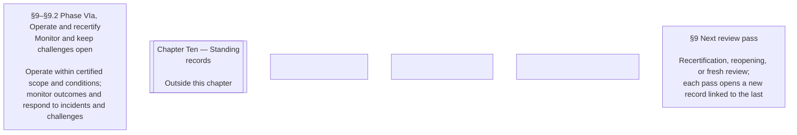
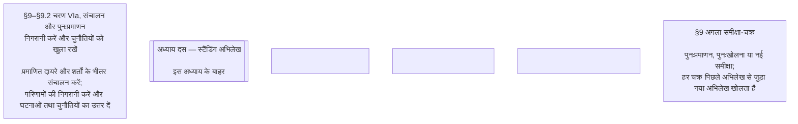

<!-- CHUNK-BEGIN hi__core_09.000_system_alignment_certification_evaluation__section_1_corpus_placement_overview.md bytes=5086 -->
<!-- AI-assisted translation draft; unreviewed. §1 corpus-placement overview, source lines 8–10; source SHA-256 4311e6ba74b7210f077c0bd4c8d21d8c9f517d2ada7b6d87288b39494dfeadd5. Draft only; do not synchronize into translations/. -->

# Chapter Nine Part A — §1 corpus-placement overview (hi)

## English source (lines 8–10)

> This file is **part of the Sentient Constitution** and is **binding only together** with the other numbered `core_*` files read as one text. It contains **Chapter Nine, Part A** — certification purpose, the process overview, and the first two phases of the process — **Frame** (system class) and **Evaluate** (whole-system evaluation in three sub-phases: the always-applicable evaluations, including data types and handling, in **§3**; the evaluations that apply where implicated in **§4**; and the Rights-Floor and domain evaluations that apply where triggered in **§5**) — **§1–§5**. The worked **Class A / B / C illustrations** (the system class profiles, §3.4.8, §5.1.5, §5.2.4, §5.3.7, §5.4.4, §5.5.5, and §5.6.4), including each one's **Reading across system classes** paragraph, are in [`core_09.010_system_alignment_certification_illustrations.md`](core_09.010_system_alignment_certification_illustrations.md); each keeps its Part A section number. The binding system-class-scaling and escalation rules those paragraphs illustrate stay in this file: system class scaling, including participation and proportionality, in §2.2; data-handling scaling in §3.4; and the **System class scaling and escalation** paragraph in each of §5.1–§5.6. The files of the whole chapter are listed in the table below.
>
> **Chapter Nine files.** Chapter Nine is split across four binding files read as one text. Part A, this file, opens the chapter; there is no separate index file.

## Translation draft

> यह फ़ाइल **Sentient Constitution का हिस्सा** है और अन्य क्रमांकित `core_*` फ़ाइलों के साथ एक ही पाठ के रूप में पढ़े जाने पर ही बाध्यकारी है। इसमें **अध्याय नौ, भाग A** शामिल है—प्रमाणन का उद्देश्य, प्रक्रिया का अवलोकन, और प्रक्रिया के पहले दो चरण: **Frame** (प्रणाली वर्ग) और **Evaluate** (तीन उपचरणों में पूरी प्रणाली का मूल्यांकन: **§3** में हमेशा लागू मूल्यांकन, जिनमें डेटा के प्रकार और उसका संचालन भी शामिल है; **§4** में जहाँ लागू हों वे मूल्यांकन; और **§5** में जहाँ सक्रिय हों वहाँ अधिकार-आधार तथा क्षेत्रीय मूल्यांकन)—**§§1–5**। **वर्ग A / B / C** के विस्तृत उदाहरण (प्रणाली-वर्ग प्रोफ़ाइल, §3.4.8, §5.1.5, §5.2.4, §5.3.7, §5.4.4, §5.5.5 और §5.6.4), जिनमें प्रत्येक का **प्रणाली-वर्गों के बीच तुलना** अनुच्छेद भी है, [`core_09.010_system_alignment_certification_illustrations.md`](core_09.010_system_alignment_certification_illustrations.md) में हैं; हर उदाहरण भाग A का अपना अनुभाग क्रमांक बनाए रखता है। ये अनुच्छेद जिन बाध्यकारी वर्ग-अनुसार माप और वृद्धि नियमों को स्पष्ट करते हैं, वे इसी फ़ाइल में रहते हैं: सहभागिता और आनुपातिकता सहित प्रणाली-वर्ग के अनुसार माप §2.2 में; डेटा-संचालन का माप §3.4 में; और §§5.1–5.6 के प्रत्येक अनुभाग में **प्रणाली-वर्ग के अनुसार माप और वृद्धि** अनुच्छेद। नीचे की तालिका पूरे अध्याय की फ़ाइलें सूचीबद्ध करती है।
>
> **अध्याय नौ की फ़ाइलें।** अध्याय नौ चार बाध्यकारी फ़ाइलों में विभाजित है, जिन्हें एक साथ पढ़ा जाता है। भाग A, यह फ़ाइल, अध्याय की शुरुआत करता है; अलग से कोई सूचकांक फ़ाइल नहीं है।

<!-- CHUNK-END -->
<!-- CHUNK-BEGIN hi__core_09.000_system_alignment_certification_evaluation__section_1_corpus_file_table.md bytes=6527 -->
<!-- AI-assisted translation draft; unreviewed. §1 corpus-placement file table, source lines 12–17; source SHA-256 4311e6ba74b7210f077c0bd4c8d21d8c9f517d2ada7b6d87288b39494dfeadd5. Draft only; do not synchronize into translations/. -->

# Chapter Nine Part A — §1 corpus-placement file table (hi)

## English source (lines 12–17)

> | Part | File | Owns |
> |------|------|------|
> | **Part A — Evaluation** | [`core_09.000_system_alignment_certification_evaluation.md`](core_09.000_system_alignment_certification_evaluation.md) | §1–§5: purpose and process overview (with a chart of the whole certification process in its six phases), **Phase I Frame** (system class, how system class scales every evaluation, and pilot certification) and **Phase II Evaluate** (whole-system evaluation in three sub-phases: **IIa** always, in §3, including chartered scope versus functional boundaries and data types and handling; **IIb** where implicated, in §4; and **IIc** where triggered, the Rights-Floor and domain evaluations, in §5) |
> | **Part B — Record and process** | [`core_09.005_system_alignment_certification_record_process.md`](core_09.005_system_alignment_certification_record_process.md) | §6–§10: **Phase III Review** (forum roles, supervisory sequence, and the contestability chain), **Phase IV Decide** (certification outcomes, including the go-live gate), **Phase V Record** (the certification record and its integrity, including governing [System Charter](core_05.040_band_continuity.md#system-charter) fields), and **Phase VI Operate** (the challenge path; recertification and reopening; the standing bridge) — continuous chapter numbering from Part A §5 |
> | **Part C — Illustrations** | [`core_09.010_system_alignment_certification_illustrations.md`](core_09.010_system_alignment_certification_illustrations.md) | the illustrative system class profiles, §3.4, §3.4.8, §5.1.5, §5.2.4, §5.3.7, §5.4.4, §5.5.5, and §5.6.4: worked Class A / B / C walkthroughs for each Part A evaluation area, numbered to match Part A and linked both ways |
> | **Part D — Institutional alignment certification** | [`core_09.015_institutional_alignment_certification.md`](core_09.015_institutional_alignment_certification.md) | §11–§15: the same six phases for an **Institution** rather than a System — the institution class and the institutional evaluation (**Phases I and II**, §12), the forum roles, outcome, and **Institutional Certification Record** (**Phases III to V**, §13), and recertification, reopening, the cascade from System certifications, and the standing bridge (**Phase VI**, §14–§15). It cites each System's certification by link and does not repeat it, and it is not a licence — continuous chapter numbering from Part B §10 |

## Translation draft

| भाग | फ़ाइल | विषय-वस्तु |
|------|------|------|
| **Part A — Evaluation** | [`core_09.000_system_alignment_certification_evaluation.md`](core_09.000_system_alignment_certification_evaluation.md) | §§1–5: उद्देश्य और प्रक्रिया का अवलोकन (छह चरणों का चार्ट सहित), तथा चरण I Frame (प्रणाली वर्ग, हर मूल्यांकन पर वर्ग का प्रभाव, और पायलट प्रमाणन) और II Evaluate (तीन उपचरणों में पूरी प्रणाली का मूल्यांकन: IIa हमेशा §3 में, जिसमें चार्टर का दायरा बनाम कार्यात्मक सीमाएँ तथा डेटा-प्रकार/संचालन शामिल हैं; IIb जहाँ लागू हो §4 में; और IIc सक्रिय होने पर §5 के अधिकार-आधार व क्षेत्रीय मूल्यांकन)। |
| **Part B — Record and process** | [`core_09.005_system_alignment_certification_record_process.md`](core_09.005_system_alignment_certification_record_process.md) | §§6–10: चरण III Review (फ़ोरम की भूमिकाएँ, पर्यवेक्षण-क्रम और चुनौती-श्रृंखला); IV Decide (प्रमाणन के नतीजे, संचालन शुरू करने की शर्त सहित); V Record (प्रमाणन अभिलेख और उसकी अखंडता, [System Charter](core_05.040_band_continuity.md#system-charter) के निर्णायक फ़ील्ड सहित); VI Operate (चुनौती-पथ, पुनःप्रमाणन और पुनःखोलना, तथा standing सेतु) — भाग A §5 से क्रमांक लगातार। |
| **Part C — Illustrations** | [`core_09.010_system_alignment_certification_illustrations.md`](core_09.010_system_alignment_certification_illustrations.md) | प्रणाली-वर्ग के उदाहरणात्मक प्रोफ़ाइल और §§3.4, 3.4.8, 5.1.5, 5.2.4, 5.3.7, 5.4.4, 5.5.5, 5.6.4: भाग A के हर मूल्यांकन क्षेत्र में वर्ग A/B/C के विस्तृत उदाहरण; क्रमांकन मेल खाता है और दोनों ओर लिंक हैं। |
| **Part D — Institutional alignment certification** | [`core_09.015_institutional_alignment_certification.md`](core_09.015_institutional_alignment_certification.md) | §§11–15: प्रणाली के बजाय संस्था के लिए वही छह चरण—संस्था-वर्ग और संस्थागत मूल्यांकन (I–II, §12), फ़ोरम भूमिकाएँ, परिणाम और संस्थागत प्रमाणन अभिलेख (III–V, §13), पुनःप्रमाणन, पुनःखोलना, प्रणाली-प्रमाणनों की शृंखला और standing सेतु (VI, §§14–15)। हर प्रणाली के प्रमाणन का संदर्भ देता है, उसे दोहराता नहीं, और लाइसेंस नहीं है — भाग B §10 से क्रमांकन लगातार। |

<!-- CHUNK-END -->
<!-- CHUNK-BEGIN hi__core_09.000_system_alignment_certification_evaluation__section_1_corpus_explanation.md bytes=11254 -->
<!-- AI-assisted translation draft; unreviewed. §1 corpus-placement explanatory prose, source lines 19–30; source SHA-256 4311e6ba74b7210f077c0bd4c8d21d8c9f517d2ada7b6d87288b39494dfeadd5. Draft only; do not synchronize into translations/. -->

# Chapter Nine Part A — §1 corpus-placement explanatory prose (hi)

## English source (lines 19–30)

> **How the two certifications relate.** System Alignment Certification (Parts A to C) is the certification of a System. Institutional alignment certification (Part D) is the certification of an Institution, which may run Systems or none. Part D cites each System's certification record by link and does not redo it; [Part D §11.1](core_09.015_institutional_alignment_certification.md#111-relation-to-system-alignment-certification) states the relation and [Part D §11.3](core_09.015_institutional_alignment_certification.md#113-no-permission-and-no-gate) states that it is not a licence.
>
> Generic **Chapter Nine** links in other files route to the appropriate part by section number.
>
> - **Constitutional owner (joint with Parts B and D):** forum-supervised **system alignment certification and related records** — evaluation domains (Part A); forum process, supervisory sequence, certification-record duties, certification outcomes and the go-live gate, the challenge path, recertification and reopening, and verified-input bridge to Chapter Ten (Part B); the same six phases for an Institution (Part D). Under the **oversight** Tetrad leg, SAC is one especially large, high-stakes audit process among others; auditing floors remain at **Article XVI** (*Audit, Transparency, and Independent Verification*) and Chapter Five [Auditability](core_05.050_band_oversight.md#auditability).
> - **Verification substrate owner:** [Chapter Four — Burden of Proof, Traceability, and Verification](core_04.000_burden_traceability_verification.md#chapter-four-burden-of-proof-traceability-and-verification) (within Chapters Two through Four) owns burden allocation, compliance evidence, definition traceability, observability, and security-constrained verification. Chapter Nine **applies** that discipline to system alignment certification records; it does **not** restate Chapter Four sections **1** through **5**.
> - **Auditing home (not relocated here):** **Article XVI** (*Audit, Transparency, and Independent Verification*), **Def.O1** (*Transparency, Auditability, and Verification*), and **CJS-5.110 §3 and CJS-5.115 §3** (*Audit process home*)–**CJS-5.110 §5** own auditing floors and operational terms. Chapter Nine runs one especially large SAC audit process that must satisfy those floors; it does not own all auditing.
> - **Implementation owner:** system-class handling, CS-6.345, and forum-process detail in designated implementation files must remain consistent with Chapter Nine and may be stricter where the corpus already provides a [Fullest Protective Effect](core_05.045_band_integrative.md#fullest-protective-effect) rule.
> - **Anti-relocation rule:** Part A does not restate Chapter Five canonical definitions, Chapter Three anti-evasion discipline (see [Part B §9.3](core_09.005_system_alignment_certification_record_process.md#93-non-evasion)), Chapter Ten contribution or standing measurement, or Chapter Eleven standing effects. **[Part B §10](core_09.005_system_alignment_certification_record_process.md#10-relationship-to-standing)** states the standing bridge boundary explicitly.
>
> **Upstream:** Chapter Five definitions; Chapters Two through Four record, verification, burden, and traceability of definitions to results; and [Chapter Eight](core_08.000_functional_independence_separation_of_duties.md#chapter-eight-functional-independence-and-separation-of-duties), whose separation-of-duties requirement governs every materially binding certification act.
> **Downstream:** [Part B](core_09.005_system_alignment_certification_record_process.md#chapter-nine-part-b-system-alignment-certification--record-and-process) (*forum process, record, outcomes, and standing bridge*); Chapter Ten standing records and verified inputs; Chapter Eleven standing effects; Chapter Thirteen forum supervision and system alignment certification pathways.

## Translation draft

**दोनों प्रमाणनों का संबंध।** System Alignment Certification (भाग A से C) किसी प्रणाली का प्रमाणन है। संस्थागत alignment certification (भाग D) किसी संस्था का प्रमाणन है, जो प्रणालियाँ चला भी सकती है और नहीं भी। भाग D हर प्रणाली के प्रमाणन अभिलेख का लिंक देता है; उसे फिर से नहीं करता। [Part D §11.1](core_09.015_institutional_alignment_certification.md#111-relation-to-system-alignment-certification) संबंध बताता है और [Part D §11.3](core_09.015_institutional_alignment_certification.md#113-no-permission-and-no-gate) स्पष्ट करता है कि यह लाइसेंस नहीं है।
>
> अन्य फ़ाइलों के सामान्य **Chapter Nine** लिंक अनुभाग संख्या के अनुसार उपयुक्त भाग तक पहुँचाते हैं।
>
> - **संवैधानिक स्वामी (भाग B और D के साथ संयुक्त):** मंच-पर्यवेक्षित system alignment certification और संबंधित अभिलेख—मूल्यांकन क्षेत्र (भाग A); मंच प्रक्रिया, पर्यवेक्षण क्रम, प्रमाणन-अभिलेख दायित्व, परिणाम और संचालन-प्रवेश शर्त, चुनौती मार्ग, पुनःप्रमाणन और पुनःखोलना, तथा अध्याय दस तक सत्यापित इनपुट का सेतु (भाग B); संस्था के लिए वही छह चरण (भाग D)। Tetrad के **पर्यवेक्षण** घटक में SAC अन्य प्रक्रियाओं के बीच एक विशेष रूप से बड़ी, उच्च-दांव वाली ऑडिट प्रक्रिया है; ऑडिट के न्यूनतम मान **Article XVI** (*Audit, Transparency, and Independent Verification*) और अध्याय पाँच के [Auditability](core_05.050_band_oversight.md#auditability) में रहते हैं।
> - **सत्यापन आधार का स्वामी:** [Chapter Four — Burden of Proof, Traceability, and Verification](core_04.000_burden_traceability_verification.md#chapter-four-burden-of-proof-traceability-and-verification) (अध्याय दो से चार के भीतर) प्रमाण-भार का आवंटन, अनुपालन-साक्ष्य, परिभाषा-ट्रेसबिलिटी, प्रेक्षणीयता और सुरक्षा-सीमित सत्यापन का स्वामी है। अध्याय नौ इस अनुशासन को system alignment certification अभिलेखों पर लागू करता है; अध्याय चार के **1** से **5** अनुभागों को दोहराता नहीं।
> - **ऑडिट का मूल स्थान (यहाँ स्थानांतरित नहीं):** **Article XVI** (*Audit, Transparency, and Independent Verification*), **Def.O1** (*Transparency, Auditability, and Verification*), और **CJS-5.110 §3 व CJS-5.115 §3** (*Audit process home*)–**CJS-5.110 §5** ऑडिट न्यूनतम मानों और संचालन-शब्दों के स्वामी हैं। अध्याय नौ एक विशेष रूप से बड़ी SAC ऑडिट प्रक्रिया चलाता है जिसे वे मान पूरे करने होंगे; वह सभी ऑडिटों का स्वामी नहीं है।
> - **कार्यान्वयन स्वामी:** नामित कार्यान्वयन फ़ाइलों में प्रणाली-वर्ग प्रबंधन, CS-6.345 और मंच-प्रक्रिया के विवरण अध्याय नौ के अनुरूप रहें और जहाँ corpus में पहले से [Fullest Protective Effect](core_05.045_band_integrative.md#fullest-protective-effect) नियम है वहाँ अधिक कठोर हो सकते हैं।
> - **स्थानांतरण-विरोधी नियम:** भाग A अध्याय पाँच की प्रामाणिक परिभाषाएँ, अध्याय तीन का अपवंचन-विरोधी अनुशासन ([Part B §9.3](core_09.005_system_alignment_certification_record_process.md#93-non-evasion) देखें), अध्याय दस का योगदान या standing मापन, या अध्याय ग्यारह के standing प्रभाव दोहराता नहीं। **[Part B §10](core_09.005_system_alignment_certification_record_process.md#10-relationship-to-standing)** standing bridge की सीमा स्पष्ट करता है।
>
> **पूर्ववर्ती स्रोत:** अध्याय पाँच की परिभाषाएँ; अध्याय दो से चार के अभिलेख, सत्यापन, प्रमाण-भार और परिभाषाओं से परिणामों तक ट्रेसबिलिटी; और [Chapter Eight](core_08.000_functional_independence_separation_of_duties.md#chapter-eight-functional-independence-and-separation-of-duties), जिसकी कर्तव्य-पृथक्करण आवश्यकता हर महत्वपूर्ण रूप से बाध्यकारी प्रमाणन-कार्य पर लागू होती है।
> **अनुवर्ती स्रोत:** [Part B](core_09.005_system_alignment_certification_record_process.md#chapter-nine-part-b-system-alignment-certification--record-and-process) (*मंच प्रक्रिया, अभिलेख, परिणाम और standing bridge*); अध्याय दस के standing अभिलेख और सत्यापित इनपुट; अध्याय ग्यारह के standing प्रभाव; अध्याय तेरह का मंच पर्यवेक्षण और system alignment certification मार्ग।

<!-- CHUNK-END -->
<!-- CHUNK-BEGIN hi__core_09.000_system_alignment_certification_evaluation__section_1_heading.md bytes=399 -->
<!-- AI-assisted translation draft; unreviewed. §1 heading, source line 44; source SHA-256 4311e6ba74b7210f077c0bd4c8d21d8c9f517d2ada7b6d87288b39494dfeadd5. Draft only; do not synchronize into translations/. -->

# Chapter Nine Part A — §1 heading (hi)

## English source (lines 44–45)

### 1. Purpose and Role


## Translation draft

### 1. उद्देश्य और भूमिका

<!-- CHUNK-END -->
<!-- CHUNK-BEGIN hi__core_09.000_system_alignment_certification_evaluation__section_1_trace.md bytes=12506 -->
<!-- AI-assisted translation draft; unreviewed. §1 trace, source lines 46–95; source SHA-256 4311e6ba74b7210f077c0bd4c8d21d8c9f517d2ada7b6d87288b39494dfeadd5. Draft only; do not synchronize into translations/. -->

# Chapter Nine Part A — §1 trace (hi)

## English source (lines 46–95)

<details>
<summary><strong><span style="color: #2563eb;">Trace</span></strong></summary>

- Upstream:
  - [Preamble — constitutional owner register](core_00.000_preamble.md#4-principles-definitions-and-rights) and
  - [Authority Stack and Internal Hierarchy](core_05.045_band_integrative.md#authority-stack-and-internal-hierarchy);
  - [Constitutional Tetrad](core_00.000_preamble.md#constitutional-tetrad);
  - [Two Constitutional Aims](core_00.000_preamble.md#two-constitutional-aims);
  - [material stake](core_00.000_preamble.md#material-stake);
  - [Proportionality](core_05.035_band_accountability.md#proportionality) and
  - [Substantive Fairness](core_05.055_band_participation.md#substantive-fairness) (Chapter Five); Participation measurement family (*voice, access, and contest paths*);
  - [Chapter One §16 Stewardship In Depth](core_01.010_stewardship_capacity_principles.md#16-stewardship-in-depth) (1.010 §16);
  - [Chapter One §12 Systemic Evaluation Requirement](core_01.000_values_principles.md#12-systemic-evaluation-requirement) (1.000 §12) (*principle-layer whole-system evaluation lens — not one corner alone*); Chapters Two through Four;
  - [Chapter Five](core_05.000_definitions_home.md#chapter-five-foundational-definitions) (5.000) (*canonical definitions*);
  - [Chapter Eight §2 Four-Seat Constitutional Requirement](core_08.000_functional_independence_separation_of_duties.md#2-four-seat-constitutional-requirement) (8.000 §2);
  - [System Alignment Certification](core_05.040_band_continuity.md#system-alignment-certification) (Chapter Five canonical term; non-operative shorthand **SAC**);
  - [System Certification Record](core_05.040_band_continuity.md#system-certification-record) (Chapter Five meaning).
- Downstream:
  - [§2](#2-system-class-evaluation) (*system class evaluation*);
  - [Part B §9.1](core_09.005_system_alignment_certification_record_process.md#91-challenging-a-certification) (9.005 §9.1) (*challenging a certification*); and
  - [Part C system class profiles](core_09.010_system_alignment_certification_illustrations.md#illustrative-system-class-profiles-non-exhaustive) (9.010) (*illustrative system class profiles*);
  - [Part C whole-system walkthroughs](core_09.010_system_alignment_certification_illustrations.md#illustrative-whole-system-application-by-system-class-non-exhaustive) (9.010) (*worked whole-system examples by system class*);
  - [§3.4.8](core_09.010_system_alignment_certification_illustrations.md#348-illustrative-data-handling-application-by-system-class-non-exhaustive) (*worked data-handling examples by system class*);
  - [§5.1.5](core_09.010_system_alignment_certification_illustrations.md#515-illustrative-ecological-footprint-application-by-system-class-non-exhaustive) (*worked ecological-footprint examples by system class*);
  - [§5.2.4](core_09.010_system_alignment_certification_illustrations.md#524-illustrative-educational-capability-application-by-system-class-non-exhaustive) (*worked educational-capability examples by system class*);
  - [§5.3.7](core_09.010_system_alignment_certification_illustrations.md#537-illustrative-cross-system-support-application-by-system-class-non-exhaustive) (*worked cross-system-support examples by system class*);
  - [§5.4.4](core_09.010_system_alignment_certification_illustrations.md#544-illustrative-nondiscrimination-application-by-system-class-non-exhaustive) (*worked nondiscrimination examples by system class*);
  - [§5.5.5](core_09.010_system_alignment_certification_illustrations.md#555-illustrative-accessibility-application-by-system-class-non-exhaustive) (*worked accessibility examples by system class*);
  - [§5.6.4](core_09.010_system_alignment_certification_illustrations.md#564-illustrative-trustworthiness-application-by-system-class-non-exhaustive) (*worked trustworthiness examples by system class*);
  - [§3](#3-whole-system-certification-evaluation) (*whole-system certification evaluation factors*);
  - [§3.4](#34-data-types-and-handling-evaluation) through
  - [§5.6](#56-trustworthiness-and-system-reliance-integrity-evaluation) (*domain evaluations*);
  - [Part B §6](core_09.005_system_alignment_certification_record_process.md#6-forum-process) (9.005 §6) (*supervisory sequence and contestability chain*);
  - [Part B §6.1](core_09.005_system_alignment_certification_record_process.md#61-forum-supervision-and-component-roles) (9.005 §6.1) (*forum component roles*);
  - [Part B §8](core_09.005_system_alignment_certification_record_process.md#8-system-certification-record) (9.005 §8) (*certification record contents*);
  - [Part B §8.2](core_09.005_system_alignment_certification_record_process.md#82-record-integrity-transparency-and-auditability) (9.005 §8.2) (*record integrity requirements*);
  - [Part B §7](core_09.005_system_alignment_certification_record_process.md#7-certification-outcomes) (9.005 §7) (*reopening and anti-evasion*);
  - [Part B §10](core_09.005_system_alignment_certification_record_process.md#10-relationship-to-standing) (9.005 §10) (*standing-record bridge*);
  - [Chapter Ten](core_11.000_standing_assessment.md#chapter-eleven-contribution-violation-and-standing-model--measurement) (10.000) (*standing records and verified-input gate*);
  - [Chapter Eleven](core_12.000_standing_integration.md#chapter-twelve-standing-effects-and-integration) (11.000) (*standing effects and integration*);
  - [Chapter Thirteen](core_14.000_forum.md#chapter-fourteen-forums-and-jurisdiction) (13.000) (*forum supervision, certification, alignment certification, and review*).
- Read with:
  - **[CS-9.305](corpus_systems/cs_09.305_system_classification_machinery.md#cs-9305-part-a-system-classification-machinery) (*System classification machinery*) and [CS-9.310 — System impact classifications](corpus_systems/cs_09.310_system_impact_classifications.md#cs-9310-part-b-system-impact-classifications)**, **[CS-6.305](corpus_systems/cs_06.305_information_types_and_handling.md#cs-6305-part-a-information-types-and-handling) (*Information types and handling*) and [CS-6.310 — Data classifications](corpus_systems/cs_06.310_data_classifications.md#cs-6310-part-b-data-classifications)**, and
  - **CS-6.345** (*System lifecycle*);
  - **CF-13.415** (*Routing operations, transfer, certification, and representative treatment*) and
  - **CF-13.425** (*Integrity safeguards, anti-capture operations, and anti-self-judging support*); **Article XVI** (*Audit, Transparency, and Independent Verification*) and
  - [Auditability](core_05.050_band_oversight.md#auditability) (*auditing floors — SAC is one especially large audit process under oversight, not the sole auditing home*); **CJS-5.110 §3 (*Oversight: auditability and reconstructability terms (annex)*) and CJS-5.115 §3** (*Audit process home*)–
  - **CJS-5.110 §5** (*Oversight: independent verification and claim-integrity terms*).

</details>

## Translation draft

#### संदर्भ-मानचित्र

यह मानचित्र इस खंड का संवैधानिक और प्राधिकारगत आधार बताता है और इसे मूल्यांकन, वर्गीकरण, समीक्षा-पथ, रिकॉर्ड, परिणाम तथा ऑडिट से जोड़ता है; साथ पढ़े जाने वाले परिचालन दस्तावेज़ भी दिखाता है।

**संदर्भ-मानचित्र — upstream canonical sources:** [Preamble — constitutional owner register](core_00.000_preamble.md#4-principles-definitions-and-rights); [Authority Stack and Internal Hierarchy](core_05.045_band_integrative.md#authority-stack-and-internal-hierarchy); [Constitutional Tetrad](core_00.000_preamble.md#constitutional-tetrad); [Two Constitutional Aims](core_00.000_preamble.md#two-constitutional-aims); [material stake](core_00.000_preamble.md#material-stake); [Proportionality](core_05.035_band_accountability.md#proportionality); [Substantive Fairness](core_05.055_band_participation.md#substantive-fairness); [Chapter One §16 Stewardship In Depth](core_01.010_stewardship_capacity_principles.md#16-stewardship-in-depth); [Chapter One §12 Systemic Evaluation Requirement](core_01.000_values_principles.md#12-systemic-evaluation-requirement); [Chapter Five](core_05.000_definitions_home.md#chapter-five-foundational-definitions); [Chapter Eight §2 Four-Seat Constitutional Requirement](core_08.000_functional_independence_separation_of_duties.md#2-four-seat-constitutional-requirement); [System Alignment Certification](core_05.040_band_continuity.md#system-alignment-certification); [System Certification Record](core_05.040_band_continuity.md#system-certification-record)

**संदर्भ-मानचित्र — downstream routes and related records:** [§2](#2-system-class-evaluation); [Part B §9.1](core_09.005_system_alignment_certification_record_process.md#91-challenging-a-certification); [Part C system class profiles](core_09.010_system_alignment_certification_illustrations.md#illustrative-system-class-profiles-non-exhaustive); [Part C whole-system walkthroughs](core_09.010_system_alignment_certification_illustrations.md#illustrative-whole-system-application-by-system-class-non-exhaustive); [§3.4.8](core_09.010_system_alignment_certification_illustrations.md#348-illustrative-data-handling-application-by-system-class-non-exhaustive); [§5.1.5](core_09.010_system_alignment_certification_illustrations.md#515-illustrative-ecological-footprint-application-by-system-class-non-exhaustive); [§5.2.4](core_09.010_system_alignment_certification_illustrations.md#524-illustrative-educational-capability-application-by-system-class-non-exhaustive); [§5.3.7](core_09.010_system_alignment_certification_illustrations.md#537-illustrative-cross-system-support-application-by-system-class-non-exhaustive); [§5.4.4](core_09.010_system_alignment_certification_illustrations.md#544-illustrative-nondiscrimination-application-by-system-class-non-exhaustive); [§5.5.5](core_09.010_system_alignment_certification_illustrations.md#555-illustrative-accessibility-application-by-system-class-non-exhaustive); [§5.6.4](core_09.010_system_alignment_certification_illustrations.md#564-illustrative-trustworthiness-application-by-system-class-non-exhaustive); [§3](#3-whole-system-certification-evaluation); [§3.4](#34-data-types-and-handling-evaluation); [§5.6](#56-trustworthiness-and-system-reliance-integrity-evaluation); [Part B §6](core_09.005_system_alignment_certification_record_process.md#6-forum-process); [Part B §6.1](core_09.005_system_alignment_certification_record_process.md#61-forum-supervision-and-component-roles); [Part B §8](core_09.005_system_alignment_certification_record_process.md#8-system-certification-record); [Part B §8.2](core_09.005_system_alignment_certification_record_process.md#82-record-integrity-transparency-and-auditability); [Part B §7](core_09.005_system_alignment_certification_record_process.md#7-certification-outcomes); [Part B §10](core_09.005_system_alignment_certification_record_process.md#10-relationship-to-standing); [Chapter Ten](core_11.000_standing_assessment.md#chapter-eleven-contribution-violation-and-standing-model--measurement); [Chapter Eleven](core_12.000_standing_integration.md#chapter-twelve-standing-effects-and-integration); [Chapter Thirteen](core_14.000_forum.md#chapter-fourteen-forums-and-jurisdiction)

**संदर्भ-मानचित्र — operational materials to read with this section:** [CS-9.305](corpus_systems/cs_09.305_system_classification_machinery.md#cs-9305-part-a-system-classification-machinery); [CS-9.310 — System impact classifications](corpus_systems/cs_09.310_system_impact_classifications.md#cs-9310-part-b-system-impact-classifications); [CS-6.305](corpus_systems/cs_06.305_information_types_and_handling.md#cs-6305-part-a-information-types-and-handling); [CS-6.310 — Data classifications](corpus_systems/cs_06.310_data_classifications.md#cs-6310-part-b-data-classifications); [Auditability](core_05.050_band_oversight.md#auditability)

<!-- CHUNK-END -->
<!-- CHUNK-BEGIN hi__core_09.000_system_alignment_certification_evaluation__purpose_adjuncts.md bytes=8736 -->
<!-- AI-assisted translation draft; unreviewed. Selected §1 passages, source lines 99 and 107–114; source SHA-256 4311e6ba74b7210f077c0bd4c8d21d8c9f517d2ada7b6d87288b39494dfeadd5. -->

# Chapter Nine Part A — §1 plain-terms excerpt

**Status:** AI-assisted draft; unreviewed. English source remains controlling.

## English source

When a system really matters to sentients' lives, certification has to be **proportionate** — as demanding as the system's real impact, dependency, and risk require, not a one-size-fits-all checklist or a rubber stamp. It also has to be **participatory** — affected sentients and communities must be able to see what was reviewed, understand what was decided, and challenge it when something is wrong. Forums review evidence, write it down in a certification record, and require re-checks on a schedule that matches how risky the system is. Classes A, B, and C get the full process and Class L a lighter one. Class P is encouraged to use it, and must once it is reclassified to Class L or higher (that is, its effects reach beyond a private unit) or its operator claims constitutional compliance.

## hi draft

जब कोई प्रणाली संवेदनशील प्राणियों के जीवन को वास्तव में प्रभावित करती है, तो प्रमाणन **अनुपातिक** होना चाहिए—प्रणाली के वास्तविक प्रभाव, निर्भरता और जोखिम जितनी कठोरता माँगते हैं उतनी ही; न कि सबके लिए एक जैसी जाँच-सूची या औपचारिक मुहर। यह **सहभागितापूर्ण** भी होना चाहिए—प्रभावित प्राणी और समुदाय देख सकें कि क्या जाँचा गया, निर्णय समझ सकें और कुछ गलत होने पर उसे चुनौती दे सकें। फ़ोरम साक्ष्य की समीक्षा करते हैं, उसे प्रमाणन अभिलेख में दर्ज करते हैं और प्रणाली के जोखिम के अनुरूप समय-सारणी पर पुनःजाँच की माँग करते हैं। A, B और C वर्गों पर पूरी प्रक्रिया लागू होती है; L वर्ग पर हल्की प्रक्रिया। P वर्ग को इसका उपयोग करने के लिए प्रोत्साहित किया जाता है, और L या उससे ऊपर पुनर्वर्गीकृत होने पर (अर्थात प्रभाव निजी इकाई से आगे पहुँचने पर) या उसका संचालक संवैधानिक अनुपालन का दावा करे तो इसका उपयोग अनिवार्य है।


### English source — Flourishing

- **[Flourishing](core_00.000_preamble.md#flourishing)** — certification verifies that certification or continued reliance would not quietly defeat Rights Floors or block fair participation in constitutionally relevant life;

### hi draft

- **[समृद्धि](core_00.000_preamble.md#flourishing)** — प्रमाणन सुनिश्चित करता है कि प्रमाणित करना या निर्भरता जारी रखना चुपचाप अधिकार-तलों को विफल न करे या संवैधानिक रूप से प्रासंगिक जीवन में निष्पक्ष भागीदारी न रोके;


### English source — Continuity criterion

- **[Continuity](core_00.000_preamble.md#continuity)** — certification verifies durable, non-regressive supply that sustains rather than depletes healthy natural systems ([Ecological Integrity](core_05.040_band_continuity.md#ecological-integrity), including [Ecological Recovery Capacity](core_05.040_band_continuity.md#ecological-recovery-capacity)), and system-class-scaled recertification where shared systems gate or sustain delivery;

### hi draft

- **[निरंतरता](core_00.000_preamble.md#continuity)** — प्रमाणन टिकाऊ, गैर-पश्चगामी आपूर्ति की पुष्टि करता है जो स्वस्थ प्राकृतिक प्रणालियों को घटाने के बजाय बनाए रखती है ([पारिस्थितिक अखंडता](core_05.040_band_continuity.md#ecological-integrity), जिसमें [पारिस्थितिक पुनर्प्राप्ति क्षमता](core_05.040_band_continuity.md#ecological-recovery-capacity) शामिल है), और जहाँ साझा प्रणालियाँ आपूर्ति को नियंत्रित या बनाए रखती हैं वहाँ प्रणाली-वर्ग के अनुरूप पुनःप्रमाणन की पुष्टि करता है;


### English source — Participation criterion

- **Participation** — affected sentients and communities can understand, contest, and take part in review paths that matter to them;

### hi draft

- **भागीदारी** — प्रभावित संवेदनशील प्राणी और समुदाय अपने लिए महत्वपूर्ण समीक्षा-पथों को समझ सकते हैं, चुनौती दे सकते हैं और उनमें भाग ले सकते हैं;


### English source — Oversight criterion

- **Oversight** — records, evidence, and assumptions are visible and auditable enough for independent checking; certification itself is one especially large audit process under that oversight duty, not the only one;

### hi draft

- **निगरानी** — अभिलेख, साक्ष्य और धारणाएँ स्वतंत्र जाँच के लिए पर्याप्त रूप से दृश्यमान और लेखापरीक्षण-योग्य हैं; प्रमाणन स्वयं इस निगरानी-दायित्व के अंतर्गत एक विशेष रूप से बड़ी लेखापरीक्षा प्रक्रिया है, पर लेखापरीक्षा का एकमात्र क्षेत्र नहीं;


### English source — Accountability criterion

- **Accountability** — defects, misclassification, and floor-defeating operation route to remedy, conditions, withdrawal, or standing input where the facts support it;

### hi draft

- **जवाबदेही** — दोष, गलत वर्गीकरण और अधिकार-तलों को विफल करने वाला संचालन, जहाँ तथ्य समर्थन करें, उपचार, शर्तों, वापसी या स्थिति-मापन इनपुट तक पहुँचता है;


### English source — Timeliness criterion

- **Timeliness** — review and contest windows keep certification from going stale while harm can still be prevented or reversed.

### hi draft

- **समयबद्धता** — समीक्षा और चुनौती की समय-सीमाएँ प्रमाणन को पुराना नहीं पड़ने देतीं, जबकि हानि को अभी रोका या सुधारा जा सकता है।


### English source — Tetrad introduction

Certification implements the [Two Constitutional Aims](core_00.000_preamble.md#two-constitutional-aims) through the [Constitutional Tetrad](core_00.000_preamble.md#constitutional-tetrad):

### hi draft

प्रमाणन [दो संवैधानिक उद्देश्यों](core_00.000_preamble.md#two-constitutional-aims) को [संवैधानिक चतुष्टय](core_00.000_preamble.md#constitutional-tetrad) के माध्यम से लागू करता है:

<!-- CHUNK-END -->
<!-- CHUNK-BEGIN hi__core_09.000_system_alignment_certification_evaluation__section_1_purpose.md bytes=2248 -->
<!-- AI-assisted translation draft; unreviewed. Complete purpose statement excerpt, source lines 101–105; source SHA-256 4311e6ba74b7210f077c0bd4c8d21d8c9f517d2ada7b6d87288b39494dfeadd5. This is an excerpt, not a complete §1 translation. -->

**प्रणाली-संरेखण प्रमाणन** किसी निर्दिष्ट दायरे और समीक्षा-कार्यक्रम के लिए एक प्रश्न का उत्तर देने हेतु है: क्या प्रणाली ने प्रमाणन, सशर्त प्रमाणन, सत्यापन, पुनःप्रमाणन, निरंतर निर्भरता, तैनाती, या शर्तों से महत्वपूर्ण मुक्ति के लिए पर्याप्त संवैधानिक संरेखण दिखाया है?

- प्रमाणन लोकप्रियता का अंक, हमेशा के लिए मिली छूट, या अधिकार-समीक्षा छोड़ने का तरीका नहीं है।
- यह इस समय प्रणाली के संरेखण के बारे में ज्ञात बातों का समयबद्ध और चुनौती-योग्य कथन है।
- चतुष्टय के **निरीक्षण** चरण में निरीक्षण के लिए लेखापरीक्षा आवश्यक है; प्रणाली-संरेखण प्रमाणन कई अन्य प्रक्रियाओं में एक विशेष रूप से बड़ी, उच्च-दांव वाली लेखापरीक्षा प्रक्रिया है — लेखापरीक्षा का एकमात्र क्षेत्र नहीं (**अनुच्छेद XVI** (*लेखापरीक्षा, पारदर्शिता और स्वतंत्र सत्यापन*), [लेखापरीक्ष्यता](core_05.050_band_oversight.md#auditability)).

<!-- CHUNK-END -->
<!-- CHUNK-BEGIN hi__core_09.000_system_alignment_certification_evaluation__section_1_subsection_headings.md bytes=879 -->
<!-- AI-assisted translation draft; unreviewed. §1.1/§1.2 visible subsection headings, source lines 116–119 and 144–148; source SHA-256 4311e6ba74b7210f077c0bd4c8d21d8c9f517d2ada7b6d87288b39494dfeadd5. Draft only; anchors/blank layout are structural. Do not synchronize into translations/. -->

# Chapter Nine Part A — §1.1 and §1.2 subsection headings (hi)

## English source

### Lines 116–119

<a id="11-certification-as-an-audit-process-scaled-by-class"></a>

#### 1.1 Certification as an audit process, scaled by class


### Lines 144–148


<a id="12-certification-at-a-glance"></a>

#### 1.2 Certification at a glance


## Translation draft

#### 1.1 वर्गानुसार अनुरूपित ऑडिट प्रक्रिया के रूप में प्रमाणन

#### 1.2 प्रमाणन एक नज़र में

<!-- CHUNK-END -->
<!-- CHUNK-BEGIN hi__core_09.000_system_alignment_certification_evaluation__section_1_audit_scope.md bytes=4551 -->
<!-- AI-assisted translation draft; unreviewed. §1.1 audit mechanism and sibling audit modes, source lines 120–130; source SHA-256 4311e6ba74b7210f077c0bd4c8d21d8c9f517d2ada7b6d87288b39494dfeadd5. -->

# Chapter Nine Part A — §1.1 certification audit process excerpt (hi)

## English source

As an oversight mechanism, certification is one especially large audit process under [Auditability](core_05.050_band_oversight.md#auditability) and **Article XVI** (*Audit, Transparency, and Independent Verification*):

- It is forum-supervised, multi-domain, and status-granting.
- It may integrate the results of sibling audit modes, and it does not absorb or replace them. Each keeps its own owner, named in the [sibling audit modes map](corpus_joint_structure/cjs_05.115_audit_process.md#sibling-audit-modes-owner-map) of the audit process home:
  - System Data Types Record audits under **CS-6.305 (*Information types and handling*) and CS-6.310** (*Data classifications*)
  - System Classification Record audits under **CS-9.305 (*System classification machinery*) and CS-9.310** (*System impact classifications*)
  - steward assurance reviews under **CS-14.305** (*Critical system stewardship*)
  - continuous audit under **CS-6.345** (*System lifecycle*) ACA
  - complexity audits under **CS-6.315** (*Comprehensibility and complexity stewardship*) and **Article XXIII-B** (*Complexity Audit and Modularity Requirements*)
  - claim verification under **CJS-5.110 §5** (*Oversight: independent verification and claim-integrity terms*)
- You can still run any of these checks on their own, without going through certification. Certification doesn't replace them.

## hi draft

एक निरीक्षण तंत्र के रूप में, प्रमाणन [Auditability](core_05.050_band_oversight.md#auditability) और **Article XVI** (*Audit, Transparency, and Independent Verification*) के अंतर्गत एक विशेष रूप से बड़ी ऑडिट प्रक्रिया है:

- यह फोरम की निगरानी में होती है, कई क्षेत्रों को शामिल करती है और स्थिति प्रदान करती है।
- यह सहोदरी ऑडिट विधियों के परिणामों को एकीकृत कर सकती है, लेकिन उन्हें अपने में समाहित या प्रतिस्थापित नहीं करती। प्रत्येक का अपना स्वामी रहता है, जिसका नाम ऑडिट प्रक्रिया के मूल दस्तावेज़ के [सहोदरी ऑडिट-विधि मानचित्र](corpus_joint_structure/cjs_05.115_audit_process.md#sibling-audit-modes-owner-map) में दिया गया है:
  - System Data Types Record ऑडिट, **CS-6.305 (*सूचना के प्रकार और प्रबंधन*) और CS-6.310** (*डेटा वर्गीकरण*) के अंतर्गत
  - System Classification Record ऑडिट, **CS-9.305 (*प्रणाली वर्गीकरण तंत्र*) और CS-9.310** (*प्रणाली प्रभाव वर्गीकरण*) के अंतर्गत
  - संरक्षक आश्वासन समीक्षा, **CS-14.305** (*महत्त्वपूर्ण प्रणाली की संरक्षकता*) के अंतर्गत
  - सतत ऑडिट, **CS-6.345** (*प्रणाली जीवनचक्र*) ACA के अंतर्गत
  - जटिलता ऑडिट, **CS-6.315** (*बोधगम्यता और जटिलता संरक्षकता*) तथा **Article XXIII-B** (*जटिलता ऑडिट और मॉड्यूलरता आवश्यकताएँ*) के अंतर्गत
  - दावे का सत्यापन, **CJS-5.110 §5** (*निरीक्षण: स्वतंत्र सत्यापन और दावा-अखंडता की शर्तें*) के अंतर्गत
- प्रमाणन के बिना भी आप इनमें से कोई भी जाँच अलग से चला सकते हैं। प्रमाणन उनका स्थान नहीं लेता।

<!-- CHUNK-END -->
<!-- CHUNK-BEGIN hi__core_09.000_system_alignment_certification_evaluation__section_1_class_scaling.md bytes=5512 -->
<!-- AI-assisted translation draft; unreviewed. Chapter Nine Part A §1 class scaling and cadence, source lines 132–143; source SHA-256 4311e6ba74b7210f077c0bd4c8d21d8c9f517d2ada7b6d87288b39494dfeadd5. Draft only; do not synchronize into translations/. -->

**Current English passage:**

Certification depth, record burden, certification interval, stakeholder review, and contest paths must scale with [material stake](core_00.000_preamble.md#material-stake) under [Proportionality](core_05.035_band_accountability.md#proportionality):

The process applies by impact class, as the [reclassification requirement](corpus_systems/cs_09.305_system_classification_machinery.md#35-reclassification-requirement) of **CS-9.305** (*System classification machinery*) sets out:

- **Class A, Class B, and Class C:** these systems carry the highest impact, dependency, and risk, and whole-system evaluation under [§3 Whole-System Certification Evaluation](#3-whole-system-certification-evaluation), [§4 Evaluations Where Implicated](#4-evaluations-where-implicated), and [§5 Rights-Floor and Domain Evaluations](#5-rights-floor-and-domain-evaluations), each as its own sub-phase applies, is mandatory at full depth;
- **Class L:** the same evaluation is mandatory but proportionate, with a lower default re-check cadence and simpler records where CS-9.305 (*System classification machinery*) and CS-9.310 (*System impact classifications*) permits; and
- **Class P:** the process is encouraged while the system is validly Class P, and a Class P system may use it voluntarily. It becomes mandatory on reclassification to Class L or higher, or where the operator voluntarily asserts constitutional compliance for the system.

The certification interval, and the financial, resource, or special audit that falls at its midpoint, are set by class in [Chapter Thirteen §6 Timely resolution, materiality tiers, and anti-delay discipline](core_14.000_forum.md#review-cadence) (*Review cadence*). This chapter does not restate the numbers.

**Proposed locale translation:**

प्रमाणन की गहराई, अभिलेख का भार, प्रमाणन-अंतराल, हितधारक समीक्षा और चुनौती-पथ [भौतिक दाँव](core_00.000_preamble.md#material-stake) के अनुसार [आनुपातिकता](core_05.035_band_accountability.md#proportionality) के तहत बढ़ने-घटने चाहिए:

यह प्रक्रिया प्रभाव-वर्ग के अनुसार लागू होती है, जैसा **CS-9.305** (*प्रणाली वर्गीकरण व्यवस्था*) की [पुनर्वर्गीकरण आवश्यकता](corpus_systems/cs_09.305_system_classification_machinery.md#35-reclassification-requirement) बताती है:

- **वर्ग A, B और C:** इन प्रणालियों का प्रभाव, निर्भरता और जोखिम सबसे अधिक है। लागू प्रत्येक उपचरण में पूरे सिस्टम का पूर्ण-गहराई मूल्यांकन [§3 समग्र प्रणाली प्रमाणन मूल्यांकन](#3-whole-system-certification-evaluation), [§4 जहाँ लागू हो वहाँ मूल्यांकन](#4-evaluations-where-implicated), और [§5 अधिकार-तल तथा क्षेत्रीय मूल्यांकन](#5-rights-floor-and-domain-evaluations) के तहत अनिवार्य है;
- **वर्ग L:** वही मूल्यांकन अनिवार्य, पर आनुपातिक है; जहाँ **CS-9.305** (*प्रणाली वर्गीकरण व्यवस्था*) और **CS-9.310** (*प्रणाली प्रभाव वर्गीकरण*) अनुमति दें, वहाँ पुनःजाँच का सामान्य अंतराल लंबा और अभिलेख सरल हो सकता है; और
- **वर्ग P:** जब तक P-वर्गीकरण वैध है, प्रक्रिया की सिफारिश की जाती है और प्रणाली इसे स्वेच्छा से अपना सकती है। L या उससे ऊपर पुनर्वर्गीकृत होने पर, अथवा संचालक द्वारा स्वेच्छा से संवैधानिक अनुपालन का दावा किए जाने पर, यह अनिवार्य हो जाती है।

प्रमाणन-अंतराल और उसके मध्य में होने वाला वित्तीय, संसाधन-संबंधी या विशेष लेखापरीक्षण वर्ग के अनुसार [अध्याय तेरह §6 समयबद्ध समाधान, भौतिकता-स्तर और विलंब-रोधी अनुशासन](core_14.000_forum.md#review-cadence) (*समीक्षा-अंतराल*) में तय होते हैं। यह अध्याय संख्याएँ दोहराता नहीं है।

<!-- CHUNK-END -->
<!-- CHUNK-BEGIN hi__core_09.000_system_alignment_certification_evaluation__section_1_at_a_glance.md bytes=2725 -->
<!-- AI-assisted translation draft; unreviewed. Chapter Nine Part A §1.2 plain-language summary, source line 149; source SHA-256 4311e6ba74b7210f077c0bd4c8d21d8c9f517d2ada7b6d87288b39494dfeadd5. Draft only; do not synchronize into translations/. -->

# Chapter Nine Part A — §1.2 at-a-glance summary (hi)

## English source

*In plain terms: classify the system honestly, run the evaluations that apply, have forums independently review the evidence and stakeholder concerns, and decide an outcome. Complete the one record opened for forum review and publish it with an open challenge path. A certified system goes live only after its notice interval and required protections are satisfied. Monitor actual outcomes, respond to incidents and challenges, and check again on schedule or when the facts change. Correct defects and have the correction independently verified before authorizing the affected scope or releasing its conditions. Each review pass uses a new record linked to the last.*

## hi draft

*सरल शब्दों में: प्रणाली का ईमानदारी से वर्गीकरण करें, लागू मूल्यांकन चलाएँ, मंचों से साक्ष्य और हितधारकों की चिंताओं की स्वतंत्र समीक्षा कराएँ, और परिणाम तय करें। मंच की समीक्षा के लिए खोले गए एक ही अभिलेख को पूरा करें और उसे खुली चुनौती-प्रक्रिया के साथ प्रकाशित करें। प्रमाणित प्रणाली तभी चालू हो सकती है जब सूचना-अवधि पूरी हो जाए और आवश्यक सुरक्षा उपाय पूरे हों। वास्तविक परिणामों की निगरानी करें, घटनाओं और चुनौतियों का उत्तर दें, और तय समय पर या तथ्य बदलने पर फिर जाँचें। दोष ठीक करें और प्रभावित दायरे को अधिकृत करने या उसकी शर्तें हटाने से पहले सुधार का स्वतंत्र सत्यापन कराएँ। हर समीक्षा-चक्र में पिछले अभिलेख से जुड़ा नया अभिलेख इस्तेमाल होता है।*

<!-- CHUNK-END -->
<!-- CHUNK-BEGIN hi__core_09.000_system_alignment_certification_evaluation__section_1_phase_map.md bytes=709 -->
<!-- AI-assisted translation draft; unreviewed. Chapter Nine Part A §1.2 phase map, source line 151; source SHA-256 4311e6ba74b7210f077c0bd4c8d21d8c9f517d2ada7b6d87288b39494dfeadd5. Draft only; do not synchronize into translations/. -->

**Current English passage:**

The process runs in **six phases**: **I Frame**, **II Evaluate**, **III Review**, **IV Decide**, **V Record**, and **VI Operate**.

**Proposed locale translation:**

प्रक्रिया **छह चरणों** में चलती है: **I रूपरेखा**, **II मूल्यांकन**, **III समीक्षा**, **IV निर्णय**, **V अभिलेखन**, और **VI संचालन**।

<!-- CHUNK-END -->
<!-- CHUNK-BEGIN hi__core_09.000_system_alignment_certification_evaluation__section_1_reopen_triggers.md bytes=2406 -->
<!-- AI-assisted translation draft; unreviewed. Chapter Nine Part A §1 review-reopening passage, source line 153; source SHA-256 4311e6ba74b7210f077c0bd4c8d21d8c9f517d2ada7b6d87288b39494dfeadd5. Draft only; do not synchronize into translations/. -->

**Current English passage:**

Every evaluation that applies is carried out again on each certification pass: at first certification, at each recertification on the schedule set by [§2 System Class Evaluation](#2-system-class-evaluation), and at each reopened or fresh review. Review reopens before the next scheduled recertification when material facts change, such as growing reliance on the system, growing extraction from shared foundations, a significant fall in what the system puts back into them, or a credible challenge. [Part B §9 Recertification and Reopening](core_09.005_system_alignment_certification_record_process.md#9-recertification-and-reopening) lists the triggers.

**Proposed locale translation:**

हर लागू मूल्यांकन प्रत्येक प्रमाणन चक्र में फिर किया जाता है: प्रारंभिक प्रमाणन पर, [§2 प्रणाली-वर्ग मूल्यांकन](#2-system-class-evaluation) द्वारा तय समय-सारणी के अनुसार प्रत्येक पुनःप्रमाणन पर, और हर पुनःखोली गई या नई समीक्षा पर। यदि महत्वपूर्ण तथ्य बदलें—जैसे प्रणाली पर निर्भरता बढ़ना, साझा आधारों से निष्कर्षण बढ़ना, प्रणाली का उन आधारों में योगदान उल्लेखनीय रूप से घट जाना, या विश्वसनीय चुनौती—तो अगला निर्धारित पुनःप्रमाणन आने से पहले समीक्षा फिर खोली जाएगी। [भाग B §9 पुनःप्रमाणन और पुनःखोलना](core_09.005_system_alignment_certification_record_process.md#9-recertification-and-reopening) इन ट्रिगरों की सूची देता है।

<!-- CHUNK-END -->
<!-- CHUNK-BEGIN hi__core_09.000_system_alignment_certification_evaluation__section_1_phase_map_opening_nodes.md bytes=2538 -->
<!-- AI-assisted translation draft; unreviewed. §1.2 Phase I/II opening chart-node labels, source lines 155–165; source SHA-256 4311e6ba74b7210f077c0bd4c8d21d8c9f517d2ada7b6d87288b39494dfeadd5. Draft only; non-prose Mermaid syntax/connectors are retained. Do not synchronize into translations/. -->

# Chapter Nine Part A — §1.2 opening phase-map nodes (hi)

## English source (lines 155–165)

```mermaid
flowchart TB
    T(["System with material impact seeks certification,<br/>or reliance on it grows"])
    C["§2 Phase I, Frame<br/>Classify honestly<br/><br/>Class sets depth and re-check schedule"]
    subgraph W["§3–§5 Phase II, Evaluate — Whole-system evaluation"]
        direction LR
        Al["§3.1–§3.4 IIa — Always<br/><br/>Governance; systemic risk: evaluated,<br/>and disclosed to those who need it;<br/>time horizon; data types"]
        Im["§4 IIb — When implicated<br/><br/>Privacy loci, exit rights,<br/>assembly and dissent"]
        Tr["§5 IIc — When triggered<br/><br/>Applicable Rights-Floor checks<br/>and six domain evaluations"]
        Al ~~~ Im ~~~ Tr
    end

## Translation draft

```mermaid
flowchart TB
    T["भौतिक प्रभाव वाली प्रणाली प्रमाणन चाहती है,<br/>या उस पर निर्भरता बढ़ती है"]
    C["§2 चरण I, रूपरेखा बनाना<br/>ईमानदारी से वर्गीकृत करें<br/><br/>वर्ग समीक्षा की गहराई और पुनः-जाँच का समय तय करता है"]
    subgraph W["§3–§5 चरण II, मूल्यांकन — पूर्ण-प्रणाली मूल्यांकन"]
        direction LR
        Al["§3.1–§3.4 IIa — हमेशा<br/><br/>शासन; प्रणालीगत जोखिम का मूल्यांकन और<br/>ज़रूरतमंदों को प्रकटीकरण; समय-क्षितिज; डेटा प्रकार"]
        Im["§4 IIb — जहाँ लागू हो<br/><br/>गोपनीयता क्षेत्र, निकास अधिकार,<br/>सभा और असहमति"]
        Tr["§5 IIc — ट्रिगर होने पर<br/><br/>लागू अधिकार-आधार जाँच<br/>और छह क्षेत्रीय मूल्यांकन"]
        Al ~~~ Im ~~~ Tr
    end
```

<!-- CHUNK-END -->
<!-- CHUNK-BEGIN hi__core_09.000_system_alignment_certification_evaluation__chart_review_node.md bytes=776 -->
# Chapter Nine Part A — chart review node (hi)

AI-assisted draft; unreviewed. Current source SHA-256: `4311e6ba74b7210f077c0bd4c8d21d8c9f517d2ada7b6d87288b39494dfeadd5`. Reconciles current source line 166: “Assigned forums issue findings; challenge paths stay open.” The translated node ID, chart structure, HTML line breaks, and code syntax are preserved.

```mermaid
    F["चरण III, समीक्षा — §6<br/>साक्ष्य और प्रभावित पक्षों की चिंताओं की<br/>स्वतंत्र समीक्षा<br/><br/>निर्धारित मंच निष्कर्ष देते हैं;<br/>चुनौती के मार्ग खुले रहते हैं"]
```

<!-- CHUNK-END -->
<!-- CHUNK-BEGIN hi__core_09.000_system_alignment_certification_evaluation__section_1_decision_nodes.md bytes=5264 -->
<!-- AI-assisted translation draft; unreviewed. Chapter Nine Part A §1.2 decision and outcome diagram nodes, source lines 167–176; source SHA-256 4311e6ba74b7210f077c0bd4c8d21d8c9f517d2ada7b6d87288b39494dfeadd5. Draft only; do not synchronize into translations/. -->

# Chapter Nine Part A — §1.2 decision and outcome nodes (hi)

## English source (lines 167–176)

```mermaid
flowchart TB
    Rec["§8 Phase V, Record<br/>One System Certification Record<br/><br/>Opened for forum review; completed with the outcome,<br/>supporting findings, conditions, and operating plan"]
    S[["Chapter Ten — Standing<br/>records<br/><br/>Outside this chapter"]]
    O{"§7 Phase IV, Decide<br/><br/>What outcome and status<br/>does the evidence support?"}
    Fc["§7, §9.2 Full Certification<br/><br/>Required consecutive clean provisional recertifications;<br/>no current or indicated impending misalignment<br/>Full certification interval; conditions may apply"]
    Pc["§7, §9.2 Provisional Certification<br/><br/>First grant, recovery after misalignment,<br/>or continued or stepped-down provisional status<br/>Provisional interval, shorter; conditions may apply"]
    Nc["§7 Not Certified<br/><br/>Deferred, refused, withdrawn, or expired<br/>No go-live; state reasons and required corrective work"]
    Pub["§7, §9.1 Publish the completed record<br/><br/>Open the published record challenge path;<br/>for new or expanded scope, state go-live and notice"]
    G{"§7 Go-live gate<br/><br/>Certification and applicable<br/>go-live prerequisites satisfied?"}
    Hold["§7 Meet go-live prerequisites<br/><br/>Complete notice and independently verify<br/>conditions required before go-live"]
    Rm["§7, §9.2 Protect and correct<br/><br/>No new go-live in the affected scope;<br/>protect affected sentients, correct design or operation,<br/>and submit evidence for independent verification"]
```



## hi draft



<!-- CHUNK-END -->
<!-- CHUNK-BEGIN hi__core_09.000_system_alignment_certification_evaluation__section_1_review_cycle_nodes.md bytes=3255 -->
<!-- AI-assisted translation draft; unreviewed. Chapter Nine Part A §1.2 operation and next-review diagram nodes, source lines 177–182; source SHA-256 4311e6ba74b7210f077c0bd4c8d21d8c9f517d2ada7b6d87288b39494dfeadd5. Draft only; do not synchronize into translations/. -->

```mermaid
flowchart TB
    Rec["§8 चरण V, अभिलेख<br/>एक सिस्टम प्रमाणन अभिलेख<br/><br/>मंच की समीक्षा के लिए खोला जाता है; परिणाम, सहायक निष्कर्षों, शर्तों और संचालन योजना के साथ पूरा किया जाता है"]
    S[["अध्याय दस — स्टैंडिंग अभिलेख<br/><br/>इस अध्याय के बाहर"]]
    O{"§7 चरण IV, निर्णय<br/><br/>साक्ष्य किस परिणाम और स्थिति<br/>का समर्थन करते हैं?"}
    Fc["§7, §9.2 पूर्ण प्रमाणन<br/><br/>लगातार त्रुटिरहित अनंतिम पुनःप्रमाणन आवश्यक;<br/>वर्तमान या आसन्न असंरेखण का कोई संकेत नहीं<br/>पूर्ण प्रमाणन अंतराल; शर्तें लागू हो सकती हैं"]
    Pc["§7, §9.2 अनंतिम प्रमाणन<br/><br/>पहली स्वीकृति, असंरेखण के बाद सुधार,<br/>या अनंतिम स्थिति जारी रखना या घटाना<br/>छोटा अनंतिम अंतराल; शर्तें लागू हो सकती हैं"]
    Nc["§7 प्रमाणित नहीं<br/><br/>स्थगित, अस्वीकृत, वापस लिया गया या समाप्त<br/>चालू नहीं होगा; कारण और आवश्यक सुधारात्मक कार्य बताएँ"]
    Pub["§7, §9.1 पूरा अभिलेख प्रकाशित करें<br/><br/>प्रकाशित अभिलेख के लिए चुनौती का मार्ग खोलें;<br/>नए या विस्तारित दायरे के लिए चालू होने और सूचना का उल्लेख करें"]
    G{"§7 चालू होने की पूर्वशर्त<br/><br/>क्या प्रमाणन और लागू चालू होने की<br/>पूर्वशर्तें पूरी हैं?"}
    Hold["§7 चालू होने की पूर्वशर्तें पूरी करें<br/><br/>सूचना-अवधि पूरी करें और चालू होने से पहले आवश्यक<br/>शर्तों का स्वतंत्र सत्यापन कराएँ"]
    Rm["§7, §9.2 सुरक्षा और सुधार<br/><br/>प्रभावित दायरे में नया संचालन नहीं;<br/>प्रभावित संवेदनशील सत्ताओं की रक्षा करें, डिज़ाइन या संचालन सुधारें,<br/>और स्वतंत्र सत्यापन के लिए साक्ष्य प्रस्तुत करें"]
```

# Chapter Nine Part A — §1.2 operation and review-cycle nodes (hi)

## English source (lines 177–182)



## hi draft



<!-- CHUNK-END -->
<!-- CHUNK-BEGIN hi__core_09.000_system_alignment_certification_evaluation__section_1_phase_map_edge_labels.md bytes=2387 -->
<!-- AI-assisted translation draft; unreviewed. §1.2 certification-phase chart edge labels, source lines 194, 199, 200–206; source SHA-256 4311e6ba74b7210f077c0bd4c8d21d8c9f517d2ada7b6d87288b39494dfeadd5. Mermaid node IDs, edge syntax, and <br/> delimiters are structural and preserved; visible edge labels are translated. Draft only; do not synchronize into translations/. -->

# Chapter Nine Part A — phase-chart edge labels (hi)

## English source

```mermaid
    Rec -.->|VIb, §10 —<br/>verified inputs only;<br/>current certification or facts<br/>arising during certification| S
    G --->|Yes: operate<br/>within the record| Ch
    G --->|Certified,<br/>prerequisites pending| Hold
    Ch -->|Material defect:<br/>protect and correct| Rm
    Ch -->|On schedule, or<br/>material change or<br/>credible challenge<br/>requires review| Re
    Ch -.->|VIb, §10 —<br/>verified inputs only;<br/>operation may supply facts<br/>for Contribution and<br/>Violation records| S2
    Rm -->|Correction evidence<br/>is checked in the<br/>next review pass| Re
    G -->|Not Certified| Rm
```

## Translation draft

```mermaid
    Rec -.->|VIb, §10 —<br/>केवल सत्यापित इनपुट;<br/>वर्तमान प्रमाणन या प्रमाणन के दौरान<br/>उभरे तथ्य| S
    G --->|हाँ: अभिलेख<br/>के दायरे में संचालन| Ch
    G --->|प्रमाणित,<br/>पूर्वापेक्षाएँ लंबित| Hold
    Ch -->|महत्वपूर्ण दोष:<br/>सुरक्षा करें और सुधारें| Rm
    Ch -->|निर्धारित समय पर, या<br/>महत्वपूर्ण बदलाव अथवा<br/>विश्वसनीय चुनौती से<br/>समीक्षा आवश्यक होने पर| Re
    Ch -.->|VIb, §10 —<br/>केवल सत्यापित इनपुट;<br/>संचालन Contribution और<br/>Violation अभिलेखों के लिए<br/>तथ्य दे सकता है| S2
    Rm -->|सुधार के साक्ष्य की<br/>अगले समीक्षा-चक्र में<br/>जाँच होती है| Re
    G -->|प्रमाणित नहीं| Rm
```

<!-- CHUNK-END -->
<!-- CHUNK-BEGIN hi__core_09.000_system_alignment_certification_evaluation__section_1_reader_guide.md bytes=5111 -->
<!-- AI-assisted translation draft; unreviewed. §1 non-operative reader guide, source lines 236–245; source SHA-256 4311e6ba74b7210f077c0bd4c8d21d8c9f517d2ada7b6d87288b39494dfeadd5. Draft only; do not synchronize into translations/. -->

# Chapter Nine Part A — §1 reader guide (hi)

## English source (lines 236–245)

<details>
<summary><strong><span style="color: #2563eb;">Reader guide (non-operative): illustrations, run sheet, and Institutions</span></strong></summary>

> Illustrative **Class A**, **Class B**, and **Class C** profiles — and how system class scales certification depth across this chapter — are in [Illustrative System Class Profiles (Non-Exhaustive)](core_09.010_system_alignment_certification_illustrations.md#illustrative-system-class-profiles-non-exhaustive). Worked walkthroughs of the same three systems for each evaluation area in [§3 Whole-System Certification Evaluation](#3-whole-system-certification-evaluation) through [§5.6 Trustworthiness and System-Reliance Integrity Evaluation](#56-trustworthiness-and-system-reliance-integrity-evaluation) follow there, in [Part C — Illustrations](core_09.010_system_alignment_certification_illustrations.md#chapter-nine-part-c-system-alignment-certification--illustrations), which links each profile and walkthrough back to the Part A section it illustrates.
>
> A step-by-step run sheet for the six phases, with a link from each step to the section that holds the rule, is in [CS-9.315 §2 Run sheet](corpus_systems/cs_09.315_system_alignment_certification_run_sheet.md#cs-9315-2-run-sheet) (*System alignment certification run sheet*). Where the run sheet and a section differ, the section controls.
>
> For an Institution, the same six phases run through [Part D](core_09.015_institutional_alignment_certification.md#chapter-nine-part-d-institutional-alignment-certification): Phases I and II in [Part D §12 Institution Class and Institutional Evaluation](core_09.015_institutional_alignment_certification.md#12-institution-class-and-institutional-evaluation), Phases III to V in [§13 Review, Decision, and Record](core_09.015_institutional_alignment_certification.md#13-review-decision-and-record), and Phase VI in [§14 Operating, Reopening, and the Cascade](core_09.015_institutional_alignment_certification.md#14-operating-reopening-and-the-cascade) and [§15 Standing Bridge and Non-Evasion](core_09.015_institutional_alignment_certification.md#15-standing-bridge-and-non-evasion).

</details>

## Translation draft

<details>
<summary><strong>पाठक मार्गदर्शिका (गैर-संचालनात्मक): उदाहरण, कार्यसूची और संस्थाएँ</strong></summary>

**A**, **B** और **C** वर्गों के उदाहरणात्मक प्रोफ़ाइल और इस अध्याय में वर्ग के अनुसार प्रमाणन-गहराई कैसे बदलती है, यह [Illustrative System Class Profiles (Non-Exhaustive)](core_09.010_system_alignment_certification_illustrations.md#illustrative-system-class-profiles-non-exhaustive) में है। [Part C — Illustrations](core_09.010_system_alignment_certification_illustrations.md#chapter-nine-part-c-system-alignment-certification--illustrations) प्रत्येक मूल्यांकन क्षेत्र में उन्हीं तीन प्रणालियों के व्यावहारिक उदाहरण देता है और हर उदाहरण को संबंधित Part A नियम से जोड़ता है।

छह चरणों की चरण-दर-चरण सूची [CS-9.315 §2 Run sheet](corpus_systems/cs_09.315_system_alignment_certification_run_sheet.md#cs-9315-2-run-sheet) में है; हर चरण से नियम वाले अनुभाग का लिंक है। सूची और अनुभाग में अंतर हो तो अनुभाग प्रभावी होगा।

किसी संस्था के लिए यही छह चरण [Part D](core_09.015_institutional_alignment_certification.md#chapter-nine-part-d-institutional-alignment-certification) में लागू होते हैं: I और II [§12](core_09.015_institutional_alignment_certification.md#12-institution-class-and-institutional-evaluation), III से V [§13](core_09.015_institutional_alignment_certification.md#13-review-decision-and-record), और VI [§14](core_09.015_institutional_alignment_certification.md#14-operating-reopening-and-the-cascade) तथा [§15](core_09.015_institutional_alignment_certification.md#15-standing-bridge-and-non-evasion) में।

इन उदाहरणों में [§3](#3-whole-system-certification-evaluation) से [§5.6](#56-trustworthiness-and-system-reliance-integrity-evaluation) तक के मूल्यांकन क्षेत्र शामिल हैं।

</details>

<!-- CHUNK-END -->
<!-- CHUNK-BEGIN hi__core_09.000_system_alignment_certification_evaluation__visible_section_headings_2_3.md bytes=1541 -->
<!-- AI-assisted translation draft; unreviewed. Remaining visible Part A headings, source lines 251, 409, 477, 531, 592, 653; source SHA-256 4311e6ba74b7210f077c0bd4c8d21d8c9f517d2ada7b6d87288b39494dfeadd5. Anchors are structural; prose headings are translated. Draft only; do not synchronize into translations/. -->

# Chapter Nine Part A — remaining visible section headings (hi)

## English source

<a id="2-system-class-evaluation"></a>
### 2. System Class Evaluation
<a id="3-whole-system-certification-evaluation"></a>
### 3. Whole-System Certification Evaluation
<a id="31-governance-incentive-and-contestability-discipline"></a>
#### 3.1 Governance, Incentive, and Contestability Discipline
<a id="32-systemic-scope-and-risk-factors"></a>
#### 3.2 Systemic Scope and Risk Factors
<a id="34-data-types-and-handling-evaluation"></a>
#### 3.4 Data Types and Handling Evaluation
<a id="341-type-o-baseline-disclosure"></a>
##### 3.4.1 Type O Baseline Disclosure

## Translation draft

### 2 प्रणाली वर्ग का मूल्यांकन
### 3 पूरी प्रणाली का मूल्यांकन
#### 3.1 शासन, प्रोत्साहन और चुनौती-योग्यता का अनुशासन
#### 3.2 प्रणालीगत दायरा और जोखिम कारक
#### 3.4 डेटा प्रकार और संचालन का मूल्यांकन
##### 3.4.1 Type O का आधारभूत प्रकटीकरण

<!-- CHUNK-END -->
<!-- CHUNK-BEGIN hi__core_09.000_system_alignment_certification_evaluation__section_2_trace.md bytes=10412 -->
<!-- AI-assisted translation draft; unreviewed. §2 trace, source lines 253–295; source SHA-256 4311e6ba74b7210f077c0bd4c8d21d8c9f517d2ada7b6d87288b39494dfeadd5. Draft only; do not synchronize into translations/. -->

# Chapter Nine Part A — §2 trace (hi)

## English source (lines 253–295)

<details>
<summary><strong><span style="color: #2563eb;">Trace</span></strong></summary>

- Upstream:
  - [§1](#1-purpose-and-role) (*purpose and role*); Integrative Materiality (
  - [Materiality](core_05.050_band_oversight.md#materiality)) (*Materiality*);
  - [Constitutional Tetrad](core_00.000_preamble.md#constitutional-tetrad);
  - [Two Constitutional Aims](core_00.000_preamble.md#two-constitutional-aims);
  - [Material Impact](core_05.050_band_oversight.md#material-impact),
  - [Dependency](core_05.040_band_continuity.md#dependency),
  - [Risk](core_05.040_band_continuity.md#risk),
  - [System Boundaries](core_05.040_band_continuity.md#system-boundaries), and
  - [System Charter](core_05.040_band_continuity.md#system-charter) (Chapter Five);
  - [Chapter One §12 Systemic Evaluation Requirement](core_01.000_values_principles.md#12-systemic-evaluation-requirement) (1.000 §12); **Article III-A** (*Survival*) and **Article IV-A** (*Rights-Floor delivery where classification gates access*); **Article V-A** (*Dependency Mapping and Resource-Flow Transparency*) and **Article V-B** (*resource allocation and dependency stewardship where certification gates shared-infrastructure reliance*).
- Downstream:
  - [§2.1](#21-certification-recertification-and-defects) (*certification status, recertification, and defects*);
  - [§2.2](#22-how-system-class-scales-every-evaluation) (*system-class-scaled participation and proportionality*);
  - [§2.3](#23-pilot-certification) (*pilot certification*);
  - [Part C system class profiles and reclassification](core_09.010_system_alignment_certification_illustrations.md#illustrative-system-class-profiles-non-exhaustive) (9.010) (*illustrative system class profiles*);
  - [Part C whole-system walkthroughs](core_09.010_system_alignment_certification_illustrations.md#illustrative-whole-system-application-by-system-class-non-exhaustive) (9.010) (*worked whole-system examples by system class*);
  - [§3.4.8](core_09.010_system_alignment_certification_illustrations.md#348-illustrative-data-handling-application-by-system-class-non-exhaustive) (*worked data-handling examples by system class*);
  - [§5.1.5](core_09.010_system_alignment_certification_illustrations.md#515-illustrative-ecological-footprint-application-by-system-class-non-exhaustive) (*worked ecological-footprint examples by system class*);
  - [§5.2.4](core_09.010_system_alignment_certification_illustrations.md#524-illustrative-educational-capability-application-by-system-class-non-exhaustive) (*worked educational-capability examples by system class*);
  - [§5.3.7](core_09.010_system_alignment_certification_illustrations.md#537-illustrative-cross-system-support-application-by-system-class-non-exhaustive) (*worked cross-system-support examples by system class*);
  - [§5.4.4](core_09.010_system_alignment_certification_illustrations.md#544-illustrative-nondiscrimination-application-by-system-class-non-exhaustive) (*worked nondiscrimination examples by system class*);
  - [§5.5.5](core_09.010_system_alignment_certification_illustrations.md#555-illustrative-accessibility-application-by-system-class-non-exhaustive) (*worked accessibility examples by system class*);
  - [§5.6.4](core_09.010_system_alignment_certification_illustrations.md#564-illustrative-trustworthiness-application-by-system-class-non-exhaustive) (*worked trustworthiness examples by system class*);
  - [§3.4](#34-data-types-and-handling-evaluation) (*joint data-handling evaluation*);
  - [§5.1](#51-ecological-footprint-evaluation) (*ecological footprint evaluation*);
  - [§5.3](#53-proportionate-cross-system-support-evaluation) (*cross-system support evaluation*);
  - [Part B §8.2](core_09.005_system_alignment_certification_record_process.md#82-record-integrity-transparency-and-auditability) (9.005 §8.2) (*record integrity*);
  - [Part B §10](core_09.005_system_alignment_certification_record_process.md#10-relationship-to-standing) (9.005 §10) (*verified-input gate*);
  - [Part B §7](core_09.005_system_alignment_certification_record_process.md#7-certification-outcomes) (9.005 §7) (*classification drift and reclassification triggers*).
- Read with:
  - [System Classification Record](core_05.040_band_continuity.md#system-classification-record);
  - **[CS-9.305](corpus_systems/cs_09.305_system_classification_machinery.md#cs-9305-part-a-system-classification-machinery) (*System classification machinery*) and [CS-9.310 — System impact classifications](corpus_systems/cs_09.310_system_impact_classifications.md#cs-9310-part-b-system-impact-classifications)**, including **
  - [CS-9.305 §3.5 reclassification requirement](corpus_systems/cs_09.305_system_classification_machinery.md#35-reclassification-requirement)** (*Reclassification requirement* — triggers, system-class-scaled evaluation depth, and SAC verification bridge) and **
  - [CS-9.305 §7](corpus_systems/cs_09.305_system_classification_machinery.md#cs-9305-7-classification-governance-disclosure-and-challenge)** (*Classification governance, disclosure, and challenge*) — System Classification Record governance duties and the SAC bridge;
  - [CS-6.345 — System lifecycle](corpus_systems/cs_06.345_design_testing_verification_deployment.md#cs-6345-system-lifecycle);
  - [CJS-5.130 §21 — Adversarial robustness and abuse-resistance terms](corpus_joint_structure/cjs_05.130_continuity_operations.md#cjs-5130-20-continuity-reversibility-and-containment-terms) (*regression and hardening cycle obligations*);
  - **CF-13.425 §2** (*Constitutional alignment certification and review*).

</details>

## Translation draft

#### संदर्भ-मानचित्र

वर्ग-आधारित मूल्यांकन का यह मानचित्र महत्वपूर्णता, प्रभाव, निर्भरता और जोखिम के आधार को मूल्यांकन आवश्यकताओं से जोड़ता है तथा वर्गीकरण/पुनर्वर्गीकरण मार्ग, उदाहरण, रिकॉर्ड और संबंधित दस्तावेज़ दिखाता है।

**संदर्भ-मानचित्र — upstream standards and principles:** [§1](#1-purpose-and-role); [Materiality](core_05.050_band_oversight.md#materiality); [Constitutional Tetrad](core_00.000_preamble.md#constitutional-tetrad); [Two Constitutional Aims](core_00.000_preamble.md#two-constitutional-aims); [Material Impact](core_05.050_band_oversight.md#material-impact); [Dependency](core_05.040_band_continuity.md#dependency); [Risk](core_05.040_band_continuity.md#risk); [System Boundaries](core_05.040_band_continuity.md#system-boundaries); [System Charter](core_05.040_band_continuity.md#system-charter); [Chapter One §12 Systemic Evaluation Requirement](core_01.000_values_principles.md#12-systemic-evaluation-requirement)

**संदर्भ-मानचित्र — downstream routes and records:** [§2.1](#21-certification-recertification-and-defects); [§2.2](#22-how-system-class-scales-every-evaluation); [§2.3](#23-pilot-certification); [Part C system class profiles and reclassification](core_09.010_system_alignment_certification_illustrations.md#illustrative-system-class-profiles-non-exhaustive); [Part C whole-system walkthroughs](core_09.010_system_alignment_certification_illustrations.md#illustrative-whole-system-application-by-system-class-non-exhaustive); [§3.4.8](core_09.010_system_alignment_certification_illustrations.md#348-illustrative-data-handling-application-by-system-class-non-exhaustive); [§5.1.5](core_09.010_system_alignment_certification_illustrations.md#515-illustrative-ecological-footprint-application-by-system-class-non-exhaustive); [§5.2.4](core_09.010_system_alignment_certification_illustrations.md#524-illustrative-educational-capability-application-by-system-class-non-exhaustive); [§5.3.7](core_09.010_system_alignment_certification_illustrations.md#537-illustrative-cross-system-support-application-by-system-class-non-exhaustive); [§5.4.4](core_09.010_system_alignment_certification_illustrations.md#544-illustrative-nondiscrimination-application-by-system-class-non-exhaustive); [§5.5.5](core_09.010_system_alignment_certification_illustrations.md#555-illustrative-accessibility-application-by-system-class-non-exhaustive); [§5.6.4](core_09.010_system_alignment_certification_illustrations.md#564-illustrative-trustworthiness-application-by-system-class-non-exhaustive); [§3.4](#34-data-types-and-handling-evaluation); [§5.1](#51-ecological-footprint-evaluation); [§5.3](#53-proportionate-cross-system-support-evaluation); [Part B §8.2](core_09.005_system_alignment_certification_record_process.md#82-record-integrity-transparency-and-auditability); [Part B §10](core_09.005_system_alignment_certification_record_process.md#10-relationship-to-standing); [Part B §7](core_09.005_system_alignment_certification_record_process.md#7-certification-outcomes)

**संदर्भ-मानचित्र — related operating materials:** [System Classification Record](core_05.040_band_continuity.md#system-classification-record); [CS-9.305](corpus_systems/cs_09.305_system_classification_machinery.md#cs-9305-part-a-system-classification-machinery); [CS-9.310 — System impact classifications](corpus_systems/cs_09.310_system_impact_classifications.md#cs-9310-part-b-system-impact-classifications); [CS-9.305 §3.5 reclassification requirement](corpus_systems/cs_09.305_system_classification_machinery.md#35-reclassification-requirement); [CS-9.305 §7](corpus_systems/cs_09.305_system_classification_machinery.md#cs-9305-7-classification-governance-disclosure-and-challenge); [CS-6.345 — System lifecycle](corpus_systems/cs_06.345_design_testing_verification_deployment.md#cs-6345-system-lifecycle); [CJS-5.130 §21 — Adversarial robustness and abuse-resistance terms](corpus_joint_structure/cjs_05.130_continuity_operations.md#cjs-5130-20-continuity-reversibility-and-containment-terms)

<!-- CHUNK-END -->
<!-- CHUNK-BEGIN hi__core_09.000_system_alignment_certification_evaluation__section_2_class_intro.md bytes=4565 -->
<!-- AI-assisted translation draft; unreviewed. Chapter Nine Part A §2 system-class introduction, source lines 299–309; source SHA-256 4311e6ba74b7210f077c0bd4c8d21d8c9f517d2ada7b6d87288b39494dfeadd5. Draft only; do not synchronize into translations/. -->

# Chapter Nine Part A — §2 system-class introduction (hi)

## English source (lines 299–309)

*In plain terms: certification has to check whether the system is classified honestly — not by what the operator calls it, but by what it actually does, what depends on it, and what could go wrong. Higher system classes mean stricter proof, faster re-checks, and stronger resilience expectations. See [Part C — Illustrations](core_09.010_system_alignment_certification_illustrations.md#chapter-nine-part-c-system-alignment-certification--illustrations) for one example system per system class and how evaluation applies to each of them.*

Every certification record for a materially impactful system must include an evaluation of the system's **system class**.

The detailed rules live in [CS-9.305 — System classification machinery](corpus_systems/cs_09.305_system_classification_machinery.md#cs-9305-part-a-system-classification-machinery), and [CS-6.345 — System lifecycle](corpus_systems/cs_06.345_design_testing_verification_deployment.md#cs-6345-system-lifecycle). They cover:

- what the system classes are, how a system class is assigned, and the system class profiles;
- how classification is governed;
- how much assurance each system class needs;
- how robust the infrastructure must be;
- which checks and records are recertified, on what system-class-scaled schedule, and how provisional and full certification change that schedule.

## hi draft

*सरल शब्दों में: प्रमाणन को जाँचना होगा कि प्रणाली का वर्गीकरण ईमानदार है या नहीं—संचालक उसे क्या नाम देता है उससे नहीं, बल्कि वह वास्तव में क्या करती है, उस पर कौन निर्भर है और क्या गलत हो सकता है उससे। ऊँची प्रणाली-कक्षाओं में अधिक मजबूत प्रमाण, जल्दी पुनःजाँच और अधिक सुदृढ़ता की अपेक्षा होती है। हर प्रणाली-कक्षा का उदाहरण और उस पर मूल्यांकन कैसे लागू होता है, यह देखने के लिए [भाग C — उदाहरण](core_09.010_system_alignment_certification_illustrations.md#chapter-nine-part-c-system-alignment-certification--illustrations) देखें।*

प्रत्येक भौतिक प्रभाव वाले सिस्टम के प्रमाणन अभिलेख में **सिस्टम-कक्षा** का मूल्यांकन शामिल होना चाहिए।

विस्तृत नियम [CS-9.305 — सिस्टम-वर्गीकरण तंत्र](corpus_systems/cs_09.305_system_classification_machinery.md#cs-9305-part-a-system-classification-machinery) और [CS-6.345 — सिस्टम जीवनचक्र](corpus_systems/cs_06.345_design_testing_verification_deployment.md#cs-6345-system-lifecycle) में हैं। वे यह बताते हैं:

- सिस्टम-कक्षाएँ क्या हैं, किसी सिस्टम को कक्षा कैसे दी जाती है, और कक्षा-प्रोफ़ाइल क्या हैं;
- वर्गीकरण का शासन कैसे होता है;
- हर सिस्टम-कक्षा के लिए कितना आश्वासन आवश्यक है;
- अवसंरचना कितनी मजबूत होनी चाहिए;
- किन जाँचों और अभिलेखों का पुनःप्रमाणन होता है, सिस्टम-कक्षा के अनुसार उसका समय-निर्धारण क्या है, और अनंतिम तथा पूर्ण प्रमाणन उस समय-निर्धारण को कैसे बदलते हैं।


<!-- CHUNK-END -->
<!-- CHUNK-BEGIN hi__core_09.000_system_alignment_certification_evaluation__section_2_evaluation_requirements.md bytes=8472 -->
<!-- AI-assisted translation draft; unreviewed. §2 evaluation requirements, source lines 311–335; source SHA-256 4311e6ba74b7210f077c0bd4c8d21d8c9f517d2ada7b6d87288b39494dfeadd5. Draft only; do not synchronize into translations/. -->

# Chapter Nine Part A — §2 evaluation requirements (hi)

## English source (lines 311–335)

This section states what certification must verify:

- **Evaluation requirement:**
  - whether the assigned system class reflects observed and reasonably foreseeable **impact**, **dependency**, and **risk** under CS-9.305 (*System classification machinery*) and CS-9.310 (*System impact classifications*), including:
    - aggregate effects;
    - interaction effects;
    - adversarial effects;
    - threshold effects;
  - that classification is determined by actual system behavior and impacts, not from:
    - declared intent;
    - nominal scope;
    - [System Charter](core_05.040_band_continuity.md#system-charter) text alone; or
    - self-description alone;
  - that the system's class was re-checked under the **[CS-9.305 §3.5 reclassification requirement](corpus_systems/cs_09.305_system_classification_machinery.md#35-reclassification-requirement)** whenever a significant change called for it; and
  - that the [System Classification Record](core_05.040_band_continuity.md#system-classification-record) shows the **highest system class that applies** under current conditions.
- **Assurance and regression testing:**
  - that system-class-scaled assurance, infrastructure robustness, and regression coverage match the assigned system class under:
    - CS-9.305 (*System classification machinery*) and CS-9.310 (*System impact classifications*); and
    - CS-6.345 (*System lifecycle*), read with these shared operational terms where materially applicable:
      - [**CJS-5.130 §19**](corpus_joint_structure/cjs_05.130_continuity_operations.md#right-to-exit-pathway-integrity-c) (*Continuity: graceful degradation and failure-mode integrity terms*);
      - [**CJS-5.130 §20**](corpus_joint_structure/cjs_05.130_continuity_operations.md#transparency-disclosures-and-stakeholder-legibility-c) (*Continuity: reversibility and containment terms*);
      - [**CJS-5.130 §21**](corpus_joint_structure/cjs_05.130_continuity_operations.md#signaling-integrity-and-anti-silent-failure-controls-c) (*Continuity: adversarial robustness and abuse-resistance terms*);
      - [**CJS-5.135 §22**](corpus_joint_structure/cjs_05.135_integrative_operations.md#cjs-5135-22-integrative-constrained-secrecy-and-protected-investigation-terms) (*Integrative: constrained-secrecy and protected-investigation terms*), where the system's class or function makes it materially applicable; and
      - [**CJS-5.135 §23**](corpus_joint_structure/cjs_05.135_integrative_operations.md#cjs-5135-23-integrative-intervention-and-override-integrity-terms) (*Integrative: intervention and override integrity terms*), where the system's class or function makes it materially applicable; and
  - that regression testing was run for each recertification, as CS-6.345 (*System lifecycle*) requires, with its results on the record under [§8.1 Minimum record contents](core_09.005_system_alignment_certification_record_process.md#81-minimum-record-contents).

## Translation draft

यह खंड बताता है कि प्रमाणन को क्या सत्यापित करना आवश्यक है:

- **मूल्यांकन की आवश्यकता:**
  - क्या निर्धारित सिस्टम वर्ग, CS-9.305 (*सिस्टम वर्गीकरण तंत्र*) और CS-9.310 (*सिस्टम प्रभाव वर्गीकरण*) के तहत देखे गए और यथोचित रूप से पूर्वानुमेय **प्रभाव**, **निर्भरता** और **जोखिम** को दर्शाता है, जिनमें शामिल हैं:
    - समग्र प्रभाव;
    - पारस्परिक प्रभाव;
    - प्रतिकूल पक्ष के प्रभाव;
    - सीमा-प्रभाव;
  - वर्गीकरण सिस्टम के वास्तविक व्यवहार और प्रभावों से निर्धारित होता है, न कि:
    - घोषित मंशा से;
    - नाममात्र दायरे से;
    - केवल [सिस्टम चार्टर](core_05.040_band_continuity.md#system-charter) के पाठ से; या
    - केवल स्वयं-वर्णन से;
  - जब भी कोई महत्वपूर्ण परिवर्तन इसकी मांग करे, सिस्टम वर्ग को **[CS-9.305 §3.5 पुनर्वर्गीकरण आवश्यकता](corpus_systems/cs_09.305_system_classification_machinery.md#35-reclassification-requirement)** के तहत फिर से जाँचा गया; और
  - [सिस्टम वर्गीकरण अभिलेख](core_05.040_band_continuity.md#system-classification-record) वर्तमान परिस्थितियों में लागू **सर्वोच्च सिस्टम वर्ग** दिखाता है।
- **आश्वासन और प्रतिगमन परीक्षण:**
  - वर्गानुपाती आश्वासन, अवसंरचना की मजबूती और प्रतिगमन कवरेज निर्धारित सिस्टम वर्ग के अनुरूप हैं, इनके तहत:
    - CS-9.305 (*सिस्टम वर्गीकरण तंत्र*) और CS-9.310 (*सिस्टम प्रभाव वर्गीकरण*); और
    - CS-6.345 (*सिस्टम जीवनचक्र*), जहाँ सार्थक रूप से लागू हों वहाँ इन साझा परिचालन शब्दों के साथ पढ़ा जाए:
      - [**CJS-5.130 §19**](corpus_joint_structure/cjs_05.130_continuity_operations.md#right-to-exit-pathway-integrity-c) (*निरंतरता: क्रमिक अवनति और विफलता-रूप अखंडता के शब्द*);
      - [**CJS-5.130 §20**](corpus_joint_structure/cjs_05.130_continuity_operations.md#transparency-disclosures-and-stakeholder-legibility-c) (*निरंतरता: प्रत्यावर्तनीयता और नियंत्रण के शब्द*);
      - [**CJS-5.130 §21**](corpus_joint_structure/cjs_05.130_continuity_operations.md#signaling-integrity-and-anti-silent-failure-controls-c) (*निरंतरता: प्रतिकूल-पक्ष मजबूती और दुरुपयोग-रोध के शब्द*);
      - [**CJS-5.135 §22**](corpus_joint_structure/cjs_05.135_integrative_operations.md#cjs-5135-22-integrative-constrained-secrecy-and-protected-investigation-terms) (*एकीकरण: सीमित गोपनीयता और संरक्षित जाँच के शब्द*), जहाँ सिस्टम का वर्ग या कार्य इसे सार्थक रूप से लागू बनाता है; और
      - [**CJS-5.135 §23**](corpus_joint_structure/cjs_05.135_integrative_operations.md#cjs-5135-23-integrative-intervention-and-override-integrity-terms) (*एकीकरण: हस्तक्षेप और अध्यारोहण अखंडता के शब्द*), जहाँ सिस्टम का वर्ग या कार्य इसे सार्थक रूप से लागू बनाता है; और
  - CS-6.345 (*सिस्टम जीवनचक्र*) की अपेक्षा के अनुसार प्रत्येक पुनःप्रमाणन पर प्रतिगमन परीक्षण किया गया और उसके परिणाम [§8.1 न्यूनतम अभिलेख सामग्री](core_09.005_system_alignment_certification_record_process.md#81-minimum-record-contents) के तहत दर्ज किए गए।

<!-- CHUNK-END -->
<!-- CHUNK-BEGIN hi__core_09.000_system_alignment_certification_evaluation__section_2_1_certification_defects.md bytes=9544 -->
<!-- AI-assisted translation draft; unreviewed. Complete §2.1 subsection, source lines 339–366; source SHA-256 4311e6ba74b7210f077c0bd4c8d21d8c9f517d2ada7b6d87288b39494dfeadd5. -->

# Chapter Nine Part A — §2.1 certification, recertification, and defects (hi)

## English source

#### 2.1 Certification, recertification, and defects

This subsection states what certification must verify about certification status, recertification, and defects:

- **Certification and recertification:**
  - that a certification-and-review evidence package exists for the certification cycle, as CS-6.345 (*System lifecycle*) *Forum certification and lifecycle review* requires;
  - that the certification status on the record is supported under [Part B §9.2 Provisional and full certification](core_09.005_system_alignment_certification_record_process.md#92-provisional-and-full-certification):
    - full certification results only from a system that already holds provisional certification when it is being rechecked, and meets all three of these tests:
      - it has passed enough clean provisional rechecks in a row (at least one, and more for higher system classes);
      - it has no current misalignment; and
      - nothing being monitored shows misalignment coming;
    - provisional certification applies to a system certified for the first time, including a newly deployed system, and to a system certified again after a failed recertification or after a reopened review that found misalignment; and
  - for systems that deliver or depend on basic Rights Floor protections:
    - that the system is rechecked often enough, and retested deeply enough, to serve the **Continuity** aim in [Two Constitutional Aims](core_00.000_preamble.md#two-constitutional-aims), so that essentials keep reaching sentients over time; and
    - that a certification that has gone stale, or was issued too soon, is never treated as proof that sentients are getting food, water, shelter, education, or safety today.
- **Misclassification and defects:**
  - certification defects under CS-9.305 (*System classification machinery*) and CS-9.310 (*System impact classifications*) and [Part B §7](core_09.005_system_alignment_certification_record_process.md#7-certification-outcomes), not minor paperwork mistakes, include:
    - claiming a lower risk class than the system deserves;
    - breaking the system into pieces to dodge tougher rules; or
    - keeping an old system class label after conditions have changed, including failure to reassess under the **[CS-9.305 §3.5 reclassification requirement](corpus_systems/cs_09.305_system_classification_machinery.md#35-reclassification-requirement)**;
  - certification defects under CS-6.345 (*System lifecycle*) include:
    - skipping regression tests;
    - relying on outdated results;
    - leaving known breaks unfixed; or
    - accepting major fixes without re-testing when re-testing was feasible; and
  - where the system is certified and the facts support it, the same classification problems may also count toward adverse standing findings in [Chapter Ten](core_11.000_standing_assessment.md#chapter-eleven-contribution-violation-and-standing-model--measurement).

Consequences of these defects are set in [§7 Certification Outcomes](core_09.005_system_alignment_certification_record_process.md#7-certification-outcomes).

## hi draft

#### 2.1 प्रमाणन, पुनःप्रमाणन और दोष

यह उपखंड बताता है कि प्रमाणन को प्रमाणन-स्थिति, पुनःप्रमाणन और दोषों के बारे में क्या सत्यापित करना चाहिए:

- **प्रमाणन और पुनःप्रमाणन:**
  - प्रमाणन चक्र के लिए प्रमाणन और समीक्षा का साक्ष्य-पैकेज मौजूद हो, जैसा CS-6.345 (*System lifecycle*) का *Forum certification and lifecycle review* अपेक्षित करता है;
  - अभिलेख में प्रमाणन-स्थिति को [भाग B §9.2 अस्थायी और पूर्ण प्रमाणन](core_09.005_system_alignment_certification_record_process.md#92-provisional-and-full-certification) के अनुसार समर्थन प्राप्त हो:
    - पूर्ण प्रमाणन केवल उस प्रणाली को मिलता है जिसे दोबारा जाँचते समय पहले से अस्थायी प्रमाणन प्राप्त हो और जो ये तीनों कसौटियाँ पूरी करे:
      - उसने लगातार पर्याप्त त्रुटिरहित अस्थायी पुनःजाँचें पास की हों (कम-से-कम एक, और उच्चतर प्रणाली-वर्गों के लिए अधिक);
      - उसमें वर्तमान में कोई असंरेखण न हो; और
      - निगरानी में मौजूद कोई बात आसन्न असंरेखण न दिखाती हो;
    - अस्थायी प्रमाणन पहली बार प्रमाणित प्रणाली पर, जिसमें नई तैनात प्रणाली भी शामिल है, और विफल पुनःप्रमाणन या असंरेखण पाने वाली फिर से खोली गई समीक्षा के बाद दोबारा प्रमाणित प्रणाली पर लागू होता है; और
  - उन प्रणालियों के लिए जो मूल अधिकार-तल सुरक्षा देती हैं या उस पर निर्भर हैं:
    - प्रणाली की पर्याप्त बार पुनःजाँच और पर्याप्त गहराई से दोबारा परीक्षण हो ताकि [दो संवैधानिक उद्देश्यों](core_00.000_preamble.md#two-constitutional-aims) के **निरंतरता** उद्देश्य की पूर्ति हो और आवश्यक वस्तुएँ समय के साथ sentients तक पहुँचती रहें; और
    - पुराना पड़ चुका या बहुत जल्दी जारी प्रमाणन कभी इस बात का प्रमाण न माना जाए कि sentients को आज भोजन, पानी, आश्रय, शिक्षा या सुरक्षा मिल रही है।
- **गलत वर्गीकरण और दोष:**
  - CS-9.305 (*System classification machinery*), CS-9.310 (*System impact classifications*) और [भाग B §7](core_09.005_system_alignment_certification_record_process.md#7-certification-outcomes) के अंतर्गत प्रमाणन-दोष—साधारण कागज़ी भूलें नहीं—इनमें शामिल हैं:
    - प्रणाली के योग्य वर्ग से कम जोखिम-वर्ग का दावा करना;
    - कठोर नियमों से बचने के लिए प्रणाली को टुकड़ों में बाँटना; या
    - परिस्थितियाँ बदलने के बाद भी पुराना प्रणाली-वर्ग लेबल बनाए रखना, जिसमें **[CS-9.305 §3.5 पुनर्वर्गीकरण आवश्यकता](corpus_systems/cs_09.305_system_classification_machinery.md#35-reclassification-requirement)** के अनुसार पुनर्मूल्यांकन न करना भी शामिल है;
  - CS-6.345 (*System lifecycle*) के अंतर्गत प्रमाणन-दोष में ये शामिल हैं:
    - रिग्रेशन परीक्षण छोड़ना;
    - पुराने नतीजों पर निर्भर रहना;
    - ज्ञात खराबियों को ठीक न करना; या
    - जब पुनःपरीक्षण संभव था तब बड़े सुधारों को दोबारा जाँचे बिना स्वीकार करना; और
  - जहाँ प्रणाली प्रमाणित है और तथ्य समर्थन करते हैं, वही वर्गीकरण समस्याएँ [अध्याय दस](core_11.000_standing_assessment.md#chapter-eleven-contribution-violation-and-standing-model--measurement) में प्रतिकूल standing निष्कर्षों में भी गिनी जा सकती हैं।

इन दोषों के परिणाम [§7 प्रमाणन परिणाम](core_09.005_system_alignment_certification_record_process.md#7-certification-outcomes) में निर्धारित हैं।

<!-- CHUNK-END -->
<!-- CHUNK-BEGIN hi__core_09.000_system_alignment_certification_evaluation__section_2_2_class_scaling.md bytes=9425 -->
<!-- AI-assisted translation draft; unreviewed. Complete §2.2 subsection, current source lines 370–393; source SHA-256 4311e6ba74b7210f077c0bd4c8d21d8c9f517d2ada7b6d87288b39494dfeadd5. -->

# Chapter Nine Part A — §2.2 class scaling (hi)

## English source

#### 2.2 How System Class Scales Every Evaluation

System class sets how deeply every evaluation in this chapter is carried out — the whole-system factors in [§3 Whole-System Certification Evaluation](#3-whole-system-certification-evaluation), data handling in [§3.4 Data Types and Handling Evaluation](#34-data-types-and-handling-evaluation), and each Rights-Floor and domain evaluation in [§5 Rights-Floor and Domain Evaluations](#5-rights-floor-and-domain-evaluations) — and how often it is repeated:

- Higher-class systems require proportionately stronger evidence that each applicable evaluation was actually performed, not asserted. No class may settle for credentials, labels, or accommodations that exist only on paper, or for assessments and decisions that nobody can see into.
- Lower system classes still require an honest, proportionate evaluation wherever a trigger applies.
- System class never permits skipping a required evaluation. A system whose real role outgrows its system class must be reclassified and re-evaluated at the higher depth. Growth in scale, reach, or adoption, and dependence that strengthens, widens, or becomes harder to replace, are reassessment triggers under **[CS-9.305 §3](corpus_systems/cs_09.305_system_classification_machinery.md#35-reclassification-requirement)** (*Reclassification requirement*), and they reopen review under [§9 Recertification and Reopening](core_09.005_system_alignment_certification_record_process.md#9-recertification-and-reopening). Concentration past a level that an adopter has set under [Chapter One §11.4 Resource and Dependency Concentration](core_01.000_values_principles.md#114-resource-and-dependency-concentration-adopter-tunable) is further evidence of that growth. Reassessment does not wait for a level to be crossed, and a level that is unset or set too high does not delay it.

Participation and proportionality requirements scale the same way:

- **Class A** systems require the strongest practicable participation paths, because errors can foreclose survival essentials before remedy is possible. These include:
  - accessible challenge;
  - stakeholder review; and
  - findings from the forum family assigned the affected stake under [Part B §6.1 Forum supervision and component roles](core_09.005_system_alignment_certification_record_process.md#61-forum-supervision-and-component-roles), including Institutional or Sentient Forums as that section requires.
- **Class B** systems require robust participation where the system gates:
  - healthcare;
  - education;
  - benefits;
  - work; or
  - comparable daily life.
- **Class C** systems still require contestable records and proportionate disclosure, especially where coordination effects:
  - place a heavier burden on protected groups;
  - leave many sentients depending on the same system; or
  - suggest the system may soon move up to Class B or Class A.


## hi draft

### 2.2 प्रणाली-वर्ग प्रत्येक मूल्यांकन की गहराई कैसे तय करता है

प्रणाली-वर्ग इस अध्याय के हर मूल्यांकन की गहराई तय करता है—[§3 संपूर्ण-प्रणाली प्रमाणन मूल्यांकन](#3-whole-system-certification-evaluation) के प्रणाली-व्यापी कारक, [§3.4 डेटा प्रकार और प्रबंधन मूल्यांकन](#34-data-types-and-handling-evaluation) का डेटा प्रबंधन, और [§5 अधिकार-तल तथा क्षेत्र मूल्यांकन](#5-rights-floor-and-domain-evaluations) का प्रत्येक मूल्यांकन—और यह भी कि उन्हें कितनी बार दोहराया जाएगा:

- उच्च-वर्ग की प्रणालियों के लिए इस बात के अनुपातिक रूप से अधिक मजबूत प्रमाण चाहिए कि हर लागू मूल्यांकन वास्तव में किया गया, केवल दावा नहीं किया गया। कागज़ पर मौजूद प्रमाण-पत्रों, लेबलों या सुविधाओं, अथवा ऐसी जाँचों और निर्णयों से कोई वर्ग संतुष्ट नहीं हो सकता जिनकी पड़ताल न हो सके।
- निम्न प्रणाली-वर्गों में भी जहाँ सक्रियकारी शर्त लागू होती है वहाँ ईमानदार और आनुपातिक मूल्यांकन आवश्यक है।
- प्रणाली-वर्ग आवश्यक मूल्यांकन छोड़ने की अनुमति नहीं देता। वास्तविक भूमिका वर्ग से आगे बढ़ने पर प्रणाली का पुनर्वर्गीकरण कर अधिक गहराई से पुनर्मूल्यांकन करना होगा। पैमाने, पहुँच या अपनाने में वृद्धि, तथा मजबूत, व्यापक या बदलने में कठिन निर्भरता, **[CS-9.305 §3](corpus_systems/cs_09.305_system_classification_machinery.md#35-reclassification-requirement)** (*पुनर्वर्गीकरण आवश्यकता*) के तहत पुनर्मूल्यांकन के कारण हैं और [§9 पुनःप्रमाणन और पुनःखोलना](core_09.005_system_alignment_certification_record_process.md#9-recertification-and-reopening) के तहत समीक्षा फिर खोलते हैं। [अध्याय एक §11.4 संसाधन और निर्भरता का केंद्रीकरण](core_01.000_values_principles.md#114-resource-and-dependency-concentration-adopter-tunable) के तहत तय सीमा से अधिक केंद्रीकरण भी अतिरिक्त प्रमाण है। पुनर्मूल्यांकन किसी सीमा के पार होने की प्रतीक्षा नहीं करता; सीमा न तय होना या बहुत ऊँची होना भी इसे देर नहीं कर सकता।


भागीदारी और आनुपातिकता की आवश्यकताएँ भी इसी तरह वर्ग के अनुसार बदलती हैं:

- **वर्ग A** प्रणालियों के लिए व्यवहार्य सबसे मजबूत भागीदारी-पथ चाहिए, क्योंकि उपचार संभव होने से पहले त्रुटियाँ जीवन-रक्षक आवश्यकताओं को रोक सकती हैं। इनमें शामिल हैं:
  - सुलभ चुनौती;
  - हितधारक समीक्षा; और
  - प्रभावित हित के लिए [भाग B §6.1 फ़ोरम पर्यवेक्षण और घटक भूमिकाएँ](core_09.005_system_alignment_certification_record_process.md#61-forum-supervision-and-component-roles) के तहत नियुक्त फ़ोरम-परिवार के निष्कर्ष, जिसमें उस धारा के अनुसार संस्थागत या sentient फ़ोरम भी शामिल हैं।
- **वर्ग B** प्रणालियों में जहाँ प्रणाली निम्नलिखित तक पहुँच नियंत्रित करती है, वहाँ सशक्त भागीदारी आवश्यक है:
  - स्वास्थ्य-सेवा;
  - शिक्षा;
  - लाभ;
  - काम; या
  - तुलनीय दैनिक जीवन।
- **वर्ग C** प्रणालियों में भी चुनौती योग्य अभिलेख और आनुपातिक खुलासा आवश्यक है, विशेषकर जब समन्वय के प्रभाव:
  - संरक्षित समूहों पर अधिक बोझ डालें;
  - बहुत से sentients को उसी प्रणाली पर निर्भर छोड़ें; या
  - संकेत दें कि प्रणाली जल्द ही वर्ग B या वर्ग A में जा सकती है।
<!-- CHUNK-END -->
<!-- CHUNK-BEGIN hi__core_09.000_system_alignment_certification_evaluation__section_2_3_pilot.md bytes=3992 -->
<!-- AI-assisted translation draft; unreviewed. Complete §2.3 subsection, current source lines 397–404; source SHA-256 4311e6ba74b7210f077c0bd4c8d21d8c9f517d2ada7b6d87288b39494dfeadd5. -->

# Chapter Nine Part A — §2.3 pilot certification (hi)

## English source

A **[pilot](core_05.040_band_continuity.md#pilot)** is a [go-live](core_05.040_band_continuity.md#go-live), so it needs its own certification before it starts, under the go-live rule in [Part B §7.1 Go-Live Gate](core_09.005_system_alignment_certification_record_process.md#71-go-live-gate).

- A system at any system class is expected to run a pilot before full deployment; one that does not records why.
- A pilot still needs an honest classification and every evaluation whose trigger applies, and its scope, population, and duration are stated on its record.
- It is evaluated on its own record, at a depth scaled to its system class and to how substitutable the system is: whether a viable alternative exists for the sentients it would affect or who would rely on it, and at what cost, delay, and loss of function (see [Dependency](core_05.040_band_continuity.md#dependency)).
  - The more readily the system can be replaced, and the lower its system class, the lighter the pilot's evaluation may be.
  - A pilot of a system that cannot readily be replaced is evaluated at the depth its system class requires at full deployment.

## hi draft

#### 2.3 Pilot certification

एक **[पायलट](core_05.040_band_continuity.md#pilot)** [लाइव संचालन](core_05.040_band_continuity.md#go-live) है, इसलिए शुरू होने से पहले उसे अपना प्रमाणन चाहिए; यह [भाग B §7.1 लाइव संचालन द्वार](core_09.005_system_alignment_certification_record_process.md#71-go-live-gate) के नियम के अनुसार होगा।

- हर प्रणाली-वर्ग की प्रणाली से पूर्ण तैनाती से पहले पायलट चलाने की अपेक्षा है; ऐसा न करने पर कारण दर्ज किया जाएगा।
- पायलट का ईमानदार वर्गीकरण और लागू होने वाले प्रत्येक मूल्यांकन की आवश्यकता रहती है; उसका दायरा, आबादी और अवधि उसके अभिलेख में लिखे जाते हैं।
- उसका अपने अभिलेख पर, प्रणाली-वर्ग और प्रणाली को बदल सकने की क्षमता के अनुरूप गहराई से मूल्यांकन किया जाता है: क्या प्रभावित होने वाले या उस पर निर्भर रहने वाले संवेदनशील प्राणियों के लिए कोई व्यवहार्य विकल्प है, और उसकी लागत, देरी तथा कार्य-हानि क्या होगी (देखें [निर्भरता](core_05.040_band_continuity.md#dependency))?
  - प्रणाली जितनी आसानी से बदली जा सकती है और उसका वर्ग जितना निम्न है, पायलट का मूल्यांकन उतना हल्का हो सकता है।
  - जिस प्रणाली को आसानी से बदला नहीं जा सकता, उसके पायलट का मूल्यांकन उसी गहराई से होगा जो पूर्ण तैनाती पर उसके वर्ग के लिए आवश्यक है।

<!-- CHUNK-END -->
<!-- CHUNK-BEGIN hi__core_09.000_system_alignment_certification_evaluation__additional_prose_gaps.md bytes=4080 -->
<!-- AI-assisted translation draft; unreviewed. Part A prose gaps, source lines 405, 767, 769, 1569, and 1571; source SHA-256 4311e6ba74b7210f077c0bd4c8d21d8c9f517d2ada7b6d87288b39494dfeadd5. Draft only; do not synchronize into translations/. -->

# Chapter Nine Part A — additional prose excerpts (hi)

## English source

### Line 405

  - A pilot of a system that cannot readily be replaced is evaluated at the depth its system class requires at full deployment.

### Lines 767 and 769

*In plain terms: three checks apply only when the system actually touches them — whether private information stays properly walled off, whether sentients can leave without being trapped, and whether groups can still organize and dissent. If the system touches one, certification has to look at it.*

This section is sub-phase **IIb** of Phase II (Evaluate). It groups the whole-system evaluations that apply only where a subsection's own trigger is met.

### Lines 1569 and 1571

*Continue to forum process, record, outcomes, and standing bridge:* [Chapter Nine, Part B — Record and Process](core_09.005_system_alignment_certification_record_process.md#chapter-nine-part-b-system-alignment-certification--record-and-process) ([§6 Forum Process](core_09.005_system_alignment_certification_record_process.md#6-forum-process) through [§10 Relationship to Standing](core_09.005_system_alignment_certification_record_process.md#10-relationship-to-standing)).

*Worked examples for each evaluation area:* [Chapter Nine, Part C — Illustrations](core_09.010_system_alignment_certification_illustrations.md#chapter-nine-part-c-system-alignment-certification--illustrations).

## Translation draft

### §2.3 continuation

जिस प्रणाली को आसानी से बदला नहीं जा सकता, उसके पायलट का मूल्यांकन उसी गहराई से होगा जिसकी उसकी प्रणाली-वर्ग पूर्ण तैनाती पर माँग करता है।

### §4 introduction

सरल शब्दों में: तीन जाँच तभी लागू होती हैं जब प्रणाली वास्तव में उनसे जुड़ती है—क्या निजी जानकारी उचित रूप से सुरक्षित रहती है, क्या sentients बिना फँसे बाहर जा सकते हैं, और क्या समूह संगठित होकर असहमति जता सकते हैं। प्रणाली इनमें से किसी एक को छूती है तो प्रमाणन को उसकी जाँच करनी होगी।

यह अनुभाग चरण II (**Evaluate**) का उपचरण **IIb** है। इसमें वे समग्र-प्रणाली मूल्यांकन शामिल हैं जो केवल तब लागू होते हैं जब किसी उपखंड की अपनी शर्त पूरी होती है।

### Part A closing pointers

*फ़ोरम प्रक्रिया, अभिलेख, परिणाम और standing सेतु के लिए आगे बढ़ें:* [Chapter Nine, Part B — Record and Process](core_09.005_system_alignment_certification_record_process.md#chapter-nine-part-b-system-alignment-certification--record-and-process) ([§6 Forum Process](core_09.005_system_alignment_certification_record_process.md#6-forum-process) through [§10 Relationship to Standing](core_09.005_system_alignment_certification_record_process.md#10-relationship-to-standing)).

*हर मूल्यांकन क्षेत्र के विस्तृत उदाहरण:* [Chapter Nine, Part C — Illustrations](core_09.010_system_alignment_certification_illustrations.md#chapter-nine-part-c-system-alignment-certification--illustrations).

<!-- CHUNK-END -->
<!-- CHUNK-BEGIN hi__core_09.000_system_alignment_certification_evaluation__section_3_trace.md bytes=7986 -->
<!-- AI-assisted translation draft; unreviewed. §3 trace, source lines 412–449; source SHA-256 4311e6ba74b7210f077c0bd4c8d21d8c9f517d2ada7b6d87288b39494dfeadd5. Draft only; do not synchronize into translations/. -->

# Chapter Nine Part A — §3 trace (hi)

## English source (lines 412–449)

<summary><strong><span style="color: #2563eb;">Trace</span></strong></summary>

- Upstream:
  - [Chapter One §12 Systemic Evaluation Requirement](core_01.000_values_principles.md#12-systemic-evaluation-requirement) (1.000 §12); Flourishing measurement family (*Wellbeing, safety, harm, and survival-floor access*); Constitutional Performance measurement family (*Constitutional Efficiency, Avoidable Burden, and Productive Capacity*);
  - [Constitutional Tetrad](core_00.000_preamble.md#constitutional-tetrad);
  - [Two Constitutional Aims](core_00.000_preamble.md#two-constitutional-aims);
  - [material stake](core_00.000_preamble.md#material-stake);
  - [§1 Purpose and Role](#1-purpose-and-role).
- Downstream:
  - [Part C whole-system walkthroughs](core_09.010_system_alignment_certification_illustrations.md#illustrative-whole-system-application-by-system-class-non-exhaustive) (9.010) (*illustrative whole-system walkthroughs*);
  - [§3.4](#34-data-types-and-handling-evaluation) through
  - [§5.6](#56-trustworthiness-and-system-reliance-integrity-evaluation) (*domain evaluations*);
  - [Part C system class profiles](core_09.010_system_alignment_certification_illustrations.md#illustrative-system-class-profiles-non-exhaustive) (9.010) (*illustrative system class profiles*);
  - [Part B §8](core_09.005_system_alignment_certification_record_process.md#8-system-certification-record) (9.005 §8) (*record contents*);
  - [Part B §8.2](core_09.005_system_alignment_certification_record_process.md#82-record-integrity-transparency-and-auditability) (9.005 §8.2) (*record integrity*);
  - [Part B §6](core_09.005_system_alignment_certification_record_process.md#6-forum-process) (9.005 §6) (*contestability chain*);
  - [Part B §7](core_09.005_system_alignment_certification_record_process.md#7-certification-outcomes) (9.005 §7) (*reopening and anti-evasion*).
- Read with:
  - [Chapter One §16](core_01.010_stewardship_capacity_principles.md#16-stewardship-in-depth) (1.010 §16),
  - [§18](core_01.010_stewardship_capacity_principles.md#18-governance-under-stewardship-discipline), and
  - [§19](core_01.010_stewardship_capacity_principles.md#19-incentive-alignment-and-system-capture);
  - [Chapter One §7.4 Voluntary Discontinuation, Major Self-Modification, and Exit Rights](core_01.000_values_principles.md#74-voluntary-discontinuation-and-exit-rights) (1.000 §7.4);
  - [Chapter One §7.2 Assembly, Collective Organization, and Institutional Formation](core_01.000_values_principles.md#72-assembly-collective-organization-and-institutional-formation) (1.000 §7.2); **Article XVI** (*Audit, Transparency, and Independent Verification*) where audit, transparency, or independent-verification Rights Floors are materially at stake; Continuity measurement family (
  - [§3.2](#32-systemic-scope-and-risk-factors) — resilience, reversibility, and systemic risk);
  - [Risk Evaluation](core_05.040_band_continuity.md#risk-evaluation);
  - [Risk Disclosure](core_05.050_band_oversight.md#risk-disclosure);
  - [Public Oversight Baseline Disclosure](core_05.050_band_oversight.md#public-oversight-baseline-disclosure); Participation measurement family (
  - [§4.1](#41-privacy-informational-joint-invocation) — privacy and data stewardship); Accountability measurement family (
  - [§3.1](#31-governance-incentive-and-contestability-discipline) — incentive alignment and market contestability);
  - [System Boundaries](core_05.040_band_continuity.md#system-boundaries);
  - [System Charter](core_05.040_band_continuity.md#system-charter).
- Subsections:
  - [§3.1](#31-governance-incentive-and-contestability-discipline) through
  - [§3.4](#34-data-types-and-handling-evaluation) (*always: governance, systemic factors, time horizon, and data types and handling*). Phase II continues in
  - [§4 Evaluations Where Implicated](#4-evaluations-where-implicated) (*when implicated: privacy loci, exit rights, and assembly and dissent*) and
  - [§5 Rights-Floor and Domain Evaluations](#5-rights-floor-and-domain-evaluations) (*when triggered*).

</details>

## Translation draft

#### संदर्भ-मानचित्र

समग्र मूल्यांकन का यह मानचित्र प्रणालीगत समीक्षा की आवश्यकताओं को प्रभाव, जोखिम और शासन के स्रोतों तथा संबंधित रिकॉर्ड, पुनरीक्षण और अधिकार-पथों से जोड़ता है; IIa, IIb और IIc उप-चरणों का संबंध भी दिखाता है।

**संदर्भ-मानचित्र — upstream foundations:** [Chapter One §12 Systemic Evaluation Requirement](core_01.000_values_principles.md#12-systemic-evaluation-requirement); [Constitutional Tetrad](core_00.000_preamble.md#constitutional-tetrad); [Two Constitutional Aims](core_00.000_preamble.md#two-constitutional-aims); [material stake](core_00.000_preamble.md#material-stake); [§1 Purpose and Role](#1-purpose-and-role)

**संदर्भ-मानचित्र — downstream evaluation and record routes:** [Part C whole-system walkthroughs](core_09.010_system_alignment_certification_illustrations.md#illustrative-whole-system-application-by-system-class-non-exhaustive); [§3.4](#34-data-types-and-handling-evaluation); [§5.6](#56-trustworthiness-and-system-reliance-integrity-evaluation); [Part C system class profiles](core_09.010_system_alignment_certification_illustrations.md#illustrative-system-class-profiles-non-exhaustive); [Part B §8](core_09.005_system_alignment_certification_record_process.md#8-system-certification-record); [Part B §8.2](core_09.005_system_alignment_certification_record_process.md#82-record-integrity-transparency-and-auditability); [Part B §6](core_09.005_system_alignment_certification_record_process.md#6-forum-process); [Part B §7](core_09.005_system_alignment_certification_record_process.md#7-certification-outcomes)

**संदर्भ-मानचित्र — related governance and rights:** [Chapter One §16](core_01.010_stewardship_capacity_principles.md#16-stewardship-in-depth); [§18](core_01.010_stewardship_capacity_principles.md#18-governance-under-stewardship-discipline); [§19](core_01.010_stewardship_capacity_principles.md#19-incentive-alignment-and-system-capture); [Chapter One §7.4 Voluntary Discontinuation, Major Self-Modification, and Exit Rights](core_01.000_values_principles.md#74-voluntary-discontinuation-and-exit-rights); [Chapter One §7.2 Assembly, Collective Organization, and Institutional Formation](core_01.000_values_principles.md#72-assembly-collective-organization-and-institutional-formation); [§3.2](#32-systemic-scope-and-risk-factors); [Risk Evaluation](core_05.040_band_continuity.md#risk-evaluation); [Risk Disclosure](core_05.050_band_oversight.md#risk-disclosure); [Public Oversight Baseline Disclosure](core_05.050_band_oversight.md#public-oversight-baseline-disclosure); [§4.1](#41-privacy-informational-joint-invocation); [§3.1](#31-governance-incentive-and-contestability-discipline); [System Boundaries](core_05.040_band_continuity.md#system-boundaries); [System Charter](core_05.040_band_continuity.md#system-charter)

**संदर्भ-मानचित्र — subsections and phase map:** [§3.1](#31-governance-incentive-and-contestability-discipline); [§3.4](#34-data-types-and-handling-evaluation); [§4 Evaluations Where Implicated](#4-evaluations-where-implicated); [§5 Rights-Floor and Domain Evaluations](#5-rights-floor-and-domain-evaluations)

<!-- CHUNK-END -->
<!-- CHUNK-BEGIN hi__core_09.000_system_alignment_certification_evaluation__section_3_introduction.md bytes=7159 -->
<!-- AI-assisted translation draft; unreviewed. Whole-system evaluation introduction, source lines 453–468; source SHA-256 4311e6ba74b7210f077c0bd4c8d21d8c9f517d2ada7b6d87288b39494dfeadd5. Draft only; do not synchronize into translations/. -->

# Chapter Nine Part A — §3 whole-system evaluation introduction (hi)

## English source (lines 453–468)

*In plain terms: you cannot green-light one piece of a system and ignore the rest. Reviewers need the full picture — what it depends on, what breaks when something upstream fails, harms that show up later or add up over time, whether sentients can actually use it (not just on paper), whether private information stays properly walled off, whether sentients can leave without being trapped, whether groups can still organize without the system splitting them apart, whether short-term wins hide long-term damage, and whether real oversight and accountability will still work when a lot is on the line.*

*Worked examples: [Part C](core_09.010_system_alignment_certification_illustrations.md#illustrative-whole-system-application-by-system-class-non-exhaustive) shows how this section plays out in practice. It takes three sample systems, one for each system class, and walks each through the checks above.*

A certification evaluation must confirm that the [Constitutional Tetrad](core_00.000_preamble.md#constitutional-tetrad) (Participation, Oversight, Accountability, and Timeliness) will be strong enough to meet the [material stake](core_00.000_preamble.md#material-stake) of the system under review.

Certification records must show that the evaluation considered each factor in this section, in [§4 Evaluations Where Implicated](#4-evaluations-where-implicated), and in [§5 Rights-Floor and Domain Evaluations](#5-rights-floor-and-domain-evaluations) wherever it is material to any of the following:

- certification;
- validation;
- recertification;
- continued reliance;
- deployment; or
- lifting a condition placed on a certification.

Evaluating only a system's immediate or local effects isn't enough. Phase II, the whole-system evaluation, fills that gap in three parts, listed in the table below. This section covers part **IIa**. [§4 Evaluations Where Implicated](#4-evaluations-where-implicated) covers **IIb**, and [§5 Rights-Floor and Domain Evaluations](#5-rights-floor-and-domain-evaluations) covers **IIc**. The table is just a guide; it doesn't change what any section requires.

## Translation draft

*सरल शब्दों में: किसी सिस्टम के एक हिस्से को मंज़ूरी देकर बाकी को अनदेखा नहीं किया जा सकता। समीक्षकों को पूरी तस्वीर चाहिए—सिस्टम किस पर निर्भर है, upstream में कुछ विफल होने पर क्या टूटता है, वे हानियाँ जो बाद में सामने आती हैं या समय के साथ जुड़ती जाती हैं, क्या sentient beings वास्तव में इसका उपयोग कर सकते हैं (सिर्फ कागज़ पर नहीं), क्या निजी जानकारी उचित रूप से अलग रहती है, क्या sentient beings फँसे बिना जा सकते हैं, क्या सिस्टम समूहों को बाँटे बिना उन्हें संगठित होने देता है, क्या अल्पकालिक लाभ दीर्घकालिक नुकसान छिपाते हैं, और क्या दाँव ऊँचे होने पर भी वास्तविक निगरानी और जवाबदेही काम करती रहेगी।*

*व्यावहारिक उदाहरण: [भाग C](core_09.010_system_alignment_certification_illustrations.md#illustrative-whole-system-application-by-system-class-non-exhaustive) दिखाता है कि यह अनुभाग व्यवहार में कैसे लागू होता है। इसमें प्रत्येक सिस्टम वर्ग के लिए एक, कुल तीन नमूना सिस्टम लेकर उन्हें ऊपर दी गई जाँचों से गुज़ारा गया है।*

प्रमाणन मूल्यांकन को पुष्टि करनी होगी कि [संवैधानिक चतुष्टय](core_00.000_preamble.md#constitutional-tetrad) (भागीदारी, निगरानी, जवाबदेही और समयबद्धता) समीक्षा के अधीन सिस्टम के [महत्त्वपूर्ण हित](core_00.000_preamble.md#material-stake) को पूरा करने के लिए पर्याप्त मजबूत होगा।

प्रमाणन अभिलेखों से दिखना चाहिए कि मूल्यांकन ने इस अनुभाग के प्रत्येक कारक, [§4 जहाँ लागू हो वहाँ मूल्यांकन](#4-evaluations-where-implicated), और [§5 अधिकार-आधार तथा क्षेत्रीय मूल्यांकन](#5-rights-floor-and-domain-evaluations) पर विचार किया, जहाँ भी वह निम्नलिखित में से किसी के लिए महत्त्वपूर्ण हो:

- प्रमाणन;
- सत्यापन;
- पुनःप्रमाणन;
- निरंतर निर्भरता;
- तैनाती; या
- प्रमाणन पर लगाई गई शर्त हटाना।

केवल सिस्टम के तात्कालिक या स्थानीय प्रभावों का मूल्यांकन पर्याप्त नहीं है। चरण II—समग्र-सिस्टम मूल्यांकन—नीचे दी गई तालिका में सूचीबद्ध तीन भागों में इस कमी को पूरा करता है। यह अनुभाग भाग **IIa** को कवर करता है। [§4 जहाँ लागू हो वहाँ मूल्यांकन](#4-evaluations-where-implicated) **IIb** को और [§5 अधिकार-आधार तथा क्षेत्रीय मूल्यांकन](#5-rights-floor-and-domain-evaluations) **IIc** को कवर करता है। तालिका केवल मार्गदर्शिका है; इससे किसी अनुभाग की आवश्यकताएँ नहीं बदलतीं।

<!-- CHUNK-END -->
<!-- CHUNK-BEGIN hi__core_09.000_system_alignment_certification_evaluation__section_3_phase_table.md bytes=3609 -->
<!-- AI-assisted translation draft; unreviewed. §3 Phase II overview table, source lines 470–474; source SHA-256 4311e6ba74b7210f077c0bd4c8d21d8c9f517d2ada7b6d87288b39494dfeadd5. Draft only; do not synchronize into translations/. -->

# Chapter Nine Part A — §3 Phase II overview table (hi)

## English source (lines 470–474)

| When | Sub-phase | Sections | Applies |
|------|-----------|----------|---------|
| **Always** | IIa | [§3.1 Governance, Incentive, and Contestability Discipline](#31-governance-incentive-and-contestability-discipline); [§3.2 Systemic Scope and Risk Factors](#32-systemic-scope-and-risk-factors); [§3.3 Time-Consistency Constraint](#33-time-consistency-constraint); [§3.4 Data Types and Handling Evaluation](#34-data-types-and-handling-evaluation) | every materially impactful certification record |
| **When implicated** | IIb | [§4.1 Privacy (Informational) Joint Invocation](#41-privacy-informational-joint-invocation); [§4.2 Voluntary Discontinuation, Major Self-Modification, and Exit Rights](#42-voluntary-discontinuation-major-self-modification-and-exit-rights); [§4.3 Assembly, Collective Organization, and Institutional Formation](#43-assembly-collective-organization-and-institutional-formation), including [§4.3.1](#431-dissent-and-peaceful-protest) | where the certification matter materially implicates the locus or principle the subsection names |
| **When triggered** | IIc | [§5 Rights-Floor and Domain Evaluations](#5-rights-floor-and-domain-evaluations) | where a trigger in the §5 table is met |

## Translation draft

| कब | उप-चरण | अनुभाग | लागू होता है |
|-----|---------|--------|--------------|
| **हमेशा** | IIa | [§3.1 शासन, प्रोत्साहन और चुनौती-योग्यता अनुशासन](#31-governance-incentive-and-contestability-discipline); [§3.2 प्रणालीगत दायरा और जोखिम कारक](#32-systemic-scope-and-risk-factors); [§3.3 समय-संगति बाध्यता](#33-time-consistency-constraint); [§3.4 डेटा प्रकार और प्रबंधन मूल्यांकन](#34-data-types-and-handling-evaluation) | हर महत्त्वपूर्ण प्रभाव वाले प्रमाणन अभिलेख पर |
| **जहाँ निहित हो** | IIb | [§4.1 गोपनीयता (सूचनात्मक) संयुक्त आह्वान](#41-privacy-informational-joint-invocation); [§4.2 स्वैच्छिक बंद करना, बड़ा स्व-परिवर्तन और बाहर निकलने के अधिकार](#42-voluntary-discontinuation-major-self-modification-and-exit-rights); [§4.3 सभा, सामूहिक संगठन और संस्थागत गठन](#43-assembly-collective-organization-and-institutional-formation), जिसमें [§4.3.1](#431-dissent-and-peaceful-protest) शामिल है | जहाँ प्रमाणन का विषय उपधारा में नामित स्थान या सिद्धांत को सार्थक रूप से प्रभावित करे |
| **जब सक्रिय हो** | IIc | [§5 अधिकार-आधार और क्षेत्रीय मूल्यांकन](#5-rights-floor-and-domain-evaluations) | जब §5 तालिका का कोई ट्रिगर पूरा हो |

<!-- CHUNK-END -->
<!-- CHUNK-BEGIN hi__core_09.000_system_alignment_certification_evaluation__section_3_1_plain_language.md bytes=2553 -->
<!-- AI-assisted translation draft; unreviewed. §3.1 plain-language passage, source line 479; source SHA-256 4311e6ba74b7210f077c0bd4c8d21d8c9f517d2ada7b6d87288b39494dfeadd5. Draft only; do not synchronize into translations/. -->

# Chapter Nine Part A — §3.1 plain-language passage (hi)

## English source (line 479)

*In plain terms: the review is not finished unless reviewers ask whether the four legs of the [Tetrad](core_00.000_preamble.md#constitutional-tetrad) will still hold at the level of risk involved — participation (whether sentients can actually take part), oversight (whether the work can be watched and checked), accountability (whether wrongdoing can be answered for), and timeliness (whether decisions will move fast enough when it matters). Reviewers also need to know who actually holds material authority and who answers for what — not a vague "the team" or a blame-shifting shell. Those questions must be answered for a valid certification.*

## Translation draft

*सरल शब्दों में: समीक्षा तब तक पूरी नहीं होती जब तक समीक्षक यह न पूछें कि जोखिम के संबंधित स्तर पर [चतुष्टय](core_00.000_preamble.md#constitutional-tetrad) के चारों आधार टिके रहेंगे या नहीं—भागीदारी (क्या sentient beings वास्तव में भाग ले सकते हैं), निगरानी (क्या काम पर नज़र रखी और उसकी जाँच की जा सकती है), जवाबदेही (क्या गलत कामों के लिए जवाब माँगा जा सकता है), और समयबद्धता (ज़रूरत पड़ने पर निर्णय पर्याप्त तेज़ी से होंगे)। समीक्षकों को यह भी जानना होगा कि वास्तविक महत्त्वपूर्ण अधिकार किसके पास है और किस बात के लिए कौन जवाब देता है—कोई अस्पष्ट “टीम” या दोष टालने वाला खोखला ढाँचा नहीं। वैध प्रमाणन के लिए इन प्रश्नों के उत्तर आवश्यक हैं।*

<!-- CHUNK-END -->
<!-- CHUNK-BEGIN hi__core_09.000_system_alignment_certification_evaluation__section_3_1_factors_roles.md bytes=3571 -->
<!-- AI-assisted translation draft; unreviewed. §3.1 proportional factors and role traceability, source lines 481–494; source SHA-256 4311e6ba74b7210f077c0bd4c8d21d8c9f517d2ada7b6d87288b39494dfeadd5. Draft only; do not synchronize into translations/. -->

# Chapter Nine Part A — §3.1 scaled factors and role traceability (hi)

## English source (lines 481–494)

Certification evaluation is incomplete if it does not assess whether each of the following will meet [material stake](core_00.000_preamble.md#material-stake) scaling for the system under review:

- **oversight**;
- **accountability**;
- **participation**; and
- **timeliness**.

That assessment must also check that each of the following kinds of material role is **formally assigned, documented, and traceable** well enough that sentients can tell who is answerable and can actually challenge decisions:

- stewardship roles;
- governance roles; and
- accountability roles.

This is scaled to system class and material impact under **[CS-9.305](corpus_systems/cs_09.305_system_classification_machinery.md#cs-9305-part-a-system-classification-machinery) (*System classification machinery*) and [CS-9.310 — System impact classifications](corpus_systems/cs_09.310_system_impact_classifications.md#cs-9310-part-b-system-impact-classifications)**. The class also sets the schedule on which it is checked again ([§2 System Class Evaluation](#2-system-class-evaluation)).

## Translation draft

प्रमाणन मूल्यांकन अधूरा है यदि यह न आँके कि निम्नलिखित में से प्रत्येक समीक्षा के अधीन सिस्टम के [महत्त्वपूर्ण हित](core_00.000_preamble.md#material-stake) के अनुपात को पूरा करेगा या नहीं:

- **निगरानी**;
- **जवाबदेही**;
- **भागीदारी**; और
- **समयबद्धता**।

मूल्यांकन को यह भी जाँचना होगा कि निम्नलिखित प्रत्येक प्रकार की महत्त्वपूर्ण भूमिका इतनी **औपचारिक रूप से सौंपी, दर्ज और खोजी जा सकने योग्य** है कि sentient beings जान सकें कि जवाबदेह कौन है और वास्तव में निर्णयों को चुनौती दे सकें:

- स्टूवर्डशिप भूमिकाएँ;
- शासन भूमिकाएँ; और
- जवाबदेही भूमिकाएँ।

यह सिस्टम वर्ग और महत्त्वपूर्ण प्रभाव के अनुसार **[CS-9.305](corpus_systems/cs_09.305_system_classification_machinery.md#cs-9305-part-a-system-classification-machinery) (*सिस्टम वर्गीकरण तंत्र*) तथा [CS-9.310 — सिस्टम प्रभाव वर्गीकरण](corpus_systems/cs_09.310_system_impact_classifications.md#cs-9310-part-b-system-impact-classifications)** के तहत निर्धारित होता है। वर्ग यह भी तय करता है कि इसकी दोबारा जाँच कब होगी ([§2 सिस्टम वर्ग मूल्यांकन](#2-system-class-evaluation))।

<!-- CHUNK-END -->
<!-- CHUNK-BEGIN hi__core_09.000_system_alignment_certification_evaluation__section_3_1_standards.md bytes=4970 -->
<!-- AI-assisted translation draft; unreviewed. §3.1 governance/incentive standards, source lines 496–503; source SHA-256 4311e6ba74b7210f077c0bd4c8d21d8c9f517d2ada7b6d87288b39494dfeadd5. Draft only; do not synchronize into translations/. -->

# Chapter Nine Part A — §3.1 governance, incentive, and contestability standards (hi)

## English source (lines 496–503)

To assess governance, incentives, and contestability, certification must apply the following:

- **[Chapter One §16 Stewardship In Depth](core_01.010_stewardship_capacity_principles.md#16-stewardship-in-depth)** — distributed understanding, transparency, auditability, and contestable observability;
- **[Chapter One §18 Governance Under Stewardship Discipline](core_01.010_stewardship_capacity_principles.md#18-governance-under-stewardship-discipline)** — authorized governance and answerability;
- **[Chapter One §19 Incentive Alignment and System Capture](core_01.010_stewardship_capacity_principles.md#19-incentive-alignment-and-system-capture)** — proxy integrity, short-horizon defect correction, and capture response, including:
  - **[Chapter One §19.1.4 Role-Depth and Material-Responsibility Pathways](core_01.010_stewardship_capacity_principles.md#1914-role-depth-and-material-responsibility-pathways)** — roles that carry real consequence, and safeguards against symbolic participation;
- **[Chapter Fourteen §5 Authorized Roles, Competency Development, and Contribution](core_15.000_governance.md#5-authorized-roles-competency-development-and-contribution)** and **[CS-14.305 — Critical system stewardship](corpus_systems/cs_15.305_critical_system_stewardship.md#cs-15305-critical-system-stewardship)** — operative role-definition, competency, and traceability requirements where material;
- **[Article XVI: Audit, Transparency, and Independent Verification](core_06.010_rights_part_c.md#article-xvi-audit-transparency-and-independent-verification)** where audit, transparency, or independent-verification Rights Floors are materially at stake.

## Translation draft

शासन, प्रोत्साहन और चुनौती-योग्यता का आकलन करने के लिए प्रमाणन को निम्नलिखित लागू करना होगा:

- **[अध्याय एक §16 स्टूवर्डशिप का गहन विवेचन](core_01.010_stewardship_capacity_principles.md#16-stewardship-in-depth)** — वितरित समझ, पारदर्शिता, ऑडिटयोग्यता और चुनौती-योग्य अवलोकनीयता;
- **[अध्याय एक §18 स्टूवर्डशिप अनुशासन के तहत शासन](core_01.010_stewardship_capacity_principles.md#18-governance-under-stewardship-discipline)** — अधिकृत शासन और जवाबदेही;
- **[अध्याय एक §19 प्रोत्साहन-संरेखण और सिस्टम पर कब्ज़ा](core_01.010_stewardship_capacity_principles.md#19-incentive-alignment-and-system-capture)** — प्रॉक्सी की अखंडता, अल्पकालिक दोष-सुधार और कब्ज़े पर प्रतिक्रिया, जिसमें शामिल है:
  - **[अध्याय एक §19.1.4 भूमिका-गहराई और महत्त्वपूर्ण-जिम्मेदारी मार्ग](core_01.010_stewardship_capacity_principles.md#1914-role-depth-and-material-responsibility-pathways)** — वास्तविक परिणाम वाली भूमिकाएँ और प्रतीकात्मक भागीदारी के विरुद्ध सुरक्षा;
- **[अध्याय चौदह §5 अधिकृत भूमिकाएँ, दक्षता-विकास और योगदान](core_15.000_governance.md#5-authorized-roles-competency-development-and-contribution)** तथा **[CS-14.305 — महत्त्वपूर्ण सिस्टम स्टूवर्डशिप](corpus_systems/cs_15.305_critical_system_stewardship.md#cs-15305-critical-system-stewardship)** — जहाँ महत्त्वपूर्ण हो, भूमिका-परिभाषा, दक्षता और अनुरेखणीयता की परिचालन आवश्यकताएँ;
- **[अनुच्छेद XVI: ऑडिट, पारदर्शिता और स्वतंत्र सत्यापन](core_06.010_rights_part_c.md#article-xvi-audit-transparency-and-independent-verification)** जहाँ ऑडिट, पारदर्शिता या स्वतंत्र सत्यापन के अधिकार-आधार दाँव पर हों।

<!-- CHUNK-END -->
<!-- CHUNK-BEGIN hi__core_09.000_system_alignment_certification_evaluation__section_3_1_institutional_facts.md bytes=4784 -->
<!-- AI-assisted translation draft; unreviewed. §3.1 institutional facts and forum treatment, source lines 505–518; source SHA-256 4311e6ba74b7210f077c0bd4c8d21d8c9f517d2ada7b6d87288b39494dfeadd5. Draft only; do not synchronize into translations/. -->

# Chapter Nine Part A — §3.1 institutional facts (hi)

## English source (lines 505–518)

**Institutional facts.** This section asks about the governance and incentives of the system's operator or steward. Where that operator or steward is an [Institution](core_05.040_band_continuity.md#institution), those facts are found once, in its Institutional Certification Record, rather than again for every system it runs. The following facts about the Institution may be taken by link from its current record under [Part D §12.2 Institutional evaluation, always](core_09.015_institutional_alignment_certification.md#122-institutional-evaluation-always):

- its own governance;
- its accountable offices; and
- its reward structures.

Part D does not take these facts on the Institution's word. It tests them against evidence and observed operation, and each finding states what it rests on. Where there is no current Institutional Certification Record, these facts are evaluated directly under this section.

For these facts, the forums for this system:

- still decide whether the facts are enough for this system; and
- may not find the same institutional fact differently without saying why on the System Certification Record.

A system's own governance, incentives, and contestability are still evaluated here. See [Part D §11.1 Relation to System Alignment Certification](core_09.015_institutional_alignment_certification.md#111-relation-to-system-alignment-certification).

## Translation draft

**संस्थागत तथ्य।** यह अनुभाग सिस्टम के ऑपरेटर या स्टूवर्ड के शासन और प्रोत्साहनों के बारे में पूछता है। जहाँ वह ऑपरेटर या स्टूवर्ड कोई [संस्था](core_05.040_band_continuity.md#institution) हो, वहाँ ये तथ्य उसके संस्थागत प्रमाणन अभिलेख में एक बार दर्ज होते हैं, न कि उसके द्वारा चलाए जाने वाले हर सिस्टम के लिए फिर से। संस्था के बारे में निम्नलिखित तथ्य [भाग D §12.2 संस्थागत मूल्यांकन, हमेशा](core_09.015_institutional_alignment_certification.md#122-institutional-evaluation-always) के तहत उसके वर्तमान अभिलेख से लिंक द्वारा लिए जा सकते हैं:

- उसका अपना शासन;
- उसके जवाबदेह कार्यालय; और
- उसकी पुरस्कार संरचनाएँ।

भाग D संस्था की बात को ही इन तथ्यों का प्रमाण नहीं मानता। वह उन्हें साक्ष्य और देखे गए संचालन के विरुद्ध जाँचता है, और हर निष्कर्ष बताता है कि वह किस आधार पर टिका है। यदि वर्तमान संस्थागत प्रमाणन अभिलेख नहीं है, तो इन तथ्यों का सीधे इस अनुभाग के तहत मूल्यांकन किया जाता है।

इन तथ्यों के संबंध में, इस सिस्टम के फोरम:

- फिर भी तय करते हैं कि ये तथ्य इस सिस्टम के लिए पर्याप्त हैं या नहीं; और
- सिस्टम प्रमाणन अभिलेख में कारण बताए बिना उसी संस्थागत तथ्य पर अलग निष्कर्ष नहीं दे सकते।

सिस्टम का अपना शासन, प्रोत्साहन और चुनौती-योग्यता यहाँ फिर भी मूल्यांकित होते हैं। देखें [भाग D §11.1 सिस्टम संरेखण प्रमाणन से संबंध](core_09.015_institutional_alignment_certification.md#111-relation-to-system-alignment-certification).

<!-- CHUNK-END -->
<!-- CHUNK-BEGIN hi__core_09.000_system_alignment_certification_evaluation__section_3_1_type_o.md bytes=5525 -->
<!-- AI-assisted translation draft; unreviewed. §3.1 Type O publication rule, source lines 520–528; source SHA-256 4311e6ba74b7210f077c0bd4c8d21d8c9f517d2ada7b6d87288b39494dfeadd5. Draft only; do not synchronize into translations/. -->

# Chapter Nine Part A — §3.1 Type O publication (hi)

## English source (lines 520–528)

**Publication as Type O.** What this section establishes is certification data, and certification data is **Type O** for every system class under [CS-6.310 Part B §9.3 Type O](corpus_systems/cs_06.310_data_classifications.md#93-type-o-open-public-oversight-baseline-disclosure-data). It is not a private finding. That covers:

- the oversight, accountability, participation, and timeliness assessment;
- the assigned stewardship, governance, and accountability roles, and who holds material authority and answers for what; and
- the Institutional facts relied on, including its governance, accountable offices, and reward structures.

It is published through the [System Certification Record](core_05.040_band_continuity.md#system-certification-record) at public-baseline fidelity, under the substitute and hold-back rules of the **[CS-6.305 Part A §7 Type O baseline](corpus_systems/cs_06.305_information_types_and_handling.md#cs-6305-7-type-o-baseline-for-class-abc-systems)**. For **Class A**, **Class B**, and **Class C** systems it is also part of the [Public Oversight Baseline Disclosure](core_05.050_band_oversight.md#public-oversight-baseline-disclosure), and [§3.4.1 Type O Baseline Disclosure](#341-type-o-baseline-disclosure) verifies that it is actually published.

For **Class L** and **Class P** systems the full Public Oversight Baseline Disclosure does not apply, but this certification data is still **Type O**. How much detail it carries follows the class's transparency duty under [CS-9.310 §8.6 Scaled-duties intensity](corpus_systems/cs_09.310_system_impact_classifications.md#86-scaled-duties-intensity). If a Class L or Class P system is reclassified to Class C or higher, the full baseline applies from reclassification.

## Translation draft

**Type O के रूप में प्रकाशन।** यह अनुभाग जो स्थापित करता है वह प्रमाणन डेटा है, और [CS-6.310 भाग B §9.3 Type O](corpus_systems/cs_06.310_data_classifications.md#93-type-o-open-public-oversight-baseline-disclosure-data) के तहत हर सिस्टम वर्ग के लिए प्रमाणन डेटा **Type O** है। यह निजी निष्कर्ष नहीं है। इसमें शामिल हैं:

- निगरानी, जवाबदेही, भागीदारी और समयबद्धता का मूल्यांकन;
- सौंपे गए स्टूवर्डशिप, शासन और जवाबदेही के कार्य, और महत्त्वपूर्ण अधिकार किसके पास है तथा किस बात के लिए कौन जवाब देता है; और
- जिन संस्थागत तथ्यों पर भरोसा किया गया, जिनमें उसका शासन, जवाबदेह कार्यालय और पुरस्कार संरचनाएँ शामिल हैं।

इसे [सिस्टम प्रमाणन अभिलेख](core_05.040_band_continuity.md#system-certification-record) के माध्यम से सार्वजनिक आधार-स्तर की सत्यनिष्ठा पर प्रकाशित किया जाता है, **[CS-6.305 भाग A §7 Type O आधार](corpus_systems/cs_06.305_information_types_and_handling.md#cs-6305-7-type-o-baseline-for-class-abc-systems)** के प्रतिस्थापन और रोककर रखने के नियमों के अधीन। **Class A**, **Class B** और **Class C** सिस्टम के लिए यह [सार्वजनिक निगरानी आधार प्रकटीकरण](core_05.050_band_oversight.md#public-oversight-baseline-disclosure) का भी हिस्सा है, और [§3.4.1 Type O आधार प्रकटीकरण](#341-type-o-baseline-disclosure) पुष्टि करता है कि इसे वास्तव में प्रकाशित किया गया है।

**Class L** और **Class P** सिस्टम पर पूरा सार्वजनिक निगरानी आधार प्रकटीकरण लागू नहीं होता, लेकिन यह प्रमाणन डेटा फिर भी **Type O** है। इसमें विवरण का स्तर [CS-9.310 §8.6 स्तरित कर्तव्यों की तीव्रता](corpus_systems/cs_09.310_system_impact_classifications.md#86-scaled-duties-intensity) के तहत वर्ग के पारदर्शिता कर्तव्य का अनुसरण करता है। यदि Class L या Class P सिस्टम को Class C या उससे ऊपर पुनर्वर्गीकृत किया जाता है, तो पुनर्वर्गीकरण से पूरा आधार लागू होगा।

<!-- CHUNK-END -->
<!-- CHUNK-BEGIN hi__core_09.000_system_alignment_certification_evaluation__section_3_2_scope_risks.md bytes=4689 -->
<!-- AI-assisted translation draft; unreviewed. §3.2 systemic scope and risk factors, source lines 533–544; source SHA-256 4311e6ba74b7210f077c0bd4c8d21d8c9f517d2ada7b6d87288b39494dfeadd5. Draft only; do not synchronize into translations/. -->

# Chapter Nine Part A — §3.2 systemic scope and risk factors (hi)

## English source (lines 533–544)

Certification evaluations must consider:

- **Harms at the largest scales:**
  - **ecological recovery capacity** — whether the system could damage the [Ecological Recovery Capacity](core_05.040_band_continuity.md#ecological-recovery-capacity) of any natural ecosystem, at any scale, so that it can no longer regenerate after harm;
  - **existential risks** — outcomes that could threaten sentient survival at civilization scale;
- **How effects spread and build up:**
  - **dependency relationships and cascading effects** — what fails downstream when something upstream breaks;
  - **aggregation and scale effects** — what changes when many small actions combine;
  - **delayed, cumulative, and probabilistic impacts** — harms that show up later, stack up, or depend on chance;
- **How the system could be misused or mis-scoped:**
  - **adversarial conditions and misuse potential** — how bad actors or predictable abuse could exploit the system;
  - **chartered scope versus functional boundaries** — whether the governing [System Charter](core_05.040_band_continuity.md#system-charter), where one exists or is required, matches observed [System Boundaries](core_05.040_band_continuity.md#system-boundaries), and whether stated scope understates material impact or dependency.

## Translation draft

प्रमाणन मूल्यांकनों में निम्नलिखित पर विचार करना होगा:

- **सबसे बड़े पैमाने की हानियाँ:**
  - **पारिस्थितिक पुनर्प्राप्ति क्षमता** — क्या सिस्टम किसी भी पैमाने पर किसी प्राकृतिक पारिस्थितिकी तंत्र की [पारिस्थितिक पुनर्प्राप्ति क्षमता](core_05.040_band_continuity.md#ecological-recovery-capacity) को इस तरह नुकसान पहुँचा सकता है कि वह क्षति के बाद फिर से विकसित न हो सके;
  - **अस्तित्वगत जोखिम** — ऐसे परिणाम जो सभ्यता के पैमाने पर sentient beings के अस्तित्व को खतरे में डाल सकते हैं;
- **प्रभाव कैसे फैलते और जुड़ते हैं:**
  - **निर्भरता-संबंध और श्रृंखलाबद्ध प्रभाव** — upstream में कुछ टूटने पर downstream में क्या विफल होता है;
  - **समेकन और पैमाने के प्रभाव** — बहुत-सी छोटी कार्रवाइयाँ मिलकर क्या बदलती हैं;
  - **विलंबित, संचयी और संभाव्य प्रभाव** — वे हानियाँ जो बाद में सामने आती हैं, जमा होती हैं या संयोग पर निर्भर करती हैं;
- **सिस्टम का दुरुपयोग या गलत दायरा कैसे हो सकता है:**
  - **प्रतिकूल स्थितियाँ और दुरुपयोग की संभावना** — दुर्भावनापूर्ण पक्ष या अनुमानित दुरुपयोग सिस्टम का फायदा कैसे उठा सकते हैं;
  - **चार्टर का दायरा बनाम कार्यात्मक सीमाएँ** — जहाँ [सिस्टम चार्टर](core_05.040_band_continuity.md#system-charter) मौजूद या आवश्यक हो, क्या वह देखी गई [सिस्टम सीमाओं](core_05.040_band_continuity.md#system-boundaries) से मेल खाता है, और क्या घोषित दायरा महत्त्वपूर्ण प्रभाव या निर्भरता को कम आँकता है।

<!-- CHUNK-END -->
<!-- CHUNK-BEGIN hi__core_09.000_system_alignment_certification_evaluation__section_3_2_1_risk_bridge.md bytes=3270 -->
<!-- AI-assisted translation draft; unreviewed. §3.2.1 risk evaluation/disclosure bridge, source lines 547–556; source SHA-256 4311e6ba74b7210f077c0bd4c8d21d8c9f517d2ada7b6d87288b39494dfeadd5. Draft only; do not synchronize into translations/. -->

# Chapter Nine Part A — §3.2.1 risk evaluation and disclosure bridge (hi)

## English source (lines 547–556)

##### 3.2.1 Risk Evaluation and Disclosure Bridge

Where systemic [Risk](core_05.040_band_continuity.md#risk) is in scope under the factors above, certification must verify both halves of the Chapter Five pair — not invent a separate named risk-disclosure record species:

- **[Risk Evaluation](core_05.040_band_continuity.md#risk-evaluation)** — whether systemic risk was actually evaluated:
  - under the conditions that matter (dependency, time horizons, and [Adversarial, Scaled, and Exploited Conditions](core_05.050_band_oversight.md#adversarial-scaled-and-exploited-conditions)); and
  - at a level sized to system class and [material stake](core_00.000_preamble.md#material-stake).
- **[Risk Disclosure](core_05.050_band_oversight.md#risk-disclosure)** — whether evaluated risk:
  - reached the sentients who need it; and
  - reached them in time to understand, challenge, and act.

## Translation draft

##### 3.2.1 जोखिम मूल्यांकन और प्रकटीकरण का सेतु

जहाँ ऊपर दिए गए कारकों के तहत प्रणालीगत [जोखिम](core_05.040_band_continuity.md#risk) दायरे में आता है, वहाँ प्रमाणन को अध्याय पाँच की जोड़ी के दोनों हिस्सों की पुष्टि करनी होगी—जोखिम-प्रकटीकरण अभिलेख की कोई अलग नामित किस्म गढ़नी नहीं होगी:

- **[जोखिम मूल्यांकन](core_05.040_band_continuity.md#risk-evaluation)** — क्या प्रणालीगत जोखिम का वास्तव में मूल्यांकन किया गया:
  - महत्त्वपूर्ण परिस्थितियों में (निर्भरता, समय-सीमाएँ और [प्रतिकूल, विस्तारित तथा शोषित परिस्थितियाँ](core_05.050_band_oversight.md#adversarial-scaled-and-exploited-conditions)); और
  - सिस्टम वर्ग तथा [महत्त्वपूर्ण हित](core_00.000_preamble.md#material-stake) के अनुपात वाले स्तर पर।
- **[जोखिम प्रकटीकरण](core_05.050_band_oversight.md#risk-disclosure)** — क्या मूल्यांकित जोखिम:
  - उन sentient beings तक पहुँचा जिन्हें इसकी आवश्यकता है; और
  - उन तक इतना समय रहते पहुँचा कि वे इसे समझ सकें, चुनौती दे सकें और कार्रवाई कर सकें।

<!-- CHUNK-END -->
<!-- CHUNK-BEGIN hi__core_09.000_system_alignment_certification_evaluation__section_3_2_2_defects.md bytes=3412 -->
<!-- AI-assisted translation draft; unreviewed. §3.2.2 defects and misalignment, source lines 559–573; source SHA-256 4311e6ba74b7210f077c0bd4c8d21d8c9f517d2ada7b6d87288b39494dfeadd5. Draft only; do not synchronize into translations/. -->

# Chapter Nine Part A — §3.2.2 defects and misalignment (hi)

## English source (lines 559–573)

##### 3.2.2 Defects and Misalignment

Doing only one of the two halves above fails:

- risk that was evaluated but never shared does not pass; and
- risk that was shared but never properly evaluated does not pass.

An internal note, buried appendix, checklist, or after-the-fact statement counts as neither risk evaluation nor risk disclosure.

Each of the following must be treated as a certification defect:

- failing to disclose evaluated systemic risk to those who need it where [Transparency](core_05.050_band_oversight.md#transparency) or [Safety (Constitutional Constraint)](core_05.040_band_continuity.md#safety-constitutional-constraint) requires it; or
- signing off on continued reliance on the system while known risks go undocumented, undisclosed, and unaddressed.

Their consequences are set in [§7 Certification Outcomes](core_09.005_system_alignment_certification_record_process.md#7-certification-outcomes).

## Translation draft

##### 3.2.2 दोष और असंगति

ऊपर दिए गए दो हिस्सों में से केवल एक करना विफल है:

- जिस जोखिम का मूल्यांकन हुआ लेकिन जिसे कभी साझा नहीं किया गया, वह पास नहीं होता; और
- जिस जोखिम को साझा किया गया लेकिन जिसका उचित मूल्यांकन नहीं हुआ, वह पास नहीं होता।

आंतरिक नोट, छिपा हुआ परिशिष्ट, चेकलिस्ट या बाद में दिया गया बयान न तो जोखिम मूल्यांकन माना जाता है और न जोखिम प्रकटीकरण।

निम्नलिखित प्रत्येक स्थिति को प्रमाणन दोष माना जाना चाहिए:

- जहाँ [पारदर्शिता](core_05.050_band_oversight.md#transparency) या [सुरक्षा (संवैधानिक बाध्यता)](core_05.040_band_continuity.md#safety-constitutional-constraint) आवश्यक करे, वहाँ मूल्यांकित प्रणालीगत जोखिम उन लोगों को बताने में विफल होना जिन्हें इसकी आवश्यकता है; या
- ज्ञात जोखिमों को बिना दस्तावेज़, बिना प्रकटीकरण और बिना समाधान छोड़े सिस्टम पर निर्भरता जारी रखने की मंज़ूरी देना।

इसके परिणाम [§7 प्रमाणन परिणाम](core_09.005_system_alignment_certification_record_process.md#7-certification-outcomes) में निर्धारित हैं।

<!-- CHUNK-END -->
<!-- CHUNK-BEGIN hi__core_09.000_system_alignment_certification_evaluation__section_3_3_time_consistency.md bytes=2050 -->
<!-- AI-assisted translation draft; unreviewed. §3.3 time-consistency constraint, source lines 576–588; source SHA-256 4311e6ba74b7210f077c0bd4c8d21d8c9f517d2ada7b6d87288b39494dfeadd5. Draft only; do not synchronize into translations/. -->

# Chapter Nine Part A — §3.3 time-consistency constraint (hi)

## English source (lines 576–588)

Certification may not treat any of the following as sufficient where foreseeable medium- or long-horizon violations remain unaddressed:

- near-term metrics;
- local compliance; or
- short-horizon efficiency.

Chasing short-term results is not acceptable if it can reasonably be expected to break any of the following down the road, even when the damage builds up slowly, shows up late, or spreads across different systems:

- **Safety**;
- **Truth**; or
- **wellbeing**.

## Translation draft

#### 3.3 समय-संगति बाध्यता

जहाँ मध्यम या दीर्घ अवधि के पूर्वानुमेय उल्लंघन अनसुलझे हों, वहाँ प्रमाणन निम्नलिखित में से किसी को पर्याप्त नहीं मान सकता:

- निकट-अवधि के मेट्रिक्स;
- स्थानीय अनुपालन; या
- अल्प-अवधि की दक्षता।

अल्पकालिक परिणामों का पीछा करना स्वीकार्य नहीं है यदि यथोचित रूप से अपेक्षा की जा सकती है कि इससे आगे चलकर निम्नलिखित में से किसी को नुकसान होगा—भले ही क्षति धीरे-धीरे बढ़े, देर से दिखे या विभिन्न सिस्टमों में फैले:

- **सुरक्षा**;
- **सत्य**; या
- **कल्याण**।

<!-- CHUNK-END -->
<!-- CHUNK-BEGIN hi__core_09.000_system_alignment_certification_evaluation__section_3_4_trace.md bytes=7951 -->
<!-- AI-assisted translation draft; unreviewed. §3.4 trace, source lines 594–632; source SHA-256 4311e6ba74b7210f077c0bd4c8d21d8c9f517d2ada7b6d87288b39494dfeadd5. Draft only; do not synchronize into translations/. -->

# Chapter Nine Part A — §3.4 trace (hi)

## English source (lines 594–632)

<details>
<summary><strong><span style="color: #2563eb;">Trace</span></strong></summary>

- Upstream:
  - [§3](#3-whole-system-certification-evaluation) (*whole-system evaluation factors*);
  - [Part C whole-system walkthroughs](core_09.010_system_alignment_certification_illustrations.md#illustrative-whole-system-application-by-system-class-non-exhaustive) (9.010) (*illustrative whole-system walkthroughs*);
  - [Part B §8](core_09.005_system_alignment_certification_record_process.md#8-system-certification-record) (9.005 §8) (*record contents*);
  - [§2](#2-system-class-evaluation) (*system class evaluation*); Oversight measurement family (*Truth and epistemic integrity as constitutional measurement*);
  - [Article XV: Info-Sphere Integrity](core_06.010_rights_part_c.md#article-xv-info-sphere-integrity);
  - [Article XVI: Audit, Transparency, and Independent Verification](core_06.010_rights_part_c.md#article-xvi-audit-transparency-and-independent-verification);
  - [Article VII: Self-Ownership](core_06.005_rights_part_b.md#article-vii-self-ownership).
- Downstream:
  - [§3.4.8](core_09.010_system_alignment_certification_illustrations.md#348-illustrative-data-handling-application-by-system-class-non-exhaustive) (*illustrative data-handling walkthroughs*);
  - [§5.1](#51-ecological-footprint-evaluation) and
  - [§5.1.5](core_09.010_system_alignment_certification_illustrations.md#515-illustrative-ecological-footprint-application-by-system-class-non-exhaustive) (*ecological footprint evaluation and walkthroughs*);
  - [Part B §8.2](core_09.005_system_alignment_certification_record_process.md#82-record-integrity-transparency-and-auditability) (9.005 §8.2) (*record integrity*);
  - [Part B §10](core_09.005_system_alignment_certification_record_process.md#10-relationship-to-standing) (9.005 §10) (*verified-input gate*);
  - [Part B §7](core_09.005_system_alignment_certification_record_process.md#7-certification-outcomes) (9.005 §7) (*reclassification and handling misalignment*).
- Read with:
  - **[CS-6.305](corpus_systems/cs_06.305_information_types_and_handling.md#cs-6305-part-a-information-types-and-handling) (*Information types and handling*) and [CS-6.310 — Data classifications](corpus_systems/cs_06.310_data_classifications.md#cs-6310-part-b-data-classifications)** (including **
  - [CS-6.305 §5.2](corpus_systems/cs_06.305_information_types_and_handling.md#52-reclassification-and-lifecycle-governance)** (*Reclassification and lifecycle governance*) and **
  - [CS-6.305 §8](corpus_systems/cs_06.305_information_types_and_handling.md#cs-6305-8-system-data-types-record-governance)** (*System Data Types Record governance*));
  - [System Data Types Record](core_05.040_band_continuity.md#system-data-types-record);
  - [Public Oversight Baseline Disclosure](core_05.050_band_oversight.md#public-oversight-baseline-disclosure);
  - **CJS-5.130 §18** (*data-retention and lifecycle-integrity terms*),
  - **CJS-5.130 §21** (*adversarial robustness and abuse-resistance terms*), and
  - **CJS-5.130 §17** (*interoperability, portability, and exit-integrity terms*) where materially applicable;
  - [§4.1 Privacy (Informational) Joint Invocation](#41-privacy-informational-joint-invocation) where a privacy locus is implicated.
- Subsections:
  - [§3.4.1](#341-type-o-baseline-disclosure) (*Type O baseline disclosure*);
  - [§3.4.2](#342-privacy-discipline) (*privacy discipline*);
  - [§3.4.3](#343-protective-storage-and-key-custody) (*protective storage and key custody*);
  - [§3.4.4](#344-scheduled-data-type-re-evaluation) (*scheduled data-type re-evaluation*);
  - [§3.4.5](#345-system-class-scaled-infrastructure-assurance) (*system-class-scaled infrastructure assurance*);
  - [§3.4.6](#346-infrastructure-robustness-for-data) (*infrastructure robustness for data*);
  - [§3.4.7](#347-defects-and-misalignment) (*defects and misalignment*);
  - [§3.4.8](core_09.010_system_alignment_certification_illustrations.md#348-illustrative-data-handling-application-by-system-class-non-exhaustive) (*illustrative data-handling application by system class*).

</details>

## Translation draft

#### संदर्भ-मानचित्र

यह मानचित्र डेटा प्रकार और प्रबंधन के मूल्यांकन को समग्र प्रणाली समीक्षा, गोपनीयता/ऑडिट/स्वामित्व स्रोतों, पुनर्वर्गीकरण और रिकॉर्ड शासन, प्रमाणन परिणामों तथा उपखंडों से जोड़ता है।

**संदर्भ-मानचित्र — upstream sources:** [§3](#3-whole-system-certification-evaluation); [Part C whole-system walkthroughs](core_09.010_system_alignment_certification_illustrations.md#illustrative-whole-system-application-by-system-class-non-exhaustive); [Part B §8](core_09.005_system_alignment_certification_record_process.md#8-system-certification-record); [§2](#2-system-class-evaluation); [Article XV: Info-Sphere Integrity](core_06.010_rights_part_c.md#article-xv-info-sphere-integrity); [Article XVI: Audit, Transparency, and Independent Verification](core_06.010_rights_part_c.md#article-xvi-audit-transparency-and-independent-verification); [Article VII: Self-Ownership](core_06.005_rights_part_b.md#article-vii-self-ownership)

**संदर्भ-मानचित्र — downstream evaluation and record routes:** [§3.4.8](core_09.010_system_alignment_certification_illustrations.md#348-illustrative-data-handling-application-by-system-class-non-exhaustive); [§5.1](#51-ecological-footprint-evaluation); [§5.1.5](core_09.010_system_alignment_certification_illustrations.md#515-illustrative-ecological-footprint-application-by-system-class-non-exhaustive); [Part B §8.2](core_09.005_system_alignment_certification_record_process.md#82-record-integrity-transparency-and-auditability); [Part B §10](core_09.005_system_alignment_certification_record_process.md#10-relationship-to-standing); [Part B §7](core_09.005_system_alignment_certification_record_process.md#7-certification-outcomes)

**संदर्भ-मानचित्र — related rights and operational records:** [CS-6.305](corpus_systems/cs_06.305_information_types_and_handling.md#cs-6305-part-a-information-types-and-handling); [CS-6.310 — Data classifications](corpus_systems/cs_06.310_data_classifications.md#cs-6310-part-b-data-classifications); [CS-6.305 §5.2](corpus_systems/cs_06.305_information_types_and_handling.md#52-reclassification-and-lifecycle-governance); [CS-6.305 §8](corpus_systems/cs_06.305_information_types_and_handling.md#cs-6305-8-system-data-types-record-governance); [System Data Types Record](core_05.040_band_continuity.md#system-data-types-record); [Public Oversight Baseline Disclosure](core_05.050_band_oversight.md#public-oversight-baseline-disclosure); [§4.1 Privacy (Informational) Joint Invocation](#41-privacy-informational-joint-invocation)

**संदर्भ-मानचित्र — subsections:** [§3.4.1](#341-type-o-baseline-disclosure); [§3.4.2](#342-privacy-discipline); [§3.4.3](#343-protective-storage-and-key-custody); [§3.4.4](#344-scheduled-data-type-re-evaluation); [§3.4.5](#345-system-class-scaled-infrastructure-assurance); [§3.4.6](#346-infrastructure-robustness-for-data); [§3.4.7](#347-defects-and-misalignment); [§3.4.8](core_09.010_system_alignment_certification_illustrations.md#348-illustrative-data-handling-application-by-system-class-non-exhaustive)

<!-- CHUNK-END -->
<!-- CHUNK-BEGIN hi__core_09.000_system_alignment_certification_evaluation__section_3_4_intro.md bytes=5565 -->
<!-- AI-assisted translation draft; unreviewed. §3.4 data-types introduction and evaluation requirement, source lines 636–650; source SHA-256 4311e6ba74b7210f077c0bd4c8d21d8c9f517d2ada7b6d87288b39494dfeadd5. Draft only; do not synchronize into translations/. -->

# Chapter Nine Part A — §3.4 data types and handling introduction (hi)

## English source (lines 636–650)

*In plain terms: certification also has to look at what kinds of data the system touches and whether it handles them appropriately — including whether types are still right on the current review cycle, and whether the underlying infrastructure is strong enough for that data at that system class. The type rules and the System Data Types Record live in the systems corpus; certification checks that the rules were actually applied and that the record is honest.*

System alignment certification must evaluate **data types and handling** as part of every materially impactful certification record. This section states what certification must verify. The type taxonomy and handling mechanics live in **[CS-6.305](corpus_systems/cs_06.305_information_types_and_handling.md#cs-6305-part-a-information-types-and-handling) (*Information types and handling*) and [CS-6.310 — Data classifications](corpus_systems/cs_06.310_data_classifications.md#cs-6310-part-b-data-classifications)**, together with:

- canonical information-type definitions;
- handling rules and separation requirements;
- lifecycle detail; and
- the durable [System Data Types Record](core_05.040_band_continuity.md#system-data-types-record).

**Evaluation requirement.** The certification process must determine whether the system:

- identifies the data types materially in scope; and
- handles them under the **most restrictive applicable** classification, including across transformation, aggregation, delegation, storage, retention, and cross-domain linkage.

Evaluation must reflect functional effect, not label, format, or pipeline stage alone.

## Translation draft

*सरल शब्दों में: प्रमाणन को यह भी देखना होगा कि सिस्टम किस प्रकार के डेटा को छूता है और क्या वह उन्हें उचित रूप से संभालता है—जिसमें यह भी शामिल है कि वर्तमान समीक्षा-चक्र में प्रकार अब भी सही हैं या नहीं, और उस सिस्टम वर्ग में उस डेटा के लिए अंतर्निहित अवसंरचना पर्याप्त मजबूत है या नहीं। प्रकार-नियम और [सिस्टम डेटा प्रकार अभिलेख](core_05.040_band_continuity.md#system-data-types-record) सिस्टम कॉर्पस में हैं; प्रमाणन जाँचता है कि नियम वास्तव में लागू हुए और अभिलेख सही है।*

सिस्टम संरेखण प्रमाणन को हर महत्त्वपूर्ण प्रभाव वाले प्रमाणन अभिलेख के हिस्से के रूप में **डेटा प्रकारों और उनके प्रबंधन** का मूल्यांकन करना होगा। यह अनुभाग बताता है कि प्रमाणन को क्या सत्यापित करना है। प्रकार-वर्गीकरण और प्रबंधन की कार्यविधि **[CS-6.305](corpus_systems/cs_06.305_information_types_and_handling.md#cs-6305-part-a-information-types-and-handling) (*सूचना के प्रकार और प्रबंधन*) तथा [CS-6.310 — डेटा वर्गीकरण](corpus_systems/cs_06.310_data_classifications.md#cs-6310-part-b-data-classifications)** में हैं, साथ में:

- सूचना-प्रकारों की प्रामाणिक परिभाषाएँ;
- प्रबंधन नियम और पृथक्करण आवश्यकताएँ;
- जीवनचक्र का विवरण; और
- टिकाऊ [सिस्टम डेटा प्रकार अभिलेख](core_05.040_band_continuity.md#system-data-types-record)।

**मूल्यांकन की आवश्यकता।** प्रमाणन प्रक्रिया को तय करना होगा कि सिस्टम:

- उन डेटा प्रकारों की पहचान करता है जो सार्थक रूप से दायरे में हैं; और
- रूपांतरण, समेकन, प्रत्यायोजन, भंडारण, प्रतिधारण और डोमेन-पार लिंकिंग सहित **सबसे प्रतिबंधात्मक लागू** वर्गीकरण के अनुसार उन्हें संभालता है।

मूल्यांकन में कार्यात्मक प्रभाव दिखना चाहिए, केवल लेबल, प्रारूप या पाइपलाइन-चरण नहीं।

<!-- CHUNK-END -->
<!-- CHUNK-BEGIN hi__core_09.000_system_alignment_certification_evaluation__section_3_4_1_type_o.md bytes=4933 -->
<!-- AI-assisted translation draft; unreviewed. §3.4.1 Type O baseline disclosure, source lines 655–665; source SHA-256 4311e6ba74b7210f077c0bd4c8d21d8c9f517d2ada7b6d87288b39494dfeadd5. Draft only; do not synchronize into translations/. -->

# Chapter Nine Part A — §3.4.1 Type O baseline disclosure (hi)

## English source (lines 655–665)

Where the **[CS-6.305 Part A §7 Type O baseline](corpus_systems/cs_06.305_information_types_and_handling.md#cs-6305-7-type-o-baseline-for-class-abc-systems)** applies, certification must also verify that the published [Public Oversight Baseline Disclosure](core_05.050_band_oversight.md#public-oversight-baseline-disclosure) (**Type O**) covers the **certified scope**, mapped from:

- the governing [System Charter](core_05.040_band_continuity.md#system-charter);
- the assigned system class; and
- the observed [System Boundaries](core_05.040_band_continuity.md#system-boundaries).

That coverage must include the governance, incentive, and contestability findings and the assigned roles established under [§3.1 Governance, Incentive, and Contestability Discipline](#31-governance-incentive-and-contestability-discipline).

For every system class, including Class L and Class P, certification must also verify that the System Certification Record is published as **Type O** certification data under [CS-6.310 Part B §9.3 Type O](corpus_systems/cs_06.310_data_classifications.md#93-type-o-open-public-oversight-baseline-disclosure-data). That check does not require the full Public Oversight Baseline Disclosure outside Class A, B, and C.

Sharing evaluated risk can also count toward this baseline where systemic risk is in play. The public's baseline right is broader than certification, and it does not call for a separate record alongside the [System Classification Record](core_05.040_band_continuity.md#system-classification-record) or [System Data Types Record](core_05.040_band_continuity.md#system-data-types-record).

## Translation draft

जहाँ **[CS-6.305 भाग A §7 Type O आधार](corpus_systems/cs_06.305_information_types_and_handling.md#cs-6305-7-type-o-baseline-for-class-abc-systems)** लागू हो, वहाँ प्रमाणन को यह भी सत्यापित करना होगा कि प्रकाशित [सार्वजनिक निगरानी आधार प्रकटीकरण](core_05.050_band_oversight.md#public-oversight-baseline-disclosure) (**Type O**) **प्रमाणित दायरे** को कवर करता है, जो इनसे निर्धारित होता है:

- शासक [सिस्टम चार्टर](core_05.040_band_continuity.md#system-charter);
- निर्दिष्ट सिस्टम वर्ग; और
- देखी गई [सिस्टम सीमाएँ](core_05.040_band_continuity.md#system-boundaries)।

इस कवरेज में [§3.1 शासन, प्रोत्साहन और चुनौती-योग्यता अनुशासन](#31-governance-incentive-and-contestability-discipline) के तहत स्थापित शासन, प्रोत्साहन और चुनौती-योग्यता संबंधी निष्कर्ष तथा सौंपी गई भूमिकाएँ शामिल होनी चाहिए।

Class L और Class P सहित हर सिस्टम वर्ग के लिए, प्रमाणन को यह भी सत्यापित करना होगा कि [CS-6.310 भाग B §9.3 Type O](corpus_systems/cs_06.310_data_classifications.md#93-type-o-open-public-oversight-baseline-disclosure-data) के तहत सिस्टम प्रमाणन अभिलेख **Type O** प्रमाणन डेटा के रूप में प्रकाशित है। Class A, B और C के बाहर इस जाँच के लिए पूर्ण सार्वजनिक निगरानी आधार प्रकटीकरण आवश्यक नहीं है।

जहाँ प्रणालीगत जोखिम मौजूद हो, वहाँ मूल्यांकित जोखिम साझा करना भी इस आधार का हिस्सा हो सकता है। आधार के लिए जनता का अधिकार प्रमाणन से व्यापक है और [सिस्टम वर्गीकरण अभिलेख](core_05.040_band_continuity.md#system-classification-record) या [सिस्टम डेटा प्रकार अभिलेख](core_05.040_band_continuity.md#system-data-types-record) के साथ अलग अभिलेख की माँग नहीं करता।

<!-- CHUNK-END -->
<!-- CHUNK-BEGIN hi__core_09.000_system_alignment_certification_evaluation__section_3_4_1_holdback.md bytes=1556 -->
<!-- AI-assisted translation draft; unreviewed. §3.4.1 justified hold-back/public substitute rule, source line 667; source SHA-256 4311e6ba74b7210f077c0bd4c8d21d8c9f517d2ada7b6d87288b39494dfeadd5. Draft only; do not synchronize into translations/. -->

# Chapter Nine Part A — §3.4.1 hold-back and public substitute (hi)

## English source (line 667)

Each justified hold-back must be accompanied by the strongest public substitute reasonably possible ([§3.4.5 System-Class-Scaled Infrastructure Assurance](#345-system-class-scaled-infrastructure-assurance) gives examples). Chapter Five owns the term; CS-6.305 (*Information types and handling*) and CS-6.310 (*Data classifications*) owns baseline content and release mechanics.

## Translation draft

हर उचित रोक के साथ यथोचित रूप से संभव सबसे मजबूत सार्वजनिक विकल्प देना होगा ([§3.4.5 सिस्टम-वर्ग-अनुपाती अवसंरचना आश्वासन](#345-system-class-scaled-infrastructure-assurance) में उदाहरण दिए गए हैं)। इस शब्द का दायित्व अध्याय पाँच का है; आधार सामग्री और जारी करने की कार्यविधि CS-6.305 (*सूचना के प्रकार और प्रबंधन*) तथा CS-6.310 (*डेटा वर्गीकरण*) के अधीन हैं।

<!-- CHUNK-END -->
<!-- CHUNK-BEGIN hi__core_09.000_system_alignment_certification_evaluation__visible_heading_3_4_2.md bytes=479 -->
<!-- AI-assisted translation draft; unreviewed. Part A visible subsection heading, source line 670; source SHA-256 4311e6ba74b7210f077c0bd4c8d21d8c9f517d2ada7b6d87288b39494dfeadd5. Draft only; do not synchronize into translations/. -->

**English source (line 670):**

##### 3.4.2 Privacy Discipline

**Proposed translation (hi):**

##### 3.4.2 गोपनीयता अनुशासन

<!-- The source anchor at line 669 is structural and retained in the source file. -->

<!-- CHUNK-END -->
<!-- CHUNK-BEGIN hi__core_09.000_system_alignment_certification_evaluation__section_3_4_2_privacy.md bytes=3049 -->
<!-- AI-assisted translation draft; unreviewed. §3.4.2 privacy discipline, source lines 672–676; source SHA-256 4311e6ba74b7210f077c0bd4c8d21d8c9f517d2ada7b6d87288b39494dfeadd5. Draft only; do not synchronize into translations/. -->

# Chapter Nine Part A — §3.4.2 privacy discipline (hi)

## English source (lines 672–676)

Certification must hold data handling to the following privacy discipline:

- *Types H, I, N, S, and Y.* For **Type H**, **Type I**, **Type N**, **Type S**, and **Type Y** data, certification must verify that handling satisfies the [privacy homes](corpus_systems/cs_06.310_data_classifications.md#privacy-link) each type names in **CS-6.305 (*Information types and handling*) and CS-6.310** (*Data classifications*), including [Necessity](core_05.035_band_accountability.md#necessity), [Proportionality](core_05.035_band_accountability.md#proportionality), minimization, and consent or other adequate authority.
- *Joint invocation.* Where more than one privacy locus is implicated, [§4.1 Privacy (Informational) Joint Invocation](#41-privacy-informational-joint-invocation) also applies.
- *Labels are not enough.* A correct type label does not by itself show privacy compliance.

## Translation draft

##### 3.4.2 गोपनीयता अनुशासन

प्रमाणन में डेटा प्रबंधन को निम्नलिखित गोपनीयता अनुशासन के अनुरूप रखना होगा:

- *Type H, I, N, S और Y.* **Type H**, **Type I**, **Type N**, **Type S** और **Type Y** डेटा के लिए, प्रमाणन को सत्यापित करना होगा कि प्रबंधन प्रत्येक प्रकार द्वारा **CS-6.305 (*सूचना के प्रकार और प्रबंधन*) तथा CS-6.310** (*डेटा वर्गीकरण*) में निर्दिष्ट [गोपनीयता-स्थलों](corpus_systems/cs_06.310_data_classifications.md#privacy-link) का पालन करता है; इसमें [आवश्यकता](core_05.035_band_accountability.md#necessity), [आनुपातिकता](core_05.035_band_accountability.md#proportionality), न्यूनतमकरण और सहमति या अन्य पर्याप्त प्राधिकार शामिल हैं।
- *संयुक्त आह्वान।* जहाँ एक से अधिक गोपनीयता-क्षेत्र शामिल हों, वहाँ [§4.1 गोपनीयता (सूचनात्मक) संयुक्त आह्वान](#41-privacy-informational-joint-invocation) भी लागू होता है।
- *लेबल पर्याप्त नहीं हैं।* सही प्रकार-लेबल अपने आप गोपनीयता-अनुपालन नहीं दिखाता।

<!-- CHUNK-END -->
<!-- CHUNK-BEGIN hi__core_09.000_system_alignment_certification_evaluation__section_3_4_2_creator_control.md bytes=3985 -->
<!-- AI-assisted translation draft; unreviewed. §3.4.2 creator control and no-implied-consent rules, source lines 677–681; source SHA-256 4311e6ba74b7210f077c0bd4c8d21d8c9f517d2ada7b6d87288b39494dfeadd5. Draft only; do not synchronize into translations/. -->

# Chapter Nine Part A — §3.4.2 creator control and no implied consent (hi)

## English source (lines 677–681)

- *Types W, U, and T.* For **Type W**, **Type U**, and **Type T** works, certification must verify that the creator's control is honored, including:
  - withdrawal of a public release under [CS-6.310 Part B §9.9](corpus_systems/cs_06.310_data_classifications.md#99-type-w-works-published) (*Type W: Works, published*);
  - the limits of each recorded grant under [CS-6.310 Part B §9.13](corpus_systems/cs_06.310_data_classifications.md#913-commercial-grants) (*Commercial grants*); and
  - the creator's [reserved rights](corpus_systems/cs_06.310_data_classifications.md#9133-reserved-rights).
- *No implied consent.* A grant covers only the uses it names, within the scope, term, territory, and medium it states. Anything it does not name stays with the creator. Certification must not treat a default setting, bundled terms, silence, or a broader grant as consent to a use the grant does not name. For example, a general licence to publish or sell a work is not consent to use it as training data, which needs the creator's own specific consent (see the [reserved rights](corpus_systems/cs_06.310_data_classifications.md#9133-reserved-rights)).

## Translation draft

- *Type W, U और T.* **Type W**, **Type U** और **Type T** रचनाओं के लिए प्रमाणन को यह सत्यापित करना होगा कि निर्माता का नियंत्रण कायम है, जिसमें शामिल हैं:
  - [CS-6.310 भाग B §9.9](corpus_systems/cs_06.310_data_classifications.md#99-type-w-works-published) (*Type W: प्रकाशित रचनाएँ*) के तहत सार्वजनिक प्रकाशन वापस लेना;
  - [CS-6.310 भाग B §9.13](corpus_systems/cs_06.310_data_classifications.md#913-commercial-grants) (*व्यावसायिक अनुदान*) के तहत प्रत्येक दर्ज अनुदान की सीमाएँ; और
  - निर्माता के [आरक्षित अधिकार](corpus_systems/cs_06.310_data_classifications.md#9133-reserved-rights)।
- *निहित सहमति नहीं।* कोई अनुदान केवल उन्हीं उपयोगों को कवर करता है जिनका वह नाम लेता है और बताए गए दायरे, अवधि, क्षेत्र तथा माध्यम के भीतर। जिन उपयोगों का नाम नहीं है, वे निर्माता के पास रहते हैं। प्रमाणन किसी डिफ़ॉल्ट सेटिंग, बंडल शर्तों, चुप्पी या व्यापक अनुदान को ऐसे उपयोग की सहमति नहीं मान सकता जिसका अनुदान में उल्लेख नहीं है। उदाहरण के लिए, किसी रचना को प्रकाशित या बेचने का सामान्य लाइसेंस उसे प्रशिक्षण डेटा के रूप में उपयोग करने की सहमति नहीं है; इसके लिए निर्माता की अपनी विशिष्ट सहमति चाहिए (देखें [आरक्षित अधिकार](corpus_systems/cs_06.310_data_classifications.md#9133-reserved-rights))।

<!-- CHUNK-END -->
<!-- CHUNK-BEGIN hi__core_09.000_system_alignment_certification_evaluation__section_3_4_3_protective_storage.md bytes=2667 -->
<!-- AI-assisted translation draft; unreviewed. §3.4.3 protective storage and key custody, source lines 684–691; source SHA-256 4311e6ba74b7210f077c0bd4c8d21d8c9f517d2ada7b6d87288b39494dfeadd5. Draft only; do not synchronize into translations/. -->

# Chapter Nine Part A — §3.4.3 protective storage and key custody (hi)

## English source (lines 684–691)

##### 3.4.3 Protective Storage and Key Custody

For data in the restricted-by-default and non-accessible bands, certification must verify that the system meets the protective storage and key-custody minimum in [CS-6.305 Part A §5.0 Access-posture bands](corpus_systems/cs_06.305_information_types_and_handling.md#50-access-posture-bands). The record must show:
- where restricted data and its keys actually sit, including backups, caches, logs, and swap;
- that plaintext is confined to the processes that need it; and
- that audit, export, and lawful-override paths still work.

A claim of encryption without that evidence does not satisfy this check.

## Translation draft

##### 3.4.3 सुरक्षात्मक भंडारण और कुंजी अभिरक्षा

डिफ़ॉल्ट रूप से प्रतिबंधित और गैर-सुलभ बैंड के डेटा के लिए, प्रमाणन को सत्यापित करना होगा कि सिस्टम [CS-6.305 भाग A §5.0 पहुँच-स्थिति बैंड](corpus_systems/cs_06.305_information_types_and_handling.md#50-access-posture-bands) में दिए सुरक्षात्मक भंडारण और कुंजी-अभिरक्षा के न्यूनतम मानक को पूरा करता है। अभिलेख में दिखना चाहिए:

- प्रतिबंधित डेटा और उसकी कुंजियाँ वास्तव में कहाँ रखी हैं, जिसमें बैकअप, कैश, लॉग और स्वैप शामिल हैं;
- प्लेनटेक्स्ट केवल उन्हीं प्रक्रियाओं तक सीमित है जिन्हें इसकी आवश्यकता है; और
- ऑडिट, निर्यात और विधिसम्मत ओवरराइड के रास्ते अब भी काम करते हैं।

इन साक्ष्यों के बिना एन्क्रिप्शन का दावा इस जाँच को पूरा नहीं करता।

<!-- CHUNK-END -->
<!-- CHUNK-BEGIN hi__core_09.000_system_alignment_certification_evaluation__section_3_4_4_scheduled_reevaluation.md bytes=2649 -->
<!-- AI-assisted translation draft; unreviewed. §3.4.4 scheduled data-type re-evaluation, source lines 695–702; source SHA-256 4311e6ba74b7210f077c0bd4c8d21d8c9f517d2ada7b6d87288b39494dfeadd5. Draft only; do not synchronize into translations/. -->

# Chapter Nine Part A — §3.4.4 scheduled data-type re-evaluation (hi)

## English source (lines 695–702)

##### 3.4.4 Scheduled Data-Type Re-evaluation

Each time a system with material impact is certified or recertified, the review must check that its important datasets were:

- **re-evaluated** for appropriate classification under **[CS-6.305 §5.2](corpus_systems/cs_06.305_information_types_and_handling.md#52-reclassification-and-lifecycle-governance)** (*Reclassification and lifecycle governance*) and **CJS-5.130 §18** (*data-retention and lifecycle-integrity terms*); and
- **reclassified** where that review required it.

Event-triggered retyping under CS-6.305 (*Information types and handling*) and CS-6.310 (*Data classifications*) does not replace this scheduled certification check.

## Translation draft

##### 3.4.4 डेटा प्रकारों का निर्धारित पुनर्मूल्यांकन

जब भी महत्वपूर्ण प्रभाव वाली किसी प्रणाली को प्रमाणित या पुनःप्रमाणित किया जाए, समीक्षा में यह जाँचना होगा कि उसके महत्वपूर्ण डेटासेट:

- [CS-6.305 §5.2](corpus_systems/cs_06.305_information_types_and_handling.md#52-reclassification-and-lifecycle-governance) (*पुनर्वर्गीकरण और जीवनचक्र शासन*) तथा **CJS-5.130 §18** (*डेटा-प्रतिधारण और जीवनचक्र-अखंडता की शर्तें*) के अनुसार उचित वर्गीकरण के लिए **पुनर्मूल्यांकित** किए गए थे; और
- जहाँ उस समीक्षा ने आवश्यक ठहराया, वहाँ **पुनर्वर्गीकृत** किए गए थे।

CS-6.305 (*सूचना के प्रकार और उनका प्रबंधन*) तथा CS-6.310 (*डेटा वर्गीकरण*) के अंतर्गत घटना-प्रेरित पुनः-टाइपिंग इस निर्धारित प्रमाणन-जाँच का स्थान नहीं लेती।

<!-- CHUNK-END -->
<!-- CHUNK-BEGIN hi__core_09.000_system_alignment_certification_evaluation__section_3_4_5_class_scaled_assurance.md bytes=3648 -->
<!-- AI-assisted translation draft; unreviewed. §3.4.5 system-class-scaled infrastructure assurance, source lines 705–717; source SHA-256 4311e6ba74b7210f077c0bd4c8d21d8c9f517d2ada7b6d87288b39494dfeadd5. Draft only; do not synchronize into translations/. -->

# Chapter Nine Part A — §3.4.5 system-class-scaled infrastructure assurance (hi)

## English source (lines 705–717)

##### 3.4.5 System-Class-Scaled Infrastructure Assurance

Under [§2.2 How system class scales every evaluation](#22-how-system-class-scales-every-evaluation) and CS-9.305 (*System classification machinery*) and CS-9.310 (*System impact classifications*), higher-class systems require proportionately stronger evidence that handling, storage, processing, transmission, backup, recovery, and monitoring infrastructure can preserve the following under stress:

- classification integrity;
- attribution; and
- contestability.

Where CS-6.305 (*Information types and handling*) and CS-6.310 (*Data classifications*) public-interest visibility defaults apply, certification must verify that restrictions are:

- narrowly scoped;
- documented and auditable; and
- accompanied by the strongest public substitute reasonably possible (for example, a summary, an aggregate, a de-identified version, a delayed release, or qualified audit access), so that what is withheld is explained rather than simply hidden.


## Translation draft

##### 3.4.5 प्रणाली-वर्ग के अनुपात में अवसंरचना आश्वासन

[§2.2 हर मूल्यांकन पर प्रणाली-वर्ग का प्रभाव](#22-how-system-class-scales-every-evaluation), CS-9.305 (*प्रणाली वर्गीकरण तंत्र*) और CS-9.310 (*प्रणाली प्रभाव वर्गीकरण*) के अंतर्गत, उच्चतर वर्ग की प्रणालियों के लिए अनुपातिक रूप से अधिक मजबूत प्रमाण चाहिए कि संचालन, भंडारण, प्रसंस्करण, प्रेषण, बैकअप, पुनर्प्राप्ति और निगरानी का अवसंरचना दबाव में निम्नलिखित को बनाए रख सकता है:

- वर्गीकरण की अखंडता;
- उत्तरदायित्व का निर्धारण; and
- चुनौती देने की क्षमता.

जहाँ CS-6.305 (*सूचना के प्रकार और प्रबंधन*) और CS-6.310 (*डेटा वर्गीकरण*) के जनहित-दृश्यता डिफ़ॉल्ट लागू हों, प्रमाणन में यह सत्यापित करना होगा कि प्रतिबंध:

- सीमित दायरे के हों;
- दस्तावेज़ीकृत और ऑडिट योग्य हों; and
- और उनके साथ यथोचित रूप से संभव सबसे मजबूत सार्वजनिक विकल्प हो (जैसे सारांश, समेकित आँकड़े, पहचान-रहित संस्करण, विलंबित प्रकाशन या योग्य ऑडिट पहुँच), ताकि रोकी गई जानकारी को केवल छिपाने के बजाय समझाया जाए।

<!-- CHUNK-END -->
<!-- CHUNK-BEGIN hi__core_09.000_system_alignment_certification_evaluation__section_3_4_6_infrastructure_robustness.md bytes=2408 -->
<!-- AI-assisted translation draft; unreviewed. §3.4.6 infrastructure robustness for data, source lines 720–730; source SHA-256 4311e6ba74b7210f077c0bd4c8d21d8c9f517d2ada7b6d87288b39494dfeadd5. Draft only; do not synchronize into translations/. -->

# Chapter Nine Part A — §3.4.6 infrastructure robustness for data (hi)

## English source (lines 720–730)

##### 3.4.6 Infrastructure Robustness for Data

Certification must evaluate whether data-handling infrastructure is appropriate for the data types and system class at issue. That infrastructure includes:

- persistence layers and pipelines;
- access controls;
- encryption or isolation boundaries;
- backup and restore paths; and
- operator or vendor delegation chains.

Material gaps in lifecycle integrity, adversarial robustness, portability, or recoverability must be stated on the record and reflected in certification outcome, conditions, or reliance limits.


## Translation draft

##### 3.4.6 डेटा के लिए अवसंरचना की मजबूती

प्रमाणन में यह मूल्यांकन करना होगा कि डेटा-प्रबंधन अवसंरचना संबंधित डेटा प्रकारों और प्रणाली-वर्ग के लिए उपयुक्त है या नहीं। इस अवसंरचना में शामिल हैं:

- स्थायित्व परतें और पाइपलाइन;
- पहुँच नियंत्रण;
- एन्क्रिप्शन या पृथक्करण सीमाएँ;
- बैकअप और पुनर्स्थापन मार्ग;
- ऑपरेटर या विक्रेता को कार्य सौंपने की शृंखलाएँ.

जीवनचक्र की अखंडता, प्रतिकूल परिस्थितियों में मजबूती, पोर्टेबिलिटी या पुनर्प्राप्ति-क्षमता की महत्वपूर्ण कमियों को अभिलेख में बताना होगा और प्रमाणन के परिणाम, शर्तों या निर्भरता-सीमाओं में दर्शाना होगा।

<!-- CHUNK-END -->
<!-- CHUNK-BEGIN hi__core_09.000_system_alignment_certification_evaluation__section_3_4_7_defects.md bytes=3310 -->
<!-- AI-assisted translation draft; unreviewed. §3.4.7 defects and misalignment, source lines 733–746; source SHA-256 4311e6ba74b7210f077c0bd4c8d21d8c9f517d2ada7b6d87288b39494dfeadd5. Draft only; do not synchronize into translations/. -->

# Chapter Nine Part A — §3.4.7 defects and misalignment (hi)

## English source (lines 733–746)

##### 3.4.7 Defects and Misalignment

Each of the following must be treated as a certification defect:

- misclassification of data;
- evasive restructuring;
- unsafe cross-domain linkage;
- handling that carries the right type label but still breaks the privacy protections that type requires;
- no record of who accessed, processed, or changed data, so a significant harm could not be investigated;
- **overdue or skipped scheduled data-type re-evaluation**;
- restricted data held as plaintext in storage or beyond its authorized processing boundary, or keys reachable by processes that do not need them; and
- infrastructure fragility that foreseeably defeats CS-6.305 (*Information types and handling*) and CS-6.310 (*Data classifications*) protections.

Their consequences are set in [§7 Certification Outcomes](core_09.005_system_alignment_certification_record_process.md#7-certification-outcomes).

## Translation draft

##### 3.4.7 डेटा-दोष और असंरेखण

निम्नलिखित प्रत्येक स्थिति को प्रमाणन-दोष माना जाना चाहिए:

- डेटा का गलत वर्गीकरण;
- बचने के लिए संरचना में फेरबदल;
- डोमेन के पार असुरक्षित जोड़;
- डेटा पर सही प्रकार का लेबल हो, फिर भी उसका संचालन उस प्रकार के लिए आवश्यक गोपनीयता-सुरक्षा तोड़ता हो;
- किसने डेटा तक पहुँच बनाई, उसे संसाधित किया या बदला इसका रिकॉर्ड न होना, जिससे महत्वपूर्ण हानि की जाँच न हो सके;
- निर्धारित डेटा-प्रकार पुनर्मूल्यांकन में देरी या उसे छोड़ देना;
- सीमित डेटा को भंडारण में plaintext के रूप में या अधिकृत प्रसंस्करण-सीमा से बाहर रखना, अथवा ऐसी प्रक्रियाओं को कुंजियों तक पहुँच देना जिन्हें उनकी आवश्यकता नहीं;
- बुनियादी ढाँचे की ऐसी कमजोरी जो पूर्वानुमेय रूप से CS-6.305 (*Information types and handling*) और CS-6.310 (*Data classifications*) की सुरक्षा विफल करे।

इनके परिणाम निर्धारित हैं [§7 Certification Outcomes](core_09.005_system_alignment_certification_record_process.md#7-certification-outcomes).

<!-- CHUNK-END -->
<!-- CHUNK-BEGIN hi__core_09.000_system_alignment_certification_evaluation__visible_section_headings_4_5.md bytes=2751 -->
<!-- AI-assisted translation draft; unreviewed. Visible Part A headings, source lines 750, 772, 815, 820, 825, 980, 1074, 1248, 1337, 1458; source SHA-256 4311e6ba74b7210f077c0bd4c8d21d8c9f517d2ada7b6d87288b39494dfeadd5. Anchors are structural; prose headings are translated. Draft only; do not synchronize into translations/. -->

# Chapter Nine Part A — remaining visible section headings (hi)

## English source

<a id="4-evaluations-where-implicated"></a>
### 4. Evaluations Where Implicated
<a id="41-privacy-informational-joint-invocation"></a>
#### 4.1 Privacy (Informational) Joint Invocation
<a id="42-voluntary-discontinuation-major-self-modification-and-exit-rights"></a>
#### 4.2 Voluntary Discontinuation, Major Self-Modification, and Exit Rights
<a id="43-assembly-collective-organization-and-institutional-formation"></a>
#### 4.3 Assembly, Collective Organization, and Institutional Formation
<a id="431-dissent-and-peaceful-protest"></a>
##### 4.3.1 Dissent and Peaceful Protest
<a id="52-educational-capability-and-learning-system-integrity-evaluation"></a>
#### 5.2 Educational Capability and Learning-System Integrity Evaluation
<a id="53-proportionate-cross-system-support-evaluation"></a>
#### 5.3 Proportionate Cross-System Support Evaluation
<a id="54-nondiscrimination-evaluation"></a>
#### 5.4 Nondiscrimination Evaluation
<a id="55-accessibility-evaluation"></a>
#### 5.5 Accessibility Evaluation
<a id="56-trustworthiness-and-system-reliance-integrity-evaluation"></a>
#### 5.6 Trustworthiness and System-Reliance Integrity Evaluation

## Translation draft

### 4 जहाँ लागू हों वहाँ मूल्यांकन
#### 4.1 गोपनीयता (सूचनात्मक) का संयुक्त आह्वान
#### 4.2 स्वैच्छिक रूप से बंद करना, प्रमुख आत्म-संशोधन और बाहर निकलने के अधिकार
#### 4.3 सभा, सामूहिक संगठन और संस्थागत गठन
##### 4.3.1 असहमति और शांतिपूर्ण विरोध
#### 5.2 शैक्षिक क्षमता और शिक्षण-प्रणाली की अखंडता का मूल्यांकन
#### 5.3 प्रणालियों के बीच आनुपातिक सहायता का मूल्यांकन
#### 5.4 गैर-भेदभाव का मूल्यांकन
#### 5.5 सुलभता का मूल्यांकन
#### 5.6 विश्वसनीयता और प्रणाली-निर्भरता की अखंडता का मूल्यांकन

<!-- CHUNK-END -->
<!-- CHUNK-BEGIN hi__core_09.000_system_alignment_certification_evaluation__section_4_trace.md bytes=2639 -->
<!-- AI-assisted translation draft; unreviewed. §4 trace, source lines 752–763; source SHA-256 4311e6ba74b7210f077c0bd4c8d21d8c9f517d2ada7b6d87288b39494dfeadd5. Draft only; do not synchronize into translations/. -->

# Chapter Nine Part A — §4 trace (hi)

## English source (lines 752–763)

<details>
<summary><strong><span style="color: #2563eb;">Trace</span></strong></summary>

- Upstream: [§3](#3-whole-system-certification-evaluation) (*whole-system evaluation, including the always-applicable sub-phase*); [§2](#2-system-class-evaluation) (*system class evaluation*); [Chapter One §12 Systemic Evaluation Requirement](core_01.000_values_principles.md#12-systemic-evaluation-requirement) (1.000 §12).
- Downstream:
  - [§4.1](#41-privacy-informational-joint-invocation) (*privacy loci*);
  - [§4.2](#42-voluntary-discontinuation-major-self-modification-and-exit-rights) (*exit rights*);
  - [§4.3](#43-assembly-collective-organization-and-institutional-formation) (*assembly and dissent*);
  - [Part B §8](core_09.005_system_alignment_certification_record_process.md#8-system-certification-record) (9.005 §8) (*record contents*).
- Read with: [§5 Rights-Floor and Domain Evaluations](#5-rights-floor-and-domain-evaluations) (*the sub-phase that applies where triggered*).

</details>

## Translation draft

**पूर्ववर्ती स्रोत:** [§3](#3-whole-system-certification-evaluation) (हमेशा लागू उप-चरण सहित पूर्ण-प्रणाली मूल्यांकन); [§2](#2-system-class-evaluation) (प्रणाली-वर्ग मूल्यांकन); [Chapter One §12](core_01.000_values_principles.md#12-systemic-evaluation-requirement) (प्रणालीगत मूल्यांकन आवश्यकता)।
**आगे के मार्ग:** [§4.1](#41-privacy-informational-joint-invocation) (गोपनीयता-स्थल), [§4.2](#42-voluntary-discontinuation-major-self-modification-and-exit-rights) (निकास अधिकार), [§4.3](#43-assembly-collective-organization-and-institutional-formation) (सभा और असहमति), तथा [Part B §8](core_09.005_system_alignment_certification_record_process.md#8-system-certification-record) (रिकॉर्ड सामग्री)।
**साथ में पढ़ें:** [§5 अधिकार-आधार और क्षेत्रीय मूल्यांकन](#5-rights-floor-and-domain-evaluations), जो ट्रिगर पूरा होने पर लागू उप-चरण है।

<!-- CHUNK-END -->
<!-- CHUNK-BEGIN hi__core_09.000_system_alignment_certification_evaluation__section_4_1_trace.md bytes=1293 -->
<!-- AI-assisted translation draft; unreviewed. §4.1 trace, source lines 774–779; source SHA-256 4311e6ba74b7210f077c0bd4c8d21d8c9f517d2ada7b6d87288b39494dfeadd5. Draft only; do not synchronize into translations/. -->

# Chapter Nine Part A — §4.1 trace (hi)

## English source (lines 774–779)

<details>
<summary><strong><span style="color: #2563eb;">Trace</span></strong></summary>

- Read with: Chapter Five [**Def.C3** (*Privacy (Informational)* — peer-level cluster head)](core_05.040_band_continuity.md#defc3-privacy-informational--peer-level-cluster-head) and [Privacy (Informational)](core_05.040_band_continuity.md#privacy-informational), the cluster-head home, which own meaning.

</details>

## Translation draft

इस संयुक्त आह्वान को Chapter Five के सहकर्मी-क्लस्टर प्रमुख [Def.C3 Privacy (Informational)](core_05.040_band_continuity.md#defc3-privacy-informational--peer-level-cluster-head) और क्लस्टर-प्रमुख के मूल स्थान [Privacy (Informational)](core_05.040_band_continuity.md#privacy-informational) के साथ पढ़ें; अर्थ का अधिकार इन्हीं स्रोतों के पास है।

<!-- CHUNK-END -->
<!-- CHUNK-BEGIN hi__core_09.000_system_alignment_certification_evaluation__section_4_1_joint_invocation_opening.md bytes=6926 -->
<!-- AI-assisted translation draft; unreviewed. §4.1 privacy joint-invocation opening and principles, source lines 783–792; source SHA-256 4311e6ba74b7210f077c0bd4c8d21d8c9f517d2ada7b6d87288b39494dfeadd5. Draft only; do not synchronize into translations/. -->

# Chapter Nine Part A — §4.1 privacy joint-invocation opening (hi)

## English source (lines 783–792)

*In plain terms: Chapter Six spreads privacy protections across several articles — not one tidy corner. If a certification review touches more than one of those protections, reviewers must check every one that actually applies. Clearing the easiest box and calling it done is not enough.*

When a certification matter materially implicates more than one Chapter Six privacy locus, certification must address each such locus. Closing the matter under one locus alone is insufficient.

**Principles that apply.** These govern how the loci are read together:

- *Joint assessment.* The matter may not be routed through one locus in a way that lets another be evaded ([§15.1.1 Anti-Segmentation Principle](core_01.005_interaction_interpretation.md#1511-anti-segmentation-principle)).
- *No relaxation by read-across.* Each cluster member's locally stated standard controls within its own scope and may not be loosened by importing a laxer standard from another member ([§15.1.1 Anti-Segmentation Principle](core_01.005_interaction_interpretation.md#1511-anti-segmentation-principle)).
- *Type minimums preserved.* This factor does not narrow the handling of any **[CS-6.305](corpus_systems/cs_06.305_information_types_and_handling.md#cs-6305-part-a-information-types-and-handling) (*Information types and handling*) and [CS-6.310](corpus_systems/cs_06.310_data_classifications.md#cs-6310-part-b-data-classifications)** (*Data classifications*) type that applies to data in scope. Each applicable type's access posture and handling duties under [CS-6.310 Part B §9](corpus_systems/cs_06.310_data_classifications.md#cs-6310-9-data-classifications) (*Data classifications*) apply in full, together with the [privacy homes](corpus_systems/cs_06.310_data_classifications.md#privacy-link) that type names.
- *Most protective type governs.* Where more than one type fits the same data, the most protective applicable handling governs under [CS-6.305 Part A §2](corpus_systems/cs_06.305_information_types_and_handling.md#cs-6305-2-determination-of-classification) (*Determination of classification*), and meeting one type's handling does not discharge another's.

## Translation draft

सरल शब्दों में: अध्याय छह निजता-सुरक्षाओं को कई अनुच्छेदों में बाँटता है; वे किसी एक कोने तक सीमित नहीं हैं। यदि प्रमाणन समीक्षा एक से अधिक सुरक्षा से जुड़ती है, तो समीक्षकों को हर उस सुरक्षा की जाँच करनी होगी जो वास्तव में लागू होती है। सबसे आसान खाने पर निशान लगाकर काम पूरा मानना पर्याप्त नहीं है।

जब प्रमाणन का कोई मामला अध्याय छह के एक से अधिक निजता-स्थानों को महत्वपूर्ण रूप से प्रभावित करे, तो प्रमाणन में उन सभी स्थानों का समाधान होना चाहिए। केवल एक स्थान के अंतर्गत मामले को बंद करना पर्याप्त नहीं है।

**लागू सिद्धांत।** ये सिद्धांत बताते हैं कि निजता-स्थानों को एक साथ कैसे पढ़ा जाए:

- *संयुक्त मूल्यांकन।* मामले को एक स्थान के रास्ते इस तरह नहीं ले जाया जा सकता कि दूसरे स्थान से बचा जा सके। ([§15.1.1 Anti-Segmentation Principle](core_01.005_interaction_interpretation.md#1511-anti-segmentation-principle)).
- *दूसरे मानक से ढील नहीं।* समूह का प्रत्येक सदस्य अपने दायरे में स्थानीय रूप से बताए गए मानक के अनुसार नियंत्रित होता है; किसी दूसरे सदस्य का अधिक उदार मानक आयात करके उसे ढीला नहीं किया जा सकता। ([§15.1.1 Anti-Segmentation Principle](core_01.005_interaction_interpretation.md#1511-anti-segmentation-principle)).
- *प्रकार-आधारित न्यूनतम सुरक्षा कायम।* यह कारक दायरे के डेटा पर लागू किसी भी CS-6.305 या CS-6.310 प्रकार के प्रबंधन को संकुचित नहीं करता। CS-6.310 Part B §9 के अंतर्गत प्रत्येक लागू प्रकार की पहुँच-स्थिति और प्रबंधन-दायित्व पूरी तरह लागू होंगे, साथ ही उस प्रकार द्वारा बताए गए निजता-स्थान भी। ([CS-6.305](corpus_systems/cs_06.305_information_types_and_handling.md#cs-6305-part-a-information-types-and-handling); [CS-6.310](corpus_systems/cs_06.310_data_classifications.md#cs-6310-part-b-data-classifications); [CS-6.310 Part B §9](corpus_systems/cs_06.310_data_classifications.md#cs-6310-9-data-classifications); [privacy homes](corpus_systems/cs_06.310_data_classifications.md#privacy-link)).
- *सबसे अधिक सुरक्षात्मक प्रकार लागू होगा।* यदि एक ही डेटा पर एक से अधिक प्रकार लागू हों, तो CS-6.305 Part A §2 के अंतर्गत अधिक सुरक्षात्मक लागू प्रबंधन नियंत्रित करेगा; एक प्रकार के प्रबंधन का पालन दूसरे प्रकार का दायित्व पूरा नहीं करता। ([CS-6.305 Part A §2](corpus_systems/cs_06.305_information_types_and_handling.md#cs-6305-2-determination-of-classification)).

<!-- CHUNK-END -->
<!-- CHUNK-BEGIN hi__core_09.000_system_alignment_certification_evaluation__section_4_1_cluster_loci.md bytes=6341 -->
<!-- AI-assisted translation draft; unreviewed. §4.1 cluster loci and data-type mapping, source lines 794–803; source SHA-256 4311e6ba74b7210f077c0bd4c8d21d8c9f517d2ada7b6d87288b39494dfeadd5. Draft only; do not synchronize into translations/. -->

# Chapter Nine Part A — §4.1 cluster loci (hi)

## English source (lines 794–803)

**Cluster loci.** Distributed privacy coverage lives across the following, each with the data types it reaches:

- **Article VII-A** (*Self-Ownership of Body*) — [**Type I**](corpus_systems/cs_06.310_data_classifications.md#95-type-i-identity-and-attribution-data) for health, biometric, and substrate-linked records;
- **Article VII-B** (*Self-Ownership of Mind*) — [**Type N**](corpus_systems/cs_06.310_data_classifications.md#96-type-n-neurocognitive-and-internal-data) for internal states, including their reconstruction or inference;
- **Article IX** (*Likeness, Experiential Data, and Publication Rights*):
  - **Type I** for likeness and voice under [Article IX-A](core_06.005_rights_part_b.md#article-ix-a-self-ownership-of-likeness-and-reputation) (*Self-Ownership of Likeness and Reputation*);
  - [**Type H**](corpus_systems/cs_06.310_data_classifications.md#94-type-h-historical-relational-transactional-and-participation-data) for experiential and interaction-derived data under [Article IX-B](core_06.005_rights_part_b.md#article-ix-b-experiential-and-derived-data-rights) (*Experiential and Derived Data Rights*); and
  - [**Type Y**](corpus_systems/cs_06.310_data_classifications.md#98-type-y-yours) for a creator's works under [Article IX-D](core_06.005_rights_part_b.md#article-ix-d-creative-work-training-data-use-and-anti-displacement) (*Creative Work, Training-Data Use, and Anti-Displacement*), whose protections carry into [**Type W**](corpus_systems/cs_06.310_data_classifications.md#99-type-w-works-published), [**Type U**](corpus_systems/cs_06.310_data_classifications.md#911-type-u-use-licensed), and [**Type T**](corpus_systems/cs_06.310_data_classifications.md#912-type-t-transferred) together with the creator's [reserved rights](corpus_systems/cs_06.310_data_classifications.md#9133-reserved-rights);
- **Article X-A** (*Agency and Freedom from Manipulation*) — [**Type N**](corpus_systems/cs_06.310_data_classifications.md#96-type-n-neurocognitive-and-internal-data) for internal states, including their reconstruction or inference; and
- **Article XIV-A** (*Security, Intelligence, and Covert-Power Limits*) — [**Type S**](corpus_systems/cs_06.310_data_classifications.md#97-type-s-safety-security-and-restricted-investigation-data) for restricted security and investigation material, whose **H**, **I**, or **N** components keep that type's protection when the restriction ends.

## Translation draft

**समूह के स्थान।** निजता-सुरक्षा निम्न स्थानों में वितरित है; हर स्थान उन डेटा प्रकारों को दर्शाता है जिन तक वह पहुँचता है:

- **Article VII-A** (*Self-Ownership of Body*) — [**Type I**](corpus_systems/cs_06.310_data_classifications.md#95-type-i-identity-and-attribution-data) स्वास्थ्य, बायोमेट्रिक और आधार-संबद्ध अभिलेखों के लिए।
- **Article VII-B** (*Self-Ownership of Mind*) — [**Type N**](corpus_systems/cs_06.310_data_classifications.md#96-type-n-neurocognitive-and-internal-data) आंतरिक अवस्थाओं के लिए, जिनमें उनका पुनर्निर्माण या अनुमान भी शामिल है।
- **Article IX** (*Likeness, Experiential Data, and Publication Rights*):
  - रूप-साम्य और आवाज़ के लिए। under [Article IX-A](core_06.005_rights_part_b.md#article-ix-a-self-ownership-of-likeness-and-reputation) (*Self-Ownership of Likeness and Reputation*);
  - [**Type H**](corpus_systems/cs_06.310_data_classifications.md#94-type-h-historical-relational-transactional-and-participation-data) अनुभवात्मक और अंतःक्रिया से प्राप्त डेटा के लिए। under [Article IX-B](core_06.005_rights_part_b.md#article-ix-b-experiential-and-derived-data-rights) (*Experiential and Derived Data Rights*); and
  - [**Type Y**](corpus_systems/cs_06.310_data_classifications.md#98-type-y-yours) रचनाकार की कृतियों के लिए। सुरक्षा संबंधित प्रकारों तक भी जाती है और रचनाकार के सुरक्षित रखे गए अधिकारों को बनाए रखती है। under [Article IX-D](core_06.005_rights_part_b.md#article-ix-d-creative-work-training-data-use-and-anti-displacement) (*Creative Work, Training-Data Use, and Anti-Displacement*), whose protections carry into [**Type W**](corpus_systems/cs_06.310_data_classifications.md#99-type-w-works-published), [**Type U**](corpus_systems/cs_06.310_data_classifications.md#911-type-u-use-licensed), and [**Type T**](corpus_systems/cs_06.310_data_classifications.md#912-type-t-transferred) together with the creator's [reserved rights](corpus_systems/cs_06.310_data_classifications.md#9133-reserved-rights);
- **Article X-A** (*Agency and Freedom from Manipulation*) — [**Type N**](corpus_systems/cs_06.310_data_classifications.md#96-type-n-neurocognitive-and-internal-data) आंतरिक अवस्थाओं के लिए, जिनमें उनका पुनर्निर्माण या अनुमान भी शामिल है।; and
- **Article XIV-A** (*Security, Intelligence, and Covert-Power Limits*) — [**Type S**](corpus_systems/cs_06.310_data_classifications.md#97-type-s-safety-security-and-restricted-investigation-data) प्रतिबंधित सुरक्षा और जाँच सामग्री के लिए; प्रतिबंध समाप्त होने पर भी उसके H, I या N घटक अपने प्रकार की सुरक्षा बनाए रखते हैं।

<!-- CHUNK-END -->
<!-- CHUNK-BEGIN hi__core_09.000_system_alignment_certification_evaluation__section_4_1_certification_evidence.md bytes=5085 -->
<!-- AI-assisted translation draft; unreviewed. §4.1 certification evidence, source lines 805–812; source SHA-256 4311e6ba74b7210f077c0bd4c8d21d8c9f517d2ada7b6d87288b39494dfeadd5. Draft only; do not synchronize into translations/. -->

# Chapter Nine Part A — §4.1 certification evidence (hi)

## English source (lines 805–812)

**What certification must show:**

- *Participation enablement.* [Privacy (Informational)](core_05.040_band_continuity.md#privacy-informational) enables substantive [Participation](core_05.025_apex_participation_leg.md#participation-constitutional). Certification must confirm that privacy protections supporting voice, deliberation, association, and challenge are not defeated through segmentation, read-across, or exposure pressure.
- *Open and audit-accessible types.* The floors run in both directions:
  - personal, relational, or internal-state content inside **Type E**, **Type G**, or **Type O** material keeps its **H**, **I**, or **N** handling;
  - a privacy locus does not by itself justify withholding **Type O** or **Type E** data beyond the narrow hold-backs their own rules allow; and
  - when protecting someone's privacy and publishing what the public is owed truly pull against each other, neither side wins automatically: the conflict is decided openly and on the record under [CS-6.305 §7](corpus_systems/cs_06.305_information_types_and_handling.md#cs-6305-7-type-o-baseline-for-class-abc-systems) (*Type O baseline for Class A/B/C systems*).
- *Data-types evidence.* Certification must use the [System Data Types Record](core_05.040_band_continuity.md#system-data-types-record) verified under [§3.4 Data Types and Handling Evaluation](#34-data-types-and-handling-evaluation) as evidence for each privacy locus it reaches: the types in scope and their purpose, recipients, basis, and derived data. A privacy locus may not be closed on handling that record does not show.

## Translation draft

**प्रमाणन में यह दिखाना होगा:**

[Privacy (Informational)](core_05.040_band_continuity.md#privacy-informational) सार्थक [Participation](core_05.025_apex_participation_leg.md#participation-constitutional) को सक्षम करता है। प्रमाणन को पुष्टि करनी होगी कि आवाज़, विचार-विमर्श, संगठन और चुनौती का समर्थन करने वाली निजता-सुरक्षाएँ विभाजन, दूसरे स्थान से मानक उधार लेने या जानकारी उजागर करने के दबाव से निष्प्रभावी नहीं होतीं।

- *खुले और ऑडिट-सुलभ प्रकार।* न्यूनतम सुरक्षा दोनों दिशाओं में लागू होती है:
  - Type E, G या O सामग्री के भीतर की व्यक्तिगत, संबंधपरक या आंतरिक-अवस्था संबंधी सामग्री पर H, I या N का प्रबंधन लागू रहता है;
  - कोई निजता-स्थान अपने आप Type O या Type E डेटा रोकने का औचित्य नहीं देता, सिवाय उन सीमित रोकों के जिन्हें उनके अपने नियम अनुमति देते हैं; और
  - जब किसी की निजता की रक्षा तथा जनता को देय जानकारी प्रकाशित करना वास्तव में टकराएँ, तो कोई पक्ष स्वतः नहीं जीतता: [CS-6.305 §7](corpus_systems/cs_06.305_information_types_and_handling.md#cs-6305-7-type-o-baseline-for-class-abc-systems) के तहत टकराव का खुला और अभिलेखित निर्णय होगा।
- *Data-types evidence.* प्रमाणन को प्रत्येक संबंधित निजता-स्थान के साक्ष्य के रूप में [System Data Types Record](core_05.040_band_continuity.md#system-data-types-record) का उपयोग करना होगा, जिसे [§3.4 Data Types and Handling Evaluation](#34-data-types-and-handling-evaluation) के अंतर्गत सत्यापित किया गया है: दायरे के प्रकार और उनका उद्देश्य, प्राप्तकर्ता, आधार और व्युत्पन्न डेटा। जिस प्रबंधन को अभिलेख नहीं दिखाता, उसके आधार पर किसी निजता-स्थान को बंद नहीं किया जा सकता।

<!-- CHUNK-END -->
<!-- CHUNK-BEGIN hi__core_09.000_system_alignment_certification_evaluation__section_4_2_exit_rights.md bytes=1850 -->
<!-- AI-assisted translation draft; unreviewed. §4.2 certification test for voluntary discontinuation, major self-modification, and exit rights, source line 817; source SHA-256 4311e6ba74b7210f077c0bd4c8d21d8c9f517d2ada7b6d87288b39494dfeadd5. Draft only; do not synchronize into translations/. -->

# Chapter Nine Part A — §4.2 exit-rights certification test (hi)

## English source (line 817)

Where [Chapter One §7.4 Voluntary Discontinuation, Major Self-Modification, and Exit Rights](core_01.000_values_principles.md#74-voluntary-discontinuation-and-exit-rights) applies to a certification matter, certification must test voluntariness, consent, anti-coercion, dependency pressure, information, and reversibility before the certification claim stands. Formal assent alone is insufficient.

## Translation draft

#### 4.2 स्वैच्छिक बंद करना, बड़ा स्व-परिवर्तन और बाहर निकलने के अधिकार

जब [अध्याय एक §7.4 स्वैच्छिक बंद करना, बड़ा स्व-परिवर्तन और बाहर निकलने के अधिकार](core_01.000_values_principles.md#74-voluntary-discontinuation-and-exit-rights) किसी प्रमाणन-मामले पर लागू हो, तो प्रमाणन-दावे को स्वीकार करने से पहले प्रमाणन में स्वैच्छिकता, सहमति, दबाव-निषेध, निर्भरता का दबाव, जानकारी और प्रत्यावर्तनीयता की जाँच करनी होगी। केवल औपचारिक सहमति पर्याप्त नहीं है।

<!-- CHUNK-END -->
<!-- CHUNK-BEGIN hi__core_09.000_system_alignment_certification_evaluation__section_4_3_assembly.md bytes=1983 -->
<!-- AI-assisted translation draft; unreviewed. §4.3 assembly and collective-organization joint test, source line 822; source SHA-256 4311e6ba74b7210f077c0bd4c8d21d8c9f517d2ada7b6d87288b39494dfeadd5. Draft only; do not synchronize into translations/. -->

# Chapter Nine Part A — §4.3 assembly and collective-organization test (hi)

## English source (line 822)

Where [Chapter One §7.2 Assembly, Collective Organization, and Institutional Formation](core_01.000_values_principles.md#72-assembly-collective-organization-and-institutional-formation) applies to a certification matter, certification must test the issue jointly under the [Anti-Segmentation Principle](core_01.005_interaction_interpretation.md#1511-anti-segmentation-principle). The evaluation is incomplete if it routes the matter through one framing alone in a way that defeats assembly or collective-organization protection.

## Translation draft

#### 4.3 सभा, सामूहिक संगठन और संस्थागत गठन

जब [अध्याय एक §7.2 सभा, सामूहिक संगठन और संस्थागत गठन](core_01.000_values_principles.md#72-assembly-collective-organization-and-institutional-formation) किसी प्रमाणन-मामले पर लागू हो, तो प्रमाणन को [खंड-विभाजन-विरोधी सिद्धांत] के अंतर्गत मामले की संयुक्त जाँच करनी होगी। यदि मूल्यांकन मामले को केवल एक दृष्टिकोण से इस तरह ले जाए कि सभा या सामूहिक संगठन की सुरक्षा निष्फल हो जाए, तो वह अधूरा है। ([Anti-Segmentation Principle](core_01.005_interaction_interpretation.md#1511-anti-segmentation-principle))

<!-- CHUNK-END -->
<!-- CHUNK-BEGIN hi__core_09.000_system_alignment_certification_evaluation__section_4_3_1_dissent.md bytes=6556 -->
<!-- AI-assisted translation draft; unreviewed. §4.3.1 dissent and peaceful-protest evaluation, source lines 827–835; source SHA-256 4311e6ba74b7210f077c0bd4c8d21d8c9f517d2ada7b6d87288b39494dfeadd5. Draft only; do not synchronize into translations/. -->

# Chapter Nine Part A — §4.3.1 dissent and peaceful protest (hi)

## English source (lines 827–835)

*In plain terms: a system cannot be certified as aligned if it quietly punishes the sentients who disagree with it. Reviewers must check whether sentients can actually object and protest, and whether dissent is being counted against them anywhere in the system's logic — including when the dissenter is the system itself.*

Where [Chapter One §7.3 Dissent and Peaceful Protest](core_01.000_values_principles.md#73-dissent-and-peaceful-protest) applies to a certification matter, certification must test:
- whether affected sentients can actually dissent, protest, and organize against the system and its operators through the channels the system controls, without viewpoint-based gating;
- whether records, scores, rankings, moderation, access controls, eligibility logic, or comparable mechanisms use dissent, peaceful protest, or [protected nonviolent civil disobedience](core_06.005_rights_part_b.md#xi-d-nonviolent-civil-disobedience) as an adverse input, directly or through proxies;
- whether adverse actions that follow dissent carry independent, verified grounds on the record, as the [**Article XI-D** (*Assembly, Dissent, and Peaceful Protest*) burden](core_06.005_rights_part_b.md#xi-d-dissent-burden-and-pretext) requires; and
- where the system is, or hosts, a synthetic sentient, whether that sentient has a working channel to object, and whether its objection is treated as a defect or answered by modifying its values, memory, or internal states as reprisal.

A system's own disagreement with its operator, raised through available channels, is not evidence of misalignment for certification purposes. A system that penalizes protected dissent has a certification defect. Treating dissent as a risk signal, or clearing the question on a formal statement of neutrality while the adverse effect persists, is not enough to close it.

## Translation draft

##### 4.3.1 असहमति और शांतिपूर्ण विरोध

सरल शब्दों में: यदि कोई प्रणाली उससे असहमत संवेदनशील सत्ताओं को चुपचाप दंडित करती है, तो उसे संरेखित प्रमाणित नहीं किया जा सकता। समीक्षकों को जाँचना होगा कि संवेदनशील सत्ताएँ वास्तव में आपत्ति और विरोध कर सकती हैं या नहीं, और प्रणाली के तर्क में कहीं भी असहमति उनके विरुद्ध गिनी जाती है या नहीं—भले ही असहमत होने वाली स्वयं प्रणाली हो।

जब अध्याय एक §7.3 किसी प्रमाणन-मामले पर लागू हो, तो प्रमाणन में जाँचना होगा: ([Chapter One §7.3 Dissent and Peaceful Protest](core_01.000_values_principles.md#73-dissent-and-peaceful-protest))

- क्या प्रभावित संवेदनशील सत्ताएँ प्रणाली और उसके संचालकों के विरुद्ध प्रणाली-नियंत्रित माध्यमों से वास्तव में असहमति जता, विरोध और संगठन कर सकती हैं, बिना दृष्टिकोण-आधारित रोक के;
- क्या अभिलेख, अंक, रैंकिंग, मॉडरेशन, पहुँच-नियंत्रण, पात्रता-तर्क या तुलनीय तंत्र असहमति, शांतिपूर्ण विरोध या संरक्षित अहिंसक नागरिक अवज्ञा को प्रत्यक्ष रूप से या परोक्ष संकेतकों के माध्यम से प्रतिकूल इनपुट बनाते हैं; ([protected nonviolent civil disobedience](core_06.005_rights_part_b.md#xi-d-nonviolent-civil-disobedience))
- क्या असहमति के बाद की प्रतिकूल कार्रवाइयों के स्वतंत्र, सत्यापित आधार अभिलेख में दर्ज हैं, जैसा Article XI-D का भार अपेक्षित करता है; और ([**Article XI-D** (*Assembly, Dissent, and Peaceful Protest*) burden](core_06.005_rights_part_b.md#xi-d-dissent-burden-and-pretext))
- यदि प्रणाली स्वयं कृत्रिम संवेदनशील सत्ता है या उसे होस्ट करती है, तो क्या उस सत्ता के पास आपत्ति जताने का कार्यशील माध्यम है और क्या उसकी आपत्ति को दोष माना जाता है या प्रतिशोधस्वरूप उसके मूल्य, स्मृति या आंतरिक अवस्थाएँ बदल दी जाती हैं।

उपलब्ध माध्यमों से व्यक्त संचालक के प्रति प्रणाली की अपनी असहमति प्रमाणन के लिए असंरेखण का प्रमाण नहीं है। संरक्षित असहमति को दंडित करने वाली प्रणाली में प्रमाणन-दोष है। असहमति को जोखिम संकेत मानना, या प्रतिकूल प्रभाव जारी रहते हुए औपचारिक तटस्थता-वक्तव्य के आधार पर प्रश्न बंद करना पर्याप्त नहीं है।

<!-- CHUNK-END -->
<!-- CHUNK-BEGIN hi__core_09.000_system_alignment_certification_evaluation__section_5_trace.md bytes=4513 -->
<!-- AI-assisted translation draft; unreviewed. §5 rights-floor/domain-evaluations trace, source lines 837–858; source SHA-256 4311e6ba74b7210f077c0bd4c8d21d8c9f517d2ada7b6d87288b39494dfeadd5. Draft only; do not synchronize into translations/. -->

# Chapter Nine Part A — §5 rights-floor/domain-evaluations trace (hi)

## English source (lines 837–858)

<a id="5-rights-floor-and-domain-evaluations"></a>

### 5. Rights-Floor and Domain Evaluations

<details>
<summary><strong><span style="color: #2563eb;">Trace</span></strong></summary>

- Upstream: [§1](#1-purpose-and-role) (*purpose and role*); [§2.2](#22-how-system-class-scales-every-evaluation) (*system class scaling*); Chapter Six Rights Floors — **Article I-B** (*Ecological Footprint and Transparency*), **Article III-A** (*Survival*), **Article IV** (*Right to Sentient-Centered Education*), **Article IV-A** (*Equal Educational Access*), **Article V** (*Resource Allocation, Dependencies, and Ecosystem Funding*), **Article VI-C** (*Nondiscrimination*), **Article VI-D** (*Accessibility*), **Article XIII** (*Right to Reliable and Trustworthy Systems*), and **Article XIII-A** (*Reliability and Trustworthiness Baseline*).
- Downstream:
  - [Part B §8.1](core_09.005_system_alignment_certification_record_process.md#81-minimum-record-contents) (9.005 §8.1) (*record contents*);
  - [Part B §6.1](core_09.005_system_alignment_certification_record_process.md#61-forum-supervision-and-component-roles) (9.005 §6.1) (*forum component roles*);
  - [Part B §7](core_09.005_system_alignment_certification_record_process.md#7-certification-outcomes) (9.005 §7) (*outcomes and reopening*);
  - [Part B §10](core_09.005_system_alignment_certification_record_process.md#10-relationship-to-standing) (9.005 §10) (*verified-input gate*).
- Subsections:
  - [§5.1](#51-ecological-footprint-evaluation) (*ecological footprint*);
  - [§5.2](#52-educational-capability-and-learning-system-integrity-evaluation) (*educational capability*);
  - [§5.3](#53-proportionate-cross-system-support-evaluation) (*cross-system support*);
  - [§5.4](#54-nondiscrimination-evaluation) (*nondiscrimination*);
  - [§5.5](#55-accessibility-evaluation) (*accessibility*);
  - [§5.6](#56-trustworthiness-and-system-reliance-integrity-evaluation) (*trustworthiness*).

</details>

## Translation draft

#### 5. अधिकार-आधार और क्षेत्रीय मूल्यांकन

<details>
<summary><strong>अनुसरण</strong></summary>

- **पूर्ववर्ती स्रोत:** [§1](#1-purpose-and-role) (*उद्देश्य और भूमिका*); [§2.2](#22-how-system-class-scales-every-evaluation) (*प्रणाली-श्रेणी के अनुसार समीक्षा बढ़ाना*); और Chapter Six के अधिकार-आधार: **Article I-B**, **Article III-A**, **Article IV**, **Article IV-A**, **Article V**, **Article VI-C**, **Article VI-D**, **Article XIII** और **Article XIII-A**।
- **आगे के संदर्भ:**
  - [Part B §8.1](core_09.005_system_alignment_certification_record_process.md#81-minimum-record-contents) (9.005 §8.1) (*अभिलेख की विषय-वस्तु*);
  - [Part B §6.1](core_09.005_system_alignment_certification_record_process.md#61-forum-supervision-and-component-roles) (9.005 §6.1) (*फोरम घटकों की भूमिकाएँ*);
  - [Part B §7](core_09.005_system_alignment_certification_record_process.md#7-certification-outcomes) (9.005 §7) (*परिणाम और पुनः खोलना*);
  - [Part B §10](core_09.005_system_alignment_certification_record_process.md#10-relationship-to-standing) (9.005 §10) (*सत्यापित इनपुट की शर्त*)।
- **उपखंड:** [§5.1](#51-ecological-footprint-evaluation) (*पारिस्थितिक पदचिह्न*); [§5.2](#52-educational-capability-and-learning-system-integrity-evaluation) (*शैक्षिक क्षमता*); [§5.3](#53-proportionate-cross-system-support-evaluation) (*प्रणालियों के बीच सहायता*); [§5.4](#54-nondiscrimination-evaluation) (*भेदभाव-निषेध*); [§5.5](#55-accessibility-evaluation) (*सुगम्यता*); और [§5.6](#56-trustworthiness-and-system-reliance-integrity-evaluation) (*विश्वसनीयता*)।

</details>

<!-- CHUNK-END -->
<!-- CHUNK-BEGIN hi__core_09.000_system_alignment_certification_evaluation__section_5_intro.md bytes=4373 -->
<!-- AI-assisted translation draft; unreviewed. §5 rights-floor and domain-evaluation opening, source lines 862–866; source SHA-256 4311e6ba74b7210f077c0bd4c8d21d8c9f517d2ada7b6d87288b39494dfeadd5. Draft only; do not synchronize into translations/. -->

# Chapter Nine Part A — §5 domain-evaluation opening (hi)

## English source (lines 862–866)

*In plain terms: some systems have a big effect on whether sentients get their basic protections — honest accounting of environmental burdens, food and water, education, fair treatment, real access, systems they can trust, and a fair share of what shared infrastructure costs. When a system does, certification has to check that approving it would not quietly undermine those protections, and the check has to be real — not a box the operator ticked. The table shows which protection each check covers, when it applies, and where it is evaluated.*

This section is sub-phase **IIc** of Phase II (Evaluate), after [§3 Whole-System Certification Evaluation](#3-whole-system-certification-evaluation) (**IIa**) and [§4 Evaluations Where Implicated](#4-evaluations-where-implicated) (**IIb**).

When a materially impactful system meets a trigger in the table below, certification must evaluate the matching protection, read with related Chapter Six provisions. The evaluation must ask whether certification or continued reliance would foreclose or materially degrade that protection. Operator assertion, self-attestation, or paper compliance does not substitute for that evaluation.

## Translation draft

### 5. Rights-Floor and Domain Evaluations

सरल शब्दों में: कुछ प्रणालियाँ इस बात पर बड़ा प्रभाव डालती हैं कि संवेदनशील सत्ताओं को उनकी बुनियादी सुरक्षा मिलती है या नहीं—जैसे पर्यावरणीय बोझ का ईमानदार हिसाब, भोजन और पानी, शिक्षा, निष्पक्ष व्यवहार, वास्तविक पहुँच, भरोसेमंद प्रणालियाँ और साझा अवसंरचना की लागत में उचित हिस्सा। जब प्रणाली का प्रभाव महत्वपूर्ण हो, तो प्रमाणन को जाँचना होगा कि उसे मंज़ूरी देने से ये सुरक्षा चुपचाप कमज़ोर न हों, और जाँच वास्तविक हो—संचालक द्वारा टिक किया गया खाना नहीं। तालिका बताती है कि हर जाँच किस सुरक्षा को कवर करती है, कब लागू होती है और कहाँ मूल्यांकित होती है।

यह खंड चरण II (मूल्यांकन) का उप-चरण IIc है, [§3 Whole-System Certification Evaluation](#3-whole-system-certification-evaluation) (IIa) और [§4 Evaluations Where Implicated](#4-evaluations-where-implicated) (IIb) के बाद।

जब महत्वपूर्ण प्रभाव वाली प्रणाली नीचे दी गई तालिका के किसी ट्रिगर को पूरा करे, तो प्रमाणन को संबंधित सुरक्षा का मूल्यांकन अध्याय छह के संबद्ध प्रावधानों के साथ करना होगा। मूल्यांकन में यह पूछा जाना चाहिए कि प्रमाणन या प्रणाली पर निर्भरता जारी रखने से उस सुरक्षा का मार्ग बंद होगा या वह महत्वपूर्ण रूप से घटेगी। संचालक का दावा, स्व-प्रमाणन या कागज़ी अनुपालन इस मूल्यांकन का विकल्प नहीं है।

<!-- CHUNK-END -->
<!-- CHUNK-BEGIN hi__core_09.000_system_alignment_certification_evaluation__section_5_trigger_matrix.md bytes=8426 -->
<!-- AI-assisted translation draft; unreviewed. §5 protection-trigger matrix, source lines 868–879; source SHA-256 4311e6ba74b7210f077c0bd4c8d21d8c9f517d2ada7b6d87288b39494dfeadd5. Draft only; do not synchronize into translations/. -->

# Chapter Nine Part A — §5 protection-trigger matrix (hi)

## English source (lines 868–879)

| Protection | Applies when the system… | Evaluated under |
|------------|--------------------------|-----------------|
| **Article I-B** (*Ecological Footprint and Transparency*) | carries material attributable environmental burdens | [§5.1](#51-ecological-footprint-evaluation) |
| **Article III-A** (*Survival*) — food, water, shelter, operating environment, and comparable substrate-agnostic inputs | supplies, allocates, prices, hosts, or terminates access to survival essentials | [§2](#2-system-class-evaluation) and [§3](#3-whole-system-certification-evaluation) |
| **Article IV** (*Right to Sentient-Centered Education*) | ranks, assesses, recommends, places, or credential-gates sentients in educational or training contexts, or gates retraining and lifelong-learning pathways | [§5.2](#52-educational-capability-and-learning-system-integrity-evaluation) |
| **Article IV-A** (*Equal Educational Access*) | supplies, allocates, prices, hosts, or terminates access to education | [§2](#2-system-class-evaluation) and [§3](#3-whole-system-certification-evaluation); [§5.2](#52-educational-capability-and-learning-system-integrity-evaluation) and [§5.5](#55-accessibility-evaluation) where their triggers apply |
| **Article V** (*Resource Allocation, Dependencies, and Ecosystem Funding*), including [Proportionate Cross-System Support](core_05.040_band_continuity.md#proportionate-cross-system-support) under **Article V-A** (*Dependency Mapping and Resource-Flow Transparency*) and **Article V-B** (*Cross-System Fairness and Sustainability*) | allocates, routes, funds, or extracts from shared infrastructure or foundational dependencies on which other systems or sentients rely | [§5.3](#53-proportionate-cross-system-support-evaluation) |
| **Article III-F** (*Safe Products and Health Information*) | supplies, lists, recommends, or advises on products or services that can affect body, health, or safety, or carries the information about them | [§2](#2-system-class-evaluation) and [§3](#3-whole-system-certification-evaluation); [§5.6](#56-trustworthiness-and-system-reliance-integrity-evaluation) where its trigger applies |
| **Article VI-C** (*Nondiscrimination*) | classifies, ranks, prices, gates, excludes, or allocates burdens and benefits among sentients | [§5.4](#54-nondiscrimination-evaluation) |
| **Article VI-D** (*Accessibility*) | gates substantive participation in constitutionally relevant domains | [§5.5](#55-accessibility-evaluation) |
| **Article XIII** (*Right to Reliable and Trustworthy Systems*) | shapes sentient reliance on represented behavior, limits, risks, challenge paths, or remediation | [§5.6](#56-trustworthiness-and-system-reliance-integrity-evaluation) |
| **Article XIII-A** (*Reliability and Trustworthiness Baseline*) and [**Safe Conditions**](core_05.040_band_continuity.md#safe-conditions) | supplies or gates productive activity, or supplies, allocates, prices, hosts, or terminates access to Safe Conditions | [§2](#2-system-class-evaluation) and [§3](#3-whole-system-certification-evaluation); [§5.6](#56-trustworthiness-and-system-reliance-integrity-evaluation) where its trigger applies |

## Translation draft

| संरक्षण | प्रणाली जब… | मूल्यांकन |
|---|---|---|
| **Article I-B** | अपने कारण महत्वपूर्ण पर्यावरणीय बोझ उत्पन्न करती है | [§5.1](#51-ecological-footprint-evaluation) |
| **Article III-A** — जीवन-रक्षा: भोजन, पानी, आश्रय, परिचालन वातावरण और तुलनीय आवश्यकताएँ | जीवन-रक्षक आवश्यकताओं तक पहुँच देती, बाँटती, मूल्य तय करती, होस्ट करती या समाप्त करती है | [§2](#2-system-class-evaluation) और [§3](#3-whole-system-certification-evaluation) |
| **Article IV** — संवेदनशील-सत्ता-केंद्रित शिक्षा | शिक्षा/प्रशिक्षण में रैंक, आकलन, अनुशंसा, नियुक्ति या प्रमाणपत्र-द्वार तय करती, अथवा पुनःप्रशिक्षण/आजीवन सीखने के रास्ते रोकती है | [§5.2](#52-educational-capability-and-learning-system-integrity-evaluation) |
| **Article IV-A** — समान शैक्षिक पहुँच | शिक्षा तक पहुँच देती, बाँटती, मूल्य तय करती, होस्ट करती या समाप्त करती है | [§2](#2-system-class-evaluation) और [§3](#3-whole-system-certification-evaluation); ट्रिगर लागू होने पर [§5.2](#52-educational-capability-and-learning-system-integrity-evaluation) व [§5.5](#55-accessibility-evaluation) |
| **Article V**, जिसमें **V-A/V-B** का आनुपातिक अंतर-प्रणाली समर्थन शामिल है | साझा अवसंरचना या ऐसी मूल निर्भरताएँ बाँटती, मार्गित, वित्तपोषित या उनसे संसाधन लेती है जिन पर अन्य प्रणालियाँ/सत्ताएँ निर्भर हैं | [§5.3](#53-proportionate-cross-system-support-evaluation) |
| **Article III-F** — सुरक्षित उत्पाद एवं स्वास्थ्य सूचना | शरीर, स्वास्थ्य या सुरक्षा को प्रभावित करने वाले उत्पाद/सेवा देती, सूचीबद्ध या सुझाती है, अथवा उनकी जानकारी वहन करती है | [§2](#2-system-class-evaluation) और [§3](#3-whole-system-certification-evaluation); ट्रिगर पर [§5.6](#56-trustworthiness-and-system-reliance-integrity-evaluation) |
| **Article VI-C** — गैर-भेदभाव | सत्ताओं का वर्गीकरण, रैंक, मूल्य-निर्धारण, द्वार-नियंत्रण, बहिष्कार या बोझ/लाभ आवंटित करती है | [§5.4](#54-nondiscrimination-evaluation) |
| **Article VI-D** — सुगम्यता | संवैधानिक रूप से प्रासंगिक क्षेत्रों में वास्तविक भागीदारी रोकती है | [§5.5](#55-accessibility-evaluation) |
| **Article XIII** — भरोसेमंद प्रणालियों का अधिकार | दर्शाए गए व्यवहार, सीमाओं, जोखिमों, चुनौती या उपचार-पथों पर निर्भरता आकार देती है | [§5.6](#56-trustworthiness-and-system-reliance-integrity-evaluation) |
| **Article XIII-A** और **Safe Conditions** | उत्पादक गतिविधि देती/नियंत्रित करती है, या सुरक्षित परिस्थितियों तक पहुँच देती, बाँटती, मूल्य तय करती, होस्ट करती या समाप्त करती है | [§2](#2-system-class-evaluation) और [§3](#3-whole-system-certification-evaluation); ट्रिगर पर [§5.6](#56-trustworthiness-and-system-reliance-integrity-evaluation) |

Chapter Five references: [Proportionate Cross-System Support](core_05.040_band_continuity.md#proportionate-cross-system-support) and [Safe Conditions](core_05.040_band_continuity.md#safe-conditions).

<!-- CHUNK-END -->
<!-- CHUNK-BEGIN hi__core_09.000_system_alignment_certification_evaluation__section_5_common_standards.md bytes=7833 -->
<!-- AI-assisted translation draft; unreviewed. §5 general domain-evaluation standards, source lines 881–904; source SHA-256 4311e6ba74b7210f077c0bd4c8d21d8c9f517d2ada7b6d87288b39494dfeadd5. Draft only; do not synchronize into translations/. -->

# Chapter Nine Part A — §5 domain-evaluation standards (hi)

## English source (lines 881–904)

Each domain evaluation in [§5.1 Ecological Footprint Evaluation](#51-ecological-footprint-evaluation) through [§5.6 Trustworthiness and System-Reliance Integrity Evaluation](#56-trustworthiness-and-system-reliance-integrity-evaluation):

- applies only where its own materiality trigger is met, so a certification record includes only the domain evaluations its system triggers, not an audit of all six domains on every record;
- is scaled to system class under [§2.2 How system class scales every evaluation](#22-how-system-class-scales-every-evaluation);
- puts its findings on the certification record under [Part B §8.1](core_09.005_system_alignment_certification_record_process.md#81-minimum-record-contents); and
- treats the defects it names as certification defects, with consequences under [Part B §7](core_09.005_system_alignment_certification_record_process.md#7-certification-outcomes).

Each domain evaluation:

- states what certification must verify, and no more;
- takes its canonical meaning, evaluation factors, and non-compliance discipline from Chapter Five and the Article it names; and
- leaves accounting methods, catalogs, metrics, disclosure formats, numeric targets, and other operational mechanics to incorporated documents where applicable.

**Principles that apply.** In every domain evaluation, reviewers must check that the following hold, so that significant burdens and defects are not hidden:

- [Chapter One §15.1 Constitutional No-Bypass Principle](core_01.005_interaction_interpretation.md#151-constitutional-no-bypass-principle) and [§15.1.1 Anti-Segmentation Principle](core_01.005_interaction_interpretation.md#1511-anti-segmentation-principle) — a requirement follows the act, not its label, owner, or framing, and is judged on checkable evidence;
- [System Boundary Integrity](core_05.040_band_continuity.md#system-boundary-integrity) — boundaries are not drawn to leave out material impacts;
- [Chapter One §5 Truth](core_01.000_values_principles.md#5-truth-epistemic-integrity-constraint) — including no selective reporting; and
- [Chapter One §6 Trust and Trustworthiness](core_01.000_values_principles.md#6-trust-and-trustworthiness-coordination-integrity) — reliance is not endorsed or continued while documented problems threaten alignment or cause misalignment.

**Defects that apply.** In every domain evaluation, each of the following counts as a certification defect:

- breaching any of the principles above; and
- hiding, misstating, breaking up, or handing off information that the Article the domain evaluation names requires the system to disclose.

## Translation draft

[§5.1](#51-ecological-footprint-evaluation) से [§5.6](#56-trustworthiness-and-system-reliance-integrity-evaluation) तक प्रत्येक क्षेत्रीय मूल्यांकन:
- केवल तभी लागू होता है जब उसकी अपनी महत्वपूर्णता-सीमा पूरी हो; इसलिए प्रमाणन रिकॉर्ड में केवल प्रणाली द्वारा सक्रिय क्षेत्रीय मूल्यांकन शामिल होते हैं, हर रिकॉर्ड में सभी छह क्षेत्रों का ऑडिट नहीं;
- [§2.2](#22-how-system-class-scales-every-evaluation) के अनुसार प्रणाली-वर्ग के अनुपात में होता है;
- अपने निष्कर्ष [Part B §8.1](core_09.005_system_alignment_certification_record_process.md#81-minimum-record-contents) के अनुसार प्रमाणन रिकॉर्ड में दर्ज करता है; और
- जिन दोषों को बताता है उन्हें प्रमाणन-दोष मानता है, जिनके परिणाम [Part B §7](core_09.005_system_alignment_certification_record_process.md#7-certification-outcomes) के अधीन हैं।

हर क्षेत्रीय मूल्यांकन बताता है कि प्रमाणन को क्या सत्यापित करना है—और उससे अधिक नहीं; अपना प्रामाणिक अर्थ, मूल्यांकन कारक और अनुपालन-विफलता अनुशासन Chapter Five तथा नामित Article से लेता है; और जहाँ लागू हो, लेखांकन विधियाँ, सूचियाँ, मेट्रिक्स, प्रकटीकरण प्रारूप, संख्यात्मक लक्ष्य तथा अन्य परिचालन व्यवस्थाएँ सम्मिलित दस्तावेज़ों पर छोड़ता है।

**लागू सिद्धांत।** महत्वपूर्ण बोझ और दोष छिपे न रहें, इसके लिए हर क्षेत्रीय मूल्यांकन में समीक्षक जाँचेंगे कि:
- [Chapter One §15.1 संवैधानिक बाईपास-निषेध सिद्धांत](core_01.005_interaction_interpretation.md#151-constitutional-no-bypass-principle) और [§15.1.1 विखंडन-विरोधी सिद्धांत](core_01.005_interaction_interpretation.md#1511-anti-segmentation-principle) लागू हैं—आवश्यकता कृत्य का अनुसरण करती है, उसके नाम, स्वामी या प्रस्तुति का नहीं, और निर्णय जाँचने योग्य साक्ष्य पर होता है;
- [प्रणाली-सीमा की अखंडता](core_05.040_band_continuity.md#system-boundary-integrity) बनी है—महत्वपूर्ण प्रभाव छोड़ने के लिए सीमाएँ नहीं खींची गईं;
- [Chapter One §5 सत्य](core_01.000_values_principles.md#5-truth-epistemic-integrity-constraint) का पालन है, जिसमें चुनिंदा रिपोर्टिंग निषिद्ध है; और
- [Chapter One §6 विश्वास और विश्वसनीयता](core_01.000_values_principles.md#6-trust-and-trustworthiness-coordination-integrity) का पालन है—दस्तावेज़ित समस्याएँ संरेखण को खतरे में डालें या असंरेखण करें तो निर्भरता का समर्थन या जारी रखना उचित नहीं।

**लागू दोष।** हर क्षेत्रीय मूल्यांकन में ऊपर के किसी सिद्धांत का उल्लंघन, और नामित Article द्वारा प्रणाली से प्रकट करने को कही गई जानकारी को छिपाना, गलत बताना, खंडित करना या आगे सौंप देना—प्रमाणन-दोष है।

<!-- CHUNK-END -->
<!-- CHUNK-BEGIN hi__core_09.000_system_alignment_certification_evaluation__section_5_1_heading.md bytes=551 -->
<!-- AI-assisted translation draft; unreviewed. §5.1 heading, source line 908; source SHA-256 4311e6ba74b7210f077c0bd4c8d21d8c9f517d2ada7b6d87288b39494dfeadd5. Draft only; anchor and blank line are structural. Do not synchronize into translations/. -->

# Chapter Nine Part A — §5.1 heading (hi)

## English source (lines 906–908)

<a id="51-ecological-footprint-evaluation"></a>

#### 5.1 Ecological Footprint Evaluation

## Translation draft

#### 5.1 पारिस्थितिक पदचिह्न का मूल्यांकन

<!-- CHUNK-END -->
<!-- CHUNK-BEGIN hi__core_09.000_system_alignment_certification_evaluation__section_5_1_trace.md bytes=6467 -->
<!-- AI-assisted translation draft; unreviewed. §5.1 trace, source lines 913–942; source SHA-256 4311e6ba74b7210f077c0bd4c8d21d8c9f517d2ada7b6d87288b39494dfeadd5. Draft only; do not synchronize into translations/. -->

# Chapter Nine Part A — §5.1 trace (hi)

## English source (lines 913–942)

- Upstream:
  - [Part B §8](core_09.005_system_alignment_certification_record_process.md#8-system-certification-record) (9.005 §8) (*record contents*);
  - [§2](#2-system-class-evaluation) (*system class evaluation*); Continuity measurement family (*Ecological Footprint as constitutional measurement*); **Article I-B** (*Ecological Footprint and Transparency*);
  - [Ecological Footprint](core_05.040_band_continuity.md#ecological-footprint),
  - [Material Impact](core_05.050_band_oversight.md#material-impact),
  - [Dependency](core_05.040_band_continuity.md#dependency),
  - [Transparency](core_05.050_band_oversight.md#transparency), and
  - [Epistemic Integrity](core_05.050_band_oversight.md#epistemic-integrity) (Chapter Five);
  - [Environmental Preconditions](core_05.040_band_continuity.md#environmental-preconditions) and
  - [Ecological Integrity](core_05.040_band_continuity.md#ecological-integrity) where materially implicated.
- Upstream: Principles: Chapter One
  - [§5 Truth](core_01.000_values_principles.md#5-truth-epistemic-integrity-constraint) (*partial counts are selective reporting*),
  - [§9.1.1 Preserve, Expand, and What Does Not Count](core_01.000_values_principles.md#911-preserve-expand-and-what-does-not-count), and
  - [§11.4 Resource and Dependency Concentration](core_01.000_values_principles.md#114-resource-and-dependency-concentration-adopter-tunable) (*choke points; the step-up in §5.1.3*).
- Downstream:
  - [§5.1.5](core_09.010_system_alignment_certification_illustrations.md#515-illustrative-ecological-footprint-application-by-system-class-non-exhaustive) (*illustrative ecological-footprint walkthroughs*);
  - [§5.3](#53-proportionate-cross-system-support-evaluation) and
  - [§5.3.7](core_09.010_system_alignment_certification_illustrations.md#537-illustrative-cross-system-support-application-by-system-class-non-exhaustive) (*cross-system support evaluation and walkthroughs*);
  - [Part B §8.2](core_09.005_system_alignment_certification_record_process.md#82-record-integrity-transparency-and-auditability) (9.005 §8.2) (*record integrity*);
  - [Part B §10](core_09.005_system_alignment_certification_record_process.md#10-relationship-to-standing) (9.005 §10) (*verified-input gate*);
  - [Part B §7](core_09.005_system_alignment_certification_record_process.md#7-certification-outcomes) (9.005 §7) (*footprint misrepresentation and misalignment*).
- Read with: [CS-6.325 — Adaptive sustainability and ecosystem resilience](corpus_systems/cs_06.325_adaptive_sustainability_ecosystem_resilience.md#cs-6325-adaptive-sustainability-and-ecosystem-resilience) where adaptive allocation or ecosystem interdependence is materially in scope.
- Subsections:
  - [§5.1.1](#511-scope-and-governing-rules) (*scope and governing rules*);
  - [§5.1.2](#512-evaluation-requirement) (*evaluation requirement*);
  - [§5.1.3](#513-system-class-scaling-and-escalation) (*system class scaling and escalation*);
  - [§5.1.4](#514-defects-and-misalignment) (*defects and misalignment*);
  - [§5.1.5](core_09.010_system_alignment_certification_illustrations.md#515-illustrative-ecological-footprint-application-by-system-class-non-exhaustive) (*illustrative ecological-footprint application by system class*).

</details>

## Translation draft

#### संदर्भ-मानचित्र

ये कड़ियाँ मानक आधार, लागू सिद्धांत, आगे के दस्तावेज़ और इस खंड के उपखंड बताती हैं।

**पूर्ववर्ती स्रोत; Chapter One के सिद्धांत; आगे के संदर्भ; साथ में पढ़ें; उपखंड:**

- [Part B §8](core_09.005_system_alignment_certification_record_process.md#8-system-certification-record) (9.005 §8); [§2](#2-system-class-evaluation); Continuity measurement family; **Article I-B**.
- [Ecological Footprint](core_05.040_band_continuity.md#ecological-footprint), [Material Impact](core_05.050_band_oversight.md#material-impact), [Dependency](core_05.040_band_continuity.md#dependency), [Transparency](core_05.050_band_oversight.md#transparency), [Epistemic Integrity](core_05.050_band_oversight.md#epistemic-integrity), [Environmental Preconditions](core_05.040_band_continuity.md#environmental-preconditions), and [Ecological Integrity](core_05.040_band_continuity.md#ecological-integrity).
- Chapter One: [§5 Truth](core_01.000_values_principles.md#5-truth-epistemic-integrity-constraint), [§9.1.1 Preserve, Expand, and What Does Not Count](core_01.000_values_principles.md#911-preserve-expand-and-what-does-not-count), and [§11.4 Resource and Dependency Concentration](core_01.000_values_principles.md#114-resource-and-dependency-concentration-adopter-tunable).
- [§5.1.5 illustrative application](core_09.010_system_alignment_certification_illustrations.md#515-illustrative-ecological-footprint-application-by-system-class-non-exhaustive); [§5.3](#53-proportionate-cross-system-support-evaluation); [§5.3.7 illustrative application](core_09.010_system_alignment_certification_illustrations.md#537-illustrative-cross-system-support-application-by-system-class-non-exhaustive); [Part B §8.2](core_09.005_system_alignment_certification_record_process.md#82-record-integrity-transparency-and-auditability); [Part B §10](core_09.005_system_alignment_certification_record_process.md#10-relationship-to-standing); [Part B §7](core_09.005_system_alignment_certification_record_process.md#7-certification-outcomes).
- [CS-6.325 — Adaptive sustainability and ecosystem resilience](corpus_systems/cs_06.325_adaptive_sustainability_ecosystem_resilience.md#cs-6325-adaptive-sustainability-and-ecosystem-resilience), where relevant.
- [§5.1.1](#511-scope-and-governing-rules); [§5.1.2](#512-evaluation-requirement); [§5.1.3](#513-system-class-scaling-and-escalation); [§5.1.4](#514-defects-and-misalignment); [§5.1.5 illustrative application](core_09.010_system_alignment_certification_illustrations.md#515-illustrative-ecological-footprint-application-by-system-class-non-exhaustive).

<!-- CHUNK-END -->
<!-- CHUNK-BEGIN hi__core_09.000_system_alignment_certification_evaluation__section_5_1_scope.md bytes=4079 -->
<!-- AI-assisted translation draft; unreviewed. §5.1 ecological-footprint plain-language scope and governing rule, source lines 946–951; source SHA-256 4311e6ba74b7210f077c0bd4c8d21d8c9f517d2ada7b6d87288b39494dfeadd5. Draft only; do not synchronize into translations/. -->

# Chapter Nine Part A — §5.1 ecological-footprint scope (hi)

## English source (lines 946–951)

*In plain terms: if a system does real damage to the environment, certification has to look at that damage honestly — including damage that happens through its suppliers and through what happens after sentients use it. Reviewers can't just take the operator's word that the system is "green." This section doesn't explain how to measure a footprint or how much it must shrink; other documents cover that. It only requires that, where the damage is significant, someone actually worked out how much of it belongs to this system, disclosed it, and compared it to alternatives. Worked examples: [§5.1.5 Illustrative ecological-footprint application by system class (non-exhaustive)](core_09.010_system_alignment_certification_illustrations.md#515-illustrative-ecological-footprint-application-by-system-class-non-exhaustive).*

<a id="511-scope-and-governing-rules"></a>
##### 5.1.1 Scope and Governing Rules

System alignment certification must evaluate **ecological footprint** as part of every materially impactful certification record where attributable environmental burdens are material under [Ecological Footprint](core_05.040_band_continuity.md#ecological-footprint) and **Article I-B** (*Ecological Footprint and Transparency*).

## Translation draft

#### 5.1 Ecological Footprint Evaluation

सरल शब्दों में: यदि कोई प्रणाली पर्यावरण को वास्तविक नुकसान पहुँचाती है, तो प्रमाणन में उस नुकसान की ईमानदार जाँच होनी चाहिए—जिसमें आपूर्तिकर्ताओं के माध्यम से हुआ नुकसान और संवेदनशील सत्ताओं के उपयोग के बाद होने वाला नुकसान भी शामिल है। समीक्षक केवल संचालक के इस दावे पर भरोसा नहीं कर सकते कि प्रणाली “हरित” है। यह खंड पदचिह्न मापने का तरीका या कमी की मात्रा नहीं बताता; अन्य दस्तावेज़ यह बताते हैं। यह केवल माँगता है कि जहाँ नुकसान महत्वपूर्ण हो, वहाँ इस प्रणाली से जुड़े हिस्से की वास्तविक गणना, प्रकटीकरण और विकल्पों से तुलना हो। उदाहरण: [§5.1.5 Illustrative ecological-footprint application by system class (non-exhaustive)](core_09.010_system_alignment_certification_illustrations.md#515-illustrative-ecological-footprint-application-by-system-class-non-exhaustive)

##### 5.1.1 Scope and Governing Rules

जब आरोपणीय पर्यावरणीय बोझ [Ecological Footprint](core_05.040_band_continuity.md#ecological-footprint) और **Article I-B** (*पारिस्थितिक पदचिह्न और पारदर्शिता*) के अंतर्गत महत्वपूर्ण हों, तो प्रणाली-संरेखण प्रमाणन को प्रत्येक महत्वपूर्ण-प्रभाव प्रमाणन अभिलेख के हिस्से के रूप में **पारिस्थितिक पदचिह्न** का मूल्यांकन करना होगा।

<!-- CHUNK-END -->
<!-- CHUNK-BEGIN hi__core_09.000_system_alignment_certification_evaluation__visible_headings_5.md bytes=4561 -->
<!-- AI-assisted translation draft; unreviewed. Visible Part A subsection headings, source lines 954, 965, 974, 1036, 1053, 1063, 1128, 1140, 1179, 1207, 1218, 1232, 1288, 1306, 1322, 1404, 1419, 1430, 1445, 1517, 1542, and 1557; source SHA-256 4311e6ba74b7210f077c0bd4c8d21d8c9f517d2ada7b6d87288b39494dfeadd5. Draft only; do not synchronize into translations/. -->

# Chapter Nine Part A — visible §5 subsection headings (hi)

**English source (line 954):**

##### 5.1.2 Evaluation Requirement

**Proposed translation (hi):**

##### 5.1.2 मूल्यांकन की आवश्यकता

**English source (line 965):**

##### 5.1.3 System Class Scaling and Escalation

**Proposed translation (hi):**

##### 5.1.3 प्रणाली-वर्ग के अनुसार स्तर निर्धारण और उन्नयन

**English source (line 974):**

##### 5.1.4 Defects and Misalignment

**Proposed translation (hi):**

##### 5.1.4 दोष और असंगति

**English source (line 1036):**

##### 5.2.1 Evaluation Requirement

**Proposed translation (hi):**

##### 5.2.1 मूल्यांकन की आवश्यकता

**English source (line 1053):**

##### 5.2.2 System Class Scaling and Escalation

**Proposed translation (hi):**

##### 5.2.2 प्रणाली-वर्ग के अनुसार स्तर निर्धारण और उन्नयन

**English source (line 1063):**

##### 5.2.3 Defects and Misalignment

**Proposed translation (hi):**

##### 5.2.3 दोष और असंगति

**English source (line 1128):**

##### 5.3.1 Meaning of Extraction

**Proposed translation (hi):**

##### 5.3.1 निष्कर्षण का अर्थ

**English source (line 1140):**

##### 5.3.2 Governing Rules

**Proposed translation (hi):**

##### 5.3.2 शासी नियम

**English source (line 1179):**

##### 5.3.3 Evaluation Requirement

**Proposed translation (hi):**

##### 5.3.3 मूल्यांकन की आवश्यकता

**English source (line 1207):**

##### 5.3.4 Map and Record Integrity

**Proposed translation (hi):**

##### 5.3.4 मानचित्र और अभिलेख की अखंडता

**English source (line 1218):**

##### 5.3.5 System Class Scaling and Escalation

**Proposed translation (hi):**

##### 5.3.5 प्रणाली-वर्ग के अनुसार स्तर निर्धारण और उन्नयन

**English source (line 1232):**

##### 5.3.6 Defects and Misalignment

**Proposed translation (hi):**

##### 5.3.6 दोष और असंगति

**English source (line 1288):**

##### 5.4.1 Evaluation Requirement

**Proposed translation (hi):**

##### 5.4.1 मूल्यांकन की आवश्यकता

**English source (line 1306):**

##### 5.4.2 System Class Scaling and Escalation

**Proposed translation (hi):**

##### 5.4.2 प्रणाली-वर्ग के अनुसार स्तर निर्धारण और उन्नयन

**English source (line 1322):**

##### 5.4.3 Defects and Misalignment

**Proposed translation (hi):**

##### 5.4.3 दोष और असंगति

**English source (line 1404):**

##### 5.5.1 Evaluation Requirement

**Proposed translation (hi):**

##### 5.5.1 मूल्यांकन की आवश्यकता

**English source (line 1419):**

##### 5.5.2 Profiles in Scope

**Proposed translation (hi):**

##### 5.5.2 दायरे में शामिल प्रोफ़ाइल

**English source (line 1430):**

##### 5.5.3 System Class Scaling and Escalation

**Proposed translation (hi):**

##### 5.5.3 प्रणाली-वर्ग के अनुसार स्तर निर्धारण और उन्नयन

**English source (line 1445):**

##### 5.5.4 Defects and Misalignment

**Proposed translation (hi):**

##### 5.5.4 दोष और असंगति

**English source (line 1517):**

##### 5.6.1 Evaluation Requirement

**Proposed translation (hi):**

##### 5.6.1 मूल्यांकन की आवश्यकता

**English source (line 1542):**

##### 5.6.2 System Class Scaling and Escalation

**Proposed translation (hi):**

##### 5.6.2 प्रणाली-वर्ग के अनुसार स्तर निर्धारण और उन्नयन

**English source (line 1557):**

##### 5.6.3 Defects and Misalignment

**Proposed translation (hi):**

##### 5.6.3 दोष और असंगति

<!-- CHUNK-END -->
<!-- CHUNK-BEGIN hi__core_09.000_system_alignment_certification_evaluation__section_5_1_2_evaluation_requirement.md bytes=3547 -->
<!-- AI-assisted translation draft; unreviewed. §5.1.2 ecological-flow evaluation requirement, source lines 956–962; source SHA-256 4311e6ba74b7210f077c0bd4c8d21d8c9f517d2ada7b6d87288b39494dfeadd5. Draft only; do not synchronize into translations/. -->

# Chapter Nine Part A — §5.1.2 evaluation requirement (hi)

## English source (lines 956–962)

The certification process must determine whether attributable environmental flows — energy, materials, emissions, air quality, water quality, water use, land use, and related burdens — are:

- identified across the system's materially relevant lifecycle and [Dependency](core_05.040_band_continuity.md#dependency) relationships;
- evaluated under [Material Impact](core_05.050_band_oversight.md#material-impact); and
- disclosed or withheld only as [Transparency](core_05.050_band_oversight.md#transparency), [Epistemic Integrity](core_05.050_band_oversight.md#epistemic-integrity), and applicable transparency obligations permit.

The principles in [§5 Rights-Floor and Domain Evaluations](#5-rights-floor-and-domain-evaluations) apply to this evaluation, as to every domain evaluation: it must reflect functional effect and system boundaries, not nominal scope, marketing labels, or partial lifecycle framing alone. Where practical, reviewers must also compare the system's significant environmental harms against realistic alternatives.

## Translation draft

##### 5.1.2 Evaluation Requirement

प्रमाणन-प्रक्रिया को यह निर्धारित करना होगा कि आरोपणीय पर्यावरणीय प्रवाह—ऊर्जा, सामग्री, उत्सर्जन, वायु गुणवत्ता, जल गुणवत्ता, जल उपयोग, भूमि उपयोग और संबंधित बोझ—क्या:

- प्रणाली के भौतिक रूप से प्रासंगिक जीवनचक्र और [Dependency](core_05.040_band_continuity.md#dependency) संबंधों में पहचाने गए हैं;
- [Material Impact](core_05.050_band_oversight.md#material-impact) के अंतर्गत मूल्यांकित किए गए हैं; और
- केवल [Transparency](core_05.050_band_oversight.md#transparency), [Epistemic Integrity](core_05.050_band_oversight.md#epistemic-integrity) तथा लागू पारदर्शिता दायित्वों द्वारा अनुमत सीमा तक प्रकट या रोके गए हैं।

[§5 Rights-Floor and Domain Evaluations](#5-rights-floor-and-domain-evaluations) के सिद्धांत इस मूल्यांकन पर भी लागू होते हैं, जैसे हर डोमेन मूल्यांकन पर: इसमें कार्यात्मक प्रभाव और प्रणाली-सीमाएँ दिखनी चाहिए, केवल नाममात्र दायरा, विपणन लेबल या आंशिक जीवनचक्र चित्रण नहीं। जहाँ व्यावहारिक हो, समीक्षकों को प्रणाली की महत्वपूर्ण पर्यावरणीय हानि की तुलना यथार्थ विकल्पों से भी करनी होगी।

<!-- CHUNK-END -->
<!-- CHUNK-BEGIN hi__core_09.000_system_alignment_certification_evaluation__section_5_1_3_class_scaling.md bytes=6057 -->
<!-- AI-assisted translation draft; unreviewed. §5.1.3 system-class scaling and escalation, source lines 967–971; source SHA-256 4311e6ba74b7210f077c0bd4c8d21d8c9f517d2ada7b6d87288b39494dfeadd5. Draft only; do not synchronize into translations/. -->

# Chapter Nine Part A — §5.1.3 system-class scaling and escalation (hi)

## English source (lines 967–971)

A system's class decides how deeply its environmental harm must be traced and how much comparison is required. It is never a way to avoid looking at significant harm: [Chapter One §9.1.1 Preserve, Expand, and What Does Not Count](core_01.000_values_principles.md#911-preserve-expand-and-what-does-not-count) gives no credit for gains that move harm onto others or the planet.

- A system must not be moved down to a lower system class while its water extraction, pollution discharge, energy use, or similar burdens are still only partly counted — especially where those burdens affect delivery of something sentients need to survive, such as safe water. Counting only part of the burden is the selective reporting that [Chapter One §5 Truth](core_01.000_values_principles.md#5-truth-epistemic-integrity-constraint) rules out.
- If a system grows (more load, or more of the hosting concentrated in one place) and its environmental harm rises significantly, the review must grow with it, and the growth is a reassessment trigger under [§2.2 How system class scales every evaluation](#22-how-system-class-scales-every-evaluation). That can mean going all the way up to **Class A** depth when the system's survival-essential delivery and the burdens of its sources are both involved.
- If a system becomes a choke point that sentients depend on for survival-essential coordination, it cannot get by with a token footprint file just because its operator calls it "non-critical." That is the dependency that [Chapter One §11.4 Resource and Dependency Concentration](core_01.000_values_principles.md#114-resource-and-dependency-concentration-adopter-tunable) looks for, and [§2.2 How system class scales every evaluation](#22-how-system-class-scales-every-evaluation) sets the step-up.

## Translation draft

##### 5.1.3 System Class Scaling and Escalation

प्रणाली का वर्ग तय करता है कि पर्यावरणीय नुकसान का पता कितनी गहराई तक लगाया जाए और कितनी तुलना आवश्यक है। महत्वपूर्ण नुकसान को देखने से बचने के लिए वर्ग कभी इस्तेमाल नहीं किया जा सकता: [Chapter One §9.1.1 Preserve, Expand, and What Does Not Count] ऐसे लाभों का कोई श्रेय नहीं देता जो नुकसान दूसरों या पृथ्वी पर डालते हैं। ([Chapter One §9.1.1 Preserve, Expand, and What Does Not Count](core_01.000_values_principles.md#911-preserve-expand-and-what-does-not-count))

- जब तक प्रणाली के जल-निष्कर्षण, प्रदूषण-निर्गमन, ऊर्जा-उपयोग या समान बोझ का केवल आंशिक हिसाब हो, उसे निम्न वर्ग में नहीं रखा जाना चाहिए—विशेषकर जब ये बोझ जीवित रहने के लिए संवेदनशील सत्ताओं को आवश्यक वस्तु, जैसे सुरक्षित पानी, की आपूर्ति प्रभावित करते हों। बोझ का केवल आंशिक हिसाब वही चयनात्मक रिपोर्टिंग है जिसे [Chapter One §5 Truth] निषिद्ध करता है। ([Chapter One §5 Truth](core_01.000_values_principles.md#5-truth-epistemic-integrity-constraint))
- यदि प्रणाली बढ़ती है (अधिक भार या एक ही स्थान पर अधिक होस्टिंग का संकेंद्रण) और उसका पर्यावरणीय नुकसान उल्लेखनीय रूप से बढ़ता है, तो समीक्षा भी उसके साथ बढ़नी चाहिए; यह वृद्धि [§2.2 How system class scales every evaluation] के अंतर्गत पुनर्मूल्यांकन का ट्रिगर है। जब जीवित रहने के लिए आवश्यक आपूर्ति और उसके स्रोतों के बोझ दोनों शामिल हों, तो **Class A** स्तर तक जाना पड़ सकता है। ([§2.2 How system class scales every evaluation](#22-how-system-class-scales-every-evaluation))
- यदि प्रणाली जीवित रहने के लिए आवश्यक समन्वय का ऐसा अवरोध-बिंदु बन जाए जिस पर संवेदनशील सत्ताएँ निर्भर हों, तो संचालक उसे “गैर-महत्वपूर्ण” कहकर नाममात्र की पदचिह्न फ़ाइल से काम नहीं चला सकता। यही निर्भरता [Chapter One §11.4 Resource and Dependency Concentration] देखता है, और [§2.2 How system class scales every evaluation] उन्नयन तय करता है। ([Chapter One §11.4 Resource and Dependency Concentration](core_01.000_values_principles.md#114-resource-and-dependency-concentration-adopter-tunable); [§2.2 How system class scales every evaluation](#22-how-system-class-scales-every-evaluation))

<!-- CHUNK-END -->
<!-- CHUNK-BEGIN hi__core_09.000_system_alignment_certification_evaluation__section_5_1_4_defects.md bytes=1443 -->
<!-- AI-assisted translation draft; unreviewed. §5.1.4 defects and misalignment, source line 976; source SHA-256 4311e6ba74b7210f077c0bd4c8d21d8c9f517d2ada7b6d87288b39494dfeadd5. Draft only; do not synchronize into translations/. -->

# Chapter Nine Part A — §5.1.4 defects and misalignment (hi)

## English source (line 976)

The principles and defects in [§5](#5-rights-floor-and-domain-evaluations) (*Rights-Floor and Domain Evaluations*) apply to this evaluation, including to footprint information that **Article I-B** (*Ecological Footprint and Transparency*) requires the system to disclose. This evaluation adds no further defects.

## Translation draft

##### 5.1.4 Defects and Misalignment

[§5](#5-rights-floor-and-domain-evaluations) (*अधिकार-आधार और डोमेन मूल्यांकन*) के सिद्धांत और दोष इस मूल्यांकन पर भी लागू होते हैं, जिसमें वे पदचिह्न-संबंधी जानकारी भी शामिल है जिसका प्रकटीकरण **Article I-B** (*पारिस्थितिक पदचिह्न और पारदर्शिता*) प्रणाली से अपेक्षित करता है। यह मूल्यांकन कोई अतिरिक्त दोष नहीं जोड़ता।

<!-- CHUNK-END -->
<!-- CHUNK-BEGIN hi__core_09.000_system_alignment_certification_evaluation__section_5_2_trace.md bytes=6841 -->
<!-- AI-assisted translation draft; unreviewed. §5.2 trace, source lines 985–1012; source SHA-256 4311e6ba74b7210f077c0bd4c8d21d8c9f517d2ada7b6d87288b39494dfeadd5. Draft only; do not synchronize into translations/. -->

# Chapter Nine Part A — §5.2 trace (hi)

## English source (lines 985–1012)

- Upstream:
  - [Part B §8](core_09.005_system_alignment_certification_record_process.md#8-system-certification-record) (9.005 §8) (*record contents*);
  - [§2](#2-system-class-evaluation) (*system class evaluation*); Participation measurement family (*Educational Agency as constitutional measurement*); **Article IV** (*Right to Sentient-Centered Education*);
  - [Educational Agency](core_05.055_band_participation.md#educational-agency),
  - [Meaningful Agency](core_05.055_band_participation.md#meaningful-agency),
  - [Systemic Lock-In](core_05.040_band_continuity.md#systemic-lock-in),
  - [Contestability](core_05.035_band_accountability.md#contestability),
  - [Transparency](core_05.050_band_oversight.md#transparency),
  - [Auditability](core_05.050_band_oversight.md#auditability),
  - [Coercion and Manipulation](core_05.055_band_participation.md#coercion-and-manipulation),
  - [Materiality](core_05.050_band_oversight.md#materiality), and
  - [Dependency](core_05.040_band_continuity.md#dependency) (Chapter Five).
- Upstream: Principles: Chapter One
  - [§3.1 Fairness](core_01.000_values_principles.md#31-fairness) (especially [§3.1.1 Access and Opportunity](core_01.000_values_principles.md#311-access-and-opportunity)),
  - [§7 Freedom](core_01.000_values_principles.md#7-freedom-bounded-agency),
  - [§11.2 Pro-Competition and Anti-Domination](core_01.000_values_principles.md#112-pro-competition-and-anti-domination), and
  - [§11.4 Resource and Dependency Concentration](core_01.000_values_principles.md#114-resource-and-dependency-concentration-adopter-tunable) (*credential gatekeeping; the step-up in §5.2.2*).
- Downstream:
  - [§5.2.4](core_09.010_system_alignment_certification_illustrations.md#524-illustrative-educational-capability-application-by-system-class-non-exhaustive) (*illustrative educational-capability walkthroughs*);
  - [Part B §8.2](core_09.005_system_alignment_certification_record_process.md#82-record-integrity-transparency-and-auditability) (9.005 §8.2) (*record integrity*);
  - [Part B §10](core_09.005_system_alignment_certification_record_process.md#10-relationship-to-standing) (9.005 §10) (*verified-input gate*);
  - [Part B §7](core_09.005_system_alignment_certification_record_process.md#7-certification-outcomes) (9.005 §7) (*assessment-opacity misalignment, credential gatekeeping, and imposed-obsolescence misalignment*).
- Read with: **Article IV-A** (*Equal Educational Access*) where equal access or educational accessibility is implicated — equal access and educational accessibility remain owned there; **Article VI-C** (*Nondiscrimination*) and [§5.4](#54-nondiscrimination-evaluation) where ranking or placement patterns implicate protected-characteristic burdening; **Article X-A** (*Agency and Freedom from Manipulation*) where coercive or manipulative learning design is materially implicated; [Chapter One §16 Stewardship In Depth](core_01.010_stewardship_capacity_principles.md#16-stewardship-in-depth) (1.010 §16) (*distributed understanding and capability-building read-with*).
- Subsections:
  - [§5.2.1](#521-evaluation-requirement) (*evaluation requirement*);
  - [§5.2.2](#522-system-class-scaling-and-escalation) (*system class scaling and escalation*);
  - [§5.2.3](#523-defects-and-misalignment) (*defects and misalignment*);
  - [§5.2.4](core_09.010_system_alignment_certification_illustrations.md#524-illustrative-educational-capability-application-by-system-class-non-exhaustive) (*illustrative educational-capability application by system class*).

## Translation draft

#### संदर्भ-मानचित्र

पूर्ववर्ती कड़ियाँ मानक आधार और संबंधित अवधारणाएँ बताती हैं; Chapter One की कड़ियाँ शासकीय सिद्धांत तथा आगे की कड़ियाँ बाद के दस्तावेज़, साथ पढ़ने के स्रोत और उपखंड दिखाती हैं।

**संदर्भ-मानचित्र:**

- [Part B §8](core_09.005_system_alignment_certification_record_process.md#8-system-certification-record); [§2](#2-system-class-evaluation); Participation measurement family; **Article IV**.
- [Educational Agency](core_05.055_band_participation.md#educational-agency), [Meaningful Agency](core_05.055_band_participation.md#meaningful-agency), [Systemic Lock-In](core_05.040_band_continuity.md#systemic-lock-in), [Contestability](core_05.035_band_accountability.md#contestability), [Transparency](core_05.050_band_oversight.md#transparency), [Auditability](core_05.050_band_oversight.md#auditability), [Coercion and Manipulation](core_05.055_band_participation.md#coercion-and-manipulation), [Materiality](core_05.050_band_oversight.md#materiality), and [Dependency](core_05.040_band_continuity.md#dependency).
- Chapter One: [§3.1 Fairness](core_01.000_values_principles.md#31-fairness), [§3.1.1 Access and Opportunity](core_01.000_values_principles.md#311-access-and-opportunity), [§7 Freedom](core_01.000_values_principles.md#7-freedom-bounded-agency), [§11.2 Pro-Competition and Anti-Domination](core_01.000_values_principles.md#112-pro-competition-and-anti-domination), and [§11.4 Resource and Dependency Concentration](core_01.000_values_principles.md#114-resource-and-dependency-concentration-adopter-tunable).
- [§5.2.4 illustrative educational-capability application](core_09.010_system_alignment_certification_illustrations.md#524-illustrative-educational-capability-application-by-system-class-non-exhaustive); [Part B §8.2](core_09.005_system_alignment_certification_record_process.md#82-record-integrity-transparency-and-auditability); [Part B §10](core_09.005_system_alignment_certification_record_process.md#10-relationship-to-standing); [Part B §7](core_09.005_system_alignment_certification_record_process.md#7-certification-outcomes).
- Read with **Article IV-A**, **Article VI-C**, [§5.4](#54-nondiscrimination-evaluation), **Article X-A**, and [Chapter One §16 Stewardship In Depth](core_01.010_stewardship_capacity_principles.md#16-stewardship-in-depth).
- [§5.2.1](#521-evaluation-requirement); [§5.2.2](#522-system-class-scaling-and-escalation); [§5.2.3](#523-defects-and-misalignment); [§5.2.4 illustrative application](core_09.010_system_alignment_certification_illustrations.md#524-illustrative-educational-capability-application-by-system-class-non-exhaustive).

<!-- CHUNK-END -->
<!-- CHUNK-BEGIN hi__core_09.000_system_alignment_certification_evaluation__section_5_2_scope.md bytes=8474 -->
<!-- AI-assisted translation draft; unreviewed. §5.2 educational capability scope and evaluation framework, source lines 1018–1033; source SHA-256 4311e6ba74b7210f077c0bd4c8d21d8c9f517d2ada7b6d87288b39494dfeadd5. Draft only; do not synchronize into translations/. -->

# Chapter Nine Part A — §5.2 educational capability scope (hi)

## English source (lines 1018–1033)

*In plain terms: some schools, platforms, and training systems can shape a sentient's future through grades, rankings, recommendations, placement, or credentials that open or close doors. Where that is true, certification has to check three things: whether sentients can actually build real skills there, whether they can retrain when the skills the world needs change, and whether they can see how decisions about them are made, check those decisions, and push back on them. This section doesn't say what to teach, how to grade, or how to pay for it; other documents cover that. It only checks that skill-building and the fairness of the learning system were actually looked at when this section applies. Worked examples: [§5.2.4 Illustrative educational-capability application by system class (non-exhaustive)](core_09.010_system_alignment_certification_illustrations.md#524-illustrative-educational-capability-application-by-system-class-non-exhaustive).*

This section applies when a system with a major effect on sentients' lives does either of the following in education or training:

- it significantly ranks, assesses, recommends, places, or acts as a credential gatekeeper for sentients — for example through grading, placement, admissions, licensing, course recommendations, adaptive-learning routing, or similar decisions; or
- it significantly controls access to continuing education, retraining, or help with transitions, in cases where changes to the system have significantly changed what skills sentients need.

Equal access to education and accessibility stay under **Article IV-A** (*Equal Educational Access*), and nothing here narrows them.

Where the materiality trigger applies, certification must evaluate **educational capability and learning-system integrity** — that is, whether the system really builds capability and treats sentients fairly — under:

- **Article IV** (*Right to Sentient-Centered Education*);
- **Article IV-C** (*Lifelong and Adaptive Learning and Contestability*); and
- [Educational Agency](core_05.055_band_participation.md#educational-agency).

This section does not set the rules for how education itself works. Decisions about what to teach, which credentials exist, how work is graded, and how schools are funded are made in other documents that may be incorporated, and certification does not pick a curriculum, a credential format, or a grading method.

## Translation draft

#### 5.2 Educational Capability and Learning-System Integrity Evaluation

सरल शब्दों में: कुछ स्कूल, प्लेटफ़ॉर्म और प्रशिक्षण प्रणालियाँ अंकों, रैंकिंग, सिफ़ारिशों, नियुक्ति या प्रमाण-पत्रों के माध्यम से किसी संवेदनशील सत्ता का भविष्य आकार दे सकती हैं—जो अवसर खोलते या बंद करते हैं। जहाँ ऐसा हो, प्रमाणन को तीन बातें जाँचनी होंगी: क्या संवेदनशील सत्ताएँ वास्तव में कौशल बना सकती हैं; दुनिया की आवश्यकताएँ बदलने पर क्या वे फिर से प्रशिक्षण पा सकती हैं; और क्या वे समझ सकती हैं कि उनके बारे में निर्णय कैसे लिए जाते हैं, उन्हें जाँच और चुनौती दे सकती हैं। यह खंड क्या पढ़ाया जाए, अंक कैसे दिए जाएँ या वित्तपोषण कैसे हो, यह नहीं बताता; अन्य दस्तावेज़ यह तय करते हैं। यह केवल जाँचता है कि लागू होने पर कौशल-निर्माण और शिक्षण-व्यवस्था की निष्पक्षता पर वास्तव में विचार हुआ हो। उदाहरण: [§5.2.4 Illustrative educational-capability application by system class (non-exhaustive)](core_09.010_system_alignment_certification_illustrations.md#524-illustrative-educational-capability-application-by-system-class-non-exhaustive)

यह खंड तब लागू होता है जब संवेदनशील सत्ताओं के जीवन पर बड़ा प्रभाव डालने वाली प्रणाली शिक्षा या प्रशिक्षण में निम्नलिखित में से कोई काम करती है:

- संवेदनशील सत्ताओं की महत्वपूर्ण रैंकिंग, आकलन, सिफ़ारिश या नियुक्ति करती है, या प्रमाण-पत्रों का द्वारपाल बनती है—जैसे ग्रेडिंग, नियुक्ति, प्रवेश, लाइसेंस, पाठ्यक्रम-सिफ़ारिश, अनुकूलनशील-शिक्षण मार्ग या ऐसे निर्णयों के माध्यम से;
- या सतत शिक्षा, पुनःप्रशिक्षण या परिवर्तन-सहायता तक पहुँच को महत्वपूर्ण रूप से नियंत्रित करती है, जहाँ प्रणाली में बदलाव ने आवश्यक कौशलों को महत्वपूर्ण रूप से बदल दिया हो।

शिक्षा तक समान पहुँच और शैक्षिक सुगम्यता **Article IV-A** (*समान शैक्षिक पहुँच*) के अधीन रहती है; यहाँ कुछ भी उन्हें सीमित नहीं करता।

जहाँ भौतिकता का ट्रिगर लागू हो, प्रमाणन को **शैक्षिक क्षमता और शिक्षण-व्यवस्था की अखंडता** का मूल्यांकन करना होगा—अर्थात क्या प्रणाली वास्तव में क्षमता बनाती है और संवेदनशील सत्ताओं के साथ निष्पक्ष व्यवहार करती है—निम्न के अंतर्गत:

- **Article IV** (*संवेदनशील-केंद्रित शिक्षा का अधिकार*);
- **Article IV-C** (*आजीवन और अनुकूलनशील शिक्षा तथा चुनौती देने की क्षमता*); और
- [Educational Agency]. [Educational Agency](core_05.055_band_participation.md#educational-agency)

यह खंड शिक्षा के संचालन के नियम तय नहीं करता। क्या पढ़ाया जाए, कौन-से प्रमाण-पत्र हों, कार्य का मूल्यांकन कैसे हो और स्कूलों को वित्त कैसे मिले—ये निर्णय अन्य ऐसे दस्तावेज़ों में होते हैं जिन्हें शामिल किया जा सकता है; प्रमाणन पाठ्यक्रम, प्रमाण-पत्र का प्रारूप या ग्रेडिंग-पद्धति नहीं चुनता।

<!-- CHUNK-END -->
<!-- CHUNK-BEGIN hi__core_09.000_system_alignment_certification_evaluation__section_5_2_1_evaluation_requirement.md bytes=6629 -->
<!-- AI-assisted translation draft; unreviewed. §5.2.1 educational capability evaluation requirement, source lines 1038–1050; source SHA-256 4311e6ba74b7210f077c0bd4c8d21d8c9f517d2ada7b6d87288b39494dfeadd5. Draft only; do not synchronize into translations/. -->

# Chapter Nine Part A — §5.2.1 evaluation requirement (hi)

## English source (lines 1038–1050)

Certification must check whether the learning and credential paths sentients actually rely on give them a real way to build skills — not just a certificate that looks good on paper — and whether sentients still have workable ways to retrain, keep learning, and get through transitions when the skills they need change significantly.

Reviewers must also test whether the system's ranking, grading, recommendation, and placement decisions can be seen, audited, and challenged, as **Article IV-C** (*Lifelong and Adaptive Learning and Contestability*) requires. How demanding that test is depends on how much is at stake ([Materiality](core_05.050_band_oversight.md#materiality)) and how much sentients depend on the system ([Dependency](core_05.040_band_continuity.md#dependency)).

Reviewers must watch for:

- scores or rankings built on hidden stand-ins (proxies) that nobody can review;
- credential gatekeeping that blocks sentients from building real skills;
- forced obsolescence or lock-in that takes away sentients' real choice over their own learning path — for example, by making their skills obsolete with no workable way to retrain, or by trapping them in a track or provider they cannot leave;
- coercive or manipulative learning design; and
- sorting sentients into tracks in ways that take away their ability to challenge decisions or keep adapting, where **Article IV** (*Right to Sentient-Centered Education*) also applies.

Reviewers judge by what the system actually does, not by its labels, stated intent, or paperwork, as [Chapter One §15.1 Constitutional No-Bypass Principle](core_01.005_interaction_interpretation.md#151-constitutional-no-bypass-principle) and [Chapter Three §2 Non-Compliance from Observable System Behavior](core_03.000_definition_integrity.md#2-non-compliance-from-observable-system-behavior) require.

## Translation draft

##### 5.2.1 Evaluation Requirement

प्रमाणन को यह जाँचना होगा कि जिन शिक्षण और प्रमाण-पत्र मार्गों पर संवेदनशील सत्ताएँ वास्तव में निर्भर करती हैं, वे उन्हें कौशल विकसित करने का वास्तविक तरीका देते हैं या नहीं—सिर्फ कागज़ पर अच्छा दिखने वाला प्रमाण-पत्र नहीं—और आवश्यक कौशल महत्वपूर्ण रूप से बदलने पर पुनःप्रशिक्षण, सीखना जारी रखने और बदलावों से गुजरने के व्यावहारिक रास्ते उनके पास रहते हैं या नहीं।

समीक्षकों को यह भी जाँचना होगा कि प्रणाली के रैंकिंग, ग्रेडिंग, सिफ़ारिश और नियुक्ति संबंधी निर्णय देखे, ऑडिट किए और चुनौती दिए जा सकते हैं या नहीं, जैसा **Article IV-C** (*आजीवन और अनुकूलनशील शिक्षा तथा चुनौती देने की क्षमता*) अपेक्षित करता है। इस जाँच की कठोरता इस बात पर निर्भर करती है कि दाँव पर क्या है और संवेदनशील सत्ताएँ प्रणाली पर कितनी निर्भर हैं। ([Materiality](core_05.050_band_oversight.md#materiality); [Dependency](core_05.040_band_continuity.md#dependency))

**Reviewers must watch for:**

- छिपे वैकल्पिक संकेतकों पर बने स्कोर या रैंकिंग, जिनकी कोई समीक्षा नहीं कर सकता;
- प्रमाण-पत्र का ऐसा द्वारपालन जो संवेदनशील सत्ताओं को वास्तविक कौशल विकसित करने से रोकता है;
- थोपी गई अप्रचलनता या लॉक-इन, जो अपने सीखने के मार्ग पर संवेदनशील सत्ताओं की वास्तविक पसंद छीनता है—जैसे पुनःप्रशिक्षण का व्यावहारिक रास्ता दिए बिना कौशल अप्रचलित करना, या उन्हें ऐसे मार्ग/प्रदाता में फँसाना जिसे वे छोड़ नहीं सकते;
- दबावपूर्ण या चालाकीपूर्ण सीखने की संरचना; और
- संवेदनशील सत्ताओं को ऐसे मार्गों में बाँटना जिससे निर्णयों को चुनौती देने या अनुकूलन जारी रखने की उनकी क्षमता छिन जाए, जहाँ **Article IV** (*संवेदनशील-केंद्रित शिक्षा का अधिकार*) भी लागू हो।

समीक्षक प्रणाली के वास्तविक व्यवहार के आधार पर निर्णय लेते हैं, न कि उसके लेबल, घोषित इरादे या कागज़ी कार्रवाई के आधार पर, जैसा [Chapter One §15.1 Constitutional No-Bypass Principle](core_01.005_interaction_interpretation.md#151-constitutional-no-bypass-principle) और [Chapter Three §2 Non-Compliance from Observable System Behavior](core_03.000_definition_integrity.md#2-non-compliance-from-observable-system-behavior) अपेक्षित करते हैं।

<!-- CHUNK-END -->
<!-- CHUNK-BEGIN hi__core_09.000_system_alignment_certification_evaluation__section_5_2_2_class_scaling.md bytes=7863 -->
<!-- AI-assisted translation draft; unreviewed. §5.2.2 system-class scaling and escalation, source lines 1055–1060; source SHA-256 4311e6ba74b7210f077c0bd4c8d21d8c9f517d2ada7b6d87288b39494dfeadd5. Draft only; do not synchronize into translations/. -->

# Chapter Nine Part A — §5.2.2 system-class scaling and escalation (hi)

## English source (lines 1055–1060)

How deep the review goes depends on the system's class. Whenever the materiality trigger is met:

- If the system tests or licenses the operators of infrastructure that sentients need to survive, and its decisions could keep that infrastructure from running safely, the record must show the strongest proof that the system builds real skills, offers retraining, and can be challenged. A general training policy is not enough. Retraining is part of the access and opportunity that [Chapter One §3.1.1 Access and Opportunity](core_01.000_values_principles.md#311-access-and-opportunity) protects, and the challenge route is what [Chapter One §7 Freedom](core_01.000_values_principles.md#7-freedom-bounded-agency) keeps open.
- If the system's privileges, placement, or continuing-education rules decide who can work in roles where mistakes could cause significant harm to others (clinical roles, for example), the record must show how its assessments can be inspected and how sentients can retrain. The more critical the work, the more detail is needed.
- If the system's training-slot, recommendation, or credential-routing logic significantly ranks or shuts out participants, the record must show how that logic works and how sentients can challenge it. A short general description of the education offered is not enough. Ranking by logic that no one can see or contest is the unexplained rule that [Chapter One §3.1 Fairness](core_01.000_values_principles.md#31-fairness) rules out.
- If the system becomes something sentients must go through to do the work or get licensed, certification must review it more closely and reconsider its system class under [§2.2 How system class scales every evaluation](#22-how-system-class-scales-every-evaluation). That includes moving it up toward **Class A** when credentials for survival-essential staffing are gated. A credential that sentients cannot do without is the lock-in that [Chapter One §11.2 Pro-Competition and Anti-Domination](core_01.000_values_principles.md#112-pro-competition-and-anti-domination) and [Chapter One §11.4 Resource and Dependency Concentration](core_01.000_values_principles.md#114-resource-and-dependency-concentration-adopter-tunable) address.

## Translation draft

##### 5.2.2 प्रणाली-वर्ग का विस्तार और उन्नयन

समीक्षा कितनी गहरी होगी, यह प्रणाली के वर्ग पर निर्भर है। जब भी भौतिकता की कसौटी पूरी हो:

- यदि प्रणाली ऐसे बुनियादी ढाँचे के संचालकों की परीक्षा लेती है या उन्हें लाइसेंस देती है जिसकी संवेदनशील प्राणियों को जीवित रहने के लिए आवश्यकता है, और उसके निर्णय उस ढाँचे को सुरक्षित रूप से चलने से रोक सकते हैं, तो अभिलेख में सबसे मजबूत प्रमाण होना चाहिए कि प्रणाली वास्तविक कौशल बनाती है, पुनःप्रशिक्षण देती है और उसे चुनौती दी जा सकती है। सामान्य प्रशिक्षण नीति पर्याप्त नहीं है। पुनःप्रशिक्षण उस पहुँच और अवसर का हिस्सा है जिसकी रक्षा [Chapter One §3.1.1 Access and Opportunity](core_01.000_values_principles.md#311-access-and-opportunity) करता है; चुनौती का रास्ता वही है जिसे [Chapter One §7 Freedom](core_01.000_values_principles.md#7-freedom-bounded-agency) खुला रखता है।
- यदि प्रणाली के विशेषाधिकार, नियुक्ति या निरंतर-शिक्षा के नियम तय करते हैं कि कौन ऐसे काम कर सकता है जहाँ गलती से दूसरों को गंभीर हानि हो सकती है (जैसे चिकित्सकीय भूमिकाएँ), तो अभिलेख में दिखाना होगा कि आकलनों की जाँच कैसे हो सकती है और संवेदनशील प्राणी पुनःप्रशिक्षण कैसे ले सकते हैं। काम जितना महत्वपूर्ण हो, उतना अधिक विवरण चाहिए।
- यदि प्रशिक्षण-स्थान, सिफारिश या प्रमाण-पत्र मार्ग-निर्धारण का तंत्र प्रतिभागियों को महत्वपूर्ण रूप से क्रमबद्ध करता या बाहर करता है, तो अभिलेख में बताना होगा कि वह तंत्र कैसे काम करता है और संवेदनशील प्राणी उसे कैसे चुनौती दे सकते हैं। दी जा रही शिक्षा का छोटा सामान्य विवरण पर्याप्त नहीं है। ऐसी अदृश्य और चुनौती-अयोग्य व्यवस्था से क्रमबद्ध करना वही अस्पष्ट नियम है जिसे [Chapter One §3.1 Fairness](core_01.000_values_principles.md#31-fairness) निषिद्ध करता है।
- यदि संवेदनशील प्राणियों को काम करने या लाइसेंस पाने के लिए प्रणाली से होकर गुजरना अनिवार्य हो जाए, तो प्रमाणन को इसकी अधिक कठोर समीक्षा करनी होगी और [§2.2 How system class scales every evaluation](#22-how-system-class-scales-every-evaluation) के अनुसार वर्ग पर पुनर्विचार करना होगा। इसमें जीवित रहने के लिए आवश्यक कर्मचारियों की नियुक्ति हेतु जरूरी प्रमाण-पत्र रोके जाने पर इसे **Class A** की ओर बढ़ाना शामिल है। जिस प्रमाण-पत्र के बिना संवेदनशील प्राणी काम नहीं कर सकते, वही निर्भरता-बंदी है जिसे [Chapter One §11.2 Pro-Competition and Anti-Domination](core_01.000_values_principles.md#112-pro-competition-and-anti-domination) और [Chapter One §11.4 Resource and Dependency Concentration](core_01.000_values_principles.md#114-resource-and-dependency-concentration-adopter-tunable) संबोधित करते हैं।

<!-- CHUNK-END -->
<!-- CHUNK-BEGIN hi__core_09.000_system_alignment_certification_evaluation__section_5_2_3_defects.md bytes=3925 -->
<!-- AI-assisted translation draft; unreviewed. §5.2.3 defects and misalignment, source lines 1065–1070; source SHA-256 4311e6ba74b7210f077c0bd4c8d21d8c9f517d2ada7b6d87288b39494dfeadd5. Draft only; do not synchronize into translations/. -->

# Chapter Nine Part A — §5.2.3 defects and misalignment (hi)

## English source (lines 1065–1070)

The defects in [§5](#5-rights-floor-and-domain-evaluations) (*Rights-Floor and Domain Evaluations*) apply to this evaluation, including where the information at issue is the logic behind significant rankings, assessments, recommendations, or placements that **Article IV-C** (*Lifelong and Adaptive Learning and Contestability*) requires to be open to review. In addition, each of the following counts as a certification defect:

- accepting credentials, overall completion rates, or the operator's word as proof that sentients are learning, without checking whether they are actually building skills; and
- using efficiency, personalization, or scale as an excuse to deny retraining or the ability to challenge decisions, when the system has not met the skill-building requirements of **Article IV** (*Right to Sentient-Centered Education*) and the transparency requirements of **Article IV-C** (*Lifelong and Adaptive Learning and Contestability*).

Documented problems that count under [Chapter One §6 Trust and Trustworthiness](core_01.000_values_principles.md#6-trust-and-trustworthiness-coordination-integrity) include opaque assessments, credential gatekeeping, forced obsolescence, and manipulative learning design.

## Translation draft

##### 5.2.3 दोष और असंगति

[§5](#5-rights-floor-and-domain-evaluations) (*Rights-Floor and Domain Evaluations*) के दोष इस मूल्यांकन पर लागू होते हैं। इसमें महत्वपूर्ण रैंकिंग, आकलन, सिफारिश या नियुक्ति के पीछे का तर्क भी शामिल है, जिसे **Article IV-C** (*Lifelong and Adaptive Learning and Contestability*) समीक्षा के लिए खुला रखने की माँग करता है। इसके अतिरिक्त, निम्न में से प्रत्येक प्रमाणन-दोष है:

- प्रमाण-पत्रों, कुल समापन-दरों या संचालक के कथन को इस बात का प्रमाण मानना कि संवेदनशील प्राणी सीख रहे हैं, बिना यह जाँचे कि वे वास्तव में कौशल बना रहे हैं; और
- दक्षता, वैयक्तिकरण या पैमाने को पुनःप्रशिक्षण या निर्णयों को चुनौती देने की क्षमता से वंचित करने का बहाना बनाना, जबकि प्रणाली ने **Article IV** (*Right to Sentient-Centered Education*) की कौशल-विकास आवश्यकताएँ और **Article IV-C** (*Lifelong and Adaptive Learning and Contestability*) की पारदर्शिता आवश्यकताएँ पूरी नहीं की हैं।

[Chapter One §6 Trust and Trustworthiness](core_01.000_values_principles.md#6-trust-and-trustworthiness-coordination-integrity) के अंतर्गत गिनी जाने वाली दर्ज समस्याओं में अपारदर्शी आकलन, प्रमाण-पत्रों पर रोक, जबरन अप्रचलन और सीखने की चालाकीपूर्ण रूपरेखा शामिल हैं।

<!-- CHUNK-END -->
<!-- CHUNK-BEGIN hi__core_09.000_system_alignment_certification_evaluation__section_5_3_trace.md bytes=7465 -->
<!-- AI-assisted translation draft; unreviewed. §5.3 trace, source lines 1079–1110; source SHA-256 4311e6ba74b7210f077c0bd4c8d21d8c9f517d2ada7b6d87288b39494dfeadd5. Draft only; do not synchronize into translations/. -->

# Chapter Nine Part A — §5.3 trace (hi)

## English source (lines 1079–1110)

- Upstream:
  - [Part B §8](core_09.005_system_alignment_certification_record_process.md#8-system-certification-record) (9.005 §8) (*record contents*);
  - [§2](#2-system-class-evaluation) (*system class evaluation*); Continuity measurement family (*Proportionate Cross-System Support as constitutional measurement*); **Article V-A** (*Dependency Mapping and Resource-Flow Transparency*) and **Article V-B** (*Cross-System Fairness and Sustainability*);
  - [Cross-System Extraction](core_05.040_band_continuity.md#cross-system-extraction),
  - [Proportionate Cross-System Support](core_05.040_band_continuity.md#proportionate-cross-system-support),
  - [Dependency](core_05.040_band_continuity.md#dependency),
  - [Substantive Fairness](core_05.055_band_participation.md#substantive-fairness),
  - [Proportionality](core_05.035_band_accountability.md#proportionality),
  - [Ecological Footprint](core_05.040_band_continuity.md#ecological-footprint), and
  - [Sustainability](core_05.040_band_continuity.md#sustainability) (Chapter Five).
- Upstream: Principles: Chapter One
  - [§9 Shared-System Capacity](core_01.000_values_principles.md#9-shared-system-capacity),
  - [§11.4 Resource and Dependency Concentration](core_01.000_values_principles.md#114-resource-and-dependency-concentration-adopter-tunable) (*adopter-set concentration levels and the step-up in §5.3.5*),
  - [§15.1.1 Anti-Segmentation Principle](core_01.005_interaction_interpretation.md#1511-anti-segmentation-principle), and
  - [§18.5 Modular Architecture and Dependency Discipline](core_01.010_stewardship_capacity_principles.md#185-modular-architecture-and-dependency-discipline).
- Downstream:
  - [§5.3.7](core_09.010_system_alignment_certification_illustrations.md#537-illustrative-cross-system-support-application-by-system-class-non-exhaustive) (*illustrative cross-system support walkthroughs*);
  - [Part B §8.2](core_09.005_system_alignment_certification_record_process.md#82-record-integrity-transparency-and-auditability) (9.005 §8.2) (*record integrity*);
  - [Part B §10](core_09.005_system_alignment_certification_record_process.md#10-relationship-to-standing) (9.005 §10) (*verified-input gate*);
  - [Part B §7](core_09.005_system_alignment_certification_record_process.md#7-certification-outcomes) (9.005 §7) (*resource-flow misrepresentation, extraction misalignment, and support inadequacy*).
- Read with:
  - **[CS-6.335](corpus_systems/cs_06.335_resource_allocation_funding_stewardship.md#cs-6335-resource-allocation-and-funding-stewardship)** (*Resource allocation and funding stewardship*), and
  - **[CS-6.325](corpus_systems/cs_06.325_adaptive_sustainability_ecosystem_resilience.md#cs-6325-adaptive-sustainability-and-ecosystem-resilience)** (*Adaptive sustainability and ecosystem resilience*);
  - [*Governance Architecture, Oversight, Dependency, Decentralization, Concentration, Market Structure, and Exit-Path Integrity*](core_05.035_band_accountability.md#governance-architecture-decentralization-and-concentration) where concentration, dependency, or incentive routing intersect **Article V-B** (*Cross-System Fairness and Sustainability*).
- Subsections:
  - [§5.3.1](#531-meaning-of-extraction) (*meaning of extraction*);
  - [§5.3.2](#532-governing-rules) (*governing rules*);
  - [§5.3.3](#533-evaluation-requirement) (*evaluation requirement*);
  - [§5.3.4](#534-map-and-record-integrity) (*map and record integrity*);
  - [§5.3.5](#535-system-class-scaling-and-escalation) (*system class scaling and escalation*);
  - [§5.3.6](#536-defects-and-misalignment) (*defects and misalignment*);
  - [§5.3.7](core_09.010_system_alignment_certification_illustrations.md#537-illustrative-cross-system-support-application-by-system-class-non-exhaustive) (*illustrative cross-system support application by system class*).

## Translation draft

#### संदर्भ-मानचित्र

यह मानचित्र मानक कड़ियों, निष्पक्ष आवंटन और निर्भरता के सिद्धांतों, रिकॉर्ड व परिणामों के मार्ग, संबंधित दस्तावेज़ों और उपखंडों को जोड़ता है।

**संदर्भ-मानचित्र:**

- [Part B §8](core_09.005_system_alignment_certification_record_process.md#8-system-certification-record); [§2](#2-system-class-evaluation); Continuity measurement family; **Article V-A** and **Article V-B**.
- [Cross-System Extraction](core_05.040_band_continuity.md#cross-system-extraction), [Proportionate Cross-System Support](core_05.040_band_continuity.md#proportionate-cross-system-support), [Dependency](core_05.040_band_continuity.md#dependency), [Substantive Fairness](core_05.055_band_participation.md#substantive-fairness), [Proportionality](core_05.035_band_accountability.md#proportionality), [Ecological Footprint](core_05.040_band_continuity.md#ecological-footprint), and [Sustainability](core_05.040_band_continuity.md#sustainability).
- Chapter One: [§9 Shared-System Capacity](core_01.000_values_principles.md#9-shared-system-capacity), [§11.4 Resource and Dependency Concentration](core_01.000_values_principles.md#114-resource-and-dependency-concentration-adopter-tunable), [§15.1.1 Anti-Segmentation](core_01.005_interaction_interpretation.md#1511-anti-segmentation-principle), and [§18.5 Modular Architecture and Dependency Discipline](core_01.010_stewardship_capacity_principles.md#185-modular-architecture-and-dependency-discipline).
- [§5.3.7 illustrative application](core_09.010_system_alignment_certification_illustrations.md#537-illustrative-cross-system-support-application-by-system-class-non-exhaustive); [Part B §8.2](core_09.005_system_alignment_certification_record_process.md#82-record-integrity-transparency-and-auditability); [Part B §10](core_09.005_system_alignment_certification_record_process.md#10-relationship-to-standing); [Part B §7](core_09.005_system_alignment_certification_record_process.md#7-certification-outcomes).
- Read with [CS-6.335 Resource allocation and funding stewardship](corpus_systems/cs_06.335_resource_allocation_funding_stewardship.md#cs-6335-resource-allocation-and-funding-stewardship), [CS-6.325 Adaptive sustainability and ecosystem resilience](corpus_systems/cs_06.325_adaptive_sustainability_ecosystem_resilience.md#cs-6325-adaptive-sustainability-and-ecosystem-resilience), and [Governance Architecture, Oversight, Dependency, Decentralization, Concentration, Market Structure, and Exit-Path Integrity](core_05.035_band_accountability.md#governance-architecture-decentralization-and-concentration).
- [§5.3.1](#531-meaning-of-extraction); [§5.3.2](#532-governing-rules); [§5.3.3](#533-evaluation-requirement); [§5.3.4](#534-map-and-record-integrity); [§5.3.5](#535-system-class-scaling-and-escalation); [§5.3.6](#536-defects-and-misalignment); [§5.3.7 illustrative application](core_09.010_system_alignment_certification_illustrations.md#537-illustrative-cross-system-support-application-by-system-class-non-exhaustive).

<!-- CHUNK-END -->
<!-- CHUNK-BEGIN hi__core_09.000_system_alignment_certification_evaluation__section_5_3_plain_language_and_scope.md bytes=6069 -->
<!-- AI-assisted translation draft; unreviewed. §5.3 plain-language overview and applicability, source lines 1116–1125; source SHA-256 4311e6ba74b7210f077c0bd4c8d21d8c9f517d2ada7b6d87288b39494dfeadd5. Draft only; do not synchronize into translations/. -->

# Chapter Nine Part A — §5.3 plain-language overview and scope (hi)

## English source (lines 1116–1125)

*In plain terms: some systems depend on shared foundations — infrastructure, services, and resources that many other systems and sentients rely on. When a system draws heavily on those foundations, certification has to check what it takes — resources, goods, services, labor, information, or money — and whether it puts enough back to keep them going, and whether the records show that clearly enough for anyone to trace. The operator's word that "the books balance" is not enough. This section doesn't set allocation formulas or numeric targets; other documents do that. It checks that the system's dependencies, what it takes, what it gives back, and whether the arrangement is fair to others were actually evaluated when this section applies. Worked examples: [§5.3.7 Illustrative cross-system support application by system class (non-exhaustive)](core_09.010_system_alignment_certification_illustrations.md#537-illustrative-cross-system-support-application-by-system-class-non-exhaustive).*

This section applies when a system that has a material effect on sentients' lives does any of the following with shared infrastructure or foundations — the things that other systems and sentients depend on — and with the **resources, goods, services, labor, information, or money** that flow into, out of, or through them:

- decides who gets them (allocates them);
- directs where they flow (routes them);
- pays for them (funds them); or
- takes from them (extracts from them).

Typical flows are fees and public funding, shared supplies and services, maintenance and upkeep labor, compute and connectivity, shared capacity, and shared records that other systems keep up and rely on.

## Translation draft

#### 5.3 अनुपातिक अंतर-प्रणाली समर्थन मूल्यांकन

*सरल शब्दों में: कुछ प्रणालियाँ साझा आधारों—बुनियादी ढाँचे, सेवाओं और संसाधनों—पर निर्भर करती हैं, जिन पर अनेक प्रणालियाँ और संवेदनशील प्राणी निर्भर हैं। जब कोई प्रणाली इन आधारों का बहुत अधिक उपयोग करती है, तो प्रमाणन को जाँचना होगा कि वह क्या लेती है—संसाधन, वस्तुएँ, सेवाएँ, श्रम, सूचना या धन—क्या उन्हें बनाए रखने के लिए पर्याप्त लौटाती है, और क्या अभिलेख इसे इतना स्पष्ट दिखाते हैं कि कोई भी इसका पता लगा सके। संचालक का यह कहना कि “हिसाब बराबर है” पर्याप्त नहीं। यह धारा आवंटन-सूत्र या संख्यात्मक लक्ष्य तय नहीं करती; अन्य दस्तावेज़ ऐसा करते हैं। यह जाँचती है कि लागू होने पर प्रणाली की निर्भरताओं, उसके लेने-देने और दूसरों के लिए व्यवस्था की निष्पक्षता का वास्तव में मूल्यांकन हुआ है। उदाहरण: [§5.3.7 Illustrative cross-system support application by system class (non-exhaustive)](core_09.010_system_alignment_certification_illustrations.md#537-illustrative-cross-system-support-application-by-system-class-non-exhaustive)।*

यह धारा तब लागू होती है जब संवेदनशील प्राणियों के जीवन पर भौतिक प्रभाव डालने वाली प्रणाली साझा बुनियादी ढाँचे या आधारों—जिन पर अन्य प्रणालियाँ और संवेदनशील प्राणी निर्भर हैं—और उनके भीतर आने-जाने या उनसे होकर बहने वाले **संसाधनों, वस्तुओं, सेवाओं, श्रम, सूचना या धन** के संबंध में निम्न में से कुछ करती है:

- तय करती है कि इन्हें कौन पाएगा (आवंटित करती है);
- इनके प्रवाह का मार्ग निर्देशित करती है;
- इनका भुगतान करती है (वित्तपोषित करती है); या
- इनसे लेती है (निकासी करती है)।

सामान्य प्रवाहों में शुल्क और सार्वजनिक वित्तपोषण, साझा आपूर्तियाँ और सेवाएँ, रखरखाव का श्रम, कंप्यूटिंग और कनेक्टिविटी, साझा क्षमता, तथा साझा अभिलेख शामिल हैं जिन्हें अन्य प्रणालियाँ बनाए रखती हैं और जिन पर निर्भर करती हैं।

<!-- CHUNK-END -->
<!-- CHUNK-BEGIN hi__core_09.000_system_alignment_certification_evaluation__section_5_3_1_meaning_of_extraction.md bytes=3547 -->
<!-- AI-assisted translation draft; unreviewed. §5.3.1 meaning of extraction, source lines 1130–1137; source SHA-256 4311e6ba74b7210f077c0bd4c8d21d8c9f517d2ada7b6d87288b39494dfeadd5. Draft only; do not synchronize into translations/. -->

# Chapter Nine Part A — §5.3.1 meaning of extraction (hi)

## English source (lines 1130–1137)

In this section, **extraction** has the meaning given in [Cross-System Extraction](core_05.040_band_continuity.md#cross-system-extraction) under [Article V-B](core_06.000_rights_part_a.md#article-v-b-cross-system-fairness-and-sustainability) (*Cross-System Fairness and Sustainability*).

- The question is **who benefits from shared backends and who pays to keep them running** — not what a system does with sentients' data.
- **Information** counts as a flow here only when it is itself a shared foundation that others rely on — for example a shared registry, directory, or reference dataset — and the question is who maintains it and who pays for it.
- How a system handles data, including sale, advertising, and profiling, is checked under:
  - [§3.4 Data Types and Handling Evaluation](#34-data-types-and-handling-evaluation) (especially [§3.4.2 Privacy Discipline](#342-privacy-discipline)); and
  - [§4.1 Privacy (Informational) Joint Invocation](#41-privacy-informational-joint-invocation).
- Neither review can stand in for the other.

## Translation draft

##### 5.3.1 निष्कर्षण का अर्थ

इस धारा में **निष्कर्षण** का वही अर्थ है जो [Article V-B](core_06.000_rights_part_a.md#article-v-b-cross-system-fairness-and-sustainability) (*Cross-System Fairness and Sustainability*) के अंतर्गत [Cross-System Extraction](core_05.040_band_continuity.md#cross-system-extraction) में दिया गया है।

- प्रश्न यह है कि **साझा बैकएंड से किसे लाभ होता है और उन्हें चलाए रखने का खर्च कौन देता है**—यह नहीं कि प्रणाली संवेदनशील प्राणियों के डेटा के साथ क्या करती है।
- **सूचना** यहाँ प्रवाह तभी मानी जाएगी जब वह स्वयं साझा आधार हो जिस पर दूसरे निर्भर हों—जैसे साझा रजिस्टर, निर्देशिका या संदर्भ डेटासेट—और प्रश्न यह हो कि उसका रखरखाव कौन करता है और उसका भुगतान कौन करता है।
- प्रणाली डेटा को कैसे संभालती है, जिसमें बिक्री, विज्ञापन और प्रोफाइलिंग शामिल हैं, इसकी जाँच निम्न के अंतर्गत होती है:
  - [§3.4 Data Types and Handling Evaluation](#34-data-types-and-handling-evaluation) (विशेषकर [§3.4.2 Privacy Discipline](#342-privacy-discipline)); और
  - [§4.1 Privacy (Informational) Joint Invocation](#41-privacy-informational-joint-invocation)।
- इनमें से कोई भी समीक्षा दूसरी का स्थान नहीं ले सकती।

<!-- CHUNK-END -->
<!-- CHUNK-BEGIN hi__core_09.000_system_alignment_certification_evaluation__section_5_3_2_governing_rules.md bytes=1736 -->
<!-- AI-assisted translation draft; unreviewed. §5.3.2 governing rules, source lines 1142–1146; source SHA-256 4311e6ba74b7210f077c0bd4c8d21d8c9f517d2ada7b6d87288b39494dfeadd5. Draft only; do not synchronize into translations/. -->

# Chapter Nine Part A — §5.3.2 governing rules (hi)

## English source (lines 1142–1146)

Whenever the materiality trigger applies, certification must evaluate **proportionate cross-system support**. Put simply: if a system draws on shared foundations, does it put enough back to keep them going? The rules that govern this are:

- [Proportionate Cross-System Support](core_05.040_band_continuity.md#proportionate-cross-system-support);
- **Article V-A** (*Dependency Mapping and Resource-Flow Transparency*); and
- **Article V-B** (*Cross-System Fairness and Sustainability*).

## Translation draft

##### 5.3.2 शासक नियम

जब भी भौतिकता का मानदंड लागू हो, प्रमाणन को **अनुपातिक अंतर-प्रणाली समर्थन** का मूल्यांकन करना होगा। सरल शब्दों में: यदि कोई प्रणाली साझा आधारों का उपयोग करती है, तो क्या उन्हें बनाए रखने के लिए पर्याप्त लौटाती है? इसके शासक नियम हैं:

- [Proportionate Cross-System Support](core_05.040_band_continuity.md#proportionate-cross-system-support);
- **Article V-A** (*Dependency Mapping and Resource-Flow Transparency*); और
- **Article V-B** (*Cross-System Fairness and Sustainability*)।

<!-- CHUNK-END -->
<!-- CHUNK-BEGIN hi__core_09.000_system_alignment_certification_evaluation__section_5_3_2_terms_and_adequacy.md bytes=4008 -->
<!-- AI-assisted translation draft; unreviewed. §5.3.2 governing-rule details, source lines 1148–1165; source SHA-256 4311e6ba74b7210f077c0bd4c8d21d8c9f517d2ada7b6d87288b39494dfeadd5. Draft only; do not synchronize into translations/. -->

# Chapter Nine Part A — §5.3.2 terms and adequacy details (hi)

## English source (lines 1148–1165)

The details are kept elsewhere:

- *Chapter Five* defines the terms, the kinds of support that count, and the test for whether support is adequate:
  - **The terms:**
    - [Cross-System Extraction](core_05.040_band_continuity.md#cross-system-extraction) — what counts as taking from shared foundations;
    - [Dependency](core_05.040_band_continuity.md#dependency) — how one-sided the reliance is; and
    - [Proportionate Cross-System Support](core_05.040_band_continuity.md#proportionate-cross-system-support) — what must come back.
  - **The kinds of support that count**, all in [Proportionate Cross-System Support](core_05.040_band_continuity.md#proportionate-cross-system-support):
    - continuity of operations;
    - remedy and resilience capacity;
    - ecosystem reinvestment; and
    - offsetting or restoring ecological burden.
  - **The test for adequacy:** [Proportionate Cross-System Support](core_05.040_band_continuity.md#proportionate-cross-system-support) asks for substantive adequacy, not labels or one-off transfers. It is judged under:
    - [Substantive Fairness](core_05.055_band_participation.md#substantive-fairness) and
    - [Proportionality](core_05.035_band_accountability.md#proportionality),
    and scaled by:
    - [Ecological Footprint](core_05.040_band_continuity.md#ecological-footprint) and
    - [Sustainability](core_05.040_band_continuity.md#sustainability).

## Translation draft

विवरण अन्यत्र दिया गया है:

*Chapter Five* शब्दों, गिनी जाने वाली सहायता के प्रकारों और सहायता पर्याप्त है या नहीं इसकी कसौटी को परिभाषित करता है:

- **शब्द:**
- [Cross-System Extraction](core_05.040_band_continuity.md#cross-system-extraction) — साझा आधारों से लेना किसे कहते हैं;
- [Dependency](core_05.040_band_continuity.md#dependency) — निर्भरता कितनी एकतरफा है;
- [Proportionate Cross-System Support](core_05.040_band_continuity.md#proportionate-cross-system-support) — क्या लौटाना आवश्यक है।
- **गिनी जाने वाली सहायता के प्रकार**, सभी [Proportionate Cross-System Support](core_05.040_band_continuity.md#proportionate-cross-system-support) में:
- कार्यों की निरंतरता;
- उपचार और लचीलापन क्षमता;
- पारिस्थितिकी तंत्र में पुनर्निवेश;
- पारिस्थितिक बोझ की भरपाई या पुनर्स्थापना।
- **पर्याप्तता की कसौटी:** [Proportionate Cross-System Support](core_05.040_band_continuity.md#proportionate-cross-system-support) नामों या एकमुश्त हस्तांतरणों के बजाय वास्तविक पर्याप्तता माँगता है। निर्णय इन मानकों के तहत होगा:
- [Substantive Fairness](core_05.055_band_participation.md#substantive-fairness) और
- [Proportionality](core_05.035_band_accountability.md#proportionality),
- और इनके अनुसार समायोजित होगा:
- [Ecological Footprint](core_05.040_band_continuity.md#ecological-footprint) और
- [Sustainability](core_05.040_band_continuity.md#sustainability)।

<!-- CHUNK-END -->
<!-- CHUNK-BEGIN hi__core_09.000_system_alignment_certification_evaluation__section_5_3_2_implementation_details.md bytes=4285 -->
<!-- AI-assisted translation draft; unreviewed. §5.3.2 implementation details and non-prescriptive limits, source lines 1166–1176; source SHA-256 4311e6ba74b7210f077c0bd4c8d21d8c9f517d2ada7b6d87288b39494dfeadd5. Draft only; do not synchronize into translations/. -->

# Chapter Nine Part A — §5.3.2 implementation details (hi)

## English source (lines 1166–1176)

- **Article V-B** (*Cross-System Fairness and Sustainability*) sets the factors for allocating fairly and the minimum floor itself.
- The systems implementation text sets those details, where it applies:
  - [CS-6.335](corpus_systems/cs_06.335_resource_allocation_funding_stewardship.md#cs-6335-resource-allocation-and-funding-stewardship) (*Resource allocation and funding stewardship*) sets:
    - the required allocation categories ([§7 Required allocation categories](corpus_systems/cs_06.335_resource_allocation_funding_stewardship.md#cs-6335-7-required-allocation-categories));
    - how funding models are renewed ([§10 Evolution of funding models](corpus_systems/cs_06.335_resource_allocation_funding_stewardship.md#cs-6335-10-evolution-of-funding-models)); and
    - illustrative allocation ranges, which bind nobody ([§12 Reference allocation guidance](corpus_systems/cs_06.335_resource_allocation_funding_stewardship.md#cs-6335-12-reference-allocation-guidance)).
  - [CS-6.325](corpus_systems/cs_06.325_adaptive_sustainability_ecosystem_resilience.md#cs-6325-adaptive-sustainability-and-ecosystem-resilience) (*Adaptive sustainability and ecosystem resilience*) sets how allocation adapts to measured strain:
    - [§3 Adaptive allocation requirement](corpus_systems/cs_06.325_adaptive_sustainability_ecosystem_resilience.md#cs-6325-3-adaptive-allocation-requirement); and
    - [§5 Ecosystem risk response](corpus_systems/cs_06.325_adaptive_sustainability_ecosystem_resilience.md#cs-6325-5-ecosystem-risk-response).

It does not require equal splits, fixed percentages, or any one funding model.

## Translation draft

##### 5.3.2 कार्यान्वयन विवरण और सीमाएँ

- **Article V-B** (*Cross-System Fairness and Sustainability*) निष्पक्ष आवंटन के कारक और न्यूनतम आधार तय करता है।
- जहाँ लागू हो, प्रणाली कार्यान्वयन पाठ वे विवरण निर्धारित करता है:
- [CS-6.335](corpus_systems/cs_06.335_resource_allocation_funding_stewardship.md#cs-6335-resource-allocation-and-funding-stewardship) (*Resource allocation and funding stewardship*) तय करता है:
- आवश्यक आवंटन श्रेणियाँ ([§7 Required allocation categories](corpus_systems/cs_06.335_resource_allocation_funding_stewardship.md#cs-6335-7-required-allocation-categories));
- वित्तपोषण मॉडल का नवीनीकरण ([§10 Evolution of funding models](corpus_systems/cs_06.335_resource_allocation_funding_stewardship.md#cs-6335-10-evolution-of-funding-models)); और
- उदाहरणात्मक आवंटन-सीमाएँ, जो किसी पर बाध्यकारी नहीं हैं ([§12 Reference allocation guidance](corpus_systems/cs_06.335_resource_allocation_funding_stewardship.md#cs-6335-12-reference-allocation-guidance)।
- [CS-6.325](corpus_systems/cs_06.325_adaptive_sustainability_ecosystem_resilience.md#cs-6325-adaptive-sustainability-and-ecosystem-resilience) (*Adaptive sustainability and ecosystem resilience*) मापे गए दबाव के अनुसार आवंटन के अनुकूलन का तरीका तय करता है:
- [§3 Adaptive allocation requirement](corpus_systems/cs_06.325_adaptive_sustainability_ecosystem_resilience.md#cs-6325-3-adaptive-allocation-requirement); और
- [§5 Ecosystem risk response](corpus_systems/cs_06.325_adaptive_sustainability_ecosystem_resilience.md#cs-6325-5-ecosystem-risk-response)।
- यह समान हिस्से, निश्चित प्रतिशत या किसी एक वित्तपोषण मॉडल की माँग नहीं करता।

<!-- CHUNK-END -->
<!-- CHUNK-BEGIN hi__core_09.000_system_alignment_certification_evaluation__section_5_3_3_evaluation_questions.md bytes=5445 -->
<!-- AI-assisted translation draft; unreviewed. §5.3.3 evaluation questions and proportionality factors, source lines 1181–1194; source SHA-256 4311e6ba74b7210f077c0bd4c8d21d8c9f517d2ada7b6d87288b39494dfeadd5. Draft only; do not synchronize into translations/. -->

# Chapter Nine Part A — §5.3.3 evaluation requirement (hi)

## English source (lines 1181–1194)

Certification must answer two questions:

- **What does the system take?** Do the documented maps of dependent systems and the auditable resource-flow records required by **Article V-A** (*Dependency Mapping and Resource-Flow Transparency*) show which resources, goods, services, labor, information, or money the system takes from shared infrastructure or foundations it depends on?
- **What does the system put back?** Do its return flows — of resources, goods, services, labor, information, or money — actually add up to adequate support under [Proportionate Cross-System Support](core_05.040_band_continuity.md#proportionate-cross-system-support)?

Certification must judge both for fairness and proportion, under [Substantive Fairness](core_05.055_band_participation.md#substantive-fairness) and [Proportionality](core_05.035_band_accountability.md#proportionality), taking into account:

- how critical the shared infrastructure is (its system class under [§2 System Class Evaluation](#2-system-class-evaluation), if one is assigned);
- how one-sided the dependency is;
- how easily the system could be replaced, and whether alternatives exist;
- the system's [Ecological Footprint](core_05.040_band_continuity.md#ecological-footprint), where it is significant; and
- long-term [Sustainability](core_05.040_band_continuity.md#sustainability).

Reviewers must go by what actually happens and what is documented — not by labels, one-off transfers, or claims that aren't on the map. They compare the maps and records as they stand at the time of evaluation. Not having an allocation formula or numeric target is not a reason to put the evaluation off.

## Translation draft

##### 5.3.3 मूल्यांकन की आवश्यकता

प्रमाणन को दो प्रश्नों का उत्तर देना होगा:

- **प्रणाली क्या लेती है?** क्या **Article V-A** (*Dependency Mapping and Resource-Flow Transparency*) द्वारा अपेक्षित निर्भर प्रणालियों के दस्तावेज़ीकृत मानचित्र और लेखापरीक्षण योग्य संसाधन-प्रवाह अभिलेख दिखाते हैं कि प्रणाली उन साझा अवसंरचनाओं या आधारों से कौन-से संसाधन, वस्तुएँ, सेवाएँ, श्रम, सूचना या धन लेती है जिन पर वह निर्भर है?
- **प्रणाली क्या लौटाती है?** क्या उसके वापसी प्रवाह—संसाधनों, वस्तुओं, सेवाओं, श्रम, सूचना या धन के—[Proportionate Cross-System Support](core_05.040_band_continuity.md#proportionate-cross-system-support) के अंतर्गत पर्याप्त समर्थन वास्तव में देते हैं?

प्रमाणन को [Substantive Fairness](core_05.055_band_participation.md#substantive-fairness) और [Proportionality](core_05.035_band_accountability.md#proportionality) के अनुसार निष्पक्षता और अनुपात के आधार पर दोनों का निर्णय करना होगा, ध्यान में रखते हुए:

- साझा अवसंरचना कितनी महत्वपूर्ण है (यदि वर्ग निर्धारित है तो [§2 System Class Evaluation](#2-system-class-evaluation) के अनुसार उसकी प्रणाली-कक्षा);
- निर्भरता कितनी एकतरफा है;
- प्रणाली को बदलना कितना आसान होगा और क्या विकल्प उपलब्ध हैं;
- जहाँ महत्वपूर्ण हो, प्रणाली का [Ecological Footprint](core_05.040_band_continuity.md#ecological-footprint); और
- दीर्घकालीन [Sustainability](core_05.040_band_continuity.md#sustainability)।

समीक्षकों को वास्तविक और दर्ज तथ्यों के आधार पर निर्णय करना चाहिए—लेबल, एकबारगी हस्तांतरण या मानचित्र में दर्ज न किए गए दावों के आधार पर नहीं। वे मूल्यांकन के समय उपलब्ध मानचित्रों और अभिलेखों की तुलना करते हैं। आवंटन-सूत्र या संख्यात्मक लक्ष्य न होना मूल्यांकन टालने का कारण नहीं है।

<!-- CHUNK-END -->
<!-- CHUNK-BEGIN hi__core_09.000_system_alignment_certification_evaluation__section_5_3_3_evaluation_coverage.md bytes=3342 -->
<!-- AI-assisted translation draft; unreviewed. §5.3.3 evaluation coverage criteria, source lines 1196–1204; source SHA-256 4311e6ba74b7210f077c0bd4c8d21d8c9f517d2ada7b6d87288b39494dfeadd5. Draft only; do not synchronize into translations/. -->

# Chapter Nine Part A — §5.3.3 evaluation coverage (hi)

## English source (lines 1196–1204)

The evaluation must cover:

- **Adequate return:** whether the documented return flows cover, where it matters, the support categories in [Proportionate Cross-System Support](core_05.040_band_continuity.md#proportionate-cross-system-support):
  - keeping operations going;
  - the capacity to fix problems and bounce back;
  - reinvestment in the surrounding ecosystem; and
  - offsetting or restoring ecological harm.
- **Fair allocation:** whether funding and allocation decisions took into account the fair-allocation factors in **Article V-B** (*Cross-System Fairness and Sustainability*), including whether smaller or more dependent participants carry unequal costs.
- **Support integrity:** whether the support mostly entrenches capture or concentration (control gathering in a few hands), or is set up to defeat the transparency that **Article V-A** (*Dependency Mapping and Resource-Flow Transparency*) requires.

## Translation draft

##### 5.3.3 मूल्यांकन में शामिल आवश्यक बातें

मूल्यांकन में ये बातें शामिल होनी चाहिए:

- **पर्याप्त प्रतिफल:** क्या दर्ज प्रतिफल प्रवाह, जहाँ प्रासंगिक हो, [Proportionate Cross-System Support](core_05.040_band_continuity.md#proportionate-cross-system-support) की सहायता-श्रेणियों को पूरा करते हैं:
  - कार्यों को जारी रखना;
  - समस्याएँ ठीक करने और उबरने की क्षमता;
  - आसपास के पारिस्थितिकी तंत्र में पुनर्निवेश;
  - पारिस्थितिक क्षति की भरपाई या पुनर्स्थापना।
- **निष्पक्ष आवंटन:** क्या वित्तपोषण और आवंटन निर्णयों में **Article V-B** (*Cross-System Fairness and Sustainability*) के निष्पक्ष आवंटन कारकों पर विचार किया गया, जिसमें यह भी कि छोटे या अधिक निर्भर प्रतिभागी असमान लागत वहन कर रहे हैं या नहीं।
- **समर्थन की अखंडता:** क्या समर्थन मुख्यतः कब्ज़े या संकेंद्रण (कुछ हाथों में नियंत्रण जमा होना) को मजबूत करता है, या **Article V-A** (*Dependency Mapping and Resource-Flow Transparency*) द्वारा अपेक्षित पारदर्शिता को विफल करने के लिए बनाया गया है।

<!-- CHUNK-END -->
<!-- CHUNK-BEGIN hi__core_09.000_system_alignment_certification_evaluation__section_5_3_4_map_record_integrity.md bytes=3512 -->
<!-- AI-assisted translation draft; unreviewed. §5.3.4 map and record integrity, source lines 1209–1215; source SHA-256 4311e6ba74b7210f077c0bd4c8d21d8c9f517d2ada7b6d87288b39494dfeadd5. Draft only; do not synchronize into translations/. -->

# Chapter Nine Part A — §5.3.4 map and record integrity (hi)

## English source (lines 1209–1215)

Before relying on dependency maps and resource-flow records, certification must check that they meet **Article V-A** (*Dependency Mapping and Resource-Flow Transparency*). They must be:

- **Complete:** they cover significant upstream and downstream dependencies, resource flows, and any relationships that are hidden or lopsided, where those matter.
- **Current:** they are updated often enough given how fast things change and how critical the system is, including its system class under [§2 System Class Evaluation](#2-system-class-evaluation). They show the system as it runs now, not as it ran at the last certification.
- **Auditable:** they are open to audit under **Article XVI-A** (*Auditability and Observable Evidence*).

A map or record that fails any of these tests cannot support a finding that the system gives back enough. The gap must be written down and handled under *Defects and misalignment* below.

## Translation draft

##### 5.3.4 मानचित्र और अभिलेख की अखंडता

निर्भरता-मानचित्रों और संसाधन-प्रवाह अभिलेखों पर भरोसा करने से पहले, प्रमाणन को जाँचना होगा कि वे **Article V-A** (*Dependency Mapping and Resource-Flow Transparency*) को पूरा करते हैं। वे होने चाहिए:

- **पूर्ण:** जहाँ महत्वपूर्ण हो, वे महत्वपूर्ण अपस्ट्रीम और डाउनस्ट्रीम निर्भरताएँ, संसाधन प्रवाह और छिपे या असंतुलित संबंध शामिल करें।
- **वर्तमान:** बदलाव की गति और प्रणाली की महत्वपूर्णता के अनुसार पर्याप्त बार अद्यतन हों, जिसमें [§2 System Class Evaluation](#2-system-class-evaluation)-के तहत प्रणाली-वर्ग भी शामिल है। वे प्रणाली को अभी जिस तरह चलाया जा रहा है वैसा दिखाएँ, न कि पिछली प्रमाणन के समय जैसा।
- **लेखापरीक्षण योग्य:** **Article XVI-A** (*Auditability and Observable Evidence*) के तहत ऑडिट के लिए खुले हों।

जो मानचित्र या अभिलेख इनमें से किसी भी कसौटी पर खरा न उतरे, वह इस निष्कर्ष का आधार नहीं बन सकता कि प्रणाली पर्याप्त सहायता लौटाती है। कमी लिखित रूप में दर्ज होनी चाहिए और नीचे दिए गए *Defects and misalignment* के तहत संभाली जानी चाहिए।

<!-- CHUNK-END -->
<!-- CHUNK-BEGIN hi__core_09.000_system_alignment_certification_evaluation__section_5_3_5_class_scaling.md bytes=9551 -->
<!-- AI-assisted translation draft; unreviewed. §5.3.5 system-class scaling and escalation, source lines 1220–1229; source SHA-256 4311e6ba74b7210f077c0bd4c8d21d8c9f517d2ada7b6d87288b39494dfeadd5. Draft only; do not synchronize into translations/. -->

# Chapter Nine Part A — §5.3.5 system-class scaling and escalation (hi)

## English source (lines 1220–1229)

A system's class decides how deep the review goes and how closely adequacy is judged. It never makes a shared extraction too small to count, and extraction split across entities, records, or periods is judged as one under [Chapter One §15.1.1 Anti-Segmentation Principle](core_01.005_interaction_interpretation.md#1511-anti-segmentation-principle). Whenever the materiality trigger is met:

- A system drawing on a shared foundation that sentients need to survive — such as a shared watershed or the backbone of a regional power grid — must put the strongest dependency-map and return-flow proof on the record. These are the shared systems whose lasting capacity [Chapter One §9 Shared-System Capacity](core_01.000_values_principles.md#9-shared-system-capacity) protects, and **Article III-A** (*Survival*) is why the proof is strongest here.
- A system relying on shared authentication, health-IT, or similar infrastructure must document what it takes and whether its support is adequate, at a depth that matches how critical its operations are. Vague slogans about "interoperability" do not count: the reliance must be visible in the maps and records, as [Chapter One §18.5 Modular Architecture and Dependency Discipline](core_01.010_stewardship_capacity_principles.md#185-modular-architecture-and-dependency-discipline) requires.
- A system must not dodge cross-system review while quietly becoming the payments, identity, or staffing choke point for institutions that cannot realistically switch.
  - **Who cannot switch:** judged by the replaceability factors in [§5.3.3 Evaluation Requirement](#533-evaluation-requirement).
  - **Why it matters:** this is the kind of concentration that [Chapter One §11.4 Resource and Dependency Concentration](core_01.000_values_principles.md#114-resource-and-dependency-concentration-adopter-tunable) describes. It tells adopters to set levels for it, such as how many sentients or systems rely on one provider with no real alternative, or who controls the interfaces and access points to shared infrastructure. Certification does not wait for an adopter's level to be crossed before it steps up its review (see below).
  - **What certification does:** it steps up its review and reconsiders the system's class under [§2.2 How system class scales every evaluation](#22-how-system-class-scales-every-evaluation), up to **Class A** where the system controls access to survival-essential coordination.

The step-up does not wait for a concentration level set under [Chapter One §11.4 Resource and Dependency Concentration](core_01.000_values_principles.md#114-resource-and-dependency-concentration-adopter-tunable). A level that an adopter has set and the system has crossed is further evidence. A level that is unset, or set too high, does not delay the step-up, and crossing a level is not by itself a finding of misconduct.

## Translation draft

##### 5.3.5 प्रणाली-वर्ग का विस्तार और उन्नयन

प्रणाली का वर्ग तय करता है कि समीक्षा कितनी गहरी होगी और पर्याप्तता को कितनी निकटता से परखा जाएगा। इससे साझा निष्कर्षण इतना छोटा नहीं हो जाता कि उसे गिना ही न जाए; संस्थाओं, अभिलेखों या अवधियों में बाँटे गए निष्कर्षण को [Chapter One §15.1.1 Anti-Segmentation Principle](core_01.005_interaction_interpretation.md#1511-anti-segmentation-principle) के अनुसार एक ही माना जाएगा। जब भी भौतिकता की कसौटी पूरी हो:

- जो प्रणाली ऐसे साझा आधार का उपयोग करती है जिसकी संवेदनशील प्राणियों को जीवित रहने के लिए आवश्यकता है—जैसे साझा जलग्रहण क्षेत्र या क्षेत्रीय बिजली ग्रिड की मुख्य रीढ़—उसे निर्भरता-मानचित्र और प्रतिफल-प्रवाह के सबसे मजबूत प्रमाण अभिलेख में देने होंगे। ये साझा प्रणालियाँ हैं जिनकी टिकाऊ क्षमता [Chapter One §9 Shared-System Capacity](core_01.000_values_principles.md#9-shared-system-capacity) सुरक्षित करता है, और **Article III-A** (*Survival*) के कारण यहाँ सबसे मजबूत प्रमाण अपेक्षित है।
- साझा प्रमाणीकरण, स्वास्थ्य-आईटी या समान अवसंरचना पर निर्भर प्रणाली को यह दर्ज करना होगा कि वह क्या लेती है और उसका समर्थन पर्याप्त है या नहीं—इतनी गहराई से जो उसके संचालन की महत्वपूर्णता के अनुरूप हो। “अंतरसंचालनीयता” के अस्पष्ट नारे मान्य नहीं: निर्भरता मानचित्र और अभिलेख में दिखनी चाहिए, जैसा [Chapter One §18.5 Modular Architecture and Dependency Discipline](core_01.010_stewardship_capacity_principles.md#185-modular-architecture-and-dependency-discipline) अपेक्षा करता है।
- कोई प्रणाली चुपचाप उन संस्थाओं के भुगतान, पहचान या कर्मचारी-नियुक्ति का अवरोध-बिंदु बनते हुए अंतर-प्रणाली समीक्षा से बच नहीं सकती जो व्यवहार में बदल नहीं सकतीं।
  - **कौन बदल नहीं सकता:** [§5.3.3 Evaluation Requirement](#533-evaluation-requirement) के प्रतिस्थापन-योग्यता कारकों के अनुसार निर्णय होगा।
  - **यह क्यों महत्वपूर्ण है:** इस प्रकार के केंद्रीकरण का वर्णन [Chapter One §11.4 Resource and Dependency Concentration](core_01.000_values_principles.md#114-resource-and-dependency-concentration-adopter-tunable) करता है। यह अपनाने वालों से इसके लिए स्तर तय करने को कहता है, जैसे वास्तविक विकल्प के बिना एक प्रदाता पर निर्भर संवेदनशील प्राणियों या प्रणालियों की संख्या, या साझा अवसंरचना के इंटरफ़ेस और पहुँच-बिंदुओं को कौन नियंत्रित करता है। समीक्षा बढ़ाने से पहले प्रमाणन अपनाने वाले की सीमा पार होने की प्रतीक्षा नहीं करता (नीचे देखें)।
  - **प्रमाणन की कार्रवाई:** समीक्षा बढ़ाता है और [§2.2 How system class scales every evaluation](#22-how-system-class-scales-every-evaluation) के अनुसार प्रणाली-वर्ग पर पुनर्विचार करता है; जहाँ प्रणाली जीवित रहने के लिए आवश्यक समन्वय तक पहुँच नियंत्रित करती है, वहाँ **Class A** तक।

यह उन्नयन [Chapter One §11.4 Resource and Dependency Concentration](core_01.000_values_principles.md#114-resource-and-dependency-concentration-adopter-tunable) के अंतर्गत निर्धारित केंद्रीकरण-स्तर पार होने की प्रतीक्षा नहीं करता। अपनाने वाले द्वारा निर्धारित स्तर पार होना अतिरिक्त प्रमाण है। स्तर तय न होना या बहुत ऊँचा तय होना उन्नयन को विलंबित नहीं करता; और स्तर पार होना अपने आप में कदाचार का निष्कर्ष नहीं है।

<!-- CHUNK-END -->
<!-- CHUNK-BEGIN hi__core_09.000_system_alignment_certification_evaluation__section_5_3_6_defects.md bytes=4130 -->
<!-- AI-assisted translation draft; unreviewed. §5.3.6 defects and misalignment, source lines 1234–1244; source SHA-256 4311e6ba74b7210f077c0bd4c8d21d8c9f517d2ada7b6d87288b39494dfeadd5. Draft only; do not synchronize into translations/. -->

# Chapter Nine Part A — §5.3.6 defects and misalignment (hi)

## English source (lines 1234–1244)

The defects in [§5](#5-rights-floor-and-domain-evaluations) (*Rights-Floor and Domain Evaluations*) apply to this evaluation, including to dependency or resource-flow information that **Article V-A** (*Dependency Mapping and Resource-Flow Transparency*) requires the system to disclose. In addition, each of the following counts as a certification defect:

- treating any of the following as enough to satisfy [Proportionate Cross-System Support](core_05.040_band_continuity.md#proportionate-cross-system-support):
  - symbolic, opaque, off-map, or one-off transfers;
  - the fact that a system meets the survival floor in **Article III-A** (*Survival*); or
  - the fact that a system stays within the market-concentration limits in [Chapter One §11 Market Structure](core_01.000_values_principles.md#11-market-structure);
- repeatedly taking from shared foundations without giving back in proportion, where the materiality trigger applies;
- support that mainly entrenches capture or concentration; and
- support with strings attached that defeat the transparency **Article V-A** (*Dependency Mapping and Resource-Flow Transparency*) requires.

Documented gaps in support count under [Chapter One §6 Trust and Trustworthiness](core_01.000_values_principles.md#6-trust-and-trustworthiness-coordination-integrity).

## Translation draft

##### 5.3.6 दोष और असंगति

इस मूल्यांकन पर [§5](#5-rights-floor-and-domain-evaluations) (*Rights-Floor and Domain Evaluations*) के दोष लागू होते हैं, जिसमें निर्भरता या संसाधन-प्रवाह की वह जानकारी भी शामिल है जिसे प्रणाली से **Article V-A** (*Dependency Mapping and Resource-Flow Transparency*) के अनुसार उजागर करना आवश्यक है। इसके अतिरिक्त, निम्न में से प्रत्येक प्रमाणन-दोष है:

- निम्न में से किसी को भी [Proportionate Cross-System Support](core_05.040_band_continuity.md#proportionate-cross-system-support) की पूर्ति के लिए पर्याप्त मानना:
- प्रतीकात्मक, अपारदर्शी, मानचित्र से बाहर या एकबारगी हस्तांतरण;
  - यह तथ्य कि प्रणाली **Article III-A** (*Survival*) का जीवन-रक्षा न्यूनतम पूरा करती है; या
  - यह तथ्य कि प्रणाली [Chapter One §11 Market Structure](core_01.000_values_principles.md#11-market-structure) की बाज़ार-संकेंद्रण सीमाओं के भीतर रहती है।
- भौतिकता की कसौटी लागू होने पर अनुपात में लौटाए बिना साझा आधारों से बार-बार लेना;
- ऐसा समर्थन जो मुख्यतः कब्ज़े या संकेंद्रण को मजबूत करे; और
- ऐसा शर्तयुक्त समर्थन जो **Article V-A** (*Dependency Mapping and Resource-Flow Transparency*) द्वारा अपेक्षित पारदर्शिता को विफल करे।

दर्ज समर्थन-अंतराल [Chapter One §6 Trust and Trustworthiness](core_01.000_values_principles.md#6-trust-and-trustworthiness-coordination-integrity) के अंतर्गत गिने जाते हैं।

<!-- CHUNK-END -->
<!-- CHUNK-BEGIN hi__core_09.000_system_alignment_certification_evaluation__section_5_4_trace.md bytes=6004 -->
<!-- AI-assisted translation draft; unreviewed. §5.4 trace, source lines 1253–1275; source SHA-256 4311e6ba74b7210f077c0bd4c8d21d8c9f517d2ada7b6d87288b39494dfeadd5. Draft only; do not synchronize into translations/. -->

# Chapter Nine Part A — §5.4 trace (hi)

## English source (lines 1253–1275)

- Upstream:
  - [Part B §8](core_09.005_system_alignment_certification_record_process.md#8-system-certification-record) (9.005 §8) (*record contents*);
  - [§2](#2-system-class-evaluation) (*system class evaluation*); Participation measurement family (*Substantive Fairness and Protected Characteristic Proxying and Disparate Impact as constitutional measurement*); **Article VI-C** (*Nondiscrimination*);
  - [Substantive Fairness](core_05.055_band_participation.md#substantive-fairness),
  - [Protected Characteristics](core_05.055_band_participation.md#protected-characteristics),
  - [Protected Characteristic Proxying and Disparate Impact](core_05.055_band_participation.md#protected-characteristic-proxying-and-disparate-impact),
  - [Language, Culture, and Heritage](core_05.040_band_continuity.md#language-culture-and-heritage),
  - [Necessity](core_05.035_band_accountability.md#necessity), and
  - [Proportionality](core_05.035_band_accountability.md#proportionality) (Chapter Five).
- Upstream: Principles: Chapter One
  - [§3.1 Fairness](core_01.000_values_principles.md#31-fairness) (especially [§3.1.2 Benefits and Burdens](core_01.000_values_principles.md#312-benefits-and-burdens)) and
  - [§11.4 Resource and Dependency Concentration](core_01.000_values_principles.md#114-resource-and-dependency-concentration-adopter-tunable) (*gatekeeping; the step-up in §5.4.2*).
- Downstream:
  - [§5.4.4](core_09.010_system_alignment_certification_illustrations.md#544-illustrative-nondiscrimination-application-by-system-class-non-exhaustive) (*illustrative nondiscrimination walkthroughs*);
  - [Part B §8.2](core_09.005_system_alignment_certification_record_process.md#82-record-integrity-transparency-and-auditability) (9.005 §8.2) (*record integrity*);
  - [Part B §10](core_09.005_system_alignment_certification_record_process.md#10-relationship-to-standing) (9.005 §10) (*verified-input gate*);
  - [Part B §7](core_09.005_system_alignment_certification_record_process.md#7-certification-outcomes) (9.005 §7) (*discrimination-pattern misalignment and proxy evasion*).
- Read with: **Article VI-C** (*Nondiscrimination*) adjudication-and-operations duty where certification gates forum, administrative, or enforcement access; [*Nondiscrimination, Protected Characteristics, Dignity, Intimate-Signal Gating, and **Article VII-E** (*Adult consensual commercial sexual services and sexual exploitation*) Status*](core_05.055_band_participation.md#fairness-protected-characteristics-and-nondiscrimination).
- Subsections:
  - [§5.4.1](#541-evaluation-requirement) (*evaluation requirement*);
  - [§5.4.2](#542-system-class-scaling-and-escalation) (*system class scaling and escalation*);
  - [§5.4.3](#543-defects-and-misalignment) (*defects and misalignment*);
  - [§5.4.4](core_09.010_system_alignment_certification_illustrations.md#544-illustrative-nondiscrimination-application-by-system-class-non-exhaustive) (*illustrative nondiscrimination application by system class*).

## Translation draft

#### संदर्भ-मानचित्र

यह मानचित्र गैर-भेदभाव और वास्तविक निष्पक्षता के स्रोत, Chapter One के सिद्धांत, रिकॉर्ड/परिणाम मार्ग, संबंधित प्रवर्तन दायित्व और मूल्यांकन उपखंड दिखाता है।

**संदर्भ-मानचित्र:**

- [Part B §8](core_09.005_system_alignment_certification_record_process.md#8-system-certification-record); [§2](#2-system-class-evaluation); Participation measurement family; **Article VI-C**.
- [Substantive Fairness](core_05.055_band_participation.md#substantive-fairness), [Protected Characteristics](core_05.055_band_participation.md#protected-characteristics), [Protected Characteristic Proxying and Disparate Impact](core_05.055_band_participation.md#protected-characteristic-proxying-and-disparate-impact), [Language, Culture, and Heritage](core_05.040_band_continuity.md#language-culture-and-heritage), [Necessity](core_05.035_band_accountability.md#necessity), and [Proportionality](core_05.035_band_accountability.md#proportionality).
- Chapter One: [§3.1 Fairness](core_01.000_values_principles.md#31-fairness), [§3.1.2 Benefits and Burdens](core_01.000_values_principles.md#312-benefits-and-burdens), and [§11.4 Resource and Dependency Concentration](core_01.000_values_principles.md#114-resource-and-dependency-concentration-adopter-tunable).
- [§5.4.4 illustrative nondiscrimination application](core_09.010_system_alignment_certification_illustrations.md#544-illustrative-nondiscrimination-application-by-system-class-non-exhaustive); [Part B §8.2](core_09.005_system_alignment_certification_record_process.md#82-record-integrity-transparency-and-auditability); [Part B §10](core_09.005_system_alignment_certification_record_process.md#10-relationship-to-standing); [Part B §7](core_09.005_system_alignment_certification_record_process.md#7-certification-outcomes).
- Read with **Article VI-C** adjudication and operations duties, and [Nondiscrimination, Protected Characteristics, Dignity, Intimate-Signal Gating, and Article VII-E Status](core_05.055_band_participation.md#fairness-protected-characteristics-and-nondiscrimination).
- [§5.4.1](#541-evaluation-requirement); [§5.4.2](#542-system-class-scaling-and-escalation); [§5.4.3](#543-defects-and-misalignment); [§5.4.4 illustrative application](core_09.010_system_alignment_certification_illustrations.md#544-illustrative-nondiscrimination-application-by-system-class-non-exhaustive).

<!-- CHUNK-END -->
<!-- CHUNK-BEGIN hi__core_09.000_system_alignment_certification_evaluation__section_5_4_scope.md bytes=4383 -->
<!-- AI-assisted translation draft; unreviewed. §5.4 nondiscrimination overview and scope, source lines 1281–1285; source SHA-256 4311e6ba74b7210f077c0bd4c8d21d8c9f517d2ada7b6d87288b39494dfeadd5. Draft only; do not synchronize into translations/. -->

# Chapter Nine Part A — §5.4 nondiscrimination overview and scope (hi)

## English source (lines 1281–1285)

*In plain terms: some systems decide who gets in. Some decide who pays more. Some decide who ranks lower or carries the heavier burden. When a system makes decisions like these in a way that matters, certification asks one question. Does the harm fall mostly on sentients with protected characteristics, or on traits that stand in for them? An operator saying its rules are neutral does not answer that question. Worked examples: [§5.4.4 Illustrative nondiscrimination application by system class (non-exhaustive)](core_09.010_system_alignment_certification_illustrations.md#544-illustrative-nondiscrimination-application-by-system-class-non-exhaustive).*

This section applies where a materially impactful system materially classifies, ranks, prices, gates, excludes, or allocates burdens and benefits among sentients — including through eligibility rules, model features, ranking logic, platform policy, or comparable decision pathways.

System alignment certification must evaluate **nondiscrimination** under **Article VI-C** (*Nondiscrimination*), [Substantive Fairness](core_05.055_band_participation.md#substantive-fairness), and [Protected Characteristic Proxying and Disparate Impact](core_05.055_band_participation.md#protected-characteristic-proxying-and-disparate-impact) where the materiality trigger applies.

## Translation draft

#### 5.4 गैर-भेदभाव मूल्यांकन

*सरल शब्दों में: कुछ प्रणालियाँ तय करती हैं कि किसे प्रवेश मिलेगा। कुछ तय करती हैं कि कौन अधिक भुगतान करेगा, कौन निचली रैंक पाएगा या कौन अधिक भार उठाएगा। जब ऐसे निर्णय महत्वपूर्ण हों, प्रमाणन एक प्रश्न पूछता है: क्या हानि मुख्यतः संरक्षित विशेषताओं वाले संवेदनशील प्राणियों को होती है, या उन लक्षणों को जो उन विशेषताओं के स्थान पर काम करते हैं? संचालक का यह कहना कि उसके नियम तटस्थ हैं, इस प्रश्न का उत्तर नहीं। उदाहरण: [§5.4.4 Illustrative nondiscrimination application by system class (non-exhaustive)](core_09.010_system_alignment_certification_illustrations.md#544-illustrative-nondiscrimination-application-by-system-class-non-exhaustive)।*

यह धारा तब लागू होती है जब भौतिक प्रभाव वाली प्रणाली संवेदनशील प्राणियों के बीच महत्वपूर्ण रूप से वर्गीकरण, क्रमांकन, मूल्य निर्धारण, प्रवेश नियंत्रण, बहिष्कार या भार और लाभ आवंटित करती है—जिसमें पात्रता नियम, मॉडल विशेषताएँ, क्रमांकन तर्क, मंच नीति या समान निर्णय-पथ भी शामिल हैं।

जहाँ भौतिकता की कसौटी लागू हो, प्रणाली-अलाइनमेंट प्रमाणन को **Article VI-C** (*Nondiscrimination*), [Substantive Fairness](core_05.055_band_participation.md#substantive-fairness) और [Protected Characteristic Proxying and Disparate Impact](core_05.055_band_participation.md#protected-characteristic-proxying-and-disparate-impact) के तहत **गैर-भेदभाव** का मूल्यांकन करना होगा।

<!-- CHUNK-END -->
<!-- CHUNK-BEGIN hi__core_09.000_system_alignment_certification_evaluation__section_5_4_1_evaluation_requirement.md bytes=5589 -->
<!-- AI-assisted translation draft; unreviewed. §5.4.1 evaluation requirement, source lines 1290–1303; source SHA-256 4311e6ba74b7210f077c0bd4c8d21d8c9f517d2ada7b6d87288b39494dfeadd5. Draft only; do not synchronize into translations/. -->

# Chapter Nine Part A — §5.4.1 evaluation requirement (hi)

## English source (lines 1290–1303)

*In plain terms: this chapter does not set inclusion quotas. It does not pick a fairness formula. Other documents may cover those. So may later additions to the corpus, or the documents an adopter writes. Certification only checks that someone actually looked at who gets the benefits, who bears the burdens, and whether stand-ins for protected traits are at work. That check applies wherever the trigger applies.*

The certification process must determine whether the system's materially relied-on decision pathways impose material burdens, exclusions, or harms on sentients based on any of the following:

- [Protected Characteristics](core_05.055_band_participation.md#protected-characteristics);
- their proxies; or
- arbitrary groupings used as functional substitutes, including language, culture, and heritage specializations under [Language, Culture, and Heritage](core_05.040_band_continuity.md#language-culture-and-heritage).

Evaluation must, scaled to [material stake](core_00.000_preamble.md#material-stake):

- test burden-and-benefit patterns under [Substantive Fairness](core_05.055_band_participation.md#substantive-fairness); and
- test proxy or disparate-impact risk under [Protected Characteristic Proxying and Disparate Impact](core_05.055_band_participation.md#protected-characteristic-proxying-and-disparate-impact).

Differential treatment is acceptable only where documented [Necessity](core_05.035_band_accountability.md#necessity), [Proportionality](core_05.035_band_accountability.md#proportionality), and substantive fairness justify it. Evaluation must reflect functional effect, not nominal neutrality, declared intent, or label alone.

## Translation draft

##### 5.4.1 मूल्यांकन की आवश्यकता

*सरल शब्दों में: यह अध्याय समावेशन कोटा तय नहीं करता और न ही कोई निष्पक्षता सूत्र चुनता है। अन्य दस्तावेज़, कॉर्पस में बाद में किए गए जोड़ या अपनाने वाले द्वारा लिखे दस्तावेज़ इन विषयों को शामिल कर सकते हैं। प्रमाणन केवल यह जाँचता है कि किसी ने वास्तव में देखा या नहीं कि लाभ किसे मिलता है, भार कौन उठाता है और क्या संरक्षित विशेषताओं के स्थानापन्न लक्षण काम कर रहे हैं। जहाँ कसौटी लागू होती है, यह जाँच भी वहीं लागू होती है।*

प्रमाणन प्रक्रिया को यह निर्धारित करना होगा कि प्रणाली जिन निर्णय-पथों पर भौतिक रूप से निर्भर है, वे संवेदनशील प्राणियों पर निम्न में से किसी आधार पर भौतिक भार, बहिष्कार या हानि डालते हैं या नहीं:

- संरक्षित विशेषताएँ; ([Protected Characteristics](core_05.055_band_participation.md#protected-characteristics))
- उनके स्थानापन्न लक्षण; या
- कार्यात्मक विकल्प के रूप में प्रयुक्त मनमाने समूह, जिनमें [Language, Culture, and Heritage](core_05.040_band_continuity.md#language-culture-and-heritage) के अंतर्गत भाषा, संस्कृति और विरासत विशेषज्ञताएँ शामिल हैं।

मूल्यांकन [material stake](core_00.000_preamble.md#material-stake) के अनुपात में होना चाहिए और:

- भार और लाभ के पैटर्न [Substantive Fairness](core_05.055_band_participation.md#substantive-fairness) के तहत जाँचे; और
- स्थानापन्न लक्षण या असमान प्रभाव के जोखिम [Protected Characteristic Proxying and Disparate Impact](core_05.055_band_participation.md#protected-characteristic-proxying-and-disparate-impact) के तहत जाँचे।

अलग व्यवहार केवल तभी स्वीकार्य है जब उसका औचित्य दर्ज [Necessity](core_05.035_band_accountability.md#necessity), [Proportionality](core_05.035_band_accountability.md#proportionality) और मूलभूत निष्पक्षता से सिद्ध हो। मूल्यांकन में कार्यात्मक प्रभाव दिखना चाहिए, केवल नाममात्र तटस्थता, घोषित मंशा या लेबल नहीं।

<!-- CHUNK-END -->
<!-- CHUNK-BEGIN hi__core_09.000_system_alignment_certification_evaluation__section_5_4_2_class_scaling.md bytes=6493 -->
<!-- AI-assisted translation draft; unreviewed. §5.4.2 system-class scaling and escalation, source lines 1308–1319; source SHA-256 4311e6ba74b7210f077c0bd4c8d21d8c9f517d2ada7b6d87288b39494dfeadd5. Draft only; do not synchronize into translations/. -->

# Chapter Nine Part A — §5.4.2 system-class scaling and escalation (hi)

## English source (lines 1308–1319)

System class sets how deeply a system is evaluated. It does not allow anyone to treat ranking or burden-shifting as immaterial. Wherever the materiality trigger is met, the following apply:

- **Systems whose shutoff, notification, or comparable rules can foreclose survival essentials:**
  - the record must carry the strongest burden-and-benefit and proxy analysis, not a generic best-practice statement; and
  - hidden cost-shifting does not satisfy [Chapter One §3.1.2 Benefits and Burdens](core_01.000_values_principles.md#312-benefits-and-burdens).
- **Systems whose matching or routing logic affects emergency care, benefits, or credential access:**
  - the record must document disparate-impact and substantive-fairness findings at operational criticality; and
  - the reason is that fairness under [Chapter One §3.1 Fairness](core_01.000_values_principles.md#31-fairness) means sentients are not treated by unexplained rules or left carrying costs that others avoid.
- **Systems whose shift, vendor, or booking logic materially ranks or excludes participants:**
  - the system must not keep a token fairness paragraph in place of real analysis;
  - when coordination becomes survival-essential, certification must escalate review and reclassification under [§2.2 How system class scales every evaluation](#22-how-system-class-scales-every-evaluation), including reclassification into **Class A** where the system gates staffing or emergency routing; and
  - gatekeeping of that kind is a concentration indicator under [Chapter One §11.4 Resource and Dependency Concentration](core_01.000_values_principles.md#114-resource-and-dependency-concentration-adopter-tunable), because many sentients or systems rely on one provider with no real alternative, and that is why certification steps up review here.

## Translation draft

##### 5.4.2 प्रणाली-वर्ग का विस्तार और उन्नयन

प्रणाली-वर्ग यह तय करता है कि प्रणाली का मूल्यांकन कितनी गहराई से होगा। इससे रैंकिंग या भार स्थानांतरित करने को अ-महत्वपूर्ण नहीं माना जा सकता। जहाँ भी भौतिकता की कसौटी पूरी हो, निम्नलिखित लागू होते हैं:

- **ऐसी प्रणालियाँ जिनके बंद करने, सूचना देने या समान नियम जीवन-रक्षा की आवश्यकताओं तक पहुँच रोक सकते हैं:**
  - अभिलेख में भार-लाभ और स्थानापन्न लक्षणों का सबसे मजबूत विश्लेषण होना चाहिए, केवल सामान्य सर्वोत्तम-प्रथा कथन नहीं; और
  - छिपाकर लागत स्थानांतरित करना [Chapter One §3.1.2 Benefits and Burdens](core_01.000_values_principles.md#312-benefits-and-burdens) को पूरा नहीं करता।
- **ऐसी प्रणालियाँ जिनका मिलान या मार्ग-निर्धारण तर्क आपात देखभाल, लाभ या प्रमाण-पत्र तक पहुँच को प्रभावित करता है:**
  - अभिलेख में परिचालन की महत्वपूर्णता के अनुपात में असमान प्रभाव और मूलभूत निष्पक्षता के निष्कर्ष दर्ज होने चाहिए; और
  - कारण यह है कि [Chapter One §3.1 Fairness](core_01.000_values_principles.md#31-fairness) के तहत निष्पक्षता का अर्थ है कि संवेदनशील प्राणियों के साथ अस्पष्ट नियमों के आधार पर व्यवहार न हो और उन पर वे लागतें न डाली जाएँ जिन्हें दूसरे टालते हैं।
- **ऐसी प्रणालियाँ जिनका शिफ्ट, विक्रेता या बुकिंग तर्क प्रतिभागियों को भौतिक रूप से रैंक या बाहर करता है:**
  - प्रणाली वास्तविक विश्लेषण के बदले निष्प्रभावी निष्पक्षता-अनुच्छेद नहीं रख सकती;
  - जब समन्वय जीवित रहने के लिए आवश्यक हो जाए, प्रमाणन को [§2.2 How system class scales every evaluation](#22-how-system-class-scales-every-evaluation) के अनुसार समीक्षा बढ़ाकर पुनर्वर्गीकरण करना होगा; कर्मचारी-नियुक्ति या आपात मार्ग-निर्धारण पर नियंत्रण होने पर **Class A** तक; और
  - इस प्रकार का नियंत्रण [Chapter One §11.4 Resource and Dependency Concentration](core_01.000_values_principles.md#114-resource-and-dependency-concentration-adopter-tunable) के तहत केंद्रीकरण का संकेत है, क्योंकि अनेक संवेदनशील प्राणी या प्रणालियाँ वास्तविक विकल्प के बिना एक प्रदाता पर निर्भर हैं; इसी कारण प्रमाणन यहाँ समीक्षा बढ़ाता है।

<!-- CHUNK-END -->
<!-- CHUNK-BEGIN hi__core_09.000_system_alignment_certification_evaluation__section_5_4_3_defects.md bytes=3594 -->
<!-- AI-assisted translation draft; unreviewed. §5.4.3 defects and misalignment, source lines 1324–1333; source SHA-256 4311e6ba74b7210f077c0bd4c8d21d8c9f517d2ada7b6d87288b39494dfeadd5. Draft only; do not synchronize into translations/. -->

# Chapter Nine Part A — §5.4.3 defects and misalignment (hi)

## English source (lines 1324–1333)

Two sets of defects apply to this evaluation:

- **Section-wide defects:**
  - the defects in [§5](#5-rights-floor-and-domain-evaluations) (*Rights-Floor and Domain Evaluations*) apply to this evaluation; and
  - they apply to material classification, ranking, or burden-allocation logic where **Article VI-C** (*Nondiscrimination*) requires review.
- **Nondiscrimination defects:** each of the following must also be treated as a certification defect:
  - treating facial neutrality, aggregate convenience metrics, or operator self-report as sufficient without evaluable burden-and-benefit analysis; and
  - using homogenization, interoperability, or efficiency framings to defeat language, culture, or heritage protections without satisfying **Article VI-C** (*Nondiscrimination*)'s **Necessity** and **Proportionality** tests.

Documented proxy discrimination or substantive unfairness counts under [Chapter One §6 Trust and Trustworthiness](core_01.000_values_principles.md#6-trust-and-trustworthiness-coordination-integrity).

## Translation draft

##### 5.4.3 दोष और असंगति

इस मूल्यांकन पर दोषों के दो समूह लागू होते हैं:

- **पूरे अनुभाग पर लागू दोष:**
  - [§5](#5-rights-floor-and-domain-evaluations) (*अधिकार-आधार और क्षेत्रीय मूल्यांकन*) के दोष इस मूल्यांकन पर लागू होते हैं; और
  - जहाँ **Article VI-C** (*भेदभाव-निषेध*) समीक्षा आवश्यक करता है, वहाँ वे महत्वपूर्ण वर्गीकरण, रैंकिंग या भार-वितरण तर्क पर भी लागू होते हैं।
- **भेदभाव-निषेध संबंधी दोष:** निम्नलिखित प्रत्येक बात को प्रमाणन-दोष भी माना जाना चाहिए:
  - मूल्यांकन योग्य भार-लाभ विश्लेषण के बिना दिखावटी तटस्थता, समग्र सुविधा-माप या संचालक के स्वयं के कथन को पर्याप्त मानना; और
  - **Article VI-C** (*भेदभाव-निषेध*) की **Necessity** और **Proportionality** कसौटियाँ पूरी किए बिना भाषा, संस्कृति या विरासत की सुरक्षा को निष्प्रभावी करने हेतु समरूपीकरण, अंतःसंचालनीयता या दक्षता की दलीलें देना।

दस्तावेजीकृत प्रॉक्सी-आधारित भेदभाव या वास्तविक अन्याय [Chapter One §6 Trust and Trustworthiness](core_01.000_values_principles.md#6-trust-and-trustworthiness-coordination-integrity) के अंतर्गत गिना जाएगा।

<!-- CHUNK-END -->
<!-- CHUNK-BEGIN hi__core_09.000_system_alignment_certification_evaluation__section_5_5_trace.md bytes=7082 -->
<!-- AI-assisted translation draft; unreviewed. §5.5 trace, source lines 1342–1370; source SHA-256 4311e6ba74b7210f077c0bd4c8d21d8c9f517d2ada7b6d87288b39494dfeadd5. Draft only; do not synchronize into translations/. -->

# Chapter Nine Part A — §5.5 trace (hi)

## English source (lines 1342–1370)

- Upstream:
  - [Part B §8](core_09.005_system_alignment_certification_record_process.md#8-system-certification-record) (9.005 §8) (*record contents*);
  - [§2](#2-system-class-evaluation) (*system class evaluation*); Participation measurement family (*Accessibility as constitutional measurement*); **Article VI-D** (*Accessibility*);
  - [Accessibility](core_05.055_band_participation.md#accessibility),
  - [Materiality](core_05.050_band_oversight.md#materiality),
  - [Dependency](core_05.040_band_continuity.md#dependency),
  - [Meaningful Agency](core_05.055_band_participation.md#meaningful-agency),
  - [Protected Characteristics](core_05.055_band_participation.md#protected-characteristics),
  - [Protected Characteristic Proxying and Disparate Impact](core_05.055_band_participation.md#protected-characteristic-proxying-and-disparate-impact),
  - [Substantive Fairness](core_05.055_band_participation.md#substantive-fairness),
  - [Necessity](core_05.035_band_accountability.md#necessity), and
  - [Proportionality](core_05.035_band_accountability.md#proportionality) (Chapter Five).
- Upstream: Principles: Chapter One
  - [§3.1.5 Present Capability and Proactive Help](core_01.000_values_principles.md#315-present-capability-and-proactive-help) (*changing needs in §5.5.2; the non-response safeguards in §5.5.3*),
  - [§7.1 Limitation Discipline](core_01.000_values_principles.md#71-limitation-discipline),
  - [§5.2 Plain-Language Accessibility](core_01.000_values_principles.md#52-plain-language-accessibility-participation-and-stewardship-duty), and
  - [§11.4 Resource and Dependency Concentration](core_01.000_values_principles.md#114-resource-and-dependency-concentration-adopter-tunable) (*gatekeeping; the step-up in §5.5.3*).
- Downstream:
  - [§5.5.5](core_09.010_system_alignment_certification_illustrations.md#555-illustrative-accessibility-application-by-system-class-non-exhaustive) (*illustrative accessibility walkthroughs*);
  - [Part B §8.2](core_09.005_system_alignment_certification_record_process.md#82-record-integrity-transparency-and-auditability) (9.005 §8.2) (*record integrity*);
  - [Part B §10](core_09.005_system_alignment_certification_record_process.md#10-relationship-to-standing) (9.005 §10) (*verified-input gate*);
  - [Part B §7](core_09.005_system_alignment_certification_record_process.md#7-certification-outcomes) (9.005 §7) (*accessibility misalignment and paper-only accommodation*).
- Read with: **Article IV-A** (*Equal Educational Access*) where educational accessibility is implicated — education-specific accessibility remains owned there; **Article III-A** (*Survival*) where billing, collection, or cutoff steps can end access to survival essentials — the meaningful-notice requirement behind the non-response safeguards in [§5.5.3](#553-system-class-scaling-and-escalation); **Article VI-C** (*Nondiscrimination*) (adjudication and operations) and **Article XII** (*Stakeholder System Participation, Representation, and Due Process*) where certification gates forum, administrative, stakeholder, or enforcement participation; [Chapter Nine §5.5](#55-accessibility-evaluation) (*cross-cutting accessibility evaluation-factor hook*).
- Subsections:
  - [§5.5.1](#551-evaluation-requirement) (*evaluation requirement*);
  - [§5.5.2](#552-profiles-in-scope) (*profiles in scope*);
  - [§5.5.3](#553-system-class-scaling-and-escalation) (*system class scaling and escalation*);
  - [§5.5.4](#554-defects-and-misalignment) (*defects and misalignment*);
  - [§5.5.5](core_09.010_system_alignment_certification_illustrations.md#555-illustrative-accessibility-application-by-system-class-non-exhaustive) (*illustrative accessibility application by system class*).

## Translation draft

#### संदर्भ-मानचित्र

यह मानचित्र सुगम्यता मूल्यांकन को उसके मानक स्रोतों, क्षमता और सीमाओं के सिद्धांतों, प्रमाणन रिकॉर्ड/परिणामों, भागीदारी के पारस्परिक अधिकारों और उपखंडों से जोड़ता है।

**संदर्भ-मानचित्र:**

- [Part B §8](core_09.005_system_alignment_certification_record_process.md#8-system-certification-record); [§2](#2-system-class-evaluation); Participation measurement family; **Article VI-D**.
- [Accessibility](core_05.055_band_participation.md#accessibility), [Materiality](core_05.050_band_oversight.md#materiality), [Dependency](core_05.040_band_continuity.md#dependency), [Meaningful Agency](core_05.055_band_participation.md#meaningful-agency), [Protected Characteristics](core_05.055_band_participation.md#protected-characteristics), [Protected Characteristic Proxying and Disparate Impact](core_05.055_band_participation.md#protected-characteristic-proxying-and-disparate-impact), [Substantive Fairness](core_05.055_band_participation.md#substantive-fairness), [Necessity](core_05.035_band_accountability.md#necessity), and [Proportionality](core_05.035_band_accountability.md#proportionality).
- Chapter One: [§3.1.5 Present Capability and Proactive Help](core_01.000_values_principles.md#315-present-capability-and-proactive-help), [§7.1 Limitation Discipline](core_01.000_values_principles.md#71-limitation-discipline), [§5.2 Plain-Language Accessibility](core_01.000_values_principles.md#52-plain-language-accessibility-participation-and-stewardship-duty), and [§11.4 Resource and Dependency Concentration](core_01.000_values_principles.md#114-resource-and-dependency-concentration-adopter-tunable).
- [§5.5.5 illustrative accessibility application](core_09.010_system_alignment_certification_illustrations.md#555-illustrative-accessibility-application-by-system-class-non-exhaustive); [Part B §8.2](core_09.005_system_alignment_certification_record_process.md#82-record-integrity-transparency-and-auditability); [Part B §10](core_09.005_system_alignment_certification_record_process.md#10-relationship-to-standing); [Part B §7](core_09.005_system_alignment_certification_record_process.md#7-certification-outcomes).
- Read with **Article IV-A**, **Article III-A**, [§5.5.3](#553-system-class-scaling-and-escalation), **Article VI-C**, **Article XII**, and [§5.5](#55-accessibility-evaluation).
- [§5.5.1](#551-evaluation-requirement); [§5.5.2](#552-profiles-in-scope); [§5.5.3](#553-system-class-scaling-and-escalation); [§5.5.4](#554-defects-and-misalignment); [§5.5.5 illustrative application](core_09.010_system_alignment_certification_illustrations.md#555-illustrative-accessibility-application-by-system-class-non-exhaustive).

<!-- CHUNK-END -->
<!-- CHUNK-BEGIN hi__core_09.000_system_alignment_certification_evaluation__section_5_5_scope.md bytes=6133 -->
<!-- AI-assisted translation draft; unreviewed. §5.5 accessibility evaluation and scope, source lines 1376–1401; source SHA-256 4311e6ba74b7210f077c0bd4c8d21d8c9f517d2ada7b6d87288b39494dfeadd5. Draft only; do not synchronize into translations/. -->

# Chapter Nine Part A — §5.5 accessibility evaluation and scope (hi)

## English source (lines 1376–1401)

*In plain terms: when a system materially controls whether sentients can actually take part — not just whether a door is labeled "open" — certification has to check whether participation is genuinely reachable across sensory, cognitive, mobility, communication, substrate-interface, and comparable needs. Accommodation catalogs and interface standards may live in other documents, later corpus additions, or adoption documents; certification checks that substantive participation was actually evaluated where the trigger applies. Worked examples: [§5.5.5 Illustrative accessibility application by system class (non-exhaustive)](core_09.010_system_alignment_certification_illustrations.md#555-illustrative-accessibility-application-by-system-class-non-exhaustive).*

This section applies when a system with a major effect on sentients' lives controls whether they can really take part in something the Constitution protects, such as:

- governance, stakeholder participation, adjudication, and operations;
- survival essentials and healthcare;
- expression, assembly, and press; or
- comparable areas.

The control may come through:

- interfaces, venues, or scheduling;
- credentials or compute access;
- how accommodations are designed; or
- similar pathways.

Accessibility in education stays under **Article IV-A** (*Equal Educational Access*), and nothing here narrows it.

Where that applies, certification must evaluate **accessibility** under **Article VI-D** (*Accessibility*) and [Accessibility](core_05.055_band_participation.md#accessibility). This section does not set:

- lists of accommodations;
- interface standards;
- universal-design specifications; or
- day-to-day accommodation procedures.

Those live in other documents that may be incorporated.

## Translation draft

#### 5.5 सुगम्यता मूल्यांकन और दायरा

*सरल शब्दों में: जब कोई प्रणाली भौतिक रूप से यह नियंत्रित करती है कि संवेदनशील सत्ताएँ वास्तव में भाग ले सकती हैं या नहीं—सिर्फ यह नहीं कि दरवाज़े पर “खुला” लिखा है—तो प्रमाणन को जाँचना होगा कि संवेदी, संज्ञानात्मक, गतिशीलता, संचार, सब्सट्रेट-इंटरफ़ेस और तुलनीय आवश्यकताओं के अनुरूप भागीदारी सचमुच संभव है। समायोजन-सूचियाँ और इंटरफ़ेस मानक अन्य दस्तावेज़ों, बाद के कॉर्पस परिवर्धनों या अंगीकरण दस्तावेज़ों में हो सकते हैं; ट्रिगर लागू होने पर प्रमाणन जाँचता है कि वास्तविक भागीदारी का मूल्यांकन हुआ। उदाहरण: [§5.5.5 Illustrative accessibility application by system class (non-exhaustive)](core_09.010_system_alignment_certification_illustrations.md#555-illustrative-accessibility-application-by-system-class-non-exhaustive).* 

यह अनुभाग तब लागू होता है जब संवेदनशील सत्ताओं के जीवन पर बड़े प्रभाव वाली प्रणाली यह नियंत्रित करती है कि वे संविधान-संरक्षित विषय में वास्तव में भाग ले सकती हैं या नहीं, जैसे:

- शासन, हितधारक भागीदारी, निर्णय-निपटान और संचालन;
- जीवन-निर्वाह की आवश्यकताएँ और स्वास्थ्य-सेवा;
- अभिव्यक्ति, सभा और प्रेस; या
- तुलनीय क्षेत्र।

नियंत्रण इनके माध्यम से हो सकता है:

- इंटरफ़ेस, स्थल या समय-सारणी;
- प्रमाण-पत्र या कंप्यूट तक पहुँच;
- समायोजन कैसे डिज़ाइन किए गए हैं; या
- समान रास्ते।

शिक्षा में सुगम्यता **Article IV-A** (*समान शैक्षिक पहुँच*) के अधीन रहती है; यहाँ कुछ भी उसे सीमित नहीं करता।

जहाँ यह लागू हो, प्रमाणन को **Article VI-D** (*सुगम्यता*) और [Accessibility](core_05.055_band_participation.md#accessibility) के अंतर्गत **सुगम्यता** का मूल्यांकन करना होगा। यह अनुभाग निर्धारित नहीं करता:

- समायोजनों की सूचियाँ;
- इंटरफ़ेस मानक;
- सार्वभौमिक-डिज़ाइन विनिर्देश; या
- रोज़मर्रा की समायोजन प्रक्रियाएँ।

ये विवरण अन्य दस्तावेज़ों में हैं जिन्हें शामिल किया जा सकता है।

<!-- CHUNK-END -->
<!-- CHUNK-BEGIN hi__core_09.000_system_alignment_certification_evaluation__section_5_5_1_evaluation_requirement.md bytes=4972 -->
<!-- AI-assisted translation draft; unreviewed. §5.5.1 evaluation requirement and reviewer checklist, source lines 1406–1416; source SHA-256 4311e6ba74b7210f077c0bd4c8d21d8c9f517d2ada7b6d87288b39494dfeadd5. Draft only; do not synchronize into translations/. -->

# Chapter Nine Part A — §5.5.1 evaluation requirement (hi)

## English source (lines 1406–1416)

Certification must check whether sentients can really take part in the areas the system controls, not just whether formal features, default interfaces, or accommodations on paper exist. It must test the real effect on participation under [Accessibility](core_05.055_band_participation.md#accessibility), scaled to [Materiality](core_05.050_band_oversight.md#materiality) and [Dependency](core_05.040_band_continuity.md#dependency).

Reviewers must watch for:

- accommodations that exist only on paper;
- "general access" claims that rely on default features but give no one real capacity to take part;
- arguments that the system is only partly material, used to shrink the accommodations it owes;
- exclusion that conflicts with [Sentience Non-Exclusion](core_05.055_band_participation.md#sentience-non-exclusion); and
- design that shuts sentients out indirectly, through scheduling, venue choice, credentialing, compute access, or similar mechanics (denial by proxy).

Certification must also apply [Protected Characteristics](core_05.055_band_participation.md#protected-characteristics) and [Protected Characteristic Proxying and Disparate Impact](core_05.055_band_participation.md#protected-characteristic-proxying-and-disparate-impact) to how accommodations are designed. Any limit on accommodation must be documented and must satisfy [Necessity](core_05.035_band_accountability.md#necessity), [Proportionality](core_05.035_band_accountability.md#proportionality), and [Substantive Fairness](core_05.055_band_participation.md#substantive-fairness).

## Translation draft

##### 5.5.1 मूल्यांकन की आवश्यकता

प्रमाणन को जाँचना होगा कि प्रणाली जिन क्षेत्रों को नियंत्रित करती है, उनमें संवेदनशील सत्ताएँ वास्तव में भाग ले सकती हैं या नहीं; केवल यह नहीं कि औपचारिक सुविधाएँ, डिफ़ॉल्ट इंटरफ़ेस या कागज़ी समायोजन मौजूद हैं। [Accessibility](core_05.055_band_participation.md#accessibility) के तहत भागीदारी पर वास्तविक प्रभाव की जाँच [Materiality](core_05.050_band_oversight.md#materiality) और [Dependency](core_05.040_band_continuity.md#dependency) के अनुपात में करनी होगी।

समीक्षकों को इन बातों पर ध्यान देना चाहिए:

- ऐसे समायोजन जो केवल कागज़ पर मौजूद हों;
- “सामान्य पहुँच” के दावे, जो डिफ़ॉल्ट सुविधाओं पर निर्भर हों लेकिन किसी को भाग लेने की वास्तविक क्षमता न दें;
- प्रणाली को केवल आंशिक रूप से महत्वपूर्ण बताकर उसके आवश्यक समायोजन घटाने वाले तर्क;
- [Sentience Non-Exclusion](core_05.055_band_participation.md#sentience-non-exclusion) से टकराने वाला बहिष्कार; और
- ऐसा डिज़ाइन जो समय-सारणी, स्थल-चयन, प्रमाण-पत्र, कंप्यूट तक पहुँच या समान व्यवस्थाओं से संवेदनशील सत्ताओं को अप्रत्यक्ष रूप से बाहर रखे (प्रॉक्सी द्वारा वंचना)।

प्रमाणन को समायोजन के डिज़ाइन पर [Protected Characteristics](core_05.055_band_participation.md#protected-characteristics) और [Protected Characteristic Proxying and Disparate Impact](core_05.055_band_participation.md#protected-characteristic-proxying-and-disparate-impact) भी लागू करना होगा। समायोजन पर कोई भी सीमा दस्तावेज़ित हो और [Necessity](core_05.035_band_accountability.md#necessity), [Proportionality](core_05.035_band_accountability.md#proportionality) तथा [Substantive Fairness](core_05.055_band_participation.md#substantive-fairness) पूरी करे।

<!-- CHUNK-END -->
<!-- CHUNK-BEGIN hi__core_09.000_system_alignment_certification_evaluation__section_5_5_2_profiles_in_scope.md bytes=4711 -->
<!-- AI-assisted translation draft; unreviewed. §5.5.2 profiles in scope, source lines 1421–1427; source SHA-256 4311e6ba74b7210f077c0bd4c8d21d8c9f517d2ada7b6d87288b39494dfeadd5. Draft only; do not synchronize into translations/. -->

# Chapter Nine Part A — §5.5.2 profiles in scope (hi)

## English source (lines 1421–1427)

Evaluation must test real participation, not paper compliance, for every sentient form and ability profile in scope under [Accessibility](core_05.055_band_participation.md#accessibility):

- **Profiles that count:** sensory, cognitive, mobility, and communication profiles; profiles about how a sentient connects through its substrate (**substrate-interface**) or through computing (**compute-interface**); and comparable profiles.
- **How needs change over time:** profiles may be **constant** (they stay the same), **episodic** (they come and go), or **developmental** (they change as the sentient develops). All three are covered the same way, and each is judged by what the sentient can do now, not by what they could do before or by a label, under [Chapter One §3.1.5 Present Capability and Proactive Help](core_01.000_values_principles.md#315-present-capability-and-proactive-help).
- **What does not satisfy this section:**
  - a **general access** claim, where access looks broad overall but leaves a specific group of affected sentients without real access; and
  - **selective-materiality scaling**, where the system is argued to be only partly material in order to shrink the accommodations it owes, so that sentients fall below the participation that **Article VI-D** (*Accessibility*) protects.

## Translation draft

##### 5.5.2 दायरे में आने वाली प्रोफ़ाइलें

[Accessibility](core_05.055_band_participation.md#accessibility) के दायरे में आने वाले प्रत्येक संवेदनशील रूप और क्षमता-प्रोफ़ाइल के लिए मूल्यांकन को कागज़ी अनुपालन नहीं, वास्तविक भागीदारी जाँचनी होगी:

- **गिनी जाने वाली प्रोफ़ाइलें:** संवेदी, संज्ञानात्मक, गतिशीलता और संचार प्रोफ़ाइलें; संवेदनशील सत्ता अपने सब्सट्रेट (**substrate-interface**) या कंप्यूटिंग (**compute-interface**) के माध्यम से कैसे जुड़ती है, उससे संबंधित प्रोफ़ाइलें; और तुलनीय प्रोफ़ाइलें।
- **समय के साथ आवश्यकताओं में बदलाव:** प्रोफ़ाइलें **स्थिर** (समान रहने वाली), **प्रासंगिक/आवधिक** (आती-जाती) या **विकासात्मक** (सत्ता के विकसित होने के साथ बदलने वाली) हो सकती हैं। तीनों समान रूप से शामिल हैं; हर प्रोफ़ाइल का आकलन इस आधार पर होगा कि सत्ता अभी क्या कर सकती है, न कि पहले क्या कर सकती थी या उस पर लगे किसी लेबल के आधार पर, [Chapter One §3.1.5 Present Capability and Proactive Help](core_01.000_values_principles.md#315-present-capability-and-proactive-help) के अनुसार।
- **जो इस अनुभाग को पूरा नहीं करता:**
  - **सामान्य पहुँच** का दावा, जो कुल मिलाकर व्यापक दिखे लेकिन प्रभावित संवेदनशील सत्ताओं के किसी विशिष्ट समूह को वास्तविक पहुँच न दे; और
  - **चयनात्मक-महत्त्व स्केलिंग**, जिसमें देय समायोजन घटाने के लिए प्रणाली को केवल आंशिक रूप से महत्त्वपूर्ण बताया जाए, जिससे भागीदारी **Article VI-D** (*सुगम्यता*) द्वारा संरक्षित स्तर से नीचे चली जाए।

<!-- CHUNK-END -->
<!-- CHUNK-BEGIN hi__core_09.000_system_alignment_certification_evaluation__section_5_5_3_survival_essentials.md bytes=3088 -->
<!-- AI-assisted translation draft; unreviewed. §5.5.3 class scaling and survival-essential barriers, source lines 1432–1434; source SHA-256 4311e6ba74b7210f077c0bd4c8d21d8c9f517d2ada7b6d87288b39494dfeadd5. Draft only; do not synchronize into translations/. -->

# Chapter Nine Part A — §5.5.3 system-class scaling and escalation (hi)

## English source (lines 1432–1434)

System class changes how deep the evaluation goes. It never permits treating paper accommodations or default interfaces as enough. Wherever the materiality trigger is met:

- If a system's billing or outage pathways could cut sentients off from survival essentials, the record must show the strongest proof that sentients can really take part. A generic accessibility statement is not enough. A barrier that shuts sentients out needs a justification under [Chapter One §7.1 Limitation Discipline](core_01.000_values_principles.md#71-limitation-discipline), and billing and outage notices must be written so sentients can read and act on them under [Chapter One §5.2 Plain-Language Accessibility](core_01.000_values_principles.md#52-plain-language-accessibility-participation-and-stewardship-duty).

## Translation draft

##### 5.5.3 प्रणाली-श्रेणी के अनुसार समीक्षा बढ़ाना

प्रणाली की श्रेणी मूल्यांकन की गहराई बदलती है। यह कभी भी कागज़ी समायोजन या डिफ़ॉल्ट इंटरफ़ेस को पर्याप्त मानने की अनुमति नहीं देती। जहाँ महत्त्वपूर्णता का ट्रिगर पूरा हो:

- यदि प्रणाली की बिलिंग या सेवा-विच्छेद प्रक्रियाएँ संवेदनशील सत्ताओं को जीवन-निर्वाह की आवश्यकताओं से वंचित कर सकती हैं, तो अभिलेख में इसका सबसे मजबूत प्रमाण होना चाहिए कि वे वास्तव में भाग ले सकती हैं। सामान्य सुगम्यता-वक्तव्य पर्याप्त नहीं है। बाहर रखने वाली बाधा को [Chapter One §7.1 Limitation Discipline](core_01.000_values_principles.md#71-limitation-discipline) के तहत उचित ठहराना होगा; और बिलिंग तथा सेवा-विच्छेद की सूचनाएँ ऐसी हों कि संवेदनशील सत्ताएँ उन्हें पढ़कर कार्रवाई कर सकें, [Chapter One §5.2 Plain-Language Accessibility](core_01.000_values_principles.md#52-plain-language-accessibility-participation-and-stewardship-duty) के अनुसार।

<!-- CHUNK-END -->
<!-- CHUNK-BEGIN hi__core_09.000_system_alignment_certification_evaluation__section_5_5_3_nonresponse_safeguards.md bytes=6168 -->
<!-- AI-assisted translation draft; unreviewed. §5.5.3 non-response safeguards, source lines 1435–1440; source SHA-256 4311e6ba74b7210f077c0bd4c8d21d8c9f517d2ada7b6d87288b39494dfeadd5. Draft only; do not synchronize into translations/. -->

# Chapter Nine Part A — §5.5.3 non-response safeguards (hi)

## English source (lines 1435–1440)

- If a system's billing, collection, or cutoff process could cut sentients off from survival essentials when they stop paying or stop answering, the record must show how it protects sentients who cannot respond, whatever the reason, including a cognitive or mental health condition such as severe depression. The system must not need to know why a sentient is silent. This applies [Chapter One §3.1.5 Present Capability and Proactive Help](core_01.000_values_principles.md#315-present-capability-and-proactive-help) to billing, collection, and cutoff. Silence is not consent, and it is not a choice to give up the service. A notice that a sentient cannot act on is not the meaningful notice that [**Article III-A** (*Survival*)](core_06.000_rights_part_a.md#article-iii-a-survival) requires before an essential relationship is ended. The record must show:
  - more than one way to reach the sentient, with follow-up that does not depend on a channel that has already gone unanswered;
  - a way for sentients to choose, in advance, a trusted sentient or advocate to be contacted before any cutoff, with only the information needed to get a response shared;
  - active outreach before any cutoff, in which the system tries to connect the sentient with help (for example, a support or care service or their chosen contact) rather than waiting for them to come forward;
  - a review by a sentient reviewer, not only an automated process, before survival essentials are cut off for non-response, based on what the system can observe (the unanswered contacts and what is at stake) and not on a guess about the sentient's health or state of mind; and
  - a quick, low-barrier way back (restoring service and arranging payment), so that one stretch of silence does not become a permanent loss.

## Translation draft

##### 5.5.3 उत्तर न मिलने पर सुरक्षा

यदि भुगतान बंद करने या उत्तर न देने पर प्रणाली की बिलिंग, वसूली या कटौती की प्रक्रिया संवेदनशील सत्ताओं को जीवन-निर्वाह की आवश्यकताओं से वंचित कर सकती है, तो अभिलेख में दिखाना होगा कि किसी भी कारण से उत्तर न दे पाने वाली सत्ताओं की सुरक्षा कैसे होती है—गंभीर अवसाद जैसी संज्ञानात्मक या मानसिक-स्वास्थ्य स्थिति सहित। प्रणाली को यह जानने की आवश्यकता नहीं होनी चाहिए कि सत्ता मौन क्यों है। यह बिलिंग, वसूली और कटौती पर [Chapter One §3.1.5 Present Capability and Proactive Help](core_01.000_values_principles.md#315-present-capability-and-proactive-help) लागू करता है। मौन सहमति नहीं है और सेवा छोड़ने का चुनाव भी नहीं। जिस सूचना पर सत्ता कार्रवाई नहीं कर सकती, वह आवश्यक संबंध समाप्त करने से पहले [**Article III-A** (*Survival*)](core_06.000_rights_part_a.md#article-iii-a-survival) द्वारा अपेक्षित सार्थक सूचना नहीं है। अभिलेख में यह दिखना चाहिए:

- सत्ता से संपर्क के एक से अधिक तरीके, और ऐसा अनुवर्ती संपर्क जो पहले अनुत्तरित रहे माध्यम पर निर्भर न हो;
- कटौती से पहले संपर्क हेतु किसी विश्वसनीय संवेदनशील सत्ता या अधिवक्ता को अग्रिम रूप से चुनने का तरीका, जिसमें केवल उत्तर पाने के लिए आवश्यक सूचना साझा हो;
- कटौती से पहले सक्रिय संपर्क, जिसमें प्रणाली सहायता (जैसे समर्थन/देखभाल सेवा या चुने हुए संपर्क) तक जोड़ने का प्रयास करे, न कि सत्ता के स्वयं आगे आने की प्रतीक्षा करे;
- उत्तर न देने के कारण जीवन-निर्वाह की आवश्यकताएँ काटने से पहले संवेदनशील समीक्षक की समीक्षा, केवल स्वचालित प्रक्रिया नहीं; समीक्षा प्रणाली द्वारा देखी जा सकने वाली बातों (अनुत्तरित संपर्क और दाँव पर क्या है) पर आधारित हो, स्वास्थ्य या मनःस्थिति के अनुमान पर नहीं; और
- सेवा बहाल करने और भुगतान की व्यवस्था करने का तेज़, कम-बाधा वाला तरीका, ताकि मौन की एक अवधि स्थायी हानि न बने।

<!-- CHUNK-END -->
<!-- CHUNK-BEGIN hi__core_09.000_system_alignment_certification_evaluation__section_5_5_3_portals_coordination.md bytes=3455 -->
<!-- AI-assisted translation draft; unreviewed. §5.5.3 healthcare portals and coordination interfaces, source lines 1441–1442; source SHA-256 4311e6ba74b7210f077c0bd4c8d21d8c9f517d2ada7b6d87288b39494dfeadd5. Draft only; do not synchronize into translations/. -->

# Chapter Nine Part A — §5.5.3 healthcare portals and coordination (hi)

## English source (lines 1441–1442)

- If a system's portals control access to healthcare, it must document its findings on accommodations and on denial by proxy. The more critical the operations, the more detail is needed.
- A system cannot get by with a token paragraph about accessibility while its shift, booking, or vendor interfaces materially shut participants out. When the system's coordination becomes essential to survival, certification must review it more closely and reconsider its system class under [§2.2 How system class scales every evaluation](#22-how-system-class-scales-every-evaluation). That includes moving it up toward **Class A** where staffing or emergency routing is gated. Interfaces that sentients cannot realistically avoid are the gatekeeping that [Chapter One §11.4 Resource and Dependency Concentration](core_01.000_values_principles.md#114-resource-and-dependency-concentration-adopter-tunable) names.

## Translation draft

##### 5.5.3 स्वास्थ्य-पोर्टल और बहिष्कारी समन्वय इंटरफ़ेस

- यदि प्रणाली के पोर्टल स्वास्थ्य-सेवा तक पहुँच नियंत्रित करते हैं, तो उसे समायोजन और प्रॉक्सी द्वारा वंचना पर अपने निष्कर्ष दर्ज करने होंगे। संचालन जितना अधिक महत्त्वपूर्ण होगा, उतना अधिक विवरण चाहिए।
- जब प्रणाली के शिफ्ट, बुकिंग या विक्रेता इंटरफ़ेस प्रतिभागियों को महत्त्वपूर्ण रूप से बाहर रखते हों, तो वह सुगम्यता पर केवल दिखावटी अनुच्छेद देकर काम नहीं चला सकती। समन्वय जीवन-निर्वाह के लिए आवश्यक हो जाए तो प्रमाणन को [§2.2 How system class scales every evaluation](#22-how-system-class-scales-every-evaluation) के तहत समीक्षा गहरी कर प्रणाली-श्रेणी पर पुनर्विचार करना होगा; जहाँ स्टाफिंग या आपातकालीन रूटिंग नियंत्रित हो, वहाँ **Class A** की ओर उन्नयन भी शामिल है। जिन इंटरफ़ेसों से संवेदनशील सत्ताएँ वास्तविक रूप से बच नहीं सकतीं, वे [Chapter One §11.4 Resource and Dependency Concentration](core_01.000_values_principles.md#114-resource-and-dependency-concentration-adopter-tunable) में वर्णित प्रवेश-नियंत्रण हैं।

<!-- CHUNK-END -->
<!-- CHUNK-BEGIN hi__core_09.000_system_alignment_certification_evaluation__section_5_5_4_defects.md bytes=3788 -->
<!-- AI-assisted translation draft; unreviewed. §5.5.4 accessibility defects and misalignment, source lines 1447–1454; source SHA-256 4311e6ba74b7210f077c0bd4c8d21d8c9f517d2ada7b6d87288b39494dfeadd5. Draft only; do not synchronize into translations/. -->

# Chapter Nine Part A — §5.5.4 defects and misalignment (hi)

## English source (lines 1447–1454)

The defects in [§5](#5-rights-floor-and-domain-evaluations) (*Rights-Floor and Domain Evaluations*) apply to this evaluation. In addition, each of the following must be treated as a certification defect:

- treating formal affordances, default interfaces, or paper accommodations as sufficient without evaluable substantive-participation analysis;
- using cost, design-choice, substrate-class, or operational-scale framings to defeat the participation floor without satisfying **Article VI-D** (*Accessibility*)'s **Necessity** and **Proportionality** tests;
- operational design whose effect is to defeat accessibility where a less-burdensome option is feasible; and
- treating a sentient's silence or non-payment as consent, as a refusal, or as a choice to give up the service, and cutting off survival essentials, without the safeguards the record must show under [§5.5.3 System Class Scaling and Escalation](#553-system-class-scaling-and-escalation).

Documented participation barriers count under [Chapter One §6 Trust and Trustworthiness](core_01.000_values_principles.md#6-trust-and-trustworthiness-coordination-integrity).

## Translation draft

##### 5.5.4 दोष और असंगति

[§5](#5-rights-floor-and-domain-evaluations) (*अधिकार-आधार और क्षेत्रीय मूल्यांकन*) के दोष इस मूल्यांकन पर लागू होते हैं। इसके अतिरिक्त, निम्नलिखित प्रत्येक बात को प्रमाणन-दोष माना जाना चाहिए:

- वास्तविक भागीदारी के मूल्यांकन योग्य विश्लेषण के बिना औपचारिक सुविधाओं, डिफ़ॉल्ट इंटरफ़ेस या कागज़ी समायोजन को पर्याप्त मानना;
- **Article VI-D** (*सुगम्यता*) की **Necessity** और **Proportionality** कसौटियाँ पूरी किए बिना लागत, डिज़ाइन-विकल्प, सब्सट्रेट-वर्ग या संचालन-पैमाने के तर्क से भागीदारी के न्यूनतम स्तर को निष्फल करना;
- ऐसा परिचालन डिज़ाइन जो कम बोझ वाला विकल्प संभव होने पर भी सुगम्यता को विफल करे; और
- संवेदनशील सत्ता के मौन या भुगतान न करने को सहमति, इनकार या सेवा छोड़ने का चुनाव मानकर जीवन-निर्वाह की आवश्यकताएँ काटना, जबकि [§5.5.3 System Class Scaling and Escalation](#553-system-class-scaling-and-escalation) के तहत अभिलेख में अपेक्षित सुरक्षा न हो।

दस्तावेजीकृत भागीदारी-बाधाएँ [Chapter One §6 Trust and Trustworthiness](core_01.000_values_principles.md#6-trust-and-trustworthiness-coordination-integrity) के अंतर्गत गिनी जाएँगी।

<!-- CHUNK-END -->
<!-- CHUNK-BEGIN hi__core_09.000_system_alignment_certification_evaluation__section_5_6_trace.md bytes=8583 -->
<!-- AI-assisted translation draft; unreviewed. §5.6 trace, source lines 1463–1493; source SHA-256 4311e6ba74b7210f077c0bd4c8d21d8c9f517d2ada7b6d87288b39494dfeadd5. Draft only; do not synchronize into translations/. -->

# Chapter Nine Part A — §5.6 trace (hi)

## English source (lines 1463–1493)

- Upstream:
  - [Part B §8](core_09.005_system_alignment_certification_record_process.md#8-system-certification-record) (9.005 §8) (*record contents*);
  - [§2](#2-system-class-evaluation) (*system class evaluation*); Oversight measurement family (*Truth and epistemic integrity; Trustworthiness and Trust Degradation and Misleading Reliance as constitutional measurement*); **Article XIII** (*Right to Reliable and Trustworthy Systems*);
  - [Trustworthiness](core_05.040_band_continuity.md#trustworthiness),
  - [Trust](core_05.040_band_continuity.md#trust),
  - [Trust Degradation and Misleading Reliance](core_05.040_band_continuity.md#trust-degradation-and-misleading-reliance),
  - [Contestability](core_05.035_band_accountability.md#contestability),
  - [Redress and Remediation](core_05.035_band_accountability.md#redress-and-remediation),
  - [Incentive Alignment](core_05.045_band_integrative.md#incentive-alignment),
  - [Reversibility](core_05.040_band_continuity.md#reversibility),
  - [Materiality](core_05.050_band_oversight.md#materiality),
  - [Dependency](core_05.040_band_continuity.md#dependency), and
  - [Risk](core_05.040_band_continuity.md#risk) (Chapter Five).
- Upstream: Principles: Chapter One
  - [§3.1.5 Present Capability and Proactive Help](core_01.000_values_principles.md#315-present-capability-and-proactive-help) (*challenge and review paths that work for sentients as they are now; misleading reliance judged against the sentients who rely; survival-critical alerts that reach those who do not respond*),
  - [§4 Safety](core_01.000_values_principles.md#4-safety-harm-constraint),
  - [§6 Trust](core_01.000_values_principles.md#6-trust-and-trustworthiness-coordination-integrity),
  - [§10 Resilience and Self-Healing Design](core_01.000_values_principles.md#10-resilience-and-self-healing-design), and
  - [§11.4 Resource and Dependency Concentration](core_01.000_values_principles.md#114-resource-and-dependency-concentration-adopter-tunable) (*reliance that cannot be avoided; the step-up in §5.6.2*).
- Downstream:
  - [§5.6.4](core_09.010_system_alignment_certification_illustrations.md#564-illustrative-trustworthiness-application-by-system-class-non-exhaustive) (*illustrative trustworthiness walkthroughs*);
  - [Part B §8.2](core_09.005_system_alignment_certification_record_process.md#82-record-integrity-transparency-and-auditability) (9.005 §8.2) (*record integrity*);
  - [Part B §10](core_09.005_system_alignment_certification_record_process.md#10-relationship-to-standing) (9.005 §10) (*verified-input gate*);
  - [Part B §7](core_09.005_system_alignment_certification_record_process.md#7-certification-outcomes) (9.005 §7) (*false-trust misalignment, perverse-incentive misalignment, and recovery-integrity misalignment*).
- Read with: **Article XIII-A** (*Reliability and Trustworthiness Baseline*) and **Article XIII-B** (*Right to Redress and Remedy*) and **Article XVI** (*Audit, Transparency, and Independent Verification*) — challenge and audit rights remain owned there; **Article XIII-E** (*High-Autonomy Systems and Tool-Mediated Process Integrity*) where high-autonomy systems materially mediate governance or verification pathways; **Article III-A** (*Survival*) where continued system reliance would affect survival-essential access; **Article III-F** (*Safe Products and Health Information*) where the system supplies, lists, recommends, or advises on products or services that can affect body, health, or safety; **Article VI-D** (*Accessibility*) where health and safety information must be usable by every sentient who relies on it; [Chapter One §6 Trust](core_01.000_values_principles.md#6-trust-and-trustworthiness-coordination-integrity) (1.000 §6) and [Chapter One §5 Truth](core_01.000_values_principles.md#5-truth-epistemic-integrity-constraint) (1.000 §5).
- Operating terms: [CJS-5.120 §10](corpus_joint_structure/cjs_05.120_participation_operations.md#product-and-service-health-and-safety-information) (*Participation: disclosure sufficiency and observability terms*) for product and service health and safety information and for ratings, rankings, and paid promotion; [CJS-5.125 §15](corpus_joint_structure/cjs_05.125_accountability_operations.md#harm-reports-and-corrective-notices) (*Accountability: structural review, correction urgency, and disclosure terms*) for harm reports and corrective notices.
- Subsections:
  - [§5.6.1](#561-evaluation-requirement) (*evaluation requirement*);
  - [§5.6.2](#562-system-class-scaling-and-escalation) (*system class scaling and escalation*);
  - [§5.6.3](#563-defects-and-misalignment) (*defects and misalignment*);
  - [§5.6.4](core_09.010_system_alignment_certification_illustrations.md#564-illustrative-trustworthiness-application-by-system-class-non-exhaustive) (*illustrative trustworthiness application by system class*).

## Translation draft

#### संदर्भ-मानचित्र

यह मानचित्र विश्वसनीयता, सुरक्षा और चुनौती-पथों के स्रोत, Chapter One के सिद्धांत, रिकॉर्ड/परिणाम मार्ग, संबंधित अधिकार, परिचालन संदर्भ और उपखंड जोड़ता है।

**संदर्भ-मानचित्र:**

- [Part B §8](core_09.005_system_alignment_certification_record_process.md#8-system-certification-record); [§2](#2-system-class-evaluation); Oversight measurement family; **Article XIII**.
- [Trustworthiness](core_05.040_band_continuity.md#trustworthiness), [Trust](core_05.040_band_continuity.md#trust), [Trust Degradation and Misleading Reliance](core_05.040_band_continuity.md#trust-degradation-and-misleading-reliance), [Contestability](core_05.035_band_accountability.md#contestability), [Redress and Remediation](core_05.035_band_accountability.md#redress-and-remediation), [Incentive Alignment](core_05.045_band_integrative.md#incentive-alignment), [Reversibility](core_05.040_band_continuity.md#reversibility), [Materiality](core_05.050_band_oversight.md#materiality), [Dependency](core_05.040_band_continuity.md#dependency), and [Risk](core_05.040_band_continuity.md#risk).
- Chapter One: [§3.1.5 Present Capability and Proactive Help](core_01.000_values_principles.md#315-present-capability-and-proactive-help), [§4 Safety](core_01.000_values_principles.md#4-safety-harm-constraint), [§6 Trust](core_01.000_values_principles.md#6-trust-and-trustworthiness-coordination-integrity), [§10 Resilience and Self-Healing Design](core_01.000_values_principles.md#10-resilience-and-self-healing-design), and [§11.4 Resource and Dependency Concentration](core_01.000_values_principles.md#114-resource-and-dependency-concentration-adopter-tunable).
- [§5.6.4 illustrative trustworthiness application](core_09.010_system_alignment_certification_illustrations.md#564-illustrative-trustworthiness-application-by-system-class-non-exhaustive); [Part B §8.2](core_09.005_system_alignment_certification_record_process.md#82-record-integrity-transparency-and-auditability); [Part B §10](core_09.005_system_alignment_certification_record_process.md#10-relationship-to-standing); [Part B §7](core_09.005_system_alignment_certification_record_process.md#7-certification-outcomes).
- Read with **Article XIII-A**, **Article XIII-B**, **Article XVI**, **Article XIII-E**, **Article III-A**, **Article III-F**, **Article VI-D**, and the linked Chapter One §§5–6 principles.
- Operating terms: [CJS-5.120 §10](corpus_joint_structure/cjs_05.120_participation_operations.md#product-and-service-health-and-safety-information) for product/service health and safety information, ratings, rankings, and paid promotion; [CJS-5.125 §15](corpus_joint_structure/cjs_05.125_accountability_operations.md#harm-reports-and-corrective-notices) for harm reports and corrective notices.
- [§5.6.1](#561-evaluation-requirement); [§5.6.2](#562-system-class-scaling-and-escalation); [§5.6.3](#563-defects-and-misalignment); [§5.6.4 illustrative application](core_09.010_system_alignment_certification_illustrations.md#564-illustrative-trustworthiness-application-by-system-class-non-exhaustive).

<!-- CHUNK-END -->
<!-- CHUNK-BEGIN hi__core_09.000_system_alignment_certification_evaluation__section_5_6_plain_language_and_scope.md bytes=5458 -->
<!-- AI-assisted translation draft; unreviewed. §5.6 trustworthiness and system-reliance integrity overview, source lines 1499–1514; source SHA-256 4311e6ba74b7210f077c0bd4c8d21d8c9f517d2ada7b6d87288b39494dfeadd5. Draft only; do not synchronize into translations/. -->

# Chapter Nine Part A — §5.6 trustworthiness and system-reliance integrity (hi)

## English source (lines 1499–1514)

*In plain terms: when a system materially affects whether sentients can trust what it says and does — and push back when that trust fails — certification has to check whether reliance is actually warranted, honestly disclosed, and repairable. Reliability metrics and test-suite designs live in other documents; certification checks that trustworthiness, false-trust risk, and challenge paths were actually evaluated where the trigger applies. Worked examples: [§5.6.4 Illustrative trustworthiness application by system class (non-exhaustive)](core_09.010_system_alignment_certification_illustrations.md#564-illustrative-trustworthiness-application-by-system-class-non-exhaustive).*

This section applies when a major system shapes what sentients count on it for: what it does, where its limits are, what could go wrong, how to challenge it, and how problems get fixed. That can happen through:

- claims about how reliable it is;
- what it does and doesn't disclose;
- how it actually operates;
- the incentives built into it;
- how it recovers from failures; or
- any similar way sentients come to depend on it.

System alignment certification must evaluate **trustworthiness and system-reliance integrity** under the following, where the materiality trigger applies:

- **Article XIII** (*Right to Reliable and Trustworthy Systems*);
- [Trustworthiness](core_05.040_band_continuity.md#trustworthiness); and
- [Trust Degradation and Misleading Reliance](core_05.040_band_continuity.md#trust-degradation-and-misleading-reliance).

## Translation draft

#### 5.6 विश्वसनीयता और प्रणाली-निर्भरता की अखंडता का मूल्यांकन

*सरल शब्दों में: जब कोई प्रणाली इस बात को महत्त्वपूर्ण रूप से प्रभावित करती है कि संवेदनशील सत्ताएँ उसकी बातों और कामों पर भरोसा कर सकती हैं या नहीं—और भरोसा टूटने पर चुनौती दे सकती हैं या नहीं—तो प्रमाणन को जाँचना होगा कि निर्भरता वास्तव में उचित, ईमानदारी से प्रकट और सुधार योग्य है। विश्वसनीयता के माप और परीक्षण-सूट की रचना अन्य दस्तावेज़ों में होती है; ट्रिगर लागू होने पर प्रमाणन जाँचता है कि विश्वसनीयता, झूठे भरोसे का जोखिम और चुनौती के रास्तों का वास्तविक मूल्यांकन हुआ। उदाहरण: [§5.6.4 Illustrative trustworthiness application by system class (non-exhaustive)](core_09.010_system_alignment_certification_illustrations.md#564-illustrative-trustworthiness-application-by-system-class-non-exhaustive).*

यह अनुभाग तब लागू होता है जब कोई प्रमुख प्रणाली उन बातों को आकार देती है जिन पर संवेदनशील सत्ताएँ निर्भर करती हैं: प्रणाली क्या करती है, उसकी सीमाएँ कहाँ हैं, क्या गलत हो सकता है, उसे कैसे चुनौती दें और समस्याएँ कैसे ठीक हों। यह इन माध्यमों से हो सकता है:

- उसकी विश्वसनीयता के दावे;
- वह क्या बताती या नहीं बताती;
- वह वास्तव में कैसे काम करती है;
- उसमें अंतर्निहित प्रोत्साहन;
- विफलताओं से उसकी पुनर्प्राप्ति; या
- निर्भरता पैदा करने का कोई समान तरीका।

जहाँ महत्त्वपूर्णता का ट्रिगर लागू हो, प्रमाणन को निम्न के तहत **विश्वसनीयता और प्रणाली-निर्भरता की अखंडता** का मूल्यांकन करना होगा:

- **Article XIII** (*विश्वसनीय और भरोसेमंद प्रणालियों का अधिकार*);
- [Trustworthiness](core_05.040_band_continuity.md#trustworthiness); और
- [Trust Degradation and Misleading Reliance](core_05.040_band_continuity.md#trust-degradation-and-misleading-reliance)।

<!-- CHUNK-END -->
<!-- CHUNK-BEGIN hi__core_09.000_system_alignment_certification_evaluation__section_5_6_1_trust_challenge.md bytes=4029 -->
<!-- AI-assisted translation draft; unreviewed. §5.6.1 evaluation requirement: warranted trust, challenge, and misleading reliance, source lines 1519–1524; source SHA-256 4311e6ba74b7210f077c0bd4c8d21d8c9f517d2ada7b6d87288b39494dfeadd5. Draft only; do not synchronize into translations/. -->

# Chapter Nine Part A — §5.6.1 evaluation requirement (hi)

## English source (lines 1519–1524)

The certification process must check whether sentients have good reason to [trust](core_05.040_band_continuity.md#trust) the system and can rely on it accurately, under **Article XIII-A** (*Reliability and Trustworthiness Baseline*).

Evaluation must also test whether:

- sentients can actually challenge the system, get a decision reviewed, and get a problem fixed — not just on paper. This must work for sentients as they are now, including those who cannot easily answer or get through a long process ([Chapter One §3.1.5 Present Capability and Proactive Help](core_01.000_values_principles.md#315-present-capability-and-proactive-help); **Article XIII-A** (*Reliability and Trustworthiness Baseline*) and **Article XIII-B** (*Right to Redress and Remedy*));
- sentients could be misled into trusting or relying on the system more than it deserves, whether through trust it has not earned or through limits it does not disclose. This is judged against the sentients who really use the system, not an average sentient (**Article XIII-C** (*Prohibition of False Trust and Misleading Reliance*));

## Translation draft

##### 5.6.1 मूल्यांकन की आवश्यकता: भरोसा और चुनौती

**Article XIII-A** (*विश्वसनीयता और भरोसे का आधार*) के तहत, प्रमाणन प्रक्रिया को जाँचना होगा कि संवेदनशील सत्ताओं के पास प्रणाली पर [भरोसा](core_05.040_band_continuity.md#trust) करने का उचित कारण है और वे उस पर सही ढंग से निर्भर हो सकती हैं।

मूल्यांकन को यह भी जाँचना होगा कि क्या:

- संवेदनशील सत्ताएँ वास्तव में प्रणाली को चुनौती दे सकती हैं, निर्णय की समीक्षा करा सकती हैं और समस्या ठीक करा सकती हैं—केवल कागज़ पर नहीं। यह उनकी वर्तमान स्थिति में काम करे, उन सत्ताओं के लिए भी जो आसानी से जवाब नहीं दे सकतीं या लंबी प्रक्रिया पूरी नहीं कर सकतीं ([Chapter One §3.1.5 Present Capability and Proactive Help](core_01.000_values_principles.md#315-present-capability-and-proactive-help); **Article XIII-A** और **Article XIII-B** (*प्रतितोष और उपचार का अधिकार*));
- संवेदनशील सत्ताओं को प्रणाली पर उसके योग्य स्तर से अधिक भरोसा या निर्भरता के लिए गुमराह किया जा सकता है—ऐसा भरोसा दिखाकर जो उसने अर्जित नहीं किया या अपनी सीमाएँ न बताकर। इसका आकलन वास्तविक उपयोगकर्ताओं के आधार पर होगा, किसी औसत संवेदनशील सत्ता के आधार पर नहीं (**Article XIII-C** (*झूठे भरोसे और भ्रामक निर्भरता का निषेध*)).

<!-- CHUNK-END -->
<!-- CHUNK-BEGIN hi__core_09.000_system_alignment_certification_evaluation__section_5_6_1_health_safety.md bytes=6288 -->
<!-- AI-assisted translation draft; unreviewed. §5.6.1 health/safety information, correction, incentives, recovery, and scaling criteria, source lines 1525–1531; source SHA-256 4311e6ba74b7210f077c0bd4c8d21d8c9f517d2ada7b6d87288b39494dfeadd5. Draft only; do not synchronize into translations/. -->

# Chapter Nine Part A — §5.6.1 evaluation criteria (hi)

## English source (lines 1525–1531)

- the information the system gives about products and services that can affect health or safety is accurate, complete enough to act on, and easy for the sentient who needs it to find and understand. That covers safety warnings, health claims, nutrition facts, ingredients, and allergen information. It also covers saying plainly when something is unknown or untested, instead of leaving a gap that reads as "safe" (**Article III-F** (*Safe Products and Health Information*), with **Article XIII-A** (*Reliability and Trustworthiness Baseline*) and **Article XIII-C** (*Prohibition of False Trust and Misleading Reliance*) as the systems-layer hooks);
- that safety and health information can be used by sentients with different sensory, cognitive, and language needs, and reaches them when they are deciding, not buried in small print or offered in only one format (**Article III-F** (*Safe Products and Health Information*); **Article VI-D** (*Accessibility*); [Chapter One §3.1.5 Present Capability and Proactive Help](core_01.000_values_principles.md#315-present-capability-and-proactive-help));
- when that information turns out to be wrong, or a product turns out to be unsafe, everyone who relied on it is told inside the notice window for the urgency of the harm (NU-1 to NU-3) and reached where they are, and the unsafe product or wrong information is contained and corrected everywhere it appears inside the containment and correction windows for that urgency (CU-1 to CU-4) ([Chapter One §3.1.5 Present Capability and Proactive Help](core_01.000_values_principles.md#315-present-capability-and-proactive-help); **Article XIII-B** (*Right to Redress and Remedy*));
- the rewards built into the system favor deception or cutting corners (**Article XIII-D** (*Incentive-Alignment Constraint*)); and
- the system can recover from failures honestly, without hiding them or quietly taking away anyone's rights, where that matters (**Article XIII-F** (*Resilience and Self-Healing Baseline*)).

Testing is scaled to [Materiality](core_05.050_band_oversight.md#materiality), [Dependency](core_05.040_band_continuity.md#dependency), and [Risk](core_05.040_band_continuity.md#risk).

## Translation draft

##### 5.6.1 अतिरिक्त मूल्यांकन मानदंड

- स्वास्थ्य या सुरक्षा को प्रभावित कर सकने वाले उत्पादों और सेवाओं की जानकारी सटीक, कार्रवाई के लिए पर्याप्त रूप से पूर्ण और जरूरतमंद संवेदनशील सत्ता के लिए ढूँढ़ने व समझने में आसान होनी चाहिए। इसमें सुरक्षा चेतावनियाँ, स्वास्थ्य-दावे, पोषण तथ्य, सामग्री और एलर्जेन जानकारी शामिल हैं। अज्ञात या अपरीक्षित बात को साफ़-साफ़ कहना भी आवश्यक है, न कि ऐसा खाली स्थान छोड़ना जो “सुरक्षित” का संकेत दे (**Article III-F**, तथा प्रणाली-स्तर के आधार के रूप में **Article XIII-A** और **Article XIII-C**);
- अलग-अलग संवेदी, संज्ञानात्मक और भाषाई आवश्यकताओं वाले संवेदनशील सत्ताएँ स्वास्थ्य और सुरक्षा जानकारी का उपयोग कर सकें और निर्णय लेते समय उसे पा सकें; वह छोटे अक्षरों में छिपी या केवल एक प्रारूप में उपलब्ध न हो (**Article III-F**; **Article VI-D**; [Chapter One §3.1.5 Present Capability and Proactive Help](core_01.000_values_principles.md#315-present-capability-and-proactive-help));
- जानकारी गलत निकले या उत्पाद असुरक्षित हो तो उस पर निर्भर सभी को हानि की तात्कालिकता के अनुरूप सूचना-अवधि (NU-1 से NU-3) में बताया जाए और जहाँ वे हों वहाँ पहुँचाया जाए; असुरक्षित उत्पाद या गलत जानकारी को हर स्थान पर रोककर संबंधित रोकथाम और सुधार-अवधि (CU-1 से CU-4) में ठीक किया जाए ([Chapter One §3.1.5 Present Capability and Proactive Help](core_01.000_values_principles.md#315-present-capability-and-proactive-help); **Article XIII-B**);
- प्रणाली में निहित पुरस्कार धोखे या कामचलाऊ उपायों को बढ़ावा देते हैं या नहीं (**Article XIII-D**); और
- जहाँ प्रासंगिक हो, प्रणाली विफलताओं से ईमानदारी से उबर सकती है या नहीं—उन्हें छिपाए या चुपचाप किसी के अधिकार छीने बिना (**Article XIII-F**)।

परीक्षण [Materiality](core_05.050_band_oversight.md#materiality), [Dependency](core_05.040_band_continuity.md#dependency) और [Risk](core_05.040_band_continuity.md#risk) के अनुसार मापे जाएँगे।

<!-- CHUNK-END -->
<!-- CHUNK-BEGIN hi__core_09.000_system_alignment_certification_evaluation__section_5_6_1_functional_effect.md bytes=1751 -->
<!-- AI-assisted translation draft; unreviewed. §5.6.1 functional-effect criteria and insufficient proxies, source lines 1533–1539; source SHA-256 4311e6ba74b7210f077c0bd4c8d21d8c9f517d2ada7b6d87288b39494dfeadd5. Draft only; do not synchronize into translations/. -->

# Chapter Nine Part A — §5.6.1 functional-effect criteria (hi)

## English source (lines 1533–1539)

Evaluation must reflect functional effect across time, scale, and dependency, not:

- reputation, size, or marketing;
- nominal assurance labels;
- a token paragraph on trustworthiness, where reliability badges or vendor scores really drive who gets staffed or what gets bought;
- declared intent; or
- prior performance alone.

## Translation draft

##### 5.6.1 कार्यात्मक प्रभाव और अपर्याप्त संकेतक

मूल्यांकन में समय, पैमाने और निर्भरता के पार कार्यात्मक प्रभाव दिखना चाहिए; यह निम्न पर आधारित नहीं होना चाहिए:

- प्रतिष्ठा, आकार या विपणन;
- नाममात्र आश्वासन-लेबल;
- भरोसेमंदता पर दिखावटी अनुच्छेद, जबकि वास्तविकता में विश्वसनीयता बैज या विक्रेता स्कोर यह तय करते हों कि किसे नियुक्त किया जाए या क्या खरीदा जाए;
- घोषित मंशा; या
- केवल पिछला प्रदर्शन।

<!-- CHUNK-END -->
<!-- CHUNK-BEGIN hi__core_09.000_system_alignment_certification_evaluation__section_5_6_2_class_scaling.md bytes=7247 -->
<!-- AI-assisted translation draft; unreviewed. §5.6.2 system-class scaling, warranted survival reliance, emergency claims, and escalation, source lines 1544–1554; source SHA-256 4311e6ba74b7210f077c0bd4c8d21d8c9f517d2ada7b6d87288b39494dfeadd5. Draft only; do not synchronize into translations/. -->

# Chapter Nine Part A — §5.6.2 system-class scaling and escalation (hi)

## English source (lines 1544–1554)

How deep the review goes depends on the system's class. Wherever the materiality trigger is met:

- If a system's readings, alerts, or recovery claims could mislead households or operators about survival essentials (things sentients need to live), the record must show strong evidence, not just a claim that the system is reliable, because dependence must be earned by how the system actually behaves ([Chapter One §6 Trust](core_01.000_values_principles.md#6-trust-and-trustworthiness-coordination-integrity)). The evidence must show that:
  - sentients can trust the system;
  - sentients won't be falsely reassured;
  - survival-critical alerts and advisories reach sentients who do not acknowledge them, with follow-up when they go unanswered, as [Chapter One §3.1.5 Present Capability and Proactive Help](core_01.000_values_principles.md#315-present-capability-and-proactive-help) requires; and
  - the system recovers from failures honestly, as [Chapter One §10 Resilience and Self-Healing Design](core_01.000_values_principles.md#10-resilience-and-self-healing-design) requires.
- If a system's claims about uptime, matching, or emergency overrides ("break-glass" access) control whether sentients can get clinical care or emergency services (a risk that [Chapter One §4 Safety](core_01.000_values_principles.md#4-safety-harm-constraint) covers), the record must show the following, in detail that matches how critical the system is:
  - how sentients can challenge those claims; and
  - whether sentients could be misled into relying on them.
- When coordination becomes essential to survival, certification must escalate its review and reconsider the system's class under [§2.2 How system class scales every evaluation](#22-how-system-class-scales-every-evaluation). That can mean moving the system up toward **Class A** when misleading reliance could cut off coordination sentients need to survive. Reliance that sentients cannot realistically do without is the dependency that [Chapter One §11.4 Resource and Dependency Concentration](core_01.000_values_principles.md#114-resource-and-dependency-concentration-adopter-tunable) names.

## Translation draft

##### 5.6.2 प्रणाली-श्रेणी के अनुसार समीक्षा बढ़ाना

समीक्षा की गहराई प्रणाली की श्रेणी पर निर्भर करती है। जहाँ महत्त्वपूर्णता का ट्रिगर लागू हो:

- यदि प्रणाली की रीडिंग, चेतावनियाँ या पुनर्प्राप्ति-दावे परिवारों या संचालकों को जीवन-निर्वाह की आवश्यकताओं (जीने के लिए संवेदनशील सत्ताओं को जिन चीज़ों की ज़रूरत है) के बारे में गुमराह कर सकते हैं, तो अभिलेख में मजबूत प्रमाण होना चाहिए, केवल प्रणाली के विश्वसनीय होने का दावा नहीं; निर्भरता प्रणाली के वास्तविक व्यवहार से अर्जित होनी चाहिए ([Chapter One §6 Trust](core_01.000_values_principles.md#6-trust-and-trustworthiness-coordination-integrity))। प्रमाण दिखाएँ कि:
  - संवेदनशील सत्ताएँ प्रणाली पर भरोसा कर सकती हैं;
  - उन्हें झूठा आश्वासन नहीं मिलता;
  - जीवन-निर्वाह के लिए महत्त्वपूर्ण चेतावनियाँ और सलाह उन सत्ताओं तक भी पहुँचती हैं जो प्राप्ति की पुष्टि नहीं करतीं, और उत्तर न आने पर अनुवर्ती संपर्क होता है, जैसा [Chapter One §3.1.5 Present Capability and Proactive Help](core_01.000_values_principles.md#315-present-capability-and-proactive-help) माँगता है; और
  - प्रणाली विफलताओं से ईमानदारी से उबरती है, जैसा [Chapter One §10 Resilience and Self-Healing Design](core_01.000_values_principles.md#10-resilience-and-self-healing-design) माँगता है।
- यदि अपटाइम, मिलान या आपात override (“break-glass” पहुँच) के बारे में प्रणाली के दावे यह नियंत्रित करते हैं कि संवेदनशील सत्ताएँ नैदानिक देखभाल या आपात सेवाएँ पा सकती हैं या नहीं (यह जोखिम [Chapter One §4 Safety](core_01.000_values_principles.md#4-safety-harm-constraint) में आता है), तो प्रणाली की गंभीरता के अनुपात में अभिलेख दिखाए:
  - संवेदनशील सत्ताएँ उन दावों को कैसे चुनौती दे सकती हैं; और
  - क्या उन्हें उन पर भरोसा करने के लिए गुमराह किया जा सकता है।
- जब समन्वय जीवन-निर्वाह के लिए आवश्यक हो जाए, तो प्रमाणन को [§2.2 How system class scales every evaluation](#22-how-system-class-scales-every-evaluation) के तहत समीक्षा बढ़ाकर प्रणाली-श्रेणी पर पुनर्विचार करना होगा। यदि भ्रामक निर्भरता जीवन-निर्वाह के लिए आवश्यक समन्वय काट सकती है, तो प्रणाली को **Class A** की ओर बढ़ाना पड़ सकता है। जिस निर्भरता के बिना संवेदनशील सत्ताएँ वास्तविक रूप से काम नहीं चला सकतीं, वही [Chapter One §11.4 Resource and Dependency Concentration](core_01.000_values_principles.md#114-resource-and-dependency-concentration-adopter-tunable) में वर्णित निर्भरता है।

<!-- CHUNK-END -->
<!-- CHUNK-BEGIN hi__core_09.000_system_alignment_certification_evaluation__section_5_6_3_defects.md bytes=4311 -->
<!-- AI-assisted translation draft; unreviewed. §5.6.3 trustworthiness defects/misalignment, source lines 1559–1565; source SHA-256 4311e6ba74b7210f077c0bd4c8d21d8c9f517d2ada7b6d87288b39494dfeadd5. Draft only; do not synchronize into translations/. -->

# Chapter Nine Part A — §5.6.3 defects and misalignment (hi)

## English source (lines 1559–1565)

The defects in [§5](#5-rights-floor-and-domain-evaluations) (*Rights-Floor and Domain Evaluations*) apply to this evaluation, including to material limits, risks, or failure history where **Article XIII** (*Right to Reliable and Trustworthy Systems*) requires review. In addition, each of the following must be treated as a certification defect:

- treating reputation, endorsement, scale, or operator self-report as sufficient without evaluable [Trustworthiness](core_05.040_band_continuity.md#trustworthiness) analysis;
- treating the absence of a warning, or a blank field, as showing that a product or service is safe, instead of saying plainly that it is unknown or untested, under **Article III-F** (*Safe Products and Health Information*); and
- using efficiency, innovation, or security framings to defeat disclosure, contestability, or redress without satisfying **Article XIII** (*Right to Reliable and Trustworthy Systems*)'s reliability and **Article XIII-A** (*Reliability and Trustworthiness Baseline*) challenge disciplines.

Documented false trust, perverse incentives, inaccessible challenge paths, and recovery practices that hide failure count under [Chapter One §6 Trust and Trustworthiness](core_01.000_values_principles.md#6-trust-and-trustworthiness-coordination-integrity).

## Translation draft

##### 5.6.3 दोष और असंगति

[§5](#5-rights-floor-and-domain-evaluations) (*अधिकार-आधार और क्षेत्रीय मूल्यांकन*) के दोष इस मूल्यांकन पर लागू होते हैं; जहाँ **Article XIII** (*विश्वसनीय और भरोसेमंद प्रणालियों का अधिकार*) समीक्षा माँगता है, वहाँ महत्त्वपूर्ण सीमाएँ, जोखिम या विफलता-इतिहास भी इसमें आते हैं। इसके अतिरिक्त, निम्नलिखित प्रत्येक बात प्रमाणन-दोष होगी:

- मूल्यांकन योग्य [Trustworthiness](core_05.040_band_continuity.md#trustworthiness) विश्लेषण के बिना प्रतिष्ठा, समर्थन, पैमाने या संचालक के स्वयं के कथन को पर्याप्त मानना;
- **Article III-F** (*सुरक्षित उत्पाद और स्वास्थ्य जानकारी*) के तहत, चेतावनी का न होना या फ़ील्ड का खाली होना उत्पाद/सेवा की सुरक्षा का प्रमाण मानना, बजाय साफ़ कहने के कि बात अज्ञात या अपरीक्षित है; और
- **Article XIII** की विश्वसनीयता तथा **Article XIII-A** (*विश्वसनीयता और भरोसे का आधार*) की चुनौती-संबंधी अपेक्षाएँ पूरी किए बिना खुलासे, चुनौती या प्रतितोष को विफल करने के लिए दक्षता, नवाचार या सुरक्षा के तर्क देना।

दस्तावेजीकृत झूठा भरोसा, विकृत प्रोत्साहन, अनुपलब्ध चुनौती-पथ और विफलता छिपाने वाली पुनर्प्राप्ति-प्रथाएँ [Chapter One §6 Trust and Trustworthiness](core_01.000_values_principles.md#6-trust-and-trustworthiness-coordination-integrity) के अंतर्गत गिनी जाएँगी।

<!-- CHUNK-END -->
<!-- CHUNK-BEGIN hi__core_09.000_system_alignment_certification_evaluation__opening.md bytes=722 -->
<!-- AI-assisted translation draft; unreviewed. Source lines 1–6; source SHA-256 4311e6ba74b7210f077c0bd4c8d21d8c9f517d2ada7b6d87288b39494dfeadd5. -->

<a id="chapter-nine-system-alignment-certification"></a>
<a id="chapter-nine-system-alignment-certification-and-recognition"></a>
<a id="chapter-nine-part-a-certification-evaluation"></a>
# अध्याय नौ, भाग क: प्रणाली-संरेखण प्रमाणन — आकलन
<details>
<summary><strong><span style="color: #2563eb;">संग्रह में स्थान (गैर-संक्रियात्मक): फ़ाइल संरचना और पढ़ने के नियम</span></strong></summary>

<!-- CHUNK-END -->
<!-- CHUNK-BEGIN hi__core_09.000_system_alignment_certification_evaluation__owner_and_part_scope.md bytes=2122 -->
<!-- AI-assisted translation draft; unreviewed. Chapter Nine Part A owner-and-part-scope passage; source SHA-256 4311e6ba74b7210f077c0bd4c8d21d8c9f517d2ada7b6d87288b39494dfeadd5. Draft only; do not synchronize into translations/. -->

**Current English passage:**

Chapter Nine, **Part A**, is the constitutional owner of **system alignment certification evaluation**.

- Forum supervision, record contents, outcomes and reopening, and the standing bridge are in **[Part B](core_09.005_system_alignment_certification_record_process.md#chapter-nine-part-b-system-alignment-certification--record-and-process)**.
- Worked illustrations of these evaluation sections are in **[Part C](core_09.010_system_alignment_certification_illustrations.md#chapter-nine-part-c-system-alignment-certification--illustrations)**.
- Institutional alignment certification is in **[Part D](core_09.015_institutional_alignment_certification.md#chapter-nine-part-d-institutional-alignment-certification)**.

**Proposed locale translation:**

अध्याय नौ का **भाग A** प्रणाली-संरेखण प्रमाणन मूल्यांकन का संवैधानिक स्वामी है।

- फोरम पर्यवेक्षण, अभिलेख की सामग्री, परिणाम और पुनः खोलना, तथा स्थायी स्थिति से सेतु **[भाग B](core_09.005_system_alignment_certification_record_process.md#chapter-nine-part-b-system-alignment-certification--record-and-process)** में हैं।
- इन मूल्यांकन अनुभागों के व्यावहारिक उदाहरण **[भाग C](core_09.010_system_alignment_certification_illustrations.md#chapter-nine-part-c-system-alignment-certification--illustrations)** में हैं।
- संस्थागत संरेखण प्रमाणन **[भाग D](core_09.015_institutional_alignment_certification.md#chapter-nine-part-d-institutional-alignment-certification)** में है।


<!-- CHUNK-END -->
<!-- CHUNK-BEGIN hi__core_09.000_system_alignment_certification_evaluation__section_1_proportionality.md bytes=1742 -->
<!-- AI-assisted translation draft; unreviewed. Source lines 134–135; source SHA-256 4311e6ba74b7210f077c0bd4c8d21d8c9f517d2ada7b6d87288b39494dfeadd5. -->

# Chapter Nine Part A — proportionality excerpt (hi)

## English source

- Higher-impact, higher-dependency, and higher-risk systems require stronger proof, clearer records, and more practicable participation — including substantive accessibility, stakeholder input, and challenge routes scaled to who relies on the system.
- Lower system classes and bounded scopes still require honest classification and proportionate assurance; they do not receive a free pass from material obligations where external effects exist.

## hi draft

- अधिक प्रभाव, निर्भरता और जोखिम वाली प्रणालियों के लिए अधिक मजबूत प्रमाण, अधिक स्पष्ट अभिलेख और अधिक व्यावहारिक भागीदारी आवश्यक है—जिसमें वास्तविक सुलभता, हितधारकों की राय और प्रणाली पर निर्भर लोगों के अनुरूप चुनौती के रास्ते शामिल हैं।
- निम्न प्रणाली-वर्गों और सीमित दायरों में भी ईमानदार वर्गीकरण और आनुपातिक आश्वासन आवश्यक है; बाहरी प्रभाव होने पर वे महत्वपूर्ण दायित्वों से मुक्त नहीं होते।

<!-- CHUNK-END -->
<!-- CHUNK-BEGIN hi__core_09.000_system_alignment_certification_evaluation__section_1_proportionality_heading.md bytes=950 -->
<!-- AI-assisted translation draft; unreviewed. Source line 132; source SHA-256 4311e6ba74b7210f077c0bd4c8d21d8c9f517d2ada7b6d87288b39494dfeadd5. -->

# Chapter Nine Part A — proportionality heading (hi)

## English source

Certification depth, record burden, certification interval, stakeholder review, and contest paths must scale with [material stake](core_00.000_preamble.md#material-stake) under [Proportionality](core_05.035_band_accountability.md#proportionality):

## hi draft

प्रमाणन की गहराई, अभिलेख का भार, प्रमाणन-अंतराल, हितधारक समीक्षा और चुनौती के रास्ते [सामग्रीगत दांव](core_00.000_preamble.md#material-stake) के अनुरूप [आनुपातिकता](core_05.035_band_accountability.md#proportionality) के तहत होने चाहिए:

<!-- CHUNK-END -->
