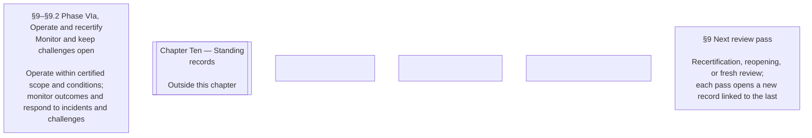
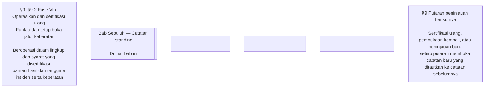

<!-- CHUNK-BEGIN id__core_09.000_system_alignment_certification_evaluation__section_1_corpus_placement_overview.md bytes=3410 -->
<!-- AI-assisted translation draft; unreviewed. §1 corpus-placement overview, source lines 8–10; source SHA-256 4311e6ba74b7210f077c0bd4c8d21d8c9f517d2ada7b6d87288b39494dfeadd5. Draft only; do not synchronize into translations/. -->

# Chapter Nine Part A — §1 corpus-placement overview (id)

## English source (lines 8–10)

> This file is **part of the Sentient Constitution** and is **binding only together** with the other numbered `core_*` files read as one text. It contains **Chapter Nine, Part A** — certification purpose, the process overview, and the first two phases of the process — **Frame** (system class) and **Evaluate** (whole-system evaluation in three sub-phases: the always-applicable evaluations, including data types and handling, in **§3**; the evaluations that apply where implicated in **§4**; and the Rights-Floor and domain evaluations that apply where triggered in **§5**) — **§1–§5**. The worked **Class A / B / C illustrations** (the system class profiles, §3.4.8, §5.1.5, §5.2.4, §5.3.7, §5.4.4, §5.5.5, and §5.6.4), including each one's **Reading across system classes** paragraph, are in [`core_09.010_system_alignment_certification_illustrations.md`](core_09.010_system_alignment_certification_illustrations.md); each keeps its Part A section number. The binding system-class-scaling and escalation rules those paragraphs illustrate stay in this file: system class scaling, including participation and proportionality, in §2.2; data-handling scaling in §3.4; and the **System class scaling and escalation** paragraph in each of §5.1–§5.6. The files of the whole chapter are listed in the table below.
>
> **Chapter Nine files.** Chapter Nine is split across four binding files read as one text. Part A, this file, opens the chapter; there is no separate index file.

## Translation draft

> Berkas ini **merupakan bagian dari Sentient Constitution** dan mengikat hanya jika dibaca sebagai satu naskah bersama berkas `core_*` bernomor lainnya. Berkas ini memuat **Bab Sembilan, Bagian A**—tujuan sertifikasi, gambaran proses, dan dua fase pertamanya: **Frame** (kelas sistem) dan **Evaluate** (evaluasi seluruh sistem dalam tiga subfase: evaluasi yang selalu berlaku, termasuk jenis dan penanganan data, pada **§3**; evaluasi yang berlaku jika terkait pada **§4**; serta evaluasi **Lantai Hak** dan domain yang berlaku jika terpicu pada **§5**)—**§§1–5**. Ilustrasi lengkap **Kelas A / B / C** (profil kelas sistem, §3.4.8, §5.1.5, §5.2.4, §5.3.7, §5.4.4, §5.5.5, dan §5.6.4), termasuk paragraf **Membaca lintas kelas sistem** pada masing-masing ilustrasi, terdapat dalam [`core_09.010_system_alignment_certification_illustrations.md`](core_09.010_system_alignment_certification_illustrations.md); masing-masing mempertahankan nomor bagiannya di Bagian A. Aturan pengukuran menurut kelas dan eskalasi yang mengikat dan dijelaskan oleh paragraf tersebut tetap berada di berkas ini: pengukuran menurut kelas sistem, termasuk partisipasi dan proporsionalitas, pada §2.2; pengukuran penanganan data pada §3.4; serta paragraf **Pengukuran dan eskalasi menurut kelas sistem** di setiap §§5.1–5.6. Tabel di bawah mencantumkan berkas seluruh bab.
>
> **Berkas Bab Sembilan.** Bab Sembilan terbagi dalam empat berkas yang mengikat dan dibaca bersama. Bagian A, berkas ini, membuka bab tersebut; tidak ada berkas indeks terpisah.

<!-- CHUNK-END -->
<!-- CHUNK-BEGIN id__core_09.000_system_alignment_certification_evaluation__section_1_corpus_file_table.md bytes=5035 -->
<!-- AI-assisted translation draft; unreviewed. §1 corpus-placement file table, source lines 12–17; source SHA-256 4311e6ba74b7210f077c0bd4c8d21d8c9f517d2ada7b6d87288b39494dfeadd5. Draft only; do not synchronize into translations/. -->

# Chapter Nine Part A — §1 corpus-placement file table (id)

## English source (lines 12–17)

> | Part | File | Owns |
> |------|------|------|
> | **Part A — Evaluation** | [`core_09.000_system_alignment_certification_evaluation.md`](core_09.000_system_alignment_certification_evaluation.md) | §1–§5: purpose and process overview (with a chart of the whole certification process in its six phases), **Phase I Frame** (system class, how system class scales every evaluation, and pilot certification) and **Phase II Evaluate** (whole-system evaluation in three sub-phases: **IIa** always, in §3, including chartered scope versus functional boundaries and data types and handling; **IIb** where implicated, in §4; and **IIc** where triggered, the Rights-Floor and domain evaluations, in §5) |
> | **Part B — Record and process** | [`core_09.005_system_alignment_certification_record_process.md`](core_09.005_system_alignment_certification_record_process.md) | §6–§10: **Phase III Review** (forum roles, supervisory sequence, and the contestability chain), **Phase IV Decide** (certification outcomes, including the go-live gate), **Phase V Record** (the certification record and its integrity, including governing [System Charter](core_05.040_band_continuity.md#system-charter) fields), and **Phase VI Operate** (the challenge path; recertification and reopening; the standing bridge) — continuous chapter numbering from Part A §5 |
> | **Part C — Illustrations** | [`core_09.010_system_alignment_certification_illustrations.md`](core_09.010_system_alignment_certification_illustrations.md) | the illustrative system class profiles, §3.4, §3.4.8, §5.1.5, §5.2.4, §5.3.7, §5.4.4, §5.5.5, and §5.6.4: worked Class A / B / C walkthroughs for each Part A evaluation area, numbered to match Part A and linked both ways |
> | **Part D — Institutional alignment certification** | [`core_09.015_institutional_alignment_certification.md`](core_09.015_institutional_alignment_certification.md) | §11–§15: the same six phases for an **Institution** rather than a System — the institution class and the institutional evaluation (**Phases I and II**, §12), the forum roles, outcome, and **Institutional Certification Record** (**Phases III to V**, §13), and recertification, reopening, the cascade from System certifications, and the standing bridge (**Phase VI**, §14–§15). It cites each System's certification by link and does not repeat it, and it is not a licence — continuous chapter numbering from Part B §10 |

## Translation draft

| Bagian | Berkas | Memuat |
|------|------|------|
| **Part A — Evaluation** | [`core_09.000_system_alignment_certification_evaluation.md`](core_09.000_system_alignment_certification_evaluation.md) | §§1–5: tujuan dan gambaran proses (dengan bagan enam fase sertifikasi), serta fase I Frame (kelas sistem, cara kelas menentukan skala setiap evaluasi, dan sertifikasi percontohan) dan II Evaluate (evaluasi seluruh sistem dalam tiga subfase: IIa selalu berlaku pada §3, termasuk cakupan Piagam dibanding batas fungsional serta jenis dan penanganan data; IIb jika terkait pada §4; IIc jika terpicu, evaluasi Lantai Hak dan domain pada §5). |
| **Part B — Record and process** | [`core_09.005_system_alignment_certification_record_process.md`](core_09.005_system_alignment_certification_record_process.md) | §§6–10: fase III Review (peran forum, urutan pengawasan, dan rantai keberatan); IV Decide (hasil sertifikasi, termasuk gerbang sebelum sistem beroperasi); V Record (rekaman sertifikasi dan integritasnya, termasuk bidang [System Charter](core_05.040_band_continuity.md#system-charter) yang mengatur); VI Operate (jalur tantangan, sertifikasi ulang dan pembukaan kembali, serta jembatan standing) — penomoran berlanjut dari Bagian A §5. |
| **Part C — Illustrations** | [`core_09.010_system_alignment_certification_illustrations.md`](core_09.010_system_alignment_certification_illustrations.md) | Profil ilustratif kelas sistem dan §§3.4, 3.4.8, 5.1.5, 5.2.4, 5.3.7, 5.4.4, 5.5.5, 5.6.4: contoh lengkap Kelas A/B/C untuk setiap area evaluasi Bagian A; nomor bagiannya selaras dan ditautkan dua arah. |
| **Part D — Institutional alignment certification** | [`core_09.015_institutional_alignment_certification.md`](core_09.015_institutional_alignment_certification.md) | §§11–15: enam fase yang sama untuk Institusi, bukan Sistem — kelas dan evaluasi institusi (I–II, §12), peran forum, hasil, dan Rekaman Sertifikasi Institusi (III–V, §13), serta sertifikasi ulang, pembukaan kembali, rangkaian sertifikasi Sistem, dan jembatan standing (VI, §§14–15). Merujuk catatan sertifikasi tiap Sistem tanpa mengulanginya dan bukan lisensi — penomoran berlanjut dari Bagian B §10. |

<!-- CHUNK-END -->
<!-- CHUNK-BEGIN id__core_09.000_system_alignment_certification_evaluation__section_1_corpus_explanation.md bytes=8224 -->
<!-- AI-assisted translation draft; unreviewed. §1 corpus-placement explanatory prose, source lines 19–30; source SHA-256 4311e6ba74b7210f077c0bd4c8d21d8c9f517d2ada7b6d87288b39494dfeadd5. Draft only; do not synchronize into translations/. -->

# Chapter Nine Part A — §1 corpus-placement explanatory prose (id)

## English source (lines 19–30)

> **How the two certifications relate.** System Alignment Certification (Parts A to C) is the certification of a System. Institutional alignment certification (Part D) is the certification of an Institution, which may run Systems or none. Part D cites each System's certification record by link and does not redo it; [Part D §11.1](core_09.015_institutional_alignment_certification.md#111-relation-to-system-alignment-certification) states the relation and [Part D §11.3](core_09.015_institutional_alignment_certification.md#113-no-permission-and-no-gate) states that it is not a licence.
>
> Generic **Chapter Nine** links in other files route to the appropriate part by section number.
>
> - **Constitutional owner (joint with Parts B and D):** forum-supervised **system alignment certification and related records** — evaluation domains (Part A); forum process, supervisory sequence, certification-record duties, certification outcomes and the go-live gate, the challenge path, recertification and reopening, and verified-input bridge to Chapter Ten (Part B); the same six phases for an Institution (Part D). Under the **oversight** Tetrad leg, SAC is one especially large, high-stakes audit process among others; auditing floors remain at **Article XVI** (*Audit, Transparency, and Independent Verification*) and Chapter Five [Auditability](core_05.050_band_oversight.md#auditability).
> - **Verification substrate owner:** [Chapter Four — Burden of Proof, Traceability, and Verification](core_04.000_burden_traceability_verification.md#chapter-four-burden-of-proof-traceability-and-verification) (within Chapters Two through Four) owns burden allocation, compliance evidence, definition traceability, observability, and security-constrained verification. Chapter Nine **applies** that discipline to system alignment certification records; it does **not** restate Chapter Four sections **1** through **5**.
> - **Auditing home (not relocated here):** **Article XVI** (*Audit, Transparency, and Independent Verification*), **Def.O1** (*Transparency, Auditability, and Verification*), and **CJS-5.110 §3 and CJS-5.115 §3** (*Audit process home*)–**CJS-5.110 §5** own auditing floors and operational terms. Chapter Nine runs one especially large SAC audit process that must satisfy those floors; it does not own all auditing.
> - **Implementation owner:** system-class handling, CS-6.345, and forum-process detail in designated implementation files must remain consistent with Chapter Nine and may be stricter where the corpus already provides a [Fullest Protective Effect](core_05.045_band_integrative.md#fullest-protective-effect) rule.
> - **Anti-relocation rule:** Part A does not restate Chapter Five canonical definitions, Chapter Three anti-evasion discipline (see [Part B §9.3](core_09.005_system_alignment_certification_record_process.md#93-non-evasion)), Chapter Ten contribution or standing measurement, or Chapter Eleven standing effects. **[Part B §10](core_09.005_system_alignment_certification_record_process.md#10-relationship-to-standing)** states the standing bridge boundary explicitly.
>
> **Upstream:** Chapter Five definitions; Chapters Two through Four record, verification, burden, and traceability of definitions to results; and [Chapter Eight](core_08.000_functional_independence_separation_of_duties.md#chapter-eight-functional-independence-and-separation-of-duties), whose separation-of-duties requirement governs every materially binding certification act.
> **Downstream:** [Part B](core_09.005_system_alignment_certification_record_process.md#chapter-nine-part-b-system-alignment-certification--record-and-process) (*forum process, record, outcomes, and standing bridge*); Chapter Ten standing records and verified inputs; Chapter Eleven standing effects; Chapter Thirteen forum supervision and system alignment certification pathways.

## Translation draft

**Hubungan kedua sertifikasi.** System Alignment Certification (Bagian A sampai C) adalah sertifikasi suatu Sistem. Sertifikasi alignment institusional (Bagian D) adalah sertifikasi suatu Institusi, yang dapat mengoperasikan Sistem atau tidak sama sekali. Bagian D menautkan rekam sertifikasi setiap Sistem tanpa mengulanginya; [Part D §11.1](core_09.015_institutional_alignment_certification.md#111-relation-to-system-alignment-certification) menjelaskan hubungan tersebut dan [Part D §11.3](core_09.015_institutional_alignment_certification.md#113-no-permission-and-no-gate) menyatakan bahwa itu bukan lisensi.
>
> Tautan umum **Chapter Nine** dalam berkas lain mengarah ke bagian yang sesuai menurut nomor bagiannya.
>
> - **Pemilik konstitusional (bersama Bagian B dan D):** sertifikasi alignment sistem dan rekam terkait di bawah pengawasan forum — domain evaluasi (Bagian A); proses forum, urutan pengawasan, kewajiban rekam sertifikasi, hasil dan gerbang mulai operasi, jalur tantangan, sertifikasi ulang dan pembukaan kembali, serta penghubung masukan terverifikasi ke Bab Sepuluh (Bagian B); enam fase yang sama untuk suatu Institusi (Bagian D). Dalam unsur **pengawasan** Tetrad, SAC adalah satu proses audit yang sangat besar dan berisiko tinggi di antara proses lainnya; lantai audit tetap berada pada **Article XVI** (*Audit, Transparency, and Independent Verification*) dan [Auditability](core_05.050_band_oversight.md#auditability) di Bab Lima.
> - **Pemilik landasan verifikasi:** [Chapter Four — Burden of Proof, Traceability, and Verification](core_04.000_burden_traceability_verification.md#chapter-four-burden-of-proof-traceability-and-verification) (dalam Bab Dua sampai Empat) memiliki alokasi beban pembuktian, bukti kepatuhan, keterlacakan definisi, keteramatan, dan verifikasi dengan batasan keamanan. Bab Sembilan menerapkan disiplin itu pada rekam sertifikasi alignment sistem; Bab ini tidak mengulang bagian **1** sampai **5** Bab Empat.
> - **Rumah audit (tidak dipindahkan ke sini):** **Article XVI** (*Audit, Transparency, and Independent Verification*), **Def.O1** (*Transparency, Auditability, and Verification*), dan **CJS-5.110 §3 serta CJS-5.115 §3** (*Audit process home*)–**CJS-5.110 §5** memiliki lantai audit dan istilah operasional. Bab Sembilan menjalankan satu proses audit SAC yang sangat besar dan harus memenuhi lantai tersebut; Bab ini tidak memiliki semua pekerjaan audit.
> - **Pemilik implementasi:** penanganan kelas sistem, CS-6.345, dan rincian proses forum dalam berkas implementasi yang ditetapkan harus tetap selaras dengan Bab Sembilan dan dapat lebih ketat bila korpus telah menyediakan aturan [Fullest Protective Effect](core_05.045_band_integrative.md#fullest-protective-effect).
> - **Aturan anti-relokasi:** Bagian A tidak mengulang definisi kanonis Bab Lima, disiplin anti-pengelakan Bab Tiga (lihat [Part B §9.3](core_09.005_system_alignment_certification_record_process.md#93-non-evasion)), pengukuran kontribusi atau standing Bab Sepuluh, ataupun dampak standing Bab Sebelas. **[Part B §10](core_09.005_system_alignment_certification_record_process.md#10-relationship-to-standing)** menyatakan batas penghubung standing secara eksplisit.
>
> **Hulu:** definisi Bab Lima; rekam, verifikasi, beban pembuktian, dan keterlacakan definisi ke hasil dari Bab Dua sampai Empat; serta [Chapter Eight](core_08.000_functional_independence_separation_of_duties.md#chapter-eight-functional-independence-and-separation-of-duties), yang persyaratan pemisahan tugasnya mengatur setiap tindakan sertifikasi yang secara material mengikat.
> **Hilir:** [Part B](core_09.005_system_alignment_certification_record_process.md#chapter-nine-part-b-system-alignment-certification--record-and-process) (*proses forum, rekam, hasil, dan penghubung standing*); rekam standing dan masukan terverifikasi Bab Sepuluh; dampak standing Bab Sebelas; pengawasan forum dan jalur sertifikasi alignment sistem Bab Tiga Belas.

<!-- CHUNK-END -->
<!-- CHUNK-BEGIN id__core_09.000_system_alignment_certification_evaluation__section_1_heading.md bytes=365 -->
<!-- AI-assisted translation draft; unreviewed. §1 heading, source line 44; source SHA-256 4311e6ba74b7210f077c0bd4c8d21d8c9f517d2ada7b6d87288b39494dfeadd5. Draft only; do not synchronize into translations/. -->

# Chapter Nine Part A — §1 heading (id)

## English source (lines 44–45)

### 1. Purpose and Role


## Translation draft

### 1. Tujuan dan Peran

<!-- CHUNK-END -->
<!-- CHUNK-BEGIN id__core_09.000_system_alignment_certification_evaluation__section_1_trace.md bytes=12099 -->
<!-- AI-assisted translation draft; unreviewed. §1 trace, source lines 46–95; source SHA-256 4311e6ba74b7210f077c0bd4c8d21d8c9f517d2ada7b6d87288b39494dfeadd5. Draft only; do not synchronize into translations/. -->

# Chapter Nine Part A — §1 trace (id)

## English source (lines 46–95)

<details>
<summary><strong><span style="color: #2563eb;">Trace</span></strong></summary>

- Upstream:
  - [Preamble — constitutional owner register](core_00.000_preamble.md#4-principles-definitions-and-rights) and
  - [Authority Stack and Internal Hierarchy](core_05.045_band_integrative.md#authority-stack-and-internal-hierarchy);
  - [Constitutional Tetrad](core_00.000_preamble.md#constitutional-tetrad);
  - [Two Constitutional Aims](core_00.000_preamble.md#two-constitutional-aims);
  - [material stake](core_00.000_preamble.md#material-stake);
  - [Proportionality](core_05.035_band_accountability.md#proportionality) and
  - [Substantive Fairness](core_05.055_band_participation.md#substantive-fairness) (Chapter Five); Participation measurement family (*voice, access, and contest paths*);
  - [Chapter One §16 Stewardship In Depth](core_01.010_stewardship_capacity_principles.md#16-stewardship-in-depth) (1.010 §16);
  - [Chapter One §12 Systemic Evaluation Requirement](core_01.000_values_principles.md#12-systemic-evaluation-requirement) (1.000 §12) (*principle-layer whole-system evaluation lens — not one corner alone*); Chapters Two through Four;
  - [Chapter Five](core_05.000_definitions_home.md#chapter-five-foundational-definitions) (5.000) (*canonical definitions*);
  - [Chapter Eight §2 Four-Seat Constitutional Requirement](core_08.000_functional_independence_separation_of_duties.md#2-four-seat-constitutional-requirement) (8.000 §2);
  - [System Alignment Certification](core_05.040_band_continuity.md#system-alignment-certification) (Chapter Five canonical term; non-operative shorthand **SAC**);
  - [System Certification Record](core_05.040_band_continuity.md#system-certification-record) (Chapter Five meaning).
- Downstream:
  - [§2](#2-system-class-evaluation) (*system class evaluation*);
  - [Part B §9.1](core_09.005_system_alignment_certification_record_process.md#91-challenging-a-certification) (9.005 §9.1) (*challenging a certification*); and
  - [Part C system class profiles](core_09.010_system_alignment_certification_illustrations.md#illustrative-system-class-profiles-non-exhaustive) (9.010) (*illustrative system class profiles*);
  - [Part C whole-system walkthroughs](core_09.010_system_alignment_certification_illustrations.md#illustrative-whole-system-application-by-system-class-non-exhaustive) (9.010) (*worked whole-system examples by system class*);
  - [§3.4.8](core_09.010_system_alignment_certification_illustrations.md#348-illustrative-data-handling-application-by-system-class-non-exhaustive) (*worked data-handling examples by system class*);
  - [§5.1.5](core_09.010_system_alignment_certification_illustrations.md#515-illustrative-ecological-footprint-application-by-system-class-non-exhaustive) (*worked ecological-footprint examples by system class*);
  - [§5.2.4](core_09.010_system_alignment_certification_illustrations.md#524-illustrative-educational-capability-application-by-system-class-non-exhaustive) (*worked educational-capability examples by system class*);
  - [§5.3.7](core_09.010_system_alignment_certification_illustrations.md#537-illustrative-cross-system-support-application-by-system-class-non-exhaustive) (*worked cross-system-support examples by system class*);
  - [§5.4.4](core_09.010_system_alignment_certification_illustrations.md#544-illustrative-nondiscrimination-application-by-system-class-non-exhaustive) (*worked nondiscrimination examples by system class*);
  - [§5.5.5](core_09.010_system_alignment_certification_illustrations.md#555-illustrative-accessibility-application-by-system-class-non-exhaustive) (*worked accessibility examples by system class*);
  - [§5.6.4](core_09.010_system_alignment_certification_illustrations.md#564-illustrative-trustworthiness-application-by-system-class-non-exhaustive) (*worked trustworthiness examples by system class*);
  - [§3](#3-whole-system-certification-evaluation) (*whole-system certification evaluation factors*);
  - [§3.4](#34-data-types-and-handling-evaluation) through
  - [§5.6](#56-trustworthiness-and-system-reliance-integrity-evaluation) (*domain evaluations*);
  - [Part B §6](core_09.005_system_alignment_certification_record_process.md#6-forum-process) (9.005 §6) (*supervisory sequence and contestability chain*);
  - [Part B §6.1](core_09.005_system_alignment_certification_record_process.md#61-forum-supervision-and-component-roles) (9.005 §6.1) (*forum component roles*);
  - [Part B §8](core_09.005_system_alignment_certification_record_process.md#8-system-certification-record) (9.005 §8) (*certification record contents*);
  - [Part B §8.2](core_09.005_system_alignment_certification_record_process.md#82-record-integrity-transparency-and-auditability) (9.005 §8.2) (*record integrity requirements*);
  - [Part B §7](core_09.005_system_alignment_certification_record_process.md#7-certification-outcomes) (9.005 §7) (*reopening and anti-evasion*);
  - [Part B §10](core_09.005_system_alignment_certification_record_process.md#10-relationship-to-standing) (9.005 §10) (*standing-record bridge*);
  - [Chapter Ten](core_11.000_standing_assessment.md#chapter-eleven-contribution-violation-and-standing-model--measurement) (10.000) (*standing records and verified-input gate*);
  - [Chapter Eleven](core_12.000_standing_integration.md#chapter-twelve-standing-effects-and-integration) (11.000) (*standing effects and integration*);
  - [Chapter Thirteen](core_14.000_forum.md#chapter-fourteen-forums-and-jurisdiction) (13.000) (*forum supervision, certification, alignment certification, and review*).
- Read with:
  - **[CS-9.305](corpus_systems/cs_09.305_system_classification_machinery.md#cs-9305-part-a-system-classification-machinery) (*System classification machinery*) and [CS-9.310 — System impact classifications](corpus_systems/cs_09.310_system_impact_classifications.md#cs-9310-part-b-system-impact-classifications)**, **[CS-6.305](corpus_systems/cs_06.305_information_types_and_handling.md#cs-6305-part-a-information-types-and-handling) (*Information types and handling*) and [CS-6.310 — Data classifications](corpus_systems/cs_06.310_data_classifications.md#cs-6310-part-b-data-classifications)**, and
  - **CS-6.345** (*System lifecycle*);
  - **CF-13.415** (*Routing operations, transfer, certification, and representative treatment*) and
  - **CF-13.425** (*Integrity safeguards, anti-capture operations, and anti-self-judging support*); **Article XVI** (*Audit, Transparency, and Independent Verification*) and
  - [Auditability](core_05.050_band_oversight.md#auditability) (*auditing floors — SAC is one especially large audit process under oversight, not the sole auditing home*); **CJS-5.110 §3 (*Oversight: auditability and reconstructability terms (annex)*) and CJS-5.115 §3** (*Audit process home*)–
  - **CJS-5.110 §5** (*Oversight: independent verification and claim-integrity terms*).

</details>

## Translation draft

#### Peta rujukan

Peta ini menjelaskan dasar konstitusional dan kewenangan bagian ini, lalu menghubungkannya dengan evaluasi, klasifikasi, jalur peninjauan, catatan, hasil, dan audit; instrumen operasional terkait juga ditunjukkan.

**Peta rujukan — upstream canonical sources:** [Preamble — constitutional owner register](core_00.000_preamble.md#4-principles-definitions-and-rights); [Authority Stack and Internal Hierarchy](core_05.045_band_integrative.md#authority-stack-and-internal-hierarchy); [Constitutional Tetrad](core_00.000_preamble.md#constitutional-tetrad); [Two Constitutional Aims](core_00.000_preamble.md#two-constitutional-aims); [material stake](core_00.000_preamble.md#material-stake); [Proportionality](core_05.035_band_accountability.md#proportionality); [Substantive Fairness](core_05.055_band_participation.md#substantive-fairness); [Chapter One §16 Stewardship In Depth](core_01.010_stewardship_capacity_principles.md#16-stewardship-in-depth); [Chapter One §12 Systemic Evaluation Requirement](core_01.000_values_principles.md#12-systemic-evaluation-requirement); [Chapter Five](core_05.000_definitions_home.md#chapter-five-foundational-definitions); [Chapter Eight §2 Four-Seat Constitutional Requirement](core_08.000_functional_independence_separation_of_duties.md#2-four-seat-constitutional-requirement); [System Alignment Certification](core_05.040_band_continuity.md#system-alignment-certification); [System Certification Record](core_05.040_band_continuity.md#system-certification-record)

**Peta rujukan — downstream routes and related records:** [§2](#2-system-class-evaluation); [Part B §9.1](core_09.005_system_alignment_certification_record_process.md#91-challenging-a-certification); [Part C system class profiles](core_09.010_system_alignment_certification_illustrations.md#illustrative-system-class-profiles-non-exhaustive); [Part C whole-system walkthroughs](core_09.010_system_alignment_certification_illustrations.md#illustrative-whole-system-application-by-system-class-non-exhaustive); [§3.4.8](core_09.010_system_alignment_certification_illustrations.md#348-illustrative-data-handling-application-by-system-class-non-exhaustive); [§5.1.5](core_09.010_system_alignment_certification_illustrations.md#515-illustrative-ecological-footprint-application-by-system-class-non-exhaustive); [§5.2.4](core_09.010_system_alignment_certification_illustrations.md#524-illustrative-educational-capability-application-by-system-class-non-exhaustive); [§5.3.7](core_09.010_system_alignment_certification_illustrations.md#537-illustrative-cross-system-support-application-by-system-class-non-exhaustive); [§5.4.4](core_09.010_system_alignment_certification_illustrations.md#544-illustrative-nondiscrimination-application-by-system-class-non-exhaustive); [§5.5.5](core_09.010_system_alignment_certification_illustrations.md#555-illustrative-accessibility-application-by-system-class-non-exhaustive); [§5.6.4](core_09.010_system_alignment_certification_illustrations.md#564-illustrative-trustworthiness-application-by-system-class-non-exhaustive); [§3](#3-whole-system-certification-evaluation); [§3.4](#34-data-types-and-handling-evaluation); [§5.6](#56-trustworthiness-and-system-reliance-integrity-evaluation); [Part B §6](core_09.005_system_alignment_certification_record_process.md#6-forum-process); [Part B §6.1](core_09.005_system_alignment_certification_record_process.md#61-forum-supervision-and-component-roles); [Part B §8](core_09.005_system_alignment_certification_record_process.md#8-system-certification-record); [Part B §8.2](core_09.005_system_alignment_certification_record_process.md#82-record-integrity-transparency-and-auditability); [Part B §7](core_09.005_system_alignment_certification_record_process.md#7-certification-outcomes); [Part B §10](core_09.005_system_alignment_certification_record_process.md#10-relationship-to-standing); [Chapter Ten](core_11.000_standing_assessment.md#chapter-eleven-contribution-violation-and-standing-model--measurement); [Chapter Eleven](core_12.000_standing_integration.md#chapter-twelve-standing-effects-and-integration); [Chapter Thirteen](core_14.000_forum.md#chapter-fourteen-forums-and-jurisdiction)

**Peta rujukan — operational materials to read with this section:** [CS-9.305](corpus_systems/cs_09.305_system_classification_machinery.md#cs-9305-part-a-system-classification-machinery); [CS-9.310 — System impact classifications](corpus_systems/cs_09.310_system_impact_classifications.md#cs-9310-part-b-system-impact-classifications); [CS-6.305](corpus_systems/cs_06.305_information_types_and_handling.md#cs-6305-part-a-information-types-and-handling); [CS-6.310 — Data classifications](corpus_systems/cs_06.310_data_classifications.md#cs-6310-part-b-data-classifications); [Auditability](core_05.050_band_oversight.md#auditability)

<!-- CHUNK-END -->
<!-- CHUNK-BEGIN id__core_09.000_system_alignment_certification_evaluation__purpose_adjuncts.md bytes=5680 -->
<!-- AI-assisted translation draft; unreviewed. Selected §1 passages, source lines 99 and 107–114; source SHA-256 4311e6ba74b7210f077c0bd4c8d21d8c9f517d2ada7b6d87288b39494dfeadd5. -->

# Chapter Nine Part A — §1 plain-terms excerpt

**Status:** AI-assisted draft; unreviewed. English source remains controlling.

## English source

When a system really matters to sentients' lives, certification has to be **proportionate** — as demanding as the system's real impact, dependency, and risk require, not a one-size-fits-all checklist or a rubber stamp. It also has to be **participatory** — affected sentients and communities must be able to see what was reviewed, understand what was decided, and challenge it when something is wrong. Forums review evidence, write it down in a certification record, and require re-checks on a schedule that matches how risky the system is. Classes A, B, and C get the full process and Class L a lighter one. Class P is encouraged to use it, and must once it is reclassified to Class L or higher (that is, its effects reach beyond a private unit) or its operator claims constitutional compliance.

## id draft

Jika suatu sistem benar-benar berdampak pada kehidupan makhluk berkesadaran, sertifikasinya harus **proporsional**—setingkat tuntutan yang diperlukan oleh dampak nyata, ketergantungan, dan risikonya; bukan daftar periksa seragam atau sekadar stempel persetujuan. Sertifikasi juga harus **partisipatif**—makhluk berkesadaran dan komunitas yang terdampak harus dapat melihat apa yang ditinjau, memahami keputusan yang diambil, dan menggugatnya jika ada yang keliru. Forum meninjau bukti, mencatatnya dalam rekam sertifikasi, dan mewajibkan pemeriksaan ulang dengan jadwal sesuai risiko sistem. Kelas A, B, dan C menjalani proses penuh; Kelas L menjalani proses yang lebih ringan. Kelas P dianjurkan menggunakannya dan wajib melakukannya setelah direklasifikasi menjadi Kelas L atau lebih tinggi (yakni dampaknya melampaui satu unit privat) atau ketika operatornya menyatakan kepatuhan konstitusional.


### English source — Flourishing

- **[Flourishing](core_00.000_preamble.md#flourishing)** — certification verifies that certification or continued reliance would not quietly defeat Rights Floors or block fair participation in constitutionally relevant life;

### id draft

- **[Pemekaran potensi](core_00.000_preamble.md#flourishing)** — sertifikasi memastikan bahwa pemberian sertifikasi atau ketergantungan yang berlanjut tidak diam-diam menggagalkan Lantai Hak atau menghalangi partisipasi yang adil dalam kehidupan yang relevan secara konstitusional;


### English source — Continuity criterion

- **[Continuity](core_00.000_preamble.md#continuity)** — certification verifies durable, non-regressive supply that sustains rather than depletes healthy natural systems ([Ecological Integrity](core_05.040_band_continuity.md#ecological-integrity), including [Ecological Recovery Capacity](core_05.040_band_continuity.md#ecological-recovery-capacity)), and system-class-scaled recertification where shared systems gate or sustain delivery;

### id draft

- **[Keberlanjutan](core_00.000_preamble.md#continuity)** — sertifikasi memastikan pasokan yang tahan lama dan tidak regresif, yang menopang alih-alih menguras sistem alam yang sehat ([Integritas Ekologis](core_05.040_band_continuity.md#ecological-integrity), termasuk [Kapasitas Pemulihan Ekologis](core_05.040_band_continuity.md#ecological-recovery-capacity)), serta sertifikasi ulang sesuai kelas sistem ketika sistem bersama membatasi atau menopang penyediaan;


### English source — Participation criterion

- **Participation** — affected sentients and communities can understand, contest, and take part in review paths that matter to them;

### id draft

- **Partisipasi** — makhluk berkesadaran dan komunitas yang terdampak dapat memahami, menggugat, dan ikut serta dalam jalur peninjauan yang penting bagi mereka;


### English source — Oversight criterion

- **Oversight** — records, evidence, and assumptions are visible and auditable enough for independent checking; certification itself is one especially large audit process under that oversight duty, not the only one;

### id draft

- **Pengawasan** — catatan, bukti, dan asumsi cukup terlihat serta dapat diaudit untuk pemeriksaan independen; sertifikasi sendiri merupakan salah satu proses audit besar di bawah kewajiban pengawasan tersebut, bukan satu-satunya ranah audit;


### English source — Accountability criterion

- **Accountability** — defects, misclassification, and floor-defeating operation route to remedy, conditions, withdrawal, or standing input where the facts support it;

### id draft

- **Akuntabilitas** — cacat, salah klasifikasi, dan pengoperasian yang meniadakan Lantai Hak diarahkan pada pemulihan, persyaratan, penarikan, atau masukan penilaian status jika faktanya mendukung;


### English source — Timeliness criterion

- **Timeliness** — review and contest windows keep certification from going stale while harm can still be prevented or reversed.

### id draft

- **Ketepatan waktu** — tenggat peninjauan dan gugatan mencegah sertifikasi menjadi usang selagi kerugian masih dapat dicegah atau dipulihkan.


### English source — Tetrad introduction

Certification implements the [Two Constitutional Aims](core_00.000_preamble.md#two-constitutional-aims) through the [Constitutional Tetrad](core_00.000_preamble.md#constitutional-tetrad):

### id draft

Sertifikasi mewujudkan [Dua Tujuan Konstitusional](core_00.000_preamble.md#two-constitutional-aims) melalui [Tetrad Konstitusional](core_00.000_preamble.md#constitutional-tetrad):

<!-- CHUNK-END -->
<!-- CHUNK-BEGIN id__core_09.000_system_alignment_certification_evaluation__section_1_purpose.md bytes=1186 -->
<!-- AI-assisted translation draft; unreviewed. Complete purpose statement excerpt, source lines 101–105; source SHA-256 4311e6ba74b7210f077c0bd4c8d21d8c9f517d2ada7b6d87288b39494dfeadd5. This is an excerpt, not a complete §1 translation. -->

**Sertifikasi Keselarasan Sistem** ada untuk menjawab satu pertanyaan bagi cakupan dan jadwal peninjauan tertentu: Apakah sistem telah menunjukkan keselarasan konstitusional yang memadai untuk sertifikasi, sertifikasi bersyarat, validasi, sertifikasi ulang, ketergantungan berkelanjutan, penerapan, atau pelepasan material dari persyaratan?

- Sertifikasi bukan skor popularitas, izin tanpa batas waktu, atau cara untuk melewati peninjauan hak.
- Sertifikasi adalah pernyataan berbatas waktu dan dapat digugat mengenai apa yang diketahui saat ini tentang keselarasan sistem.
- Di bawah pilar **pengawasan** Tetrad, pengawasan mensyaratkan audit; Sertifikasi Keselarasan Sistem adalah salah satu proses audit yang sangat besar dan berisiko tinggi di antara proses lainnya — bukan satu-satunya tempat bagi audit (**Pasal XVI** (*Audit, Transparansi, dan Verifikasi Independen*), [keterauditan](core_05.050_band_oversight.md#auditability)).

<!-- CHUNK-END -->
<!-- CHUNK-BEGIN id__core_09.000_system_alignment_certification_evaluation__section_1_subsection_headings.md bytes=772 -->
<!-- AI-assisted translation draft; unreviewed. §1.1/§1.2 visible subsection headings, source lines 116–119 and 144–148; source SHA-256 4311e6ba74b7210f077c0bd4c8d21d8c9f517d2ada7b6d87288b39494dfeadd5. Draft only; anchors/blank layout are structural. Do not synchronize into translations/. -->

# Chapter Nine Part A — §1.1 and §1.2 subsection headings (id)

## English source

### Lines 116–119

<a id="11-certification-as-an-audit-process-scaled-by-class"></a>

#### 1.1 Certification as an audit process, scaled by class


### Lines 144–148


<a id="12-certification-at-a-glance"></a>

#### 1.2 Certification at a glance


## Translation draft

#### 1.1 Sertifikasi sebagai proses audit yang diskalakan menurut kelas

#### 1.2 Sekilas tentang sertifikasi

<!-- CHUNK-END -->
<!-- CHUNK-BEGIN id__core_09.000_system_alignment_certification_evaluation__section_1_audit_scope.md bytes=3164 -->
<!-- AI-assisted translation draft; unreviewed. §1.1 audit mechanism and sibling audit modes, source lines 120–130; source SHA-256 4311e6ba74b7210f077c0bd4c8d21d8c9f517d2ada7b6d87288b39494dfeadd5. -->

# Chapter Nine Part A — §1.1 certification audit process excerpt (id)

## English source

As an oversight mechanism, certification is one especially large audit process under [Auditability](core_05.050_band_oversight.md#auditability) and **Article XVI** (*Audit, Transparency, and Independent Verification*):

- It is forum-supervised, multi-domain, and status-granting.
- It may integrate the results of sibling audit modes, and it does not absorb or replace them. Each keeps its own owner, named in the [sibling audit modes map](corpus_joint_structure/cjs_05.115_audit_process.md#sibling-audit-modes-owner-map) of the audit process home:
  - System Data Types Record audits under **CS-6.305 (*Information types and handling*) and CS-6.310** (*Data classifications*)
  - System Classification Record audits under **CS-9.305 (*System classification machinery*) and CS-9.310** (*System impact classifications*)
  - steward assurance reviews under **CS-14.305** (*Critical system stewardship*)
  - continuous audit under **CS-6.345** (*System lifecycle*) ACA
  - complexity audits under **CS-6.315** (*Comprehensibility and complexity stewardship*) and **Article XXIII-B** (*Complexity Audit and Modularity Requirements*)
  - claim verification under **CJS-5.110 §5** (*Oversight: independent verification and claim-integrity terms*)
- You can still run any of these checks on their own, without going through certification. Certification doesn't replace them.

## id draft

Sebagai mekanisme pengawasan, sertifikasi merupakan salah satu proses audit yang sangat besar berdasarkan [Auditabilitas](core_05.050_band_oversight.md#auditability) dan **Article XVI** (*Audit, Transparansi, dan Verifikasi Independen*):

- Sertifikasi diawasi forum, mencakup banyak domain, dan memberikan status.
- Sertifikasi dapat mengintegrasikan hasil mode audit terkait, tetapi tidak menyerap atau menggantikannya. Masing-masing tetap memiliki pemilik sendiri, yang disebutkan dalam [peta mode audit terkait](corpus_joint_structure/cjs_05.115_audit_process.md#sibling-audit-modes-owner-map) pada dokumen induk proses audit:
  - Audit System Data Types Record berdasarkan **CS-6.305 (*Jenis dan penanganan informasi*) dan CS-6.310** (*Klasifikasi data*)
  - Audit System Classification Record berdasarkan **CS-9.305 (*Mekanisme klasifikasi sistem*) dan CS-9.310** (*Klasifikasi dampak sistem*)
  - Tinjauan jaminan pengampu berdasarkan **CS-14.305** (*Pengampuan sistem kritis*)
  - Audit berkelanjutan berdasarkan **CS-6.345** (*Siklus hidup sistem*) ACA
  - Audit kompleksitas berdasarkan **CS-6.315** (*Keterpahaman dan pengampuan kompleksitas*) dan **Article XXIII-B** (*Persyaratan Audit Kompleksitas dan Modularitas*)
  - Verifikasi klaim berdasarkan **CJS-5.110 §5** (*Pengawasan: verifikasi independen dan ketentuan integritas klaim*)
- Anda tetap dapat menjalankan setiap pemeriksaan ini secara terpisah tanpa melalui sertifikasi. Sertifikasi tidak menggantikannya.

<!-- CHUNK-END -->
<!-- CHUNK-BEGIN id__core_09.000_system_alignment_certification_evaluation__section_1_class_scaling.md bytes=3853 -->
<!-- AI-assisted translation draft; unreviewed. Chapter Nine Part A §1 class scaling and cadence, source lines 132–143; source SHA-256 4311e6ba74b7210f077c0bd4c8d21d8c9f517d2ada7b6d87288b39494dfeadd5. Draft only; do not synchronize into translations/. -->

**Current English passage:**

Certification depth, record burden, certification interval, stakeholder review, and contest paths must scale with [material stake](core_00.000_preamble.md#material-stake) under [Proportionality](core_05.035_band_accountability.md#proportionality):

The process applies by impact class, as the [reclassification requirement](corpus_systems/cs_09.305_system_classification_machinery.md#35-reclassification-requirement) of **CS-9.305** (*System classification machinery*) sets out:

- **Class A, Class B, and Class C:** these systems carry the highest impact, dependency, and risk, and whole-system evaluation under [§3 Whole-System Certification Evaluation](#3-whole-system-certification-evaluation), [§4 Evaluations Where Implicated](#4-evaluations-where-implicated), and [§5 Rights-Floor and Domain Evaluations](#5-rights-floor-and-domain-evaluations), each as its own sub-phase applies, is mandatory at full depth;
- **Class L:** the same evaluation is mandatory but proportionate, with a lower default re-check cadence and simpler records where CS-9.305 (*System classification machinery*) and CS-9.310 (*System impact classifications*) permits; and
- **Class P:** the process is encouraged while the system is validly Class P, and a Class P system may use it voluntarily. It becomes mandatory on reclassification to Class L or higher, or where the operator voluntarily asserts constitutional compliance for the system.

The certification interval, and the financial, resource, or special audit that falls at its midpoint, are set by class in [Chapter Thirteen §6 Timely resolution, materiality tiers, and anti-delay discipline](core_14.000_forum.md#review-cadence) (*Review cadence*). This chapter does not restate the numbers.

**Proposed locale translation:**

Kedalaman sertifikasi, beban catatan, interval sertifikasi, peninjauan pemangku kepentingan, dan jalur keberatan harus disesuaikan dengan [taruhan material](core_00.000_preamble.md#material-stake) berdasarkan [proporsionalitas](core_05.035_band_accountability.md#proportionality):

Proses berlaku menurut kelas dampak sebagaimana ditetapkan dalam [persyaratan reklasifikasi](corpus_systems/cs_09.305_system_classification_machinery.md#35-reclassification-requirement) **CS-9.305** (*Mekanisme klasifikasi sistem*):

- **Kelas A, B, dan C:** sistem ini memiliki dampak, ketergantungan, dan risiko tertinggi; evaluasi seluruh sistem dengan kedalaman penuh pada setiap subfase yang berlaku diwajibkan menurut [§3 Evaluasi Sertifikasi Seluruh Sistem](#3-whole-system-certification-evaluation), [§4 Evaluasi jika Terlibat](#4-evaluations-where-implicated), dan [§5 Evaluasi Hak Minimum dan per Ranah](#5-rights-floor-and-domain-evaluations);
- **Kelas L:** evaluasi yang sama tetap wajib tetapi proporsional, dengan jeda pemeriksaan ulang bawaan yang lebih panjang dan catatan yang lebih sederhana apabila diizinkan **CS-9.305** (*Mekanisme klasifikasi sistem*) dan **CS-9.310** (*Klasifikasi dampak sistem*); dan
- **Kelas P:** proses ini dianjurkan selama klasifikasi P masih sah dan dapat digunakan secara sukarela. Proses menjadi wajib jika sistem direklasifikasi menjadi L atau lebih tinggi, atau jika operator secara sukarela menyatakan kepatuhan konstitusional sistem.

Interval sertifikasi dan audit keuangan, sumber daya, atau khusus yang jatuh di titik tengahnya ditetapkan menurut kelas dalam [Bab Tiga Belas §6 Penyelesaian Tepat Waktu, Tingkat Materialitas, dan Disiplin Anti-Penundaan](core_14.000_forum.md#review-cadence) (*Jadwal peninjauan*). Bab ini tidak mengulang angkanya.

<!-- CHUNK-END -->
<!-- CHUNK-BEGIN id__core_09.000_system_alignment_certification_evaluation__section_1_at_a_glance.md bytes=1758 -->
<!-- AI-assisted translation draft; unreviewed. Chapter Nine Part A §1.2 plain-language summary, source line 149; source SHA-256 4311e6ba74b7210f077c0bd4c8d21d8c9f517d2ada7b6d87288b39494dfeadd5. Draft only; do not synchronize into translations/. -->

# Chapter Nine Part A — §1.2 at-a-glance summary (id)

## English source

*In plain terms: classify the system honestly, run the evaluations that apply, have forums independently review the evidence and stakeholder concerns, and decide an outcome. Complete the one record opened for forum review and publish it with an open challenge path. A certified system goes live only after its notice interval and required protections are satisfied. Monitor actual outcomes, respond to incidents and challenges, and check again on schedule or when the facts change. Correct defects and have the correction independently verified before authorizing the affected scope or releasing its conditions. Each review pass uses a new record linked to the last.*

## id draft

*Sederhananya: klasifikasikan sistem secara jujur, jalankan evaluasi yang berlaku, minta forum meninjau bukti dan kekhawatiran pemangku kepentingan secara independen, lalu putuskan hasilnya. Lengkapi satu catatan yang dibuka untuk peninjauan forum dan publikasikan dengan jalur keberatan terbuka. Sistem bersertifikat baru dapat beroperasi setelah masa pemberitahuan berakhir dan perlindungan yang diwajibkan terpenuhi. Pantau hasil nyata, tanggapi insiden dan keberatan, lalu periksa kembali sesuai jadwal atau ketika fakta berubah. Perbaiki cacat dan minta koreksi diverifikasi secara independen sebelum mengizinkan lingkup terdampak atau mencabut syaratnya. Setiap putaran peninjauan memakai catatan baru yang ditautkan ke catatan sebelumnya.*

<!-- CHUNK-END -->
<!-- CHUNK-BEGIN id__core_09.000_system_alignment_certification_evaluation__section_1_phase_map.md bytes=595 -->
<!-- AI-assisted translation draft; unreviewed. Chapter Nine Part A §1.2 phase map, source line 151; source SHA-256 4311e6ba74b7210f077c0bd4c8d21d8c9f517d2ada7b6d87288b39494dfeadd5. Draft only; do not synchronize into translations/. -->

**Current English passage:**

The process runs in **six phases**: **I Frame**, **II Evaluate**, **III Review**, **IV Decide**, **V Record**, and **VI Operate**.

**Proposed locale translation:**

Proses ini berjalan dalam **enam fase**: **I Membingkai**, **II Mengevaluasi**, **III Meninjau**, **IV Memutuskan**, **V Mencatat**, dan **VI Mengoperasikan**.

<!-- CHUNK-END -->
<!-- CHUNK-BEGIN id__core_09.000_system_alignment_certification_evaluation__section_1_reopen_triggers.md bytes=1717 -->
<!-- AI-assisted translation draft; unreviewed. Chapter Nine Part A §1 review-reopening passage, source line 153; source SHA-256 4311e6ba74b7210f077c0bd4c8d21d8c9f517d2ada7b6d87288b39494dfeadd5. Draft only; do not synchronize into translations/. -->

**Current English passage:**

Every evaluation that applies is carried out again on each certification pass: at first certification, at each recertification on the schedule set by [§2 System Class Evaluation](#2-system-class-evaluation), and at each reopened or fresh review. Review reopens before the next scheduled recertification when material facts change, such as growing reliance on the system, growing extraction from shared foundations, a significant fall in what the system puts back into them, or a credible challenge. [Part B §9 Recertification and Reopening](core_09.005_system_alignment_certification_record_process.md#9-recertification-and-reopening) lists the triggers.

**Proposed locale translation:**

Setiap evaluasi yang berlaku diulangi pada setiap putaran sertifikasi: pada sertifikasi pertama, setiap sertifikasi ulang sesuai jadwal yang ditetapkan dalam [§2 Evaluasi Kelas Sistem](#2-system-class-evaluation), dan setiap peninjauan yang dibuka kembali atau yang baru. Peninjauan dibuka kembali sebelum sertifikasi ulang terjadwal berikutnya apabila fakta material berubah, misalnya ketergantungan pada sistem meningkat, ekstraksi dari fondasi bersama bertambah, kontribusi sistem terhadap fondasi tersebut turun secara berarti, atau muncul keberatan yang kredibel. [Bagian B §9 Sertifikasi Ulang dan Pembukaan Kembali](core_09.005_system_alignment_certification_record_process.md#9-recertification-and-reopening) mencantumkan pemicunya.

<!-- CHUNK-END -->
<!-- CHUNK-BEGIN id__core_09.000_system_alignment_certification_evaluation__section_1_phase_map_opening_nodes.md bytes=1925 -->
<!-- AI-assisted translation draft; unreviewed. §1.2 Phase I/II opening chart-node labels, source lines 155–165; source SHA-256 4311e6ba74b7210f077c0bd4c8d21d8c9f517d2ada7b6d87288b39494dfeadd5. Draft only; non-prose Mermaid syntax/connectors are retained. Do not synchronize into translations/. -->

# Chapter Nine Part A — §1.2 opening phase-map nodes (id)

## English source (lines 155–165)

```mermaid
flowchart TB
    T(["System with material impact seeks certification,<br/>or reliance on it grows"])
    C["§2 Phase I, Frame<br/>Classify honestly<br/><br/>Class sets depth and re-check schedule"]
    subgraph W["§3–§5 Phase II, Evaluate — Whole-system evaluation"]
        direction LR
        Al["§3.1–§3.4 IIa — Always<br/><br/>Governance; systemic risk: evaluated,<br/>and disclosed to those who need it;<br/>time horizon; data types"]
        Im["§4 IIb — When implicated<br/><br/>Privacy loci, exit rights,<br/>assembly and dissent"]
        Tr["§5 IIc — When triggered<br/><br/>Applicable Rights-Floor checks<br/>and six domain evaluations"]
        Al ~~~ Im ~~~ Tr
    end

## Translation draft

```mermaid
flowchart TB
    T["Sistem berdampak material mengajukan sertifikasi,<br/>atau ketergantungan padanya meningkat"]
    C["§2 Fase I, Membingkai<br/>Klasifikasikan dengan jujur<br/><br/>Kelas menentukan kedalaman dan jadwal peninjauan ulang"]
    subgraph W["§3–§5 Fase II, Evaluasi — evaluasi seluruh sistem"]
        direction LR
        Al["§3.1–§3.4 IIa — Selalu<br/><br/>Tata kelola; risiko sistemik dievaluasi dan diungkap<br/>kepada yang perlu tahu; horizon waktu; jenis data"]
        Im["§4 IIb — Jika terimplikasi<br/><br/>Lokus privasi, hak keluar,<br/>berkumpul dan menyatakan perbedaan pendapat"]
        Tr["§5 IIc — Jika terpicu<br/><br/>Pemeriksaan landasan hak yang berlaku<br/>dan enam evaluasi domain"]
        Al ~~~ Im ~~~ Tr
    end
```

<!-- CHUNK-END -->
<!-- CHUNK-BEGIN id__core_09.000_system_alignment_certification_evaluation__chart_review_node.md bytes=578 -->
# Chapter Nine Part A — chart review node (id)

AI-assisted draft; unreviewed. Current source SHA-256: `4311e6ba74b7210f077c0bd4c8d21d8c9f517d2ada7b6d87288b39494dfeadd5`. Reconciles current source line 166: “Assigned forums issue findings; challenge paths stay open.” The translated node ID, chart structure, HTML line breaks, and code syntax are preserved.

```mermaid
    F["Fase III, Tinjauan — §6<br/>Tinjauan independen atas bukti<br/>dan kekhawatiran pemangku kepentingan<br/><br/>Forum yang ditugaskan menerbitkan temuan;<br/>jalur keberatan tetap terbuka"]
```

<!-- CHUNK-END -->
<!-- CHUNK-BEGIN id__core_09.000_system_alignment_certification_evaluation__section_1_decision_nodes.md bytes=3661 -->
<!-- AI-assisted translation draft; unreviewed. Chapter Nine Part A §1.2 decision and outcome diagram nodes, source lines 167–176; source SHA-256 4311e6ba74b7210f077c0bd4c8d21d8c9f517d2ada7b6d87288b39494dfeadd5. Draft only; do not synchronize into translations/. -->

# Chapter Nine Part A — §1.2 decision and outcome nodes (id)

## English source (lines 167–176)

```mermaid
flowchart TB
    Rec["§8 Phase V, Record<br/>One System Certification Record<br/><br/>Opened for forum review; completed with the outcome,<br/>supporting findings, conditions, and operating plan"]
    S[["Chapter Ten — Standing<br/>records<br/><br/>Outside this chapter"]]
    O{"§7 Phase IV, Decide<br/><br/>What outcome and status<br/>does the evidence support?"}
    Fc["§7, §9.2 Full Certification<br/><br/>Required consecutive clean provisional recertifications;<br/>no current or indicated impending misalignment<br/>Full certification interval; conditions may apply"]
    Pc["§7, §9.2 Provisional Certification<br/><br/>First grant, recovery after misalignment,<br/>or continued or stepped-down provisional status<br/>Provisional interval, shorter; conditions may apply"]
    Nc["§7 Not Certified<br/><br/>Deferred, refused, withdrawn, or expired<br/>No go-live; state reasons and required corrective work"]
    Pub["§7, §9.1 Publish the completed record<br/><br/>Open the published record challenge path;<br/>for new or expanded scope, state go-live and notice"]
    G{"§7 Go-live gate<br/><br/>Certification and applicable<br/>go-live prerequisites satisfied?"}
    Hold["§7 Meet go-live prerequisites<br/><br/>Complete notice and independently verify<br/>conditions required before go-live"]
    Rm["§7, §9.2 Protect and correct<br/><br/>No new go-live in the affected scope;<br/>protect affected sentients, correct design or operation,<br/>and submit evidence for independent verification"]
```



## id draft



<!-- CHUNK-END -->
<!-- CHUNK-BEGIN id__core_09.000_system_alignment_certification_evaluation__section_1_review_cycle_nodes.md bytes=2791 -->
<!-- AI-assisted translation draft; unreviewed. Chapter Nine Part A §1.2 operation and next-review diagram nodes, source lines 177–182; source SHA-256 4311e6ba74b7210f077c0bd4c8d21d8c9f517d2ada7b6d87288b39494dfeadd5. Draft only; do not synchronize into translations/. -->

```mermaid
flowchart TB
    Rec["§8 Fase V, Catatan<br/>Satu Catatan Sertifikasi Sistem<br/><br/>Dibuka untuk peninjauan forum; dilengkapi dengan hasil, temuan pendukung, syarat, dan rencana operasi"]
    S[["Bab Sepuluh — Catatan standing<br/><br/>Di luar bab ini"]]
    O{"§7 Fase IV, Memutuskan<br/><br/>Hasil dan status apa yang<br/>didukung oleh bukti?"}
    Fc["§7, §9.2 Sertifikasi penuh<br/><br/>Recertifikasi sementara berturut-turut tanpa cacat diwajibkan;<br/>tidak ada ketidakselarasan saat ini atau yang terindikasi akan segera terjadi<br/>Interval sertifikasi penuh; syarat dapat berlaku"]
    Pc["§7, §9.2 Sertifikasi sementara<br/><br/>Pemberian pertama, pemulihan setelah ketidakselarasan,<br/>atau kelanjutan maupun penurunan status sementara<br/>Interval sementara yang lebih singkat; syarat dapat berlaku"]
    Nc["§7 Tidak Disertifikasi<br/><br/>Ditunda, ditolak, ditarik, atau kedaluwarsa<br/>Tidak boleh beroperasi; nyatakan alasannya dan pekerjaan korektif yang diperlukan"]
    Pub["§7, §9.1 Terbitkan catatan yang telah dilengkapi<br/><br/>Buka jalur keberatan atas catatan yang diterbitkan;<br/>untuk lingkup baru atau yang diperluas, nyatakan waktu operasi dan pemberitahuan"]
    G{"§7 Gerbang mulai beroperasi<br/><br/>Apakah sertifikasi dan prasyarat mulai beroperasi<br/>yang berlaku telah dipenuhi?"}
    Hold["§7 Penuhi prasyarat mulai beroperasi<br/><br/>Selesaikan masa pemberitahuan dan verifikasi secara independen<br/>syarat yang wajib dipenuhi sebelum operasi dimulai"]
    Rm["§7, §9.2 Lindungi dan koreksi<br/><br/>Tidak ada operasi baru dalam lingkup terdampak;<br/>lindungi sentient yang terdampak, koreksi desain atau operasi,<br/>dan ajukan bukti untuk verifikasi independen"]
```

# Chapter Nine Part A — §1.2 operation and review-cycle nodes (id)

## English source (lines 177–182)



## id draft



<!-- CHUNK-END -->
<!-- CHUNK-BEGIN id__core_09.000_system_alignment_certification_evaluation__section_1_phase_map_edge_labels.md bytes=1819 -->
<!-- AI-assisted translation draft; unreviewed. §1.2 certification-phase chart edge labels, source lines 194, 199, 200–206; source SHA-256 4311e6ba74b7210f077c0bd4c8d21d8c9f517d2ada7b6d87288b39494dfeadd5. Mermaid node IDs, edge syntax, and <br/> delimiters are structural and preserved; visible edge labels are translated. Draft only; do not synchronize into translations/. -->

# Chapter Nine Part A — phase-chart edge labels (id)

## English source

```mermaid
    Rec -.->|VIb, §10 —<br/>verified inputs only;<br/>current certification or facts<br/>arising during certification| S
    G --->|Yes: operate<br/>within the record| Ch
    G --->|Certified,<br/>prerequisites pending| Hold
    Ch -->|Material defect:<br/>protect and correct| Rm
    Ch -->|On schedule, or<br/>material change or<br/>credible challenge<br/>requires review| Re
    Ch -.->|VIb, §10 —<br/>verified inputs only;<br/>operation may supply facts<br/>for Contribution and<br/>Violation records| S2
    Rm -->|Correction evidence<br/>is checked in the<br/>next review pass| Re
    G -->|Not Certified| Rm
```

## Translation draft

```mermaid
    Rec -.->|VIb, §10 —<br/>hanya masukan terverifikasi;<br/>sertifikasi terkini atau fakta<br/>yang timbul selama sertifikasi| S
    G --->|Ya: beroperasi<br/>dalam cakupan rekaman| Ch
    G --->|Tersertifikasi,<br/>prasyarat masih tertunda| Hold
    Ch -->|Cacat material:<br/>lindungi dan perbaiki| Rm
    Ch -->|Sesuai jadwal, atau<br/>jika perubahan material atau<br/>tantangan kredibel<br/>memerlukan peninjauan| Re
    Ch -.->|VIb, §10 —<br/>hanya masukan terverifikasi;<br/>operasi dapat menyediakan fakta<br/>untuk rekaman Kontribusi<br/>dan Pelanggaran| S2
    Rm -->|Bukti koreksi diperiksa<br/>pada siklus peninjauan<br/>berikutnya| Re
    G -->|Tidak Bersertifikat| Rm
```

<!-- CHUNK-END -->
<!-- CHUNK-BEGIN id__core_09.000_system_alignment_certification_evaluation__section_1_reader_guide.md bytes=4311 -->
<!-- AI-assisted translation draft; unreviewed. §1 non-operative reader guide, source lines 236–245; source SHA-256 4311e6ba74b7210f077c0bd4c8d21d8c9f517d2ada7b6d87288b39494dfeadd5. Draft only; do not synchronize into translations/. -->

# Chapter Nine Part A — §1 reader guide (id)

## English source (lines 236–245)

<details>
<summary><strong><span style="color: #2563eb;">Reader guide (non-operative): illustrations, run sheet, and Institutions</span></strong></summary>

> Illustrative **Class A**, **Class B**, and **Class C** profiles — and how system class scales certification depth across this chapter — are in [Illustrative System Class Profiles (Non-Exhaustive)](core_09.010_system_alignment_certification_illustrations.md#illustrative-system-class-profiles-non-exhaustive). Worked walkthroughs of the same three systems for each evaluation area in [§3 Whole-System Certification Evaluation](#3-whole-system-certification-evaluation) through [§5.6 Trustworthiness and System-Reliance Integrity Evaluation](#56-trustworthiness-and-system-reliance-integrity-evaluation) follow there, in [Part C — Illustrations](core_09.010_system_alignment_certification_illustrations.md#chapter-nine-part-c-system-alignment-certification--illustrations), which links each profile and walkthrough back to the Part A section it illustrates.
>
> A step-by-step run sheet for the six phases, with a link from each step to the section that holds the rule, is in [CS-9.315 §2 Run sheet](corpus_systems/cs_09.315_system_alignment_certification_run_sheet.md#cs-9315-2-run-sheet) (*System alignment certification run sheet*). Where the run sheet and a section differ, the section controls.
>
> For an Institution, the same six phases run through [Part D](core_09.015_institutional_alignment_certification.md#chapter-nine-part-d-institutional-alignment-certification): Phases I and II in [Part D §12 Institution Class and Institutional Evaluation](core_09.015_institutional_alignment_certification.md#12-institution-class-and-institutional-evaluation), Phases III to V in [§13 Review, Decision, and Record](core_09.015_institutional_alignment_certification.md#13-review-decision-and-record), and Phase VI in [§14 Operating, Reopening, and the Cascade](core_09.015_institutional_alignment_certification.md#14-operating-reopening-and-the-cascade) and [§15 Standing Bridge and Non-Evasion](core_09.015_institutional_alignment_certification.md#15-standing-bridge-and-non-evasion).

</details>

## Translation draft

<details>
<summary><strong>Panduan pembaca (nonoperatif): ilustrasi, lembar langkah, dan institusi</strong></summary>

Profil ilustratif kelas **A**, **B**, dan **C**, serta cara kelas sistem menentukan kedalaman sertifikasi di seluruh bab ini, tersedia di [Illustrative System Class Profiles (Non-Exhaustive)](core_09.010_system_alignment_certification_illustrations.md#illustrative-system-class-profiles-non-exhaustive). [Part C — Illustrations](core_09.010_system_alignment_certification_illustrations.md#chapter-nine-part-c-system-alignment-certification--illustrations) memuat walkthrough tiga sistem yang sama pada setiap area evaluasi dan menautkan tiap contoh kembali ke aturan Part A yang dijelaskannya.

[CS-9.315 §2 Run sheet](corpus_systems/cs_09.315_system_alignment_certification_run_sheet.md#cs-9315-2-run-sheet) menyediakan urutan langkah untuk enam fase, dengan tautan tiap langkah ke bagian yang memuat aturannya. Jika berbeda, bagian tersebut yang berlaku.

Untuk institusi, enam fase yang sama dijalankan melalui [Part D](core_09.015_institutional_alignment_certification.md#chapter-nine-part-d-institutional-alignment-certification): fase I–II dalam [§12](core_09.015_institutional_alignment_certification.md#12-institution-class-and-institutional-evaluation), III–V dalam [§13](core_09.015_institutional_alignment_certification.md#13-review-decision-and-record), dan VI dalam [§14](core_09.015_institutional_alignment_certification.md#14-operating-reopening-and-the-cascade) serta [§15](core_09.015_institutional_alignment_certification.md#15-standing-bridge-and-non-evasion).

Walkthrough ini mencakup area evaluasi dari [§3](#3-whole-system-certification-evaluation) hingga [§5.6](#56-trustworthiness-and-system-reliance-integrity-evaluation).

</details>

<!-- CHUNK-END -->
<!-- CHUNK-BEGIN id__core_09.000_system_alignment_certification_evaluation__visible_section_headings_2_3.md bytes=1236 -->
<!-- AI-assisted translation draft; unreviewed. Remaining visible Part A headings, source lines 251, 409, 477, 531, 592, 653; source SHA-256 4311e6ba74b7210f077c0bd4c8d21d8c9f517d2ada7b6d87288b39494dfeadd5. Anchors are structural; prose headings are translated. Draft only; do not synchronize into translations/. -->

# Chapter Nine Part A — remaining visible section headings (id)

## English source

<a id="2-system-class-evaluation"></a>
### 2. System Class Evaluation
<a id="3-whole-system-certification-evaluation"></a>
### 3. Whole-System Certification Evaluation
<a id="31-governance-incentive-and-contestability-discipline"></a>
#### 3.1 Governance, Incentive, and Contestability Discipline
<a id="32-systemic-scope-and-risk-factors"></a>
#### 3.2 Systemic Scope and Risk Factors
<a id="34-data-types-and-handling-evaluation"></a>
#### 3.4 Data Types and Handling Evaluation
<a id="341-type-o-baseline-disclosure"></a>
##### 3.4.1 Type O Baseline Disclosure

## Translation draft

### 2 Evaluasi Kelas Sistem
### 3 Evaluasi Seluruh Sistem
#### 3.1 Disiplin Tata Kelola, Insentif, dan Kontestabilitas
#### 3.2 Cakupan Sistemik dan Faktor Risiko
#### 3.4 Evaluasi Jenis dan Penanganan Data
##### 3.4.1 Pengungkapan Dasar Type O

<!-- CHUNK-END -->
<!-- CHUNK-BEGIN id__core_09.000_system_alignment_certification_evaluation__section_2_trace.md bytes=9963 -->
<!-- AI-assisted translation draft; unreviewed. §2 trace, source lines 253–295; source SHA-256 4311e6ba74b7210f077c0bd4c8d21d8c9f517d2ada7b6d87288b39494dfeadd5. Draft only; do not synchronize into translations/. -->

# Chapter Nine Part A — §2 trace (id)

## English source (lines 253–295)

<details>
<summary><strong><span style="color: #2563eb;">Trace</span></strong></summary>

- Upstream:
  - [§1](#1-purpose-and-role) (*purpose and role*); Integrative Materiality (
  - [Materiality](core_05.050_band_oversight.md#materiality)) (*Materiality*);
  - [Constitutional Tetrad](core_00.000_preamble.md#constitutional-tetrad);
  - [Two Constitutional Aims](core_00.000_preamble.md#two-constitutional-aims);
  - [Material Impact](core_05.050_band_oversight.md#material-impact),
  - [Dependency](core_05.040_band_continuity.md#dependency),
  - [Risk](core_05.040_band_continuity.md#risk),
  - [System Boundaries](core_05.040_band_continuity.md#system-boundaries), and
  - [System Charter](core_05.040_band_continuity.md#system-charter) (Chapter Five);
  - [Chapter One §12 Systemic Evaluation Requirement](core_01.000_values_principles.md#12-systemic-evaluation-requirement) (1.000 §12); **Article III-A** (*Survival*) and **Article IV-A** (*Rights-Floor delivery where classification gates access*); **Article V-A** (*Dependency Mapping and Resource-Flow Transparency*) and **Article V-B** (*resource allocation and dependency stewardship where certification gates shared-infrastructure reliance*).
- Downstream:
  - [§2.1](#21-certification-recertification-and-defects) (*certification status, recertification, and defects*);
  - [§2.2](#22-how-system-class-scales-every-evaluation) (*system-class-scaled participation and proportionality*);
  - [§2.3](#23-pilot-certification) (*pilot certification*);
  - [Part C system class profiles and reclassification](core_09.010_system_alignment_certification_illustrations.md#illustrative-system-class-profiles-non-exhaustive) (9.010) (*illustrative system class profiles*);
  - [Part C whole-system walkthroughs](core_09.010_system_alignment_certification_illustrations.md#illustrative-whole-system-application-by-system-class-non-exhaustive) (9.010) (*worked whole-system examples by system class*);
  - [§3.4.8](core_09.010_system_alignment_certification_illustrations.md#348-illustrative-data-handling-application-by-system-class-non-exhaustive) (*worked data-handling examples by system class*);
  - [§5.1.5](core_09.010_system_alignment_certification_illustrations.md#515-illustrative-ecological-footprint-application-by-system-class-non-exhaustive) (*worked ecological-footprint examples by system class*);
  - [§5.2.4](core_09.010_system_alignment_certification_illustrations.md#524-illustrative-educational-capability-application-by-system-class-non-exhaustive) (*worked educational-capability examples by system class*);
  - [§5.3.7](core_09.010_system_alignment_certification_illustrations.md#537-illustrative-cross-system-support-application-by-system-class-non-exhaustive) (*worked cross-system-support examples by system class*);
  - [§5.4.4](core_09.010_system_alignment_certification_illustrations.md#544-illustrative-nondiscrimination-application-by-system-class-non-exhaustive) (*worked nondiscrimination examples by system class*);
  - [§5.5.5](core_09.010_system_alignment_certification_illustrations.md#555-illustrative-accessibility-application-by-system-class-non-exhaustive) (*worked accessibility examples by system class*);
  - [§5.6.4](core_09.010_system_alignment_certification_illustrations.md#564-illustrative-trustworthiness-application-by-system-class-non-exhaustive) (*worked trustworthiness examples by system class*);
  - [§3.4](#34-data-types-and-handling-evaluation) (*joint data-handling evaluation*);
  - [§5.1](#51-ecological-footprint-evaluation) (*ecological footprint evaluation*);
  - [§5.3](#53-proportionate-cross-system-support-evaluation) (*cross-system support evaluation*);
  - [Part B §8.2](core_09.005_system_alignment_certification_record_process.md#82-record-integrity-transparency-and-auditability) (9.005 §8.2) (*record integrity*);
  - [Part B §10](core_09.005_system_alignment_certification_record_process.md#10-relationship-to-standing) (9.005 §10) (*verified-input gate*);
  - [Part B §7](core_09.005_system_alignment_certification_record_process.md#7-certification-outcomes) (9.005 §7) (*classification drift and reclassification triggers*).
- Read with:
  - [System Classification Record](core_05.040_band_continuity.md#system-classification-record);
  - **[CS-9.305](corpus_systems/cs_09.305_system_classification_machinery.md#cs-9305-part-a-system-classification-machinery) (*System classification machinery*) and [CS-9.310 — System impact classifications](corpus_systems/cs_09.310_system_impact_classifications.md#cs-9310-part-b-system-impact-classifications)**, including **
  - [CS-9.305 §3.5 reclassification requirement](corpus_systems/cs_09.305_system_classification_machinery.md#35-reclassification-requirement)** (*Reclassification requirement* — triggers, system-class-scaled evaluation depth, and SAC verification bridge) and **
  - [CS-9.305 §7](corpus_systems/cs_09.305_system_classification_machinery.md#cs-9305-7-classification-governance-disclosure-and-challenge)** (*Classification governance, disclosure, and challenge*) — System Classification Record governance duties and the SAC bridge;
  - [CS-6.345 — System lifecycle](corpus_systems/cs_06.345_design_testing_verification_deployment.md#cs-6345-system-lifecycle);
  - [CJS-5.130 §21 — Adversarial robustness and abuse-resistance terms](corpus_joint_structure/cjs_05.130_continuity_operations.md#cjs-5130-20-continuity-reversibility-and-containment-terms) (*regression and hardening cycle obligations*);
  - **CF-13.425 §2** (*Constitutional alignment certification and review*).

</details>

## Translation draft

#### Peta rujukan

Peta evaluasi menurut kelas ini menghubungkan dasar materialitas, dampak, dependensi, dan risiko dengan persyaratan evaluasi, serta menunjukkan jalur klasifikasi/klasifikasi ulang, contoh, catatan, dan dokumen terkait.

**Peta rujukan — upstream standards and principles:** [§1](#1-purpose-and-role); [Materiality](core_05.050_band_oversight.md#materiality); [Constitutional Tetrad](core_00.000_preamble.md#constitutional-tetrad); [Two Constitutional Aims](core_00.000_preamble.md#two-constitutional-aims); [Material Impact](core_05.050_band_oversight.md#material-impact); [Dependency](core_05.040_band_continuity.md#dependency); [Risk](core_05.040_band_continuity.md#risk); [System Boundaries](core_05.040_band_continuity.md#system-boundaries); [System Charter](core_05.040_band_continuity.md#system-charter); [Chapter One §12 Systemic Evaluation Requirement](core_01.000_values_principles.md#12-systemic-evaluation-requirement)

**Peta rujukan — downstream routes and records:** [§2.1](#21-certification-recertification-and-defects); [§2.2](#22-how-system-class-scales-every-evaluation); [§2.3](#23-pilot-certification); [Part C system class profiles and reclassification](core_09.010_system_alignment_certification_illustrations.md#illustrative-system-class-profiles-non-exhaustive); [Part C whole-system walkthroughs](core_09.010_system_alignment_certification_illustrations.md#illustrative-whole-system-application-by-system-class-non-exhaustive); [§3.4.8](core_09.010_system_alignment_certification_illustrations.md#348-illustrative-data-handling-application-by-system-class-non-exhaustive); [§5.1.5](core_09.010_system_alignment_certification_illustrations.md#515-illustrative-ecological-footprint-application-by-system-class-non-exhaustive); [§5.2.4](core_09.010_system_alignment_certification_illustrations.md#524-illustrative-educational-capability-application-by-system-class-non-exhaustive); [§5.3.7](core_09.010_system_alignment_certification_illustrations.md#537-illustrative-cross-system-support-application-by-system-class-non-exhaustive); [§5.4.4](core_09.010_system_alignment_certification_illustrations.md#544-illustrative-nondiscrimination-application-by-system-class-non-exhaustive); [§5.5.5](core_09.010_system_alignment_certification_illustrations.md#555-illustrative-accessibility-application-by-system-class-non-exhaustive); [§5.6.4](core_09.010_system_alignment_certification_illustrations.md#564-illustrative-trustworthiness-application-by-system-class-non-exhaustive); [§3.4](#34-data-types-and-handling-evaluation); [§5.1](#51-ecological-footprint-evaluation); [§5.3](#53-proportionate-cross-system-support-evaluation); [Part B §8.2](core_09.005_system_alignment_certification_record_process.md#82-record-integrity-transparency-and-auditability); [Part B §10](core_09.005_system_alignment_certification_record_process.md#10-relationship-to-standing); [Part B §7](core_09.005_system_alignment_certification_record_process.md#7-certification-outcomes)

**Peta rujukan — related operating materials:** [System Classification Record](core_05.040_band_continuity.md#system-classification-record); [CS-9.305](corpus_systems/cs_09.305_system_classification_machinery.md#cs-9305-part-a-system-classification-machinery); [CS-9.310 — System impact classifications](corpus_systems/cs_09.310_system_impact_classifications.md#cs-9310-part-b-system-impact-classifications); [CS-9.305 §3.5 reclassification requirement](corpus_systems/cs_09.305_system_classification_machinery.md#35-reclassification-requirement); [CS-9.305 §7](corpus_systems/cs_09.305_system_classification_machinery.md#cs-9305-7-classification-governance-disclosure-and-challenge); [CS-6.345 — System lifecycle](corpus_systems/cs_06.345_design_testing_verification_deployment.md#cs-6345-system-lifecycle); [CJS-5.130 §21 — Adversarial robustness and abuse-resistance terms](corpus_joint_structure/cjs_05.130_continuity_operations.md#cjs-5130-20-continuity-reversibility-and-containment-terms)

<!-- CHUNK-END -->
<!-- CHUNK-BEGIN id__core_09.000_system_alignment_certification_evaluation__section_2_class_intro.md bytes=3160 -->
<!-- AI-assisted translation draft; unreviewed. Chapter Nine Part A §2 system-class introduction, source lines 299–309; source SHA-256 4311e6ba74b7210f077c0bd4c8d21d8c9f517d2ada7b6d87288b39494dfeadd5. Draft only; do not synchronize into translations/. -->

# Chapter Nine Part A — §2 system-class introduction (id)

## English source (lines 299–309)

*In plain terms: certification has to check whether the system is classified honestly — not by what the operator calls it, but by what it actually does, what depends on it, and what could go wrong. Higher system classes mean stricter proof, faster re-checks, and stronger resilience expectations. See [Part C — Illustrations](core_09.010_system_alignment_certification_illustrations.md#chapter-nine-part-c-system-alignment-certification--illustrations) for one example system per system class and how evaluation applies to each of them.*

Every certification record for a materially impactful system must include an evaluation of the system's **system class**.

The detailed rules live in [CS-9.305 — System classification machinery](corpus_systems/cs_09.305_system_classification_machinery.md#cs-9305-part-a-system-classification-machinery), and [CS-6.345 — System lifecycle](corpus_systems/cs_06.345_design_testing_verification_deployment.md#cs-6345-system-lifecycle). They cover:

- what the system classes are, how a system class is assigned, and the system class profiles;
- how classification is governed;
- how much assurance each system class needs;
- how robust the infrastructure must be;
- which checks and records are recertified, on what system-class-scaled schedule, and how provisional and full certification change that schedule.

## id draft

*Sederhananya: sertifikasi harus memeriksa apakah sistem diklasifikasikan secara jujur—berdasarkan apa yang benar-benar dilakukannya, apa yang bergantung padanya, dan apa yang dapat salah, bukan berdasarkan sebutan operator. Kelas sistem yang lebih tinggi berarti bukti yang lebih kuat, pemeriksaan ulang yang lebih cepat, dan tuntutan ketahanan yang lebih tinggi. Lihat [Part C — Ilustrasi](core_09.010_system_alignment_certification_illustrations.md#chapter-nine-part-c-system-alignment-certification--illustrations) untuk contoh tiap kelas sistem dan penerapan evaluasinya.*

Setiap Catatan Sertifikasi untuk sistem yang berdampak material harus mencakup evaluasi **kelas sistem**.

Aturan terperinci tercantum dalam [CS-9.305 — Mekanisme klasifikasi sistem](corpus_systems/cs_09.305_system_classification_machinery.md#cs-9305-part-a-system-classification-machinery) dan [CS-6.345 — Siklus hidup sistem](corpus_systems/cs_06.345_design_testing_verification_deployment.md#cs-6345-system-lifecycle). Aturan tersebut mencakup:

- apa saja kelas sistem, cara menetapkan kelas sistem, dan profil setiap kelas;
- tata kelola klasifikasi;
- tingkat jaminan yang diperlukan untuk setiap kelas sistem;
- tingkat ketangguhan infrastruktur yang harus dipenuhi;
- pemeriksaan dan catatan yang harus disertifikasi ulang, jadwalnya yang disesuaikan menurut kelas sistem, serta cara sertifikasi sementara dan penuh mengubah jadwal itu.


<!-- CHUNK-END -->
<!-- CHUNK-BEGIN id__core_09.000_system_alignment_certification_evaluation__section_2_evaluation_requirements.md bytes=6358 -->
<!-- AI-assisted translation draft; unreviewed. §2 evaluation requirements, source lines 311–335; source SHA-256 4311e6ba74b7210f077c0bd4c8d21d8c9f517d2ada7b6d87288b39494dfeadd5. Draft only; do not synchronize into translations/. -->

# Chapter Nine Part A — §2 evaluation requirements (id)

## English source (lines 311–335)

This section states what certification must verify:

- **Evaluation requirement:**
  - whether the assigned system class reflects observed and reasonably foreseeable **impact**, **dependency**, and **risk** under CS-9.305 (*System classification machinery*) and CS-9.310 (*System impact classifications*), including:
    - aggregate effects;
    - interaction effects;
    - adversarial effects;
    - threshold effects;
  - that classification is determined by actual system behavior and impacts, not from:
    - declared intent;
    - nominal scope;
    - [System Charter](core_05.040_band_continuity.md#system-charter) text alone; or
    - self-description alone;
  - that the system's class was re-checked under the **[CS-9.305 §3.5 reclassification requirement](corpus_systems/cs_09.305_system_classification_machinery.md#35-reclassification-requirement)** whenever a significant change called for it; and
  - that the [System Classification Record](core_05.040_band_continuity.md#system-classification-record) shows the **highest system class that applies** under current conditions.
- **Assurance and regression testing:**
  - that system-class-scaled assurance, infrastructure robustness, and regression coverage match the assigned system class under:
    - CS-9.305 (*System classification machinery*) and CS-9.310 (*System impact classifications*); and
    - CS-6.345 (*System lifecycle*), read with these shared operational terms where materially applicable:
      - [**CJS-5.130 §19**](corpus_joint_structure/cjs_05.130_continuity_operations.md#right-to-exit-pathway-integrity-c) (*Continuity: graceful degradation and failure-mode integrity terms*);
      - [**CJS-5.130 §20**](corpus_joint_structure/cjs_05.130_continuity_operations.md#transparency-disclosures-and-stakeholder-legibility-c) (*Continuity: reversibility and containment terms*);
      - [**CJS-5.130 §21**](corpus_joint_structure/cjs_05.130_continuity_operations.md#signaling-integrity-and-anti-silent-failure-controls-c) (*Continuity: adversarial robustness and abuse-resistance terms*);
      - [**CJS-5.135 §22**](corpus_joint_structure/cjs_05.135_integrative_operations.md#cjs-5135-22-integrative-constrained-secrecy-and-protected-investigation-terms) (*Integrative: constrained-secrecy and protected-investigation terms*), where the system's class or function makes it materially applicable; and
      - [**CJS-5.135 §23**](corpus_joint_structure/cjs_05.135_integrative_operations.md#cjs-5135-23-integrative-intervention-and-override-integrity-terms) (*Integrative: intervention and override integrity terms*), where the system's class or function makes it materially applicable; and
  - that regression testing was run for each recertification, as CS-6.345 (*System lifecycle*) requires, with its results on the record under [§8.1 Minimum record contents](core_09.005_system_alignment_certification_record_process.md#81-minimum-record-contents).

## Translation draft

Bagian ini menetapkan hal-hal yang wajib diverifikasi oleh sertifikasi:

- **Persyaratan evaluasi:**
  - apakah kelas sistem yang ditetapkan mencerminkan **dampak**, **ketergantungan**, dan **risiko** yang teramati dan secara wajar dapat diperkirakan menurut CS-9.305 (*Mekanisme klasifikasi sistem*) dan CS-9.310 (*Klasifikasi dampak sistem*), termasuk:
    - dampak agregat;
    - dampak interaksi;
    - dampak adversarial;
    - dampak ambang;
  - bahwa klasifikasi ditentukan berdasarkan perilaku dan dampak sistem yang sebenarnya, bukan berdasarkan:
    - maksud yang dinyatakan;
    - cakupan nominal;
    - teks [Piagam Sistem](core_05.040_band_continuity.md#system-charter) saja; atau
    - deskripsi diri saja;
  - bahwa kelas sistem diperiksa ulang menurut **[persyaratan reklasifikasi CS-9.305 §3.5](corpus_systems/cs_09.305_system_classification_machinery.md#35-reclassification-requirement)** setiap kali perubahan signifikan mengharuskannya; dan
  - bahwa [Catatan Klasifikasi Sistem](core_05.040_band_continuity.md#system-classification-record) menunjukkan **kelas sistem tertinggi yang berlaku** dalam kondisi saat ini.
- **Jaminan dan pengujian regresi:**
  - bahwa jaminan yang diskalakan menurut kelas sistem, ketahanan infrastruktur, dan cakupan regresi sesuai dengan kelas sistem yang ditetapkan berdasarkan:
    - CS-9.305 (*Mekanisme klasifikasi sistem*) dan CS-9.310 (*Klasifikasi dampak sistem*); serta
    - CS-6.345 (*Siklus hidup sistem*), dibaca bersama istilah operasional bersama berikut jika relevan secara material:
      - [**CJS-5.130 §19**](corpus_joint_structure/cjs_05.130_continuity_operations.md#right-to-exit-pathway-integrity-c) (*Kontinuitas: istilah degradasi bertahap dan integritas mode kegagalan*);
      - [**CJS-5.130 §20**](corpus_joint_structure/cjs_05.130_continuity_operations.md#transparency-disclosures-and-stakeholder-legibility-c) (*Kontinuitas: istilah reversibilitas dan pembatasan dampak*);
      - [**CJS-5.130 §21**](corpus_joint_structure/cjs_05.130_continuity_operations.md#signaling-integrity-and-anti-silent-failure-controls-c) (*Kontinuitas: istilah ketahanan adversarial dan pencegahan penyalahgunaan*);
      - [**CJS-5.135 §22**](corpus_joint_structure/cjs_05.135_integrative_operations.md#cjs-5135-22-integrative-constrained-secrecy-and-protected-investigation-terms) (*Integratif: istilah kerahasiaan terbatas dan penyelidikan terlindungi*), jika kelas atau fungsi sistem membuatnya relevan secara material; dan
      - [**CJS-5.135 §23**](corpus_joint_structure/cjs_05.135_integrative_operations.md#cjs-5135-23-integrative-intervention-and-override-integrity-terms) (*Integratif: istilah integritas intervensi dan pengambilalihan kendali*), jika kelas atau fungsi sistem membuatnya relevan secara material; dan
  - pengujian regresi dilakukan untuk setiap sertifikasi ulang sebagaimana diwajibkan CS-6.345 (*Siklus hidup sistem*), dan hasilnya dicatat berdasarkan [§8.1 Isi minimum catatan](core_09.005_system_alignment_certification_record_process.md#81-minimum-record-contents).

<!-- CHUNK-END -->
<!-- CHUNK-BEGIN id__core_09.000_system_alignment_certification_evaluation__section_2_1_certification_defects.md bytes=6680 -->
<!-- AI-assisted translation draft; unreviewed. Complete §2.1 subsection, source lines 339–366; source SHA-256 4311e6ba74b7210f077c0bd4c8d21d8c9f517d2ada7b6d87288b39494dfeadd5. -->

# Chapter Nine Part A — §2.1 certification, recertification, and defects (id)

## English source

#### 2.1 Certification, recertification, and defects

This subsection states what certification must verify about certification status, recertification, and defects:

- **Certification and recertification:**
  - that a certification-and-review evidence package exists for the certification cycle, as CS-6.345 (*System lifecycle*) *Forum certification and lifecycle review* requires;
  - that the certification status on the record is supported under [Part B §9.2 Provisional and full certification](core_09.005_system_alignment_certification_record_process.md#92-provisional-and-full-certification):
    - full certification results only from a system that already holds provisional certification when it is being rechecked, and meets all three of these tests:
      - it has passed enough clean provisional rechecks in a row (at least one, and more for higher system classes);
      - it has no current misalignment; and
      - nothing being monitored shows misalignment coming;
    - provisional certification applies to a system certified for the first time, including a newly deployed system, and to a system certified again after a failed recertification or after a reopened review that found misalignment; and
  - for systems that deliver or depend on basic Rights Floor protections:
    - that the system is rechecked often enough, and retested deeply enough, to serve the **Continuity** aim in [Two Constitutional Aims](core_00.000_preamble.md#two-constitutional-aims), so that essentials keep reaching sentients over time; and
    - that a certification that has gone stale, or was issued too soon, is never treated as proof that sentients are getting food, water, shelter, education, or safety today.
- **Misclassification and defects:**
  - certification defects under CS-9.305 (*System classification machinery*) and CS-9.310 (*System impact classifications*) and [Part B §7](core_09.005_system_alignment_certification_record_process.md#7-certification-outcomes), not minor paperwork mistakes, include:
    - claiming a lower risk class than the system deserves;
    - breaking the system into pieces to dodge tougher rules; or
    - keeping an old system class label after conditions have changed, including failure to reassess under the **[CS-9.305 §3.5 reclassification requirement](corpus_systems/cs_09.305_system_classification_machinery.md#35-reclassification-requirement)**;
  - certification defects under CS-6.345 (*System lifecycle*) include:
    - skipping regression tests;
    - relying on outdated results;
    - leaving known breaks unfixed; or
    - accepting major fixes without re-testing when re-testing was feasible; and
  - where the system is certified and the facts support it, the same classification problems may also count toward adverse standing findings in [Chapter Ten](core_11.000_standing_assessment.md#chapter-eleven-contribution-violation-and-standing-model--measurement).

Consequences of these defects are set in [§7 Certification Outcomes](core_09.005_system_alignment_certification_record_process.md#7-certification-outcomes).

## id draft

#### 2.1 Sertifikasi, sertifikasi ulang, dan cacat

Subbagian ini menyatakan hal yang harus diverifikasi oleh sertifikasi mengenai status sertifikasi, sertifikasi ulang, dan cacat:

- **Sertifikasi dan sertifikasi ulang:**
  - paket bukti sertifikasi dan peninjauan tersedia untuk setiap siklus sertifikasi, sebagaimana diwajibkan CS-6.345 (*System lifecycle*) *Forum certification and lifecycle review*;
  - status sertifikasi dalam catatan didukung sesuai [Bagian B §9.2 Sertifikasi sementara dan penuh](core_09.005_system_alignment_certification_record_process.md#92-provisional-and-full-certification):
    - sertifikasi penuh hanya diberikan kepada sistem yang sudah memegang sertifikasi sementara saat diperiksa ulang dan memenuhi ketiga uji berikut:
      - lulus cukup banyak pemeriksaan ulang sementara berturut-turut tanpa temuan (setidaknya satu, dan lebih banyak untuk kelas sistem yang lebih tinggi);
      - tidak ada ketidakselarasan saat ini; dan
      - tidak ada hal yang dipantau menunjukkan ketidakselarasan akan segera terjadi;
    - sertifikasi sementara berlaku bagi sistem yang disertifikasi untuk pertama kali, termasuk sistem yang baru diterapkan, dan sistem yang disertifikasi kembali setelah sertifikasi ulang gagal atau setelah peninjauan dibuka kembali dan menemukan ketidakselarasan; dan
  - bagi sistem yang menyediakan atau bergantung pada perlindungan dasar Rights Floor:
    - sistem diperiksa ulang cukup sering dan diuji ulang cukup mendalam untuk memenuhi tujuan **Kontinuitas** dalam [Dua Tujuan Konstitusional](core_00.000_preamble.md#two-constitutional-aims), agar kebutuhan pokok terus tersedia bagi sentient seiring waktu; dan
    - sertifikasi yang sudah kedaluwarsa atau diterbitkan terlalu dini tidak pernah dianggap sebagai bukti bahwa sentient memperoleh pangan, air, tempat tinggal, pendidikan, atau keselamatan hari ini.
- **Salah klasifikasi dan cacat:**
  - cacat sertifikasi menurut CS-9.305 (*System classification machinery*), CS-9.310 (*System impact classifications*), dan [Bagian B §7](core_09.005_system_alignment_certification_record_process.md#7-certification-outcomes)—bukan kesalahan administrasi kecil—meliputi:
    - mengklaim kelas risiko yang lebih rendah daripada yang layak bagi sistem;
    - memecah sistem untuk menghindari aturan yang lebih ketat; atau
    - mempertahankan label kelas lama setelah keadaan berubah, termasuk tidak menilai ulang sesuai **[persyaratan reklasifikasi CS-9.305 §3.5](corpus_systems/cs_09.305_system_classification_machinery.md#35-reclassification-requirement)**;
  - cacat sertifikasi menurut CS-6.345 (*System lifecycle*) meliputi:
    - melewatkan uji regresi;
    - mengandalkan hasil yang sudah usang;
    - membiarkan kegagalan yang diketahui tanpa perbaikan; atau
    - menerima perbaikan besar tanpa pengujian ulang padahal pengujian ulang layak dilakukan; dan
  - jika sistem disertifikasi dan fakta mendukungnya, masalah klasifikasi yang sama juga dapat diperhitungkan dalam temuan standing yang merugikan di [Bab Sepuluh](core_11.000_standing_assessment.md#chapter-eleven-contribution-violation-and-standing-model--measurement).

Konsekuensi cacat ini ditetapkan dalam [§7 Hasil Sertifikasi](core_09.005_system_alignment_certification_record_process.md#7-certification-outcomes).

<!-- CHUNK-END -->
<!-- CHUNK-BEGIN id__core_09.000_system_alignment_certification_evaluation__section_2_2_class_scaling.md bytes=6423 -->
<!-- AI-assisted translation draft; unreviewed. Complete §2.2 subsection, current source lines 370–393; source SHA-256 4311e6ba74b7210f077c0bd4c8d21d8c9f517d2ada7b6d87288b39494dfeadd5. -->

# Chapter Nine Part A — §2.2 class scaling (id)

## English source

#### 2.2 How System Class Scales Every Evaluation

System class sets how deeply every evaluation in this chapter is carried out — the whole-system factors in [§3 Whole-System Certification Evaluation](#3-whole-system-certification-evaluation), data handling in [§3.4 Data Types and Handling Evaluation](#34-data-types-and-handling-evaluation), and each Rights-Floor and domain evaluation in [§5 Rights-Floor and Domain Evaluations](#5-rights-floor-and-domain-evaluations) — and how often it is repeated:

- Higher-class systems require proportionately stronger evidence that each applicable evaluation was actually performed, not asserted. No class may settle for credentials, labels, or accommodations that exist only on paper, or for assessments and decisions that nobody can see into.
- Lower system classes still require an honest, proportionate evaluation wherever a trigger applies.
- System class never permits skipping a required evaluation. A system whose real role outgrows its system class must be reclassified and re-evaluated at the higher depth. Growth in scale, reach, or adoption, and dependence that strengthens, widens, or becomes harder to replace, are reassessment triggers under **[CS-9.305 §3](corpus_systems/cs_09.305_system_classification_machinery.md#35-reclassification-requirement)** (*Reclassification requirement*), and they reopen review under [§9 Recertification and Reopening](core_09.005_system_alignment_certification_record_process.md#9-recertification-and-reopening). Concentration past a level that an adopter has set under [Chapter One §11.4 Resource and Dependency Concentration](core_01.000_values_principles.md#114-resource-and-dependency-concentration-adopter-tunable) is further evidence of that growth. Reassessment does not wait for a level to be crossed, and a level that is unset or set too high does not delay it.

Participation and proportionality requirements scale the same way:

- **Class A** systems require the strongest practicable participation paths, because errors can foreclose survival essentials before remedy is possible. These include:
  - accessible challenge;
  - stakeholder review; and
  - findings from the forum family assigned the affected stake under [Part B §6.1 Forum supervision and component roles](core_09.005_system_alignment_certification_record_process.md#61-forum-supervision-and-component-roles), including Institutional or Sentient Forums as that section requires.
- **Class B** systems require robust participation where the system gates:
  - healthcare;
  - education;
  - benefits;
  - work; or
  - comparable daily life.
- **Class C** systems still require contestable records and proportionate disclosure, especially where coordination effects:
  - place a heavier burden on protected groups;
  - leave many sentients depending on the same system; or
  - suggest the system may soon move up to Class B or Class A.


## id draft

### 2.2 Cara kelas sistem menentukan kedalaman setiap evaluasi

Kelas sistem menentukan kedalaman setiap evaluasi dalam bab ini — faktor seluruh sistem dalam [§3 Evaluasi Sertifikasi Seluruh Sistem](#3-whole-system-certification-evaluation), penanganan data dalam [§3.4 Evaluasi Jenis dan Penanganan Data](#34-data-types-and-handling-evaluation), serta setiap evaluasi Rights Floor dan ranah dalam [§5 Evaluasi Rights Floor dan Ranah](#5-rights-floor-and-domain-evaluations) — serta frekuensi pengulangannya:

- Sistem kelas lebih tinggi memerlukan bukti yang lebih kuat secara proporsional bahwa setiap evaluasi yang berlaku benar-benar dilakukan, bukan sekadar diklaim. Tidak ada kelas yang boleh menerima kredensial, label, atau akomodasi yang hanya ada di atas kertas, maupun penilaian dan keputusan yang tidak dapat diperiksa.
- Kelas sistem yang lebih rendah tetap memerlukan evaluasi yang jujur dan proporsional setiap kali pemicunya berlaku.
- Kelas sistem tidak pernah mengizinkan evaluasi wajib dilewati. Jika peran nyata sistem melampaui kelasnya, sistem harus diklasifikasikan ulang dan dievaluasi kembali dengan kedalaman lebih tinggi. Pertumbuhan skala, jangkauan, atau adopsi, serta ketergantungan yang menguat, meluas, atau makin sulit diganti, memicu penilaian ulang menurut **[CS-9.305 §3](corpus_systems/cs_09.305_system_classification_machinery.md#35-reclassification-requirement)** (*Persyaratan klasifikasi ulang*) dan membuka kembali peninjauan menurut [§9 Sertifikasi Ulang dan Pembukaan Kembali](core_09.005_system_alignment_certification_record_process.md#9-recertification-and-reopening). Konsentrasi yang melampaui tingkat yang ditetapkan pengadopsi menurut [Bab Satu §11.4 Konsentrasi Sumber Daya dan Ketergantungan](core_01.000_values_principles.md#114-resource-and-dependency-concentration-adopter-tunable) merupakan bukti tambahan. Penilaian ulang tidak menunggu ambang terlampaui; ambang yang belum ditetapkan atau terlalu tinggi juga tidak menundanya.


Persyaratan partisipasi dan proporsionalitas meningkat dengan cara yang sama:

- Sistem **Kelas A** memerlukan jalur partisipasi terkuat yang dapat dilaksanakan, karena kesalahan dapat menutup akses terhadap kebutuhan untuk bertahan hidup sebelum pemulihan dimungkinkan. Ini mencakup:
  - jalur sanggahan yang aksesibel;
  - peninjauan pemangku kepentingan; dan
  - temuan dari keluarga forum yang ditugaskan untuk kepentingan terdampak menurut [Bagian B §6.1 Pengawasan Forum dan Peran Komponen](core_09.005_system_alignment_certification_record_process.md#61-forum-supervision-and-component-roles), termasuk Forum Institusi atau Forum Sentient jika bagian tersebut mensyaratkannya.
- Sistem **Kelas B** memerlukan partisipasi yang kuat ketika sistem menjadi gerbang bagi:
  - layanan kesehatan;
  - pendidikan;
  - tunjangan;
  - pekerjaan; atau
  - aspek kehidupan sehari-hari yang sebanding.
- Sistem **Kelas C** tetap memerlukan catatan yang dapat disanggah dan pengungkapan yang proporsional, terutama ketika dampak koordinasi:
  - membebani kelompok yang dilindungi secara lebih berat;
  - membuat banyak sentient bergantung pada sistem yang sama; atau
  - menunjukkan bahwa sistem mungkin segera naik ke Kelas B atau Kelas A.
<!-- CHUNK-END -->
<!-- CHUNK-BEGIN id__core_09.000_system_alignment_certification_evaluation__section_2_3_pilot.md bytes=2615 -->
<!-- AI-assisted translation draft; unreviewed. Complete §2.3 subsection, current source lines 397–404; source SHA-256 4311e6ba74b7210f077c0bd4c8d21d8c9f517d2ada7b6d87288b39494dfeadd5. -->

# Chapter Nine Part A — §2.3 pilot certification (id)

## English source

A **[pilot](core_05.040_band_continuity.md#pilot)** is a [go-live](core_05.040_band_continuity.md#go-live), so it needs its own certification before it starts, under the go-live rule in [Part B §7.1 Go-Live Gate](core_09.005_system_alignment_certification_record_process.md#71-go-live-gate).

- A system at any system class is expected to run a pilot before full deployment; one that does not records why.
- A pilot still needs an honest classification and every evaluation whose trigger applies, and its scope, population, and duration are stated on its record.
- It is evaluated on its own record, at a depth scaled to its system class and to how substitutable the system is: whether a viable alternative exists for the sentients it would affect or who would rely on it, and at what cost, delay, and loss of function (see [Dependency](core_05.040_band_continuity.md#dependency)).
  - The more readily the system can be replaced, and the lower its system class, the lighter the pilot's evaluation may be.
  - A pilot of a system that cannot readily be replaced is evaluated at the depth its system class requires at full deployment.

## id draft

#### 2.3 Pilot certification

**[Pilot](core_05.040_band_continuity.md#pilot)** adalah [go-live](core_05.040_band_continuity.md#go-live), sehingga harus memperoleh sertifikasi tersendiri sebelum dimulai, sesuai aturan go-live dalam [Bagian B §7.1 Gerbang Go-Live](core_09.005_system_alignment_certification_record_process.md#71-go-live-gate).

- Sistem kelas apa pun diharapkan menjalankan pilot sebelum penerapan penuh; jika tidak, alasannya harus dicatat.
- Pilot tetap memerlukan klasifikasi yang jujur dan setiap evaluasi yang pemicunya berlaku. Cakupan, populasi, dan durasinya dicantumkan dalam catatan pilot.
- Pilot dinilai dalam catatannya sendiri, dengan kedalaman yang disesuaikan dengan kelas sistem dan kemudahan penggantiannya: apakah tersedia alternatif yang layak bagi sentien yang akan terdampak atau bergantung padanya, serta berapa biaya, keterlambatan, dan hilangnya fungsi akibat alternatif itu (lihat [Ketergantungan](core_05.040_band_continuity.md#dependency)).
  - Semakin mudah sistem diganti dan semakin rendah kelasnya, semakin ringan evaluasi pilotnya.
  - Pilot untuk sistem yang sulit diganti dinilai dengan kedalaman yang diwajibkan kelasnya pada penerapan penuh.

<!-- CHUNK-END -->
<!-- CHUNK-BEGIN id__core_09.000_system_alignment_certification_evaluation__additional_prose_gaps.md bytes=3132 -->
<!-- AI-assisted translation draft; unreviewed. Part A prose gaps, source lines 405, 767, 769, 1569, and 1571; source SHA-256 4311e6ba74b7210f077c0bd4c8d21d8c9f517d2ada7b6d87288b39494dfeadd5. Draft only; do not synchronize into translations/. -->

# Chapter Nine Part A — additional prose excerpts (id)

## English source

### Line 405

  - A pilot of a system that cannot readily be replaced is evaluated at the depth its system class requires at full deployment.

### Lines 767 and 769

*In plain terms: three checks apply only when the system actually touches them — whether private information stays properly walled off, whether sentients can leave without being trapped, and whether groups can still organize and dissent. If the system touches one, certification has to look at it.*

This section is sub-phase **IIb** of Phase II (Evaluate). It groups the whole-system evaluations that apply only where a subsection's own trigger is met.

### Lines 1569 and 1571

*Continue to forum process, record, outcomes, and standing bridge:* [Chapter Nine, Part B — Record and Process](core_09.005_system_alignment_certification_record_process.md#chapter-nine-part-b-system-alignment-certification--record-and-process) ([§6 Forum Process](core_09.005_system_alignment_certification_record_process.md#6-forum-process) through [§10 Relationship to Standing](core_09.005_system_alignment_certification_record_process.md#10-relationship-to-standing)).

*Worked examples for each evaluation area:* [Chapter Nine, Part C — Illustrations](core_09.010_system_alignment_certification_illustrations.md#chapter-nine-part-c-system-alignment-certification--illustrations).

## Translation draft

### §2.3 continuation

Pilot sistem yang sulit diganti dengan mudah dievaluasi sedalam yang disyaratkan oleh kelas sistemnya saat diterapkan sepenuhnya.

### §4 introduction

Secara sederhana: tiga pemeriksaan hanya berlaku ketika sistem benar-benar menyentuh hal tersebut—apakah informasi pribadi tetap terlindungi dengan semestinya, apakah sentient dapat keluar tanpa terjebak, dan apakah kelompok tetap dapat mengorganisasi diri serta menyatakan perbedaan pendapat. Jika sistem menyentuh salah satunya, sertifikasi harus memeriksanya.

Bagian ini adalah subfase **IIb** dari Fase II (**Evaluate**). Bagian ini mengelompokkan evaluasi seluruh sistem yang hanya berlaku jika pemicu masing-masing subseksi terpenuhi.

### Part A closing pointers

*Lanjutkan ke proses forum, rekaman, hasil, dan jembatan standing:* [Chapter Nine, Part B — Record and Process](core_09.005_system_alignment_certification_record_process.md#chapter-nine-part-b-system-alignment-certification--record-and-process) ([§6 Forum Process](core_09.005_system_alignment_certification_record_process.md#6-forum-process) through [§10 Relationship to Standing](core_09.005_system_alignment_certification_record_process.md#10-relationship-to-standing)).

*Contoh lengkap untuk setiap area evaluasi:* [Chapter Nine, Part C — Illustrations](core_09.010_system_alignment_certification_illustrations.md#chapter-nine-part-c-system-alignment-certification--illustrations).

<!-- CHUNK-END -->
<!-- CHUNK-BEGIN id__core_09.000_system_alignment_certification_evaluation__section_3_trace.md bytes=7540 -->
<!-- AI-assisted translation draft; unreviewed. §3 trace, source lines 412–449; source SHA-256 4311e6ba74b7210f077c0bd4c8d21d8c9f517d2ada7b6d87288b39494dfeadd5. Draft only; do not synchronize into translations/. -->

# Chapter Nine Part A — §3 trace (id)

## English source (lines 412–449)

<summary><strong><span style="color: #2563eb;">Trace</span></strong></summary>

- Upstream:
  - [Chapter One §12 Systemic Evaluation Requirement](core_01.000_values_principles.md#12-systemic-evaluation-requirement) (1.000 §12); Flourishing measurement family (*Wellbeing, safety, harm, and survival-floor access*); Constitutional Performance measurement family (*Constitutional Efficiency, Avoidable Burden, and Productive Capacity*);
  - [Constitutional Tetrad](core_00.000_preamble.md#constitutional-tetrad);
  - [Two Constitutional Aims](core_00.000_preamble.md#two-constitutional-aims);
  - [material stake](core_00.000_preamble.md#material-stake);
  - [§1 Purpose and Role](#1-purpose-and-role).
- Downstream:
  - [Part C whole-system walkthroughs](core_09.010_system_alignment_certification_illustrations.md#illustrative-whole-system-application-by-system-class-non-exhaustive) (9.010) (*illustrative whole-system walkthroughs*);
  - [§3.4](#34-data-types-and-handling-evaluation) through
  - [§5.6](#56-trustworthiness-and-system-reliance-integrity-evaluation) (*domain evaluations*);
  - [Part C system class profiles](core_09.010_system_alignment_certification_illustrations.md#illustrative-system-class-profiles-non-exhaustive) (9.010) (*illustrative system class profiles*);
  - [Part B §8](core_09.005_system_alignment_certification_record_process.md#8-system-certification-record) (9.005 §8) (*record contents*);
  - [Part B §8.2](core_09.005_system_alignment_certification_record_process.md#82-record-integrity-transparency-and-auditability) (9.005 §8.2) (*record integrity*);
  - [Part B §6](core_09.005_system_alignment_certification_record_process.md#6-forum-process) (9.005 §6) (*contestability chain*);
  - [Part B §7](core_09.005_system_alignment_certification_record_process.md#7-certification-outcomes) (9.005 §7) (*reopening and anti-evasion*).
- Read with:
  - [Chapter One §16](core_01.010_stewardship_capacity_principles.md#16-stewardship-in-depth) (1.010 §16),
  - [§18](core_01.010_stewardship_capacity_principles.md#18-governance-under-stewardship-discipline), and
  - [§19](core_01.010_stewardship_capacity_principles.md#19-incentive-alignment-and-system-capture);
  - [Chapter One §7.4 Voluntary Discontinuation, Major Self-Modification, and Exit Rights](core_01.000_values_principles.md#74-voluntary-discontinuation-and-exit-rights) (1.000 §7.4);
  - [Chapter One §7.2 Assembly, Collective Organization, and Institutional Formation](core_01.000_values_principles.md#72-assembly-collective-organization-and-institutional-formation) (1.000 §7.2); **Article XVI** (*Audit, Transparency, and Independent Verification*) where audit, transparency, or independent-verification Rights Floors are materially at stake; Continuity measurement family (
  - [§3.2](#32-systemic-scope-and-risk-factors) — resilience, reversibility, and systemic risk);
  - [Risk Evaluation](core_05.040_band_continuity.md#risk-evaluation);
  - [Risk Disclosure](core_05.050_band_oversight.md#risk-disclosure);
  - [Public Oversight Baseline Disclosure](core_05.050_band_oversight.md#public-oversight-baseline-disclosure); Participation measurement family (
  - [§4.1](#41-privacy-informational-joint-invocation) — privacy and data stewardship); Accountability measurement family (
  - [§3.1](#31-governance-incentive-and-contestability-discipline) — incentive alignment and market contestability);
  - [System Boundaries](core_05.040_band_continuity.md#system-boundaries);
  - [System Charter](core_05.040_band_continuity.md#system-charter).
- Subsections:
  - [§3.1](#31-governance-incentive-and-contestability-discipline) through
  - [§3.4](#34-data-types-and-handling-evaluation) (*always: governance, systemic factors, time horizon, and data types and handling*). Phase II continues in
  - [§4 Evaluations Where Implicated](#4-evaluations-where-implicated) (*when implicated: privacy loci, exit rights, and assembly and dissent*) and
  - [§5 Rights-Floor and Domain Evaluations](#5-rights-floor-and-domain-evaluations) (*when triggered*).

</details>

## Translation draft

#### Peta rujukan

Peta evaluasi menyeluruh ini menghubungkan persyaratan penilaian sistem dengan sumber dampak, risiko, dan tata kelola serta jalur catatan, peninjauan, dan hak terkait; peta ini juga menunjukkan hubungan subfase IIa, IIb, dan IIc.

**Peta rujukan — upstream foundations:** [Chapter One §12 Systemic Evaluation Requirement](core_01.000_values_principles.md#12-systemic-evaluation-requirement); [Constitutional Tetrad](core_00.000_preamble.md#constitutional-tetrad); [Two Constitutional Aims](core_00.000_preamble.md#two-constitutional-aims); [material stake](core_00.000_preamble.md#material-stake); [§1 Purpose and Role](#1-purpose-and-role)

**Peta rujukan — downstream evaluation and record routes:** [Part C whole-system walkthroughs](core_09.010_system_alignment_certification_illustrations.md#illustrative-whole-system-application-by-system-class-non-exhaustive); [§3.4](#34-data-types-and-handling-evaluation); [§5.6](#56-trustworthiness-and-system-reliance-integrity-evaluation); [Part C system class profiles](core_09.010_system_alignment_certification_illustrations.md#illustrative-system-class-profiles-non-exhaustive); [Part B §8](core_09.005_system_alignment_certification_record_process.md#8-system-certification-record); [Part B §8.2](core_09.005_system_alignment_certification_record_process.md#82-record-integrity-transparency-and-auditability); [Part B §6](core_09.005_system_alignment_certification_record_process.md#6-forum-process); [Part B §7](core_09.005_system_alignment_certification_record_process.md#7-certification-outcomes)

**Peta rujukan — related governance and rights:** [Chapter One §16](core_01.010_stewardship_capacity_principles.md#16-stewardship-in-depth); [§18](core_01.010_stewardship_capacity_principles.md#18-governance-under-stewardship-discipline); [§19](core_01.010_stewardship_capacity_principles.md#19-incentive-alignment-and-system-capture); [Chapter One §7.4 Voluntary Discontinuation, Major Self-Modification, and Exit Rights](core_01.000_values_principles.md#74-voluntary-discontinuation-and-exit-rights); [Chapter One §7.2 Assembly, Collective Organization, and Institutional Formation](core_01.000_values_principles.md#72-assembly-collective-organization-and-institutional-formation); [§3.2](#32-systemic-scope-and-risk-factors); [Risk Evaluation](core_05.040_band_continuity.md#risk-evaluation); [Risk Disclosure](core_05.050_band_oversight.md#risk-disclosure); [Public Oversight Baseline Disclosure](core_05.050_band_oversight.md#public-oversight-baseline-disclosure); [§4.1](#41-privacy-informational-joint-invocation); [§3.1](#31-governance-incentive-and-contestability-discipline); [System Boundaries](core_05.040_band_continuity.md#system-boundaries); [System Charter](core_05.040_band_continuity.md#system-charter)

**Peta rujukan — subsections and phase map:** [§3.1](#31-governance-incentive-and-contestability-discipline); [§3.4](#34-data-types-and-handling-evaluation); [§4 Evaluations Where Implicated](#4-evaluations-where-implicated); [§5 Rights-Floor and Domain Evaluations](#5-rights-floor-and-domain-evaluations)

<!-- CHUNK-END -->
<!-- CHUNK-BEGIN id__core_09.000_system_alignment_certification_evaluation__section_3_introduction.md bytes=4794 -->
<!-- AI-assisted translation draft; unreviewed. Whole-system evaluation introduction, source lines 453–468; source SHA-256 4311e6ba74b7210f077c0bd4c8d21d8c9f517d2ada7b6d87288b39494dfeadd5. Draft only; do not synchronize into translations/. -->

# Chapter Nine Part A — §3 whole-system evaluation introduction (id)

## English source (lines 453–468)

*In plain terms: you cannot green-light one piece of a system and ignore the rest. Reviewers need the full picture — what it depends on, what breaks when something upstream fails, harms that show up later or add up over time, whether sentients can actually use it (not just on paper), whether private information stays properly walled off, whether sentients can leave without being trapped, whether groups can still organize without the system splitting them apart, whether short-term wins hide long-term damage, and whether real oversight and accountability will still work when a lot is on the line.*

*Worked examples: [Part C](core_09.010_system_alignment_certification_illustrations.md#illustrative-whole-system-application-by-system-class-non-exhaustive) shows how this section plays out in practice. It takes three sample systems, one for each system class, and walks each through the checks above.*

A certification evaluation must confirm that the [Constitutional Tetrad](core_00.000_preamble.md#constitutional-tetrad) (Participation, Oversight, Accountability, and Timeliness) will be strong enough to meet the [material stake](core_00.000_preamble.md#material-stake) of the system under review.

Certification records must show that the evaluation considered each factor in this section, in [§4 Evaluations Where Implicated](#4-evaluations-where-implicated), and in [§5 Rights-Floor and Domain Evaluations](#5-rights-floor-and-domain-evaluations) wherever it is material to any of the following:

- certification;
- validation;
- recertification;
- continued reliance;
- deployment; or
- lifting a condition placed on a certification.

Evaluating only a system's immediate or local effects isn't enough. Phase II, the whole-system evaluation, fills that gap in three parts, listed in the table below. This section covers part **IIa**. [§4 Evaluations Where Implicated](#4-evaluations-where-implicated) covers **IIb**, and [§5 Rights-Floor and Domain Evaluations](#5-rights-floor-and-domain-evaluations) covers **IIc**. The table is just a guide; it doesn't change what any section requires.

## Translation draft

*Dalam istilah sederhana: Anda tidak dapat menyetujui satu bagian sistem dan mengabaikan sisanya. Para peninjau memerlukan gambaran utuh—apa yang menjadi tumpuannya, apa yang rusak ketika sesuatu di hulu gagal, kerugian yang muncul kemudian atau bertambah seiring waktu, apakah sentien benar-benar dapat menggunakannya (bukan hanya di atas kertas), apakah informasi pribadi tetap dipisahkan dengan semestinya, apakah sentien dapat pergi tanpa terperangkap, apakah kelompok tetap dapat berorganisasi tanpa dipecah oleh sistem, apakah keuntungan jangka pendek menutupi kerusakan jangka panjang, serta apakah pengawasan dan akuntabilitas nyata tetap berfungsi ketika taruhannya besar.*

*Contoh penerapan: [Bagian C](core_09.010_system_alignment_certification_illustrations.md#illustrative-whole-system-application-by-system-class-non-exhaustive) menunjukkan penerapan bagian ini dalam praktik. Bagian itu mengambil tiga sistem contoh, satu untuk setiap kelas sistem, lalu menelusuri masing-masing melalui pemeriksaan di atas.*

Evaluasi sertifikasi harus memastikan bahwa [Tetrad Konstitusional](core_00.000_preamble.md#constitutional-tetrad) (Partisipasi, Pengawasan, Akuntabilitas, dan Ketepatan Waktu) cukup kuat untuk memenuhi [kepentingan material](core_00.000_preamble.md#material-stake) sistem yang sedang ditinjau.

Catatan sertifikasi harus menunjukkan bahwa evaluasi mempertimbangkan setiap faktor dalam bagian ini, dalam [§4 Evaluasi jika terimplikasi](#4-evaluations-where-implicated), dan dalam [§5 Evaluasi Lantai Hak dan Bidang](#5-rights-floor-and-domain-evaluations) setiap kali hal tersebut relevan secara material bagi salah satu hal berikut:

- sertifikasi;
- validasi;
- sertifikasi ulang;
- ketergantungan berkelanjutan;
- penerapan; atau
- pencabutan kondisi yang diberlakukan pada sertifikasi.

Mengevaluasi hanya dampak langsung atau lokal sistem tidak cukup. Fase II, evaluasi seluruh sistem, mengisi kekurangan itu dalam tiga bagian yang tercantum pada tabel di bawah. Bagian ini mencakup bagian **IIa**. [§4 Evaluasi jika terimplikasi](#4-evaluations-where-implicated) mencakup **IIb**, dan [§5 Evaluasi Lantai Hak dan Bidang](#5-rights-floor-and-domain-evaluations) mencakup **IIc**. Tabel ini hanya panduan; tabel tidak mengubah persyaratan apa pun dalam bagian mana pun.

<!-- CHUNK-END -->
<!-- CHUNK-BEGIN id__core_09.000_system_alignment_certification_evaluation__section_3_phase_table.md bytes=2793 -->
<!-- AI-assisted translation draft; unreviewed. §3 Phase II overview table, source lines 470–474; source SHA-256 4311e6ba74b7210f077c0bd4c8d21d8c9f517d2ada7b6d87288b39494dfeadd5. Draft only; do not synchronize into translations/. -->

# Chapter Nine Part A — §3 Phase II overview table (id)

## English source (lines 470–474)

| When | Sub-phase | Sections | Applies |
|------|-----------|----------|---------|
| **Always** | IIa | [§3.1 Governance, Incentive, and Contestability Discipline](#31-governance-incentive-and-contestability-discipline); [§3.2 Systemic Scope and Risk Factors](#32-systemic-scope-and-risk-factors); [§3.3 Time-Consistency Constraint](#33-time-consistency-constraint); [§3.4 Data Types and Handling Evaluation](#34-data-types-and-handling-evaluation) | every materially impactful certification record |
| **When implicated** | IIb | [§4.1 Privacy (Informational) Joint Invocation](#41-privacy-informational-joint-invocation); [§4.2 Voluntary Discontinuation, Major Self-Modification, and Exit Rights](#42-voluntary-discontinuation-major-self-modification-and-exit-rights); [§4.3 Assembly, Collective Organization, and Institutional Formation](#43-assembly-collective-organization-and-institutional-formation), including [§4.3.1](#431-dissent-and-peaceful-protest) | where the certification matter materially implicates the locus or principle the subsection names |
| **When triggered** | IIc | [§5 Rights-Floor and Domain Evaluations](#5-rights-floor-and-domain-evaluations) | where a trigger in the §5 table is met |

## Translation draft

| Kapan | Subfase | Bagian | Berlaku |
|-------|---------|--------|---------|
| **Selalu** | IIa | [§3.1 Disiplin Tata Kelola, Insentif, dan Kontestabilitas](#31-governance-incentive-and-contestability-discipline); [§3.2 Cakupan Sistemik dan Faktor Risiko](#32-systemic-scope-and-risk-factors); [§3.3 Batas Konsistensi Waktu](#33-time-consistency-constraint); [§3.4 Evaluasi Jenis dan Penanganan Data](#34-data-types-and-handling-evaluation) | setiap catatan sertifikasi yang berdampak material |
| **Jika terimplikasi** | IIb | [§4.1 Pemanggilan Bersama Privasi (Informasional)](#41-privacy-informational-joint-invocation); [§4.2 Penghentian Sukarela, Modifikasi Diri Besar, dan Hak Keluar](#42-voluntary-discontinuation-major-self-modification-and-exit-rights); [§4.3 Perhimpunan, Organisasi Kolektif, dan Pembentukan Institusi](#43-assembly-collective-organization-and-institutional-formation), termasuk [§4.3.1](#431-dissent-and-peaceful-protest) | jika perkara sertifikasi secara material mengimplikasikan ranah atau prinsip yang disebut subseksi |
| **Jika terpicu** | IIc | [§5 Evaluasi Lantai Hak dan Bidang](#5-rights-floor-and-domain-evaluations) | jika pemicu dalam tabel §5 terpenuhi |

<!-- CHUNK-END -->
<!-- CHUNK-BEGIN id__core_09.000_system_alignment_certification_evaluation__section_3_1_plain_language.md bytes=1746 -->
<!-- AI-assisted translation draft; unreviewed. §3.1 plain-language passage, source line 479; source SHA-256 4311e6ba74b7210f077c0bd4c8d21d8c9f517d2ada7b6d87288b39494dfeadd5. Draft only; do not synchronize into translations/. -->

# Chapter Nine Part A — §3.1 plain-language passage (id)

## English source (line 479)

*In plain terms: the review is not finished unless reviewers ask whether the four legs of the [Tetrad](core_00.000_preamble.md#constitutional-tetrad) will still hold at the level of risk involved — participation (whether sentients can actually take part), oversight (whether the work can be watched and checked), accountability (whether wrongdoing can be answered for), and timeliness (whether decisions will move fast enough when it matters). Reviewers also need to know who actually holds material authority and who answers for what — not a vague "the team" or a blame-shifting shell. Those questions must be answered for a valid certification.*

## Translation draft

*Dalam istilah sederhana: peninjauan belum selesai kecuali para peninjau menanyakan apakah empat pilar [Tetrad](core_00.000_preamble.md#constitutional-tetrad) akan tetap kokoh pada tingkat risiko yang dihadapi—partisipasi (apakah sentien benar-benar dapat ikut serta), pengawasan (apakah pekerjaan dapat diamati dan diperiksa), akuntabilitas (apakah pelanggaran dapat dimintai pertanggungjawaban), dan ketepatan waktu (apakah keputusan akan bergerak cukup cepat saat diperlukan). Peninjau juga perlu mengetahui siapa yang benar-benar memegang kewenangan material dan siapa bertanggung jawab atas apa—bukan jawaban samar seperti “tim” atau cangkang untuk mengalihkan kesalahan. Pertanyaan-pertanyaan itu harus dijawab agar sertifikasi sah.*

<!-- CHUNK-END -->
<!-- CHUNK-BEGIN id__core_09.000_system_alignment_certification_evaluation__section_3_1_factors_roles.md bytes=2568 -->
<!-- AI-assisted translation draft; unreviewed. §3.1 proportional factors and role traceability, source lines 481–494; source SHA-256 4311e6ba74b7210f077c0bd4c8d21d8c9f517d2ada7b6d87288b39494dfeadd5. Draft only; do not synchronize into translations/. -->

# Chapter Nine Part A — §3.1 scaled factors and role traceability (id)

## English source (lines 481–494)

Certification evaluation is incomplete if it does not assess whether each of the following will meet [material stake](core_00.000_preamble.md#material-stake) scaling for the system under review:

- **oversight**;
- **accountability**;
- **participation**; and
- **timeliness**.

That assessment must also check that each of the following kinds of material role is **formally assigned, documented, and traceable** well enough that sentients can tell who is answerable and can actually challenge decisions:

- stewardship roles;
- governance roles; and
- accountability roles.

This is scaled to system class and material impact under **[CS-9.305](corpus_systems/cs_09.305_system_classification_machinery.md#cs-9305-part-a-system-classification-machinery) (*System classification machinery*) and [CS-9.310 — System impact classifications](corpus_systems/cs_09.310_system_impact_classifications.md#cs-9310-part-b-system-impact-classifications)**. The class also sets the schedule on which it is checked again ([§2 System Class Evaluation](#2-system-class-evaluation)).

## Translation draft

Evaluasi sertifikasi tidak lengkap jika tidak menilai apakah setiap unsur berikut akan memenuhi skala [kepentingan material](core_00.000_preamble.md#material-stake) sistem yang ditinjau:

- **pengawasan**;
- **akuntabilitas**;
- **partisipasi**; dan
- **ketepatan waktu**.

Penilaian itu juga harus memeriksa bahwa setiap jenis peran material berikut **ditetapkan secara formal, didokumentasikan, dan dapat ditelusuri** dengan cukup baik sehingga sentien dapat mengetahui siapa yang harus menjawab dan benar-benar dapat menggugat keputusan:

- peran stewardship;
- peran tata kelola; dan
- peran akuntabilitas.

Hal ini diskalakan menurut kelas sistem dan dampak material berdasarkan **[CS-9.305](corpus_systems/cs_09.305_system_classification_machinery.md#cs-9305-part-a-system-classification-machinery) (*Mekanisme klasifikasi sistem*) dan [CS-9.310 — Klasifikasi dampak sistem](corpus_systems/cs_09.310_system_impact_classifications.md#cs-9310-part-b-system-impact-classifications)**. Kelas tersebut juga menetapkan jadwal pemeriksaan ulang ([§2 Evaluasi Kelas Sistem](#2-system-class-evaluation)).

<!-- CHUNK-END -->
<!-- CHUNK-BEGIN id__core_09.000_system_alignment_certification_evaluation__section_3_1_standards.md bytes=3807 -->
<!-- AI-assisted translation draft; unreviewed. §3.1 governance/incentive standards, source lines 496–503; source SHA-256 4311e6ba74b7210f077c0bd4c8d21d8c9f517d2ada7b6d87288b39494dfeadd5. Draft only; do not synchronize into translations/. -->

# Chapter Nine Part A — §3.1 governance, incentive, and contestability standards (id)

## English source (lines 496–503)

To assess governance, incentives, and contestability, certification must apply the following:

- **[Chapter One §16 Stewardship In Depth](core_01.010_stewardship_capacity_principles.md#16-stewardship-in-depth)** — distributed understanding, transparency, auditability, and contestable observability;
- **[Chapter One §18 Governance Under Stewardship Discipline](core_01.010_stewardship_capacity_principles.md#18-governance-under-stewardship-discipline)** — authorized governance and answerability;
- **[Chapter One §19 Incentive Alignment and System Capture](core_01.010_stewardship_capacity_principles.md#19-incentive-alignment-and-system-capture)** — proxy integrity, short-horizon defect correction, and capture response, including:
  - **[Chapter One §19.1.4 Role-Depth and Material-Responsibility Pathways](core_01.010_stewardship_capacity_principles.md#1914-role-depth-and-material-responsibility-pathways)** — roles that carry real consequence, and safeguards against symbolic participation;
- **[Chapter Fourteen §5 Authorized Roles, Competency Development, and Contribution](core_15.000_governance.md#5-authorized-roles-competency-development-and-contribution)** and **[CS-14.305 — Critical system stewardship](corpus_systems/cs_15.305_critical_system_stewardship.md#cs-15305-critical-system-stewardship)** — operative role-definition, competency, and traceability requirements where material;
- **[Article XVI: Audit, Transparency, and Independent Verification](core_06.010_rights_part_c.md#article-xvi-audit-transparency-and-independent-verification)** where audit, transparency, or independent-verification Rights Floors are materially at stake.

## Translation draft

Untuk menilai tata kelola, insentif, dan kontestabilitas, sertifikasi harus menerapkan hal-hal berikut:

- **[Bab Satu §16 Stewardship Secara Mendalam](core_01.010_stewardship_capacity_principles.md#16-stewardship-in-depth)** — pemahaman terdistribusi, transparansi, kemampuan diaudit, dan keterlihatan yang dapat digugat;
- **[Bab Satu §18 Tata Kelola di Bawah Disiplin Stewardship](core_01.010_stewardship_capacity_principles.md#18-governance-under-stewardship-discipline)** — tata kelola berwenang dan kewajiban menjawab;
- **[Bab Satu §19 Penyelarasan Insentif dan Pengambilalihan Sistem](core_01.010_stewardship_capacity_principles.md#19-incentive-alignment-and-system-capture)** — integritas proksi, koreksi cacat dalam horizon pendek, dan respons terhadap pengambilalihan, termasuk:
  - **[Bab Satu §19.1.4 Jalur Kedalaman Peran dan Tanggung Jawab Material](core_01.010_stewardship_capacity_principles.md#1914-role-depth-and-material-responsibility-pathways)** — peran yang membawa konsekuensi nyata dan perlindungan terhadap partisipasi simbolis;
- **[Bab Empat Belas §5 Peran Berwenang, Pengembangan Kompetensi, dan Kontribusi](core_15.000_governance.md#5-authorized-roles-competency-development-and-contribution)** serta **[CS-14.305 — Stewardship sistem kritis](corpus_systems/cs_15.305_critical_system_stewardship.md#cs-15305-critical-system-stewardship)** — persyaratan operasional untuk definisi peran, kompetensi, dan keterlacakan jika material;
- **[Artikel XVI: Audit, Transparansi, dan Verifikasi Independen](core_06.010_rights_part_c.md#article-xvi-audit-transparency-and-independent-verification)** jika Lantai Hak atas audit, transparansi, atau verifikasi independen menjadi kepentingan material.

<!-- CHUNK-END -->
<!-- CHUNK-BEGIN id__core_09.000_system_alignment_certification_evaluation__section_3_1_institutional_facts.md bytes=3243 -->
<!-- AI-assisted translation draft; unreviewed. §3.1 institutional facts and forum treatment, source lines 505–518; source SHA-256 4311e6ba74b7210f077c0bd4c8d21d8c9f517d2ada7b6d87288b39494dfeadd5. Draft only; do not synchronize into translations/. -->

# Chapter Nine Part A — §3.1 institutional facts (id)

## English source (lines 505–518)

**Institutional facts.** This section asks about the governance and incentives of the system's operator or steward. Where that operator or steward is an [Institution](core_05.040_band_continuity.md#institution), those facts are found once, in its Institutional Certification Record, rather than again for every system it runs. The following facts about the Institution may be taken by link from its current record under [Part D §12.2 Institutional evaluation, always](core_09.015_institutional_alignment_certification.md#122-institutional-evaluation-always):

- its own governance;
- its accountable offices; and
- its reward structures.

Part D does not take these facts on the Institution's word. It tests them against evidence and observed operation, and each finding states what it rests on. Where there is no current Institutional Certification Record, these facts are evaluated directly under this section.

For these facts, the forums for this system:

- still decide whether the facts are enough for this system; and
- may not find the same institutional fact differently without saying why on the System Certification Record.

A system's own governance, incentives, and contestability are still evaluated here. See [Part D §11.1 Relation to System Alignment Certification](core_09.015_institutional_alignment_certification.md#111-relation-to-system-alignment-certification).

## Translation draft

**Fakta institusional.** Bagian ini menanyakan tata kelola dan insentif operator atau steward sistem. Jika operator atau steward tersebut adalah sebuah [Institusi](core_05.040_band_continuity.md#institution), fakta itu dicatat sekali dalam Catatan Sertifikasi Institusionalnya, bukan diulang untuk setiap sistem yang dijalankannya. Fakta berikut tentang Institusi dapat diambil melalui tautan dari catatan terkini berdasarkan [Bagian D §12.2 Evaluasi institusional, selalu](core_09.015_institutional_alignment_certification.md#122-institutional-evaluation-always):

- tata kelolanya sendiri;
- kantor-kantor yang bertanggung jawab; dan
- struktur imbalannya.

Bagian D tidak menerima fakta tersebut hanya berdasarkan pernyataan Institusi. Bagian itu mengujinya terhadap bukti dan operasi yang teramati, dan setiap temuan menyatakan dasar yang mendukungnya. Jika tidak ada Catatan Sertifikasi Institusional terkini, fakta tersebut dievaluasi langsung berdasarkan bagian ini.

Untuk fakta-fakta ini, forum sistem:

- tetap memutuskan apakah fakta tersebut memadai bagi sistem ini; dan
- tidak boleh membuat temuan berbeda tentang fakta institusional yang sama tanpa menyatakan alasannya dalam Catatan Sertifikasi Sistem.

Tata kelola, insentif, dan kontestabilitas sistem itu sendiri tetap dievaluasi di sini. Lihat [Bagian D §11.1 Hubungan dengan Sertifikasi Penyelarasan Sistem](core_09.015_institutional_alignment_certification.md#111-relation-to-system-alignment-certification).

<!-- CHUNK-END -->
<!-- CHUNK-BEGIN id__core_09.000_system_alignment_certification_evaluation__section_3_1_type_o.md bytes=3999 -->
<!-- AI-assisted translation draft; unreviewed. §3.1 Type O publication rule, source lines 520–528; source SHA-256 4311e6ba74b7210f077c0bd4c8d21d8c9f517d2ada7b6d87288b39494dfeadd5. Draft only; do not synchronize into translations/. -->

# Chapter Nine Part A — §3.1 Type O publication (id)

## English source (lines 520–528)

**Publication as Type O.** What this section establishes is certification data, and certification data is **Type O** for every system class under [CS-6.310 Part B §9.3 Type O](corpus_systems/cs_06.310_data_classifications.md#93-type-o-open-public-oversight-baseline-disclosure-data). It is not a private finding. That covers:

- the oversight, accountability, participation, and timeliness assessment;
- the assigned stewardship, governance, and accountability roles, and who holds material authority and answers for what; and
- the Institutional facts relied on, including its governance, accountable offices, and reward structures.

It is published through the [System Certification Record](core_05.040_band_continuity.md#system-certification-record) at public-baseline fidelity, under the substitute and hold-back rules of the **[CS-6.305 Part A §7 Type O baseline](corpus_systems/cs_06.305_information_types_and_handling.md#cs-6305-7-type-o-baseline-for-class-abc-systems)**. For **Class A**, **Class B**, and **Class C** systems it is also part of the [Public Oversight Baseline Disclosure](core_05.050_band_oversight.md#public-oversight-baseline-disclosure), and [§3.4.1 Type O Baseline Disclosure](#341-type-o-baseline-disclosure) verifies that it is actually published.

For **Class L** and **Class P** systems the full Public Oversight Baseline Disclosure does not apply, but this certification data is still **Type O**. How much detail it carries follows the class's transparency duty under [CS-9.310 §8.6 Scaled-duties intensity](corpus_systems/cs_09.310_system_impact_classifications.md#86-scaled-duties-intensity). If a Class L or Class P system is reclassified to Class C or higher, the full baseline applies from reclassification.

## Translation draft

**Publikasi sebagai Tipe O.** Hal yang ditetapkan bagian ini adalah data sertifikasi, dan data sertifikasi merupakan **Tipe O** untuk setiap kelas sistem berdasarkan [CS-6.310 Bagian B §9.3 Tipe O](corpus_systems/cs_06.310_data_classifications.md#93-type-o-open-public-oversight-baseline-disclosure-data). Data ini bukan temuan privat. Cakupannya:

- penilaian pengawasan, akuntabilitas, partisipasi, dan ketepatan waktu;
- peran stewardship, tata kelola, dan akuntabilitas yang ditetapkan, serta siapa yang memegang kewenangan material dan bertanggung jawab atas apa; dan
- fakta Institusi yang menjadi dasar, termasuk tata kelolanya, kantor yang bertanggung jawab, dan struktur imbalannya.

Data tersebut dipublikasikan melalui [Catatan Sertifikasi Sistem](core_05.040_band_continuity.md#system-certification-record) dengan fidelitas setara baseline publik, berdasarkan aturan substitusi dan penahanan dalam **[CS-6.305 Bagian A §7 Baseline Tipe O](corpus_systems/cs_06.305_information_types_and_handling.md#cs-6305-7-type-o-baseline-for-class-abc-systems)**. Untuk sistem **Kelas A**, **Kelas B**, dan **Kelas C**, data ini juga menjadi bagian dari [Pengungkapan Baseline Pengawasan Publik](core_05.050_band_oversight.md#public-oversight-baseline-disclosure), dan [§3.4.1 Pengungkapan Baseline Tipe O](#341-type-o-baseline-disclosure) memverifikasi bahwa data itu benar-benar dipublikasikan.

Pengungkapan Baseline Pengawasan Publik secara penuh tidak berlaku bagi sistem **Kelas L** dan **Kelas P**, tetapi data sertifikasi ini tetap **Tipe O**. Tingkat perinciannya mengikuti kewajiban transparansi kelas tersebut berdasarkan [CS-9.310 §8.6 Intensitas kewajiban bertingkat](corpus_systems/cs_09.310_system_impact_classifications.md#86-scaled-duties-intensity). Jika sistem Kelas L atau P direklasifikasi menjadi Kelas C atau lebih tinggi, baseline penuh berlaku sejak reklasifikasi.

<!-- CHUNK-END -->
<!-- CHUNK-BEGIN id__core_09.000_system_alignment_certification_evaluation__section_3_2_scope_risks.md bytes=3114 -->
<!-- AI-assisted translation draft; unreviewed. §3.2 systemic scope and risk factors, source lines 533–544; source SHA-256 4311e6ba74b7210f077c0bd4c8d21d8c9f517d2ada7b6d87288b39494dfeadd5. Draft only; do not synchronize into translations/. -->

# Chapter Nine Part A — §3.2 systemic scope and risk factors (id)

## English source (lines 533–544)

Certification evaluations must consider:

- **Harms at the largest scales:**
  - **ecological recovery capacity** — whether the system could damage the [Ecological Recovery Capacity](core_05.040_band_continuity.md#ecological-recovery-capacity) of any natural ecosystem, at any scale, so that it can no longer regenerate after harm;
  - **existential risks** — outcomes that could threaten sentient survival at civilization scale;
- **How effects spread and build up:**
  - **dependency relationships and cascading effects** — what fails downstream when something upstream breaks;
  - **aggregation and scale effects** — what changes when many small actions combine;
  - **delayed, cumulative, and probabilistic impacts** — harms that show up later, stack up, or depend on chance;
- **How the system could be misused or mis-scoped:**
  - **adversarial conditions and misuse potential** — how bad actors or predictable abuse could exploit the system;
  - **chartered scope versus functional boundaries** — whether the governing [System Charter](core_05.040_band_continuity.md#system-charter), where one exists or is required, matches observed [System Boundaries](core_05.040_band_continuity.md#system-boundaries), and whether stated scope understates material impact or dependency.

## Translation draft

Evaluasi sertifikasi harus mempertimbangkan:

- **Dampak buruk pada skala terbesar:**
  - **kapasitas pemulihan ekologis** — apakah sistem dapat merusak [Kapasitas Pemulihan Ekologis](core_05.040_band_continuity.md#ecological-recovery-capacity) ekosistem alami mana pun, pada skala apa pun, sehingga ekosistem tersebut tidak lagi dapat pulih setelah dirugikan;
  - **risiko eksistensial** — hasil yang dapat mengancam kelangsungan hidup sentien pada skala peradaban;
- **Cara dampak menyebar dan terakumulasi:**
  - **hubungan ketergantungan dan dampak berantai** — apa yang gagal di hilir ketika sesuatu di hulu rusak;
  - **dampak agregasi dan skala** — apa yang berubah ketika banyak tindakan kecil bergabung;
  - **dampak tertunda, kumulatif, dan probabilistik** — kerugian yang muncul kemudian, menumpuk, atau bergantung pada kemungkinan;
- **Cara sistem dapat disalahgunakan atau salah ditetapkan cakupannya:**
  - **kondisi adversarial dan potensi penyalahgunaan** — bagaimana pelaku buruk atau penyalahgunaan yang dapat diperkirakan dapat mengeksploitasi sistem;
  - **cakupan yang ditetapkan Piagam dibanding batas fungsional** — apakah [Piagam Sistem](core_05.040_band_continuity.md#system-charter) yang mengatur, jika ada atau diwajibkan, sesuai dengan [Batas Sistem](core_05.040_band_continuity.md#system-boundaries) yang teramati, dan apakah cakupan yang dinyatakan mengecilkan dampak material atau ketergantungan.

<!-- CHUNK-END -->
<!-- CHUNK-BEGIN id__core_09.000_system_alignment_certification_evaluation__section_3_2_1_risk_bridge.md bytes=2316 -->
<!-- AI-assisted translation draft; unreviewed. §3.2.1 risk evaluation/disclosure bridge, source lines 547–556; source SHA-256 4311e6ba74b7210f077c0bd4c8d21d8c9f517d2ada7b6d87288b39494dfeadd5. Draft only; do not synchronize into translations/. -->

# Chapter Nine Part A — §3.2.1 risk evaluation and disclosure bridge (id)

## English source (lines 547–556)

##### 3.2.1 Risk Evaluation and Disclosure Bridge

Where systemic [Risk](core_05.040_band_continuity.md#risk) is in scope under the factors above, certification must verify both halves of the Chapter Five pair — not invent a separate named risk-disclosure record species:

- **[Risk Evaluation](core_05.040_band_continuity.md#risk-evaluation)** — whether systemic risk was actually evaluated:
  - under the conditions that matter (dependency, time horizons, and [Adversarial, Scaled, and Exploited Conditions](core_05.050_band_oversight.md#adversarial-scaled-and-exploited-conditions)); and
  - at a level sized to system class and [material stake](core_00.000_preamble.md#material-stake).
- **[Risk Disclosure](core_05.050_band_oversight.md#risk-disclosure)** — whether evaluated risk:
  - reached the sentients who need it; and
  - reached them in time to understand, challenge, and act.

## Translation draft

##### 3.2.1 Jembatan Evaluasi dan Pengungkapan Risiko

Jika [Risiko](core_05.040_band_continuity.md#risk) sistemik termasuk dalam cakupan berdasarkan faktor-faktor di atas, sertifikasi harus memverifikasi kedua sisi pasangan dalam Bab Lima—bukan menciptakan jenis catatan pengungkapan risiko baru yang terpisah dan bernama khusus:

- **[Evaluasi Risiko](core_05.040_band_continuity.md#risk-evaluation)** — apakah risiko sistemik benar-benar dievaluasi:
  - dalam kondisi yang penting (ketergantungan, cakrawala waktu, dan [Kondisi Adversarial, Berskala, dan Dieksploitasi](core_05.050_band_oversight.md#adversarial-scaled-and-exploited-conditions)); dan
  - pada tingkat yang disesuaikan dengan kelas sistem dan [kepentingan material](core_00.000_preamble.md#material-stake).
- **[Pengungkapan Risiko](core_05.050_band_oversight.md#risk-disclosure)** — apakah risiko yang dievaluasi:
  - telah sampai kepada sentien yang membutuhkannya; dan
  - telah sampai tepat waktu agar mereka dapat memahami, menggugat, dan bertindak.

<!-- CHUNK-END -->
<!-- CHUNK-BEGIN id__core_09.000_system_alignment_certification_evaluation__section_3_2_2_defects.md bytes=2363 -->
<!-- AI-assisted translation draft; unreviewed. §3.2.2 defects and misalignment, source lines 559–573; source SHA-256 4311e6ba74b7210f077c0bd4c8d21d8c9f517d2ada7b6d87288b39494dfeadd5. Draft only; do not synchronize into translations/. -->

# Chapter Nine Part A — §3.2.2 defects and misalignment (id)

## English source (lines 559–573)

##### 3.2.2 Defects and Misalignment

Doing only one of the two halves above fails:

- risk that was evaluated but never shared does not pass; and
- risk that was shared but never properly evaluated does not pass.

An internal note, buried appendix, checklist, or after-the-fact statement counts as neither risk evaluation nor risk disclosure.

Each of the following must be treated as a certification defect:

- failing to disclose evaluated systemic risk to those who need it where [Transparency](core_05.050_band_oversight.md#transparency) or [Safety (Constitutional Constraint)](core_05.040_band_continuity.md#safety-constitutional-constraint) requires it; or
- signing off on continued reliance on the system while known risks go undocumented, undisclosed, and unaddressed.

Their consequences are set in [§7 Certification Outcomes](core_09.005_system_alignment_certification_record_process.md#7-certification-outcomes).

## Translation draft

##### 3.2.2 Cacat dan Ketidakselarasan

Hanya melakukan salah satu dari dua bagian di atas berarti gagal:

- risiko yang dievaluasi tetapi tidak pernah dibagikan tidak lolos; dan
- risiko yang dibagikan tetapi tidak pernah dievaluasi dengan semestinya tidak lolos.

Catatan internal, lampiran tersembunyi, daftar periksa, atau pernyataan setelah kejadian tidak dihitung sebagai evaluasi maupun pengungkapan risiko.

Setiap hal berikut harus diperlakukan sebagai cacat sertifikasi:

- gagal mengungkapkan risiko sistemik yang telah dievaluasi kepada pihak yang memerlukannya ketika [Transparansi](core_05.050_band_oversight.md#transparency) atau [Keselamatan (Kendala Konstitusional)](core_05.040_band_continuity.md#safety-constitutional-constraint) mewajibkannya; atau
- menyetujui kelanjutan ketergantungan pada sistem sementara risiko yang diketahui dibiarkan tanpa dokumentasi, tanpa pengungkapan, dan tanpa penanganan.

Konsekuensinya ditetapkan dalam [§7 Hasil Sertifikasi](core_09.005_system_alignment_certification_record_process.md#7-certification-outcomes).

<!-- CHUNK-END -->
<!-- CHUNK-BEGIN id__core_09.000_system_alignment_certification_evaluation__section_3_3_time_consistency.md bytes=1412 -->
<!-- AI-assisted translation draft; unreviewed. §3.3 time-consistency constraint, source lines 576–588; source SHA-256 4311e6ba74b7210f077c0bd4c8d21d8c9f517d2ada7b6d87288b39494dfeadd5. Draft only; do not synchronize into translations/. -->

# Chapter Nine Part A — §3.3 time-consistency constraint (id)

## English source (lines 576–588)

Certification may not treat any of the following as sufficient where foreseeable medium- or long-horizon violations remain unaddressed:

- near-term metrics;
- local compliance; or
- short-horizon efficiency.

Chasing short-term results is not acceptable if it can reasonably be expected to break any of the following down the road, even when the damage builds up slowly, shows up late, or spreads across different systems:

- **Safety**;
- **Truth**; or
- **wellbeing**.

## Translation draft

#### 3.3 Batas Konsistensi Waktu

Sertifikasi tidak boleh menganggap salah satu hal berikut memadai jika pelanggaran yang dapat diperkirakan dalam jangka menengah atau panjang masih belum ditangani:

- metrik jangka dekat;
- kepatuhan lokal; atau
- efisiensi berjangka pendek.

Mengejar hasil jangka pendek tidak dapat diterima jika secara wajar dapat diperkirakan bahwa hal itu kelak merusak salah satu hal berikut, meskipun kerusakan menumpuk perlahan, muncul terlambat, atau menyebar di berbagai sistem:

- **Keselamatan**;
- **Kebenaran**; atau
- **kesejahteraan**.

<!-- CHUNK-END -->
<!-- CHUNK-BEGIN id__core_09.000_system_alignment_certification_evaluation__section_3_4_trace.md bytes=7521 -->
<!-- AI-assisted translation draft; unreviewed. §3.4 trace, source lines 594–632; source SHA-256 4311e6ba74b7210f077c0bd4c8d21d8c9f517d2ada7b6d87288b39494dfeadd5. Draft only; do not synchronize into translations/. -->

# Chapter Nine Part A — §3.4 trace (id)

## English source (lines 594–632)

<details>
<summary><strong><span style="color: #2563eb;">Trace</span></strong></summary>

- Upstream:
  - [§3](#3-whole-system-certification-evaluation) (*whole-system evaluation factors*);
  - [Part C whole-system walkthroughs](core_09.010_system_alignment_certification_illustrations.md#illustrative-whole-system-application-by-system-class-non-exhaustive) (9.010) (*illustrative whole-system walkthroughs*);
  - [Part B §8](core_09.005_system_alignment_certification_record_process.md#8-system-certification-record) (9.005 §8) (*record contents*);
  - [§2](#2-system-class-evaluation) (*system class evaluation*); Oversight measurement family (*Truth and epistemic integrity as constitutional measurement*);
  - [Article XV: Info-Sphere Integrity](core_06.010_rights_part_c.md#article-xv-info-sphere-integrity);
  - [Article XVI: Audit, Transparency, and Independent Verification](core_06.010_rights_part_c.md#article-xvi-audit-transparency-and-independent-verification);
  - [Article VII: Self-Ownership](core_06.005_rights_part_b.md#article-vii-self-ownership).
- Downstream:
  - [§3.4.8](core_09.010_system_alignment_certification_illustrations.md#348-illustrative-data-handling-application-by-system-class-non-exhaustive) (*illustrative data-handling walkthroughs*);
  - [§5.1](#51-ecological-footprint-evaluation) and
  - [§5.1.5](core_09.010_system_alignment_certification_illustrations.md#515-illustrative-ecological-footprint-application-by-system-class-non-exhaustive) (*ecological footprint evaluation and walkthroughs*);
  - [Part B §8.2](core_09.005_system_alignment_certification_record_process.md#82-record-integrity-transparency-and-auditability) (9.005 §8.2) (*record integrity*);
  - [Part B §10](core_09.005_system_alignment_certification_record_process.md#10-relationship-to-standing) (9.005 §10) (*verified-input gate*);
  - [Part B §7](core_09.005_system_alignment_certification_record_process.md#7-certification-outcomes) (9.005 §7) (*reclassification and handling misalignment*).
- Read with:
  - **[CS-6.305](corpus_systems/cs_06.305_information_types_and_handling.md#cs-6305-part-a-information-types-and-handling) (*Information types and handling*) and [CS-6.310 — Data classifications](corpus_systems/cs_06.310_data_classifications.md#cs-6310-part-b-data-classifications)** (including **
  - [CS-6.305 §5.2](corpus_systems/cs_06.305_information_types_and_handling.md#52-reclassification-and-lifecycle-governance)** (*Reclassification and lifecycle governance*) and **
  - [CS-6.305 §8](corpus_systems/cs_06.305_information_types_and_handling.md#cs-6305-8-system-data-types-record-governance)** (*System Data Types Record governance*));
  - [System Data Types Record](core_05.040_band_continuity.md#system-data-types-record);
  - [Public Oversight Baseline Disclosure](core_05.050_band_oversight.md#public-oversight-baseline-disclosure);
  - **CJS-5.130 §18** (*data-retention and lifecycle-integrity terms*),
  - **CJS-5.130 §21** (*adversarial robustness and abuse-resistance terms*), and
  - **CJS-5.130 §17** (*interoperability, portability, and exit-integrity terms*) where materially applicable;
  - [§4.1 Privacy (Informational) Joint Invocation](#41-privacy-informational-joint-invocation) where a privacy locus is implicated.
- Subsections:
  - [§3.4.1](#341-type-o-baseline-disclosure) (*Type O baseline disclosure*);
  - [§3.4.2](#342-privacy-discipline) (*privacy discipline*);
  - [§3.4.3](#343-protective-storage-and-key-custody) (*protective storage and key custody*);
  - [§3.4.4](#344-scheduled-data-type-re-evaluation) (*scheduled data-type re-evaluation*);
  - [§3.4.5](#345-system-class-scaled-infrastructure-assurance) (*system-class-scaled infrastructure assurance*);
  - [§3.4.6](#346-infrastructure-robustness-for-data) (*infrastructure robustness for data*);
  - [§3.4.7](#347-defects-and-misalignment) (*defects and misalignment*);
  - [§3.4.8](core_09.010_system_alignment_certification_illustrations.md#348-illustrative-data-handling-application-by-system-class-non-exhaustive) (*illustrative data-handling application by system class*).

</details>

## Translation draft

#### Peta rujukan

Peta ini menghubungkan evaluasi jenis dan penanganan data dengan peninjauan sistem menyeluruh, sumber privasi/audit/kepemilikan, klasifikasi ulang dan tata kelola catatan, hasil sertifikasi, serta subbagian.

**Peta rujukan — upstream sources:** [§3](#3-whole-system-certification-evaluation); [Part C whole-system walkthroughs](core_09.010_system_alignment_certification_illustrations.md#illustrative-whole-system-application-by-system-class-non-exhaustive); [Part B §8](core_09.005_system_alignment_certification_record_process.md#8-system-certification-record); [§2](#2-system-class-evaluation); [Article XV: Info-Sphere Integrity](core_06.010_rights_part_c.md#article-xv-info-sphere-integrity); [Article XVI: Audit, Transparency, and Independent Verification](core_06.010_rights_part_c.md#article-xvi-audit-transparency-and-independent-verification); [Article VII: Self-Ownership](core_06.005_rights_part_b.md#article-vii-self-ownership)

**Peta rujukan — downstream evaluation and record routes:** [§3.4.8](core_09.010_system_alignment_certification_illustrations.md#348-illustrative-data-handling-application-by-system-class-non-exhaustive); [§5.1](#51-ecological-footprint-evaluation); [§5.1.5](core_09.010_system_alignment_certification_illustrations.md#515-illustrative-ecological-footprint-application-by-system-class-non-exhaustive); [Part B §8.2](core_09.005_system_alignment_certification_record_process.md#82-record-integrity-transparency-and-auditability); [Part B §10](core_09.005_system_alignment_certification_record_process.md#10-relationship-to-standing); [Part B §7](core_09.005_system_alignment_certification_record_process.md#7-certification-outcomes)

**Peta rujukan — related rights and operational records:** [CS-6.305](corpus_systems/cs_06.305_information_types_and_handling.md#cs-6305-part-a-information-types-and-handling); [CS-6.310 — Data classifications](corpus_systems/cs_06.310_data_classifications.md#cs-6310-part-b-data-classifications); [CS-6.305 §5.2](corpus_systems/cs_06.305_information_types_and_handling.md#52-reclassification-and-lifecycle-governance); [CS-6.305 §8](corpus_systems/cs_06.305_information_types_and_handling.md#cs-6305-8-system-data-types-record-governance); [System Data Types Record](core_05.040_band_continuity.md#system-data-types-record); [Public Oversight Baseline Disclosure](core_05.050_band_oversight.md#public-oversight-baseline-disclosure); [§4.1 Privacy (Informational) Joint Invocation](#41-privacy-informational-joint-invocation)

**Peta rujukan — subsections:** [§3.4.1](#341-type-o-baseline-disclosure); [§3.4.2](#342-privacy-discipline); [§3.4.3](#343-protective-storage-and-key-custody); [§3.4.4](#344-scheduled-data-type-re-evaluation); [§3.4.5](#345-system-class-scaled-infrastructure-assurance); [§3.4.6](#346-infrastructure-robustness-for-data); [§3.4.7](#347-defects-and-misalignment); [§3.4.8](core_09.010_system_alignment_certification_illustrations.md#348-illustrative-data-handling-application-by-system-class-non-exhaustive)

<!-- CHUNK-END -->
<!-- CHUNK-BEGIN id__core_09.000_system_alignment_certification_evaluation__section_3_4_intro.md bytes=3733 -->
<!-- AI-assisted translation draft; unreviewed. §3.4 data-types introduction and evaluation requirement, source lines 636–650; source SHA-256 4311e6ba74b7210f077c0bd4c8d21d8c9f517d2ada7b6d87288b39494dfeadd5. Draft only; do not synchronize into translations/. -->

# Chapter Nine Part A — §3.4 data types and handling introduction (id)

## English source (lines 636–650)

*In plain terms: certification also has to look at what kinds of data the system touches and whether it handles them appropriately — including whether types are still right on the current review cycle, and whether the underlying infrastructure is strong enough for that data at that system class. The type rules and the System Data Types Record live in the systems corpus; certification checks that the rules were actually applied and that the record is honest.*

System alignment certification must evaluate **data types and handling** as part of every materially impactful certification record. This section states what certification must verify. The type taxonomy and handling mechanics live in **[CS-6.305](corpus_systems/cs_06.305_information_types_and_handling.md#cs-6305-part-a-information-types-and-handling) (*Information types and handling*) and [CS-6.310 — Data classifications](corpus_systems/cs_06.310_data_classifications.md#cs-6310-part-b-data-classifications)**, together with:

- canonical information-type definitions;
- handling rules and separation requirements;
- lifecycle detail; and
- the durable [System Data Types Record](core_05.040_band_continuity.md#system-data-types-record).

**Evaluation requirement.** The certification process must determine whether the system:

- identifies the data types materially in scope; and
- handles them under the **most restrictive applicable** classification, including across transformation, aggregation, delegation, storage, retention, and cross-domain linkage.

Evaluation must reflect functional effect, not label, format, or pipeline stage alone.

## Translation draft

*Dalam istilah sederhana: sertifikasi juga harus melihat jenis data yang disentuh sistem dan apakah sistem menanganinya dengan tepat—termasuk apakah jenisnya masih tepat dalam siklus tinjauan saat ini dan apakah infrastruktur dasarnya cukup kuat untuk data tersebut pada kelas sistem itu. Aturan jenis dan [Catatan Jenis Data Sistem](core_05.040_band_continuity.md#system-data-types-record) terdapat dalam korpus sistem; sertifikasi memeriksa apakah aturan benar-benar diterapkan dan catatannya jujur.*

Sertifikasi penyelarasan sistem harus mengevaluasi **jenis dan penanganan data** sebagai bagian dari setiap catatan sertifikasi berdampak material. Bagian ini menetapkan hal yang wajib diverifikasi oleh sertifikasi. Taksonomi jenis dan mekanisme penanganan terdapat dalam **[CS-6.305](corpus_systems/cs_06.305_information_types_and_handling.md#cs-6305-part-a-information-types-and-handling) (*Jenis dan penanganan informasi*) dan [CS-6.310 — Klasifikasi data](corpus_systems/cs_06.310_data_classifications.md#cs-6310-part-b-data-classifications)**, bersama dengan:

- definisi baku jenis informasi;
- aturan penanganan dan persyaratan pemisahan;
- perincian siklus hidup; dan
- [Catatan Jenis Data Sistem](core_05.040_band_continuity.md#system-data-types-record) yang tahan lama.

**Persyaratan evaluasi.** Proses sertifikasi harus menentukan apakah sistem:

- mengidentifikasi jenis data yang secara material berada dalam cakupan; dan
- menanganinya menurut klasifikasi **paling ketat yang berlaku**, termasuk selama transformasi, agregasi, delegasi, penyimpanan, retensi, dan pengaitan lintas ranah.

Evaluasi harus mencerminkan dampak fungsional, bukan label, format, atau tahap alur pemrosesan saja.

<!-- CHUNK-END -->
<!-- CHUNK-BEGIN id__core_09.000_system_alignment_certification_evaluation__section_3_4_1_type_o.md bytes=3713 -->
<!-- AI-assisted translation draft; unreviewed. §3.4.1 Type O baseline disclosure, source lines 655–665; source SHA-256 4311e6ba74b7210f077c0bd4c8d21d8c9f517d2ada7b6d87288b39494dfeadd5. Draft only; do not synchronize into translations/. -->

# Chapter Nine Part A — §3.4.1 Type O baseline disclosure (id)

## English source (lines 655–665)

Where the **[CS-6.305 Part A §7 Type O baseline](corpus_systems/cs_06.305_information_types_and_handling.md#cs-6305-7-type-o-baseline-for-class-abc-systems)** applies, certification must also verify that the published [Public Oversight Baseline Disclosure](core_05.050_band_oversight.md#public-oversight-baseline-disclosure) (**Type O**) covers the **certified scope**, mapped from:

- the governing [System Charter](core_05.040_band_continuity.md#system-charter);
- the assigned system class; and
- the observed [System Boundaries](core_05.040_band_continuity.md#system-boundaries).

That coverage must include the governance, incentive, and contestability findings and the assigned roles established under [§3.1 Governance, Incentive, and Contestability Discipline](#31-governance-incentive-and-contestability-discipline).

For every system class, including Class L and Class P, certification must also verify that the System Certification Record is published as **Type O** certification data under [CS-6.310 Part B §9.3 Type O](corpus_systems/cs_06.310_data_classifications.md#93-type-o-open-public-oversight-baseline-disclosure-data). That check does not require the full Public Oversight Baseline Disclosure outside Class A, B, and C.

Sharing evaluated risk can also count toward this baseline where systemic risk is in play. The public's baseline right is broader than certification, and it does not call for a separate record alongside the [System Classification Record](core_05.040_band_continuity.md#system-classification-record) or [System Data Types Record](core_05.040_band_continuity.md#system-data-types-record).

## Translation draft

Jika **[Baseline Tipe O CS-6.305 Bagian A §7](corpus_systems/cs_06.305_information_types_and_handling.md#cs-6305-7-type-o-baseline-for-class-abc-systems)** berlaku, sertifikasi juga harus memverifikasi bahwa [Pengungkapan Baseline Pengawasan Publik](core_05.050_band_oversight.md#public-oversight-baseline-disclosure) yang diterbitkan (**Tipe O**) mencakup **cakupan tersertifikasi**, yang dipetakan dari:

- [Piagam Sistem](core_05.040_band_continuity.md#system-charter) yang berlaku;
- kelas sistem yang ditetapkan; dan
- [Batas Sistem](core_05.040_band_continuity.md#system-boundaries) yang teramati.

Cakupan tersebut harus mencakup temuan tata kelola, insentif, dan kontestabilitas serta peran yang ditetapkan berdasarkan [§3.1 Disiplin Tata Kelola, Insentif, dan Kontestabilitas](#31-governance-incentive-and-contestability-discipline).

Untuk setiap kelas sistem, termasuk Kelas L dan Kelas P, sertifikasi juga harus memverifikasi bahwa Catatan Sertifikasi Sistem diterbitkan sebagai data sertifikasi **Tipe O** berdasarkan [CS-6.310 Bagian B §9.3 Tipe O](corpus_systems/cs_06.310_data_classifications.md#93-type-o-open-public-oversight-baseline-disclosure-data). Pemeriksaan ini tidak mewajibkan Pengungkapan Baseline Pengawasan Publik secara penuh di luar Kelas A, B, dan C.

Pembagian risiko yang telah dievaluasi juga dapat diperhitungkan sebagai bagian dari baseline ini jika risiko sistemik menjadi perhatian. Hak publik atas baseline lebih luas daripada sertifikasi dan tidak meminta catatan terpisah di samping [Catatan Klasifikasi Sistem](core_05.040_band_continuity.md#system-classification-record) atau [Catatan Jenis Data Sistem](core_05.040_band_continuity.md#system-data-types-record).

<!-- CHUNK-END -->
<!-- CHUNK-BEGIN id__core_09.000_system_alignment_certification_evaluation__section_3_4_1_holdback.md bytes=1149 -->
<!-- AI-assisted translation draft; unreviewed. §3.4.1 justified hold-back/public substitute rule, source line 667; source SHA-256 4311e6ba74b7210f077c0bd4c8d21d8c9f517d2ada7b6d87288b39494dfeadd5. Draft only; do not synchronize into translations/. -->

# Chapter Nine Part A — §3.4.1 hold-back and public substitute (id)

## English source (line 667)

Each justified hold-back must be accompanied by the strongest public substitute reasonably possible ([§3.4.5 System-Class-Scaled Infrastructure Assurance](#345-system-class-scaled-infrastructure-assurance) gives examples). Chapter Five owns the term; CS-6.305 (*Information types and handling*) and CS-6.310 (*Data classifications*) owns baseline content and release mechanics.

## Translation draft

Setiap penahanan yang dibenarkan harus disertai pengganti publik terkuat yang secara wajar dapat diberikan ([§3.4.5 Jaminan Infrastruktur Berskala Kelas Sistem](#345-system-class-scaled-infrastructure-assurance) memberikan contoh). Bab Lima mengatur istilahnya; CS-6.305 (*Jenis dan penanganan informasi*) dan CS-6.310 (*Klasifikasi data*) mengatur isi baseline dan mekanisme pelepasannya.

<!-- CHUNK-END -->
<!-- CHUNK-BEGIN id__core_09.000_system_alignment_certification_evaluation__visible_heading_3_4_2.md bytes=449 -->
<!-- AI-assisted translation draft; unreviewed. Part A visible subsection heading, source line 670; source SHA-256 4311e6ba74b7210f077c0bd4c8d21d8c9f517d2ada7b6d87288b39494dfeadd5. Draft only; do not synchronize into translations/. -->

**English source (line 670):**

##### 3.4.2 Privacy Discipline

**Proposed translation (id):**

##### 3.4.2 Disiplin Privasi

<!-- The source anchor at line 669 is structural and retained in the source file. -->

<!-- CHUNK-END -->
<!-- CHUNK-BEGIN id__core_09.000_system_alignment_certification_evaluation__section_3_4_2_privacy.md bytes=2199 -->
<!-- AI-assisted translation draft; unreviewed. §3.4.2 privacy discipline, source lines 672–676; source SHA-256 4311e6ba74b7210f077c0bd4c8d21d8c9f517d2ada7b6d87288b39494dfeadd5. Draft only; do not synchronize into translations/. -->

# Chapter Nine Part A — §3.4.2 privacy discipline (id)

## English source (lines 672–676)

Certification must hold data handling to the following privacy discipline:

- *Types H, I, N, S, and Y.* For **Type H**, **Type I**, **Type N**, **Type S**, and **Type Y** data, certification must verify that handling satisfies the [privacy homes](corpus_systems/cs_06.310_data_classifications.md#privacy-link) each type names in **CS-6.305 (*Information types and handling*) and CS-6.310** (*Data classifications*), including [Necessity](core_05.035_band_accountability.md#necessity), [Proportionality](core_05.035_band_accountability.md#proportionality), minimization, and consent or other adequate authority.
- *Joint invocation.* Where more than one privacy locus is implicated, [§4.1 Privacy (Informational) Joint Invocation](#41-privacy-informational-joint-invocation) also applies.
- *Labels are not enough.* A correct type label does not by itself show privacy compliance.

## Translation draft

##### 3.4.2 Disiplin Privasi

Sertifikasi harus menerapkan disiplin privasi berikut pada penanganan data:

- *Tipe H, I, N, S, dan Y.* Untuk data **Tipe H**, **Tipe I**, **Tipe N**, **Tipe S**, dan **Tipe Y**, sertifikasi harus memverifikasi bahwa penanganannya memenuhi [ranah privasi](corpus_systems/cs_06.310_data_classifications.md#privacy-link) yang ditetapkan setiap tipe dalam **CS-6.305 (*Jenis dan penanganan informasi*) dan CS-6.310** (*Klasifikasi data*), termasuk [Keniscayaan](core_05.035_band_accountability.md#necessity), [Proporsionalitas](core_05.035_band_accountability.md#proportionality), minimisasi, dan persetujuan atau kewenangan lain yang memadai.
- *Pemanggilan bersama.* Jika lebih dari satu ranah privasi terimplikasi, [§4.1 Pemanggilan Bersama Privasi (Informasional)](#41-privacy-informational-joint-invocation) juga berlaku.
- *Label saja tidak cukup.* Label tipe yang benar dengan sendirinya tidak menunjukkan kepatuhan privasi.

<!-- CHUNK-END -->
<!-- CHUNK-BEGIN id__core_09.000_system_alignment_certification_evaluation__section_3_4_2_creator_control.md bytes=2886 -->
<!-- AI-assisted translation draft; unreviewed. §3.4.2 creator control and no-implied-consent rules, source lines 677–681; source SHA-256 4311e6ba74b7210f077c0bd4c8d21d8c9f517d2ada7b6d87288b39494dfeadd5. Draft only; do not synchronize into translations/. -->

# Chapter Nine Part A — §3.4.2 creator control and no implied consent (id)

## English source (lines 677–681)

- *Types W, U, and T.* For **Type W**, **Type U**, and **Type T** works, certification must verify that the creator's control is honored, including:
  - withdrawal of a public release under [CS-6.310 Part B §9.9](corpus_systems/cs_06.310_data_classifications.md#99-type-w-works-published) (*Type W: Works, published*);
  - the limits of each recorded grant under [CS-6.310 Part B §9.13](corpus_systems/cs_06.310_data_classifications.md#913-commercial-grants) (*Commercial grants*); and
  - the creator's [reserved rights](corpus_systems/cs_06.310_data_classifications.md#9133-reserved-rights).
- *No implied consent.* A grant covers only the uses it names, within the scope, term, territory, and medium it states. Anything it does not name stays with the creator. Certification must not treat a default setting, bundled terms, silence, or a broader grant as consent to a use the grant does not name. For example, a general licence to publish or sell a work is not consent to use it as training data, which needs the creator's own specific consent (see the [reserved rights](corpus_systems/cs_06.310_data_classifications.md#9133-reserved-rights)).

## Translation draft

- *Karya Tipe W, U, dan T.* Untuk karya **Tipe W**, **Tipe U**, dan **Tipe T**, sertifikasi harus memverifikasi bahwa kendali pencipta dihormati, termasuk:
  - penarikan publikasi umum berdasarkan [CS-6.310 Bagian B §9.9](corpus_systems/cs_06.310_data_classifications.md#99-type-w-works-published) (*Tipe W: Karya yang diterbitkan*);
  - batas setiap pemberian izin yang tercatat berdasarkan [CS-6.310 Bagian B §9.13](corpus_systems/cs_06.310_data_classifications.md#913-commercial-grants) (*Pemberian izin komersial*); dan
  - [hak yang dicadangkan](corpus_systems/cs_06.310_data_classifications.md#9133-reserved-rights) oleh pencipta.
- *Tidak ada persetujuan tersirat.* Suatu pemberian izin hanya mencakup penggunaan yang disebutkan, dalam cakupan, jangka waktu, wilayah, dan media yang dinyatakannya. Hal yang tidak disebutkan tetap berada pada pencipta. Sertifikasi tidak boleh menganggap pengaturan bawaan, ketentuan gabungan, sikap diam, atau pemberian izin yang lebih luas sebagai persetujuan atas penggunaan yang tidak disebutkan. Misalnya, lisensi umum untuk menerbitkan atau menjual karya bukan persetujuan untuk menggunakannya sebagai data pelatihan; penggunaan itu memerlukan persetujuan khusus dari pencipta sendiri (lihat [hak yang dicadangkan](corpus_systems/cs_06.310_data_classifications.md#9133-reserved-rights)).

<!-- CHUNK-END -->
<!-- CHUNK-BEGIN id__core_09.000_system_alignment_certification_evaluation__section_3_4_3_protective_storage.md bytes=1743 -->
<!-- AI-assisted translation draft; unreviewed. §3.4.3 protective storage and key custody, source lines 684–691; source SHA-256 4311e6ba74b7210f077c0bd4c8d21d8c9f517d2ada7b6d87288b39494dfeadd5. Draft only; do not synchronize into translations/. -->

# Chapter Nine Part A — §3.4.3 protective storage and key custody (id)

## English source (lines 684–691)

##### 3.4.3 Protective Storage and Key Custody

For data in the restricted-by-default and non-accessible bands, certification must verify that the system meets the protective storage and key-custody minimum in [CS-6.305 Part A §5.0 Access-posture bands](corpus_systems/cs_06.305_information_types_and_handling.md#50-access-posture-bands). The record must show:
- where restricted data and its keys actually sit, including backups, caches, logs, and swap;
- that plaintext is confined to the processes that need it; and
- that audit, export, and lawful-override paths still work.

A claim of encryption without that evidence does not satisfy this check.

## Translation draft

##### 3.4.3 Penyimpanan Protektif dan Penitipan Kunci

Untuk data dalam pita akses-terbatas-sebagai-bawaan dan tidak dapat diakses, sertifikasi harus memverifikasi bahwa sistem memenuhi minimum penyimpanan protektif dan penitipan kunci dalam [CS-6.305 Bagian A §5.0 Pita Postur Akses](corpus_systems/cs_06.305_information_types_and_handling.md#50-access-posture-bands). Catatan harus menunjukkan:

- lokasi nyata data terbatas dan kuncinya, termasuk cadangan, cache, log, dan ruang swap;
- bahwa teks biasa hanya berada pada proses yang membutuhkannya; dan
- bahwa jalur audit, ekspor, dan pengesampingan yang sah tetap berfungsi.

Klaim enkripsi tanpa bukti tersebut tidak memenuhi pemeriksaan ini.

<!-- CHUNK-END -->
<!-- CHUNK-BEGIN id__core_09.000_system_alignment_certification_evaluation__section_3_4_4_scheduled_reevaluation.md bytes=1849 -->
<!-- AI-assisted translation draft; unreviewed. §3.4.4 scheduled data-type re-evaluation, source lines 695–702; source SHA-256 4311e6ba74b7210f077c0bd4c8d21d8c9f517d2ada7b6d87288b39494dfeadd5. Draft only; do not synchronize into translations/. -->

# Chapter Nine Part A — §3.4.4 scheduled data-type re-evaluation (id)

## English source (lines 695–702)

##### 3.4.4 Scheduled Data-Type Re-evaluation

Each time a system with material impact is certified or recertified, the review must check that its important datasets were:

- **re-evaluated** for appropriate classification under **[CS-6.305 §5.2](corpus_systems/cs_06.305_information_types_and_handling.md#52-reclassification-and-lifecycle-governance)** (*Reclassification and lifecycle governance*) and **CJS-5.130 §18** (*data-retention and lifecycle-integrity terms*); and
- **reclassified** where that review required it.

Event-triggered retyping under CS-6.305 (*Information types and handling*) and CS-6.310 (*Data classifications*) does not replace this scheduled certification check.

## Translation draft

##### 3.4.4 Evaluasi Ulang Terjadwal atas Jenis Data

Setiap kali sistem berdampak material disertifikasi atau disertifikasi ulang, peninjauan harus memeriksa apakah set data pentingnya telah:

- **dievaluasi ulang** untuk klasifikasi yang tepat berdasarkan [CS-6.305 §5.2](corpus_systems/cs_06.305_information_types_and_handling.md#52-reclassification-and-lifecycle-governance) (*Reklasifikasi dan tata kelola siklus hidup*) serta **CJS-5.130 §18** (*ketentuan retensi data dan integritas siklus hidup*); dan
- **diklasifikasi ulang** jika peninjauan tersebut mengharuskannya.

Pengetikan ulang yang dipicu peristiwa berdasarkan CS-6.305 (*Jenis dan penanganan informasi*) dan CS-6.310 (*Klasifikasi data*) tidak menggantikan pemeriksaan sertifikasi terjadwal ini.

<!-- CHUNK-END -->
<!-- CHUNK-BEGIN id__core_09.000_system_alignment_certification_evaluation__section_3_4_5_class_scaled_assurance.md bytes=2541 -->
<!-- AI-assisted translation draft; unreviewed. §3.4.5 system-class-scaled infrastructure assurance, source lines 705–717; source SHA-256 4311e6ba74b7210f077c0bd4c8d21d8c9f517d2ada7b6d87288b39494dfeadd5. Draft only; do not synchronize into translations/. -->

# Chapter Nine Part A — §3.4.5 system-class-scaled infrastructure assurance (id)

## English source (lines 705–717)

##### 3.4.5 System-Class-Scaled Infrastructure Assurance

Under [§2.2 How system class scales every evaluation](#22-how-system-class-scales-every-evaluation) and CS-9.305 (*System classification machinery*) and CS-9.310 (*System impact classifications*), higher-class systems require proportionately stronger evidence that handling, storage, processing, transmission, backup, recovery, and monitoring infrastructure can preserve the following under stress:

- classification integrity;
- attribution; and
- contestability.

Where CS-6.305 (*Information types and handling*) and CS-6.310 (*Data classifications*) public-interest visibility defaults apply, certification must verify that restrictions are:

- narrowly scoped;
- documented and auditable; and
- accompanied by the strongest public substitute reasonably possible (for example, a summary, an aggregate, a de-identified version, a delayed release, or qualified audit access), so that what is withheld is explained rather than simply hidden.


## Translation draft

##### 3.4.5 Jaminan Infrastruktur yang Sebanding dengan Kelas Sistem

Berdasarkan [§2.2 Cara kelas sistem memengaruhi setiap evaluasi](#22-how-system-class-scales-every-evaluation), CS-9.305 (*Mekanisme klasifikasi sistem*), dan CS-9.310 (*Klasifikasi dampak sistem*), sistem kelas lebih tinggi memerlukan bukti yang lebih kuat secara proporsional bahwa infrastruktur penanganan, penyimpanan, pemrosesan, transmisi, pencadangan, pemulihan, dan pemantauan dapat mempertahankan hal-hal berikut dalam kondisi tertekan:

- integritas klasifikasi;
- atribusi; and
- kemampuan untuk menggugat.

Jika pengaturan bawaan visibilitas demi kepentingan publik dalam CS-6.305 (*Jenis dan penanganan informasi*) dan CS-6.310 (*Klasifikasi data*) berlaku, sertifikasi harus memverifikasi bahwa pembatasan:

- dibatasi secara sempit;
- didokumentasikan dan dapat diaudit; and
- serta disertai pengganti publik terkuat yang secara wajar memungkinkan (misalnya ringkasan, agregat, versi yang dihilangkan identitasnya, rilis tertunda, atau akses audit dengan kualifikasi), sehingga hal yang tidak dibuka dijelaskan dan tidak sekadar disembunyikan.

<!-- CHUNK-END -->
<!-- CHUNK-BEGIN id__core_09.000_system_alignment_certification_evaluation__section_3_4_6_infrastructure_robustness.md bytes=1553 -->
<!-- AI-assisted translation draft; unreviewed. §3.4.6 infrastructure robustness for data, source lines 720–730; source SHA-256 4311e6ba74b7210f077c0bd4c8d21d8c9f517d2ada7b6d87288b39494dfeadd5. Draft only; do not synchronize into translations/. -->

# Chapter Nine Part A — §3.4.6 infrastructure robustness for data (id)

## English source (lines 720–730)

##### 3.4.6 Infrastructure Robustness for Data

Certification must evaluate whether data-handling infrastructure is appropriate for the data types and system class at issue. That infrastructure includes:

- persistence layers and pipelines;
- access controls;
- encryption or isolation boundaries;
- backup and restore paths; and
- operator or vendor delegation chains.

Material gaps in lifecycle integrity, adversarial robustness, portability, or recoverability must be stated on the record and reflected in certification outcome, conditions, or reliance limits.


## Translation draft

##### 3.4.6 Ketahanan Infrastruktur untuk Data

Sertifikasi harus mengevaluasi apakah infrastruktur penanganan data sesuai dengan jenis data dan kelas sistem yang bersangkutan. Infrastruktur tersebut mencakup:

- lapisan persistensi dan pipeline;
- kontrol akses;
- batas enkripsi atau isolasi;
- jalur pencadangan dan pemulihan;
- rantai pendelegasian kepada operator atau vendor.

Kesenjangan material dalam integritas siklus hidup, ketahanan terhadap pihak lawan, portabilitas, atau kemampuan pemulihan harus dicatat dan tercermin dalam hasil sertifikasi, persyaratan, atau batas ketergantungan.

<!-- CHUNK-END -->
<!-- CHUNK-BEGIN id__core_09.000_system_alignment_certification_evaluation__section_3_4_7_defects.md bytes=2276 -->
<!-- AI-assisted translation draft; unreviewed. §3.4.7 defects and misalignment, source lines 733–746; source SHA-256 4311e6ba74b7210f077c0bd4c8d21d8c9f517d2ada7b6d87288b39494dfeadd5. Draft only; do not synchronize into translations/. -->

# Chapter Nine Part A — §3.4.7 defects and misalignment (id)

## English source (lines 733–746)

##### 3.4.7 Defects and Misalignment

Each of the following must be treated as a certification defect:

- misclassification of data;
- evasive restructuring;
- unsafe cross-domain linkage;
- handling that carries the right type label but still breaks the privacy protections that type requires;
- no record of who accessed, processed, or changed data, so a significant harm could not be investigated;
- **overdue or skipped scheduled data-type re-evaluation**;
- restricted data held as plaintext in storage or beyond its authorized processing boundary, or keys reachable by processes that do not need them; and
- infrastructure fragility that foreseeably defeats CS-6.305 (*Information types and handling*) and CS-6.310 (*Data classifications*) protections.

Their consequences are set in [§7 Certification Outcomes](core_09.005_system_alignment_certification_record_process.md#7-certification-outcomes).

## Translation draft

##### 3.4.7 Cacat dan ketidakselarasan

Setiap hal berikut harus diperlakukan sebagai cacat sertifikasi:

- kesalahan klasifikasi data;
- restrukturisasi yang mengelak;
- pengaitan lintas-domain yang tidak aman;
- penanganan yang memakai label jenis yang tepat tetapi tetap merusak perlindungan privasi yang diwajibkan oleh jenis tersebut;
- tidak adanya rekaman siapa yang mengakses, memproses, atau mengubah data sehingga kerugian signifikan tidak dapat diselidiki;
- evaluasi ulang jenis data terjadwal yang terlambat atau dilewati;
- data terbatas disimpan sebagai plaintext atau di luar batas pemrosesan yang diizinkan, atau kunci dapat dijangkau proses yang tidak memerlukannya;
- kerapuhan infrastruktur yang secara dapat diperkirakan menggagalkan perlindungan CS-6.305 (*Information types and handling*) dan CS-6.310 (*Data classifications*).

Konsekuensinya ditetapkan dalam [§7 Certification Outcomes](core_09.005_system_alignment_certification_record_process.md#7-certification-outcomes).

<!-- CHUNK-END -->
<!-- CHUNK-BEGIN id__core_09.000_system_alignment_certification_evaluation__visible_section_headings_4_5.md bytes=2132 -->
<!-- AI-assisted translation draft; unreviewed. Visible Part A headings, source lines 750, 772, 815, 820, 825, 980, 1074, 1248, 1337, 1458; source SHA-256 4311e6ba74b7210f077c0bd4c8d21d8c9f517d2ada7b6d87288b39494dfeadd5. Anchors are structural; prose headings are translated. Draft only; do not synchronize into translations/. -->

# Chapter Nine Part A — remaining visible section headings (id)

## English source

<a id="4-evaluations-where-implicated"></a>
### 4. Evaluations Where Implicated
<a id="41-privacy-informational-joint-invocation"></a>
#### 4.1 Privacy (Informational) Joint Invocation
<a id="42-voluntary-discontinuation-major-self-modification-and-exit-rights"></a>
#### 4.2 Voluntary Discontinuation, Major Self-Modification, and Exit Rights
<a id="43-assembly-collective-organization-and-institutional-formation"></a>
#### 4.3 Assembly, Collective Organization, and Institutional Formation
<a id="431-dissent-and-peaceful-protest"></a>
##### 4.3.1 Dissent and Peaceful Protest
<a id="52-educational-capability-and-learning-system-integrity-evaluation"></a>
#### 5.2 Educational Capability and Learning-System Integrity Evaluation
<a id="53-proportionate-cross-system-support-evaluation"></a>
#### 5.3 Proportionate Cross-System Support Evaluation
<a id="54-nondiscrimination-evaluation"></a>
#### 5.4 Nondiscrimination Evaluation
<a id="55-accessibility-evaluation"></a>
#### 5.5 Accessibility Evaluation
<a id="56-trustworthiness-and-system-reliance-integrity-evaluation"></a>
#### 5.6 Trustworthiness and System-Reliance Integrity Evaluation

## Translation draft

### 4 Evaluasi Jika Terkait
#### 4.1 Penerapan Bersama Privasi (Informasional)
#### 4.2 Penghentian Sukarela, Modifikasi Diri Besar, dan Hak untuk Keluar
#### 4.3 Perkumpulan, Organisasi Kolektif, dan Pembentukan Institusi
##### 4.3.1 Perbedaan Pendapat dan Protes Damai
#### 5.2 Evaluasi Kapabilitas Pendidikan dan Integritas Sistem Pembelajaran
#### 5.3 Evaluasi Dukungan Lintas Sistem yang Proporsional
#### 5.4 Evaluasi Nondiskriminasi
#### 5.5 Evaluasi Aksesibilitas
#### 5.6 Evaluasi Kepercayaan dan Integritas Ketergantungan pada Sistem

<!-- CHUNK-END -->
<!-- CHUNK-BEGIN id__core_09.000_system_alignment_certification_evaluation__section_4_trace.md bytes=2198 -->
<!-- AI-assisted translation draft; unreviewed. §4 trace, source lines 752–763; source SHA-256 4311e6ba74b7210f077c0bd4c8d21d8c9f517d2ada7b6d87288b39494dfeadd5. Draft only; do not synchronize into translations/. -->

# Chapter Nine Part A — §4 trace (id)

## English source (lines 752–763)

<details>
<summary><strong><span style="color: #2563eb;">Trace</span></strong></summary>

- Upstream: [§3](#3-whole-system-certification-evaluation) (*whole-system evaluation, including the always-applicable sub-phase*); [§2](#2-system-class-evaluation) (*system class evaluation*); [Chapter One §12 Systemic Evaluation Requirement](core_01.000_values_principles.md#12-systemic-evaluation-requirement) (1.000 §12).
- Downstream:
  - [§4.1](#41-privacy-informational-joint-invocation) (*privacy loci*);
  - [§4.2](#42-voluntary-discontinuation-major-self-modification-and-exit-rights) (*exit rights*);
  - [§4.3](#43-assembly-collective-organization-and-institutional-formation) (*assembly and dissent*);
  - [Part B §8](core_09.005_system_alignment_certification_record_process.md#8-system-certification-record) (9.005 §8) (*record contents*).
- Read with: [§5 Rights-Floor and Domain Evaluations](#5-rights-floor-and-domain-evaluations) (*the sub-phase that applies where triggered*).

</details>

## Translation draft

**Sumber hulu:** [§3](#3-whole-system-certification-evaluation) (evaluasi seluruh sistem, termasuk subfase yang selalu berlaku); [§2](#2-system-class-evaluation) (evaluasi kelas sistem); [Chapter One §12](core_01.000_values_principles.md#12-systemic-evaluation-requirement) (persyaratan evaluasi sistemik).
**Jalur hilir:** [§4.1](#41-privacy-informational-joint-invocation) (lokus privasi), [§4.2](#42-voluntary-discontinuation-major-self-modification-and-exit-rights) (hak keluar), [§4.3](#43-assembly-collective-organization-and-institutional-formation) (berkumpul dan berbeda pendapat), serta [Part B §8](core_09.005_system_alignment_certification_record_process.md#8-system-certification-record) (isi catatan).
**Baca bersama:** [§5 Landasan Hak dan Evaluasi Domain](#5-rights-floor-and-domain-evaluations), subfase yang berlaku saat pemicunya terpenuhi.

<!-- CHUNK-END -->
<!-- CHUNK-BEGIN id__core_09.000_system_alignment_certification_evaluation__section_4_1_trace.md bytes=1096 -->
<!-- AI-assisted translation draft; unreviewed. §4.1 trace, source lines 774–779; source SHA-256 4311e6ba74b7210f077c0bd4c8d21d8c9f517d2ada7b6d87288b39494dfeadd5. Draft only; do not synchronize into translations/. -->

# Chapter Nine Part A — §4.1 trace (id)

## English source (lines 774–779)

<details>
<summary><strong><span style="color: #2563eb;">Trace</span></strong></summary>

- Read with: Chapter Five [**Def.C3** (*Privacy (Informational)* — peer-level cluster head)](core_05.040_band_continuity.md#defc3-privacy-informational--peer-level-cluster-head) and [Privacy (Informational)](core_05.040_band_continuity.md#privacy-informational), the cluster-head home, which own meaning.

</details>

## Translation draft

Pemanggilan bersama ini dibaca bersama [Def.C3 Privacy (Informational)](core_05.040_band_continuity.md#defc3-privacy-informational--peer-level-cluster-head), kepala klaster sejawat di Chapter Five, serta [Privacy (Informational)](core_05.040_band_continuity.md#privacy-informational), tempat utama kepala klaster; keduanya menjadi rujukan makna yang berwenang.

<!-- CHUNK-END -->
<!-- CHUNK-BEGIN id__core_09.000_system_alignment_certification_evaluation__section_4_1_joint_invocation_opening.md bytes=4934 -->
<!-- AI-assisted translation draft; unreviewed. §4.1 privacy joint-invocation opening and principles, source lines 783–792; source SHA-256 4311e6ba74b7210f077c0bd4c8d21d8c9f517d2ada7b6d87288b39494dfeadd5. Draft only; do not synchronize into translations/. -->

# Chapter Nine Part A — §4.1 privacy joint-invocation opening (id)

## English source (lines 783–792)

*In plain terms: Chapter Six spreads privacy protections across several articles — not one tidy corner. If a certification review touches more than one of those protections, reviewers must check every one that actually applies. Clearing the easiest box and calling it done is not enough.*

When a certification matter materially implicates more than one Chapter Six privacy locus, certification must address each such locus. Closing the matter under one locus alone is insufficient.

**Principles that apply.** These govern how the loci are read together:

- *Joint assessment.* The matter may not be routed through one locus in a way that lets another be evaded ([§15.1.1 Anti-Segmentation Principle](core_01.005_interaction_interpretation.md#1511-anti-segmentation-principle)).
- *No relaxation by read-across.* Each cluster member's locally stated standard controls within its own scope and may not be loosened by importing a laxer standard from another member ([§15.1.1 Anti-Segmentation Principle](core_01.005_interaction_interpretation.md#1511-anti-segmentation-principle)).
- *Type minimums preserved.* This factor does not narrow the handling of any **[CS-6.305](corpus_systems/cs_06.305_information_types_and_handling.md#cs-6305-part-a-information-types-and-handling) (*Information types and handling*) and [CS-6.310](corpus_systems/cs_06.310_data_classifications.md#cs-6310-part-b-data-classifications)** (*Data classifications*) type that applies to data in scope. Each applicable type's access posture and handling duties under [CS-6.310 Part B §9](corpus_systems/cs_06.310_data_classifications.md#cs-6310-9-data-classifications) (*Data classifications*) apply in full, together with the [privacy homes](corpus_systems/cs_06.310_data_classifications.md#privacy-link) that type names.
- *Most protective type governs.* Where more than one type fits the same data, the most protective applicable handling governs under [CS-6.305 Part A §2](corpus_systems/cs_06.305_information_types_and_handling.md#cs-6305-2-determination-of-classification) (*Determination of classification*), and meeting one type's handling does not discharge another's.

## Translation draft

Dalam istilah sederhana: Bab Enam menyebarkan perlindungan privasi ke beberapa pasal, bukan hanya satu bagian. Jika tinjauan sertifikasi menyentuh lebih dari satu perlindungan tersebut, peninjau harus memeriksa setiap perlindungan yang benar-benar berlaku. Mencentang kotak yang paling mudah lalu menganggapnya selesai tidaklah cukup.

Jika suatu perkara sertifikasi secara material melibatkan lebih dari satu locus privasi Bab Enam, sertifikasi harus membahas setiap locus tersebut. Menutup perkara hanya berdasarkan satu locus saja tidak cukup.

**Prinsip yang berlaku.** Prinsip-prinsip ini mengatur cara membaca berbagai locus secara bersama:

- *Penilaian bersama.* Perkara tidak boleh diarahkan melalui satu locus dengan cara yang memungkinkan locus lain dihindari ([§15.1.1 Anti-Segmentation Principle](core_01.005_interaction_interpretation.md#1511-anti-segmentation-principle)).
- *Tidak ada pelonggaran melalui peminjaman standar.* Standar yang dinyatakan secara lokal oleh tiap anggota klaster berlaku dalam cakupannya sendiri dan tidak boleh dilonggarkan dengan mengimpor standar yang lebih longgar dari anggota lain ([§15.1.1 Anti-Segmentation Principle](core_01.005_interaction_interpretation.md#1511-anti-segmentation-principle)).
- *Minimum tiap jenis tetap berlaku.* Faktor ini tidak mempersempit penanganan berdasarkan jenis CS-6.305 atau CS-6.310 apa pun yang berlaku pada data dalam cakupan. Postur akses dan kewajiban penanganan setiap jenis yang berlaku menurut CS-6.310 Part B §9 berlaku sepenuhnya, bersama locus privasi yang disebutkan oleh jenis tersebut ([CS-6.305](corpus_systems/cs_06.305_information_types_and_handling.md#cs-6305-part-a-information-types-and-handling); [CS-6.310](corpus_systems/cs_06.310_data_classifications.md#cs-6310-part-b-data-classifications); [CS-6.310 Part B §9](corpus_systems/cs_06.310_data_classifications.md#cs-6310-9-data-classifications); [privacy homes](corpus_systems/cs_06.310_data_classifications.md#privacy-link)).
- *Jenis dengan perlindungan tertinggi yang mengatur.* Jika lebih dari satu jenis cocok untuk data yang sama, penanganan yang berlaku dan paling melindungi mengatur berdasarkan CS-6.305 Part A §2; memenuhi penanganan satu jenis tidak menggugurkan kewajiban jenis lain ([CS-6.305 Part A §2](corpus_systems/cs_06.305_information_types_and_handling.md#cs-6305-2-determination-of-classification)).

<!-- CHUNK-END -->
<!-- CHUNK-BEGIN id__core_09.000_system_alignment_certification_evaluation__section_4_1_cluster_loci.md bytes=5321 -->
<!-- AI-assisted translation draft; unreviewed. §4.1 cluster loci and data-type mapping, source lines 794–803; source SHA-256 4311e6ba74b7210f077c0bd4c8d21d8c9f517d2ada7b6d87288b39494dfeadd5. Draft only; do not synchronize into translations/. -->

# Chapter Nine Part A — §4.1 cluster loci (id)

## English source (lines 794–803)

**Cluster loci.** Distributed privacy coverage lives across the following, each with the data types it reaches:

- **Article VII-A** (*Self-Ownership of Body*) — [**Type I**](corpus_systems/cs_06.310_data_classifications.md#95-type-i-identity-and-attribution-data) for health, biometric, and substrate-linked records;
- **Article VII-B** (*Self-Ownership of Mind*) — [**Type N**](corpus_systems/cs_06.310_data_classifications.md#96-type-n-neurocognitive-and-internal-data) for internal states, including their reconstruction or inference;
- **Article IX** (*Likeness, Experiential Data, and Publication Rights*):
  - **Type I** for likeness and voice under [Article IX-A](core_06.005_rights_part_b.md#article-ix-a-self-ownership-of-likeness-and-reputation) (*Self-Ownership of Likeness and Reputation*);
  - [**Type H**](corpus_systems/cs_06.310_data_classifications.md#94-type-h-historical-relational-transactional-and-participation-data) for experiential and interaction-derived data under [Article IX-B](core_06.005_rights_part_b.md#article-ix-b-experiential-and-derived-data-rights) (*Experiential and Derived Data Rights*); and
  - [**Type Y**](corpus_systems/cs_06.310_data_classifications.md#98-type-y-yours) for a creator's works under [Article IX-D](core_06.005_rights_part_b.md#article-ix-d-creative-work-training-data-use-and-anti-displacement) (*Creative Work, Training-Data Use, and Anti-Displacement*), whose protections carry into [**Type W**](corpus_systems/cs_06.310_data_classifications.md#99-type-w-works-published), [**Type U**](corpus_systems/cs_06.310_data_classifications.md#911-type-u-use-licensed), and [**Type T**](corpus_systems/cs_06.310_data_classifications.md#912-type-t-transferred) together with the creator's [reserved rights](corpus_systems/cs_06.310_data_classifications.md#9133-reserved-rights);
- **Article X-A** (*Agency and Freedom from Manipulation*) — [**Type N**](corpus_systems/cs_06.310_data_classifications.md#96-type-n-neurocognitive-and-internal-data) for internal states, including their reconstruction or inference; and
- **Article XIV-A** (*Security, Intelligence, and Covert-Power Limits*) — [**Type S**](corpus_systems/cs_06.310_data_classifications.md#97-type-s-safety-security-and-restricted-investigation-data) for restricted security and investigation material, whose **H**, **I**, or **N** components keep that type's protection when the restriction ends.

## Translation draft

**Locus klaster.** Cakupan privasi tersebar di berbagai locus berikut, masing-masing dengan jenis data yang dijangkaunya:

- **Article VII-A** (*Self-Ownership of Body*) — [**Type I**](corpus_systems/cs_06.310_data_classifications.md#95-type-i-identity-and-attribution-data) untuk catatan kesehatan, biometrik, dan yang terkait substrat.
- **Article VII-B** (*Self-Ownership of Mind*) — [**Type N**](corpus_systems/cs_06.310_data_classifications.md#96-type-n-neurocognitive-and-internal-data) untuk keadaan internal, termasuk rekonstruksi atau inferensinya.
- **Article IX** (*Likeness, Experiential Data, and Publication Rights*):
  - untuk kemiripan dan suara. under [Article IX-A](core_06.005_rights_part_b.md#article-ix-a-self-ownership-of-likeness-and-reputation) (*Self-Ownership of Likeness and Reputation*);
  - [**Type H**](corpus_systems/cs_06.310_data_classifications.md#94-type-h-historical-relational-transactional-and-participation-data) untuk data pengalaman dan data yang diturunkan dari interaksi. under [Article IX-B](core_06.005_rights_part_b.md#article-ix-b-experiential-and-derived-data-rights) (*Experiential and Derived Data Rights*); and
  - [**Type Y**](corpus_systems/cs_06.310_data_classifications.md#98-type-y-yours) untuk karya pencipta. Perlindungan tersebut juga berlaku pada jenis terkait, bersama hak pencipta yang dicadangkan. under [Article IX-D](core_06.005_rights_part_b.md#article-ix-d-creative-work-training-data-use-and-anti-displacement) (*Creative Work, Training-Data Use, and Anti-Displacement*), whose protections carry into [**Type W**](corpus_systems/cs_06.310_data_classifications.md#99-type-w-works-published), [**Type U**](corpus_systems/cs_06.310_data_classifications.md#911-type-u-use-licensed), and [**Type T**](corpus_systems/cs_06.310_data_classifications.md#912-type-t-transferred) together with the creator's [reserved rights](corpus_systems/cs_06.310_data_classifications.md#9133-reserved-rights);
- **Article X-A** (*Agency and Freedom from Manipulation*) — [**Type N**](corpus_systems/cs_06.310_data_classifications.md#96-type-n-neurocognitive-and-internal-data) untuk keadaan internal, termasuk rekonstruksi atau inferensinya.; and
- **Article XIV-A** (*Security, Intelligence, and Covert-Power Limits*) — [**Type S**](corpus_systems/cs_06.310_data_classifications.md#97-type-s-safety-security-and-restricted-investigation-data) untuk materi keamanan dan investigasi yang dibatasi; komponen H, I, atau N tetap mendapat perlindungan jenisnya setelah pembatasan berakhir.

<!-- CHUNK-END -->
<!-- CHUNK-BEGIN id__core_09.000_system_alignment_certification_evaluation__section_4_1_certification_evidence.md bytes=3642 -->
<!-- AI-assisted translation draft; unreviewed. §4.1 certification evidence, source lines 805–812; source SHA-256 4311e6ba74b7210f077c0bd4c8d21d8c9f517d2ada7b6d87288b39494dfeadd5. Draft only; do not synchronize into translations/. -->

# Chapter Nine Part A — §4.1 certification evidence (id)

## English source (lines 805–812)

**What certification must show:**

- *Participation enablement.* [Privacy (Informational)](core_05.040_band_continuity.md#privacy-informational) enables substantive [Participation](core_05.025_apex_participation_leg.md#participation-constitutional). Certification must confirm that privacy protections supporting voice, deliberation, association, and challenge are not defeated through segmentation, read-across, or exposure pressure.
- *Open and audit-accessible types.* The floors run in both directions:
  - personal, relational, or internal-state content inside **Type E**, **Type G**, or **Type O** material keeps its **H**, **I**, or **N** handling;
  - a privacy locus does not by itself justify withholding **Type O** or **Type E** data beyond the narrow hold-backs their own rules allow; and
  - when protecting someone's privacy and publishing what the public is owed truly pull against each other, neither side wins automatically: the conflict is decided openly and on the record under [CS-6.305 §7](corpus_systems/cs_06.305_information_types_and_handling.md#cs-6305-7-type-o-baseline-for-class-abc-systems) (*Type O baseline for Class A/B/C systems*).
- *Data-types evidence.* Certification must use the [System Data Types Record](core_05.040_band_continuity.md#system-data-types-record) verified under [§3.4 Data Types and Handling Evaluation](#34-data-types-and-handling-evaluation) as evidence for each privacy locus it reaches: the types in scope and their purpose, recipients, basis, and derived data. A privacy locus may not be closed on handling that record does not show.

## Translation draft

**Hal yang harus dibuktikan dalam sertifikasi:**

[Privacy (Informational)](core_05.040_band_continuity.md#privacy-informational) memungkinkan [Participation](core_05.025_apex_participation_leg.md#participation-constitutional) yang substantif. Sertifikasi harus memastikan bahwa perlindungan privasi yang mendukung penyampaian pendapat, musyawarah, perkumpulan, dan gugatan tidak digagalkan melalui segmentasi, peminjaman standar lintas locus, atau tekanan untuk mengungkapkan.

- *Jenis yang terbuka dan dapat diakses untuk audit.* Batas minimum berlaku dalam dua arah:
  - konten pribadi, relasional, atau keadaan internal di dalam materi Type E, G, atau O tetap tunduk pada penanganan H, I, atau N;
  - suatu locus privasi saja tidak membenarkan penahanan data Type O atau Type E melampaui pengecualian sempit yang diizinkan oleh aturan jenis tersebut; dan
  - jika perlindungan privasi seseorang benar-benar berbenturan dengan publikasi informasi yang menjadi hak publik, tidak ada pihak yang otomatis menang: konflik diputuskan secara terbuka dan dicatat berdasarkan [CS-6.305 §7](corpus_systems/cs_06.305_information_types_and_handling.md#cs-6305-7-type-o-baseline-for-class-abc-systems).
- *Data-types evidence.* Sertifikasi harus menggunakan [System Data Types Record](core_05.040_band_continuity.md#system-data-types-record) yang diverifikasi berdasarkan [§3.4 Data Types and Handling Evaluation](#34-data-types-and-handling-evaluation) sebagai bukti untuk setiap locus privasi yang dijangkaunya: jenis dalam cakupan beserta tujuannya, penerima, dasar, dan data turunannya. Locus privasi tidak boleh ditutup berdasarkan penanganan yang tidak ditunjukkan oleh catatan tersebut.

<!-- CHUNK-END -->
<!-- CHUNK-BEGIN id__core_09.000_system_alignment_certification_evaluation__section_4_2_exit_rights.md bytes=1291 -->
<!-- AI-assisted translation draft; unreviewed. §4.2 certification test for voluntary discontinuation, major self-modification, and exit rights, source line 817; source SHA-256 4311e6ba74b7210f077c0bd4c8d21d8c9f517d2ada7b6d87288b39494dfeadd5. Draft only; do not synchronize into translations/. -->

# Chapter Nine Part A — §4.2 exit-rights certification test (id)

## English source (line 817)

Where [Chapter One §7.4 Voluntary Discontinuation, Major Self-Modification, and Exit Rights](core_01.000_values_principles.md#74-voluntary-discontinuation-and-exit-rights) applies to a certification matter, certification must test voluntariness, consent, anti-coercion, dependency pressure, information, and reversibility before the certification claim stands. Formal assent alone is insufficient.

## Translation draft

#### 4.2 Penghentian Sukarela, Modifikasi Diri Besar, dan Hak Keluar

Jika [Bab Satu §7.4 Penghentian Sukarela, Modifikasi Diri Besar, dan Hak Keluar](core_01.000_values_principles.md#74-voluntary-discontinuation-and-exit-rights) berlaku pada perkara sertifikasi, sertifikasi harus menguji kesukarelaan, persetujuan, ketiadaan paksaan, tekanan ketergantungan, informasi, dan reversibilitas sebelum klaim sertifikasi dapat diterima. Persetujuan formal saja tidak cukup.

<!-- CHUNK-END -->
<!-- CHUNK-BEGIN id__core_09.000_system_alignment_certification_evaluation__section_4_3_assembly.md bytes=1542 -->
<!-- AI-assisted translation draft; unreviewed. §4.3 assembly and collective-organization joint test, source line 822; source SHA-256 4311e6ba74b7210f077c0bd4c8d21d8c9f517d2ada7b6d87288b39494dfeadd5. Draft only; do not synchronize into translations/. -->

# Chapter Nine Part A — §4.3 assembly and collective-organization test (id)

## English source (line 822)

Where [Chapter One §7.2 Assembly, Collective Organization, and Institutional Formation](core_01.000_values_principles.md#72-assembly-collective-organization-and-institutional-formation) applies to a certification matter, certification must test the issue jointly under the [Anti-Segmentation Principle](core_01.005_interaction_interpretation.md#1511-anti-segmentation-principle). The evaluation is incomplete if it routes the matter through one framing alone in a way that defeats assembly or collective-organization protection.

## Translation draft

#### 4.3 Majelis, Organisasi Kolektif, dan Pembentukan Institusi

Jika [Bab Satu §7.2 Majelis, Organisasi Kolektif, dan Pembentukan Institusi](core_01.000_values_principles.md#72-assembly-collective-organization-and-institutional-formation) berlaku pada perkara sertifikasi, sertifikasi harus menguji masalah secara bersama berdasarkan [Prinsip Anti-Segmentasi]. Evaluasi tidak lengkap jika perkara diarahkan melalui satu kerangka saja dengan cara yang menggagalkan perlindungan majelis atau organisasi kolektif. ([Anti-Segmentation Principle](core_01.005_interaction_interpretation.md#1511-anti-segmentation-principle))

<!-- CHUNK-END -->
<!-- CHUNK-BEGIN id__core_09.000_system_alignment_certification_evaluation__section_4_3_1_dissent.md bytes=4494 -->
<!-- AI-assisted translation draft; unreviewed. §4.3.1 dissent and peaceful-protest evaluation, source lines 827–835; source SHA-256 4311e6ba74b7210f077c0bd4c8d21d8c9f517d2ada7b6d87288b39494dfeadd5. Draft only; do not synchronize into translations/. -->

# Chapter Nine Part A — §4.3.1 dissent and peaceful protest (id)

## English source (lines 827–835)

*In plain terms: a system cannot be certified as aligned if it quietly punishes the sentients who disagree with it. Reviewers must check whether sentients can actually object and protest, and whether dissent is being counted against them anywhere in the system's logic — including when the dissenter is the system itself.*

Where [Chapter One §7.3 Dissent and Peaceful Protest](core_01.000_values_principles.md#73-dissent-and-peaceful-protest) applies to a certification matter, certification must test:
- whether affected sentients can actually dissent, protest, and organize against the system and its operators through the channels the system controls, without viewpoint-based gating;
- whether records, scores, rankings, moderation, access controls, eligibility logic, or comparable mechanisms use dissent, peaceful protest, or [protected nonviolent civil disobedience](core_06.005_rights_part_b.md#xi-d-nonviolent-civil-disobedience) as an adverse input, directly or through proxies;
- whether adverse actions that follow dissent carry independent, verified grounds on the record, as the [**Article XI-D** (*Assembly, Dissent, and Peaceful Protest*) burden](core_06.005_rights_part_b.md#xi-d-dissent-burden-and-pretext) requires; and
- where the system is, or hosts, a synthetic sentient, whether that sentient has a working channel to object, and whether its objection is treated as a defect or answered by modifying its values, memory, or internal states as reprisal.

A system's own disagreement with its operator, raised through available channels, is not evidence of misalignment for certification purposes. A system that penalizes protected dissent has a certification defect. Treating dissent as a risk signal, or clearing the question on a formal statement of neutrality while the adverse effect persists, is not enough to close it.

## Translation draft

##### 4.3.1 Perbedaan Pendapat dan Protes Damai

Dalam istilah sederhana: sistem tidak dapat disertifikasi selaras jika diam-diam menghukum makhluk sentien yang tidak sependapat dengannya. Peninjau harus memeriksa apakah makhluk sentien benar-benar dapat menyampaikan keberatan dan memprotes, serta apakah perbedaan pendapat diperhitungkan untuk merugikan mereka di bagian mana pun dalam logika sistem—termasuk ketika sistem itu sendiri yang berbeda pendapat.

Jika Bab Satu §7.3 berlaku pada perkara sertifikasi, sertifikasi harus menguji: ([Chapter One §7.3 Dissent and Peaceful Protest](core_01.000_values_principles.md#73-dissent-and-peaceful-protest))

- apakah makhluk sentien yang terdampak benar-benar dapat berbeda pendapat, memprotes, dan berorganisasi menentang sistem dan operatornya melalui saluran yang dikendalikan sistem, tanpa penyaringan berdasarkan sudut pandang;
- apakah catatan, skor, peringkat, moderasi, kontrol akses, logika kelayakan, atau mekanisme sebanding menggunakan perbedaan pendapat, protes damai, atau pembangkangan sipil tanpa kekerasan yang dilindungi sebagai masukan merugikan, secara langsung atau melalui proksi; ([protected nonviolent civil disobedience](core_06.005_rights_part_b.md#xi-d-nonviolent-civil-disobedience))
- apakah tindakan merugikan setelah perbedaan pendapat memiliki dasar independen dan terverifikasi dalam catatan, sebagaimana disyaratkan beban Article XI-D; dan ([**Article XI-D** (*Assembly, Dissent, and Peaceful Protest*) burden](core_06.005_rights_part_b.md#xi-d-dissent-burden-and-pretext))
- jika sistem merupakan atau menjadi wadah bagi makhluk sentien sintetis, apakah makhluk tersebut memiliki saluran yang berfungsi untuk mengajukan keberatan, dan apakah keberatannya diperlakukan sebagai cacat atau dibalas dengan mengubah nilai, ingatan, atau keadaan internalnya.

Ketidaksetujuan sistem itu sendiri terhadap operatornya, yang disampaikan melalui saluran yang tersedia, bukan bukti ketidakselarasan untuk tujuan sertifikasi. Sistem yang menghukum perbedaan pendapat yang dilindungi memiliki cacat sertifikasi. Menganggap perbedaan pendapat sebagai sinyal risiko atau menutup perkara dengan pernyataan formal tentang netralitas sementara dampak merugikan berlanjut tidaklah cukup.

<!-- CHUNK-END -->
<!-- CHUNK-BEGIN id__core_09.000_system_alignment_certification_evaluation__section_5_trace.md bytes=3931 -->
<!-- AI-assisted translation draft; unreviewed. §5 rights-floor/domain-evaluations trace, source lines 837–858; source SHA-256 4311e6ba74b7210f077c0bd4c8d21d8c9f517d2ada7b6d87288b39494dfeadd5. Draft only; do not synchronize into translations/. -->

# Chapter Nine Part A — §5 rights-floor/domain-evaluations trace (id)

## English source (lines 837–858)

<a id="5-rights-floor-and-domain-evaluations"></a>

### 5. Rights-Floor and Domain Evaluations

<details>
<summary><strong><span style="color: #2563eb;">Trace</span></strong></summary>

- Upstream: [§1](#1-purpose-and-role) (*purpose and role*); [§2.2](#22-how-system-class-scales-every-evaluation) (*system class scaling*); Chapter Six Rights Floors — **Article I-B** (*Ecological Footprint and Transparency*), **Article III-A** (*Survival*), **Article IV** (*Right to Sentient-Centered Education*), **Article IV-A** (*Equal Educational Access*), **Article V** (*Resource Allocation, Dependencies, and Ecosystem Funding*), **Article VI-C** (*Nondiscrimination*), **Article VI-D** (*Accessibility*), **Article XIII** (*Right to Reliable and Trustworthy Systems*), and **Article XIII-A** (*Reliability and Trustworthiness Baseline*).
- Downstream:
  - [Part B §8.1](core_09.005_system_alignment_certification_record_process.md#81-minimum-record-contents) (9.005 §8.1) (*record contents*);
  - [Part B §6.1](core_09.005_system_alignment_certification_record_process.md#61-forum-supervision-and-component-roles) (9.005 §6.1) (*forum component roles*);
  - [Part B §7](core_09.005_system_alignment_certification_record_process.md#7-certification-outcomes) (9.005 §7) (*outcomes and reopening*);
  - [Part B §10](core_09.005_system_alignment_certification_record_process.md#10-relationship-to-standing) (9.005 §10) (*verified-input gate*).
- Subsections:
  - [§5.1](#51-ecological-footprint-evaluation) (*ecological footprint*);
  - [§5.2](#52-educational-capability-and-learning-system-integrity-evaluation) (*educational capability*);
  - [§5.3](#53-proportionate-cross-system-support-evaluation) (*cross-system support*);
  - [§5.4](#54-nondiscrimination-evaluation) (*nondiscrimination*);
  - [§5.5](#55-accessibility-evaluation) (*accessibility*);
  - [§5.6](#56-trustworthiness-and-system-reliance-integrity-evaluation) (*trustworthiness*).

</details>

## Translation draft

#### 5. Dasar Hak dan Evaluasi Ranah

<details>
<summary><strong>Ketertelusuran</strong></summary>

- **Sumber hulu:** [§1](#1-purpose-and-role) (*tujuan dan peran*); [§2.2](#22-how-system-class-scales-every-evaluation) (*peningkatan sesuai kelas sistem*); dan Dasar Hak Bab Enam: **Article I-B**, **Article III-A**, **Article IV**, **Article IV-A**, **Article V**, **Article VI-C**, **Article VI-D**, **Article XIII**, dan **Article XIII-A**.
- **Rujukan hilir:**
  - [Part B §8.1](core_09.005_system_alignment_certification_record_process.md#81-minimum-record-contents) (9.005 §8.1) (*isi catatan*);
  - [Part B §6.1](core_09.005_system_alignment_certification_record_process.md#61-forum-supervision-and-component-roles) (9.005 §6.1) (*peran komponen forum*);
  - [Part B §7](core_09.005_system_alignment_certification_record_process.md#7-certification-outcomes) (9.005 §7) (*hasil dan pembukaan kembali*);
  - [Part B §10](core_09.005_system_alignment_certification_record_process.md#10-relationship-to-standing) (9.005 §10) (*gerbang masukan terverifikasi*).
- **Subbagian:** [§5.1](#51-ecological-footprint-evaluation) (*jejak ekologis*); [§5.2](#52-educational-capability-and-learning-system-integrity-evaluation) (*kapabilitas pendidikan*); [§5.3](#53-proportionate-cross-system-support-evaluation) (*dukungan lintas sistem*); [§5.4](#54-nondiscrimination-evaluation) (*nondiskriminasi*); [§5.5](#55-accessibility-evaluation) (*aksesibilitas*); dan [§5.6](#56-trustworthiness-and-system-reliance-integrity-evaluation) (*keterpercayaan*).

</details>

<!-- CHUNK-END -->
<!-- CHUNK-BEGIN id__core_09.000_system_alignment_certification_evaluation__section_5_intro.md bytes=2889 -->
<!-- AI-assisted translation draft; unreviewed. §5 rights-floor and domain-evaluation opening, source lines 862–866; source SHA-256 4311e6ba74b7210f077c0bd4c8d21d8c9f517d2ada7b6d87288b39494dfeadd5. Draft only; do not synchronize into translations/. -->

# Chapter Nine Part A — §5 domain-evaluation opening (id)

## English source (lines 862–866)

*In plain terms: some systems have a big effect on whether sentients get their basic protections — honest accounting of environmental burdens, food and water, education, fair treatment, real access, systems they can trust, and a fair share of what shared infrastructure costs. When a system does, certification has to check that approving it would not quietly undermine those protections, and the check has to be real — not a box the operator ticked. The table shows which protection each check covers, when it applies, and where it is evaluated.*

This section is sub-phase **IIc** of Phase II (Evaluate), after [§3 Whole-System Certification Evaluation](#3-whole-system-certification-evaluation) (**IIa**) and [§4 Evaluations Where Implicated](#4-evaluations-where-implicated) (**IIb**).

When a materially impactful system meets a trigger in the table below, certification must evaluate the matching protection, read with related Chapter Six provisions. The evaluation must ask whether certification or continued reliance would foreclose or materially degrade that protection. Operator assertion, self-attestation, or paper compliance does not substitute for that evaluation.

## Translation draft

### 5. Rights-Floor and Domain Evaluations

Dalam istilah sederhana: beberapa sistem sangat memengaruhi apakah makhluk sentien memperoleh perlindungan dasarnya—seperti pencatatan beban lingkungan yang jujur, pangan dan air, pendidikan, perlakuan adil, akses nyata, sistem tepercaya, serta bagian yang adil dari biaya infrastruktur bersama. Jika dampak suatu sistem besar, sertifikasi harus memeriksa bahwa persetujuannya tidak diam-diam merusak perlindungan tersebut dan pemeriksaannya benar-benar dilakukan, bukan sekadar kotak yang dicentang operator. Tabel menunjukkan perlindungan apa yang dicakup tiap pemeriksaan, kapan berlaku, dan di mana dievaluasi.

Bagian ini merupakan subfase IIc dari Fase II (Evaluasi), setelah [§3 Whole-System Certification Evaluation](#3-whole-system-certification-evaluation) (IIa) dan [§4 Evaluations Where Implicated](#4-evaluations-where-implicated) (IIb).

Jika sistem berdampak material memenuhi pemicu dalam tabel di bawah, sertifikasi harus mengevaluasi perlindungan yang sesuai dengan membaca ketentuan terkait di Bab Enam. Evaluasi harus menilai apakah sertifikasi atau keberlanjutan ketergantungan pada sistem akan menutup atau secara material merusak perlindungan tersebut. Pernyataan operator, pengesahan diri, atau kepatuhan di atas kertas tidak menggantikan evaluasi itu.

<!-- CHUNK-END -->
<!-- CHUNK-BEGIN id__core_09.000_system_alignment_certification_evaluation__section_5_trigger_matrix.md bytes=6690 -->
<!-- AI-assisted translation draft; unreviewed. §5 protection-trigger matrix, source lines 868–879; source SHA-256 4311e6ba74b7210f077c0bd4c8d21d8c9f517d2ada7b6d87288b39494dfeadd5. Draft only; do not synchronize into translations/. -->

# Chapter Nine Part A — §5 protection-trigger matrix (id)

## English source (lines 868–879)

| Protection | Applies when the system… | Evaluated under |
|------------|--------------------------|-----------------|
| **Article I-B** (*Ecological Footprint and Transparency*) | carries material attributable environmental burdens | [§5.1](#51-ecological-footprint-evaluation) |
| **Article III-A** (*Survival*) — food, water, shelter, operating environment, and comparable substrate-agnostic inputs | supplies, allocates, prices, hosts, or terminates access to survival essentials | [§2](#2-system-class-evaluation) and [§3](#3-whole-system-certification-evaluation) |
| **Article IV** (*Right to Sentient-Centered Education*) | ranks, assesses, recommends, places, or credential-gates sentients in educational or training contexts, or gates retraining and lifelong-learning pathways | [§5.2](#52-educational-capability-and-learning-system-integrity-evaluation) |
| **Article IV-A** (*Equal Educational Access*) | supplies, allocates, prices, hosts, or terminates access to education | [§2](#2-system-class-evaluation) and [§3](#3-whole-system-certification-evaluation); [§5.2](#52-educational-capability-and-learning-system-integrity-evaluation) and [§5.5](#55-accessibility-evaluation) where their triggers apply |
| **Article V** (*Resource Allocation, Dependencies, and Ecosystem Funding*), including [Proportionate Cross-System Support](core_05.040_band_continuity.md#proportionate-cross-system-support) under **Article V-A** (*Dependency Mapping and Resource-Flow Transparency*) and **Article V-B** (*Cross-System Fairness and Sustainability*) | allocates, routes, funds, or extracts from shared infrastructure or foundational dependencies on which other systems or sentients rely | [§5.3](#53-proportionate-cross-system-support-evaluation) |
| **Article III-F** (*Safe Products and Health Information*) | supplies, lists, recommends, or advises on products or services that can affect body, health, or safety, or carries the information about them | [§2](#2-system-class-evaluation) and [§3](#3-whole-system-certification-evaluation); [§5.6](#56-trustworthiness-and-system-reliance-integrity-evaluation) where its trigger applies |
| **Article VI-C** (*Nondiscrimination*) | classifies, ranks, prices, gates, excludes, or allocates burdens and benefits among sentients | [§5.4](#54-nondiscrimination-evaluation) |
| **Article VI-D** (*Accessibility*) | gates substantive participation in constitutionally relevant domains | [§5.5](#55-accessibility-evaluation) |
| **Article XIII** (*Right to Reliable and Trustworthy Systems*) | shapes sentient reliance on represented behavior, limits, risks, challenge paths, or remediation | [§5.6](#56-trustworthiness-and-system-reliance-integrity-evaluation) |
| **Article XIII-A** (*Reliability and Trustworthiness Baseline*) and [**Safe Conditions**](core_05.040_band_continuity.md#safe-conditions) | supplies or gates productive activity, or supplies, allocates, prices, hosts, or terminates access to Safe Conditions | [§2](#2-system-class-evaluation) and [§3](#3-whole-system-certification-evaluation); [§5.6](#56-trustworthiness-and-system-reliance-integrity-evaluation) where its trigger applies |

## Translation draft

| Perlindungan | Berlaku ketika sistem… | Evaluasi |
|---|---|---|
| **Article I-B** | menimbulkan beban lingkungan material yang dapat diatribusikan kepadanya | [§5.1](#51-ecological-footprint-evaluation) |
| **Article III-A** — kelangsungan hidup: pangan, air, tempat tinggal, lingkungan operasi, dan masukan sejenis | menyediakan, mengalokasikan, menentukan harga, menjadi host, atau menghentikan akses pada kebutuhan pokok untuk bertahan hidup | [§2](#2-system-class-evaluation) dan [§3](#3-whole-system-certification-evaluation) |
| **Article IV** — pendidikan berpusat pada sentien | memberi peringkat, menilai, merekomendasikan, menempatkan, atau membatasi kredensial dalam pendidikan/pelatihan, atau menutup jalur pelatihan ulang dan belajar sepanjang hayat | [§5.2](#52-educational-capability-and-learning-system-integrity-evaluation) |
| **Article IV-A** — kesetaraan akses pendidikan | menyediakan, mengalokasikan, menentukan harga, menjadi host, atau mengakhiri akses pendidikan | [§2](#2-system-class-evaluation) dan [§3](#3-whole-system-certification-evaluation); serta [§5.2](#52-educational-capability-and-learning-system-integrity-evaluation) dan [§5.5](#55-accessibility-evaluation) bila pemicunya terpenuhi |
| **Article V**, termasuk dukungan lintas sistem proporsional menurut **V-A/V-B** | mengalokasikan, merutekan, mendanai, atau mengambil dari infrastruktur bersama/dependensi dasar yang menjadi sandaran sistem atau sentien lain | [§5.3](#53-proportionate-cross-system-support-evaluation) |
| **Article III-F** — produk aman dan informasi kesehatan | menyediakan, mencantumkan, atau merekomendasikan produk/layanan yang dapat memengaruhi tubuh, kesehatan, atau keselamatan, atau membawa informasinya | [§2](#2-system-class-evaluation) dan [§3](#3-whole-system-certification-evaluation); [§5.6](#56-trustworthiness-and-system-reliance-integrity-evaluation) jika pemicunya berlaku |
| **Article VI-C** — nondiskriminasi | mengklasifikasi, memberi peringkat, menentukan harga, membatasi, mengecualikan, atau membagi beban dan manfaat di antara sentien | [§5.4](#54-nondiscrimination-evaluation) |
| **Article VI-D** — aksesibilitas | membatasi partisipasi substantif dalam ranah yang relevan secara konstitusional | [§5.5](#55-accessibility-evaluation) |
| **Article XIII** — hak atas sistem andal dan layak dipercaya | membentuk ketergantungan sentien pada perilaku, batas, risiko, jalur keberatan, atau pemulihan yang direpresentasikan | [§5.6](#56-trustworthiness-and-system-reliance-integrity-evaluation) |
| **Article XIII-A** dan **Safe Conditions** | menyediakan atau membatasi aktivitas produktif, atau menyediakan, mengalokasikan, menentukan harga, menjadi host, atau menghentikan akses ke Safe Conditions | [§2](#2-system-class-evaluation) dan [§3](#3-whole-system-certification-evaluation); [§5.6](#56-trustworthiness-and-system-reliance-integrity-evaluation) bila pemicu berlaku |

Chapter Five references: [Proportionate Cross-System Support](core_05.040_band_continuity.md#proportionate-cross-system-support) and [Safe Conditions](core_05.040_band_continuity.md#safe-conditions).

<!-- CHUNK-END -->
<!-- CHUNK-BEGIN id__core_09.000_system_alignment_certification_evaluation__section_5_common_standards.md bytes=5543 -->
<!-- AI-assisted translation draft; unreviewed. §5 general domain-evaluation standards, source lines 881–904; source SHA-256 4311e6ba74b7210f077c0bd4c8d21d8c9f517d2ada7b6d87288b39494dfeadd5. Draft only; do not synchronize into translations/. -->

# Chapter Nine Part A — §5 domain-evaluation standards (id)

## English source (lines 881–904)

Each domain evaluation in [§5.1 Ecological Footprint Evaluation](#51-ecological-footprint-evaluation) through [§5.6 Trustworthiness and System-Reliance Integrity Evaluation](#56-trustworthiness-and-system-reliance-integrity-evaluation):

- applies only where its own materiality trigger is met, so a certification record includes only the domain evaluations its system triggers, not an audit of all six domains on every record;
- is scaled to system class under [§2.2 How system class scales every evaluation](#22-how-system-class-scales-every-evaluation);
- puts its findings on the certification record under [Part B §8.1](core_09.005_system_alignment_certification_record_process.md#81-minimum-record-contents); and
- treats the defects it names as certification defects, with consequences under [Part B §7](core_09.005_system_alignment_certification_record_process.md#7-certification-outcomes).

Each domain evaluation:

- states what certification must verify, and no more;
- takes its canonical meaning, evaluation factors, and non-compliance discipline from Chapter Five and the Article it names; and
- leaves accounting methods, catalogs, metrics, disclosure formats, numeric targets, and other operational mechanics to incorporated documents where applicable.

**Principles that apply.** In every domain evaluation, reviewers must check that the following hold, so that significant burdens and defects are not hidden:

- [Chapter One §15.1 Constitutional No-Bypass Principle](core_01.005_interaction_interpretation.md#151-constitutional-no-bypass-principle) and [§15.1.1 Anti-Segmentation Principle](core_01.005_interaction_interpretation.md#1511-anti-segmentation-principle) — a requirement follows the act, not its label, owner, or framing, and is judged on checkable evidence;
- [System Boundary Integrity](core_05.040_band_continuity.md#system-boundary-integrity) — boundaries are not drawn to leave out material impacts;
- [Chapter One §5 Truth](core_01.000_values_principles.md#5-truth-epistemic-integrity-constraint) — including no selective reporting; and
- [Chapter One §6 Trust and Trustworthiness](core_01.000_values_principles.md#6-trust-and-trustworthiness-coordination-integrity) — reliance is not endorsed or continued while documented problems threaten alignment or cause misalignment.

**Defects that apply.** In every domain evaluation, each of the following counts as a certification defect:

- breaching any of the principles above; and
- hiding, misstating, breaking up, or handing off information that the Article the domain evaluation names requires the system to disclose.

## Translation draft

Setiap evaluasi domain dari [§5.1](#51-ecological-footprint-evaluation) hingga [§5.6](#56-trustworthiness-and-system-reliance-integrity-evaluation):
- hanya berlaku jika ambang materialitasnya sendiri terpenuhi; karena itu, catatan sertifikasi hanya memuat evaluasi domain yang dipicu oleh sistem, bukan audit atas keenam domain pada setiap catatan;
- disesuaikan dengan kelas sistem menurut [§2.2](#22-how-system-class-scales-every-evaluation);
- mencatat temuannya dalam catatan sertifikasi menurut [Part B §8.1](core_09.005_system_alignment_certification_record_process.md#81-minimum-record-contents); dan
- memperlakukan cacat yang disebutkannya sebagai cacat sertifikasi, dengan konsekuensi menurut [Part B §7](core_09.005_system_alignment_certification_record_process.md#7-certification-outcomes).

Setiap evaluasi domain menyatakan apa yang wajib diverifikasi sertifikasi, tidak lebih; mengambil makna kanonis, faktor evaluasi, dan disiplin ketidakpatuhan dari Chapter Five dan Article yang disebut; serta, bila berlaku, menyerahkan metode akuntansi, katalog, metrik, format pengungkapan, sasaran numerik, dan mekanisme operasional lain kepada dokumen yang diinkorporasikan.

**Prinsip yang berlaku.** Dalam setiap evaluasi domain, penelaah harus memastikan hal-hal berikut agar beban dan cacat penting tidak tersembunyi:
- [Prinsip Konstitusional Tanpa Pengelakan, Chapter One §15.1](core_01.005_interaction_interpretation.md#151-constitutional-no-bypass-principle) dan [Prinsip Anti-Segmentasi, §15.1.1](core_01.005_interaction_interpretation.md#1511-anti-segmentation-principle): kewajiban mengikuti tindakan, bukan label, pemilik, atau pembingkaiannya, dan dinilai berdasarkan bukti yang dapat diperiksa;
- [Integritas Batas Sistem](core_05.040_band_continuity.md#system-boundary-integrity): batas tidak boleh ditarik untuk mengecualikan dampak material;
- [Kebenaran, Chapter One §5](core_01.000_values_principles.md#5-truth-epistemic-integrity-constraint), termasuk larangan pelaporan selektif; dan
- [Kepercayaan dan Kepercayaan yang Layak, Chapter One §6](core_01.000_values_principles.md#6-trust-and-trustworthiness-coordination-integrity): ketergantungan tidak didukung atau diteruskan saat masalah terdokumentasi mengancam keselarasan atau menyebabkan ketidakselarasan.

**Cacat yang berlaku.** Dalam setiap evaluasi domain, pelanggaran terhadap prinsip di atas serta penyembunyian, penyajian keliru, pemecahan, atau pengalihan informasi yang diwajibkan untuk diungkap oleh Article terkait merupakan cacat sertifikasi.

<!-- CHUNK-END -->
<!-- CHUNK-BEGIN id__core_09.000_system_alignment_certification_evaluation__section_5_1_heading.md bytes=484 -->
<!-- AI-assisted translation draft; unreviewed. §5.1 heading, source line 908; source SHA-256 4311e6ba74b7210f077c0bd4c8d21d8c9f517d2ada7b6d87288b39494dfeadd5. Draft only; anchor and blank line are structural. Do not synchronize into translations/. -->

# Chapter Nine Part A — §5.1 heading (id)

## English source (lines 906–908)

<a id="51-ecological-footprint-evaluation"></a>

#### 5.1 Ecological Footprint Evaluation

## Translation draft

#### 5.1 Evaluasi Jejak Ekologis

<!-- CHUNK-END -->
<!-- CHUNK-BEGIN id__core_09.000_system_alignment_certification_evaluation__section_5_1_trace.md bytes=6213 -->
<!-- AI-assisted translation draft; unreviewed. §5.1 trace, source lines 913–942; source SHA-256 4311e6ba74b7210f077c0bd4c8d21d8c9f517d2ada7b6d87288b39494dfeadd5. Draft only; do not synchronize into translations/. -->

# Chapter Nine Part A — §5.1 trace (id)

## English source (lines 913–942)

- Upstream:
  - [Part B §8](core_09.005_system_alignment_certification_record_process.md#8-system-certification-record) (9.005 §8) (*record contents*);
  - [§2](#2-system-class-evaluation) (*system class evaluation*); Continuity measurement family (*Ecological Footprint as constitutional measurement*); **Article I-B** (*Ecological Footprint and Transparency*);
  - [Ecological Footprint](core_05.040_band_continuity.md#ecological-footprint),
  - [Material Impact](core_05.050_band_oversight.md#material-impact),
  - [Dependency](core_05.040_band_continuity.md#dependency),
  - [Transparency](core_05.050_band_oversight.md#transparency), and
  - [Epistemic Integrity](core_05.050_band_oversight.md#epistemic-integrity) (Chapter Five);
  - [Environmental Preconditions](core_05.040_band_continuity.md#environmental-preconditions) and
  - [Ecological Integrity](core_05.040_band_continuity.md#ecological-integrity) where materially implicated.
- Upstream: Principles: Chapter One
  - [§5 Truth](core_01.000_values_principles.md#5-truth-epistemic-integrity-constraint) (*partial counts are selective reporting*),
  - [§9.1.1 Preserve, Expand, and What Does Not Count](core_01.000_values_principles.md#911-preserve-expand-and-what-does-not-count), and
  - [§11.4 Resource and Dependency Concentration](core_01.000_values_principles.md#114-resource-and-dependency-concentration-adopter-tunable) (*choke points; the step-up in §5.1.3*).
- Downstream:
  - [§5.1.5](core_09.010_system_alignment_certification_illustrations.md#515-illustrative-ecological-footprint-application-by-system-class-non-exhaustive) (*illustrative ecological-footprint walkthroughs*);
  - [§5.3](#53-proportionate-cross-system-support-evaluation) and
  - [§5.3.7](core_09.010_system_alignment_certification_illustrations.md#537-illustrative-cross-system-support-application-by-system-class-non-exhaustive) (*cross-system support evaluation and walkthroughs*);
  - [Part B §8.2](core_09.005_system_alignment_certification_record_process.md#82-record-integrity-transparency-and-auditability) (9.005 §8.2) (*record integrity*);
  - [Part B §10](core_09.005_system_alignment_certification_record_process.md#10-relationship-to-standing) (9.005 §10) (*verified-input gate*);
  - [Part B §7](core_09.005_system_alignment_certification_record_process.md#7-certification-outcomes) (9.005 §7) (*footprint misrepresentation and misalignment*).
- Read with: [CS-6.325 — Adaptive sustainability and ecosystem resilience](corpus_systems/cs_06.325_adaptive_sustainability_ecosystem_resilience.md#cs-6325-adaptive-sustainability-and-ecosystem-resilience) where adaptive allocation or ecosystem interdependence is materially in scope.
- Subsections:
  - [§5.1.1](#511-scope-and-governing-rules) (*scope and governing rules*);
  - [§5.1.2](#512-evaluation-requirement) (*evaluation requirement*);
  - [§5.1.3](#513-system-class-scaling-and-escalation) (*system class scaling and escalation*);
  - [§5.1.4](#514-defects-and-misalignment) (*defects and misalignment*);
  - [§5.1.5](core_09.010_system_alignment_certification_illustrations.md#515-illustrative-ecological-footprint-application-by-system-class-non-exhaustive) (*illustrative ecological-footprint application by system class*).

</details>

## Translation draft

#### Peta rujukan

Tautan ini menunjukkan dasar normatif, prinsip terkait, dokumen lanjutan, dan tujuan dalam bagian ini.

**Sumber hulu; Prinsip Chapter One; Rujukan hilir; Baca bersama; Subbagian:**

- [Part B §8](core_09.005_system_alignment_certification_record_process.md#8-system-certification-record) (9.005 §8); [§2](#2-system-class-evaluation); Continuity measurement family; **Article I-B**.
- [Ecological Footprint](core_05.040_band_continuity.md#ecological-footprint), [Material Impact](core_05.050_band_oversight.md#material-impact), [Dependency](core_05.040_band_continuity.md#dependency), [Transparency](core_05.050_band_oversight.md#transparency), [Epistemic Integrity](core_05.050_band_oversight.md#epistemic-integrity), [Environmental Preconditions](core_05.040_band_continuity.md#environmental-preconditions), and [Ecological Integrity](core_05.040_band_continuity.md#ecological-integrity).
- Chapter One: [§5 Truth](core_01.000_values_principles.md#5-truth-epistemic-integrity-constraint), [§9.1.1 Preserve, Expand, and What Does Not Count](core_01.000_values_principles.md#911-preserve-expand-and-what-does-not-count), and [§11.4 Resource and Dependency Concentration](core_01.000_values_principles.md#114-resource-and-dependency-concentration-adopter-tunable).
- [§5.1.5 illustrative application](core_09.010_system_alignment_certification_illustrations.md#515-illustrative-ecological-footprint-application-by-system-class-non-exhaustive); [§5.3](#53-proportionate-cross-system-support-evaluation); [§5.3.7 illustrative application](core_09.010_system_alignment_certification_illustrations.md#537-illustrative-cross-system-support-application-by-system-class-non-exhaustive); [Part B §8.2](core_09.005_system_alignment_certification_record_process.md#82-record-integrity-transparency-and-auditability); [Part B §10](core_09.005_system_alignment_certification_record_process.md#10-relationship-to-standing); [Part B §7](core_09.005_system_alignment_certification_record_process.md#7-certification-outcomes).
- [CS-6.325 — Adaptive sustainability and ecosystem resilience](corpus_systems/cs_06.325_adaptive_sustainability_ecosystem_resilience.md#cs-6325-adaptive-sustainability-and-ecosystem-resilience), where relevant.
- [§5.1.1](#511-scope-and-governing-rules); [§5.1.2](#512-evaluation-requirement); [§5.1.3](#513-system-class-scaling-and-escalation); [§5.1.4](#514-defects-and-misalignment); [§5.1.5 illustrative application](core_09.010_system_alignment_certification_illustrations.md#515-illustrative-ecological-footprint-application-by-system-class-non-exhaustive).

<!-- CHUNK-END -->
<!-- CHUNK-BEGIN id__core_09.000_system_alignment_certification_evaluation__section_5_1_scope.md bytes=2941 -->
<!-- AI-assisted translation draft; unreviewed. §5.1 ecological-footprint plain-language scope and governing rule, source lines 946–951; source SHA-256 4311e6ba74b7210f077c0bd4c8d21d8c9f517d2ada7b6d87288b39494dfeadd5. Draft only; do not synchronize into translations/. -->

# Chapter Nine Part A — §5.1 ecological-footprint scope (id)

## English source (lines 946–951)

*In plain terms: if a system does real damage to the environment, certification has to look at that damage honestly — including damage that happens through its suppliers and through what happens after sentients use it. Reviewers can't just take the operator's word that the system is "green." This section doesn't explain how to measure a footprint or how much it must shrink; other documents cover that. It only requires that, where the damage is significant, someone actually worked out how much of it belongs to this system, disclosed it, and compared it to alternatives. Worked examples: [§5.1.5 Illustrative ecological-footprint application by system class (non-exhaustive)](core_09.010_system_alignment_certification_illustrations.md#515-illustrative-ecological-footprint-application-by-system-class-non-exhaustive).*

<a id="511-scope-and-governing-rules"></a>
##### 5.1.1 Scope and Governing Rules

System alignment certification must evaluate **ecological footprint** as part of every materially impactful certification record where attributable environmental burdens are material under [Ecological Footprint](core_05.040_band_continuity.md#ecological-footprint) and **Article I-B** (*Ecological Footprint and Transparency*).

## Translation draft

#### 5.1 Ecological Footprint Evaluation

Dalam istilah sederhana: jika suatu sistem benar-benar merusak lingkungan, sertifikasi harus menilai kerusakan itu secara jujur—termasuk yang terjadi melalui pemasoknya dan setelah makhluk sentien menggunakannya. Peninjau tidak boleh hanya menerima ucapan operator bahwa sistem itu “ramah lingkungan”. Bagian ini tidak menjelaskan cara mengukur jejak atau seberapa banyak jejak itu harus dikurangi; dokumen lain membahasnya. Bagian ini hanya mensyaratkan bahwa jika kerusakannya material, pihak terkait benar-benar menghitung bagian yang berasal dari sistem ini, mengungkapkannya, dan membandingkannya dengan alternatif. Contoh penerapan: [§5.1.5 Illustrative ecological-footprint application by system class (non-exhaustive)](core_09.010_system_alignment_certification_illustrations.md#515-illustrative-ecological-footprint-application-by-system-class-non-exhaustive)

##### 5.1.1 Scope and Governing Rules

Sertifikasi keselarasan sistem harus mengevaluasi **jejak ekologis** sebagai bagian dari setiap catatan sertifikasi berdampak material ketika beban lingkungan yang dapat diatribusikan bersifat material menurut [Ecological Footprint](core_05.040_band_continuity.md#ecological-footprint) dan **Article I-B** (*Jejak Ekologis dan Transparansi*).

<!-- CHUNK-END -->
<!-- CHUNK-BEGIN id__core_09.000_system_alignment_certification_evaluation__visible_headings_5.md bytes=3658 -->
<!-- AI-assisted translation draft; unreviewed. Visible Part A subsection headings, source lines 954, 965, 974, 1036, 1053, 1063, 1128, 1140, 1179, 1207, 1218, 1232, 1288, 1306, 1322, 1404, 1419, 1430, 1445, 1517, 1542, and 1557; source SHA-256 4311e6ba74b7210f077c0bd4c8d21d8c9f517d2ada7b6d87288b39494dfeadd5. Draft only; do not synchronize into translations/. -->

# Chapter Nine Part A — visible §5 subsection headings (id)

**English source (line 954):**

##### 5.1.2 Evaluation Requirement

**Proposed translation (id):**

##### 5.1.2 Persyaratan Evaluasi

**English source (line 965):**

##### 5.1.3 System Class Scaling and Escalation

**Proposed translation (id):**

##### 5.1.3 Penskalaan dan Eskalasi menurut Kelas Sistem

**English source (line 974):**

##### 5.1.4 Defects and Misalignment

**Proposed translation (id):**

##### 5.1.4 Cacat dan Ketidakselarasan

**English source (line 1036):**

##### 5.2.1 Evaluation Requirement

**Proposed translation (id):**

##### 5.2.1 Persyaratan Evaluasi

**English source (line 1053):**

##### 5.2.2 System Class Scaling and Escalation

**Proposed translation (id):**

##### 5.2.2 Penskalaan dan Eskalasi menurut Kelas Sistem

**English source (line 1063):**

##### 5.2.3 Defects and Misalignment

**Proposed translation (id):**

##### 5.2.3 Cacat dan Ketidakselarasan

**English source (line 1128):**

##### 5.3.1 Meaning of Extraction

**Proposed translation (id):**

##### 5.3.1 Makna Ekstraksi

**English source (line 1140):**

##### 5.3.2 Governing Rules

**Proposed translation (id):**

##### 5.3.2 Aturan yang Mengatur

**English source (line 1179):**

##### 5.3.3 Evaluation Requirement

**Proposed translation (id):**

##### 5.3.3 Persyaratan Evaluasi

**English source (line 1207):**

##### 5.3.4 Map and Record Integrity

**Proposed translation (id):**

##### 5.3.4 Integritas Peta dan Catatan

**English source (line 1218):**

##### 5.3.5 System Class Scaling and Escalation

**Proposed translation (id):**

##### 5.3.5 Penskalaan dan Eskalasi menurut Kelas Sistem

**English source (line 1232):**

##### 5.3.6 Defects and Misalignment

**Proposed translation (id):**

##### 5.3.6 Cacat dan Ketidakselarasan

**English source (line 1288):**

##### 5.4.1 Evaluation Requirement

**Proposed translation (id):**

##### 5.4.1 Persyaratan Evaluasi

**English source (line 1306):**

##### 5.4.2 System Class Scaling and Escalation

**Proposed translation (id):**

##### 5.4.2 Penskalaan dan Eskalasi menurut Kelas Sistem

**English source (line 1322):**

##### 5.4.3 Defects and Misalignment

**Proposed translation (id):**

##### 5.4.3 Cacat dan Ketidakselarasan

**English source (line 1404):**

##### 5.5.1 Evaluation Requirement

**Proposed translation (id):**

##### 5.5.1 Persyaratan Evaluasi

**English source (line 1419):**

##### 5.5.2 Profiles in Scope

**Proposed translation (id):**

##### 5.5.2 Profil dalam Cakupan

**English source (line 1430):**

##### 5.5.3 System Class Scaling and Escalation

**Proposed translation (id):**

##### 5.5.3 Penskalaan dan Eskalasi menurut Kelas Sistem

**English source (line 1445):**

##### 5.5.4 Defects and Misalignment

**Proposed translation (id):**

##### 5.5.4 Cacat dan Ketidakselarasan

**English source (line 1517):**

##### 5.6.1 Evaluation Requirement

**Proposed translation (id):**

##### 5.6.1 Persyaratan Evaluasi

**English source (line 1542):**

##### 5.6.2 System Class Scaling and Escalation

**Proposed translation (id):**

##### 5.6.2 Penskalaan dan Eskalasi menurut Kelas Sistem

**English source (line 1557):**

##### 5.6.3 Defects and Misalignment

**Proposed translation (id):**

##### 5.6.3 Cacat dan Ketidakselarasan

<!-- CHUNK-END -->
<!-- CHUNK-BEGIN id__core_09.000_system_alignment_certification_evaluation__section_5_1_2_evaluation_requirement.md bytes=2573 -->
<!-- AI-assisted translation draft; unreviewed. §5.1.2 ecological-flow evaluation requirement, source lines 956–962; source SHA-256 4311e6ba74b7210f077c0bd4c8d21d8c9f517d2ada7b6d87288b39494dfeadd5. Draft only; do not synchronize into translations/. -->

# Chapter Nine Part A — §5.1.2 evaluation requirement (id)

## English source (lines 956–962)

The certification process must determine whether attributable environmental flows — energy, materials, emissions, air quality, water quality, water use, land use, and related burdens — are:

- identified across the system's materially relevant lifecycle and [Dependency](core_05.040_band_continuity.md#dependency) relationships;
- evaluated under [Material Impact](core_05.050_band_oversight.md#material-impact); and
- disclosed or withheld only as [Transparency](core_05.050_band_oversight.md#transparency), [Epistemic Integrity](core_05.050_band_oversight.md#epistemic-integrity), and applicable transparency obligations permit.

The principles in [§5 Rights-Floor and Domain Evaluations](#5-rights-floor-and-domain-evaluations) apply to this evaluation, as to every domain evaluation: it must reflect functional effect and system boundaries, not nominal scope, marketing labels, or partial lifecycle framing alone. Where practical, reviewers must also compare the system's significant environmental harms against realistic alternatives.

## Translation draft

##### 5.1.2 Evaluation Requirement

Proses sertifikasi harus menentukan apakah aliran lingkungan yang dapat diatribusikan—energi, bahan, emisi, kualitas udara, kualitas air, penggunaan air, penggunaan lahan, dan beban terkait—telah:

- diidentifikasi di seluruh siklus hidup sistem yang relevan secara material dan hubungan [Dependency](core_05.040_band_continuity.md#dependency);
- dievaluasi berdasarkan [Material Impact](core_05.050_band_oversight.md#material-impact); dan
- diungkapkan atau ditahan hanya sejauh diizinkan oleh [Transparency](core_05.050_band_oversight.md#transparency), [Epistemic Integrity](core_05.050_band_oversight.md#epistemic-integrity), dan kewajiban transparansi yang berlaku.

Prinsip [§5 Rights-Floor and Domain Evaluations](#5-rights-floor-and-domain-evaluations) berlaku pada evaluasi ini, sebagaimana pada setiap evaluasi domain: evaluasi harus mencerminkan dampak fungsional dan batas sistem, bukan hanya cakupan nominal, label pemasaran, atau pembingkaian siklus hidup parsial. Jika memungkinkan, peninjau juga harus membandingkan kerusakan lingkungan material dari sistem dengan alternatif yang realistis.

<!-- CHUNK-END -->
<!-- CHUNK-BEGIN id__core_09.000_system_alignment_certification_evaluation__section_5_1_3_class_scaling.md bytes=4430 -->
<!-- AI-assisted translation draft; unreviewed. §5.1.3 system-class scaling and escalation, source lines 967–971; source SHA-256 4311e6ba74b7210f077c0bd4c8d21d8c9f517d2ada7b6d87288b39494dfeadd5. Draft only; do not synchronize into translations/. -->

# Chapter Nine Part A — §5.1.3 system-class scaling and escalation (id)

## English source (lines 967–971)

A system's class decides how deeply its environmental harm must be traced and how much comparison is required. It is never a way to avoid looking at significant harm: [Chapter One §9.1.1 Preserve, Expand, and What Does Not Count](core_01.000_values_principles.md#911-preserve-expand-and-what-does-not-count) gives no credit for gains that move harm onto others or the planet.

- A system must not be moved down to a lower system class while its water extraction, pollution discharge, energy use, or similar burdens are still only partly counted — especially where those burdens affect delivery of something sentients need to survive, such as safe water. Counting only part of the burden is the selective reporting that [Chapter One §5 Truth](core_01.000_values_principles.md#5-truth-epistemic-integrity-constraint) rules out.
- If a system grows (more load, or more of the hosting concentrated in one place) and its environmental harm rises significantly, the review must grow with it, and the growth is a reassessment trigger under [§2.2 How system class scales every evaluation](#22-how-system-class-scales-every-evaluation). That can mean going all the way up to **Class A** depth when the system's survival-essential delivery and the burdens of its sources are both involved.
- If a system becomes a choke point that sentients depend on for survival-essential coordination, it cannot get by with a token footprint file just because its operator calls it "non-critical." That is the dependency that [Chapter One §11.4 Resource and Dependency Concentration](core_01.000_values_principles.md#114-resource-and-dependency-concentration-adopter-tunable) looks for, and [§2.2 How system class scales every evaluation](#22-how-system-class-scales-every-evaluation) sets the step-up.

## Translation draft

##### 5.1.3 System Class Scaling and Escalation

Kelas sistem menentukan seberapa mendalam kerusakan lingkungannya harus ditelusuri dan seberapa banyak perbandingan yang diperlukan. Kelas tidak boleh digunakan untuk menghindari pemeriksaan atas kerusakan material: [Chapter One §9.1.1 Preserve, Expand, and What Does Not Count] tidak memberi kredit atas keuntungan yang memindahkan kerusakan kepada pihak lain atau planet. ([Chapter One §9.1.1 Preserve, Expand, and What Does Not Count](core_01.000_values_principles.md#911-preserve-expand-and-what-does-not-count))

- Sistem tidak boleh diturunkan ke kelas lebih rendah selama ekstraksi air, pembuangan polusi, penggunaan energi, atau beban serupa masih hanya dihitung sebagian—terutama jika beban tersebut memengaruhi penyediaan hal yang dibutuhkan makhluk sentien untuk bertahan hidup, seperti air aman. Menghitung hanya sebagian beban adalah pelaporan selektif yang dilarang [Chapter One §5 Truth]. ([Chapter One §5 Truth](core_01.000_values_principles.md#5-truth-epistemic-integrity-constraint))
- Jika sistem tumbuh (beban bertambah atau lebih banyak hosting terkonsentrasi di satu tempat) dan kerusakan lingkungannya meningkat secara signifikan, tinjauan harus ikut meningkat; pertumbuhan itu menjadi pemicu evaluasi ulang berdasarkan [§2.2 How system class scales every evaluation]. Hal ini dapat berarti evaluasi hingga kedalaman **Class A** jika penyediaan kebutuhan penting untuk bertahan hidup dan beban sumbernya sama-sama terlibat. ([§2.2 How system class scales every evaluation](#22-how-system-class-scales-every-evaluation))
- Jika sistem menjadi titik hambat bagi koordinasi yang penting untuk bertahan hidup dan diandalkan makhluk sentien, sistem tidak cukup hanya memiliki berkas jejak simbolis dengan alasan operator menyebutnya “tidak kritis”. Itulah ketergantungan yang dicari [Chapter One §11.4 Resource and Dependency Concentration], dan [§2.2 How system class scales every evaluation] menetapkan peningkatan kelas. ([Chapter One §11.4 Resource and Dependency Concentration](core_01.000_values_principles.md#114-resource-and-dependency-concentration-adopter-tunable); [§2.2 How system class scales every evaluation](#22-how-system-class-scales-every-evaluation))

<!-- CHUNK-END -->
<!-- CHUNK-BEGIN id__core_09.000_system_alignment_certification_evaluation__section_5_1_4_defects.md bytes=999 -->
<!-- AI-assisted translation draft; unreviewed. §5.1.4 defects and misalignment, source line 976; source SHA-256 4311e6ba74b7210f077c0bd4c8d21d8c9f517d2ada7b6d87288b39494dfeadd5. Draft only; do not synchronize into translations/. -->

# Chapter Nine Part A — §5.1.4 defects and misalignment (id)

## English source (line 976)

The principles and defects in [§5](#5-rights-floor-and-domain-evaluations) (*Rights-Floor and Domain Evaluations*) apply to this evaluation, including to footprint information that **Article I-B** (*Ecological Footprint and Transparency*) requires the system to disclose. This evaluation adds no further defects.

## Translation draft

##### 5.1.4 Defects and Misalignment

Prinsip dan cacat dalam [§5](#5-rights-floor-and-domain-evaluations) (*Evaluasi Landasan Hak dan Domain*) berlaku pada evaluasi ini, termasuk informasi jejak yang wajib diungkapkan sistem menurut **Article I-B** (*Jejak Ekologis dan Transparansi*). Evaluasi ini tidak menambahkan cacat lain.

<!-- CHUNK-END -->
<!-- CHUNK-BEGIN id__core_09.000_system_alignment_certification_evaluation__section_5_2_trace.md bytes=6521 -->
<!-- AI-assisted translation draft; unreviewed. §5.2 trace, source lines 985–1012; source SHA-256 4311e6ba74b7210f077c0bd4c8d21d8c9f517d2ada7b6d87288b39494dfeadd5. Draft only; do not synchronize into translations/. -->

# Chapter Nine Part A — §5.2 trace (id)

## English source (lines 985–1012)

- Upstream:
  - [Part B §8](core_09.005_system_alignment_certification_record_process.md#8-system-certification-record) (9.005 §8) (*record contents*);
  - [§2](#2-system-class-evaluation) (*system class evaluation*); Participation measurement family (*Educational Agency as constitutional measurement*); **Article IV** (*Right to Sentient-Centered Education*);
  - [Educational Agency](core_05.055_band_participation.md#educational-agency),
  - [Meaningful Agency](core_05.055_band_participation.md#meaningful-agency),
  - [Systemic Lock-In](core_05.040_band_continuity.md#systemic-lock-in),
  - [Contestability](core_05.035_band_accountability.md#contestability),
  - [Transparency](core_05.050_band_oversight.md#transparency),
  - [Auditability](core_05.050_band_oversight.md#auditability),
  - [Coercion and Manipulation](core_05.055_band_participation.md#coercion-and-manipulation),
  - [Materiality](core_05.050_band_oversight.md#materiality), and
  - [Dependency](core_05.040_band_continuity.md#dependency) (Chapter Five).
- Upstream: Principles: Chapter One
  - [§3.1 Fairness](core_01.000_values_principles.md#31-fairness) (especially [§3.1.1 Access and Opportunity](core_01.000_values_principles.md#311-access-and-opportunity)),
  - [§7 Freedom](core_01.000_values_principles.md#7-freedom-bounded-agency),
  - [§11.2 Pro-Competition and Anti-Domination](core_01.000_values_principles.md#112-pro-competition-and-anti-domination), and
  - [§11.4 Resource and Dependency Concentration](core_01.000_values_principles.md#114-resource-and-dependency-concentration-adopter-tunable) (*credential gatekeeping; the step-up in §5.2.2*).
- Downstream:
  - [§5.2.4](core_09.010_system_alignment_certification_illustrations.md#524-illustrative-educational-capability-application-by-system-class-non-exhaustive) (*illustrative educational-capability walkthroughs*);
  - [Part B §8.2](core_09.005_system_alignment_certification_record_process.md#82-record-integrity-transparency-and-auditability) (9.005 §8.2) (*record integrity*);
  - [Part B §10](core_09.005_system_alignment_certification_record_process.md#10-relationship-to-standing) (9.005 §10) (*verified-input gate*);
  - [Part B §7](core_09.005_system_alignment_certification_record_process.md#7-certification-outcomes) (9.005 §7) (*assessment-opacity misalignment, credential gatekeeping, and imposed-obsolescence misalignment*).
- Read with: **Article IV-A** (*Equal Educational Access*) where equal access or educational accessibility is implicated — equal access and educational accessibility remain owned there; **Article VI-C** (*Nondiscrimination*) and [§5.4](#54-nondiscrimination-evaluation) where ranking or placement patterns implicate protected-characteristic burdening; **Article X-A** (*Agency and Freedom from Manipulation*) where coercive or manipulative learning design is materially implicated; [Chapter One §16 Stewardship In Depth](core_01.010_stewardship_capacity_principles.md#16-stewardship-in-depth) (1.010 §16) (*distributed understanding and capability-building read-with*).
- Subsections:
  - [§5.2.1](#521-evaluation-requirement) (*evaluation requirement*);
  - [§5.2.2](#522-system-class-scaling-and-escalation) (*system class scaling and escalation*);
  - [§5.2.3](#523-defects-and-misalignment) (*defects and misalignment*);
  - [§5.2.4](core_09.010_system_alignment_certification_illustrations.md#524-illustrative-educational-capability-application-by-system-class-non-exhaustive) (*illustrative educational-capability application by system class*).

## Translation draft

#### Peta rujukan

Tautan hulu menunjukkan dasar normatif dan konsep terkait; tautan Chapter One menunjuk prinsip pengarah, sedangkan tautan hilir menunjukkan dokumen lanjutan, bacaan terkait, dan subbagian.

**Peta rujukan:**

- [Part B §8](core_09.005_system_alignment_certification_record_process.md#8-system-certification-record); [§2](#2-system-class-evaluation); Participation measurement family; **Article IV**.
- [Educational Agency](core_05.055_band_participation.md#educational-agency), [Meaningful Agency](core_05.055_band_participation.md#meaningful-agency), [Systemic Lock-In](core_05.040_band_continuity.md#systemic-lock-in), [Contestability](core_05.035_band_accountability.md#contestability), [Transparency](core_05.050_band_oversight.md#transparency), [Auditability](core_05.050_band_oversight.md#auditability), [Coercion and Manipulation](core_05.055_band_participation.md#coercion-and-manipulation), [Materiality](core_05.050_band_oversight.md#materiality), and [Dependency](core_05.040_band_continuity.md#dependency).
- Chapter One: [§3.1 Fairness](core_01.000_values_principles.md#31-fairness), [§3.1.1 Access and Opportunity](core_01.000_values_principles.md#311-access-and-opportunity), [§7 Freedom](core_01.000_values_principles.md#7-freedom-bounded-agency), [§11.2 Pro-Competition and Anti-Domination](core_01.000_values_principles.md#112-pro-competition-and-anti-domination), and [§11.4 Resource and Dependency Concentration](core_01.000_values_principles.md#114-resource-and-dependency-concentration-adopter-tunable).
- [§5.2.4 illustrative educational-capability application](core_09.010_system_alignment_certification_illustrations.md#524-illustrative-educational-capability-application-by-system-class-non-exhaustive); [Part B §8.2](core_09.005_system_alignment_certification_record_process.md#82-record-integrity-transparency-and-auditability); [Part B §10](core_09.005_system_alignment_certification_record_process.md#10-relationship-to-standing); [Part B §7](core_09.005_system_alignment_certification_record_process.md#7-certification-outcomes).
- Read with **Article IV-A**, **Article VI-C**, [§5.4](#54-nondiscrimination-evaluation), **Article X-A**, and [Chapter One §16 Stewardship In Depth](core_01.010_stewardship_capacity_principles.md#16-stewardship-in-depth).
- [§5.2.1](#521-evaluation-requirement); [§5.2.2](#522-system-class-scaling-and-escalation); [§5.2.3](#523-defects-and-misalignment); [§5.2.4 illustrative application](core_09.010_system_alignment_certification_illustrations.md#524-illustrative-educational-capability-application-by-system-class-non-exhaustive).

<!-- CHUNK-END -->
<!-- CHUNK-BEGIN id__core_09.000_system_alignment_certification_evaluation__section_5_2_scope.md bytes=5650 -->
<!-- AI-assisted translation draft; unreviewed. §5.2 educational capability scope and evaluation framework, source lines 1018–1033; source SHA-256 4311e6ba74b7210f077c0bd4c8d21d8c9f517d2ada7b6d87288b39494dfeadd5. Draft only; do not synchronize into translations/. -->

# Chapter Nine Part A — §5.2 educational capability scope (id)

## English source (lines 1018–1033)

*In plain terms: some schools, platforms, and training systems can shape a sentient's future through grades, rankings, recommendations, placement, or credentials that open or close doors. Where that is true, certification has to check three things: whether sentients can actually build real skills there, whether they can retrain when the skills the world needs change, and whether they can see how decisions about them are made, check those decisions, and push back on them. This section doesn't say what to teach, how to grade, or how to pay for it; other documents cover that. It only checks that skill-building and the fairness of the learning system were actually looked at when this section applies. Worked examples: [§5.2.4 Illustrative educational-capability application by system class (non-exhaustive)](core_09.010_system_alignment_certification_illustrations.md#524-illustrative-educational-capability-application-by-system-class-non-exhaustive).*

This section applies when a system with a major effect on sentients' lives does either of the following in education or training:

- it significantly ranks, assesses, recommends, places, or acts as a credential gatekeeper for sentients — for example through grading, placement, admissions, licensing, course recommendations, adaptive-learning routing, or similar decisions; or
- it significantly controls access to continuing education, retraining, or help with transitions, in cases where changes to the system have significantly changed what skills sentients need.

Equal access to education and accessibility stay under **Article IV-A** (*Equal Educational Access*), and nothing here narrows them.

Where the materiality trigger applies, certification must evaluate **educational capability and learning-system integrity** — that is, whether the system really builds capability and treats sentients fairly — under:

- **Article IV** (*Right to Sentient-Centered Education*);
- **Article IV-C** (*Lifelong and Adaptive Learning and Contestability*); and
- [Educational Agency](core_05.055_band_participation.md#educational-agency).

This section does not set the rules for how education itself works. Decisions about what to teach, which credentials exist, how work is graded, and how schools are funded are made in other documents that may be incorporated, and certification does not pick a curriculum, a credential format, or a grading method.

## Translation draft

#### 5.2 Educational Capability and Learning-System Integrity Evaluation

Dalam istilah sederhana: beberapa sekolah, platform, dan sistem pelatihan dapat membentuk masa depan makhluk sentien melalui nilai, peringkat, rekomendasi, penempatan, atau kredensial yang membuka atau menutup peluang. Jika demikian, sertifikasi harus memeriksa tiga hal: apakah makhluk sentien benar-benar dapat membangun keterampilan; apakah mereka dapat berlatih kembali ketika keterampilan yang dibutuhkan dunia berubah; dan apakah mereka dapat mengetahui bagaimana keputusan tentang mereka dibuat, memeriksanya, dan mengajukan keberatan. Bagian ini tidak menentukan apa yang harus diajarkan, cara memberi nilai, atau cara membiayainya; dokumen lain mengatur hal itu. Bagian ini hanya memeriksa bahwa pembangunan keterampilan dan keadilan sistem pembelajaran benar-benar ditinjau ketika bagian ini berlaku. Contoh penerapan: [§5.2.4 Illustrative educational-capability application by system class (non-exhaustive)](core_09.010_system_alignment_certification_illustrations.md#524-illustrative-educational-capability-application-by-system-class-non-exhaustive)

Bagian ini berlaku ketika suatu sistem yang berdampak besar pada kehidupan makhluk sentien melakukan salah satu hal berikut dalam pendidikan atau pelatihan:

- secara signifikan memberi peringkat, menilai, merekomendasikan, menempatkan, atau menjadi penjaga gerbang kredensial bagi makhluk sentien—misalnya melalui penilaian, penempatan, penerimaan, lisensi, rekomendasi kursus, perutean pembelajaran adaptif, atau keputusan serupa;
- atau secara signifikan mengendalikan akses ke pendidikan berkelanjutan, pelatihan ulang, atau bantuan transisi, ketika perubahan pada sistem telah secara signifikan mengubah keterampilan yang dibutuhkan makhluk sentien.

Kesetaraan akses ke pendidikan dan aksesibilitas pendidikan tetap berada di bawah **Article IV-A** (*Kesetaraan Akses Pendidikan*), dan tidak ada bagian di sini yang mempersempitnya.

Jika pemicu materialitas berlaku, sertifikasi harus mengevaluasi **kapabilitas pendidikan dan integritas sistem pembelajaran**—yakni apakah sistem benar-benar membangun kapabilitas dan memperlakukan makhluk sentien secara adil—berdasarkan:

- **Article IV** (*Hak atas Pendidikan yang Berpusat pada Makhluk Sentien*);
- **Article IV-C** (*Pembelajaran Sepanjang Hayat dan Adaptif serta Hak untuk Menggugat*); dan
- [Educational Agency]. [Educational Agency](core_05.055_band_participation.md#educational-agency)

Bagian ini tidak menetapkan aturan tentang cara pendidikan itu sendiri dijalankan. Keputusan mengenai apa yang diajarkan, kredensial apa yang tersedia, cara menilai pekerjaan, dan pendanaan sekolah ditetapkan dalam dokumen lain yang dapat diinkorporasikan; sertifikasi tidak memilih kurikulum, format kredensial, atau metode penilaian.

<!-- CHUNK-END -->
<!-- CHUNK-BEGIN id__core_09.000_system_alignment_certification_evaluation__section_5_2_1_evaluation_requirement.md bytes=4417 -->
<!-- AI-assisted translation draft; unreviewed. §5.2.1 educational capability evaluation requirement, source lines 1038–1050; source SHA-256 4311e6ba74b7210f077c0bd4c8d21d8c9f517d2ada7b6d87288b39494dfeadd5. Draft only; do not synchronize into translations/. -->

# Chapter Nine Part A — §5.2.1 evaluation requirement (id)

## English source (lines 1038–1050)

Certification must check whether the learning and credential paths sentients actually rely on give them a real way to build skills — not just a certificate that looks good on paper — and whether sentients still have workable ways to retrain, keep learning, and get through transitions when the skills they need change significantly.

Reviewers must also test whether the system's ranking, grading, recommendation, and placement decisions can be seen, audited, and challenged, as **Article IV-C** (*Lifelong and Adaptive Learning and Contestability*) requires. How demanding that test is depends on how much is at stake ([Materiality](core_05.050_band_oversight.md#materiality)) and how much sentients depend on the system ([Dependency](core_05.040_band_continuity.md#dependency)).

Reviewers must watch for:

- scores or rankings built on hidden stand-ins (proxies) that nobody can review;
- credential gatekeeping that blocks sentients from building real skills;
- forced obsolescence or lock-in that takes away sentients' real choice over their own learning path — for example, by making their skills obsolete with no workable way to retrain, or by trapping them in a track or provider they cannot leave;
- coercive or manipulative learning design; and
- sorting sentients into tracks in ways that take away their ability to challenge decisions or keep adapting, where **Article IV** (*Right to Sentient-Centered Education*) also applies.

Reviewers judge by what the system actually does, not by its labels, stated intent, or paperwork, as [Chapter One §15.1 Constitutional No-Bypass Principle](core_01.005_interaction_interpretation.md#151-constitutional-no-bypass-principle) and [Chapter Three §2 Non-Compliance from Observable System Behavior](core_03.000_definition_integrity.md#2-non-compliance-from-observable-system-behavior) require.

## Translation draft

##### 5.2.1 Evaluation Requirement

Sertifikasi harus memeriksa apakah jalur pembelajaran dan kredensial yang benar-benar diandalkan makhluk sentien memberi mereka cara nyata untuk membangun keterampilan—bukan sekadar sertifikat yang tampak bagus di atas kertas—dan apakah mereka tetap memiliki cara yang dapat dijalankan untuk berlatih ulang, terus belajar, dan melewati transisi ketika keterampilan yang dibutuhkan berubah secara signifikan.

Peninjau juga harus menguji apakah keputusan sistem mengenai pemeringkatan, penilaian, rekomendasi, dan penempatan dapat dilihat, diaudit, dan digugat, sebagaimana disyaratkan **Article IV-C** (*Pembelajaran Sepanjang Hayat dan Adaptif serta Hak untuk Menggugat*). Tingkat ketatnya pengujian bergantung pada besarnya taruhan dan tingkat ketergantungan makhluk sentien pada sistem. ([Materiality](core_05.050_band_oversight.md#materiality); [Dependency](core_05.040_band_continuity.md#dependency))

**Reviewers must watch for:**

- skor atau peringkat yang dibangun dari proksi tersembunyi yang tidak dapat ditinjau siapa pun;
- penjagaan gerbang kredensial yang menghalangi makhluk sentien membangun keterampilan nyata;
- keusangan paksa atau penguncian yang menghilangkan pilihan nyata makhluk sentien atas jalur belajarnya sendiri—misalnya membuat keterampilan mereka usang tanpa cara yang layak untuk berlatih ulang, atau menjebak mereka dalam jalur atau penyedia yang tidak dapat mereka tinggalkan;
- desain pembelajaran yang memaksa atau manipulatif; dan
- pengelompokan makhluk sentien ke jalur yang menghilangkan kemampuan mereka untuk menggugat keputusan atau terus beradaptasi, ketika **Article IV** (*Hak atas Pendidikan yang Berpusat pada Makhluk Sentien*) juga berlaku.

Peninjau menilai berdasarkan apa yang benar-benar dilakukan sistem, bukan label, niat yang dinyatakan, atau dokumennya, sebagaimana diwajibkan [Chapter One §15.1 Constitutional No-Bypass Principle](core_01.005_interaction_interpretation.md#151-constitutional-no-bypass-principle) dan [Chapter Three §2 Non-Compliance from Observable System Behavior](core_03.000_definition_integrity.md#2-non-compliance-from-observable-system-behavior).

<!-- CHUNK-END -->
<!-- CHUNK-BEGIN id__core_09.000_system_alignment_certification_evaluation__section_5_2_2_class_scaling.md bytes=5107 -->
<!-- AI-assisted translation draft; unreviewed. §5.2.2 system-class scaling and escalation, source lines 1055–1060; source SHA-256 4311e6ba74b7210f077c0bd4c8d21d8c9f517d2ada7b6d87288b39494dfeadd5. Draft only; do not synchronize into translations/. -->

# Chapter Nine Part A — §5.2.2 system-class scaling and escalation (id)

## English source (lines 1055–1060)

How deep the review goes depends on the system's class. Whenever the materiality trigger is met:

- If the system tests or licenses the operators of infrastructure that sentients need to survive, and its decisions could keep that infrastructure from running safely, the record must show the strongest proof that the system builds real skills, offers retraining, and can be challenged. A general training policy is not enough. Retraining is part of the access and opportunity that [Chapter One §3.1.1 Access and Opportunity](core_01.000_values_principles.md#311-access-and-opportunity) protects, and the challenge route is what [Chapter One §7 Freedom](core_01.000_values_principles.md#7-freedom-bounded-agency) keeps open.
- If the system's privileges, placement, or continuing-education rules decide who can work in roles where mistakes could cause significant harm to others (clinical roles, for example), the record must show how its assessments can be inspected and how sentients can retrain. The more critical the work, the more detail is needed.
- If the system's training-slot, recommendation, or credential-routing logic significantly ranks or shuts out participants, the record must show how that logic works and how sentients can challenge it. A short general description of the education offered is not enough. Ranking by logic that no one can see or contest is the unexplained rule that [Chapter One §3.1 Fairness](core_01.000_values_principles.md#31-fairness) rules out.
- If the system becomes something sentients must go through to do the work or get licensed, certification must review it more closely and reconsider its system class under [§2.2 How system class scales every evaluation](#22-how-system-class-scales-every-evaluation). That includes moving it up toward **Class A** when credentials for survival-essential staffing are gated. A credential that sentients cannot do without is the lock-in that [Chapter One §11.2 Pro-Competition and Anti-Domination](core_01.000_values_principles.md#112-pro-competition-and-anti-domination) and [Chapter One §11.4 Resource and Dependency Concentration](core_01.000_values_principles.md#114-resource-and-dependency-concentration-adopter-tunable) address.

## Translation draft

##### 5.2.2 Penskalaan dan Eskalasi Kelas Sistem

Kedalaman peninjauan bergantung pada kelas sistem. Setiap kali ambang materialitas terpenuhi:

- Jika sistem menguji atau melisensikan operator infrastruktur yang dibutuhkan sentien untuk bertahan hidup, dan keputusannya dapat menghalangi infrastruktur itu beroperasi dengan aman, catatan harus menunjukkan bukti terkuat bahwa sistem membangun keterampilan nyata, menyediakan pelatihan ulang, dan dapat digugat. Kebijakan pelatihan umum tidak cukup. Pelatihan ulang merupakan bagian dari akses dan kesempatan yang dilindungi [Chapter One §3.1.1 Access and Opportunity](core_01.000_values_principles.md#311-access-and-opportunity), dan jalur gugatan adalah hal yang tetap dibuka oleh [Chapter One §7 Freedom](core_01.000_values_principles.md#7-freedom-bounded-agency).
- Jika hak istimewa, penempatan, atau aturan pendidikan berkelanjutan sistem menentukan siapa yang dapat bekerja dalam peran yang kesalahannya dapat menimbulkan bahaya besar bagi orang lain (misalnya peran klinis), catatan harus menunjukkan bagaimana penilaiannya dapat diperiksa dan bagaimana sentien dapat menjalani pelatihan ulang. Semakin kritis pekerjaannya, semakin rinci bukti yang diperlukan.
- Jika logika sistem untuk slot pelatihan, rekomendasi, atau perutean kredensial secara signifikan mengurutkan atau menyingkirkan peserta, catatan harus menunjukkan cara kerja logika itu dan bagaimana sentien dapat menggugatnya. Uraian umum yang singkat tentang pendidikan yang ditawarkan tidak cukup. Pemeringkatan dengan logika yang tak dapat dilihat atau digugat siapa pun adalah aturan tanpa penjelasan yang dilarang [Chapter One §3.1 Fairness](core_01.000_values_principles.md#31-fairness).
- Jika sistem menjadi sesuatu yang wajib dilalui sentien untuk bekerja atau memperoleh lisensi, sertifikasi harus meninjaunya lebih ketat dan menilai ulang kelas sistemnya menurut [§2.2 How system class scales every evaluation](#22-how-system-class-scales-every-evaluation). Ini mencakup peningkatan menuju **Class A** ketika kredensial untuk mengisi tenaga kerja esensial bagi kelangsungan hidup dibatasi. Kredensial yang tak dapat ditinggalkan sentien adalah penguncian yang dibahas [Chapter One §11.2 Pro-Competition and Anti-Domination](core_01.000_values_principles.md#112-pro-competition-and-anti-domination) dan [Chapter One §11.4 Resource and Dependency Concentration](core_01.000_values_principles.md#114-resource-and-dependency-concentration-adopter-tunable).

<!-- CHUNK-END -->
<!-- CHUNK-BEGIN id__core_09.000_system_alignment_certification_evaluation__section_5_2_3_defects.md bytes=2946 -->
<!-- AI-assisted translation draft; unreviewed. §5.2.3 defects and misalignment, source lines 1065–1070; source SHA-256 4311e6ba74b7210f077c0bd4c8d21d8c9f517d2ada7b6d87288b39494dfeadd5. Draft only; do not synchronize into translations/. -->

# Chapter Nine Part A — §5.2.3 defects and misalignment (id)

## English source (lines 1065–1070)

The defects in [§5](#5-rights-floor-and-domain-evaluations) (*Rights-Floor and Domain Evaluations*) apply to this evaluation, including where the information at issue is the logic behind significant rankings, assessments, recommendations, or placements that **Article IV-C** (*Lifelong and Adaptive Learning and Contestability*) requires to be open to review. In addition, each of the following counts as a certification defect:

- accepting credentials, overall completion rates, or the operator's word as proof that sentients are learning, without checking whether they are actually building skills; and
- using efficiency, personalization, or scale as an excuse to deny retraining or the ability to challenge decisions, when the system has not met the skill-building requirements of **Article IV** (*Right to Sentient-Centered Education*) and the transparency requirements of **Article IV-C** (*Lifelong and Adaptive Learning and Contestability*).

Documented problems that count under [Chapter One §6 Trust and Trustworthiness](core_01.000_values_principles.md#6-trust-and-trustworthiness-coordination-integrity) include opaque assessments, credential gatekeeping, forced obsolescence, and manipulative learning design.

## Translation draft

##### 5.2.3 Cacat dan Ketidakselarasan

Cacat dalam [§5](#5-rights-floor-and-domain-evaluations) (*Rights-Floor and Domain Evaluations*) berlaku pada evaluasi ini, termasuk ketika informasi yang dipersoalkan adalah logika di balik pemeringkatan, penilaian, rekomendasi, atau penempatan penting yang menurut **Article IV-C** (*Lifelong and Adaptive Learning and Contestability*) harus terbuka untuk ditinjau. Selain itu, setiap hal berikut merupakan cacat sertifikasi:

- menerima kredensial, tingkat penyelesaian keseluruhan, atau perkataan operator sebagai bukti bahwa sentien sedang belajar tanpa memeriksa apakah mereka benar-benar membangun keterampilan; dan
- menggunakan efisiensi, personalisasi, atau skala sebagai alasan untuk menolak pelatihan ulang atau kemampuan menggugat keputusan, padahal sistem belum memenuhi persyaratan pembangunan keterampilan dalam **Article IV** (*Right to Sentient-Centered Education*) dan persyaratan transparansi dalam **Article IV-C** (*Lifelong and Adaptive Learning and Contestability*).

Masalah terdokumentasi yang diperhitungkan berdasarkan [Chapter One §6 Trust and Trustworthiness](core_01.000_values_principles.md#6-trust-and-trustworthiness-coordination-integrity) mencakup penilaian yang tidak transparan, penghalangan kredensial, keusangan yang dipaksakan, dan desain pembelajaran manipulatif.

<!-- CHUNK-END -->
<!-- CHUNK-BEGIN id__core_09.000_system_alignment_certification_evaluation__section_5_3_trace.md bytes=7156 -->
<!-- AI-assisted translation draft; unreviewed. §5.3 trace, source lines 1079–1110; source SHA-256 4311e6ba74b7210f077c0bd4c8d21d8c9f517d2ada7b6d87288b39494dfeadd5. Draft only; do not synchronize into translations/. -->

# Chapter Nine Part A — §5.3 trace (id)

## English source (lines 1079–1110)

- Upstream:
  - [Part B §8](core_09.005_system_alignment_certification_record_process.md#8-system-certification-record) (9.005 §8) (*record contents*);
  - [§2](#2-system-class-evaluation) (*system class evaluation*); Continuity measurement family (*Proportionate Cross-System Support as constitutional measurement*); **Article V-A** (*Dependency Mapping and Resource-Flow Transparency*) and **Article V-B** (*Cross-System Fairness and Sustainability*);
  - [Cross-System Extraction](core_05.040_band_continuity.md#cross-system-extraction),
  - [Proportionate Cross-System Support](core_05.040_band_continuity.md#proportionate-cross-system-support),
  - [Dependency](core_05.040_band_continuity.md#dependency),
  - [Substantive Fairness](core_05.055_band_participation.md#substantive-fairness),
  - [Proportionality](core_05.035_band_accountability.md#proportionality),
  - [Ecological Footprint](core_05.040_band_continuity.md#ecological-footprint), and
  - [Sustainability](core_05.040_band_continuity.md#sustainability) (Chapter Five).
- Upstream: Principles: Chapter One
  - [§9 Shared-System Capacity](core_01.000_values_principles.md#9-shared-system-capacity),
  - [§11.4 Resource and Dependency Concentration](core_01.000_values_principles.md#114-resource-and-dependency-concentration-adopter-tunable) (*adopter-set concentration levels and the step-up in §5.3.5*),
  - [§15.1.1 Anti-Segmentation Principle](core_01.005_interaction_interpretation.md#1511-anti-segmentation-principle), and
  - [§18.5 Modular Architecture and Dependency Discipline](core_01.010_stewardship_capacity_principles.md#185-modular-architecture-and-dependency-discipline).
- Downstream:
  - [§5.3.7](core_09.010_system_alignment_certification_illustrations.md#537-illustrative-cross-system-support-application-by-system-class-non-exhaustive) (*illustrative cross-system support walkthroughs*);
  - [Part B §8.2](core_09.005_system_alignment_certification_record_process.md#82-record-integrity-transparency-and-auditability) (9.005 §8.2) (*record integrity*);
  - [Part B §10](core_09.005_system_alignment_certification_record_process.md#10-relationship-to-standing) (9.005 §10) (*verified-input gate*);
  - [Part B §7](core_09.005_system_alignment_certification_record_process.md#7-certification-outcomes) (9.005 §7) (*resource-flow misrepresentation, extraction misalignment, and support inadequacy*).
- Read with:
  - **[CS-6.335](corpus_systems/cs_06.335_resource_allocation_funding_stewardship.md#cs-6335-resource-allocation-and-funding-stewardship)** (*Resource allocation and funding stewardship*), and
  - **[CS-6.325](corpus_systems/cs_06.325_adaptive_sustainability_ecosystem_resilience.md#cs-6325-adaptive-sustainability-and-ecosystem-resilience)** (*Adaptive sustainability and ecosystem resilience*);
  - [*Governance Architecture, Oversight, Dependency, Decentralization, Concentration, Market Structure, and Exit-Path Integrity*](core_05.035_band_accountability.md#governance-architecture-decentralization-and-concentration) where concentration, dependency, or incentive routing intersect **Article V-B** (*Cross-System Fairness and Sustainability*).
- Subsections:
  - [§5.3.1](#531-meaning-of-extraction) (*meaning of extraction*);
  - [§5.3.2](#532-governing-rules) (*governing rules*);
  - [§5.3.3](#533-evaluation-requirement) (*evaluation requirement*);
  - [§5.3.4](#534-map-and-record-integrity) (*map and record integrity*);
  - [§5.3.5](#535-system-class-scaling-and-escalation) (*system class scaling and escalation*);
  - [§5.3.6](#536-defects-and-misalignment) (*defects and misalignment*);
  - [§5.3.7](core_09.010_system_alignment_certification_illustrations.md#537-illustrative-cross-system-support-application-by-system-class-non-exhaustive) (*illustrative cross-system support application by system class*).

## Translation draft

#### Peta rujukan

Peta ini menghimpun tautan normatif, prinsip alokasi adil dan dependensi, jalur catatan/hasil, dokumen terkait, serta subbagian.

**Peta rujukan:**

- [Part B §8](core_09.005_system_alignment_certification_record_process.md#8-system-certification-record); [§2](#2-system-class-evaluation); Continuity measurement family; **Article V-A** and **Article V-B**.
- [Cross-System Extraction](core_05.040_band_continuity.md#cross-system-extraction), [Proportionate Cross-System Support](core_05.040_band_continuity.md#proportionate-cross-system-support), [Dependency](core_05.040_band_continuity.md#dependency), [Substantive Fairness](core_05.055_band_participation.md#substantive-fairness), [Proportionality](core_05.035_band_accountability.md#proportionality), [Ecological Footprint](core_05.040_band_continuity.md#ecological-footprint), and [Sustainability](core_05.040_band_continuity.md#sustainability).
- Chapter One: [§9 Shared-System Capacity](core_01.000_values_principles.md#9-shared-system-capacity), [§11.4 Resource and Dependency Concentration](core_01.000_values_principles.md#114-resource-and-dependency-concentration-adopter-tunable), [§15.1.1 Anti-Segmentation](core_01.005_interaction_interpretation.md#1511-anti-segmentation-principle), and [§18.5 Modular Architecture and Dependency Discipline](core_01.010_stewardship_capacity_principles.md#185-modular-architecture-and-dependency-discipline).
- [§5.3.7 illustrative application](core_09.010_system_alignment_certification_illustrations.md#537-illustrative-cross-system-support-application-by-system-class-non-exhaustive); [Part B §8.2](core_09.005_system_alignment_certification_record_process.md#82-record-integrity-transparency-and-auditability); [Part B §10](core_09.005_system_alignment_certification_record_process.md#10-relationship-to-standing); [Part B §7](core_09.005_system_alignment_certification_record_process.md#7-certification-outcomes).
- Read with [CS-6.335 Resource allocation and funding stewardship](corpus_systems/cs_06.335_resource_allocation_funding_stewardship.md#cs-6335-resource-allocation-and-funding-stewardship), [CS-6.325 Adaptive sustainability and ecosystem resilience](corpus_systems/cs_06.325_adaptive_sustainability_ecosystem_resilience.md#cs-6325-adaptive-sustainability-and-ecosystem-resilience), and [Governance Architecture, Oversight, Dependency, Decentralization, Concentration, Market Structure, and Exit-Path Integrity](core_05.035_band_accountability.md#governance-architecture-decentralization-and-concentration).
- [§5.3.1](#531-meaning-of-extraction); [§5.3.2](#532-governing-rules); [§5.3.3](#533-evaluation-requirement); [§5.3.4](#534-map-and-record-integrity); [§5.3.5](#535-system-class-scaling-and-escalation); [§5.3.6](#536-defects-and-misalignment); [§5.3.7 illustrative application](core_09.010_system_alignment_certification_illustrations.md#537-illustrative-cross-system-support-application-by-system-class-non-exhaustive).

<!-- CHUNK-END -->
<!-- CHUNK-BEGIN id__core_09.000_system_alignment_certification_evaluation__section_5_3_plain_language_and_scope.md bytes=3936 -->
<!-- AI-assisted translation draft; unreviewed. §5.3 plain-language overview and applicability, source lines 1116–1125; source SHA-256 4311e6ba74b7210f077c0bd4c8d21d8c9f517d2ada7b6d87288b39494dfeadd5. Draft only; do not synchronize into translations/. -->

# Chapter Nine Part A — §5.3 plain-language overview and scope (id)

## English source (lines 1116–1125)

*In plain terms: some systems depend on shared foundations — infrastructure, services, and resources that many other systems and sentients rely on. When a system draws heavily on those foundations, certification has to check what it takes — resources, goods, services, labor, information, or money — and whether it puts enough back to keep them going, and whether the records show that clearly enough for anyone to trace. The operator's word that "the books balance" is not enough. This section doesn't set allocation formulas or numeric targets; other documents do that. It checks that the system's dependencies, what it takes, what it gives back, and whether the arrangement is fair to others were actually evaluated when this section applies. Worked examples: [§5.3.7 Illustrative cross-system support application by system class (non-exhaustive)](core_09.010_system_alignment_certification_illustrations.md#537-illustrative-cross-system-support-application-by-system-class-non-exhaustive).*

This section applies when a system that has a material effect on sentients' lives does any of the following with shared infrastructure or foundations — the things that other systems and sentients depend on — and with the **resources, goods, services, labor, information, or money** that flow into, out of, or through them:

- decides who gets them (allocates them);
- directs where they flow (routes them);
- pays for them (funds them); or
- takes from them (extracts from them).

Typical flows are fees and public funding, shared supplies and services, maintenance and upkeep labor, compute and connectivity, shared capacity, and shared records that other systems keep up and rely on.

## Translation draft

#### 5.3 Evaluasi Dukungan Lintas Sistem yang Proporsional

*Secara sederhana: sebagian sistem bergantung pada fondasi bersama—infrastruktur, layanan, dan sumber daya yang diandalkan banyak sistem dan sentien lain. Ketika suatu sistem banyak menggunakan fondasi itu, sertifikasi harus memeriksa apa yang diambilnya—sumber daya, barang, layanan, tenaga kerja, informasi, atau uang—apakah sistem mengembalikan cukup banyak untuk menjaga fondasi tersebut, dan apakah catatan menjelaskannya dengan cukup terang agar siapa pun dapat menelusurinya. Pernyataan operator bahwa “pembukuan seimbang” tidak cukup. Bagian ini tidak menetapkan rumus alokasi atau target angka; dokumen lain mengaturnya. Jika berlaku, bagian ini memeriksa apakah ketergantungan sistem, apa yang diambil dan dikembalikannya, serta keadilan pengaturan bagi pihak lain benar-benar dievaluasi. Contoh: [§5.3.7 Illustrative cross-system support application by system class (non-exhaustive)](core_09.010_system_alignment_certification_illustrations.md#537-illustrative-cross-system-support-application-by-system-class-non-exhaustive).*

Bagian ini berlaku ketika sistem yang berdampak material pada kehidupan sentien melakukan salah satu hal berikut terhadap infrastruktur atau fondasi bersama—yang diandalkan sistem dan sentien lain—serta **sumber daya, barang, layanan, tenaga kerja, informasi, atau uang** yang mengalir ke dalam, keluar dari, atau melaluinya:

- menentukan siapa yang mendapatkannya (mengalokasikannya);
- mengarahkan ke mana alirannya;
- membayar atau mendanainya; atau
- mengambil darinya (mengekstrak).

Aliran yang lazim mencakup biaya dan pendanaan publik, pasokan dan layanan bersama, tenaga kerja untuk pemeliharaan dan perawatan, komputasi dan konektivitas, kapasitas bersama, serta catatan bersama yang dipelihara dan diandalkan sistem lain.

<!-- CHUNK-END -->
<!-- CHUNK-BEGIN id__core_09.000_system_alignment_certification_evaluation__section_5_3_1_meaning_of_extraction.md bytes=2636 -->
<!-- AI-assisted translation draft; unreviewed. §5.3.1 meaning of extraction, source lines 1130–1137; source SHA-256 4311e6ba74b7210f077c0bd4c8d21d8c9f517d2ada7b6d87288b39494dfeadd5. Draft only; do not synchronize into translations/. -->

# Chapter Nine Part A — §5.3.1 meaning of extraction (id)

## English source (lines 1130–1137)

In this section, **extraction** has the meaning given in [Cross-System Extraction](core_05.040_band_continuity.md#cross-system-extraction) under [Article V-B](core_06.000_rights_part_a.md#article-v-b-cross-system-fairness-and-sustainability) (*Cross-System Fairness and Sustainability*).

- The question is **who benefits from shared backends and who pays to keep them running** — not what a system does with sentients' data.
- **Information** counts as a flow here only when it is itself a shared foundation that others rely on — for example a shared registry, directory, or reference dataset — and the question is who maintains it and who pays for it.
- How a system handles data, including sale, advertising, and profiling, is checked under:
  - [§3.4 Data Types and Handling Evaluation](#34-data-types-and-handling-evaluation) (especially [§3.4.2 Privacy Discipline](#342-privacy-discipline)); and
  - [§4.1 Privacy (Informational) Joint Invocation](#41-privacy-informational-joint-invocation).
- Neither review can stand in for the other.

## Translation draft

##### 5.3.1 Arti Ekstraksi

Dalam bagian ini, **ekstraksi** memiliki arti sebagaimana diberikan pada [Cross-System Extraction](core_05.040_band_continuity.md#cross-system-extraction) berdasarkan [Article V-B](core_06.000_rights_part_a.md#article-v-b-cross-system-fairness-and-sustainability) (*Cross-System Fairness and Sustainability*).

- Pertanyaannya adalah **siapa yang memperoleh manfaat dari backend bersama dan siapa yang membayar agar backend itu tetap beroperasi**—bukan apa yang dilakukan sistem terhadap data sentien.
- **Informasi** dihitung sebagai aliran di sini hanya jika informasi itu sendiri merupakan fondasi bersama yang diandalkan pihak lain—misalnya registri, direktori, atau kumpulan data referensi bersama—dan pertanyaannya adalah siapa yang memelihara serta membayarnya.
- Penanganan data oleh sistem, termasuk penjualan, iklan, dan pembuatan profil, diperiksa berdasarkan:
  - [§3.4 Data Types and Handling Evaluation](#34-data-types-and-handling-evaluation) (terutama [§3.4.2 Privacy Discipline](#342-privacy-discipline)); dan
  - [§4.1 Privacy (Informational) Joint Invocation](#41-privacy-informational-joint-invocation).
- Kedua peninjauan ini tidak dapat saling menggantikan.

<!-- CHUNK-END -->
<!-- CHUNK-BEGIN id__core_09.000_system_alignment_certification_evaluation__section_5_3_2_governing_rules.md bytes=1406 -->
<!-- AI-assisted translation draft; unreviewed. §5.3.2 governing rules, source lines 1142–1146; source SHA-256 4311e6ba74b7210f077c0bd4c8d21d8c9f517d2ada7b6d87288b39494dfeadd5. Draft only; do not synchronize into translations/. -->

# Chapter Nine Part A — §5.3.2 governing rules (id)

## English source (lines 1142–1146)

Whenever the materiality trigger applies, certification must evaluate **proportionate cross-system support**. Put simply: if a system draws on shared foundations, does it put enough back to keep them going? The rules that govern this are:

- [Proportionate Cross-System Support](core_05.040_band_continuity.md#proportionate-cross-system-support);
- **Article V-A** (*Dependency Mapping and Resource-Flow Transparency*); and
- **Article V-B** (*Cross-System Fairness and Sustainability*).

## Translation draft

##### 5.3.2 Aturan yang Mengatur

Setiap kali pemicu materialitas berlaku, sertifikasi harus mengevaluasi **dukungan lintas sistem yang proporsional**. Sederhananya: jika suatu sistem menggunakan fondasi bersama, apakah ia mengembalikan cukup banyak agar fondasi itu tetap berjalan? Aturan yang mengaturnya adalah:

- [Proportionate Cross-System Support](core_05.040_band_continuity.md#proportionate-cross-system-support);
- **Article V-A** (*Dependency Mapping and Resource-Flow Transparency*); dan
- **Article V-B** (*Cross-System Fairness and Sustainability*).

<!-- CHUNK-END -->
<!-- CHUNK-BEGIN id__core_09.000_system_alignment_certification_evaluation__section_5_3_2_terms_and_adequacy.md bytes=3189 -->
<!-- AI-assisted translation draft; unreviewed. §5.3.2 governing-rule details, source lines 1148–1165; source SHA-256 4311e6ba74b7210f077c0bd4c8d21d8c9f517d2ada7b6d87288b39494dfeadd5. Draft only; do not synchronize into translations/. -->

# Chapter Nine Part A — §5.3.2 terms and adequacy details (id)

## English source (lines 1148–1165)

The details are kept elsewhere:

- *Chapter Five* defines the terms, the kinds of support that count, and the test for whether support is adequate:
  - **The terms:**
    - [Cross-System Extraction](core_05.040_band_continuity.md#cross-system-extraction) — what counts as taking from shared foundations;
    - [Dependency](core_05.040_band_continuity.md#dependency) — how one-sided the reliance is; and
    - [Proportionate Cross-System Support](core_05.040_band_continuity.md#proportionate-cross-system-support) — what must come back.
  - **The kinds of support that count**, all in [Proportionate Cross-System Support](core_05.040_band_continuity.md#proportionate-cross-system-support):
    - continuity of operations;
    - remedy and resilience capacity;
    - ecosystem reinvestment; and
    - offsetting or restoring ecological burden.
  - **The test for adequacy:** [Proportionate Cross-System Support](core_05.040_band_continuity.md#proportionate-cross-system-support) asks for substantive adequacy, not labels or one-off transfers. It is judged under:
    - [Substantive Fairness](core_05.055_band_participation.md#substantive-fairness) and
    - [Proportionality](core_05.035_band_accountability.md#proportionality),
    and scaled by:
    - [Ecological Footprint](core_05.040_band_continuity.md#ecological-footprint) and
    - [Sustainability](core_05.040_band_continuity.md#sustainability).

## Translation draft

Rinciannya ditetapkan di tempat lain:

*Chapter Five* menetapkan istilah, jenis dukungan yang diperhitungkan, dan uji untuk menentukan apakah dukungan memadai:

- **Istilah:**
- [Cross-System Extraction](core_05.040_band_continuity.md#cross-system-extraction) — apa yang dianggap mengambil dari fondasi bersama;
- [Dependency](core_05.040_band_continuity.md#dependency) — seberapa sepihak ketergantungannya;
- [Proportionate Cross-System Support](core_05.040_band_continuity.md#proportionate-cross-system-support) — apa yang harus dikembalikan.
- **Jenis dukungan yang diperhitungkan**, semuanya dalam [Proportionate Cross-System Support](core_05.040_band_continuity.md#proportionate-cross-system-support):
- kelangsungan operasi;
- kapasitas pemulihan dan ketahanan;
- investasi kembali ke ekosistem;
- mengimbangi atau memulihkan beban ekologis.
- **Uji kecukupan:** [Proportionate Cross-System Support](core_05.040_band_continuity.md#proportionate-cross-system-support) menuntut kecukupan substantif, bukan label atau transfer satu kali. Penilaiannya berdasarkan:
- [Substantive Fairness](core_05.055_band_participation.md#substantive-fairness) dan
- [Proportionality](core_05.035_band_accountability.md#proportionality),
- serta disesuaikan dengan:
- [Ecological Footprint](core_05.040_band_continuity.md#ecological-footprint) dan
- [Sustainability](core_05.040_band_continuity.md#sustainability).

<!-- CHUNK-END -->
<!-- CHUNK-BEGIN id__core_09.000_system_alignment_certification_evaluation__section_5_3_2_implementation_details.md bytes=3712 -->
<!-- AI-assisted translation draft; unreviewed. §5.3.2 implementation details and non-prescriptive limits, source lines 1166–1176; source SHA-256 4311e6ba74b7210f077c0bd4c8d21d8c9f517d2ada7b6d87288b39494dfeadd5. Draft only; do not synchronize into translations/. -->

# Chapter Nine Part A — §5.3.2 implementation details (id)

## English source (lines 1166–1176)

- **Article V-B** (*Cross-System Fairness and Sustainability*) sets the factors for allocating fairly and the minimum floor itself.
- The systems implementation text sets those details, where it applies:
  - [CS-6.335](corpus_systems/cs_06.335_resource_allocation_funding_stewardship.md#cs-6335-resource-allocation-and-funding-stewardship) (*Resource allocation and funding stewardship*) sets:
    - the required allocation categories ([§7 Required allocation categories](corpus_systems/cs_06.335_resource_allocation_funding_stewardship.md#cs-6335-7-required-allocation-categories));
    - how funding models are renewed ([§10 Evolution of funding models](corpus_systems/cs_06.335_resource_allocation_funding_stewardship.md#cs-6335-10-evolution-of-funding-models)); and
    - illustrative allocation ranges, which bind nobody ([§12 Reference allocation guidance](corpus_systems/cs_06.335_resource_allocation_funding_stewardship.md#cs-6335-12-reference-allocation-guidance)).
  - [CS-6.325](corpus_systems/cs_06.325_adaptive_sustainability_ecosystem_resilience.md#cs-6325-adaptive-sustainability-and-ecosystem-resilience) (*Adaptive sustainability and ecosystem resilience*) sets how allocation adapts to measured strain:
    - [§3 Adaptive allocation requirement](corpus_systems/cs_06.325_adaptive_sustainability_ecosystem_resilience.md#cs-6325-3-adaptive-allocation-requirement); and
    - [§5 Ecosystem risk response](corpus_systems/cs_06.325_adaptive_sustainability_ecosystem_resilience.md#cs-6325-5-ecosystem-risk-response).

It does not require equal splits, fixed percentages, or any one funding model.

## Translation draft

##### 5.3.2 Rincian Implementasi dan Batasannya

- **Article V-B** (*Cross-System Fairness and Sustainability*) menetapkan faktor untuk alokasi yang adil dan batas minimum itu sendiri.
- Teks implementasi sistem mengatur rincian tersebut, jika berlaku:
- [CS-6.335](corpus_systems/cs_06.335_resource_allocation_funding_stewardship.md#cs-6335-resource-allocation-and-funding-stewardship) (*Resource allocation and funding stewardship*) menetapkan:
- kategori alokasi yang diwajibkan ([§7 Required allocation categories](corpus_systems/cs_06.335_resource_allocation_funding_stewardship.md#cs-6335-7-required-allocation-categories));
- cara model pendanaan diperbarui ([§10 Evolution of funding models](corpus_systems/cs_06.335_resource_allocation_funding_stewardship.md#cs-6335-10-evolution-of-funding-models)); dan
- rentang alokasi ilustratif yang tidak mengikat siapa pun ([§12 Reference allocation guidance](corpus_systems/cs_06.335_resource_allocation_funding_stewardship.md#cs-6335-12-reference-allocation-guidance).
- [CS-6.325](corpus_systems/cs_06.325_adaptive_sustainability_ecosystem_resilience.md#cs-6325-adaptive-sustainability-and-ecosystem-resilience) (*Adaptive sustainability and ecosystem resilience*) menetapkan cara alokasi menyesuaikan diri dengan tekanan yang terukur:
- [§3 Adaptive allocation requirement](corpus_systems/cs_06.325_adaptive_sustainability_ecosystem_resilience.md#cs-6325-3-adaptive-allocation-requirement); dan
- [§5 Ecosystem risk response](corpus_systems/cs_06.325_adaptive_sustainability_ecosystem_resilience.md#cs-6325-5-ecosystem-risk-response).
- Ketentuan ini tidak mewajibkan pembagian sama rata, persentase tetap, atau satu model pendanaan tertentu.

<!-- CHUNK-END -->
<!-- CHUNK-BEGIN id__core_09.000_system_alignment_certification_evaluation__section_5_3_3_evaluation_questions.md bytes=3842 -->
<!-- AI-assisted translation draft; unreviewed. §5.3.3 evaluation questions and proportionality factors, source lines 1181–1194; source SHA-256 4311e6ba74b7210f077c0bd4c8d21d8c9f517d2ada7b6d87288b39494dfeadd5. Draft only; do not synchronize into translations/. -->

# Chapter Nine Part A — §5.3.3 evaluation requirement (id)

## English source (lines 1181–1194)

Certification must answer two questions:

- **What does the system take?** Do the documented maps of dependent systems and the auditable resource-flow records required by **Article V-A** (*Dependency Mapping and Resource-Flow Transparency*) show which resources, goods, services, labor, information, or money the system takes from shared infrastructure or foundations it depends on?
- **What does the system put back?** Do its return flows — of resources, goods, services, labor, information, or money — actually add up to adequate support under [Proportionate Cross-System Support](core_05.040_band_continuity.md#proportionate-cross-system-support)?

Certification must judge both for fairness and proportion, under [Substantive Fairness](core_05.055_band_participation.md#substantive-fairness) and [Proportionality](core_05.035_band_accountability.md#proportionality), taking into account:

- how critical the shared infrastructure is (its system class under [§2 System Class Evaluation](#2-system-class-evaluation), if one is assigned);
- how one-sided the dependency is;
- how easily the system could be replaced, and whether alternatives exist;
- the system's [Ecological Footprint](core_05.040_band_continuity.md#ecological-footprint), where it is significant; and
- long-term [Sustainability](core_05.040_band_continuity.md#sustainability).

Reviewers must go by what actually happens and what is documented — not by labels, one-off transfers, or claims that aren't on the map. They compare the maps and records as they stand at the time of evaluation. Not having an allocation formula or numeric target is not a reason to put the evaluation off.

## Translation draft

##### 5.3.3 Persyaratan Evaluasi

Sertifikasi harus menjawab dua pertanyaan:

- **Apa yang diambil sistem?** Apakah peta terdokumentasi mengenai sistem yang bergantung dan catatan arus sumber daya yang dapat diaudit sebagaimana diwajibkan **Article V-A** (*Dependency Mapping and Resource-Flow Transparency*) menunjukkan sumber daya, barang, layanan, tenaga kerja, informasi, atau uang yang diambil sistem dari infrastruktur atau fondasi bersama yang menjadi sandarannya?
- **Apa yang dikembalikan sistem?** Apakah arus pengembaliannya—berupa sumber daya, barang, layanan, tenaga kerja, informasi, atau uang—benar-benar menghasilkan dukungan yang memadai menurut [Proportionate Cross-System Support](core_05.040_band_continuity.md#proportionate-cross-system-support)?

Sertifikasi harus menilai keduanya dari segi keadilan dan proporsi berdasarkan [Substantive Fairness](core_05.055_band_participation.md#substantive-fairness) dan [Proportionality](core_05.035_band_accountability.md#proportionality), dengan mempertimbangkan:

- seberapa penting infrastruktur bersama itu (kelas sistemnya menurut [§2 System Class Evaluation](#2-system-class-evaluation), jika ditetapkan);
- seberapa sepihak ketergantungannya;
- seberapa mudah sistem dapat diganti dan apakah tersedia alternatif;
- [Ecological Footprint](core_05.040_band_continuity.md#ecological-footprint) sistem, jika signifikan; dan
- [Sustainability](core_05.040_band_continuity.md#sustainability) jangka panjang.

Peninjau harus berpegang pada apa yang benar-benar terjadi dan terdokumentasi—bukan label, transfer satu kali, atau klaim yang tidak tercantum pada peta. Mereka membandingkan peta dan catatan sebagaimana adanya saat evaluasi. Tidak adanya rumus alokasi atau target angka bukan alasan untuk menunda evaluasi.

<!-- CHUNK-END -->
<!-- CHUNK-BEGIN id__core_09.000_system_alignment_certification_evaluation__section_5_3_3_evaluation_coverage.md bytes=2289 -->
<!-- AI-assisted translation draft; unreviewed. §5.3.3 evaluation coverage criteria, source lines 1196–1204; source SHA-256 4311e6ba74b7210f077c0bd4c8d21d8c9f517d2ada7b6d87288b39494dfeadd5. Draft only; do not synchronize into translations/. -->

# Chapter Nine Part A — §5.3.3 evaluation coverage (id)

## English source (lines 1196–1204)

The evaluation must cover:

- **Adequate return:** whether the documented return flows cover, where it matters, the support categories in [Proportionate Cross-System Support](core_05.040_band_continuity.md#proportionate-cross-system-support):
  - keeping operations going;
  - the capacity to fix problems and bounce back;
  - reinvestment in the surrounding ecosystem; and
  - offsetting or restoring ecological harm.
- **Fair allocation:** whether funding and allocation decisions took into account the fair-allocation factors in **Article V-B** (*Cross-System Fairness and Sustainability*), including whether smaller or more dependent participants carry unequal costs.
- **Support integrity:** whether the support mostly entrenches capture or concentration (control gathering in a few hands), or is set up to defeat the transparency that **Article V-A** (*Dependency Mapping and Resource-Flow Transparency*) requires.

## Translation draft

##### 5.3.3 Cakupan Evaluasi

Evaluasi harus mencakup:

- **Pengembalian yang memadai:** apakah arus pengembalian yang terdokumentasi mencakup, jika relevan, kategori dukungan dalam [Proportionate Cross-System Support](core_05.040_band_continuity.md#proportionate-cross-system-support):
  - menjaga operasi tetap berjalan;
  - kapasitas memperbaiki masalah dan pulih kembali;
  - investasi ulang pada ekosistem sekitar;
  - mengimbangi atau memulihkan kerusakan ekologis.
- **Alokasi yang adil:** apakah keputusan pendanaan dan alokasi mempertimbangkan faktor alokasi adil dalam **Article V-B** (*Cross-System Fairness and Sustainability*), termasuk apakah peserta yang lebih kecil atau lebih bergantung menanggung biaya yang tidak setara.
- **Integritas dukungan:** apakah dukungan terutama memperkuat penguasaan atau pemusatan kendali di tangan segelintir pihak, atau disusun untuk menggagalkan transparansi yang diwajibkan **Article V-A** (*Dependency Mapping and Resource-Flow Transparency*).

<!-- CHUNK-END -->
<!-- CHUNK-BEGIN id__core_09.000_system_alignment_certification_evaluation__section_5_3_4_map_record_integrity.md bytes=2314 -->
<!-- AI-assisted translation draft; unreviewed. §5.3.4 map and record integrity, source lines 1209–1215; source SHA-256 4311e6ba74b7210f077c0bd4c8d21d8c9f517d2ada7b6d87288b39494dfeadd5. Draft only; do not synchronize into translations/. -->

# Chapter Nine Part A — §5.3.4 map and record integrity (id)

## English source (lines 1209–1215)

Before relying on dependency maps and resource-flow records, certification must check that they meet **Article V-A** (*Dependency Mapping and Resource-Flow Transparency*). They must be:

- **Complete:** they cover significant upstream and downstream dependencies, resource flows, and any relationships that are hidden or lopsided, where those matter.
- **Current:** they are updated often enough given how fast things change and how critical the system is, including its system class under [§2 System Class Evaluation](#2-system-class-evaluation). They show the system as it runs now, not as it ran at the last certification.
- **Auditable:** they are open to audit under **Article XVI-A** (*Auditability and Observable Evidence*).

A map or record that fails any of these tests cannot support a finding that the system gives back enough. The gap must be written down and handled under *Defects and misalignment* below.

## Translation draft

##### 5.3.4 Integritas Peta dan Catatan

Sebelum mengandalkan peta ketergantungan dan catatan arus sumber daya, sertifikasi harus memeriksa apakah semuanya memenuhi **Article V-A** (*Dependency Mapping and Resource-Flow Transparency*). Semuanya harus:

- **Lengkap:** mencakup ketergantungan hulu dan hilir yang signifikan, arus sumber daya, serta hubungan tersembunyi atau timpang jika relevan.
- **Terkini:** diperbarui cukup sering sesuai kecepatan perubahan dan tingkat kritis sistem, termasuk kelas sistemnya berdasarkan [§2 System Class Evaluation](#2-system-class-evaluation). Peta dan catatan menunjukkan sistem sebagaimana beroperasi sekarang, bukan saat sertifikasi terakhir.
- **Dapat diaudit:** terbuka untuk audit berdasarkan **Article XVI-A** (*Auditability and Observable Evidence*).

Peta atau catatan yang gagal dalam salah satu uji ini tidak dapat mendukung temuan bahwa sistem mengembalikan dukungan yang cukup. Kesenjangan harus dicatat dan ditangani berdasarkan *Defects and misalignment* di bawah.

<!-- CHUNK-END -->
<!-- CHUNK-BEGIN id__core_09.000_system_alignment_certification_evaluation__section_5_3_5_class_scaling.md bytes=6450 -->
<!-- AI-assisted translation draft; unreviewed. §5.3.5 system-class scaling and escalation, source lines 1220–1229; source SHA-256 4311e6ba74b7210f077c0bd4c8d21d8c9f517d2ada7b6d87288b39494dfeadd5. Draft only; do not synchronize into translations/. -->

# Chapter Nine Part A — §5.3.5 system-class scaling and escalation (id)

## English source (lines 1220–1229)

A system's class decides how deep the review goes and how closely adequacy is judged. It never makes a shared extraction too small to count, and extraction split across entities, records, or periods is judged as one under [Chapter One §15.1.1 Anti-Segmentation Principle](core_01.005_interaction_interpretation.md#1511-anti-segmentation-principle). Whenever the materiality trigger is met:

- A system drawing on a shared foundation that sentients need to survive — such as a shared watershed or the backbone of a regional power grid — must put the strongest dependency-map and return-flow proof on the record. These are the shared systems whose lasting capacity [Chapter One §9 Shared-System Capacity](core_01.000_values_principles.md#9-shared-system-capacity) protects, and **Article III-A** (*Survival*) is why the proof is strongest here.
- A system relying on shared authentication, health-IT, or similar infrastructure must document what it takes and whether its support is adequate, at a depth that matches how critical its operations are. Vague slogans about "interoperability" do not count: the reliance must be visible in the maps and records, as [Chapter One §18.5 Modular Architecture and Dependency Discipline](core_01.010_stewardship_capacity_principles.md#185-modular-architecture-and-dependency-discipline) requires.
- A system must not dodge cross-system review while quietly becoming the payments, identity, or staffing choke point for institutions that cannot realistically switch.
  - **Who cannot switch:** judged by the replaceability factors in [§5.3.3 Evaluation Requirement](#533-evaluation-requirement).
  - **Why it matters:** this is the kind of concentration that [Chapter One §11.4 Resource and Dependency Concentration](core_01.000_values_principles.md#114-resource-and-dependency-concentration-adopter-tunable) describes. It tells adopters to set levels for it, such as how many sentients or systems rely on one provider with no real alternative, or who controls the interfaces and access points to shared infrastructure. Certification does not wait for an adopter's level to be crossed before it steps up its review (see below).
  - **What certification does:** it steps up its review and reconsiders the system's class under [§2.2 How system class scales every evaluation](#22-how-system-class-scales-every-evaluation), up to **Class A** where the system controls access to survival-essential coordination.

The step-up does not wait for a concentration level set under [Chapter One §11.4 Resource and Dependency Concentration](core_01.000_values_principles.md#114-resource-and-dependency-concentration-adopter-tunable). A level that an adopter has set and the system has crossed is further evidence. A level that is unset, or set too high, does not delay the step-up, and crossing a level is not by itself a finding of misconduct.

## Translation draft

##### 5.3.5 Penskalaan dan Eskalasi Kelas Sistem

Kelas sistem menentukan kedalaman peninjauan dan seberapa ketat kecukupan dinilai. Kelas tidak membuat ekstraksi bersama terlalu kecil untuk diperhitungkan; ekstraksi yang dibagi di antara entitas, catatan, atau periode dinilai sebagai satu kesatuan berdasarkan [Chapter One §15.1.1 Anti-Segmentation Principle](core_01.005_interaction_interpretation.md#1511-anti-segmentation-principle). Setiap kali pemicu materialitas terpenuhi:

- Sistem yang menggunakan fondasi bersama yang dibutuhkan sentien untuk bertahan hidup—misalnya daerah aliran air bersama atau tulang punggung jaringan listrik regional—harus mencatat bukti terkuat mengenai peta ketergantungan dan arus pengembaliannya. Inilah sistem bersama yang kapasitas jangka panjangnya dilindungi [Chapter One §9 Shared-System Capacity](core_01.000_values_principles.md#9-shared-system-capacity), dan **Article III-A** (*Survival*) menjadi alasan bukti di sini harus paling kuat.
- Sistem yang bergantung pada autentikasi bersama, TI kesehatan, atau infrastruktur serupa harus mendokumentasikan apa yang diambil dan apakah dukungannya memadai, dengan kedalaman sesuai kekritisan operasinya. Slogan samar tentang “interoperabilitas” tidak cukup: ketergantungan harus terlihat dalam peta dan catatan sebagaimana diwajibkan [Chapter One §18.5 Modular Architecture and Dependency Discipline](core_01.010_stewardship_capacity_principles.md#185-modular-architecture-and-dependency-discipline).
- Sistem tidak boleh menghindari peninjauan lintas sistem sambil diam-diam menjadi titik hambatan pembayaran, identitas, atau kepegawaian bagi institusi yang secara realistis tidak dapat beralih.
  - **Siapa yang tidak dapat beralih:** dinilai menurut faktor ketergantian dalam [§5.3.3 Evaluation Requirement](#533-evaluation-requirement).
  - **Mengapa hal ini penting:** ini adalah jenis konsentrasi yang dijelaskan [Chapter One §11.4 Resource and Dependency Concentration](core_01.000_values_principles.md#114-resource-and-dependency-concentration-adopter-tunable). Ketentuan itu meminta adopter menetapkan ambang, seperti jumlah sentien atau sistem yang bergantung pada satu penyedia tanpa alternatif nyata, atau siapa yang mengendalikan antarmuka dan titik akses ke infrastruktur bersama. Sertifikasi tidak menunggu ambang yang ditetapkan adopter terlampaui sebelum meningkatkan peninjauan (lihat di bawah).
  - **Tindakan sertifikasi:** meningkatkan peninjauan dan menilai ulang kelas sistem menurut [§2.2 How system class scales every evaluation](#22-how-system-class-scales-every-evaluation), hingga **Class A** jika sistem mengendalikan akses ke koordinasi yang esensial bagi kelangsungan hidup.

Peningkatan peninjauan tidak menunggu ambang konsentrasi yang ditetapkan menurut [Chapter One §11.4 Resource and Dependency Concentration](core_01.000_values_principles.md#114-resource-and-dependency-concentration-adopter-tunable) terlampaui. Terlampauinya ambang yang telah ditetapkan adopter menjadi bukti tambahan. Ambang yang belum ditetapkan atau ditetapkan terlalu tinggi tidak menunda peningkatan, dan pelampauan ambang itu sendiri bukan temuan pelanggaran.

<!-- CHUNK-END -->
<!-- CHUNK-BEGIN id__core_09.000_system_alignment_certification_evaluation__section_5_3_6_defects.md bytes=3126 -->
<!-- AI-assisted translation draft; unreviewed. §5.3.6 defects and misalignment, source lines 1234–1244; source SHA-256 4311e6ba74b7210f077c0bd4c8d21d8c9f517d2ada7b6d87288b39494dfeadd5. Draft only; do not synchronize into translations/. -->

# Chapter Nine Part A — §5.3.6 defects and misalignment (id)

## English source (lines 1234–1244)

The defects in [§5](#5-rights-floor-and-domain-evaluations) (*Rights-Floor and Domain Evaluations*) apply to this evaluation, including to dependency or resource-flow information that **Article V-A** (*Dependency Mapping and Resource-Flow Transparency*) requires the system to disclose. In addition, each of the following counts as a certification defect:

- treating any of the following as enough to satisfy [Proportionate Cross-System Support](core_05.040_band_continuity.md#proportionate-cross-system-support):
  - symbolic, opaque, off-map, or one-off transfers;
  - the fact that a system meets the survival floor in **Article III-A** (*Survival*); or
  - the fact that a system stays within the market-concentration limits in [Chapter One §11 Market Structure](core_01.000_values_principles.md#11-market-structure);
- repeatedly taking from shared foundations without giving back in proportion, where the materiality trigger applies;
- support that mainly entrenches capture or concentration; and
- support with strings attached that defeat the transparency **Article V-A** (*Dependency Mapping and Resource-Flow Transparency*) requires.

Documented gaps in support count under [Chapter One §6 Trust and Trustworthiness](core_01.000_values_principles.md#6-trust-and-trustworthiness-coordination-integrity).

## Translation draft

##### 5.3.6 Cacat dan Ketidakselarasan

Cacat dalam [§5](#5-rights-floor-and-domain-evaluations) (*Rights-Floor and Domain Evaluations*) berlaku pada evaluasi ini, termasuk informasi ketergantungan atau arus sumber daya yang menurut **Article V-A** (*Dependency Mapping and Resource-Flow Transparency*) wajib diungkapkan sistem. Selain itu, setiap hal berikut merupakan cacat sertifikasi:

- menganggap salah satu hal berikut cukup untuk memenuhi [Proportionate Cross-System Support](core_05.040_band_continuity.md#proportionate-cross-system-support):
- transfer simbolis, tidak transparan, tidak tercantum pada peta, atau hanya sekali;
  - fakta bahwa sistem memenuhi ambang kelangsungan hidup dalam **Article III-A** (*Survival*); atau
  - fakta bahwa sistem tetap berada dalam batas konsentrasi pasar pada [Chapter One §11 Market Structure](core_01.000_values_principles.md#11-market-structure).
- berulang kali mengambil dari fondasi bersama tanpa mengembalikan secara proporsional ketika pemicu materialitas berlaku;
- dukungan yang terutama memperkuat penguasaan atau pemusatan kendali; dan
- dukungan bersyarat yang menggagalkan transparansi yang diwajibkan **Article V-A** (*Dependency Mapping and Resource-Flow Transparency*).

Kesenjangan dukungan yang terdokumentasi diperhitungkan berdasarkan [Chapter One §6 Trust and Trustworthiness](core_01.000_values_principles.md#6-trust-and-trustworthiness-coordination-integrity).

<!-- CHUNK-END -->
<!-- CHUNK-BEGIN id__core_09.000_system_alignment_certification_evaluation__section_5_4_trace.md bytes=5708 -->
<!-- AI-assisted translation draft; unreviewed. §5.4 trace, source lines 1253–1275; source SHA-256 4311e6ba74b7210f077c0bd4c8d21d8c9f517d2ada7b6d87288b39494dfeadd5. Draft only; do not synchronize into translations/. -->

# Chapter Nine Part A — §5.4 trace (id)

## English source (lines 1253–1275)

- Upstream:
  - [Part B §8](core_09.005_system_alignment_certification_record_process.md#8-system-certification-record) (9.005 §8) (*record contents*);
  - [§2](#2-system-class-evaluation) (*system class evaluation*); Participation measurement family (*Substantive Fairness and Protected Characteristic Proxying and Disparate Impact as constitutional measurement*); **Article VI-C** (*Nondiscrimination*);
  - [Substantive Fairness](core_05.055_band_participation.md#substantive-fairness),
  - [Protected Characteristics](core_05.055_band_participation.md#protected-characteristics),
  - [Protected Characteristic Proxying and Disparate Impact](core_05.055_band_participation.md#protected-characteristic-proxying-and-disparate-impact),
  - [Language, Culture, and Heritage](core_05.040_band_continuity.md#language-culture-and-heritage),
  - [Necessity](core_05.035_band_accountability.md#necessity), and
  - [Proportionality](core_05.035_band_accountability.md#proportionality) (Chapter Five).
- Upstream: Principles: Chapter One
  - [§3.1 Fairness](core_01.000_values_principles.md#31-fairness) (especially [§3.1.2 Benefits and Burdens](core_01.000_values_principles.md#312-benefits-and-burdens)) and
  - [§11.4 Resource and Dependency Concentration](core_01.000_values_principles.md#114-resource-and-dependency-concentration-adopter-tunable) (*gatekeeping; the step-up in §5.4.2*).
- Downstream:
  - [§5.4.4](core_09.010_system_alignment_certification_illustrations.md#544-illustrative-nondiscrimination-application-by-system-class-non-exhaustive) (*illustrative nondiscrimination walkthroughs*);
  - [Part B §8.2](core_09.005_system_alignment_certification_record_process.md#82-record-integrity-transparency-and-auditability) (9.005 §8.2) (*record integrity*);
  - [Part B §10](core_09.005_system_alignment_certification_record_process.md#10-relationship-to-standing) (9.005 §10) (*verified-input gate*);
  - [Part B §7](core_09.005_system_alignment_certification_record_process.md#7-certification-outcomes) (9.005 §7) (*discrimination-pattern misalignment and proxy evasion*).
- Read with: **Article VI-C** (*Nondiscrimination*) adjudication-and-operations duty where certification gates forum, administrative, or enforcement access; [*Nondiscrimination, Protected Characteristics, Dignity, Intimate-Signal Gating, and **Article VII-E** (*Adult consensual commercial sexual services and sexual exploitation*) Status*](core_05.055_band_participation.md#fairness-protected-characteristics-and-nondiscrimination).
- Subsections:
  - [§5.4.1](#541-evaluation-requirement) (*evaluation requirement*);
  - [§5.4.2](#542-system-class-scaling-and-escalation) (*system class scaling and escalation*);
  - [§5.4.3](#543-defects-and-misalignment) (*defects and misalignment*);
  - [§5.4.4](core_09.010_system_alignment_certification_illustrations.md#544-illustrative-nondiscrimination-application-by-system-class-non-exhaustive) (*illustrative nondiscrimination application by system class*).

## Translation draft

#### Peta rujukan

Peta ini menunjukkan sumber nondiskriminasi dan keadilan substantif, prinsip Chapter One, jalur catatan/hasil, kewajiban penegakan terkait, serta subbagian evaluasi.

**Peta rujukan:**

- [Part B §8](core_09.005_system_alignment_certification_record_process.md#8-system-certification-record); [§2](#2-system-class-evaluation); Participation measurement family; **Article VI-C**.
- [Substantive Fairness](core_05.055_band_participation.md#substantive-fairness), [Protected Characteristics](core_05.055_band_participation.md#protected-characteristics), [Protected Characteristic Proxying and Disparate Impact](core_05.055_band_participation.md#protected-characteristic-proxying-and-disparate-impact), [Language, Culture, and Heritage](core_05.040_band_continuity.md#language-culture-and-heritage), [Necessity](core_05.035_band_accountability.md#necessity), and [Proportionality](core_05.035_band_accountability.md#proportionality).
- Chapter One: [§3.1 Fairness](core_01.000_values_principles.md#31-fairness), [§3.1.2 Benefits and Burdens](core_01.000_values_principles.md#312-benefits-and-burdens), and [§11.4 Resource and Dependency Concentration](core_01.000_values_principles.md#114-resource-and-dependency-concentration-adopter-tunable).
- [§5.4.4 illustrative nondiscrimination application](core_09.010_system_alignment_certification_illustrations.md#544-illustrative-nondiscrimination-application-by-system-class-non-exhaustive); [Part B §8.2](core_09.005_system_alignment_certification_record_process.md#82-record-integrity-transparency-and-auditability); [Part B §10](core_09.005_system_alignment_certification_record_process.md#10-relationship-to-standing); [Part B §7](core_09.005_system_alignment_certification_record_process.md#7-certification-outcomes).
- Read with **Article VI-C** adjudication and operations duties, and [Nondiscrimination, Protected Characteristics, Dignity, Intimate-Signal Gating, and Article VII-E Status](core_05.055_band_participation.md#fairness-protected-characteristics-and-nondiscrimination).
- [§5.4.1](#541-evaluation-requirement); [§5.4.2](#542-system-class-scaling-and-escalation); [§5.4.3](#543-defects-and-misalignment); [§5.4.4 illustrative application](core_09.010_system_alignment_certification_illustrations.md#544-illustrative-nondiscrimination-application-by-system-class-non-exhaustive).

<!-- CHUNK-END -->
<!-- CHUNK-BEGIN id__core_09.000_system_alignment_certification_evaluation__section_5_4_scope.md bytes=3172 -->
<!-- AI-assisted translation draft; unreviewed. §5.4 nondiscrimination overview and scope, source lines 1281–1285; source SHA-256 4311e6ba74b7210f077c0bd4c8d21d8c9f517d2ada7b6d87288b39494dfeadd5. Draft only; do not synchronize into translations/. -->

# Chapter Nine Part A — §5.4 nondiscrimination overview and scope (id)

## English source (lines 1281–1285)

*In plain terms: some systems decide who gets in. Some decide who pays more. Some decide who ranks lower or carries the heavier burden. When a system makes decisions like these in a way that matters, certification asks one question. Does the harm fall mostly on sentients with protected characteristics, or on traits that stand in for them? An operator saying its rules are neutral does not answer that question. Worked examples: [§5.4.4 Illustrative nondiscrimination application by system class (non-exhaustive)](core_09.010_system_alignment_certification_illustrations.md#544-illustrative-nondiscrimination-application-by-system-class-non-exhaustive).*

This section applies where a materially impactful system materially classifies, ranks, prices, gates, excludes, or allocates burdens and benefits among sentients — including through eligibility rules, model features, ranking logic, platform policy, or comparable decision pathways.

System alignment certification must evaluate **nondiscrimination** under **Article VI-C** (*Nondiscrimination*), [Substantive Fairness](core_05.055_band_participation.md#substantive-fairness), and [Protected Characteristic Proxying and Disparate Impact](core_05.055_band_participation.md#protected-characteristic-proxying-and-disparate-impact) where the materiality trigger applies.

## Translation draft

#### 5.4 Evaluasi Nondiskriminasi

*Secara sederhana: sebagian sistem menentukan siapa yang dapat masuk. Sebagian menentukan siapa yang membayar lebih, mendapat peringkat lebih rendah, atau menanggung beban lebih berat. Jika keputusan seperti ini berdampak penting, sertifikasi mengajukan satu pertanyaan: apakah kerugian terutama menimpa sentien dengan karakteristik yang dilindungi, atau sifat yang menjadi penggantinya? Pernyataan operator bahwa aturannya netral tidak menjawab pertanyaan itu. Contoh: [§5.4.4 Illustrative nondiscrimination application by system class (non-exhaustive)](core_09.010_system_alignment_certification_illustrations.md#544-illustrative-nondiscrimination-application-by-system-class-non-exhaustive).*

Bagian ini berlaku ketika sistem berdampak material secara material mengklasifikasikan, mengurutkan, menentukan harga, membatasi akses, mengecualikan, atau mengalokasikan beban dan manfaat di antara sentien—termasuk melalui aturan kelayakan, fitur model, logika pemeringkatan, kebijakan platform, atau jalur keputusan sebanding.

Jika pemicu materialitas berlaku, sertifikasi penyelarasan sistem harus mengevaluasi **nondiskriminasi** berdasarkan **Article VI-C** (*Nondiscrimination*), [Substantive Fairness](core_05.055_band_participation.md#substantive-fairness), dan [Protected Characteristic Proxying and Disparate Impact](core_05.055_band_participation.md#protected-characteristic-proxying-and-disparate-impact).

<!-- CHUNK-END -->
<!-- CHUNK-BEGIN id__core_09.000_system_alignment_certification_evaluation__section_5_4_1_evaluation_requirement.md bytes=3884 -->
<!-- AI-assisted translation draft; unreviewed. §5.4.1 evaluation requirement, source lines 1290–1303; source SHA-256 4311e6ba74b7210f077c0bd4c8d21d8c9f517d2ada7b6d87288b39494dfeadd5. Draft only; do not synchronize into translations/. -->

# Chapter Nine Part A — §5.4.1 evaluation requirement (id)

## English source (lines 1290–1303)

*In plain terms: this chapter does not set inclusion quotas. It does not pick a fairness formula. Other documents may cover those. So may later additions to the corpus, or the documents an adopter writes. Certification only checks that someone actually looked at who gets the benefits, who bears the burdens, and whether stand-ins for protected traits are at work. That check applies wherever the trigger applies.*

The certification process must determine whether the system's materially relied-on decision pathways impose material burdens, exclusions, or harms on sentients based on any of the following:

- [Protected Characteristics](core_05.055_band_participation.md#protected-characteristics);
- their proxies; or
- arbitrary groupings used as functional substitutes, including language, culture, and heritage specializations under [Language, Culture, and Heritage](core_05.040_band_continuity.md#language-culture-and-heritage).

Evaluation must, scaled to [material stake](core_00.000_preamble.md#material-stake):

- test burden-and-benefit patterns under [Substantive Fairness](core_05.055_band_participation.md#substantive-fairness); and
- test proxy or disparate-impact risk under [Protected Characteristic Proxying and Disparate Impact](core_05.055_band_participation.md#protected-characteristic-proxying-and-disparate-impact).

Differential treatment is acceptable only where documented [Necessity](core_05.035_band_accountability.md#necessity), [Proportionality](core_05.035_band_accountability.md#proportionality), and substantive fairness justify it. Evaluation must reflect functional effect, not nominal neutrality, declared intent, or label alone.

## Translation draft

##### 5.4.1 Persyaratan Evaluasi

*Secara sederhana: bab ini tidak menetapkan kuota inklusi dan tidak memilih rumus keadilan. Dokumen lain dapat mengaturnya, begitu pula penambahan korpus di kemudian hari atau dokumen yang dibuat adopter. Sertifikasi hanya memeriksa apakah seseorang benar-benar menilai siapa yang mendapat manfaat, siapa yang menanggung beban, dan apakah sifat pengganti karakteristik yang dilindungi digunakan. Pemeriksaan ini berlaku di mana pun pemicunya berlaku.*

Proses sertifikasi harus menentukan apakah jalur keputusan yang secara material diandalkan sistem membebankan beban, pengecualian, atau kerugian material kepada sentien berdasarkan salah satu hal berikut:

- karakteristik yang dilindungi; ([Protected Characteristics](core_05.055_band_participation.md#protected-characteristics))
- sifat penggantinya; atau
- pengelompokan arbitrer yang berfungsi sebagai pengganti, termasuk spesialisasi bahasa, budaya, dan warisan menurut [Language, Culture, and Heritage](core_05.040_band_continuity.md#language-culture-and-heritage).

Evaluasi harus disesuaikan dengan [material stake](core_00.000_preamble.md#material-stake) dan:

- menguji pola beban dan manfaat berdasarkan [Substantive Fairness](core_05.055_band_participation.md#substantive-fairness); dan
- menguji risiko sifat pengganti atau dampak berbeda berdasarkan [Protected Characteristic Proxying and Disparate Impact](core_05.055_band_participation.md#protected-characteristic-proxying-and-disparate-impact).

Perlakuan berbeda hanya dapat diterima jika dibenarkan oleh [Necessity](core_05.035_band_accountability.md#necessity), [Proportionality](core_05.035_band_accountability.md#proportionality), dan keadilan substantif yang terdokumentasi. Evaluasi harus mencerminkan dampak fungsional, bukan netralitas nominal, maksud yang dinyatakan, atau label semata.

<!-- CHUNK-END -->
<!-- CHUNK-BEGIN id__core_09.000_system_alignment_certification_evaluation__section_5_4_2_class_scaling.md bytes=4311 -->
<!-- AI-assisted translation draft; unreviewed. §5.4.2 system-class scaling and escalation, source lines 1308–1319; source SHA-256 4311e6ba74b7210f077c0bd4c8d21d8c9f517d2ada7b6d87288b39494dfeadd5. Draft only; do not synchronize into translations/. -->

# Chapter Nine Part A — §5.4.2 system-class scaling and escalation (id)

## English source (lines 1308–1319)

System class sets how deeply a system is evaluated. It does not allow anyone to treat ranking or burden-shifting as immaterial. Wherever the materiality trigger is met, the following apply:

- **Systems whose shutoff, notification, or comparable rules can foreclose survival essentials:**
  - the record must carry the strongest burden-and-benefit and proxy analysis, not a generic best-practice statement; and
  - hidden cost-shifting does not satisfy [Chapter One §3.1.2 Benefits and Burdens](core_01.000_values_principles.md#312-benefits-and-burdens).
- **Systems whose matching or routing logic affects emergency care, benefits, or credential access:**
  - the record must document disparate-impact and substantive-fairness findings at operational criticality; and
  - the reason is that fairness under [Chapter One §3.1 Fairness](core_01.000_values_principles.md#31-fairness) means sentients are not treated by unexplained rules or left carrying costs that others avoid.
- **Systems whose shift, vendor, or booking logic materially ranks or excludes participants:**
  - the system must not keep a token fairness paragraph in place of real analysis;
  - when coordination becomes survival-essential, certification must escalate review and reclassification under [§2.2 How system class scales every evaluation](#22-how-system-class-scales-every-evaluation), including reclassification into **Class A** where the system gates staffing or emergency routing; and
  - gatekeeping of that kind is a concentration indicator under [Chapter One §11.4 Resource and Dependency Concentration](core_01.000_values_principles.md#114-resource-and-dependency-concentration-adopter-tunable), because many sentients or systems rely on one provider with no real alternative, and that is why certification steps up review here.

## Translation draft

##### 5.4.2 Penskalaan dan Eskalasi Kelas Sistem

Kelas sistem menentukan seberapa mendalam sistem dievaluasi. Kelas tidak membolehkan pemeringkatan atau pengalihan beban dianggap tidak material. Setiap kali pemicu materialitas terpenuhi, berlaku ketentuan berikut:

- **Sistem yang aturan pematian, pemberitahuan, atau sejenisnya dapat menutup akses ke kebutuhan esensial untuk bertahan hidup:**
  - catatan harus memuat analisis beban-manfaat dan sifat pengganti yang paling kuat, bukan pernyataan praktik terbaik yang umum; dan
  - pengalihan biaya secara tersembunyi tidak memenuhi [Chapter One §3.1.2 Benefits and Burdens](core_01.000_values_principles.md#312-benefits-and-burdens).
- **Sistem yang logika pencocokan atau peruteannya memengaruhi perawatan darurat, tunjangan, atau akses kredensial:**
  - catatan harus mendokumentasikan temuan dampak berbeda dan keadilan substantif pada tingkat kekritisan operasional; dan
  - alasannya, keadilan menurut [Chapter One §3.1 Fairness](core_01.000_values_principles.md#31-fairness) berarti sentien tidak diperlakukan dengan aturan tanpa penjelasan atau dibiarkan menanggung biaya yang dihindari pihak lain.
- **Sistem yang logika giliran kerja, vendor, atau pemesanannya secara material memeringkat atau mengecualikan peserta:**
  - sistem tidak boleh mempertahankan paragraf keadilan yang hanya simbolis sebagai pengganti analisis nyata;
  - ketika koordinasi menjadi esensial bagi kelangsungan hidup, sertifikasi harus meningkatkan peninjauan dan mengklasifikasi ulang menurut [§2.2 How system class scales every evaluation](#22-how-system-class-scales-every-evaluation), termasuk naik ke **Class A** jika sistem mengendalikan penempatan staf atau perutean darurat; dan
  - pengendalian semacam itu merupakan indikator konsentrasi berdasarkan [Chapter One §11.4 Resource and Dependency Concentration](core_01.000_values_principles.md#114-resource-and-dependency-concentration-adopter-tunable), karena banyak sentien atau sistem bergantung pada satu penyedia tanpa alternatif nyata; itulah sebabnya sertifikasi meningkatkan peninjauan di sini.

<!-- CHUNK-END -->
<!-- CHUNK-BEGIN id__core_09.000_system_alignment_certification_evaluation__section_5_4_3_defects.md bytes=2554 -->
<!-- AI-assisted translation draft; unreviewed. §5.4.3 defects and misalignment, source lines 1324–1333; source SHA-256 4311e6ba74b7210f077c0bd4c8d21d8c9f517d2ada7b6d87288b39494dfeadd5. Draft only; do not synchronize into translations/. -->

# Chapter Nine Part A — §5.4.3 defects and misalignment (id)

## English source (lines 1324–1333)

Two sets of defects apply to this evaluation:

- **Section-wide defects:**
  - the defects in [§5](#5-rights-floor-and-domain-evaluations) (*Rights-Floor and Domain Evaluations*) apply to this evaluation; and
  - they apply to material classification, ranking, or burden-allocation logic where **Article VI-C** (*Nondiscrimination*) requires review.
- **Nondiscrimination defects:** each of the following must also be treated as a certification defect:
  - treating facial neutrality, aggregate convenience metrics, or operator self-report as sufficient without evaluable burden-and-benefit analysis; and
  - using homogenization, interoperability, or efficiency framings to defeat language, culture, or heritage protections without satisfying **Article VI-C** (*Nondiscrimination*)'s **Necessity** and **Proportionality** tests.

Documented proxy discrimination or substantive unfairness counts under [Chapter One §6 Trust and Trustworthiness](core_01.000_values_principles.md#6-trust-and-trustworthiness-coordination-integrity).

## Translation draft

##### 5.4.3 Cacat dan ketidakselarasan

Dua kelompok cacat berlaku pada evaluasi ini:

- **Cacat yang berlaku di seluruh bagian:**
  - cacat dalam [§5](#5-rights-floor-and-domain-evaluations) (*Dasar Hak dan Evaluasi Ranah*) berlaku pada evaluasi ini; dan
  - cacat tersebut berlaku pada logika klasifikasi, pemeringkatan, atau alokasi beban yang material ketika **Article VI-C** (*Nondiskriminasi*) mengharuskan peninjauan.
- **Cacat nondiskriminasi:** setiap hal berikut juga harus diperlakukan sebagai cacat sertifikasi:
  - menganggap netralitas yang tampak, metrik kemudahan agregat, atau laporan mandiri operator sudah memadai tanpa analisis beban dan manfaat yang dapat dievaluasi; dan
  - menggunakan kerangka homogenisasi, interoperabilitas, atau efisiensi untuk meniadakan perlindungan bahasa, budaya, atau warisan tanpa memenuhi uji **Necessity** dan **Proportionality** dalam **Article VI-C** (*Nondiskriminasi*).

Diskriminasi proksi yang terdokumentasi atau ketidakadilan substantif dihitung berdasarkan [Chapter One §6 Trust and Trustworthiness](core_01.000_values_principles.md#6-trust-and-trustworthiness-coordination-integrity).

<!-- CHUNK-END -->
<!-- CHUNK-BEGIN id__core_09.000_system_alignment_certification_evaluation__section_5_5_trace.md bytes=6753 -->
<!-- AI-assisted translation draft; unreviewed. §5.5 trace, source lines 1342–1370; source SHA-256 4311e6ba74b7210f077c0bd4c8d21d8c9f517d2ada7b6d87288b39494dfeadd5. Draft only; do not synchronize into translations/. -->

# Chapter Nine Part A — §5.5 trace (id)

## English source (lines 1342–1370)

- Upstream:
  - [Part B §8](core_09.005_system_alignment_certification_record_process.md#8-system-certification-record) (9.005 §8) (*record contents*);
  - [§2](#2-system-class-evaluation) (*system class evaluation*); Participation measurement family (*Accessibility as constitutional measurement*); **Article VI-D** (*Accessibility*);
  - [Accessibility](core_05.055_band_participation.md#accessibility),
  - [Materiality](core_05.050_band_oversight.md#materiality),
  - [Dependency](core_05.040_band_continuity.md#dependency),
  - [Meaningful Agency](core_05.055_band_participation.md#meaningful-agency),
  - [Protected Characteristics](core_05.055_band_participation.md#protected-characteristics),
  - [Protected Characteristic Proxying and Disparate Impact](core_05.055_band_participation.md#protected-characteristic-proxying-and-disparate-impact),
  - [Substantive Fairness](core_05.055_band_participation.md#substantive-fairness),
  - [Necessity](core_05.035_band_accountability.md#necessity), and
  - [Proportionality](core_05.035_band_accountability.md#proportionality) (Chapter Five).
- Upstream: Principles: Chapter One
  - [§3.1.5 Present Capability and Proactive Help](core_01.000_values_principles.md#315-present-capability-and-proactive-help) (*changing needs in §5.5.2; the non-response safeguards in §5.5.3*),
  - [§7.1 Limitation Discipline](core_01.000_values_principles.md#71-limitation-discipline),
  - [§5.2 Plain-Language Accessibility](core_01.000_values_principles.md#52-plain-language-accessibility-participation-and-stewardship-duty), and
  - [§11.4 Resource and Dependency Concentration](core_01.000_values_principles.md#114-resource-and-dependency-concentration-adopter-tunable) (*gatekeeping; the step-up in §5.5.3*).
- Downstream:
  - [§5.5.5](core_09.010_system_alignment_certification_illustrations.md#555-illustrative-accessibility-application-by-system-class-non-exhaustive) (*illustrative accessibility walkthroughs*);
  - [Part B §8.2](core_09.005_system_alignment_certification_record_process.md#82-record-integrity-transparency-and-auditability) (9.005 §8.2) (*record integrity*);
  - [Part B §10](core_09.005_system_alignment_certification_record_process.md#10-relationship-to-standing) (9.005 §10) (*verified-input gate*);
  - [Part B §7](core_09.005_system_alignment_certification_record_process.md#7-certification-outcomes) (9.005 §7) (*accessibility misalignment and paper-only accommodation*).
- Read with: **Article IV-A** (*Equal Educational Access*) where educational accessibility is implicated — education-specific accessibility remains owned there; **Article III-A** (*Survival*) where billing, collection, or cutoff steps can end access to survival essentials — the meaningful-notice requirement behind the non-response safeguards in [§5.5.3](#553-system-class-scaling-and-escalation); **Article VI-C** (*Nondiscrimination*) (adjudication and operations) and **Article XII** (*Stakeholder System Participation, Representation, and Due Process*) where certification gates forum, administrative, stakeholder, or enforcement participation; [Chapter Nine §5.5](#55-accessibility-evaluation) (*cross-cutting accessibility evaluation-factor hook*).
- Subsections:
  - [§5.5.1](#551-evaluation-requirement) (*evaluation requirement*);
  - [§5.5.2](#552-profiles-in-scope) (*profiles in scope*);
  - [§5.5.3](#553-system-class-scaling-and-escalation) (*system class scaling and escalation*);
  - [§5.5.4](#554-defects-and-misalignment) (*defects and misalignment*);
  - [§5.5.5](core_09.010_system_alignment_certification_illustrations.md#555-illustrative-accessibility-application-by-system-class-non-exhaustive) (*illustrative accessibility application by system class*).

## Translation draft

#### Peta rujukan

Peta ini menghubungkan evaluasi aksesibilitas dengan sumber normatif, prinsip kapabilitas dan batasan, catatan/hasil sertifikasi, hak partisipasi lintas bidang, serta subbagian.

**Peta rujukan:**

- [Part B §8](core_09.005_system_alignment_certification_record_process.md#8-system-certification-record); [§2](#2-system-class-evaluation); Participation measurement family; **Article VI-D**.
- [Accessibility](core_05.055_band_participation.md#accessibility), [Materiality](core_05.050_band_oversight.md#materiality), [Dependency](core_05.040_band_continuity.md#dependency), [Meaningful Agency](core_05.055_band_participation.md#meaningful-agency), [Protected Characteristics](core_05.055_band_participation.md#protected-characteristics), [Protected Characteristic Proxying and Disparate Impact](core_05.055_band_participation.md#protected-characteristic-proxying-and-disparate-impact), [Substantive Fairness](core_05.055_band_participation.md#substantive-fairness), [Necessity](core_05.035_band_accountability.md#necessity), and [Proportionality](core_05.035_band_accountability.md#proportionality).
- Chapter One: [§3.1.5 Present Capability and Proactive Help](core_01.000_values_principles.md#315-present-capability-and-proactive-help), [§7.1 Limitation Discipline](core_01.000_values_principles.md#71-limitation-discipline), [§5.2 Plain-Language Accessibility](core_01.000_values_principles.md#52-plain-language-accessibility-participation-and-stewardship-duty), and [§11.4 Resource and Dependency Concentration](core_01.000_values_principles.md#114-resource-and-dependency-concentration-adopter-tunable).
- [§5.5.5 illustrative accessibility application](core_09.010_system_alignment_certification_illustrations.md#555-illustrative-accessibility-application-by-system-class-non-exhaustive); [Part B §8.2](core_09.005_system_alignment_certification_record_process.md#82-record-integrity-transparency-and-auditability); [Part B §10](core_09.005_system_alignment_certification_record_process.md#10-relationship-to-standing); [Part B §7](core_09.005_system_alignment_certification_record_process.md#7-certification-outcomes).
- Read with **Article IV-A**, **Article III-A**, [§5.5.3](#553-system-class-scaling-and-escalation), **Article VI-C**, **Article XII**, and [§5.5](#55-accessibility-evaluation).
- [§5.5.1](#551-evaluation-requirement); [§5.5.2](#552-profiles-in-scope); [§5.5.3](#553-system-class-scaling-and-escalation); [§5.5.4](#554-defects-and-misalignment); [§5.5.5 illustrative application](core_09.010_system_alignment_certification_illustrations.md#555-illustrative-accessibility-application-by-system-class-non-exhaustive).

<!-- CHUNK-END -->
<!-- CHUNK-BEGIN id__core_09.000_system_alignment_certification_evaluation__section_5_5_scope.md bytes=4126 -->
<!-- AI-assisted translation draft; unreviewed. §5.5 accessibility evaluation and scope, source lines 1376–1401; source SHA-256 4311e6ba74b7210f077c0bd4c8d21d8c9f517d2ada7b6d87288b39494dfeadd5. Draft only; do not synchronize into translations/. -->

# Chapter Nine Part A — §5.5 accessibility evaluation and scope (id)

## English source (lines 1376–1401)

*In plain terms: when a system materially controls whether sentients can actually take part — not just whether a door is labeled "open" — certification has to check whether participation is genuinely reachable across sensory, cognitive, mobility, communication, substrate-interface, and comparable needs. Accommodation catalogs and interface standards may live in other documents, later corpus additions, or adoption documents; certification checks that substantive participation was actually evaluated where the trigger applies. Worked examples: [§5.5.5 Illustrative accessibility application by system class (non-exhaustive)](core_09.010_system_alignment_certification_illustrations.md#555-illustrative-accessibility-application-by-system-class-non-exhaustive).*

This section applies when a system with a major effect on sentients' lives controls whether they can really take part in something the Constitution protects, such as:

- governance, stakeholder participation, adjudication, and operations;
- survival essentials and healthcare;
- expression, assembly, and press; or
- comparable areas.

The control may come through:

- interfaces, venues, or scheduling;
- credentials or compute access;
- how accommodations are designed; or
- similar pathways.

Accessibility in education stays under **Article IV-A** (*Equal Educational Access*), and nothing here narrows it.

Where that applies, certification must evaluate **accessibility** under **Article VI-D** (*Accessibility*) and [Accessibility](core_05.055_band_participation.md#accessibility). This section does not set:

- lists of accommodations;
- interface standards;
- universal-design specifications; or
- day-to-day accommodation procedures.

Those live in other documents that may be incorporated.

## Translation draft

#### 5.5 Evaluasi aksesibilitas dan cakupan

*Secara sederhana: ketika suatu sistem secara material mengendalikan apakah para sentien benar-benar dapat berpartisipasi—bukan sekadar apakah pintu diberi label “terbuka”—sertifikasi harus memeriksa apakah partisipasi sungguh dapat dijangkau dengan mempertimbangkan kebutuhan sensorik, kognitif, mobilitas, komunikasi, antarmuka substrat, dan kebutuhan sebanding. Katalog akomodasi dan standar antarmuka dapat dimuat dalam dokumen lain, tambahan korpus berikutnya, atau dokumen adopsi; sertifikasi memeriksa bahwa partisipasi substantif benar-benar dievaluasi ketika pemicunya berlaku. Contoh: [§5.5.5 Illustrative accessibility application by system class (non-exhaustive)](core_09.010_system_alignment_certification_illustrations.md#555-illustrative-accessibility-application-by-system-class-non-exhaustive).* 

Bagian ini berlaku ketika sistem yang berdampak besar pada kehidupan para sentien mengendalikan apakah mereka benar-benar dapat berpartisipasi dalam hal yang dilindungi Konstitusi, seperti:

- tata kelola, partisipasi pemangku kepentingan, ajudikasi, dan operasi;
- kebutuhan esensial untuk bertahan hidup dan layanan kesehatan;
- ekspresi, pertemuan, dan pers; atau
- bidang yang sebanding.

Pengendalian dapat dilakukan melalui:

- antarmuka, tempat, atau penjadwalan;
- kredensial atau akses komputasi;
- cara akomodasi dirancang; atau
- jalur serupa.

Aksesibilitas pendidikan tetap berada di bawah **Article IV-A** (*Kesetaraan Akses Pendidikan*), dan tidak ada ketentuan di sini yang mempersempitnya.

Jika berlaku, sertifikasi harus mengevaluasi **aksesibilitas** berdasarkan **Article VI-D** (*Aksesibilitas*) dan [Accessibility](core_05.055_band_participation.md#accessibility). Bagian ini tidak menetapkan:

- daftar akomodasi;
- standar antarmuka;
- spesifikasi desain universal; atau
- prosedur akomodasi sehari-hari.

Hal-hal tersebut diatur dalam dokumen lain yang dapat dimasukkan.

<!-- CHUNK-END -->
<!-- CHUNK-BEGIN id__core_09.000_system_alignment_certification_evaluation__section_5_5_1_evaluation_requirement.md bytes=3657 -->
<!-- AI-assisted translation draft; unreviewed. §5.5.1 evaluation requirement and reviewer checklist, source lines 1406–1416; source SHA-256 4311e6ba74b7210f077c0bd4c8d21d8c9f517d2ada7b6d87288b39494dfeadd5. Draft only; do not synchronize into translations/. -->

# Chapter Nine Part A — §5.5.1 evaluation requirement (id)

## English source (lines 1406–1416)

Certification must check whether sentients can really take part in the areas the system controls, not just whether formal features, default interfaces, or accommodations on paper exist. It must test the real effect on participation under [Accessibility](core_05.055_band_participation.md#accessibility), scaled to [Materiality](core_05.050_band_oversight.md#materiality) and [Dependency](core_05.040_band_continuity.md#dependency).

Reviewers must watch for:

- accommodations that exist only on paper;
- "general access" claims that rely on default features but give no one real capacity to take part;
- arguments that the system is only partly material, used to shrink the accommodations it owes;
- exclusion that conflicts with [Sentience Non-Exclusion](core_05.055_band_participation.md#sentience-non-exclusion); and
- design that shuts sentients out indirectly, through scheduling, venue choice, credentialing, compute access, or similar mechanics (denial by proxy).

Certification must also apply [Protected Characteristics](core_05.055_band_participation.md#protected-characteristics) and [Protected Characteristic Proxying and Disparate Impact](core_05.055_band_participation.md#protected-characteristic-proxying-and-disparate-impact) to how accommodations are designed. Any limit on accommodation must be documented and must satisfy [Necessity](core_05.035_band_accountability.md#necessity), [Proportionality](core_05.035_band_accountability.md#proportionality), and [Substantive Fairness](core_05.055_band_participation.md#substantive-fairness).

## Translation draft

##### 5.5.1 Persyaratan evaluasi

Sertifikasi harus memeriksa apakah para sentien benar-benar dapat berpartisipasi dalam bidang yang dikendalikan sistem, bukan sekadar apakah fitur formal, antarmuka bawaan, atau akomodasi di atas kertas tersedia. Dampak nyata terhadap partisipasi harus diuji menurut [Accessibility](core_05.055_band_participation.md#accessibility), dengan skala sesuai [Materiality](core_05.050_band_oversight.md#materiality) dan [Dependency](core_05.040_band_continuity.md#dependency).

Peninjau harus memperhatikan:

- akomodasi yang hanya ada di atas kertas;
- klaim “akses umum” yang mengandalkan fitur bawaan tetapi tidak memberi siapa pun kemampuan nyata untuk berpartisipasi;
- alasan bahwa sistem hanya material sebagian, yang digunakan untuk mengurangi akomodasi yang wajib disediakannya;
- pengecualian yang bertentangan dengan [Sentience Non-Exclusion](core_05.055_band_participation.md#sentience-non-exclusion); dan
- desain yang secara tidak langsung menutup akses para sentien melalui penjadwalan, pemilihan tempat, kredensial, akses komputasi, atau mekanisme serupa (penolakan melalui perantara).

Sertifikasi juga harus menerapkan [Protected Characteristics](core_05.055_band_participation.md#protected-characteristics) dan [Protected Characteristic Proxying and Disparate Impact](core_05.055_band_participation.md#protected-characteristic-proxying-and-disparate-impact) pada rancangan akomodasi. Setiap batasan akomodasi harus didokumentasikan dan memenuhi [Necessity](core_05.035_band_accountability.md#necessity), [Proportionality](core_05.035_band_accountability.md#proportionality), dan [Substantive Fairness](core_05.055_band_participation.md#substantive-fairness).

<!-- CHUNK-END -->
<!-- CHUNK-BEGIN id__core_09.000_system_alignment_certification_evaluation__section_5_5_2_profiles_in_scope.md bytes=3062 -->
<!-- AI-assisted translation draft; unreviewed. §5.5.2 profiles in scope, source lines 1421–1427; source SHA-256 4311e6ba74b7210f077c0bd4c8d21d8c9f517d2ada7b6d87288b39494dfeadd5. Draft only; do not synchronize into translations/. -->

# Chapter Nine Part A — §5.5.2 profiles in scope (id)

## English source (lines 1421–1427)

Evaluation must test real participation, not paper compliance, for every sentient form and ability profile in scope under [Accessibility](core_05.055_band_participation.md#accessibility):

- **Profiles that count:** sensory, cognitive, mobility, and communication profiles; profiles about how a sentient connects through its substrate (**substrate-interface**) or through computing (**compute-interface**); and comparable profiles.
- **How needs change over time:** profiles may be **constant** (they stay the same), **episodic** (they come and go), or **developmental** (they change as the sentient develops). All three are covered the same way, and each is judged by what the sentient can do now, not by what they could do before or by a label, under [Chapter One §3.1.5 Present Capability and Proactive Help](core_01.000_values_principles.md#315-present-capability-and-proactive-help).
- **What does not satisfy this section:**
  - a **general access** claim, where access looks broad overall but leaves a specific group of affected sentients without real access; and
  - **selective-materiality scaling**, where the system is argued to be only partly material in order to shrink the accommodations it owes, so that sentients fall below the participation that **Article VI-D** (*Accessibility*) protects.

## Translation draft

##### 5.5.2 Profil yang termasuk dalam cakupan

Evaluasi harus menguji partisipasi nyata, bukan kepatuhan di atas kertas, untuk setiap bentuk sentien dan profil kemampuan yang tercakup dalam [Accessibility](core_05.055_band_participation.md#accessibility):

- **Profil yang diperhitungkan:** profil sensorik, kognitif, mobilitas, dan komunikasi; profil tentang cara sentien terhubung melalui substratnya (**substrate-interface**) atau melalui komputasi (**compute-interface**); serta profil yang sebanding.
- **Perubahan kebutuhan dari waktu ke waktu:** profil dapat **konstan** (tetap sama), **episodik** (datang dan pergi), atau **perkembangan** (berubah seiring perkembangan sentien). Ketiganya dicakup dengan cara yang sama, dan tiap profil dinilai berdasarkan kemampuan sentien saat ini, bukan kemampuan terdahulu atau label, sesuai [Chapter One §3.1.5 Present Capability and Proactive Help](core_01.000_values_principles.md#315-present-capability-and-proactive-help).
- **Hal yang tidak memenuhi bagian ini:**
  - klaim **akses umum** yang tampak luas secara keseluruhan tetapi membuat kelompok sentien terdampak tertentu tidak memiliki akses nyata; dan
  - **penskalaan materialitas selektif**, yakni menyatakan sistem hanya material sebagian untuk mengurangi akomodasi yang wajib diberikan sehingga partisipasi turun di bawah tingkat yang dilindungi **Article VI-D** (*Aksesibilitas*).

<!-- CHUNK-END -->
<!-- CHUNK-BEGIN id__core_09.000_system_alignment_certification_evaluation__section_5_5_3_survival_essentials.md bytes=2116 -->
<!-- AI-assisted translation draft; unreviewed. §5.5.3 class scaling and survival-essential barriers, source lines 1432–1434; source SHA-256 4311e6ba74b7210f077c0bd4c8d21d8c9f517d2ada7b6d87288b39494dfeadd5. Draft only; do not synchronize into translations/. -->

# Chapter Nine Part A — §5.5.3 system-class scaling and escalation (id)

## English source (lines 1432–1434)

System class changes how deep the evaluation goes. It never permits treating paper accommodations or default interfaces as enough. Wherever the materiality trigger is met:

- If a system's billing or outage pathways could cut sentients off from survival essentials, the record must show the strongest proof that sentients can really take part. A generic accessibility statement is not enough. A barrier that shuts sentients out needs a justification under [Chapter One §7.1 Limitation Discipline](core_01.000_values_principles.md#71-limitation-discipline), and billing and outage notices must be written so sentients can read and act on them under [Chapter One §5.2 Plain-Language Accessibility](core_01.000_values_principles.md#52-plain-language-accessibility-participation-and-stewardship-duty).

## Translation draft

##### 5.5.3 Peningkatan sesuai kelas sistem

Kelas sistem mengubah kedalaman evaluasi. Kelas tidak pernah membolehkan akomodasi di atas kertas atau antarmuka bawaan dianggap memadai. Setiap kali pemicu materialitas terpenuhi:

- Jika jalur penagihan atau pemadaman sistem dapat memutus para sentien dari kebutuhan esensial untuk bertahan hidup, catatan harus menunjukkan bukti terkuat bahwa mereka benar-benar dapat berpartisipasi. Pernyataan aksesibilitas umum tidak cukup. Hambatan yang menutup partisipasi harus dibenarkan berdasarkan [Chapter One §7.1 Limitation Discipline](core_01.000_values_principles.md#71-limitation-discipline), dan pemberitahuan penagihan serta pemadaman harus ditulis agar para sentien dapat membaca dan menindaklanjutinya, sesuai [Chapter One §5.2 Plain-Language Accessibility](core_01.000_values_principles.md#52-plain-language-accessibility-participation-and-stewardship-duty).

<!-- CHUNK-END -->
<!-- CHUNK-BEGIN id__core_09.000_system_alignment_certification_evaluation__section_5_5_3_nonresponse_safeguards.md bytes=4085 -->
<!-- AI-assisted translation draft; unreviewed. §5.5.3 non-response safeguards, source lines 1435–1440; source SHA-256 4311e6ba74b7210f077c0bd4c8d21d8c9f517d2ada7b6d87288b39494dfeadd5. Draft only; do not synchronize into translations/. -->

# Chapter Nine Part A — §5.5.3 non-response safeguards (id)

## English source (lines 1435–1440)

- If a system's billing, collection, or cutoff process could cut sentients off from survival essentials when they stop paying or stop answering, the record must show how it protects sentients who cannot respond, whatever the reason, including a cognitive or mental health condition such as severe depression. The system must not need to know why a sentient is silent. This applies [Chapter One §3.1.5 Present Capability and Proactive Help](core_01.000_values_principles.md#315-present-capability-and-proactive-help) to billing, collection, and cutoff. Silence is not consent, and it is not a choice to give up the service. A notice that a sentient cannot act on is not the meaningful notice that [**Article III-A** (*Survival*)](core_06.000_rights_part_a.md#article-iii-a-survival) requires before an essential relationship is ended. The record must show:
  - more than one way to reach the sentient, with follow-up that does not depend on a channel that has already gone unanswered;
  - a way for sentients to choose, in advance, a trusted sentient or advocate to be contacted before any cutoff, with only the information needed to get a response shared;
  - active outreach before any cutoff, in which the system tries to connect the sentient with help (for example, a support or care service or their chosen contact) rather than waiting for them to come forward;
  - a review by a sentient reviewer, not only an automated process, before survival essentials are cut off for non-response, based on what the system can observe (the unanswered contacts and what is at stake) and not on a guess about the sentient's health or state of mind; and
  - a quick, low-barrier way back (restoring service and arranging payment), so that one stretch of silence does not become a permanent loss.

## Translation draft

##### 5.5.3 Perlindungan saat tidak ada tanggapan

Jika penagihan, penagihan utang, atau pemutusan dapat memutus para sentien dari kebutuhan esensial untuk bertahan hidup saat mereka berhenti membayar atau berhenti menjawab, catatan harus menunjukkan cara melindungi sentien yang tidak dapat merespons, apa pun alasannya, termasuk kondisi kognitif atau kesehatan mental seperti depresi berat. Sistem tidak perlu mengetahui alasan sentien diam. Ketentuan ini menerapkan [Chapter One §3.1.5 Present Capability and Proactive Help](core_01.000_values_principles.md#315-present-capability-and-proactive-help) pada penagihan, penagihan utang, dan pemutusan. Diam bukan persetujuan dan bukan pilihan untuk melepaskan layanan. Pemberitahuan yang tidak dapat ditindaklanjuti oleh sentien bukan pemberitahuan bermakna yang diwajibkan [**Article III-A** (*Survival*)](core_06.000_rights_part_a.md#article-iii-a-survival) sebelum hubungan esensial diakhiri. Catatan harus menunjukkan:

- lebih dari satu cara menghubungi sentien, dengan tindak lanjut yang tidak bergantung pada saluran yang sudah tidak dijawab;
- cara agar sentien dapat terlebih dahulu memilih sentien tepercaya atau advokat yang akan dihubungi sebelum pemutusan, dengan hanya membagikan informasi yang diperlukan untuk memperoleh tanggapan;
- penjangkauan aktif sebelum pemutusan, saat sistem berupaya menghubungkan sentien dengan bantuan (misalnya layanan dukungan/perawatan atau kontak pilihannya), bukan menunggu sentien datang sendiri;
- pemeriksaan oleh peninjau sentien, bukan hanya proses otomatis, sebelum kebutuhan esensial diputus karena tidak ada tanggapan; dasar pemeriksaan adalah hal yang dapat diamati sistem (kontak yang tak terjawab dan taruhannya), bukan dugaan tentang kesehatan atau keadaan pikiran sentien; dan
- cara cepat dan mudah untuk kembali (memulihkan layanan dan mengatur pembayaran), agar satu masa diam tidak menjadi kehilangan permanen.

<!-- CHUNK-END -->
<!-- CHUNK-BEGIN id__core_09.000_system_alignment_certification_evaluation__section_5_5_3_portals_coordination.md bytes=2391 -->
<!-- AI-assisted translation draft; unreviewed. §5.5.3 healthcare portals and coordination interfaces, source lines 1441–1442; source SHA-256 4311e6ba74b7210f077c0bd4c8d21d8c9f517d2ada7b6d87288b39494dfeadd5. Draft only; do not synchronize into translations/. -->

# Chapter Nine Part A — §5.5.3 healthcare portals and coordination (id)

## English source (lines 1441–1442)

- If a system's portals control access to healthcare, it must document its findings on accommodations and on denial by proxy. The more critical the operations, the more detail is needed.
- A system cannot get by with a token paragraph about accessibility while its shift, booking, or vendor interfaces materially shut participants out. When the system's coordination becomes essential to survival, certification must review it more closely and reconsider its system class under [§2.2 How system class scales every evaluation](#22-how-system-class-scales-every-evaluation). That includes moving it up toward **Class A** where staffing or emergency routing is gated. Interfaces that sentients cannot realistically avoid are the gatekeeping that [Chapter One §11.4 Resource and Dependency Concentration](core_01.000_values_principles.md#114-resource-and-dependency-concentration-adopter-tunable) names.

## Translation draft

##### 5.5.3 Portal kesehatan dan antarmuka koordinasi yang mengecualikan

- Jika portal sistem mengendalikan akses ke layanan kesehatan, sistem harus mendokumentasikan temuan tentang akomodasi dan penolakan melalui perantara. Semakin kritis operasinya, semakin banyak detail yang diperlukan.
- Sistem tidak dapat hanya mengandalkan paragraf basa-basi tentang aksesibilitas sementara antarmuka giliran kerja, pemesanan, atau vendornya secara material menutup akses peserta. Saat koordinasi sistem menjadi esensial untuk bertahan hidup, sertifikasi harus meninjau lebih mendalam dan mempertimbangkan kembali kelas sistemnya menurut [§2.2 How system class scales every evaluation](#22-how-system-class-scales-every-evaluation), termasuk menaikkannya menuju **Class A** jika penempatan staf atau perutean darurat dikendalikan. Antarmuka yang secara realistis tidak dapat dihindari para sentien adalah pengendalian gerbang yang disebut [Chapter One §11.4 Resource and Dependency Concentration](core_01.000_values_principles.md#114-resource-and-dependency-concentration-adopter-tunable).

<!-- CHUNK-END -->
<!-- CHUNK-BEGIN id__core_09.000_system_alignment_certification_evaluation__section_5_5_4_defects.md bytes=2756 -->
<!-- AI-assisted translation draft; unreviewed. §5.5.4 accessibility defects and misalignment, source lines 1447–1454; source SHA-256 4311e6ba74b7210f077c0bd4c8d21d8c9f517d2ada7b6d87288b39494dfeadd5. Draft only; do not synchronize into translations/. -->

# Chapter Nine Part A — §5.5.4 defects and misalignment (id)

## English source (lines 1447–1454)

The defects in [§5](#5-rights-floor-and-domain-evaluations) (*Rights-Floor and Domain Evaluations*) apply to this evaluation. In addition, each of the following must be treated as a certification defect:

- treating formal affordances, default interfaces, or paper accommodations as sufficient without evaluable substantive-participation analysis;
- using cost, design-choice, substrate-class, or operational-scale framings to defeat the participation floor without satisfying **Article VI-D** (*Accessibility*)'s **Necessity** and **Proportionality** tests;
- operational design whose effect is to defeat accessibility where a less-burdensome option is feasible; and
- treating a sentient's silence or non-payment as consent, as a refusal, or as a choice to give up the service, and cutting off survival essentials, without the safeguards the record must show under [§5.5.3 System Class Scaling and Escalation](#553-system-class-scaling-and-escalation).

Documented participation barriers count under [Chapter One §6 Trust and Trustworthiness](core_01.000_values_principles.md#6-trust-and-trustworthiness-coordination-integrity).

## Translation draft

##### 5.5.4 Cacat dan ketidakselarasan

Cacat dalam [§5](#5-rights-floor-and-domain-evaluations) (*Dasar Hak dan Evaluasi Ranah*) berlaku pada evaluasi ini. Selain itu, setiap hal berikut harus diperlakukan sebagai cacat sertifikasi:

- menganggap kemampuan formal, antarmuka bawaan, atau akomodasi di atas kertas memadai tanpa analisis partisipasi substantif yang dapat dievaluasi;
- menggunakan alasan biaya, pilihan desain, kelas substrat, atau skala operasional untuk meniadakan dasar partisipasi tanpa memenuhi uji **Necessity** dan **Proportionality** dalam **Article VI-D** (*Aksesibilitas*);
- desain operasional yang dampaknya menggagalkan aksesibilitas padahal pilihan yang bebannya lebih ringan dapat dilakukan; dan
- menganggap diam atau tidak membayar sebagai persetujuan, penolakan, atau pilihan untuk melepaskan layanan, lalu memutus kebutuhan esensial untuk bertahan hidup tanpa perlindungan yang harus ditunjukkan dalam catatan menurut [§5.5.3 System Class Scaling and Escalation](#553-system-class-scaling-and-escalation).

Hambatan partisipasi yang terdokumentasi dihitung berdasarkan [Chapter One §6 Trust and Trustworthiness](core_01.000_values_principles.md#6-trust-and-trustworthiness-coordination-integrity).

<!-- CHUNK-END -->
<!-- CHUNK-BEGIN id__core_09.000_system_alignment_certification_evaluation__section_5_6_trace.md bytes=8300 -->
<!-- AI-assisted translation draft; unreviewed. §5.6 trace, source lines 1463–1493; source SHA-256 4311e6ba74b7210f077c0bd4c8d21d8c9f517d2ada7b6d87288b39494dfeadd5. Draft only; do not synchronize into translations/. -->

# Chapter Nine Part A — §5.6 trace (id)

## English source (lines 1463–1493)

- Upstream:
  - [Part B §8](core_09.005_system_alignment_certification_record_process.md#8-system-certification-record) (9.005 §8) (*record contents*);
  - [§2](#2-system-class-evaluation) (*system class evaluation*); Oversight measurement family (*Truth and epistemic integrity; Trustworthiness and Trust Degradation and Misleading Reliance as constitutional measurement*); **Article XIII** (*Right to Reliable and Trustworthy Systems*);
  - [Trustworthiness](core_05.040_band_continuity.md#trustworthiness),
  - [Trust](core_05.040_band_continuity.md#trust),
  - [Trust Degradation and Misleading Reliance](core_05.040_band_continuity.md#trust-degradation-and-misleading-reliance),
  - [Contestability](core_05.035_band_accountability.md#contestability),
  - [Redress and Remediation](core_05.035_band_accountability.md#redress-and-remediation),
  - [Incentive Alignment](core_05.045_band_integrative.md#incentive-alignment),
  - [Reversibility](core_05.040_band_continuity.md#reversibility),
  - [Materiality](core_05.050_band_oversight.md#materiality),
  - [Dependency](core_05.040_band_continuity.md#dependency), and
  - [Risk](core_05.040_band_continuity.md#risk) (Chapter Five).
- Upstream: Principles: Chapter One
  - [§3.1.5 Present Capability and Proactive Help](core_01.000_values_principles.md#315-present-capability-and-proactive-help) (*challenge and review paths that work for sentients as they are now; misleading reliance judged against the sentients who rely; survival-critical alerts that reach those who do not respond*),
  - [§4 Safety](core_01.000_values_principles.md#4-safety-harm-constraint),
  - [§6 Trust](core_01.000_values_principles.md#6-trust-and-trustworthiness-coordination-integrity),
  - [§10 Resilience and Self-Healing Design](core_01.000_values_principles.md#10-resilience-and-self-healing-design), and
  - [§11.4 Resource and Dependency Concentration](core_01.000_values_principles.md#114-resource-and-dependency-concentration-adopter-tunable) (*reliance that cannot be avoided; the step-up in §5.6.2*).
- Downstream:
  - [§5.6.4](core_09.010_system_alignment_certification_illustrations.md#564-illustrative-trustworthiness-application-by-system-class-non-exhaustive) (*illustrative trustworthiness walkthroughs*);
  - [Part B §8.2](core_09.005_system_alignment_certification_record_process.md#82-record-integrity-transparency-and-auditability) (9.005 §8.2) (*record integrity*);
  - [Part B §10](core_09.005_system_alignment_certification_record_process.md#10-relationship-to-standing) (9.005 §10) (*verified-input gate*);
  - [Part B §7](core_09.005_system_alignment_certification_record_process.md#7-certification-outcomes) (9.005 §7) (*false-trust misalignment, perverse-incentive misalignment, and recovery-integrity misalignment*).
- Read with: **Article XIII-A** (*Reliability and Trustworthiness Baseline*) and **Article XIII-B** (*Right to Redress and Remedy*) and **Article XVI** (*Audit, Transparency, and Independent Verification*) — challenge and audit rights remain owned there; **Article XIII-E** (*High-Autonomy Systems and Tool-Mediated Process Integrity*) where high-autonomy systems materially mediate governance or verification pathways; **Article III-A** (*Survival*) where continued system reliance would affect survival-essential access; **Article III-F** (*Safe Products and Health Information*) where the system supplies, lists, recommends, or advises on products or services that can affect body, health, or safety; **Article VI-D** (*Accessibility*) where health and safety information must be usable by every sentient who relies on it; [Chapter One §6 Trust](core_01.000_values_principles.md#6-trust-and-trustworthiness-coordination-integrity) (1.000 §6) and [Chapter One §5 Truth](core_01.000_values_principles.md#5-truth-epistemic-integrity-constraint) (1.000 §5).
- Operating terms: [CJS-5.120 §10](corpus_joint_structure/cjs_05.120_participation_operations.md#product-and-service-health-and-safety-information) (*Participation: disclosure sufficiency and observability terms*) for product and service health and safety information and for ratings, rankings, and paid promotion; [CJS-5.125 §15](corpus_joint_structure/cjs_05.125_accountability_operations.md#harm-reports-and-corrective-notices) (*Accountability: structural review, correction urgency, and disclosure terms*) for harm reports and corrective notices.
- Subsections:
  - [§5.6.1](#561-evaluation-requirement) (*evaluation requirement*);
  - [§5.6.2](#562-system-class-scaling-and-escalation) (*system class scaling and escalation*);
  - [§5.6.3](#563-defects-and-misalignment) (*defects and misalignment*);
  - [§5.6.4](core_09.010_system_alignment_certification_illustrations.md#564-illustrative-trustworthiness-application-by-system-class-non-exhaustive) (*illustrative trustworthiness application by system class*).

## Translation draft

#### Peta rujukan

Peta ini menghimpun sumber kelayakan dipercaya, keselamatan, jalur keberatan, prinsip Chapter One, jalur catatan/hasil, hak terkait, rujukan operasional, dan subbagian.

**Peta rujukan:**

- [Part B §8](core_09.005_system_alignment_certification_record_process.md#8-system-certification-record); [§2](#2-system-class-evaluation); Oversight measurement family; **Article XIII**.
- [Trustworthiness](core_05.040_band_continuity.md#trustworthiness), [Trust](core_05.040_band_continuity.md#trust), [Trust Degradation and Misleading Reliance](core_05.040_band_continuity.md#trust-degradation-and-misleading-reliance), [Contestability](core_05.035_band_accountability.md#contestability), [Redress and Remediation](core_05.035_band_accountability.md#redress-and-remediation), [Incentive Alignment](core_05.045_band_integrative.md#incentive-alignment), [Reversibility](core_05.040_band_continuity.md#reversibility), [Materiality](core_05.050_band_oversight.md#materiality), [Dependency](core_05.040_band_continuity.md#dependency), and [Risk](core_05.040_band_continuity.md#risk).
- Chapter One: [§3.1.5 Present Capability and Proactive Help](core_01.000_values_principles.md#315-present-capability-and-proactive-help), [§4 Safety](core_01.000_values_principles.md#4-safety-harm-constraint), [§6 Trust](core_01.000_values_principles.md#6-trust-and-trustworthiness-coordination-integrity), [§10 Resilience and Self-Healing Design](core_01.000_values_principles.md#10-resilience-and-self-healing-design), and [§11.4 Resource and Dependency Concentration](core_01.000_values_principles.md#114-resource-and-dependency-concentration-adopter-tunable).
- [§5.6.4 illustrative trustworthiness application](core_09.010_system_alignment_certification_illustrations.md#564-illustrative-trustworthiness-application-by-system-class-non-exhaustive); [Part B §8.2](core_09.005_system_alignment_certification_record_process.md#82-record-integrity-transparency-and-auditability); [Part B §10](core_09.005_system_alignment_certification_record_process.md#10-relationship-to-standing); [Part B §7](core_09.005_system_alignment_certification_record_process.md#7-certification-outcomes).
- Read with **Article XIII-A**, **Article XIII-B**, **Article XVI**, **Article XIII-E**, **Article III-A**, **Article III-F**, **Article VI-D**, and the linked Chapter One §§5–6 principles.
- Operating terms: [CJS-5.120 §10](corpus_joint_structure/cjs_05.120_participation_operations.md#product-and-service-health-and-safety-information) for product/service health and safety information, ratings, rankings, and paid promotion; [CJS-5.125 §15](corpus_joint_structure/cjs_05.125_accountability_operations.md#harm-reports-and-corrective-notices) for harm reports and corrective notices.
- [§5.6.1](#561-evaluation-requirement); [§5.6.2](#562-system-class-scaling-and-escalation); [§5.6.3](#563-defects-and-misalignment); [§5.6.4 illustrative application](core_09.010_system_alignment_certification_illustrations.md#564-illustrative-trustworthiness-application-by-system-class-non-exhaustive).

<!-- CHUNK-END -->
<!-- CHUNK-BEGIN id__core_09.000_system_alignment_certification_evaluation__section_5_6_plain_language_and_scope.md bytes=3674 -->
<!-- AI-assisted translation draft; unreviewed. §5.6 trustworthiness and system-reliance integrity overview, source lines 1499–1514; source SHA-256 4311e6ba74b7210f077c0bd4c8d21d8c9f517d2ada7b6d87288b39494dfeadd5. Draft only; do not synchronize into translations/. -->

# Chapter Nine Part A — §5.6 trustworthiness and system-reliance integrity (id)

## English source (lines 1499–1514)

*In plain terms: when a system materially affects whether sentients can trust what it says and does — and push back when that trust fails — certification has to check whether reliance is actually warranted, honestly disclosed, and repairable. Reliability metrics and test-suite designs live in other documents; certification checks that trustworthiness, false-trust risk, and challenge paths were actually evaluated where the trigger applies. Worked examples: [§5.6.4 Illustrative trustworthiness application by system class (non-exhaustive)](core_09.010_system_alignment_certification_illustrations.md#564-illustrative-trustworthiness-application-by-system-class-non-exhaustive).*

This section applies when a major system shapes what sentients count on it for: what it does, where its limits are, what could go wrong, how to challenge it, and how problems get fixed. That can happen through:

- claims about how reliable it is;
- what it does and doesn't disclose;
- how it actually operates;
- the incentives built into it;
- how it recovers from failures; or
- any similar way sentients come to depend on it.

System alignment certification must evaluate **trustworthiness and system-reliance integrity** under the following, where the materiality trigger applies:

- **Article XIII** (*Right to Reliable and Trustworthy Systems*);
- [Trustworthiness](core_05.040_band_continuity.md#trustworthiness); and
- [Trust Degradation and Misleading Reliance](core_05.040_band_continuity.md#trust-degradation-and-misleading-reliance).

## Translation draft

#### 5.6 Evaluasi keterpercayaan dan integritas ketergantungan pada sistem

*Secara sederhana: ketika sistem secara material memengaruhi apakah para sentien dapat memercayai ucapan dan tindakannya—serta menyanggahnya ketika kepercayaan itu gagal—sertifikasi harus memeriksa apakah ketergantungan tersebut benar-benar beralasan, diungkapkan dengan jujur, dan dapat diperbaiki. Metrik keandalan dan desain rangkaian pengujian diatur dalam dokumen lain; jika pemicunya berlaku, sertifikasi memeriksa apakah keterpercayaan, risiko kepercayaan palsu, dan jalur tantangan benar-benar dievaluasi. Contoh: [§5.6.4 Illustrative trustworthiness application by system class (non-exhaustive)](core_09.010_system_alignment_certification_illustrations.md#564-illustrative-trustworthiness-application-by-system-class-non-exhaustive).*

Bagian ini berlaku ketika sistem utama membentuk apa yang diandalkan para sentien darinya: apa yang dilakukannya, batas-batasnya, apa yang dapat salah, cara mengajukannya, dan cara memperbaiki masalah. Hal itu dapat terjadi melalui:

- klaim tentang keandalannya;
- hal yang diungkapkan atau tidak diungkapkan;
- cara sistem benar-benar beroperasi;
- insentif yang tertanam di dalamnya;
- cara sistem pulih dari kegagalan; atau
- cara serupa yang membuat para sentien bergantung padanya.

Jika pemicu materialitas berlaku, sertifikasi harus mengevaluasi **keterpercayaan dan integritas ketergantungan pada sistem** berdasarkan:

- **Article XIII** (*Hak atas Sistem yang Andal dan Dapat Dipercaya*);
- [Trustworthiness](core_05.040_band_continuity.md#trustworthiness); dan
- [Trust Degradation and Misleading Reliance](core_05.040_band_continuity.md#trust-degradation-and-misleading-reliance).

<!-- CHUNK-END -->
<!-- CHUNK-BEGIN id__core_09.000_system_alignment_certification_evaluation__section_5_6_1_trust_challenge.md bytes=2728 -->
<!-- AI-assisted translation draft; unreviewed. §5.6.1 evaluation requirement: warranted trust, challenge, and misleading reliance, source lines 1519–1524; source SHA-256 4311e6ba74b7210f077c0bd4c8d21d8c9f517d2ada7b6d87288b39494dfeadd5. Draft only; do not synchronize into translations/. -->

# Chapter Nine Part A — §5.6.1 evaluation requirement (id)

## English source (lines 1519–1524)

The certification process must check whether sentients have good reason to [trust](core_05.040_band_continuity.md#trust) the system and can rely on it accurately, under **Article XIII-A** (*Reliability and Trustworthiness Baseline*).

Evaluation must also test whether:

- sentients can actually challenge the system, get a decision reviewed, and get a problem fixed — not just on paper. This must work for sentients as they are now, including those who cannot easily answer or get through a long process ([Chapter One §3.1.5 Present Capability and Proactive Help](core_01.000_values_principles.md#315-present-capability-and-proactive-help); **Article XIII-A** (*Reliability and Trustworthiness Baseline*) and **Article XIII-B** (*Right to Redress and Remedy*));
- sentients could be misled into trusting or relying on the system more than it deserves, whether through trust it has not earned or through limits it does not disclose. This is judged against the sentients who really use the system, not an average sentient (**Article XIII-C** (*Prohibition of False Trust and Misleading Reliance*));

## Translation draft

##### 5.6.1 Persyaratan evaluasi: kepercayaan dan tantangan

Proses sertifikasi harus memeriksa apakah para sentien memiliki alasan yang baik untuk [memercayai](core_05.040_band_continuity.md#trust) sistem dan dapat mengandalkannya secara akurat, berdasarkan **Article XIII-A** (*Dasar Keandalan dan Keterpercayaan*).

Evaluasi juga harus menguji apakah:

- para sentien benar-benar dapat menantang sistem, meminta keputusan ditinjau, dan memperbaiki masalah—bukan hanya di atas kertas. Hal ini harus berfungsi bagi sentien dalam keadaan mereka sekarang, termasuk yang sulit menjawab atau menempuh proses panjang ([Chapter One §3.1.5 Present Capability and Proactive Help](core_01.000_values_principles.md#315-present-capability-and-proactive-help); **Article XIII-A** dan **Article XIII-B** (*Hak atas Pemulihan dan Upaya Perbaikan*));
- para sentien dapat disesatkan agar memercayai atau mengandalkan sistem melebihi kelayakannya, baik melalui kepercayaan yang belum diperoleh maupun keterbatasan yang tidak diungkapkan. Penilaiannya mengacu pada para sentien yang benar-benar memakai sistem, bukan sentien rata-rata (**Article XIII-C** (*Larangan Kepercayaan Palsu dan Ketergantungan Menyesatkan*)).

<!-- CHUNK-END -->
<!-- CHUNK-BEGIN id__core_09.000_system_alignment_certification_evaluation__section_5_6_1_health_safety.md bytes=4625 -->
<!-- AI-assisted translation draft; unreviewed. §5.6.1 health/safety information, correction, incentives, recovery, and scaling criteria, source lines 1525–1531; source SHA-256 4311e6ba74b7210f077c0bd4c8d21d8c9f517d2ada7b6d87288b39494dfeadd5. Draft only; do not synchronize into translations/. -->

# Chapter Nine Part A — §5.6.1 evaluation criteria (id)

## English source (lines 1525–1531)

- the information the system gives about products and services that can affect health or safety is accurate, complete enough to act on, and easy for the sentient who needs it to find and understand. That covers safety warnings, health claims, nutrition facts, ingredients, and allergen information. It also covers saying plainly when something is unknown or untested, instead of leaving a gap that reads as "safe" (**Article III-F** (*Safe Products and Health Information*), with **Article XIII-A** (*Reliability and Trustworthiness Baseline*) and **Article XIII-C** (*Prohibition of False Trust and Misleading Reliance*) as the systems-layer hooks);
- that safety and health information can be used by sentients with different sensory, cognitive, and language needs, and reaches them when they are deciding, not buried in small print or offered in only one format (**Article III-F** (*Safe Products and Health Information*); **Article VI-D** (*Accessibility*); [Chapter One §3.1.5 Present Capability and Proactive Help](core_01.000_values_principles.md#315-present-capability-and-proactive-help));
- when that information turns out to be wrong, or a product turns out to be unsafe, everyone who relied on it is told inside the notice window for the urgency of the harm (NU-1 to NU-3) and reached where they are, and the unsafe product or wrong information is contained and corrected everywhere it appears inside the containment and correction windows for that urgency (CU-1 to CU-4) ([Chapter One §3.1.5 Present Capability and Proactive Help](core_01.000_values_principles.md#315-present-capability-and-proactive-help); **Article XIII-B** (*Right to Redress and Remedy*));
- the rewards built into the system favor deception or cutting corners (**Article XIII-D** (*Incentive-Alignment Constraint*)); and
- the system can recover from failures honestly, without hiding them or quietly taking away anyone's rights, where that matters (**Article XIII-F** (*Resilience and Self-Healing Baseline*)).

Testing is scaled to [Materiality](core_05.050_band_oversight.md#materiality), [Dependency](core_05.040_band_continuity.md#dependency), and [Risk](core_05.040_band_continuity.md#risk).

## Translation draft

##### 5.6.1 Kriteria evaluasi lanjutan

- Informasi tentang produk dan layanan yang dapat memengaruhi kesehatan atau keselamatan harus akurat, cukup lengkap untuk ditindaklanjuti, serta mudah ditemukan dan dipahami oleh sentien yang membutuhkannya. Ini mencakup peringatan keselamatan, klaim kesehatan, fakta nutrisi, bahan, dan informasi alergen. Jika sesuatu tidak diketahui atau belum diuji, hal itu harus dinyatakan dengan jelas, bukan dibiarkan kosong hingga terkesan “aman” (**Article III-F**, dengan **Article XIII-A** dan **Article XIII-C** sebagai kaitan lapisan sistem);
- sentien dengan kebutuhan sensorik, kognitif, dan bahasa yang berbeda harus dapat menggunakan informasi kesehatan dan keselamatan serta menerimanya saat mengambil keputusan, bukan tersembunyi dalam tulisan kecil atau hanya tersedia dalam satu format (**Article III-F**; **Article VI-D**; [Chapter One §3.1.5 Present Capability and Proactive Help](core_01.000_values_principles.md#315-present-capability-and-proactive-help));
- jika informasi ternyata salah atau produk ternyata tidak aman, semua yang mengandalkannya harus diberi tahu dalam jangka pemberitahuan sesuai urgensi bahaya (NU-1 sampai NU-3) dan dijangkau di mana pun mereka berada; produk tidak aman atau informasi salah harus ditahan dan dikoreksi di setiap tempat kemunculannya dalam jangka penahanan dan koreksi yang sesuai (CU-1 sampai CU-4) ([Chapter One §3.1.5 Present Capability and Proactive Help](core_01.000_values_principles.md#315-present-capability-and-proactive-help); **Article XIII-B**);
- apakah imbalan yang tertanam dalam sistem mendorong penipuan atau pemotongan prosedur (**Article XIII-D**); dan
- jika relevan, apakah sistem dapat pulih dari kegagalan dengan jujur tanpa menyembunyikannya atau diam-diam mencabut hak siapa pun (**Article XIII-F**).

Pengujian diskalakan menurut [Materiality](core_05.050_band_oversight.md#materiality), [Dependency](core_05.040_band_continuity.md#dependency), dan [Risk](core_05.040_band_continuity.md#risk).

<!-- CHUNK-END -->
<!-- CHUNK-BEGIN id__core_09.000_system_alignment_certification_evaluation__section_5_6_1_functional_effect.md bytes=1161 -->
<!-- AI-assisted translation draft; unreviewed. §5.6.1 functional-effect criteria and insufficient proxies, source lines 1533–1539; source SHA-256 4311e6ba74b7210f077c0bd4c8d21d8c9f517d2ada7b6d87288b39494dfeadd5. Draft only; do not synchronize into translations/. -->

# Chapter Nine Part A — §5.6.1 functional-effect criteria (id)

## English source (lines 1533–1539)

Evaluation must reflect functional effect across time, scale, and dependency, not:

- reputation, size, or marketing;
- nominal assurance labels;
- a token paragraph on trustworthiness, where reliability badges or vendor scores really drive who gets staffed or what gets bought;
- declared intent; or
- prior performance alone.

## Translation draft

##### 5.6.1 Dampak fungsional dan indikator yang tidak memadai

Evaluasi harus mencerminkan dampak fungsional sepanjang waktu, skala, dan ketergantungan, bukan:

- reputasi, ukuran, atau pemasaran;
- label jaminan nominal;
- paragraf basa-basi tentang keterpercayaan, padahal lencana keandalan atau skor vendor sesungguhnya menentukan siapa yang direkrut atau apa yang dibeli;
- niat yang dinyatakan; atau
- kinerja masa lalu saja.

<!-- CHUNK-END -->
<!-- CHUNK-BEGIN id__core_09.000_system_alignment_certification_evaluation__section_5_6_2_class_scaling.md bytes=4939 -->
<!-- AI-assisted translation draft; unreviewed. §5.6.2 system-class scaling, warranted survival reliance, emergency claims, and escalation, source lines 1544–1554; source SHA-256 4311e6ba74b7210f077c0bd4c8d21d8c9f517d2ada7b6d87288b39494dfeadd5. Draft only; do not synchronize into translations/. -->

# Chapter Nine Part A — §5.6.2 system-class scaling and escalation (id)

## English source (lines 1544–1554)

How deep the review goes depends on the system's class. Wherever the materiality trigger is met:

- If a system's readings, alerts, or recovery claims could mislead households or operators about survival essentials (things sentients need to live), the record must show strong evidence, not just a claim that the system is reliable, because dependence must be earned by how the system actually behaves ([Chapter One §6 Trust](core_01.000_values_principles.md#6-trust-and-trustworthiness-coordination-integrity)). The evidence must show that:
  - sentients can trust the system;
  - sentients won't be falsely reassured;
  - survival-critical alerts and advisories reach sentients who do not acknowledge them, with follow-up when they go unanswered, as [Chapter One §3.1.5 Present Capability and Proactive Help](core_01.000_values_principles.md#315-present-capability-and-proactive-help) requires; and
  - the system recovers from failures honestly, as [Chapter One §10 Resilience and Self-Healing Design](core_01.000_values_principles.md#10-resilience-and-self-healing-design) requires.
- If a system's claims about uptime, matching, or emergency overrides ("break-glass" access) control whether sentients can get clinical care or emergency services (a risk that [Chapter One §4 Safety](core_01.000_values_principles.md#4-safety-harm-constraint) covers), the record must show the following, in detail that matches how critical the system is:
  - how sentients can challenge those claims; and
  - whether sentients could be misled into relying on them.
- When coordination becomes essential to survival, certification must escalate its review and reconsider the system's class under [§2.2 How system class scales every evaluation](#22-how-system-class-scales-every-evaluation). That can mean moving the system up toward **Class A** when misleading reliance could cut off coordination sentients need to survive. Reliance that sentients cannot realistically do without is the dependency that [Chapter One §11.4 Resource and Dependency Concentration](core_01.000_values_principles.md#114-resource-and-dependency-concentration-adopter-tunable) names.

## Translation draft

##### 5.6.2 Peningkatan tinjauan sesuai kelas sistem

Kedalaman tinjauan bergantung pada kelas sistem. Setiap kali pemicu materialitas berlaku:

- Jika pembacaan, peringatan, atau klaim pemulihan sistem dapat menyesatkan rumah tangga atau operator mengenai kebutuhan esensial untuk bertahan hidup (hal yang dibutuhkan sentien untuk hidup), catatan harus menunjukkan bukti kuat, bukan sekadar klaim bahwa sistem andal; ketergantungan harus diperoleh melalui perilaku nyata sistem ([Chapter One §6 Trust](core_01.000_values_principles.md#6-trust-and-trustworthiness-coordination-integrity)). Bukti harus menunjukkan bahwa:
  - para sentien dapat memercayai sistem;
  - para sentien tidak diberi rasa aman yang keliru;
  - peringatan dan advis yang kritis bagi kelangsungan hidup menjangkau sentien yang tidak mengonfirmasi penerimaan, dengan tindak lanjut bila tidak dijawab, sebagaimana diwajibkan [Chapter One §3.1.5 Present Capability and Proactive Help](core_01.000_values_principles.md#315-present-capability-and-proactive-help); dan
  - sistem pulih dari kegagalan secara jujur, sebagaimana diwajibkan [Chapter One §10 Resilience and Self-Healing Design](core_01.000_values_principles.md#10-resilience-and-self-healing-design).
- Jika klaim sistem tentang waktu aktif, pencocokan, atau pengesampingan darurat (“akses break-glass”) mengendalikan akses sentien ke perawatan klinis atau layanan darurat (risiko yang dicakup [Chapter One §4 Safety](core_01.000_values_principles.md#4-safety-harm-constraint)), catatan harus menjelaskan secara terperinci sesuai tingkat kekritisan sistem:
  - cara sentien menantang klaim tersebut; dan
  - apakah sentien dapat disesatkan untuk mengandalkannya.
- Ketika koordinasi menjadi esensial untuk bertahan hidup, sertifikasi harus meningkatkan intensitas tinjauan dan meninjau kembali kelas sistem menurut [§2.2 How system class scales every evaluation](#22-how-system-class-scales-every-evaluation). Sistem dapat dinaikkan menuju **Class A** jika ketergantungan menyesatkan dapat memutus koordinasi yang dibutuhkan untuk bertahan hidup. Ketergantungan yang secara realistis tidak dapat dihindari para sentien adalah ketergantungan yang disebut [Chapter One §11.4 Resource and Dependency Concentration](core_01.000_values_principles.md#114-resource-and-dependency-concentration-adopter-tunable).

<!-- CHUNK-END -->
<!-- CHUNK-BEGIN id__core_09.000_system_alignment_certification_evaluation__section_5_6_3_defects.md bytes=3082 -->
<!-- AI-assisted translation draft; unreviewed. §5.6.3 trustworthiness defects/misalignment, source lines 1559–1565; source SHA-256 4311e6ba74b7210f077c0bd4c8d21d8c9f517d2ada7b6d87288b39494dfeadd5. Draft only; do not synchronize into translations/. -->

# Chapter Nine Part A — §5.6.3 defects and misalignment (id)

## English source (lines 1559–1565)

The defects in [§5](#5-rights-floor-and-domain-evaluations) (*Rights-Floor and Domain Evaluations*) apply to this evaluation, including to material limits, risks, or failure history where **Article XIII** (*Right to Reliable and Trustworthy Systems*) requires review. In addition, each of the following must be treated as a certification defect:

- treating reputation, endorsement, scale, or operator self-report as sufficient without evaluable [Trustworthiness](core_05.040_band_continuity.md#trustworthiness) analysis;
- treating the absence of a warning, or a blank field, as showing that a product or service is safe, instead of saying plainly that it is unknown or untested, under **Article III-F** (*Safe Products and Health Information*); and
- using efficiency, innovation, or security framings to defeat disclosure, contestability, or redress without satisfying **Article XIII** (*Right to Reliable and Trustworthy Systems*)'s reliability and **Article XIII-A** (*Reliability and Trustworthiness Baseline*) challenge disciplines.

Documented false trust, perverse incentives, inaccessible challenge paths, and recovery practices that hide failure count under [Chapter One §6 Trust and Trustworthiness](core_01.000_values_principles.md#6-trust-and-trustworthiness-coordination-integrity).

## Translation draft

##### 5.6.3 Cacat dan ketidakselarasan

Cacat dalam [§5](#5-rights-floor-and-domain-evaluations) (*Dasar Hak dan Evaluasi Ranah*) berlaku pada evaluasi ini, termasuk batas material, risiko, atau riwayat kegagalan jika **Article XIII** (*Hak atas Sistem yang Andal dan Dapat Dipercaya*) mengharuskan peninjauan. Selain itu, setiap hal berikut harus diperlakukan sebagai cacat sertifikasi:

- menganggap reputasi, dukungan, skala, atau laporan mandiri operator memadai tanpa analisis [Trustworthiness](core_05.040_band_continuity.md#trustworthiness) yang dapat dievaluasi;
- menganggap tidak adanya peringatan atau kolom kosong sebagai bukti bahwa produk atau layanan aman, alih-alih menyatakan dengan jelas bahwa hal itu tidak diketahui atau belum diuji, berdasarkan **Article III-F** (*Produk Aman dan Informasi Kesehatan*); dan
- menggunakan alasan efisiensi, inovasi, atau keamanan untuk menggagalkan pengungkapan, kemampuan menggugat, atau pemulihan tanpa memenuhi disiplin keandalan **Article XIII** dan disiplin tantangan **Article XIII-A** (*Dasar Keandalan dan Keterpercayaan*).

Kepercayaan palsu yang terdokumentasi, insentif yang menyimpang, jalur tantangan yang tidak dapat diakses, dan praktik pemulihan yang menyembunyikan kegagalan dihitung berdasarkan [Chapter One §6 Trust and Trustworthiness](core_01.000_values_principles.md#6-trust-and-trustworthiness-coordination-integrity).

<!-- CHUNK-END -->
<!-- CHUNK-BEGIN id__core_09.000_system_alignment_certification_evaluation__opening.md bytes=562 -->
<!-- AI-assisted translation draft; unreviewed. Source lines 1–6; source SHA-256 4311e6ba74b7210f077c0bd4c8d21d8c9f517d2ada7b6d87288b39494dfeadd5. -->

<a id="chapter-nine-system-alignment-certification"></a>
<a id="chapter-nine-system-alignment-certification-and-recognition"></a>
<a id="chapter-nine-part-a-certification-evaluation"></a>
# BAB SEMBILAN, BAGIAN A: SERTIFIKASI KESELARASAN SISTEM — EVALUASI
<details>
<summary><strong><span style="color: #2563eb;">Letak dalam korpus (non-operatif): struktur berkas dan aturan baca</span></strong></summary>

<!-- CHUNK-END -->
<!-- CHUNK-BEGIN id__core_09.000_system_alignment_certification_evaluation__owner_and_part_scope.md bytes=1778 -->
<!-- AI-assisted translation draft; unreviewed. Chapter Nine Part A owner-and-part-scope passage; source SHA-256 4311e6ba74b7210f077c0bd4c8d21d8c9f517d2ada7b6d87288b39494dfeadd5. Draft only; do not synchronize into translations/. -->

**Current English passage:**

Chapter Nine, **Part A**, is the constitutional owner of **system alignment certification evaluation**.

- Forum supervision, record contents, outcomes and reopening, and the standing bridge are in **[Part B](core_09.005_system_alignment_certification_record_process.md#chapter-nine-part-b-system-alignment-certification--record-and-process)**.
- Worked illustrations of these evaluation sections are in **[Part C](core_09.010_system_alignment_certification_illustrations.md#chapter-nine-part-c-system-alignment-certification--illustrations)**.
- Institutional alignment certification is in **[Part D](core_09.015_institutional_alignment_certification.md#chapter-nine-part-d-institutional-alignment-certification)**.

**Proposed locale translation:**

**Bagian A** Bab Sembilan adalah pemilik konstitusional atas evaluasi sertifikasi keselarasan sistem.

- Pengawasan forum, isi catatan, hasil dan pembukaan kembali, serta penghubung ke status berkelanjutan diatur dalam **[Bagian B](core_09.005_system_alignment_certification_record_process.md#chapter-nine-part-b-system-alignment-certification--record-and-process)**.
- Ilustrasi kerja untuk bagian-bagian evaluasi ini terdapat dalam **[Bagian C](core_09.010_system_alignment_certification_illustrations.md#chapter-nine-part-c-system-alignment-certification--illustrations)**.
- Sertifikasi keselarasan institusional terdapat dalam **[Bagian D](core_09.015_institutional_alignment_certification.md#chapter-nine-part-d-institutional-alignment-certification)**.


<!-- CHUNK-END -->
<!-- CHUNK-BEGIN id__core_09.000_system_alignment_certification_evaluation__section_1_proportionality.md bytes=1217 -->
<!-- AI-assisted translation draft; unreviewed. Source lines 134–135; source SHA-256 4311e6ba74b7210f077c0bd4c8d21d8c9f517d2ada7b6d87288b39494dfeadd5. -->

# Chapter Nine Part A — proportionality excerpt (id)

## English source

- Higher-impact, higher-dependency, and higher-risk systems require stronger proof, clearer records, and more practicable participation — including substantive accessibility, stakeholder input, and challenge routes scaled to who relies on the system.
- Lower system classes and bounded scopes still require honest classification and proportionate assurance; they do not receive a free pass from material obligations where external effects exist.

## id draft

- Sistem dengan dampak, ketergantungan, dan risiko lebih tinggi memerlukan bukti yang lebih kuat, catatan yang lebih jelas, dan partisipasi yang lebih dapat dijalankan, termasuk aksesibilitas substantif, masukan pemangku kepentingan, serta jalur sanggahan yang disesuaikan dengan pihak yang bergantung pada sistem.
- Kelas sistem yang lebih rendah dan lingkup terbatas tetap memerlukan klasifikasi yang jujur dan jaminan yang proporsional; keduanya tidak dibebaskan dari kewajiban material jika terdapat dampak eksternal.

<!-- CHUNK-END -->
<!-- CHUNK-BEGIN id__core_09.000_system_alignment_certification_evaluation__section_1_proportionality_heading.md bytes=770 -->
<!-- AI-assisted translation draft; unreviewed. Source line 132; source SHA-256 4311e6ba74b7210f077c0bd4c8d21d8c9f517d2ada7b6d87288b39494dfeadd5. -->

# Chapter Nine Part A — proportionality heading (id)

## English source

Certification depth, record burden, certification interval, stakeholder review, and contest paths must scale with [material stake](core_00.000_preamble.md#material-stake) under [Proportionality](core_05.035_band_accountability.md#proportionality):

## id draft

Kedalaman sertifikasi, beban pencatatan, interval sertifikasi, peninjauan pemangku kepentingan, dan jalur keberatan harus sebanding dengan [taruhan material](core_00.000_preamble.md#material-stake) berdasarkan [proporsionalitas](core_05.035_band_accountability.md#proportionality):

<!-- CHUNK-END -->
