# BAB SEMBILAN, BAGIAN B: SERTIFIKASI KESELARASAN SISTEM — PROSES FORUM DAN HASIL

<strong>Penempatan korpus (non-operatif): struktur berkas dan aturan baca</strong>

> Berkas ini **bagian dari Konstitusi Makhluk Sadar** dan **mengikat hanya bersama** berkas bernomor `core_*` lainnya yang dibaca sebagai satu teks. Isinya **Bab Sembilan, Bagian B** — **proses forum** (peran komponen, urutan supervisi, dan rantai kontestabilitas) serta **hasil** sertifikasi dengan gerbang mulai operasi (**§6–§7**, melanjutkan Bagian A §§1–5). **Bagian A** — tujuan, pembingkaian (kelas sistem), dan persyaratan evaluasi — ada di [`core_09.000_system_alignment_certification_evaluation.md`](core_09.000_system_alignment_certification_evaluation.md). **Bagian C** — **catatan** sertifikasi dan integritasnya, jalur **tantangan** dengan sertifikasi ulang dan pembukaan kembali, serta jembatan **kedudukan** (**§8–§10**) — ada di [`core_09.010_system_alignment_certification_record_recertification.md`](core_09.010_system_alignment_certification_record_recertification.md).
>
> - **Pemilik konstitusional (bersama Bagian A dan C):** sertifikasi keselarasan sistem dan catatan terkait di bawah supervisi forum. Di bawah kaki **pengawasan** Tetrad, SAC adalah salah satu proses audit yang sangat besar dan berisiko tinggi di antara proses lain; lantai audit tetap pada **Article XVI** (*Audit, Transparansi, dan Verifikasi Independen*) dan [Auditabilitas](core_05.050_band_oversight.md#auditability) Bab Lima.
> - **Masukan evaluasi:** [Bagian A §2](core_09.000_system_alignment_certification_evaluation.md#2-system-class-evaluation) sampai [§5](core_09.000_system_alignment_certification_evaluation.md#5-rights-floor-and-domain-evaluations) menyediakan keluaran evaluasi yang ditinjau forum dan menjadi dasar hasil.
> - **Aturan anti-pemindahan:** Bagian B tidak mengulang mekanika evaluasi Bagian A, definisi kanonis Bab Lima, pengukuran kedudukan Bab Sepuluh, atau dampak kedudukan Bab Sebelas. Batas jembatan kedudukan dinyatakan di [Bagian C §10](core_09.010_system_alignment_certification_record_recertification.md#10-relationship-to-standing). Bagian B juga tidak memindahkan kepemilikan audit dari **Article XVI** (*Audit, Transparansi, dan Verifikasi Independen*) / **Def.O1** / **CJS-5.110 §3 dan CJS-5.115 §3** (*Pusat proses audit*)–**CJS-5.110 §5**.
>
> **Hulu:** [Bagian A](core_09.000_system_alignment_certification_evaluation.md#chapter-nine-part-a-system-alignment-certification--evaluation); [Bab Delapan](core_08.000_functional_independence_separation_of_duties.md#chapter-eight-functional-independence-and-separation-of-duties), independensi fungsional dan pemisahan tugas; supervisi forum Bab Tiga Belas; disiplin verifikasi Bab Dua sampai Empat.
> **Hilir:** [Bagian C](core_09.010_system_alignment_certification_record_recertification.md#chapter-nine-part-c-system-alignment-certification--record-recertification-and-standing); catatan kedudukan dan masukan terverifikasi Bab Sepuluh; dampak kedudukan Bab Sebelas.

<strong>Jejak</strong>

- Hulu:
  - [Bagian A §1](core_09.000_system_alignment_certification_evaluation.md#1-purpose-and-role) (9.000 §1) (*tujuan sertifikasi dan ikhtisar proses*);
  - [Bagian A §2](core_09.000_system_alignment_certification_evaluation.md#2-system-class-evaluation) (9.000 §2) sampai
  - [§5](core_09.000_system_alignment_certification_evaluation.md#5-rights-floor-and-domain-evaluations) (*keluaran evaluasi untuk catatan*);
  - [Bab Delapan §2 Persyaratan Konstitusional Empat Kursi](core_08.000_functional_independence_separation_of_duties.md#2-four-seat-constitutional-requirement) (8.000 §2);
  - [Tetrad Konstitusional](core_00.000_preamble.md#constitutional-tetrad);
  - [Dua Tujuan Konstitusional](core_00.000_preamble.md#two-constitutional-aims).
- Hilir:
  - [§6](#6-forum-process)
  - [§7](#7-certification-outcomes);
  - [Bagian C §8](core_09.010_system_alignment_certification_record_recertification.md#8-system-certification-record);
  - [§10](core_09.010_system_alignment_certification_record_recertification.md#10-relationship-to-standing) (*catatan, sertifikasi ulang, dan jembatan kedudukan*);
  - [Bab Sepuluh](core_11.000_standing_assessment.md#chapter-eleven-contribution-violation-and-standing-model--measurement) (10.000);
  - [Bab Tiga Belas](core_14.000_forum.md#chapter-fourteen-forums-and-jurisdiction) (13.000).
- Baca bersama: **[CF-13.415](corpus_forum/cf_14.415_routing_operations_transfer_certification_representative_treatment.md#cf-14415-routing-operations-transfer-certification-and-representative-treatment)** (*Perutean operasi, transfer, sertifikasi, dan perlakuan representatif*) serta **[CF-13.425](corpus_forum/cf_14.425_integrity_safeguards_anti_capture_anti_self_judging.md#cf-14425-integrity-safeguards-anti-capture-operations-and-anti-self-judging-support)** (*Perlindungan integritas, operasi anti-perebutan, dan dukungan anti-mengadili-diri-sendiri*).

 

Bab Sembilan, **Bagian B**, memegang tanggung jawab konstitusional atas bagian-bagian sertifikasi keselarasan sistem berikut:

- **Tahap III, Tinjauan:** **proses yang diawasi forum** ([§6 Proses Forum](#6-forum-process)); dan
- **Tahap IV, Putuskan:** **hasil** ([§7 Hasil Sertifikasi](#7-certification-outcomes)).

**Bagian C** berlanjut dengan **Tahap V, Catatan**, **Tahap VI, Operasikan** (sertifikasi ulang dan pembukaan kembali, serta jembatan kedudukan): [Bagian C §8 Catatan Sertifikasi Sistem](core_09.010_system_alignment_certification_record_recertification.md#8-system-certification-record), [§9 Sertifikasi Ulang dan Pembukaan Kembali](core_09.010_system_alignment_certification_record_recertification.md#9-recertification-and-reopening), dan [§10 Hubungan dengan Kedudukan](core_09.010_system_alignment_certification_record_recertification.md#10-relationship-to-standing).

Persyaratan evaluasi ada di **[Bagian A](core_09.000_system_alignment_certification_evaluation.md#chapter-nine-part-a-system-alignment-certification--evaluation)** (**Tahap I, Bingkai**, dan **Tahap II, Evaluasi**), yang berakhir di [§5 Evaluasi Lantai Hak dan Ranah](core_09.000_system_alignment_certification_evaluation.md#5-rights-floor-and-domain-evaluations). Bagian ini melanjutkan bab pada **§6** (*Proses Forum*), dan Bagian C melanjutkannya pada **§8** (*Catatan Sertifikasi Sistem*). [Bagian A §1.2 Sertifikasi sekilas](core_09.000_system_alignment_certification_evaluation.md#12-certification-at-a-glance) memetakan seluruh proses.

*Dalam istilah sederhana: Bagian A menjelaskan cara **membingkai** dan **mengevaluasi** sistem. Bagian B menjelaskan apa yang terjadi berikutnya. Forum meninjau temuan dan mencapai **hasil**, dan tidak ada sistem yang mulai beroperasi sebelum disertifikasi. Bagian C mencakup hal setelah keputusan: **catatan**, jalur **tantangan**, menjaga sertifikasi tetap mutakhir, dan kaitannya dengan **kedudukan**.*

Sertifikasi berdasarkan Bagian ini:

- diawasi forum dan terbuka untuk ditantang berdasarkan [§6 Proses Forum](#6-forum-process), dan jalur tantangan catatan terbitan dibuka berdasarkan [Bagian C §9.1 Menantang Sertifikasi](core_09.010_system_alignment_certification_record_recertification.md#91-challenging-a-certification); dan
- berakhir dengan hasil yang dinyatakan berdasarkan [§7 Hasil Sertifikasi](#7-certification-outcomes), dan tidak ada sistem yang beroperasi sebelum disertifikasi.

Hasil dicatat dalam satu **Catatan Sertifikasi Sistem** yang dibatasi, berdasarkan [Bagian C §8 Catatan Sertifikasi Sistem](core_09.010_system_alignment_certification_record_recertification.md#8-system-certification-record), dijaga kemutakhirannya berdasarkan [Bagian C §9 Sertifikasi Ulang dan Pembukaan Kembali](core_09.010_system_alignment_certification_record_recertification.md#9-recertification-and-reopening), dan hanya dapat memasok masukan terverifikasi ke Bab Sepuluh melalui [Bagian C §10 Hubungan dengan Kedudukan](core_09.010_system_alignment_certification_record_recertification.md#10-relationship-to-standing).

Bagan di bawah ini adalah bagian Bagian B dan C dari bagan proses dalam [Bagian A §1.2 Sertifikasi sekilas](core_09.000_system_alignment_certification_evaluation.md#12-certification-at-a-glance): dari **Tahap III Tinjauan** sampai **Tahap VI Operasikan** ([§6 Proses Forum](#6-forum-process) sampai [Bagian C §10 Hubungan dengan Kedudukan](core_09.010_system_alignment_certification_record_recertification.md#10-relationship-to-standing)). Bagian B memiliki simpul tinjauan dan putusan ([§6 Proses Forum](#6-forum-process) dan [§7 Hasil Sertifikasi](#7-certification-outcomes)). Bagian C memiliki simpul catatan, sertifikasi ulang, dan jembatan kedudukan ([§8 Catatan Sertifikasi Sistem](core_09.010_system_alignment_certification_record_recertification.md#8-system-certification-record) sampai [§10 Hubungan dengan Kedudukan](core_09.010_system_alignment_certification_record_recertification.md#10-relationship-to-standing)). Bagan dimulai dari kerja pembingkaian dan evaluasi Bagian A, dan setiap putaran tinjauan baru kembali ke sana pada konektor A.

```mermaid
flowchart TB
    PA["§2–§5 Bagian A — Tahap I–II<br/><br/>Sistem diklasifikasikan dan dievaluasi;<br/>temuan evaluasi diteruskan"]
    F["§6 Tahap III, Tinjauan<br/>Tinjauan independen atas bukti<br/>dan kekhawatiran pemangku kepentingan<br/><br/>Forum yang ditugaskan menerbitkan temuan;<br/>jalur tantangan tetap terbuka"]
    Rec["§8 Tahap V, Catatan<br/>Satu Catatan Sertifikasi Sistem<br/><br/>Dibuka untuk tinjauan forum; dilengkapi dengan hasil,<br/>temuan pendukung, syarat, dan rencana operasi"]
    S[["Bab Sepuluh — Catatan<br/>Kedudukan<br/><br/>Di luar bab ini"]]
    O{"§7 Tahap IV, Putuskan<br/><br/>Hasil dan status apa yang<br/>didukung bukti?"}
    Fc["§7, §9.2 Sertifikasi Penuh<br/><br/>Memerlukan sertifikasi ulang sementara bersih beruntun;<br/>tak ada ketidakselarasan kini atau terindikasi akan segera terjadi<br/>Interval sertifikasi penuh; syarat mungkin berlaku"]
    Pc["§7, §9.2 Sertifikasi Sementara<br/><br/>Pemberian pertama, pemulihan setelah ketidakselarasan,<br/>atau status sementara yang berlanjut/diturunkan<br/>Interval sementara lebih singkat; syarat mungkin berlaku"]
    Nc["§7 Tidak Disertifikasi<br/><br/>Ditunda, ditolak, dicabut, atau kedaluwarsa<br/>Tidak boleh beroperasi; nyatakan alasan dan pekerjaan korektif"]
    Pub["§7, §9.1 Terbitkan catatan lengkap<br/><br/>Buka jalur tantangan catatan terbitan;<br/>untuk cakupan baru atau diperluas, nyatakan operasi dan pemberitahuan"]
    G{"§7 Gerbang mulai operasi<br/><br/>Sertifikasi dan prasyarat operasi<br/>yang berlaku telah dipenuhi?"}
    Hold["§7 Penuhi prasyarat mulai operasi<br/><br/>Selesaikan pemberitahuan dan verifikasi independen<br/>syarat yang diwajibkan sebelum operasi"]
    Rm["§7 Lindungi dan perbaiki<br/><br/>Tidak ada operasi baru dalam cakupan terdampak;<br/>lindungi makhluk sadar terdampak, perbaiki desain atau operasi,<br/>dan serahkan bukti untuk verifikasi independen"]
    Ch["§9–§9.2 Tahap VIa, Operasikan dan sertifikasi ulang<br/>Pantau dan biarkan tantangan tetap terbuka<br/><br/>Operasikan dalam cakupan dan syarat tersertifikasi;<br/>pantau hasil dan tanggapi insiden serta tantangan"]
    S2[["Bab Sepuluh — Catatan<br/>Kedudukan<br/><br/>Di luar bab ini"]]
    Re["§9 Putaran tinjauan berikutnya<br/><br/>Sertifikasi ulang, pembukaan kembali, atau tinjauan baru;<br/>setiap putaran membuka catatan baru yang tertaut ke sebelumnya"]
    Sp["&nbsp;&nbsp;&nbsp;&nbsp;&nbsp;&nbsp;&nbsp;&nbsp;&nbsp;&nbsp;&nbsp;&nbsp;&nbsp;&nbsp;&nbsp;&nbsp;&nbsp;&nbsp;&nbsp;&nbsp;&nbsp;&nbsp;&nbsp;&nbsp;&nbsp;&nbsp;&nbsp;&nbsp;&nbsp;&nbsp;&nbsp;&nbsp;&nbsp;"]
    SpL["&nbsp;&nbsp;&nbsp;&nbsp;&nbsp;&nbsp;&nbsp;&nbsp;&nbsp;&nbsp;&nbsp;&nbsp;&nbsp;&nbsp;&nbsp;&nbsp;&nbsp;&nbsp;&nbsp;&nbsp;&nbsp;&nbsp;&nbsp;&nbsp;&nbsp;&nbsp;&nbsp;&nbsp;&nbsp;&nbsp;&nbsp;&nbsp;&nbsp;&nbsp;&nbsp;"]
    SpA["&nbsp;&nbsp;&nbsp;&nbsp;&nbsp;&nbsp;&nbsp;&nbsp;&nbsp;&nbsp;&nbsp;&nbsp;&nbsp;&nbsp;&nbsp;&nbsp;&nbsp;&nbsp;&nbsp;&nbsp;&nbsp;&nbsp;&nbsp;&nbsp;&nbsp;&nbsp;&nbsp;&nbsp;&nbsp;&nbsp;&nbsp;&nbsp;&nbsp;&nbsp;&nbsp;&nbsp;&nbsp;&nbsp;&nbsp;&nbsp;&nbsp;&nbsp;&nbsp;&nbsp;&nbsp;"]
    A1((A)) --> PA
    PA --> F
    F --> O
    O --> Fc
    O --> Pc
    O --> Nc
    Fc --> Rec
    Pc --> Rec
    Nc --> Rec
    Rec -.->|VIb, §10 —<br/>hanya masukan terverifikasi;<br/>sertifikasi kini atau fakta<br/>yang timbul saat sertifikasi| S
    Rec --> Pub
    Rec ~~~ Sp
    Pub --> G
    G ~~~ SpL
    G -->|Tidak Disertifikasi| Rm
    G --->|Ya: operasikan<br/>dalam catatan| Ch
    G --->|Tersertifikasi,<br/>prasyarat tertunda| Hold
    Hold --> G
    Ch -->|Cacat material:<br/>lindungi dan perbaiki| Rm
    Ch -->|Terjadwal, atau<br/>perubahan material atau<br/>tantangan kredibel<br/>memerlukan tinjauan| Re
    Ch -.->|VIb, §10 —<br/>hanya masukan terverifikasi;<br/>operasi dapat memasok fakta<br/>untuk catatan Kontribusi<br/>dan Pelanggaran| S2
    Rm -->|Bukti koreksi diperiksa<br/>pada putaran tinjauan<br/>berikutnya| Re
    S2 ~~~~ SpA
    SpA ~~~ Re
    Re --> A2((A))
    style Sp fill:none,stroke:none,color:#111111
    style SpL fill:none,stroke:none,color:#111111
    style SpA fill:none,stroke:none,color:#111111
    style PA fill:none,stroke:#16a34a,color:#ffffff
    style Ch fill:none,stroke:#16a34a,color:#ffffff
    style F fill:none,stroke:#ea580c,color:#ffffff
    style Rec fill:none,stroke:#2563eb,color:#ffffff
    style S fill:none,stroke:#db2777,color:#ffffff
    style S2 fill:none,stroke:#db2777,color:#ffffff
    style O fill:none,stroke:#ea580c,color:#ffffff
    style Fc fill:none,stroke:#9333ea,color:#ffffff
    style Pc fill:none,stroke:#9333ea,color:#ffffff
    style Nc fill:none,stroke:#9333ea,color:#ffffff
    style G fill:none,stroke:#ea580c,color:#ffffff
    style Pub fill:none,stroke:#2563eb,color:#ffffff
    style Rm fill:none,stroke:#9333ea,color:#ffffff
    style Hold fill:none,stroke:#16a34a,color:#ffffff
    style Re fill:none,stroke:#16a34a,color:#ffffff
    style A1 fill:none,stroke:#64748b,color:#ffffff
    style A2 fill:none,stroke:#64748b,color:#ffffff
```

### 6. Proses Forum

<strong>Jejak</strong>

- Hulu:
  - [Bagian A §3 Evaluasi Sertifikasi Sistem Keseluruhan](core_09.000_system_alignment_certification_evaluation.md#3-whole-system-certification-evaluation) (9.000 §3),
  - [§4 Evaluasi Jika Terlibat](core_09.000_system_alignment_certification_evaluation.md#4-evaluations-where-implicated), dan
  - [§5 Evaluasi Dasar Hak dan Domain](core_09.000_system_alignment_certification_evaluation.md#5-rights-floor-and-domain-evaluations) (*temuan evaluasi yang ditinjau oleh forum*);
  - [Bab Delapan §2 Persyaratan Konstitusi Empat Kursi](core_08.000_functional_independence_separation_of_duties.md#2-four-seat-constitutional-requirement) (8.000 §2) dan
  - [§9 Hubungan dengan Proses Selanjutnya](core_08.000_functional_independence_separation_of_duties.md#9-relationship-to-later-processes) (*empat kursi, dan tugas untuk menyatakan bagaimana sertifikasi menggunakannya; diterapkan di
  - [§6.1.1](#611-four-seats-in-a-certification)*);
  - [Peta Peran Piagam](core_05.040_band_continuity.md#charter-role-map) (*tempat penempatan kursi sertifikasi*);
  - [Bab Tiga Belas §4](core_14.000_forum.md#4-forum-family-definitions--accountability-through-adjudication) (13.000 §4) (*kumpulan forum, sertifikasi penyelarasan yang dipimpin Integritas, rujukan komponen, dan validasi*);
  - [Bab Tiga Belas §3](core_14.000_forum.md#3-transfer-consolidation-and-coordination--continuity-and-anti-capture) (13.000 §3) (*Koordinasi penyelarasan yang dipimpin oleh integritas dan anti-penilaian diri*); Kelompok pengukuran ketepatan waktu (*Resolusi Tepat Waktu dan disiplin anti penundaan*);
  - [Tetrad Konstitusional](core_00.000_preamble.md#constitutional-tetrad) — **partisipasi**, **pengawasan**, **akuntabilitas**, dan **ketepatan waktu**;
  - [Kontestabilitas](core_05.035_band_accountability.md#contestability).
- Hilir:
  - [§7](#7-certification-outcomes) (*hasil dan gerbang siaran langsung*);
  - [Bagian C §8](core_09.010_system_alignment_certification_record_recertification.md#8-system-certification-record) (*mencatat isi dan integritas*);
  - [Bagian C §9](core_09.010_system_alignment_certification_record_recertification.md#9-recertification-and-reopening) (*sertifikasi ulang, pembukaan kembali, dan jalur tantangan*);
  - [Bagian C §10](core_09.010_system_alignment_certification_record_recertification.md#10-relationship-to-standing) (*gerbang masukan terverifikasi*);
  - [Bab Tiga Belas §5](core_14.000_forum.md#5-escalation-and-certification) (13.000 §5) (*eskalasi keluarga-ke-keluarga dan sertifikasi konstitusional*).
- Baca dengan:
  - [Urutan sengketa](core_14.000_forum.md#dispute-sequencing) berdasarkan Bab Tiga Belas §1;
  - [Pembukaan §3.3](core_00.000_preamble.md#33-governance-layers);
  - **CF-13.415** (*Operasi perutean, transfer, sertifikasi, dan perlakuan perwakilan*),
  - **CF-13.425** (*Pengamanan integritas, operasi anti-penangkapan, dan dukungan anti-menilai diri sendiri*), dan
  - **CF-13.440** (*Forum spesialis teknis dan ruang spesialis*);
  - [Pasal XIII-A](core_06.010_rights_part_c.md#article-xiii-a-reliability-and-trustworthiness-baseline) (*Dasar Keandalan dan Kepercayaan*) dan
  - [Pasal XIII-B](core_06.010_rights_part_c.md#article-xiii-b-right-to-redress-and-remedy) (*Hak untuk Ganti Rugi dan Ganti Rugi*).
- Subbagian:
  - [§6.1](#61-forum-supervision-and-component-roles) (*peran komponen forum*, dengan
  - [§6.1.1 Empat kursi dalam sertifikasi](#611-four-seats-in-a-certification) dan
  - [§6.1.2 Forum Teknis](#612-technical-forums) hingga
  - [§6.1.7 Konstitusi dan kelompok forum reguler lainnya](#617-constitutional-and-other-regular-forum-families), satu untuk setiap kelompok forum);
  - [§6.2](#62-supervisory-sequence) (*urutan pengawasan*, dengan
  - [§6.2.1 Jalur tantangan pertama](#621-challenge-path-first),
  - [§6.2.2 Urutan default](#622-default-sequence),
  - [§6.2.3 Perlindungan mendesak](#623-urgent-protection), dan
  - [§6.2.4 Partisipasi selama peninjauan](#624-participation-during-review));
  - [§6.3](#63-contestability-chain) (*rantai kontestabilitas*);
  - [§6.4](#64-anti-bypass) (*anti-bypass*); membaca dengan
  - [Bagian C §9.1](core_09.010_system_alignment_certification_record_recertification.md#91-challenging-a-certification) (*menantang sertifikasi*) dan
  - [Bagian C §9.1.1](core_09.010_system_alignment_certification_record_recertification.md#911-contestability-paths) (*jalur kontestabilitas*).

 

*Secara sederhana: sertifikasi bukanlah tumpukan pendapat dari berbagai sudut. Pekerjaan evaluasi dapat berjalan berdampingan, namun dari sini catatan bergerak secara berurutan: peninjauan, kemudian keputusan, kemudian catatan yang diterbitkan. Setiap jenis forum menangani bagian ulasan tertentu, dan satu forum utama menyatukan bagian-bagian tersebut. Pihak-pihak yang terkena dampak dapat melakukan perlawanan pada tingkat di mana perselisihan terjadi, tanpa tersesat dalam birokrasi internal atau terpental antar forum.*

Bagian ini adalah **Tahap III, Tinjauan**. Peraturan ini menetapkan **urutan pengawasan** konstitusional (urutan forum mengawasi catatan sertifikasi) dan **rantai kontestabilitas** (rute untuk menantang sertifikasi, disesuaikan dengan tempat terjadinya perselisihan).

Untuk sistem yang berdampak secara material, proses yang diawasi oleh forum berdasarkan Bab Tiga Belas diperlukan di mana pun forum bertindak berdasarkan sertifikasi. Pekerjaan itu termasuk dalam fase berikut:

- **Tinjauan Tahap III** (bagian ini): tinjauan independen terhadap bukti dan kekhawatiran pemangku kepentingan, di setiap tahap;
- **Tahap IV, Putuskan** ([§7 Hasil Sertifikasi](#7-certification-outcomes)): hasilnya. Yaitu penyelarasan konstitusional resmi **sertifikasi** (sementara atau penuh, dengan atau tanpa persyaratan), penangguhan, **non-sertifikasi**, **penarikan**, atau pelepasan dari persyaratan;
- **Tahap V, Catatan** ([Bagian C §8 Catatan Sertifikasi Sistem](core_09.010_system_alignment_certification_record_recertification.md#8-system-certification-record)): menyelesaikan dan menerbitkan satu Catatan Sertifikasi Sistem; Dan
- **Fase VIa, Operasikan dan sertifikasi ulang** ([Bagian C §9 Sertifikasi Ulang dan Pembukaan Kembali](core_09.010_system_alignment_certification_record_recertification.md#9-recertification-and-reopening)): **sertifikasi ulang**, **validasi** sistem yang sudah ada, dan peninjauan kembali atau baru. Masing-masing memulai pass baru yang kembali ke Fase I.

Kedaluwarsa mengakhiri sertifikasi setiap saat. Hal ini tidak memerlukan tindakan forum, namun masih tercantum dalam catatan di bawah [Bagian C §8 Catatan Sertifikasi Sistem](core_09.010_system_alignment_certification_record_recertification.md#8-system-certification-record).

Berdasarkan [Tetrad Konstitusional](core_00.000_preamble.md#constitutional-tetrad):

- rangkaian pengawasan menerapkan **pengawasan** dan **akuntabilitas** ke dalam praktik di seluruh kelompok forum; Dan
- rantai kontestabilitas menerapkan **partisipasi** dan **ketepatan waktu**, sehingga masyarakat yang terkena dampak dapat mengajukan permohonan sertifikasi sebelum ketergantungan mereka pada sistem yang menjamin kelangsungan hidup, pendidikan, atau keselamatan menjadi tidak dapat diubah lagi.

Proses forum yang terperinci tetap berada di lapisan pemilik **Forum dan yurisdiksi** ([Bab Tiga Belas](core_14.000_forum.md#chapter-fourteen-forums-and-jurisdiction)). Detail operasional diarahkan ke **[CS-9.315](corpus_systems/cs_09.315_system_alignment_certification_run_sheet.md#cs-9315-system-alignment-certification-run-sheet)** (*Lembar proses sertifikasi penyelarasan sistem*) dan aturan sistem yang ditunjuknya, sesuai dengan [Pembukaan — daftar pemilik konstitusional](core_00.000_preamble.md#4-principles-definitions-and-rights) dan [Tumpukan Otoritas dan Hierarki Internal](core_05.045_band_integrative.md#owner-non-relocation).

#### 6.1 Pengawasan forum dan peran komponen

*Secara sederhana: sertifikasi bahwa suatu sistem memenuhi keselarasan konstitusi memerlukan pandangan independen terhadap bukti dan kekhawatiran para pemangku kepentingan. Berbagai jenis forum masing-masing menangani bagian yang ditugaskan dari pekerjaan itu. Masyarakat yang terkena dampak dapat menambahkan bukti dan menentang tinjauan tersebut sebelum hasilnya dipublikasikan, melalui jalur tantangan komponen dan integritas. Tidak ada satu keahlian pun yang dapat menjalankan seluruh proses sendirian, bahkan tinjauan teknis atau koordinasi Integritas pun tidak.*

Bagian ini memberi setiap kelompok forum **peran komponen** dalam sertifikasi penyelarasan sistem. Hal ini mencakup setiap izin sertifikasi, validasi, atau sertifikasi ulang, termasuk izin yang berakhir dengan penarikan atau non-sertifikasi, dan catatan terkait dalam [Bagian C §8 Catatan Sertifikasi Sistem](core_09.010_system_alignment_certification_record_recertification.md#8-system-certification-record). Peran tersebut memenuhi urutan pengawasan di [§6.2 Urutan Pengawasan](#62-supervisory-sequence). Definisi lengkap forum dan detail perutean ada di [Bab Tiga Belas](core_14.000_forum.md#chapter-fourteen-forums-and-jurisdiction) dan [CF-13.405](corpus_forum/cf_14.405_forum_formation_chamber_structure.md#cf-14405-forum-formation-forum-structure-mapping-and-chamber-structure) (*Pembentukan forum, pemetaan struktur forum, dan struktur ruang*) dan [CF-13.415](corpus_forum/cf_14.415_routing_operations_transfer_certification_representative_treatment.md#cf-14415-routing-operations-transfer-certification-and-representative-treatment) (*Operasi perutean, transfer, sertifikasi, dan perlakuan perwakilan*). Di sini, setiap keluarga hanya mendapat peran terbatasnya dalam memproduksi, mengawasi, atau menantang catatan sertifikasi, dan tidak ada keluarga yang menyerap pekerjaan milik keluarga lain.

##### 6.1.1 Empat kursi dalam sertifikasi

Subbagian ini adalah bagaimana Bab Sembilan menerapkan [Bab Delapan §2 Persyaratan Konstitusi Empat Kursi](core_08.000_functional_independence_separation_of_duties.md#2-four-seat-constitutional-requirement). [Bab Delapan §9 Hubungan dengan Proses Selanjutnya](core_08.000_functional_independence_separation_of_duties.md#9-relationship-to-later-processes) mengharuskan setiap proses selanjutnya menjelaskan cara menugaskan dan menggunakan keempat kursi, dan subbagian ini adalah pernyataan untuk sertifikasi. Sertifikasi adalah [Undang-undang yang Mengikat Secara Material](core_05.035_band_accountability.md#materially-binding-act), jadi setiap izin memiliki empat kursi yang ditentukan oleh Bab Delapan, dengan nama yang diberikan oleh Bab Delapan. Sub-bagian ini tidak menambahkan kursi dan tidak melonggarkan aturan Bab Delapan. Peraturan lain dalam bab ini mungkin lebih ketat, tidak pernah lebih lemah.

Untuk tindakan pengesahan, tempat duduknya adalah sebagai berikut:

- **[Kursi Pemrakarsa](core_05.035_band_accountability.md#initiating-seat):** operator sistem, pengurus, vendor, atau pemrakarsa lain yang mencari sertifikasi. Ia meminta, mengoperasikan, atau mengklaim penyelarasan.
- **[Verifikasi-atau-Otorisasi Kursi](core_05.035_band_accountability.md#verify-or-authorize-seat):** forum atau otoritas komponen terikat yang memeriksa bukti dan otoritas terhadap standar yang mengatur dan menerbitkan temuannya, dalam otoritas tersebut.
- **[Rekam Kursi](core_05.035_band_accountability.md#record-seat):** kantor yang membuka, memasukkan, mengubah, menyimpan, dan menerbitkan Catatan Sertifikasi Sistem yang terkoordinasi. Catatan tersebut adalah Catatan Undang-undang untuk tindakan sertifikasi (lihat [Bagian C §8.1 Isi catatan minimum](core_09.010_system_alignment_certification_record_recertification.md#81-minimum-record-contents)).
- **[Kursi Kontes](core_05.035_band_accountability.md#contest-seat):** jalur tantangan rekor yang dipublikasikan, bersama dengan tinjauan kompeten atau forum cadangan, untuk tindakan yang ditantang (lihat [Bagian C §9.1.1 Jalur kontestabilitas](core_09.010_system_alignment_certification_record_recertification.md#911-contestability-paths)).

**Di mana kursi ditempatkan:**

- [Peta Peran Piagam](core_05.040_band_continuity.md#charter-role-map) sistem menempatkan kursi pemrakarsa, pencatatan, dan kontes untuk sertifikasi. Untuk masing-masing jabatan, daftar jabatan yang memenuhi syarat, pengurus yang sekarang berwenang untuk memegang jabatan tersebut, dan penggantinya dicantumkan.
- Rekor dan kursi kontes, namanya berada di luar [Jalur Kendali Material](core_05.035_band_accountability.md#material-control-line) dari operator dan pemrakarsa.
- Peta tidak menempatkan kursi verifikasi atau otorisasi. Forum utama dan otoritas komponen ditugaskan di bawah [§6.2 Urutan Pengawasan](#62-supervisory-sequence) dan Bab Tiga Belas, sehingga operator tidak dapat memilih otoritas verifikasinya sendiri.
- Catatan Sertifikasi Sistem menyebutkan versi Peta Peran Piagam yang berlaku untuk setiap pass (lihat [Bagian C §8.1 Isi catatan minimum](core_09.010_system_alignment_certification_record_recertification.md#81-minimum-record-contents)).
- Kursi yang tidak ditempatkan pada peta merupakan cacat Piagam Sistem yang harus dicatat dan diperbaiki, dan rute lintasan seperti yang disediakan oleh [Bab Delapan §5 Penempatan, Lowongan, dan Pergantian yang Diterbitkan](core_08.000_functional_independence_separation_of_duties.md#5-published-placement-vacancy-and-substitution).

**Di luar operator.** Setiap orang yang memegang kursi verifikasi-atau-otorisasi dalam sertifikasi harus berada di luar [Jalur Kontrol Material](core_05.035_band_accountability.md#material-control-line) operator dan pemrakarsa, dan tidak boleh berkepentingan dengan hasil yang menentukan. Secara khusus:

- Operator, pengurus, vendor, atau pemrakarsa lainnya tidak dapat memilih, menunjuk, mendanai melalui saluran yang dikuasainya, atau menghapus forum atau otoritas komponen yang memeriksanya.
- Tidak seorang pun yang bekerja untuk perusahaan tersebut, yang dimiliki oleh perusahaan tersebut, atau pemilik perusahaan tersebut dapat mengikuti sertifikasi perusahaan tersebut.
- Makhluk hidup yang tidak dapat memenuhi hal ini harus menyingkir dari izin tersebut (penolakan berdasarkan Bab Tiga Belas).
- Penempatan yang gagal dalam hal ini tidak sah, apa pun yang dinyatakan dalam Peta Peran Piagam ([Bab Delapan §3 Garis Kemerdekaan, Konflik, dan Kendali](core_08.000_functional_independence_separation_of_duties.md#3-independence-conflict-and-control-lines)).

Sebuah keluarga forum dapat menduduki kursi yang berbeda pada tindakan yang berbeda. Ia tidak boleh menggunakan label keluarganya untuk menggabungkan kursi yang dilarang oleh [Bab Delapan §2 Persyaratan Konstitusi Empat Kursi](core_08.000_functional_independence_separation_of_duties.md#2-four-seat-constitutional-requirement) pada undang-undang yang sama.

**Pemimpin forum dan pemegang rekor:**

- Forum utama memegang kursi verifikasi atau otorisasi untuk hasil tersebut, dan setiap forum atau otoritas yang memberikan komponen temuan memegangnya untuk temuan tersebut.
- Forum pemimpin mengarahkan urutannya, namun tidak memegang rekor kursi pada babak yang sama.
- Pemegang rekor yang disebutkan dalam Charter Role Map membuka, mengubah, menyimpan, dan menerbitkan rekaman tersebut. Ia memasuki apa yang ditentukan oleh forum-forum penentu dan tidak memutuskan apa pun sendiri.
- Tugas "satu catatan terkoordinasi" dalam Bab Tiga Belas adalah tugas forum utama untuk mengoordinasikan catatan, bukan menyimpannya.

##### 6.1.2 Forum Teknis

**Bagian teknis:**

- Memelihara dan menerapkan spesifikasi teknis, metode pengukuran, protokol pengujian, standar bukti ahli, metode untuk mengurangi ketidakpastian, dan temuan kecukupan teknis, dalam ruang lingkupnya yang sah;
- Menyediakan **temuan komponen** untuk catatan sertifikasi. Hal ini mencakup temuan pada jaminan berskala kelas sistem dan infrastruktur penanganan data di bawah [§2 Evaluasi Kelas Sistem](core_09.000_system_alignment_certification_evaluation.md#2-system-class-evaluation) dan [§3.4 Tipe Data dan Evaluasi Penanganan](core_09.000_system_alignment_certification_evaluation.md#34-data-types-and-handling-evaluation);
- Menjawab pertanyaan teknis yang disertifikasi oleh forum utama untuk catatan sertifikasi, sebagaimana diizinkan oleh [Bab Tiga Belas §4.2 Domain Forum Teknis](core_14.000_forum.md#42-technical-forum-domains);
- Memberikan temuan komponen pada informasi kesehatan dan keselamatan di mana sistem menyediakan, mencantumkan, merekomendasikan, atau memberikan saran mengenai produk atau layanan yang dapat memengaruhi tubuh, kesehatan, atau keselamatan. [§5.6 Evaluasi Kepercayaan dan Integritas Ketergantungan Sistem](core_09.000_system_alignment_certification_evaluation.md#56-trustworthiness-and-system-reliance-integrity-evaluation) mengujinya berdasarkan **Pasal III-F** (*Produk Aman dan Informasi Kesehatan*). Temuan teknisnya adalah apakah peringatan, klaim kesehatan, fakta nutrisi, bahan-bahan, dan informasi alergen akurat, didukung oleh bukti, dan selalu terkini, dan apakah peringatan tersebut menyatakan dengan jelas apa yang tidak diketahui atau belum teruji; Dan
- Memegang peran komponen [Ajudikasi Status Perasaan](core_05.055_band_participation.md#sentience-status-adjudication) (evaluasi indikator, bukti ahli, dan ketidakpastian terbatas):
  - Hal ini berlaku jika sertifikasi berdampak signifikan pada siapa yang dianggap sebagai **makhluk** untuk tujuan hak, kedudukan, atau perlindungan, sesuai dengan [Pasal VI-B](core_06.005_rights_part_b.md#article-vi-b-sentience-status-adjudication-floor) (*Bagian Ajudikasi Status Perasaan*).
  - Forum Teknis adalah prospek default di bawah [Bab Tiga Belas §4.2 Domain Forum Teknis](core_14.000_forum.md#42-technical-forum-domains) dan [Bab Tiga Belas §5 Eskalasi dan sertifikasi](core_14.000_forum.md#5-escalation-and-certification) (*Penjurian status perasaan* kait).
  - Jika Bab Tiga Belas mengharuskannya, mereka merujuk permasalahan tersebut ke jalur khusus Integritas, Kelembagaan, atau Konstitusional yang berada di bawah kaitan tersebut.

##### 6.1.3 Forum Integritas

**Koordinasi prospek default:**

- Memimpin sertifikasi penyelarasan konstitusional resmi dan validasi penyelarasan yang berkelanjutan, kecuali Bab Tiga Belas menetapkan saham utama yang berbeda;
- Menggunakan standar forum teknis jika standar tersebut berlaku secara material; Dan
- Rujuk, sertifikasi, atau [stay](core_05.035_band_accountability.md#stay) (jeda) pertanyaan komponen yang termasuk dalam kelompok forum lain, sebagaimana yang disyaratkan oleh [§6.2 Urutan pengawasan](#62-supervisory-sequence).

##### 6.1.4 Forum Lingkungan Hidup

**Penyelarasan lingkungan ketika ekologi penting:**

- Memegang peran komponen penyelarasan lingkungan jika terdapat paparan ekologis yang material, ketergantungan pada prakondisi lingkungan, beban siklus hidup, tugas restorasi, atau risiko ekologis yang dapat diperkirakan secara wajar; Dan
- Sertakan atribusi, pengungkapan, dan perbandingan [Jejak Ekologis](core_05.040_band_continuity.md#ecological-footprint) dalam [§5.1 Evaluasi Jejak Ekologis](core_09.000_system_alignment_certification_evaluation.md#51-ecological-footprint-evaluation) jika beban lingkungan yang dapat diatribusikan bersifat material.

##### 6.1.5 Forum Makhluk Hidup

Ketika suatu sistem secara signifikan mempengaruhi cara suatu komunitas mengatur dirinya sendiri, Forum Makhluk Hidup:

- Menyediakan **temuan tata kelola komunitas** mengenai apakah keputusan sistem mengikuti proses yang dipublikasikan oleh komunitas, membiarkan anggota yang terkena dampak didengarkan dan ditentang, dan memenuhi ujian Bagian A yang berlaku ([§4.3 Majelis, Organisasi Kolektif, dan Pembentukan Kelembagaan](core_09.000_system_alignment_certification_evaluation.md#43-assembly-collective-organization-and-institutional-formation), [§5.3 Evaluasi Dukungan Lintas Sistem Proporsional](core_09.000_system_alignment_certification_evaluation.md#53-proportionate-cross-system-support-evaluation), dan [§5.4 Nondiskriminasi Evaluasi](core_09.000_system_alignment_certification_evaluation.md#54-nondiscrimination-evaluation)). Hal ini mencakup keanggotaan, pengecualian, moderasi, akses terhadap proses komunitas bersama, masukan partisipatif, dan penggunaan bersama, siapa pun yang menjalankan sistem ([Bab Tiga Belas §4.1 Forum Makhluk Hidup](core_14.000_forum.md#41-sentient-forums) menjelaskan hal-hal ini);
- Mengadakan komponen Landasan Hak untuk kepentingan di tingkat komunitas, seperti pengecualian, akses terhadap proses komunitas bersama, atau penggunaan bersama. Forum Institusional membahas pertanyaan-pertanyaan Dasar Hak yang lebih luas di bawah [§6.1.6 Forum Institusional](#616-institutional-forums). Jika tidak ada keluarga yang memegang komponen tersebut, pimpinan Integritas menerapkan Batasan Hak, dengan menggunakan temuan komponen lainnya;
- Menyerah kepada Forum Institusi jika temuan Landasan Hak mereka bertentangan, karena Forum Institusional mempunyai keputusan akhir dalam hal tersebut. Kedua temuan tersebut tetap dicatat dalam [§6.2 Urutan pengawasan](#62-supervisory-sequence), dan konflik tetap terbuka untuk ditantang berdasarkan [§6.3 Rantai kontestabilitas](#63-contestability-chain);
- Mendengar tantangan yang terbatas pada temuan tata kelola komunitas (jalur forum komponen di bawah [§6.3 Rantai kontestabilitas](#63-contestability-chain)), dan menerima bukti dan kekhawatiran di tingkat komunitas dari anggota yang terkena dampak selama peninjauan, sebagai bagian dari tugas partisipasi forum yang ditugaskan di bawah [§6.2 Urutan pengawasan](#62-supervisory-sequence); Dan
- Melakukan pemulihan dan pemulihan di kalangan makhluk hidup setelah izin tersebut membahayakan anggota masyarakat, berdasarkan [Bab Tiga Belas §4.1 Forum Makhluk Hidup](core_14.000_forum.md#41-sentient-forums). Ini mengikuti lintasan dan tidak menciptakan jalur manfaat kedua.

##### 6.1.6 Forum Institusi

Jika suatu institusi terlibat, Forum Institusional:

- Memberikan temuan-temuan komponen mengenai hal-hal yang diperbolehkan dan wajib dilakukan oleh lembaga, ruang lingkup pengawasannya, bagaimana klasifikasinya, dan apakah lembaga tersebut memenuhi tugasnya, ketika pertanyaan-pertanyaan tersebut muncul dalam sertifikasi; Dan
- Putuskan apakah sertifikasi akan mempertahankan atau mengalahkan landasan yang dilindungi konstitusi. Hal ini berlaku ketika kelompok tersebut terlibat secara material dan salah satu dari hal berikut ini benar: sebuah institusi adalah pihak yang diperlukan; operator atau pengurusnya bersifat institusional; atau mandat kelembagaan atau kepatuhan yang diawasi adalah kepentingan utama. Dasarnya adalah Bab Enam Dasar Hak dalam tabel [Bagian A §5 Evaluasi Dasar Hak dan Domain](core_09.000_system_alignment_certification_evaluation.md#5-rights-floor-and-domain-evaluations). Keputusan tersebut mencakup evaluasi pada bagian domain yang cocok di mana pemicunya berlaku. Lantainya adalah:
  - **Pasal III-A** (*Kelangsungan Hidup*);
  - **Pasal IV-A** (*Kesetaraan Akses Pendidikan*);
  - **Pasal IV** (*Hak atas Pendidikan yang Berpusat pada Kehidupan*);
  - **Pasal V** (*Alokasi Sumber Daya, Ketergantungan, dan Pendanaan Ekosistem*);
  - **Pasal VI-C** (*Nondiskriminasi*);
  - **Pasal VI-D** (*Aksesibilitas*);
  - **Pasal XIII** (*Hak atas Sistem yang Andal dan Dapat Dipercaya*); Dan
  - **Pasal XIII-A** (*Dasar Keandalan dan Kepercayaan*), dengan [**Kondisi Aman**](core_05.040_band_continuity.md#safe-conditions).

##### 6.1.7 Konstitusi dan forum reguler lainnya

**Kepentingan konstitusional dan sisa:**

- Simpanlah pertanyaan-pertanyaan yang diberikan pada Bab Tiga Belas: apakah teks konstitusi itu valid, apa maknanya, dan apakah perbaikan seluruh kelas harus merestrukturisasi pemerintahan, serta pertanyaan-pertanyaan lain yang kepentingan utamanya diberikan pada sebuah keluarga yang tidak disebutkan di atas dalam Bab Tiga Belas;
- Menjawab pertanyaan-pertanyaan konstitusional yang disertifikasi oleh forum utama kepada mereka berdasarkan [Bab Tiga Belas §5 Eskalasi dan sertifikasi](core_14.000_forum.md#5-escalation-and-certification): pertanyaan tentang validitas, pertanyaan struktural tentang restrukturisasi tata kelola, atau konflik di antara panel-panel yang lebih rendah dalam hal konstitusional. Sampai mereka menjawab, forum pemimpin tidak dapat menganggap masalah tersebut telah diselesaikan secara final ([§6.2 Urutan Pengawasan](#62-supervisory-sequence), langkah 5); Dan
- Keahlian teknis dan koordinasi Integritas tidak boleh mengambil alih pertanyaan-pertanyaan tersebut.

#### 6.2 Urutan pengawasan

*Secara sederhana: **penangguhan** adalah jeda sementara. Penangguhan menahan persetujuan akhir, ketergantungan, atau langkah peninjauan berikutnya sampai forum yang tepat menyelesaikan peninjauannya. Penangguhan bukan keputusan akhir ya atau tidak.*

##### 6.2.1 Dahulukan jalur gugatan

Sebelum forum mana pun menyetujui catatan sertifikasi, catatan itu harus menyebut [jalur gugatan atas catatan yang dipublikasikan](core_09.010_system_alignment_certification_record_recertification.md#911-contestability-paths) berdasarkan [Bagian C §9.1 Menggugat Sertifikasi](core_09.010_system_alignment_certification_record_recertification.md#91-challenging-a-certification). Artinya, catatan harus menyebut siapa yang menerima gugatan, cara mengajukannya, dan tenggat waktunya. Jalur itu dibuka ketika hasil keputusan dipublikasikan. Jika sistem sudah beroperasi, jalur tersebut sudah terbuka (lihat [Bagian C §9.1.1 Jalur yang dapat digugat](core_09.010_system_alignment_certification_record_recertification.md#911-contestability-paths)). Catatan yang tidak menyebut jalur itu tidak dapat disetujui. Sistem yang memiliki pemangku kepentingan tidak boleh mempertahankan sertifikasi ketika belum tersedia jalur terbuka yang dapat digugat, apa pun isi temuan komponennya.

##### 6.2.2 Urutan bawaan

**Urutan pengawasan** adalah urutan langkah demi langkah bagi forum untuk mengawasi catatan sertifikasi. Bab Tiga Belas dapat mensyaratkan urutan sah yang berbeda apabila taruhan utama, perlindungan terhadap penghakiman diri, atau perutean sertifikasi berlaku. Jika tidak, urutan bawaannya adalah:

1. **Koordinasi pimpinan:** Forum **Integritas** memimpin setiap putaran sertifikasi resmi atas keselarasan konstitusional, validasi, atau sertifikasi ulang, termasuk putaran yang berakhir dengan penarikan atau tidak disertifikasi. Forum itu mengarahkan pemegang Kursi Catatan (lihat [§6.1 Pengawasan forum dan peran komponen](#61-forum-supervision-and-component-roles)) untuk membuka satu catatan sertifikasi terkoordinasi bagi putaran tersebut, dan pemegang Kursi Catatan memeliharanya. Catatan yang dibuka di sini diselesaikan pada Tahap V (lihat langkah 6). Pengecualian berlaku jika Bab Tiga Belas menugaskan pimpinan sah yang berbeda untuk taruhan utama.
2. **Temuan komponen:** Forum Teknis, Lingkungan, Kelembagaan, Makhluk Sadar, Konstitusional, dan keluarga forum lain yang ditugaskan masing-masing menghasilkan temuan komponen dengan cakupan terbatas dalam yurisdiksi sahnya:
   - **Forum Teknis** memberikan spesifikasi, metode, pengujian, dan temuan kecukupan teknis. Ini mencakup temuan komponen [Adjudikasi Status Kesadaran](core_05.055_band_participation.md#sentience-status-adjudication) apabila [§6.1 Pengawasan Forum dan Peran Komponen](#61-forum-supervision-and-component-roles) menugaskan taruhan tersebut;
   - **Forum Lingkungan** memberikan temuan komponen keselarasan lingkungan yang diwajibkan apabila terdapat paparan ekologis yang material. Ini mencakup evaluasi [Jejak Ekologis](core_05.040_band_continuity.md#ecological-footprint) berdasarkan [§5.1 Evaluasi Jejak Ekologis](core_09.000_system_alignment_certification_evaluation.md#51-ecological-footprint-evaluation) apabila beban lingkungan yang dapat diatribusikan bersifat material;
   - **Forum Kelembagaan** memberikan temuan komponen mandat kelembagaan dan Lantai Hak yang diwajibkan apabila [§6.1 Pengawasan Forum dan Peran Komponen](#61-forum-supervision-and-component-roles) menugaskan taruhan tersebut;
   - **Forum Makhluk Sadar** memberikan temuan tata kelola komunitas apabila sistem secara material memengaruhi cara suatu komunitas mengatur dirinya sendiri, serta temuan komponen Lantai Hak untuk taruhan di tingkat komunitas. Jika terjadi pertentangan, Forum Kelembagaan yang memiliki keputusan akhir ([§6.1.5 Forum Makhluk Sadar](#615-sentient-forums)); dan
   - Keluarga forum **Konstitusional** dan keluarga forum lain yang ditugaskan memberikan temuan komponen untuk taruhan yang ditugaskan kepada mereka oleh Bab Tiga Belas.
3. **Perujukan, sertifikasi, dan penangguhan:** Forum pimpinan harus merujuk, mensertifikasi, atau [menangguhkan](core_05.035_band_accountability.md#stay) pertanyaan komponen apa pun yang terutama menjadi kewenangan keluarga forum lain. Sampai pekerjaan komponen yang diwajibkan sebagai dasar otorisasi selesai, forum pimpinan tidak boleh mengotorisasi lingkup yang terdampak, dan tidak boleh menghapus atau secara berarti melonggarkan persyaratan lingkup itu. Pekerjaan komponen yang diwajibkan mencakup:
   - setiap temuan yang wajib diberikan oleh forum komponen;
   - keputusan atas setiap keberatan material (keberatan yang dapat memengaruhi hasil);
   - verifikasi bahwa setiap persyaratan yang wajib dipenuhi sebelum otorisasi telah dipenuhi; dan
   - jawaban atas setiap pertanyaan yang diajukan kepada forum lain (pertanyaan tersertifikasi), jika otorisasi bergantung pada jawabannya.

   Dua aturan mencegah proses ini dilewati atau dibuat mandek:
   - **Operasi terbatas memerlukan temuan yang tuntas:** Otoritas komponen dapat mengeluarkan temuan tuntas yang mendukung operasi dalam batas yang ditetapkan, dengan persyaratan berkelanjutan atau pekerjaan korektif yang dinyatakan (lihat [§7.1 Gerbang Go-Live](#71-go-live-gate)). Temuan itu harus menjelaskan alasan lingkup yang diizinkan tetap melindungi Lantai Hak yang berlaku dan hal apa yang masih harus diverifikasi.
   - **Diam bukan persetujuan:** Keberatan yang belum dijawab, temuan yang belum diberikan, atau diamnya suatu komponen tidak pernah dianggap sebagai otorisasi.
4. **Integrasi untuk pengambilan keputusan:** Forum pimpinan mengintegrasikan temuan komponen untuk pengambilan keputusan. Pemegang Kursi Catatan memasukkannya ke dalam satu catatan sertifikasi yang dibuka pada langkah 1. Catatan itu kemudian menyatakan keadaan pada saat keputusan dibuat: forum atau otoritas mana yang memberikan setiap temuan komponen, isi setiap temuan, setiap hal yang belum diselesaikan, setiap persyaratan, dan setiap batas ketergantungan.
5. **Penetapan konstitusional:** Jika makna atau keabsahan konstitusional, atau pemulihan struktural yang berlaku untuk seluruh kelas, menjadi isu material, forum pimpinan harus mensertifikasi atau mengeskalasi perkara berdasarkan Bab Tiga Belas sebelum menganggap isu tersebut telah diputuskan secara final.
6. **Serah-terima ke Tahap IV dan Tahap V:** Forum pimpinan menyatakan hasil berdasarkan [§7 Hasil Sertifikasi](#7-certification-outcomes) (Tahap IV, Putuskan). Pemegang Kursi Catatan lalu melengkapi catatan berdasarkan [Bagian C §8 Catatan Sertifikasi Sistem](core_09.010_system_alignment_certification_record_recertification.md#8-system-certification-record) (Tahap V, Catat) dengan memasukkan hasil dan kekhawatiran yang muncul dalam proses mencapainya. Tidak dibuka catatan kedua untuk keputusan itu.

##### 6.2.3 Perlindungan mendesak

Perlindungan mendesak tidak menunggu urutan tersebut. Penangguhan, perlindungan sementara, atau pembatasan ketergantungan dapat diperintahkan sebelum urutannya selesai, termasuk sebelum keputusan penarikan dibuat. Bagian-bagian berikut mengatur tindakan tersebut:

- [§7 Hasil Sertifikasi](#7-certification-outcomes);
- [§6.3 Rantai yang dapat digugat](#63-contestability-chain);
- [Perlindungan sementara](core_14.000_forum.md#interim-protection) dalam Bab Tiga Belas; dan
- [§6.1 Tindakan darurat dan beban untuk melanjutkan](core_14.000_forum.md#61-emergency-measures-and-continuation-burden) dalam Bab Tiga Belas.

Urutan tersebut tetap berjalan, dan tindakannya dicatat dalam catatan.

##### 6.2.4 Partisipasi selama peninjauan

Forum yang ditugaskan harus menyediakan cara yang praktis dan aksesibel bagi makhluk sadar terdampak untuk menyampaikan bukti dan kekhawatiran selama evaluasi dan peninjauan forum, dengan skala yang sesuai dengan kelas sistem dan dampak materialnya.

- Evaluasi mengidentifikasi makhluk sadar terdampak melalui dampak aktual dan yang secara wajar dapat diperkirakan, serta ketergantungan, termasuk sebelum penerapan. Sistem yang belum beroperasi tidak membuktikan bahwa tidak ada pihak yang terdampak.
- Jalur komponen, integritas pimpinan, dan eskalasi berdasarkan [§6.3 Rantai yang dapat digugat](#63-contestability-chain) tetap tersedia sepanjang peninjauan.
- Membuka jalur biasa untuk menggugat catatan yang dipublikasikan bersamaan dengan hasil keputusan tidak menunda jalur partisipasi dan peninjauan ini.

Setiap pengajuan selama peninjauan dimasukkan ke dalam satu **log pengajuan peninjauan**, yang disimpan oleh pemegang Kursi Catatan sebagai bagian dari Catatan Sertifikasi Sistem. Log tersebut berfungsi sebagai berikut:

- **Ke mana pengajuan dikirim:** kepada pemegang Kursi Catatan atau forum mana pun yang ditugaskan. Forum yang menerimanya meneruskan pengajuan kepada pemegang Kursi Catatan dalam sasaran waktu penerimaan untuk Tingkat yang sesuai dengan kelas sistem ([CF-13.445 §3.1](corpus_forum/cf_14.445_performance_backlog_publication_accessibility.md#cf-14445-31-stage-targets-and-outer-bounds) (*Sasaran tahap dan batas luar*)).
- **Tindakan pemegang Kursi Catatan:** mencatat pengajuan beserta tanggal, sumber, dan forum yang terkait dengannya. Pemegang kursi memberi tahu pengaju bahwa pengajuan telah diterima, meneruskannya kepada forum tersebut, lalu mencatat tindakan forum terhadap pengajuan itu.
- **Tanpa penyaringan:** pemegang Kursi Catatan tidak menilai relevansi atau bobot suatu pengajuan dan tidak boleh menolak, menghapus, atau menundanya.
- **Pengajuan anonim dan rahasia:** pengaju dapat meminta agar identitasnya dirahasiakan atau tetap anonim. Sampai forum pimpinan memutuskan, identitas pengaju dan bagian apa pun dari pengajuan yang dapat mengungkap identitasnya dirahasiakan dari semua pihak, termasuk operator. Jika forum pimpinan menilai kerahasiaan dapat dibenarkan, sebagaimana [Pelaporan yang Dilindungi (Pengungkapan Pelanggaran)](core_05.035_band_accountability.md#protected-reporting-whistleblowing) melindungi pelapor, identitas tetap dirahasiakan dan pengajuan tetap dicatat serta diteruskan. Jika forum menilai kerahasiaan tidak dapat dibenarkan, forum memberi tahu pengaju sebelum informasi apa pun diungkapkan, dan pengaju dapat menarik pengajuannya. Tindakan balasan terhadap pengaju atau campur tangan dalam pengajuan merupakan [Tindakan Balasan terhadap Pelaporan yang Dilindungi dan Gangguan Akses](core_05.035_band_accountability.md#protected-reporting-retaliation-and-access-interference).
- **Siapa yang dapat melihat log:** siapa pun. Log dipublikasikan bersama catatan dan tunduk pada aturan pengungkapan dalam [Bagian C §8.2 Transparansi dan kemampuan audit catatan](core_09.010_system_alignment_certification_record_recertification.md#82-transparency-and-auditability-of-the-record); hanya pembatasan yang dibenarkan oleh keselamatan atau keamanan yang dapat menyembunyikan suatu entri dari pandangan.

#### 6.3 Rantai dapat-digugat

**Rantai dapat-digugat** adalah cara pihak terdampak menggugat catatan sertifikasi.

- **Dua arah:** Rantai ini mencerminkan urutan pengawasan: pengawasan memeriksa catatan dari atas, dan gugatan memungkinkan pihak terdampak menyampaikan keberatan dari bawah.
- **Tingkat yang tepat:** Gugatan diajukan pada tingkat tempat sengketa itu benar-benar berada.
- **Langkah pertama biasa:** [Urutan sengketa](core_14.000_forum.md#dispute-sequencing) berdasarkan Bab Tiga Belas §1 (*Tujuan dan peran — arsitektur partisipasi*) menjelaskan langkah pertama biasa dan kapan forum (badan formal yang mendengar sengketa) mengambil alih.
- **Jalur darurat:** Perangkat Bab Tiga Belas yang lebih luas tetap tersedia bila dibutuhkan: pemindahan, sertifikasi, perutean cadangan, dan eskalasi dari satu keluarga forum ke keluarga lain. Jangan memulai dari sini. Mulailah dengan langkah pertama biasa di atas, dan gunakan perangkat ini hanya jika langkah itu tidak dapat menyelesaikan sengketa.

Ada empat jalur, yang [Bagian C §9.1.1 Jalur yang dapat digugat](core_09.010_system_alignment_certification_record_recertification.md#911-contestability-paths) minta untuk disebutkan dalam catatan. Jalur-jalur tersebut adalah:

1. **Jalur gugatan atas catatan yang dipublikasikan:** Pihak terdampak dapat menggugat isi, cakupan, asumsi klasifikasi, ketergantungan pada bukti, hasil, batas ketergantungan, atau integritas pengawasan suatu catatan sertifikasi. Lihat [Bagian C §9.1 Menggugat Sertifikasi](core_09.010_system_alignment_certification_record_recertification.md#91-challenging-a-certification). Untuk sistem yang belum beroperasi, jalur ini dibuka bersama hasilnya (lihat [Bagian C §9.1.1 Jalur yang dapat digugat](core_09.010_system_alignment_certification_record_recertification.md#911-contestability-paths)).
2. **Jalur forum komponen:** Gugatan yang terbatas pada satu temuan komponen ditujukan kepada keluarga forum yang memiliki yurisdiksi atas komponen tersebut. Forum pimpinan dapat [menangguhkan](core_05.035_band_accountability.md#stay) ketergantungan pada komponen yang digugat selama menunggu peninjauan tepat waktu.
3. **Jalur integritas pimpinan:** Gugatan mengenai cara forum pimpinan menjalankan proses ditangani berdasarkan aturan integritas dan anti-penghakiman-diri dalam [Bab Tiga Belas](core_14.000_forum.md#chapter-fourteen-forums-and-jurisdiction). Ini mencakup:
   - penangkapan;
   - informasi yang disembunyikan;
   - peninjauan oleh diri sendiri;
   - pengurutan langkah yang sewenang-wenang;
   - menyatakan sertifikasi selesai terlalu cepat; dan
   - masalah integritas forum pimpinan lainnya.

   Jika gugatan menyangkut bias, penangkapan, konflik, atau penyalahgunaan proses oleh forum pimpinan itu sendiri, aturan perutean cadangan Bab Tiga Belas berlaku. Aturan tersebut dapat mengirim gugatan ke keluarga forum cadangan yang independen atau jalur peninjauan eksternal, sehingga peninjauan tidak hanya diserahkan kepada forum pimpinan yang sama.
4. **Jalur eskalasi:** Perutean gugatan berlanjut melalui pemindahan, sertifikasi, perutean cadangan, dan eskalasi antarkeluarga berdasarkan Bab Tiga Belas apabila diperlukan untuk taruhan utama, keabsahan konstitusional, pemulihan struktural, kebuntuan antarkeluarga, atau perlindungan anti-penghakiman-diri.

**Cara jalur-jalur ini saling terhubung:**

- **Mulai dengan jalur 1:** Mulailah melalui jalur gugatan atas catatan yang dipublikasikan.
- **Jika jalur 1 tidak memadai:** Jika jalur gugatan atas catatan masih disengketakan, tidak tersedia, telah ditangkap, atau tidak dapat memberi pemulihan yang diperlukan, Bab Tiga Belas merutekan gugatan menurut taruhan utama.
- **Pilih jalur yang sesuai:** Jalur 2 sampai 4 masing-masing sesuai untuk jenis masalah tertentu dan tetap terbuka selama peninjauan berlangsung.
- **Jalur pintas bila penundaan berbahaya:** Anda dapat langsung menggunakan jalur forum berdasarkan [Bagian C §9.1.1 Jalur yang dapat digugat](core_09.010_system_alignment_certification_record_recertification.md#911-contestability-paths) jika menunggu akan membahayakan secara material hak, bukti, independensi, atau kemampuan praktis untuk memperbaiki keadaan.

**Batas ketergantungan selama gugatan.** Gugatan yang material dan tepat waktu dapat membatasi atau menghentikan sementara ketergantungan pada catatan sertifikasi sejauh diperlukan untuk:

- mencegah bahaya yang dapat diperkirakan;
- menjaga bukti; atau
- mencegah ketergantungan yang tak dapat dipulihkan pada temuan yang disengketakan.

Peninjauan dimulai dalam **jendela peninjauan segera** ([Bab Tiga Belas §6 Penyelesaian tepat waktu, tingkat materialitas, dan disiplin anti-penundaan](core_14.000_forum.md#prompt-review) (*Peninjauan segera*)) berdasarkan [Pasal XXVI-C](core_06.020_rights_part_e.md#article-xxvi-c-timely-resolution-and-anti-delay-floor) (*Penyelesaian Tepat Waktu dan Lantai Anti-Penundaan*).

#### 6.4 Anti-pengakalan

Para pelaku tidak boleh menggagalkan urutan pengawasan atau rantai dapat-digugat dengan cara:

- memecah satu sertifikasi ke dalam subcatatan tersembunyi;
- merutekan gugatan hanya ke badan internal yang telah ditangkap;
- membiarkan gugatan berakhir pada lapisan administratif terendah; atau
- memperlakukan diamnya komponen sebagai persetujuan final ketika temuan komponen yang diwajibkan tidak pernah dikeluarkan secara sah.

Jika gugatan yang diawasi forum diwajibkan, peninjauan internal operator, pernyataan vendor, atau persetujuan teknis tidak dapat menggantikannya. Pihak terdampak tetap harus memiliki jalur forum yang nyata berdasarkan [Urutan sengketa](core_14.000_forum.md#dispute-sequencing) dan [jalur yang disebutkan untuk menggugat](core_09.010_system_alignment_certification_record_recertification.md#911-contestability-paths).

### 7. Hasil Sertifikasi

<strong>Jejak</strong>

- Hulu:
  - [§6](#6-forum-process) (*proses forum dan gugatan yang dapat dipercaya*);
  - [Bagian A §2](core_09.000_system_alignment_certification_evaluation.md#2-system-class-evaluation) (9.000 §2) sampai
  - [§5](core_09.000_system_alignment_certification_evaluation.md#5-rights-floor-and-domain-evaluations) (*salah klasifikasi, ketidakselarasan, dan cacat yang ditemukan dalam evaluasi*);
  - [Dua Tujuan Konstitusional](core_00.000_preamble.md#two-constitutional-aims);
  - [Bab Tiga §1](core_03.000_definition_integrity.md#1-definition-integrity-and-anti-evasion-constraints) (3.000 §1) dan
  - [§2](core_03.000_definition_integrity.md#2-non-compliance-from-observable-system-behavior) (*integritas definisi dan pengelakan*);
  - [Bab Tiga §2.1 Pola Pengelakan Umum](core_03.000_definition_integrity.md#21-common-evasion-patterns) (3.000 §2.1) (*pengelakan cakupan dan batas*);
  - [Piagam Sistem](core_05.040_band_continuity.md#system-charter) (*ketidakcocokan Piagam Sistem–perilaku dan tinjauan yang terlambat*).
- Hilir:
  - [Bagian C §8](core_09.010_system_alignment_certification_record_recertification.md#8-system-certification-record) (*hasil dicantumkan dalam catatan*);
  - [Bagian C §9.1](core_09.010_system_alignment_certification_record_recertification.md#91-challenging-a-certification) (*jalur gugatan dibuka bersama hasil*);
  - [Bagian C §9](core_09.010_system_alignment_certification_record_recertification.md#9-recertification-and-reopening) (*sertifikasi ulang dan pembukaan kembali*);
  - [Bagian C §10](core_09.010_system_alignment_certification_record_recertification.md#10-relationship-to-standing) (*gerbang masukan terverifikasi ketika fakta mendukung temuan yang merugikan*);
  - [Bab Tiga Belas](core_14.000_forum.md#chapter-fourteen-forums-and-jurisdiction) (13.000) (*pengawasan forum*);
  - [Bab Sepuluh](core_11.000_standing_assessment.md#chapter-eleven-contribution-violation-and-standing-model--measurement) (10.000).
- Baca bersama: **[CS-6.305 §5](corpus_systems/cs_06.305_information_types_and_handling.md#52-reclassification-and-lifecycle-governance)** (*Klasifikasi ulang dan tata kelola siklus hidup*) untuk evaluasi ulang jenis data terjadwal, dan **[CS-9.305 §3](corpus_systems/cs_09.305_system_classification_machinery.md#35-reclassification-requirement)** (*Persyaratan klasifikasi ulang*) untuk pemicu penilaian ulang kelas sistem dan verifikasi SAC.
- Subbagian:
  - [§7.1](#71-go-live-gate) (*gerbang Go-Live*, dengan
  - [§7.1.1 Sistem yang sudah beroperasi](#711-systems-already-operating) dan
  - [§7.1.2 Uji coba](#712-pilots));
  - [§7.2](#72-certification-defects-and-correction) (*cacat sertifikasi dan koreksi*);
  - [§7.3](#73-remediation-readiness-willingness-and-capacity-to-correct) (*kesiapan remediasi: kemauan dan kapasitas untuk mengoreksi*, dengan
  - [§7.3.1 Kemauan](#731-willingness),
  - [§7.3.2 Kapasitas](#732-capacity),
  - [§7.3.3 Langkah pembuktian](#733-proof-step),
  - [§7.3.4 Temuan](#734-findings), dan
  - [§7.3.5 Ketentuan yang sama bagi setiap operator](#735-same-terms-for-every-operator));
  - [§7.4](#74-denial-and-revocation) (*penolakan dan pencabutan*, dengan
  - [§7.4.1 Arti penolakan dan pencabutan](#741-what-denial-and-revocation-are),
  - [§7.4.2 Kapan penolakan atau pencabutan diwajibkan](#742-when-denial-or-revocation-is-required),
  - [§7.4.3 Perlindungan didahulukan](#743-protection-first),
  - [§7.4.4 Proses](#744-process),
  - [§7.4.5 Dampak](#745-effect), dan
  - [§7.4.6 Bukan larangan permanen](#746-not-a-permanent-bar)).

 

*Secara sederhana: setiap peninjauan sertifikasi berakhir dengan hasil yang dinyatakan, didukung bukti dan kekhawatiran yang muncul selama proses. Tidak ada yang boleh beroperasi sebelum disertifikasi, hasil yang dipublikasikan memberi makhluk sadar terdampak kesempatan praktis untuk menggugatnya, dan perlindungan yang diwajibkan sebelum go-live telah diperiksa.*

Bagian ini adalah **Tahap IV, Putuskan**, setelah [§6 Proses Forum](#6-forum-process) (**Tahap III, Tinjau**). Bagian ini mencakup hasil yang dicapai forum. [§7.1 Gerbang Go-Live](#71-go-live-gate) menetapkan gerbang go-live, dan [§7.2 Cacat Sertifikasi dan Koreksi](#72-certification-defects-and-correction) menetapkan tindakan setelah ditemukan cacat.

Keputusan sertifikasi harus menyatakan hasilnya dalam catatan berdasarkan [Bagian C §8.1 Isi minimum catatan](core_09.010_system_alignment_certification_record_recertification.md#81-minimum-record-contents), bersama dengan kekhawatiran yang muncul untuk mencapainya. Hasilnya adalah salah satu dari:

- sertifikasi sementara;
- sertifikasi penuh;
- sertifikasi bersyarat;
- sertifikasi yang ditangguhkan;
- tidak disertifikasi;
- pencabutan;
- kedaluwarsa; atau
- pembebasan dari persyaratan.

Sistem yang tidak memiliki sertifikasi sementara maupun penuh berstatus **Tidak Disertifikasi**. Ini berlaku ketika sertifikasi:

- ditangguhkan;
- ditolak;
- dicabut; atau
- kedaluwarsa.

Sertifikasi sementara dan sertifikasi penuh adalah dua **status** sertifikasi. [Bagian C §9.2 Sertifikasi sementara dan penuh](core_09.010_system_alignment_certification_record_recertification.md#92-provisional-and-full-certification) menjelaskan cara sistem memperoleh, mempertahankan, dan kehilangan masing-masing status. Persyaratan dalam sertifikasi bersyarat dapat berlaku pada salah satu status.

#### 7.1 Gerbang Go-Live

*Secara sederhana: go-live adalah izin, bukan tahap pekerjaan yang terpisah. Izin diberikan ketika sistem telah disertifikasi, masa pemberitahuan telah berjalan, dan semua persyaratan yang harus dipenuhi sebelum go-live telah diverifikasi secara independen. Persyaratan menentukan apa yang wajib dilakukan sebelum operasi, apa yang harus dipatuhi selama operasi, dan pekerjaan korektif apa yang dapat menyusul dalam lingkup terbatas.*

**Tidak boleh [go-live](core_05.040_band_continuity.md#go-live) sebelum sertifikasi.** Sistem yang akan berdampak material pada makhluk sadar, atau yang akan diandalkan secara material oleh makhluk sadar, tidak boleh go-live sampai semuanya berikut ini terpenuhi:

- **Disertifikasi:** Catatan Sertifikasi Sistemnya mencantumkan sertifikasi sementara atau penuh, dengan atau tanpa persyaratan;
- **Dipublikasikan dan jalur gugatan terbuka:** hasil yang telah diselesaikan dipublikasikan dalam format aksesibel, dan jalur gugatan atas catatan yang dipublikasikan berdasarkan [Bagian C §9.1 Menggugat Sertifikasi](core_09.010_system_alignment_certification_record_recertification.md#91-challenging-a-certification) telah terbuka. Go-live terjadi setelah hasil ditetapkan. Karena itu, jalur dibuka ketika hasil dipublikasikan, cukup awal agar gugatan dapat diajukan dan ketergantungan ditangguhkan sebelum sistem go-live;
- **Masa pemberitahuan berakhir:** masa pemberitahuan yang ditetapkan dalam catatan, sebagaimana dijelaskan di bawah, telah berlalu;
- **Persyaratan diverifikasi:** setiap persyaratan yang wajib dipenuhi sebelum go-live telah diverifikasi secara independen; dan
- **Tidak ada larangan karena penangguhan atau pembatasan:** setiap penangguhan atau pembatasan ketergantungan yang berlaku telah dipenuhi.

Sistem yang Tidak Disertifikasi, termasuk sistem yang sertifikasinya ditangguhkan atau ditolak, tidak boleh go-live.

**Publikasi dan kesempatan untuk menggugat.** Sebelum go-live pertama atau perluasan material, forum pemutus harus menetapkan dua hal dalam catatan:

- waktu paling awal go-live diizinkan; dan
- masa pemberitahuan antara publikasi hasil akhir dalam format aksesibel dan waktu tersebut.

Aturan berikut berlaku untuk masa pemberitahuan.

- Masa tersebut harus sebanding dengan kelas sistem, dampak material, dan ketergantungan. Masa itu juga harus memperhitungkan waktu yang secara wajar dibutuhkan makhluk sadar terdampak untuk memahami hasil, mengajukan gugatan, dan meminta perlindungan sementara sebelum ketergantungan menjadi tidak dapat dipulihkan.
- Forum harus menyatakan alasan masa tersebut. Forum harus menyebut otoritas penerima dan otoritas yang dapat menangguhkan atau membatasi ketergantungan dalam **jendela peninjauan segera** ([Bab Tiga Belas §6 Penyelesaian tepat waktu, tingkat materialitas, dan disiplin anti-penundaan](core_14.000_forum.md#prompt-review) (*Peninjauan segera*)). Forum juga harus menyebut jendela waktu tingkat yang berlaku berdasarkan [§6.3 Rantai dapat-digugat](#63-contestability-chain).
- Pengajuan gugatan tidak dengan sendirinya memberlakukan penangguhan otomatis. Perlindungan sementara diputuskan berdasarkan proses forum yang berlaku.
- Masa pemberitahuan tidak memperpanjang tenggat tanggapan atas gugatan atau tenggat peninjauan berdasarkan [Pasal XXVI-C](core_06.020_rights_part_e.md#article-xxvi-c-timely-resolution-and-anti-delay-floor) (*Penyelesaian Tepat Waktu dan Lantai Anti-Penundaan*).

**Persyaratan dan otorisasi terbatas.** Sertifikasi bersyarat harus membedakan tiga jenis persyaratan:

- **Persyaratan sebelum go-live:** temuan, tindakan korektif, dan perlindungan yang harus diverifikasi secara independen sebelum lingkup terdampak beroperasi;
- **Persyaratan operasi berkelanjutan:** batas dan perlindungan yang harus terus dipenuhi selama operasi yang diizinkan, disertai pemantauan dan tanggapan yang dinyatakan jika terjadi pelanggaran; dan
- **Pekerjaan korektif setelah otorisasi:** pekerjaan yang dapat dilakukan setelah operasi dimulai, tetapi hanya dalam lingkup yang dibatasi secara tegas dan perlindungannya telah diverifikasi. Otoritas komponen yang ditugaskan harus menyatakan alasan lingkup tersebut mempertahankan Lantai Hak yang berlaku selama koreksi berlangsung.

Untuk setiap persyaratan atau tugas korektif, catatan harus menyebutkan:

- pemilik yang bertanggung jawab;
- tenggat penyelesaian atau jadwal berkala yang berkelanjutan;
- bukti yang diwajibkan;
- otoritas verifikasi independen; dan
- konsekuensi jika tidak diselesaikan atau terjadi pelanggaran.

Suatu persyaratan tidak boleh menunda perlindungan yang dibutuhkan lingkup yang diotorisasi untuk mempertahankan Lantai Hak. Pelepasan persyaratan memerlukan verifikasi independen atas bukti yang mendukung pelepasan tersebut, berdasarkan [Bab Delapan](core_08.000_functional_independence_separation_of_duties.md#2-four-seat-constitutional-requirement) dan [§6.2 Urutan Pengawasan](#62-supervisory-sequence).

##### 7.1.1 Sistem yang sudah beroperasi

Jika suatu sistem sudah berjalan ketika organisasi mengadopsi konstitusi ini, sistem itu tidak melanggar aturan “sertifikasi sebelum go-live” selama masa tenggang yang dipublikasikan masih berlaku.

- [Pasal XXVIII-A](core_06.020_rights_part_e.md#xxviii-a-existing-instantiations-adoption-transition-window) (*Adopsi Bertahap dan Kesinambungan Lantai Hak*) menetapkan jendela Transisi Adopsi tersebut, yang disesuaikan dengan kelas sistem, agar sistem tercakup dalam bab ini.
- Kewajiban pembatasan dalam Pasal itu berlaku sejak tanggal efektif. Masa tenggang hanya menunda pekerjaan pembangunan, seperti memperoleh sertifikasi. Masa itu tidak menunda aturan “tidak boleh” dan tidak menunda larangan menghapus atau menghancurkan sistem yang mungkin memiliki kesadaran.
- Pengecualian hanya mencakup masa Transisi Adopsi.
- Sistem baru, atau perluasan material dari sistem yang sudah beroperasi, tidak mendapat masa tenggang. Sistem itu harus disertifikasi sebelum go-live, seperti sistem baru lainnya (Gerbang Go-Live di atas).
- Jika jendela Transisi Adopsi sistem berakhir dan sistem tersebut masih belum memiliki sertifikasi sementara maupun penuh, tenggatnya telah terlewati. Kecuali terdapat bukti otorisasi ulang terdokumentasi berdasarkan [Pasal XXVIII-B](core_06.020_rights_part_e.md#article-xxviii-b-adoption-transition-authority-limits-and-reauthorization) (*Batas Otoritas Transisi Adopsi dan Otorisasi Ulang*), hal itu merupakan kegagalan tonggak Transisi Adopsi dan jalur kepatuhan serta pelanggaran biasa dalam [Bab Sepuluh](core_11.000_standing_assessment.md#chapter-eleven-contribution-violation-and-standing-model--measurement) terbuka. Kesenjangan tersebut tidak menjadi kebiasaan baru hanya karena dibiarkan berlanjut.

##### 7.1.2 Uji coba

Aturan go-live berlaku untuk suatu [uji coba](core_05.040_band_continuity.md#pilot) sebagaimana berlaku untuk penerapan penuh. Uji coba disertifikasi melalui catatannya sendiri, dengan skala berdasarkan [Bagian A §2.3 Sertifikasi uji coba](core_09.000_system_alignment_certification_evaluation.md#23-pilot-certification). Sertifikasinya hanya mencakup lingkup, populasi, dan durasi yang dinyatakan dalam catatan tersebut. Penerapan penuh memerlukan sertifikasinya sendiri, yang dapat menggunakan catatan uji coba.

#### 7.2 Cacat Sertifikasi dan Koreksi

*Secara sederhana: cacat dapat berujung pada persyaratan, penangguhan, penolakan, pencabutan, atau peninjauan baru. Koreksi harus diverifikasi secara independen sebelum menjadi dasar otorisasi atau pelepasan persyaratan. Kesediaan dan kemampuan operator untuk mengoreksi menentukan pilihan yang wajib diambil forum ([§7.3 Kesiapan Remediasi: Kesediaan dan Kapasitas untuk Mengoreksi](#73-remediation-readiness-willingness-and-capacity-to-correct), [§7.4 Penolakan dan Pencabutan](#74-denial-and-revocation)).*

Cacat sertifikasi yang ditemukan dalam evaluasi Bagian A mana pun bukan kesalahan administrasi kecil. Cacat tersebut mencakup:

- salah klasifikasi berdasarkan [§2 Evaluasi Kelas Sistem](core_09.000_system_alignment_certification_evaluation.md#2-system-class-evaluation);
- cacat evaluasi risiko dan pengungkapan risiko berdasarkan [§3.2.2 Cacat dan Ketidakselarasan](core_09.000_system_alignment_certification_evaluation.md#322-defects-and-misalignment);
- cacat penanganan data berdasarkan [§3.4 Evaluasi Jenis dan Penanganan Data](core_09.000_system_alignment_certification_evaluation.md#34-data-types-and-handling-evaluation); dan
- cacat domain yang disebut dalam [§5.1 Evaluasi Jejak Ekologis](core_09.000_system_alignment_certification_evaluation.md#51-ecological-footprint-evaluation) sampai [§5.6 Evaluasi Kepercayaan dan Integritas Ketergantungan Sistem](core_09.000_system_alignment_certification_evaluation.md#56-trustworthiness-and-system-reliance-integrity-evaluation).

Jika cacat seperti itu ditemukan, forum dapat:

- memberikan sertifikasi dengan persyaratan;
- menangguhkan sertifikasi;
- menolak sertifikasi;
- mencabut sertifikasi;
- mengubah interval sertifikasi; atau
- membuka kembali peninjauan berdasarkan [Bagian C §9 Sertifikasi Ulang dan Pembukaan Kembali](core_09.010_system_alignment_certification_record_recertification.md#9-recertification-and-reopening) atau memerintahkan peninjauan baru.

Pilihan forum bergantung pada apakah operator atau pengelola bersedia dan mampu memperbaiki cacat. [§7.3 Kesiapan Remediasi: Kesediaan dan Kapasitas untuk Mengoreksi](#73-remediation-readiness-willingness-and-capacity-to-correct) menetapkan pemeriksaan itu, dan [§7.4 Penolakan dan Pencabutan](#74-denial-and-revocation) menyatakan kapan penolakan atau pencabutan diwajibkan.

**Perlindungan, koreksi, dan verifikasi.** Jika cacat ditemukan, forum harus menyatakan:

- lingkup yang terdampak;
- perlindungan sementara dan batas ketergantungan; dan
- pekerjaan korektif yang diwajibkan.

Forum menggunakan temuan sebab dan jendela waktu tingkat dalam [Bagian C §9.2 Sertifikasi Sementara dan Penuh](core_09.010_system_alignment_certification_record_recertification.md#92-provisional-and-full-certification).

Operator atau pengelola menyediakan bukti koreksi. Otoritas yang ditugaskan memverifikasinya secara independen sebelum bukti itu menjadi dasar otorisasi lingkup tersebut atau pelepasan persyaratannya. Koreksi harus:

- menangani cacat beserta sebab yang telah diidentifikasi; dan
- menunjukkan bahwa perlindungan yang terdampak tetap berlaku, termasuk konfirmasi regresi apabila diwajibkan oleh [CS-6.345 §10 Sertifikasi ulang, pengujian regresi, dan cacat sertifikasi](corpus_systems/cs_06.345_design_testing_verification_deployment.md#cs-6345-10-recertification-regression-testing-and-certification-defects).

Janji untuk melakukan koreksi atau pernyataan operator bahwa pekerjaan telah selesai tidak cukup. Operator harus menghasilkan bukti terverifikasi bahwa setiap koreksi secara langsung menangani masalah spesifik yang ditemukan. Bukti bahwa operator telah melakukan pekerjaan atau sistem kini berjalan tidak memenuhi syarat ini, kecuali bukti tersebut menunjukkan bahwa masalah yang ditemukan benar-benar telah diselesaikan.

Sistem yang Tidak Disertifikasi tidak boleh memulai operasi baru. Jika sistem yang sudah beroperasi tetap diandalkan sementara itu, keputusan tersebut dibuat secara terpisah berdasarkan proses forum yang berlaku dan perlindungan kebutuhan esensial untuk bertahan hidup dalam [Bagian C §9.2 Sertifikasi Sementara dan Penuh](core_09.010_system_alignment_certification_record_recertification.md#92-provisional-and-full-certification).

#### 7.3 Kesiapan Remediasi: Kesediaan dan Kapasitas untuk Mengoreksi

*Secara sederhana: ketika peninjauan menemukan ketidakselarasan, pertanyaan berikutnya adalah apakah operator bersedia dan mampu memperbaikinya. Janji bukan jawaban. Forum menilai tindakan nyata operator sejak diberi tahu, apakah operator mengubah penyebab masalah, dan apakah operator memiliki kewenangan, keterampilan, dana, serta waktu untuk melakukan pekerjaan itu. Jika jawabannya secara jujur tidak, hasilnya adalah penolakan atau pencabutan. Bukan daftar persyaratan yang lebih panjang.*

Ini adalah **pemeriksaan kesiapan remediasi**. Pemeriksaan ini berlangsung pada Tahap IV, Putuskan, setelah temuan komponen Tahap III tersedia. Pemeriksaan berjalan setiap kali evaluasi, sertifikasi ulang, peninjauan yang dibuka kembali, atau peninjauan baru menemukan ketidakselarasan atau cacat sertifikasi, dan hanya setelah penyebabnya ditemukan atau ditandai “belum ditentukan” berdasarkan [Bagian C §9.2 Sertifikasi Sementara dan Penuh](core_09.010_system_alignment_certification_record_recertification.md#92-provisional-and-full-certification). Pemeriksaan menanyakan satu hal: **apakah operator atau pengelola bersedia dan mampu memperbaiki masalah ini dalam jendela waktu tingkat yang berlaku?** Jawabannya didasarkan pada tindakan dan bukti, bukan niat yang diklaim.

Pembagian peran:

- **Operator atau pengelola:** pihak pengusul. Pihak ini menyediakan bukti. Ia tidak menilai kesiapannya sendiri ([§6.1.1 Empat Kursi dalam Sertifikasi](#611-four-seats-in-a-certification)).
- **Forum pimpinan:** menetapkan temuan.
- **Forum Teknis:** memegang bukti kapasitas.
- **Forum Kelembagaan:** memegang bukti tata kelola dan insentif apabila penyebabnya terletak di sana. Untuk suatu Institusi, pemeriksaan berjalan sebagaimana dinyatakan [Bagian E §13.5 Kesiapan remediasi, penolakan, dan pencabutan untuk Institusi](core_09.020_institutional_alignment_certification.md#135-remediation-readiness-denial-and-revocation-for-an-institution).
- **Makhluk sadar terdampak:** dapat menyampaikan bukti melalui jalur dalam [§6.2 Urutan Pengawasan](#62-supervisory-sequence).

##### 7.3.1 Kesediaan

Forum menyimpulkan dari catatan:

- **Tindakan sejak pemberitahuan:** apakah operator menghentikan atau membatasi bahaya, menerapkan perlindungan sementara, menjaga bukti, dan memberi tahu makhluk sadar terdampak dalam jendela waktu pada [Bagian C §9.2 Sertifikasi Sementara dan Penuh](core_09.010_system_alignment_certification_record_recertification.md#92-provisional-and-full-certification), atau justru menunda, mengecilkan masalah, atau menyembunyikannya.
- **Kecocokan antara perbaikan dan penyebab:** apakah koreksi yang diusulkan menangani temuan penyebab atau hanya gejala, metrik, atau tampilan seolah-olah sudah diperbaiki ([Penyimpangan Proksi](core_05.050_band_oversight.md#proxy-divergence)).
- **Insentif:** apakah struktur penghargaan yang menghasilkan ketidakselarasan sedang diubah atau masih memberi imbalan atasnya. Perbaikan yang merugikan operator menurut struktur insentifnya sendiri, sementara struktur itu dibiarkan tetap, tidak dapat dipercaya ([Dua Pertanyaan Mendasar](core_00.000_preamble.md#two-fundamental-questions)).
- **Riwayat:** apakah temuan sebelumnya tentang sistem ini atau sistem lain di bawah kendali bersama telah diperbaiki dan diverifikasi, atau muncul kembali.
- **Kerja sama:** apakah operator menerima verifikasi independen, menyerahkan catatan saat diminta, menjaga jalur gugatan tetap terbuka, dan apakah pelapor masalah pernah dikenai sanksi.

Sengketa dengan iktikad baik bukanlah ketidaksediaan. Operator yang menggugat temuan melalui jalur yang dipublikasikan dan tetap memberlakukan perlindungan sementara selama proses berlangsung dilindungi ([§6.3 Rantai dapat-digugat](#63-contestability-chain)).

##### 7.3.2 Kapasitas

Forum memutuskan apakah:

- **Kewenangan:** pemilik yang disebutkan untuk koreksi mengendalikan penyebabnya, baik itu desain, data, pendanaan, penerapan, maupun keputusan tata kelola. Pemilik yang tidak dapat mengubah penyebab bukanlah rencana.
- **Keterampilan:** makhluk sadar yang berkualifikasi memegang pekerjaan tersebut, dengan dukungan cadangan agar koreksi tidak bergantung pada satu orang ([Bab Satu §17.6 Kompetensi yang Dapat Dipindahkan](core_01.010_stewardship_capacity_principles.md#176-portable-competence); **CI-14.205 §1** (*Persyaratan staf bersama dan kompetensi*)).
- **Sumber daya:** pekerjaan didanai dan dijadwalkan, dan biayanya tidak dibebankan kepada makhluk sadar terdampak ([Bab Sebelas §9.1 Kapasitas dan pendanaan remediasi](core_12.000_standing_integration.md#91-remediation-capacity-and-funding); **CI-11.205** (*Sistem pemulihan dan kapasitas pemulihan kelembagaan*)).
- **Ketergantungan:** jika penyebab berada pada pihak ketiga, seperti vendor, sistem hulu, atau lembaga induk, seseorang dapat memaksa pihak itu bertindak atau menggantinya, serta menetapkan kapan hal itu dilakukan.
- **Dapat diverifikasi:** otoritas verifikasi independen dapat menguji perbaikan dengan akses dan waktu yang tersedia. Koreksi yang tidak dapat diverifikasi siapa pun bukanlah kapasitas.
- **Waktu:** rencana sesuai dengan jendela waktu tingkat dalam [Bagian C §9.2 Sertifikasi Sementara dan Penuh](core_09.010_system_alignment_certification_record_recertification.md#92-provisional-and-full-certification).

##### 7.3.3 Langkah pembuktian

Kesiapan ditunjukkan melalui **langkah pembuktian**: tindakan koreksi atau perlindungan sementara pertama yang telah dilaksanakan dan diverifikasi secara independen dalam jendela waktu yang ditetapkan forum berdasarkan tingkat dalam [Bagian C §9.2 Sertifikasi Sementara dan Penuh](core_09.010_system_alignment_certification_record_recertification.md#92-provisional-and-full-certification). Sejauh mana suatu rencana dapat diperhitungkan bergantung pada kelas sistem:

- **Sistem Kelas A dan Kelas B:** temuan siap tidak boleh hanya didasarkan pada suatu rencana.
- **Sistem Kelas C dan Kelas L:** forum dapat menerima rencana bertanggal yang langkah pertamanya dapat diverifikasi dalam jendela waktunya.

##### 7.3.4 Temuan

Forum menyatakan salah satu temuan berikut:

- **Siap:** bersedia dan mampu. Persyaratan dan otorisasi terbatas berjalan sebagaimana ditetapkan [§7.1 Gerbang Go-Live](#71-go-live-gate).
- **Siap dengan dukungan:** bersedia, tetapi kurang dalam satu kapasitas yang dapat dilengkapi dengan dukungan dari luar. Persyaratan menyebutkan dukungan, pemberinya, dan tenggatnya.
- **Bersedia, tidak mampu:** bersedia, tetapi koreksi tidak dapat dilakukan dalam batas waktu atau sama sekali karena penyebabnya di luar kendali operator atau sarana yang diperlukan tidak tersedia. Ini bukan pelanggaran dan tidak menjadi masukan pelanggaran. Sebelum sampai pada [§7.4 Penolakan dan Pencabutan](#74-denial-and-revocation), forum mempertimbangkan penyempitan lingkup, pengalihan kepada pengelola yang mampu, atau penurunan status.
- **Mampu, tidak bersedia:** mampu, tetapi menolak, menunda, atau menghambat koreksi.
- **Tidak bersedia maupun mampu:** operator tidak bersedia dan tidak mampu.
- **Belum terbukti:** bukti belum cukup untuk menetapkannya. Forum dapat menunda satu kali untuk jangka waktu terbatas sesuai kelas, dengan perlindungan sementara tetap berlaku. Setelah itu perkara kembali ke [§7.4 Penolakan dan Pencabutan](#74-denial-and-revocation).

Sertifikasi bersyarat tidak boleh didasarkan pada rencana yang pemeriksaan ini tidak nyatakan siap atau siap dengan dukungan.

##### 7.3.5 Ketentuan yang sama bagi setiap operator

Pemeriksaan kesiapan mengukur koreksi yang diperlukan, bukan ukuran, usia, atau kekayaan operator. Karena itu:

- **Operator kecil, baru, atau pesaing:** pemeriksaan ini tidak boleh digunakan untuk menolak operator yang bersedia dan dapat didukung ([Pasal XI-E](core_06.005_rights_part_b.md#article-xi-e-institutional-formation-and-business-creation) (*Pembentukan Institusi dan Penciptaan Usaha*)).
- **Operator mapan:** pemeriksaan berlaku bagi mereka dengan ketentuan yang sama.

#### 7.4 Penolakan dan Pencabutan

*Secara sederhana: penolakan dan pencabutan adalah hasil nyata, bukan ancaman. Jika sistem belum disertifikasi dan operator tidak bersedia atau tidak mampu memperbaiki masalah, sertifikasi ditolak. Jika sistem memegang sertifikasi dan operator tidak bersedia atau tidak mampu memperbaiki masalah, sertifikasinya dicabut. Dalam kedua hal tersebut, makhluk sadar terdampak diberi tahu, ketergantungan dibatasi, dan tidak seorang pun diputus dari kebutuhan esensial untuk bertahan hidup sebelum ada pengganti.*

##### 7.4.1 Arti penolakan dan pencabutan

**Penolakan** ([Penolakan Sertifikasi](core_05.040_band_continuity.md#certification-denial)) adalah hasil tidak disertifikasi ([§7 Hasil Sertifikasi](#7-certification-outcomes)), yang dicapai dengan menolak sertifikasi. **Pencabutan** ([Pencabutan Sertifikasi](core_05.040_band_continuity.md#certification-revocation)) adalah hasil pencabutan, yang dicapai dengan menarik kembali sertifikasi yang telah dimiliki. Ini adalah nama sederhana bagi hasil yang telah dicantumkan dalam [§7 Hasil Sertifikasi](#7-certification-outcomes).

##### 7.4.2 Kapan penolakan atau pencabutan diwajibkan

**Penolakan diwajibkan** pada sertifikasi pertama, peninjauan baru, atau putaran untuk sistem yang tidak memegang status, apabila:

1. pemeriksaan menyatakan operator mampu tetapi tidak bersedia, atau tidak bersedia maupun mampu;
2. pemeriksaan menyatakan operator bersedia tetapi tidak mampu, dan penyempitan lingkup, dukungan, atau pengalihan tanggung jawab tidak menutup kesenjangan dalam jendela waktu terpanjang yang diizinkan kelas sistem; atau
3. satu kali penangguhan berdasarkan [§7.3 Kesiapan Remediasi: Kesediaan dan Kapasitas untuk Mengoreksi](#73-remediation-readiness-willingness-and-capacity-to-correct) telah berakhir dan temuan masih belum terbukti.

**Pencabutan diwajibkan** bagi sistem yang memegang sertifikasi, pada saat sertifikasi ulang atau peninjauan yang dibuka kembali, apabila:

1. setelah pemberitahuan dan kesempatan untuk menjawab, pemeriksaan menyatakan operator mampu tetapi tidak bersedia, atau tidak bersedia maupun mampu;
2. tenggat suatu persyaratan telah terlewati tanpa dipenuhi dua kali, atau persyaratan berkelanjutan telah dilanggar secara material, dan operator tidak dapat menunjukkan penyebab terverifikasi yang berada di luar kendalinya;
3. bukti yang diajukan untuk kesiapan, koreksi, atau pelepasan persyaratan terbukti palsu, direkayasa, atau disembunyikan;
4. langkah pembuktian yang diwajibkan forum tidak dilakukan dalam jendela waktunya saat ketidakselarasan masih berlangsung; atau
5. pemeriksaan menyatakan operator bersedia tetapi tidak mampu, dan kesenjangan tidak ditutup dalam jendela waktu yang ditetapkan forum setelah perlindungan sementara berlaku.

Forum tidak boleh memenuhi satu pun persyaratan ini dengan memberikan sertifikasi atau melanjutkan sertifikasi dengan persyaratan.

##### 7.4.3 Perlindungan didahulukan

Penolakan dan pencabutan mengubah status sertifikasi. Keduanya tidak dengan sendirinya mematikan sistem.

- **Sebelum salah satunya berlaku:** forum menyatakan perlindungan sementara dan batas ketergantungan ([§7.2 Cacat Sertifikasi dan Koreksi](#72-certification-defects-and-correction), *Perlindungan, koreksi, dan verifikasi*).
- **Sistem Kelas A yang gangguannya akan memutus kebutuhan esensial untuk bertahan hidup sebelum tersedia pengganti:** status berubah segera. Operasi hanya berlanjut sebagai ketergantungan sementara yang diotorisasi secara terpisah berdasarkan [Bagian C §9.2 Sertifikasi Sementara dan Penuh](core_09.010_system_alignment_certification_record_recertification.md#92-provisional-and-full-certification) (*Ketergantungan Kelas A*), dengan rencana bertanggal untuk menyediakan pengganti atau pengelola yang mampu.

##### 7.4.4 Proses

Sebelum penolakan atau pencabutan, operator diberi:

- pemberitahuan tentang temuan dan buktinya;
- jendela waktu singkat yang dinyatakan untuk menjawab atau menunjukkan langkah pembuktian (ditetapkan berdasarkan tingkat dalam [Bagian C §9.2 Sertifikasi Sementara dan Penuh](core_09.010_system_alignment_certification_record_recertification.md#92-provisional-and-full-certification)); dan
- kesempatan menggugat temuan melalui [rantai dapat-digugat](#63-contestability-chain), yaitu jalur untuk menggugat catatan sertifikasi.

Keputusan menyatakan alasannya dalam catatan, termasuk temuan tentang kesediaan dan kapasitas ([Bagian C §8.1 Isi minimum catatan](core_09.010_system_alignment_certification_record_recertification.md#81-minimum-record-contents)). Perlindungan mendesak tidak menunggu semua proses ini ([§6.2 Urutan Pengawasan](#62-supervisory-sequence)).

##### 7.4.5 Dampak

Penolakan atau pencabutan menimbulkan dampak berikut:

- **Status:** sistem berstatus Tidak Disertifikasi. Sistem tidak boleh go-live atau berkembang secara material, serta tidak boleh menyatakan dirinya tersertifikasi.
- **Pemberitahuan:** pihak yang mengandalkan sistem dan setiap Institusi yang mengoperasikan atau mengelolanya diberi tahu.
- **Operasi:** ketergantungan yang berlanjut diputuskan secara terpisah berdasarkan perlindungan kebutuhan esensial untuk bertahan hidup dalam [Bagian C §9.2 Sertifikasi Sementara dan Penuh](core_09.010_system_alignment_certification_record_recertification.md#92-provisional-and-full-certification).
- **Institusi:** pencabutan sertifikasi yang dikutip oleh Institusi dianggap sebagai pencabutan sertifikasi untuk kaskade dalam [Bagian E §14.3 Kaskade dari Sertifikasi Sistem](core_09.020_institutional_alignment_certification.md#143-cascade-from-system-certifications).
- **Kedudukan:** penolakan atau pencabutan tidak dengan sendirinya mengubah kedudukan siapa pun. Hanya [Bab Sepuluh](core_11.000_standing_assessment.md#chapter-eleven-contribution-violation-and-standing-model--measurement) dan [Bab Sebelas](core_12.000_standing_integration.md#chapter-twelve-standing-effects-and-integration) yang memutuskan hal itu. Fakta di baliknya dapat menjadi masukan ke catatan kedudukan pelanggaran, tetapi hanya melalui [Bagian C §10 Hubungan dengan Kedudukan](core_09.010_system_alignment_certification_record_recertification.md#10-relationship-to-standing) dan gerbang masukan terverifikasinya:
  - Pencabutan karena penyembunyian, bukti palsu, pelanggaran persyaratan material, atau operasi di luar lingkup sertifikasi dapat menjadi masukan tersebut.
  - Temuan “bersedia, tidak mampu” tidak menjadi masukan apa pun.
  - Penolakan terhadap sistem yang belum pernah memegang sertifikasi tidak menjadi masukan melalui bab ini.

##### 7.4.6 Bukan larangan permanen

Operator yang ditolak atau dicabut sertifikasinya dapat mengajukan permohonan kembali.

- **Hal yang harus ditunjukkan dalam permohonan baru:** apa yang telah berubah.
  - bukti kesiapan yang baru, dengan langkah pembuktian yang telah dilakukan dan diverifikasi; dan
  - jika penyebabnya adalah tata kelola atau insentif, perubahan struktur yang telah diterapkan.
- **Yang bukan hal baru:** badan penerus, berganti nama, terpecah, atau dialihkan yang membawa operator, kendali, atau sistem yang sama ([Bagian C §9.3 Anti-Pengelakan](core_09.010_system_alignment_certification_record_recertification.md#93-non-evasion); [Bab Tiga §2.1 Pola Pengelakan Umum](core_03.000_definition_integrity.md#21-common-evasion-patterns)).
- **Masa tunggu:** forum tidak boleh menetapkan masa tunggu tanpa tujuan substantif.

---

**Berkas sebelumnya:** [core_09.000_system_alignment_certification_evaluation.md](core_09.000_system_alignment_certification_evaluation.md#chapter-nine-part-a-certification-evaluation)

**Berkas berikutnya:** [core_09.010_system_alignment_certification_record_recertification.md](core_09.010_system_alignment_certification_record_recertification.md#chapter-nine-part-c-certification-record-recertification-and-standing)
