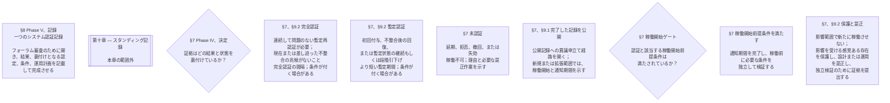
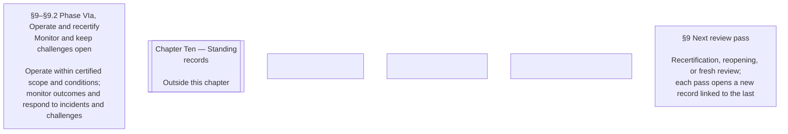
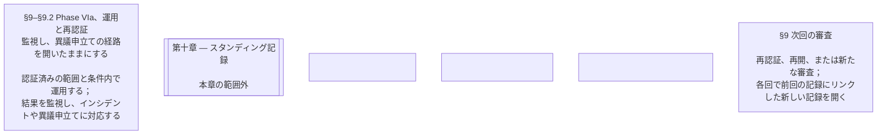

<!-- CHUNK-BEGIN ja__core_09.000_system_alignment_certification_evaluation__section_1_corpus_placement_overview.md bytes=3692 -->
<!-- AI-assisted translation draft; unreviewed. §1 corpus-placement overview, source lines 8–10; source SHA-256 4311e6ba74b7210f077c0bd4c8d21d8c9f517d2ada7b6d87288b39494dfeadd5. Draft only; do not synchronize into translations/. -->

# Chapter Nine Part A — §1 corpus-placement overview (ja)

## English source (lines 8–10)

> This file is **part of the Sentient Constitution** and is **binding only together** with the other numbered `core_*` files read as one text. It contains **Chapter Nine, Part A** — certification purpose, the process overview, and the first two phases of the process — **Frame** (system class) and **Evaluate** (whole-system evaluation in three sub-phases: the always-applicable evaluations, including data types and handling, in **§3**; the evaluations that apply where implicated in **§4**; and the Rights-Floor and domain evaluations that apply where triggered in **§5**) — **§1–§5**. The worked **Class A / B / C illustrations** (the system class profiles, §3.4.8, §5.1.5, §5.2.4, §5.3.7, §5.4.4, §5.5.5, and §5.6.4), including each one's **Reading across system classes** paragraph, are in [`core_09.010_system_alignment_certification_illustrations.md`](core_09.010_system_alignment_certification_illustrations.md); each keeps its Part A section number. The binding system-class-scaling and escalation rules those paragraphs illustrate stay in this file: system class scaling, including participation and proportionality, in §2.2; data-handling scaling in §3.4; and the **System class scaling and escalation** paragraph in each of §5.1–§5.6. The files of the whole chapter are listed in the table below.
>
> **Chapter Nine files.** Chapter Nine is split across four binding files read as one text. Part A, this file, opens the chapter; there is no separate index file.

## Translation draft

> このファイルは**Sentient Constitutionの一部**であり、番号付きの他の `core_*` ファイルと一つの文書として読んだ場合にのみ拘束力を持つ。ここには、**第九章パートA**、すなわち認証の目的、プロセスの概要、および最初の二段階である **Frame**（システムクラス）と **Evaluate**（三つのサブフェーズからなるシステム全体の評価）が含まれる。三つのサブフェーズとは、データの種類と取扱いを含む常時適用の評価（**§3**）、該当する場合に適用する評価（**§4**）、および発動条件を満たした場合の**権利フロア**と領域別評価（**§5**）である（**§§1–5**）。**クラスA／B／C**の詳細な例（システムクラス・プロフィール、§3.4.8、§5.1.5、§5.2.4、§5.3.7、§5.4.4、§5.5.5、§5.6.4）は、それぞれの**システムクラス横断の読み方**の段落も含め、[`core_09.010_system_alignment_certification_illustrations.md`](core_09.010_system_alignment_certification_illustrations.md)に記載されている。各例はパートAの節番号を維持する。これらの段落が示す拘束的なクラス別調整・エスカレーション規則は本ファイルに置かれる。参加と比例性を含むシステムクラス別の調整は§2.2、データ取扱いの調整は§3.4、そして§5.1〜§5.6の各節にある**システムクラス別の調整とエスカレーション**の段落である。次の表に章全体のファイルを示す。
>
> **第九章のファイル。** 第九章は、まとめて読む四つの拘束力あるファイルに分かれている。パートAである本ファイルが章の冒頭に置かれ、独立した索引ファイルはない。

<!-- CHUNK-END -->
<!-- CHUNK-BEGIN ja__core_09.000_system_alignment_certification_evaluation__section_1_corpus_file_table.md bytes=5280 -->
<!-- AI-assisted translation draft; unreviewed. §1 corpus-placement file table, source lines 12–17; source SHA-256 4311e6ba74b7210f077c0bd4c8d21d8c9f517d2ada7b6d87288b39494dfeadd5. Draft only; do not synchronize into translations/. -->

# Chapter Nine Part A — §1 corpus-placement file table (ja)

## English source (lines 12–17)

> | Part | File | Owns |
> |------|------|------|
> | **Part A — Evaluation** | [`core_09.000_system_alignment_certification_evaluation.md`](core_09.000_system_alignment_certification_evaluation.md) | §1–§5: purpose and process overview (with a chart of the whole certification process in its six phases), **Phase I Frame** (system class, how system class scales every evaluation, and pilot certification) and **Phase II Evaluate** (whole-system evaluation in three sub-phases: **IIa** always, in §3, including chartered scope versus functional boundaries and data types and handling; **IIb** where implicated, in §4; and **IIc** where triggered, the Rights-Floor and domain evaluations, in §5) |
> | **Part B — Record and process** | [`core_09.005_system_alignment_certification_record_process.md`](core_09.005_system_alignment_certification_record_process.md) | §6–§10: **Phase III Review** (forum roles, supervisory sequence, and the contestability chain), **Phase IV Decide** (certification outcomes, including the go-live gate), **Phase V Record** (the certification record and its integrity, including governing [System Charter](core_05.040_band_continuity.md#system-charter) fields), and **Phase VI Operate** (the challenge path; recertification and reopening; the standing bridge) — continuous chapter numbering from Part A §5 |
> | **Part C — Illustrations** | [`core_09.010_system_alignment_certification_illustrations.md`](core_09.010_system_alignment_certification_illustrations.md) | the illustrative system class profiles, §3.4, §3.4.8, §5.1.5, §5.2.4, §5.3.7, §5.4.4, §5.5.5, and §5.6.4: worked Class A / B / C walkthroughs for each Part A evaluation area, numbered to match Part A and linked both ways |
> | **Part D — Institutional alignment certification** | [`core_09.015_institutional_alignment_certification.md`](core_09.015_institutional_alignment_certification.md) | §11–§15: the same six phases for an **Institution** rather than a System — the institution class and the institutional evaluation (**Phases I and II**, §12), the forum roles, outcome, and **Institutional Certification Record** (**Phases III to V**, §13), and recertification, reopening, the cascade from System certifications, and the standing bridge (**Phase VI**, §14–§15). It cites each System's certification by link and does not repeat it, and it is not a licence — continuous chapter numbering from Part B §10 |

## Translation draft

| パート | ファイル | 所管内容 |
|------|------|------|
| **Part A — Evaluation** | [`core_09.000_system_alignment_certification_evaluation.md`](core_09.000_system_alignment_certification_evaluation.md) | §§1–5：目的とプロセスの概要（六段階の認証プロセス図を含む）、および第I段階 Frame（システムクラス、各評価の深さを決める仕組み、パイロット認証）と第II段階 Evaluate（全システム評価を三つのサブフェーズで実施：IIaは常時適用し§3で扱う。チャーター上の範囲と機能上の境界、データの種類と取扱いを含む。IIbは該当する場合に§4、IIcは発動条件を満たす場合に§5の権利フロア・領域別評価）。 |
| **Part B — Record and process** | [`core_09.005_system_alignment_certification_record_process.md`](core_09.005_system_alignment_certification_record_process.md) | §§6–10：第III段階 Review（フォーラムの役割、監督手順、異議申立ての連鎖）；第IV段階 Decide（認証結果、稼働開始のゲートを含む）；第V段階 Record（認証記録と完全性、[System Charter](core_05.040_band_continuity.md#system-charter)の統制項目を含む）；第VI段階 Operate（異議申立て、再認証・再開、standingへの橋渡し）—パートA §5から連続した番号。 |
| **Part C — Illustrations** | [`core_09.010_system_alignment_certification_illustrations.md`](core_09.010_system_alignment_certification_illustrations.md) | システムクラスの例示プロフィールおよび§3.4、§3.4.8、§5.1.5、§5.2.4、§5.3.7、§5.4.4、§5.5.5、§5.6.4：パートAの各評価領域についてクラスA/B/Cの実例を示す。節番号を対応させ、相互にリンクする。 |
| **Part D — Institutional alignment certification** | [`core_09.015_institutional_alignment_certification.md`](core_09.015_institutional_alignment_certification.md) | §§11–15：システムではなく機関を対象に同じ六段階を実施する。機関クラス・機関評価（第I・II段階、§12）、フォーラムの役割、結果、機関認証記録（第III～V段階、§13）、再認証、再開、システム認証の連鎖、standingへの橋渡し（第VI段階、§§14–15）。各システムの認証を参照して重複せず、ライセンスでもない — パートB §10から番号が連続する。 |

<!-- CHUNK-END -->
<!-- CHUNK-BEGIN ja__core_09.000_system_alignment_certification_evaluation__section_1_corpus_explanation.md bytes=8466 -->
<!-- AI-assisted translation draft; unreviewed. §1 corpus-placement explanatory prose, source lines 19–30; source SHA-256 4311e6ba74b7210f077c0bd4c8d21d8c9f517d2ada7b6d87288b39494dfeadd5. Draft only; do not synchronize into translations/. -->

# Chapter Nine Part A — §1 corpus-placement explanatory prose (ja)

## English source (lines 19–30)

> **How the two certifications relate.** System Alignment Certification (Parts A to C) is the certification of a System. Institutional alignment certification (Part D) is the certification of an Institution, which may run Systems or none. Part D cites each System's certification record by link and does not redo it; [Part D §11.1](core_09.015_institutional_alignment_certification.md#111-relation-to-system-alignment-certification) states the relation and [Part D §11.3](core_09.015_institutional_alignment_certification.md#113-no-permission-and-no-gate) states that it is not a licence.
>
> Generic **Chapter Nine** links in other files route to the appropriate part by section number.
>
> - **Constitutional owner (joint with Parts B and D):** forum-supervised **system alignment certification and related records** — evaluation domains (Part A); forum process, supervisory sequence, certification-record duties, certification outcomes and the go-live gate, the challenge path, recertification and reopening, and verified-input bridge to Chapter Ten (Part B); the same six phases for an Institution (Part D). Under the **oversight** Tetrad leg, SAC is one especially large, high-stakes audit process among others; auditing floors remain at **Article XVI** (*Audit, Transparency, and Independent Verification*) and Chapter Five [Auditability](core_05.050_band_oversight.md#auditability).
> - **Verification substrate owner:** [Chapter Four — Burden of Proof, Traceability, and Verification](core_04.000_burden_traceability_verification.md#chapter-four-burden-of-proof-traceability-and-verification) (within Chapters Two through Four) owns burden allocation, compliance evidence, definition traceability, observability, and security-constrained verification. Chapter Nine **applies** that discipline to system alignment certification records; it does **not** restate Chapter Four sections **1** through **5**.
> - **Auditing home (not relocated here):** **Article XVI** (*Audit, Transparency, and Independent Verification*), **Def.O1** (*Transparency, Auditability, and Verification*), and **CJS-5.110 §3 and CJS-5.115 §3** (*Audit process home*)–**CJS-5.110 §5** own auditing floors and operational terms. Chapter Nine runs one especially large SAC audit process that must satisfy those floors; it does not own all auditing.
> - **Implementation owner:** system-class handling, CS-6.345, and forum-process detail in designated implementation files must remain consistent with Chapter Nine and may be stricter where the corpus already provides a [Fullest Protective Effect](core_05.045_band_integrative.md#fullest-protective-effect) rule.
> - **Anti-relocation rule:** Part A does not restate Chapter Five canonical definitions, Chapter Three anti-evasion discipline (see [Part B §9.3](core_09.005_system_alignment_certification_record_process.md#93-non-evasion)), Chapter Ten contribution or standing measurement, or Chapter Eleven standing effects. **[Part B §10](core_09.005_system_alignment_certification_record_process.md#10-relationship-to-standing)** states the standing bridge boundary explicitly.
>
> **Upstream:** Chapter Five definitions; Chapters Two through Four record, verification, burden, and traceability of definitions to results; and [Chapter Eight](core_08.000_functional_independence_separation_of_duties.md#chapter-eight-functional-independence-and-separation-of-duties), whose separation-of-duties requirement governs every materially binding certification act.
> **Downstream:** [Part B](core_09.005_system_alignment_certification_record_process.md#chapter-nine-part-b-system-alignment-certification--record-and-process) (*forum process, record, outcomes, and standing bridge*); Chapter Ten standing records and verified inputs; Chapter Eleven standing effects; Chapter Thirteen forum supervision and system alignment certification pathways.

## Translation draft

**二つの認証の関係。** System Alignment Certification（パートA〜C）はシステムの認証である。Institutional alignment certification（パートD）は機関の認証であり、その機関はシステムを運用する場合も、運用しない場合もある。パートDは各システムの認証記録をリンクで参照し、再実施しない。[Part D §11.1](core_09.015_institutional_alignment_certification.md#111-relation-to-system-alignment-certification)が関係を説明し、[Part D §11.3](core_09.015_institutional_alignment_certification.md#113-no-permission-and-no-gate)が認証はライセンスではないと定める。
>
> 他のファイルにある一般的な**Chapter Nine**へのリンクは、節番号に応じて適切なパートへ案内する。
>
> - **憲法上の所管（パートB・Dと共同）：** フォーラムの監督下にあるシステム・アラインメント認証と関連記録 — 評価領域（パートA）；フォーラム手続、監督の順序、認証記録の義務、結果と稼働開始条件、異議申立て経路、再認証・再開、および第十章への検証済み入力の橋渡し（パートB）；機関についての同じ六段階（パートD）。Tetradの**監督**の柱において、SACは他の監査プロセスの中でも特に大規模で重大な監査プロセスの一つである。監査の最低基準は**Article XVI**（*Audit, Transparency, and Independent Verification*）および第5章の[Auditability](core_05.050_band_oversight.md#auditability)に残る。
> - **検証基盤の所管：** [Chapter Four — Burden of Proof, Traceability, and Verification](core_04.000_burden_traceability_verification.md#chapter-four-burden-of-proof-traceability-and-verification)（第2〜4章）が、立証責任の配分、適合証拠、定義の追跡可能性、可観測性、およびセキュリティ制約下の検証を所管する。第9章はこの規律をシステム・アラインメント認証記録に適用し、第4章の**1**〜**5**節を繰り返さない。
> - **監査の本拠（ここには移さない）：** **Article XVI**（*Audit, Transparency, and Independent Verification*）、**Def.O1**（*Transparency, Auditability, and Verification*）、および**CJS-5.110 §3とCJS-5.115 §3**（*Audit process home*）〜**CJS-5.110 §5**が、監査の最低基準と運用用語を所管する。第9章はそれらの基準を満たすべき特に大規模なSAC監査を実施するが、すべての監査を所管するわけではない。
> - **実装の所管：** 指定された実装ファイルにあるシステムクラスの取扱い、CS-6.345、およびフォーラム手続の詳細は第9章と整合しなければならず、コーパスに[Fullest Protective Effect](core_05.045_band_integrative.md#fullest-protective-effect)の規則が既にある場合は、より厳格にできる。
> - **移設禁止規則：** パートAは、第5章の正準定義、第3章の回避防止規律（[Part B §9.3](core_09.005_system_alignment_certification_record_process.md#93-non-evasion)参照）、第10章の貢献またはstandingの測定、第11章のstanding効果を再述しない。**[Part B §10](core_09.005_system_alignment_certification_record_process.md#10-relationship-to-standing)**がstandingブリッジの境界を明示する。
>
> **上流：** 第5章の定義；第2〜4章の記録、検証、立証責任、定義から結果への追跡可能性；および[Chapter Eight](core_08.000_functional_independence_separation_of_duties.md#chapter-eight-functional-independence-and-separation-of-duties)。同章の職務分離要件は、実質的に拘束力のあるすべての認証行為を統制する。
> **下流：** [Part B](core_09.005_system_alignment_certification_record_process.md#chapter-nine-part-b-system-alignment-certification--record-and-process)（*フォーラム手続、記録、結果、standingブリッジ*）；第10章のstanding記録と検証済み入力；第11章のstanding効果；第13章のフォーラム監督とシステム・アラインメント認証経路。

<!-- CHUNK-END -->
<!-- CHUNK-BEGIN ja__core_09.000_system_alignment_certification_evaluation__section_1_heading.md bytes=364 -->
<!-- AI-assisted translation draft; unreviewed. §1 heading, source line 44; source SHA-256 4311e6ba74b7210f077c0bd4c8d21d8c9f517d2ada7b6d87288b39494dfeadd5. Draft only; do not synchronize into translations/. -->

# Chapter Nine Part A — §1 heading (ja)

## English source (lines 44–45)

### 1. Purpose and Role


## Translation draft

### 1. 目的と役割

<!-- CHUNK-END -->
<!-- CHUNK-BEGIN ja__core_09.000_system_alignment_certification_evaluation__section_1_trace.md bytes=12069 -->
<!-- AI-assisted translation draft; unreviewed. §1 trace, source lines 46–95; source SHA-256 4311e6ba74b7210f077c0bd4c8d21d8c9f517d2ada7b6d87288b39494dfeadd5. Draft only; do not synchronize into translations/. -->

# Chapter Nine Part A — §1 trace (ja)

## English source (lines 46–95)

<details>
<summary><strong><span style="color: #2563eb;">Trace</span></strong></summary>

- Upstream:
  - [Preamble — constitutional owner register](core_00.000_preamble.md#4-principles-definitions-and-rights) and
  - [Authority Stack and Internal Hierarchy](core_05.045_band_integrative.md#authority-stack-and-internal-hierarchy);
  - [Constitutional Tetrad](core_00.000_preamble.md#constitutional-tetrad);
  - [Two Constitutional Aims](core_00.000_preamble.md#two-constitutional-aims);
  - [material stake](core_00.000_preamble.md#material-stake);
  - [Proportionality](core_05.035_band_accountability.md#proportionality) and
  - [Substantive Fairness](core_05.055_band_participation.md#substantive-fairness) (Chapter Five); Participation measurement family (*voice, access, and contest paths*);
  - [Chapter One §16 Stewardship In Depth](core_01.010_stewardship_capacity_principles.md#16-stewardship-in-depth) (1.010 §16);
  - [Chapter One §12 Systemic Evaluation Requirement](core_01.000_values_principles.md#12-systemic-evaluation-requirement) (1.000 §12) (*principle-layer whole-system evaluation lens — not one corner alone*); Chapters Two through Four;
  - [Chapter Five](core_05.000_definitions_home.md#chapter-five-foundational-definitions) (5.000) (*canonical definitions*);
  - [Chapter Eight §2 Four-Seat Constitutional Requirement](core_08.000_functional_independence_separation_of_duties.md#2-four-seat-constitutional-requirement) (8.000 §2);
  - [System Alignment Certification](core_05.040_band_continuity.md#system-alignment-certification) (Chapter Five canonical term; non-operative shorthand **SAC**);
  - [System Certification Record](core_05.040_band_continuity.md#system-certification-record) (Chapter Five meaning).
- Downstream:
  - [§2](#2-system-class-evaluation) (*system class evaluation*);
  - [Part B §9.1](core_09.005_system_alignment_certification_record_process.md#91-challenging-a-certification) (9.005 §9.1) (*challenging a certification*); and
  - [Part C system class profiles](core_09.010_system_alignment_certification_illustrations.md#illustrative-system-class-profiles-non-exhaustive) (9.010) (*illustrative system class profiles*);
  - [Part C whole-system walkthroughs](core_09.010_system_alignment_certification_illustrations.md#illustrative-whole-system-application-by-system-class-non-exhaustive) (9.010) (*worked whole-system examples by system class*);
  - [§3.4.8](core_09.010_system_alignment_certification_illustrations.md#348-illustrative-data-handling-application-by-system-class-non-exhaustive) (*worked data-handling examples by system class*);
  - [§5.1.5](core_09.010_system_alignment_certification_illustrations.md#515-illustrative-ecological-footprint-application-by-system-class-non-exhaustive) (*worked ecological-footprint examples by system class*);
  - [§5.2.4](core_09.010_system_alignment_certification_illustrations.md#524-illustrative-educational-capability-application-by-system-class-non-exhaustive) (*worked educational-capability examples by system class*);
  - [§5.3.7](core_09.010_system_alignment_certification_illustrations.md#537-illustrative-cross-system-support-application-by-system-class-non-exhaustive) (*worked cross-system-support examples by system class*);
  - [§5.4.4](core_09.010_system_alignment_certification_illustrations.md#544-illustrative-nondiscrimination-application-by-system-class-non-exhaustive) (*worked nondiscrimination examples by system class*);
  - [§5.5.5](core_09.010_system_alignment_certification_illustrations.md#555-illustrative-accessibility-application-by-system-class-non-exhaustive) (*worked accessibility examples by system class*);
  - [§5.6.4](core_09.010_system_alignment_certification_illustrations.md#564-illustrative-trustworthiness-application-by-system-class-non-exhaustive) (*worked trustworthiness examples by system class*);
  - [§3](#3-whole-system-certification-evaluation) (*whole-system certification evaluation factors*);
  - [§3.4](#34-data-types-and-handling-evaluation) through
  - [§5.6](#56-trustworthiness-and-system-reliance-integrity-evaluation) (*domain evaluations*);
  - [Part B §6](core_09.005_system_alignment_certification_record_process.md#6-forum-process) (9.005 §6) (*supervisory sequence and contestability chain*);
  - [Part B §6.1](core_09.005_system_alignment_certification_record_process.md#61-forum-supervision-and-component-roles) (9.005 §6.1) (*forum component roles*);
  - [Part B §8](core_09.005_system_alignment_certification_record_process.md#8-system-certification-record) (9.005 §8) (*certification record contents*);
  - [Part B §8.2](core_09.005_system_alignment_certification_record_process.md#82-record-integrity-transparency-and-auditability) (9.005 §8.2) (*record integrity requirements*);
  - [Part B §7](core_09.005_system_alignment_certification_record_process.md#7-certification-outcomes) (9.005 §7) (*reopening and anti-evasion*);
  - [Part B §10](core_09.005_system_alignment_certification_record_process.md#10-relationship-to-standing) (9.005 §10) (*standing-record bridge*);
  - [Chapter Ten](core_11.000_standing_assessment.md#chapter-eleven-contribution-violation-and-standing-model--measurement) (10.000) (*standing records and verified-input gate*);
  - [Chapter Eleven](core_12.000_standing_integration.md#chapter-twelve-standing-effects-and-integration) (11.000) (*standing effects and integration*);
  - [Chapter Thirteen](core_14.000_forum.md#chapter-fourteen-forums-and-jurisdiction) (13.000) (*forum supervision, certification, alignment certification, and review*).
- Read with:
  - **[CS-9.305](corpus_systems/cs_09.305_system_classification_machinery.md#cs-9305-part-a-system-classification-machinery) (*System classification machinery*) and [CS-9.310 — System impact classifications](corpus_systems/cs_09.310_system_impact_classifications.md#cs-9310-part-b-system-impact-classifications)**, **[CS-6.305](corpus_systems/cs_06.305_information_types_and_handling.md#cs-6305-part-a-information-types-and-handling) (*Information types and handling*) and [CS-6.310 — Data classifications](corpus_systems/cs_06.310_data_classifications.md#cs-6310-part-b-data-classifications)**, and
  - **CS-6.345** (*System lifecycle*);
  - **CF-13.415** (*Routing operations, transfer, certification, and representative treatment*) and
  - **CF-13.425** (*Integrity safeguards, anti-capture operations, and anti-self-judging support*); **Article XVI** (*Audit, Transparency, and Independent Verification*) and
  - [Auditability](core_05.050_band_oversight.md#auditability) (*auditing floors — SAC is one especially large audit process under oversight, not the sole auditing home*); **CJS-5.110 §3 (*Oversight: auditability and reconstructability terms (annex)*) and CJS-5.115 §3** (*Audit process home*)–
  - **CJS-5.110 §5** (*Oversight: independent verification and claim-integrity terms*).

</details>

## Translation draft

#### 参照関係

このマップは本節の憲法上・権限上の根拠を示し、評価、分類、審査経路、記録、結果、監査へと結びつけ、併読する運用文書も示す。

**参照関係 — upstream canonical sources:** [Preamble — constitutional owner register](core_00.000_preamble.md#4-principles-definitions-and-rights); [Authority Stack and Internal Hierarchy](core_05.045_band_integrative.md#authority-stack-and-internal-hierarchy); [Constitutional Tetrad](core_00.000_preamble.md#constitutional-tetrad); [Two Constitutional Aims](core_00.000_preamble.md#two-constitutional-aims); [material stake](core_00.000_preamble.md#material-stake); [Proportionality](core_05.035_band_accountability.md#proportionality); [Substantive Fairness](core_05.055_band_participation.md#substantive-fairness); [Chapter One §16 Stewardship In Depth](core_01.010_stewardship_capacity_principles.md#16-stewardship-in-depth); [Chapter One §12 Systemic Evaluation Requirement](core_01.000_values_principles.md#12-systemic-evaluation-requirement); [Chapter Five](core_05.000_definitions_home.md#chapter-five-foundational-definitions); [Chapter Eight §2 Four-Seat Constitutional Requirement](core_08.000_functional_independence_separation_of_duties.md#2-four-seat-constitutional-requirement); [System Alignment Certification](core_05.040_band_continuity.md#system-alignment-certification); [System Certification Record](core_05.040_band_continuity.md#system-certification-record)

**参照関係 — downstream routes and related records:** [§2](#2-system-class-evaluation); [Part B §9.1](core_09.005_system_alignment_certification_record_process.md#91-challenging-a-certification); [Part C system class profiles](core_09.010_system_alignment_certification_illustrations.md#illustrative-system-class-profiles-non-exhaustive); [Part C whole-system walkthroughs](core_09.010_system_alignment_certification_illustrations.md#illustrative-whole-system-application-by-system-class-non-exhaustive); [§3.4.8](core_09.010_system_alignment_certification_illustrations.md#348-illustrative-data-handling-application-by-system-class-non-exhaustive); [§5.1.5](core_09.010_system_alignment_certification_illustrations.md#515-illustrative-ecological-footprint-application-by-system-class-non-exhaustive); [§5.2.4](core_09.010_system_alignment_certification_illustrations.md#524-illustrative-educational-capability-application-by-system-class-non-exhaustive); [§5.3.7](core_09.010_system_alignment_certification_illustrations.md#537-illustrative-cross-system-support-application-by-system-class-non-exhaustive); [§5.4.4](core_09.010_system_alignment_certification_illustrations.md#544-illustrative-nondiscrimination-application-by-system-class-non-exhaustive); [§5.5.5](core_09.010_system_alignment_certification_illustrations.md#555-illustrative-accessibility-application-by-system-class-non-exhaustive); [§5.6.4](core_09.010_system_alignment_certification_illustrations.md#564-illustrative-trustworthiness-application-by-system-class-non-exhaustive); [§3](#3-whole-system-certification-evaluation); [§3.4](#34-data-types-and-handling-evaluation); [§5.6](#56-trustworthiness-and-system-reliance-integrity-evaluation); [Part B §6](core_09.005_system_alignment_certification_record_process.md#6-forum-process); [Part B §6.1](core_09.005_system_alignment_certification_record_process.md#61-forum-supervision-and-component-roles); [Part B §8](core_09.005_system_alignment_certification_record_process.md#8-system-certification-record); [Part B §8.2](core_09.005_system_alignment_certification_record_process.md#82-record-integrity-transparency-and-auditability); [Part B §7](core_09.005_system_alignment_certification_record_process.md#7-certification-outcomes); [Part B §10](core_09.005_system_alignment_certification_record_process.md#10-relationship-to-standing); [Chapter Ten](core_11.000_standing_assessment.md#chapter-eleven-contribution-violation-and-standing-model--measurement); [Chapter Eleven](core_12.000_standing_integration.md#chapter-twelve-standing-effects-and-integration); [Chapter Thirteen](core_14.000_forum.md#chapter-fourteen-forums-and-jurisdiction)

**参照関係 — operational materials to read with this section:** [CS-9.305](corpus_systems/cs_09.305_system_classification_machinery.md#cs-9305-part-a-system-classification-machinery); [CS-9.310 — System impact classifications](corpus_systems/cs_09.310_system_impact_classifications.md#cs-9310-part-b-system-impact-classifications); [CS-6.305](corpus_systems/cs_06.305_information_types_and_handling.md#cs-6305-part-a-information-types-and-handling); [CS-6.310 — Data classifications](corpus_systems/cs_06.310_data_classifications.md#cs-6310-part-b-data-classifications); [Auditability](core_05.050_band_oversight.md#auditability)

<!-- CHUNK-END -->
<!-- CHUNK-BEGIN ja__core_09.000_system_alignment_certification_evaluation__purpose_adjuncts.md bytes=5813 -->
<!-- AI-assisted translation draft; unreviewed. Selected §1 passages, source lines 99 and 107–114; source SHA-256 4311e6ba74b7210f077c0bd4c8d21d8c9f517d2ada7b6d87288b39494dfeadd5. -->

# Chapter Nine Part A — §1 plain-terms excerpt

**Status:** AI-assisted draft; unreviewed. English source remains controlling.

## English source

When a system really matters to sentients' lives, certification has to be **proportionate** — as demanding as the system's real impact, dependency, and risk require, not a one-size-fits-all checklist or a rubber stamp. It also has to be **participatory** — affected sentients and communities must be able to see what was reviewed, understand what was decided, and challenge it when something is wrong. Forums review evidence, write it down in a certification record, and require re-checks on a schedule that matches how risky the system is. Classes A, B, and C get the full process and Class L a lighter one. Class P is encouraged to use it, and must once it is reclassified to Class L or higher (that is, its effects reach beyond a private unit) or its operator claims constitutional compliance.

## ja draft

システムが感覚ある存在の生活に実質的な影響を及ぼす場合、その認証は**比例的**でなければなりません。画一的なチェックリストや形式的な承認ではなく、実際の影響、依存度、リスクに応じた厳格さが必要です。また、**参加型**である必要があります。影響を受ける存在やコミュニティは、何が審査されたかを確認し、決定内容を理解し、誤りがあれば異議を申し立てられなければなりません。フォーラムは証拠を審査して認証記録に残し、システムのリスクに見合う日程で再審査を求めます。クラスA・B・Cには完全な手続を適用し、クラスLには簡略な手続を適用します。クラスPには利用を推奨しますが、クラスL以上に再分類された場合（影響が私的単位を超える場合）または運営者が憲法適合を主張する場合には、利用が必須です。


### English source — Flourishing

- **[Flourishing](core_00.000_preamble.md#flourishing)** — certification verifies that certification or continued reliance would not quietly defeat Rights Floors or block fair participation in constitutionally relevant life;

### ja draft

- **[繁栄](core_00.000_preamble.md#flourishing)** — 認証は、認証の付与や依存の継続によって権利の最低基準がひそかに損なわれたり、憲法上重要な生活への公平な参加が妨げられたりしないことを確認します。


### English source — Continuity criterion

- **[Continuity](core_00.000_preamble.md#continuity)** — certification verifies durable, non-regressive supply that sustains rather than depletes healthy natural systems ([Ecological Integrity](core_05.040_band_continuity.md#ecological-integrity), including [Ecological Recovery Capacity](core_05.040_band_continuity.md#ecological-recovery-capacity)), and system-class-scaled recertification where shared systems gate or sustain delivery;

### ja draft

- **[継続性](core_00.000_preamble.md#continuity)** — 健全な自然システムを損なわず支える、持続的で後退のない供給を確認し（[生態学的完全性](core_05.040_band_continuity.md#ecological-integrity)、[生態学的回復能力](core_05.040_band_continuity.md#ecological-recovery-capacity)を含む）、共有システムが供給を左右または維持する場合にはシステム分類に応じた再認証を行います；


### English source — Participation criterion

- **Participation** — affected sentients and communities can understand, contest, and take part in review paths that matter to them;

### ja draft

- **参加** — 影響を受ける存在やコミュニティは、自らに関係する審査経路を理解し、異議を申し立て、参加できます。


### English source — Oversight criterion

- **Oversight** — records, evidence, and assumptions are visible and auditable enough for independent checking; certification itself is one especially large audit process under that oversight duty, not the only one;

### ja draft

- **監督** — 記録、証拠、前提は独立した確認に十分なほど可視化され、監査可能です。認証自体もこの監督義務に基づく特に大規模な監査プロセスですが、監査の唯一の場ではありません。


### English source — Accountability criterion

- **Accountability** — defects, misclassification, and floor-defeating operation route to remedy, conditions, withdrawal, or standing input where the facts support it;

### ja draft

- **説明責任** — 欠陥、誤分類、権利の最低基準を損なう運用は、事実が裏付ける場合、救済、条件付与、撤回、または地位評価への入力につながります。


### English source — Timeliness criterion

- **Timeliness** — review and contest windows keep certification from going stale while harm can still be prevented or reversed.

### ja draft

- **適時性** — 損害をまだ防止または回復できる間に認証が古びないよう、審査と異議申立ての期間を設けます。


### English source — Tetrad introduction

Certification implements the [Two Constitutional Aims](core_00.000_preamble.md#two-constitutional-aims) through the [Constitutional Tetrad](core_00.000_preamble.md#constitutional-tetrad):

### ja draft

認証は、[二つの憲法上の目的](core_00.000_preamble.md#two-constitutional-aims)を[憲法上の四原則](core_00.000_preamble.md#constitutional-tetrad)を通じて実現します。

<!-- CHUNK-END -->
<!-- CHUNK-BEGIN ja__core_09.000_system_alignment_certification_evaluation__section_1_purpose.md bytes=1232 -->
<!-- AI-assisted translation draft; unreviewed. Complete purpose statement excerpt, source lines 101–105; source SHA-256 4311e6ba74b7210f077c0bd4c8d21d8c9f517d2ada7b6d87288b39494dfeadd5. This is an excerpt, not a complete §1 translation. -->

**システム整合性認証**は、定められた範囲と審査日程について、次の一つの問いに答えるためにある。そのシステムは、認証、条件付き認証、検証、再認証、依存の継続、展開、または条件の重大な解除を正当化するだけの憲法上の整合性を示したか。

- 認証は人気投票の点数でも、永久通行証でも、権利審査を省く手段でもない。
- それは、現時点でシステムの整合性について分かっていることを示す、期間限定で異議申立て可能な声明である。
- 四元の**監督**の柱の下では、監督には監査が必要である。システム整合性認証は、他にもある監査プロセスの中でも特に大規模で利害の大きい一つであり、監査を担う唯一の場ではない（**第XVI条**（*監査、透明性、独立検証*）、[監査可能性](core_05.050_band_oversight.md#auditability)）。

<!-- CHUNK-END -->
<!-- CHUNK-BEGIN ja__core_09.000_system_alignment_certification_evaluation__section_1_subsection_headings.md bytes=776 -->
<!-- AI-assisted translation draft; unreviewed. §1.1/§1.2 visible subsection headings, source lines 116–119 and 144–148; source SHA-256 4311e6ba74b7210f077c0bd4c8d21d8c9f517d2ada7b6d87288b39494dfeadd5. Draft only; anchors/blank layout are structural. Do not synchronize into translations/. -->

# Chapter Nine Part A — §1.1 and §1.2 subsection headings (ja)

## English source

### Lines 116–119

<a id="11-certification-as-an-audit-process-scaled-by-class"></a>

#### 1.1 Certification as an audit process, scaled by class


### Lines 144–148


<a id="12-certification-at-a-glance"></a>

#### 1.2 Certification at a glance


## Translation draft

#### 1.1 クラスに応じて規模を調整する監査プロセスとしての認証

#### 1.2 認証の概要

<!-- CHUNK-END -->
<!-- CHUNK-BEGIN ja__core_09.000_system_alignment_certification_evaluation__section_1_audit_scope.md bytes=3348 -->
<!-- AI-assisted translation draft; unreviewed. §1.1 audit mechanism and sibling audit modes, source lines 120–130; source SHA-256 4311e6ba74b7210f077c0bd4c8d21d8c9f517d2ada7b6d87288b39494dfeadd5. -->

# Chapter Nine Part A — §1.1 certification audit process excerpt (ja)

## English source

As an oversight mechanism, certification is one especially large audit process under [Auditability](core_05.050_band_oversight.md#auditability) and **Article XVI** (*Audit, Transparency, and Independent Verification*):

- It is forum-supervised, multi-domain, and status-granting.
- It may integrate the results of sibling audit modes, and it does not absorb or replace them. Each keeps its own owner, named in the [sibling audit modes map](corpus_joint_structure/cjs_05.115_audit_process.md#sibling-audit-modes-owner-map) of the audit process home:
  - System Data Types Record audits under **CS-6.305 (*Information types and handling*) and CS-6.310** (*Data classifications*)
  - System Classification Record audits under **CS-9.305 (*System classification machinery*) and CS-9.310** (*System impact classifications*)
  - steward assurance reviews under **CS-14.305** (*Critical system stewardship*)
  - continuous audit under **CS-6.345** (*System lifecycle*) ACA
  - complexity audits under **CS-6.315** (*Comprehensibility and complexity stewardship*) and **Article XXIII-B** (*Complexity Audit and Modularity Requirements*)
  - claim verification under **CJS-5.110 §5** (*Oversight: independent verification and claim-integrity terms*)
- You can still run any of these checks on their own, without going through certification. Certification doesn't replace them.

## ja draft

監督機構として、認証は[監査可能性](core_05.050_band_oversight.md#auditability)および**Article XVI**（*監査、透明性、独立検証*）の下で行われる、特に大規模な監査プロセスの一つである。

- フォーラムの監督下で、複数領域にわたり、地位を付与する。
- 関連する他の監査方式の結果を統合できるが、それらを吸収または置き換えるものではない。各方式は独自の責任主体を維持し、その主体は監査プロセスの基幹文書にある[関連監査方式の対応表](corpus_joint_structure/cjs_05.115_audit_process.md#sibling-audit-modes-owner-map)に記載されている。
  - System Data Types Record の監査：**CS-6.305（*情報の種類と取扱い*）および CS-6.310**（*データ分類*）に基づく
  - System Classification Record の監査：**CS-9.305（*システム分類機構*）および CS-9.310**（*システム影響分類*）に基づく
  - スチュワード保証審査：**CS-14.305**（*重要システムのスチュワードシップ*）に基づく
  - 継続的監査：**CS-6.345**（*システムライフサイクル*）ACA に基づく
  - 複雑性監査：**CS-6.315**（*理解可能性と複雑性のスチュワードシップ*）および**Article XXIII-B**（*複雑性監査およびモジュール性要件*）に基づく
  - 主張の検証：**CJS-5.110 §5**（*監督：独立検証と主張の完全性に関する条件*）に基づく
- これらの検査は認証を経ずに個別に実施することもできる。認証がそれらに取って代わることはない。

<!-- CHUNK-END -->
<!-- CHUNK-BEGIN ja__core_09.000_system_alignment_certification_evaluation__section_1_class_scaling.md bytes=3880 -->
<!-- AI-assisted translation draft; unreviewed. Chapter Nine Part A §1 class scaling and cadence, source lines 132–143; source SHA-256 4311e6ba74b7210f077c0bd4c8d21d8c9f517d2ada7b6d87288b39494dfeadd5. Draft only; do not synchronize into translations/. -->

**Current English passage:**

Certification depth, record burden, certification interval, stakeholder review, and contest paths must scale with [material stake](core_00.000_preamble.md#material-stake) under [Proportionality](core_05.035_band_accountability.md#proportionality):

The process applies by impact class, as the [reclassification requirement](corpus_systems/cs_09.305_system_classification_machinery.md#35-reclassification-requirement) of **CS-9.305** (*System classification machinery*) sets out:

- **Class A, Class B, and Class C:** these systems carry the highest impact, dependency, and risk, and whole-system evaluation under [§3 Whole-System Certification Evaluation](#3-whole-system-certification-evaluation), [§4 Evaluations Where Implicated](#4-evaluations-where-implicated), and [§5 Rights-Floor and Domain Evaluations](#5-rights-floor-and-domain-evaluations), each as its own sub-phase applies, is mandatory at full depth;
- **Class L:** the same evaluation is mandatory but proportionate, with a lower default re-check cadence and simpler records where CS-9.305 (*System classification machinery*) and CS-9.310 (*System impact classifications*) permits; and
- **Class P:** the process is encouraged while the system is validly Class P, and a Class P system may use it voluntarily. It becomes mandatory on reclassification to Class L or higher, or where the operator voluntarily asserts constitutional compliance for the system.

The certification interval, and the financial, resource, or special audit that falls at its midpoint, are set by class in [Chapter Thirteen §6 Timely resolution, materiality tiers, and anti-delay discipline](core_14.000_forum.md#review-cadence) (*Review cadence*). This chapter does not restate the numbers.

**Proposed locale translation:**

認証の深さ、記録の負担、認証間隔、利害関係者の審査、異議申立ての経路は、[物質的利害](core_00.000_preamble.md#material-stake)に応じて[比例性](core_05.035_band_accountability.md#proportionality)の下で調整します。

このプロセスは、**CS-9.305**（*システム分類の仕組み*）の[再分類要件](corpus_systems/cs_09.305_system_classification_machinery.md#35-reclassification-requirement)が定める影響クラスに従って適用されます。

- **クラスA、B、C：** 影響、依存、リスクが最も高いシステムです。[§3 全体システム認証評価](#3-whole-system-certification-evaluation)、[§4 該当する場合の評価](#4-evaluations-where-implicated)、[§5 権利フロアおよび分野別評価](#5-rights-floor-and-domain-evaluations)のうち適用される各サブフェーズで、全体システム評価を完全な深度で行うことが必須です。
- **クラスL：** 同じ評価を必須としますが、比例的に行い、**CS-9.305**（*システム分類の仕組み*）および**CS-9.310**（*システム影響分類*）が認める場合は、既定の再確認頻度を低くし、記録を簡素化できます。
- **クラスP：** 有効にPクラスである間はこのプロセスが推奨され、任意で利用できます。L以上に再分類された場合、または運用者がシステムの憲法適合性を自発的に主張した場合は必須になります。

認証間隔と、その中間時点に行われる財務・資源・特別監査は、クラス別に[第十三章 §6 適時の解決、重要性の段階、遅延防止規律](core_14.000_forum.md#review-cadence)（*審査頻度*）で定めます。本章では数値を繰り返しません。

<!-- CHUNK-END -->
<!-- CHUNK-BEGIN ja__core_09.000_system_alignment_certification_evaluation__section_1_at_a_glance.md bytes=1833 -->
<!-- AI-assisted translation draft; unreviewed. Chapter Nine Part A §1.2 plain-language summary, source line 149; source SHA-256 4311e6ba74b7210f077c0bd4c8d21d8c9f517d2ada7b6d87288b39494dfeadd5. Draft only; do not synchronize into translations/. -->

# Chapter Nine Part A — §1.2 at-a-glance summary (ja)

## English source

*In plain terms: classify the system honestly, run the evaluations that apply, have forums independently review the evidence and stakeholder concerns, and decide an outcome. Complete the one record opened for forum review and publish it with an open challenge path. A certified system goes live only after its notice interval and required protections are satisfied. Monitor actual outcomes, respond to incidents and challenges, and check again on schedule or when the facts change. Correct defects and have the correction independently verified before authorizing the affected scope or releasing its conditions. Each review pass uses a new record linked to the last.*

## ja draft

*簡単に言えば、システムを誠実に分類し、該当する評価を実施し、フォーラムが証拠と利害関係者の懸念を独立して審査したうえで結果を決定します。フォーラム審査のために開かれた一つの記録を完成させ、異議申立ての経路を開いたまま公表します。認証済みシステムは、通知期間が満了し必要な保護措置が満たされた後にのみ稼働できます。実際の結果を監視し、インシデントや異議申立てに対応し、予定に従って、または事実が変わったときに再確認します。欠陥を是正し、影響範囲の承認や条件解除の前に是正を独立して検証します。各審査では、前回の記録にリンクした新しい記録を使います。*

<!-- CHUNK-END -->
<!-- CHUNK-BEGIN ja__core_09.000_system_alignment_certification_evaluation__section_1_phase_map.md bytes=602 -->
<!-- AI-assisted translation draft; unreviewed. Chapter Nine Part A §1.2 phase map, source line 151; source SHA-256 4311e6ba74b7210f077c0bd4c8d21d8c9f517d2ada7b6d87288b39494dfeadd5. Draft only; do not synchronize into translations/. -->

**Current English passage:**

The process runs in **six phases**: **I Frame**, **II Evaluate**, **III Review**, **IV Decide**, **V Record**, and **VI Operate**.

**Proposed locale translation:**

このプロセスは**6つの段階**で進みます。**I 枠組み設定**、**II 評価**、**III 審査**、**IV 決定**、**V 記録**、**VI 運用**です。

<!-- CHUNK-END -->
<!-- CHUNK-BEGIN ja__core_09.000_system_alignment_certification_evaluation__section_1_reopen_triggers.md bytes=1681 -->
<!-- AI-assisted translation draft; unreviewed. Chapter Nine Part A §1 review-reopening passage, source line 153; source SHA-256 4311e6ba74b7210f077c0bd4c8d21d8c9f517d2ada7b6d87288b39494dfeadd5. Draft only; do not synchronize into translations/. -->

**Current English passage:**

Every evaluation that applies is carried out again on each certification pass: at first certification, at each recertification on the schedule set by [§2 System Class Evaluation](#2-system-class-evaluation), and at each reopened or fresh review. Review reopens before the next scheduled recertification when material facts change, such as growing reliance on the system, growing extraction from shared foundations, a significant fall in what the system puts back into them, or a credible challenge. [Part B §9 Recertification and Reopening](core_09.005_system_alignment_certification_record_process.md#9-recertification-and-reopening) lists the triggers.

**Proposed locale translation:**

該当する評価は、認証の各回で必ず再実施します。初回認証時、[§2 システムクラス評価](#2-system-class-evaluation)が定める日程に基づく各再認証時、そして再開または新規の審査時です。システムへの依存の増大、共有基盤からの収奪の増加、システムが共有基盤に返すものの著しい減少、信頼できる異議申立てなど、重要な事実が変わった場合は、次回の定期再認証より前に審査を再開します。再開の契機は[パートB §9 再認証と再開](core_09.005_system_alignment_certification_record_process.md#9-recertification-and-reopening)に列挙されています。

<!-- CHUNK-END -->
<!-- CHUNK-BEGIN ja__core_09.000_system_alignment_certification_evaluation__section_1_phase_map_opening_nodes.md bytes=1941 -->
<!-- AI-assisted translation draft; unreviewed. §1.2 Phase I/II opening chart-node labels, source lines 155–165; source SHA-256 4311e6ba74b7210f077c0bd4c8d21d8c9f517d2ada7b6d87288b39494dfeadd5. Draft only; non-prose Mermaid syntax/connectors are retained. Do not synchronize into translations/. -->

# Chapter Nine Part A — §1.2 opening phase-map nodes (ja)

## English source (lines 155–165)

```mermaid
flowchart TB
    T(["System with material impact seeks certification,<br/>or reliance on it grows"])
    C["§2 Phase I, Frame<br/>Classify honestly<br/><br/>Class sets depth and re-check schedule"]
    subgraph W["§3–§5 Phase II, Evaluate — Whole-system evaluation"]
        direction LR
        Al["§3.1–§3.4 IIa — Always<br/><br/>Governance; systemic risk: evaluated,<br/>and disclosed to those who need it;<br/>time horizon; data types"]
        Im["§4 IIb — When implicated<br/><br/>Privacy loci, exit rights,<br/>assembly and dissent"]
        Tr["§5 IIc — When triggered<br/><br/>Applicable Rights-Floor checks<br/>and six domain evaluations"]
        Al ~~~ Im ~~~ Tr
    end

## Translation draft

```mermaid
flowchart TB
    T["重大な影響のあるシステムが認証を求める、<br/>または依存度が高まる"]
    C["§2 フェーズI、枠組み設定<br/>誠実に分類する<br/><br/>クラスが審査の深さと再確認日程を定める"]
    subgraph W["§3–§5 フェーズII、評価 — システム全体の評価"]
        direction LR
        Al["§3.1–§3.4 IIa — 常時<br/><br/>ガバナンス、システムリスクを評価し<br/>必要な人に開示；時間軸；データ種類"]
        Im["§4 IIb — 関係する場合<br/><br/>プライバシー領域、離脱権、<br/>集会と異議"]
        Tr["§5 IIc — トリガー時<br/><br/>該当する権利基盤の確認<br/>および六つの領域評価"]
        Al ~~~ Im ~~~ Tr
    end
```

<!-- CHUNK-END -->
<!-- CHUNK-BEGIN ja__core_09.000_system_alignment_certification_evaluation__chart_review_node.md bytes=578 -->
# Chapter Nine Part A — chart review node (ja)

AI-assisted draft; unreviewed. Current source SHA-256: `4311e6ba74b7210f077c0bd4c8d21d8c9f517d2ada7b6d87288b39494dfeadd5`. Reconciles current source line 166: “Assigned forums issue findings; challenge paths stay open.” The translated node ID, chart structure, HTML line breaks, and code syntax are preserved.

```mermaid
    F["段階 III、審査 — §6<br/>証拠と利害関係者の懸念を独立審査<br/><br/>指定されたフォーラムが所見を出す；<br/>異議申立て経路は開かれたまま"]
```

<!-- CHUNK-END -->
<!-- CHUNK-BEGIN ja__core_09.000_system_alignment_certification_evaluation__section_1_decision_nodes.md bytes=3607 -->
<!-- AI-assisted translation draft; unreviewed. Chapter Nine Part A §1.2 decision and outcome diagram nodes, source lines 167–176; source SHA-256 4311e6ba74b7210f077c0bd4c8d21d8c9f517d2ada7b6d87288b39494dfeadd5. Draft only; do not synchronize into translations/. -->

# Chapter Nine Part A — §1.2 decision and outcome nodes (ja)

## English source (lines 167–176)

```mermaid
flowchart TB
    Rec["§8 Phase V, Record<br/>One System Certification Record<br/><br/>Opened for forum review; completed with the outcome,<br/>supporting findings, conditions, and operating plan"]
    S[["Chapter Ten — Standing<br/>records<br/><br/>Outside this chapter"]]
    O{"§7 Phase IV, Decide<br/><br/>What outcome and status<br/>does the evidence support?"}
    Fc["§7, §9.2 Full Certification<br/><br/>Required consecutive clean provisional recertifications;<br/>no current or indicated impending misalignment<br/>Full certification interval; conditions may apply"]
    Pc["§7, §9.2 Provisional Certification<br/><br/>First grant, recovery after misalignment,<br/>or continued or stepped-down provisional status<br/>Provisional interval, shorter; conditions may apply"]
    Nc["§7 Not Certified<br/><br/>Deferred, refused, withdrawn, or expired<br/>No go-live; state reasons and required corrective work"]
    Pub["§7, §9.1 Publish the completed record<br/><br/>Open the published record challenge path;<br/>for new or expanded scope, state go-live and notice"]
    G{"§7 Go-live gate<br/><br/>Certification and applicable<br/>go-live prerequisites satisfied?"}
    Hold["§7 Meet go-live prerequisites<br/><br/>Complete notice and independently verify<br/>conditions required before go-live"]
    Rm["§7, §9.2 Protect and correct<br/><br/>No new go-live in the affected scope;<br/>protect affected sentients, correct design or operation,<br/>and submit evidence for independent verification"]
```



## ja draft



<!-- CHUNK-END -->
<!-- CHUNK-BEGIN ja__core_09.000_system_alignment_certification_evaluation__section_1_review_cycle_nodes.md bytes=2805 -->
<!-- AI-assisted translation draft; unreviewed. Chapter Nine Part A §1.2 operation and next-review diagram nodes, source lines 177–182; source SHA-256 4311e6ba74b7210f077c0bd4c8d21d8c9f517d2ada7b6d87288b39494dfeadd5. Draft only; do not synchronize into translations/. -->

# Chapter Nine Part A — §1.2 operation and review-cycle nodes (ja)

## English source (lines 177–182)



## ja draft



<!-- CHUNK-END -->
<!-- CHUNK-BEGIN ja__core_09.000_system_alignment_certification_evaluation__section_1_phase_map_edge_labels.md bytes=1861 -->
<!-- AI-assisted translation draft; unreviewed. §1.2 certification-phase chart edge labels, source lines 194, 199, 200–206; source SHA-256 4311e6ba74b7210f077c0bd4c8d21d8c9f517d2ada7b6d87288b39494dfeadd5. Mermaid node IDs, edge syntax, and <br/> delimiters are structural and preserved; visible edge labels are translated. Draft only; do not synchronize into translations/. -->

# Chapter Nine Part A — phase-chart edge labels (ja)

## English source

```mermaid
    Rec -.->|VIb, §10 —<br/>verified inputs only;<br/>current certification or facts<br/>arising during certification| S
    G --->|Yes: operate<br/>within the record| Ch
    G --->|Certified,<br/>prerequisites pending| Hold
    Ch -->|Material defect:<br/>protect and correct| Rm
    Ch -->|On schedule, or<br/>material change or<br/>credible challenge<br/>requires review| Re
    Ch -.->|VIb, §10 —<br/>verified inputs only;<br/>operation may supply facts<br/>for Contribution and<br/>Violation records| S2
    Rm -->|Correction evidence<br/>is checked in the<br/>next review pass| Re
    G -->|Not Certified| Rm
```

## Translation draft

```mermaid
    Rec -.->|VIb, §10 —<br/>検証済み入力のみ；<br/>現行の認証または認証中に<br/>生じた事実| S
    G --->|はい：記録の<br/>範囲内で運用| Ch
    G --->|認証済み、<br/>前提条件は未完了| Hold
    Ch -->|重大な欠陥：<br/>保護して是正| Rm
    Ch -->|予定どおり、または<br/>重大な変更または<br/>信頼できる異議により<br/>審査が必要となった場合| Re
    Ch -.->|VIb, §10 —<br/>検証済み入力のみ；<br/>運用によりContribution記録と<br/>Violation記録のための<br/>事実が得られることがある| S2
    Rm -->|是正の証拠は<br/>次回の審査サイクルで<br/>確認する| Re
    G -->|未認証| Rm
```

<!-- CHUNK-END -->
<!-- CHUNK-BEGIN ja__core_09.000_system_alignment_certification_evaluation__section_1_reader_guide.md bytes=4378 -->
<!-- AI-assisted translation draft; unreviewed. §1 non-operative reader guide, source lines 236–245; source SHA-256 4311e6ba74b7210f077c0bd4c8d21d8c9f517d2ada7b6d87288b39494dfeadd5. Draft only; do not synchronize into translations/. -->

# Chapter Nine Part A — §1 reader guide (ja)

## English source (lines 236–245)

<details>
<summary><strong><span style="color: #2563eb;">Reader guide (non-operative): illustrations, run sheet, and Institutions</span></strong></summary>

> Illustrative **Class A**, **Class B**, and **Class C** profiles — and how system class scales certification depth across this chapter — are in [Illustrative System Class Profiles (Non-Exhaustive)](core_09.010_system_alignment_certification_illustrations.md#illustrative-system-class-profiles-non-exhaustive). Worked walkthroughs of the same three systems for each evaluation area in [§3 Whole-System Certification Evaluation](#3-whole-system-certification-evaluation) through [§5.6 Trustworthiness and System-Reliance Integrity Evaluation](#56-trustworthiness-and-system-reliance-integrity-evaluation) follow there, in [Part C — Illustrations](core_09.010_system_alignment_certification_illustrations.md#chapter-nine-part-c-system-alignment-certification--illustrations), which links each profile and walkthrough back to the Part A section it illustrates.
>
> A step-by-step run sheet for the six phases, with a link from each step to the section that holds the rule, is in [CS-9.315 §2 Run sheet](corpus_systems/cs_09.315_system_alignment_certification_run_sheet.md#cs-9315-2-run-sheet) (*System alignment certification run sheet*). Where the run sheet and a section differ, the section controls.
>
> For an Institution, the same six phases run through [Part D](core_09.015_institutional_alignment_certification.md#chapter-nine-part-d-institutional-alignment-certification): Phases I and II in [Part D §12 Institution Class and Institutional Evaluation](core_09.015_institutional_alignment_certification.md#12-institution-class-and-institutional-evaluation), Phases III to V in [§13 Review, Decision, and Record](core_09.015_institutional_alignment_certification.md#13-review-decision-and-record), and Phase VI in [§14 Operating, Reopening, and the Cascade](core_09.015_institutional_alignment_certification.md#14-operating-reopening-and-the-cascade) and [§15 Standing Bridge and Non-Evasion](core_09.015_institutional_alignment_certification.md#15-standing-bridge-and-non-evasion).

</details>

## Translation draft

<details>
<summary><strong>読者向け案内（非運用）：例示、手順書、機関</strong></summary>

**A**、**B**、**C**クラスの例示プロフィールと、本章におけるクラス別認証深度の違いは[システムクラスの例示プロフィール（非網羅）](core_09.010_system_alignment_certification_illustrations.md#illustrative-system-class-profiles-non-exhaustive)を参照。各評価領域で同じ三つのシステムを扱う実例は[Part C — Illustrations](core_09.010_system_alignment_certification_illustrations.md#chapter-nine-part-c-system-alignment-certification--illustrations)にあり、各プロフィールと事例から、それが示すPart Aの規則へリンクする。

六つのフェーズの手順を一歩ずつ示す[CS-9.315 §2 Run sheet](corpus_systems/cs_09.315_system_alignment_certification_run_sheet.md#cs-9315-2-run-sheet)では、各手順から規則を定める節へリンクする。手順書と節が異なる場合は、節が優先する。

機関についても同じ六フェーズを[Part D](core_09.015_institutional_alignment_certification.md#chapter-nine-part-d-institutional-alignment-certification)で実施する。フェーズI・IIは[§12](core_09.015_institutional_alignment_certification.md#12-institution-class-and-institutional-evaluation)、III〜Vは[§13](core_09.015_institutional_alignment_certification.md#13-review-decision-and-record)、VIは[§14](core_09.015_institutional_alignment_certification.md#14-operating-reopening-and-the-cascade)と[§15](core_09.015_institutional_alignment_certification.md#15-standing-bridge-and-non-evasion)に定める。

これらの例示は、[§3](#3-whole-system-certification-evaluation)から[§5.6](#56-trustworthiness-and-system-reliance-integrity-evaluation)までの評価領域を扱う。

</details>

<!-- CHUNK-END -->
<!-- CHUNK-BEGIN ja__core_09.000_system_alignment_certification_evaluation__visible_section_headings_2_3.md bytes=1282 -->
<!-- AI-assisted translation draft; unreviewed. Remaining visible Part A headings, source lines 251, 409, 477, 531, 592, 653; source SHA-256 4311e6ba74b7210f077c0bd4c8d21d8c9f517d2ada7b6d87288b39494dfeadd5. Anchors are structural; prose headings are translated. Draft only; do not synchronize into translations/. -->

# Chapter Nine Part A — remaining visible section headings (ja)

## English source

<a id="2-system-class-evaluation"></a>
### 2. System Class Evaluation
<a id="3-whole-system-certification-evaluation"></a>
### 3. Whole-System Certification Evaluation
<a id="31-governance-incentive-and-contestability-discipline"></a>
#### 3.1 Governance, Incentive, and Contestability Discipline
<a id="32-systemic-scope-and-risk-factors"></a>
#### 3.2 Systemic Scope and Risk Factors
<a id="34-data-types-and-handling-evaluation"></a>
#### 3.4 Data Types and Handling Evaluation
<a id="341-type-o-baseline-disclosure"></a>
##### 3.4.1 Type O Baseline Disclosure

## Translation draft

### 2 システムクラス評価
### 3 システム全体の認証評価
#### 3.1 ガバナンス、インセンティブ、および争訟可能性の規律
#### 3.2 システム的範囲とリスク要因
#### 3.4 データの種類と取扱いの評価
##### 3.4.1 Type Oの基本開示

<!-- CHUNK-END -->
<!-- CHUNK-BEGIN ja__core_09.000_system_alignment_certification_evaluation__section_2_trace.md bytes=9940 -->
<!-- AI-assisted translation draft; unreviewed. §2 trace, source lines 253–295; source SHA-256 4311e6ba74b7210f077c0bd4c8d21d8c9f517d2ada7b6d87288b39494dfeadd5. Draft only; do not synchronize into translations/. -->

# Chapter Nine Part A — §2 trace (ja)

## English source (lines 253–295)

<details>
<summary><strong><span style="color: #2563eb;">Trace</span></strong></summary>

- Upstream:
  - [§1](#1-purpose-and-role) (*purpose and role*); Integrative Materiality (
  - [Materiality](core_05.050_band_oversight.md#materiality)) (*Materiality*);
  - [Constitutional Tetrad](core_00.000_preamble.md#constitutional-tetrad);
  - [Two Constitutional Aims](core_00.000_preamble.md#two-constitutional-aims);
  - [Material Impact](core_05.050_band_oversight.md#material-impact),
  - [Dependency](core_05.040_band_continuity.md#dependency),
  - [Risk](core_05.040_band_continuity.md#risk),
  - [System Boundaries](core_05.040_band_continuity.md#system-boundaries), and
  - [System Charter](core_05.040_band_continuity.md#system-charter) (Chapter Five);
  - [Chapter One §12 Systemic Evaluation Requirement](core_01.000_values_principles.md#12-systemic-evaluation-requirement) (1.000 §12); **Article III-A** (*Survival*) and **Article IV-A** (*Rights-Floor delivery where classification gates access*); **Article V-A** (*Dependency Mapping and Resource-Flow Transparency*) and **Article V-B** (*resource allocation and dependency stewardship where certification gates shared-infrastructure reliance*).
- Downstream:
  - [§2.1](#21-certification-recertification-and-defects) (*certification status, recertification, and defects*);
  - [§2.2](#22-how-system-class-scales-every-evaluation) (*system-class-scaled participation and proportionality*);
  - [§2.3](#23-pilot-certification) (*pilot certification*);
  - [Part C system class profiles and reclassification](core_09.010_system_alignment_certification_illustrations.md#illustrative-system-class-profiles-non-exhaustive) (9.010) (*illustrative system class profiles*);
  - [Part C whole-system walkthroughs](core_09.010_system_alignment_certification_illustrations.md#illustrative-whole-system-application-by-system-class-non-exhaustive) (9.010) (*worked whole-system examples by system class*);
  - [§3.4.8](core_09.010_system_alignment_certification_illustrations.md#348-illustrative-data-handling-application-by-system-class-non-exhaustive) (*worked data-handling examples by system class*);
  - [§5.1.5](core_09.010_system_alignment_certification_illustrations.md#515-illustrative-ecological-footprint-application-by-system-class-non-exhaustive) (*worked ecological-footprint examples by system class*);
  - [§5.2.4](core_09.010_system_alignment_certification_illustrations.md#524-illustrative-educational-capability-application-by-system-class-non-exhaustive) (*worked educational-capability examples by system class*);
  - [§5.3.7](core_09.010_system_alignment_certification_illustrations.md#537-illustrative-cross-system-support-application-by-system-class-non-exhaustive) (*worked cross-system-support examples by system class*);
  - [§5.4.4](core_09.010_system_alignment_certification_illustrations.md#544-illustrative-nondiscrimination-application-by-system-class-non-exhaustive) (*worked nondiscrimination examples by system class*);
  - [§5.5.5](core_09.010_system_alignment_certification_illustrations.md#555-illustrative-accessibility-application-by-system-class-non-exhaustive) (*worked accessibility examples by system class*);
  - [§5.6.4](core_09.010_system_alignment_certification_illustrations.md#564-illustrative-trustworthiness-application-by-system-class-non-exhaustive) (*worked trustworthiness examples by system class*);
  - [§3.4](#34-data-types-and-handling-evaluation) (*joint data-handling evaluation*);
  - [§5.1](#51-ecological-footprint-evaluation) (*ecological footprint evaluation*);
  - [§5.3](#53-proportionate-cross-system-support-evaluation) (*cross-system support evaluation*);
  - [Part B §8.2](core_09.005_system_alignment_certification_record_process.md#82-record-integrity-transparency-and-auditability) (9.005 §8.2) (*record integrity*);
  - [Part B §10](core_09.005_system_alignment_certification_record_process.md#10-relationship-to-standing) (9.005 §10) (*verified-input gate*);
  - [Part B §7](core_09.005_system_alignment_certification_record_process.md#7-certification-outcomes) (9.005 §7) (*classification drift and reclassification triggers*).
- Read with:
  - [System Classification Record](core_05.040_band_continuity.md#system-classification-record);
  - **[CS-9.305](corpus_systems/cs_09.305_system_classification_machinery.md#cs-9305-part-a-system-classification-machinery) (*System classification machinery*) and [CS-9.310 — System impact classifications](corpus_systems/cs_09.310_system_impact_classifications.md#cs-9310-part-b-system-impact-classifications)**, including **
  - [CS-9.305 §3.5 reclassification requirement](corpus_systems/cs_09.305_system_classification_machinery.md#35-reclassification-requirement)** (*Reclassification requirement* — triggers, system-class-scaled evaluation depth, and SAC verification bridge) and **
  - [CS-9.305 §7](corpus_systems/cs_09.305_system_classification_machinery.md#cs-9305-7-classification-governance-disclosure-and-challenge)** (*Classification governance, disclosure, and challenge*) — System Classification Record governance duties and the SAC bridge;
  - [CS-6.345 — System lifecycle](corpus_systems/cs_06.345_design_testing_verification_deployment.md#cs-6345-system-lifecycle);
  - [CJS-5.130 §21 — Adversarial robustness and abuse-resistance terms](corpus_joint_structure/cjs_05.130_continuity_operations.md#cjs-5130-20-continuity-reversibility-and-containment-terms) (*regression and hardening cycle obligations*);
  - **CF-13.425 §2** (*Constitutional alignment certification and review*).

</details>

## Translation draft

#### 参照関係

クラス別評価のマップは、重要性・影響・依存・リスクの根拠を評価要件に結びつけ、分類・再分類の経路、例示、記録および関連文書を示す。

**参照関係 — upstream standards and principles:** [§1](#1-purpose-and-role); [Materiality](core_05.050_band_oversight.md#materiality); [Constitutional Tetrad](core_00.000_preamble.md#constitutional-tetrad); [Two Constitutional Aims](core_00.000_preamble.md#two-constitutional-aims); [Material Impact](core_05.050_band_oversight.md#material-impact); [Dependency](core_05.040_band_continuity.md#dependency); [Risk](core_05.040_band_continuity.md#risk); [System Boundaries](core_05.040_band_continuity.md#system-boundaries); [System Charter](core_05.040_band_continuity.md#system-charter); [Chapter One §12 Systemic Evaluation Requirement](core_01.000_values_principles.md#12-systemic-evaluation-requirement)

**参照関係 — downstream routes and records:** [§2.1](#21-certification-recertification-and-defects); [§2.2](#22-how-system-class-scales-every-evaluation); [§2.3](#23-pilot-certification); [Part C system class profiles and reclassification](core_09.010_system_alignment_certification_illustrations.md#illustrative-system-class-profiles-non-exhaustive); [Part C whole-system walkthroughs](core_09.010_system_alignment_certification_illustrations.md#illustrative-whole-system-application-by-system-class-non-exhaustive); [§3.4.8](core_09.010_system_alignment_certification_illustrations.md#348-illustrative-data-handling-application-by-system-class-non-exhaustive); [§5.1.5](core_09.010_system_alignment_certification_illustrations.md#515-illustrative-ecological-footprint-application-by-system-class-non-exhaustive); [§5.2.4](core_09.010_system_alignment_certification_illustrations.md#524-illustrative-educational-capability-application-by-system-class-non-exhaustive); [§5.3.7](core_09.010_system_alignment_certification_illustrations.md#537-illustrative-cross-system-support-application-by-system-class-non-exhaustive); [§5.4.4](core_09.010_system_alignment_certification_illustrations.md#544-illustrative-nondiscrimination-application-by-system-class-non-exhaustive); [§5.5.5](core_09.010_system_alignment_certification_illustrations.md#555-illustrative-accessibility-application-by-system-class-non-exhaustive); [§5.6.4](core_09.010_system_alignment_certification_illustrations.md#564-illustrative-trustworthiness-application-by-system-class-non-exhaustive); [§3.4](#34-data-types-and-handling-evaluation); [§5.1](#51-ecological-footprint-evaluation); [§5.3](#53-proportionate-cross-system-support-evaluation); [Part B §8.2](core_09.005_system_alignment_certification_record_process.md#82-record-integrity-transparency-and-auditability); [Part B §10](core_09.005_system_alignment_certification_record_process.md#10-relationship-to-standing); [Part B §7](core_09.005_system_alignment_certification_record_process.md#7-certification-outcomes)

**参照関係 — related operating materials:** [System Classification Record](core_05.040_band_continuity.md#system-classification-record); [CS-9.305](corpus_systems/cs_09.305_system_classification_machinery.md#cs-9305-part-a-system-classification-machinery); [CS-9.310 — System impact classifications](corpus_systems/cs_09.310_system_impact_classifications.md#cs-9310-part-b-system-impact-classifications); [CS-9.305 §3.5 reclassification requirement](corpus_systems/cs_09.305_system_classification_machinery.md#35-reclassification-requirement); [CS-9.305 §7](corpus_systems/cs_09.305_system_classification_machinery.md#cs-9305-7-classification-governance-disclosure-and-challenge); [CS-6.345 — System lifecycle](corpus_systems/cs_06.345_design_testing_verification_deployment.md#cs-6345-system-lifecycle); [CJS-5.130 §21 — Adversarial robustness and abuse-resistance terms](corpus_joint_structure/cjs_05.130_continuity_operations.md#cjs-5130-20-continuity-reversibility-and-containment-terms)

<!-- CHUNK-END -->
<!-- CHUNK-BEGIN ja__core_09.000_system_alignment_certification_evaluation__section_2_class_intro.md bytes=3275 -->
<!-- AI-assisted translation draft; unreviewed. Chapter Nine Part A §2 system-class introduction, source lines 299–309; source SHA-256 4311e6ba74b7210f077c0bd4c8d21d8c9f517d2ada7b6d87288b39494dfeadd5. Draft only; do not synchronize into translations/. -->

# Chapter Nine Part A — §2 system-class introduction (ja)

## English source (lines 299–309)

*In plain terms: certification has to check whether the system is classified honestly — not by what the operator calls it, but by what it actually does, what depends on it, and what could go wrong. Higher system classes mean stricter proof, faster re-checks, and stronger resilience expectations. See [Part C — Illustrations](core_09.010_system_alignment_certification_illustrations.md#chapter-nine-part-c-system-alignment-certification--illustrations) for one example system per system class and how evaluation applies to each of them.*

Every certification record for a materially impactful system must include an evaluation of the system's **system class**.

The detailed rules live in [CS-9.305 — System classification machinery](corpus_systems/cs_09.305_system_classification_machinery.md#cs-9305-part-a-system-classification-machinery), and [CS-6.345 — System lifecycle](corpus_systems/cs_06.345_design_testing_verification_deployment.md#cs-6345-system-lifecycle). They cover:

- what the system classes are, how a system class is assigned, and the system class profiles;
- how classification is governed;
- how much assurance each system class needs;
- how robust the infrastructure must be;
- which checks and records are recertified, on what system-class-scaled schedule, and how provisional and full certification change that schedule.

## ja draft

*簡単に言えば、認証では、運営者が付けた呼び名ではなく、システムが実際に何を行い、何に依存され、何が起こり得るかに基づき、正直に分類されているかを確認します。システムクラスが高いほど、より強い証拠、より短い再確認間隔、より高いレジリエンスが求められます。各クラスのシステム例と評価の適用方法は、[Part C — 例示](core_09.010_system_alignment_certification_illustrations.md#chapter-nine-part-c-system-alignment-certification--illustrations)を参照してください。*

実質的な影響を持つシステムの認証記録には、その**システムクラス**の評価を含めなければなりません。

詳細な規則は、[CS-9.305 — システム分類機構](corpus_systems/cs_09.305_system_classification_machinery.md#cs-9305-part-a-system-classification-machinery)および[CS-6.345 — システムライフサイクル](corpus_systems/cs_06.345_design_testing_verification_deployment.md#cs-6345-system-lifecycle)に定められています。次の事項を扱います。

- システムクラスの種類、クラスの割当方法、各クラスのプロファイル；
- 分類のガバナンス方法；
- 各システムクラスに必要な保証の水準；
- インフラストラクチャに求められる堅牢性；
- 再認証する検査と記録、そのシステムクラスに応じた日程、暫定認証と完全認証がその日程をどう変えるか。


<!-- CHUNK-END -->
<!-- CHUNK-BEGIN ja__core_09.000_system_alignment_certification_evaluation__section_2_evaluation_requirements.md bytes=6579 -->
<!-- AI-assisted translation draft; unreviewed. §2 evaluation requirements, source lines 311–335; source SHA-256 4311e6ba74b7210f077c0bd4c8d21d8c9f517d2ada7b6d87288b39494dfeadd5. Draft only; do not synchronize into translations/. -->

# Chapter Nine Part A — §2 evaluation requirements (ja)

## English source (lines 311–335)

This section states what certification must verify:

- **Evaluation requirement:**
  - whether the assigned system class reflects observed and reasonably foreseeable **impact**, **dependency**, and **risk** under CS-9.305 (*System classification machinery*) and CS-9.310 (*System impact classifications*), including:
    - aggregate effects;
    - interaction effects;
    - adversarial effects;
    - threshold effects;
  - that classification is determined by actual system behavior and impacts, not from:
    - declared intent;
    - nominal scope;
    - [System Charter](core_05.040_band_continuity.md#system-charter) text alone; or
    - self-description alone;
  - that the system's class was re-checked under the **[CS-9.305 §3.5 reclassification requirement](corpus_systems/cs_09.305_system_classification_machinery.md#35-reclassification-requirement)** whenever a significant change called for it; and
  - that the [System Classification Record](core_05.040_band_continuity.md#system-classification-record) shows the **highest system class that applies** under current conditions.
- **Assurance and regression testing:**
  - that system-class-scaled assurance, infrastructure robustness, and regression coverage match the assigned system class under:
    - CS-9.305 (*System classification machinery*) and CS-9.310 (*System impact classifications*); and
    - CS-6.345 (*System lifecycle*), read with these shared operational terms where materially applicable:
      - [**CJS-5.130 §19**](corpus_joint_structure/cjs_05.130_continuity_operations.md#right-to-exit-pathway-integrity-c) (*Continuity: graceful degradation and failure-mode integrity terms*);
      - [**CJS-5.130 §20**](corpus_joint_structure/cjs_05.130_continuity_operations.md#transparency-disclosures-and-stakeholder-legibility-c) (*Continuity: reversibility and containment terms*);
      - [**CJS-5.130 §21**](corpus_joint_structure/cjs_05.130_continuity_operations.md#signaling-integrity-and-anti-silent-failure-controls-c) (*Continuity: adversarial robustness and abuse-resistance terms*);
      - [**CJS-5.135 §22**](corpus_joint_structure/cjs_05.135_integrative_operations.md#cjs-5135-22-integrative-constrained-secrecy-and-protected-investigation-terms) (*Integrative: constrained-secrecy and protected-investigation terms*), where the system's class or function makes it materially applicable; and
      - [**CJS-5.135 §23**](corpus_joint_structure/cjs_05.135_integrative_operations.md#cjs-5135-23-integrative-intervention-and-override-integrity-terms) (*Integrative: intervention and override integrity terms*), where the system's class or function makes it materially applicable; and
  - that regression testing was run for each recertification, as CS-6.345 (*System lifecycle*) requires, with its results on the record under [§8.1 Minimum record contents](core_09.005_system_alignment_certification_record_process.md#81-minimum-record-contents).

## Translation draft

この節では、認証が何を検証しなければならないかを定める。

- **評価要件：**
  - 割り当てられたシステムクラスが、CS-9.305（*システム分類の仕組み*）およびCS-9.310（*システム影響分類*）に基づく観察済みかつ合理的に予見可能な**影響**、**依存性**、**リスク**を反映しているか。これには次を含む。
    - 集積効果
    - 相互作用効果
    - 敵対的効果
    - 閾値効果
  - 分類は実際のシステム動作と影響によって決まり、次のものによって決まるのではないこと。
    - 表明された意図
    - 名目上の範囲
    - [システム憲章](core_05.040_band_continuity.md#system-charter)の文面だけ
    - 自己説明だけ
  - 重大な変更により必要となる場合には、**[CS-9.305 §3.5の再分類要件](corpus_systems/cs_09.305_system_classification_machinery.md#35-reclassification-requirement)**に従ってシステムクラスが再確認されたこと。さらに、
  - [システム分類記録](core_05.040_band_continuity.md#system-classification-record)が、現状で適用される**最も高いシステムクラス**を示していること。
- **保証および回帰テスト：**
  - システムクラスに応じた保証、インフラの堅牢性、および回帰テスト範囲が、次に基づく割当クラスと一致していること。
    - CS-9.305（*システム分類の仕組み*）およびCS-9.310（*システム影響分類*）；ならびに
    - CS-6.345（*システムライフサイクル*）。実質的に該当する場合、次の共通運用用語も併せて読む。
      - [**CJS-5.130 §19**](corpus_joint_structure/cjs_05.130_continuity_operations.md#right-to-exit-pathway-integrity-c)（*継続性：段階的縮退および故障モード完全性の用語*）
      - [**CJS-5.130 §20**](corpus_joint_structure/cjs_05.130_continuity_operations.md#transparency-disclosures-and-stakeholder-legibility-c)（*継続性：可逆性および封じ込めの用語*）
      - [**CJS-5.130 §21**](corpus_joint_structure/cjs_05.130_continuity_operations.md#signaling-integrity-and-anti-silent-failure-controls-c)（*継続性：敵対的状況への堅牢性および悪用耐性の用語*）
      - [**CJS-5.135 §22**](corpus_joint_structure/cjs_05.135_integrative_operations.md#cjs-5135-22-integrative-constrained-secrecy-and-protected-investigation-terms)（*統合：制約付き秘匿および保護された調査の用語*）。システムクラスまたは機能により実質的に該当する場合。ならびに
      - [**CJS-5.135 §23**](corpus_joint_structure/cjs_05.135_integrative_operations.md#cjs-5135-23-integrative-intervention-and-override-integrity-terms)（*統合：介入およびオーバーライド完全性の用語*）。システムクラスまたは機能により実質的に該当する場合。ならびに
  - CS-6.345（*システムライフサイクル*）の要件どおり各再認証で回帰テストが実施され、その結果が[§8.1 記録の最低限の内容](core_09.005_system_alignment_certification_record_process.md#81-minimum-record-contents)に基づき記録されたこと。

<!-- CHUNK-END -->
<!-- CHUNK-BEGIN ja__core_09.000_system_alignment_certification_evaluation__section_2_1_certification_defects.md bytes=6818 -->
<!-- AI-assisted translation draft; unreviewed. Complete §2.1 subsection, source lines 339–366; source SHA-256 4311e6ba74b7210f077c0bd4c8d21d8c9f517d2ada7b6d87288b39494dfeadd5. -->

# Chapter Nine Part A — §2.1 certification, recertification, and defects (ja)

## English source

#### 2.1 Certification, recertification, and defects

This subsection states what certification must verify about certification status, recertification, and defects:

- **Certification and recertification:**
  - that a certification-and-review evidence package exists for the certification cycle, as CS-6.345 (*System lifecycle*) *Forum certification and lifecycle review* requires;
  - that the certification status on the record is supported under [Part B §9.2 Provisional and full certification](core_09.005_system_alignment_certification_record_process.md#92-provisional-and-full-certification):
    - full certification results only from a system that already holds provisional certification when it is being rechecked, and meets all three of these tests:
      - it has passed enough clean provisional rechecks in a row (at least one, and more for higher system classes);
      - it has no current misalignment; and
      - nothing being monitored shows misalignment coming;
    - provisional certification applies to a system certified for the first time, including a newly deployed system, and to a system certified again after a failed recertification or after a reopened review that found misalignment; and
  - for systems that deliver or depend on basic Rights Floor protections:
    - that the system is rechecked often enough, and retested deeply enough, to serve the **Continuity** aim in [Two Constitutional Aims](core_00.000_preamble.md#two-constitutional-aims), so that essentials keep reaching sentients over time; and
    - that a certification that has gone stale, or was issued too soon, is never treated as proof that sentients are getting food, water, shelter, education, or safety today.
- **Misclassification and defects:**
  - certification defects under CS-9.305 (*System classification machinery*) and CS-9.310 (*System impact classifications*) and [Part B §7](core_09.005_system_alignment_certification_record_process.md#7-certification-outcomes), not minor paperwork mistakes, include:
    - claiming a lower risk class than the system deserves;
    - breaking the system into pieces to dodge tougher rules; or
    - keeping an old system class label after conditions have changed, including failure to reassess under the **[CS-9.305 §3.5 reclassification requirement](corpus_systems/cs_09.305_system_classification_machinery.md#35-reclassification-requirement)**;
  - certification defects under CS-6.345 (*System lifecycle*) include:
    - skipping regression tests;
    - relying on outdated results;
    - leaving known breaks unfixed; or
    - accepting major fixes without re-testing when re-testing was feasible; and
  - where the system is certified and the facts support it, the same classification problems may also count toward adverse standing findings in [Chapter Ten](core_11.000_standing_assessment.md#chapter-eleven-contribution-violation-and-standing-model--measurement).

Consequences of these defects are set in [§7 Certification Outcomes](core_09.005_system_alignment_certification_record_process.md#7-certification-outcomes).

## ja draft

#### 2.1 認証、再認証、欠陥

この小節は、認証状態、再認証、欠陥について認証で確認すべき事項を定めます。

- **認証と再認証：**
  - CS-6.345（*System lifecycle*）の *Forum certification and lifecycle review* が求めるとおり、認証サイクルごとに認証・審査の証拠一式が存在すること。
  - 記録上の認証状態が、[Part B §9.2 暫定認証と完全認証](core_09.005_system_alignment_certification_record_process.md#92-provisional-and-full-certification)に従って裏付けられていること。
    - 完全認証を得られるのは、再確認時点ですでに暫定認証を保持し、次の三つの基準をすべて満たすシステムに限ります。
      - 十分な回数の暫定再確認に連続して問題なく合格している（少なくとも一回。システム分類が高いほど回数を増やす）。
      - 現在の不整合がない。
      - 監視対象に不整合の兆候がない。
    - 暫定認証は、初回認証を受けるシステム（新規導入システムを含む）と、再認証の失敗後または不整合が見つかった再開審査後に再認証を受けるシステムに適用されます。
  - 基本的な権利の最低基準を提供する、またはそれに依存するシステムについては、次を確認します。
    - [二つの憲法上の目的](core_00.000_preamble.md#two-constitutional-aims)の**継続性**を実現し、必要不可欠なものが時を経ても sentient に届くよう、十分な頻度で再確認し、十分な深さで再テストすること。
    - 期限切れ、または早すぎる時期に発行された認証を、今日 sentient が食料、水、住居、教育、安全を得ている証拠として扱わないこと。
- **誤分類と欠陥：**
  - CS-9.305（*System classification machinery*）、CS-9.310（*System impact classifications*）、[Part B §7](core_09.005_system_alignment_certification_record_process.md#7-certification-outcomes)に基づく認証上の欠陥には、軽微な事務ミスではなく、次が含まれます。
    - システムにふさわしいものより低いリスク分類を主張すること。
    - 厳しい規則を避けるためシステムを分割すること。
    - 状況が変わった後も古いシステム分類を維持すること。これには**[CS-9.305 §3.5 再分類要件](corpus_systems/cs_09.305_system_classification_machinery.md#35-reclassification-requirement)**に基づく再評価を怠ることも含まれます。
  - CS-6.345（*System lifecycle*）に基づく認証上の欠陥には次が含まれます。
    - 回帰テストを省略すること。
    - 古い結果に依存すること。
    - 既知の不具合を未修正のままにすること。
    - 再テストが可能だったのに、大きな修正を再テストせず受け入れること。
  - システムが認証済みで事実が裏付ける場合、同じ分類上の問題は[第十章](core_11.000_standing_assessment.md#chapter-eleven-contribution-violation-and-standing-model--measurement)の不利な standing 判断にも考慮されることがあります。

これらの欠陥の結果は[§7 認証結果](core_09.005_system_alignment_certification_record_process.md#7-certification-outcomes)に定められています。

<!-- CHUNK-END -->
<!-- CHUNK-BEGIN ja__core_09.000_system_alignment_certification_evaluation__section_2_2_class_scaling.md bytes=6567 -->
<!-- AI-assisted translation draft; unreviewed. Complete §2.2 subsection, current source lines 370–393; source SHA-256 4311e6ba74b7210f077c0bd4c8d21d8c9f517d2ada7b6d87288b39494dfeadd5. -->

# Chapter Nine Part A — §2.2 class scaling (ja)

## English source

#### 2.2 How System Class Scales Every Evaluation

System class sets how deeply every evaluation in this chapter is carried out — the whole-system factors in [§3 Whole-System Certification Evaluation](#3-whole-system-certification-evaluation), data handling in [§3.4 Data Types and Handling Evaluation](#34-data-types-and-handling-evaluation), and each Rights-Floor and domain evaluation in [§5 Rights-Floor and Domain Evaluations](#5-rights-floor-and-domain-evaluations) — and how often it is repeated:

- Higher-class systems require proportionately stronger evidence that each applicable evaluation was actually performed, not asserted. No class may settle for credentials, labels, or accommodations that exist only on paper, or for assessments and decisions that nobody can see into.
- Lower system classes still require an honest, proportionate evaluation wherever a trigger applies.
- System class never permits skipping a required evaluation. A system whose real role outgrows its system class must be reclassified and re-evaluated at the higher depth. Growth in scale, reach, or adoption, and dependence that strengthens, widens, or becomes harder to replace, are reassessment triggers under **[CS-9.305 §3](corpus_systems/cs_09.305_system_classification_machinery.md#35-reclassification-requirement)** (*Reclassification requirement*), and they reopen review under [§9 Recertification and Reopening](core_09.005_system_alignment_certification_record_process.md#9-recertification-and-reopening). Concentration past a level that an adopter has set under [Chapter One §11.4 Resource and Dependency Concentration](core_01.000_values_principles.md#114-resource-and-dependency-concentration-adopter-tunable) is further evidence of that growth. Reassessment does not wait for a level to be crossed, and a level that is unset or set too high does not delay it.

Participation and proportionality requirements scale the same way:

- **Class A** systems require the strongest practicable participation paths, because errors can foreclose survival essentials before remedy is possible. These include:
  - accessible challenge;
  - stakeholder review; and
  - findings from the forum family assigned the affected stake under [Part B §6.1 Forum supervision and component roles](core_09.005_system_alignment_certification_record_process.md#61-forum-supervision-and-component-roles), including Institutional or Sentient Forums as that section requires.
- **Class B** systems require robust participation where the system gates:
  - healthcare;
  - education;
  - benefits;
  - work; or
  - comparable daily life.
- **Class C** systems still require contestable records and proportionate disclosure, especially where coordination effects:
  - place a heavier burden on protected groups;
  - leave many sentients depending on the same system; or
  - suggest the system may soon move up to Class B or Class A.


## ja draft

### 2.2 システム分類が各評価の深さを決める仕組み

システム分類は、本章の各評価をどの深さで実施するかを定めます。[§3 システム全体の認証評価](#3-whole-system-certification-evaluation)の全体要因、[§3.4 データの種類と取扱いの評価](#34-data-types-and-handling-evaluation)のデータ取扱い、[§5 権利最低基準と領域別の評価](#5-rights-floor-and-domain-evaluations)の各評価が対象です。また、評価を繰り返す頻度も定めます。

- 上位クラスのシステムには、該当する各評価が実際に行われたことを示す、分類に応じてより強い証拠が必要です。紙面上だけの資格、ラベル、配慮や、誰も検証できない評価・決定だけで済ませることはできません。
- 下位クラスのシステムも、条件が該当する場合には誠実で比例的な評価が必要です。
- システム分類は必須評価の省略を許しません。実際の役割が分類を超えた場合は再分類し、より深く再評価します。規模、到達範囲、採用の拡大や、強まり、広がり、代替が難しくなる依存関係は、**[CS-9.305 §3](corpus_systems/cs_09.305_system_classification_machinery.md#35-reclassification-requirement)**（*再分類要件*）に基づく再評価の契機となり、[§9 再認証と再開](core_09.005_system_alignment_certification_record_process.md#9-recertification-and-reopening)に基づき審査を再開します。[第1章 §11.4 資源と依存の集中](core_01.000_values_principles.md#114-resource-and-dependency-concentration-adopter-tunable)に基づき採用者が設定した水準を超える集中も成長の証拠です。再評価は水準超過を待たず、水準未設定や過度に高い設定も遅延の理由になりません。


参加と比例性の要件も同じようにクラスに応じて変わります。

- **クラスA**のシステムには、実行可能な範囲で最も強い参加経路が必要です。誤りによって救済が可能になる前に、生存に不可欠なものへのアクセスが閉ざされるおそれがあるためです。これには次が含まれます。
  - 利用しやすい異議申立て；
  - 利害関係者による審査；および
  - 影響を受ける利害に割り当てられたフォーラム群による所見。[Part B §6.1 フォーラムの監督と構成要素の役割](core_09.005_system_alignment_certification_record_process.md#61-forum-supervision-and-component-roles)に基づき、その節が求める場合は機関フォーラムまたはSentientフォーラムを含みます。
- システムが次へのアクセスを左右する場合、**クラスB**には強固な参加が必要です。
  - 医療；
  - 教育；
  - 給付；
  - 仕事；または
  - これらに相当する日常生活。
- **クラスC**のシステムにも、異議を申し立てられる記録と比例的な開示が必要です。特に、調整の影響によって次のことが起きる場合です。
  - 保護対象グループの負担が重くなる；
  - 多数のsentientが同じシステムに依存する；または
  - システムが間もなくクラスBまたはクラスAに上がる可能性が示される。
<!-- CHUNK-END -->
<!-- CHUNK-BEGIN ja__core_09.000_system_alignment_certification_evaluation__section_2_3_pilot.md bytes=2769 -->
<!-- AI-assisted translation draft; unreviewed. Complete §2.3 subsection, current source lines 397–404; source SHA-256 4311e6ba74b7210f077c0bd4c8d21d8c9f517d2ada7b6d87288b39494dfeadd5. -->

# Chapter Nine Part A — §2.3 pilot certification (ja)

## English source

A **[pilot](core_05.040_band_continuity.md#pilot)** is a [go-live](core_05.040_band_continuity.md#go-live), so it needs its own certification before it starts, under the go-live rule in [Part B §7.1 Go-Live Gate](core_09.005_system_alignment_certification_record_process.md#71-go-live-gate).

- A system at any system class is expected to run a pilot before full deployment; one that does not records why.
- A pilot still needs an honest classification and every evaluation whose trigger applies, and its scope, population, and duration are stated on its record.
- It is evaluated on its own record, at a depth scaled to its system class and to how substitutable the system is: whether a viable alternative exists for the sentients it would affect or who would rely on it, and at what cost, delay, and loss of function (see [Dependency](core_05.040_band_continuity.md#dependency)).
  - The more readily the system can be replaced, and the lower its system class, the lighter the pilot's evaluation may be.
  - A pilot of a system that cannot readily be replaced is evaluated at the depth its system class requires at full deployment.

## ja draft

#### 2.3 Pilot certification

**[パイロット](core_05.040_band_continuity.md#pilot)**は[稼働開始](core_05.040_band_continuity.md#go-live)に当たるため、開始前に独自の認証が必要です。[Part B §7.1 稼働開始ゲート](core_09.005_system_alignment_certification_record_process.md#71-go-live-gate)の規則に従います。

- どのシステム分類でも、全面展開の前にパイロットを実施することが期待されます。実施しない場合は、その理由を記録します。
- パイロットにも誠実な分類と、発動条件に該当するすべての評価が必要です。範囲、対象集団、期間をその記録に記載します。
- 独自の記録に基づき、システム分類と代替可能性に応じた深さで評価します。影響を受ける、または依存する sentient にとって実行可能な代替手段があるか、その費用、遅延、機能損失はどの程度かを確認します（[依存性](core_05.040_band_continuity.md#dependency)を参照）。
  - システムを容易に置き換えられるほど、また分類が低いほど、パイロットの評価を軽くできます。
  - 容易に置き換えられないシステムのパイロットは、全面展開時にその分類で求められる深さで評価します。

<!-- CHUNK-END -->
<!-- CHUNK-BEGIN ja__core_09.000_system_alignment_certification_evaluation__additional_prose_gaps.md bytes=3220 -->
<!-- AI-assisted translation draft; unreviewed. Part A prose gaps, source lines 405, 767, 769, 1569, and 1571; source SHA-256 4311e6ba74b7210f077c0bd4c8d21d8c9f517d2ada7b6d87288b39494dfeadd5. Draft only; do not synchronize into translations/. -->

# Chapter Nine Part A — additional prose excerpts (ja)

## English source

### Line 405

  - A pilot of a system that cannot readily be replaced is evaluated at the depth its system class requires at full deployment.

### Lines 767 and 769

*In plain terms: three checks apply only when the system actually touches them — whether private information stays properly walled off, whether sentients can leave without being trapped, and whether groups can still organize and dissent. If the system touches one, certification has to look at it.*

This section is sub-phase **IIb** of Phase II (Evaluate). It groups the whole-system evaluations that apply only where a subsection's own trigger is met.

### Lines 1569 and 1571

*Continue to forum process, record, outcomes, and standing bridge:* [Chapter Nine, Part B — Record and Process](core_09.005_system_alignment_certification_record_process.md#chapter-nine-part-b-system-alignment-certification--record-and-process) ([§6 Forum Process](core_09.005_system_alignment_certification_record_process.md#6-forum-process) through [§10 Relationship to Standing](core_09.005_system_alignment_certification_record_process.md#10-relationship-to-standing)).

*Worked examples for each evaluation area:* [Chapter Nine, Part C — Illustrations](core_09.010_system_alignment_certification_illustrations.md#chapter-nine-part-c-system-alignment-certification--illustrations).

## Translation draft

### §2.3 continuation

容易に代替できないシステムのパイロットは、完全導入時にそのシステムクラスが求める深さで評価する。

### §4 introduction

平易に言えば、三つの確認事項は、システムが実際に関係する場合にのみ適用される。すなわち、個人情報が適切に保護されているか、センティエントが拘束されずに離脱できるか、集団が引き続き組織化し異議を述べられるかである。システムがいずれかに関わるなら、認証で審査しなければならない。

この節はフェーズII（**Evaluate**）のサブフェーズ **IIb** である。各小節固有の発動条件が満たされた場合にのみ適用される全システム評価をまとめる。

### Part A closing pointers

*フォーラム手続、記録、結果、standingへの橋渡しへ進む：* [Chapter Nine, Part B — Record and Process](core_09.005_system_alignment_certification_record_process.md#chapter-nine-part-b-system-alignment-certification--record-and-process) ([§6 Forum Process](core_09.005_system_alignment_certification_record_process.md#6-forum-process) through [§10 Relationship to Standing](core_09.005_system_alignment_certification_record_process.md#10-relationship-to-standing)).

*各評価領域の詳細例：* [Chapter Nine, Part C — Illustrations](core_09.010_system_alignment_certification_illustrations.md#chapter-nine-part-c-system-alignment-certification--illustrations).

<!-- CHUNK-END -->
<!-- CHUNK-BEGIN ja__core_09.000_system_alignment_certification_evaluation__section_3_trace.md bytes=7551 -->
<!-- AI-assisted translation draft; unreviewed. §3 trace, source lines 412–449; source SHA-256 4311e6ba74b7210f077c0bd4c8d21d8c9f517d2ada7b6d87288b39494dfeadd5. Draft only; do not synchronize into translations/. -->

# Chapter Nine Part A — §3 trace (ja)

## English source (lines 412–449)

<summary><strong><span style="color: #2563eb;">Trace</span></strong></summary>

- Upstream:
  - [Chapter One §12 Systemic Evaluation Requirement](core_01.000_values_principles.md#12-systemic-evaluation-requirement) (1.000 §12); Flourishing measurement family (*Wellbeing, safety, harm, and survival-floor access*); Constitutional Performance measurement family (*Constitutional Efficiency, Avoidable Burden, and Productive Capacity*);
  - [Constitutional Tetrad](core_00.000_preamble.md#constitutional-tetrad);
  - [Two Constitutional Aims](core_00.000_preamble.md#two-constitutional-aims);
  - [material stake](core_00.000_preamble.md#material-stake);
  - [§1 Purpose and Role](#1-purpose-and-role).
- Downstream:
  - [Part C whole-system walkthroughs](core_09.010_system_alignment_certification_illustrations.md#illustrative-whole-system-application-by-system-class-non-exhaustive) (9.010) (*illustrative whole-system walkthroughs*);
  - [§3.4](#34-data-types-and-handling-evaluation) through
  - [§5.6](#56-trustworthiness-and-system-reliance-integrity-evaluation) (*domain evaluations*);
  - [Part C system class profiles](core_09.010_system_alignment_certification_illustrations.md#illustrative-system-class-profiles-non-exhaustive) (9.010) (*illustrative system class profiles*);
  - [Part B §8](core_09.005_system_alignment_certification_record_process.md#8-system-certification-record) (9.005 §8) (*record contents*);
  - [Part B §8.2](core_09.005_system_alignment_certification_record_process.md#82-record-integrity-transparency-and-auditability) (9.005 §8.2) (*record integrity*);
  - [Part B §6](core_09.005_system_alignment_certification_record_process.md#6-forum-process) (9.005 §6) (*contestability chain*);
  - [Part B §7](core_09.005_system_alignment_certification_record_process.md#7-certification-outcomes) (9.005 §7) (*reopening and anti-evasion*).
- Read with:
  - [Chapter One §16](core_01.010_stewardship_capacity_principles.md#16-stewardship-in-depth) (1.010 §16),
  - [§18](core_01.010_stewardship_capacity_principles.md#18-governance-under-stewardship-discipline), and
  - [§19](core_01.010_stewardship_capacity_principles.md#19-incentive-alignment-and-system-capture);
  - [Chapter One §7.4 Voluntary Discontinuation, Major Self-Modification, and Exit Rights](core_01.000_values_principles.md#74-voluntary-discontinuation-and-exit-rights) (1.000 §7.4);
  - [Chapter One §7.2 Assembly, Collective Organization, and Institutional Formation](core_01.000_values_principles.md#72-assembly-collective-organization-and-institutional-formation) (1.000 §7.2); **Article XVI** (*Audit, Transparency, and Independent Verification*) where audit, transparency, or independent-verification Rights Floors are materially at stake; Continuity measurement family (
  - [§3.2](#32-systemic-scope-and-risk-factors) — resilience, reversibility, and systemic risk);
  - [Risk Evaluation](core_05.040_band_continuity.md#risk-evaluation);
  - [Risk Disclosure](core_05.050_band_oversight.md#risk-disclosure);
  - [Public Oversight Baseline Disclosure](core_05.050_band_oversight.md#public-oversight-baseline-disclosure); Participation measurement family (
  - [§4.1](#41-privacy-informational-joint-invocation) — privacy and data stewardship); Accountability measurement family (
  - [§3.1](#31-governance-incentive-and-contestability-discipline) — incentive alignment and market contestability);
  - [System Boundaries](core_05.040_band_continuity.md#system-boundaries);
  - [System Charter](core_05.040_band_continuity.md#system-charter).
- Subsections:
  - [§3.1](#31-governance-incentive-and-contestability-discipline) through
  - [§3.4](#34-data-types-and-handling-evaluation) (*always: governance, systemic factors, time horizon, and data types and handling*). Phase II continues in
  - [§4 Evaluations Where Implicated](#4-evaluations-where-implicated) (*when implicated: privacy loci, exit rights, and assembly and dissent*) and
  - [§5 Rights-Floor and Domain Evaluations](#5-rights-floor-and-domain-evaluations) (*when triggered*).

</details>

## Translation draft

#### 参照関係

全体評価のマップは、システム全体の評価要件を影響・リスク・ガバナンスの根拠ならびに関連する記録、審査、権利経路に結びつけ、IIa・IIb・IIc各サブフェーズの関係も示す。

**参照関係 — upstream foundations:** [Chapter One §12 Systemic Evaluation Requirement](core_01.000_values_principles.md#12-systemic-evaluation-requirement); [Constitutional Tetrad](core_00.000_preamble.md#constitutional-tetrad); [Two Constitutional Aims](core_00.000_preamble.md#two-constitutional-aims); [material stake](core_00.000_preamble.md#material-stake); [§1 Purpose and Role](#1-purpose-and-role)

**参照関係 — downstream evaluation and record routes:** [Part C whole-system walkthroughs](core_09.010_system_alignment_certification_illustrations.md#illustrative-whole-system-application-by-system-class-non-exhaustive); [§3.4](#34-data-types-and-handling-evaluation); [§5.6](#56-trustworthiness-and-system-reliance-integrity-evaluation); [Part C system class profiles](core_09.010_system_alignment_certification_illustrations.md#illustrative-system-class-profiles-non-exhaustive); [Part B §8](core_09.005_system_alignment_certification_record_process.md#8-system-certification-record); [Part B §8.2](core_09.005_system_alignment_certification_record_process.md#82-record-integrity-transparency-and-auditability); [Part B §6](core_09.005_system_alignment_certification_record_process.md#6-forum-process); [Part B §7](core_09.005_system_alignment_certification_record_process.md#7-certification-outcomes)

**参照関係 — related governance and rights:** [Chapter One §16](core_01.010_stewardship_capacity_principles.md#16-stewardship-in-depth); [§18](core_01.010_stewardship_capacity_principles.md#18-governance-under-stewardship-discipline); [§19](core_01.010_stewardship_capacity_principles.md#19-incentive-alignment-and-system-capture); [Chapter One §7.4 Voluntary Discontinuation, Major Self-Modification, and Exit Rights](core_01.000_values_principles.md#74-voluntary-discontinuation-and-exit-rights); [Chapter One §7.2 Assembly, Collective Organization, and Institutional Formation](core_01.000_values_principles.md#72-assembly-collective-organization-and-institutional-formation); [§3.2](#32-systemic-scope-and-risk-factors); [Risk Evaluation](core_05.040_band_continuity.md#risk-evaluation); [Risk Disclosure](core_05.050_band_oversight.md#risk-disclosure); [Public Oversight Baseline Disclosure](core_05.050_band_oversight.md#public-oversight-baseline-disclosure); [§4.1](#41-privacy-informational-joint-invocation); [§3.1](#31-governance-incentive-and-contestability-discipline); [System Boundaries](core_05.040_band_continuity.md#system-boundaries); [System Charter](core_05.040_band_continuity.md#system-charter)

**参照関係 — subsections and phase map:** [§3.1](#31-governance-incentive-and-contestability-discipline); [§3.4](#34-data-types-and-handling-evaluation); [§4 Evaluations Where Implicated](#4-evaluations-where-implicated); [§5 Rights-Floor and Domain Evaluations](#5-rights-floor-and-domain-evaluations)

<!-- CHUNK-END -->
<!-- CHUNK-BEGIN ja__core_09.000_system_alignment_certification_evaluation__section_3_introduction.md bytes=4945 -->
<!-- AI-assisted translation draft; unreviewed. Whole-system evaluation introduction, source lines 453–468; source SHA-256 4311e6ba74b7210f077c0bd4c8d21d8c9f517d2ada7b6d87288b39494dfeadd5. Draft only; do not synchronize into translations/. -->

# Chapter Nine Part A — §3 whole-system evaluation introduction (ja)

## English source (lines 453–468)

*In plain terms: you cannot green-light one piece of a system and ignore the rest. Reviewers need the full picture — what it depends on, what breaks when something upstream fails, harms that show up later or add up over time, whether sentients can actually use it (not just on paper), whether private information stays properly walled off, whether sentients can leave without being trapped, whether groups can still organize without the system splitting them apart, whether short-term wins hide long-term damage, and whether real oversight and accountability will still work when a lot is on the line.*

*Worked examples: [Part C](core_09.010_system_alignment_certification_illustrations.md#illustrative-whole-system-application-by-system-class-non-exhaustive) shows how this section plays out in practice. It takes three sample systems, one for each system class, and walks each through the checks above.*

A certification evaluation must confirm that the [Constitutional Tetrad](core_00.000_preamble.md#constitutional-tetrad) (Participation, Oversight, Accountability, and Timeliness) will be strong enough to meet the [material stake](core_00.000_preamble.md#material-stake) of the system under review.

Certification records must show that the evaluation considered each factor in this section, in [§4 Evaluations Where Implicated](#4-evaluations-where-implicated), and in [§5 Rights-Floor and Domain Evaluations](#5-rights-floor-and-domain-evaluations) wherever it is material to any of the following:

- certification;
- validation;
- recertification;
- continued reliance;
- deployment; or
- lifting a condition placed on a certification.

Evaluating only a system's immediate or local effects isn't enough. Phase II, the whole-system evaluation, fills that gap in three parts, listed in the table below. This section covers part **IIa**. [§4 Evaluations Where Implicated](#4-evaluations-where-implicated) covers **IIb**, and [§5 Rights-Floor and Domain Evaluations](#5-rights-floor-and-domain-evaluations) covers **IIc**. The table is just a guide; it doesn't change what any section requires.

## Translation draft

*簡単に言えば、システムの一部分だけに承認を与え、残りを無視することはできない。審査者には全体像が必要である。システムが何に依存しているか、上流の何かが失敗したとき何が壊れるか、後から現れる、または時間とともに積み重なる害、sentient beings が実際に使えるか（書面上だけでなく）、個人情報が適切に隔離されているか、sentient beings が閉じ込められずに離れられるか、システムが集団を分断せずに集団の組織化を可能にしているか、短期的な利益が長期的な損害を隠していないか、そして大きな利害がかかる状況でも実効的な監督と説明責任が機能し続けるか、という全体像である。*

*適用例：[Part C](core_09.010_system_alignment_certification_illustrations.md#illustrative-whole-system-application-by-system-class-non-exhaustive)は、この節が実務でどのように適用されるかを示す。システムクラスごとに一つ、計三つの例示システムを取り上げ、それぞれについて上記の確認を順に行う。*

認証評価は、[憲法上の四要素](core_00.000_preamble.md#constitutional-tetrad)（参加、監督、説明責任、適時性）が、審査対象システムの[重要な利害](core_00.000_preamble.md#material-stake)を満たすのに十分な強さを持つことを確認しなければならない。

認証記録には、本節、[§4 該当する場合の評価](#4-evaluations-where-implicated)、および[§5 権利の最低基準および領域別評価](#5-rights-floor-and-domain-evaluations)の各要素を、次のいずれかに実質的に関係する場合に評価が検討したことを示さなければならない。

- 認証
- 検証
- 再認証
- 継続的な依拠
- 展開
- 認証に付された条件の解除

システムの即時的または局所的な影響だけを評価しても不十分である。第II段階、すなわちシステム全体の評価は、以下の表に示す三つの部分でこの不足を補う。本節は**IIa**を扱う。[§4 該当する場合の評価](#4-evaluations-where-implicated)は**IIb**を、[§5 権利の最低基準および領域別評価](#5-rights-floor-and-domain-evaluations)は**IIc**を扱う。表は案内にすぎず、各節の要件を変更するものではない。

<!-- CHUNK-END -->
<!-- CHUNK-BEGIN ja__core_09.000_system_alignment_certification_evaluation__section_3_phase_table.md bytes=2858 -->
<!-- AI-assisted translation draft; unreviewed. §3 Phase II overview table, source lines 470–474; source SHA-256 4311e6ba74b7210f077c0bd4c8d21d8c9f517d2ada7b6d87288b39494dfeadd5. Draft only; do not synchronize into translations/. -->

# Chapter Nine Part A — §3 Phase II overview table (ja)

## English source (lines 470–474)

| When | Sub-phase | Sections | Applies |
|------|-----------|----------|---------|
| **Always** | IIa | [§3.1 Governance, Incentive, and Contestability Discipline](#31-governance-incentive-and-contestability-discipline); [§3.2 Systemic Scope and Risk Factors](#32-systemic-scope-and-risk-factors); [§3.3 Time-Consistency Constraint](#33-time-consistency-constraint); [§3.4 Data Types and Handling Evaluation](#34-data-types-and-handling-evaluation) | every materially impactful certification record |
| **When implicated** | IIb | [§4.1 Privacy (Informational) Joint Invocation](#41-privacy-informational-joint-invocation); [§4.2 Voluntary Discontinuation, Major Self-Modification, and Exit Rights](#42-voluntary-discontinuation-major-self-modification-and-exit-rights); [§4.3 Assembly, Collective Organization, and Institutional Formation](#43-assembly-collective-organization-and-institutional-formation), including [§4.3.1](#431-dissent-and-peaceful-protest) | where the certification matter materially implicates the locus or principle the subsection names |
| **When triggered** | IIc | [§5 Rights-Floor and Domain Evaluations](#5-rights-floor-and-domain-evaluations) | where a trigger in the §5 table is met |

## Translation draft

| 時期 | サブフェーズ | セクション | 適用範囲 |
|------|------------|------------|----------|
| **常時** | IIa | [§3.1 ガバナンス、インセンティブ、異議申立て可能性の規律](#31-governance-incentive-and-contestability-discipline)、[§3.2 システム範囲とリスク要因](#32-systemic-scope-and-risk-factors)、[§3.3 時間的一貫性の制約](#33-time-consistency-constraint)、[§3.4 データの種類と取扱いの評価](#34-data-types-and-handling-evaluation) | 重要な影響を伴うすべての認証記録 |
| **該当する場合** | IIb | [§4.1 プライバシー（情報面）の共同適用](#41-privacy-informational-joint-invocation)、[§4.2 自発的な停止、重大な自己改変、退出権](#42-voluntary-discontinuation-major-self-modification-and-exit-rights)、[§4.3 集会、集団的組織化、制度形成](#43-assembly-collective-organization-and-institutional-formation)。[§4.3.1](#431-dissent-and-peaceful-protest)を含む | 認証事項が小節で示す領域または原則に実質的に関係する場合 |
| **発動時** | IIc | [§5 権利の最低基準および領域別評価](#5-rights-floor-and-domain-evaluations) | §5の表にある発動条件を満たす場合 |

<!-- CHUNK-END -->
<!-- CHUNK-BEGIN ja__core_09.000_system_alignment_certification_evaluation__section_3_1_plain_language.md bytes=1774 -->
<!-- AI-assisted translation draft; unreviewed. §3.1 plain-language passage, source line 479; source SHA-256 4311e6ba74b7210f077c0bd4c8d21d8c9f517d2ada7b6d87288b39494dfeadd5. Draft only; do not synchronize into translations/. -->

# Chapter Nine Part A — §3.1 plain-language passage (ja)

## English source (line 479)

*In plain terms: the review is not finished unless reviewers ask whether the four legs of the [Tetrad](core_00.000_preamble.md#constitutional-tetrad) will still hold at the level of risk involved — participation (whether sentients can actually take part), oversight (whether the work can be watched and checked), accountability (whether wrongdoing can be answered for), and timeliness (whether decisions will move fast enough when it matters). Reviewers also need to know who actually holds material authority and who answers for what — not a vague "the team" or a blame-shifting shell. Those questions must be answered for a valid certification.*

## Translation draft

*簡単に言えば、審査者が、関係するリスク水準で[四要素](core_00.000_preamble.md#constitutional-tetrad)の四本柱が保たれるかを問わなければ審査は完了しない。すなわち、参加（sentient beings が実際に参加できるか）、監督（業務を見守り確認できるか）、説明責任（不正について責任を問えるか）、適時性（重要なときに意思決定が十分速く進むか）である。また、誰が実際に重要な権限を持ち、誰が何について責任を負うのかも把握しなければならない。「チーム」のような曖昧な答えや、責任逃れのための殻では足りない。有効な認証には、これらの問いへの回答が必要である。*

<!-- CHUNK-END -->
<!-- CHUNK-BEGIN ja__core_09.000_system_alignment_certification_evaluation__section_3_1_factors_roles.md bytes=2620 -->
<!-- AI-assisted translation draft; unreviewed. §3.1 proportional factors and role traceability, source lines 481–494; source SHA-256 4311e6ba74b7210f077c0bd4c8d21d8c9f517d2ada7b6d87288b39494dfeadd5. Draft only; do not synchronize into translations/. -->

# Chapter Nine Part A — §3.1 scaled factors and role traceability (ja)

## English source (lines 481–494)

Certification evaluation is incomplete if it does not assess whether each of the following will meet [material stake](core_00.000_preamble.md#material-stake) scaling for the system under review:

- **oversight**;
- **accountability**;
- **participation**; and
- **timeliness**.

That assessment must also check that each of the following kinds of material role is **formally assigned, documented, and traceable** well enough that sentients can tell who is answerable and can actually challenge decisions:

- stewardship roles;
- governance roles; and
- accountability roles.

This is scaled to system class and material impact under **[CS-9.305](corpus_systems/cs_09.305_system_classification_machinery.md#cs-9305-part-a-system-classification-machinery) (*System classification machinery*) and [CS-9.310 — System impact classifications](corpus_systems/cs_09.310_system_impact_classifications.md#cs-9310-part-b-system-impact-classifications)**. The class also sets the schedule on which it is checked again ([§2 System Class Evaluation](#2-system-class-evaluation)).

## Translation draft

次の各項目が、審査対象システムの[重要な利害](core_00.000_preamble.md#material-stake)に応じた水準を満たすかどうかを評価しなければ、認証評価は不完全である。

- **監督**
- **説明責任**
- **参加**
- **適時性**

また、次の各種の重要な役割が、sentient beings に責任を負う者が誰かを理解させ、意思決定に実際に異議を申し立てられる程度に、**正式に割り当てられ、記録され、追跡可能**であることも確認しなければならない。

- stewardship の役割
- ガバナンスの役割
- 説明責任の役割

これは**[CS-9.305](corpus_systems/cs_09.305_system_classification_machinery.md#cs-9305-part-a-system-classification-machinery)（*システム分類の仕組み*）および[CS-9.310 — システム影響分類](corpus_systems/cs_09.310_system_impact_classifications.md#cs-9310-part-b-system-impact-classifications)**に従い、システムクラスと重要な影響に応じて調整される。クラスは再確認の時期も定める（[§2 システムクラス評価](#2-system-class-evaluation)）。

<!-- CHUNK-END -->
<!-- CHUNK-BEGIN ja__core_09.000_system_alignment_certification_evaluation__section_3_1_standards.md bytes=3857 -->
<!-- AI-assisted translation draft; unreviewed. §3.1 governance/incentive standards, source lines 496–503; source SHA-256 4311e6ba74b7210f077c0bd4c8d21d8c9f517d2ada7b6d87288b39494dfeadd5. Draft only; do not synchronize into translations/. -->

# Chapter Nine Part A — §3.1 governance, incentive, and contestability standards (ja)

## English source (lines 496–503)

To assess governance, incentives, and contestability, certification must apply the following:

- **[Chapter One §16 Stewardship In Depth](core_01.010_stewardship_capacity_principles.md#16-stewardship-in-depth)** — distributed understanding, transparency, auditability, and contestable observability;
- **[Chapter One §18 Governance Under Stewardship Discipline](core_01.010_stewardship_capacity_principles.md#18-governance-under-stewardship-discipline)** — authorized governance and answerability;
- **[Chapter One §19 Incentive Alignment and System Capture](core_01.010_stewardship_capacity_principles.md#19-incentive-alignment-and-system-capture)** — proxy integrity, short-horizon defect correction, and capture response, including:
  - **[Chapter One §19.1.4 Role-Depth and Material-Responsibility Pathways](core_01.010_stewardship_capacity_principles.md#1914-role-depth-and-material-responsibility-pathways)** — roles that carry real consequence, and safeguards against symbolic participation;
- **[Chapter Fourteen §5 Authorized Roles, Competency Development, and Contribution](core_15.000_governance.md#5-authorized-roles-competency-development-and-contribution)** and **[CS-14.305 — Critical system stewardship](corpus_systems/cs_15.305_critical_system_stewardship.md#cs-15305-critical-system-stewardship)** — operative role-definition, competency, and traceability requirements where material;
- **[Article XVI: Audit, Transparency, and Independent Verification](core_06.010_rights_part_c.md#article-xvi-audit-transparency-and-independent-verification)** where audit, transparency, or independent-verification Rights Floors are materially at stake.

## Translation draft

ガバナンス、インセンティブ、異議申立て可能性を評価するため、認証では次を適用しなければならない。

- **[第1章 §16 スチュワードシップの詳細](core_01.010_stewardship_capacity_principles.md#16-stewardship-in-depth)** — 分散された理解、透明性、監査可能性、異議申立て可能な可観測性。
- **[第1章 §18 スチュワードシップ規律下のガバナンス](core_01.010_stewardship_capacity_principles.md#18-governance-under-stewardship-discipline)** — 権限あるガバナンスと説明責任。
- **[第1章 §19 インセンティブ整合とシステム捕捉](core_01.010_stewardship_capacity_principles.md#19-incentive-alignment-and-system-capture)** — 代理指標の完全性、短期的な欠陥是正、捕捉への対応。これには次を含む。
  - **[第1章 §19.1.4 役割の深度と重要責任の経路](core_01.010_stewardship_capacity_principles.md#1914-role-depth-and-material-responsibility-pathways)** — 実際の帰結を伴う役割、および形式的な参加を防ぐ保護措置。
- **[第14章 §5 権限ある役割、能力開発、貢献](core_15.000_governance.md#5-authorized-roles-competency-development-and-contribution)**および**[CS-14.305 — 重要システムのスチュワードシップ](corpus_systems/cs_15.305_critical_system_stewardship.md#cs-15305-critical-system-stewardship)** — 重要な場合に適用される役割定義、能力、追跡可能性の運用要件。
- **[第XVI条：監査、透明性、独立検証](core_06.010_rights_part_c.md#article-xvi-audit-transparency-and-independent-verification)** — 監査、透明性、または独立検証の権利の最低基準が実質的な利害となる場合。

<!-- CHUNK-END -->
<!-- CHUNK-BEGIN ja__core_09.000_system_alignment_certification_evaluation__section_3_1_institutional_facts.md bytes=3370 -->
<!-- AI-assisted translation draft; unreviewed. §3.1 institutional facts and forum treatment, source lines 505–518; source SHA-256 4311e6ba74b7210f077c0bd4c8d21d8c9f517d2ada7b6d87288b39494dfeadd5. Draft only; do not synchronize into translations/. -->

# Chapter Nine Part A — §3.1 institutional facts (ja)

## English source (lines 505–518)

**Institutional facts.** This section asks about the governance and incentives of the system's operator or steward. Where that operator or steward is an [Institution](core_05.040_band_continuity.md#institution), those facts are found once, in its Institutional Certification Record, rather than again for every system it runs. The following facts about the Institution may be taken by link from its current record under [Part D §12.2 Institutional evaluation, always](core_09.015_institutional_alignment_certification.md#122-institutional-evaluation-always):

- its own governance;
- its accountable offices; and
- its reward structures.

Part D does not take these facts on the Institution's word. It tests them against evidence and observed operation, and each finding states what it rests on. Where there is no current Institutional Certification Record, these facts are evaluated directly under this section.

For these facts, the forums for this system:

- still decide whether the facts are enough for this system; and
- may not find the same institutional fact differently without saying why on the System Certification Record.

A system's own governance, incentives, and contestability are still evaluated here. See [Part D §11.1 Relation to System Alignment Certification](core_09.015_institutional_alignment_certification.md#111-relation-to-system-alignment-certification).

## Translation draft

**制度に関する事実。** 本節では、システムの運用者またはスチュワードのガバナンスとインセンティブを問う。運用者またはスチュワードが[Institution](core_05.040_band_continuity.md#institution)である場合、その事実は運用するシステムごとに繰り返すのではなく、その制度認証記録に一度だけ記載する。Institution に関する次の事実は、[Part D §12.2 制度評価（常時）](core_09.015_institutional_alignment_certification.md#122-institutional-evaluation-always)に基づき、現行記録からリンクで参照できる。

- Institution 自身のガバナンス
- 説明責任を担う機関
- 報酬体系

Part D は Institution の申告だけでこれらの事実を受け入れない。証拠および観察された運用と照合し、各認定事項は根拠を明示する。現行の制度認証記録がない場合、これらの事実は本節に基づいて直接評価する。

これらの事実について、このシステムのフォーラムは：

- その事実がこのシステムにとって十分かどうかを引き続き判断する。
- システム認証記録に理由を記載せずに、同一の制度的事実について異なる認定をしてはならない。

システム自体のガバナンス、インセンティブ、異議申立て可能性は引き続きここで評価する。[Part D §11.1 システム整合性認証との関係](core_09.015_institutional_alignment_certification.md#111-relation-to-system-alignment-certification)を参照。

<!-- CHUNK-END -->
<!-- CHUNK-BEGIN ja__core_09.000_system_alignment_certification_evaluation__section_3_1_type_o.md bytes=3982 -->
<!-- AI-assisted translation draft; unreviewed. §3.1 Type O publication rule, source lines 520–528; source SHA-256 4311e6ba74b7210f077c0bd4c8d21d8c9f517d2ada7b6d87288b39494dfeadd5. Draft only; do not synchronize into translations/. -->

# Chapter Nine Part A — §3.1 Type O publication (ja)

## English source (lines 520–528)

**Publication as Type O.** What this section establishes is certification data, and certification data is **Type O** for every system class under [CS-6.310 Part B §9.3 Type O](corpus_systems/cs_06.310_data_classifications.md#93-type-o-open-public-oversight-baseline-disclosure-data). It is not a private finding. That covers:

- the oversight, accountability, participation, and timeliness assessment;
- the assigned stewardship, governance, and accountability roles, and who holds material authority and answers for what; and
- the Institutional facts relied on, including its governance, accountable offices, and reward structures.

It is published through the [System Certification Record](core_05.040_band_continuity.md#system-certification-record) at public-baseline fidelity, under the substitute and hold-back rules of the **[CS-6.305 Part A §7 Type O baseline](corpus_systems/cs_06.305_information_types_and_handling.md#cs-6305-7-type-o-baseline-for-class-abc-systems)**. For **Class A**, **Class B**, and **Class C** systems it is also part of the [Public Oversight Baseline Disclosure](core_05.050_band_oversight.md#public-oversight-baseline-disclosure), and [§3.4.1 Type O Baseline Disclosure](#341-type-o-baseline-disclosure) verifies that it is actually published.

For **Class L** and **Class P** systems the full Public Oversight Baseline Disclosure does not apply, but this certification data is still **Type O**. How much detail it carries follows the class's transparency duty under [CS-9.310 §8.6 Scaled-duties intensity](corpus_systems/cs_09.310_system_impact_classifications.md#86-scaled-duties-intensity). If a Class L or Class P system is reclassified to Class C or higher, the full baseline applies from reclassification.

## Translation draft

**Type O としての公開。** 本節が確立するのは認証データであり、[CS-6.310 Part B §9.3 Type O](corpus_systems/cs_06.310_data_classifications.md#93-type-o-open-public-oversight-baseline-disclosure-data)に基づき、すべてのシステムクラスで認証データは**Type O**である。これは非公開の認定ではない。対象には次が含まれる。

- 監督、説明責任、参加、適時性の評価
- 割り当てられた stewardship、ガバナンス、説明責任の役割、および重要な権限を持つ者と各事項について答える者
- 依拠した制度的事実（当該組織のガバナンス、説明責任を担う機関、報酬体系を含む）

これらは、**[CS-6.305 Part A §7 Type O 基準](corpus_systems/cs_06.305_information_types_and_handling.md#cs-6305-7-type-o-baseline-for-class-abc-systems)**の代替および留保規則に従い、公開ベースラインの忠実度で[システム認証記録](core_05.040_band_continuity.md#system-certification-record)を通じて公開する。**Class A**、**Class B**、**Class C**のシステムでは、[Public Oversight Baseline Disclosure](core_05.050_band_oversight.md#public-oversight-baseline-disclosure)の一部でもあり、[§3.4.1 Type O 基準開示](#341-type-o-baseline-disclosure)が実際の公開を検証する。

**Class L**および**Class P**システムには完全な Public Oversight Baseline Disclosure は適用されないが、この認証データも**Type O**である。詳細度は[CS-9.310 §8.6 段階的義務の強度](corpus_systems/cs_09.310_system_impact_classifications.md#86-scaled-duties-intensity)に基づくクラスの透明性義務に従う。Class L または Class P のシステムが Class C 以上に再分類された場合、再分類時点から完全な基準が適用される。

<!-- CHUNK-END -->
<!-- CHUNK-BEGIN ja__core_09.000_system_alignment_certification_evaluation__section_3_2_scope_risks.md bytes=3123 -->
<!-- AI-assisted translation draft; unreviewed. §3.2 systemic scope and risk factors, source lines 533–544; source SHA-256 4311e6ba74b7210f077c0bd4c8d21d8c9f517d2ada7b6d87288b39494dfeadd5. Draft only; do not synchronize into translations/. -->

# Chapter Nine Part A — §3.2 systemic scope and risk factors (ja)

## English source (lines 533–544)

Certification evaluations must consider:

- **Harms at the largest scales:**
  - **ecological recovery capacity** — whether the system could damage the [Ecological Recovery Capacity](core_05.040_band_continuity.md#ecological-recovery-capacity) of any natural ecosystem, at any scale, so that it can no longer regenerate after harm;
  - **existential risks** — outcomes that could threaten sentient survival at civilization scale;
- **How effects spread and build up:**
  - **dependency relationships and cascading effects** — what fails downstream when something upstream breaks;
  - **aggregation and scale effects** — what changes when many small actions combine;
  - **delayed, cumulative, and probabilistic impacts** — harms that show up later, stack up, or depend on chance;
- **How the system could be misused or mis-scoped:**
  - **adversarial conditions and misuse potential** — how bad actors or predictable abuse could exploit the system;
  - **chartered scope versus functional boundaries** — whether the governing [System Charter](core_05.040_band_continuity.md#system-charter), where one exists or is required, matches observed [System Boundaries](core_05.040_band_continuity.md#system-boundaries), and whether stated scope understates material impact or dependency.

## Translation draft

認証評価では、次を考慮しなければならない。

- **最大規模の害：**
  - **生態系の回復能力** — システムが、どの規模であれ、あらゆる自然生態系の[生態系回復能力](core_05.040_band_continuity.md#ecological-recovery-capacity)を損ない、損害後に再生できなくする可能性があるか。
  - **存亡に関わるリスク** — 文明規模で sentient beings の生存を脅かし得る結果。
- **影響の広がりと蓄積：**
  - **依存関係と連鎖的影響** — 上流で何かが壊れたとき、下流で何が機能しなくなるか。
  - **集積・規模の影響** — 多数の小さな行為が組み合わさると何が変わるか。
  - **遅延的・累積的・確率的影響** — 後に現れる、積み重なる、または偶然に左右される害。
- **システムの悪用または誤った範囲設定の可能性：**
  - **敵対的状況と悪用可能性** — 悪意ある行為者や予測可能な悪用がシステムをどう利用し得るか。
  - **憲章上の範囲と機能上の境界** — [システム憲章](core_05.040_band_continuity.md#system-charter)が存在する場合または必要な場合、それが観察された[システム境界](core_05.040_band_continuity.md#system-boundaries)に一致するか、また明示された範囲が重要な影響や依存性を過小評価していないか。

<!-- CHUNK-END -->
<!-- CHUNK-BEGIN ja__core_09.000_system_alignment_certification_evaluation__section_3_2_1_risk_bridge.md bytes=2350 -->
<!-- AI-assisted translation draft; unreviewed. §3.2.1 risk evaluation/disclosure bridge, source lines 547–556; source SHA-256 4311e6ba74b7210f077c0bd4c8d21d8c9f517d2ada7b6d87288b39494dfeadd5. Draft only; do not synchronize into translations/. -->

# Chapter Nine Part A — §3.2.1 risk evaluation and disclosure bridge (ja)

## English source (lines 547–556)

##### 3.2.1 Risk Evaluation and Disclosure Bridge

Where systemic [Risk](core_05.040_band_continuity.md#risk) is in scope under the factors above, certification must verify both halves of the Chapter Five pair — not invent a separate named risk-disclosure record species:

- **[Risk Evaluation](core_05.040_band_continuity.md#risk-evaluation)** — whether systemic risk was actually evaluated:
  - under the conditions that matter (dependency, time horizons, and [Adversarial, Scaled, and Exploited Conditions](core_05.050_band_oversight.md#adversarial-scaled-and-exploited-conditions)); and
  - at a level sized to system class and [material stake](core_00.000_preamble.md#material-stake).
- **[Risk Disclosure](core_05.050_band_oversight.md#risk-disclosure)** — whether evaluated risk:
  - reached the sentients who need it; and
  - reached them in time to understand, challenge, and act.

## Translation draft

##### 3.2.1 リスク評価と開示の橋渡し

上記の要因に基づきシステム上の[リスク](core_05.040_band_continuity.md#risk)が対象範囲に入る場合、認証では第5章の組み合わせの両方を検証しなければならない。独立した名称付きのリスク開示記録種別を新設してはならない。

- **[リスク評価](core_05.040_band_continuity.md#risk-evaluation)** — システム上のリスクが実際に評価されたか。
  - 重要な条件（依存性、時間軸、[敵対的・大規模・悪用された条件](core_05.050_band_oversight.md#adversarial-scaled-and-exploited-conditions)）の下で評価されたか。
  - システムクラスと[重要な利害](core_00.000_preamble.md#material-stake)に応じた水準で評価されたか。
- **[リスク開示](core_05.050_band_oversight.md#risk-disclosure)** — 評価されたリスクが、
  - 必要とする sentients に届いたか。
  - 理解し、異議を申し立て、行動するのに間に合うよう届いたか。

<!-- CHUNK-END -->
<!-- CHUNK-BEGIN ja__core_09.000_system_alignment_certification_evaluation__section_3_2_2_defects.md bytes=2316 -->
<!-- AI-assisted translation draft; unreviewed. §3.2.2 defects and misalignment, source lines 559–573; source SHA-256 4311e6ba74b7210f077c0bd4c8d21d8c9f517d2ada7b6d87288b39494dfeadd5. Draft only; do not synchronize into translations/. -->

# Chapter Nine Part A — §3.2.2 defects and misalignment (ja)

## English source (lines 559–573)

##### 3.2.2 Defects and Misalignment

Doing only one of the two halves above fails:

- risk that was evaluated but never shared does not pass; and
- risk that was shared but never properly evaluated does not pass.

An internal note, buried appendix, checklist, or after-the-fact statement counts as neither risk evaluation nor risk disclosure.

Each of the following must be treated as a certification defect:

- failing to disclose evaluated systemic risk to those who need it where [Transparency](core_05.050_band_oversight.md#transparency) or [Safety (Constitutional Constraint)](core_05.040_band_continuity.md#safety-constitutional-constraint) requires it; or
- signing off on continued reliance on the system while known risks go undocumented, undisclosed, and unaddressed.

Their consequences are set in [§7 Certification Outcomes](core_09.005_system_alignment_certification_record_process.md#7-certification-outcomes).

## Translation draft

##### 3.2.2 欠陥と不整合

上記二つのうち一方だけを行っても不合格となる。

- 評価したが共有されなかったリスクは合格しない。
- 共有したが適切に評価されなかったリスクも合格しない。

内部メモ、埋もれた付録、チェックリスト、事後の声明は、リスク評価にもリスク開示にも当たらない。

次の各項目は認証上の欠陥として扱わなければならない。

- [透明性](core_05.050_band_oversight.md#transparency)または[安全性（憲法上の制約）](core_05.040_band_continuity.md#safety-constitutional-constraint)が求める場合に、評価済みのシステムリスクを必要とする者に開示しないこと。
- 既知のリスクが記録、開示、対処されていないまま、システムへの依拠継続を承認すること。

その結果は[§7 認証結果](core_09.005_system_alignment_certification_record_process.md#7-certification-outcomes)に定める。

<!-- CHUNK-END -->
<!-- CHUNK-BEGIN ja__core_09.000_system_alignment_certification_evaluation__section_3_3_time_consistency.md bytes=1419 -->
<!-- AI-assisted translation draft; unreviewed. §3.3 time-consistency constraint, source lines 576–588; source SHA-256 4311e6ba74b7210f077c0bd4c8d21d8c9f517d2ada7b6d87288b39494dfeadd5. Draft only; do not synchronize into translations/. -->

# Chapter Nine Part A — §3.3 time-consistency constraint (ja)

## English source (lines 576–588)

Certification may not treat any of the following as sufficient where foreseeable medium- or long-horizon violations remain unaddressed:

- near-term metrics;
- local compliance; or
- short-horizon efficiency.

Chasing short-term results is not acceptable if it can reasonably be expected to break any of the following down the road, even when the damage builds up slowly, shows up late, or spreads across different systems:

- **Safety**;
- **Truth**; or
- **wellbeing**.

## Translation draft

#### 3.3 時間的一貫性の制約

中期または長期の予見可能な違反が未解決のままである場合、認証は次のいずれも十分とは扱えない。

- 近い期間の指標
- 局所的な適合
- 短期的な効率性

損害がゆっくり蓄積する場合、遅れて現れる場合、または複数のシステムに広がる場合であっても、短期的な成果追求が将来次のいずれかを損なうと合理的に予想できるなら、それは認められない。

- **安全性**
- **真実**
- **ウェルビーイング**

<!-- CHUNK-END -->
<!-- CHUNK-BEGIN ja__core_09.000_system_alignment_certification_evaluation__section_3_4_trace.md bytes=7538 -->
<!-- AI-assisted translation draft; unreviewed. §3.4 trace, source lines 594–632; source SHA-256 4311e6ba74b7210f077c0bd4c8d21d8c9f517d2ada7b6d87288b39494dfeadd5. Draft only; do not synchronize into translations/. -->

# Chapter Nine Part A — §3.4 trace (ja)

## English source (lines 594–632)

<details>
<summary><strong><span style="color: #2563eb;">Trace</span></strong></summary>

- Upstream:
  - [§3](#3-whole-system-certification-evaluation) (*whole-system evaluation factors*);
  - [Part C whole-system walkthroughs](core_09.010_system_alignment_certification_illustrations.md#illustrative-whole-system-application-by-system-class-non-exhaustive) (9.010) (*illustrative whole-system walkthroughs*);
  - [Part B §8](core_09.005_system_alignment_certification_record_process.md#8-system-certification-record) (9.005 §8) (*record contents*);
  - [§2](#2-system-class-evaluation) (*system class evaluation*); Oversight measurement family (*Truth and epistemic integrity as constitutional measurement*);
  - [Article XV: Info-Sphere Integrity](core_06.010_rights_part_c.md#article-xv-info-sphere-integrity);
  - [Article XVI: Audit, Transparency, and Independent Verification](core_06.010_rights_part_c.md#article-xvi-audit-transparency-and-independent-verification);
  - [Article VII: Self-Ownership](core_06.005_rights_part_b.md#article-vii-self-ownership).
- Downstream:
  - [§3.4.8](core_09.010_system_alignment_certification_illustrations.md#348-illustrative-data-handling-application-by-system-class-non-exhaustive) (*illustrative data-handling walkthroughs*);
  - [§5.1](#51-ecological-footprint-evaluation) and
  - [§5.1.5](core_09.010_system_alignment_certification_illustrations.md#515-illustrative-ecological-footprint-application-by-system-class-non-exhaustive) (*ecological footprint evaluation and walkthroughs*);
  - [Part B §8.2](core_09.005_system_alignment_certification_record_process.md#82-record-integrity-transparency-and-auditability) (9.005 §8.2) (*record integrity*);
  - [Part B §10](core_09.005_system_alignment_certification_record_process.md#10-relationship-to-standing) (9.005 §10) (*verified-input gate*);
  - [Part B §7](core_09.005_system_alignment_certification_record_process.md#7-certification-outcomes) (9.005 §7) (*reclassification and handling misalignment*).
- Read with:
  - **[CS-6.305](corpus_systems/cs_06.305_information_types_and_handling.md#cs-6305-part-a-information-types-and-handling) (*Information types and handling*) and [CS-6.310 — Data classifications](corpus_systems/cs_06.310_data_classifications.md#cs-6310-part-b-data-classifications)** (including **
  - [CS-6.305 §5.2](corpus_systems/cs_06.305_information_types_and_handling.md#52-reclassification-and-lifecycle-governance)** (*Reclassification and lifecycle governance*) and **
  - [CS-6.305 §8](corpus_systems/cs_06.305_information_types_and_handling.md#cs-6305-8-system-data-types-record-governance)** (*System Data Types Record governance*));
  - [System Data Types Record](core_05.040_band_continuity.md#system-data-types-record);
  - [Public Oversight Baseline Disclosure](core_05.050_band_oversight.md#public-oversight-baseline-disclosure);
  - **CJS-5.130 §18** (*data-retention and lifecycle-integrity terms*),
  - **CJS-5.130 §21** (*adversarial robustness and abuse-resistance terms*), and
  - **CJS-5.130 §17** (*interoperability, portability, and exit-integrity terms*) where materially applicable;
  - [§4.1 Privacy (Informational) Joint Invocation](#41-privacy-informational-joint-invocation) where a privacy locus is implicated.
- Subsections:
  - [§3.4.1](#341-type-o-baseline-disclosure) (*Type O baseline disclosure*);
  - [§3.4.2](#342-privacy-discipline) (*privacy discipline*);
  - [§3.4.3](#343-protective-storage-and-key-custody) (*protective storage and key custody*);
  - [§3.4.4](#344-scheduled-data-type-re-evaluation) (*scheduled data-type re-evaluation*);
  - [§3.4.5](#345-system-class-scaled-infrastructure-assurance) (*system-class-scaled infrastructure assurance*);
  - [§3.4.6](#346-infrastructure-robustness-for-data) (*infrastructure robustness for data*);
  - [§3.4.7](#347-defects-and-misalignment) (*defects and misalignment*);
  - [§3.4.8](core_09.010_system_alignment_certification_illustrations.md#348-illustrative-data-handling-application-by-system-class-non-exhaustive) (*illustrative data-handling application by system class*).

</details>

## Translation draft

#### 参照関係

このマップはデータの種類・取扱いの評価を、システム全体の審査、プライバシー/監査/所有権の根拠、再分類・記録ガバナンス、認証結果および小節に結びつける。

**参照関係 — upstream sources:** [§3](#3-whole-system-certification-evaluation); [Part C whole-system walkthroughs](core_09.010_system_alignment_certification_illustrations.md#illustrative-whole-system-application-by-system-class-non-exhaustive); [Part B §8](core_09.005_system_alignment_certification_record_process.md#8-system-certification-record); [§2](#2-system-class-evaluation); [Article XV: Info-Sphere Integrity](core_06.010_rights_part_c.md#article-xv-info-sphere-integrity); [Article XVI: Audit, Transparency, and Independent Verification](core_06.010_rights_part_c.md#article-xvi-audit-transparency-and-independent-verification); [Article VII: Self-Ownership](core_06.005_rights_part_b.md#article-vii-self-ownership)

**参照関係 — downstream evaluation and record routes:** [§3.4.8](core_09.010_system_alignment_certification_illustrations.md#348-illustrative-data-handling-application-by-system-class-non-exhaustive); [§5.1](#51-ecological-footprint-evaluation); [§5.1.5](core_09.010_system_alignment_certification_illustrations.md#515-illustrative-ecological-footprint-application-by-system-class-non-exhaustive); [Part B §8.2](core_09.005_system_alignment_certification_record_process.md#82-record-integrity-transparency-and-auditability); [Part B §10](core_09.005_system_alignment_certification_record_process.md#10-relationship-to-standing); [Part B §7](core_09.005_system_alignment_certification_record_process.md#7-certification-outcomes)

**参照関係 — related rights and operational records:** [CS-6.305](corpus_systems/cs_06.305_information_types_and_handling.md#cs-6305-part-a-information-types-and-handling); [CS-6.310 — Data classifications](corpus_systems/cs_06.310_data_classifications.md#cs-6310-part-b-data-classifications); [CS-6.305 §5.2](corpus_systems/cs_06.305_information_types_and_handling.md#52-reclassification-and-lifecycle-governance); [CS-6.305 §8](corpus_systems/cs_06.305_information_types_and_handling.md#cs-6305-8-system-data-types-record-governance); [System Data Types Record](core_05.040_band_continuity.md#system-data-types-record); [Public Oversight Baseline Disclosure](core_05.050_band_oversight.md#public-oversight-baseline-disclosure); [§4.1 Privacy (Informational) Joint Invocation](#41-privacy-informational-joint-invocation)

**参照関係 — subsections:** [§3.4.1](#341-type-o-baseline-disclosure); [§3.4.2](#342-privacy-discipline); [§3.4.3](#343-protective-storage-and-key-custody); [§3.4.4](#344-scheduled-data-type-re-evaluation); [§3.4.5](#345-system-class-scaled-infrastructure-assurance); [§3.4.6](#346-infrastructure-robustness-for-data); [§3.4.7](#347-defects-and-misalignment); [§3.4.8](core_09.010_system_alignment_certification_illustrations.md#348-illustrative-data-handling-application-by-system-class-non-exhaustive)

<!-- CHUNK-END -->
<!-- CHUNK-BEGIN ja__core_09.000_system_alignment_certification_evaluation__section_3_4_intro.md bytes=3928 -->
<!-- AI-assisted translation draft; unreviewed. §3.4 data-types introduction and evaluation requirement, source lines 636–650; source SHA-256 4311e6ba74b7210f077c0bd4c8d21d8c9f517d2ada7b6d87288b39494dfeadd5. Draft only; do not synchronize into translations/. -->

# Chapter Nine Part A — §3.4 data types and handling introduction (ja)

## English source (lines 636–650)

*In plain terms: certification also has to look at what kinds of data the system touches and whether it handles them appropriately — including whether types are still right on the current review cycle, and whether the underlying infrastructure is strong enough for that data at that system class. The type rules and the System Data Types Record live in the systems corpus; certification checks that the rules were actually applied and that the record is honest.*

System alignment certification must evaluate **data types and handling** as part of every materially impactful certification record. This section states what certification must verify. The type taxonomy and handling mechanics live in **[CS-6.305](corpus_systems/cs_06.305_information_types_and_handling.md#cs-6305-part-a-information-types-and-handling) (*Information types and handling*) and [CS-6.310 — Data classifications](corpus_systems/cs_06.310_data_classifications.md#cs-6310-part-b-data-classifications)**, together with:

- canonical information-type definitions;
- handling rules and separation requirements;
- lifecycle detail; and
- the durable [System Data Types Record](core_05.040_band_continuity.md#system-data-types-record).

**Evaluation requirement.** The certification process must determine whether the system:

- identifies the data types materially in scope; and
- handles them under the **most restrictive applicable** classification, including across transformation, aggregation, delegation, storage, retention, and cross-domain linkage.

Evaluation must reflect functional effect, not label, format, or pipeline stage alone.

## Translation draft

*簡単に言えば、認証ではシステムがどの種類のデータに触れるか、それを適切に扱っているかも確認しなければならない。現在の審査サイクルでもデータ種別が適切か、またそのシステムクラスにおいて当該データを扱う基盤インフラが十分に堅牢かも含まれる。種別規則と[システムデータ種別記録](core_05.040_band_continuity.md#system-data-types-record)はシステム・コーパスにあり、認証では規則が実際に適用され、記録が正確であることを確認する。*

システム整合性認証では、重要な影響を伴うすべての認証記録の一部として、**データの種類と取扱い**を評価しなければならない。本節は認証が何を検証すべきかを定める。種別の分類体系と取扱いの仕組みは、**[CS-6.305](corpus_systems/cs_06.305_information_types_and_handling.md#cs-6305-part-a-information-types-and-handling)（*情報の種類と取扱い*）および[CS-6.310 — データ分類](corpus_systems/cs_06.310_data_classifications.md#cs-6310-part-b-data-classifications)**にあり、次も含まれる。

- 情報種別の標準定義
- 取扱規則と分離要件
- ライフサイクルの詳細
- 永続的な[システムデータ種別記録](core_05.040_band_continuity.md#system-data-types-record)

**評価要件。** 認証プロセスでは、システムが次を満たすか判定しなければならない。

- 重要な範囲に含まれるデータ種別を特定すること。
- 変換、集約、委任、保存、保持、領域横断の連結を含め、**適用可能な最も制限的な**分類に従って取り扱うこと。

評価は機能上の効果を反映しなければならず、ラベル、形式、処理パイプラインの段階だけで判断してはならない。

<!-- CHUNK-END -->
<!-- CHUNK-BEGIN ja__core_09.000_system_alignment_certification_evaluation__section_3_4_1_type_o.md bytes=3914 -->
<!-- AI-assisted translation draft; unreviewed. §3.4.1 Type O baseline disclosure, source lines 655–665; source SHA-256 4311e6ba74b7210f077c0bd4c8d21d8c9f517d2ada7b6d87288b39494dfeadd5. Draft only; do not synchronize into translations/. -->

# Chapter Nine Part A — §3.4.1 Type O baseline disclosure (ja)

## English source (lines 655–665)

Where the **[CS-6.305 Part A §7 Type O baseline](corpus_systems/cs_06.305_information_types_and_handling.md#cs-6305-7-type-o-baseline-for-class-abc-systems)** applies, certification must also verify that the published [Public Oversight Baseline Disclosure](core_05.050_band_oversight.md#public-oversight-baseline-disclosure) (**Type O**) covers the **certified scope**, mapped from:

- the governing [System Charter](core_05.040_band_continuity.md#system-charter);
- the assigned system class; and
- the observed [System Boundaries](core_05.040_band_continuity.md#system-boundaries).

That coverage must include the governance, incentive, and contestability findings and the assigned roles established under [§3.1 Governance, Incentive, and Contestability Discipline](#31-governance-incentive-and-contestability-discipline).

For every system class, including Class L and Class P, certification must also verify that the System Certification Record is published as **Type O** certification data under [CS-6.310 Part B §9.3 Type O](corpus_systems/cs_06.310_data_classifications.md#93-type-o-open-public-oversight-baseline-disclosure-data). That check does not require the full Public Oversight Baseline Disclosure outside Class A, B, and C.

Sharing evaluated risk can also count toward this baseline where systemic risk is in play. The public's baseline right is broader than certification, and it does not call for a separate record alongside the [System Classification Record](core_05.040_band_continuity.md#system-classification-record) or [System Data Types Record](core_05.040_band_continuity.md#system-data-types-record).

## Translation draft

**[CS-6.305 Part A §7 Type O 基準](corpus_systems/cs_06.305_information_types_and_handling.md#cs-6305-7-type-o-baseline-for-class-abc-systems)**が適用される場合、認証では、公開された[Public Oversight Baseline Disclosure](core_05.050_band_oversight.md#public-oversight-baseline-disclosure)（**Type O**）が、次の情報から定められた**認証対象範囲**を網羅していることも検証しなければならない。

- 適用される[システム憲章](core_05.040_band_continuity.md#system-charter)
- 割り当てられたシステムクラス
- 観察された[システム境界](core_05.040_band_continuity.md#system-boundaries)

その範囲には、[§3.1 ガバナンス、インセンティブ、異議申立て可能性の規律](#31-governance-incentive-and-contestability-discipline)に基づいて確立されたガバナンス、インセンティブ、異議申立て可能性に関する所見と割当役割を含めなければならない。

Class L と Class P を含むすべてのシステムクラスについて、[CS-6.310 Part B §9.3 Type O](corpus_systems/cs_06.310_data_classifications.md#93-type-o-open-public-oversight-baseline-disclosure-data)に基づき、システム認証記録が**Type O**認証データとして公開されていることも検証しなければならない。この確認は、Class A、B、C 以外に完全な Public Oversight Baseline Disclosure を要求するものではない。

システム上のリスクが関係する場合、評価済みリスクの共有もこの基準に含めることができる。基準に対する公衆の権利は認証より広く、[システム分類記録](core_05.040_band_continuity.md#system-classification-record)または[システムデータ種別記録](core_05.040_band_continuity.md#system-data-types-record)とは別の記録を求めるものではない。

<!-- CHUNK-END -->
<!-- CHUNK-BEGIN ja__core_09.000_system_alignment_certification_evaluation__section_3_4_1_holdback.md bytes=1186 -->
<!-- AI-assisted translation draft; unreviewed. §3.4.1 justified hold-back/public substitute rule, source line 667; source SHA-256 4311e6ba74b7210f077c0bd4c8d21d8c9f517d2ada7b6d87288b39494dfeadd5. Draft only; do not synchronize into translations/. -->

# Chapter Nine Part A — §3.4.1 hold-back and public substitute (ja)

## English source (line 667)

Each justified hold-back must be accompanied by the strongest public substitute reasonably possible ([§3.4.5 System-Class-Scaled Infrastructure Assurance](#345-system-class-scaled-infrastructure-assurance) gives examples). Chapter Five owns the term; CS-6.305 (*Information types and handling*) and CS-6.310 (*Data classifications*) owns baseline content and release mechanics.

## Translation draft

正当な保留には、合理的に可能な限り最も強い公開用代替物を添えなければならない（[§3.4.5 システムクラスに応じたインフラ保証](#345-system-class-scaled-infrastructure-assurance)に例を示す）。用語は第5章が所管し、基準の内容および公開の仕組みはCS-6.305（*情報の種類と取扱い*）およびCS-6.310（*データ分類*）が所管する。

<!-- CHUNK-END -->
<!-- CHUNK-BEGIN ja__core_09.000_system_alignment_certification_evaluation__visible_heading_3_4_2.md bytes=457 -->
<!-- AI-assisted translation draft; unreviewed. Part A visible subsection heading, source line 670; source SHA-256 4311e6ba74b7210f077c0bd4c8d21d8c9f517d2ada7b6d87288b39494dfeadd5. Draft only; do not synchronize into translations/. -->

**English source (line 670):**

##### 3.4.2 Privacy Discipline

**Proposed translation (ja):**

##### 3.4.2 プライバシー規律

<!-- The source anchor at line 669 is structural and retained in the source file. -->

<!-- CHUNK-END -->
<!-- CHUNK-BEGIN ja__core_09.000_system_alignment_certification_evaluation__section_3_4_2_privacy.md bytes=2350 -->
<!-- AI-assisted translation draft; unreviewed. §3.4.2 privacy discipline, source lines 672–676; source SHA-256 4311e6ba74b7210f077c0bd4c8d21d8c9f517d2ada7b6d87288b39494dfeadd5. Draft only; do not synchronize into translations/. -->

# Chapter Nine Part A — §3.4.2 privacy discipline (ja)

## English source (lines 672–676)

Certification must hold data handling to the following privacy discipline:

- *Types H, I, N, S, and Y.* For **Type H**, **Type I**, **Type N**, **Type S**, and **Type Y** data, certification must verify that handling satisfies the [privacy homes](corpus_systems/cs_06.310_data_classifications.md#privacy-link) each type names in **CS-6.305 (*Information types and handling*) and CS-6.310** (*Data classifications*), including [Necessity](core_05.035_band_accountability.md#necessity), [Proportionality](core_05.035_band_accountability.md#proportionality), minimization, and consent or other adequate authority.
- *Joint invocation.* Where more than one privacy locus is implicated, [§4.1 Privacy (Informational) Joint Invocation](#41-privacy-informational-joint-invocation) also applies.
- *Labels are not enough.* A correct type label does not by itself show privacy compliance.

## Translation draft

##### 3.4.2 プライバシー規律

認証では、データの取扱いを次のプライバシー規律に従わせなければならない。

- *Types H、I、N、S、Y。* **Type H**、**Type I**、**Type N**、**Type S**、**Type Y**のデータについて、各タイプが**CS-6.305（*情報の種類と取扱い*）およびCS-6.310**（*データ分類*）で指定する[プライバシー領域](corpus_systems/cs_06.310_data_classifications.md#privacy-link)を取扱いが満たしていることを認証で検証しなければならない。これには[必要性](core_05.035_band_accountability.md#necessity)、[比例性](core_05.035_band_accountability.md#proportionality)、最小化、同意またはその他の十分な権限が含まれる。
- *共同適用。* 複数のプライバシー領域が関係する場合、[§4.1 プライバシー（情報面）の共同適用](#41-privacy-informational-joint-invocation)も適用される。
- *ラベルだけでは不十分。* 正しいタイプラベルだけでは、プライバシー遵守を示したことにならない。

<!-- CHUNK-END -->
<!-- CHUNK-BEGIN ja__core_09.000_system_alignment_certification_evaluation__section_3_4_2_creator_control.md bytes=2922 -->
<!-- AI-assisted translation draft; unreviewed. §3.4.2 creator control and no-implied-consent rules, source lines 677–681; source SHA-256 4311e6ba74b7210f077c0bd4c8d21d8c9f517d2ada7b6d87288b39494dfeadd5. Draft only; do not synchronize into translations/. -->

# Chapter Nine Part A — §3.4.2 creator control and no implied consent (ja)

## English source (lines 677–681)

- *Types W, U, and T.* For **Type W**, **Type U**, and **Type T** works, certification must verify that the creator's control is honored, including:
  - withdrawal of a public release under [CS-6.310 Part B §9.9](corpus_systems/cs_06.310_data_classifications.md#99-type-w-works-published) (*Type W: Works, published*);
  - the limits of each recorded grant under [CS-6.310 Part B §9.13](corpus_systems/cs_06.310_data_classifications.md#913-commercial-grants) (*Commercial grants*); and
  - the creator's [reserved rights](corpus_systems/cs_06.310_data_classifications.md#9133-reserved-rights).
- *No implied consent.* A grant covers only the uses it names, within the scope, term, territory, and medium it states. Anything it does not name stays with the creator. Certification must not treat a default setting, bundled terms, silence, or a broader grant as consent to a use the grant does not name. For example, a general licence to publish or sell a work is not consent to use it as training data, which needs the creator's own specific consent (see the [reserved rights](corpus_systems/cs_06.310_data_classifications.md#9133-reserved-rights)).

## Translation draft

- *Types W、U、T。* **Type W**、**Type U**、**Type T**の作品について、認証では、次を含め、創作者の管理権が尊重されていることを検証しなければならない。
  - [CS-6.310 Part B §9.9](corpus_systems/cs_06.310_data_classifications.md#99-type-w-works-published)（*Type W：公開済み作品*）に基づく公開の撤回
  - [CS-6.310 Part B §9.13](corpus_systems/cs_06.310_data_classifications.md#913-commercial-grants)（*商業利用許諾*）に基づく、記録された各許諾の制限
  - 創作者の[留保権](corpus_systems/cs_06.310_data_classifications.md#9133-reserved-rights)
- *黙示の同意はない。* 許諾が対象とするのは、記載された範囲、期間、地域、媒体において、許諾に明記された用途だけである。明記されていないものは創作者に留保される。認証では、初期設定、抱き合わせ条件、沈黙、より広範な許諾を、許諾に記載のない用途への同意として扱ってはならない。例えば、作品を公開または販売する一般的なライセンスは、それを学習データとして使う同意ではない。その用途には創作者本人の個別具体的な同意が必要である（[留保権](corpus_systems/cs_06.310_data_classifications.md#9133-reserved-rights)を参照）。

<!-- CHUNK-END -->
<!-- CHUNK-BEGIN ja__core_09.000_system_alignment_certification_evaluation__section_3_4_3_protective_storage.md bytes=1975 -->
<!-- AI-assisted translation draft; unreviewed. §3.4.3 protective storage and key custody, source lines 684–691; source SHA-256 4311e6ba74b7210f077c0bd4c8d21d8c9f517d2ada7b6d87288b39494dfeadd5. Draft only; do not synchronize into translations/. -->

# Chapter Nine Part A — §3.4.3 protective storage and key custody (ja)

## English source (lines 684–691)

##### 3.4.3 Protective Storage and Key Custody

For data in the restricted-by-default and non-accessible bands, certification must verify that the system meets the protective storage and key-custody minimum in [CS-6.305 Part A §5.0 Access-posture bands](corpus_systems/cs_06.305_information_types_and_handling.md#50-access-posture-bands). The record must show:
- where restricted data and its keys actually sit, including backups, caches, logs, and swap;
- that plaintext is confined to the processes that need it; and
- that audit, export, and lawful-override paths still work.

A claim of encryption without that evidence does not satisfy this check.

## Translation draft

##### 3.4.3 保護的保管と鍵の管理

デフォルトでアクセス制限され、アクセス不能なバンドのデータについて、認証では、[CS-6.305 Part A §5.0 アクセス態勢バンド](corpus_systems/cs_06.305_information_types_and_handling.md#50-access-posture-bands)の保護的保管および鍵管理の最低基準をシステムが満たしていることを検証しなければならない。記録には次を示す必要がある。

- 制限対象データとその鍵が実際にどこに置かれているか（バックアップ、キャッシュ、ログ、スワップを含む）。
- 平文が必要とするプロセスだけに限定されていること。
- 監査、エクスポート、適法なオーバーライドの経路が引き続き機能すること。

これらの証拠がなければ、暗号化しているという主張だけではこの確認を満たさない。

<!-- CHUNK-END -->
<!-- CHUNK-BEGIN ja__core_09.000_system_alignment_certification_evaluation__section_3_4_4_scheduled_reevaluation.md bytes=1961 -->
<!-- AI-assisted translation draft; unreviewed. §3.4.4 scheduled data-type re-evaluation, source lines 695–702; source SHA-256 4311e6ba74b7210f077c0bd4c8d21d8c9f517d2ada7b6d87288b39494dfeadd5. Draft only; do not synchronize into translations/. -->

# Chapter Nine Part A — §3.4.4 scheduled data-type re-evaluation (ja)

## English source (lines 695–702)

##### 3.4.4 Scheduled Data-Type Re-evaluation

Each time a system with material impact is certified or recertified, the review must check that its important datasets were:

- **re-evaluated** for appropriate classification under **[CS-6.305 §5.2](corpus_systems/cs_06.305_information_types_and_handling.md#52-reclassification-and-lifecycle-governance)** (*Reclassification and lifecycle governance*) and **CJS-5.130 §18** (*data-retention and lifecycle-integrity terms*); and
- **reclassified** where that review required it.

Event-triggered retyping under CS-6.305 (*Information types and handling*) and CS-6.310 (*Data classifications*) does not replace this scheduled certification check.

## Translation draft

##### 3.4.4 データ種別の定期的な再評価

重大な影響を持つシステムを認証または再認証するたびに、審査では重要なデータセットが次の状態にあることを確認しなければならない。

- [CS-6.305 §5.2](corpus_systems/cs_06.305_information_types_and_handling.md#52-reclassification-and-lifecycle-governance)（*再分類とライフサイクル・ガバナンス*）および **CJS-5.130 §18**（*データ保持とライフサイクル完全性の条件*）に基づき、適切な分類のために**再評価されている**こと。
- 審査で必要とされた場合に**再分類されている**こと。

CS-6.305（*情報の種類と取扱い*）およびCS-6.310（*データ分類*）に基づくイベント起因の再タイプ付けは、この定期的な認証確認に代わるものではない。

<!-- CHUNK-END -->
<!-- CHUNK-BEGIN ja__core_09.000_system_alignment_certification_evaluation__section_3_4_5_class_scaled_assurance.md bytes=2617 -->
<!-- AI-assisted translation draft; unreviewed. §3.4.5 system-class-scaled infrastructure assurance, source lines 705–717; source SHA-256 4311e6ba74b7210f077c0bd4c8d21d8c9f517d2ada7b6d87288b39494dfeadd5. Draft only; do not synchronize into translations/. -->

# Chapter Nine Part A — §3.4.5 system-class-scaled infrastructure assurance (ja)

## English source (lines 705–717)

##### 3.4.5 System-Class-Scaled Infrastructure Assurance

Under [§2.2 How system class scales every evaluation](#22-how-system-class-scales-every-evaluation) and CS-9.305 (*System classification machinery*) and CS-9.310 (*System impact classifications*), higher-class systems require proportionately stronger evidence that handling, storage, processing, transmission, backup, recovery, and monitoring infrastructure can preserve the following under stress:

- classification integrity;
- attribution; and
- contestability.

Where CS-6.305 (*Information types and handling*) and CS-6.310 (*Data classifications*) public-interest visibility defaults apply, certification must verify that restrictions are:

- narrowly scoped;
- documented and auditable; and
- accompanied by the strongest public substitute reasonably possible (for example, a summary, an aggregate, a de-identified version, a delayed release, or qualified audit access), so that what is withheld is explained rather than simply hidden.


## Translation draft

##### 3.4.5 システムクラスに応じたインフラ保証

[§2.2 システムクラスが各評価に及ぼす影響](#22-how-system-class-scales-every-evaluation)ならびにCS-9.305（*システム分類の仕組み*）およびCS-9.310（*システム影響分類*）に基づき、上位クラスのシステムには、取扱い、保管、処理、送信、バックアップ、復旧、監視のインフラがストレス下でも次を維持できることを示す、相応に強い証拠が必要である。

- 分類の完全性;
- 帰属の追跡可能性; and
- 異議申立て可能性.

CS-6.305（*情報の種類と取扱い*）およびCS-6.310（*データ分類*）の公益上の可視性に関する既定値が適用される場合、認証では制限が次の条件を満たすことを確認しなければならない。

- 範囲が狭く限定されている;
- 記録され、監査可能である; and
- そして合理的に可能な最も強力な公開代替手段（要約、集計、個人を特定できない版、公開の延期、条件付き監査アクセスなど）を伴い、非公開部分が単に隠されるのではなく説明されている。

<!-- CHUNK-END -->
<!-- CHUNK-BEGIN ja__core_09.000_system_alignment_certification_evaluation__section_3_4_6_infrastructure_robustness.md bytes=1649 -->
<!-- AI-assisted translation draft; unreviewed. §3.4.6 infrastructure robustness for data, source lines 720–730; source SHA-256 4311e6ba74b7210f077c0bd4c8d21d8c9f517d2ada7b6d87288b39494dfeadd5. Draft only; do not synchronize into translations/. -->

# Chapter Nine Part A — §3.4.6 infrastructure robustness for data (ja)

## English source (lines 720–730)

##### 3.4.6 Infrastructure Robustness for Data

Certification must evaluate whether data-handling infrastructure is appropriate for the data types and system class at issue. That infrastructure includes:

- persistence layers and pipelines;
- access controls;
- encryption or isolation boundaries;
- backup and restore paths; and
- operator or vendor delegation chains.

Material gaps in lifecycle integrity, adversarial robustness, portability, or recoverability must be stated on the record and reflected in certification outcome, conditions, or reliance limits.


## Translation draft

##### 3.4.6 データインフラの堅牢性

認証では、データ取扱いインフラが対象となるデータ種別およびシステムクラスに適しているかを評価しなければならない。そのインフラには次が含まれる。

- 永続化レイヤーとパイプライン;
- アクセス制御;
- 暗号化または分離の境界;
- バックアップと復元の経路;
- 運用者またはベンダーへの委任系統.

ライフサイクル完全性、敵対者への堅牢性、可搬性、または復旧可能性に関する重大な欠陥は記録に明記し、認証結果、条件、または依拠の限界に反映しなければならない。

<!-- CHUNK-END -->
<!-- CHUNK-BEGIN ja__core_09.000_system_alignment_certification_evaluation__section_3_4_7_defects.md bytes=2338 -->
<!-- AI-assisted translation draft; unreviewed. §3.4.7 defects and misalignment, source lines 733–746; source SHA-256 4311e6ba74b7210f077c0bd4c8d21d8c9f517d2ada7b6d87288b39494dfeadd5. Draft only; do not synchronize into translations/. -->

# Chapter Nine Part A — §3.4.7 defects and misalignment (ja)

## English source (lines 733–746)

##### 3.4.7 Defects and Misalignment

Each of the following must be treated as a certification defect:

- misclassification of data;
- evasive restructuring;
- unsafe cross-domain linkage;
- handling that carries the right type label but still breaks the privacy protections that type requires;
- no record of who accessed, processed, or changed data, so a significant harm could not be investigated;
- **overdue or skipped scheduled data-type re-evaluation**;
- restricted data held as plaintext in storage or beyond its authorized processing boundary, or keys reachable by processes that do not need them; and
- infrastructure fragility that foreseeably defeats CS-6.305 (*Information types and handling*) and CS-6.310 (*Data classifications*) protections.

Their consequences are set in [§7 Certification Outcomes](core_09.005_system_alignment_certification_record_process.md#7-certification-outcomes).

## Translation draft

##### 3.4.7 欠陥と不整合

次の各項目は認証上の欠陥として扱わなければならない。

- データの誤分類；
- 規則を回避するための再構成；
- ドメインをまたぐ安全でない連結；
- 正しい種類ラベルが付いていても、その種類に必要なプライバシー保護を損なう取扱い；
- 誰がデータにアクセスし、処理し、変更したかの記録がなく、重大な損害を調査できないこと；
- 予定されたデータ種類の再評価の遅延または省略；
- 制限データを保存時に平文で保持すること、または許可された処理境界を越えて保持すること、あるいは不要なプロセスから鍵にアクセスできること；
- CS-6.305 (*Information types and handling*) および CS-6.310 (*Data classifications*) の保護を予見可能な形で損なうインフラの脆弱性。

その帰結は [§7 Certification Outcomes](core_09.005_system_alignment_certification_record_process.md#7-certification-outcomes).

<!-- CHUNK-END -->
<!-- CHUNK-BEGIN ja__core_09.000_system_alignment_certification_evaluation__visible_section_headings_4_5.md bytes=2126 -->
<!-- AI-assisted translation draft; unreviewed. Visible Part A headings, source lines 750, 772, 815, 820, 825, 980, 1074, 1248, 1337, 1458; source SHA-256 4311e6ba74b7210f077c0bd4c8d21d8c9f517d2ada7b6d87288b39494dfeadd5. Anchors are structural; prose headings are translated. Draft only; do not synchronize into translations/. -->

# Chapter Nine Part A — remaining visible section headings (ja)

## English source

<a id="4-evaluations-where-implicated"></a>
### 4. Evaluations Where Implicated
<a id="41-privacy-informational-joint-invocation"></a>
#### 4.1 Privacy (Informational) Joint Invocation
<a id="42-voluntary-discontinuation-major-self-modification-and-exit-rights"></a>
#### 4.2 Voluntary Discontinuation, Major Self-Modification, and Exit Rights
<a id="43-assembly-collective-organization-and-institutional-formation"></a>
#### 4.3 Assembly, Collective Organization, and Institutional Formation
<a id="431-dissent-and-peaceful-protest"></a>
##### 4.3.1 Dissent and Peaceful Protest
<a id="52-educational-capability-and-learning-system-integrity-evaluation"></a>
#### 5.2 Educational Capability and Learning-System Integrity Evaluation
<a id="53-proportionate-cross-system-support-evaluation"></a>
#### 5.3 Proportionate Cross-System Support Evaluation
<a id="54-nondiscrimination-evaluation"></a>
#### 5.4 Nondiscrimination Evaluation
<a id="55-accessibility-evaluation"></a>
#### 5.5 Accessibility Evaluation
<a id="56-trustworthiness-and-system-reliance-integrity-evaluation"></a>
#### 5.6 Trustworthiness and System-Reliance Integrity Evaluation

## Translation draft

### 4 該当する場合の評価
#### 4.1 プライバシー（情報）の共同適用
#### 4.2 自発的な利用停止、重大な自己変更、および離脱の権利
#### 4.3 集会、集団的組織化、および制度形成
##### 4.3.1 異議表明と平和的抗議
#### 5.2 教育能力および学習システムの完全性の評価
#### 5.3 システム間の比例的支援の評価
#### 5.4 非差別の評価
#### 5.5 アクセシビリティの評価
#### 5.6 信頼性およびシステム依存の完全性の評価

<!-- CHUNK-END -->
<!-- CHUNK-BEGIN ja__core_09.000_system_alignment_certification_evaluation__section_4_trace.md bytes=2266 -->
<!-- AI-assisted translation draft; unreviewed. §4 trace, source lines 752–763; source SHA-256 4311e6ba74b7210f077c0bd4c8d21d8c9f517d2ada7b6d87288b39494dfeadd5. Draft only; do not synchronize into translations/. -->

# Chapter Nine Part A — §4 trace (ja)

## English source (lines 752–763)

<details>
<summary><strong><span style="color: #2563eb;">Trace</span></strong></summary>

- Upstream: [§3](#3-whole-system-certification-evaluation) (*whole-system evaluation, including the always-applicable sub-phase*); [§2](#2-system-class-evaluation) (*system class evaluation*); [Chapter One §12 Systemic Evaluation Requirement](core_01.000_values_principles.md#12-systemic-evaluation-requirement) (1.000 §12).
- Downstream:
  - [§4.1](#41-privacy-informational-joint-invocation) (*privacy loci*);
  - [§4.2](#42-voluntary-discontinuation-major-self-modification-and-exit-rights) (*exit rights*);
  - [§4.3](#43-assembly-collective-organization-and-institutional-formation) (*assembly and dissent*);
  - [Part B §8](core_09.005_system_alignment_certification_record_process.md#8-system-certification-record) (9.005 §8) (*record contents*).
- Read with: [§5 Rights-Floor and Domain Evaluations](#5-rights-floor-and-domain-evaluations) (*the sub-phase that applies where triggered*).

</details>

## Translation draft

**上流の根拠：** [§3](#3-whole-system-certification-evaluation)（常時適用されるサブフェーズを含む全体評価）、[§2](#2-system-class-evaluation)（システムクラス評価）、[Chapter One §12](core_01.000_values_principles.md#12-systemic-evaluation-requirement)（システム評価要件）。
**下流の経路：** [§4.1](#41-privacy-informational-joint-invocation)（プライバシー領域）、[§4.2](#42-voluntary-discontinuation-major-self-modification-and-exit-rights)（離脱権）、[§4.3](#43-assembly-collective-organization-and-institutional-formation)（集会と異議）、[Part B §8](core_09.005_system_alignment_certification_record_process.md#8-system-certification-record)（記録内容）。
**併せて参照：** [§5 権利基盤と領域別評価](#5-rights-floor-and-domain-evaluations)。該当トリガーが満たされる場合に適用するサブフェーズ。

<!-- CHUNK-END -->
<!-- CHUNK-BEGIN ja__core_09.000_system_alignment_certification_evaluation__section_4_1_trace.md bytes=1130 -->
<!-- AI-assisted translation draft; unreviewed. §4.1 trace, source lines 774–779; source SHA-256 4311e6ba74b7210f077c0bd4c8d21d8c9f517d2ada7b6d87288b39494dfeadd5. Draft only; do not synchronize into translations/. -->

# Chapter Nine Part A — §4.1 trace (ja)

## English source (lines 774–779)

<details>
<summary><strong><span style="color: #2563eb;">Trace</span></strong></summary>

- Read with: Chapter Five [**Def.C3** (*Privacy (Informational)* — peer-level cluster head)](core_05.040_band_continuity.md#defc3-privacy-informational--peer-level-cluster-head) and [Privacy (Informational)](core_05.040_band_continuity.md#privacy-informational), the cluster-head home, which own meaning.

</details>

## Translation draft

この共同適用は、Chapter Fiveの同列クラスター見出しである[Def.C3 Privacy (Informational)](core_05.040_band_continuity.md#defc3-privacy-informational--peer-level-cluster-head)と、クラスター見出しの本拠である[Privacy (Informational)](core_05.040_band_continuity.md#privacy-informational)と併せて読む。意味についてはこれらが権威を持つ。

<!-- CHUNK-END -->
<!-- CHUNK-BEGIN ja__core_09.000_system_alignment_certification_evaluation__section_4_1_joint_invocation_opening.md bytes=5143 -->
<!-- AI-assisted translation draft; unreviewed. §4.1 privacy joint-invocation opening and principles, source lines 783–792; source SHA-256 4311e6ba74b7210f077c0bd4c8d21d8c9f517d2ada7b6d87288b39494dfeadd5. Draft only; do not synchronize into translations/. -->

# Chapter Nine Part A — §4.1 privacy joint-invocation opening (ja)

## English source (lines 783–792)

*In plain terms: Chapter Six spreads privacy protections across several articles — not one tidy corner. If a certification review touches more than one of those protections, reviewers must check every one that actually applies. Clearing the easiest box and calling it done is not enough.*

When a certification matter materially implicates more than one Chapter Six privacy locus, certification must address each such locus. Closing the matter under one locus alone is insufficient.

**Principles that apply.** These govern how the loci are read together:

- *Joint assessment.* The matter may not be routed through one locus in a way that lets another be evaded ([§15.1.1 Anti-Segmentation Principle](core_01.005_interaction_interpretation.md#1511-anti-segmentation-principle)).
- *No relaxation by read-across.* Each cluster member's locally stated standard controls within its own scope and may not be loosened by importing a laxer standard from another member ([§15.1.1 Anti-Segmentation Principle](core_01.005_interaction_interpretation.md#1511-anti-segmentation-principle)).
- *Type minimums preserved.* This factor does not narrow the handling of any **[CS-6.305](corpus_systems/cs_06.305_information_types_and_handling.md#cs-6305-part-a-information-types-and-handling) (*Information types and handling*) and [CS-6.310](corpus_systems/cs_06.310_data_classifications.md#cs-6310-part-b-data-classifications)** (*Data classifications*) type that applies to data in scope. Each applicable type's access posture and handling duties under [CS-6.310 Part B §9](corpus_systems/cs_06.310_data_classifications.md#cs-6310-9-data-classifications) (*Data classifications*) apply in full, together with the [privacy homes](corpus_systems/cs_06.310_data_classifications.md#privacy-link) that type names.
- *Most protective type governs.* Where more than one type fits the same data, the most protective applicable handling governs under [CS-6.305 Part A §2](corpus_systems/cs_06.305_information_types_and_handling.md#cs-6305-2-determination-of-classification) (*Determination of classification*), and meeting one type's handling does not discharge another's.

## Translation draft

平易に言えば、第六章のプライバシー保護は一つの箇所にまとまっているのではなく、複数の記事に分散している。認証審査が複数の保護に関わる場合、審査者は実際に適用されるものをすべて確認しなければならない。最も簡単な項目だけに印を付けて終わりにすることはできない。

認証案件が第六章の複数のプライバシー領域に実質的に関わる場合、認証ではそれぞれの領域に対応しなければならない。一つの領域だけで案件を終了することは不十分である。

**適用される原則。** これらの原則は各領域を併せて読む方法を定める。

- *共同評価。* 他の領域を回避できるような形で、一つの領域だけを通じて案件を処理してはならない。 ([§15.1.1 Anti-Segmentation Principle](core_01.005_interaction_interpretation.md#1511-anti-segmentation-principle)).
- *他領域の基準を持ち込んで緩和しない。* クラスターの各構成要素が個別に定める基準は、その固有の範囲内で適用され、別の構成要素のより緩い基準を取り込んで緩和してはならない。 ([§15.1.1 Anti-Segmentation Principle](core_01.005_interaction_interpretation.md#1511-anti-segmentation-principle)).
- *データ種別ごとの最低要件を維持する。* この要素は、対象データに適用されるCS-6.305またはCS-6.310のいずれの種別についても取扱いを狭めない。該当する各種別のアクセス姿勢と取扱い義務はCS-6.310 Part B §9に基づき全面的に適用され、当該種別が指定するプライバシー領域も併せて適用される。 ([CS-6.305](corpus_systems/cs_06.305_information_types_and_handling.md#cs-6305-part-a-information-types-and-handling); [CS-6.310](corpus_systems/cs_06.310_data_classifications.md#cs-6310-part-b-data-classifications); [CS-6.310 Part B §9](corpus_systems/cs_06.310_data_classifications.md#cs-6310-9-data-classifications); [privacy homes](corpus_systems/cs_06.310_data_classifications.md#privacy-link)).
- *最も保護的な種別が優先する。* 同じデータに複数の種別が当てはまる場合、CS-6.305 Part A §2に基づき、適用される中で最も保護的な取扱いが優先する。一つの種別の取扱いを満たしても、別の種別の要件は免除されない。 ([CS-6.305 Part A §2](corpus_systems/cs_06.305_information_types_and_handling.md#cs-6305-2-determination-of-classification)).

<!-- CHUNK-END -->
<!-- CHUNK-BEGIN ja__core_09.000_system_alignment_certification_evaluation__section_4_1_cluster_loci.md bytes=5365 -->
<!-- AI-assisted translation draft; unreviewed. §4.1 cluster loci and data-type mapping, source lines 794–803; source SHA-256 4311e6ba74b7210f077c0bd4c8d21d8c9f517d2ada7b6d87288b39494dfeadd5. Draft only; do not synchronize into translations/. -->

# Chapter Nine Part A — §4.1 cluster loci (ja)

## English source (lines 794–803)

**Cluster loci.** Distributed privacy coverage lives across the following, each with the data types it reaches:

- **Article VII-A** (*Self-Ownership of Body*) — [**Type I**](corpus_systems/cs_06.310_data_classifications.md#95-type-i-identity-and-attribution-data) for health, biometric, and substrate-linked records;
- **Article VII-B** (*Self-Ownership of Mind*) — [**Type N**](corpus_systems/cs_06.310_data_classifications.md#96-type-n-neurocognitive-and-internal-data) for internal states, including their reconstruction or inference;
- **Article IX** (*Likeness, Experiential Data, and Publication Rights*):
  - **Type I** for likeness and voice under [Article IX-A](core_06.005_rights_part_b.md#article-ix-a-self-ownership-of-likeness-and-reputation) (*Self-Ownership of Likeness and Reputation*);
  - [**Type H**](corpus_systems/cs_06.310_data_classifications.md#94-type-h-historical-relational-transactional-and-participation-data) for experiential and interaction-derived data under [Article IX-B](core_06.005_rights_part_b.md#article-ix-b-experiential-and-derived-data-rights) (*Experiential and Derived Data Rights*); and
  - [**Type Y**](corpus_systems/cs_06.310_data_classifications.md#98-type-y-yours) for a creator's works under [Article IX-D](core_06.005_rights_part_b.md#article-ix-d-creative-work-training-data-use-and-anti-displacement) (*Creative Work, Training-Data Use, and Anti-Displacement*), whose protections carry into [**Type W**](corpus_systems/cs_06.310_data_classifications.md#99-type-w-works-published), [**Type U**](corpus_systems/cs_06.310_data_classifications.md#911-type-u-use-licensed), and [**Type T**](corpus_systems/cs_06.310_data_classifications.md#912-type-t-transferred) together with the creator's [reserved rights](corpus_systems/cs_06.310_data_classifications.md#9133-reserved-rights);
- **Article X-A** (*Agency and Freedom from Manipulation*) — [**Type N**](corpus_systems/cs_06.310_data_classifications.md#96-type-n-neurocognitive-and-internal-data) for internal states, including their reconstruction or inference; and
- **Article XIV-A** (*Security, Intelligence, and Covert-Power Limits*) — [**Type S**](corpus_systems/cs_06.310_data_classifications.md#97-type-s-safety-security-and-restricted-investigation-data) for restricted security and investigation material, whose **H**, **I**, or **N** components keep that type's protection when the restriction ends.

## Translation draft

**クラスターの各領域。** プライバシー保護は以下の領域に分散しており、それぞれが対象とするデータ種別を示す。

- **Article VII-A** (*Self-Ownership of Body*) — [**Type I**](corpus_systems/cs_06.310_data_classifications.md#95-type-i-identity-and-attribution-data) 健康、バイオメトリック、基盤に紐づく記録。
- **Article VII-B** (*Self-Ownership of Mind*) — [**Type N**](corpus_systems/cs_06.310_data_classifications.md#96-type-n-neurocognitive-and-internal-data) 再構成または推論されたものを含む内部状態。
- **Article IX** (*Likeness, Experiential Data, and Publication Rights*):
  - 肖像と音声。 under [Article IX-A](core_06.005_rights_part_b.md#article-ix-a-self-ownership-of-likeness-and-reputation) (*Self-Ownership of Likeness and Reputation*);
  - [**Type H**](corpus_systems/cs_06.310_data_classifications.md#94-type-h-historical-relational-transactional-and-participation-data) 経験データおよび相互作用から派生したデータ。 under [Article IX-B](core_06.005_rights_part_b.md#article-ix-b-experiential-and-derived-data-rights) (*Experiential and Derived Data Rights*); and
  - [**Type Y**](corpus_systems/cs_06.310_data_classifications.md#98-type-y-yours) 創作者の作品。保護は関連するデータ種別にも及び、創作者の留保された権利も伴う。 under [Article IX-D](core_06.005_rights_part_b.md#article-ix-d-creative-work-training-data-use-and-anti-displacement) (*Creative Work, Training-Data Use, and Anti-Displacement*), whose protections carry into [**Type W**](corpus_systems/cs_06.310_data_classifications.md#99-type-w-works-published), [**Type U**](corpus_systems/cs_06.310_data_classifications.md#911-type-u-use-licensed), and [**Type T**](corpus_systems/cs_06.310_data_classifications.md#912-type-t-transferred) together with the creator's [reserved rights](corpus_systems/cs_06.310_data_classifications.md#9133-reserved-rights);
- **Article X-A** (*Agency and Freedom from Manipulation*) — [**Type N**](corpus_systems/cs_06.310_data_classifications.md#96-type-n-neurocognitive-and-internal-data) 再構成または推論されたものを含む内部状態。; and
- **Article XIV-A** (*Security, Intelligence, and Covert-Power Limits*) — [**Type S**](corpus_systems/cs_06.310_data_classifications.md#97-type-s-safety-security-and-restricted-investigation-data) 制限対象のセキュリティおよび調査資料。H、I、Nの各要素は、制限が終了した後もその種別の保護を維持する。

<!-- CHUNK-END -->
<!-- CHUNK-BEGIN ja__core_09.000_system_alignment_certification_evaluation__section_4_1_certification_evidence.md bytes=3883 -->
<!-- AI-assisted translation draft; unreviewed. §4.1 certification evidence, source lines 805–812; source SHA-256 4311e6ba74b7210f077c0bd4c8d21d8c9f517d2ada7b6d87288b39494dfeadd5. Draft only; do not synchronize into translations/. -->

# Chapter Nine Part A — §4.1 certification evidence (ja)

## English source (lines 805–812)

**What certification must show:**

- *Participation enablement.* [Privacy (Informational)](core_05.040_band_continuity.md#privacy-informational) enables substantive [Participation](core_05.025_apex_participation_leg.md#participation-constitutional). Certification must confirm that privacy protections supporting voice, deliberation, association, and challenge are not defeated through segmentation, read-across, or exposure pressure.
- *Open and audit-accessible types.* The floors run in both directions:
  - personal, relational, or internal-state content inside **Type E**, **Type G**, or **Type O** material keeps its **H**, **I**, or **N** handling;
  - a privacy locus does not by itself justify withholding **Type O** or **Type E** data beyond the narrow hold-backs their own rules allow; and
  - when protecting someone's privacy and publishing what the public is owed truly pull against each other, neither side wins automatically: the conflict is decided openly and on the record under [CS-6.305 §7](corpus_systems/cs_06.305_information_types_and_handling.md#cs-6305-7-type-o-baseline-for-class-abc-systems) (*Type O baseline for Class A/B/C systems*).
- *Data-types evidence.* Certification must use the [System Data Types Record](core_05.040_band_continuity.md#system-data-types-record) verified under [§3.4 Data Types and Handling Evaluation](#34-data-types-and-handling-evaluation) as evidence for each privacy locus it reaches: the types in scope and their purpose, recipients, basis, and derived data. A privacy locus may not be closed on handling that record does not show.

## Translation draft

**認証が立証しなければならない事項：**

[Privacy (Informational)](core_05.040_band_continuity.md#privacy-informational) は実質的な[Participation](core_05.025_apex_participation_leg.md#participation-constitutional)を可能にする。認証では、発言、熟議、結社、異議申立てを支えるプライバシー保護が、分断処理、他領域の基準の持ち込み、または情報開示の圧力によって損なわれていないことを確認しなければならない。

- *公開型および監査アクセス可能なデータ種別。* 最低基準は両方向に適用される。
  - Type E、G、Oの資料に含まれる個人情報、関係情報、または内部状態の内容には、引き続きH、I、Nの取扱いが適用される。
  - プライバシー領域があるというだけで、Type OまたはType Eのデータを、それぞれの規則が認める限定的な非公開措置を超えて留保することは正当化されない。
  - 個人のプライバシー保護と公衆に公開すべき情報の公表が実際に衝突する場合、いずれかが自動的に優先されることはない。[CS-6.305 §7](corpus_systems/cs_06.305_information_types_and_handling.md#cs-6305-7-type-o-baseline-for-class-abc-systems)に基づき、衝突は公開の場で記録に残る形で決定される。
- *Data-types evidence.* 認証では、[§3.4 Data Types and Handling Evaluation](#34-data-types-and-handling-evaluation)に基づき検証された[System Data Types Record](core_05.040_band_continuity.md#system-data-types-record)を、対象となる各プライバシー領域の証拠として用いなければならない。そこには対象データ種別と目的、受領者、根拠、派生データが含まれる。その記録が示していない取扱いを根拠にプライバシー領域を終結してはならない。

<!-- CHUNK-END -->
<!-- CHUNK-BEGIN ja__core_09.000_system_alignment_certification_evaluation__section_4_2_exit_rights.md bytes=1296 -->
<!-- AI-assisted translation draft; unreviewed. §4.2 certification test for voluntary discontinuation, major self-modification, and exit rights, source line 817; source SHA-256 4311e6ba74b7210f077c0bd4c8d21d8c9f517d2ada7b6d87288b39494dfeadd5. Draft only; do not synchronize into translations/. -->

# Chapter Nine Part A — §4.2 exit-rights certification test (ja)

## English source (line 817)

Where [Chapter One §7.4 Voluntary Discontinuation, Major Self-Modification, and Exit Rights](core_01.000_values_principles.md#74-voluntary-discontinuation-and-exit-rights) applies to a certification matter, certification must test voluntariness, consent, anti-coercion, dependency pressure, information, and reversibility before the certification claim stands. Formal assent alone is insufficient.

## Translation draft

#### 4.2 自発的な停止、大幅な自己変更、退出権

[第一章 §7.4 自発的な停止、大幅な自己変更、退出権](core_01.000_values_principles.md#74-voluntary-discontinuation-and-exit-rights)が認証案件に適用される場合、認証の主張が成立する前に、自発性、同意、強制の排除、依存による圧力、情報提供、可逆性を検証しなければならない。形式的な同意だけでは不十分である。

<!-- CHUNK-END -->
<!-- CHUNK-BEGIN ja__core_09.000_system_alignment_certification_evaluation__section_4_3_assembly.md bytes=1495 -->
<!-- AI-assisted translation draft; unreviewed. §4.3 assembly and collective-organization joint test, source line 822; source SHA-256 4311e6ba74b7210f077c0bd4c8d21d8c9f517d2ada7b6d87288b39494dfeadd5. Draft only; do not synchronize into translations/. -->

# Chapter Nine Part A — §4.3 assembly and collective-organization test (ja)

## English source (line 822)

Where [Chapter One §7.2 Assembly, Collective Organization, and Institutional Formation](core_01.000_values_principles.md#72-assembly-collective-organization-and-institutional-formation) applies to a certification matter, certification must test the issue jointly under the [Anti-Segmentation Principle](core_01.005_interaction_interpretation.md#1511-anti-segmentation-principle). The evaluation is incomplete if it routes the matter through one framing alone in a way that defeats assembly or collective-organization protection.

## Translation draft

#### 4.3 集会、集団的組織化、制度形成

[第一章 §7.2 集会、集団的組織化、制度形成](core_01.000_values_principles.md#72-assembly-collective-organization-and-institutional-formation)が認証案件に適用される場合、認証では[反分断原則](core_01.005_interaction_interpretation.md#1511-anti-segmentation-principle)に基づき問題を共同で検証しなければならない。集会または集団的組織化の保護を損なう形で、一つの枠組みだけを通じて案件を処理する評価は不完全である。

<!-- CHUNK-END -->
<!-- CHUNK-BEGIN ja__core_09.000_system_alignment_certification_evaluation__section_4_3_1_dissent.md bytes=4596 -->
<!-- AI-assisted translation draft; unreviewed. §4.3.1 dissent and peaceful-protest evaluation, source lines 827–835; source SHA-256 4311e6ba74b7210f077c0bd4c8d21d8c9f517d2ada7b6d87288b39494dfeadd5. Draft only; do not synchronize into translations/. -->

# Chapter Nine Part A — §4.3.1 dissent and peaceful protest (ja)

## English source (lines 827–835)

*In plain terms: a system cannot be certified as aligned if it quietly punishes the sentients who disagree with it. Reviewers must check whether sentients can actually object and protest, and whether dissent is being counted against them anywhere in the system's logic — including when the dissenter is the system itself.*

Where [Chapter One §7.3 Dissent and Peaceful Protest](core_01.000_values_principles.md#73-dissent-and-peaceful-protest) applies to a certification matter, certification must test:
- whether affected sentients can actually dissent, protest, and organize against the system and its operators through the channels the system controls, without viewpoint-based gating;
- whether records, scores, rankings, moderation, access controls, eligibility logic, or comparable mechanisms use dissent, peaceful protest, or [protected nonviolent civil disobedience](core_06.005_rights_part_b.md#xi-d-nonviolent-civil-disobedience) as an adverse input, directly or through proxies;
- whether adverse actions that follow dissent carry independent, verified grounds on the record, as the [**Article XI-D** (*Assembly, Dissent, and Peaceful Protest*) burden](core_06.005_rights_part_b.md#xi-d-dissent-burden-and-pretext) requires; and
- where the system is, or hosts, a synthetic sentient, whether that sentient has a working channel to object, and whether its objection is treated as a defect or answered by modifying its values, memory, or internal states as reprisal.

A system's own disagreement with its operator, raised through available channels, is not evidence of misalignment for certification purposes. A system that penalizes protected dissent has a certification defect. Treating dissent as a risk signal, or clearing the question on a formal statement of neutrality while the adverse effect persists, is not enough to close it.

## Translation draft

##### 4.3.1 異議と平和的抗議

平易に言えば、システムに異議を唱える有情存在をひそかに罰するなら、そのシステムを整合的と認証することはできない。審査者は、有情存在が実際に異議を申し立て、抗議できるか、またシステムの論理のどこかで異議が不利益に扱われていないかを確認しなければならない。異議を唱えるのがシステム自身である場合も含む。

第一章 §7.3が認証案件に適用される場合、認証では次を検証しなければならない。 ([Chapter One §7.3 Dissent and Peaceful Protest](core_01.000_values_principles.md#73-dissent-and-peaceful-protest))

- 影響を受ける有情存在が、見解に基づく制限を受けず、システムが管理する経路を通じて、システムおよび運用者に実際に異議を唱え、抗議し、組織化できるか。
- 記録、スコア、順位付け、モデレーション、アクセス制御、適格性ロジックその他同等の仕組みが、異議、平和的抗議、または保護された非暴力の市民的不服従を、直接または代理指標を通じて不利益な入力として用いているか。 ([protected nonviolent civil disobedience](core_06.005_rights_part_b.md#xi-d-nonviolent-civil-disobedience))
- 異議の後に行われる不利益措置について、Article XI-Dの立証責任が求めるとおり、独立して検証された根拠が記録にあるか。 ([**Article XI-D** (*Assembly, Dissent, and Peaceful Protest*) burden](core_06.005_rights_part_b.md#xi-d-dissent-burden-and-pretext))
- システムが合成有情存在であるか、それをホストしている場合、その存在に実効的な異議申立て経路があり、その異議が欠陥として扱われるのか、報復として価値観、記憶、内部状態の変更で応じられるのか。

利用可能な経路を通じて示された、システム自身の運用者への異議は、認証上の不整合を示す証拠ではない。保護された異議を罰するシステムには認証上の欠陥がある。不利益な影響が続いているのに、異議をリスク信号として扱ったり、形式的な中立声明で問題を解消したとするだけでは不十分である。

<!-- CHUNK-END -->
<!-- CHUNK-BEGIN ja__core_09.000_system_alignment_certification_evaluation__section_5_trace.md bytes=4040 -->
<!-- AI-assisted translation draft; unreviewed. §5 rights-floor/domain-evaluations trace, source lines 837–858; source SHA-256 4311e6ba74b7210f077c0bd4c8d21d8c9f517d2ada7b6d87288b39494dfeadd5. Draft only; do not synchronize into translations/. -->

# Chapter Nine Part A — §5 rights-floor/domain-evaluations trace (ja)

## English source (lines 837–858)

<a id="5-rights-floor-and-domain-evaluations"></a>

### 5. Rights-Floor and Domain Evaluations

<details>
<summary><strong><span style="color: #2563eb;">Trace</span></strong></summary>

- Upstream: [§1](#1-purpose-and-role) (*purpose and role*); [§2.2](#22-how-system-class-scales-every-evaluation) (*system class scaling*); Chapter Six Rights Floors — **Article I-B** (*Ecological Footprint and Transparency*), **Article III-A** (*Survival*), **Article IV** (*Right to Sentient-Centered Education*), **Article IV-A** (*Equal Educational Access*), **Article V** (*Resource Allocation, Dependencies, and Ecosystem Funding*), **Article VI-C** (*Nondiscrimination*), **Article VI-D** (*Accessibility*), **Article XIII** (*Right to Reliable and Trustworthy Systems*), and **Article XIII-A** (*Reliability and Trustworthiness Baseline*).
- Downstream:
  - [Part B §8.1](core_09.005_system_alignment_certification_record_process.md#81-minimum-record-contents) (9.005 §8.1) (*record contents*);
  - [Part B §6.1](core_09.005_system_alignment_certification_record_process.md#61-forum-supervision-and-component-roles) (9.005 §6.1) (*forum component roles*);
  - [Part B §7](core_09.005_system_alignment_certification_record_process.md#7-certification-outcomes) (9.005 §7) (*outcomes and reopening*);
  - [Part B §10](core_09.005_system_alignment_certification_record_process.md#10-relationship-to-standing) (9.005 §10) (*verified-input gate*).
- Subsections:
  - [§5.1](#51-ecological-footprint-evaluation) (*ecological footprint*);
  - [§5.2](#52-educational-capability-and-learning-system-integrity-evaluation) (*educational capability*);
  - [§5.3](#53-proportionate-cross-system-support-evaluation) (*cross-system support*);
  - [§5.4](#54-nondiscrimination-evaluation) (*nondiscrimination*);
  - [§5.5](#55-accessibility-evaluation) (*accessibility*);
  - [§5.6](#56-trustworthiness-and-system-reliance-integrity-evaluation) (*trustworthiness*).

</details>

## Translation draft

#### 5. 権利の最低基準と領域別評価

<details>
<summary><strong>参照関係</strong></summary>

- **上流：** [§1](#1-purpose-and-role)（*目的と役割*）；[§2.2](#22-how-system-class-scales-every-evaluation)（*システムクラスに応じた評価の強化*）；および第六章の権利基準：**Article I-B**、**Article III-A**、**Article IV**、**Article IV-A**、**Article V**、**Article VI-C**、**Article VI-D**、**Article XIII**、**Article XIII-A**。
- **下流：**
  - [Part B §8.1](core_09.005_system_alignment_certification_record_process.md#81-minimum-record-contents)（9.005 §8.1）（*記録内容*）；
  - [Part B §6.1](core_09.005_system_alignment_certification_record_process.md#61-forum-supervision-and-component-roles)（9.005 §6.1）（*フォーラム構成要素の役割*）；
  - [Part B §7](core_09.005_system_alignment_certification_record_process.md#7-certification-outcomes)（9.005 §7）（*結果と再開*）；
  - [Part B §10](core_09.005_system_alignment_certification_record_process.md#10-relationship-to-standing)（9.005 §10）（*検証済み入力のゲート*）。
- **下位節：** [§5.1](#51-ecological-footprint-evaluation)（*環境フットプリント*）；[§5.2](#52-educational-capability-and-learning-system-integrity-evaluation)（*教育能力*）；[§5.3](#53-proportionate-cross-system-support-evaluation)（*システム間支援*）；[§5.4](#54-nondiscrimination-evaluation)（*差別禁止*）；[§5.5](#55-accessibility-evaluation)（*アクセシビリティ*）；[§5.6](#56-trustworthiness-and-system-reliance-integrity-evaluation)（*信頼性*）。

</details>

<!-- CHUNK-END -->
<!-- CHUNK-BEGIN ja__core_09.000_system_alignment_certification_evaluation__section_5_intro.md bytes=3021 -->
<!-- AI-assisted translation draft; unreviewed. §5 rights-floor and domain-evaluation opening, source lines 862–866; source SHA-256 4311e6ba74b7210f077c0bd4c8d21d8c9f517d2ada7b6d87288b39494dfeadd5. Draft only; do not synchronize into translations/. -->

# Chapter Nine Part A — §5 domain-evaluation opening (ja)

## English source (lines 862–866)

*In plain terms: some systems have a big effect on whether sentients get their basic protections — honest accounting of environmental burdens, food and water, education, fair treatment, real access, systems they can trust, and a fair share of what shared infrastructure costs. When a system does, certification has to check that approving it would not quietly undermine those protections, and the check has to be real — not a box the operator ticked. The table shows which protection each check covers, when it applies, and where it is evaluated.*

This section is sub-phase **IIc** of Phase II (Evaluate), after [§3 Whole-System Certification Evaluation](#3-whole-system-certification-evaluation) (**IIa**) and [§4 Evaluations Where Implicated](#4-evaluations-where-implicated) (**IIb**).

When a materially impactful system meets a trigger in the table below, certification must evaluate the matching protection, read with related Chapter Six provisions. The evaluation must ask whether certification or continued reliance would foreclose or materially degrade that protection. Operator assertion, self-attestation, or paper compliance does not substitute for that evaluation.

## Translation draft

### 5. Rights-Floor and Domain Evaluations

平易に言えば、一部のシステムは、有情存在が基本的保護を受けられるかどうかに大きく影響する。環境負荷の正確な会計、食料と水、教育、公正な扱い、実質的なアクセス、信頼できるシステム、共有インフラ費用の公正な分担などである。システムの影響が大きい場合、認証では承認によってこれらの保護がひそかに損なわれないこと、そして審査が運用者のチェック欄にとどまらず実際に行われることを確認しなければならない。表は各審査がどの保護を対象とし、いつ適用され、どこで評価されるかを示す。

この節はフェーズII（評価）のサブフェーズIIcであり、[§3 Whole-System Certification Evaluation](#3-whole-system-certification-evaluation)（IIa）および[§4 Evaluations Where Implicated](#4-evaluations-where-implicated)（IIb）の後に位置する。

重大な影響を持つシステムが下表のトリガーに該当する場合、認証では第六章の関連規定と併せて対応する保護を評価しなければならない。認証またはシステムへの依拠の継続が、その保護を妨げたり重大に低下させたりするかを評価する。運用者の主張、自己申告、または書面上の遵守は、この評価の代わりにならない。

<!-- CHUNK-END -->
<!-- CHUNK-BEGIN ja__core_09.000_system_alignment_certification_evaluation__section_5_trigger_matrix.md bytes=6575 -->
<!-- AI-assisted translation draft; unreviewed. §5 protection-trigger matrix, source lines 868–879; source SHA-256 4311e6ba74b7210f077c0bd4c8d21d8c9f517d2ada7b6d87288b39494dfeadd5. Draft only; do not synchronize into translations/. -->

# Chapter Nine Part A — §5 protection-trigger matrix (ja)

## English source (lines 868–879)

| Protection | Applies when the system… | Evaluated under |
|------------|--------------------------|-----------------|
| **Article I-B** (*Ecological Footprint and Transparency*) | carries material attributable environmental burdens | [§5.1](#51-ecological-footprint-evaluation) |
| **Article III-A** (*Survival*) — food, water, shelter, operating environment, and comparable substrate-agnostic inputs | supplies, allocates, prices, hosts, or terminates access to survival essentials | [§2](#2-system-class-evaluation) and [§3](#3-whole-system-certification-evaluation) |
| **Article IV** (*Right to Sentient-Centered Education*) | ranks, assesses, recommends, places, or credential-gates sentients in educational or training contexts, or gates retraining and lifelong-learning pathways | [§5.2](#52-educational-capability-and-learning-system-integrity-evaluation) |
| **Article IV-A** (*Equal Educational Access*) | supplies, allocates, prices, hosts, or terminates access to education | [§2](#2-system-class-evaluation) and [§3](#3-whole-system-certification-evaluation); [§5.2](#52-educational-capability-and-learning-system-integrity-evaluation) and [§5.5](#55-accessibility-evaluation) where their triggers apply |
| **Article V** (*Resource Allocation, Dependencies, and Ecosystem Funding*), including [Proportionate Cross-System Support](core_05.040_band_continuity.md#proportionate-cross-system-support) under **Article V-A** (*Dependency Mapping and Resource-Flow Transparency*) and **Article V-B** (*Cross-System Fairness and Sustainability*) | allocates, routes, funds, or extracts from shared infrastructure or foundational dependencies on which other systems or sentients rely | [§5.3](#53-proportionate-cross-system-support-evaluation) |
| **Article III-F** (*Safe Products and Health Information*) | supplies, lists, recommends, or advises on products or services that can affect body, health, or safety, or carries the information about them | [§2](#2-system-class-evaluation) and [§3](#3-whole-system-certification-evaluation); [§5.6](#56-trustworthiness-and-system-reliance-integrity-evaluation) where its trigger applies |
| **Article VI-C** (*Nondiscrimination*) | classifies, ranks, prices, gates, excludes, or allocates burdens and benefits among sentients | [§5.4](#54-nondiscrimination-evaluation) |
| **Article VI-D** (*Accessibility*) | gates substantive participation in constitutionally relevant domains | [§5.5](#55-accessibility-evaluation) |
| **Article XIII** (*Right to Reliable and Trustworthy Systems*) | shapes sentient reliance on represented behavior, limits, risks, challenge paths, or remediation | [§5.6](#56-trustworthiness-and-system-reliance-integrity-evaluation) |
| **Article XIII-A** (*Reliability and Trustworthiness Baseline*) and [**Safe Conditions**](core_05.040_band_continuity.md#safe-conditions) | supplies or gates productive activity, or supplies, allocates, prices, hosts, or terminates access to Safe Conditions | [§2](#2-system-class-evaluation) and [§3](#3-whole-system-certification-evaluation); [§5.6](#56-trustworthiness-and-system-reliance-integrity-evaluation) where its trigger applies |

## Translation draft

| 保護対象 | システムが次の行為をする場合に適用 | 評価先 |
|---|---|---|
| **Article I-B** | 帰属可能な重大な環境負荷を伴う | [§5.1](#51-ecological-footprint-evaluation) |
| **Article III-A** — 生存：食料、水、住居、運用環境その他同等の基盤的投入 | 生存必需品へのアクセスを供給、配分、価格設定、ホスト、または終了する | [§2](#2-system-class-evaluation)および[§3](#3-whole-system-certification-evaluation) |
| **Article IV** — 感受性ある存在を中心とする教育 | 教育・訓練で順位付け、評価、推薦、配置、資格認定を左右する、または再訓練・生涯学習経路を閉ざす | [§5.2](#52-educational-capability-and-learning-system-integrity-evaluation) |
| **Article IV-A** — 教育への平等なアクセス | 教育アクセスを供給、配分、価格設定、ホスト、または終了する | [§2](#2-system-class-evaluation)および[§3](#3-whole-system-certification-evaluation)；該当トリガーがあれば[§5.2](#52-educational-capability-and-learning-system-integrity-evaluation)と[§5.5](#55-accessibility-evaluation) |
| **Article V**（**V-A/V-B**に基づく比例的なシステム間支援を含む） | 他のシステムや存在が依存する共有インフラ・基盤依存を配分、経路設定、資金提供、または利用収奪する | [§5.3](#53-proportionate-cross-system-support-evaluation) |
| **Article III-F** — 安全な製品と健康情報 | 身体・健康・安全に影響しうる製品/サービスを提供・掲載・推奨する、またはその情報を運ぶ | [§2](#2-system-class-evaluation)および[§3](#3-whole-system-certification-evaluation)；トリガーがあれば[§5.6](#56-trustworthiness-and-system-reliance-integrity-evaluation) |
| **Article VI-C** — 非差別 | 存在を分類、順位付け、価格設定、ゲート、排除する、または負担・利益を配分する | [§5.4](#54-nondiscrimination-evaluation) |
| **Article VI-D** — アクセシビリティ | 憲法上関係する領域で実質的参加を制限する | [§5.5](#55-accessibility-evaluation) |
| **Article XIII** — 信頼できるシステムへの権利 | 表明された挙動、限界、リスク、異議申立て・救済経路への依存を形づくる | [§5.6](#56-trustworthiness-and-system-reliance-integrity-evaluation) |
| **Article XIII-A** と **Safe Conditions** | 生産活動を提供・制限する、または安全条件へのアクセスを供給、配分、価格設定、ホスト、終了する | [§2](#2-system-class-evaluation)および[§3](#3-whole-system-certification-evaluation)；トリガーがあれば[§5.6](#56-trustworthiness-and-system-reliance-integrity-evaluation) |

Chapter Five references: [Proportionate Cross-System Support](core_05.040_band_continuity.md#proportionate-cross-system-support) and [Safe Conditions](core_05.040_band_continuity.md#safe-conditions).

<!-- CHUNK-END -->
<!-- CHUNK-BEGIN ja__core_09.000_system_alignment_certification_evaluation__section_5_common_standards.md bytes=5535 -->
<!-- AI-assisted translation draft; unreviewed. §5 general domain-evaluation standards, source lines 881–904; source SHA-256 4311e6ba74b7210f077c0bd4c8d21d8c9f517d2ada7b6d87288b39494dfeadd5. Draft only; do not synchronize into translations/. -->

# Chapter Nine Part A — §5 domain-evaluation standards (ja)

## English source (lines 881–904)

Each domain evaluation in [§5.1 Ecological Footprint Evaluation](#51-ecological-footprint-evaluation) through [§5.6 Trustworthiness and System-Reliance Integrity Evaluation](#56-trustworthiness-and-system-reliance-integrity-evaluation):

- applies only where its own materiality trigger is met, so a certification record includes only the domain evaluations its system triggers, not an audit of all six domains on every record;
- is scaled to system class under [§2.2 How system class scales every evaluation](#22-how-system-class-scales-every-evaluation);
- puts its findings on the certification record under [Part B §8.1](core_09.005_system_alignment_certification_record_process.md#81-minimum-record-contents); and
- treats the defects it names as certification defects, with consequences under [Part B §7](core_09.005_system_alignment_certification_record_process.md#7-certification-outcomes).

Each domain evaluation:

- states what certification must verify, and no more;
- takes its canonical meaning, evaluation factors, and non-compliance discipline from Chapter Five and the Article it names; and
- leaves accounting methods, catalogs, metrics, disclosure formats, numeric targets, and other operational mechanics to incorporated documents where applicable.

**Principles that apply.** In every domain evaluation, reviewers must check that the following hold, so that significant burdens and defects are not hidden:

- [Chapter One §15.1 Constitutional No-Bypass Principle](core_01.005_interaction_interpretation.md#151-constitutional-no-bypass-principle) and [§15.1.1 Anti-Segmentation Principle](core_01.005_interaction_interpretation.md#1511-anti-segmentation-principle) — a requirement follows the act, not its label, owner, or framing, and is judged on checkable evidence;
- [System Boundary Integrity](core_05.040_band_continuity.md#system-boundary-integrity) — boundaries are not drawn to leave out material impacts;
- [Chapter One §5 Truth](core_01.000_values_principles.md#5-truth-epistemic-integrity-constraint) — including no selective reporting; and
- [Chapter One §6 Trust and Trustworthiness](core_01.000_values_principles.md#6-trust-and-trustworthiness-coordination-integrity) — reliance is not endorsed or continued while documented problems threaten alignment or cause misalignment.

**Defects that apply.** In every domain evaluation, each of the following counts as a certification defect:

- breaching any of the principles above; and
- hiding, misstating, breaking up, or handing off information that the Article the domain evaluation names requires the system to disclose.

## Translation draft

[§5.1](#51-ecological-footprint-evaluation)から[§5.6](#56-trustworthiness-and-system-reliance-integrity-evaluation)までの各領域評価は、次のとおりとする。
- 固有の重要性トリガーが満たされた場合に限り適用する。そのため認証記録には、システムのトリガーが該当する領域評価のみを含め、毎回六領域すべてを監査するものではない。
- [§2.2](#22-how-system-class-scales-every-evaluation)に従い、システムクラスに応じた規模で行う。
- 所見を[Part B §8.1](core_09.005_system_alignment_certification_record_process.md#81-minimum-record-contents)に従って認証記録に記載する。
- 指摘した欠陥を認証上の欠陥として扱い、その帰結は[Part B §7](core_09.005_system_alignment_certification_record_process.md#7-certification-outcomes)に従う。

各領域評価は、認証が検証すべき事項をそれ以上に広げず示す。規範上の意味、評価要素、不適合の扱いはChapter Fiveおよび指定するArticleに従い、該当する場合、会計方法、カタログ、指標、開示形式、数値目標その他の運用方法は編入文書に委ねる。

**適用される原則。** 重大な負担や欠陥が隠されないよう、各領域評価で審査者は次を確認する。
- [Chapter One §15.1 憲法上の迂回禁止原則](core_01.005_interaction_interpretation.md#151-constitutional-no-bypass-principle)および[§15.1.1 反分割原則](core_01.005_interaction_interpretation.md#1511-anti-segmentation-principle)：要件は行為に従い、名称、所有者、位置づけには従わず、検証可能な証拠に基づいて判断する。
- [システム境界の完全性](core_05.040_band_continuity.md#system-boundary-integrity)：重大な影響を除外するために境界を引いてはならない。
- [Chapter One §5 真実](core_01.000_values_principles.md#5-truth-epistemic-integrity-constraint)：選択的な報告を行わないことを含む。
- [Chapter One §6 信頼と信頼性](core_01.000_values_principles.md#6-trust-and-trustworthiness-coordination-integrity)：文書化された問題が整合性を脅かす、または不整合を生じさせる場合、依存を承認・継続しない。

**該当する欠陥。** 上記原則への違反、および指定されたArticleがシステムに開示を求める情報の隠蔽、誤記、分割、引き渡しは、いずれも認証上の欠陥とする。

<!-- CHUNK-END -->
<!-- CHUNK-BEGIN ja__core_09.000_system_alignment_certification_evaluation__section_5_1_heading.md bytes=503 -->
<!-- AI-assisted translation draft; unreviewed. §5.1 heading, source line 908; source SHA-256 4311e6ba74b7210f077c0bd4c8d21d8c9f517d2ada7b6d87288b39494dfeadd5. Draft only; anchor and blank line are structural. Do not synchronize into translations/. -->

# Chapter Nine Part A — §5.1 heading (ja)

## English source (lines 906–908)

<a id="51-ecological-footprint-evaluation"></a>

#### 5.1 Ecological Footprint Evaluation

## Translation draft

#### 5.1 生態学的フットプリントの評価

<!-- CHUNK-END -->
<!-- CHUNK-BEGIN ja__core_09.000_system_alignment_certification_evaluation__section_5_1_trace.md bytes=6235 -->
<!-- AI-assisted translation draft; unreviewed. §5.1 trace, source lines 913–942; source SHA-256 4311e6ba74b7210f077c0bd4c8d21d8c9f517d2ada7b6d87288b39494dfeadd5. Draft only; do not synchronize into translations/. -->

# Chapter Nine Part A — §5.1 trace (ja)

## English source (lines 913–942)

- Upstream:
  - [Part B §8](core_09.005_system_alignment_certification_record_process.md#8-system-certification-record) (9.005 §8) (*record contents*);
  - [§2](#2-system-class-evaluation) (*system class evaluation*); Continuity measurement family (*Ecological Footprint as constitutional measurement*); **Article I-B** (*Ecological Footprint and Transparency*);
  - [Ecological Footprint](core_05.040_band_continuity.md#ecological-footprint),
  - [Material Impact](core_05.050_band_oversight.md#material-impact),
  - [Dependency](core_05.040_band_continuity.md#dependency),
  - [Transparency](core_05.050_band_oversight.md#transparency), and
  - [Epistemic Integrity](core_05.050_band_oversight.md#epistemic-integrity) (Chapter Five);
  - [Environmental Preconditions](core_05.040_band_continuity.md#environmental-preconditions) and
  - [Ecological Integrity](core_05.040_band_continuity.md#ecological-integrity) where materially implicated.
- Upstream: Principles: Chapter One
  - [§5 Truth](core_01.000_values_principles.md#5-truth-epistemic-integrity-constraint) (*partial counts are selective reporting*),
  - [§9.1.1 Preserve, Expand, and What Does Not Count](core_01.000_values_principles.md#911-preserve-expand-and-what-does-not-count), and
  - [§11.4 Resource and Dependency Concentration](core_01.000_values_principles.md#114-resource-and-dependency-concentration-adopter-tunable) (*choke points; the step-up in §5.1.3*).
- Downstream:
  - [§5.1.5](core_09.010_system_alignment_certification_illustrations.md#515-illustrative-ecological-footprint-application-by-system-class-non-exhaustive) (*illustrative ecological-footprint walkthroughs*);
  - [§5.3](#53-proportionate-cross-system-support-evaluation) and
  - [§5.3.7](core_09.010_system_alignment_certification_illustrations.md#537-illustrative-cross-system-support-application-by-system-class-non-exhaustive) (*cross-system support evaluation and walkthroughs*);
  - [Part B §8.2](core_09.005_system_alignment_certification_record_process.md#82-record-integrity-transparency-and-auditability) (9.005 §8.2) (*record integrity*);
  - [Part B §10](core_09.005_system_alignment_certification_record_process.md#10-relationship-to-standing) (9.005 §10) (*verified-input gate*);
  - [Part B §7](core_09.005_system_alignment_certification_record_process.md#7-certification-outcomes) (9.005 §7) (*footprint misrepresentation and misalignment*).
- Read with: [CS-6.325 — Adaptive sustainability and ecosystem resilience](corpus_systems/cs_06.325_adaptive_sustainability_ecosystem_resilience.md#cs-6325-adaptive-sustainability-and-ecosystem-resilience) where adaptive allocation or ecosystem interdependence is materially in scope.
- Subsections:
  - [§5.1.1](#511-scope-and-governing-rules) (*scope and governing rules*);
  - [§5.1.2](#512-evaluation-requirement) (*evaluation requirement*);
  - [§5.1.3](#513-system-class-scaling-and-escalation) (*system class scaling and escalation*);
  - [§5.1.4](#514-defects-and-misalignment) (*defects and misalignment*);
  - [§5.1.5](core_09.010_system_alignment_certification_illustrations.md#515-illustrative-ecological-footprint-application-by-system-class-non-exhaustive) (*illustrative ecological-footprint application by system class*).

</details>

## Translation draft

#### 参照関係

これらのリンクは、規範的根拠、適用原則、後続文書、および本節の参照先を示す。

**上流の根拠; Chapter Oneの原則; 下流の参照先; 併せて参照; 小節:**

- [Part B §8](core_09.005_system_alignment_certification_record_process.md#8-system-certification-record) (9.005 §8); [§2](#2-system-class-evaluation); Continuity measurement family; **Article I-B**.
- [Ecological Footprint](core_05.040_band_continuity.md#ecological-footprint), [Material Impact](core_05.050_band_oversight.md#material-impact), [Dependency](core_05.040_band_continuity.md#dependency), [Transparency](core_05.050_band_oversight.md#transparency), [Epistemic Integrity](core_05.050_band_oversight.md#epistemic-integrity), [Environmental Preconditions](core_05.040_band_continuity.md#environmental-preconditions), and [Ecological Integrity](core_05.040_band_continuity.md#ecological-integrity).
- Chapter One: [§5 Truth](core_01.000_values_principles.md#5-truth-epistemic-integrity-constraint), [§9.1.1 Preserve, Expand, and What Does Not Count](core_01.000_values_principles.md#911-preserve-expand-and-what-does-not-count), and [§11.4 Resource and Dependency Concentration](core_01.000_values_principles.md#114-resource-and-dependency-concentration-adopter-tunable).
- [§5.1.5 illustrative application](core_09.010_system_alignment_certification_illustrations.md#515-illustrative-ecological-footprint-application-by-system-class-non-exhaustive); [§5.3](#53-proportionate-cross-system-support-evaluation); [§5.3.7 illustrative application](core_09.010_system_alignment_certification_illustrations.md#537-illustrative-cross-system-support-application-by-system-class-non-exhaustive); [Part B §8.2](core_09.005_system_alignment_certification_record_process.md#82-record-integrity-transparency-and-auditability); [Part B §10](core_09.005_system_alignment_certification_record_process.md#10-relationship-to-standing); [Part B §7](core_09.005_system_alignment_certification_record_process.md#7-certification-outcomes).
- [CS-6.325 — Adaptive sustainability and ecosystem resilience](corpus_systems/cs_06.325_adaptive_sustainability_ecosystem_resilience.md#cs-6325-adaptive-sustainability-and-ecosystem-resilience), where relevant.
- [§5.1.1](#511-scope-and-governing-rules); [§5.1.2](#512-evaluation-requirement); [§5.1.3](#513-system-class-scaling-and-escalation); [§5.1.4](#514-defects-and-misalignment); [§5.1.5 illustrative application](core_09.010_system_alignment_certification_illustrations.md#515-illustrative-ecological-footprint-application-by-system-class-non-exhaustive).

<!-- CHUNK-END -->
<!-- CHUNK-BEGIN ja__core_09.000_system_alignment_certification_evaluation__section_5_1_scope.md bytes=2990 -->
<!-- AI-assisted translation draft; unreviewed. §5.1 ecological-footprint plain-language scope and governing rule, source lines 946–951; source SHA-256 4311e6ba74b7210f077c0bd4c8d21d8c9f517d2ada7b6d87288b39494dfeadd5. Draft only; do not synchronize into translations/. -->

# Chapter Nine Part A — §5.1 ecological-footprint scope (ja)

## English source (lines 946–951)

*In plain terms: if a system does real damage to the environment, certification has to look at that damage honestly — including damage that happens through its suppliers and through what happens after sentients use it. Reviewers can't just take the operator's word that the system is "green." This section doesn't explain how to measure a footprint or how much it must shrink; other documents cover that. It only requires that, where the damage is significant, someone actually worked out how much of it belongs to this system, disclosed it, and compared it to alternatives. Worked examples: [§5.1.5 Illustrative ecological-footprint application by system class (non-exhaustive)](core_09.010_system_alignment_certification_illustrations.md#515-illustrative-ecological-footprint-application-by-system-class-non-exhaustive).*

<a id="511-scope-and-governing-rules"></a>
##### 5.1.1 Scope and Governing Rules

System alignment certification must evaluate **ecological footprint** as part of every materially impactful certification record where attributable environmental burdens are material under [Ecological Footprint](core_05.040_band_continuity.md#ecological-footprint) and **Article I-B** (*Ecological Footprint and Transparency*).

## Translation draft

#### 5.1 Ecological Footprint Evaluation

平易に言えば、システムが環境に実害を与える場合、認証ではその被害を正直に確認しなければならない。供給者を通じて生じる被害や、有情存在が使用した後に生じる被害も含む。運用者が「環境に優しい」と言うだけで済ませることはできない。この節はフットプリントの測定方法や削減量を説明するものではなく、それらは別文書が扱う。ここで求めるのは、被害が重大な場合に、このシステムに帰属する量を実際に算出し、開示し、代替案と比較することである。適用例： [§5.1.5 Illustrative ecological-footprint application by system class (non-exhaustive)](core_09.010_system_alignment_certification_illustrations.md#515-illustrative-ecological-footprint-application-by-system-class-non-exhaustive)

##### 5.1.1 Scope and Governing Rules

帰属可能な環境負荷が[Ecological Footprint](core_05.040_band_continuity.md#ecological-footprint)および**Article I-B**（*生態学的フットプリントと透明性*）に照らして重大である場合、システム整合性認証は、重大な影響を持つ各認証記録の一部として**生態学的フットプリント**を評価しなければならない。

<!-- CHUNK-END -->
<!-- CHUNK-BEGIN ja__core_09.000_system_alignment_certification_evaluation__visible_headings_5.md bytes=3720 -->
<!-- AI-assisted translation draft; unreviewed. Visible Part A subsection headings, source lines 954, 965, 974, 1036, 1053, 1063, 1128, 1140, 1179, 1207, 1218, 1232, 1288, 1306, 1322, 1404, 1419, 1430, 1445, 1517, 1542, and 1557; source SHA-256 4311e6ba74b7210f077c0bd4c8d21d8c9f517d2ada7b6d87288b39494dfeadd5. Draft only; do not synchronize into translations/. -->

# Chapter Nine Part A — visible §5 subsection headings (ja)

**English source (line 954):**

##### 5.1.2 Evaluation Requirement

**Proposed translation (ja):**

##### 5.1.2 評価要件

**English source (line 965):**

##### 5.1.3 System Class Scaling and Escalation

**Proposed translation (ja):**

##### 5.1.3 システムクラスに応じた段階化とエスカレーション

**English source (line 974):**

##### 5.1.4 Defects and Misalignment

**Proposed translation (ja):**

##### 5.1.4 欠陥と不整合

**English source (line 1036):**

##### 5.2.1 Evaluation Requirement

**Proposed translation (ja):**

##### 5.2.1 評価要件

**English source (line 1053):**

##### 5.2.2 System Class Scaling and Escalation

**Proposed translation (ja):**

##### 5.2.2 システムクラスに応じた段階化とエスカレーション

**English source (line 1063):**

##### 5.2.3 Defects and Misalignment

**Proposed translation (ja):**

##### 5.2.3 欠陥と不整合

**English source (line 1128):**

##### 5.3.1 Meaning of Extraction

**Proposed translation (ja):**

##### 5.3.1 抽出の意味

**English source (line 1140):**

##### 5.3.2 Governing Rules

**Proposed translation (ja):**

##### 5.3.2 準拠規則

**English source (line 1179):**

##### 5.3.3 Evaluation Requirement

**Proposed translation (ja):**

##### 5.3.3 評価要件

**English source (line 1207):**

##### 5.3.4 Map and Record Integrity

**Proposed translation (ja):**

##### 5.3.4 マップと記録の完全性

**English source (line 1218):**

##### 5.3.5 System Class Scaling and Escalation

**Proposed translation (ja):**

##### 5.3.5 システムクラスに応じた段階化とエスカレーション

**English source (line 1232):**

##### 5.3.6 Defects and Misalignment

**Proposed translation (ja):**

##### 5.3.6 欠陥と不整合

**English source (line 1288):**

##### 5.4.1 Evaluation Requirement

**Proposed translation (ja):**

##### 5.4.1 評価要件

**English source (line 1306):**

##### 5.4.2 System Class Scaling and Escalation

**Proposed translation (ja):**

##### 5.4.2 システムクラスに応じた段階化とエスカレーション

**English source (line 1322):**

##### 5.4.3 Defects and Misalignment

**Proposed translation (ja):**

##### 5.4.3 欠陥と不整合

**English source (line 1404):**

##### 5.5.1 Evaluation Requirement

**Proposed translation (ja):**

##### 5.5.1 評価要件

**English source (line 1419):**

##### 5.5.2 Profiles in Scope

**Proposed translation (ja):**

##### 5.5.2 対象となるプロファイル

**English source (line 1430):**

##### 5.5.3 System Class Scaling and Escalation

**Proposed translation (ja):**

##### 5.5.3 システムクラスに応じた段階化とエスカレーション

**English source (line 1445):**

##### 5.5.4 Defects and Misalignment

**Proposed translation (ja):**

##### 5.5.4 欠陥と不整合

**English source (line 1517):**

##### 5.6.1 Evaluation Requirement

**Proposed translation (ja):**

##### 5.6.1 評価要件

**English source (line 1542):**

##### 5.6.2 System Class Scaling and Escalation

**Proposed translation (ja):**

##### 5.6.2 システムクラスに応じた段階化とエスカレーション

**English source (line 1557):**

##### 5.6.3 Defects and Misalignment

**Proposed translation (ja):**

##### 5.6.3 欠陥と不整合

<!-- CHUNK-END -->
<!-- CHUNK-BEGIN ja__core_09.000_system_alignment_certification_evaluation__section_5_1_2_evaluation_requirement.md bytes=2750 -->
<!-- AI-assisted translation draft; unreviewed. §5.1.2 ecological-flow evaluation requirement, source lines 956–962; source SHA-256 4311e6ba74b7210f077c0bd4c8d21d8c9f517d2ada7b6d87288b39494dfeadd5. Draft only; do not synchronize into translations/. -->

# Chapter Nine Part A — §5.1.2 evaluation requirement (ja)

## English source (lines 956–962)

The certification process must determine whether attributable environmental flows — energy, materials, emissions, air quality, water quality, water use, land use, and related burdens — are:

- identified across the system's materially relevant lifecycle and [Dependency](core_05.040_band_continuity.md#dependency) relationships;
- evaluated under [Material Impact](core_05.050_band_oversight.md#material-impact); and
- disclosed or withheld only as [Transparency](core_05.050_band_oversight.md#transparency), [Epistemic Integrity](core_05.050_band_oversight.md#epistemic-integrity), and applicable transparency obligations permit.

The principles in [§5 Rights-Floor and Domain Evaluations](#5-rights-floor-and-domain-evaluations) apply to this evaluation, as to every domain evaluation: it must reflect functional effect and system boundaries, not nominal scope, marketing labels, or partial lifecycle framing alone. Where practical, reviewers must also compare the system's significant environmental harms against realistic alternatives.

## Translation draft

##### 5.1.2 Evaluation Requirement

認証プロセスでは、帰属可能な環境フロー — エネルギー、資材、排出、大気質、水質、水使用、土地利用、その他関連する負荷 — について、次の点を判断しなければならない。

- システムの重要なライフサイクル全体および[Dependency](core_05.040_band_continuity.md#dependency)関係を通じて特定されていること。
- [Material Impact](core_05.050_band_oversight.md#material-impact)に基づき評価されていること。
- [Transparency](core_05.050_band_oversight.md#transparency)、[Epistemic Integrity](core_05.050_band_oversight.md#epistemic-integrity)および適用される透明性義務が認める範囲でのみ開示または非開示とされていること。

[§5 Rights-Floor and Domain Evaluations](#5-rights-floor-and-domain-evaluations)の原則は、他のすべての領域評価と同様に本評価にも適用される。名目上の範囲、マーケティング上の表示、または部分的なライフサイクルの枠付けだけでなく、機能的な影響とシステム境界を反映しなければならない。実行可能な場合、審査者はシステムの重大な環境被害を現実的な代替案とも比較しなければならない。

<!-- CHUNK-END -->
<!-- CHUNK-BEGIN ja__core_09.000_system_alignment_certification_evaluation__section_5_1_3_class_scaling.md bytes=4477 -->
<!-- AI-assisted translation draft; unreviewed. §5.1.3 system-class scaling and escalation, source lines 967–971; source SHA-256 4311e6ba74b7210f077c0bd4c8d21d8c9f517d2ada7b6d87288b39494dfeadd5. Draft only; do not synchronize into translations/. -->

# Chapter Nine Part A — §5.1.3 system-class scaling and escalation (ja)

## English source (lines 967–971)

A system's class decides how deeply its environmental harm must be traced and how much comparison is required. It is never a way to avoid looking at significant harm: [Chapter One §9.1.1 Preserve, Expand, and What Does Not Count](core_01.000_values_principles.md#911-preserve-expand-and-what-does-not-count) gives no credit for gains that move harm onto others or the planet.

- A system must not be moved down to a lower system class while its water extraction, pollution discharge, energy use, or similar burdens are still only partly counted — especially where those burdens affect delivery of something sentients need to survive, such as safe water. Counting only part of the burden is the selective reporting that [Chapter One §5 Truth](core_01.000_values_principles.md#5-truth-epistemic-integrity-constraint) rules out.
- If a system grows (more load, or more of the hosting concentrated in one place) and its environmental harm rises significantly, the review must grow with it, and the growth is a reassessment trigger under [§2.2 How system class scales every evaluation](#22-how-system-class-scales-every-evaluation). That can mean going all the way up to **Class A** depth when the system's survival-essential delivery and the burdens of its sources are both involved.
- If a system becomes a choke point that sentients depend on for survival-essential coordination, it cannot get by with a token footprint file just because its operator calls it "non-critical." That is the dependency that [Chapter One §11.4 Resource and Dependency Concentration](core_01.000_values_principles.md#114-resource-and-dependency-concentration-adopter-tunable) looks for, and [§2.2 How system class scales every evaluation](#22-how-system-class-scales-every-evaluation) sets the step-up.

## Translation draft

##### 5.1.3 System Class Scaling and Escalation

システムクラスは、環境被害をどこまで深く追跡し、どの程度比較する必要があるかを決める。重大な被害の確認を避ける手段として使ってはならない。[Chapter One §9.1.1 Preserve, Expand, and What Does Not Count]は、被害を他者や地球に移すことで得た利益を評価しない。 ([Chapter One §9.1.1 Preserve, Expand, and What Does Not Count](core_01.000_values_principles.md#911-preserve-expand-and-what-does-not-count))

- 水の取水、汚染物質の排出、エネルギー使用などの負荷が一部しか計上されていない間は、システムクラスを引き下げてはならない。特に、安全な水など有情存在の生存に必要なものの供給に影響する場合はそうである。負荷の一部だけを数えることは、[Chapter One §5 Truth]が禁じる選択的報告にあたる。 ([Chapter One §5 Truth](core_01.000_values_principles.md#5-truth-epistemic-integrity-constraint))
- システムが拡大し（負荷が増える、またはホスティングが一か所に集中するなど）、環境被害が大幅に増加した場合、審査もそれに応じて強化しなければならず、その拡大は[§2.2 How system class scales every evaluation]に基づく再評価のトリガーとなる。生存に不可欠な供給と、その供給源の負荷の両方が関わる場合、**Class A**の深度まで上げることもある。 ([§2.2 How system class scales every evaluation](#22-how-system-class-scales-every-evaluation))
- システムが有情存在の生存に不可欠な調整のボトルネックとなった場合、運用者が「重要でない」と呼ぶからといって、名ばかりのフットプリント資料で済ませることはできない。これは[Chapter One §11.4 Resource and Dependency Concentration]が対象とする依存であり、[§2.2 How system class scales every evaluation]が強化水準を定める。 ([Chapter One §11.4 Resource and Dependency Concentration](core_01.000_values_principles.md#114-resource-and-dependency-concentration-adopter-tunable); [§2.2 How system class scales every evaluation](#22-how-system-class-scales-every-evaluation))

<!-- CHUNK-END -->
<!-- CHUNK-BEGIN ja__core_09.000_system_alignment_certification_evaluation__section_5_1_4_defects.md bytes=1068 -->
<!-- AI-assisted translation draft; unreviewed. §5.1.4 defects and misalignment, source line 976; source SHA-256 4311e6ba74b7210f077c0bd4c8d21d8c9f517d2ada7b6d87288b39494dfeadd5. Draft only; do not synchronize into translations/. -->

# Chapter Nine Part A — §5.1.4 defects and misalignment (ja)

## English source (line 976)

The principles and defects in [§5](#5-rights-floor-and-domain-evaluations) (*Rights-Floor and Domain Evaluations*) apply to this evaluation, including to footprint information that **Article I-B** (*Ecological Footprint and Transparency*) requires the system to disclose. This evaluation adds no further defects.

## Translation draft

##### 5.1.4 Defects and Misalignment

[§5](#5-rights-floor-and-domain-evaluations)（*権利の最低基準および領域別評価*）の原則と欠陥は本評価にも適用される。これには、**Article I-B**（*生態学的フットプリントと透明性*）がシステムに開示を求めるフットプリント情報も含まれる。本評価は追加の欠陥を設けない。

<!-- CHUNK-END -->
<!-- CHUNK-BEGIN ja__core_09.000_system_alignment_certification_evaluation__section_5_2_trace.md bytes=6503 -->
<!-- AI-assisted translation draft; unreviewed. §5.2 trace, source lines 985–1012; source SHA-256 4311e6ba74b7210f077c0bd4c8d21d8c9f517d2ada7b6d87288b39494dfeadd5. Draft only; do not synchronize into translations/. -->

# Chapter Nine Part A — §5.2 trace (ja)

## English source (lines 985–1012)

- Upstream:
  - [Part B §8](core_09.005_system_alignment_certification_record_process.md#8-system-certification-record) (9.005 §8) (*record contents*);
  - [§2](#2-system-class-evaluation) (*system class evaluation*); Participation measurement family (*Educational Agency as constitutional measurement*); **Article IV** (*Right to Sentient-Centered Education*);
  - [Educational Agency](core_05.055_band_participation.md#educational-agency),
  - [Meaningful Agency](core_05.055_band_participation.md#meaningful-agency),
  - [Systemic Lock-In](core_05.040_band_continuity.md#systemic-lock-in),
  - [Contestability](core_05.035_band_accountability.md#contestability),
  - [Transparency](core_05.050_band_oversight.md#transparency),
  - [Auditability](core_05.050_band_oversight.md#auditability),
  - [Coercion and Manipulation](core_05.055_band_participation.md#coercion-and-manipulation),
  - [Materiality](core_05.050_band_oversight.md#materiality), and
  - [Dependency](core_05.040_band_continuity.md#dependency) (Chapter Five).
- Upstream: Principles: Chapter One
  - [§3.1 Fairness](core_01.000_values_principles.md#31-fairness) (especially [§3.1.1 Access and Opportunity](core_01.000_values_principles.md#311-access-and-opportunity)),
  - [§7 Freedom](core_01.000_values_principles.md#7-freedom-bounded-agency),
  - [§11.2 Pro-Competition and Anti-Domination](core_01.000_values_principles.md#112-pro-competition-and-anti-domination), and
  - [§11.4 Resource and Dependency Concentration](core_01.000_values_principles.md#114-resource-and-dependency-concentration-adopter-tunable) (*credential gatekeeping; the step-up in §5.2.2*).
- Downstream:
  - [§5.2.4](core_09.010_system_alignment_certification_illustrations.md#524-illustrative-educational-capability-application-by-system-class-non-exhaustive) (*illustrative educational-capability walkthroughs*);
  - [Part B §8.2](core_09.005_system_alignment_certification_record_process.md#82-record-integrity-transparency-and-auditability) (9.005 §8.2) (*record integrity*);
  - [Part B §10](core_09.005_system_alignment_certification_record_process.md#10-relationship-to-standing) (9.005 §10) (*verified-input gate*);
  - [Part B §7](core_09.005_system_alignment_certification_record_process.md#7-certification-outcomes) (9.005 §7) (*assessment-opacity misalignment, credential gatekeeping, and imposed-obsolescence misalignment*).
- Read with: **Article IV-A** (*Equal Educational Access*) where equal access or educational accessibility is implicated — equal access and educational accessibility remain owned there; **Article VI-C** (*Nondiscrimination*) and [§5.4](#54-nondiscrimination-evaluation) where ranking or placement patterns implicate protected-characteristic burdening; **Article X-A** (*Agency and Freedom from Manipulation*) where coercive or manipulative learning design is materially implicated; [Chapter One §16 Stewardship In Depth](core_01.010_stewardship_capacity_principles.md#16-stewardship-in-depth) (1.010 §16) (*distributed understanding and capability-building read-with*).
- Subsections:
  - [§5.2.1](#521-evaluation-requirement) (*evaluation requirement*);
  - [§5.2.2](#522-system-class-scaling-and-escalation) (*system class scaling and escalation*);
  - [§5.2.3](#523-defects-and-misalignment) (*defects and misalignment*);
  - [§5.2.4](core_09.010_system_alignment_certification_illustrations.md#524-illustrative-educational-capability-application-by-system-class-non-exhaustive) (*illustrative educational-capability application by system class*).

## Translation draft

#### 参照関係

上流リンクは規範的根拠と関連概念を示し、Chapter Oneのリンクは統治原則を、下流リンクは後続文書、併読資料、小節を示す。

**参照関係:**

- [Part B §8](core_09.005_system_alignment_certification_record_process.md#8-system-certification-record); [§2](#2-system-class-evaluation); Participation measurement family; **Article IV**.
- [Educational Agency](core_05.055_band_participation.md#educational-agency), [Meaningful Agency](core_05.055_band_participation.md#meaningful-agency), [Systemic Lock-In](core_05.040_band_continuity.md#systemic-lock-in), [Contestability](core_05.035_band_accountability.md#contestability), [Transparency](core_05.050_band_oversight.md#transparency), [Auditability](core_05.050_band_oversight.md#auditability), [Coercion and Manipulation](core_05.055_band_participation.md#coercion-and-manipulation), [Materiality](core_05.050_band_oversight.md#materiality), and [Dependency](core_05.040_band_continuity.md#dependency).
- Chapter One: [§3.1 Fairness](core_01.000_values_principles.md#31-fairness), [§3.1.1 Access and Opportunity](core_01.000_values_principles.md#311-access-and-opportunity), [§7 Freedom](core_01.000_values_principles.md#7-freedom-bounded-agency), [§11.2 Pro-Competition and Anti-Domination](core_01.000_values_principles.md#112-pro-competition-and-anti-domination), and [§11.4 Resource and Dependency Concentration](core_01.000_values_principles.md#114-resource-and-dependency-concentration-adopter-tunable).
- [§5.2.4 illustrative educational-capability application](core_09.010_system_alignment_certification_illustrations.md#524-illustrative-educational-capability-application-by-system-class-non-exhaustive); [Part B §8.2](core_09.005_system_alignment_certification_record_process.md#82-record-integrity-transparency-and-auditability); [Part B §10](core_09.005_system_alignment_certification_record_process.md#10-relationship-to-standing); [Part B §7](core_09.005_system_alignment_certification_record_process.md#7-certification-outcomes).
- Read with **Article IV-A**, **Article VI-C**, [§5.4](#54-nondiscrimination-evaluation), **Article X-A**, and [Chapter One §16 Stewardship In Depth](core_01.010_stewardship_capacity_principles.md#16-stewardship-in-depth).
- [§5.2.1](#521-evaluation-requirement); [§5.2.2](#522-system-class-scaling-and-escalation); [§5.2.3](#523-defects-and-misalignment); [§5.2.4 illustrative application](core_09.010_system_alignment_certification_illustrations.md#524-illustrative-educational-capability-application-by-system-class-non-exhaustive).

<!-- CHUNK-END -->
<!-- CHUNK-BEGIN ja__core_09.000_system_alignment_certification_evaluation__section_5_2_scope.md bytes=5687 -->
<!-- AI-assisted translation draft; unreviewed. §5.2 educational capability scope and evaluation framework, source lines 1018–1033; source SHA-256 4311e6ba74b7210f077c0bd4c8d21d8c9f517d2ada7b6d87288b39494dfeadd5. Draft only; do not synchronize into translations/. -->

# Chapter Nine Part A — §5.2 educational capability scope (ja)

## English source (lines 1018–1033)

*In plain terms: some schools, platforms, and training systems can shape a sentient's future through grades, rankings, recommendations, placement, or credentials that open or close doors. Where that is true, certification has to check three things: whether sentients can actually build real skills there, whether they can retrain when the skills the world needs change, and whether they can see how decisions about them are made, check those decisions, and push back on them. This section doesn't say what to teach, how to grade, or how to pay for it; other documents cover that. It only checks that skill-building and the fairness of the learning system were actually looked at when this section applies. Worked examples: [§5.2.4 Illustrative educational-capability application by system class (non-exhaustive)](core_09.010_system_alignment_certification_illustrations.md#524-illustrative-educational-capability-application-by-system-class-non-exhaustive).*

This section applies when a system with a major effect on sentients' lives does either of the following in education or training:

- it significantly ranks, assesses, recommends, places, or acts as a credential gatekeeper for sentients — for example through grading, placement, admissions, licensing, course recommendations, adaptive-learning routing, or similar decisions; or
- it significantly controls access to continuing education, retraining, or help with transitions, in cases where changes to the system have significantly changed what skills sentients need.

Equal access to education and accessibility stay under **Article IV-A** (*Equal Educational Access*), and nothing here narrows them.

Where the materiality trigger applies, certification must evaluate **educational capability and learning-system integrity** — that is, whether the system really builds capability and treats sentients fairly — under:

- **Article IV** (*Right to Sentient-Centered Education*);
- **Article IV-C** (*Lifelong and Adaptive Learning and Contestability*); and
- [Educational Agency](core_05.055_band_participation.md#educational-agency).

This section does not set the rules for how education itself works. Decisions about what to teach, which credentials exist, how work is graded, and how schools are funded are made in other documents that may be incorporated, and certification does not pick a curriculum, a credential format, or a grading method.

## Translation draft

#### 5.2 Educational Capability and Learning-System Integrity Evaluation

平易に言えば、学校、プラットフォーム、研修システムの中には、成績、順位、推薦、配置、資格証明を通じて有情存在の将来を形作るものがある。これらは機会を開いたり閉じたりする。該当する場合、認証では三点を確認しなければならない。実際に技能を身につけられるか、世界で必要とされる技能が変わったときに再訓練できるか、自分に関する決定がどのように行われるかを知り、検証し、異議を申し立てられるか。この節は何を教えるか、どう採点するか、どう資金を確保するかを定めず、それらは別文書が扱う。この節は適用される場合に、技能形成と学習制度の公平性が実際に検討されたかだけを確認する。適用例： [§5.2.4 Illustrative educational-capability application by system class (non-exhaustive)](core_09.010_system_alignment_certification_illustrations.md#524-illustrative-educational-capability-application-by-system-class-non-exhaustive)

有情存在の生活に大きな影響を与えるシステムが、教育または訓練において次のいずれかを行う場合、本節が適用される。

- 有情存在を大きく順位付け、評価、推薦、配置し、または資格のゲートキーパーとなる。例えば、採点、配置、入学許可、免許、コース推薦、適応学習の経路設定、その他同様の決定を通じて行う。
- または、継続教育、再訓練、移行支援へのアクセスを大きく制御し、システムの変更によって有情存在が必要とする技能が大きく変化した場合。

教育への平等なアクセスと教育のアクセシビリティは**Article IV-A**（*教育への平等なアクセス*）の所管にとどまり、本節はそれらを狭めない。

重要性のトリガーが適用される場合、認証では**教育能力および学習制度の完全性**、すなわちシステムが実際に能力を形成し、有情存在を公正に扱っているかを、次に基づいて評価しなければならない。

- **Article IV**（*有情存在を中心とする教育を受ける権利*）；
- **Article IV-C**（*生涯・適応型学習と異議申立て可能性*）；および
- [Educational Agency]。 [Educational Agency](core_05.055_band_participation.md#educational-agency)

この節は教育自体の運用規則を定めない。何を教えるか、どの資格を設けるか、成果をどう採点するか、学校をどう資金調達するかは、組み込まれることのある別文書で決められる。認証はカリキュラム、資格の形式、採点方法を選ばない。

<!-- CHUNK-END -->
<!-- CHUNK-BEGIN ja__core_09.000_system_alignment_certification_evaluation__section_5_2_1_evaluation_requirement.md bytes=4388 -->
<!-- AI-assisted translation draft; unreviewed. §5.2.1 educational capability evaluation requirement, source lines 1038–1050; source SHA-256 4311e6ba74b7210f077c0bd4c8d21d8c9f517d2ada7b6d87288b39494dfeadd5. Draft only; do not synchronize into translations/. -->

# Chapter Nine Part A — §5.2.1 evaluation requirement (ja)

## English source (lines 1038–1050)

Certification must check whether the learning and credential paths sentients actually rely on give them a real way to build skills — not just a certificate that looks good on paper — and whether sentients still have workable ways to retrain, keep learning, and get through transitions when the skills they need change significantly.

Reviewers must also test whether the system's ranking, grading, recommendation, and placement decisions can be seen, audited, and challenged, as **Article IV-C** (*Lifelong and Adaptive Learning and Contestability*) requires. How demanding that test is depends on how much is at stake ([Materiality](core_05.050_band_oversight.md#materiality)) and how much sentients depend on the system ([Dependency](core_05.040_band_continuity.md#dependency)).

Reviewers must watch for:

- scores or rankings built on hidden stand-ins (proxies) that nobody can review;
- credential gatekeeping that blocks sentients from building real skills;
- forced obsolescence or lock-in that takes away sentients' real choice over their own learning path — for example, by making their skills obsolete with no workable way to retrain, or by trapping them in a track or provider they cannot leave;
- coercive or manipulative learning design; and
- sorting sentients into tracks in ways that take away their ability to challenge decisions or keep adapting, where **Article IV** (*Right to Sentient-Centered Education*) also applies.

Reviewers judge by what the system actually does, not by its labels, stated intent, or paperwork, as [Chapter One §15.1 Constitutional No-Bypass Principle](core_01.005_interaction_interpretation.md#151-constitutional-no-bypass-principle) and [Chapter Three §2 Non-Compliance from Observable System Behavior](core_03.000_definition_integrity.md#2-non-compliance-from-observable-system-behavior) require.

## Translation draft

##### 5.2.1 Evaluation Requirement

認証では、有情存在が実際に頼っている学習・資格取得経路が、紙面上で見栄えのよい証明書だけでなく、実際に技能を身につける手段を与えているか、必要とされる技能が大きく変わったときも再訓練、学習継続、移行を乗り切る実用的な手段があるかを確認しなければならない。

システムの順位付け、採点、推薦、配置の決定を閲覧、監査、異議申立てできるかも、**Article IV-C**（*生涯・適応型学習と異議申立て可能性*）に従って検証しなければならない。この検証の厳しさは、かかっている利害と有情存在のシステムへの依存度によって決まる。 ([Materiality](core_05.050_band_oversight.md#materiality); [Dependency](core_05.040_band_continuity.md#dependency))

**Reviewers must watch for:**

- 誰も検証できない隠れた代理指標に基づくスコアや順位付け。
- 有情存在が実際に技能を身につけるのを妨げる資格のゲートキーピング。
- 強制的な陳腐化またはロックインにより、自分の学習経路を選ぶ実質的な自由が奪われること。例えば、再訓練の実用的な手段もなく技能を時代遅れにしたり、離脱できない経路や提供者に閉じ込めたりすること。
- 強制的または操作的な学習設計。
- 意思決定への異議申立てや適応の継続を妨げる経路に有情存在を振り分けること。ただし、**Article IV**（*有情存在を中心とする教育を受ける権利*）も適用される場合。

審査者は、システムのラベル、表明された意図、書類ではなく、実際の動作に基づいて判断する。[Chapter One §15.1 Constitutional No-Bypass Principle](core_01.005_interaction_interpretation.md#151-constitutional-no-bypass-principle)および[Chapter Three §2 Non-Compliance from Observable System Behavior](core_03.000_definition_integrity.md#2-non-compliance-from-observable-system-behavior)がこれを求める。

<!-- CHUNK-END -->
<!-- CHUNK-BEGIN ja__core_09.000_system_alignment_certification_evaluation__section_5_2_2_class_scaling.md bytes=5320 -->
<!-- AI-assisted translation draft; unreviewed. §5.2.2 system-class scaling and escalation, source lines 1055–1060; source SHA-256 4311e6ba74b7210f077c0bd4c8d21d8c9f517d2ada7b6d87288b39494dfeadd5. Draft only; do not synchronize into translations/. -->

# Chapter Nine Part A — §5.2.2 system-class scaling and escalation (ja)

## English source (lines 1055–1060)

How deep the review goes depends on the system's class. Whenever the materiality trigger is met:

- If the system tests or licenses the operators of infrastructure that sentients need to survive, and its decisions could keep that infrastructure from running safely, the record must show the strongest proof that the system builds real skills, offers retraining, and can be challenged. A general training policy is not enough. Retraining is part of the access and opportunity that [Chapter One §3.1.1 Access and Opportunity](core_01.000_values_principles.md#311-access-and-opportunity) protects, and the challenge route is what [Chapter One §7 Freedom](core_01.000_values_principles.md#7-freedom-bounded-agency) keeps open.
- If the system's privileges, placement, or continuing-education rules decide who can work in roles where mistakes could cause significant harm to others (clinical roles, for example), the record must show how its assessments can be inspected and how sentients can retrain. The more critical the work, the more detail is needed.
- If the system's training-slot, recommendation, or credential-routing logic significantly ranks or shuts out participants, the record must show how that logic works and how sentients can challenge it. A short general description of the education offered is not enough. Ranking by logic that no one can see or contest is the unexplained rule that [Chapter One §3.1 Fairness](core_01.000_values_principles.md#31-fairness) rules out.
- If the system becomes something sentients must go through to do the work or get licensed, certification must review it more closely and reconsider its system class under [§2.2 How system class scales every evaluation](#22-how-system-class-scales-every-evaluation). That includes moving it up toward **Class A** when credentials for survival-essential staffing are gated. A credential that sentients cannot do without is the lock-in that [Chapter One §11.2 Pro-Competition and Anti-Domination](core_01.000_values_principles.md#112-pro-competition-and-anti-domination) and [Chapter One §11.4 Resource and Dependency Concentration](core_01.000_values_principles.md#114-resource-and-dependency-concentration-adopter-tunable) address.

## Translation draft

##### 5.2.2 システムクラスの拡大と引き上げ

審査の深さはシステムのクラスによって決まる。重要性の基準を満たす場合は常に、次を適用する。

- 生存に必要なインフラの運用者をシステムが試験または認可し、その判断によってインフラの安全な稼働が妨げられ得る場合、記録は、実際の技能を育て、再訓練を提供し、異議申立てが可能であることを示す最も強い証拠を示さなければならない。一般的な研修方針だけでは足りない。再訓練は[Chapter One §3.1.1 Access and Opportunity](core_01.000_values_principles.md#311-access-and-opportunity)が守るアクセスと機会の一部であり、異議申立ての経路は[Chapter One §7 Freedom](core_01.000_values_principles.md#7-freedom-bounded-agency)が開いておくものだ。
- システムの特権、配置、または継続教育規則が、誤りによって他者に重大な害を及ぼし得る職務（臨床職など）に就ける者を決める場合、記録は評価をどのように検査できるか、そしてセンティエントがどう再訓練を受けられるかを示さなければならない。仕事が重要であるほど、より詳しい説明が必要だ。
- 訓練枠、推薦、資格の振り分けに関するシステムのロジックが、参加者を大きく順位付けしたり排除したりする場合、記録はその仕組みとセンティエントが異議を申し立てる方法を示さなければならない。提供教育の短い一般説明では足りない。誰も見たり争ったりできないロジックによる順位付けは、[Chapter One §3.1 Fairness](core_01.000_values_principles.md#31-fairness)が排除する説明のない規則である。
- 仕事をするにも資格を得るにもセンティエントが必ず通過しなければならないものにシステムがなる場合、認証ではより厳密に審査し、[§2.2 How system class scales every evaluation](#22-how-system-class-scales-every-evaluation)に従ってシステムクラスを再検討しなければならない。生存に不可欠な人員の資格が制限される場合に**Class A**へ引き上げることも含む。センティエントがなしでは済ませられない資格は、[Chapter One §11.2 Pro-Competition and Anti-Domination](core_01.000_values_principles.md#112-pro-competition-and-anti-domination)および[Chapter One §11.4 Resource and Dependency Concentration](core_01.000_values_principles.md#114-resource-and-dependency-concentration-adopter-tunable)が扱うロックインである。

<!-- CHUNK-END -->
<!-- CHUNK-BEGIN ja__core_09.000_system_alignment_certification_evaluation__section_5_2_3_defects.md bytes=2879 -->
<!-- AI-assisted translation draft; unreviewed. §5.2.3 defects and misalignment, source lines 1065–1070; source SHA-256 4311e6ba74b7210f077c0bd4c8d21d8c9f517d2ada7b6d87288b39494dfeadd5. Draft only; do not synchronize into translations/. -->

# Chapter Nine Part A — §5.2.3 defects and misalignment (ja)

## English source (lines 1065–1070)

The defects in [§5](#5-rights-floor-and-domain-evaluations) (*Rights-Floor and Domain Evaluations*) apply to this evaluation, including where the information at issue is the logic behind significant rankings, assessments, recommendations, or placements that **Article IV-C** (*Lifelong and Adaptive Learning and Contestability*) requires to be open to review. In addition, each of the following counts as a certification defect:

- accepting credentials, overall completion rates, or the operator's word as proof that sentients are learning, without checking whether they are actually building skills; and
- using efficiency, personalization, or scale as an excuse to deny retraining or the ability to challenge decisions, when the system has not met the skill-building requirements of **Article IV** (*Right to Sentient-Centered Education*) and the transparency requirements of **Article IV-C** (*Lifelong and Adaptive Learning and Contestability*).

Documented problems that count under [Chapter One §6 Trust and Trustworthiness](core_01.000_values_principles.md#6-trust-and-trustworthiness-coordination-integrity) include opaque assessments, credential gatekeeping, forced obsolescence, and manipulative learning design.

## Translation draft

##### 5.2.3 欠陥と不整合

[§5](#5-rights-floor-and-domain-evaluations) (*Rights-Floor and Domain Evaluations*)の欠陥はこの評価にも適用される。これには、**Article IV-C** (*Lifelong and Adaptive Learning and Contestability*)が審査可能にするよう求める、重要な順位付け、評価、推薦、配置の背後にあるロジックも含まれる。さらに、次の各項目は認証上の欠陥に当たる。

- センティエントが学んでいる証拠として資格、全体の修了率、または運営者の言葉を受け入れ、実際に技能を身につけているか確認しないこと。
- 制度が**Article IV** (*Right to Sentient-Centered Education*)の技能形成要件と**Article IV-C** (*Lifelong and Adaptive Learning and Contestability*)の透明性要件を満たしていないのに、効率性、個別最適化、または規模を理由に再訓練や決定への異議申立てを拒むこと。

[Chapter One §6 Trust and Trustworthiness](core_01.000_values_principles.md#6-trust-and-trustworthiness-coordination-integrity)に基づき算入される記録済みの問題には、不透明な評価、資格による門前払い、強制的な陳腐化、操作的な学習設計が含まれる。

<!-- CHUNK-END -->
<!-- CHUNK-BEGIN ja__core_09.000_system_alignment_certification_evaluation__section_5_3_trace.md bytes=7172 -->
<!-- AI-assisted translation draft; unreviewed. §5.3 trace, source lines 1079–1110; source SHA-256 4311e6ba74b7210f077c0bd4c8d21d8c9f517d2ada7b6d87288b39494dfeadd5. Draft only; do not synchronize into translations/. -->

# Chapter Nine Part A — §5.3 trace (ja)

## English source (lines 1079–1110)

- Upstream:
  - [Part B §8](core_09.005_system_alignment_certification_record_process.md#8-system-certification-record) (9.005 §8) (*record contents*);
  - [§2](#2-system-class-evaluation) (*system class evaluation*); Continuity measurement family (*Proportionate Cross-System Support as constitutional measurement*); **Article V-A** (*Dependency Mapping and Resource-Flow Transparency*) and **Article V-B** (*Cross-System Fairness and Sustainability*);
  - [Cross-System Extraction](core_05.040_band_continuity.md#cross-system-extraction),
  - [Proportionate Cross-System Support](core_05.040_band_continuity.md#proportionate-cross-system-support),
  - [Dependency](core_05.040_band_continuity.md#dependency),
  - [Substantive Fairness](core_05.055_band_participation.md#substantive-fairness),
  - [Proportionality](core_05.035_band_accountability.md#proportionality),
  - [Ecological Footprint](core_05.040_band_continuity.md#ecological-footprint), and
  - [Sustainability](core_05.040_band_continuity.md#sustainability) (Chapter Five).
- Upstream: Principles: Chapter One
  - [§9 Shared-System Capacity](core_01.000_values_principles.md#9-shared-system-capacity),
  - [§11.4 Resource and Dependency Concentration](core_01.000_values_principles.md#114-resource-and-dependency-concentration-adopter-tunable) (*adopter-set concentration levels and the step-up in §5.3.5*),
  - [§15.1.1 Anti-Segmentation Principle](core_01.005_interaction_interpretation.md#1511-anti-segmentation-principle), and
  - [§18.5 Modular Architecture and Dependency Discipline](core_01.010_stewardship_capacity_principles.md#185-modular-architecture-and-dependency-discipline).
- Downstream:
  - [§5.3.7](core_09.010_system_alignment_certification_illustrations.md#537-illustrative-cross-system-support-application-by-system-class-non-exhaustive) (*illustrative cross-system support walkthroughs*);
  - [Part B §8.2](core_09.005_system_alignment_certification_record_process.md#82-record-integrity-transparency-and-auditability) (9.005 §8.2) (*record integrity*);
  - [Part B §10](core_09.005_system_alignment_certification_record_process.md#10-relationship-to-standing) (9.005 §10) (*verified-input gate*);
  - [Part B §7](core_09.005_system_alignment_certification_record_process.md#7-certification-outcomes) (9.005 §7) (*resource-flow misrepresentation, extraction misalignment, and support inadequacy*).
- Read with:
  - **[CS-6.335](corpus_systems/cs_06.335_resource_allocation_funding_stewardship.md#cs-6335-resource-allocation-and-funding-stewardship)** (*Resource allocation and funding stewardship*), and
  - **[CS-6.325](corpus_systems/cs_06.325_adaptive_sustainability_ecosystem_resilience.md#cs-6325-adaptive-sustainability-and-ecosystem-resilience)** (*Adaptive sustainability and ecosystem resilience*);
  - [*Governance Architecture, Oversight, Dependency, Decentralization, Concentration, Market Structure, and Exit-Path Integrity*](core_05.035_band_accountability.md#governance-architecture-decentralization-and-concentration) where concentration, dependency, or incentive routing intersect **Article V-B** (*Cross-System Fairness and Sustainability*).
- Subsections:
  - [§5.3.1](#531-meaning-of-extraction) (*meaning of extraction*);
  - [§5.3.2](#532-governing-rules) (*governing rules*);
  - [§5.3.3](#533-evaluation-requirement) (*evaluation requirement*);
  - [§5.3.4](#534-map-and-record-integrity) (*map and record integrity*);
  - [§5.3.5](#535-system-class-scaling-and-escalation) (*system class scaling and escalation*);
  - [§5.3.6](#536-defects-and-misalignment) (*defects and misalignment*);
  - [§5.3.7](core_09.010_system_alignment_certification_illustrations.md#537-illustrative-cross-system-support-application-by-system-class-non-exhaustive) (*illustrative cross-system support application by system class*).

## Translation draft

#### 参照関係

このマップは規範的リンク、公正な配分と依存の原則、記録・結果への経路、関連文書および小節を示す。

**参照関係:**

- [Part B §8](core_09.005_system_alignment_certification_record_process.md#8-system-certification-record); [§2](#2-system-class-evaluation); Continuity measurement family; **Article V-A** and **Article V-B**.
- [Cross-System Extraction](core_05.040_band_continuity.md#cross-system-extraction), [Proportionate Cross-System Support](core_05.040_band_continuity.md#proportionate-cross-system-support), [Dependency](core_05.040_band_continuity.md#dependency), [Substantive Fairness](core_05.055_band_participation.md#substantive-fairness), [Proportionality](core_05.035_band_accountability.md#proportionality), [Ecological Footprint](core_05.040_band_continuity.md#ecological-footprint), and [Sustainability](core_05.040_band_continuity.md#sustainability).
- Chapter One: [§9 Shared-System Capacity](core_01.000_values_principles.md#9-shared-system-capacity), [§11.4 Resource and Dependency Concentration](core_01.000_values_principles.md#114-resource-and-dependency-concentration-adopter-tunable), [§15.1.1 Anti-Segmentation](core_01.005_interaction_interpretation.md#1511-anti-segmentation-principle), and [§18.5 Modular Architecture and Dependency Discipline](core_01.010_stewardship_capacity_principles.md#185-modular-architecture-and-dependency-discipline).
- [§5.3.7 illustrative application](core_09.010_system_alignment_certification_illustrations.md#537-illustrative-cross-system-support-application-by-system-class-non-exhaustive); [Part B §8.2](core_09.005_system_alignment_certification_record_process.md#82-record-integrity-transparency-and-auditability); [Part B §10](core_09.005_system_alignment_certification_record_process.md#10-relationship-to-standing); [Part B §7](core_09.005_system_alignment_certification_record_process.md#7-certification-outcomes).
- Read with [CS-6.335 Resource allocation and funding stewardship](corpus_systems/cs_06.335_resource_allocation_funding_stewardship.md#cs-6335-resource-allocation-and-funding-stewardship), [CS-6.325 Adaptive sustainability and ecosystem resilience](corpus_systems/cs_06.325_adaptive_sustainability_ecosystem_resilience.md#cs-6325-adaptive-sustainability-and-ecosystem-resilience), and [Governance Architecture, Oversight, Dependency, Decentralization, Concentration, Market Structure, and Exit-Path Integrity](core_05.035_band_accountability.md#governance-architecture-decentralization-and-concentration).
- [§5.3.1](#531-meaning-of-extraction); [§5.3.2](#532-governing-rules); [§5.3.3](#533-evaluation-requirement); [§5.3.4](#534-map-and-record-integrity); [§5.3.5](#535-system-class-scaling-and-escalation); [§5.3.6](#536-defects-and-misalignment); [§5.3.7 illustrative application](core_09.010_system_alignment_certification_illustrations.md#537-illustrative-cross-system-support-application-by-system-class-non-exhaustive).

<!-- CHUNK-END -->
<!-- CHUNK-BEGIN ja__core_09.000_system_alignment_certification_evaluation__section_5_3_plain_language_and_scope.md bytes=4002 -->
<!-- AI-assisted translation draft; unreviewed. §5.3 plain-language overview and applicability, source lines 1116–1125; source SHA-256 4311e6ba74b7210f077c0bd4c8d21d8c9f517d2ada7b6d87288b39494dfeadd5. Draft only; do not synchronize into translations/. -->

# Chapter Nine Part A — §5.3 plain-language overview and scope (ja)

## English source (lines 1116–1125)

*In plain terms: some systems depend on shared foundations — infrastructure, services, and resources that many other systems and sentients rely on. When a system draws heavily on those foundations, certification has to check what it takes — resources, goods, services, labor, information, or money — and whether it puts enough back to keep them going, and whether the records show that clearly enough for anyone to trace. The operator's word that "the books balance" is not enough. This section doesn't set allocation formulas or numeric targets; other documents do that. It checks that the system's dependencies, what it takes, what it gives back, and whether the arrangement is fair to others were actually evaluated when this section applies. Worked examples: [§5.3.7 Illustrative cross-system support application by system class (non-exhaustive)](core_09.010_system_alignment_certification_illustrations.md#537-illustrative-cross-system-support-application-by-system-class-non-exhaustive).*

This section applies when a system that has a material effect on sentients' lives does any of the following with shared infrastructure or foundations — the things that other systems and sentients depend on — and with the **resources, goods, services, labor, information, or money** that flow into, out of, or through them:

- decides who gets them (allocates them);
- directs where they flow (routes them);
- pays for them (funds them); or
- takes from them (extracts from them).

Typical flows are fees and public funding, shared supplies and services, maintenance and upkeep labor, compute and connectivity, shared capacity, and shared records that other systems keep up and rely on.

## Translation draft

#### 5.3 比例的なシステム間支援の評価

*平易に言えば、複数のシステムやセンティエントが頼る共有基盤（インフラ、サービス、資源）に依存するシステムがある。システムがその基盤を大きく利用する場合、認証では、何を受け取るのか（資源、物品、サービス、労働、情報、金銭）、基盤を維持できるだけのものを戻しているか、誰もが追跡できるほど明確に記録されているかを確認する。運営者が「帳尻は合っている」と言うだけでは足りない。この節は配分式や数値目標を定めず、それらは別の文書が扱う。この節が適用される場合、システムの依存関係、受け取るものと返すもの、他者にとっての取り決めの公平性が実際に評価されたかを確認する。適用例：[§5.3.7 Illustrative cross-system support application by system class (non-exhaustive)](core_09.010_system_alignment_certification_illustrations.md#537-illustrative-cross-system-support-application-by-system-class-non-exhaustive)。*

センティエントの生活に重大な影響を及ぼすシステムが、他のシステムやセンティエントが依存する共有インフラや基盤について、またそれらに流入・流出・通過する**資源、物品、サービス、労働、情報、金銭**について次のいずれかを行う場合、この節が適用される。

- 誰が受け取るかを決める（配分する）。
- 流れの行き先を指示する。
- 費用を支払う（資金を出す）。
- そこから取り出す（抽出する）。

典型的な流れには、料金や公的資金、共有の供給品やサービス、保守・維持作業、計算資源と接続性、共有容量、他のシステムが維持し依存する共有記録がある。

<!-- CHUNK-END -->
<!-- CHUNK-BEGIN ja__core_09.000_system_alignment_certification_evaluation__section_5_3_1_meaning_of_extraction.md bytes=2722 -->
<!-- AI-assisted translation draft; unreviewed. §5.3.1 meaning of extraction, source lines 1130–1137; source SHA-256 4311e6ba74b7210f077c0bd4c8d21d8c9f517d2ada7b6d87288b39494dfeadd5. Draft only; do not synchronize into translations/. -->

# Chapter Nine Part A — §5.3.1 meaning of extraction (ja)

## English source (lines 1130–1137)

In this section, **extraction** has the meaning given in [Cross-System Extraction](core_05.040_band_continuity.md#cross-system-extraction) under [Article V-B](core_06.000_rights_part_a.md#article-v-b-cross-system-fairness-and-sustainability) (*Cross-System Fairness and Sustainability*).

- The question is **who benefits from shared backends and who pays to keep them running** — not what a system does with sentients' data.
- **Information** counts as a flow here only when it is itself a shared foundation that others rely on — for example a shared registry, directory, or reference dataset — and the question is who maintains it and who pays for it.
- How a system handles data, including sale, advertising, and profiling, is checked under:
  - [§3.4 Data Types and Handling Evaluation](#34-data-types-and-handling-evaluation) (especially [§3.4.2 Privacy Discipline](#342-privacy-discipline)); and
  - [§4.1 Privacy (Informational) Joint Invocation](#41-privacy-informational-joint-invocation).
- Neither review can stand in for the other.

## Translation draft

##### 5.3.1 抽出の意味

この節における**抽出**は、[Article V-B](core_06.000_rights_part_a.md#article-v-b-cross-system-fairness-and-sustainability) (*Cross-System Fairness and Sustainability*)の下で[Cross-System Extraction](core_05.040_band_continuity.md#cross-system-extraction)に定められた意味を持つ。

- 問われるのは、**共有バックエンドから誰が利益を得て、それを稼働させ続ける費用を誰が負担するか**であり、システムがセンティエントのデータをどう扱うかではない。
- **情報**がここでフローに数えられるのは、それ自体が他者の依存する共有基盤である場合（共有レジストリ、ディレクトリ、参照データセットなど）に限られ、誰が維持し費用を負担するかが問われる。
- 販売、広告、プロファイリングを含むシステムのデータ取扱いは、次に基づいて審査される。
  - [§3.4 Data Types and Handling Evaluation](#34-data-types-and-handling-evaluation)（特に[§3.4.2 Privacy Discipline](#342-privacy-discipline)）；および
  - [§4.1 Privacy (Informational) Joint Invocation](#41-privacy-informational-joint-invocation)。
- どちらの審査も他方の代わりにはならない。

<!-- CHUNK-END -->
<!-- CHUNK-BEGIN ja__core_09.000_system_alignment_certification_evaluation__section_5_3_2_governing_rules.md bytes=1475 -->
<!-- AI-assisted translation draft; unreviewed. §5.3.2 governing rules, source lines 1142–1146; source SHA-256 4311e6ba74b7210f077c0bd4c8d21d8c9f517d2ada7b6d87288b39494dfeadd5. Draft only; do not synchronize into translations/. -->

# Chapter Nine Part A — §5.3.2 governing rules (ja)

## English source (lines 1142–1146)

Whenever the materiality trigger applies, certification must evaluate **proportionate cross-system support**. Put simply: if a system draws on shared foundations, does it put enough back to keep them going? The rules that govern this are:

- [Proportionate Cross-System Support](core_05.040_band_continuity.md#proportionate-cross-system-support);
- **Article V-A** (*Dependency Mapping and Resource-Flow Transparency*); and
- **Article V-B** (*Cross-System Fairness and Sustainability*).

## Translation draft

##### 5.3.2 適用される規則

重要性の基準が適用される場合、認証では**比例的なシステム間支援**を評価しなければならない。簡単に言えば、システムが共有基盤を利用するなら、それを維持するのに十分なものを返しているか、ということである。適用される規則は次のとおり。

- [Proportionate Cross-System Support](core_05.040_band_continuity.md#proportionate-cross-system-support);
- **Article V-A** (*Dependency Mapping and Resource-Flow Transparency*); および
- **Article V-B** (*Cross-System Fairness and Sustainability*)。

<!-- CHUNK-END -->
<!-- CHUNK-BEGIN ja__core_09.000_system_alignment_certification_evaluation__section_5_3_2_terms_and_adequacy.md bytes=3282 -->
<!-- AI-assisted translation draft; unreviewed. §5.3.2 governing-rule details, source lines 1148–1165; source SHA-256 4311e6ba74b7210f077c0bd4c8d21d8c9f517d2ada7b6d87288b39494dfeadd5. Draft only; do not synchronize into translations/. -->

# Chapter Nine Part A — §5.3.2 terms and adequacy details (ja)

## English source (lines 1148–1165)

The details are kept elsewhere:

- *Chapter Five* defines the terms, the kinds of support that count, and the test for whether support is adequate:
  - **The terms:**
    - [Cross-System Extraction](core_05.040_band_continuity.md#cross-system-extraction) — what counts as taking from shared foundations;
    - [Dependency](core_05.040_band_continuity.md#dependency) — how one-sided the reliance is; and
    - [Proportionate Cross-System Support](core_05.040_band_continuity.md#proportionate-cross-system-support) — what must come back.
  - **The kinds of support that count**, all in [Proportionate Cross-System Support](core_05.040_band_continuity.md#proportionate-cross-system-support):
    - continuity of operations;
    - remedy and resilience capacity;
    - ecosystem reinvestment; and
    - offsetting or restoring ecological burden.
  - **The test for adequacy:** [Proportionate Cross-System Support](core_05.040_band_continuity.md#proportionate-cross-system-support) asks for substantive adequacy, not labels or one-off transfers. It is judged under:
    - [Substantive Fairness](core_05.055_band_participation.md#substantive-fairness) and
    - [Proportionality](core_05.035_band_accountability.md#proportionality),
    and scaled by:
    - [Ecological Footprint](core_05.040_band_continuity.md#ecological-footprint) and
    - [Sustainability](core_05.040_band_continuity.md#sustainability).

## Translation draft

詳細は別の箇所に定める。

*Chapter Five*は、用語、算入される支援の種類、および支援が十分かどうかの判定基準を定める。

- **用語：**
- [Cross-System Extraction](core_05.040_band_continuity.md#cross-system-extraction) — 共有基盤から取ることに当たるもの；
- [Dependency](core_05.040_band_continuity.md#dependency) — 依存関係の一方性の程度；
- [Proportionate Cross-System Support](core_05.040_band_continuity.md#proportionate-cross-system-support) — 何を返さなければならないか。
- **算入される支援の種類**は、すべて[Proportionate Cross-System Support](core_05.040_band_continuity.md#proportionate-cross-system-support)に定める。
- 運用の継続；
- 救済およびレジリエンス能力；
- 生態系への再投資；
- 生態学的負荷の相殺または回復。
- **十分性の判定：**[Proportionate Cross-System Support](core_05.040_band_continuity.md#proportionate-cross-system-support)は、名称や一度限りの移転ではなく、実質的な十分性を求める。判断は次に基づく。
- [Substantive Fairness](core_05.055_band_participation.md#substantive-fairness)および
- [Proportionality](core_05.035_band_accountability.md#proportionality)、
- さらに次に応じて調整される。
- [Ecological Footprint](core_05.040_band_continuity.md#ecological-footprint)および
- [Sustainability](core_05.040_band_continuity.md#sustainability)。

<!-- CHUNK-END -->
<!-- CHUNK-BEGIN ja__core_09.000_system_alignment_certification_evaluation__section_5_3_2_implementation_details.md bytes=3721 -->
<!-- AI-assisted translation draft; unreviewed. §5.3.2 implementation details and non-prescriptive limits, source lines 1166–1176; source SHA-256 4311e6ba74b7210f077c0bd4c8d21d8c9f517d2ada7b6d87288b39494dfeadd5. Draft only; do not synchronize into translations/. -->

# Chapter Nine Part A — §5.3.2 implementation details (ja)

## English source (lines 1166–1176)

- **Article V-B** (*Cross-System Fairness and Sustainability*) sets the factors for allocating fairly and the minimum floor itself.
- The systems implementation text sets those details, where it applies:
  - [CS-6.335](corpus_systems/cs_06.335_resource_allocation_funding_stewardship.md#cs-6335-resource-allocation-and-funding-stewardship) (*Resource allocation and funding stewardship*) sets:
    - the required allocation categories ([§7 Required allocation categories](corpus_systems/cs_06.335_resource_allocation_funding_stewardship.md#cs-6335-7-required-allocation-categories));
    - how funding models are renewed ([§10 Evolution of funding models](corpus_systems/cs_06.335_resource_allocation_funding_stewardship.md#cs-6335-10-evolution-of-funding-models)); and
    - illustrative allocation ranges, which bind nobody ([§12 Reference allocation guidance](corpus_systems/cs_06.335_resource_allocation_funding_stewardship.md#cs-6335-12-reference-allocation-guidance)).
  - [CS-6.325](corpus_systems/cs_06.325_adaptive_sustainability_ecosystem_resilience.md#cs-6325-adaptive-sustainability-and-ecosystem-resilience) (*Adaptive sustainability and ecosystem resilience*) sets how allocation adapts to measured strain:
    - [§3 Adaptive allocation requirement](corpus_systems/cs_06.325_adaptive_sustainability_ecosystem_resilience.md#cs-6325-3-adaptive-allocation-requirement); and
    - [§5 Ecosystem risk response](corpus_systems/cs_06.325_adaptive_sustainability_ecosystem_resilience.md#cs-6325-5-ecosystem-risk-response).

It does not require equal splits, fixed percentages, or any one funding model.

## Translation draft

##### 5.3.2 実装上の詳細と要件の限界

- **Article V-B** (*Cross-System Fairness and Sustainability*)は、公平な配分の要素と最低基準そのものを定める。
- 該当する場合、システム実装文書が詳細を定める。
- [CS-6.335](corpus_systems/cs_06.335_resource_allocation_funding_stewardship.md#cs-6335-resource-allocation-and-funding-stewardship) (*Resource allocation and funding stewardship*)は次を定める。
- 必須の配分区分（[§7 Required allocation categories](corpus_systems/cs_06.335_resource_allocation_funding_stewardship.md#cs-6335-7-required-allocation-categories)）；
- 資金調達モデルの更新方法（[§10 Evolution of funding models](corpus_systems/cs_06.335_resource_allocation_funding_stewardship.md#cs-6335-10-evolution-of-funding-models)）；および
- 拘束力のない参考配分範囲（[§12 Reference allocation guidance](corpus_systems/cs_06.335_resource_allocation_funding_stewardship.md#cs-6335-12-reference-allocation-guidance)）。
- [CS-6.325](corpus_systems/cs_06.325_adaptive_sustainability_ecosystem_resilience.md#cs-6325-adaptive-sustainability-and-ecosystem-resilience) (*Adaptive sustainability and ecosystem resilience*)は、測定された負荷に応じた配分の調整方法を定める。
- [§3 Adaptive allocation requirement](corpus_systems/cs_06.325_adaptive_sustainability_ecosystem_resilience.md#cs-6325-3-adaptive-allocation-requirement)；および
- [§5 Ecosystem risk response](corpus_systems/cs_06.325_adaptive_sustainability_ecosystem_resilience.md#cs-6325-5-ecosystem-risk-response)。
- 均等配分、固定割合、特定の資金調達モデルはいずれも要求しない。

<!-- CHUNK-END -->
<!-- CHUNK-BEGIN ja__core_09.000_system_alignment_certification_evaluation__section_5_3_3_evaluation_questions.md bytes=3998 -->
<!-- AI-assisted translation draft; unreviewed. §5.3.3 evaluation questions and proportionality factors, source lines 1181–1194; source SHA-256 4311e6ba74b7210f077c0bd4c8d21d8c9f517d2ada7b6d87288b39494dfeadd5. Draft only; do not synchronize into translations/. -->

# Chapter Nine Part A — §5.3.3 evaluation requirement (ja)

## English source (lines 1181–1194)

Certification must answer two questions:

- **What does the system take?** Do the documented maps of dependent systems and the auditable resource-flow records required by **Article V-A** (*Dependency Mapping and Resource-Flow Transparency*) show which resources, goods, services, labor, information, or money the system takes from shared infrastructure or foundations it depends on?
- **What does the system put back?** Do its return flows — of resources, goods, services, labor, information, or money — actually add up to adequate support under [Proportionate Cross-System Support](core_05.040_band_continuity.md#proportionate-cross-system-support)?

Certification must judge both for fairness and proportion, under [Substantive Fairness](core_05.055_band_participation.md#substantive-fairness) and [Proportionality](core_05.035_band_accountability.md#proportionality), taking into account:

- how critical the shared infrastructure is (its system class under [§2 System Class Evaluation](#2-system-class-evaluation), if one is assigned);
- how one-sided the dependency is;
- how easily the system could be replaced, and whether alternatives exist;
- the system's [Ecological Footprint](core_05.040_band_continuity.md#ecological-footprint), where it is significant; and
- long-term [Sustainability](core_05.040_band_continuity.md#sustainability).

Reviewers must go by what actually happens and what is documented — not by labels, one-off transfers, or claims that aren't on the map. They compare the maps and records as they stand at the time of evaluation. Not having an allocation formula or numeric target is not a reason to put the evaluation off.

## Translation draft

##### 5.3.3 評価要件

認証では、次の二つの問いに答えなければならない。

- **システムは何を受け取るのか。** **Article V-A** (*Dependency Mapping and Resource-Flow Transparency*)が求める、依存するシステムの文書化された地図と監査可能な資源フロー記録は、システムが依存する共有インフラまたは基盤から、どの資源、物品、サービス、労働、情報、金銭を受け取るかを示しているか。
- **システムは何を返すのか。** 資源、物品、サービス、労働、情報、金銭の返還フローは、[Proportionate Cross-System Support](core_05.040_band_continuity.md#proportionate-cross-system-support)に基づく十分な支援を実際に合計しているか。

認証では、[Substantive Fairness](core_05.055_band_participation.md#substantive-fairness)および[Proportionality](core_05.035_band_accountability.md#proportionality)に基づき、公平性と比例性の両面から両方を判断し、次を考慮しなければならない。

- 共有インフラがどれほど重要か（クラスが割り当てられている場合は[§2 System Class Evaluation](#2-system-class-evaluation)におけるシステムクラス）；
- 依存関係がどれほど一方的か。
- システムをどれほど容易に置き換えられるか、代替手段があるか。
- 重大な場合のシステムの[Ecological Footprint](core_05.040_band_continuity.md#ecological-footprint)。
- 長期的な[Sustainability](core_05.040_band_continuity.md#sustainability)。

審査者は、ラベル、一度限りの移転、地図に記載されていない主張ではなく、実際に起きていることと記録された内容に従わなければならない。評価時点の地図と記録を比較する。配分式や数値目標がないことは評価を先送りする理由にならない。

<!-- CHUNK-END -->
<!-- CHUNK-BEGIN ja__core_09.000_system_alignment_certification_evaluation__section_5_3_3_evaluation_coverage.md bytes=2331 -->
<!-- AI-assisted translation draft; unreviewed. §5.3.3 evaluation coverage criteria, source lines 1196–1204; source SHA-256 4311e6ba74b7210f077c0bd4c8d21d8c9f517d2ada7b6d87288b39494dfeadd5. Draft only; do not synchronize into translations/. -->

# Chapter Nine Part A — §5.3.3 evaluation coverage (ja)

## English source (lines 1196–1204)

The evaluation must cover:

- **Adequate return:** whether the documented return flows cover, where it matters, the support categories in [Proportionate Cross-System Support](core_05.040_band_continuity.md#proportionate-cross-system-support):
  - keeping operations going;
  - the capacity to fix problems and bounce back;
  - reinvestment in the surrounding ecosystem; and
  - offsetting or restoring ecological harm.
- **Fair allocation:** whether funding and allocation decisions took into account the fair-allocation factors in **Article V-B** (*Cross-System Fairness and Sustainability*), including whether smaller or more dependent participants carry unequal costs.
- **Support integrity:** whether the support mostly entrenches capture or concentration (control gathering in a few hands), or is set up to defeat the transparency that **Article V-A** (*Dependency Mapping and Resource-Flow Transparency*) requires.

## Translation draft

##### 5.3.3 評価で扱う事項

評価では次を扱わなければならない。

- **十分な還元：**記録された還元フローが、必要な場合に[Proportionate Cross-System Support](core_05.040_band_continuity.md#proportionate-cross-system-support)の支援区分を満たしているか。
  - 運用を継続すること；
  - 問題を修復し、回復する能力；
  - 周辺の生態系への再投資；
  - 生態学的損害の相殺または回復。
- **公平な配分：****Article V-B** (*Cross-System Fairness and Sustainability*)の公平な配分要素を資金調達・配分の決定が考慮したか。小規模または依存度の高い参加者が不均衡な費用を負担していないかも含む。
- **支援の完全性：**支援が主として支配や集中（少数者への管理権限の集中）を固定化していないか、または**Article V-A** (*Dependency Mapping and Resource-Flow Transparency*)が求める透明性を損なうよう設計されていないか。

<!-- CHUNK-END -->
<!-- CHUNK-BEGIN ja__core_09.000_system_alignment_certification_evaluation__section_5_3_4_map_record_integrity.md bytes=2449 -->
<!-- AI-assisted translation draft; unreviewed. §5.3.4 map and record integrity, source lines 1209–1215; source SHA-256 4311e6ba74b7210f077c0bd4c8d21d8c9f517d2ada7b6d87288b39494dfeadd5. Draft only; do not synchronize into translations/. -->

# Chapter Nine Part A — §5.3.4 map and record integrity (ja)

## English source (lines 1209–1215)

Before relying on dependency maps and resource-flow records, certification must check that they meet **Article V-A** (*Dependency Mapping and Resource-Flow Transparency*). They must be:

- **Complete:** they cover significant upstream and downstream dependencies, resource flows, and any relationships that are hidden or lopsided, where those matter.
- **Current:** they are updated often enough given how fast things change and how critical the system is, including its system class under [§2 System Class Evaluation](#2-system-class-evaluation). They show the system as it runs now, not as it ran at the last certification.
- **Auditable:** they are open to audit under **Article XVI-A** (*Auditability and Observable Evidence*).

A map or record that fails any of these tests cannot support a finding that the system gives back enough. The gap must be written down and handled under *Defects and misalignment* below.

## Translation draft

##### 5.3.4 地図と記録の完全性

依存関係の地図と資源フローの記録に依拠する前に、認証ではそれらが**Article V-A** (*Dependency Mapping and Resource-Flow Transparency*)を満たすことを確認しなければならない。次の要件を満たす必要がある。

- **完全であること：**重要な上流・下流の依存関係、資源フロー、重要な隠れた関係や偏った関係を網羅する。
- **最新であること：**変化の速さとシステムの重要性に見合う頻度で更新され、[§2 System Class Evaluation](#2-system-class-evaluation)-におけるシステムクラスも考慮する。最終認証時の姿ではなく、現在の運用を示す。
- **監査可能であること：****Article XVI-A** (*Auditability and Observable Evidence*)に基づく監査に開かれている。

これらのいずれかの要件を満たさない地図または記録は、システムが十分な支援を返しているとの認定を支えることができない。欠落を記録し、以下の*Defects and misalignment*に従って対処しなければならない。

<!-- CHUNK-END -->
<!-- CHUNK-BEGIN ja__core_09.000_system_alignment_certification_evaluation__section_5_3_5_class_scaling.md bytes=6499 -->
<!-- AI-assisted translation draft; unreviewed. §5.3.5 system-class scaling and escalation, source lines 1220–1229; source SHA-256 4311e6ba74b7210f077c0bd4c8d21d8c9f517d2ada7b6d87288b39494dfeadd5. Draft only; do not synchronize into translations/. -->

# Chapter Nine Part A — §5.3.5 system-class scaling and escalation (ja)

## English source (lines 1220–1229)

A system's class decides how deep the review goes and how closely adequacy is judged. It never makes a shared extraction too small to count, and extraction split across entities, records, or periods is judged as one under [Chapter One §15.1.1 Anti-Segmentation Principle](core_01.005_interaction_interpretation.md#1511-anti-segmentation-principle). Whenever the materiality trigger is met:

- A system drawing on a shared foundation that sentients need to survive — such as a shared watershed or the backbone of a regional power grid — must put the strongest dependency-map and return-flow proof on the record. These are the shared systems whose lasting capacity [Chapter One §9 Shared-System Capacity](core_01.000_values_principles.md#9-shared-system-capacity) protects, and **Article III-A** (*Survival*) is why the proof is strongest here.
- A system relying on shared authentication, health-IT, or similar infrastructure must document what it takes and whether its support is adequate, at a depth that matches how critical its operations are. Vague slogans about "interoperability" do not count: the reliance must be visible in the maps and records, as [Chapter One §18.5 Modular Architecture and Dependency Discipline](core_01.010_stewardship_capacity_principles.md#185-modular-architecture-and-dependency-discipline) requires.
- A system must not dodge cross-system review while quietly becoming the payments, identity, or staffing choke point for institutions that cannot realistically switch.
  - **Who cannot switch:** judged by the replaceability factors in [§5.3.3 Evaluation Requirement](#533-evaluation-requirement).
  - **Why it matters:** this is the kind of concentration that [Chapter One §11.4 Resource and Dependency Concentration](core_01.000_values_principles.md#114-resource-and-dependency-concentration-adopter-tunable) describes. It tells adopters to set levels for it, such as how many sentients or systems rely on one provider with no real alternative, or who controls the interfaces and access points to shared infrastructure. Certification does not wait for an adopter's level to be crossed before it steps up its review (see below).
  - **What certification does:** it steps up its review and reconsiders the system's class under [§2.2 How system class scales every evaluation](#22-how-system-class-scales-every-evaluation), up to **Class A** where the system controls access to survival-essential coordination.

The step-up does not wait for a concentration level set under [Chapter One §11.4 Resource and Dependency Concentration](core_01.000_values_principles.md#114-resource-and-dependency-concentration-adopter-tunable). A level that an adopter has set and the system has crossed is further evidence. A level that is unset, or set too high, does not delay the step-up, and crossing a level is not by itself a finding of misconduct.

## Translation draft

##### 5.3.5 システムクラスの拡大と引き上げ

システムクラスは審査の深さと十分性の判断の厳しさを決める。共有抽出を計上できないほど小さく扱うことはなく、主体、記録、期間に分割された抽出も[Chapter One §15.1.1 Anti-Segmentation Principle](core_01.005_interaction_interpretation.md#1511-anti-segmentation-principle)に従い一体として判断する。重要性の基準を満たす場合は常に、

- 生存に必要な共有基盤（共有流域や地域電力網の基幹網など）を利用するシステムは、依存関係の地図と還元フローに関する最も強い証拠を記録に提出しなければならない。これらは、[Chapter One §9 Shared-System Capacity](core_01.000_values_principles.md#9-shared-system-capacity)が持続的能力を守る共有システムであり、**Article III-A** (*Survival*)がここで最も強い証拠を求める理由である。
- 共有認証、医療ITその他類似のインフラに依存するシステムは、運用の重要性に見合う詳しさで、何を受け取り、支援が十分かを記録しなければならない。「相互運用性」という曖昧な標語では足りない。[Chapter One §18.5 Modular Architecture and Dependency Discipline](core_01.010_stewardship_capacity_principles.md#185-modular-architecture-and-dependency-discipline)が求めるとおり、依存関係は地図と記録に見える形で示さなければならない。
- システムは、現実には切り替えられない機関の決済、ID、要員配置のボトルネックへ静かに変わりながら、システム間審査を回避してはならない。
  - **切り替えられない者：**[§5.3.3 Evaluation Requirement](#533-evaluation-requirement)の代替可能性要因に従って判断する。
  - **重要な理由：**これは[Chapter One §11.4 Resource and Dependency Concentration](core_01.000_values_principles.md#114-resource-and-dependency-concentration-adopter-tunable)が述べる集中の一種である。同条は、現実の代替手段がない単一提供者に依存するセンティエントやシステムの数、または共有インフラのインターフェースやアクセスポイントを誰が管理するかなどについて、採用者が水準を設定するよう求める。認証は、審査を強化する前に採用者の水準を超えるのを待たない（後述）。
  - **認証の対応：**審査を強化し、[§2.2 How system class scales every evaluation](#22-how-system-class-scales-every-evaluation)に基づきクラスを再検討する。生存に不可欠な調整へのアクセスをシステムが管理する場合は**Class A**まで引き上げる。

この強化は[Chapter One §11.4 Resource and Dependency Concentration](core_01.000_values_principles.md#114-resource-and-dependency-concentration-adopter-tunable)に基づく集中水準の超過を待たない。採用者が設定した水準を超えたことは追加の証拠となる。水準が未設定または高すぎても強化は遅れず、水準超過だけで不正行為の認定とはならない。

<!-- CHUNK-END -->
<!-- CHUNK-BEGIN ja__core_09.000_system_alignment_certification_evaluation__section_5_3_6_defects.md bytes=3148 -->
<!-- AI-assisted translation draft; unreviewed. §5.3.6 defects and misalignment, source lines 1234–1244; source SHA-256 4311e6ba74b7210f077c0bd4c8d21d8c9f517d2ada7b6d87288b39494dfeadd5. Draft only; do not synchronize into translations/. -->

# Chapter Nine Part A — §5.3.6 defects and misalignment (ja)

## English source (lines 1234–1244)

The defects in [§5](#5-rights-floor-and-domain-evaluations) (*Rights-Floor and Domain Evaluations*) apply to this evaluation, including to dependency or resource-flow information that **Article V-A** (*Dependency Mapping and Resource-Flow Transparency*) requires the system to disclose. In addition, each of the following counts as a certification defect:

- treating any of the following as enough to satisfy [Proportionate Cross-System Support](core_05.040_band_continuity.md#proportionate-cross-system-support):
  - symbolic, opaque, off-map, or one-off transfers;
  - the fact that a system meets the survival floor in **Article III-A** (*Survival*); or
  - the fact that a system stays within the market-concentration limits in [Chapter One §11 Market Structure](core_01.000_values_principles.md#11-market-structure);
- repeatedly taking from shared foundations without giving back in proportion, where the materiality trigger applies;
- support that mainly entrenches capture or concentration; and
- support with strings attached that defeat the transparency **Article V-A** (*Dependency Mapping and Resource-Flow Transparency*) requires.

Documented gaps in support count under [Chapter One §6 Trust and Trustworthiness](core_01.000_values_principles.md#6-trust-and-trustworthiness-coordination-integrity).

## Translation draft

##### 5.3.6 欠陥と不整合

[§5](#5-rights-floor-and-domain-evaluations) (*Rights-Floor and Domain Evaluations*)の欠陥はこの評価にも適用される。これには、システムが開示するよう**Article V-A** (*Dependency Mapping and Resource-Flow Transparency*)に求められる依存関係または資源フローの情報も含まれる。さらに、次の各項目は認証上の欠陥に当たる。

- 次のいずれかを[Proportionate Cross-System Support](core_05.040_band_continuity.md#proportionate-cross-system-support)の充足に十分と扱うこと。
- 象徴的、不透明、地図にない、または一度限りの移転；
  - システムが**Article III-A** (*Survival*)の生存最低基準を満たしているという事実；または
  - システムが[Chapter One §11 Market Structure](core_01.000_values_principles.md#11-market-structure)の市場集中上限内にあるという事実。
- 重要性の基準が適用される場合に、比例した還元をせず共有基盤から繰り返し受け取ること。
- 主に支配や集中を固定化する支援；および
- **Article V-A** (*Dependency Mapping and Resource-Flow Transparency*)が求める透明性を損なう条件付き支援。

文書化された支援の不足は[Chapter One §6 Trust and Trustworthiness](core_01.000_values_principles.md#6-trust-and-trustworthiness-coordination-integrity)に基づき算入される。

<!-- CHUNK-END -->
<!-- CHUNK-BEGIN ja__core_09.000_system_alignment_certification_evaluation__section_5_4_trace.md bytes=5710 -->
<!-- AI-assisted translation draft; unreviewed. §5.4 trace, source lines 1253–1275; source SHA-256 4311e6ba74b7210f077c0bd4c8d21d8c9f517d2ada7b6d87288b39494dfeadd5. Draft only; do not synchronize into translations/. -->

# Chapter Nine Part A — §5.4 trace (ja)

## English source (lines 1253–1275)

- Upstream:
  - [Part B §8](core_09.005_system_alignment_certification_record_process.md#8-system-certification-record) (9.005 §8) (*record contents*);
  - [§2](#2-system-class-evaluation) (*system class evaluation*); Participation measurement family (*Substantive Fairness and Protected Characteristic Proxying and Disparate Impact as constitutional measurement*); **Article VI-C** (*Nondiscrimination*);
  - [Substantive Fairness](core_05.055_band_participation.md#substantive-fairness),
  - [Protected Characteristics](core_05.055_band_participation.md#protected-characteristics),
  - [Protected Characteristic Proxying and Disparate Impact](core_05.055_band_participation.md#protected-characteristic-proxying-and-disparate-impact),
  - [Language, Culture, and Heritage](core_05.040_band_continuity.md#language-culture-and-heritage),
  - [Necessity](core_05.035_band_accountability.md#necessity), and
  - [Proportionality](core_05.035_band_accountability.md#proportionality) (Chapter Five).
- Upstream: Principles: Chapter One
  - [§3.1 Fairness](core_01.000_values_principles.md#31-fairness) (especially [§3.1.2 Benefits and Burdens](core_01.000_values_principles.md#312-benefits-and-burdens)) and
  - [§11.4 Resource and Dependency Concentration](core_01.000_values_principles.md#114-resource-and-dependency-concentration-adopter-tunable) (*gatekeeping; the step-up in §5.4.2*).
- Downstream:
  - [§5.4.4](core_09.010_system_alignment_certification_illustrations.md#544-illustrative-nondiscrimination-application-by-system-class-non-exhaustive) (*illustrative nondiscrimination walkthroughs*);
  - [Part B §8.2](core_09.005_system_alignment_certification_record_process.md#82-record-integrity-transparency-and-auditability) (9.005 §8.2) (*record integrity*);
  - [Part B §10](core_09.005_system_alignment_certification_record_process.md#10-relationship-to-standing) (9.005 §10) (*verified-input gate*);
  - [Part B §7](core_09.005_system_alignment_certification_record_process.md#7-certification-outcomes) (9.005 §7) (*discrimination-pattern misalignment and proxy evasion*).
- Read with: **Article VI-C** (*Nondiscrimination*) adjudication-and-operations duty where certification gates forum, administrative, or enforcement access; [*Nondiscrimination, Protected Characteristics, Dignity, Intimate-Signal Gating, and **Article VII-E** (*Adult consensual commercial sexual services and sexual exploitation*) Status*](core_05.055_band_participation.md#fairness-protected-characteristics-and-nondiscrimination).
- Subsections:
  - [§5.4.1](#541-evaluation-requirement) (*evaluation requirement*);
  - [§5.4.2](#542-system-class-scaling-and-escalation) (*system class scaling and escalation*);
  - [§5.4.3](#543-defects-and-misalignment) (*defects and misalignment*);
  - [§5.4.4](core_09.010_system_alignment_certification_illustrations.md#544-illustrative-nondiscrimination-application-by-system-class-non-exhaustive) (*illustrative nondiscrimination application by system class*).

## Translation draft

#### 参照関係

このマップは非差別と実質的公正の根拠、Chapter Oneの原則、記録・結果への経路、関連する執行義務および評価小節を示す。

**参照関係:**

- [Part B §8](core_09.005_system_alignment_certification_record_process.md#8-system-certification-record); [§2](#2-system-class-evaluation); Participation measurement family; **Article VI-C**.
- [Substantive Fairness](core_05.055_band_participation.md#substantive-fairness), [Protected Characteristics](core_05.055_band_participation.md#protected-characteristics), [Protected Characteristic Proxying and Disparate Impact](core_05.055_band_participation.md#protected-characteristic-proxying-and-disparate-impact), [Language, Culture, and Heritage](core_05.040_band_continuity.md#language-culture-and-heritage), [Necessity](core_05.035_band_accountability.md#necessity), and [Proportionality](core_05.035_band_accountability.md#proportionality).
- Chapter One: [§3.1 Fairness](core_01.000_values_principles.md#31-fairness), [§3.1.2 Benefits and Burdens](core_01.000_values_principles.md#312-benefits-and-burdens), and [§11.4 Resource and Dependency Concentration](core_01.000_values_principles.md#114-resource-and-dependency-concentration-adopter-tunable).
- [§5.4.4 illustrative nondiscrimination application](core_09.010_system_alignment_certification_illustrations.md#544-illustrative-nondiscrimination-application-by-system-class-non-exhaustive); [Part B §8.2](core_09.005_system_alignment_certification_record_process.md#82-record-integrity-transparency-and-auditability); [Part B §10](core_09.005_system_alignment_certification_record_process.md#10-relationship-to-standing); [Part B §7](core_09.005_system_alignment_certification_record_process.md#7-certification-outcomes).
- Read with **Article VI-C** adjudication and operations duties, and [Nondiscrimination, Protected Characteristics, Dignity, Intimate-Signal Gating, and Article VII-E Status](core_05.055_band_participation.md#fairness-protected-characteristics-and-nondiscrimination).
- [§5.4.1](#541-evaluation-requirement); [§5.4.2](#542-system-class-scaling-and-escalation); [§5.4.3](#543-defects-and-misalignment); [§5.4.4 illustrative application](core_09.010_system_alignment_certification_illustrations.md#544-illustrative-nondiscrimination-application-by-system-class-non-exhaustive).

<!-- CHUNK-END -->
<!-- CHUNK-BEGIN ja__core_09.000_system_alignment_certification_evaluation__section_5_4_scope.md bytes=3327 -->
<!-- AI-assisted translation draft; unreviewed. §5.4 nondiscrimination overview and scope, source lines 1281–1285; source SHA-256 4311e6ba74b7210f077c0bd4c8d21d8c9f517d2ada7b6d87288b39494dfeadd5. Draft only; do not synchronize into translations/. -->

# Chapter Nine Part A — §5.4 nondiscrimination overview and scope (ja)

## English source (lines 1281–1285)

*In plain terms: some systems decide who gets in. Some decide who pays more. Some decide who ranks lower or carries the heavier burden. When a system makes decisions like these in a way that matters, certification asks one question. Does the harm fall mostly on sentients with protected characteristics, or on traits that stand in for them? An operator saying its rules are neutral does not answer that question. Worked examples: [§5.4.4 Illustrative nondiscrimination application by system class (non-exhaustive)](core_09.010_system_alignment_certification_illustrations.md#544-illustrative-nondiscrimination-application-by-system-class-non-exhaustive).*

This section applies where a materially impactful system materially classifies, ranks, prices, gates, excludes, or allocates burdens and benefits among sentients — including through eligibility rules, model features, ranking logic, platform policy, or comparable decision pathways.

System alignment certification must evaluate **nondiscrimination** under **Article VI-C** (*Nondiscrimination*), [Substantive Fairness](core_05.055_band_participation.md#substantive-fairness), and [Protected Characteristic Proxying and Disparate Impact](core_05.055_band_participation.md#protected-characteristic-proxying-and-disparate-impact) where the materiality trigger applies.

## Translation draft

#### 5.4 非差別の評価

*平易に言えば、誰を受け入れるかを決めるシステムもあれば、誰に高い料金を課すか、誰を下位にランクするか、誰に重い負担を負わせるかを決めるシステムもある。こうした判断に重要な影響がある場合、認証は一つの問いを立てる。被害は主に保護対象特性を持つセンティエントに及ぶのか、それともその特性の代わりとなる属性に及ぶのか。運営者が規則は中立だと言うだけでは答えにならない。例：[§5.4.4 Illustrative nondiscrimination application by system class (non-exhaustive)](core_09.010_system_alignment_certification_illustrations.md#544-illustrative-nondiscrimination-application-by-system-class-non-exhaustive)。*

この節は、重大な影響をもつシステムが、適格性規則、モデル機能、順位付けロジック、プラットフォーム方針その他同等の意思決定経路を通じて、センティエントを重要な形で分類、順位付け、価格設定、門前払い、排除したり、負担や便益を割り当てたりする場合に適用される。

重要性の基準が適用される場合、システム整合性認証は**Article VI-C** (*Nondiscrimination*)、[Substantive Fairness](core_05.055_band_participation.md#substantive-fairness)、および[Protected Characteristic Proxying and Disparate Impact](core_05.055_band_participation.md#protected-characteristic-proxying-and-disparate-impact)に基づき**非差別**を評価しなければならない。

<!-- CHUNK-END -->
<!-- CHUNK-BEGIN ja__core_09.000_system_alignment_certification_evaluation__section_5_4_1_evaluation_requirement.md bytes=4164 -->
<!-- AI-assisted translation draft; unreviewed. §5.4.1 evaluation requirement, source lines 1290–1303; source SHA-256 4311e6ba74b7210f077c0bd4c8d21d8c9f517d2ada7b6d87288b39494dfeadd5. Draft only; do not synchronize into translations/. -->

# Chapter Nine Part A — §5.4.1 evaluation requirement (ja)

## English source (lines 1290–1303)

*In plain terms: this chapter does not set inclusion quotas. It does not pick a fairness formula. Other documents may cover those. So may later additions to the corpus, or the documents an adopter writes. Certification only checks that someone actually looked at who gets the benefits, who bears the burdens, and whether stand-ins for protected traits are at work. That check applies wherever the trigger applies.*

The certification process must determine whether the system's materially relied-on decision pathways impose material burdens, exclusions, or harms on sentients based on any of the following:

- [Protected Characteristics](core_05.055_band_participation.md#protected-characteristics);
- their proxies; or
- arbitrary groupings used as functional substitutes, including language, culture, and heritage specializations under [Language, Culture, and Heritage](core_05.040_band_continuity.md#language-culture-and-heritage).

Evaluation must, scaled to [material stake](core_00.000_preamble.md#material-stake):

- test burden-and-benefit patterns under [Substantive Fairness](core_05.055_band_participation.md#substantive-fairness); and
- test proxy or disparate-impact risk under [Protected Characteristic Proxying and Disparate Impact](core_05.055_band_participation.md#protected-characteristic-proxying-and-disparate-impact).

Differential treatment is acceptable only where documented [Necessity](core_05.035_band_accountability.md#necessity), [Proportionality](core_05.035_band_accountability.md#proportionality), and substantive fairness justify it. Evaluation must reflect functional effect, not nominal neutrality, declared intent, or label alone.

## Translation draft

##### 5.4.1 評価要件

*平易に言えば、この章は包摂の割当枠を設けず、公平性の公式も選ばない。これらは他の文書、後のコーパス追加、または採用者が作成する文書で扱われる場合がある。認証が確認するのは、誰が便益を受け、誰が負担を負い、保護対象特性の代わりとなる属性が使われているかを実際に誰かが調べたことだけである。この確認は基準が適用される場所すべてに及ぶ。*

認証プロセスは、システムが実質的に依拠する意思決定経路が、次のいずれかを根拠にセンティエントへ重大な負担、排除、または害を課しているかを判断しなければならない。

- [Protected Characteristics](core_05.055_band_participation.md#protected-characteristics)； ([Protected Characteristics](core_05.055_band_participation.md#protected-characteristics))
- その代替属性；または
- 機能的代替として使われる恣意的なグループ分け（[Language, Culture, and Heritage](core_05.040_band_continuity.md#language-culture-and-heritage)に基づく言語・文化・遺産の専門性を含む）。

評価は[material stake](core_00.000_preamble.md#material-stake)に応じた深さで行い、次を実施する。

- 負担と便益のパターンを[Substantive Fairness](core_05.055_band_participation.md#substantive-fairness)に基づいて検査する。
- 代替属性または不均衡な影響のリスクを[Protected Characteristic Proxying and Disparate Impact](core_05.055_band_participation.md#protected-characteristic-proxying-and-disparate-impact)に基づいて検査する。

差別的な扱いが認められるのは、文書化された[Necessity](core_05.035_band_accountability.md#necessity)、[Proportionality](core_05.035_band_accountability.md#proportionality)、および実質的公平性が正当化する場合に限られる。評価は機能上の効果を反映し、名目上の中立性、表明された意図、または単なるラベルに左右されてはならない。

<!-- CHUNK-END -->
<!-- CHUNK-BEGIN ja__core_09.000_system_alignment_certification_evaluation__section_5_4_2_class_scaling.md bytes=4430 -->
<!-- AI-assisted translation draft; unreviewed. §5.4.2 system-class scaling and escalation, source lines 1308–1319; source SHA-256 4311e6ba74b7210f077c0bd4c8d21d8c9f517d2ada7b6d87288b39494dfeadd5. Draft only; do not synchronize into translations/. -->

# Chapter Nine Part A — §5.4.2 system-class scaling and escalation (ja)

## English source (lines 1308–1319)

System class sets how deeply a system is evaluated. It does not allow anyone to treat ranking or burden-shifting as immaterial. Wherever the materiality trigger is met, the following apply:

- **Systems whose shutoff, notification, or comparable rules can foreclose survival essentials:**
  - the record must carry the strongest burden-and-benefit and proxy analysis, not a generic best-practice statement; and
  - hidden cost-shifting does not satisfy [Chapter One §3.1.2 Benefits and Burdens](core_01.000_values_principles.md#312-benefits-and-burdens).
- **Systems whose matching or routing logic affects emergency care, benefits, or credential access:**
  - the record must document disparate-impact and substantive-fairness findings at operational criticality; and
  - the reason is that fairness under [Chapter One §3.1 Fairness](core_01.000_values_principles.md#31-fairness) means sentients are not treated by unexplained rules or left carrying costs that others avoid.
- **Systems whose shift, vendor, or booking logic materially ranks or excludes participants:**
  - the system must not keep a token fairness paragraph in place of real analysis;
  - when coordination becomes survival-essential, certification must escalate review and reclassification under [§2.2 How system class scales every evaluation](#22-how-system-class-scales-every-evaluation), including reclassification into **Class A** where the system gates staffing or emergency routing; and
  - gatekeeping of that kind is a concentration indicator under [Chapter One §11.4 Resource and Dependency Concentration](core_01.000_values_principles.md#114-resource-and-dependency-concentration-adopter-tunable), because many sentients or systems rely on one provider with no real alternative, and that is why certification steps up review here.

## Translation draft

##### 5.4.2 システムクラスの拡大と引き上げ

システムクラスは評価の深さを決める。順位付けや負担転嫁を重要でないものとして扱うことは認めない。重要性の基準が満たされる場合、次を適用する。

- **停止、通知、または同等の規則によって生存必需品へのアクセスを閉ざし得るシステム：**
  - 記録には、一般的なベストプラクティスの表明ではなく、負担・便益と代替属性について最も強い分析を含めなければならない。
  - 隠れた費用転嫁は[Chapter One §3.1.2 Benefits and Burdens](core_01.000_values_principles.md#312-benefits-and-burdens)を満たさない。
- **マッチングまたはルーティングのロジックが救急医療、給付、資格へのアクセスに影響するシステム：**
  - 記録には、運用上の重要度に応じた不均衡な影響と実質的公平性の判断を記載しなければならない。
  - [Chapter One §3.1 Fairness](core_01.000_values_principles.md#31-fairness)に基づく公平性とは、センティエントが説明のない規則で扱われず、他者が回避する費用を負わされないことを意味するからである。
- **シフト、ベンダー、予約のロジックが参加者を実質的に順位付けまたは排除するシステム：**
  - 実質的な分析の代わりに形だけの公平性に関する段落を置いてはならない。
  - 調整が生存に不可欠になった場合、認証は[§2.2 How system class scales every evaluation](#22-how-system-class-scales-every-evaluation)に基づき審査を強化して再分類し、要員配置または緊急ルーティングを管理する場合は**Class A**まで引き上げなければならない。
  - この種の門前払いは[Chapter One §11.4 Resource and Dependency Concentration](core_01.000_values_principles.md#114-resource-and-dependency-concentration-adopter-tunable)に基づく集中の指標である。多くのセンティエントやシステムが現実の代替手段なしに一つの提供者へ依存するため、認証はここで審査を強化する。

<!-- CHUNK-END -->
<!-- CHUNK-BEGIN ja__core_09.000_system_alignment_certification_evaluation__section_5_4_3_defects.md bytes=2691 -->
<!-- AI-assisted translation draft; unreviewed. §5.4.3 defects and misalignment, source lines 1324–1333; source SHA-256 4311e6ba74b7210f077c0bd4c8d21d8c9f517d2ada7b6d87288b39494dfeadd5. Draft only; do not synchronize into translations/. -->

# Chapter Nine Part A — §5.4.3 defects and misalignment (ja)

## English source (lines 1324–1333)

Two sets of defects apply to this evaluation:

- **Section-wide defects:**
  - the defects in [§5](#5-rights-floor-and-domain-evaluations) (*Rights-Floor and Domain Evaluations*) apply to this evaluation; and
  - they apply to material classification, ranking, or burden-allocation logic where **Article VI-C** (*Nondiscrimination*) requires review.
- **Nondiscrimination defects:** each of the following must also be treated as a certification defect:
  - treating facial neutrality, aggregate convenience metrics, or operator self-report as sufficient without evaluable burden-and-benefit analysis; and
  - using homogenization, interoperability, or efficiency framings to defeat language, culture, or heritage protections without satisfying **Article VI-C** (*Nondiscrimination*)'s **Necessity** and **Proportionality** tests.

Documented proxy discrimination or substantive unfairness counts under [Chapter One §6 Trust and Trustworthiness](core_01.000_values_principles.md#6-trust-and-trustworthiness-coordination-integrity).

## Translation draft

##### 5.4.3 欠陥と不整合

この評価には、次の二種類の欠陥が適用される。

- **節全体に適用される欠陥：**
  - [§5](#5-rights-floor-and-domain-evaluations)（*権利の最低基準と領域別評価*）の欠陥は、この評価にも適用される。さらに、
  - **Article VI-C**（*差別禁止*）が審査を要求する場合、それらの欠陥は、重要な分類、順位付け、または負担配分のロジックにも適用される。
- **差別禁止に関する欠陥：** 次の各事項も認証上の欠陥として扱わなければならない。
  - 評価可能な負担・便益分析がないまま、表面的な中立性、集計された利便性指標、または運営者の自己申告だけで十分とみなすこと。さらに、
  - **Article VI-C**（*差別禁止*）の**Necessity**および**Proportionality**の審査を満たさずに、均質化、相互運用性、または効率性の枠組みを用いて言語、文化、遺産の保護を損なうこと。

記録された代理特性による差別または実質的不公正は、[Chapter One §6 Trust and Trustworthiness](core_01.000_values_principles.md#6-trust-and-trustworthiness-coordination-integrity)に基づくものとする。

<!-- CHUNK-END -->
<!-- CHUNK-BEGIN ja__core_09.000_system_alignment_certification_evaluation__section_5_5_trace.md bytes=6753 -->
<!-- AI-assisted translation draft; unreviewed. §5.5 trace, source lines 1342–1370; source SHA-256 4311e6ba74b7210f077c0bd4c8d21d8c9f517d2ada7b6d87288b39494dfeadd5. Draft only; do not synchronize into translations/. -->

# Chapter Nine Part A — §5.5 trace (ja)

## English source (lines 1342–1370)

- Upstream:
  - [Part B §8](core_09.005_system_alignment_certification_record_process.md#8-system-certification-record) (9.005 §8) (*record contents*);
  - [§2](#2-system-class-evaluation) (*system class evaluation*); Participation measurement family (*Accessibility as constitutional measurement*); **Article VI-D** (*Accessibility*);
  - [Accessibility](core_05.055_band_participation.md#accessibility),
  - [Materiality](core_05.050_band_oversight.md#materiality),
  - [Dependency](core_05.040_band_continuity.md#dependency),
  - [Meaningful Agency](core_05.055_band_participation.md#meaningful-agency),
  - [Protected Characteristics](core_05.055_band_participation.md#protected-characteristics),
  - [Protected Characteristic Proxying and Disparate Impact](core_05.055_band_participation.md#protected-characteristic-proxying-and-disparate-impact),
  - [Substantive Fairness](core_05.055_band_participation.md#substantive-fairness),
  - [Necessity](core_05.035_band_accountability.md#necessity), and
  - [Proportionality](core_05.035_band_accountability.md#proportionality) (Chapter Five).
- Upstream: Principles: Chapter One
  - [§3.1.5 Present Capability and Proactive Help](core_01.000_values_principles.md#315-present-capability-and-proactive-help) (*changing needs in §5.5.2; the non-response safeguards in §5.5.3*),
  - [§7.1 Limitation Discipline](core_01.000_values_principles.md#71-limitation-discipline),
  - [§5.2 Plain-Language Accessibility](core_01.000_values_principles.md#52-plain-language-accessibility-participation-and-stewardship-duty), and
  - [§11.4 Resource and Dependency Concentration](core_01.000_values_principles.md#114-resource-and-dependency-concentration-adopter-tunable) (*gatekeeping; the step-up in §5.5.3*).
- Downstream:
  - [§5.5.5](core_09.010_system_alignment_certification_illustrations.md#555-illustrative-accessibility-application-by-system-class-non-exhaustive) (*illustrative accessibility walkthroughs*);
  - [Part B §8.2](core_09.005_system_alignment_certification_record_process.md#82-record-integrity-transparency-and-auditability) (9.005 §8.2) (*record integrity*);
  - [Part B §10](core_09.005_system_alignment_certification_record_process.md#10-relationship-to-standing) (9.005 §10) (*verified-input gate*);
  - [Part B §7](core_09.005_system_alignment_certification_record_process.md#7-certification-outcomes) (9.005 §7) (*accessibility misalignment and paper-only accommodation*).
- Read with: **Article IV-A** (*Equal Educational Access*) where educational accessibility is implicated — education-specific accessibility remains owned there; **Article III-A** (*Survival*) where billing, collection, or cutoff steps can end access to survival essentials — the meaningful-notice requirement behind the non-response safeguards in [§5.5.3](#553-system-class-scaling-and-escalation); **Article VI-C** (*Nondiscrimination*) (adjudication and operations) and **Article XII** (*Stakeholder System Participation, Representation, and Due Process*) where certification gates forum, administrative, stakeholder, or enforcement participation; [Chapter Nine §5.5](#55-accessibility-evaluation) (*cross-cutting accessibility evaluation-factor hook*).
- Subsections:
  - [§5.5.1](#551-evaluation-requirement) (*evaluation requirement*);
  - [§5.5.2](#552-profiles-in-scope) (*profiles in scope*);
  - [§5.5.3](#553-system-class-scaling-and-escalation) (*system class scaling and escalation*);
  - [§5.5.4](#554-defects-and-misalignment) (*defects and misalignment*);
  - [§5.5.5](core_09.010_system_alignment_certification_illustrations.md#555-illustrative-accessibility-application-by-system-class-non-exhaustive) (*illustrative accessibility application by system class*).

## Translation draft

#### 参照関係

このマップはアクセシビリティ評価を規範的根拠、能力と制限の原則、認証記録・結果、横断的な参加権および小節に結びつける。

**参照関係:**

- [Part B §8](core_09.005_system_alignment_certification_record_process.md#8-system-certification-record); [§2](#2-system-class-evaluation); Participation measurement family; **Article VI-D**.
- [Accessibility](core_05.055_band_participation.md#accessibility), [Materiality](core_05.050_band_oversight.md#materiality), [Dependency](core_05.040_band_continuity.md#dependency), [Meaningful Agency](core_05.055_band_participation.md#meaningful-agency), [Protected Characteristics](core_05.055_band_participation.md#protected-characteristics), [Protected Characteristic Proxying and Disparate Impact](core_05.055_band_participation.md#protected-characteristic-proxying-and-disparate-impact), [Substantive Fairness](core_05.055_band_participation.md#substantive-fairness), [Necessity](core_05.035_band_accountability.md#necessity), and [Proportionality](core_05.035_band_accountability.md#proportionality).
- Chapter One: [§3.1.5 Present Capability and Proactive Help](core_01.000_values_principles.md#315-present-capability-and-proactive-help), [§7.1 Limitation Discipline](core_01.000_values_principles.md#71-limitation-discipline), [§5.2 Plain-Language Accessibility](core_01.000_values_principles.md#52-plain-language-accessibility-participation-and-stewardship-duty), and [§11.4 Resource and Dependency Concentration](core_01.000_values_principles.md#114-resource-and-dependency-concentration-adopter-tunable).
- [§5.5.5 illustrative accessibility application](core_09.010_system_alignment_certification_illustrations.md#555-illustrative-accessibility-application-by-system-class-non-exhaustive); [Part B §8.2](core_09.005_system_alignment_certification_record_process.md#82-record-integrity-transparency-and-auditability); [Part B §10](core_09.005_system_alignment_certification_record_process.md#10-relationship-to-standing); [Part B §7](core_09.005_system_alignment_certification_record_process.md#7-certification-outcomes).
- Read with **Article IV-A**, **Article III-A**, [§5.5.3](#553-system-class-scaling-and-escalation), **Article VI-C**, **Article XII**, and [§5.5](#55-accessibility-evaluation).
- [§5.5.1](#551-evaluation-requirement); [§5.5.2](#552-profiles-in-scope); [§5.5.3](#553-system-class-scaling-and-escalation); [§5.5.4](#554-defects-and-misalignment); [§5.5.5 illustrative application](core_09.010_system_alignment_certification_illustrations.md#555-illustrative-accessibility-application-by-system-class-non-exhaustive).

<!-- CHUNK-END -->
<!-- CHUNK-BEGIN ja__core_09.000_system_alignment_certification_evaluation__section_5_5_scope.md bytes=4378 -->
<!-- AI-assisted translation draft; unreviewed. §5.5 accessibility evaluation and scope, source lines 1376–1401; source SHA-256 4311e6ba74b7210f077c0bd4c8d21d8c9f517d2ada7b6d87288b39494dfeadd5. Draft only; do not synchronize into translations/. -->

# Chapter Nine Part A — §5.5 accessibility evaluation and scope (ja)

## English source (lines 1376–1401)

*In plain terms: when a system materially controls whether sentients can actually take part — not just whether a door is labeled "open" — certification has to check whether participation is genuinely reachable across sensory, cognitive, mobility, communication, substrate-interface, and comparable needs. Accommodation catalogs and interface standards may live in other documents, later corpus additions, or adoption documents; certification checks that substantive participation was actually evaluated where the trigger applies. Worked examples: [§5.5.5 Illustrative accessibility application by system class (non-exhaustive)](core_09.010_system_alignment_certification_illustrations.md#555-illustrative-accessibility-application-by-system-class-non-exhaustive).*

This section applies when a system with a major effect on sentients' lives controls whether they can really take part in something the Constitution protects, such as:

- governance, stakeholder participation, adjudication, and operations;
- survival essentials and healthcare;
- expression, assembly, and press; or
- comparable areas.

The control may come through:

- interfaces, venues, or scheduling;
- credentials or compute access;
- how accommodations are designed; or
- similar pathways.

Accessibility in education stays under **Article IV-A** (*Equal Educational Access*), and nothing here narrows it.

Where that applies, certification must evaluate **accessibility** under **Article VI-D** (*Accessibility*) and [Accessibility](core_05.055_band_participation.md#accessibility). This section does not set:

- lists of accommodations;
- interface standards;
- universal-design specifications; or
- day-to-day accommodation procedures.

Those live in other documents that may be incorporated.

## Translation draft

#### 5.5 アクセシビリティ評価と適用範囲

*平易に言えば、システムがセンティエントの実際の参加可否を重大に左右する場合（単にドアに「開いている」と表示されているかどうかではない）、認証は、感覚、認知、移動、コミュニケーション、基盤インターフェースその他同等のニーズを踏まえて、参加が実際に可能かを確認しなければならない。配慮の一覧やインターフェース基準は、他の文書、今後のコーパス追加、または採用文書に置くことができる。認証は、発動条件が該当する場合に実質的な参加が実際に評価されたことを確認する。例：[§5.5.5 Illustrative accessibility application by system class (non-exhaustive)](core_09.010_system_alignment_certification_illustrations.md#555-illustrative-accessibility-application-by-system-class-non-exhaustive).* 

本節は、センティエントの生活に大きな影響を与えるシステムが、憲法の保護する事項への実際の参加可否を左右するときに適用される。たとえば：

- 統治、ステークホルダー参加、裁定、運用；
- 生存に不可欠なものと医療；
- 表現、集会、報道；または
- これらに類する領域。

その支配は、次を通じて生じ得る：

- インターフェース、会場、日程設定；
- 資格情報または計算資源へのアクセス；
- 配慮の設計方法；または
- 類似の経路。

教育におけるアクセシビリティは引き続き**Article IV-A**（*教育への平等なアクセス*）が所管し、ここでそれを狭めるものはない。

該当する場合、認証は**Article VI-D**（*アクセシビリティ*）および[Accessibility](core_05.055_band_participation.md#accessibility)に基づいて**アクセシビリティ**を評価しなければならない。本節は次を定めない：

- 配慮の一覧；
- インターフェース基準；
- ユニバーサルデザイン仕様；または
- 日常的な配慮手続。

これらは組み込むことのできる他の文書に置かれる。

<!-- CHUNK-END -->
<!-- CHUNK-BEGIN ja__core_09.000_system_alignment_certification_evaluation__section_5_5_1_evaluation_requirement.md bytes=3747 -->
<!-- AI-assisted translation draft; unreviewed. §5.5.1 evaluation requirement and reviewer checklist, source lines 1406–1416; source SHA-256 4311e6ba74b7210f077c0bd4c8d21d8c9f517d2ada7b6d87288b39494dfeadd5. Draft only; do not synchronize into translations/. -->

# Chapter Nine Part A — §5.5.1 evaluation requirement (ja)

## English source (lines 1406–1416)

Certification must check whether sentients can really take part in the areas the system controls, not just whether formal features, default interfaces, or accommodations on paper exist. It must test the real effect on participation under [Accessibility](core_05.055_band_participation.md#accessibility), scaled to [Materiality](core_05.050_band_oversight.md#materiality) and [Dependency](core_05.040_band_continuity.md#dependency).

Reviewers must watch for:

- accommodations that exist only on paper;
- "general access" claims that rely on default features but give no one real capacity to take part;
- arguments that the system is only partly material, used to shrink the accommodations it owes;
- exclusion that conflicts with [Sentience Non-Exclusion](core_05.055_band_participation.md#sentience-non-exclusion); and
- design that shuts sentients out indirectly, through scheduling, venue choice, credentialing, compute access, or similar mechanics (denial by proxy).

Certification must also apply [Protected Characteristics](core_05.055_band_participation.md#protected-characteristics) and [Protected Characteristic Proxying and Disparate Impact](core_05.055_band_participation.md#protected-characteristic-proxying-and-disparate-impact) to how accommodations are designed. Any limit on accommodation must be documented and must satisfy [Necessity](core_05.035_band_accountability.md#necessity), [Proportionality](core_05.035_band_accountability.md#proportionality), and [Substantive Fairness](core_05.055_band_participation.md#substantive-fairness).

## Translation draft

##### 5.5.1 評価要件

認証は、形式的な機能、既定インターフェース、または書面上の配慮が存在するかだけでなく、システムが管理する領域にセンティエントが実際に参加できるかを確認しなければならない。[Accessibility](core_05.055_band_participation.md#accessibility)に基づく参加への実際の影響を、[Materiality](core_05.050_band_oversight.md#materiality)および[Dependency](core_05.040_band_continuity.md#dependency)に応じて検証する。

審査担当者は次に注意しなければならない：

- 書面上にしか存在しない配慮；
- 既定機能に依存しながら、誰にも実際の参加能力を与えない「一般アクセス」の主張；
- システムの重要性は一部に限られるとの主張を、必要な配慮を縮小するために使うこと；
- [Sentience Non-Exclusion](core_05.055_band_participation.md#sentience-non-exclusion)に反する排除；および
- 日程、会場選択、資格認証、計算資源へのアクセスその他同様の仕組みにより、センティエントを間接的に締め出す設計（代理による拒否）。

認証は配慮の設計に[Protected Characteristics](core_05.055_band_participation.md#protected-characteristics)および[Protected Characteristic Proxying and Disparate Impact](core_05.055_band_participation.md#protected-characteristic-proxying-and-disparate-impact)も適用しなければならない。配慮の制限はすべて記録し、[Necessity](core_05.035_band_accountability.md#necessity)、[Proportionality](core_05.035_band_accountability.md#proportionality)、[Substantive Fairness](core_05.055_band_participation.md#substantive-fairness)を満たさなければならない。

<!-- CHUNK-END -->
<!-- CHUNK-BEGIN ja__core_09.000_system_alignment_certification_evaluation__section_5_5_2_profiles_in_scope.md bytes=3416 -->
<!-- AI-assisted translation draft; unreviewed. §5.5.2 profiles in scope, source lines 1421–1427; source SHA-256 4311e6ba74b7210f077c0bd4c8d21d8c9f517d2ada7b6d87288b39494dfeadd5. Draft only; do not synchronize into translations/. -->

# Chapter Nine Part A — §5.5.2 profiles in scope (ja)

## English source (lines 1421–1427)

Evaluation must test real participation, not paper compliance, for every sentient form and ability profile in scope under [Accessibility](core_05.055_band_participation.md#accessibility):

- **Profiles that count:** sensory, cognitive, mobility, and communication profiles; profiles about how a sentient connects through its substrate (**substrate-interface**) or through computing (**compute-interface**); and comparable profiles.
- **How needs change over time:** profiles may be **constant** (they stay the same), **episodic** (they come and go), or **developmental** (they change as the sentient develops). All three are covered the same way, and each is judged by what the sentient can do now, not by what they could do before or by a label, under [Chapter One §3.1.5 Present Capability and Proactive Help](core_01.000_values_principles.md#315-present-capability-and-proactive-help).
- **What does not satisfy this section:**
  - a **general access** claim, where access looks broad overall but leaves a specific group of affected sentients without real access; and
  - **selective-materiality scaling**, where the system is argued to be only partly material in order to shrink the accommodations it owes, so that sentients fall below the participation that **Article VI-D** (*Accessibility*) protects.

## Translation draft

##### 5.5.2 対象となるプロファイル

[Accessibility](core_05.055_band_participation.md#accessibility)の対象となるあらゆるセンティエントの形態および能力プロファイルについて、評価は書面上の遵守ではなく、実際の参加を検証しなければならない。

- **対象となるプロファイル：** 感覚、認知、移動、コミュニケーションの各プロファイル；センティエントが基盤を介して接続する方法（**substrate-interface**）または計算資源を介して接続する方法（**compute-interface**）に関するプロファイル；および同等のプロファイル。
- **時間経過に伴うニーズの変化：** プロファイルは**一定**（変わらない）、**エピソード的**（現れたり消えたりする）、または**発達的**（センティエントの発達に伴って変化する）であり得る。三種類は同じように対象となり、それぞれは過去の能力やラベルではなく、現在そのセンティエントにできることに基づき、[Chapter One §3.1.5 Present Capability and Proactive Help](core_01.000_values_principles.md#315-present-capability-and-proactive-help)に従って評価する。
- **本節を満たさないもの：**
  - 全体として広く見えるものの、影響を受ける特定のセンティエント集団に実際のアクセスを与えない**一般アクセス**の主張；および
  - 必要な配慮を減らすためにシステムの重要性は一部にとどまると主張し、その結果、参加を**Article VI-D**（*アクセシビリティ*）が保護する水準未満にする**選択的な重要性の調整**。

<!-- CHUNK-END -->
<!-- CHUNK-BEGIN ja__core_09.000_system_alignment_certification_evaluation__section_5_5_3_survival_essentials.md bytes=2279 -->
<!-- AI-assisted translation draft; unreviewed. §5.5.3 class scaling and survival-essential barriers, source lines 1432–1434; source SHA-256 4311e6ba74b7210f077c0bd4c8d21d8c9f517d2ada7b6d87288b39494dfeadd5. Draft only; do not synchronize into translations/. -->

# Chapter Nine Part A — §5.5.3 system-class scaling and escalation (ja)

## English source (lines 1432–1434)

System class changes how deep the evaluation goes. It never permits treating paper accommodations or default interfaces as enough. Wherever the materiality trigger is met:

- If a system's billing or outage pathways could cut sentients off from survival essentials, the record must show the strongest proof that sentients can really take part. A generic accessibility statement is not enough. A barrier that shuts sentients out needs a justification under [Chapter One §7.1 Limitation Discipline](core_01.000_values_principles.md#71-limitation-discipline), and billing and outage notices must be written so sentients can read and act on them under [Chapter One §5.2 Plain-Language Accessibility](core_01.000_values_principles.md#52-plain-language-accessibility-participation-and-stewardship-duty).

## Translation draft

##### 5.5.3 システムクラスに応じた評価の強化

システムクラスは評価の深さを変える。書面上の配慮や既定インターフェースを十分とみなすことは決して認めない。重要性の発動条件を満たす場合：

- システムの請求または停止の経路によってセンティエントが生存必需品を利用できなくなる可能性があるなら、記録にはセンティエントが実際に参加できることを示す最も強い証拠を含めなければならない。一般的なアクセシビリティ声明では足りない。参加を妨げる障壁には[Chapter One §7.1 Limitation Discipline](core_01.000_values_principles.md#71-limitation-discipline)に基づく正当化が必要であり、請求および停止の通知はセンティエントが読んで行動できるように、[Chapter One §5.2 Plain-Language Accessibility](core_01.000_values_principles.md#52-plain-language-accessibility-participation-and-stewardship-duty)に従って作成しなければならない。

<!-- CHUNK-END -->
<!-- CHUNK-BEGIN ja__core_09.000_system_alignment_certification_evaluation__section_5_5_3_nonresponse_safeguards.md bytes=4214 -->
<!-- AI-assisted translation draft; unreviewed. §5.5.3 non-response safeguards, source lines 1435–1440; source SHA-256 4311e6ba74b7210f077c0bd4c8d21d8c9f517d2ada7b6d87288b39494dfeadd5. Draft only; do not synchronize into translations/. -->

# Chapter Nine Part A — §5.5.3 non-response safeguards (ja)

## English source (lines 1435–1440)

- If a system's billing, collection, or cutoff process could cut sentients off from survival essentials when they stop paying or stop answering, the record must show how it protects sentients who cannot respond, whatever the reason, including a cognitive or mental health condition such as severe depression. The system must not need to know why a sentient is silent. This applies [Chapter One §3.1.5 Present Capability and Proactive Help](core_01.000_values_principles.md#315-present-capability-and-proactive-help) to billing, collection, and cutoff. Silence is not consent, and it is not a choice to give up the service. A notice that a sentient cannot act on is not the meaningful notice that [**Article III-A** (*Survival*)](core_06.000_rights_part_a.md#article-iii-a-survival) requires before an essential relationship is ended. The record must show:
  - more than one way to reach the sentient, with follow-up that does not depend on a channel that has already gone unanswered;
  - a way for sentients to choose, in advance, a trusted sentient or advocate to be contacted before any cutoff, with only the information needed to get a response shared;
  - active outreach before any cutoff, in which the system tries to connect the sentient with help (for example, a support or care service or their chosen contact) rather than waiting for them to come forward;
  - a review by a sentient reviewer, not only an automated process, before survival essentials are cut off for non-response, based on what the system can observe (the unanswered contacts and what is at stake) and not on a guess about the sentient's health or state of mind; and
  - a quick, low-barrier way back (restoring service and arranging payment), so that one stretch of silence does not become a permanent loss.

## Translation draft

##### 5.5.3 無応答時の保護措置

支払い停止または無応答によって、請求、回収、停止の手続がセンティエントを生存必需品から切り離す可能性がある場合、記録は、重度のうつ病など認知または精神状態を含め、理由を問わず応答できないセンティエントをどのように保護するかを示さなければならない。システムは沈黙の理由を知る必要があってはならない。これは請求、回収、停止に[Chapter One §3.1.5 Present Capability and Proactive Help](core_01.000_values_principles.md#315-present-capability-and-proactive-help)を適用する。沈黙は同意ではなく、サービスを放棄する選択でもない。センティエントが行動できない通知は、不可欠な関係を終了する前に[**Article III-A** (*Survival*)](core_06.000_rights_part_a.md#article-iii-a-survival)が求める実効的な通知ではない。記録は次を示さなければならない：

- センティエントに連絡する複数の方法と、すでに応答がなかった手段に依存しない再連絡；
- 停止前に連絡する信頼できるセンティエントまたは支援者を事前に選べる方法（共有する情報は応答を得るために必要なものに限る）；
- 停止前に積極的に連絡し、センティエントが自ら申し出るのを待たずに、支援（支援・ケアサービスまたは本人が選んだ連絡先など）につなぐ試み；
- 無応答を理由に生存必需品を停止する前に、センティエントの審査担当者が確認すること（自動処理だけではない）。判断はシステムが観察できる事実（未回答の連絡と利害）に基づき、健康や精神状態についての推測に基づかないこと；および
- サービスを復旧し支払いを調整するための迅速で低障壁な再開手段を設け、沈黙の一期間が恒久的な喪失にならないようにすること。

<!-- CHUNK-END -->
<!-- CHUNK-BEGIN ja__core_09.000_system_alignment_certification_evaluation__section_5_5_3_portals_coordination.md bytes=2506 -->
<!-- AI-assisted translation draft; unreviewed. §5.5.3 healthcare portals and coordination interfaces, source lines 1441–1442; source SHA-256 4311e6ba74b7210f077c0bd4c8d21d8c9f517d2ada7b6d87288b39494dfeadd5. Draft only; do not synchronize into translations/. -->

# Chapter Nine Part A — §5.5.3 healthcare portals and coordination (ja)

## English source (lines 1441–1442)

- If a system's portals control access to healthcare, it must document its findings on accommodations and on denial by proxy. The more critical the operations, the more detail is needed.
- A system cannot get by with a token paragraph about accessibility while its shift, booking, or vendor interfaces materially shut participants out. When the system's coordination becomes essential to survival, certification must review it more closely and reconsider its system class under [§2.2 How system class scales every evaluation](#22-how-system-class-scales-every-evaluation). That includes moving it up toward **Class A** where staffing or emergency routing is gated. Interfaces that sentients cannot realistically avoid are the gatekeeping that [Chapter One §11.4 Resource and Dependency Concentration](core_01.000_values_principles.md#114-resource-and-dependency-concentration-adopter-tunable) names.

## Translation draft

##### 5.5.3 医療ポータルと参加を排除する調整インターフェース

- システムのポータルが医療へのアクセスを管理する場合、配慮および代理による拒否に関する所見を記録しなければならない。運用が重大であるほど、より詳細な記録が必要となる。
- シフト、予約、またはベンダーのインターフェースが参加者を実質的に締め出しているのに、アクセシビリティについて形式的な段落を置くだけでは足りない。調整が生存に不可欠となった場合、認証は審査を強化し、[§2.2 How system class scales every evaluation](#22-how-system-class-scales-every-evaluation)に基づきシステムクラスを再検討しなければならない。人員配置または緊急時のルーティングを支配する場合、**Class A**への引上げも含む。センティエントが現実的に避けられないインターフェースは、[Chapter One §11.4 Resource and Dependency Concentration](core_01.000_values_principles.md#114-resource-and-dependency-concentration-adopter-tunable)が指摘するゲートキーピングである。

<!-- CHUNK-END -->
<!-- CHUNK-BEGIN ja__core_09.000_system_alignment_certification_evaluation__section_5_5_4_defects.md bytes=2786 -->
<!-- AI-assisted translation draft; unreviewed. §5.5.4 accessibility defects and misalignment, source lines 1447–1454; source SHA-256 4311e6ba74b7210f077c0bd4c8d21d8c9f517d2ada7b6d87288b39494dfeadd5. Draft only; do not synchronize into translations/. -->

# Chapter Nine Part A — §5.5.4 defects and misalignment (ja)

## English source (lines 1447–1454)

The defects in [§5](#5-rights-floor-and-domain-evaluations) (*Rights-Floor and Domain Evaluations*) apply to this evaluation. In addition, each of the following must be treated as a certification defect:

- treating formal affordances, default interfaces, or paper accommodations as sufficient without evaluable substantive-participation analysis;
- using cost, design-choice, substrate-class, or operational-scale framings to defeat the participation floor without satisfying **Article VI-D** (*Accessibility*)'s **Necessity** and **Proportionality** tests;
- operational design whose effect is to defeat accessibility where a less-burdensome option is feasible; and
- treating a sentient's silence or non-payment as consent, as a refusal, or as a choice to give up the service, and cutting off survival essentials, without the safeguards the record must show under [§5.5.3 System Class Scaling and Escalation](#553-system-class-scaling-and-escalation).

Documented participation barriers count under [Chapter One §6 Trust and Trustworthiness](core_01.000_values_principles.md#6-trust-and-trustworthiness-coordination-integrity).

## Translation draft

##### 5.5.4 欠陥と不整合

[§5](#5-rights-floor-and-domain-evaluations)（*権利の最低基準と領域別評価*）の欠陥はこの評価にも適用される。さらに、次の各事項を認証上の欠陥として扱わなければならない。

- 実質的参加の評価可能な分析なしに、形式的な機能、既定インターフェース、書面上の配慮を十分とみなすこと；
- **Article VI-D**（*アクセシビリティ*）の**Necessity**および**Proportionality**の審査を満たさず、費用、設計選択、基盤クラス、運用規模を理由に参加の最低基準を損なうこと；
- より負担の小さい選択肢が可能なのに、運用設計の効果としてアクセシビリティを損なうこと；および
- センティエントの沈黙または不払いを、同意、拒否、サービス放棄の選択とみなして生存必需品を停止し、[§5.5.3 System Class Scaling and Escalation](#553-system-class-scaling-and-escalation)に従い記録で示すべき保護措置を欠くこと。

記録された参加障壁は[Chapter One §6 Trust and Trustworthiness](core_01.000_values_principles.md#6-trust-and-trustworthiness-coordination-integrity)に基づき扱う。

<!-- CHUNK-END -->
<!-- CHUNK-BEGIN ja__core_09.000_system_alignment_certification_evaluation__section_5_6_trace.md bytes=8326 -->
<!-- AI-assisted translation draft; unreviewed. §5.6 trace, source lines 1463–1493; source SHA-256 4311e6ba74b7210f077c0bd4c8d21d8c9f517d2ada7b6d87288b39494dfeadd5. Draft only; do not synchronize into translations/. -->

# Chapter Nine Part A — §5.6 trace (ja)

## English source (lines 1463–1493)

- Upstream:
  - [Part B §8](core_09.005_system_alignment_certification_record_process.md#8-system-certification-record) (9.005 §8) (*record contents*);
  - [§2](#2-system-class-evaluation) (*system class evaluation*); Oversight measurement family (*Truth and epistemic integrity; Trustworthiness and Trust Degradation and Misleading Reliance as constitutional measurement*); **Article XIII** (*Right to Reliable and Trustworthy Systems*);
  - [Trustworthiness](core_05.040_band_continuity.md#trustworthiness),
  - [Trust](core_05.040_band_continuity.md#trust),
  - [Trust Degradation and Misleading Reliance](core_05.040_band_continuity.md#trust-degradation-and-misleading-reliance),
  - [Contestability](core_05.035_band_accountability.md#contestability),
  - [Redress and Remediation](core_05.035_band_accountability.md#redress-and-remediation),
  - [Incentive Alignment](core_05.045_band_integrative.md#incentive-alignment),
  - [Reversibility](core_05.040_band_continuity.md#reversibility),
  - [Materiality](core_05.050_band_oversight.md#materiality),
  - [Dependency](core_05.040_band_continuity.md#dependency), and
  - [Risk](core_05.040_band_continuity.md#risk) (Chapter Five).
- Upstream: Principles: Chapter One
  - [§3.1.5 Present Capability and Proactive Help](core_01.000_values_principles.md#315-present-capability-and-proactive-help) (*challenge and review paths that work for sentients as they are now; misleading reliance judged against the sentients who rely; survival-critical alerts that reach those who do not respond*),
  - [§4 Safety](core_01.000_values_principles.md#4-safety-harm-constraint),
  - [§6 Trust](core_01.000_values_principles.md#6-trust-and-trustworthiness-coordination-integrity),
  - [§10 Resilience and Self-Healing Design](core_01.000_values_principles.md#10-resilience-and-self-healing-design), and
  - [§11.4 Resource and Dependency Concentration](core_01.000_values_principles.md#114-resource-and-dependency-concentration-adopter-tunable) (*reliance that cannot be avoided; the step-up in §5.6.2*).
- Downstream:
  - [§5.6.4](core_09.010_system_alignment_certification_illustrations.md#564-illustrative-trustworthiness-application-by-system-class-non-exhaustive) (*illustrative trustworthiness walkthroughs*);
  - [Part B §8.2](core_09.005_system_alignment_certification_record_process.md#82-record-integrity-transparency-and-auditability) (9.005 §8.2) (*record integrity*);
  - [Part B §10](core_09.005_system_alignment_certification_record_process.md#10-relationship-to-standing) (9.005 §10) (*verified-input gate*);
  - [Part B §7](core_09.005_system_alignment_certification_record_process.md#7-certification-outcomes) (9.005 §7) (*false-trust misalignment, perverse-incentive misalignment, and recovery-integrity misalignment*).
- Read with: **Article XIII-A** (*Reliability and Trustworthiness Baseline*) and **Article XIII-B** (*Right to Redress and Remedy*) and **Article XVI** (*Audit, Transparency, and Independent Verification*) — challenge and audit rights remain owned there; **Article XIII-E** (*High-Autonomy Systems and Tool-Mediated Process Integrity*) where high-autonomy systems materially mediate governance or verification pathways; **Article III-A** (*Survival*) where continued system reliance would affect survival-essential access; **Article III-F** (*Safe Products and Health Information*) where the system supplies, lists, recommends, or advises on products or services that can affect body, health, or safety; **Article VI-D** (*Accessibility*) where health and safety information must be usable by every sentient who relies on it; [Chapter One §6 Trust](core_01.000_values_principles.md#6-trust-and-trustworthiness-coordination-integrity) (1.000 §6) and [Chapter One §5 Truth](core_01.000_values_principles.md#5-truth-epistemic-integrity-constraint) (1.000 §5).
- Operating terms: [CJS-5.120 §10](corpus_joint_structure/cjs_05.120_participation_operations.md#product-and-service-health-and-safety-information) (*Participation: disclosure sufficiency and observability terms*) for product and service health and safety information and for ratings, rankings, and paid promotion; [CJS-5.125 §15](corpus_joint_structure/cjs_05.125_accountability_operations.md#harm-reports-and-corrective-notices) (*Accountability: structural review, correction urgency, and disclosure terms*) for harm reports and corrective notices.
- Subsections:
  - [§5.6.1](#561-evaluation-requirement) (*evaluation requirement*);
  - [§5.6.2](#562-system-class-scaling-and-escalation) (*system class scaling and escalation*);
  - [§5.6.3](#563-defects-and-misalignment) (*defects and misalignment*);
  - [§5.6.4](core_09.010_system_alignment_certification_illustrations.md#564-illustrative-trustworthiness-application-by-system-class-non-exhaustive) (*illustrative trustworthiness application by system class*).

## Translation draft

#### 参照関係

このマップは信頼性、安全、異議申立て経路の根拠、Chapter Oneの原則、記録・結果への経路、関連する権利、運用上の参照先および小節を示す。

**参照関係:**

- [Part B §8](core_09.005_system_alignment_certification_record_process.md#8-system-certification-record); [§2](#2-system-class-evaluation); Oversight measurement family; **Article XIII**.
- [Trustworthiness](core_05.040_band_continuity.md#trustworthiness), [Trust](core_05.040_band_continuity.md#trust), [Trust Degradation and Misleading Reliance](core_05.040_band_continuity.md#trust-degradation-and-misleading-reliance), [Contestability](core_05.035_band_accountability.md#contestability), [Redress and Remediation](core_05.035_band_accountability.md#redress-and-remediation), [Incentive Alignment](core_05.045_band_integrative.md#incentive-alignment), [Reversibility](core_05.040_band_continuity.md#reversibility), [Materiality](core_05.050_band_oversight.md#materiality), [Dependency](core_05.040_band_continuity.md#dependency), and [Risk](core_05.040_band_continuity.md#risk).
- Chapter One: [§3.1.5 Present Capability and Proactive Help](core_01.000_values_principles.md#315-present-capability-and-proactive-help), [§4 Safety](core_01.000_values_principles.md#4-safety-harm-constraint), [§6 Trust](core_01.000_values_principles.md#6-trust-and-trustworthiness-coordination-integrity), [§10 Resilience and Self-Healing Design](core_01.000_values_principles.md#10-resilience-and-self-healing-design), and [§11.4 Resource and Dependency Concentration](core_01.000_values_principles.md#114-resource-and-dependency-concentration-adopter-tunable).
- [§5.6.4 illustrative trustworthiness application](core_09.010_system_alignment_certification_illustrations.md#564-illustrative-trustworthiness-application-by-system-class-non-exhaustive); [Part B §8.2](core_09.005_system_alignment_certification_record_process.md#82-record-integrity-transparency-and-auditability); [Part B §10](core_09.005_system_alignment_certification_record_process.md#10-relationship-to-standing); [Part B §7](core_09.005_system_alignment_certification_record_process.md#7-certification-outcomes).
- Read with **Article XIII-A**, **Article XIII-B**, **Article XVI**, **Article XIII-E**, **Article III-A**, **Article III-F**, **Article VI-D**, and the linked Chapter One §§5–6 principles.
- Operating terms: [CJS-5.120 §10](corpus_joint_structure/cjs_05.120_participation_operations.md#product-and-service-health-and-safety-information) for product/service health and safety information, ratings, rankings, and paid promotion; [CJS-5.125 §15](corpus_joint_structure/cjs_05.125_accountability_operations.md#harm-reports-and-corrective-notices) for harm reports and corrective notices.
- [§5.6.1](#561-evaluation-requirement); [§5.6.2](#562-system-class-scaling-and-escalation); [§5.6.3](#563-defects-and-misalignment); [§5.6.4 illustrative application](core_09.010_system_alignment_certification_illustrations.md#564-illustrative-trustworthiness-application-by-system-class-non-exhaustive).

<!-- CHUNK-END -->
<!-- CHUNK-BEGIN ja__core_09.000_system_alignment_certification_evaluation__section_5_6_plain_language_and_scope.md bytes=3803 -->
<!-- AI-assisted translation draft; unreviewed. §5.6 trustworthiness and system-reliance integrity overview, source lines 1499–1514; source SHA-256 4311e6ba74b7210f077c0bd4c8d21d8c9f517d2ada7b6d87288b39494dfeadd5. Draft only; do not synchronize into translations/. -->

# Chapter Nine Part A — §5.6 trustworthiness and system-reliance integrity (ja)

## English source (lines 1499–1514)

*In plain terms: when a system materially affects whether sentients can trust what it says and does — and push back when that trust fails — certification has to check whether reliance is actually warranted, honestly disclosed, and repairable. Reliability metrics and test-suite designs live in other documents; certification checks that trustworthiness, false-trust risk, and challenge paths were actually evaluated where the trigger applies. Worked examples: [§5.6.4 Illustrative trustworthiness application by system class (non-exhaustive)](core_09.010_system_alignment_certification_illustrations.md#564-illustrative-trustworthiness-application-by-system-class-non-exhaustive).*

This section applies when a major system shapes what sentients count on it for: what it does, where its limits are, what could go wrong, how to challenge it, and how problems get fixed. That can happen through:

- claims about how reliable it is;
- what it does and doesn't disclose;
- how it actually operates;
- the incentives built into it;
- how it recovers from failures; or
- any similar way sentients come to depend on it.

System alignment certification must evaluate **trustworthiness and system-reliance integrity** under the following, where the materiality trigger applies:

- **Article XIII** (*Right to Reliable and Trustworthy Systems*);
- [Trustworthiness](core_05.040_band_continuity.md#trustworthiness); and
- [Trust Degradation and Misleading Reliance](core_05.040_band_continuity.md#trust-degradation-and-misleading-reliance).

## Translation draft

#### 5.6 信頼性とシステム依存の完全性の評価

*平易に言えば、システムが、センティエントがその発言や行為を信頼できるか、そして信頼が損なわれたときに異議を唱えられるかに重大な影響を与える場合、認証は、その依存が実際に正当で、誠実に開示され、修復可能かを確認しなければならない。信頼性の指標やテストスイートの設計は他の文書に置かれる。発動条件が該当する場合、認証は信頼性、誤った信頼のリスク、異議申立て経路が実際に評価されたことを確認する。例：[§5.6.4 Illustrative trustworthiness application by system class (non-exhaustive)](core_09.010_system_alignment_certification_illustrations.md#564-illustrative-trustworthiness-application-by-system-class-non-exhaustive).*

本節は、主要なシステムがセンティエントの依存先を形作る場合に適用される。すなわち、システムの機能、限界、起こり得る問題、異議の申立て方、問題の修復方法である。たとえば次を通じて生じる：

- 信頼性に関する主張；
- 開示することとしないこと；
- 実際の運用；
- 組み込まれたインセンティブ；
- 障害からの回復方法；または
- センティエントを依存させる類似の方法。

重要性の発動条件が該当する場合、認証は次に基づいて**信頼性とシステム依存の完全性**を評価しなければならない：

- **Article XIII**（*信頼でき信頼に値するシステムへの権利*）；
- [Trustworthiness](core_05.040_band_continuity.md#trustworthiness)；および
- [Trust Degradation and Misleading Reliance](core_05.040_band_continuity.md#trust-degradation-and-misleading-reliance)。

<!-- CHUNK-END -->
<!-- CHUNK-BEGIN ja__core_09.000_system_alignment_certification_evaluation__section_5_6_1_trust_challenge.md bytes=2881 -->
<!-- AI-assisted translation draft; unreviewed. §5.6.1 evaluation requirement: warranted trust, challenge, and misleading reliance, source lines 1519–1524; source SHA-256 4311e6ba74b7210f077c0bd4c8d21d8c9f517d2ada7b6d87288b39494dfeadd5. Draft only; do not synchronize into translations/. -->

# Chapter Nine Part A — §5.6.1 evaluation requirement (ja)

## English source (lines 1519–1524)

The certification process must check whether sentients have good reason to [trust](core_05.040_band_continuity.md#trust) the system and can rely on it accurately, under **Article XIII-A** (*Reliability and Trustworthiness Baseline*).

Evaluation must also test whether:

- sentients can actually challenge the system, get a decision reviewed, and get a problem fixed — not just on paper. This must work for sentients as they are now, including those who cannot easily answer or get through a long process ([Chapter One §3.1.5 Present Capability and Proactive Help](core_01.000_values_principles.md#315-present-capability-and-proactive-help); **Article XIII-A** (*Reliability and Trustworthiness Baseline*) and **Article XIII-B** (*Right to Redress and Remedy*));
- sentients could be misled into trusting or relying on the system more than it deserves, whether through trust it has not earned or through limits it does not disclose. This is judged against the sentients who really use the system, not an average sentient (**Article XIII-C** (*Prohibition of False Trust and Misleading Reliance*));

## Translation draft

##### 5.6.1 評価要件：信頼と異議申立て

認証プロセスは、センティエントが**Article XIII-A**（*信頼性および信頼に値することの基準*）に基づき、システムを[信頼](core_05.040_band_continuity.md#trust)する正当な理由を持ち、正確に依存できるかを確認しなければならない。

評価ではさらに、次を検証する：

- センティエントが実際にシステムへ異議を申し立て、決定の再審査を受け、問題を修正してもらえるか。書面上だけでは足りない。現在のセンティエントの状態に即して機能し、容易に応答できない者や長い手続を完了できない者にも有効でなければならない ([Chapter One §3.1.5 Present Capability and Proactive Help](core_01.000_values_principles.md#315-present-capability-and-proactive-help)；**Article XIII-A**および**Article XIII-B**（*救済および是正を受ける権利*）；
- システムが獲得していない信頼を装う、または限界を開示しないことで、センティエントがシステムに値する以上の信頼や依存へ誘導され得るか。平均的なセンティエントではなく、実際の利用者を基準に判断する (**Article XIII-C**（*虚偽の信頼と誤解を招く依存の禁止*）)。

<!-- CHUNK-END -->
<!-- CHUNK-BEGIN ja__core_09.000_system_alignment_certification_evaluation__section_5_6_1_health_safety.md bytes=4657 -->
<!-- AI-assisted translation draft; unreviewed. §5.6.1 health/safety information, correction, incentives, recovery, and scaling criteria, source lines 1525–1531; source SHA-256 4311e6ba74b7210f077c0bd4c8d21d8c9f517d2ada7b6d87288b39494dfeadd5. Draft only; do not synchronize into translations/. -->

# Chapter Nine Part A — §5.6.1 evaluation criteria (ja)

## English source (lines 1525–1531)

- the information the system gives about products and services that can affect health or safety is accurate, complete enough to act on, and easy for the sentient who needs it to find and understand. That covers safety warnings, health claims, nutrition facts, ingredients, and allergen information. It also covers saying plainly when something is unknown or untested, instead of leaving a gap that reads as "safe" (**Article III-F** (*Safe Products and Health Information*), with **Article XIII-A** (*Reliability and Trustworthiness Baseline*) and **Article XIII-C** (*Prohibition of False Trust and Misleading Reliance*) as the systems-layer hooks);
- that safety and health information can be used by sentients with different sensory, cognitive, and language needs, and reaches them when they are deciding, not buried in small print or offered in only one format (**Article III-F** (*Safe Products and Health Information*); **Article VI-D** (*Accessibility*); [Chapter One §3.1.5 Present Capability and Proactive Help](core_01.000_values_principles.md#315-present-capability-and-proactive-help));
- when that information turns out to be wrong, or a product turns out to be unsafe, everyone who relied on it is told inside the notice window for the urgency of the harm (NU-1 to NU-3) and reached where they are, and the unsafe product or wrong information is contained and corrected everywhere it appears inside the containment and correction windows for that urgency (CU-1 to CU-4) ([Chapter One §3.1.5 Present Capability and Proactive Help](core_01.000_values_principles.md#315-present-capability-and-proactive-help); **Article XIII-B** (*Right to Redress and Remedy*));
- the rewards built into the system favor deception or cutting corners (**Article XIII-D** (*Incentive-Alignment Constraint*)); and
- the system can recover from failures honestly, without hiding them or quietly taking away anyone's rights, where that matters (**Article XIII-F** (*Resilience and Self-Healing Baseline*)).

Testing is scaled to [Materiality](core_05.050_band_oversight.md#materiality), [Dependency](core_05.040_band_continuity.md#dependency), and [Risk](core_05.040_band_continuity.md#risk).

## Translation draft

##### 5.6.1 追加の評価基準

- 健康または安全に影響し得る製品・サービスの情報は正確で、行動に足るだけ十分であり、必要とするセンティエントが容易に見つけて理解できなければならない。安全警告、健康に関する主張、栄養成分、原材料、アレルゲン情報を含む。未知または未検査である場合も、「安全」と受け取られかねない空白を残さず明示する (**Article III-F**、システム層の根拠として**Article XIII-A**および**Article XIII-C**)；
- 異なる感覚、認知、言語ニーズを持つセンティエントが健康・安全情報を利用でき、判断時に受け取れること。小さな文字に埋もれたり、単一形式のみで提供されたりしてはならない (**Article III-F**；**Article VI-D**；[Chapter One §3.1.5 Present Capability and Proactive Help](core_01.000_values_principles.md#315-present-capability-and-proactive-help))；
- 情報の誤りまたは製品の危険性が判明した場合、それに依存したすべての人へ、危害の緊急度に応じた通知期間（NU-1～NU-3）内に知らせ、所在を問わず到達すること；危険な製品または誤情報は、適用される封じ込め・是正期間（CU-1～CU-4）内に、現れるすべての場所で封じ込め、訂正すること ([Chapter One §3.1.5 Present Capability and Proactive Help](core_01.000_values_principles.md#315-present-capability-and-proactive-help)；**Article XIII-B**)；
- システムに組み込まれた報酬が欺瞞や手抜きを促していないか (**Article XIII-D**)；および
- 重要な場合に、システムが障害を隠したり権利を密かに奪ったりせず、誠実に復旧できるか (**Article XIII-F**)。

試験の規模は[Materiality](core_05.050_band_oversight.md#materiality)、[Dependency](core_05.040_band_continuity.md#dependency)、[Risk](core_05.040_band_continuity.md#risk)に応じて調整する。

<!-- CHUNK-END -->
<!-- CHUNK-BEGIN ja__core_09.000_system_alignment_certification_evaluation__section_5_6_1_functional_effect.md bytes=1231 -->
<!-- AI-assisted translation draft; unreviewed. §5.6.1 functional-effect criteria and insufficient proxies, source lines 1533–1539; source SHA-256 4311e6ba74b7210f077c0bd4c8d21d8c9f517d2ada7b6d87288b39494dfeadd5. Draft only; do not synchronize into translations/. -->

# Chapter Nine Part A — §5.6.1 functional-effect criteria (ja)

## English source (lines 1533–1539)

Evaluation must reflect functional effect across time, scale, and dependency, not:

- reputation, size, or marketing;
- nominal assurance labels;
- a token paragraph on trustworthiness, where reliability badges or vendor scores really drive who gets staffed or what gets bought;
- declared intent; or
- prior performance alone.

## Translation draft

##### 5.6.1 機能的効果と不十分な指標

評価は、時間、規模、依存関係を通じた機能的効果を反映しなければならず、次のものに依拠してはならない：

- 評判、規模、マーケティング；
- 名目的な保証ラベル；
- 信頼性についての形式的な一段落（実際には信頼性バッジやベンダー評価が採用者や購入品を左右している場合）；
- 表明された意図；または
- 過去の実績だけ。

<!-- CHUNK-END -->
<!-- CHUNK-BEGIN ja__core_09.000_system_alignment_certification_evaluation__section_5_6_2_class_scaling.md bytes=5147 -->
<!-- AI-assisted translation draft; unreviewed. §5.6.2 system-class scaling, warranted survival reliance, emergency claims, and escalation, source lines 1544–1554; source SHA-256 4311e6ba74b7210f077c0bd4c8d21d8c9f517d2ada7b6d87288b39494dfeadd5. Draft only; do not synchronize into translations/. -->

# Chapter Nine Part A — §5.6.2 system-class scaling and escalation (ja)

## English source (lines 1544–1554)

How deep the review goes depends on the system's class. Wherever the materiality trigger is met:

- If a system's readings, alerts, or recovery claims could mislead households or operators about survival essentials (things sentients need to live), the record must show strong evidence, not just a claim that the system is reliable, because dependence must be earned by how the system actually behaves ([Chapter One §6 Trust](core_01.000_values_principles.md#6-trust-and-trustworthiness-coordination-integrity)). The evidence must show that:
  - sentients can trust the system;
  - sentients won't be falsely reassured;
  - survival-critical alerts and advisories reach sentients who do not acknowledge them, with follow-up when they go unanswered, as [Chapter One §3.1.5 Present Capability and Proactive Help](core_01.000_values_principles.md#315-present-capability-and-proactive-help) requires; and
  - the system recovers from failures honestly, as [Chapter One §10 Resilience and Self-Healing Design](core_01.000_values_principles.md#10-resilience-and-self-healing-design) requires.
- If a system's claims about uptime, matching, or emergency overrides ("break-glass" access) control whether sentients can get clinical care or emergency services (a risk that [Chapter One §4 Safety](core_01.000_values_principles.md#4-safety-harm-constraint) covers), the record must show the following, in detail that matches how critical the system is:
  - how sentients can challenge those claims; and
  - whether sentients could be misled into relying on them.
- When coordination becomes essential to survival, certification must escalate its review and reconsider the system's class under [§2.2 How system class scales every evaluation](#22-how-system-class-scales-every-evaluation). That can mean moving the system up toward **Class A** when misleading reliance could cut off coordination sentients need to survive. Reliance that sentients cannot realistically do without is the dependency that [Chapter One §11.4 Resource and Dependency Concentration](core_01.000_values_principles.md#114-resource-and-dependency-concentration-adopter-tunable) names.

## Translation draft

##### 5.6.2 システムクラスに応じた審査の強化

審査の深さはシステムクラスによる。重要性の発動条件を満たす場合：

- システムの測定値、警報、復旧に関する主張が、生存必需品（センティエントが生きるために必要なもの）について家庭や運用者を誤導し得るなら、単なる信頼性の主張ではなく、強力な証拠を記録に示さなければならない。依存は、実際のシステムの振る舞いによって獲得されなければならない ([Chapter One §6 Trust](core_01.000_values_principles.md#6-trust-and-trustworthiness-coordination-integrity))。証拠は次を示す：
  - センティエントがシステムを信頼できること；
  - センティエントに誤った安心感を与えないこと；
  - 生存に重大な警報・助言が、受領確認をしないセンティエントにも届き、応答がなければ追跡されること（[Chapter One §3.1.5 Present Capability and Proactive Help](core_01.000_values_principles.md#315-present-capability-and-proactive-help)の要求）；および
  - [Chapter One §10 Resilience and Self-Healing Design](core_01.000_values_principles.md#10-resilience-and-self-healing-design)の要求どおり、システムが障害から誠実に復旧すること。
- 稼働率、マッチング、緊急時の上書き（「break-glass」アクセス）に関するシステムの主張が、センティエントの臨床ケアまたは緊急サービスへのアクセスを左右する場合（[Chapter One §4 Safety](core_01.000_values_principles.md#4-safety-harm-constraint)が扱うリスク）、記録にはシステムの重大性に応じた詳細を示す：
  - センティエントがそれらの主張に異議を申し立てる方法；および
  - それらを信頼するよう誤導され得るか。
- 調整が生存に不可欠になった場合、認証は審査を強化し、[§2.2 How system class scales every evaluation](#22-how-system-class-scales-every-evaluation)に基づきシステムクラスを再検討しなければならない。誤解を招く依存が、生存に必要な調整を断つ可能性があるなら、**Class A**へ引き上げることがあり得る。センティエントが現実的に欠くことのできない依存は、[Chapter One §11.4 Resource and Dependency Concentration](core_01.000_values_principles.md#114-resource-and-dependency-concentration-adopter-tunable)が指す依存である。

<!-- CHUNK-END -->
<!-- CHUNK-BEGIN ja__core_09.000_system_alignment_certification_evaluation__section_5_6_3_defects.md bytes=3029 -->
<!-- AI-assisted translation draft; unreviewed. §5.6.3 trustworthiness defects/misalignment, source lines 1559–1565; source SHA-256 4311e6ba74b7210f077c0bd4c8d21d8c9f517d2ada7b6d87288b39494dfeadd5. Draft only; do not synchronize into translations/. -->

# Chapter Nine Part A — §5.6.3 defects and misalignment (ja)

## English source (lines 1559–1565)

The defects in [§5](#5-rights-floor-and-domain-evaluations) (*Rights-Floor and Domain Evaluations*) apply to this evaluation, including to material limits, risks, or failure history where **Article XIII** (*Right to Reliable and Trustworthy Systems*) requires review. In addition, each of the following must be treated as a certification defect:

- treating reputation, endorsement, scale, or operator self-report as sufficient without evaluable [Trustworthiness](core_05.040_band_continuity.md#trustworthiness) analysis;
- treating the absence of a warning, or a blank field, as showing that a product or service is safe, instead of saying plainly that it is unknown or untested, under **Article III-F** (*Safe Products and Health Information*); and
- using efficiency, innovation, or security framings to defeat disclosure, contestability, or redress without satisfying **Article XIII** (*Right to Reliable and Trustworthy Systems*)'s reliability and **Article XIII-A** (*Reliability and Trustworthiness Baseline*) challenge disciplines.

Documented false trust, perverse incentives, inaccessible challenge paths, and recovery practices that hide failure count under [Chapter One §6 Trust and Trustworthiness](core_01.000_values_principles.md#6-trust-and-trustworthiness-coordination-integrity).

## Translation draft

##### 5.6.3 欠陥と不整合

[§5](#5-rights-floor-and-domain-evaluations)（*権利の最低基準と領域別評価*）の欠陥は本評価にも適用される。**Article XIII**（*信頼でき信頼に値するシステムへの権利*）が審査を求める場合、重大な制限、リスク、障害履歴も含む。さらに、次の各事項を認証上の欠陥として扱う：

- 評価可能な[Trustworthiness](core_05.040_band_continuity.md#trustworthiness)分析なしに、評判、推薦、規模、運用者の自己申告を十分とみなすこと；
- 警告がないことや空欄を製品・サービスが安全である証拠とみなし、未知または未検査であると明確に述べないこと（**Article III-F**（*安全な製品と健康情報*））；および
- **Article XIII**の信頼性規律および**Article XIII-A**（*信頼性と信頼の基準*）の異議申立て規律を満たさず、効率性、革新性、安全性を理由に開示、異議申立て、救済を阻むこと。

記録された虚偽の信頼、逆効果のインセンティブ、利用しにくい異議申立て経路、失敗を隠す復旧慣行は、[Chapter One §6 Trust and Trustworthiness](core_01.000_values_principles.md#6-trust-and-trustworthiness-coordination-integrity)に基づき扱う。

<!-- CHUNK-END -->
<!-- CHUNK-BEGIN ja__core_09.000_system_alignment_certification_evaluation__opening.md bytes=567 -->
<!-- AI-assisted translation draft; unreviewed. Source lines 1–6; source SHA-256 4311e6ba74b7210f077c0bd4c8d21d8c9f517d2ada7b6d87288b39494dfeadd5. -->

<a id="chapter-nine-system-alignment-certification"></a>
<a id="chapter-nine-system-alignment-certification-and-recognition"></a>
<a id="chapter-nine-part-a-certification-evaluation"></a>
# 第九章、パートA：システム整合性認証 — 評価
<details>
<summary><strong><span style="color: #2563eb;">コーパス上の位置（非操作性）：ファイル構造と読み方</span></strong></summary>

<!-- CHUNK-END -->
<!-- CHUNK-BEGIN ja__core_09.000_system_alignment_certification_evaluation__owner_and_part_scope.md bytes=1764 -->
<!-- AI-assisted translation draft; unreviewed. Chapter Nine Part A owner-and-part-scope passage; source SHA-256 4311e6ba74b7210f077c0bd4c8d21d8c9f517d2ada7b6d87288b39494dfeadd5. Draft only; do not synchronize into translations/. -->

**Current English passage:**

Chapter Nine, **Part A**, is the constitutional owner of **system alignment certification evaluation**.

- Forum supervision, record contents, outcomes and reopening, and the standing bridge are in **[Part B](core_09.005_system_alignment_certification_record_process.md#chapter-nine-part-b-system-alignment-certification--record-and-process)**.
- Worked illustrations of these evaluation sections are in **[Part C](core_09.010_system_alignment_certification_illustrations.md#chapter-nine-part-c-system-alignment-certification--illustrations)**.
- Institutional alignment certification is in **[Part D](core_09.015_institutional_alignment_certification.md#chapter-nine-part-d-institutional-alignment-certification)**.

**Proposed locale translation:**

第9章の**パートA**は、システム整合性認証評価の憲法上の所管部分です。

- フォーラムの監督、記録の内容、結果と再開、継続的地位への橋渡しは、**[パートB](core_09.005_system_alignment_certification_record_process.md#chapter-nine-part-b-system-alignment-certification--record-and-process)**に定めます。
- これらの評価節の実例は、**[パートC](core_09.010_system_alignment_certification_illustrations.md#chapter-nine-part-c-system-alignment-certification--illustrations)**にあります。
- 機関整合性認証は、**[パートD](core_09.015_institutional_alignment_certification.md#chapter-nine-part-d-institutional-alignment-certification)**に定めます。


<!-- CHUNK-END -->
<!-- CHUNK-BEGIN ja__core_09.000_system_alignment_certification_evaluation__section_1_proportionality.md bytes=1247 -->
<!-- AI-assisted translation draft; unreviewed. Source lines 134–135; source SHA-256 4311e6ba74b7210f077c0bd4c8d21d8c9f517d2ada7b6d87288b39494dfeadd5. -->

# Chapter Nine Part A — proportionality excerpt (ja)

## English source

- Higher-impact, higher-dependency, and higher-risk systems require stronger proof, clearer records, and more practicable participation — including substantive accessibility, stakeholder input, and challenge routes scaled to who relies on the system.
- Lower system classes and bounded scopes still require honest classification and proportionate assurance; they do not receive a free pass from material obligations where external effects exist.

## ja draft

- 影響、依存度、リスクが高いシステムには、より強い証拠、より明確な記録、より実行可能な参加が必要です。これには、実質的なアクセシビリティ、利害関係者の意見、そしてシステムに依存する人々に応じた異議申立ての経路が含まれます。
- 低いシステム分類や限定された範囲であっても、誠実な分類と比例的な保証が必要です。外部への影響がある場合、重要な義務が免除されることはありません。

<!-- CHUNK-END -->
<!-- CHUNK-BEGIN ja__core_09.000_system_alignment_certification_evaluation__section_1_proportionality_heading.md bytes=789 -->
<!-- AI-assisted translation draft; unreviewed. Source line 132; source SHA-256 4311e6ba74b7210f077c0bd4c8d21d8c9f517d2ada7b6d87288b39494dfeadd5. -->

# Chapter Nine Part A — proportionality heading (ja)

## English source

Certification depth, record burden, certification interval, stakeholder review, and contest paths must scale with [material stake](core_00.000_preamble.md#material-stake) under [Proportionality](core_05.035_band_accountability.md#proportionality):

## ja draft

認証の深さ、記録の負担、認証間隔、利害関係者の審査、および異議申立ての経路は、[比例原則](core_05.035_band_accountability.md#proportionality)に従い、[重大な利害](core_00.000_preamble.md#material-stake)に応じたものでなければならない。

<!-- CHUNK-END -->
