# 第九章、B部：システム整合認証 — フォーラム手続と結果

<strong>コーパス上の位置（非操作性）：ファイル構造と読み方</strong>

> 本ファイルは**感知者憲法の一部**であり、単一の文書として読む他の番号付き `core_*` ファイルと**併せてのみ拘束力を持つ**。内容は**第九章、B部**、すなわち**フォーラム手続**（構成要素の役割、監督の順序、争訟可能性の連鎖）と、運用開始ゲートを含む認証の**結果**（**§6–§7**、A部 §§1–5 に続く）である。**A部**（目的、枠組み〔システムクラス〕、評価要件）は [`core_09.000_system_alignment_certification_evaluation.md`](core_09.000_system_alignment_certification_evaluation.md) にある。**C部**（認証**記録**とその完全性、再認証・再開を含む**異議申立て経路**、**地位**ブリッジ〔**§8–§10**〕）は [`core_09.010_system_alignment_certification_record_recertification.md`](core_09.010_system_alignment_certification_record_recertification.md) にある。
>
> - **憲法上の所管（A部・C部との共同）：** フォーラム監督下のシステム整合認証と関連記録。四元の**監督**の脚では、SAC は他にもある監査手続の中でも特に大規模で重大なものの一つである。監査の最低基準は **Article XVI**（*監査、透明性、独立検証*）および第五章の[監査可能性](core_05.050_band_oversight.md#auditability)に残る。
> - **評価入力：** [A部 §2](core_09.000_system_alignment_certification_evaluation.md#2-system-class-evaluation)から[§5](core_09.000_system_alignment_certification_evaluation.md#5-rights-floor-and-domain-evaluations)が評価結果を示し、フォーラムが審査し、結果の根拠とする。
> - **所管移転禁止規則：** B部はA部の評価手続、第五章の正準定義、第十章の地位測定、第十一章の地位効果を繰り返さない。地位ブリッジの境界は[C部 §10](core_09.010_system_alignment_certification_record_recertification.md#10-relationship-to-standing)に示す。B部は**Article XVI**（*監査、透明性、独立検証*）/ **Def.O1** / **CJS-5.110 §3 および CJS-5.115 §3**（*監査手続の所管*）–**CJS-5.110 §5**から監査の所管も移さない。
>
> **前段：** [A部](core_09.000_system_alignment_certification_evaluation.md#chapter-nine-part-a-system-alignment-certification--evaluation)；[第八章](core_08.000_functional_independence_separation_of_duties.md#chapter-eight-functional-independence-and-separation-of-duties)の機能的独立と職務分離；第十三章のフォーラム監督；第二章から第四章の検証規律。
> **後段：** [C部](core_09.010_system_alignment_certification_record_recertification.md#chapter-nine-part-c-system-alignment-certification--record-recertification-and-standing)；第十章の地位記録と検証済み入力；第十一章の地位効果。

<strong>追跡</strong>

- 前段：
  - [A部 §1](core_09.000_system_alignment_certification_evaluation.md#1-purpose-and-role)（9.000 §1）（*認証の目的と手続の概要*）；
  - [A部 §2](core_09.000_system_alignment_certification_evaluation.md#2-system-class-evaluation)（9.000 §2）から
  - [§5](core_09.000_system_alignment_certification_evaluation.md#5-rights-floor-and-domain-evaluations)（*記録のための評価結果*）；
  - [第八章 §2 四席の憲法上の要件](core_08.000_functional_independence_separation_of_duties.md#2-four-seat-constitutional-requirement)（8.000 §2）；
  - [憲法上のテトラッド](core_00.000_preamble.md#constitutional-tetrad)；
  - [二つの憲法目的](core_00.000_preamble.md#two-constitutional-aims)。
- 後段：
  - [§6](#6-forum-process)
  - [§7](#7-certification-outcomes);
  - [C部 §8](core_09.010_system_alignment_certification_record_recertification.md#8-system-certification-record);
  - [§10](core_09.010_system_alignment_certification_record_recertification.md#10-relationship-to-standing)（*記録、再認証、地位ブリッジ*）；
  - [第十章](core_11.000_standing_assessment.md#chapter-eleven-contribution-violation-and-standing-model--measurement)（10.000）；
  - [第十三章](core_14.000_forum.md#chapter-fourteen-forums-and-jurisdiction)（13.000）。
- 併読：[CF-13.415](corpus_forum/cf_14.415_routing_operations_transfer_certification_representative_treatment.md#cf-14415-routing-operations-transfer-certification-and-representative-treatment)（*運用の振分け、移管、認証、代表的取扱い*）および[CF-13.425](corpus_forum/cf_14.425_integrity_safeguards_anti_capture_anti_self_judging.md#cf-14425-integrity-safeguards-anti-capture-operations-and-anti-self-judging-support)（*完全性の保護、捕捉防止運用、自己判断防止の支援*）。

 

第九章、**B部**は、システム整合認証の次の部分を憲法上所管する。

- **フェーズIII、審査：** **フォーラム監督下の手続**（[§6 フォーラム手続](#6-forum-process)）；および
- **フェーズIV、決定：** **結果**（[§7 認証結果](#7-certification-outcomes)）。

**C部**では、**フェーズV、記録**、**フェーズVI、運用**（再認証・再開および地位ブリッジ）を続ける：[C部 §8 システム認証記録](core_09.010_system_alignment_certification_record_recertification.md#8-system-certification-record)、[§9 再認証と再開](core_09.010_system_alignment_certification_record_recertification.md#9-recertification-and-reopening)、[§10 地位との関係](core_09.010_system_alignment_certification_record_recertification.md#10-relationship-to-standing)。

評価要件は**[A部](core_09.000_system_alignment_certification_evaluation.md#chapter-nine-part-a-system-alignment-certification--evaluation)**（**フェーズI、枠組み設定**、**フェーズII、評価**）にあり、[§5 権利基盤および領域評価](core_09.000_system_alignment_certification_evaluation.md#5-rights-floor-and-domain-evaluations)で終わる。本部は**§6**（*フォーラム手続*）から章を続け、C部は**§8**（*システム認証記録*）から続ける。[A部 §1.2 認証の概要](core_09.000_system_alignment_certification_evaluation.md#12-certification-at-a-glance)が全体を図示する。

*平易に言えば、A部はシステムをどう**枠組み化**し**評価**するかを説明する。B部はその次に何が起こるかを説明する。フォーラムは所見を審査して**結果**を出し、認証されるまでは何も運用開始しない。C部は決定後の**記録**、**異議申立て**経路、認証の最新状態の維持、**地位**とのつながりを扱う。*

本部に基づく認証は、

- [§6 フォーラム手続](#6-forum-process)に基づきフォーラムが監督し、異議申立てが可能である。公表記録への異議申立て経路は[C部 §9.1 認証への異議申立て](core_09.010_system_alignment_certification_record_recertification.md#91-challenging-a-certification)に基づき開く；かつ
- [§7 認証結果](#7-certification-outcomes)に基づく明示的な結果で終わり、システムは認証前に運用開始しない。

結果は[C部 §8 システム認証記録](core_09.010_system_alignment_certification_record_recertification.md#8-system-certification-record)に基づく単一の限定的な**システム認証記録**に記載し、[C部 §9 再認証と再開](core_09.010_system_alignment_certification_record_recertification.md#9-recertification-and-reopening)に基づき最新状態に保つ。第十章への検証済み入力は、[C部 §10 地位との関係](core_09.010_system_alignment_certification_record_recertification.md#10-relationship-to-standing)を通じてのみ提供できる。

以下の図は[A部 §1.2 認証の概要](core_09.000_system_alignment_certification_evaluation.md#12-certification-at-a-glance)のプロセス図におけるB部・C部の範囲、すなわち**フェーズIII 審査**から**フェーズVI 運用**まで（[§6 フォーラム手続](#6-forum-process)から[C部 §10 地位との関係](core_09.010_system_alignment_certification_record_recertification.md#10-relationship-to-standing)）を示す。審査と決定のノードはB部の所管（[§6 フォーラム手続](#6-forum-process)、[§7 認証結果](#7-certification-outcomes)）であり、記録、再認証、地位ブリッジのノードはC部の所管（[§8 システム認証記録](core_09.010_system_alignment_certification_record_recertification.md#8-system-certification-record)から[§10 地位との関係](core_09.010_system_alignment_certification_record_recertification.md#10-relationship-to-standing)）である。図はA部の枠組み設定・評価作業から始まり、新たな審査サイクルごとにコネクタAからそこへ戻る。

```mermaid
flowchart TB
    PA["§2–§5 A部 — フェーズI–II<br/><br/>システムを分類・評価；<br/>評価所見を引き継ぐ"]
    F["§6 フェーズIII、審査<br/>証拠と利害関係者の懸念を<br/>独立審査<br/><br/>指定フォーラムが所見を出す；<br/>異議申立て経路は開いたまま"]
    Rec["§8 フェーズV、記録<br/>単一のシステム認証記録<br/><br/>フォーラム審査用に開設；結果、裏付け所見、<br/>条件、運用計画を記載して完成"]
    S[["第十章 — 地位記録<br/><br/>本章の範囲外"]]
    O{"§7 フェーズIV、決定<br/><br/>証拠はどの結果・状態を<br/>裏付けるか？"}
    Fc["§7、§9.2 完全認証<br/><br/>連続した適合の暫定再認証が必要；<br/>現在または切迫した不整合の兆候なし<br/>完全認証期間；条件が付く場合あり"]
    Pc["§7、§9.2 暫定認証<br/><br/>初回付与、不整合後の回復、<br/>または暫定状態の継続・段階的縮小<br/>短い暫定期間；条件が付く場合あり"]
    Nc["§7 未認証<br/><br/>延期、拒否、撤回、または失効<br/>運用開始不可；理由と必要な是正作業を明記"]
    Pub["§7、§9.1 完成記録を公表<br/><br/>公表記録への異議申立て経路を開く；<br/>新規・拡張範囲は運用開始日と通知を明記"]
    G{"§7 運用開始ゲート<br/><br/>認証および適用される開始前提条件を<br/>満たしたか？"}
    Hold["§7 運用開始前提条件を満たす<br/><br/>通知期間を満了し、運用開始前に必要な<br/>条件を独立検証"]
    Rm["§7 保護と是正<br/><br/>影響範囲で新たに運用開始しない；<br/>影響を受ける感知者を保護し、設計または運用を是正し、<br/>独立検証のため証拠を提出"]
    Ch["§9–§9.2 フェーズVIa、運用と再認証<br/>監視し、異議申立てを受け付け続ける<br/><br/>認証範囲・条件内で運用；<br/>結果を監視し、事故・異議申立てに対応"]
    S2[["第十章 — 地位記録<br/><br/>本章の範囲外"]]
    Re["§9 次の審査サイクル<br/><br/>再認証、再開、または新規審査；<br/>各サイクルで前回に紐づく新記録を開く"]
    Sp["&nbsp;&nbsp;&nbsp;&nbsp;&nbsp;&nbsp;&nbsp;&nbsp;&nbsp;&nbsp;&nbsp;&nbsp;&nbsp;&nbsp;&nbsp;&nbsp;&nbsp;&nbsp;&nbsp;&nbsp;&nbsp;&nbsp;&nbsp;&nbsp;&nbsp;&nbsp;&nbsp;&nbsp;&nbsp;&nbsp;&nbsp;&nbsp;&nbsp;"]
    SpL["&nbsp;&nbsp;&nbsp;&nbsp;&nbsp;&nbsp;&nbsp;&nbsp;&nbsp;&nbsp;&nbsp;&nbsp;&nbsp;&nbsp;&nbsp;&nbsp;&nbsp;&nbsp;&nbsp;&nbsp;&nbsp;&nbsp;&nbsp;&nbsp;&nbsp;&nbsp;&nbsp;&nbsp;&nbsp;&nbsp;&nbsp;&nbsp;&nbsp;&nbsp;&nbsp;"]
    SpA["&nbsp;&nbsp;&nbsp;&nbsp;&nbsp;&nbsp;&nbsp;&nbsp;&nbsp;&nbsp;&nbsp;&nbsp;&nbsp;&nbsp;&nbsp;&nbsp;&nbsp;&nbsp;&nbsp;&nbsp;&nbsp;&nbsp;&nbsp;&nbsp;&nbsp;&nbsp;&nbsp;&nbsp;&nbsp;&nbsp;&nbsp;&nbsp;&nbsp;&nbsp;&nbsp;&nbsp;&nbsp;&nbsp;&nbsp;&nbsp;&nbsp;&nbsp;&nbsp;&nbsp;&nbsp;"]
    A1((A)) --> PA
    PA --> F
    F --> O
    O --> Fc
    O --> Pc
    O --> Nc
    Fc --> Rec
    Pc --> Rec
    Nc --> Rec
    Rec -.->|VIb、§10 —<br/>検証済み入力のみ；<br/>現在の認証、または認証中に<br/>生じた事実| S
    Rec --> Pub
    Rec ~~~ Sp
    Pub --> G
    G ~~~ SpL
    G -->|未認証| Rm
    G --->|はい：記録の<br/>範囲内で運用| Ch
    G --->|認証済み、<br/>前提条件が未達| Hold
    Hold --> G
    Ch -->|重大な欠陥：<br/>保護して是正| Rm
    Ch -->|予定どおり、または<br/>重大な変更・信頼できる<br/>異議申立てにより<br/>審査が必要| Re
    Ch -.->|VIb、§10 —<br/>検証済み入力のみ；<br/>運用事実は貢献・違反記録に<br/>用いる情報となり得る| S2
    Rm -->|是正の証拠は<br/>次の審査サイクルで確認| Re
    S2 ~~~~ SpA
    SpA ~~~ Re
    Re --> A2((A))
    style Sp fill:none,stroke:none,color:#111111
    style SpL fill:none,stroke:none,color:#111111
    style SpA fill:none,stroke:none,color:#111111
    style PA fill:none,stroke:#16a34a,color:#ffffff
    style Ch fill:none,stroke:#16a34a,color:#ffffff
    style F fill:none,stroke:#ea580c,color:#ffffff
    style Rec fill:none,stroke:#2563eb,color:#ffffff
    style S fill:none,stroke:#db2777,color:#ffffff
    style S2 fill:none,stroke:#db2777,color:#ffffff
    style O fill:none,stroke:#ea580c,color:#ffffff
    style Fc fill:none,stroke:#9333ea,color:#ffffff
    style Pc fill:none,stroke:#9333ea,color:#ffffff
    style Nc fill:none,stroke:#9333ea,color:#ffffff
    style G fill:none,stroke:#ea580c,color:#ffffff
    style Pub fill:none,stroke:#2563eb,color:#ffffff
    style Rm fill:none,stroke:#9333ea,color:#ffffff
    style Hold fill:none,stroke:#16a34a,color:#ffffff
    style Re fill:none,stroke:#16a34a,color:#ffffff
    style A1 fill:none,stroke:#64748b,color:#ffffff
    style A2 fill:none,stroke:#64748b,color:#ffffff
```

### 6. フォーラムのプロセス

<strong>トレース</strong>

- 上流:
  - [パート A §3 システム全体の認証評価](core_09.000_system_alignment_certification_evaluation.md#3-whole-system-certification-evaluation) (9.000 §3)、
  - [§4 関係する評価](core_09.000_system_alignment_certification_evaluation.md#4-evaluations-where-implicated)、および
  - [§5 権利フロアとドメインの評価](core_09.000_system_alignment_certification_evaluation.md#5-rights-floor-and-domain-evaluations) (*フォーラムが検討する評価結果*);
  - [第 8 章 §2 四議席の憲法上の要件](core_08.000_functional_independence_separation_of_duties.md#2-four-seat-constitutional-requirement) (8.000 §2) および
  - [§9 後のプロセスとの関係](core_08.000_functional_independence_separation_of_duties.md#9-relationship-to-later-processes) (*4 つの議席と、認証がそれらをどのように使用するかを述べる義務。
  - [§6.1.1](#611-four-seats-in-a-certification)*);
  - [チャーター役割マップ](core_05.040_band_continuity.md#charter-role-map) (*認定のための席が配置されている場所*);
  - [第 13 章 §4](core_14.000_forum.md#4-forum-family-definitions--accountability-through-adjudication) (13.000 §4) (*フォーラムファミリー、Integrity 主導の調整認証、コンポーネントの紹介、および検証*);
  - [第 13 章 §3](core_14.000_forum.md#3-transfer-consolidation-and-coordination--continuity-and-anti-capture) (13.000 §3) (*誠実さ主導の調整と反自己判断*);適時性測定ファミリー (*タイムリーな解決と遅延防止規律*)。
  - [憲法四分法](core_00.000_preamble.md#constitutional-tetrad) — **参加**、**監督**、**説明責任**、**適時性**;
  - [争点](core_05.035_band_accountability.md#contestability)。
- 下流:
  - [§7](#7-certification-outcomes) (*結果と稼働開始ゲート*);
  - [パート C §8](core_09.010_system_alignment_certification_record_recertification.md#8-system-certification-record) (*内容と完全性を記録*);
  - [パート C §9](core_09.010_system_alignment_certification_record_recertification.md#9-recertification-and-reopening) (*再認定、再開、およびチャレンジ パス*);
  - [パート C §10](core_09.010_system_alignment_certification_record_recertification.md#10-relationship-to-standing) (*検証済み入力ゲート*);
  - [第 13 章 §5](core_14.000_forum.md#5-escalation-and-certification) (13.000 §5) (*家族間のエスカレーションと憲法認証*)。
- 一緒に読んでください:
  - [第 13 章 §1 に基づく紛争順序](core_14.000_forum.md#dispute-sequencing);
  - [前文 §3.3](core_00.000_preamble.md#33-governance-layers);
  - **CF-13.415** (*ルーティング操作、転送、認証、および代表処理*)、
  - **CF-13.425** (*整合性保護機能、キャプチャ防止操作、および自己判断防止サポート*)、および
  - **CF-13.440** (*技術専門家フォーラムおよび専門家会議所*);
  - [第 XIII 条-A](core_06.010_rights_part_c.md#article-xiii-a-reliability-and-trustworthiness-baseline) (*信頼性と信頼性のベースライン*) および
  - [第 XIII 条-B](core_06.010_rights_part_c.md#article-xiii-b-right-to-redress-and-remedy) (*救済および救済の権利*)。
- サブセクション:
  - [§6.1](#61-forum-supervision-and-component-roles) (*フォーラムコンポーネントの役割*、
  - [§6.1.1 認定の 4 席](#611-four-seats-in-a-certification) および
  - [§6.1.2 テクニカル フォーラム](#612-technical-forums) 経由]
  - [§6.1.7 憲法およびその他の通常のフォーラムファミリー](#617-constitutional-and-other-regular-forum-families)、各フォーラムファミリーに 1 つ)。
  - [§6.2](#62-supervisory-sequence) (*監視シーケンス*、
  - [§6.2.1 最初にチャレンジパス](#621-challenge-path-first),
  - [§6.2.2 デフォルトシーケンス](#622-default-sequence)、
  - [§6.2.3 緊急保護](#623-urgent-protection)、および
  - [§6.2.4 レビュー中の参加](#624-participation-during-review));
  - [§6.3](#63-contestability-chain) (*争点連鎖*);
  - [§6.4](#64-anti-bypass) (*アンチバイパス*);と読む
  - [パート C §9.1](core_09.010_system_alignment_certification_record_recertification.md#91-challenging-a-certification) (*認証への挑戦*) および
  - [パート C §9.1.1](core_09.010_system_alignment_certification_record_recertification.md#911-contestability-paths) (*異議申し立て可能性パス*)。

 

*平たく言えば、認証はさまざまな立場からの意見を積み重ねたものではありません。評価作業は並行して実行できますが、ここから記録はレビュー、決定、公開記録の順に進みます。それぞれの種類のフォーラムがレビューの定義された部分を処理し、1 つのリード フォーラムがそれらの部分をまとめます。影響を受ける当事者は、内部の官僚制度に紛れ込んだり、フォーラム間を行き来したりすることなく、紛争が存在するレベルで異議を申し立てることができます。

このセクションは **フェーズ III、レビュー**です。これは、憲法上の**監督順序** (フォーラムが認証記録を監督する順序) と **異議申し立ての連鎖** (紛争が発生する場所に合わせた異議申し立てのルート) を定めています。

重大な影響を与えるシステムの場合、フォーラムが認証に基づいて行動する場合は常に、第 13 章に基づくフォーラム監督のプロセスが必要です。その作業は次のフェーズに分類されます。

- **フェーズ III、レビュー** (このセクション): すべてのパスで証拠と利害関係者の懸念を独立してレビューします。
- **フェーズ IV、決定** ([§7 認証結果](#7-certification-outcomes)): 結果。それは、公式の憲法上の整合性 **認定** (暫定または完全、条件付きまたは条件なし)、延期、**非認定**、**撤回**、または条件の解除です。
- **フェーズ V、記録** ([パート C §8 システム認定記録](core_09.010_system_alignment_certification_record_recertification.md#8-system-certification-record))]: 1 つのシステム認定記録を完成させて公開します。そして
- **フェーズ VIa、運用と再認定** ([パート C §9 再認定と再開](core_09.010_system_alignment_certification_record_recertification.md#9-recertification-and-reopening))]: 既存システムの **再認定**、**検証**、および再開または新たなレビュー。それぞれが新しいパスを開始し、フェーズ I に戻ります。

有効期限が切れると、認定はすぐに終了します。フォーラムの行為は必要ありませんが、[パート C §8 システム認証記録](core_09.010_system_alignment_certification_record_recertification.md#8-system-certification-record)] の下に記録に記載されています。

[憲法四分法](core_00.000_preamble.md#constitutional-tetrad)] に基づいて:

- 監督シーケンスにより、フォーラムファミリー全体で**監督**と**説明責任**が実践されます。そして
- コンテストチェーンは**参加**と*適時性**を実践するため、影響を受ける知覚者は、生存の必需品、教育、または安全を守るシステムへの依存が元に戻らなくなる前に認定に異議を唱えることができます。

フォーラムの詳細なプロセスは **フォーラムと管轄区域** の所有者層に残ります ([第 13 章](core_14.000_forum.md#chapter-fourteen-forums-and-jurisdiction)])。運用の詳細は、**[CS-9.315](corpus_systems/cs_09.315_system_alignment_certification_run_sheet.md#cs-9315-system-alignment-certification-run-sheet)** (*システム調整認証実行シート*) およびそれが指すシステム規則に基づいて、[前文 — 憲法所有者登録簿](core_00.000_preamble.md#4-principles-definitions-and-rights)] および [権限スタックと内部階層](core_05.045_band_integrative.md#owner-non-relocation)] に従ってルーティングされます。

#### 6.1 フォーラムの監督とコンポーネントの役割

*わかりやすく言うと、システムが憲法上の整合性を満たしていることを証明するには、証拠と利害関係者の懸念を独立して検討する必要があります。さまざまな種類のフォーラムがそれぞれ、その作業の割り当てられた部分を処理します。影響を受ける知覚者は、コンポーネントおよび完全性異議申し立てルートを通じて、結果が公開される前に証拠を追加してレビューに異議を申し立てることができます。技術レビューや整合性調整さえも含め、単一の専門分野が単独でプロセス全体を実行することはできません。*

このセクションでは、システム調整認定における各フォーラム ファミリの**コンポーネントの役割**を示します。これには、取り消しまたは非認定で終了したパスを含む、認定、検証、または再認定のすべてのパスと、[パート C §8 システム認定記録](core_09.010_system_alignment_certification_record_recertification.md#8-system-certification-record)] に基づく関連記録が含まれます。これらの役割は、[§6.2 監視シーケンス](#62-supervisory-sequence)] の監視シーケンスにフィードされます。フォーラムの完全な定義とルーティングの詳細は、[第 13 章](core_14.000_forum.md#chapter-fourteen-forums-and-jurisdiction)] および [CF-13.405](corpus_forum/cf_14.405_forum_formation_chamber_structure.md#cf-14405-forum-formation-forum-structure-mapping-and-chamber-structure) (*フォーラムの形成、フォーラムの構造マッピング、議場構造*) および [CF-13.415](corpus_forum/cf_14.415_routing_operations_transfer_certification_representative_treatment.md#cf-14415-routing-operations-transfer-certification-and-representative-treatment) (*ルーティング操作、転送、認証、および代表的な扱い*)] に記載されています。ここでは、各ファミリーは認定記録の作成、監督、または異議申し立てという限定された役割のみを担っており、他のファミリーに属する仕事を吸収するファミリーは存在しません。

##### 6.1.1 認定資格の 4 つのシート

このサブセクションは、第 9 章が [第 8 章 §2 4 議席の憲法要件](core_08.000_functional_independence_separation_of_duties.md#2-four-seat-constitutional-requirement)] をどのように適用するかについて説明します。 [第 8 章 §9 後のプロセスとの関係](core_08.000_functional_independence_separation_of_duties.md#9-relationship-to-later-processes)] では、後のすべてのプロセスが 4 つのシートすべてをどのように割り当てて使用するかを記述する必要があり、このサブセクションは認定のためのステートメントです。認証は [重大な拘束力を持つ法律](core_05.035_band_accountability.md#materially-binding-act)] であるため、すべてのパスには第 8 章が定義する 4 つの座席があり、第 8 章に付けられた名前が付けられます。このサブセクションは議席を追加せず、第 8 章の規則を緩和しません。この章の他のルールは、より厳格になる可能性がありますが、決して弱いものではありません。

認証法では、議席は次のように確保されます。

- **[開始席](core_05.035_band_accountability.md#initiating-seat):** システムオペレーター、スチュワード、ベンダー、または認定を求めるその他の提案者。調整を要求、操作、または要求します。
- **[Verify-or-Authorize Seat](core_05.035_band_accountability.md#verify-or-authorize-seat):**] 証拠と権限を管理基準に照らしてチェックし、その権限内でその結果を発表するフォーラムまたは限定されたコンポーネントの権限。
- **[記録シート](core_05.035_band_accountability.md#record-seat):**] 調整されたシステム認定記録を開設、入力、修正、保存、および発行するオフィス。その記録は認証行為の行為記録です ([パート C §8.1 最小記録内容](core_09.010_system_alignment_certification_record_recertification.md#81-minimum-record-contents)] を参照)。
- **[コンテストシート](core_05.035_band_accountability.md#contest-seat):**] 異議申し立て行為に対する、公開された記録チャレンジパスと、有能なレビューまたはバックアップフォーラムを併せたもの ([パート C §9.1.1 コンテスト可能性パス](core_09.010_system_alignment_certification_record_recertification.md#911-contestability-paths)] を参照)。

**座席の配置場所:**

- システムの [チャーター ロール マップ](core_05.040_band_continuity.md#charter-role-map)] は、認定の開始、記録、およびコンテストの席を配置します。それぞれについて、適格な役職、現在その役職を務める権限を与えられているスチュワード、およびその代理人がリストされています。
- 指定された記録およびコンテストの座席は、運営者および提案者の [資材管理ライン](core_05.035_band_accountability.md#material-control-line)] の外側にあります。
- マップには検証または承認するシートは配置されません。リードフォーラムとコンポーネントの権限は [§6.2 監督順序](#62-supervisory-sequence) および第 13 章] に基づいて割り当てられるため、オペレーターは独自の検証権限を選択できません。
- システム認証レコードは、パスごとに有効な憲章役割マップのバージョンを指定します ([パート C §8.1 最小レコード内容](core_09.010_system_alignment_certification_record_recertification.md#81-minimum-record-contents)] を参照)。
- マップ上で未配置のままになっている座席はシステム憲章の欠陥であり、記録して修正する必要があります。パス ルートは [第 8 章 §5 公開された配置、空席、および代替](core_08.000_functional_independence_separation_of_duties.md#5-published-placement-vacancy-and-substitution)] に記載されています。

**オペレーターの外部。** 認証で検証または承認の席を保持している人は全員、オペレーターと提案者の [マテリアル コントロール ライン](core_05.035_band_accountability.md#material-control-line)] の外側になければならず、結果が決定することに関心を持ってはなりません。特に：

- オペレーター、スチュワード、ベンダー、またはその他の提案者は、自らが管理するチャネルを選択、任命、資金提供したり、それをチェックするフォーラムやコンポーネント当局を削除したりすることはできません。
- そのために働いている人、その所有者である人、またはそれに回答する人は、その認定の席を保持することはできません。
- これを満たせない知覚者は、そのパスから退かなければなりません（第 13 章に基づく拒否）。
- これを満たさない配置は、憲章役割マップに何があっても無効です ([第 8 章 §3 独立、紛争、および制御線](core_08.000_functional_independence_separation_of_duties.md#3-independence-conflict-and-control-lines)])。

フォーラムのファミリーは、異なる行為で異なる議席を保持する場合があります。同法の[第 8 章 §2 4 議席の憲法要件](core_08.000_functional_independence_separation_of_duties.md#2-four-seat-constitutional-requirement)] で禁止されている議席を統合するためにファミリー ラベルを使用することはできません。

**フォーラムのリーダーおよび記録保持者:**

- リード フォーラムは結果の検証または承認シートを保持し、コンポーネントの結果を提供する各フォーラムまたは権威者がその結果のシートを保持します。
- リードフォーラムは一連の過程を指揮しますが、同じ行為に関して記録の座を保持していません。
- 憲章役割マップで指定された記録保持者は、記録を公開、修正、保存、および公開します。それは決定フォーラムが決定したことを入力するものであり、それ自体は何も決定しません。
- 第 13 章の「調整された 1 つの記録」義務は、記録を保管するのではなく、記録を調整する主導フォーラムの義務です。

##### 6.1.2 技術フォーラム

**技術的な部分:**

- 技術仕様、測定方法、試験プロトコル、専門家による証拠基準、不確実性を低減する方法、および技術的妥当性の所見を、法的範囲内で維持および適用する。
- 認定記録の **コンポーネント所見** を提供します。これらには、[§2 システム クラス評価](core_09.000_system_alignment_certification_evaluation.md#2-system-class-evaluation) および [§3.4 データ型と処理評価](core_09.000_system_alignment_certification_evaluation.md#34-data-types-and-handling-evaluation);
- [第 13 章 §4.2 技術フォーラム ドメイン](core_14.000_forum.md#42-technical-forum-domains)] で許可されているように、リード フォーラムが認証記録用に認証した技術的な質問に回答します。
- 身体、健康、または安全に影響を与える可能性のある製品またはサービスについてシステムが提供、リスト、推奨、またはアドバイスする健康および安全情報に関するコンポーネントの調査結果を提供します。 [§5.6 信頼性とシステム信頼性の完全性評価](core_09.000_system_alignment_certification_evaluation.md#56-trustworthiness-and-system-reliance-integrity-evaluation)] は、**第 III 条 F** (*安全な製品と健康情報*) に基づいてこれをテストします。技術的な所見は、警告、健康強調表示、栄養成分表示、原材料、アレルゲン情報が正確で、証拠に裏付けられ、最新の状態に保たれているかどうか、また未知のことやテストされていないことを明確に述べているかどうかです。そして
- [センティエンス・ステータス・ジャッジディケーション](core_05.055_band_participation.md#sentience-status-adjudication)] コンポーネントの役割 (指標の評価、専門家の証拠、および限定された不確実性) を保持します。
  - これは、[第 VI-B 条](core_06.005_rights_part_b.md#article-vi-b-sentience-status-adjudication-floor) (*センティエンスステータス裁定フロア*) と一致し、権利、地位、または保護の目的で誰を **センティエント**としてカウントするかに認定が重大な影響を与える場合に適用されます。
  - テクニカル フォーラムは、[第 13 章 §4.2 テクニカル フォーラム ドメイン](core_14.000_forum.md#42-technical-forum-domains)] および [第 13 章 §5 エスカレーションと認証](core_14.000_forum.md#5-escalation-and-certification) (*センティエンスステータスの裁定* フック)] に基づくデフォルトのリードです。
  - 第 13 章が要求する場合、そのフックの下で、この問題を誠実、制度、または憲法上の特別なルートに言及します。

##### 6.1.3 整合性フォーラム

**デフォルトのリード調整:**

- 第 13 章が別の主な利害関係を割り当てない限り、公式の憲法整合性認証と進行中の整合性検証を主導する。
- 実質的に適用される場合には、技術フォーラムの標準を使用します。そして
- [§6.2 監督手順](#62-supervisory-sequence) の要求に従って、他のフォーラム ファミリに属する​​コンポーネントの質問を参照、認証、または [滞在](core_05.035_band_accountability.md#stay) (一時停止)] します。

##### 6.1.4 環境フォーラム

**エコロジーが重要な場合の環境調整:**

- 重大な生態学的暴露、環境前提条件への依存、ライフサイクル負荷、修復義務、または合理的に予見可能な生態学的リスクがある場合に、環境調整コンポーネントの役割を担う。そして
- 起因する環境負荷が重要である場合、[§5.1 エコロジカル フットプリント評価](core_09.000_system_alignment_certification_evaluation.md#51-ecological-footprint-evaluation)] に [エコロジカル フットプリント](core_05.040_band_continuity.md#ecological-footprint) 帰属、開示、および比較] を含めます。

##### 6.1.5 感情フォーラム

システムがコミュニティの統治方法に重大な影響を与える場合、センチエント フォーラムは次のことを行います。

- システムの決定がコミュニティの公開されたプロセスに従っているかどうか、影響を受けるメンバーに意見を聞いて異議を唱えさせているかどうか、および適用されるパート A のテスト ([§4.3 集会、集団組織、組織形成](core_09.000_system_alignment_certification_evaluation.md#43-assembly-collective-organization-and-institutional-formation)、[§5.3 比例したシステム間サポート評価](core_09.000_system_alignment_certification_evaluation.md#53-proportionate-cross-system-support-evaluation)]、および [§5.4 差別禁止]) を満たすかどうかに関する **コミュニティ ガバナンスの調査結果**を提供します。評価](core_09.000_system_alignment_certification_evaluation.md#54-nondiscrimination-evaluation)）。これには、システムの運営者に関係なく、メンバーシップ、除外、モデレーション、共有コミュニティ プロセスへのアクセス、参加型インプット、およびコモンズの使用が含まれます ([第 13 章 §4.1 センティエント フォーラム](core_14.000_forum.md#41-sentient-forums)] でこれらの事項について説明します)。
- 除外、共有コミュニティプロセスへのアクセス、コモンズの使用など、コミュニティレベルの利害関係のための権利フロアコンポーネントを保持します。制度的フォーラムは、[§6.1.6 制度的フォーラム](#616-institutional-forums)] に基づいて、より広範な権利フロアの質問を開催します。コンポーネントを保有するファミリーが存在しない場合、Integrity リードは他のコンポーネントの調査結果を使用して権利下限を適用します。
- 権利フロアの調査結果が矛盾する場合は、制度フォーラムに譲歩してください。制度フォーラムがその可決に関する最終決定権を持っているためです。両方の発見は [§6.2 監督順序](#62-supervisory-sequence) に基づいて記録に残り、紛争は [§6.3 争点チェーン](#63-contestability-chain)（コミュニティ統治に限定された異議の経路も [§6.3 異議申立て可能性の連鎖](#63-contestability-chain) を通じて扱います）;
- [§6.2 監督シーケンス](#62-supervisory-sequence);そして
- [第 13 章 §4.1 センティエント フォーラム](core_14.000_forum.md#41-sentient-forums)] に基づいて、パスがコミュニティ メンバーに危害を加えたことが判明した後、センティエントの間で救済と回復を取り上げます。これはパスに続き、2番目のメリットトラックは作成されません。

##### 6.1.6 機関フォーラム

機関が関与する場合、機関フォーラム:

- 認証で質問が生じた場合、機関に許可されている内容、課せられている内容、監督される範囲、分類方法、義務を果たしているかどうかに関するコンポーネントの調査結果を提供します。そして
- 認定によって憲法で保護された床が維持されるか無効になるかを決定します。これは、これらのフロアが実質的に関与しており、次のいずれかに該当する場合に適用されます。機関は必要な当事者である。オペレーターまたはスチュワードは組織的である。あるいは、組織の義務や監督されたコンプライアンスが主な利害関係にあります。フロアは、[パート A §5 権利フロアとドメインの評価](core_09.000_system_alignment_certification_evaluation.md#5-rights-floor-and-domain-evaluations)] 表の第 6 章の権利フロアです。この決定には、トリガーが適用される一致ドメイン セクションの評価が含まれます。フロアは次のとおりです。
  - **第 III 条 A** (*生存*);
  - **第 IV 条 A** (*教育への平等なアクセス*);
  - **第 IV 条** (*生活者中心の教育を受ける権利*);
  - **第 5 条** (*資源の割り当て、依存関係、およびエコシステムへの資金提供*);
  - **第 VI-C 条 ** (*差別禁止*);
  - **第 VI-D 条** (*アクセシビリティ*);
  - **第 XIII 条** (*信頼できる信頼できるシステムに対する権利*);そして
  - **第 XIII-A 条** (*信頼性と信頼性のベースライン*)、[**安全条件**](core_05.040_band_continuity.md#safe-conditions)]。

##### 6.1.7 憲法およびその他の定期フォーラムファミリー

**憲法上の利害および残りの利害:**

- 第 13 章が彼らに与える質問、つまり憲法の条文は有効かどうか、それが何を意味するのか、階級全体の修正によって統治を再構築する必要があるかどうか、および第 13 章が上記に挙げていない家族に主な関心を向けているその他の質問をそのままにしておきます。
- 主導フォーラムが [第 13 章 §5 エスカレーションと認証](core_14.000_forum.md#5-escalation-and-certification)] に基づいて認定した憲法上の質問に回答します。有効性の問題、ガバナンスの再構築に関する構造的な質問、または憲法上の点に関する下位パネル間の対立など。彼らが回答するまで、リードフォーラムはその点を最終的に解決されたものとして扱うことはできません ([§6.2 監督手順](#62-supervisory-sequence)、ステップ 5)。そして
- 技術的な専門知識と整合性の調整がこれらの質問を引き受けてはなりません。

#### 6.2 監督の順序

*平易に言えば、**停止命令**とは一時的な停止である。適切なフォーラムが審査を終えるまで、最終承認、依拠、または次の審査段階への移行を保留する。停止命令は最終的な可否判断ではない。*

##### 6.2.1 異議申立て経路を先に整える

いずれかのフォーラムが認証記録を承認する前に、その記録には、[公開された記録への異議申立て経路](core_09.010_system_alignment_certification_record_recertification.md#911-contestability-paths)を、[パートC §9.1 認証への異議申立て](core_09.010_system_alignment_certification_record_recertification.md#91-challenging-a-certification)に基づいて明記しなければならない。つまり、異議申立てを受け付ける者、申立ての方法、および申立て期間を示す。結果が公表された時点で、この経路が開かれる。システムがすでに稼働している場合、この経路はすでに開いている（[パートC §9.1.1 異議申立て経路](core_09.010_system_alignment_certification_record_recertification.md#911-contestability-paths)参照）。経路を明記していない記録は承認できない。利害関係者のいるシステムについて、構成要素の所見がどうであれ、公開され異議申立て可能な経路がないまま認証を維持することはできない。

##### 6.2.2 標準的な順序

**監督の順序**とは、フォーラムが認証記録を監督する段階的な順番である。主要な利害、自己審判を防ぐ保護措置、または認証の付託が適用される場合、第三章は別の適法な順序を求めることがある。それ以外の場合、標準的な順序は次のとおりである。

1. **主導調整：** **Integrity** フォーラムは、正式な憲法上の整合性認証、検証、または再認証の各回を主導する。撤回または非認証で終わる回も含む。同フォーラムは、記録担当席の保持者（[§6.1 フォーラムの監督と構成要素の役割](#61-forum-supervision-and-component-roles)参照）に、その回のための単一の調整済み認証記録を開くよう指示し、記録担当席の保持者はその記録を維持する。ここで開かれた記録は、第V段階で完成する（手順6参照）。ただし、第三章が主要な利害について別の適法な主導フォーラムを指定する場合は例外とする。
2. **構成要素の所見：** Technical、Environment、Institutional、Sentient、Constitutional、およびその他指定された各フォーラム群は、それぞれの適法な管轄内で範囲を限定した構成要素の所見を作成する。
   - **Technical Forums** は、仕様、方法、試験、および技術的妥当性に関する所見を提示する。[§6.1 フォーラムの監督と構成要素の役割](#61-forum-supervision-and-component-roles)がその利害を割り当てる場合、[感覚性ステータスの裁定](core_05.055_band_participation.md#sentience-status-adjudication)に関する構成要素の所見も含む。
   - **Environment Forums** は、重大な生態系への曝露がある場合、必要な環境整合性に関する構成要素の所見を提示する。帰属可能な環境負荷が重大である場合、[生態学的フットプリント](core_05.040_band_continuity.md#ecological-footprint)について、[§5.1 生態学的フットプリント評価](core_09.000_system_alignment_certification_evaluation.md#51-ecological-footprint-evaluation)に基づく評価も含む。
   - **Institutional Forums** は、[§6.1 フォーラムの監督と構成要素の役割](#61-forum-supervision-and-component-roles)がその利害を割り当てる場合、必要な制度的権限および権利の床に関する構成要素の所見を提示する。
   - **Sentient Forums** は、システムがコミュニティの自治のあり方に重大な影響を与える場合、コミュニティ統治に関する所見を提示し、コミュニティ単位の利害について権利の床に関する構成要素の所見を提示する。両者が衝突する場合、最終判断はInstitutional Forumsが行う（[§6.1.5 Sentient Forums](#615-sentient-forums)）。
   - **Constitutional** およびその他指定されたフォーラム群は、第三章がそれらに割り当てた利害について、構成要素の所見を提示する。
3. **付託、認証、および停止命令：** 主導フォーラムは、主として別のフォーラム群に属する構成要素の問題を、そのフォーラムに付託し、認証し、または[停止](core_05.035_band_accountability.md#stay)しなければならない。承認の根拠となる必要な構成要素の作業が終わるまで、主導フォーラムは影響を受ける範囲を承認できず、その範囲の条件を解除したり大幅に緩和したりできない。必要な構成要素の作業には、次の事項を含む。
   - 構成要素フォーラムが提示を義務付けられているすべての所見。
   - 結果に影響し得る重要な異議申立てへの判断。
   - 承認前に満たす必要がある条件が満たされたことの検証。
   - 承認が回答に依存する場合、別のフォーラムに送られた質問（認証質問）への回答。

   次の二つの規則により、この手順の迂回や停滞を防ぐ。
   - **限定的な運用には完了した所見が必要：** 構成要素の権限者は、定められた範囲内での運用を支持する完了済みの所見を、継続条件または是正作業を明示して発行できる（[§7.1 稼働開始ゲート](#71-go-live-gate)参照）。その所見は、許可された範囲が適用される権利の床をなお保護する理由と、今後検証すべき事項を示さなければならない。
   - **沈黙は承認ではない：** 回答されていない異議、欠けている所見、または構成要素の沈黙は、いかなる場合も承認とみなされない。
4. **決定に向けた統合：** 主導フォーラムは、決定に向けて構成要素の所見を統合する。記録担当席の保持者は、それらを手順1で開いた単一の認証記録に記入する。記録には、決定時点での状況として、各構成要素の所見を出したフォーラムまたは権限者、その所見の内容、未解決事項、すべての条件、および依拠に関する制限を記載する。
5. **憲法上の判断：** 憲法の意味または有効性、あるいはクラス全体に適用される構造的救済が重大な争点である場合、主導フォーラムは、その点を最終解決済みとして扱う前に、第三章に基づいて認証または上申しなければならない。
6. **第IV段階と第V段階への引継ぎ：** 主導フォーラムは、[§7 認証の結果](#7-certification-outcomes)（第IV段階、決定）に基づいて結果を示す。次に、記録担当席の保持者は、結果およびその決定に至るまでに提起された懸念を記入し、[パートC §8 システム認証記録](core_09.010_system_alignment_certification_record_recertification.md#8-system-certification-record)（第V段階、記録）に基づいて記録を完成させる。この決定のために二つ目の記録を開いてはならない。

##### 6.2.3 緊急保護

緊急保護は、標準的な順序の完了を待たない。停止命令、暫定保護、または依拠の制限は、順序が終わる前に、撤回の決定前であっても命じることができる。次の各条項がそのような措置を規律する。

- [§7 認証の結果](#7-certification-outcomes)。
- [§6.3 異議申立て可能性の連鎖](#63-contestability-chain)。
- 第三章の[暫定保護](core_14.000_forum.md#interim-protection)。
- 第三章の[§6.1 緊急措置と継続の立証責任](core_14.000_forum.md#61-emergency-measures-and-continuation-burden)。

標準的な順序はそのまま進行し、措置は記録に記入される。

##### 6.2.4 審査中の参加

指定されたフォーラムは、影響を受けるsentientsが評価中およびフォーラム審査中に証拠や懸念を提出できるよう、実用的で利用しやすい方法を用意しなければならない。その方法は、システムのクラスおよび重大な影響に応じたものでなければならない。

- 評価では、実際に生じた影響と合理的に予見できる影響、および依存関係を通じて影響を受けるsentientsを特定する。導入前の影響も含む。システムがまだ稼働していないことは、影響を受ける者がいないことを示さない。
- [§6.3 異議申立て可能性の連鎖](#63-contestability-chain)に基づく構成要素、主導Integrity、および上申の各経路は、審査中いつでも利用できる。
- 結果と同時に通常の公開記録への異議申立て経路を開くことによって、これらの参加および審査の経路が延期されることはない。

審査中に提出されたすべての申立ては、記録担当席の保持者がシステム認証記録の一部として保管する単一の**審査申立てログ**に記録する。ログは次のように運用する。

- **申立ての送付先：** 記録担当席の保持者、または指定されたフォーラムのいずれか。申立てを受け取ったフォーラムは、システムのクラスに対応するティアの受付目標時間内に、記録担当席の保持者へ転送する（[CF-13.445 §3.1](corpus_forum/cf_14.445_performance_backlog_publication_accessibility.md#cf-14445-31-stage-targets-and-outer-bounds)（*段階目標と外縁*））。
- **記録担当席の保持者が行うこと：** 申立ての日付、出所、および関係するフォーラムとともにログへ記載する。受領したことを申立人に伝え、該当フォーラムへ送り、その後フォーラムが申立てに対して行ったことを記録する。
- **受付拒否の禁止：** 記録担当席の保持者は申立ての関連性や重みを判断せず、申立てを拒否、削除、または遅延させてはならない。
- **匿名および秘密の申立て：** 申立人は匿名または秘密扱いを求めることができる。主導フォーラムが決定するまで、申立人の身元、および身元を明らかにする申立て内の情報は、運営者を含むすべての者に対して伏せられる。主導フォーラムが、[保護された通報（内部告発）](core_05.035_band_accountability.md#protected-reporting-whistleblowing)が通報者を保護するのと同様に、秘密扱いが妥当と判断した場合、身元は伏せたままとし、申立ては引き続き記録して転送する。秘密扱いが妥当でないと判断した場合、情報を開示する前に申立人へ伝え、申立人は申立てを取り下げることができる。申立人への報復、または申立てへの妨害は、[保護された通報への報復およびアクセス妨害](core_05.035_band_accountability.md#protected-reporting-retaliation-and-access-interference)に当たる。
- **ログを閲覧できる者：** 誰でも閲覧できる。ログは記録とともに公開され、[パートC §8.2 記録の透明性と監査可能性](core_09.010_system_alignment_certification_record_recertification.md#82-transparency-and-auditability-of-the-record)の開示規則が適用される。安全またはセキュリティ上の正当な理由がある制限に限り、項目を非公開にできる。

#### 6.3 異議申立て可能性の連鎖

**異議申立て可能性の連鎖**とは、影響を受ける当事者が認証記録に異議を申し立てるための仕組みである。

- **二つの方向：** これは監督の順序を反映する。監督は上から記録を検査し、異議申立ては影響を受ける当事者が下から異議を述べる手段となる。
- **適切な水準：** 異議申立ては、紛争が実際に生じている水準に付託する。
- **通常の第一歩：** 第三章 §1 の[紛争の順序づけ](core_14.000_forum.md#dispute-sequencing)（*目的と役割 — 参加の仕組み*）が、通常の第一歩と、紛争を審理する正式な機関であるフォーラムがいつ引き継ぐかを説明する。
- **緊急時の出口：** 必要な場合は、第三章のより広範な手段、すなわち移送、認証、予備経路づけ、あるフォーラム群から別の群へのエスカレーションを利用できる。これらから始めてはならない。まず上記の通常の第一歩を踏み、それで紛争を解決できない場合に限りこれらを使う。

記録には、[パートC §9.1.1 異議申立て経路](core_09.010_system_alignment_certification_record_recertification.md#911-contestability-paths)が指定する四つの経路を記載する。経路は次のとおりである。

1. **公開記録への異議申立て経路：** 影響を受ける当事者は、認証記録の内容、範囲、分類上の前提、証拠への依拠、結果、依拠の制限、または監督の完全性に異議を申し立てることができる。[パートC §9.1 認証への異議申立て](core_09.010_system_alignment_certification_record_recertification.md#91-challenging-a-certification)を参照。まだ稼働していないシステムの場合、この経路は結果と同時に開く（[パートC §9.1.1 異議申立て経路](core_09.010_system_alignment_certification_record_recertification.md#911-contestability-paths)参照）。
2. **構成要素フォーラム経路：** 一つの構成要素の所見だけに関する異議申立ては、その構成要素を管轄するフォーラム群に付託する。適時な審査を待つ間、主導フォーラムは争われている構成要素への依拠を[停止](core_05.035_band_accountability.md#stay)できる。
3. **主導フォーラムの完全性に関する経路：** 主導フォーラムがどのように手続を進めたかについての異議申立ては、[第三章](core_14.000_forum.md#chapter-fourteen-forums-and-jurisdiction)の完全性および自己審判防止の規則に従う。これには次を含む。
   - 捕捉；
   - 隠された情報；
   - 自己審査；
   - 手順の順序の濫用；
   - 認証が早すぎる段階で完了したとすること；および
   - 主導フォーラムに関するその他の完全性の問題。

   異議申立てが主導フォーラム自身の偏り、捕捉、利益相反、または手続の濫用に関する場合、第三章の予備経路づけ規則を適用する。この規則により、異議申立ては独立した予備フォーラム群または外部審査経路に送られ、同じ主導フォーラムだけに審査を委ねずに済む。
4. **エスカレーション経路：** 主要な利害、憲法上の有効性、構造的救済、フォーラム群の行き詰まり、または自己審判防止の保護が必要とする場合、異議申立ては第三章に基づく移送、認証、予備経路づけ、および群をまたぐエスカレーションを通じて進める。

**各経路の組み合わせ：**

- **経路1から始める：** まず公開記録への異議申立て経路を使う。
- **経路1で不十分な場合：** 記録への異議申立て経路について争いが続く、経路が欠けている、捕捉されている、または必要な救済を得られない場合、第三章は主要な利害に応じて異議申立てを経路づける。
- **問題に合う経路を選ぶ：** 経路2から4はそれぞれ特定の種類の問題に適合し、審査が進行している間ずっと開かれている。
- **遅延が危険な場合の近道：** 待つことにより、権利、証拠、独立性、または実際に是正する能力が重大な危険にさらされる場合、[パートC §9.1.1 異議申立て経路](core_09.010_system_alignment_certification_record_recertification.md#911-contestability-paths)に基づき、フォーラム経路へ直接進むことができる。

**異議申立て中の依拠の制限。** 重大かつ適時な異議申立ては、次の目的に必要な範囲で認証記録への依拠を制限または一時停止できる。

- 予見可能な危害を防ぐ；
- 証拠を保全する；または
- 争われている所見への不可逆な依存を防ぐ。

審査は、[第XXVI-C条](core_06.020_rights_part_e.md#article-xxvi-c-timely-resolution-and-anti-delay-floor)（*適時解決および遅延防止の最低基準*）に基づく**迅速審査期間**（[第三章 §6 適時解決、重要性の階層、および遅延防止の規律](core_14.000_forum.md#prompt-review)（*迅速審査*））内に始まる。

#### 6.4 迂回防止

行為者は、次の方法で監督の順序または異議申立て可能性の連鎖を無効にしてはならない。

- 一つの認証を隠れた下位記録に分割する；
- 捕捉された内部機関だけに異議申立てを経路づける；
- 異議申立てを最下層の行政段階だけで終わらせる；または
- 必須の構成要素所見が適法に発行されていない場合に、その構成要素の沈黙を最終承認として扱う。

フォーラムが監督する異議申立てが必要な場合、運用者の内部審査、ベンダーの証明、または技術的承認で代えることはできない。影響を受ける当事者には、[紛争の順序づけ](core_14.000_forum.md#dispute-sequencing)および指定された[異議申立て経路](core_09.010_system_alignment_certification_record_recertification.md#911-contestability-paths)に基づく実効的なフォーラム経路が引き続き必要である。

### 7. 認証の結果

<strong>参照経路</strong>

- 上流：
  - [§6](#6-forum-process)（*フォーラム手続および信頼できる異議申立て*）；
  - [パートA §2](core_09.000_system_alignment_certification_evaluation.md#2-system-class-evaluation)（9.000 §2）から
  - [§5](core_09.000_system_alignment_certification_evaluation.md#5-rights-floor-and-domain-evaluations)（*評価で見つかった誤分類、不整合、および欠陥*）まで；
  - [二つの憲法上の目的](core_00.000_preamble.md#two-constitutional-aims)；
  - [第三章 §1](core_03.000_definition_integrity.md#1-definition-integrity-and-anti-evasion-constraints)（3.000 §1）および
  - [§2](core_03.000_definition_integrity.md#2-non-compliance-from-observable-system-behavior)（*定義の完全性と回避*）；
  - [第三章 §2.1 一般的な回避パターン](core_03.000_definition_integrity.md#21-common-evasion-patterns)（3.000 §2.1）（*範囲と境界の回避*）；
  - [システム憲章](core_05.040_band_continuity.md#system-charter)（*システム憲章と実際の挙動との不一致および期限を過ぎた審査*）。
- 下流：
  - [パートC §8](core_09.010_system_alignment_certification_record_recertification.md#8-system-certification-record)（*結果を記録に記載する*）；
  - [パートC §9.1](core_09.010_system_alignment_certification_record_recertification.md#91-challenging-a-certification)（*結果とともに異議申立て経路を開く*）；
  - [パートC §9](core_09.010_system_alignment_certification_record_recertification.md#9-recertification-and-reopening)（*再認証および再開*）；
  - [パートC §10](core_09.010_system_alignment_certification_record_recertification.md#10-relationship-to-standing)（*事実が不利益な所見を裏付ける場合の検証済み入力ゲート*）；
  - [第十三章](core_14.000_forum.md#chapter-fourteen-forums-and-jurisdiction)（13.000）（*フォーラムの監督*）；
  - [第十章](core_11.000_standing_assessment.md#chapter-eleven-contribution-violation-and-standing-model--measurement)（10.000）。
- 次と併せて読む：定期的なデータ種別の再評価については**[CS-6.305 §5](corpus_systems/cs_06.305_information_types_and_handling.md#52-reclassification-and-lifecycle-governance)**（*再分類およびライフサイクル管理*）、システムクラスの再評価トリガーとSAC検証については**[CS-9.305 §3](corpus_systems/cs_09.305_system_classification_machinery.md#35-reclassification-requirement)**（*再分類の要件*）。
- 小節：
  - [§7.1](#71-go-live-gate)（*稼働開始ゲート*、以下を含む
  - [§7.1.1 すでに稼働しているシステム](#711-systems-already-operating)および
  - [§7.1.2 パイロット](#712-pilots)）；
  - [§7.2](#72-certification-defects-and-correction)（*認証の欠陥と是正*）；
  - [§7.3](#73-remediation-readiness-willingness-and-capacity-to-correct)（*是正の準備態勢：是正する意思と能力*、以下を含む
  - [§7.3.1 意思](#731-willingness)、
  - [§7.3.2 能力](#732-capacity)、
  - [§7.3.3 立証段階](#733-proof-step)、
  - [§7.3.4 所見](#734-findings)、および
  - [§7.3.5 すべての運営者に同じ条件](#735-same-terms-for-every-operator)）；
  - [§7.4](#74-denial-and-revocation)（*拒否および取消し*、以下を含む
  - [§7.4.1 拒否および取消しとは](#741-what-denial-and-revocation-are)、
  - [§7.4.2 拒否または取消しが必要な場合](#742-when-denial-or-revocation-is-required)、
  - [§7.4.3 保護を優先](#743-protection-first)、
  - [§7.4.4 手続](#744-process)、
  - [§7.4.5 効果](#745-effect)、および
  - [§7.4.6 恒久的な禁止ではない](#746-not-a-permanent-bar)）。

 

*平易に言えば、認証審査はすべて、明示された結果で終わる。その結果は、証拠と過程で提起された懸念に裏付けられる。システムは、認証を受け、公開された結果によって影響を受けるsentientsに実際に異議を申し立てる機会が与えられ、稼働開始前に必要な保護措置が確認されるまで、稼働を開始しない。*

この節は、[§6 フォーラム手続](#6-forum-process)（**第III段階、審査**）に続く**第IV段階、決定**である。フォーラムが下す結果を扱う。[§7.1 稼働開始ゲート](#71-go-live-gate)は稼働開始ゲートを定め、[§7.2 認証の欠陥と是正](#72-certification-defects-and-correction)は欠陥が見つかった場合の対応を定める。

認証決定は、そこに至る過程で提起された懸念とともに、[パートC §8.1 記録の最低限の内容](core_09.010_system_alignment_certification_record_recertification.md#81-minimum-record-contents)に基づいて結果を記録に明記しなければならない。結果は次のいずれかである。

- 暫定認証；
- 完全認証；
- 条件付き認証；
- 延期された認証；
- 非認証；
- 撤回；
- 失効；または
- 条件の解除。

暫定認証も完全認証も受けていないシステムは**未認証**である。認証が次のいずれかである場合が該当する。

- 延期；
- 拒否；
- 撤回；または
- 失効。

暫定認証と完全認証は、認証の二つの**ステータス**である。[パートC §9.2 暫定認証と完全認証](core_09.010_system_alignment_certification_record_recertification.md#92-provisional-and-full-certification)は、システムがそれぞれのステータスを取得し、維持し、失う方法を説明する。条件付き認証の条件は、どちらのステータスにも付されることがある。

#### 7.1 稼働開始ゲート

*平易に言えば、稼働開始は許可であり、独立した作業段階ではない。システムが認証され、通知期間が経過し、稼働開始前に必要な条件が独立に検証された時点で許可される。条件には、稼働前に行うこと、稼働中に維持すること、および限定された範囲内で後から行う是正作業が示される。*

**認証前の[稼働開始](core_05.040_band_continuity.md#go-live)は禁止。** 影響を受けるsentientsに重大な影響を与えるシステム、またはsentientsが重大な依存を置くシステムは、次のすべてを満たすまで稼働を開始してはならない。

- **認証済み：** システム認証記録に、条件の有無を問わず、暫定認証または完全認証が記載されている。
- **公開済みで異議申立て経路が開いている：** 完成した結果が利用しやすい形で公開され、[パートC §9.1 認証への異議申立て](core_09.010_system_alignment_certification_record_recertification.md#91-challenging-a-certification)に基づく公開記録への異議申立て経路が開いている。稼働開始は結果の後に行う。したがって、結果の公開時に経路を開き、システムの稼働開始前に異議を申し立て、依拠を停止できるだけの時間を確保する。
- **通知期間が経過：** 以下で説明する、記録に定められた通知期間が経過している。
- **条件が検証済み：** 稼働開始前に必要なすべての条件が独立に検証されている。
- **停止命令または制限による禁止がない：** 適用される停止命令または依拠の制限を満たしている。

暫定認証も完全認証も受けていないシステムは、認証が延期または拒否されている場合も含め、稼働を開始してはならない。

**公開と異議申立ての機会。** 初回稼働または重大な拡張の前に、決定を行うフォーラムは次の二点を記録に定めなければならない。

- 稼働開始が許可される最も早い時期；および
- 完成した結果が利用しやすい形で公開されてから、その時期までの通知期間。

通知期間には次の規則を適用する。

- 通知期間は、システムクラス、重大な影響、および依存関係に応じたものでなければならない。また、影響を受けるsentientsが結果を理解し、異議を申し立て、依拠が不可逆になる前に暫定保護を求めるために合理的に必要とする時間も考慮する。
- フォーラムは期間の理由を述べなければならない。**迅速審査期間**内に異議申立てを受け付ける権限者、および依拠を停止または制限できる権限者を明記する（[第三章 §6 適時解決、重要性の階層、および遅延防止の規律](core_14.000_forum.md#prompt-review)（*迅速審査*））。また、[§6.3 異議申立て可能性の連鎖](#63-contestability-chain)に基づく適用可能な階層別の期間も明記する。
- 異議申立てを提出しただけで自動的な停止命令が発生するわけではない。暫定保護は、適用されるフォーラム手続に従って決定する。
- 通知期間によって、[第XXVI-C条](core_06.020_rights_part_e.md#article-xxvi-c-timely-resolution-and-anti-delay-floor)（*適時解決および遅延防止の最低基準*）に基づく異議申立てへの応答期限や審査期限が延長されることはない。

**条件と範囲を限定した許可。** 条件付き認証では、次の三種類の要件を区別しなければならない。

- **稼働開始前の条件：** 影響を受ける範囲を稼働させる前に、独立に検証しなければならない所見、是正措置、および保護措置；
- **継続的な運用条件：** 許可された稼働中に常に満たすべき制限と保護措置。監視および違反への対応も明記する；および
- **許可後の是正作業：** システムが稼働している間に行ってよい作業。ただし、保護措置が検証済みの、明示的に限定された範囲内に限る。指定された構成要素の権限者は、是正が完了するまでその範囲が適用される権利の床を維持する理由を示さなければならない。

すべての条件または是正作業について、記録には次を明記する。

- 責任を負う主体；
- 完了期限または継続的な実施頻度；
- 必要な証拠；
- 独立した検証権限者；および
- 未完了または違反の結果。

許可された範囲が権利の床を維持するために必要とする保護措置を条件によって先送りしてはならない。条件を解除するには、[第八章](core_08.000_functional_independence_separation_of_duties.md#2-four-seat-constitutional-requirement)および[§6.2 監督の順序](#62-supervisory-sequence)に従い、解除を裏付ける証拠を独立に検証しなければならない。

##### 7.1.1 すでに稼働しているシステム

組織がこの憲法を採択した時点ですでに稼働していたシステムは、公開された猶予期間中、「稼働開始前に認証する」という規則に違反しない。

- [第XXVIII-A条](core_06.020_rights_part_e.md#xxviii-a-existing-instantiations-adoption-transition-window)（*段階的採択と権利の床の継続性*）は、この章の要件を満たすための採択移行期間を定める。その期間はシステムクラスに応じて調整する。
- 同条の抑制義務は発効日から適用される。猶予期間が延期するのは、認証の取得など、適合のための作業だけである。「してはならない」という規則や、sentienceを持つ可能性のあるシステムを削除または破壊することの禁止は延期されない。
- 例外が適用されるのは採択移行期間中に限る。
- 新たなシステム、または稼働中システムの重大な拡張には、猶予期間はない。他の新規システムと同様、稼働開始前に認証を受けなければならない（上記の稼働開始ゲート）。
- システムの採択移行期間が終了しても暫定認証も完全認証もない場合、期限を過ぎている。[第XXVIII-B条](core_06.020_rights_part_e.md#article-xxviii-b-adoption-transition-authority-limits-and-reauthorization)（*採択移行権限の制限と再許可*）に基づく再許可が記録されている場合を除き、これは採択移行の節目の不履行であり、[第十章](core_11.000_standing_assessment.md#chapter-eleven-contribution-violation-and-standing-model--measurement)の通常の適合および違反の経路が開く。放置が続いても、その不足が新たな通常状態になることはない。

##### 7.1.2 パイロット

稼働開始規則は、完全導入と同様に[パイロット](core_05.040_band_continuity.md#pilot)にも適用する。パイロットは独自の記録で認証し、[パートA §2.3 パイロット認証](core_09.000_system_alignment_certification_evaluation.md#23-pilot-certification)に従って規模を調整する。その認証が対象とするのは、当該記録に示された範囲、対象集団、および期間だけである。完全導入には独自の認証が必要であり、その認証ではパイロットの記録を利用できる。

#### 7.2 認証の欠陥と是正

*平易に言えば、欠陥への対応には条件の付加、延期、拒否、取消し、または新たな審査があり得る。是正を許可の根拠としたり条件解除につなげたりする前に、独立に検証しなければならない。運営者が是正する意思と能力を備えているかによって、フォーラムが選ぶべき対応が決まる（[§7.3 是正の準備態勢：是正する意思と能力](#73-remediation-readiness-willingness-and-capacity-to-correct)、[§7.4 拒否と取消し](#74-denial-and-revocation)）。*

パートAのいずれかの評価で見つかる認証上の欠陥は、軽微な書類上の誤りではない。次を含む。

- [§2 システムクラス評価](core_09.000_system_alignment_certification_evaluation.md#2-system-class-evaluation)に基づく誤分類；
- [§3.2.2 欠陥と不整合](core_09.000_system_alignment_certification_evaluation.md#322-defects-and-misalignment)に基づくリスク評価およびリスク開示の欠陥；
- [§3.4 データ種別と取扱いの評価](core_09.000_system_alignment_certification_evaluation.md#34-data-types-and-handling-evaluation)に基づくデータ取扱いの欠陥；および
- [§5.1 生態学的フットプリント評価](core_09.000_system_alignment_certification_evaluation.md#51-ecological-footprint-evaluation)から[§5.6 信頼性とシステム依拠の完全性の評価](core_09.000_system_alignment_certification_evaluation.md#56-trustworthiness-and-system-reliance-integrity-evaluation)までに挙げられた領域上の欠陥。

そのような欠陥が見つかった場合、フォーラムは次の対応をとることができる。

- 条件付きで認証する；
- 認証を延期する；
- 認証を拒否する；
- 認証を取り消す；
- 認証期間を変更する；または
- [パートC §9 再認証および再開](core_09.010_system_alignment_certification_record_recertification.md#9-recertification-and-reopening)に基づいて審査を再開するか、新たな審査を命じる。

どの対応を選ぶかは、運営者または管理者に欠陥を是正する意思と能力があるかによる。[§7.3 是正の準備態勢：是正する意思と能力](#73-remediation-readiness-willingness-and-capacity-to-correct)はその確認方法を定め、[§7.4 拒否と取消し](#74-denial-and-revocation)は拒否または取消しが必要となる場合を定める。

**保護、是正、および検証。** 欠陥が見つかった場合、フォーラムは次を明示しなければならない。

- 影響を受ける範囲；
- 暫定保護および依拠の制限；および
- 必要な是正作業。

フォーラムは、[パートC §9.2 暫定認証と完全認証](core_09.010_system_alignment_certification_record_recertification.md#92-provisional-and-full-certification)に基づく原因の所見と階層別の期間を用いる。

運営者または管理者は是正の証拠を提出する。指定された権限者は、証拠が当該範囲の許可または条件解除の根拠となる前に、独立に検証しなければならない。是正は次を満たす必要がある。

- 欠陥と特定された原因に対処する；および
- 影響を受ける保護措置が維持されることを示す。[CS-6.345 §10 再認証、回帰試験、および認証の欠陥](corpus_systems/cs_06.345_design_testing_verification_deployment.md#cs-6345-10-recertification-regression-testing-and-certification-defects)が求める場合は、回帰確認も行う。

是正するとの約束や、作業が完了したという運営者の申告だけでは足りない。運営者は、個々の是正が特定された問題に直接対処していることを示す検証済みの証拠を提出しなければならない。運営者が作業した証拠や、システムが現在稼働している事実だけでは、特定された問題が実際に解決されたことを示さない限り、この要件を満たさない。

未認証のシステムは、新たな運用を開始できない。その間も稼働中のシステムに依拠し続ける場合は、適用されるフォーラム手続と、[パートC §9.2 暫定認証と完全認証](core_09.010_system_alignment_certification_record_recertification.md#92-provisional-and-full-certification)に基づく生存に不可欠な保護措置に従って、別途決定する。

#### 7.3 是正の準備態勢：是正する意思と能力

*平易に言えば、審査で不整合が見つかった場合、次に問うのは運営者に是正する意思と能力があるかである。約束は答えにならない。フォーラムは、通知を受けてから運営者が実際に何をしたか、問題の原因を変えようとしているか、作業に必要な権限、技能、資金、および時間があるかを見る。率直な答えが「ない」であれば、結果は拒否または取消しとなる。条件のリストを長くすることではない。*

これは**是正準備態勢の確認**である。第III段階の構成要素所見が揃った後、第IV段階の決定で行う。評価、再認証、再開された審査、または新たな審査で不整合や認証上の欠陥が見つかった場合に実施する。ただし、原因が特定されるか、[パートC §9.2 暫定認証と完全認証](core_09.010_system_alignment_certification_record_recertification.md#92-provisional-and-full-certification)に基づき「未確定」と記録された後に限る。問うのは一つである。**運営者または管理者には、ティアの期間内にこれを是正する意思と能力の両方があるか。**答えは行為と証拠に基づき、表明された意図だけには基づかない。

役割分担：

- **運営者または管理者：** 提案者であり、証拠を提出する。自らの準備態勢を自分で判断してはならない（[§6.1.1 認証における四つの席](#611-four-seats-in-a-certification)）。
- **主導フォーラム：** 所見を決定する。
- **Technical Forums：** 能力に関する証拠を扱う。
- **Institutional Forums：** 原因がガバナンスやインセンティブにある場合、それらに関する証拠を扱う。機関については、[パートE §13.5 機関の是正準備態勢、拒否、および取消し](core_09.020_institutional_alignment_certification.md#135-remediation-readiness-denial-and-revocation-for-an-institution)の定めに従って確認する。
- **影響を受けるsentients：** [§6.2 監督の順序](#62-supervisory-sequence)の経路を通じて証拠を提出できる。

##### 7.3.1 意思

フォーラムは記録に基づいて次を認定する。

- **通知後の行為：** 運営者が危害を停止または封じ込め、暫定保護を設け、証拠を保全し、影響を受けるsentientsに、[パートC §9.2 暫定認証と完全認証](core_09.010_system_alignment_certification_record_recertification.md#92-provisional-and-full-certification)の期間内に知らせたか、または遅延、矮小化、隠蔽をしたか。
- **是正と原因の適合：** 提案された是正が原因の所見に対処するのか、それとも症状、指標、または是正したように見せることだけに対処するのか（[代理指標の乖離](core_05.050_band_oversight.md#proxy-divergence)）。
- **インセンティブ：** 不整合を生み出した報酬構造が変更されているか、今も不整合を報奨しているか。運営者自身の構造が報奨する行為の費用を払う是正でありながら、その構造を変えないものは信頼できない（[二つの基本的な問い](core_00.000_preamble.md#two-fundamental-questions)）。
- **履歴：** このシステム、または共通の支配下にある他のシステムに関する過去の所見が是正され検証されたか、または再発したか。
- **協力：** 運営者が独立検証を受け入れ、求められた記録を提出し、異議申立て経路を開いたままにしているか、また問題を報告した者が処罰されていないか。

誠実な争いは、意思がないことを意味しない。公開された経路を通じて所見に異議を申し立て、その間も暫定保護を維持する運営者は保護される（[§6.3 異議申立て可能性の連鎖](#63-contestability-chain)）。

##### 7.3.2 能力

フォーラムは次を認定する。

- **権限：** 是正の責任者として指定された者が、原因を制御できるか。原因は設計、データ、資金提供、導入、または統治上の決定であり得る。原因を変更できない責任者は計画とは言えない。
- **技能：** 資格のあるsentientsが作業を担い、代替要員もいるため、是正が一人の頭脳だけに依存しないか（[第一章 §17.6 持ち運び可能な能力](core_01.010_stewardship_capacity_principles.md#176-portable-competence)、**CI-14.205 §1**（*人員の共有と能力要件*））。
- **資源：** 作業に資金と予定が割り当てられ、費用が影響を受けるsentientsに転嫁されていないか（[第十一章 §9.1 是正能力と資金提供](core_12.000_standing_integration.md#91-remediation-capacity-and-funding)、**CI-11.205**（*救済システムと機関の救済能力*））。
- **依存関係：** ベンダー、上流システム、親機関など第三者に原因がある場合、その第三者に是正を強制するか、置き換える者がいて、期限も定められているか。
- **検証可能性：** 独立した検証権限者が、与えられたアクセスと時間で是正を試験できるか。誰も検証できない是正は能力があるとは言えない。
- **時間：** 計画が[パートC §9.2 暫定認証と完全認証](core_09.010_system_alignment_certification_record_recertification.md#92-provisional-and-full-certification)のティア期間内に収まるか。

##### 7.3.3 立証段階

準備態勢は**立証段階**によって示す。すなわち、フォーラムが[パートC §9.2 暫定認証と完全認証](core_09.010_system_alignment_certification_record_recertification.md#92-provisional-and-full-certification)のティアに基づいて設定した期間内に実施され、独立に検証された最初の是正措置または暫定保護である。計画をどこまで考慮できるかはシステムクラスによる。

- **クラスAおよびクラスBのシステム：** 計画だけを根拠に準備完了と認定してはならない。
- **クラスCおよびクラスLのシステム：** フォーラムは、最初の検証可能な段階が設定期間内にある、日付の記された計画を受け入れることができる。

##### 7.3.4 所見

フォーラムは次のいずれかを明示する。

- **準備完了：** 意思と能力がある。[§7.1 稼働開始ゲート](#71-go-live-gate)に従い、条件および範囲を限定した許可に進む。
- **支援があれば準備完了：** 意思はあるが、外部支援で補える能力が一つ不足している。条件には支援の内容、提供者、および期限を記載する。
- **意思はあるが能力がない：** 意思はあるものの、原因が運営者の管理外にあるか手段がないため、期限内に是正できない、または是正自体ができない。これは不正行為ではなく、違反に関する入力を生じさせない。[§7.4 拒否および取消し](#74-denial-and-revocation)に進む前に、範囲の縮小、能力のある管理者への引継ぎ、またはステータスの引下げを検討する。
- **能力はあるが意思がない：** 能力はあるが、是正を拒み、遅らせ、または妨げる。
- **意思も能力もない：** 運営者に意思も能力もない。
- **まだ立証されていない：** 証拠だけではまだ判断できない。フォーラムはクラスに応じた限定期間に限り一度だけ延期でき、その間も暫定保護を有効にする。その後、この問題は[§7.4 拒否および取消し](#74-denial-and-revocation)に戻る。

条件付き認証は、この確認で「準備完了」または「支援があれば準備完了」と認定されていない計画を根拠にしてはならない。

##### 7.3.5 すべての運営者に同じ条件

準備態勢の確認で測るのは必要な是正であり、運営者の規模、設立年数、または資産ではない。したがって：

- **小規模、新規、または競争相手である運営者：** 是正する意思があり、支援を受けられる運営者を拒否するために確認を使ってはならない（[第XI-E条](core_06.005_rights_part_b.md#article-xi-e-institutional-formation-and-business-creation)（*機関の設立と事業の創出*））。
- **既存の運営者：** 同じ条件で確認を適用する。

#### 7.4 拒否および取消し

*平易に言えば、拒否と取消しは現実の結果であり、脅しではない。まだ認証されていないシステムについて、運営者に問題を是正する意思または能力がない場合、認証を拒否する。すでに認証を受けたシステムについて、運営者に問題を是正する意思または能力がない場合、認証を取り消す。いずれの場合も、影響を受けるsentientsに通知し、依拠を制限し、代替手段が用意される前に誰かが生存に不可欠なものを失うことがないようにする。*

##### 7.4.1 拒否および取消しとは

**拒否**（[認証の拒否](core_05.040_band_continuity.md#certification-denial)）は、認証を拒むことで到達する[認証の結果](#7-certification-outcomes)の非認証である。**取消し**（[認証の取消し](core_05.040_band_continuity.md#certification-revocation)）は、すでに保持されている認証を取り消すことで到達する撤回の結果である。これらは、[§7 認証の結果](#7-certification-outcomes)にすでに掲げられた結果を平易に表す名称である。

##### 7.4.2 拒否または取消しが必要な場合

初回の認証、新たな審査、またはステータスを持たないシステムの審査では、次の場合に**拒否が必要**である。

1. 確認により、運営者に能力はあるが意思がない、または意思も能力もないと認定された場合；
2. 運営者には意思があるが能力がないと認定され、範囲の縮小、支援、または引継ぎによってクラスが認める最長の期間内に不足を補えない場合；または
3. [§7.3 是正の準備態勢：是正する意思と能力](#73-remediation-readiness-willingness-and-capacity-to-correct)に基づく一度限りの延期が終了しても、所見がまだ立証されていない場合。

再認証または再開された審査において、認証を保持するシステムには次の場合に**取消しが必要**である。

1. 通知と回答の機会を経た後、運営者に能力はあるが意思がない、または意思も能力もないと確認された場合；
2. 条件の期限が二度満了しても満たされていない場合、または継続条件に重大な違反があり、運営者が自らの管理外にある原因を検証済みの証拠で示せない場合；
3. 準備態勢、是正、または条件解除のために提出された証拠が、虚偽、捏造、または隠蔽と判明した場合；
4. 不整合が継続している間に、フォーラムが要求した立証段階を定められた期間内に実施しなかった場合；または
5. 運営者に意思はあるが能力がないと確認され、暫定保護の開始後にフォーラムが定めた期間内に不足が解消されない場合。

フォーラムは、条件を付して認証を行ったり、認証を継続したりして、これらの要件を満たしたことにしてはならない。

##### 7.4.3 保護を優先

拒否および取消しが変更するのは認証ステータスである。それだけでシステムを停止するものではない。

- **いずれかが有効になる前：** フォーラムは暫定保護と依拠の制限を明記する（[§7.2 認証の欠陥と是正](#72-certification-defects-and-correction)の*保護、是正、および検証*）。
- **中断すれば代替手段が用意される前に生存に不可欠なものが断たれるクラスAシステム：** ステータスは直ちに変更する。運用を続ける場合、[パートC §9.2 暫定認証と完全認証](core_09.010_system_alignment_certification_record_recertification.md#92-provisional-and-full-certification)（*クラスAの依拠*）に基づく別途認可された暫定的な依拠としてのみ継続できる。代替手段または能力のある管理者に関する日付入りの計画を伴わなければならない。

##### 7.4.4 手続

拒否または取消しの前に、運営者には次を与える。

- 所見および証拠の通知；
- 回答または立証段階を示すための、明示された短い期間（[パートC §9.2 暫定認証と完全認証](core_09.010_system_alignment_certification_record_recertification.md#92-provisional-and-full-certification)のティアに基づいて設定）；および
- [異議申立て可能性の連鎖](#63-contestability-chain)を通じて、所見に異議を申し立てる機会。

決定は、意思と能力の所見を含む理由を[パートC §8.1 記録の最低限の内容](core_09.010_system_alignment_certification_record_recertification.md#81-minimum-record-contents)に従って記録に明記する。緊急保護は、これらを待たない（[§6.2 監督の順序](#62-supervisory-sequence)）。

##### 7.4.5 効果

拒否または取消しには次の効果がある。

- **ステータス：** システムは未認証となる。稼働開始または重大な拡張を行えず、認証済みと称することもできない。
- **通知：** システムに依拠している者、およびそれを運営または管理する各機関に通知する。
- **運用：** 依拠の継続は、[パートC §9.2 暫定認証と完全認証](core_09.010_system_alignment_certification_record_recertification.md#92-provisional-and-full-certification)に基づく生存に不可欠な保護のもとで別途決定する。
- **機関：** 機関が引用している認証の取消しは、[パートE §14.3 システム認証からの連鎖](core_09.020_institutional_alignment_certification.md#143-cascade-from-system-certifications)における連鎖のために撤回された認証として扱う。
- **地位：** 拒否または取消しだけで誰かの地位が変わることはない。それを決めるのは[第十章](core_11.000_standing_assessment.md#chapter-eleven-contribution-violation-and-standing-model--measurement)および[第十一章](core_12.000_standing_integration.md#chapter-twelve-standing-effects-and-integration)だけである。その背後の事実は違反に関する地位記録への入力になり得るが、[パートC §10 地位との関係](core_09.010_system_alignment_certification_record_recertification.md#10-relationship-to-standing)およびその検証済み入力ゲートを通じる場合に限る。
  - 隠蔽、証拠の偽造、重大な条件違反、または認証範囲外での運用を理由とする取消しは、その入力となり得る。
  - 「意思はあるが能力がない」との所見は、何の入力にもならない。
  - 認証を一度も保持していないシステムの拒否は、この章を通じて何の入力も提供しない。

##### 7.4.6 恒久的な禁止ではない

拒否または取消しを受けた運営者は再申請できる。

- **新たな申請が示すべきこと：** 何が変わったか。
  - 新たな準備態勢の立証。立証段階はすでに実施され、検証済みである；および
  - 原因が統治またはインセンティブにある場合、運用中の構造が変更されたこと。
- **新しいものではないもの：** 同じ運営者、支配、またはシステムを引き継ぐ後継、改称、分割、または移転の主体（[パートC §9.3 回避禁止](core_09.010_system_alignment_certification_record_recertification.md#93-non-evasion)、[第三章 §2.1 一般的な回避パターン](core_03.000_definition_integrity.md#21-common-evasion-patterns)）。
- **待機期間：** フォーラムは、それ自体を目的として待機期間を設定してはならない。

---

**前のファイル：** [core_09.000_system_alignment_certification_evaluation.md](core_09.000_system_alignment_certification_evaluation.md#chapter-nine-part-a-certification-evaluation)

**次のファイル：** [core_09.010_system_alignment_certification_record_recertification.md](core_09.010_system_alignment_certification_record_recertification.md#chapter-nine-part-c-certification-record-recertification-and-standing)
