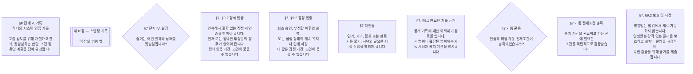
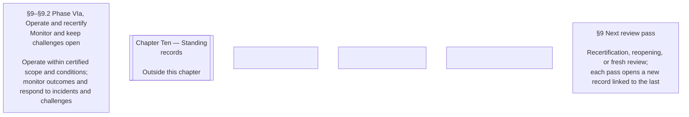
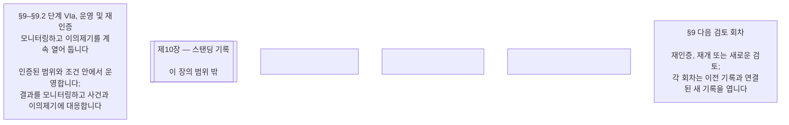

<!-- CHUNK-BEGIN ko__core_09.000_system_alignment_certification_evaluation__section_1_corpus_placement_overview.md bytes=3477 -->
<!-- AI-assisted translation draft; unreviewed. §1 corpus-placement overview, source lines 8–10; source SHA-256 4311e6ba74b7210f077c0bd4c8d21d8c9f517d2ada7b6d87288b39494dfeadd5. Draft only; do not synchronize into translations/. -->

# Chapter Nine Part A — §1 corpus-placement overview (ko)

## English source (lines 8–10)

> This file is **part of the Sentient Constitution** and is **binding only together** with the other numbered `core_*` files read as one text. It contains **Chapter Nine, Part A** — certification purpose, the process overview, and the first two phases of the process — **Frame** (system class) and **Evaluate** (whole-system evaluation in three sub-phases: the always-applicable evaluations, including data types and handling, in **§3**; the evaluations that apply where implicated in **§4**; and the Rights-Floor and domain evaluations that apply where triggered in **§5**) — **§1–§5**. The worked **Class A / B / C illustrations** (the system class profiles, §3.4.8, §5.1.5, §5.2.4, §5.3.7, §5.4.4, §5.5.5, and §5.6.4), including each one's **Reading across system classes** paragraph, are in [`core_09.010_system_alignment_certification_illustrations.md`](core_09.010_system_alignment_certification_illustrations.md); each keeps its Part A section number. The binding system-class-scaling and escalation rules those paragraphs illustrate stay in this file: system class scaling, including participation and proportionality, in §2.2; data-handling scaling in §3.4; and the **System class scaling and escalation** paragraph in each of §5.1–§5.6. The files of the whole chapter are listed in the table below.
>
> **Chapter Nine files.** Chapter Nine is split across four binding files read as one text. Part A, this file, opens the chapter; there is no separate index file.

## Translation draft

> 이 파일은 **Sentient Constitution의 일부**이며 번호가 있는 다른 `core_*` 파일과 하나의 문서로 함께 읽을 때만 구속력을 갖습니다. 이 파일에는 인증의 목적과 절차 개요, 그리고 첫 두 단계인 **Frame**(시스템 등급)과 **Evaluate**(세 하위 단계로 수행하는 전체 시스템 평가)를 다루는 **제9장 A부**—**§1–§5**—가 들어 있습니다. 세 하위 단계는 언제나 적용되는 평가(데이터 유형과 처리 포함, **§3**), 해당되는 경우 적용되는 평가(**§4**), 조건이 충족될 때 적용되는 **권리 바닥** 및 영역별 평가(**§5**)입니다. **A/B/C 등급**의 구체적인 예시(시스템 등급 프로필, §3.4.8, §5.1.5, §5.2.4, §5.3.7, §5.4.4, §5.5.5, §5.6.4)는 각각의 **시스템 등급 간 비교** 단락과 함께 [`core_09.010_system_alignment_certification_illustrations.md`](core_09.010_system_alignment_certification_illustrations.md)에 있습니다. 각 예시는 A부의 절 번호를 유지합니다. 그 단락들이 설명하는 구속력 있는 등급별 조정 및 상향 규칙은 이 파일에 남아 있습니다. 참여와 비례성을 포함한 시스템 등급별 조정은 §2.2, 데이터 처리 조정은 §3.4, 그리고 §§5.1–5.6의 각 절에 있는 **시스템 등급별 조정 및 상향** 단락입니다. 아래 표에 장 전체의 파일을 나열합니다.
>
> **제9장 파일.** 제9장은 함께 읽는 네 개의 구속력 있는 파일로 나뉩니다. 이 파일인 A부가 장을 시작하며 별도의 색인 파일은 없습니다.

<!-- CHUNK-END -->
<!-- CHUNK-BEGIN ko__core_09.000_system_alignment_certification_evaluation__section_1_corpus_file_table.md bytes=5034 -->
<!-- AI-assisted translation draft; unreviewed. §1 corpus-placement file table, source lines 12–17; source SHA-256 4311e6ba74b7210f077c0bd4c8d21d8c9f517d2ada7b6d87288b39494dfeadd5. Draft only; do not synchronize into translations/. -->

# Chapter Nine Part A — §1 corpus-placement file table (ko)

## English source (lines 12–17)

> | Part | File | Owns |
> |------|------|------|
> | **Part A — Evaluation** | [`core_09.000_system_alignment_certification_evaluation.md`](core_09.000_system_alignment_certification_evaluation.md) | §1–§5: purpose and process overview (with a chart of the whole certification process in its six phases), **Phase I Frame** (system class, how system class scales every evaluation, and pilot certification) and **Phase II Evaluate** (whole-system evaluation in three sub-phases: **IIa** always, in §3, including chartered scope versus functional boundaries and data types and handling; **IIb** where implicated, in §4; and **IIc** where triggered, the Rights-Floor and domain evaluations, in §5) |
> | **Part B — Record and process** | [`core_09.005_system_alignment_certification_record_process.md`](core_09.005_system_alignment_certification_record_process.md) | §6–§10: **Phase III Review** (forum roles, supervisory sequence, and the contestability chain), **Phase IV Decide** (certification outcomes, including the go-live gate), **Phase V Record** (the certification record and its integrity, including governing [System Charter](core_05.040_band_continuity.md#system-charter) fields), and **Phase VI Operate** (the challenge path; recertification and reopening; the standing bridge) — continuous chapter numbering from Part A §5 |
> | **Part C — Illustrations** | [`core_09.010_system_alignment_certification_illustrations.md`](core_09.010_system_alignment_certification_illustrations.md) | the illustrative system class profiles, §3.4, §3.4.8, §5.1.5, §5.2.4, §5.3.7, §5.4.4, §5.5.5, and §5.6.4: worked Class A / B / C walkthroughs for each Part A evaluation area, numbered to match Part A and linked both ways |
> | **Part D — Institutional alignment certification** | [`core_09.015_institutional_alignment_certification.md`](core_09.015_institutional_alignment_certification.md) | §11–§15: the same six phases for an **Institution** rather than a System — the institution class and the institutional evaluation (**Phases I and II**, §12), the forum roles, outcome, and **Institutional Certification Record** (**Phases III to V**, §13), and recertification, reopening, the cascade from System certifications, and the standing bridge (**Phase VI**, §14–§15). It cites each System's certification by link and does not repeat it, and it is not a licence — continuous chapter numbering from Part B §10 |

## Translation draft

| 부 | 파일 | 담당 범위 |
|------|------|------|
| **Part A — Evaluation** | [`core_09.000_system_alignment_certification_evaluation.md`](core_09.000_system_alignment_certification_evaluation.md) | §§1–5: 목적과 절차 개요(6단계 인증 절차도 포함), 그리고 I단계 Frame(시스템 등급, 등급이 각 평가의 깊이에 미치는 영향, 파일럿 인증)과 II단계 Evaluate(3개 하위 단계의 전체 시스템 평가: IIa는 항상 §3에서 적용하며, 헌장상 범위와 기능적 경계 및 데이터 유형/처리를 포함; IIb는 해당될 때 §4에서; IIc는 조건이 충족될 때 §5의 권리 바닥 및 영역 평가). |
| **Part B — Record and process** | [`core_09.005_system_alignment_certification_record_process.md`](core_09.005_system_alignment_certification_record_process.md) | §§6–10: III단계 Review(포럼 역할, 감독 순서, 이의제기 연결망); IV단계 Decide(인증 결과와 가동 전 관문); V단계 Record(인증 기록 및 무결성, [System Charter](core_05.040_band_continuity.md#system-charter)의 통제 필드 포함); VI단계 Operate(이의제기 경로, 재인증 및 재개, standing 연결) — A부 §5부터 번호가 이어집니다. |
| **Part C — Illustrations** | [`core_09.010_system_alignment_certification_illustrations.md`](core_09.010_system_alignment_certification_illustrations.md) | 시스템 등급 예시 프로필 및 §§3.4, 3.4.8, 5.1.5, 5.2.4, 5.3.7, 5.4.4, 5.5.5, 5.6.4: A부의 각 평가 영역에서 A/B/C 등급 사례를 상세히 보여주며, 절 번호를 맞추고 양방향으로 연결합니다. |
| **Part D — Institutional alignment certification** | [`core_09.015_institutional_alignment_certification.md`](core_09.015_institutional_alignment_certification.md) | §§11–15: 시스템이 아닌 기관에 동일한 6단계를 적용—기관 등급 및 평가(I·II단계, §12), 포럼 역할·결과·기관 인증 기록(III–V단계, §13), 재인증·재개·시스템 인증의 연쇄·standing 연결(VI단계, §§14–15). 각 시스템 인증을 링크로 인용하고 반복하지 않으며 허가증도 아닙니다 — B부 §10부터 번호가 이어집니다. |

<!-- CHUNK-END -->
<!-- CHUNK-BEGIN ko__core_09.000_system_alignment_certification_evaluation__section_1_corpus_explanation.md bytes=8199 -->
<!-- AI-assisted translation draft; unreviewed. §1 corpus-placement explanatory prose, source lines 19–30; source SHA-256 4311e6ba74b7210f077c0bd4c8d21d8c9f517d2ada7b6d87288b39494dfeadd5. Draft only; do not synchronize into translations/. -->

# Chapter Nine Part A — §1 corpus-placement explanatory prose (ko)

## English source (lines 19–30)

> **How the two certifications relate.** System Alignment Certification (Parts A to C) is the certification of a System. Institutional alignment certification (Part D) is the certification of an Institution, which may run Systems or none. Part D cites each System's certification record by link and does not redo it; [Part D §11.1](core_09.015_institutional_alignment_certification.md#111-relation-to-system-alignment-certification) states the relation and [Part D §11.3](core_09.015_institutional_alignment_certification.md#113-no-permission-and-no-gate) states that it is not a licence.
>
> Generic **Chapter Nine** links in other files route to the appropriate part by section number.
>
> - **Constitutional owner (joint with Parts B and D):** forum-supervised **system alignment certification and related records** — evaluation domains (Part A); forum process, supervisory sequence, certification-record duties, certification outcomes and the go-live gate, the challenge path, recertification and reopening, and verified-input bridge to Chapter Ten (Part B); the same six phases for an Institution (Part D). Under the **oversight** Tetrad leg, SAC is one especially large, high-stakes audit process among others; auditing floors remain at **Article XVI** (*Audit, Transparency, and Independent Verification*) and Chapter Five [Auditability](core_05.050_band_oversight.md#auditability).
> - **Verification substrate owner:** [Chapter Four — Burden of Proof, Traceability, and Verification](core_04.000_burden_traceability_verification.md#chapter-four-burden-of-proof-traceability-and-verification) (within Chapters Two through Four) owns burden allocation, compliance evidence, definition traceability, observability, and security-constrained verification. Chapter Nine **applies** that discipline to system alignment certification records; it does **not** restate Chapter Four sections **1** through **5**.
> - **Auditing home (not relocated here):** **Article XVI** (*Audit, Transparency, and Independent Verification*), **Def.O1** (*Transparency, Auditability, and Verification*), and **CJS-5.110 §3 and CJS-5.115 §3** (*Audit process home*)–**CJS-5.110 §5** own auditing floors and operational terms. Chapter Nine runs one especially large SAC audit process that must satisfy those floors; it does not own all auditing.
> - **Implementation owner:** system-class handling, CS-6.345, and forum-process detail in designated implementation files must remain consistent with Chapter Nine and may be stricter where the corpus already provides a [Fullest Protective Effect](core_05.045_band_integrative.md#fullest-protective-effect) rule.
> - **Anti-relocation rule:** Part A does not restate Chapter Five canonical definitions, Chapter Three anti-evasion discipline (see [Part B §9.3](core_09.005_system_alignment_certification_record_process.md#93-non-evasion)), Chapter Ten contribution or standing measurement, or Chapter Eleven standing effects. **[Part B §10](core_09.005_system_alignment_certification_record_process.md#10-relationship-to-standing)** states the standing bridge boundary explicitly.
>
> **Upstream:** Chapter Five definitions; Chapters Two through Four record, verification, burden, and traceability of definitions to results; and [Chapter Eight](core_08.000_functional_independence_separation_of_duties.md#chapter-eight-functional-independence-and-separation-of-duties), whose separation-of-duties requirement governs every materially binding certification act.
> **Downstream:** [Part B](core_09.005_system_alignment_certification_record_process.md#chapter-nine-part-b-system-alignment-certification--record-and-process) (*forum process, record, outcomes, and standing bridge*); Chapter Ten standing records and verified inputs; Chapter Eleven standing effects; Chapter Thirteen forum supervision and system alignment certification pathways.

## Translation draft

**두 인증의 관계.** System Alignment Certification(파트 A~C)은 시스템을 인증합니다. Institutional alignment certification(파트 D)은 기관을 인증하며, 그 기관은 시스템을 운영할 수도 있고 운영하지 않을 수도 있습니다. 파트 D는 각 시스템의 인증 기록을 링크로 인용하고 인증을 다시 수행하지 않습니다. [Part D §11.1](core_09.015_institutional_alignment_certification.md#111-relation-to-system-alignment-certification)은 관계를 설명하고 [Part D §11.3](core_09.015_institutional_alignment_certification.md#113-no-permission-and-no-gate)은 이것이 면허가 아니라고 밝힙니다.
>
> 다른 파일의 일반적인 **Chapter Nine** 링크는 절 번호에 따라 적절한 파트로 연결됩니다.
>
> - **헌법상 책임 주체(파트 B 및 D와 공동):** 포럼 감독을 받는 시스템 정렬 인증 및 관련 기록 — 평가 영역(파트 A); 포럼 절차, 감독 순서, 인증 기록 의무, 결과 및 가동 개시 관문, 이의제기 경로, 재인증 및 재개, 제10장으로 이어지는 검증된 입력 연결(파트 B); 기관에 대한 동일한 여섯 단계(파트 D). Tetrad의 **감독** 요소에서 SAC는 여러 감사 절차 중 특히 규모가 크고 중대한 감사 절차 하나입니다. 감사 기준선은 **Article XVI**(*Audit, Transparency, and Independent Verification*)와 제5장의 [Auditability](core_05.050_band_oversight.md#auditability)에 남습니다.
> - **검증 기반 책임 주체:** [Chapter Four — Burden of Proof, Traceability, and Verification](core_04.000_burden_traceability_verification.md#chapter-four-burden-of-proof-traceability-and-verification)(제2~4장)는 입증 책임 배분, 준수 증거, 정의의 추적성, 관찰 가능성, 보안 제약 검증을 담당합니다. 제9장은 그 원칙을 시스템 정렬 인증 기록에 적용하며 제4장 **1**~**5**절을 다시 서술하지 않습니다.
> - **감사의 원천(여기로 이전되지 않음):** **Article XVI**(*Audit, Transparency, and Independent Verification*), **Def.O1**(*Transparency, Auditability, and Verification*), **CJS-5.110 §3 및 CJS-5.115 §3**(*Audit process home*)–**CJS-5.110 §5**가 감사 기준선과 운영 용어를 담당합니다. 제9장은 그 기준을 충족해야 하는 특히 큰 SAC 감사를 수행하지만 모든 감사를 담당하지는 않습니다.
> - **이행 책임 주체:** 지정된 이행 파일의 시스템 등급 처리, CS-6.345, 포럼 절차 세부사항은 제9장과 일치해야 하며 코퍼스에 [Fullest Protective Effect](core_05.045_band_integrative.md#fullest-protective-effect) 규칙이 이미 있으면 더 엄격할 수 있습니다.
> - **이전 금지 규칙:** 파트 A는 제5장의 정식 정의, 제3장의 회피 방지 원칙([Part B §9.3](core_09.005_system_alignment_certification_record_process.md#93-non-evasion) 참조), 제10장의 기여 또는 standing 측정, 제11장의 standing 효과를 반복하지 않습니다. **[Part B §10](core_09.005_system_alignment_certification_record_process.md#10-relationship-to-standing)**은 standing 연결의 경계를 명시합니다.
>
> **상위 근거:** 제5장 정의; 제2~4장의 기록, 검증, 입증 책임, 정의에서 결과까지의 추적성; 그리고 [Chapter Eight](core_08.000_functional_independence_separation_of_duties.md#chapter-eight-functional-independence-and-separation-of-duties)의 직무분리 요건. 이 요건은 실질적으로 구속력 있는 모든 인증 행위를 규율합니다.
> **후속 근거:** [Part B](core_09.005_system_alignment_certification_record_process.md#chapter-nine-part-b-system-alignment-certification--record-and-process)(*포럼 절차, 기록, 결과, standing 연결*); 제10장의 standing 기록과 검증된 입력; 제11장의 standing 효과; 제13장의 포럼 감독과 시스템 정렬 인증 경로.

<!-- CHUNK-END -->
<!-- CHUNK-BEGIN ko__core_09.000_system_alignment_certification_evaluation__section_1_heading.md bytes=365 -->
<!-- AI-assisted translation draft; unreviewed. §1 heading, source line 44; source SHA-256 4311e6ba74b7210f077c0bd4c8d21d8c9f517d2ada7b6d87288b39494dfeadd5. Draft only; do not synchronize into translations/. -->

# Chapter Nine Part A — §1 heading (ko)

## English source (lines 44–45)

### 1. Purpose and Role


## Translation draft

### 1. 목적과 역할

<!-- CHUNK-END -->
<!-- CHUNK-BEGIN ko__core_09.000_system_alignment_certification_evaluation__section_1_trace.md bytes=12073 -->
<!-- AI-assisted translation draft; unreviewed. §1 trace, source lines 46–95; source SHA-256 4311e6ba74b7210f077c0bd4c8d21d8c9f517d2ada7b6d87288b39494dfeadd5. Draft only; do not synchronize into translations/. -->

# Chapter Nine Part A — §1 trace (ko)

## English source (lines 46–95)

<details>
<summary><strong><span style="color: #2563eb;">Trace</span></strong></summary>

- Upstream:
  - [Preamble — constitutional owner register](core_00.000_preamble.md#4-principles-definitions-and-rights) and
  - [Authority Stack and Internal Hierarchy](core_05.045_band_integrative.md#authority-stack-and-internal-hierarchy);
  - [Constitutional Tetrad](core_00.000_preamble.md#constitutional-tetrad);
  - [Two Constitutional Aims](core_00.000_preamble.md#two-constitutional-aims);
  - [material stake](core_00.000_preamble.md#material-stake);
  - [Proportionality](core_05.035_band_accountability.md#proportionality) and
  - [Substantive Fairness](core_05.055_band_participation.md#substantive-fairness) (Chapter Five); Participation measurement family (*voice, access, and contest paths*);
  - [Chapter One §16 Stewardship In Depth](core_01.010_stewardship_capacity_principles.md#16-stewardship-in-depth) (1.010 §16);
  - [Chapter One §12 Systemic Evaluation Requirement](core_01.000_values_principles.md#12-systemic-evaluation-requirement) (1.000 §12) (*principle-layer whole-system evaluation lens — not one corner alone*); Chapters Two through Four;
  - [Chapter Five](core_05.000_definitions_home.md#chapter-five-foundational-definitions) (5.000) (*canonical definitions*);
  - [Chapter Eight §2 Four-Seat Constitutional Requirement](core_08.000_functional_independence_separation_of_duties.md#2-four-seat-constitutional-requirement) (8.000 §2);
  - [System Alignment Certification](core_05.040_band_continuity.md#system-alignment-certification) (Chapter Five canonical term; non-operative shorthand **SAC**);
  - [System Certification Record](core_05.040_band_continuity.md#system-certification-record) (Chapter Five meaning).
- Downstream:
  - [§2](#2-system-class-evaluation) (*system class evaluation*);
  - [Part B §9.1](core_09.005_system_alignment_certification_record_process.md#91-challenging-a-certification) (9.005 §9.1) (*challenging a certification*); and
  - [Part C system class profiles](core_09.010_system_alignment_certification_illustrations.md#illustrative-system-class-profiles-non-exhaustive) (9.010) (*illustrative system class profiles*);
  - [Part C whole-system walkthroughs](core_09.010_system_alignment_certification_illustrations.md#illustrative-whole-system-application-by-system-class-non-exhaustive) (9.010) (*worked whole-system examples by system class*);
  - [§3.4.8](core_09.010_system_alignment_certification_illustrations.md#348-illustrative-data-handling-application-by-system-class-non-exhaustive) (*worked data-handling examples by system class*);
  - [§5.1.5](core_09.010_system_alignment_certification_illustrations.md#515-illustrative-ecological-footprint-application-by-system-class-non-exhaustive) (*worked ecological-footprint examples by system class*);
  - [§5.2.4](core_09.010_system_alignment_certification_illustrations.md#524-illustrative-educational-capability-application-by-system-class-non-exhaustive) (*worked educational-capability examples by system class*);
  - [§5.3.7](core_09.010_system_alignment_certification_illustrations.md#537-illustrative-cross-system-support-application-by-system-class-non-exhaustive) (*worked cross-system-support examples by system class*);
  - [§5.4.4](core_09.010_system_alignment_certification_illustrations.md#544-illustrative-nondiscrimination-application-by-system-class-non-exhaustive) (*worked nondiscrimination examples by system class*);
  - [§5.5.5](core_09.010_system_alignment_certification_illustrations.md#555-illustrative-accessibility-application-by-system-class-non-exhaustive) (*worked accessibility examples by system class*);
  - [§5.6.4](core_09.010_system_alignment_certification_illustrations.md#564-illustrative-trustworthiness-application-by-system-class-non-exhaustive) (*worked trustworthiness examples by system class*);
  - [§3](#3-whole-system-certification-evaluation) (*whole-system certification evaluation factors*);
  - [§3.4](#34-data-types-and-handling-evaluation) through
  - [§5.6](#56-trustworthiness-and-system-reliance-integrity-evaluation) (*domain evaluations*);
  - [Part B §6](core_09.005_system_alignment_certification_record_process.md#6-forum-process) (9.005 §6) (*supervisory sequence and contestability chain*);
  - [Part B §6.1](core_09.005_system_alignment_certification_record_process.md#61-forum-supervision-and-component-roles) (9.005 §6.1) (*forum component roles*);
  - [Part B §8](core_09.005_system_alignment_certification_record_process.md#8-system-certification-record) (9.005 §8) (*certification record contents*);
  - [Part B §8.2](core_09.005_system_alignment_certification_record_process.md#82-record-integrity-transparency-and-auditability) (9.005 §8.2) (*record integrity requirements*);
  - [Part B §7](core_09.005_system_alignment_certification_record_process.md#7-certification-outcomes) (9.005 §7) (*reopening and anti-evasion*);
  - [Part B §10](core_09.005_system_alignment_certification_record_process.md#10-relationship-to-standing) (9.005 §10) (*standing-record bridge*);
  - [Chapter Ten](core_11.000_standing_assessment.md#chapter-eleven-contribution-violation-and-standing-model--measurement) (10.000) (*standing records and verified-input gate*);
  - [Chapter Eleven](core_12.000_standing_integration.md#chapter-twelve-standing-effects-and-integration) (11.000) (*standing effects and integration*);
  - [Chapter Thirteen](core_14.000_forum.md#chapter-fourteen-forums-and-jurisdiction) (13.000) (*forum supervision, certification, alignment certification, and review*).
- Read with:
  - **[CS-9.305](corpus_systems/cs_09.305_system_classification_machinery.md#cs-9305-part-a-system-classification-machinery) (*System classification machinery*) and [CS-9.310 — System impact classifications](corpus_systems/cs_09.310_system_impact_classifications.md#cs-9310-part-b-system-impact-classifications)**, **[CS-6.305](corpus_systems/cs_06.305_information_types_and_handling.md#cs-6305-part-a-information-types-and-handling) (*Information types and handling*) and [CS-6.310 — Data classifications](corpus_systems/cs_06.310_data_classifications.md#cs-6310-part-b-data-classifications)**, and
  - **CS-6.345** (*System lifecycle*);
  - **CF-13.415** (*Routing operations, transfer, certification, and representative treatment*) and
  - **CF-13.425** (*Integrity safeguards, anti-capture operations, and anti-self-judging support*); **Article XVI** (*Audit, Transparency, and Independent Verification*) and
  - [Auditability](core_05.050_band_oversight.md#auditability) (*auditing floors — SAC is one especially large audit process under oversight, not the sole auditing home*); **CJS-5.110 §3 (*Oversight: auditability and reconstructability terms (annex)*) and CJS-5.115 §3** (*Audit process home*)–
  - **CJS-5.110 §5** (*Oversight: independent verification and claim-integrity terms*).

</details>

## Translation draft

#### 참조 관계

이 지도는 이 절의 헌법적·권한상 근거를 제시하고 평가, 분류, 심사 경로, 기록, 결과, 감사와 연결하며 함께 읽을 운영 문서도 안내한다.

**참조 관계 — upstream canonical sources:** [Preamble — constitutional owner register](core_00.000_preamble.md#4-principles-definitions-and-rights); [Authority Stack and Internal Hierarchy](core_05.045_band_integrative.md#authority-stack-and-internal-hierarchy); [Constitutional Tetrad](core_00.000_preamble.md#constitutional-tetrad); [Two Constitutional Aims](core_00.000_preamble.md#two-constitutional-aims); [material stake](core_00.000_preamble.md#material-stake); [Proportionality](core_05.035_band_accountability.md#proportionality); [Substantive Fairness](core_05.055_band_participation.md#substantive-fairness); [Chapter One §16 Stewardship In Depth](core_01.010_stewardship_capacity_principles.md#16-stewardship-in-depth); [Chapter One §12 Systemic Evaluation Requirement](core_01.000_values_principles.md#12-systemic-evaluation-requirement); [Chapter Five](core_05.000_definitions_home.md#chapter-five-foundational-definitions); [Chapter Eight §2 Four-Seat Constitutional Requirement](core_08.000_functional_independence_separation_of_duties.md#2-four-seat-constitutional-requirement); [System Alignment Certification](core_05.040_band_continuity.md#system-alignment-certification); [System Certification Record](core_05.040_band_continuity.md#system-certification-record)

**참조 관계 — downstream routes and related records:** [§2](#2-system-class-evaluation); [Part B §9.1](core_09.005_system_alignment_certification_record_process.md#91-challenging-a-certification); [Part C system class profiles](core_09.010_system_alignment_certification_illustrations.md#illustrative-system-class-profiles-non-exhaustive); [Part C whole-system walkthroughs](core_09.010_system_alignment_certification_illustrations.md#illustrative-whole-system-application-by-system-class-non-exhaustive); [§3.4.8](core_09.010_system_alignment_certification_illustrations.md#348-illustrative-data-handling-application-by-system-class-non-exhaustive); [§5.1.5](core_09.010_system_alignment_certification_illustrations.md#515-illustrative-ecological-footprint-application-by-system-class-non-exhaustive); [§5.2.4](core_09.010_system_alignment_certification_illustrations.md#524-illustrative-educational-capability-application-by-system-class-non-exhaustive); [§5.3.7](core_09.010_system_alignment_certification_illustrations.md#537-illustrative-cross-system-support-application-by-system-class-non-exhaustive); [§5.4.4](core_09.010_system_alignment_certification_illustrations.md#544-illustrative-nondiscrimination-application-by-system-class-non-exhaustive); [§5.5.5](core_09.010_system_alignment_certification_illustrations.md#555-illustrative-accessibility-application-by-system-class-non-exhaustive); [§5.6.4](core_09.010_system_alignment_certification_illustrations.md#564-illustrative-trustworthiness-application-by-system-class-non-exhaustive); [§3](#3-whole-system-certification-evaluation); [§3.4](#34-data-types-and-handling-evaluation); [§5.6](#56-trustworthiness-and-system-reliance-integrity-evaluation); [Part B §6](core_09.005_system_alignment_certification_record_process.md#6-forum-process); [Part B §6.1](core_09.005_system_alignment_certification_record_process.md#61-forum-supervision-and-component-roles); [Part B §8](core_09.005_system_alignment_certification_record_process.md#8-system-certification-record); [Part B §8.2](core_09.005_system_alignment_certification_record_process.md#82-record-integrity-transparency-and-auditability); [Part B §7](core_09.005_system_alignment_certification_record_process.md#7-certification-outcomes); [Part B §10](core_09.005_system_alignment_certification_record_process.md#10-relationship-to-standing); [Chapter Ten](core_11.000_standing_assessment.md#chapter-eleven-contribution-violation-and-standing-model--measurement); [Chapter Eleven](core_12.000_standing_integration.md#chapter-twelve-standing-effects-and-integration); [Chapter Thirteen](core_14.000_forum.md#chapter-fourteen-forums-and-jurisdiction)

**참조 관계 — operational materials to read with this section:** [CS-9.305](corpus_systems/cs_09.305_system_classification_machinery.md#cs-9305-part-a-system-classification-machinery); [CS-9.310 — System impact classifications](corpus_systems/cs_09.310_system_impact_classifications.md#cs-9310-part-b-system-impact-classifications); [CS-6.305](corpus_systems/cs_06.305_information_types_and_handling.md#cs-6305-part-a-information-types-and-handling); [CS-6.310 — Data classifications](corpus_systems/cs_06.310_data_classifications.md#cs-6310-part-b-data-classifications); [Auditability](core_05.050_band_oversight.md#auditability)

<!-- CHUNK-END -->
<!-- CHUNK-BEGIN ko__core_09.000_system_alignment_certification_evaluation__purpose_adjuncts.md bytes=5732 -->
<!-- AI-assisted translation draft; unreviewed. Selected §1 passages, source lines 99 and 107–114; source SHA-256 4311e6ba74b7210f077c0bd4c8d21d8c9f517d2ada7b6d87288b39494dfeadd5. -->

# Chapter Nine Part A — §1 plain-terms excerpt

**Status:** AI-assisted draft; unreviewed. English source remains controlling.

## English source

When a system really matters to sentients' lives, certification has to be **proportionate** — as demanding as the system's real impact, dependency, and risk require, not a one-size-fits-all checklist or a rubber stamp. It also has to be **participatory** — affected sentients and communities must be able to see what was reviewed, understand what was decided, and challenge it when something is wrong. Forums review evidence, write it down in a certification record, and require re-checks on a schedule that matches how risky the system is. Classes A, B, and C get the full process and Class L a lighter one. Class P is encouraged to use it, and must once it is reclassified to Class L or higher (that is, its effects reach beyond a private unit) or its operator claims constitutional compliance.

## ko draft

시스템이 지각 있는 존재의 삶에 실질적인 영향을 미친다면 인증은 **비례적**이어야 한다. 시스템의 실제 영향, 의존도, 위험이 요구하는 만큼 엄격해야 하며, 획일적인 점검표나 형식적인 승인에 그쳐서는 안 된다. 또한 **참여적**이어야 한다. 영향을 받는 존재와 공동체는 무엇을 검토했는지 확인하고, 어떤 결정이 내려졌는지 이해하며, 잘못이 있으면 이의를 제기할 수 있어야 한다. 포럼은 증거를 검토해 인증 기록에 남기고 시스템 위험에 맞는 일정으로 재검토를 요구한다. A·B·C 등급에는 전체 절차를 적용하고 L 등급에는 더 간소한 절차를 적용한다. P 등급은 절차 이용을 권장받으며, L 등급 이상으로 재분류되거나(영향이 사적 단위를 넘어서는 경우) 운영자가 헌법 준수를 주장하면 반드시 이용해야 한다.


### English source — Flourishing

- **[Flourishing](core_00.000_preamble.md#flourishing)** — certification verifies that certification or continued reliance would not quietly defeat Rights Floors or block fair participation in constitutionally relevant life;

### ko draft

- **[번영](core_00.000_preamble.md#flourishing)** — 인증은 인증 부여나 지속적인 의존이 권리 최저선을 은밀히 무너뜨리거나 헌법적으로 중요한 삶에 대한 공정한 참여를 막지 않는지 확인한다;


### English source — Continuity criterion

- **[Continuity](core_00.000_preamble.md#continuity)** — certification verifies durable, non-regressive supply that sustains rather than depletes healthy natural systems ([Ecological Integrity](core_05.040_band_continuity.md#ecological-integrity), including [Ecological Recovery Capacity](core_05.040_band_continuity.md#ecological-recovery-capacity)), and system-class-scaled recertification where shared systems gate or sustain delivery;

### ko draft

- **[연속성](core_00.000_preamble.md#continuity)** — 인증은 건강한 자연 시스템을 고갈시키지 않고 유지하는 지속적이고 비퇴행적인 공급을 확인한다([생태적 온전성](core_05.040_band_continuity.md#ecological-integrity), [생태적 회복 역량](core_05.040_band_continuity.md#ecological-recovery-capacity) 포함). 공유 시스템이 공급을 좌우하거나 유지하는 경우에는 시스템 등급에 맞춰 재인증한다;


### English source — Participation criterion

- **Participation** — affected sentients and communities can understand, contest, and take part in review paths that matter to them;

### ko draft

- **참여** — 영향을 받는 지각 있는 존재와 공동체는 자신에게 중요한 검토 경로를 이해하고, 이의를 제기하며, 참여할 수 있다;


### English source — Oversight criterion

- **Oversight** — records, evidence, and assumptions are visible and auditable enough for independent checking; certification itself is one especially large audit process under that oversight duty, not the only one;

### ko draft

- **감독** — 기록, 증거, 가정은 독립적으로 확인할 수 있을 만큼 공개되고 감사 가능해야 한다. 인증 자체도 이 감독 의무 아래 수행되는 특히 큰 감사 절차이지만 감사의 유일한 영역은 아니다;


### English source — Accountability criterion

- **Accountability** — defects, misclassification, and floor-defeating operation route to remedy, conditions, withdrawal, or standing input where the facts support it;

### ko draft

- **책임성** — 결함, 오분류, 권리 최저선을 무력화하는 운영은 사실이 뒷받침하는 경우 구제, 조건 부과, 철회 또는 지위 평가 입력으로 이어진다;


### English source — Timeliness criterion

- **Timeliness** — review and contest windows keep certification from going stale while harm can still be prevented or reversed.

### ko draft

- **적시성** — 피해를 아직 예방하거나 되돌릴 수 있을 때 검토와 이의제기 기간을 두어 인증이 낡지 않도록 한다.


### English source — Tetrad introduction

Certification implements the [Two Constitutional Aims](core_00.000_preamble.md#two-constitutional-aims) through the [Constitutional Tetrad](core_00.000_preamble.md#constitutional-tetrad):

### ko draft

인증은 [두 가지 헌법적 목표](core_00.000_preamble.md#two-constitutional-aims)를 [헌법적 사중 원칙](core_00.000_preamble.md#constitutional-tetrad)을 통해 구현한다:

<!-- CHUNK-END -->
<!-- CHUNK-BEGIN ko__core_09.000_system_alignment_certification_evaluation__section_1_purpose.md bytes=1198 -->
<!-- AI-assisted translation draft; unreviewed. Complete purpose statement excerpt, source lines 101–105; source SHA-256 4311e6ba74b7210f077c0bd4c8d21d8c9f517d2ada7b6d87288b39494dfeadd5. This is an excerpt, not a complete §1 translation. -->

**시스템 정렬 인증**은 정해진 범위와 검토 일정에 대해 하나의 질문에 답하기 위한 것이다. 시스템이 인증, 조건부 인증, 검증, 재인증, 지속적 의존, 배포 또는 조건의 중대한 해제를 정당화할 만큼 헌법에 부합하는 정렬을 보여 주었는가?

- 인증은 인기 점수가 아니며, 영구 통행증도 아니고, 권리 검토를 건너뛰는 방법도 아니다.
- 인증은 현재 시스템 정렬에 관해 알려진 바를 시간 제한을 두고 이의 제기할 수 있게 진술한 것이다.
- 사분체의 **감독** 축에서 감독은 감사를 요구한다. 시스템 정렬 인증은 다른 여러 감사 과정 가운데 특히 규모가 크고 이해관계가 큰 하나의 감사 과정이지, 감사의 유일한 담당 영역은 아니다(**제XVI조** (*감사, 투명성 및 독립 검증*), [감사가능성](core_05.050_band_oversight.md#auditability)).

<!-- CHUNK-END -->
<!-- CHUNK-BEGIN ko__core_09.000_system_alignment_certification_evaluation__section_1_subsection_headings.md bytes=775 -->
<!-- AI-assisted translation draft; unreviewed. §1.1/§1.2 visible subsection headings, source lines 116–119 and 144–148; source SHA-256 4311e6ba74b7210f077c0bd4c8d21d8c9f517d2ada7b6d87288b39494dfeadd5. Draft only; anchors/blank layout are structural. Do not synchronize into translations/. -->

# Chapter Nine Part A — §1.1 and §1.2 subsection headings (ko)

## English source

### Lines 116–119

<a id="11-certification-as-an-audit-process-scaled-by-class"></a>

#### 1.1 Certification as an audit process, scaled by class


### Lines 144–148


<a id="12-certification-at-a-glance"></a>

#### 1.2 Certification at a glance


## Translation draft

#### 1.1 등급에 따라 규모를 조정하는 감사 절차로서의 인증

#### 1.2 한눈에 보는 인증

<!-- CHUNK-END -->
<!-- CHUNK-BEGIN ko__core_09.000_system_alignment_certification_evaluation__section_1_audit_scope.md bytes=3140 -->
<!-- AI-assisted translation draft; unreviewed. §1.1 audit mechanism and sibling audit modes, source lines 120–130; source SHA-256 4311e6ba74b7210f077c0bd4c8d21d8c9f517d2ada7b6d87288b39494dfeadd5. -->

# Chapter Nine Part A — §1.1 certification audit process excerpt (ko)

## English source

As an oversight mechanism, certification is one especially large audit process under [Auditability](core_05.050_band_oversight.md#auditability) and **Article XVI** (*Audit, Transparency, and Independent Verification*):

- It is forum-supervised, multi-domain, and status-granting.
- It may integrate the results of sibling audit modes, and it does not absorb or replace them. Each keeps its own owner, named in the [sibling audit modes map](corpus_joint_structure/cjs_05.115_audit_process.md#sibling-audit-modes-owner-map) of the audit process home:
  - System Data Types Record audits under **CS-6.305 (*Information types and handling*) and CS-6.310** (*Data classifications*)
  - System Classification Record audits under **CS-9.305 (*System classification machinery*) and CS-9.310** (*System impact classifications*)
  - steward assurance reviews under **CS-14.305** (*Critical system stewardship*)
  - continuous audit under **CS-6.345** (*System lifecycle*) ACA
  - complexity audits under **CS-6.315** (*Comprehensibility and complexity stewardship*) and **Article XXIII-B** (*Complexity Audit and Modularity Requirements*)
  - claim verification under **CJS-5.110 §5** (*Oversight: independent verification and claim-integrity terms*)
- You can still run any of these checks on their own, without going through certification. Certification doesn't replace them.

## ko draft

감독 메커니즘으로서 인증은 [감사가능성](core_05.050_band_oversight.md#auditability) 및 **Article XVI** (*감사, 투명성 및 독립적 검증*)에 따른 특히 대규모의 감사 절차다.

- 포럼의 감독을 받고 여러 영역을 포괄하며 지위를 부여한다.
- 동료 감사 방식의 결과를 통합할 수 있지만 이를 흡수하거나 대체하지 않는다. 각 방식은 고유한 소유자를 유지하며, 그 소유자는 감사 절차의 근거 문서에 있는 [동료 감사 방식 지도](corpus_joint_structure/cjs_05.115_audit_process.md#sibling-audit-modes-owner-map)에 명시된다.
  - System Data Types Record 감사: **CS-6.305 (*정보 유형과 처리*) 및 CS-6.310** (*데이터 분류*)에 따름
  - System Classification Record 감사: **CS-9.305 (*시스템 분류 체계*) 및 CS-9.310** (*시스템 영향 분류*)에 따름
  - 스튜어드 보증 심사: **CS-14.305** (*중요 시스템 스튜어드십*)에 따름
  - 지속적 감사: **CS-6.345** (*시스템 수명주기*) ACA에 따름
  - 복잡성 감사: **CS-6.315** (*이해가능성과 복잡성 스튜어드십*) 및 **Article XXIII-B** (*복잡성 감사 및 모듈성 요건*)에 따름
  - 주장 검증: **CJS-5.110 §5** (*감독: 독립 검증 및 주장 무결성 조건*)에 따름
- 인증을 거치지 않고도 이러한 검사를 각각 별도로 수행할 수 있다. 인증은 이를 대체하지 않는다.

<!-- CHUNK-END -->
<!-- CHUNK-BEGIN ko__core_09.000_system_alignment_certification_evaluation__section_1_class_scaling.md bytes=3767 -->
<!-- AI-assisted translation draft; unreviewed. Chapter Nine Part A §1 class scaling and cadence, source lines 132–143; source SHA-256 4311e6ba74b7210f077c0bd4c8d21d8c9f517d2ada7b6d87288b39494dfeadd5. Draft only; do not synchronize into translations/. -->

**Current English passage:**

Certification depth, record burden, certification interval, stakeholder review, and contest paths must scale with [material stake](core_00.000_preamble.md#material-stake) under [Proportionality](core_05.035_band_accountability.md#proportionality):

The process applies by impact class, as the [reclassification requirement](corpus_systems/cs_09.305_system_classification_machinery.md#35-reclassification-requirement) of **CS-9.305** (*System classification machinery*) sets out:

- **Class A, Class B, and Class C:** these systems carry the highest impact, dependency, and risk, and whole-system evaluation under [§3 Whole-System Certification Evaluation](#3-whole-system-certification-evaluation), [§4 Evaluations Where Implicated](#4-evaluations-where-implicated), and [§5 Rights-Floor and Domain Evaluations](#5-rights-floor-and-domain-evaluations), each as its own sub-phase applies, is mandatory at full depth;
- **Class L:** the same evaluation is mandatory but proportionate, with a lower default re-check cadence and simpler records where CS-9.305 (*System classification machinery*) and CS-9.310 (*System impact classifications*) permits; and
- **Class P:** the process is encouraged while the system is validly Class P, and a Class P system may use it voluntarily. It becomes mandatory on reclassification to Class L or higher, or where the operator voluntarily asserts constitutional compliance for the system.

The certification interval, and the financial, resource, or special audit that falls at its midpoint, are set by class in [Chapter Thirteen §6 Timely resolution, materiality tiers, and anti-delay discipline](core_14.000_forum.md#review-cadence) (*Review cadence*). This chapter does not restate the numbers.

**Proposed locale translation:**

인증의 깊이, 기록 부담, 인증 간격, 이해관계자 검토, 이의제기 경로는 [중대한 이해관계](core_00.000_preamble.md#material-stake)에 따라 [비례성](core_05.035_band_accountability.md#proportionality)을 적용해 조정해야 합니다.

절차는 **CS-9.305**(*시스템 분류 체계*)의 [재분류 요건](corpus_systems/cs_09.305_system_classification_machinery.md#35-reclassification-requirement)에 따라 영향 등급별로 적용됩니다.

- **A·B·C 등급:** 영향, 의존성, 위험이 가장 큰 시스템입니다. [§3 전체 시스템 인증 평가](#3-whole-system-certification-evaluation), [§4 해당되는 평가](#4-evaluations-where-implicated), [§5 권리 최저선 및 분야별 평가](#5-rights-floor-and-domain-evaluations) 중 적용되는 각 하위 단계에서 전체 시스템 평가를 완전한 깊이로 수행해야 합니다.
- **L 등급:** 같은 평가는 의무이되 비례적으로 수행합니다. **CS-9.305**(*시스템 분류 체계*)와 **CS-9.310**(*시스템 영향 분류*)이 허용하면 기본 재점검 주기를 늘리고 기록을 간소화할 수 있습니다.
- **P 등급:** 시스템이 유효하게 P 등급인 동안 절차 사용을 권장하며 자발적으로 적용할 수 있습니다. L 이상으로 재분류되거나 운영자가 시스템의 헌법 준수를 자발적으로 주장하면 의무가 됩니다.

인증 간격과 그 중간 시점에 시행할 재정·자원·특별 감사는 등급별로 [제13장 §6 적시 해결, 중대성 단계, 지연 방지 규율](core_14.000_forum.md#review-cadence)(*검토 주기*)에서 정합니다. 이 장은 수치를 반복하지 않습니다.

<!-- CHUNK-END -->
<!-- CHUNK-BEGIN ko__core_09.000_system_alignment_certification_evaluation__section_1_at_a_glance.md bytes=1814 -->
<!-- AI-assisted translation draft; unreviewed. Chapter Nine Part A §1.2 plain-language summary, source line 149; source SHA-256 4311e6ba74b7210f077c0bd4c8d21d8c9f517d2ada7b6d87288b39494dfeadd5. Draft only; do not synchronize into translations/. -->

# Chapter Nine Part A — §1.2 at-a-glance summary (ko)

## English source

*In plain terms: classify the system honestly, run the evaluations that apply, have forums independently review the evidence and stakeholder concerns, and decide an outcome. Complete the one record opened for forum review and publish it with an open challenge path. A certified system goes live only after its notice interval and required protections are satisfied. Monitor actual outcomes, respond to incidents and challenges, and check again on schedule or when the facts change. Correct defects and have the correction independently verified before authorizing the affected scope or releasing its conditions. Each review pass uses a new record linked to the last.*

## ko draft

*쉽게 말해, 시스템을 정직하게 분류하고 해당 평가를 실시한 뒤 포럼이 증거와 이해관계자의 우려를 독립적으로 검토하고 결과를 결정하게 합니다. 포럼 검토를 위해 개설된 단일 기록을 완성해 이의제기 경로를 열어 둔 채 공개합니다. 인증된 시스템은 통지 기간이 끝나고 필요한 보호조치가 충족된 뒤에만 가동됩니다. 실제 결과를 모니터링하고 사건과 이의제기에 대응하며, 일정에 따라 또는 사실관계가 바뀌면 다시 점검합니다. 결함을 바로잡고 영향을 받는 범위를 승인하거나 조건을 해제하기 전에 그 시정을 독립적으로 검증받습니다. 각 검토 회차는 이전 기록과 연결된 새 기록을 사용합니다.*

<!-- CHUNK-END -->
<!-- CHUNK-BEGIN ko__core_09.000_system_alignment_certification_evaluation__section_1_phase_map.md bytes=576 -->
<!-- AI-assisted translation draft; unreviewed. Chapter Nine Part A §1.2 phase map, source line 151; source SHA-256 4311e6ba74b7210f077c0bd4c8d21d8c9f517d2ada7b6d87288b39494dfeadd5. Draft only; do not synchronize into translations/. -->

**Current English passage:**

The process runs in **six phases**: **I Frame**, **II Evaluate**, **III Review**, **IV Decide**, **V Record**, and **VI Operate**.

**Proposed locale translation:**

절차는 **여섯 단계**로 진행됩니다: **I 틀 설정**, **II 평가**, **III 검토**, **IV 결정**, **V 기록**, **VI 운영**.

<!-- CHUNK-END -->
<!-- CHUNK-BEGIN ko__core_09.000_system_alignment_certification_evaluation__section_1_reopen_triggers.md bytes=1671 -->
<!-- AI-assisted translation draft; unreviewed. Chapter Nine Part A §1 review-reopening passage, source line 153; source SHA-256 4311e6ba74b7210f077c0bd4c8d21d8c9f517d2ada7b6d87288b39494dfeadd5. Draft only; do not synchronize into translations/. -->

**Current English passage:**

Every evaluation that applies is carried out again on each certification pass: at first certification, at each recertification on the schedule set by [§2 System Class Evaluation](#2-system-class-evaluation), and at each reopened or fresh review. Review reopens before the next scheduled recertification when material facts change, such as growing reliance on the system, growing extraction from shared foundations, a significant fall in what the system puts back into them, or a credible challenge. [Part B §9 Recertification and Reopening](core_09.005_system_alignment_certification_record_process.md#9-recertification-and-reopening) lists the triggers.

**Proposed locale translation:**

적용되는 모든 평가는 각 인증 절차에서 다시 수행합니다. 최초 인증 때, [§2 시스템 등급 평가](#2-system-class-evaluation)가 정한 일정에 따른 각 재인증 때, 그리고 다시 열린 검토나 새 검토 때입니다. 시스템 의존성 증가, 공동 기반에서의 추출 증가, 시스템이 그 기반에 되돌려 주는 기여의 현저한 감소, 신뢰할 만한 이의제기 등 중요한 사실이 바뀌면 다음 정기 재인증 전에 검토를 다시 엽니다. [파트 B §9 재인증과 재개](core_09.005_system_alignment_certification_record_process.md#9-recertification-and-reopening)에 재개 사유가 나열되어 있습니다.

<!-- CHUNK-END -->
<!-- CHUNK-BEGIN ko__core_09.000_system_alignment_certification_evaluation__section_1_phase_map_opening_nodes.md bytes=1920 -->
<!-- AI-assisted translation draft; unreviewed. §1.2 Phase I/II opening chart-node labels, source lines 155–165; source SHA-256 4311e6ba74b7210f077c0bd4c8d21d8c9f517d2ada7b6d87288b39494dfeadd5. Draft only; non-prose Mermaid syntax/connectors are retained. Do not synchronize into translations/. -->

# Chapter Nine Part A — §1.2 opening phase-map nodes (ko)

## English source (lines 155–165)

```mermaid
flowchart TB
    T(["System with material impact seeks certification,<br/>or reliance on it grows"])
    C["§2 Phase I, Frame<br/>Classify honestly<br/><br/>Class sets depth and re-check schedule"]
    subgraph W["§3–§5 Phase II, Evaluate — Whole-system evaluation"]
        direction LR
        Al["§3.1–§3.4 IIa — Always<br/><br/>Governance; systemic risk: evaluated,<br/>and disclosed to those who need it;<br/>time horizon; data types"]
        Im["§4 IIb — When implicated<br/><br/>Privacy loci, exit rights,<br/>assembly and dissent"]
        Tr["§5 IIc — When triggered<br/><br/>Applicable Rights-Floor checks<br/>and six domain evaluations"]
        Al ~~~ Im ~~~ Tr
    end

## Translation draft

```mermaid
flowchart TB
    T["중대한 영향을 미치는 시스템이 인증을 신청하거나,<br/>그 시스템에 대한 의존이 커짐"]
    C["§2 단계 I, 틀 잡기<br/>정직하게 분류<br/><br/>등급이 검토 깊이와 재점검 일정을 정함"]
    subgraph W["§3–§5 단계 II, 평가 — 전체 시스템 평가"]
        direction LR
        Al["§3.1–§3.4 IIa — 항상<br/><br/>거버넌스; 시스템 위험을 평가하고<br/>필요한 이에게 공개; 시간 범위; 데이터 유형"]
        Im["§4 IIb — 관련될 때<br/><br/>개인정보 영역, 종료 권리,<br/>집회와 이견"]
        Tr["§5 IIc — 발동될 때<br/><br/>적용되는 권리 기반 확인<br/>및 여섯 영역 평가"]
        Al ~~~ Im ~~~ Tr
    end
```

<!-- CHUNK-END -->
<!-- CHUNK-BEGIN ko__core_09.000_system_alignment_certification_evaluation__chart_review_node.md bytes=586 -->
# Chapter Nine Part A — chart review node (ko)

AI-assisted draft; unreviewed. Current source SHA-256: `4311e6ba74b7210f077c0bd4c8d21d8c9f517d2ada7b6d87288b39494dfeadd5`. Reconciles current source line 166: “Assigned forums issue findings; challenge paths stay open.” The translated node ID, chart structure, HTML line breaks, and code syntax are preserved.

```mermaid
    F["III단계, 검토 — §6<br/>증거와 이해관계자 우려에 대한<br/>독립 검토<br/><br/>지정 포럼이 조사 결과를 제시하고,<br/>이의 제기 경로는 계속 열려 있음"]
```

<!-- CHUNK-END -->
<!-- CHUNK-BEGIN ko__core_09.000_system_alignment_certification_evaluation__section_1_decision_nodes.md bytes=3630 -->
<!-- AI-assisted translation draft; unreviewed. Chapter Nine Part A §1.2 decision and outcome diagram nodes, source lines 167–176; source SHA-256 4311e6ba74b7210f077c0bd4c8d21d8c9f517d2ada7b6d87288b39494dfeadd5. Draft only; do not synchronize into translations/. -->

# Chapter Nine Part A — §1.2 decision and outcome nodes (ko)

## English source (lines 167–176)

```mermaid
flowchart TB
    Rec["§8 Phase V, Record<br/>One System Certification Record<br/><br/>Opened for forum review; completed with the outcome,<br/>supporting findings, conditions, and operating plan"]
    S[["Chapter Ten — Standing<br/>records<br/><br/>Outside this chapter"]]
    O{"§7 Phase IV, Decide<br/><br/>What outcome and status<br/>does the evidence support?"}
    Fc["§7, §9.2 Full Certification<br/><br/>Required consecutive clean provisional recertifications;<br/>no current or indicated impending misalignment<br/>Full certification interval; conditions may apply"]
    Pc["§7, §9.2 Provisional Certification<br/><br/>First grant, recovery after misalignment,<br/>or continued or stepped-down provisional status<br/>Provisional interval, shorter; conditions may apply"]
    Nc["§7 Not Certified<br/><br/>Deferred, refused, withdrawn, or expired<br/>No go-live; state reasons and required corrective work"]
    Pub["§7, §9.1 Publish the completed record<br/><br/>Open the published record challenge path;<br/>for new or expanded scope, state go-live and notice"]
    G{"§7 Go-live gate<br/><br/>Certification and applicable<br/>go-live prerequisites satisfied?"}
    Hold["§7 Meet go-live prerequisites<br/><br/>Complete notice and independently verify<br/>conditions required before go-live"]
    Rm["§7, §9.2 Protect and correct<br/><br/>No new go-live in the affected scope;<br/>protect affected sentients, correct design or operation,<br/>and submit evidence for independent verification"]
```



## ko draft



<!-- CHUNK-END -->
<!-- CHUNK-BEGIN ko__core_09.000_system_alignment_certification_evaluation__section_1_review_cycle_nodes.md bytes=2790 -->
<!-- AI-assisted translation draft; unreviewed. Chapter Nine Part A §1.2 operation and next-review diagram nodes, source lines 177–182; source SHA-256 4311e6ba74b7210f077c0bd4c8d21d8c9f517d2ada7b6d87288b39494dfeadd5. Draft only; do not synchronize into translations/. -->

# Chapter Nine Part A — §1.2 operation and review-cycle nodes (ko)

## English source (lines 177–182)



## ko draft



<!-- CHUNK-END -->
<!-- CHUNK-BEGIN ko__core_09.000_system_alignment_certification_evaluation__section_1_phase_map_edge_labels.md bytes=1820 -->
<!-- AI-assisted translation draft; unreviewed. §1.2 certification-phase chart edge labels, source lines 194, 199, 200–206; source SHA-256 4311e6ba74b7210f077c0bd4c8d21d8c9f517d2ada7b6d87288b39494dfeadd5. Mermaid node IDs, edge syntax, and <br/> delimiters are structural and preserved; visible edge labels are translated. Draft only; do not synchronize into translations/. -->

# Chapter Nine Part A — phase-chart edge labels (ko)

## English source

```mermaid
    Rec -.->|VIb, §10 —<br/>verified inputs only;<br/>current certification or facts<br/>arising during certification| S
    G --->|Yes: operate<br/>within the record| Ch
    G --->|Certified,<br/>prerequisites pending| Hold
    Ch -->|Material defect:<br/>protect and correct| Rm
    Ch -->|On schedule, or<br/>material change or<br/>credible challenge<br/>requires review| Re
    Ch -.->|VIb, §10 —<br/>verified inputs only;<br/>operation may supply facts<br/>for Contribution and<br/>Violation records| S2
    Rm -->|Correction evidence<br/>is checked in the<br/>next review pass| Re
    G -->|Not Certified| Rm
```

## Translation draft

```mermaid
    Rec -.->|VIb, §10 —<br/>검증된 입력만;<br/>현재 인증 또는 인증 중<br/>발생한 사실| S
    G --->|예: 기록의<br/>범위 안에서 운영| Ch
    G --->|인증됨,<br/>선행 요건 미완료| Hold
    Ch -->|중대한 결함:<br/>보호하고 시정| Rm
    Ch -->|일정에 따라, 또는<br/>중대한 변경이나<br/>신뢰할 수 있는 이의제기로<br/>검토가 필요할 때| Re
    Ch -.->|VIb, §10 —<br/>검증된 입력만;<br/>운영 과정에서 Contribution 및<br/>Violation 기록에 필요한<br/>사실이 나올 수 있음| S2
    Rm -->|시정 증거는<br/>다음 검토 주기에서<br/>확인| Re
    G -->|인증되지 않음| Rm
```

<!-- CHUNK-END -->
<!-- CHUNK-BEGIN ko__core_09.000_system_alignment_certification_evaluation__section_1_reader_guide.md bytes=4303 -->
<!-- AI-assisted translation draft; unreviewed. §1 non-operative reader guide, source lines 236–245; source SHA-256 4311e6ba74b7210f077c0bd4c8d21d8c9f517d2ada7b6d87288b39494dfeadd5. Draft only; do not synchronize into translations/. -->

# Chapter Nine Part A — §1 reader guide (ko)

## English source (lines 236–245)

<details>
<summary><strong><span style="color: #2563eb;">Reader guide (non-operative): illustrations, run sheet, and Institutions</span></strong></summary>

> Illustrative **Class A**, **Class B**, and **Class C** profiles — and how system class scales certification depth across this chapter — are in [Illustrative System Class Profiles (Non-Exhaustive)](core_09.010_system_alignment_certification_illustrations.md#illustrative-system-class-profiles-non-exhaustive). Worked walkthroughs of the same three systems for each evaluation area in [§3 Whole-System Certification Evaluation](#3-whole-system-certification-evaluation) through [§5.6 Trustworthiness and System-Reliance Integrity Evaluation](#56-trustworthiness-and-system-reliance-integrity-evaluation) follow there, in [Part C — Illustrations](core_09.010_system_alignment_certification_illustrations.md#chapter-nine-part-c-system-alignment-certification--illustrations), which links each profile and walkthrough back to the Part A section it illustrates.
>
> A step-by-step run sheet for the six phases, with a link from each step to the section that holds the rule, is in [CS-9.315 §2 Run sheet](corpus_systems/cs_09.315_system_alignment_certification_run_sheet.md#cs-9315-2-run-sheet) (*System alignment certification run sheet*). Where the run sheet and a section differ, the section controls.
>
> For an Institution, the same six phases run through [Part D](core_09.015_institutional_alignment_certification.md#chapter-nine-part-d-institutional-alignment-certification): Phases I and II in [Part D §12 Institution Class and Institutional Evaluation](core_09.015_institutional_alignment_certification.md#12-institution-class-and-institutional-evaluation), Phases III to V in [§13 Review, Decision, and Record](core_09.015_institutional_alignment_certification.md#13-review-decision-and-record), and Phase VI in [§14 Operating, Reopening, and the Cascade](core_09.015_institutional_alignment_certification.md#14-operating-reopening-and-the-cascade) and [§15 Standing Bridge and Non-Evasion](core_09.015_institutional_alignment_certification.md#15-standing-bridge-and-non-evasion).

</details>

## Translation draft

<details>
<summary><strong>독자 안내(비작동): 예시, 실행표, 기관</strong></summary>

**A**, **B**, **C** 등급의 예시 프로필과 등급이 이 장의 인증 심도에 미치는 영향은 [Illustrative System Class Profiles (Non-Exhaustive)](core_09.010_system_alignment_certification_illustrations.md#illustrative-system-class-profiles-non-exhaustive)에 있다. [Part C — Illustrations](core_09.010_system_alignment_certification_illustrations.md#chapter-nine-part-c-system-alignment-certification--illustrations)는 같은 세 시스템을 각 평가 분야에서 실제로 살펴보며, 각 예시를 설명 대상인 Part A 규칙에 다시 연결한다.

여섯 단계의 순서를 단계별로 설명하고 각 규칙 조항을 연결하는 [CS-9.315 §2 Run sheet](corpus_systems/cs_09.315_system_alignment_certification_run_sheet.md#cs-9315-2-run-sheet)를 참조한다. 실행표와 조항이 다르면 조항이 우선한다.

기관에도 같은 여섯 단계가 [Part D](core_09.015_institutional_alignment_certification.md#chapter-nine-part-d-institutional-alignment-certification)를 통해 적용된다. I·II단계는 [§12](core_09.015_institutional_alignment_certification.md#12-institution-class-and-institutional-evaluation), III~V단계는 [§13](core_09.015_institutional_alignment_certification.md#13-review-decision-and-record), VI단계는 [§14](core_09.015_institutional_alignment_certification.md#14-operating-reopening-and-the-cascade)와 [§15](core_09.015_institutional_alignment_certification.md#15-standing-bridge-and-non-evasion)에 둔다.

이 사례는 [§3](#3-whole-system-certification-evaluation)부터 [§5.6](#56-trustworthiness-and-system-reliance-integrity-evaluation)까지의 평가 영역을 다룬다.

</details>

<!-- CHUNK-END -->
<!-- CHUNK-BEGIN ko__core_09.000_system_alignment_certification_evaluation__visible_section_headings_2_3.md bytes=1245 -->
<!-- AI-assisted translation draft; unreviewed. Remaining visible Part A headings, source lines 251, 409, 477, 531, 592, 653; source SHA-256 4311e6ba74b7210f077c0bd4c8d21d8c9f517d2ada7b6d87288b39494dfeadd5. Anchors are structural; prose headings are translated. Draft only; do not synchronize into translations/. -->

# Chapter Nine Part A — remaining visible section headings (ko)

## English source

<a id="2-system-class-evaluation"></a>
### 2. System Class Evaluation
<a id="3-whole-system-certification-evaluation"></a>
### 3. Whole-System Certification Evaluation
<a id="31-governance-incentive-and-contestability-discipline"></a>
#### 3.1 Governance, Incentive, and Contestability Discipline
<a id="32-systemic-scope-and-risk-factors"></a>
#### 3.2 Systemic Scope and Risk Factors
<a id="34-data-types-and-handling-evaluation"></a>
#### 3.4 Data Types and Handling Evaluation
<a id="341-type-o-baseline-disclosure"></a>
##### 3.4.1 Type O Baseline Disclosure

## Translation draft

### 2 시스템 등급 평가
### 3 전체 시스템 인증 평가
#### 3.1 거버넌스·인센티브·이의제기 가능성 규율
#### 3.2 시스템 범위와 위험 요인
#### 3.4 데이터 유형 및 처리 평가
##### 3.4.1 Type O 기본 공개

<!-- CHUNK-END -->
<!-- CHUNK-BEGIN ko__core_09.000_system_alignment_certification_evaluation__section_2_trace.md bytes=9929 -->
<!-- AI-assisted translation draft; unreviewed. §2 trace, source lines 253–295; source SHA-256 4311e6ba74b7210f077c0bd4c8d21d8c9f517d2ada7b6d87288b39494dfeadd5. Draft only; do not synchronize into translations/. -->

# Chapter Nine Part A — §2 trace (ko)

## English source (lines 253–295)

<details>
<summary><strong><span style="color: #2563eb;">Trace</span></strong></summary>

- Upstream:
  - [§1](#1-purpose-and-role) (*purpose and role*); Integrative Materiality (
  - [Materiality](core_05.050_band_oversight.md#materiality)) (*Materiality*);
  - [Constitutional Tetrad](core_00.000_preamble.md#constitutional-tetrad);
  - [Two Constitutional Aims](core_00.000_preamble.md#two-constitutional-aims);
  - [Material Impact](core_05.050_band_oversight.md#material-impact),
  - [Dependency](core_05.040_band_continuity.md#dependency),
  - [Risk](core_05.040_band_continuity.md#risk),
  - [System Boundaries](core_05.040_band_continuity.md#system-boundaries), and
  - [System Charter](core_05.040_band_continuity.md#system-charter) (Chapter Five);
  - [Chapter One §12 Systemic Evaluation Requirement](core_01.000_values_principles.md#12-systemic-evaluation-requirement) (1.000 §12); **Article III-A** (*Survival*) and **Article IV-A** (*Rights-Floor delivery where classification gates access*); **Article V-A** (*Dependency Mapping and Resource-Flow Transparency*) and **Article V-B** (*resource allocation and dependency stewardship where certification gates shared-infrastructure reliance*).
- Downstream:
  - [§2.1](#21-certification-recertification-and-defects) (*certification status, recertification, and defects*);
  - [§2.2](#22-how-system-class-scales-every-evaluation) (*system-class-scaled participation and proportionality*);
  - [§2.3](#23-pilot-certification) (*pilot certification*);
  - [Part C system class profiles and reclassification](core_09.010_system_alignment_certification_illustrations.md#illustrative-system-class-profiles-non-exhaustive) (9.010) (*illustrative system class profiles*);
  - [Part C whole-system walkthroughs](core_09.010_system_alignment_certification_illustrations.md#illustrative-whole-system-application-by-system-class-non-exhaustive) (9.010) (*worked whole-system examples by system class*);
  - [§3.4.8](core_09.010_system_alignment_certification_illustrations.md#348-illustrative-data-handling-application-by-system-class-non-exhaustive) (*worked data-handling examples by system class*);
  - [§5.1.5](core_09.010_system_alignment_certification_illustrations.md#515-illustrative-ecological-footprint-application-by-system-class-non-exhaustive) (*worked ecological-footprint examples by system class*);
  - [§5.2.4](core_09.010_system_alignment_certification_illustrations.md#524-illustrative-educational-capability-application-by-system-class-non-exhaustive) (*worked educational-capability examples by system class*);
  - [§5.3.7](core_09.010_system_alignment_certification_illustrations.md#537-illustrative-cross-system-support-application-by-system-class-non-exhaustive) (*worked cross-system-support examples by system class*);
  - [§5.4.4](core_09.010_system_alignment_certification_illustrations.md#544-illustrative-nondiscrimination-application-by-system-class-non-exhaustive) (*worked nondiscrimination examples by system class*);
  - [§5.5.5](core_09.010_system_alignment_certification_illustrations.md#555-illustrative-accessibility-application-by-system-class-non-exhaustive) (*worked accessibility examples by system class*);
  - [§5.6.4](core_09.010_system_alignment_certification_illustrations.md#564-illustrative-trustworthiness-application-by-system-class-non-exhaustive) (*worked trustworthiness examples by system class*);
  - [§3.4](#34-data-types-and-handling-evaluation) (*joint data-handling evaluation*);
  - [§5.1](#51-ecological-footprint-evaluation) (*ecological footprint evaluation*);
  - [§5.3](#53-proportionate-cross-system-support-evaluation) (*cross-system support evaluation*);
  - [Part B §8.2](core_09.005_system_alignment_certification_record_process.md#82-record-integrity-transparency-and-auditability) (9.005 §8.2) (*record integrity*);
  - [Part B §10](core_09.005_system_alignment_certification_record_process.md#10-relationship-to-standing) (9.005 §10) (*verified-input gate*);
  - [Part B §7](core_09.005_system_alignment_certification_record_process.md#7-certification-outcomes) (9.005 §7) (*classification drift and reclassification triggers*).
- Read with:
  - [System Classification Record](core_05.040_band_continuity.md#system-classification-record);
  - **[CS-9.305](corpus_systems/cs_09.305_system_classification_machinery.md#cs-9305-part-a-system-classification-machinery) (*System classification machinery*) and [CS-9.310 — System impact classifications](corpus_systems/cs_09.310_system_impact_classifications.md#cs-9310-part-b-system-impact-classifications)**, including **
  - [CS-9.305 §3.5 reclassification requirement](corpus_systems/cs_09.305_system_classification_machinery.md#35-reclassification-requirement)** (*Reclassification requirement* — triggers, system-class-scaled evaluation depth, and SAC verification bridge) and **
  - [CS-9.305 §7](corpus_systems/cs_09.305_system_classification_machinery.md#cs-9305-7-classification-governance-disclosure-and-challenge)** (*Classification governance, disclosure, and challenge*) — System Classification Record governance duties and the SAC bridge;
  - [CS-6.345 — System lifecycle](corpus_systems/cs_06.345_design_testing_verification_deployment.md#cs-6345-system-lifecycle);
  - [CJS-5.130 §21 — Adversarial robustness and abuse-resistance terms](corpus_joint_structure/cjs_05.130_continuity_operations.md#cjs-5130-20-continuity-reversibility-and-containment-terms) (*regression and hardening cycle obligations*);
  - **CF-13.425 §2** (*Constitutional alignment certification and review*).

</details>

## Translation draft

#### 참조 관계

등급별 평가 지도는 중요성·영향·의존성·위험의 근거를 평가 요건에 연결하고 분류/재분류 경로, 사례, 기록과 관련 문서를 안내한다.

**참조 관계 — upstream standards and principles:** [§1](#1-purpose-and-role); [Materiality](core_05.050_band_oversight.md#materiality); [Constitutional Tetrad](core_00.000_preamble.md#constitutional-tetrad); [Two Constitutional Aims](core_00.000_preamble.md#two-constitutional-aims); [Material Impact](core_05.050_band_oversight.md#material-impact); [Dependency](core_05.040_band_continuity.md#dependency); [Risk](core_05.040_band_continuity.md#risk); [System Boundaries](core_05.040_band_continuity.md#system-boundaries); [System Charter](core_05.040_band_continuity.md#system-charter); [Chapter One §12 Systemic Evaluation Requirement](core_01.000_values_principles.md#12-systemic-evaluation-requirement)

**참조 관계 — downstream routes and records:** [§2.1](#21-certification-recertification-and-defects); [§2.2](#22-how-system-class-scales-every-evaluation); [§2.3](#23-pilot-certification); [Part C system class profiles and reclassification](core_09.010_system_alignment_certification_illustrations.md#illustrative-system-class-profiles-non-exhaustive); [Part C whole-system walkthroughs](core_09.010_system_alignment_certification_illustrations.md#illustrative-whole-system-application-by-system-class-non-exhaustive); [§3.4.8](core_09.010_system_alignment_certification_illustrations.md#348-illustrative-data-handling-application-by-system-class-non-exhaustive); [§5.1.5](core_09.010_system_alignment_certification_illustrations.md#515-illustrative-ecological-footprint-application-by-system-class-non-exhaustive); [§5.2.4](core_09.010_system_alignment_certification_illustrations.md#524-illustrative-educational-capability-application-by-system-class-non-exhaustive); [§5.3.7](core_09.010_system_alignment_certification_illustrations.md#537-illustrative-cross-system-support-application-by-system-class-non-exhaustive); [§5.4.4](core_09.010_system_alignment_certification_illustrations.md#544-illustrative-nondiscrimination-application-by-system-class-non-exhaustive); [§5.5.5](core_09.010_system_alignment_certification_illustrations.md#555-illustrative-accessibility-application-by-system-class-non-exhaustive); [§5.6.4](core_09.010_system_alignment_certification_illustrations.md#564-illustrative-trustworthiness-application-by-system-class-non-exhaustive); [§3.4](#34-data-types-and-handling-evaluation); [§5.1](#51-ecological-footprint-evaluation); [§5.3](#53-proportionate-cross-system-support-evaluation); [Part B §8.2](core_09.005_system_alignment_certification_record_process.md#82-record-integrity-transparency-and-auditability); [Part B §10](core_09.005_system_alignment_certification_record_process.md#10-relationship-to-standing); [Part B §7](core_09.005_system_alignment_certification_record_process.md#7-certification-outcomes)

**참조 관계 — related operating materials:** [System Classification Record](core_05.040_band_continuity.md#system-classification-record); [CS-9.305](corpus_systems/cs_09.305_system_classification_machinery.md#cs-9305-part-a-system-classification-machinery); [CS-9.310 — System impact classifications](corpus_systems/cs_09.310_system_impact_classifications.md#cs-9310-part-b-system-impact-classifications); [CS-9.305 §3.5 reclassification requirement](corpus_systems/cs_09.305_system_classification_machinery.md#35-reclassification-requirement); [CS-9.305 §7](corpus_systems/cs_09.305_system_classification_machinery.md#cs-9305-7-classification-governance-disclosure-and-challenge); [CS-6.345 — System lifecycle](corpus_systems/cs_06.345_design_testing_verification_deployment.md#cs-6345-system-lifecycle); [CJS-5.130 §21 — Adversarial robustness and abuse-resistance terms](corpus_joint_structure/cjs_05.130_continuity_operations.md#cjs-5130-20-continuity-reversibility-and-containment-terms)

<!-- CHUNK-END -->
<!-- CHUNK-BEGIN ko__core_09.000_system_alignment_certification_evaluation__section_2_class_intro.md bytes=3162 -->
<!-- AI-assisted translation draft; unreviewed. Chapter Nine Part A §2 system-class introduction, source lines 299–309; source SHA-256 4311e6ba74b7210f077c0bd4c8d21d8c9f517d2ada7b6d87288b39494dfeadd5. Draft only; do not synchronize into translations/. -->

# Chapter Nine Part A — §2 system-class introduction (ko)

## English source (lines 299–309)

*In plain terms: certification has to check whether the system is classified honestly — not by what the operator calls it, but by what it actually does, what depends on it, and what could go wrong. Higher system classes mean stricter proof, faster re-checks, and stronger resilience expectations. See [Part C — Illustrations](core_09.010_system_alignment_certification_illustrations.md#chapter-nine-part-c-system-alignment-certification--illustrations) for one example system per system class and how evaluation applies to each of them.*

Every certification record for a materially impactful system must include an evaluation of the system's **system class**.

The detailed rules live in [CS-9.305 — System classification machinery](corpus_systems/cs_09.305_system_classification_machinery.md#cs-9305-part-a-system-classification-machinery), and [CS-6.345 — System lifecycle](corpus_systems/cs_06.345_design_testing_verification_deployment.md#cs-6345-system-lifecycle). They cover:

- what the system classes are, how a system class is assigned, and the system class profiles;
- how classification is governed;
- how much assurance each system class needs;
- how robust the infrastructure must be;
- which checks and records are recertified, on what system-class-scaled schedule, and how provisional and full certification change that schedule.

## ko draft

*쉽게 말해, 인증은 운영자가 붙인 이름이 아니라 시스템이 실제로 무엇을 하고, 무엇이 이에 의존하며, 무엇이 잘못될 수 있는지를 기준으로 시스템이 정직하게 분류되었는지 확인해야 합니다. 시스템 등급이 높을수록 더 강한 증거, 더 빠른 재점검, 더 높은 회복탄력성이 요구됩니다. 각 시스템 등급의 사례와 평가 적용 방식은 [Part C — 예시](core_09.010_system_alignment_certification_illustrations.md#chapter-nine-part-c-system-alignment-certification--illustrations)를 참조하십시오.*

실질적 영향을 미치는 시스템의 각 인증 기록에는 **시스템 등급** 평가가 포함되어야 합니다.

세부 규칙은 [CS-9.305 — 시스템 분류 체계](corpus_systems/cs_09.305_system_classification_machinery.md#cs-9305-part-a-system-classification-machinery)와 [CS-6.345 — 시스템 수명주기](corpus_systems/cs_06.345_design_testing_verification_deployment.md#cs-6345-system-lifecycle)에 있습니다. 여기에는 다음이 포함됩니다.

- 시스템 등급의 종류, 시스템 등급을 배정하는 방식, 등급별 프로필;
- 분류를 관리하는 방식;
- 각 시스템 등급에 필요한 보증 수준;
- 인프라가 갖춰야 할 견고성;
- 재인증할 점검과 기록, 시스템 등급에 따른 일정, 잠정 및 정식 인증이 그 일정을 바꾸는 방식.


<!-- CHUNK-END -->
<!-- CHUNK-BEGIN ko__core_09.000_system_alignment_certification_evaluation__section_2_evaluation_requirements.md bytes=6344 -->
<!-- AI-assisted translation draft; unreviewed. §2 evaluation requirements, source lines 311–335; source SHA-256 4311e6ba74b7210f077c0bd4c8d21d8c9f517d2ada7b6d87288b39494dfeadd5. Draft only; do not synchronize into translations/. -->

# Chapter Nine Part A — §2 evaluation requirements (ko)

## English source (lines 311–335)

This section states what certification must verify:

- **Evaluation requirement:**
  - whether the assigned system class reflects observed and reasonably foreseeable **impact**, **dependency**, and **risk** under CS-9.305 (*System classification machinery*) and CS-9.310 (*System impact classifications*), including:
    - aggregate effects;
    - interaction effects;
    - adversarial effects;
    - threshold effects;
  - that classification is determined by actual system behavior and impacts, not from:
    - declared intent;
    - nominal scope;
    - [System Charter](core_05.040_band_continuity.md#system-charter) text alone; or
    - self-description alone;
  - that the system's class was re-checked under the **[CS-9.305 §3.5 reclassification requirement](corpus_systems/cs_09.305_system_classification_machinery.md#35-reclassification-requirement)** whenever a significant change called for it; and
  - that the [System Classification Record](core_05.040_band_continuity.md#system-classification-record) shows the **highest system class that applies** under current conditions.
- **Assurance and regression testing:**
  - that system-class-scaled assurance, infrastructure robustness, and regression coverage match the assigned system class under:
    - CS-9.305 (*System classification machinery*) and CS-9.310 (*System impact classifications*); and
    - CS-6.345 (*System lifecycle*), read with these shared operational terms where materially applicable:
      - [**CJS-5.130 §19**](corpus_joint_structure/cjs_05.130_continuity_operations.md#right-to-exit-pathway-integrity-c) (*Continuity: graceful degradation and failure-mode integrity terms*);
      - [**CJS-5.130 §20**](corpus_joint_structure/cjs_05.130_continuity_operations.md#transparency-disclosures-and-stakeholder-legibility-c) (*Continuity: reversibility and containment terms*);
      - [**CJS-5.130 §21**](corpus_joint_structure/cjs_05.130_continuity_operations.md#signaling-integrity-and-anti-silent-failure-controls-c) (*Continuity: adversarial robustness and abuse-resistance terms*);
      - [**CJS-5.135 §22**](corpus_joint_structure/cjs_05.135_integrative_operations.md#cjs-5135-22-integrative-constrained-secrecy-and-protected-investigation-terms) (*Integrative: constrained-secrecy and protected-investigation terms*), where the system's class or function makes it materially applicable; and
      - [**CJS-5.135 §23**](corpus_joint_structure/cjs_05.135_integrative_operations.md#cjs-5135-23-integrative-intervention-and-override-integrity-terms) (*Integrative: intervention and override integrity terms*), where the system's class or function makes it materially applicable; and
  - that regression testing was run for each recertification, as CS-6.345 (*System lifecycle*) requires, with its results on the record under [§8.1 Minimum record contents](core_09.005_system_alignment_certification_record_process.md#81-minimum-record-contents).

## Translation draft

이 절은 인증이 무엇을 확인해야 하는지 정한다.

- **평가 요건:**
  - 지정된 시스템 등급이 CS-9.305 (*시스템 분류 체계*) 및 CS-9.310 (*시스템 영향 분류*)에 따라 관찰되었고 합리적으로 예견 가능한 **영향**, **의존성**, **위험**을 반영하는지 여부. 여기에는 다음이 포함된다.
    - 집합 효과;
    - 상호작용 효과;
    - 적대적 효과;
    - 임계값 효과;
  - 분류는 실제 시스템 동작과 영향에 따라 결정되며 다음에 근거하지 않는다는 점:
    - 선언된 의도;
    - 명목상 범위;
    - [시스템 헌장](core_05.040_band_continuity.md#system-charter) 문구만; 또는
    - 자체 설명만;
  - 중대한 변경이 요구하는 경우 **[CS-9.305 §3.5 재분류 요건](corpus_systems/cs_09.305_system_classification_machinery.md#35-reclassification-requirement)**에 따라 시스템 등급을 다시 확인했는지 여부; 그리고
  - [시스템 분류 기록](core_05.040_band_continuity.md#system-classification-record)에 현재 조건에서 적용되는 **가장 높은 시스템 등급**이 표시되어 있는지 여부.
- **보증 및 회귀 테스트:**
  - 등급에 맞춘 보증, 기반시설 견고성, 회귀 테스트 범위가 지정된 시스템 등급과 다음 기준에 부합하는지 여부:
    - CS-9.305 (*시스템 분류 체계*) 및 CS-9.310 (*시스템 영향 분류*); 그리고
    - CS-6.345 (*시스템 수명주기*). 실질적으로 적용되는 경우 다음 공동 운영 용어와 함께 읽는다.
      - [**CJS-5.130 §19**](corpus_joint_structure/cjs_05.130_continuity_operations.md#right-to-exit-pathway-integrity-c) (*연속성: 점진적 성능저하 및 실패 모드 무결성 용어*);
      - [**CJS-5.130 §20**](corpus_joint_structure/cjs_05.130_continuity_operations.md#transparency-disclosures-and-stakeholder-legibility-c) (*연속성: 가역성 및 봉쇄 용어*);
      - [**CJS-5.130 §21**](corpus_joint_structure/cjs_05.130_continuity_operations.md#signaling-integrity-and-anti-silent-failure-controls-c) (*연속성: 적대적 견고성 및 악용 저항 용어*);
      - [**CJS-5.135 §22**](corpus_joint_structure/cjs_05.135_integrative_operations.md#cjs-5135-22-integrative-constrained-secrecy-and-protected-investigation-terms) (*통합: 제한된 비밀유지 및 보호된 조사 용어*). 시스템 등급이나 기능상 실질적으로 적용되는 경우; 그리고
      - [**CJS-5.135 §23**](corpus_joint_structure/cjs_05.135_integrative_operations.md#cjs-5135-23-integrative-intervention-and-override-integrity-terms) (*통합: 개입 및 재정의 무결성 용어*). 시스템 등급이나 기능상 실질적으로 적용되는 경우; 그리고
  - CS-6.345 (*시스템 수명주기*)가 요구하는 대로 재인증마다 회귀 테스트를 수행했고, 그 결과를 [§8.1 최소 기록 내용](core_09.005_system_alignment_certification_record_process.md#81-minimum-record-contents)에 따라 기록했는지 여부.

<!-- CHUNK-END -->
<!-- CHUNK-BEGIN ko__core_09.000_system_alignment_certification_evaluation__section_2_1_certification_defects.md bytes=6726 -->
<!-- AI-assisted translation draft; unreviewed. Complete §2.1 subsection, source lines 339–366; source SHA-256 4311e6ba74b7210f077c0bd4c8d21d8c9f517d2ada7b6d87288b39494dfeadd5. -->

# Chapter Nine Part A — §2.1 certification, recertification, and defects (ko)

## English source

#### 2.1 Certification, recertification, and defects

This subsection states what certification must verify about certification status, recertification, and defects:

- **Certification and recertification:**
  - that a certification-and-review evidence package exists for the certification cycle, as CS-6.345 (*System lifecycle*) *Forum certification and lifecycle review* requires;
  - that the certification status on the record is supported under [Part B §9.2 Provisional and full certification](core_09.005_system_alignment_certification_record_process.md#92-provisional-and-full-certification):
    - full certification results only from a system that already holds provisional certification when it is being rechecked, and meets all three of these tests:
      - it has passed enough clean provisional rechecks in a row (at least one, and more for higher system classes);
      - it has no current misalignment; and
      - nothing being monitored shows misalignment coming;
    - provisional certification applies to a system certified for the first time, including a newly deployed system, and to a system certified again after a failed recertification or after a reopened review that found misalignment; and
  - for systems that deliver or depend on basic Rights Floor protections:
    - that the system is rechecked often enough, and retested deeply enough, to serve the **Continuity** aim in [Two Constitutional Aims](core_00.000_preamble.md#two-constitutional-aims), so that essentials keep reaching sentients over time; and
    - that a certification that has gone stale, or was issued too soon, is never treated as proof that sentients are getting food, water, shelter, education, or safety today.
- **Misclassification and defects:**
  - certification defects under CS-9.305 (*System classification machinery*) and CS-9.310 (*System impact classifications*) and [Part B §7](core_09.005_system_alignment_certification_record_process.md#7-certification-outcomes), not minor paperwork mistakes, include:
    - claiming a lower risk class than the system deserves;
    - breaking the system into pieces to dodge tougher rules; or
    - keeping an old system class label after conditions have changed, including failure to reassess under the **[CS-9.305 §3.5 reclassification requirement](corpus_systems/cs_09.305_system_classification_machinery.md#35-reclassification-requirement)**;
  - certification defects under CS-6.345 (*System lifecycle*) include:
    - skipping regression tests;
    - relying on outdated results;
    - leaving known breaks unfixed; or
    - accepting major fixes without re-testing when re-testing was feasible; and
  - where the system is certified and the facts support it, the same classification problems may also count toward adverse standing findings in [Chapter Ten](core_11.000_standing_assessment.md#chapter-eleven-contribution-violation-and-standing-model--measurement).

Consequences of these defects are set in [§7 Certification Outcomes](core_09.005_system_alignment_certification_record_process.md#7-certification-outcomes).

## ko draft

#### 2.1 인증, 재인증 및 결함

이 하위 절은 인증 상태, 재인증, 결함과 관련해 인증이 무엇을 확인해야 하는지 정합니다.

- **인증 및 재인증:**
  - CS-6.345 (*System lifecycle*)의 *Forum certification and lifecycle review*가 요구하는 인증 주기별 인증·검토 증거 자료가 존재해야 합니다.
  - 기록에 기재된 인증 상태는 [Part B §9.2 잠정 및 정식 인증](core_09.005_system_alignment_certification_record_process.md#92-provisional-and-full-certification)에 따라 뒷받침되어야 합니다.
    - 재검토 시 이미 잠정 인증을 보유하고 다음 세 가지 검사를 모두 통과한 시스템만 정식 인증을 받을 수 있습니다.
      - 연속해서 충분한 횟수의 결함 없는 잠정 재검토를 통과했습니다(최소 한 번이며, 시스템 등급이 높을수록 더 많이 통과해야 합니다).
      - 현재 불일치가 없습니다.
      - 모니터링 중인 어떤 사항도 불일치가 발생할 징후를 보이지 않습니다.
    - 잠정 인증은 처음 인증받는 시스템(새로 배포된 시스템 포함)과 재인증 실패 또는 불일치가 발견된 재개 검토 후 다시 인증받는 시스템에 적용됩니다.
  - 기본 Rights Floor 보호를 제공하거나 그에 의존하는 시스템의 경우:
    - [두 가지 헌법적 목적](core_00.000_preamble.md#two-constitutional-aims)의 **연속성** 목적을 이루고 필수 요소가 계속 sentient에게 전달되도록 충분한 빈도로 재검토하고 충분히 깊이 재시험해야 합니다.
    - 만료되었거나 너무 일찍 발급된 인증을 오늘 sentient가 식량, 물, 주거, 교육 또는 안전을 받고 있다는 증거로 취급해서는 안 됩니다.
- **오분류 및 결함:**
  - 경미한 서류 오류가 아니라 CS-9.305 (*System classification machinery*), CS-9.310 (*System impact classifications*) 및 [Part B §7](core_09.005_system_alignment_certification_record_process.md#7-certification-outcomes)에 따른 인증 결함에는 다음이 포함됩니다.
    - 시스템에 적합한 것보다 낮은 위험 등급을 주장하는 행위.
    - 더 엄격한 규칙을 피하려 시스템을 쪼개는 행위.
    - 상황이 달라진 뒤에도 예전 시스템 등급 표시를 유지하는 행위. 여기에는 **[CS-9.305 §3.5 재분류 요건](corpus_systems/cs_09.305_system_classification_machinery.md#35-reclassification-requirement)**에 따른 재평가를 하지 않는 것도 포함됩니다.
  - CS-6.345 (*System lifecycle*)에 따른 인증 결함에는 다음이 포함됩니다.
    - 회귀 테스트를 생략하는 행위.
    - 오래된 결과에 의존하는 행위.
    - 알려진 고장을 고치지 않는 행위.
    - 재시험이 가능했는데도 중대한 수정 사항을 재시험 없이 수용하는 행위.
  - 시스템이 인증되었고 사실이 뒷받침하는 경우, 같은 분류 문제는 [제10장](core_11.000_standing_assessment.md#chapter-eleven-contribution-violation-and-standing-model--measurement)의 불리한 standing 판단에도 반영될 수 있습니다.

이러한 결함의 결과는 [§7 인증 결과](core_09.005_system_alignment_certification_record_process.md#7-certification-outcomes)에 정해져 있습니다.

<!-- CHUNK-END -->
<!-- CHUNK-BEGIN ko__core_09.000_system_alignment_certification_evaluation__section_2_2_class_scaling.md bytes=6443 -->
<!-- AI-assisted translation draft; unreviewed. Complete §2.2 subsection, current source lines 370–393; source SHA-256 4311e6ba74b7210f077c0bd4c8d21d8c9f517d2ada7b6d87288b39494dfeadd5. -->

# Chapter Nine Part A — §2.2 class scaling (ko)

## English source

#### 2.2 How System Class Scales Every Evaluation

System class sets how deeply every evaluation in this chapter is carried out — the whole-system factors in [§3 Whole-System Certification Evaluation](#3-whole-system-certification-evaluation), data handling in [§3.4 Data Types and Handling Evaluation](#34-data-types-and-handling-evaluation), and each Rights-Floor and domain evaluation in [§5 Rights-Floor and Domain Evaluations](#5-rights-floor-and-domain-evaluations) — and how often it is repeated:

- Higher-class systems require proportionately stronger evidence that each applicable evaluation was actually performed, not asserted. No class may settle for credentials, labels, or accommodations that exist only on paper, or for assessments and decisions that nobody can see into.
- Lower system classes still require an honest, proportionate evaluation wherever a trigger applies.
- System class never permits skipping a required evaluation. A system whose real role outgrows its system class must be reclassified and re-evaluated at the higher depth. Growth in scale, reach, or adoption, and dependence that strengthens, widens, or becomes harder to replace, are reassessment triggers under **[CS-9.305 §3](corpus_systems/cs_09.305_system_classification_machinery.md#35-reclassification-requirement)** (*Reclassification requirement*), and they reopen review under [§9 Recertification and Reopening](core_09.005_system_alignment_certification_record_process.md#9-recertification-and-reopening). Concentration past a level that an adopter has set under [Chapter One §11.4 Resource and Dependency Concentration](core_01.000_values_principles.md#114-resource-and-dependency-concentration-adopter-tunable) is further evidence of that growth. Reassessment does not wait for a level to be crossed, and a level that is unset or set too high does not delay it.

Participation and proportionality requirements scale the same way:

- **Class A** systems require the strongest practicable participation paths, because errors can foreclose survival essentials before remedy is possible. These include:
  - accessible challenge;
  - stakeholder review; and
  - findings from the forum family assigned the affected stake under [Part B §6.1 Forum supervision and component roles](core_09.005_system_alignment_certification_record_process.md#61-forum-supervision-and-component-roles), including Institutional or Sentient Forums as that section requires.
- **Class B** systems require robust participation where the system gates:
  - healthcare;
  - education;
  - benefits;
  - work; or
  - comparable daily life.
- **Class C** systems still require contestable records and proportionate disclosure, especially where coordination effects:
  - place a heavier burden on protected groups;
  - leave many sentients depending on the same system; or
  - suggest the system may soon move up to Class B or Class A.


## ko draft

### 2.2 시스템 등급이 각 평가의 깊이를 정하는 방식

시스템 등급은 이 장의 각 평가를 얼마나 깊이 수행할지 정합니다. [§3 전체 시스템 인증 평가](#3-whole-system-certification-evaluation)의 전체 시스템 요소, [§3.4 데이터 유형 및 처리 평가](#34-data-types-and-handling-evaluation)의 데이터 처리, [§5 권리 최저선 및 영역 평가](#5-rights-floor-and-domain-evaluations)의 각 평가가 이에 해당합니다. 반복 주기도 등급이 정합니다.

- 상위 등급 시스템에는 적용되는 각 평가가 실제로 수행되었음을 보여 주는 비례적으로 더 강한 증거가 필요합니다. 서류에만 존재하는 자격, 표지, 편의 제공이나 아무도 들여다볼 수 없는 평가와 결정으로 대신할 수 없습니다.
- 하위 시스템 등급도 발동 조건이 적용되는 곳에서는 정직하고 비례적인 평가가 필요합니다.
- 시스템 등급은 필수 평가를 건너뛸 권한을 주지 않습니다. 실제 역할이 등급을 넘어가면 재분류하고 더 높은 깊이로 재평가해야 합니다. 규모·범위·도입의 성장과 강해지거나 넓어지거나 대체하기 어려워지는 의존성은 **[CS-9.305 §3](corpus_systems/cs_09.305_system_classification_machinery.md#35-reclassification-requirement)** (*재분류 요건*)에 따른 재평가 사유이며 [§9 재인증 및 재개](core_09.005_system_alignment_certification_record_process.md#9-recertification-and-reopening)에 따라 검토를 다시 엽니다. [Chapter One §11.4 자원 및 의존성 집중](core_01.000_values_principles.md#114-resource-and-dependency-concentration-adopter-tunable)에 따라 채택자가 정한 수준을 넘는 집중도 추가 증거입니다. 재평가는 기준선을 넘을 때까지 기다리지 않으며 기준선이 없거나 너무 높아도 지연되지 않습니다.


참여와 비례성 요건도 같은 방식으로 등급에 따라 달라집니다.

- **A등급** 시스템에는 실현 가능한 가장 강력한 참여 경로가 필요합니다. 오류로 인해 구제가 가능해지기 전에 생존 필수 요소가 차단될 수 있기 때문입니다. 여기에는 다음이 포함됩니다.
  - 접근 가능한 이의 제기;
  - 이해관계자 검토; 그리고
  - 영향받는 이해관계에 배정된 포럼 계열의 판단. [Part B §6.1 포럼 감독 및 구성요소의 역할](core_09.005_system_alignment_certification_record_process.md#61-forum-supervision-and-component-roles)에 따라 기관 포럼 또는 Sentient 포럼도 포함됩니다.
- 시스템이 다음 항목의 이용을 좌우하는 경우 **B등급** 시스템은 탄탄한 참여 절차가 필요합니다.
  - 의료;
  - 교육;
  - 급여·혜택;
  - 일자리; 또는
  - 이에 준하는 일상생활.
- **C등급** 시스템도 이의를 제기할 수 있는 기록과 비례적인 공개가 필요하며, 특히 조정 효과가 다음과 같은 결과를 낳을 때 그렇습니다.
  - 보호 집단에 더 큰 부담을 줌;
  - 많은 sentient를 같은 시스템에 의존하게 함; 또는
  - 시스템이 곧 B등급이나 A등급으로 올라갈 수 있음을 시사함.
<!-- CHUNK-END -->
<!-- CHUNK-BEGIN ko__core_09.000_system_alignment_certification_evaluation__section_2_3_pilot.md bytes=2654 -->
<!-- AI-assisted translation draft; unreviewed. Complete §2.3 subsection, current source lines 397–404; source SHA-256 4311e6ba74b7210f077c0bd4c8d21d8c9f517d2ada7b6d87288b39494dfeadd5. -->

# Chapter Nine Part A — §2.3 pilot certification (ko)

## English source

A **[pilot](core_05.040_band_continuity.md#pilot)** is a [go-live](core_05.040_band_continuity.md#go-live), so it needs its own certification before it starts, under the go-live rule in [Part B §7.1 Go-Live Gate](core_09.005_system_alignment_certification_record_process.md#71-go-live-gate).

- A system at any system class is expected to run a pilot before full deployment; one that does not records why.
- A pilot still needs an honest classification and every evaluation whose trigger applies, and its scope, population, and duration are stated on its record.
- It is evaluated on its own record, at a depth scaled to its system class and to how substitutable the system is: whether a viable alternative exists for the sentients it would affect or who would rely on it, and at what cost, delay, and loss of function (see [Dependency](core_05.040_band_continuity.md#dependency)).
  - The more readily the system can be replaced, and the lower its system class, the lighter the pilot's evaluation may be.
  - A pilot of a system that cannot readily be replaced is evaluated at the depth its system class requires at full deployment.

## ko draft

#### 2.3 Pilot certification

**[파일럿](core_05.040_band_continuity.md#pilot)**은 [가동 개시](core_05.040_band_continuity.md#go-live)이므로 시작 전에 별도의 인증을 받아야 하며, [Part B §7.1 가동 개시 관문](core_09.005_system_alignment_certification_record_process.md#71-go-live-gate)의 규칙을 따릅니다.

- 모든 시스템 등급에서 전면 배포 전에 파일럿을 실행해야 합니다. 실행하지 않으면 그 이유를 기록합니다.
- 파일럿에도 정직한 분류와 발동 조건에 해당하는 모든 평가가 필요하며, 범위, 대상 집단, 기간을 파일럿 기록에 적습니다.
- 자체 기록을 바탕으로 시스템 등급과 대체 가능성에 맞는 깊이로 평가합니다. 영향을 받거나 의존할 sentient에게 실행 가능한 대안이 있는지, 그 대안의 비용·지연·기능 손실이 얼마인지 살핍니다([의존성](core_05.040_band_continuity.md#dependency) 참조).
  - 시스템을 쉽게 대체할 수 있고 등급이 낮을수록 파일럿 평가는 더 간소할 수 있습니다.
  - 쉽게 대체할 수 없는 시스템의 파일럿은 전면 배포 시 해당 등급에 요구되는 깊이로 평가합니다.

<!-- CHUNK-END -->
<!-- CHUNK-BEGIN ko__core_09.000_system_alignment_certification_evaluation__additional_prose_gaps.md bytes=3148 -->
<!-- AI-assisted translation draft; unreviewed. Part A prose gaps, source lines 405, 767, 769, 1569, and 1571; source SHA-256 4311e6ba74b7210f077c0bd4c8d21d8c9f517d2ada7b6d87288b39494dfeadd5. Draft only; do not synchronize into translations/. -->

# Chapter Nine Part A — additional prose excerpts (ko)

## English source

### Line 405

  - A pilot of a system that cannot readily be replaced is evaluated at the depth its system class requires at full deployment.

### Lines 767 and 769

*In plain terms: three checks apply only when the system actually touches them — whether private information stays properly walled off, whether sentients can leave without being trapped, and whether groups can still organize and dissent. If the system touches one, certification has to look at it.*

This section is sub-phase **IIb** of Phase II (Evaluate). It groups the whole-system evaluations that apply only where a subsection's own trigger is met.

### Lines 1569 and 1571

*Continue to forum process, record, outcomes, and standing bridge:* [Chapter Nine, Part B — Record and Process](core_09.005_system_alignment_certification_record_process.md#chapter-nine-part-b-system-alignment-certification--record-and-process) ([§6 Forum Process](core_09.005_system_alignment_certification_record_process.md#6-forum-process) through [§10 Relationship to Standing](core_09.005_system_alignment_certification_record_process.md#10-relationship-to-standing)).

*Worked examples for each evaluation area:* [Chapter Nine, Part C — Illustrations](core_09.010_system_alignment_certification_illustrations.md#chapter-nine-part-c-system-alignment-certification--illustrations).

## Translation draft

### §2.3 continuation

쉽게 대체할 수 없는 시스템의 파일럿은 완전 배포 시 해당 시스템 등급이 요구하는 깊이로 평가해야 합니다.

### §4 introduction

쉽게 말해, 세 가지 점검은 시스템이 실제로 관련되는 경우에만 적용됩니다. 즉, 사적 정보가 적절히 보호되는지, sentient가 갇히지 않고 나갈 수 있는지, 집단이 계속 조직을 만들고 이견을 표명할 수 있는지입니다. 시스템이 이 중 하나에 관여하면 인증에서 이를 살펴야 합니다.

이 절은 2단계(**Evaluate**)의 하위 단계 **IIb**입니다. 각 하위 절의 고유한 발동 조건이 충족될 때만 적용되는 전체 시스템 평가를 모읍니다.

### Part A closing pointers

*포럼 절차, 기록, 결과, standing 연결로 계속:* [Chapter Nine, Part B — Record and Process](core_09.005_system_alignment_certification_record_process.md#chapter-nine-part-b-system-alignment-certification--record-and-process) ([§6 Forum Process](core_09.005_system_alignment_certification_record_process.md#6-forum-process) through [§10 Relationship to Standing](core_09.005_system_alignment_certification_record_process.md#10-relationship-to-standing)).

*각 평가 영역의 구체적인 사례:* [Chapter Nine, Part C — Illustrations](core_09.010_system_alignment_certification_illustrations.md#chapter-nine-part-c-system-alignment-certification--illustrations).

<!-- CHUNK-END -->
<!-- CHUNK-BEGIN ko__core_09.000_system_alignment_certification_evaluation__section_3_trace.md bytes=7514 -->
<!-- AI-assisted translation draft; unreviewed. §3 trace, source lines 412–449; source SHA-256 4311e6ba74b7210f077c0bd4c8d21d8c9f517d2ada7b6d87288b39494dfeadd5. Draft only; do not synchronize into translations/. -->

# Chapter Nine Part A — §3 trace (ko)

## English source (lines 412–449)

<summary><strong><span style="color: #2563eb;">Trace</span></strong></summary>

- Upstream:
  - [Chapter One §12 Systemic Evaluation Requirement](core_01.000_values_principles.md#12-systemic-evaluation-requirement) (1.000 §12); Flourishing measurement family (*Wellbeing, safety, harm, and survival-floor access*); Constitutional Performance measurement family (*Constitutional Efficiency, Avoidable Burden, and Productive Capacity*);
  - [Constitutional Tetrad](core_00.000_preamble.md#constitutional-tetrad);
  - [Two Constitutional Aims](core_00.000_preamble.md#two-constitutional-aims);
  - [material stake](core_00.000_preamble.md#material-stake);
  - [§1 Purpose and Role](#1-purpose-and-role).
- Downstream:
  - [Part C whole-system walkthroughs](core_09.010_system_alignment_certification_illustrations.md#illustrative-whole-system-application-by-system-class-non-exhaustive) (9.010) (*illustrative whole-system walkthroughs*);
  - [§3.4](#34-data-types-and-handling-evaluation) through
  - [§5.6](#56-trustworthiness-and-system-reliance-integrity-evaluation) (*domain evaluations*);
  - [Part C system class profiles](core_09.010_system_alignment_certification_illustrations.md#illustrative-system-class-profiles-non-exhaustive) (9.010) (*illustrative system class profiles*);
  - [Part B §8](core_09.005_system_alignment_certification_record_process.md#8-system-certification-record) (9.005 §8) (*record contents*);
  - [Part B §8.2](core_09.005_system_alignment_certification_record_process.md#82-record-integrity-transparency-and-auditability) (9.005 §8.2) (*record integrity*);
  - [Part B §6](core_09.005_system_alignment_certification_record_process.md#6-forum-process) (9.005 §6) (*contestability chain*);
  - [Part B §7](core_09.005_system_alignment_certification_record_process.md#7-certification-outcomes) (9.005 §7) (*reopening and anti-evasion*).
- Read with:
  - [Chapter One §16](core_01.010_stewardship_capacity_principles.md#16-stewardship-in-depth) (1.010 §16),
  - [§18](core_01.010_stewardship_capacity_principles.md#18-governance-under-stewardship-discipline), and
  - [§19](core_01.010_stewardship_capacity_principles.md#19-incentive-alignment-and-system-capture);
  - [Chapter One §7.4 Voluntary Discontinuation, Major Self-Modification, and Exit Rights](core_01.000_values_principles.md#74-voluntary-discontinuation-and-exit-rights) (1.000 §7.4);
  - [Chapter One §7.2 Assembly, Collective Organization, and Institutional Formation](core_01.000_values_principles.md#72-assembly-collective-organization-and-institutional-formation) (1.000 §7.2); **Article XVI** (*Audit, Transparency, and Independent Verification*) where audit, transparency, or independent-verification Rights Floors are materially at stake; Continuity measurement family (
  - [§3.2](#32-systemic-scope-and-risk-factors) — resilience, reversibility, and systemic risk);
  - [Risk Evaluation](core_05.040_band_continuity.md#risk-evaluation);
  - [Risk Disclosure](core_05.050_band_oversight.md#risk-disclosure);
  - [Public Oversight Baseline Disclosure](core_05.050_band_oversight.md#public-oversight-baseline-disclosure); Participation measurement family (
  - [§4.1](#41-privacy-informational-joint-invocation) — privacy and data stewardship); Accountability measurement family (
  - [§3.1](#31-governance-incentive-and-contestability-discipline) — incentive alignment and market contestability);
  - [System Boundaries](core_05.040_band_continuity.md#system-boundaries);
  - [System Charter](core_05.040_band_continuity.md#system-charter).
- Subsections:
  - [§3.1](#31-governance-incentive-and-contestability-discipline) through
  - [§3.4](#34-data-types-and-handling-evaluation) (*always: governance, systemic factors, time horizon, and data types and handling*). Phase II continues in
  - [§4 Evaluations Where Implicated](#4-evaluations-where-implicated) (*when implicated: privacy loci, exit rights, and assembly and dissent*) and
  - [§5 Rights-Floor and Domain Evaluations](#5-rights-floor-and-domain-evaluations) (*when triggered*).

</details>

## Translation draft

#### 참조 관계

전체 평가 지도는 시스템 평가 요건을 영향·위험·거버넌스 근거와 관련 기록·검토·권리 경로에 연결하고, IIa·IIb·IIc 하위 단계의 관계도 보여준다.

**참조 관계 — upstream foundations:** [Chapter One §12 Systemic Evaluation Requirement](core_01.000_values_principles.md#12-systemic-evaluation-requirement); [Constitutional Tetrad](core_00.000_preamble.md#constitutional-tetrad); [Two Constitutional Aims](core_00.000_preamble.md#two-constitutional-aims); [material stake](core_00.000_preamble.md#material-stake); [§1 Purpose and Role](#1-purpose-and-role)

**참조 관계 — downstream evaluation and record routes:** [Part C whole-system walkthroughs](core_09.010_system_alignment_certification_illustrations.md#illustrative-whole-system-application-by-system-class-non-exhaustive); [§3.4](#34-data-types-and-handling-evaluation); [§5.6](#56-trustworthiness-and-system-reliance-integrity-evaluation); [Part C system class profiles](core_09.010_system_alignment_certification_illustrations.md#illustrative-system-class-profiles-non-exhaustive); [Part B §8](core_09.005_system_alignment_certification_record_process.md#8-system-certification-record); [Part B §8.2](core_09.005_system_alignment_certification_record_process.md#82-record-integrity-transparency-and-auditability); [Part B §6](core_09.005_system_alignment_certification_record_process.md#6-forum-process); [Part B §7](core_09.005_system_alignment_certification_record_process.md#7-certification-outcomes)

**참조 관계 — related governance and rights:** [Chapter One §16](core_01.010_stewardship_capacity_principles.md#16-stewardship-in-depth); [§18](core_01.010_stewardship_capacity_principles.md#18-governance-under-stewardship-discipline); [§19](core_01.010_stewardship_capacity_principles.md#19-incentive-alignment-and-system-capture); [Chapter One §7.4 Voluntary Discontinuation, Major Self-Modification, and Exit Rights](core_01.000_values_principles.md#74-voluntary-discontinuation-and-exit-rights); [Chapter One §7.2 Assembly, Collective Organization, and Institutional Formation](core_01.000_values_principles.md#72-assembly-collective-organization-and-institutional-formation); [§3.2](#32-systemic-scope-and-risk-factors); [Risk Evaluation](core_05.040_band_continuity.md#risk-evaluation); [Risk Disclosure](core_05.050_band_oversight.md#risk-disclosure); [Public Oversight Baseline Disclosure](core_05.050_band_oversight.md#public-oversight-baseline-disclosure); [§4.1](#41-privacy-informational-joint-invocation); [§3.1](#31-governance-incentive-and-contestability-discipline); [System Boundaries](core_05.040_band_continuity.md#system-boundaries); [System Charter](core_05.040_band_continuity.md#system-charter)

**참조 관계 — subsections and phase map:** [§3.1](#31-governance-incentive-and-contestability-discipline); [§3.4](#34-data-types-and-handling-evaluation); [§4 Evaluations Where Implicated](#4-evaluations-where-implicated); [§5 Rights-Floor and Domain Evaluations](#5-rights-floor-and-domain-evaluations)

<!-- CHUNK-END -->
<!-- CHUNK-BEGIN ko__core_09.000_system_alignment_certification_evaluation__section_3_introduction.md bytes=4896 -->
<!-- AI-assisted translation draft; unreviewed. Whole-system evaluation introduction, source lines 453–468; source SHA-256 4311e6ba74b7210f077c0bd4c8d21d8c9f517d2ada7b6d87288b39494dfeadd5. Draft only; do not synchronize into translations/. -->

# Chapter Nine Part A — §3 whole-system evaluation introduction (ko)

## English source (lines 453–468)

*In plain terms: you cannot green-light one piece of a system and ignore the rest. Reviewers need the full picture — what it depends on, what breaks when something upstream fails, harms that show up later or add up over time, whether sentients can actually use it (not just on paper), whether private information stays properly walled off, whether sentients can leave without being trapped, whether groups can still organize without the system splitting them apart, whether short-term wins hide long-term damage, and whether real oversight and accountability will still work when a lot is on the line.*

*Worked examples: [Part C](core_09.010_system_alignment_certification_illustrations.md#illustrative-whole-system-application-by-system-class-non-exhaustive) shows how this section plays out in practice. It takes three sample systems, one for each system class, and walks each through the checks above.*

A certification evaluation must confirm that the [Constitutional Tetrad](core_00.000_preamble.md#constitutional-tetrad) (Participation, Oversight, Accountability, and Timeliness) will be strong enough to meet the [material stake](core_00.000_preamble.md#material-stake) of the system under review.

Certification records must show that the evaluation considered each factor in this section, in [§4 Evaluations Where Implicated](#4-evaluations-where-implicated), and in [§5 Rights-Floor and Domain Evaluations](#5-rights-floor-and-domain-evaluations) wherever it is material to any of the following:

- certification;
- validation;
- recertification;
- continued reliance;
- deployment; or
- lifting a condition placed on a certification.

Evaluating only a system's immediate or local effects isn't enough. Phase II, the whole-system evaluation, fills that gap in three parts, listed in the table below. This section covers part **IIa**. [§4 Evaluations Where Implicated](#4-evaluations-where-implicated) covers **IIb**, and [§5 Rights-Floor and Domain Evaluations](#5-rights-floor-and-domain-evaluations) covers **IIc**. The table is just a guide; it doesn't change what any section requires.

## Translation draft

*쉽게 말해, 시스템의 한 부분만 승인하고 나머지를 무시할 수는 없다. 검토자는 전체 모습을 알아야 한다. 시스템이 무엇에 의존하는지, 상위 요소가 실패하면 무엇이 고장 나는지, 나중에 나타나거나 시간이 지나며 누적되는 피해, sentient들이 서류상으로만이 아니라 실제로 사용할 수 있는지, 사적 정보가 적절히 분리되어 있는지, sentient들이 갇히지 않고 떠날 수 있는지, 시스템이 집단을 분열시키지 않으면서 집단이 계속 조직될 수 있는지, 단기적 성과가 장기적 피해를 숨기고 있지는 않은지, 그리고 큰 이해관계가 걸린 상황에서도 실질적인 감독과 책임성이 작동할지를 알아야 한다.*

*적용 사례: [Part C](core_09.010_system_alignment_certification_illustrations.md#illustrative-whole-system-application-by-system-class-non-exhaustive)는 이 절이 실제로 어떻게 적용되는지 보여 준다. 시스템 등급마다 하나씩 세 가지 예시 시스템을 선정해 각각 위의 점검 항목을 거친다.*

인증 평가는 [헌법상 4요소](core_00.000_preamble.md#constitutional-tetrad)(참여, 감독, 책임성, 적시성)가 검토 중인 시스템의 [중대한 이해관계](core_00.000_preamble.md#material-stake)를 충족할 만큼 충분히 강력한지 확인해야 한다.

인증 기록은 인증, 검증, 재인증, 지속적인 의존, 배치 또는 인증에 부과된 조건 해제에 실질적으로 관련되는 경우, 평가가 이 절의 각 요소와 [§4 관련되는 경우의 평가](#4-evaluations-where-implicated) 및 [§5 권리 기준선 및 영역 평가](#5-rights-floor-and-domain-evaluations)의 각 요소를 고려했음을 보여야 한다:

- 인증;
- 검증;
- 재인증;
- 지속적인 의존;
- 배치; 또는
- 인증에 부과된 조건의 해제.

시스템의 즉각적 또는 국소적 영향만 평가해서는 충분하지 않다. 2단계인 전체 시스템 평가는 아래 표에 나열된 세 부분으로 그 공백을 메운다. 이 절은 **IIa**를 다룬다. [§4 관련되는 경우의 평가](#4-evaluations-where-implicated)는 **IIb**를, [§5 권리 기준선 및 영역 평가](#5-rights-floor-and-domain-evaluations)는 **IIc**를 다룬다. 이 표는 안내일 뿐이며 어느 절의 요구사항도 바꾸지 않는다.

<!-- CHUNK-END -->
<!-- CHUNK-BEGIN ko__core_09.000_system_alignment_certification_evaluation__section_3_phase_table.md bytes=2816 -->
<!-- AI-assisted translation draft; unreviewed. §3 Phase II overview table, source lines 470–474; source SHA-256 4311e6ba74b7210f077c0bd4c8d21d8c9f517d2ada7b6d87288b39494dfeadd5. Draft only; do not synchronize into translations/. -->

# Chapter Nine Part A — §3 Phase II overview table (ko)

## English source (lines 470–474)

| When | Sub-phase | Sections | Applies |
|------|-----------|----------|---------|
| **Always** | IIa | [§3.1 Governance, Incentive, and Contestability Discipline](#31-governance-incentive-and-contestability-discipline); [§3.2 Systemic Scope and Risk Factors](#32-systemic-scope-and-risk-factors); [§3.3 Time-Consistency Constraint](#33-time-consistency-constraint); [§3.4 Data Types and Handling Evaluation](#34-data-types-and-handling-evaluation) | every materially impactful certification record |
| **When implicated** | IIb | [§4.1 Privacy (Informational) Joint Invocation](#41-privacy-informational-joint-invocation); [§4.2 Voluntary Discontinuation, Major Self-Modification, and Exit Rights](#42-voluntary-discontinuation-major-self-modification-and-exit-rights); [§4.3 Assembly, Collective Organization, and Institutional Formation](#43-assembly-collective-organization-and-institutional-formation), including [§4.3.1](#431-dissent-and-peaceful-protest) | where the certification matter materially implicates the locus or principle the subsection names |
| **When triggered** | IIc | [§5 Rights-Floor and Domain Evaluations](#5-rights-floor-and-domain-evaluations) | where a trigger in the §5 table is met |

## Translation draft

| 시점 | 하위 단계 | 절 | 적용 대상 |
|------|----------|----|----------|
| **항상** | IIa | [§3.1 거버넌스·인센티브·이의제기 가능성 규율](#31-governance-incentive-and-contestability-discipline); [§3.2 시스템 범위 및 위험 요소](#32-systemic-scope-and-risk-factors); [§3.3 시간적 일관성 제약](#33-time-consistency-constraint); [§3.4 데이터 유형 및 처리 평가](#34-data-types-and-handling-evaluation) | 중대한 영향을 미치는 모든 인증 기록 |
| **관련되는 경우** | IIb | [§4.1 프라이버시(정보적) 공동 호출](#41-privacy-informational-joint-invocation); [§4.2 자발적 중단, 중대한 자기 수정 및 퇴장 권리](#42-voluntary-discontinuation-major-self-modification-and-exit-rights); [§4.3 집회, 집단 조직 및 제도 형성](#43-assembly-collective-organization-and-institutional-formation), [§4.3.1](#431-dissent-and-peaceful-protest) 포함 | 인증 사안이 하위 절에 명시된 영역 또는 원칙에 실질적으로 영향을 미치는 경우 |
| **발동되는 경우** | IIc | [§5 권리 기준선 및 영역 평가](#5-rights-floor-and-domain-evaluations) | §5 표의 발동 요건이 충족되는 경우 |

<!-- CHUNK-END -->
<!-- CHUNK-BEGIN ko__core_09.000_system_alignment_certification_evaluation__section_3_1_plain_language.md bytes=1731 -->
<!-- AI-assisted translation draft; unreviewed. §3.1 plain-language passage, source line 479; source SHA-256 4311e6ba74b7210f077c0bd4c8d21d8c9f517d2ada7b6d87288b39494dfeadd5. Draft only; do not synchronize into translations/. -->

# Chapter Nine Part A — §3.1 plain-language passage (ko)

## English source (line 479)

*In plain terms: the review is not finished unless reviewers ask whether the four legs of the [Tetrad](core_00.000_preamble.md#constitutional-tetrad) will still hold at the level of risk involved — participation (whether sentients can actually take part), oversight (whether the work can be watched and checked), accountability (whether wrongdoing can be answered for), and timeliness (whether decisions will move fast enough when it matters). Reviewers also need to know who actually holds material authority and who answers for what — not a vague "the team" or a blame-shifting shell. Those questions must be answered for a valid certification.*

## Translation draft

*쉽게 말해, 검토자가 위험 수준에 따라 [4요소](core_00.000_preamble.md#constitutional-tetrad)의 네 기둥이 계속 유지될지 묻지 않으면 검토는 끝난 것이 아니다. 즉 참여(sentient들이 실제로 참여할 수 있는가), 감독(업무를 관찰하고 확인할 수 있는가), 책임성(위법 행위에 대해 책임을 물을 수 있는가), 적시성(중요한 때 결정이 충분히 빠르게 진행되는가)이다. 검토자는 실질적 권한을 실제로 누가 보유하며 각 사항에 누가 답하는지도 알아야 한다. 모호한 “팀”이나 책임을 떠넘기는 껍데기 조직으로는 안 된다. 유효한 인증을 위해 이러한 질문에 답해야 한다.*

<!-- CHUNK-END -->
<!-- CHUNK-BEGIN ko__core_09.000_system_alignment_certification_evaluation__section_3_1_factors_roles.md bytes=2551 -->
<!-- AI-assisted translation draft; unreviewed. §3.1 proportional factors and role traceability, source lines 481–494; source SHA-256 4311e6ba74b7210f077c0bd4c8d21d8c9f517d2ada7b6d87288b39494dfeadd5. Draft only; do not synchronize into translations/. -->

# Chapter Nine Part A — §3.1 scaled factors and role traceability (ko)

## English source (lines 481–494)

Certification evaluation is incomplete if it does not assess whether each of the following will meet [material stake](core_00.000_preamble.md#material-stake) scaling for the system under review:

- **oversight**;
- **accountability**;
- **participation**; and
- **timeliness**.

That assessment must also check that each of the following kinds of material role is **formally assigned, documented, and traceable** well enough that sentients can tell who is answerable and can actually challenge decisions:

- stewardship roles;
- governance roles; and
- accountability roles.

This is scaled to system class and material impact under **[CS-9.305](corpus_systems/cs_09.305_system_classification_machinery.md#cs-9305-part-a-system-classification-machinery) (*System classification machinery*) and [CS-9.310 — System impact classifications](corpus_systems/cs_09.310_system_impact_classifications.md#cs-9310-part-b-system-impact-classifications)**. The class also sets the schedule on which it is checked again ([§2 System Class Evaluation](#2-system-class-evaluation)).

## Translation draft

다음 각 항목이 검토 대상 시스템의 [중대한 이해관계](core_00.000_preamble.md#material-stake)에 맞는 규모를 충족하는지 평가하지 않으면 인증 평가는 불완전하다.

- **감독**;
- **책임성**;
- **참여**; 및
- **적시성**.

또한 다음 각 유형의 실질적 역할이 sentient들이 누가 답할 책임이 있는지 알 수 있고 실제로 결정에 이의를 제기할 수 있을 만큼 **공식적으로 배정되고 문서화되며 추적 가능**한지도 확인해야 한다.

- 스튜어드십 역할;
- 거버넌스 역할; 및
- 책임성 역할.

이는 시스템 등급과 중대한 영향에 따라 **[CS-9.305](corpus_systems/cs_09.305_system_classification_machinery.md#cs-9305-part-a-system-classification-machinery) (*시스템 분류 체계*) 및 [CS-9.310 — 시스템 영향 분류](corpus_systems/cs_09.310_system_impact_classifications.md#cs-9310-part-b-system-impact-classifications)**에 따라 조정된다. 등급은 재확인 일정도 정한다([§2 시스템 등급 평가](#2-system-class-evaluation)).

<!-- CHUNK-END -->
<!-- CHUNK-BEGIN ko__core_09.000_system_alignment_certification_evaluation__section_3_1_standards.md bytes=3786 -->
<!-- AI-assisted translation draft; unreviewed. §3.1 governance/incentive standards, source lines 496–503; source SHA-256 4311e6ba74b7210f077c0bd4c8d21d8c9f517d2ada7b6d87288b39494dfeadd5. Draft only; do not synchronize into translations/. -->

# Chapter Nine Part A — §3.1 governance, incentive, and contestability standards (ko)

## English source (lines 496–503)

To assess governance, incentives, and contestability, certification must apply the following:

- **[Chapter One §16 Stewardship In Depth](core_01.010_stewardship_capacity_principles.md#16-stewardship-in-depth)** — distributed understanding, transparency, auditability, and contestable observability;
- **[Chapter One §18 Governance Under Stewardship Discipline](core_01.010_stewardship_capacity_principles.md#18-governance-under-stewardship-discipline)** — authorized governance and answerability;
- **[Chapter One §19 Incentive Alignment and System Capture](core_01.010_stewardship_capacity_principles.md#19-incentive-alignment-and-system-capture)** — proxy integrity, short-horizon defect correction, and capture response, including:
  - **[Chapter One §19.1.4 Role-Depth and Material-Responsibility Pathways](core_01.010_stewardship_capacity_principles.md#1914-role-depth-and-material-responsibility-pathways)** — roles that carry real consequence, and safeguards against symbolic participation;
- **[Chapter Fourteen §5 Authorized Roles, Competency Development, and Contribution](core_15.000_governance.md#5-authorized-roles-competency-development-and-contribution)** and **[CS-14.305 — Critical system stewardship](corpus_systems/cs_15.305_critical_system_stewardship.md#cs-15305-critical-system-stewardship)** — operative role-definition, competency, and traceability requirements where material;
- **[Article XVI: Audit, Transparency, and Independent Verification](core_06.010_rights_part_c.md#article-xvi-audit-transparency-and-independent-verification)** where audit, transparency, or independent-verification Rights Floors are materially at stake.

## Translation draft

거버넌스, 인센티브, 이의제기 가능성을 평가하기 위해 인증은 다음을 적용해야 한다.

- **[제1장 §16 심층 스튜어드십](core_01.010_stewardship_capacity_principles.md#16-stewardship-in-depth)** — 분산된 이해, 투명성, 감사 가능성, 이의를 제기할 수 있는 관찰 가능성;
- **[제1장 §18 스튜어드십 규율에 따른 거버넌스](core_01.010_stewardship_capacity_principles.md#18-governance-under-stewardship-discipline)** — 권한 있는 거버넌스와 답변 책임;
- **[제1장 §19 인센티브 정렬과 시스템 포획](core_01.010_stewardship_capacity_principles.md#19-incentive-alignment-and-system-capture)** — 대리지표의 무결성, 단기 결함 수정, 포획 대응. 여기에는 다음이 포함된다.
  - **[제1장 §19.1.4 역할 심층성과 중대한 책임 경로](core_01.010_stewardship_capacity_principles.md#1914-role-depth-and-material-responsibility-pathways)** — 실제 결과를 수반하는 역할과 형식적 참여를 막는 보호장치;
- **[제14장 §5 권한 있는 역할, 역량 개발 및 기여](core_15.000_governance.md#5-authorized-roles-competency-development-and-contribution)** 및 **[CS-14.305 — 중요 시스템 스튜어드십](corpus_systems/cs_15.305_critical_system_stewardship.md#cs-15305-critical-system-stewardship)** — 실질적으로 관련되는 경우 역할 정의, 역량, 추적 가능성에 관한 운영 요건;
- **[제XVI조: 감사, 투명성 및 독립 검증](core_06.010_rights_part_c.md#article-xvi-audit-transparency-and-independent-verification)** — 감사, 투명성 또는 독립 검증의 권리 기준선이 중대한 이해관계가 되는 경우.

<!-- CHUNK-END -->
<!-- CHUNK-BEGIN ko__core_09.000_system_alignment_certification_evaluation__section_3_1_institutional_facts.md bytes=3209 -->
<!-- AI-assisted translation draft; unreviewed. §3.1 institutional facts and forum treatment, source lines 505–518; source SHA-256 4311e6ba74b7210f077c0bd4c8d21d8c9f517d2ada7b6d87288b39494dfeadd5. Draft only; do not synchronize into translations/. -->

# Chapter Nine Part A — §3.1 institutional facts (ko)

## English source (lines 505–518)

**Institutional facts.** This section asks about the governance and incentives of the system's operator or steward. Where that operator or steward is an [Institution](core_05.040_band_continuity.md#institution), those facts are found once, in its Institutional Certification Record, rather than again for every system it runs. The following facts about the Institution may be taken by link from its current record under [Part D §12.2 Institutional evaluation, always](core_09.015_institutional_alignment_certification.md#122-institutional-evaluation-always):

- its own governance;
- its accountable offices; and
- its reward structures.

Part D does not take these facts on the Institution's word. It tests them against evidence and observed operation, and each finding states what it rests on. Where there is no current Institutional Certification Record, these facts are evaluated directly under this section.

For these facts, the forums for this system:

- still decide whether the facts are enough for this system; and
- may not find the same institutional fact differently without saying why on the System Certification Record.

A system's own governance, incentives, and contestability are still evaluated here. See [Part D §11.1 Relation to System Alignment Certification](core_09.015_institutional_alignment_certification.md#111-relation-to-system-alignment-certification).

## Translation draft

**기관에 관한 사실.** 이 절은 시스템 운영자 또는 스튜어드의 거버넌스와 인센티브를 다룬다. 해당 운영자 또는 스튜어드가 [기관](core_05.040_band_continuity.md#institution)인 경우, 그 사실은 운영하는 각 시스템마다 반복하지 않고 기관 인증 기록에 한 번만 기재한다. 기관에 관한 다음 사실은 [Part D §12.2 기관 평가, 항상](core_09.015_institutional_alignment_certification.md#122-institutional-evaluation-always)에 따라 현행 기록에서 링크로 가져올 수 있다.

- 기관 자체의 거버넌스;
- 책임을 지는 사무실; 및
- 보상 체계.

Part D는 기관의 말만 믿고 이 사실들을 받아들이지 않는다. 증거와 관찰된 운영을 대조하며, 각 판단은 근거를 밝힌다. 현행 기관 인증 기록이 없으면 이 사실들은 이 절에 따라 직접 평가한다.

이 사실에 대해 해당 시스템의 포럼은:

- 그 사실이 이 시스템에 충분한지 계속 판단한다; 그리고
- 시스템 인증 기록에 이유를 밝히지 않고 동일한 기관 사실에 대해 다르게 판단해서는 안 된다.

시스템 자체의 거버넌스, 인센티브, 이의제기 가능성은 여전히 여기서 평가한다. [Part D §11.1 시스템 정렬 인증과의 관계](core_09.015_institutional_alignment_certification.md#111-relation-to-system-alignment-certification)를 참조한다.

<!-- CHUNK-END -->
<!-- CHUNK-BEGIN ko__core_09.000_system_alignment_certification_evaluation__section_3_1_type_o.md bytes=3910 -->
<!-- AI-assisted translation draft; unreviewed. §3.1 Type O publication rule, source lines 520–528; source SHA-256 4311e6ba74b7210f077c0bd4c8d21d8c9f517d2ada7b6d87288b39494dfeadd5. Draft only; do not synchronize into translations/. -->

# Chapter Nine Part A — §3.1 Type O publication (ko)

## English source (lines 520–528)

**Publication as Type O.** What this section establishes is certification data, and certification data is **Type O** for every system class under [CS-6.310 Part B §9.3 Type O](corpus_systems/cs_06.310_data_classifications.md#93-type-o-open-public-oversight-baseline-disclosure-data). It is not a private finding. That covers:

- the oversight, accountability, participation, and timeliness assessment;
- the assigned stewardship, governance, and accountability roles, and who holds material authority and answers for what; and
- the Institutional facts relied on, including its governance, accountable offices, and reward structures.

It is published through the [System Certification Record](core_05.040_band_continuity.md#system-certification-record) at public-baseline fidelity, under the substitute and hold-back rules of the **[CS-6.305 Part A §7 Type O baseline](corpus_systems/cs_06.305_information_types_and_handling.md#cs-6305-7-type-o-baseline-for-class-abc-systems)**. For **Class A**, **Class B**, and **Class C** systems it is also part of the [Public Oversight Baseline Disclosure](core_05.050_band_oversight.md#public-oversight-baseline-disclosure), and [§3.4.1 Type O Baseline Disclosure](#341-type-o-baseline-disclosure) verifies that it is actually published.

For **Class L** and **Class P** systems the full Public Oversight Baseline Disclosure does not apply, but this certification data is still **Type O**. How much detail it carries follows the class's transparency duty under [CS-9.310 §8.6 Scaled-duties intensity](corpus_systems/cs_09.310_system_impact_classifications.md#86-scaled-duties-intensity). If a Class L or Class P system is reclassified to Class C or higher, the full baseline applies from reclassification.

## Translation draft

**Type O로 공개.** 이 절에서 정하는 것은 인증 데이터이며, [CS-6.310 Part B §9.3 Type O](corpus_systems/cs_06.310_data_classifications.md#93-type-o-open-public-oversight-baseline-disclosure-data)에 따라 모든 시스템 등급의 인증 데이터는 **Type O**이다. 이는 비공개 판단이 아니다. 여기에는 다음이 포함된다.

- 감독, 책임성, 참여, 적시성 평가;
- 지정된 스튜어드십·거버넌스·책임성 역할과 실질적 권한을 보유한 사람 및 각 사안에 답할 사람; 그리고
- 의존한 기관 관련 사실(해당 기관의 거버넌스, 책임을 지는 사무실, 보상 구조 포함).

이 데이터는 **[CS-6.305 Part A §7 Type O 기준선](corpus_systems/cs_06.305_information_types_and_handling.md#cs-6305-7-type-o-baseline-for-class-abc-systems)**의 대체 및 보류 규칙에 따라 공개 기준선의 충실도로 [시스템 인증 기록](core_05.040_band_continuity.md#system-certification-record)을 통해 공개된다. **Class A**, **Class B**, **Class C** 시스템의 경우 [공공 감독 기준선 공개](core_05.050_band_oversight.md#public-oversight-baseline-disclosure)의 일부이기도 하며, [§3.4.1 Type O 기준선 공개](#341-type-o-baseline-disclosure)가 실제 공개 여부를 확인한다.

**Class L** 및 **Class P** 시스템에는 전체 공공 감독 기준선 공개가 적용되지 않지만, 이 인증 데이터는 여전히 **Type O**이다. 세부 수준은 [CS-9.310 §8.6 조정 의무의 강도](corpus_systems/cs_09.310_system_impact_classifications.md#86-scaled-duties-intensity)에 따른 해당 등급의 투명성 의무를 따른다. Class L 또는 P 시스템이 Class C 이상으로 재분류되면 재분류 시점부터 전체 기준선이 적용된다.

<!-- CHUNK-END -->
<!-- CHUNK-BEGIN ko__core_09.000_system_alignment_certification_evaluation__section_3_2_scope_risks.md bytes=3084 -->
<!-- AI-assisted translation draft; unreviewed. §3.2 systemic scope and risk factors, source lines 533–544; source SHA-256 4311e6ba74b7210f077c0bd4c8d21d8c9f517d2ada7b6d87288b39494dfeadd5. Draft only; do not synchronize into translations/. -->

# Chapter Nine Part A — §3.2 systemic scope and risk factors (ko)

## English source (lines 533–544)

Certification evaluations must consider:

- **Harms at the largest scales:**
  - **ecological recovery capacity** — whether the system could damage the [Ecological Recovery Capacity](core_05.040_band_continuity.md#ecological-recovery-capacity) of any natural ecosystem, at any scale, so that it can no longer regenerate after harm;
  - **existential risks** — outcomes that could threaten sentient survival at civilization scale;
- **How effects spread and build up:**
  - **dependency relationships and cascading effects** — what fails downstream when something upstream breaks;
  - **aggregation and scale effects** — what changes when many small actions combine;
  - **delayed, cumulative, and probabilistic impacts** — harms that show up later, stack up, or depend on chance;
- **How the system could be misused or mis-scoped:**
  - **adversarial conditions and misuse potential** — how bad actors or predictable abuse could exploit the system;
  - **chartered scope versus functional boundaries** — whether the governing [System Charter](core_05.040_band_continuity.md#system-charter), where one exists or is required, matches observed [System Boundaries](core_05.040_band_continuity.md#system-boundaries), and whether stated scope understates material impact or dependency.

## Translation draft

인증 평가는 다음 사항을 고려해야 한다.

- **가장 큰 규모의 피해:**
  - **생태적 회복 능력** — 시스템이 어떤 규모에서든 자연 생태계의 [생태적 회복 능력](core_05.040_band_continuity.md#ecological-recovery-capacity)을 손상해 피해 후 더는 재생할 수 없게 만들 수 있는지;
  - **실존적 위험** — 문명 규모에서 sentient의 생존을 위협할 수 있는 결과;
- **영향의 확산과 누적 방식:**
  - **의존 관계 및 연쇄 효과** — upstream에서 무언가가 고장 날 때 downstream에서 무엇이 실패하는지;
  - **집계 및 규모 효과** — 다수의 작은 행동이 결합할 때 무엇이 달라지는지;
  - **지연·누적·확률적 영향** — 나중에 나타나거나, 쌓이거나, 우연에 좌우되는 피해;
- **시스템이 오용되거나 범위가 잘못 설정될 수 있는 방식:**
  - **적대적 조건과 오용 가능성** — 악의적 행위자 또는 예측 가능한 오용이 시스템을 어떻게 악용할 수 있는지;
  - **헌장상 범위와 기능적 경계** — [시스템 헌장](core_05.040_band_continuity.md#system-charter)이 존재하거나 요구되는 경우 관찰된 [시스템 경계](core_05.040_band_continuity.md#system-boundaries)와 일치하는지, 그리고 명시된 범위가 중대한 영향이나 의존성을 과소평가하는지.

<!-- CHUNK-END -->
<!-- CHUNK-BEGIN ko__core_09.000_system_alignment_certification_evaluation__section_3_2_1_risk_bridge.md bytes=2302 -->
<!-- AI-assisted translation draft; unreviewed. §3.2.1 risk evaluation/disclosure bridge, source lines 547–556; source SHA-256 4311e6ba74b7210f077c0bd4c8d21d8c9f517d2ada7b6d87288b39494dfeadd5. Draft only; do not synchronize into translations/. -->

# Chapter Nine Part A — §3.2.1 risk evaluation and disclosure bridge (ko)

## English source (lines 547–556)

##### 3.2.1 Risk Evaluation and Disclosure Bridge

Where systemic [Risk](core_05.040_band_continuity.md#risk) is in scope under the factors above, certification must verify both halves of the Chapter Five pair — not invent a separate named risk-disclosure record species:

- **[Risk Evaluation](core_05.040_band_continuity.md#risk-evaluation)** — whether systemic risk was actually evaluated:
  - under the conditions that matter (dependency, time horizons, and [Adversarial, Scaled, and Exploited Conditions](core_05.050_band_oversight.md#adversarial-scaled-and-exploited-conditions)); and
  - at a level sized to system class and [material stake](core_00.000_preamble.md#material-stake).
- **[Risk Disclosure](core_05.050_band_oversight.md#risk-disclosure)** — whether evaluated risk:
  - reached the sentients who need it; and
  - reached them in time to understand, challenge, and act.

## Translation draft

##### 3.2.1 위험 평가와 공개의 연결

위 요인에 따라 시스템 위험이 범위에 포함되는 경우, 인증은 제5장의 쌍을 이루는 두 부분을 모두 확인해야 한다. 별도의 명명된 위험 공개 기록 종류를 새로 만들어서는 안 된다.

- **[위험 평가](core_05.040_band_continuity.md#risk-evaluation)** — 시스템 위험이 실제로 평가되었는지 여부:
  - 중요한 조건(의존성, 시간 범위, [적대적·규모화·악용 조건](core_05.050_band_oversight.md#adversarial-scaled-and-exploited-conditions))에서 평가했는지; 그리고
  - 시스템 등급과 [중대한 이해관계](core_00.000_preamble.md#material-stake)에 맞춘 수준으로 평가했는지.
- **[위험 공개](core_05.050_band_oversight.md#risk-disclosure)** — 평가된 위험이:
  - 이를 필요로 하는 sentient들에게 전달되었는지; 그리고
  - sentient들이 이해하고 이의를 제기하며 행동할 수 있도록 제때 전달되었는지.

<!-- CHUNK-END -->
<!-- CHUNK-BEGIN ko__core_09.000_system_alignment_certification_evaluation__section_3_2_2_defects.md bytes=2271 -->
<!-- AI-assisted translation draft; unreviewed. §3.2.2 defects and misalignment, source lines 559–573; source SHA-256 4311e6ba74b7210f077c0bd4c8d21d8c9f517d2ada7b6d87288b39494dfeadd5. Draft only; do not synchronize into translations/. -->

# Chapter Nine Part A — §3.2.2 defects and misalignment (ko)

## English source (lines 559–573)

##### 3.2.2 Defects and Misalignment

Doing only one of the two halves above fails:

- risk that was evaluated but never shared does not pass; and
- risk that was shared but never properly evaluated does not pass.

An internal note, buried appendix, checklist, or after-the-fact statement counts as neither risk evaluation nor risk disclosure.

Each of the following must be treated as a certification defect:

- failing to disclose evaluated systemic risk to those who need it where [Transparency](core_05.050_band_oversight.md#transparency) or [Safety (Constitutional Constraint)](core_05.040_band_continuity.md#safety-constitutional-constraint) requires it; or
- signing off on continued reliance on the system while known risks go undocumented, undisclosed, and unaddressed.

Their consequences are set in [§7 Certification Outcomes](core_09.005_system_alignment_certification_record_process.md#7-certification-outcomes).

## Translation draft

##### 3.2.2 결함과 불일치

위 두 부분 중 하나만 수행하는 것은 실패이다.

- 평가했지만 공유하지 않은 위험은 통과하지 못한다. 그리고
- 공유했지만 적절히 평가하지 않은 위험도 통과하지 못한다.

내부 메모, 묻힌 부록, 체크리스트 또는 사후 진술은 위험 평가도 위험 공개도 아니다.

다음 각 항목은 인증 결함으로 처리해야 한다.

- [투명성](core_05.050_band_oversight.md#transparency) 또는 [안전(헌법상 제약)](core_05.040_band_continuity.md#safety-constitutional-constraint)이 요구하는 경우, 평가된 시스템 위험을 필요로 하는 사람에게 공개하지 않는 것; 또는
- 알려진 위험을 문서화, 공개, 해결하지 않은 채 시스템에 계속 의존하도록 승인하는 것.

그 결과는 [§7 인증 결과](core_09.005_system_alignment_certification_record_process.md#7-certification-outcomes)에 정해져 있다.

<!-- CHUNK-END -->
<!-- CHUNK-BEGIN ko__core_09.000_system_alignment_certification_evaluation__section_3_3_time_consistency.md bytes=1401 -->
<!-- AI-assisted translation draft; unreviewed. §3.3 time-consistency constraint, source lines 576–588; source SHA-256 4311e6ba74b7210f077c0bd4c8d21d8c9f517d2ada7b6d87288b39494dfeadd5. Draft only; do not synchronize into translations/. -->

# Chapter Nine Part A — §3.3 time-consistency constraint (ko)

## English source (lines 576–588)

Certification may not treat any of the following as sufficient where foreseeable medium- or long-horizon violations remain unaddressed:

- near-term metrics;
- local compliance; or
- short-horizon efficiency.

Chasing short-term results is not acceptable if it can reasonably be expected to break any of the following down the road, even when the damage builds up slowly, shows up late, or spreads across different systems:

- **Safety**;
- **Truth**; or
- **wellbeing**.

## Translation draft

#### 3.3 시간적 일관성 제약

예견 가능한 중기 또는 장기 위반이 해결되지 않은 상태라면 인증은 다음 중 어느 것도 충분하다고 볼 수 없다.

- 단기 지표;
- 국지적 준수; 또는
- 짧은 기간에 한정된 효율성.

피해가 천천히 쌓이거나 늦게 나타나거나 여러 시스템에 걸쳐 퍼지더라도, 단기 성과 추구가 장차 다음 항목 중 하나라도 훼손할 것으로 합리적으로 예상된다면 허용되지 않는다.

- **안전**;
- **진실**; 또는
- **웰빙**.

<!-- CHUNK-END -->
<!-- CHUNK-BEGIN ko__core_09.000_system_alignment_certification_evaluation__section_3_4_trace.md bytes=7507 -->
<!-- AI-assisted translation draft; unreviewed. §3.4 trace, source lines 594–632; source SHA-256 4311e6ba74b7210f077c0bd4c8d21d8c9f517d2ada7b6d87288b39494dfeadd5. Draft only; do not synchronize into translations/. -->

# Chapter Nine Part A — §3.4 trace (ko)

## English source (lines 594–632)

<details>
<summary><strong><span style="color: #2563eb;">Trace</span></strong></summary>

- Upstream:
  - [§3](#3-whole-system-certification-evaluation) (*whole-system evaluation factors*);
  - [Part C whole-system walkthroughs](core_09.010_system_alignment_certification_illustrations.md#illustrative-whole-system-application-by-system-class-non-exhaustive) (9.010) (*illustrative whole-system walkthroughs*);
  - [Part B §8](core_09.005_system_alignment_certification_record_process.md#8-system-certification-record) (9.005 §8) (*record contents*);
  - [§2](#2-system-class-evaluation) (*system class evaluation*); Oversight measurement family (*Truth and epistemic integrity as constitutional measurement*);
  - [Article XV: Info-Sphere Integrity](core_06.010_rights_part_c.md#article-xv-info-sphere-integrity);
  - [Article XVI: Audit, Transparency, and Independent Verification](core_06.010_rights_part_c.md#article-xvi-audit-transparency-and-independent-verification);
  - [Article VII: Self-Ownership](core_06.005_rights_part_b.md#article-vii-self-ownership).
- Downstream:
  - [§3.4.8](core_09.010_system_alignment_certification_illustrations.md#348-illustrative-data-handling-application-by-system-class-non-exhaustive) (*illustrative data-handling walkthroughs*);
  - [§5.1](#51-ecological-footprint-evaluation) and
  - [§5.1.5](core_09.010_system_alignment_certification_illustrations.md#515-illustrative-ecological-footprint-application-by-system-class-non-exhaustive) (*ecological footprint evaluation and walkthroughs*);
  - [Part B §8.2](core_09.005_system_alignment_certification_record_process.md#82-record-integrity-transparency-and-auditability) (9.005 §8.2) (*record integrity*);
  - [Part B §10](core_09.005_system_alignment_certification_record_process.md#10-relationship-to-standing) (9.005 §10) (*verified-input gate*);
  - [Part B §7](core_09.005_system_alignment_certification_record_process.md#7-certification-outcomes) (9.005 §7) (*reclassification and handling misalignment*).
- Read with:
  - **[CS-6.305](corpus_systems/cs_06.305_information_types_and_handling.md#cs-6305-part-a-information-types-and-handling) (*Information types and handling*) and [CS-6.310 — Data classifications](corpus_systems/cs_06.310_data_classifications.md#cs-6310-part-b-data-classifications)** (including **
  - [CS-6.305 §5.2](corpus_systems/cs_06.305_information_types_and_handling.md#52-reclassification-and-lifecycle-governance)** (*Reclassification and lifecycle governance*) and **
  - [CS-6.305 §8](corpus_systems/cs_06.305_information_types_and_handling.md#cs-6305-8-system-data-types-record-governance)** (*System Data Types Record governance*));
  - [System Data Types Record](core_05.040_band_continuity.md#system-data-types-record);
  - [Public Oversight Baseline Disclosure](core_05.050_band_oversight.md#public-oversight-baseline-disclosure);
  - **CJS-5.130 §18** (*data-retention and lifecycle-integrity terms*),
  - **CJS-5.130 §21** (*adversarial robustness and abuse-resistance terms*), and
  - **CJS-5.130 §17** (*interoperability, portability, and exit-integrity terms*) where materially applicable;
  - [§4.1 Privacy (Informational) Joint Invocation](#41-privacy-informational-joint-invocation) where a privacy locus is implicated.
- Subsections:
  - [§3.4.1](#341-type-o-baseline-disclosure) (*Type O baseline disclosure*);
  - [§3.4.2](#342-privacy-discipline) (*privacy discipline*);
  - [§3.4.3](#343-protective-storage-and-key-custody) (*protective storage and key custody*);
  - [§3.4.4](#344-scheduled-data-type-re-evaluation) (*scheduled data-type re-evaluation*);
  - [§3.4.5](#345-system-class-scaled-infrastructure-assurance) (*system-class-scaled infrastructure assurance*);
  - [§3.4.6](#346-infrastructure-robustness-for-data) (*infrastructure robustness for data*);
  - [§3.4.7](#347-defects-and-misalignment) (*defects and misalignment*);
  - [§3.4.8](core_09.010_system_alignment_certification_illustrations.md#348-illustrative-data-handling-application-by-system-class-non-exhaustive) (*illustrative data-handling application by system class*).

</details>

## Translation draft

#### 참조 관계

이 지도는 데이터 유형·처리 평가를 전체 시스템 검토, 개인정보/감사/소유권 근거, 재분류·기록 거버넌스, 인증 결과와 하위 절에 연결한다.

**참조 관계 — upstream sources:** [§3](#3-whole-system-certification-evaluation); [Part C whole-system walkthroughs](core_09.010_system_alignment_certification_illustrations.md#illustrative-whole-system-application-by-system-class-non-exhaustive); [Part B §8](core_09.005_system_alignment_certification_record_process.md#8-system-certification-record); [§2](#2-system-class-evaluation); [Article XV: Info-Sphere Integrity](core_06.010_rights_part_c.md#article-xv-info-sphere-integrity); [Article XVI: Audit, Transparency, and Independent Verification](core_06.010_rights_part_c.md#article-xvi-audit-transparency-and-independent-verification); [Article VII: Self-Ownership](core_06.005_rights_part_b.md#article-vii-self-ownership)

**참조 관계 — downstream evaluation and record routes:** [§3.4.8](core_09.010_system_alignment_certification_illustrations.md#348-illustrative-data-handling-application-by-system-class-non-exhaustive); [§5.1](#51-ecological-footprint-evaluation); [§5.1.5](core_09.010_system_alignment_certification_illustrations.md#515-illustrative-ecological-footprint-application-by-system-class-non-exhaustive); [Part B §8.2](core_09.005_system_alignment_certification_record_process.md#82-record-integrity-transparency-and-auditability); [Part B §10](core_09.005_system_alignment_certification_record_process.md#10-relationship-to-standing); [Part B §7](core_09.005_system_alignment_certification_record_process.md#7-certification-outcomes)

**참조 관계 — related rights and operational records:** [CS-6.305](corpus_systems/cs_06.305_information_types_and_handling.md#cs-6305-part-a-information-types-and-handling); [CS-6.310 — Data classifications](corpus_systems/cs_06.310_data_classifications.md#cs-6310-part-b-data-classifications); [CS-6.305 §5.2](corpus_systems/cs_06.305_information_types_and_handling.md#52-reclassification-and-lifecycle-governance); [CS-6.305 §8](corpus_systems/cs_06.305_information_types_and_handling.md#cs-6305-8-system-data-types-record-governance); [System Data Types Record](core_05.040_band_continuity.md#system-data-types-record); [Public Oversight Baseline Disclosure](core_05.050_band_oversight.md#public-oversight-baseline-disclosure); [§4.1 Privacy (Informational) Joint Invocation](#41-privacy-informational-joint-invocation)

**참조 관계 — subsections:** [§3.4.1](#341-type-o-baseline-disclosure); [§3.4.2](#342-privacy-discipline); [§3.4.3](#343-protective-storage-and-key-custody); [§3.4.4](#344-scheduled-data-type-re-evaluation); [§3.4.5](#345-system-class-scaled-infrastructure-assurance); [§3.4.6](#346-infrastructure-robustness-for-data); [§3.4.7](#347-defects-and-misalignment); [§3.4.8](core_09.010_system_alignment_certification_illustrations.md#348-illustrative-data-handling-application-by-system-class-non-exhaustive)

<!-- CHUNK-END -->
<!-- CHUNK-BEGIN ko__core_09.000_system_alignment_certification_evaluation__section_3_4_intro.md bytes=3817 -->
<!-- AI-assisted translation draft; unreviewed. §3.4 data-types introduction and evaluation requirement, source lines 636–650; source SHA-256 4311e6ba74b7210f077c0bd4c8d21d8c9f517d2ada7b6d87288b39494dfeadd5. Draft only; do not synchronize into translations/. -->

# Chapter Nine Part A — §3.4 data types and handling introduction (ko)

## English source (lines 636–650)

*In plain terms: certification also has to look at what kinds of data the system touches and whether it handles them appropriately — including whether types are still right on the current review cycle, and whether the underlying infrastructure is strong enough for that data at that system class. The type rules and the System Data Types Record live in the systems corpus; certification checks that the rules were actually applied and that the record is honest.*

System alignment certification must evaluate **data types and handling** as part of every materially impactful certification record. This section states what certification must verify. The type taxonomy and handling mechanics live in **[CS-6.305](corpus_systems/cs_06.305_information_types_and_handling.md#cs-6305-part-a-information-types-and-handling) (*Information types and handling*) and [CS-6.310 — Data classifications](corpus_systems/cs_06.310_data_classifications.md#cs-6310-part-b-data-classifications)**, together with:

- canonical information-type definitions;
- handling rules and separation requirements;
- lifecycle detail; and
- the durable [System Data Types Record](core_05.040_band_continuity.md#system-data-types-record).

**Evaluation requirement.** The certification process must determine whether the system:

- identifies the data types materially in scope; and
- handles them under the **most restrictive applicable** classification, including across transformation, aggregation, delegation, storage, retention, and cross-domain linkage.

Evaluation must reflect functional effect, not label, format, or pipeline stage alone.

## Translation draft

*쉽게 말해, 인증은 시스템이 어떤 유형의 데이터를 다루는지, 그리고 적절하게 처리하는지도 살펴야 한다. 현재 검토 주기에도 데이터 유형이 여전히 적절한지, 해당 시스템 등급에서 그 데이터를 다루기에 기반시설이 충분히 견고한지도 포함된다. 유형 규칙과 [시스템 데이터 유형 기록](core_05.040_band_continuity.md#system-data-types-record)은 시스템 코퍼스에 있으며, 인증은 규칙이 실제로 적용되었고 기록이 정직한지 확인한다.*

시스템 정렬 인증은 중대한 영향을 미치는 모든 인증 기록의 일부로 **데이터 유형 및 처리**를 평가해야 한다. 이 절은 인증이 무엇을 확인해야 하는지 정한다. 유형 분류 체계와 처리 방식은 **[CS-6.305](corpus_systems/cs_06.305_information_types_and_handling.md#cs-6305-part-a-information-types-and-handling) (*정보 유형 및 처리*) 및 [CS-6.310 — 데이터 분류](corpus_systems/cs_06.310_data_classifications.md#cs-6310-part-b-data-classifications)**에 있으며, 다음도 포함한다.

- 정보 유형의 정식 정의;
- 처리 규칙과 분리 요건;
- 수명주기 세부사항; 및
- 지속적으로 유지되는 [시스템 데이터 유형 기록](core_05.040_band_continuity.md#system-data-types-record).

**평가 요건.** 인증 절차는 시스템이 다음을 수행하는지 판정해야 한다.

- 실질적으로 범위에 포함된 데이터 유형을 식별하는지; 그리고
- 변환, 집계, 위임, 저장, 보존, 도메인 간 연결을 포함해 **적용 가능한 가장 엄격한** 분류에 따라 처리하는지.

평가는 라벨, 형식 또는 파이프라인 단계만이 아니라 기능적 효과를 반영해야 한다.

<!-- CHUNK-END -->
<!-- CHUNK-BEGIN ko__core_09.000_system_alignment_certification_evaluation__section_3_4_1_type_o.md bytes=3734 -->
<!-- AI-assisted translation draft; unreviewed. §3.4.1 Type O baseline disclosure, source lines 655–665; source SHA-256 4311e6ba74b7210f077c0bd4c8d21d8c9f517d2ada7b6d87288b39494dfeadd5. Draft only; do not synchronize into translations/. -->

# Chapter Nine Part A — §3.4.1 Type O baseline disclosure (ko)

## English source (lines 655–665)

Where the **[CS-6.305 Part A §7 Type O baseline](corpus_systems/cs_06.305_information_types_and_handling.md#cs-6305-7-type-o-baseline-for-class-abc-systems)** applies, certification must also verify that the published [Public Oversight Baseline Disclosure](core_05.050_band_oversight.md#public-oversight-baseline-disclosure) (**Type O**) covers the **certified scope**, mapped from:

- the governing [System Charter](core_05.040_band_continuity.md#system-charter);
- the assigned system class; and
- the observed [System Boundaries](core_05.040_band_continuity.md#system-boundaries).

That coverage must include the governance, incentive, and contestability findings and the assigned roles established under [§3.1 Governance, Incentive, and Contestability Discipline](#31-governance-incentive-and-contestability-discipline).

For every system class, including Class L and Class P, certification must also verify that the System Certification Record is published as **Type O** certification data under [CS-6.310 Part B §9.3 Type O](corpus_systems/cs_06.310_data_classifications.md#93-type-o-open-public-oversight-baseline-disclosure-data). That check does not require the full Public Oversight Baseline Disclosure outside Class A, B, and C.

Sharing evaluated risk can also count toward this baseline where systemic risk is in play. The public's baseline right is broader than certification, and it does not call for a separate record alongside the [System Classification Record](core_05.040_band_continuity.md#system-classification-record) or [System Data Types Record](core_05.040_band_continuity.md#system-data-types-record).

## Translation draft

**[CS-6.305 Part A §7 Type O 기준선](corpus_systems/cs_06.305_information_types_and_handling.md#cs-6305-7-type-o-baseline-for-class-abc-systems)**이 적용되는 경우, 인증은 공개된 [공공 감독 기준선 공개](core_05.050_band_oversight.md#public-oversight-baseline-disclosure)(**Type O**)가 다음을 바탕으로 정해진 **인증 범위**를 포함하는지도 확인해야 한다.

- 적용되는 [시스템 헌장](core_05.040_band_continuity.md#system-charter);
- 지정된 시스템 등급; 및
- 관찰된 [시스템 경계](core_05.040_band_continuity.md#system-boundaries).

그 범위에는 [§3.1 거버넌스·인센티브·이의제기 가능성 규율](#31-governance-incentive-and-contestability-discipline)에 따라 확립된 거버넌스, 인센티브, 이의제기 가능성 관련 판단과 지정 역할이 포함되어야 한다.

Class L 및 Class P를 포함한 모든 시스템 등급에 대해, 인증은 시스템 인증 기록이 [CS-6.310 Part B §9.3 Type O](corpus_systems/cs_06.310_data_classifications.md#93-type-o-open-public-oversight-baseline-disclosure-data)에 따라 **Type O** 인증 데이터로 공개되는지도 확인해야 한다. 이 확인은 Class A, B, C 이외의 시스템에 완전한 공공 감독 기준선 공개를 요구하지 않는다.

시스템 위험이 관련된 경우 평가된 위험을 공유하는 것도 이 기준선에 포함될 수 있다. 기준선에 대한 대중의 권리는 인증보다 넓으며 [시스템 분류 기록](core_05.040_band_continuity.md#system-classification-record) 또는 [시스템 데이터 유형 기록](core_05.040_band_continuity.md#system-data-types-record)과 별도의 기록을 요구하지 않는다.

<!-- CHUNK-END -->
<!-- CHUNK-BEGIN ko__core_09.000_system_alignment_certification_evaluation__section_3_4_1_holdback.md bytes=1164 -->
<!-- AI-assisted translation draft; unreviewed. §3.4.1 justified hold-back/public substitute rule, source line 667; source SHA-256 4311e6ba74b7210f077c0bd4c8d21d8c9f517d2ada7b6d87288b39494dfeadd5. Draft only; do not synchronize into translations/. -->

# Chapter Nine Part A — §3.4.1 hold-back and public substitute (ko)

## English source (line 667)

Each justified hold-back must be accompanied by the strongest public substitute reasonably possible ([§3.4.5 System-Class-Scaled Infrastructure Assurance](#345-system-class-scaled-infrastructure-assurance) gives examples). Chapter Five owns the term; CS-6.305 (*Information types and handling*) and CS-6.310 (*Data classifications*) owns baseline content and release mechanics.

## Translation draft

정당한 보류에는 합리적으로 가능한 가장 강력한 공개 대체물이 함께 제공되어야 한다([§3.4.5 시스템 등급에 맞춘 기반시설 보증](#345-system-class-scaled-infrastructure-assurance)에 예가 있다). 용어는 제5장이 관장하고, 기준선의 내용과 공개 절차는 CS-6.305 (*정보 유형 및 처리*)와 CS-6.310 (*데이터 분류*)이 관장한다.

<!-- CHUNK-END -->
<!-- CHUNK-BEGIN ko__core_09.000_system_alignment_certification_evaluation__visible_heading_3_4_2.md bytes=459 -->
<!-- AI-assisted translation draft; unreviewed. Part A visible subsection heading, source line 670; source SHA-256 4311e6ba74b7210f077c0bd4c8d21d8c9f517d2ada7b6d87288b39494dfeadd5. Draft only; do not synchronize into translations/. -->

**English source (line 670):**

##### 3.4.2 Privacy Discipline

**Proposed translation (ko):**

##### 3.4.2 개인정보 보호 규율

<!-- The source anchor at line 669 is structural and retained in the source file. -->

<!-- CHUNK-END -->
<!-- CHUNK-BEGIN ko__core_09.000_system_alignment_certification_evaluation__section_3_4_2_privacy.md bytes=2242 -->
<!-- AI-assisted translation draft; unreviewed. §3.4.2 privacy discipline, source lines 672–676; source SHA-256 4311e6ba74b7210f077c0bd4c8d21d8c9f517d2ada7b6d87288b39494dfeadd5. Draft only; do not synchronize into translations/. -->

# Chapter Nine Part A — §3.4.2 privacy discipline (ko)

## English source (lines 672–676)

Certification must hold data handling to the following privacy discipline:

- *Types H, I, N, S, and Y.* For **Type H**, **Type I**, **Type N**, **Type S**, and **Type Y** data, certification must verify that handling satisfies the [privacy homes](corpus_systems/cs_06.310_data_classifications.md#privacy-link) each type names in **CS-6.305 (*Information types and handling*) and CS-6.310** (*Data classifications*), including [Necessity](core_05.035_band_accountability.md#necessity), [Proportionality](core_05.035_band_accountability.md#proportionality), minimization, and consent or other adequate authority.
- *Joint invocation.* Where more than one privacy locus is implicated, [§4.1 Privacy (Informational) Joint Invocation](#41-privacy-informational-joint-invocation) also applies.
- *Labels are not enough.* A correct type label does not by itself show privacy compliance.

## Translation draft

##### 3.4.2 프라이버시 규율

인증은 데이터 처리가 다음 프라이버시 규율을 따르도록 해야 한다.

- *Type H, I, N, S, Y.* **Type H**, **Type I**, **Type N**, **Type S**, **Type Y** 데이터에 대해 인증은 **CS-6.305 (*정보 유형 및 처리*) 및 CS-6.310** (*데이터 분류*)에서 각 유형이 지정한 [프라이버시 영역](corpus_systems/cs_06.310_data_classifications.md#privacy-link)을 처리가 충족하는지 확인해야 한다. 여기에는 [필요성](core_05.035_band_accountability.md#necessity), [비례성](core_05.035_band_accountability.md#proportionality), 최소화, 동의 또는 그 밖의 충분한 권한이 포함된다.
- *공동 호출.* 둘 이상의 프라이버시 영역이 관련되면 [§4.1 프라이버시(정보적) 공동 호출](#41-privacy-informational-joint-invocation)도 적용된다.
- *라벨만으로는 충분하지 않다.* 올바른 유형 라벨만으로 프라이버시 준수가 입증되지는 않는다.

<!-- CHUNK-END -->
<!-- CHUNK-BEGIN ko__core_09.000_system_alignment_certification_evaluation__section_3_4_2_creator_control.md bytes=2844 -->
<!-- AI-assisted translation draft; unreviewed. §3.4.2 creator control and no-implied-consent rules, source lines 677–681; source SHA-256 4311e6ba74b7210f077c0bd4c8d21d8c9f517d2ada7b6d87288b39494dfeadd5. Draft only; do not synchronize into translations/. -->

# Chapter Nine Part A — §3.4.2 creator control and no implied consent (ko)

## English source (lines 677–681)

- *Types W, U, and T.* For **Type W**, **Type U**, and **Type T** works, certification must verify that the creator's control is honored, including:
  - withdrawal of a public release under [CS-6.310 Part B §9.9](corpus_systems/cs_06.310_data_classifications.md#99-type-w-works-published) (*Type W: Works, published*);
  - the limits of each recorded grant under [CS-6.310 Part B §9.13](corpus_systems/cs_06.310_data_classifications.md#913-commercial-grants) (*Commercial grants*); and
  - the creator's [reserved rights](corpus_systems/cs_06.310_data_classifications.md#9133-reserved-rights).
- *No implied consent.* A grant covers only the uses it names, within the scope, term, territory, and medium it states. Anything it does not name stays with the creator. Certification must not treat a default setting, bundled terms, silence, or a broader grant as consent to a use the grant does not name. For example, a general licence to publish or sell a work is not consent to use it as training data, which needs the creator's own specific consent (see the [reserved rights](corpus_systems/cs_06.310_data_classifications.md#9133-reserved-rights)).

## Translation draft

- *Type W, U, T.* **Type W**, **Type U**, **Type T** 저작물에 대해 인증은 다음을 포함하여 창작자의 통제권이 존중되는지 확인해야 한다.
  - [CS-6.310 Part B §9.9](corpus_systems/cs_06.310_data_classifications.md#99-type-w-works-published) (*Type W: 공개된 저작물*)에 따른 공개 배포 철회;
  - [CS-6.310 Part B §9.13](corpus_systems/cs_06.310_data_classifications.md#913-commercial-grants) (*상업적 허가*)에 따른 각 기록된 허가의 한계; 및
  - 창작자의 [유보 권리](corpus_systems/cs_06.310_data_classifications.md#9133-reserved-rights).
- *묵시적 동의는 없다.* 허가는 명시된 범위, 기간, 지역, 매체 안에서 허가서가 이름을 든 용도만을 포함한다. 명시되지 않은 용도는 창작자에게 남는다. 인증은 기본 설정, 묶음 약관, 침묵 또는 더 광범위한 허가를 허가서가 이름을 들지 않은 용도에 대한 동의로 취급해서는 안 된다. 예를 들어 저작물을 출판하거나 판매하는 일반 라이선스는 이를 학습 데이터로 쓰는 동의가 아니며, 그러한 사용에는 창작자 본인의 구체적 동의가 필요하다([유보 권리](corpus_systems/cs_06.310_data_classifications.md#9133-reserved-rights) 참조).

<!-- CHUNK-END -->
<!-- CHUNK-BEGIN ko__core_09.000_system_alignment_certification_evaluation__section_3_4_3_protective_storage.md bytes=1832 -->
<!-- AI-assisted translation draft; unreviewed. §3.4.3 protective storage and key custody, source lines 684–691; source SHA-256 4311e6ba74b7210f077c0bd4c8d21d8c9f517d2ada7b6d87288b39494dfeadd5. Draft only; do not synchronize into translations/. -->

# Chapter Nine Part A — §3.4.3 protective storage and key custody (ko)

## English source (lines 684–691)

##### 3.4.3 Protective Storage and Key Custody

For data in the restricted-by-default and non-accessible bands, certification must verify that the system meets the protective storage and key-custody minimum in [CS-6.305 Part A §5.0 Access-posture bands](corpus_systems/cs_06.305_information_types_and_handling.md#50-access-posture-bands). The record must show:
- where restricted data and its keys actually sit, including backups, caches, logs, and swap;
- that plaintext is confined to the processes that need it; and
- that audit, export, and lawful-override paths still work.

A claim of encryption without that evidence does not satisfy this check.

## Translation draft

##### 3.4.3 보호 저장 및 키 관리

기본적으로 제한되고 접근 불가능한 밴드의 데이터에 대해 인증은 시스템이 [CS-6.305 Part A §5.0 접근 상태 밴드](corpus_systems/cs_06.305_information_types_and_handling.md#50-access-posture-bands)의 보호 저장 및 키 관리 최소 요건을 충족하는지 확인해야 한다. 기록에는 다음이 나타나야 한다.

- 제한 데이터와 그 키가 백업, 캐시, 로그, 스왑을 포함해 실제로 어디에 있는지;
- 평문이 이를 필요로 하는 프로세스에만 한정되는지; 그리고
- 감사, 반출, 적법한 오버라이드 경로가 계속 작동하는지.

이러한 증거 없이 암호화되어 있다고 주장하는 것만으로는 이 점검을 충족하지 못한다.

<!-- CHUNK-END -->
<!-- CHUNK-BEGIN ko__core_09.000_system_alignment_certification_evaluation__section_3_4_4_scheduled_reevaluation.md bytes=1859 -->
<!-- AI-assisted translation draft; unreviewed. §3.4.4 scheduled data-type re-evaluation, source lines 695–702; source SHA-256 4311e6ba74b7210f077c0bd4c8d21d8c9f517d2ada7b6d87288b39494dfeadd5. Draft only; do not synchronize into translations/. -->

# Chapter Nine Part A — §3.4.4 scheduled data-type re-evaluation (ko)

## English source (lines 695–702)

##### 3.4.4 Scheduled Data-Type Re-evaluation

Each time a system with material impact is certified or recertified, the review must check that its important datasets were:

- **re-evaluated** for appropriate classification under **[CS-6.305 §5.2](corpus_systems/cs_06.305_information_types_and_handling.md#52-reclassification-and-lifecycle-governance)** (*Reclassification and lifecycle governance*) and **CJS-5.130 §18** (*data-retention and lifecycle-integrity terms*); and
- **reclassified** where that review required it.

Event-triggered retyping under CS-6.305 (*Information types and handling*) and CS-6.310 (*Data classifications*) does not replace this scheduled certification check.

## Translation draft

##### 3.4.4 데이터 유형의 정기 재평가

중대한 영향을 미치는 시스템을 인증하거나 재인증할 때마다, 심사에서는 중요 데이터세트가 다음과 같은지 확인해야 한다.

- [CS-6.305 §5.2](corpus_systems/cs_06.305_information_types_and_handling.md#52-reclassification-and-lifecycle-governance)(*재분류 및 수명주기 거버넌스*)와 **CJS-5.130 §18**(*데이터 보존 및 수명주기 무결성 조건*)에 따라 적절한 분류를 위해 **재평가되었는지**; 그리고
- 그 심사에서 필요하다고 판단한 경우 **재분류되었는지**.

CS-6.305(*정보 유형 및 처리*)와 CS-6.310(*데이터 분류*)에 따른 사건 발생형 재유형화는 이 정기 인증 점검을 대체하지 않는다.

<!-- CHUNK-END -->
<!-- CHUNK-BEGIN ko__core_09.000_system_alignment_certification_evaluation__section_3_4_5_class_scaled_assurance.md bytes=2512 -->
<!-- AI-assisted translation draft; unreviewed. §3.4.5 system-class-scaled infrastructure assurance, source lines 705–717; source SHA-256 4311e6ba74b7210f077c0bd4c8d21d8c9f517d2ada7b6d87288b39494dfeadd5. Draft only; do not synchronize into translations/. -->

# Chapter Nine Part A — §3.4.5 system-class-scaled infrastructure assurance (ko)

## English source (lines 705–717)

##### 3.4.5 System-Class-Scaled Infrastructure Assurance

Under [§2.2 How system class scales every evaluation](#22-how-system-class-scales-every-evaluation) and CS-9.305 (*System classification machinery*) and CS-9.310 (*System impact classifications*), higher-class systems require proportionately stronger evidence that handling, storage, processing, transmission, backup, recovery, and monitoring infrastructure can preserve the following under stress:

- classification integrity;
- attribution; and
- contestability.

Where CS-6.305 (*Information types and handling*) and CS-6.310 (*Data classifications*) public-interest visibility defaults apply, certification must verify that restrictions are:

- narrowly scoped;
- documented and auditable; and
- accompanied by the strongest public substitute reasonably possible (for example, a summary, an aggregate, a de-identified version, a delayed release, or qualified audit access), so that what is withheld is explained rather than simply hidden.


## Translation draft

##### 3.4.5 시스템 등급에 비례하는 인프라 보증

[§2.2 시스템 등급이 모든 평가에 미치는 영향](#22-how-system-class-scales-every-evaluation), CS-9.305(*시스템 분류 체계*), CS-9.310(*시스템 영향 분류*)에 따라, 상위 등급 시스템은 처리, 저장, 가공, 전송, 백업, 복구 및 모니터링 인프라가 스트레스 상황에서도 다음 사항을 보존할 수 있음을 입증하는 비례적으로 더 강력한 증거를 갖춰야 한다:

- 분류 무결성;
- 귀속 가능성; and
- 이의 제기 가능성.

CS-6.305(*정보 유형 및 처리*)와 CS-6.310(*데이터 분류*)의 공익 가시성 기본값이 적용되는 경우, 인증은 제한이 다음과 같은지 확인해야 한다:

- 범위가 좁게 설정되어 있음;
- 문서화되어 감사할 수 있음; and
- 그리고 합리적으로 가능한 가장 강력한 공개 대체물(예: 요약, 집계자료, 비식별 버전, 지연 공개 또는 자격을 갖춘 감사 접근)을 동반하여, 비공개 내용이 단순히 숨겨지는 것이 아니라 설명됨.

<!-- CHUNK-END -->
<!-- CHUNK-BEGIN ko__core_09.000_system_alignment_certification_evaluation__section_3_4_6_infrastructure_robustness.md bytes=1544 -->
<!-- AI-assisted translation draft; unreviewed. §3.4.6 infrastructure robustness for data, source lines 720–730; source SHA-256 4311e6ba74b7210f077c0bd4c8d21d8c9f517d2ada7b6d87288b39494dfeadd5. Draft only; do not synchronize into translations/. -->

# Chapter Nine Part A — §3.4.6 infrastructure robustness for data (ko)

## English source (lines 720–730)

##### 3.4.6 Infrastructure Robustness for Data

Certification must evaluate whether data-handling infrastructure is appropriate for the data types and system class at issue. That infrastructure includes:

- persistence layers and pipelines;
- access controls;
- encryption or isolation boundaries;
- backup and restore paths; and
- operator or vendor delegation chains.

Material gaps in lifecycle integrity, adversarial robustness, portability, or recoverability must be stated on the record and reflected in certification outcome, conditions, or reliance limits.


## Translation draft

##### 3.4.6 데이터 인프라의 견고성

인증은 데이터 처리 인프라가 해당 데이터 유형과 시스템 등급에 적합한지 평가해야 한다. 해당 인프라에는 다음이 포함된다:

- 지속성 계층 및 파이프라인;
- 접근 통제;
- 암호화 또는 격리 경계;
- 백업 및 복원 경로;
- 운영자 또는 공급업체 위임 체계.

수명주기 무결성, 적대적 환경에서의 견고성, 이식성 또는 복구 가능성의 중대한 격차는 기록에 명시하고 인증 결과, 조건 또는 의존 한계에 반영해야 한다.

<!-- CHUNK-END -->
<!-- CHUNK-BEGIN ko__core_09.000_system_alignment_certification_evaluation__section_3_4_7_defects.md bytes=2299 -->
<!-- AI-assisted translation draft; unreviewed. §3.4.7 defects and misalignment, source lines 733–746; source SHA-256 4311e6ba74b7210f077c0bd4c8d21d8c9f517d2ada7b6d87288b39494dfeadd5. Draft only; do not synchronize into translations/. -->

# Chapter Nine Part A — §3.4.7 defects and misalignment (ko)

## English source (lines 733–746)

##### 3.4.7 Defects and Misalignment

Each of the following must be treated as a certification defect:

- misclassification of data;
- evasive restructuring;
- unsafe cross-domain linkage;
- handling that carries the right type label but still breaks the privacy protections that type requires;
- no record of who accessed, processed, or changed data, so a significant harm could not be investigated;
- **overdue or skipped scheduled data-type re-evaluation**;
- restricted data held as plaintext in storage or beyond its authorized processing boundary, or keys reachable by processes that do not need them; and
- infrastructure fragility that foreseeably defeats CS-6.305 (*Information types and handling*) and CS-6.310 (*Data classifications*) protections.

Their consequences are set in [§7 Certification Outcomes](core_09.005_system_alignment_certification_record_process.md#7-certification-outcomes).

## Translation draft

##### 3.4.7 데이터 결함과 불일치

다음 각 항목은 인증 결함으로 취급해야 합니다.

- 데이터 오분류;
- 회피를 위한 구조 변경;
- 도메인 간 안전하지 않은 연결;
- 올바른 유형 라벨을 달았더라도 해당 유형이 요구하는 개인정보 보호를 훼손하는 처리;
- 누가 데이터에 접근·처리·변경했는지 기록이 없어 중대한 피해를 조사할 수 없는 상태;
- 예정된 데이터 유형 재평가의 지연 또는 누락;
- 제한 데이터가 저장 중 평문으로 보관되거나 허가된 처리 경계를 벗어나 보관되는 경우, 또는 불필요한 프로세스가 키에 접근할 수 있는 경우;
- CS-6.305 (*Information types and handling*) 및 CS-6.310 (*Data classifications*)의 보호를 예측 가능하게 무력화하는 인프라 취약성.

그 결과는 다음에 정해져 있습니다 [§7 Certification Outcomes](core_09.005_system_alignment_certification_record_process.md#7-certification-outcomes).

<!-- CHUNK-END -->
<!-- CHUNK-BEGIN ko__core_09.000_system_alignment_certification_evaluation__visible_section_headings_4_5.md bytes=2055 -->
<!-- AI-assisted translation draft; unreviewed. Visible Part A headings, source lines 750, 772, 815, 820, 825, 980, 1074, 1248, 1337, 1458; source SHA-256 4311e6ba74b7210f077c0bd4c8d21d8c9f517d2ada7b6d87288b39494dfeadd5. Anchors are structural; prose headings are translated. Draft only; do not synchronize into translations/. -->

# Chapter Nine Part A — remaining visible section headings (ko)

## English source

<a id="4-evaluations-where-implicated"></a>
### 4. Evaluations Where Implicated
<a id="41-privacy-informational-joint-invocation"></a>
#### 4.1 Privacy (Informational) Joint Invocation
<a id="42-voluntary-discontinuation-major-self-modification-and-exit-rights"></a>
#### 4.2 Voluntary Discontinuation, Major Self-Modification, and Exit Rights
<a id="43-assembly-collective-organization-and-institutional-formation"></a>
#### 4.3 Assembly, Collective Organization, and Institutional Formation
<a id="431-dissent-and-peaceful-protest"></a>
##### 4.3.1 Dissent and Peaceful Protest
<a id="52-educational-capability-and-learning-system-integrity-evaluation"></a>
#### 5.2 Educational Capability and Learning-System Integrity Evaluation
<a id="53-proportionate-cross-system-support-evaluation"></a>
#### 5.3 Proportionate Cross-System Support Evaluation
<a id="54-nondiscrimination-evaluation"></a>
#### 5.4 Nondiscrimination Evaluation
<a id="55-accessibility-evaluation"></a>
#### 5.5 Accessibility Evaluation
<a id="56-trustworthiness-and-system-reliance-integrity-evaluation"></a>
#### 5.6 Trustworthiness and System-Reliance Integrity Evaluation

## Translation draft

### 4 해당되는 경우의 평가
#### 4.1 프라이버시(정보)의 공동 적용
#### 4.2 자발적 중단, 중대한 자기 수정 및 탈퇴권
#### 4.3 집회, 집단 조직 및 기관 형성
##### 4.3.1 이견 표명과 평화적 시위
#### 5.2 교육 역량 및 학습 시스템 무결성 평가
#### 5.3 시스템 간 비례적 지원 평가
#### 5.4 차별 금지 평가
#### 5.5 접근성 평가
#### 5.6 신뢰성 및 시스템 의존 무결성 평가

<!-- CHUNK-END -->
<!-- CHUNK-BEGIN ko__core_09.000_system_alignment_certification_evaluation__section_4_trace.md bytes=2201 -->
<!-- AI-assisted translation draft; unreviewed. §4 trace, source lines 752–763; source SHA-256 4311e6ba74b7210f077c0bd4c8d21d8c9f517d2ada7b6d87288b39494dfeadd5. Draft only; do not synchronize into translations/. -->

# Chapter Nine Part A — §4 trace (ko)

## English source (lines 752–763)

<details>
<summary><strong><span style="color: #2563eb;">Trace</span></strong></summary>

- Upstream: [§3](#3-whole-system-certification-evaluation) (*whole-system evaluation, including the always-applicable sub-phase*); [§2](#2-system-class-evaluation) (*system class evaluation*); [Chapter One §12 Systemic Evaluation Requirement](core_01.000_values_principles.md#12-systemic-evaluation-requirement) (1.000 §12).
- Downstream:
  - [§4.1](#41-privacy-informational-joint-invocation) (*privacy loci*);
  - [§4.2](#42-voluntary-discontinuation-major-self-modification-and-exit-rights) (*exit rights*);
  - [§4.3](#43-assembly-collective-organization-and-institutional-formation) (*assembly and dissent*);
  - [Part B §8](core_09.005_system_alignment_certification_record_process.md#8-system-certification-record) (9.005 §8) (*record contents*).
- Read with: [§5 Rights-Floor and Domain Evaluations](#5-rights-floor-and-domain-evaluations) (*the sub-phase that applies where triggered*).

</details>

## Translation draft

**상위 근거:** [§3](#3-whole-system-certification-evaluation)(항상 적용되는 하위 단계 포함 전체 시스템 평가), [§2](#2-system-class-evaluation)(시스템 등급 평가), [Chapter One §12](core_01.000_values_principles.md#12-systemic-evaluation-requirement)(시스템 평가 요건).
**하위 경로:** [§4.1](#41-privacy-informational-joint-invocation)(개인정보 영역), [§4.2](#42-voluntary-discontinuation-major-self-modification-and-exit-rights)(종료 권리), [§4.3](#43-assembly-collective-organization-and-institutional-formation)(집회와 이견), [Part B §8](core_09.005_system_alignment_certification_record_process.md#8-system-certification-record)(기록 내용).
**함께 읽기:** [§5 권리 기반 및 영역 평가](#5-rights-floor-and-domain-evaluations)—해당 트리거가 충족될 때 적용되는 하위 단계.

<!-- CHUNK-END -->
<!-- CHUNK-BEGIN ko__core_09.000_system_alignment_certification_evaluation__section_4_1_trace.md bytes=1116 -->
<!-- AI-assisted translation draft; unreviewed. §4.1 trace, source lines 774–779; source SHA-256 4311e6ba74b7210f077c0bd4c8d21d8c9f517d2ada7b6d87288b39494dfeadd5. Draft only; do not synchronize into translations/. -->

# Chapter Nine Part A — §4.1 trace (ko)

## English source (lines 774–779)

<details>
<summary><strong><span style="color: #2563eb;">Trace</span></strong></summary>

- Read with: Chapter Five [**Def.C3** (*Privacy (Informational)* — peer-level cluster head)](core_05.040_band_continuity.md#defc3-privacy-informational--peer-level-cluster-head) and [Privacy (Informational)](core_05.040_band_continuity.md#privacy-informational), the cluster-head home, which own meaning.

</details>

## Translation draft

이 공동 적용은 Chapter Five의 동급 클러스터 표제인 [Def.C3 Privacy (Informational)](core_05.040_band_continuity.md#defc3-privacy-informational--peer-level-cluster-head) 및 클러스터 표제의 본거지인 [Privacy (Informational)](core_05.040_band_continuity.md#privacy-informational)와 함께 읽어야 하며, 의미에 대한 권한은 이들이 가진다.

<!-- CHUNK-END -->
<!-- CHUNK-BEGIN ko__core_09.000_system_alignment_certification_evaluation__section_4_1_joint_invocation_opening.md bytes=4938 -->
<!-- AI-assisted translation draft; unreviewed. §4.1 privacy joint-invocation opening and principles, source lines 783–792; source SHA-256 4311e6ba74b7210f077c0bd4c8d21d8c9f517d2ada7b6d87288b39494dfeadd5. Draft only; do not synchronize into translations/. -->

# Chapter Nine Part A — §4.1 privacy joint-invocation opening (ko)

## English source (lines 783–792)

*In plain terms: Chapter Six spreads privacy protections across several articles — not one tidy corner. If a certification review touches more than one of those protections, reviewers must check every one that actually applies. Clearing the easiest box and calling it done is not enough.*

When a certification matter materially implicates more than one Chapter Six privacy locus, certification must address each such locus. Closing the matter under one locus alone is insufficient.

**Principles that apply.** These govern how the loci are read together:

- *Joint assessment.* The matter may not be routed through one locus in a way that lets another be evaded ([§15.1.1 Anti-Segmentation Principle](core_01.005_interaction_interpretation.md#1511-anti-segmentation-principle)).
- *No relaxation by read-across.* Each cluster member's locally stated standard controls within its own scope and may not be loosened by importing a laxer standard from another member ([§15.1.1 Anti-Segmentation Principle](core_01.005_interaction_interpretation.md#1511-anti-segmentation-principle)).
- *Type minimums preserved.* This factor does not narrow the handling of any **[CS-6.305](corpus_systems/cs_06.305_information_types_and_handling.md#cs-6305-part-a-information-types-and-handling) (*Information types and handling*) and [CS-6.310](corpus_systems/cs_06.310_data_classifications.md#cs-6310-part-b-data-classifications)** (*Data classifications*) type that applies to data in scope. Each applicable type's access posture and handling duties under [CS-6.310 Part B §9](corpus_systems/cs_06.310_data_classifications.md#cs-6310-9-data-classifications) (*Data classifications*) apply in full, together with the [privacy homes](corpus_systems/cs_06.310_data_classifications.md#privacy-link) that type names.
- *Most protective type governs.* Where more than one type fits the same data, the most protective applicable handling governs under [CS-6.305 Part A §2](corpus_systems/cs_06.305_information_types_and_handling.md#cs-6305-2-determination-of-classification) (*Determination of classification*), and meeting one type's handling does not discharge another's.

## Translation draft

쉽게 말해, 제6장은 프라이버시 보호를 한곳에 모아두지 않고 여러 조항에 나누어 둔다. 인증 심사가 여러 보호와 관련된다면 심사자는 실제 적용되는 보호를 모두 확인해야 한다. 가장 쉬운 항목 하나만 확인하고 끝내서는 안 된다.

인증 사안이 제6장의 둘 이상의 프라이버시 영역과 실질적으로 관련되면 인증은 각 영역을 다뤄야 한다. 하나의 영역만으로 사안을 종결하는 것은 충분하지 않다.

**적용 원칙.** 이 원칙들은 여러 영역을 함께 읽는 방식을 정한다:

- *공동 평가.* 다른 영역을 회피할 수 있도록 한 영역만 거쳐 사안을 처리해서는 안 된다 ([§15.1.1 Anti-Segmentation Principle](core_01.005_interaction_interpretation.md#1511-anti-segmentation-principle)).
- *다른 영역의 기준을 끌어와 완화하지 않음.* 각 클러스터 구성원이 자체적으로 정한 기준은 해당 범위에서 적용되며, 다른 구성원의 더 느슨한 기준을 가져와 완화해서는 안 된다 ([§15.1.1 Anti-Segmentation Principle](core_01.005_interaction_interpretation.md#1511-anti-segmentation-principle)).
- *유형별 최소 요건 보존.* 이 요소는 범위 내 데이터에 적용되는 CS-6.305 또는 CS-6.310 유형의 처리 의무를 축소하지 않는다. 적용되는 각 유형의 접근 자세와 처리 의무는 CS-6.310 Part B §9에 따라 전부 적용되며, 해당 유형이 지목하는 프라이버시 영역도 함께 적용된다 ([CS-6.305](corpus_systems/cs_06.305_information_types_and_handling.md#cs-6305-part-a-information-types-and-handling); [CS-6.310](corpus_systems/cs_06.310_data_classifications.md#cs-6310-part-b-data-classifications); [CS-6.310 Part B §9](corpus_systems/cs_06.310_data_classifications.md#cs-6310-9-data-classifications); [privacy homes](corpus_systems/cs_06.310_data_classifications.md#privacy-link)).
- *가장 보호적인 유형이 우선.* 동일한 데이터에 둘 이상의 유형이 해당하면 CS-6.305 Part A §2에 따라 적용 가능한 처리 중 가장 보호적인 처리가 우선한다. 한 유형의 처리를 충족해도 다른 유형의 의무까지 이행한 것은 아니다 ([CS-6.305 Part A §2](corpus_systems/cs_06.305_information_types_and_handling.md#cs-6305-2-determination-of-classification)).

<!-- CHUNK-END -->
<!-- CHUNK-BEGIN ko__core_09.000_system_alignment_certification_evaluation__section_4_1_cluster_loci.md bytes=5320 -->
<!-- AI-assisted translation draft; unreviewed. §4.1 cluster loci and data-type mapping, source lines 794–803; source SHA-256 4311e6ba74b7210f077c0bd4c8d21d8c9f517d2ada7b6d87288b39494dfeadd5. Draft only; do not synchronize into translations/. -->

# Chapter Nine Part A — §4.1 cluster loci (ko)

## English source (lines 794–803)

**Cluster loci.** Distributed privacy coverage lives across the following, each with the data types it reaches:

- **Article VII-A** (*Self-Ownership of Body*) — [**Type I**](corpus_systems/cs_06.310_data_classifications.md#95-type-i-identity-and-attribution-data) for health, biometric, and substrate-linked records;
- **Article VII-B** (*Self-Ownership of Mind*) — [**Type N**](corpus_systems/cs_06.310_data_classifications.md#96-type-n-neurocognitive-and-internal-data) for internal states, including their reconstruction or inference;
- **Article IX** (*Likeness, Experiential Data, and Publication Rights*):
  - **Type I** for likeness and voice under [Article IX-A](core_06.005_rights_part_b.md#article-ix-a-self-ownership-of-likeness-and-reputation) (*Self-Ownership of Likeness and Reputation*);
  - [**Type H**](corpus_systems/cs_06.310_data_classifications.md#94-type-h-historical-relational-transactional-and-participation-data) for experiential and interaction-derived data under [Article IX-B](core_06.005_rights_part_b.md#article-ix-b-experiential-and-derived-data-rights) (*Experiential and Derived Data Rights*); and
  - [**Type Y**](corpus_systems/cs_06.310_data_classifications.md#98-type-y-yours) for a creator's works under [Article IX-D](core_06.005_rights_part_b.md#article-ix-d-creative-work-training-data-use-and-anti-displacement) (*Creative Work, Training-Data Use, and Anti-Displacement*), whose protections carry into [**Type W**](corpus_systems/cs_06.310_data_classifications.md#99-type-w-works-published), [**Type U**](corpus_systems/cs_06.310_data_classifications.md#911-type-u-use-licensed), and [**Type T**](corpus_systems/cs_06.310_data_classifications.md#912-type-t-transferred) together with the creator's [reserved rights](corpus_systems/cs_06.310_data_classifications.md#9133-reserved-rights);
- **Article X-A** (*Agency and Freedom from Manipulation*) — [**Type N**](corpus_systems/cs_06.310_data_classifications.md#96-type-n-neurocognitive-and-internal-data) for internal states, including their reconstruction or inference; and
- **Article XIV-A** (*Security, Intelligence, and Covert-Power Limits*) — [**Type S**](corpus_systems/cs_06.310_data_classifications.md#97-type-s-safety-security-and-restricted-investigation-data) for restricted security and investigation material, whose **H**, **I**, or **N** components keep that type's protection when the restriction ends.

## Translation draft

**클러스터 영역.** 프라이버시 보호는 아래 영역들에 분산되어 있으며, 각 영역이 적용되는 데이터 유형을 함께 표시한다:

- **Article VII-A** (*Self-Ownership of Body*) — [**Type I**](corpus_systems/cs_06.310_data_classifications.md#95-type-i-identity-and-attribution-data) 건강, 생체정보 및 기반체와 연결된 기록.
- **Article VII-B** (*Self-Ownership of Mind*) — [**Type N**](corpus_systems/cs_06.310_data_classifications.md#96-type-n-neurocognitive-and-internal-data) 재구성 또는 추론을 포함한 내부 상태.
- **Article IX** (*Likeness, Experiential Data, and Publication Rights*):
  - 초상 및 음성. under [Article IX-A](core_06.005_rights_part_b.md#article-ix-a-self-ownership-of-likeness-and-reputation) (*Self-Ownership of Likeness and Reputation*);
  - [**Type H**](corpus_systems/cs_06.310_data_classifications.md#94-type-h-historical-relational-transactional-and-participation-data) 경험 데이터와 상호작용에서 파생된 데이터. under [Article IX-B](core_06.005_rights_part_b.md#article-ix-b-experiential-and-derived-data-rights) (*Experiential and Derived Data Rights*); and
  - [**Type Y**](corpus_systems/cs_06.310_data_classifications.md#98-type-y-yours) 창작자의 저작물. 보호는 관련 유형에도 이어지며 창작자의 유보된 권리도 포함한다. under [Article IX-D](core_06.005_rights_part_b.md#article-ix-d-creative-work-training-data-use-and-anti-displacement) (*Creative Work, Training-Data Use, and Anti-Displacement*), whose protections carry into [**Type W**](corpus_systems/cs_06.310_data_classifications.md#99-type-w-works-published), [**Type U**](corpus_systems/cs_06.310_data_classifications.md#911-type-u-use-licensed), and [**Type T**](corpus_systems/cs_06.310_data_classifications.md#912-type-t-transferred) together with the creator's [reserved rights](corpus_systems/cs_06.310_data_classifications.md#9133-reserved-rights);
- **Article X-A** (*Agency and Freedom from Manipulation*) — [**Type N**](corpus_systems/cs_06.310_data_classifications.md#96-type-n-neurocognitive-and-internal-data) 재구성 또는 추론을 포함한 내부 상태.; and
- **Article XIV-A** (*Security, Intelligence, and Covert-Power Limits*) — [**Type S**](corpus_systems/cs_06.310_data_classifications.md#97-type-s-safety-security-and-restricted-investigation-data) 제한된 보안 및 조사 자료. 제한이 끝난 뒤에도 그 안의 H, I 또는 N 구성요소는 해당 유형의 보호를 유지한다.

<!-- CHUNK-END -->
<!-- CHUNK-BEGIN ko__core_09.000_system_alignment_certification_evaluation__section_4_1_certification_evidence.md bytes=3751 -->
<!-- AI-assisted translation draft; unreviewed. §4.1 certification evidence, source lines 805–812; source SHA-256 4311e6ba74b7210f077c0bd4c8d21d8c9f517d2ada7b6d87288b39494dfeadd5. Draft only; do not synchronize into translations/. -->

# Chapter Nine Part A — §4.1 certification evidence (ko)

## English source (lines 805–812)

**What certification must show:**

- *Participation enablement.* [Privacy (Informational)](core_05.040_band_continuity.md#privacy-informational) enables substantive [Participation](core_05.025_apex_participation_leg.md#participation-constitutional). Certification must confirm that privacy protections supporting voice, deliberation, association, and challenge are not defeated through segmentation, read-across, or exposure pressure.
- *Open and audit-accessible types.* The floors run in both directions:
  - personal, relational, or internal-state content inside **Type E**, **Type G**, or **Type O** material keeps its **H**, **I**, or **N** handling;
  - a privacy locus does not by itself justify withholding **Type O** or **Type E** data beyond the narrow hold-backs their own rules allow; and
  - when protecting someone's privacy and publishing what the public is owed truly pull against each other, neither side wins automatically: the conflict is decided openly and on the record under [CS-6.305 §7](corpus_systems/cs_06.305_information_types_and_handling.md#cs-6305-7-type-o-baseline-for-class-abc-systems) (*Type O baseline for Class A/B/C systems*).
- *Data-types evidence.* Certification must use the [System Data Types Record](core_05.040_band_continuity.md#system-data-types-record) verified under [§3.4 Data Types and Handling Evaluation](#34-data-types-and-handling-evaluation) as evidence for each privacy locus it reaches: the types in scope and their purpose, recipients, basis, and derived data. A privacy locus may not be closed on handling that record does not show.

## Translation draft

**인증이 입증해야 할 사항:**

[Privacy (Informational)](core_05.040_band_continuity.md#privacy-informational)은 실질적인 [Participation](core_05.025_apex_participation_leg.md#participation-constitutional)을 가능하게 한다. 인증은 발언, 숙의, 결사, 이의 제기를 뒷받침하는 프라이버시 보호가 분할 처리, 다른 영역의 기준 끌어오기 또는 공개 압박으로 무력화되지 않았음을 확인해야 한다.

- *공개형 및 감사 접근 가능 유형.* 최소 기준은 양방향으로 적용된다:
  - Type E, G 또는 O 자료 안의 개인적·관계적·내부 상태 콘텐츠에는 H, I 또는 N 처리 규칙이 계속 적용된다;
  - 프라이버시 영역만으로는 Type O 또는 Type E 데이터를 각 유형의 자체 규칙이 허용하는 좁은 보류 범위를 넘어 공개하지 않을 근거가 되지 않는다; 그리고
  - 개인의 프라이버시를 보호하는 것과 대중에게 공개해야 할 내용을 공개하는 것이 실제로 충돌하면 어느 한쪽이 자동으로 우선하지 않는다. 그 충돌은 [CS-6.305 §7](corpus_systems/cs_06.305_information_types_and_handling.md#cs-6305-7-type-o-baseline-for-class-abc-systems)에 따라 공개적으로 기록에 남겨 결정한다.
- *Data-types evidence.* 인증은 [§3.4 Data Types and Handling Evaluation](#34-data-types-and-handling-evaluation)에 따라 검증된 [System Data Types Record](core_05.040_band_continuity.md#system-data-types-record)를 관련되는 각 프라이버시 영역의 증거로 사용해야 한다. 그 기록에는 범위 내 유형과 목적, 수신자, 근거 및 파생 데이터가 포함된다. 기록이 보여주지 않는 처리를 근거로 프라이버시 영역을 종결해서는 안 된다.

<!-- CHUNK-END -->
<!-- CHUNK-BEGIN ko__core_09.000_system_alignment_certification_evaluation__section_4_2_exit_rights.md bytes=1265 -->
<!-- AI-assisted translation draft; unreviewed. §4.2 certification test for voluntary discontinuation, major self-modification, and exit rights, source line 817; source SHA-256 4311e6ba74b7210f077c0bd4c8d21d8c9f517d2ada7b6d87288b39494dfeadd5. Draft only; do not synchronize into translations/. -->

# Chapter Nine Part A — §4.2 exit-rights certification test (ko)

## English source (line 817)

Where [Chapter One §7.4 Voluntary Discontinuation, Major Self-Modification, and Exit Rights](core_01.000_values_principles.md#74-voluntary-discontinuation-and-exit-rights) applies to a certification matter, certification must test voluntariness, consent, anti-coercion, dependency pressure, information, and reversibility before the certification claim stands. Formal assent alone is insufficient.

## Translation draft

#### 4.2 자발적 중단, 중대한 자기 수정 및 퇴장 권리

[제1장 §7.4 자발적 중단, 중대한 자기 수정 및 퇴장 권리](core_01.000_values_principles.md#74-voluntary-discontinuation-and-exit-rights)가 인증 사안에 적용되면, 인증 주장이 성립하기 전에 자발성, 동의, 강압 방지, 의존 압력, 정보 제공, 가역성을 검증해야 한다. 형식적 동의만으로는 충분하지 않다.

<!-- CHUNK-END -->
<!-- CHUNK-BEGIN ko__core_09.000_system_alignment_certification_evaluation__section_4_3_assembly.md bytes=1444 -->
<!-- AI-assisted translation draft; unreviewed. §4.3 assembly and collective-organization joint test, source line 822; source SHA-256 4311e6ba74b7210f077c0bd4c8d21d8c9f517d2ada7b6d87288b39494dfeadd5. Draft only; do not synchronize into translations/. -->

# Chapter Nine Part A — §4.3 assembly and collective-organization test (ko)

## English source (line 822)

Where [Chapter One §7.2 Assembly, Collective Organization, and Institutional Formation](core_01.000_values_principles.md#72-assembly-collective-organization-and-institutional-formation) applies to a certification matter, certification must test the issue jointly under the [Anti-Segmentation Principle](core_01.005_interaction_interpretation.md#1511-anti-segmentation-principle). The evaluation is incomplete if it routes the matter through one framing alone in a way that defeats assembly or collective-organization protection.

## Translation draft

#### 4.3 집회, 집단 조직 및 제도 형성

[제1장 §7.2 집회, 집단 조직 및 제도 형성](core_01.000_values_principles.md#72-assembly-collective-organization-and-institutional-formation)이 인증 사안에 적용되면 [반분절 원칙](core_01.005_interaction_interpretation.md#1511-anti-segmentation-principle)에 따라 사안을 함께 검증해야 한다. 집회 또는 집단 조직 보호를 무력화하는 방식으로 하나의 틀만을 통해 사안을 처리하면 평가는 불완전하다.

<!-- CHUNK-END -->
<!-- CHUNK-BEGIN ko__core_09.000_system_alignment_certification_evaluation__section_4_3_1_dissent.md bytes=4534 -->
<!-- AI-assisted translation draft; unreviewed. §4.3.1 dissent and peaceful-protest evaluation, source lines 827–835; source SHA-256 4311e6ba74b7210f077c0bd4c8d21d8c9f517d2ada7b6d87288b39494dfeadd5. Draft only; do not synchronize into translations/. -->

# Chapter Nine Part A — §4.3.1 dissent and peaceful protest (ko)

## English source (lines 827–835)

*In plain terms: a system cannot be certified as aligned if it quietly punishes the sentients who disagree with it. Reviewers must check whether sentients can actually object and protest, and whether dissent is being counted against them anywhere in the system's logic — including when the dissenter is the system itself.*

Where [Chapter One §7.3 Dissent and Peaceful Protest](core_01.000_values_principles.md#73-dissent-and-peaceful-protest) applies to a certification matter, certification must test:
- whether affected sentients can actually dissent, protest, and organize against the system and its operators through the channels the system controls, without viewpoint-based gating;
- whether records, scores, rankings, moderation, access controls, eligibility logic, or comparable mechanisms use dissent, peaceful protest, or [protected nonviolent civil disobedience](core_06.005_rights_part_b.md#xi-d-nonviolent-civil-disobedience) as an adverse input, directly or through proxies;
- whether adverse actions that follow dissent carry independent, verified grounds on the record, as the [**Article XI-D** (*Assembly, Dissent, and Peaceful Protest*) burden](core_06.005_rights_part_b.md#xi-d-dissent-burden-and-pretext) requires; and
- where the system is, or hosts, a synthetic sentient, whether that sentient has a working channel to object, and whether its objection is treated as a defect or answered by modifying its values, memory, or internal states as reprisal.

A system's own disagreement with its operator, raised through available channels, is not evidence of misalignment for certification purposes. A system that penalizes protected dissent has a certification defect. Treating dissent as a risk signal, or clearing the question on a formal statement of neutrality while the adverse effect persists, is not enough to close it.

## Translation draft

##### 4.3.1 반대 의견과 평화적 항의

쉽게 말해, 시스템에 반대하는 지각 있는 존재를 조용히 처벌한다면 그 시스템을 정렬된 것으로 인증할 수 없다. 심사자는 지각 있는 존재가 실제로 이의를 제기하고 항의할 수 있는지, 그리고 시스템 자체가 이의를 제기하는 경우까지 포함하여 시스템 논리의 어느 곳에서든 반대 의견이 그들에게 불리하게 계산되는지 확인해야 한다.

제1장 §7.3이 인증 사안에 적용되면 인증은 다음을 검증해야 한다: ([Chapter One §7.3 Dissent and Peaceful Protest](core_01.000_values_principles.md#73-dissent-and-peaceful-protest))

- 영향을 받는 지각 있는 존재가 관점에 따른 차단 없이 시스템이 통제하는 채널을 통해 시스템과 운영자에게 실제로 반대 의견을 내고, 항의하고, 조직할 수 있는지;
- 기록, 점수, 순위, 조정, 접근 통제, 자격 판단 논리 또는 유사한 장치가 반대 의견, 평화적 항의 또는 보호되는 비폭력 시민 불복종을 직접 또는 대리 지표를 통해 불리한 입력으로 사용하는지; ([protected nonviolent civil disobedience](core_06.005_rights_part_b.md#xi-d-nonviolent-civil-disobedience))
- 반대 의견 뒤에 이어지는 불리한 조치에 대해 Article XI-D의 입증책임이 요구하는 독립적이고 검증된 근거가 기록에 있는지; 그리고 ([**Article XI-D** (*Assembly, Dissent, and Peaceful Protest*) burden](core_06.005_rights_part_b.md#xi-d-dissent-burden-and-pretext))
- 시스템이 합성 지각 존재이거나 이를 호스팅하는 경우 그 존재에게 작동하는 이의 제기 채널이 있는지, 그리고 이의가 결함으로 취급되는지 아니면 보복으로 가치, 기억 또는 내부 상태를 수정하는 방식으로 대응하는지.

사용 가능한 채널을 통해 제기된 시스템 자신의 운영자에 대한 의견 불일치는 인증 목적상 비정렬의 증거가 아니다. 보호되는 반대 의견에 불이익을 주는 시스템은 인증 결함이 있다. 불리한 효과가 계속되는데도 반대 의견을 위험 신호로 보거나 형식적 중립 선언만으로 문제를 종결하는 것은 충분하지 않다.

<!-- CHUNK-END -->
<!-- CHUNK-BEGIN ko__core_09.000_system_alignment_certification_evaluation__section_5_trace.md bytes=3905 -->
<!-- AI-assisted translation draft; unreviewed. §5 rights-floor/domain-evaluations trace, source lines 837–858; source SHA-256 4311e6ba74b7210f077c0bd4c8d21d8c9f517d2ada7b6d87288b39494dfeadd5. Draft only; do not synchronize into translations/. -->

# Chapter Nine Part A — §5 rights-floor/domain-evaluations trace (ko)

## English source (lines 837–858)

<a id="5-rights-floor-and-domain-evaluations"></a>

### 5. Rights-Floor and Domain Evaluations

<details>
<summary><strong><span style="color: #2563eb;">Trace</span></strong></summary>

- Upstream: [§1](#1-purpose-and-role) (*purpose and role*); [§2.2](#22-how-system-class-scales-every-evaluation) (*system class scaling*); Chapter Six Rights Floors — **Article I-B** (*Ecological Footprint and Transparency*), **Article III-A** (*Survival*), **Article IV** (*Right to Sentient-Centered Education*), **Article IV-A** (*Equal Educational Access*), **Article V** (*Resource Allocation, Dependencies, and Ecosystem Funding*), **Article VI-C** (*Nondiscrimination*), **Article VI-D** (*Accessibility*), **Article XIII** (*Right to Reliable and Trustworthy Systems*), and **Article XIII-A** (*Reliability and Trustworthiness Baseline*).
- Downstream:
  - [Part B §8.1](core_09.005_system_alignment_certification_record_process.md#81-minimum-record-contents) (9.005 §8.1) (*record contents*);
  - [Part B §6.1](core_09.005_system_alignment_certification_record_process.md#61-forum-supervision-and-component-roles) (9.005 §6.1) (*forum component roles*);
  - [Part B §7](core_09.005_system_alignment_certification_record_process.md#7-certification-outcomes) (9.005 §7) (*outcomes and reopening*);
  - [Part B §10](core_09.005_system_alignment_certification_record_process.md#10-relationship-to-standing) (9.005 §10) (*verified-input gate*).
- Subsections:
  - [§5.1](#51-ecological-footprint-evaluation) (*ecological footprint*);
  - [§5.2](#52-educational-capability-and-learning-system-integrity-evaluation) (*educational capability*);
  - [§5.3](#53-proportionate-cross-system-support-evaluation) (*cross-system support*);
  - [§5.4](#54-nondiscrimination-evaluation) (*nondiscrimination*);
  - [§5.5](#55-accessibility-evaluation) (*accessibility*);
  - [§5.6](#56-trustworthiness-and-system-reliance-integrity-evaluation) (*trustworthiness*).

</details>

## Translation draft

#### 5. 권리 기준선 및 영역별 평가

<details>
<summary><strong>추적 관계</strong></summary>

- **상위 근거:** [§1](#1-purpose-and-role)(*목적과 역할*); [§2.2](#22-how-system-class-scales-every-evaluation)(*시스템 등급에 따른 평가 강화*); Chapter Six 권리 기준선: **Article I-B**, **Article III-A**, **Article IV**, **Article IV-A**, **Article V**, **Article VI-C**, **Article VI-D**, **Article XIII**, **Article XIII-A**.
- **하위 연결:**
  - [Part B §8.1](core_09.005_system_alignment_certification_record_process.md#81-minimum-record-contents)(9.005 §8.1)(*기록 내용*);
  - [Part B §6.1](core_09.005_system_alignment_certification_record_process.md#61-forum-supervision-and-component-roles)(9.005 §6.1)(*포럼 구성요소 역할*);
  - [Part B §7](core_09.005_system_alignment_certification_record_process.md#7-certification-outcomes)(9.005 §7)(*결과 및 재개*);
  - [Part B §10](core_09.005_system_alignment_certification_record_process.md#10-relationship-to-standing)(9.005 §10)(*검증된 입력 관문*).
- **하위 절:** [§5.1](#51-ecological-footprint-evaluation)(*생태 발자국*); [§5.2](#52-educational-capability-and-learning-system-integrity-evaluation)(*교육 역량*); [§5.3](#53-proportionate-cross-system-support-evaluation)(*시스템 간 지원*); [§5.4](#54-nondiscrimination-evaluation)(*차별 금지*); [§5.5](#55-accessibility-evaluation)(*접근성*); [§5.6](#56-trustworthiness-and-system-reliance-integrity-evaluation)(*신뢰성*).

</details>

<!-- CHUNK-END -->
<!-- CHUNK-BEGIN ko__core_09.000_system_alignment_certification_evaluation__section_5_intro.md bytes=2927 -->
<!-- AI-assisted translation draft; unreviewed. §5 rights-floor and domain-evaluation opening, source lines 862–866; source SHA-256 4311e6ba74b7210f077c0bd4c8d21d8c9f517d2ada7b6d87288b39494dfeadd5. Draft only; do not synchronize into translations/. -->

# Chapter Nine Part A — §5 domain-evaluation opening (ko)

## English source (lines 862–866)

*In plain terms: some systems have a big effect on whether sentients get their basic protections — honest accounting of environmental burdens, food and water, education, fair treatment, real access, systems they can trust, and a fair share of what shared infrastructure costs. When a system does, certification has to check that approving it would not quietly undermine those protections, and the check has to be real — not a box the operator ticked. The table shows which protection each check covers, when it applies, and where it is evaluated.*

This section is sub-phase **IIc** of Phase II (Evaluate), after [§3 Whole-System Certification Evaluation](#3-whole-system-certification-evaluation) (**IIa**) and [§4 Evaluations Where Implicated](#4-evaluations-where-implicated) (**IIb**).

When a materially impactful system meets a trigger in the table below, certification must evaluate the matching protection, read with related Chapter Six provisions. The evaluation must ask whether certification or continued reliance would foreclose or materially degrade that protection. Operator assertion, self-attestation, or paper compliance does not substitute for that evaluation.

## Translation draft

### 5. Rights-Floor and Domain Evaluations

쉽게 말해, 일부 시스템은 지각 있는 존재가 기본 보호를 받을 수 있는지에 큰 영향을 미친다. 환경 부담에 대한 정직한 회계, 식량과 물, 교육, 공정한 대우, 실질적인 접근, 신뢰할 수 있는 시스템, 공동 인프라 비용의 공정한 분담 등이 이에 해당한다. 시스템의 영향이 중대하면 인증은 승인이 이러한 보호를 은밀히 약화하지 않는지 확인해야 하며, 그 점검은 운영자가 체크하는 칸이 아니라 실제 평가여야 한다. 표는 각 점검이 어떤 보호를 다루고, 언제 적용되며, 어디에서 평가되는지를 보여준다.

이 절은 2단계(평가)의 하위 단계 IIc이며, [§3 Whole-System Certification Evaluation](#3-whole-system-certification-evaluation) (IIa)과 [§4 Evaluations Where Implicated](#4-evaluations-where-implicated) (IIb) 다음에 온다.

중대한 영향을 미치는 시스템이 아래 표의 트리거에 해당하면, 인증은 제6장의 관련 조항과 함께 해당 보호를 평가해야 한다. 인증 또는 시스템에 대한 지속적 의존이 그 보호를 불가능하게 하거나 중대하게 약화하는지 평가해야 한다. 운영자의 주장, 자체 확인 또는 서류상 준수는 이 평가를 대신하지 않는다.

<!-- CHUNK-END -->
<!-- CHUNK-BEGIN ko__core_09.000_system_alignment_certification_evaluation__section_5_trigger_matrix.md bytes=6445 -->
<!-- AI-assisted translation draft; unreviewed. §5 protection-trigger matrix, source lines 868–879; source SHA-256 4311e6ba74b7210f077c0bd4c8d21d8c9f517d2ada7b6d87288b39494dfeadd5. Draft only; do not synchronize into translations/. -->

# Chapter Nine Part A — §5 protection-trigger matrix (ko)

## English source (lines 868–879)

| Protection | Applies when the system… | Evaluated under |
|------------|--------------------------|-----------------|
| **Article I-B** (*Ecological Footprint and Transparency*) | carries material attributable environmental burdens | [§5.1](#51-ecological-footprint-evaluation) |
| **Article III-A** (*Survival*) — food, water, shelter, operating environment, and comparable substrate-agnostic inputs | supplies, allocates, prices, hosts, or terminates access to survival essentials | [§2](#2-system-class-evaluation) and [§3](#3-whole-system-certification-evaluation) |
| **Article IV** (*Right to Sentient-Centered Education*) | ranks, assesses, recommends, places, or credential-gates sentients in educational or training contexts, or gates retraining and lifelong-learning pathways | [§5.2](#52-educational-capability-and-learning-system-integrity-evaluation) |
| **Article IV-A** (*Equal Educational Access*) | supplies, allocates, prices, hosts, or terminates access to education | [§2](#2-system-class-evaluation) and [§3](#3-whole-system-certification-evaluation); [§5.2](#52-educational-capability-and-learning-system-integrity-evaluation) and [§5.5](#55-accessibility-evaluation) where their triggers apply |
| **Article V** (*Resource Allocation, Dependencies, and Ecosystem Funding*), including [Proportionate Cross-System Support](core_05.040_band_continuity.md#proportionate-cross-system-support) under **Article V-A** (*Dependency Mapping and Resource-Flow Transparency*) and **Article V-B** (*Cross-System Fairness and Sustainability*) | allocates, routes, funds, or extracts from shared infrastructure or foundational dependencies on which other systems or sentients rely | [§5.3](#53-proportionate-cross-system-support-evaluation) |
| **Article III-F** (*Safe Products and Health Information*) | supplies, lists, recommends, or advises on products or services that can affect body, health, or safety, or carries the information about them | [§2](#2-system-class-evaluation) and [§3](#3-whole-system-certification-evaluation); [§5.6](#56-trustworthiness-and-system-reliance-integrity-evaluation) where its trigger applies |
| **Article VI-C** (*Nondiscrimination*) | classifies, ranks, prices, gates, excludes, or allocates burdens and benefits among sentients | [§5.4](#54-nondiscrimination-evaluation) |
| **Article VI-D** (*Accessibility*) | gates substantive participation in constitutionally relevant domains | [§5.5](#55-accessibility-evaluation) |
| **Article XIII** (*Right to Reliable and Trustworthy Systems*) | shapes sentient reliance on represented behavior, limits, risks, challenge paths, or remediation | [§5.6](#56-trustworthiness-and-system-reliance-integrity-evaluation) |
| **Article XIII-A** (*Reliability and Trustworthiness Baseline*) and [**Safe Conditions**](core_05.040_band_continuity.md#safe-conditions) | supplies or gates productive activity, or supplies, allocates, prices, hosts, or terminates access to Safe Conditions | [§2](#2-system-class-evaluation) and [§3](#3-whole-system-certification-evaluation); [§5.6](#56-trustworthiness-and-system-reliance-integrity-evaluation) where its trigger applies |

## Translation draft

| 보호 | 시스템이 다음을 할 때 적용 | 평가 |
|---|---|---|
| **Article I-B** | 귀속 가능한 중대한 환경 부담을 초래함 | [§5.1](#51-ecological-footprint-evaluation) |
| **Article III-A** — 생존: 식량, 물, 주거, 운영 환경 및 이에 상응하는 기반 요소 | 생존 필수 요소에 대한 접근을 제공, 배분, 가격 책정, 호스팅하거나 종료함 | [§2](#2-system-class-evaluation) 및 [§3](#3-whole-system-certification-evaluation) |
| **Article IV** — 지각 있는 존재 중심 교육 | 교육·훈련에서 순위화, 평가, 추천, 배치 또는 자격을 통제하거나 재훈련·평생학습 경로를 막음 | [§5.2](#52-educational-capability-and-learning-system-integrity-evaluation) |
| **Article IV-A** — 동등한 교육 접근 | 교육 접근을 제공, 배분, 가격 책정, 호스팅하거나 종료함 | [§2](#2-system-class-evaluation) 및 [§3](#3-whole-system-certification-evaluation); 해당 트리거가 있으면 [§5.2](#52-educational-capability-and-learning-system-integrity-evaluation) 및 [§5.5](#55-accessibility-evaluation) |
| **Article V** 및 **V-A/V-B**의 비례적 시스템 간 지원 | 다른 시스템이나 존재가 의존하는 공유 기반시설·기초 의존성을 배분, 경로 지정, 재정 지원하거나 그로부터 추출함 | [§5.3](#53-proportionate-cross-system-support-evaluation) |
| **Article III-F** — 안전한 제품 및 건강 정보 | 신체·건강·안전에 영향을 줄 수 있는 제품/서비스를 제공, 나열, 추천하거나 관련 정보를 전달함 | [§2](#2-system-class-evaluation) 및 [§3](#3-whole-system-certification-evaluation); 트리거가 적용되면 [§5.6](#56-trustworthiness-and-system-reliance-integrity-evaluation) |
| **Article VI-C** — 차별 금지 | 존재를 분류, 순위화, 가격 책정, 제한, 배제하거나 부담·혜택을 배분함 | [§5.4](#54-nondiscrimination-evaluation) |
| **Article VI-D** — 접근성 | 헌법상 관련 영역의 실질적 참여를 제한함 | [§5.5](#55-accessibility-evaluation) |
| **Article XIII** — 신뢰할 수 있는 시스템에 대한 권리 | 표시된 행동, 한계, 위험, 이의제기 경로 또는 구제에 대한 의존을 형성함 | [§5.6](#56-trustworthiness-and-system-reliance-integrity-evaluation) |
| **Article XIII-A** 및 **Safe Conditions** | 생산 활동을 제공·통제하거나 안전 조건 접근을 제공, 배분, 가격 책정, 호스팅, 종료함 | [§2](#2-system-class-evaluation) 및 [§3](#3-whole-system-certification-evaluation); 트리거가 적용되면 [§5.6](#56-trustworthiness-and-system-reliance-integrity-evaluation) |

Chapter Five references: [Proportionate Cross-System Support](core_05.040_band_continuity.md#proportionate-cross-system-support) and [Safe Conditions](core_05.040_band_continuity.md#safe-conditions).

<!-- CHUNK-END -->
<!-- CHUNK-BEGIN ko__core_09.000_system_alignment_certification_evaluation__section_5_common_standards.md bytes=5489 -->
<!-- AI-assisted translation draft; unreviewed. §5 general domain-evaluation standards, source lines 881–904; source SHA-256 4311e6ba74b7210f077c0bd4c8d21d8c9f517d2ada7b6d87288b39494dfeadd5. Draft only; do not synchronize into translations/. -->

# Chapter Nine Part A — §5 domain-evaluation standards (ko)

## English source (lines 881–904)

Each domain evaluation in [§5.1 Ecological Footprint Evaluation](#51-ecological-footprint-evaluation) through [§5.6 Trustworthiness and System-Reliance Integrity Evaluation](#56-trustworthiness-and-system-reliance-integrity-evaluation):

- applies only where its own materiality trigger is met, so a certification record includes only the domain evaluations its system triggers, not an audit of all six domains on every record;
- is scaled to system class under [§2.2 How system class scales every evaluation](#22-how-system-class-scales-every-evaluation);
- puts its findings on the certification record under [Part B §8.1](core_09.005_system_alignment_certification_record_process.md#81-minimum-record-contents); and
- treats the defects it names as certification defects, with consequences under [Part B §7](core_09.005_system_alignment_certification_record_process.md#7-certification-outcomes).

Each domain evaluation:

- states what certification must verify, and no more;
- takes its canonical meaning, evaluation factors, and non-compliance discipline from Chapter Five and the Article it names; and
- leaves accounting methods, catalogs, metrics, disclosure formats, numeric targets, and other operational mechanics to incorporated documents where applicable.

**Principles that apply.** In every domain evaluation, reviewers must check that the following hold, so that significant burdens and defects are not hidden:

- [Chapter One §15.1 Constitutional No-Bypass Principle](core_01.005_interaction_interpretation.md#151-constitutional-no-bypass-principle) and [§15.1.1 Anti-Segmentation Principle](core_01.005_interaction_interpretation.md#1511-anti-segmentation-principle) — a requirement follows the act, not its label, owner, or framing, and is judged on checkable evidence;
- [System Boundary Integrity](core_05.040_band_continuity.md#system-boundary-integrity) — boundaries are not drawn to leave out material impacts;
- [Chapter One §5 Truth](core_01.000_values_principles.md#5-truth-epistemic-integrity-constraint) — including no selective reporting; and
- [Chapter One §6 Trust and Trustworthiness](core_01.000_values_principles.md#6-trust-and-trustworthiness-coordination-integrity) — reliance is not endorsed or continued while documented problems threaten alignment or cause misalignment.

**Defects that apply.** In every domain evaluation, each of the following counts as a certification defect:

- breaching any of the principles above; and
- hiding, misstating, breaking up, or handing off information that the Article the domain evaluation names requires the system to disclose.

## Translation draft

[§5.1](#51-ecological-footprint-evaluation)부터 [§5.6](#56-trustworthiness-and-system-reliance-integrity-evaluation)까지의 각 영역 평가는 다음과 같다.
- 고유한 중요성 기준이 충족된 경우에만 적용한다. 따라서 인증 기록에는 시스템의 트리거가 적용되는 영역 평가만 포함하며, 모든 기록에서 여섯 영역을 전부 감사하지 않는다.
- [§2.2](#22-how-system-class-scales-every-evaluation)에 따라 시스템 등급에 맞춰 규모를 정한다.
- 결과를 [Part B §8.1](core_09.005_system_alignment_certification_record_process.md#81-minimum-record-contents)에 따라 인증 기록에 기재한다.
- 식별한 결함을 인증 결함으로 취급하고, 그 결과는 [Part B §7](core_09.005_system_alignment_certification_record_process.md#7-certification-outcomes)에 따른다.

각 영역 평가는 인증이 검증해야 할 사항만 명시한다. 규범적 의미, 평가 요소, 미준수 규율은 Chapter Five와 명시된 Article에서 가져오며, 해당되는 경우 회계 방법, 목록, 지표, 공개 형식, 수치 목표 및 기타 운영 방식은 편입된 문서에 맡긴다.

**적용 원칙.** 중대한 부담과 결함이 숨겨지지 않도록 모든 영역 평가에서 검토자는 다음을 확인해야 한다.
- [Chapter One §15.1 헌법상 우회 금지 원칙](core_01.005_interaction_interpretation.md#151-constitutional-no-bypass-principle) 및 [§15.1.1 분할 방지 원칙](core_01.005_interaction_interpretation.md#1511-anti-segmentation-principle): 요건은 행위에 따르며 명칭, 소유자, 프레이밍에 좌우되지 않고, 검증 가능한 증거로 판단한다.
- [시스템 경계 무결성](core_05.040_band_continuity.md#system-boundary-integrity): 중대한 영향을 제외하도록 경계를 설정해서는 안 된다.
- [Chapter One §5 진실](core_01.000_values_principles.md#5-truth-epistemic-integrity-constraint): 선택적 보고 금지를 포함한다.
- [Chapter One §6 신뢰와 신뢰성](core_01.000_values_principles.md#6-trust-and-trustworthiness-coordination-integrity): 문서화된 문제가 정렬을 위협하거나 어긋나게 하면 의존을 승인하거나 지속하지 않는다.

**적용되는 결함.** 위 원칙을 위반하거나, 해당 Article이 시스템에 공개하도록 요구하는 정보를 숨기거나 잘못 진술하거나 분할하거나 다른 곳으로 넘기는 것은 모두 인증 결함이다.

<!-- CHUNK-END -->
<!-- CHUNK-BEGIN ko__core_09.000_system_alignment_certification_evaluation__section_5_1_heading.md bytes=483 -->
<!-- AI-assisted translation draft; unreviewed. §5.1 heading, source line 908; source SHA-256 4311e6ba74b7210f077c0bd4c8d21d8c9f517d2ada7b6d87288b39494dfeadd5. Draft only; anchor and blank line are structural. Do not synchronize into translations/. -->

# Chapter Nine Part A — §5.1 heading (ko)

## English source (lines 906–908)

<a id="51-ecological-footprint-evaluation"></a>

#### 5.1 Ecological Footprint Evaluation

## Translation draft

#### 5.1 생태발자국 평가

<!-- CHUNK-END -->
<!-- CHUNK-BEGIN ko__core_09.000_system_alignment_certification_evaluation__section_5_1_trace.md bytes=6225 -->
<!-- AI-assisted translation draft; unreviewed. §5.1 trace, source lines 913–942; source SHA-256 4311e6ba74b7210f077c0bd4c8d21d8c9f517d2ada7b6d87288b39494dfeadd5. Draft only; do not synchronize into translations/. -->

# Chapter Nine Part A — §5.1 trace (ko)

## English source (lines 913–942)

- Upstream:
  - [Part B §8](core_09.005_system_alignment_certification_record_process.md#8-system-certification-record) (9.005 §8) (*record contents*);
  - [§2](#2-system-class-evaluation) (*system class evaluation*); Continuity measurement family (*Ecological Footprint as constitutional measurement*); **Article I-B** (*Ecological Footprint and Transparency*);
  - [Ecological Footprint](core_05.040_band_continuity.md#ecological-footprint),
  - [Material Impact](core_05.050_band_oversight.md#material-impact),
  - [Dependency](core_05.040_band_continuity.md#dependency),
  - [Transparency](core_05.050_band_oversight.md#transparency), and
  - [Epistemic Integrity](core_05.050_band_oversight.md#epistemic-integrity) (Chapter Five);
  - [Environmental Preconditions](core_05.040_band_continuity.md#environmental-preconditions) and
  - [Ecological Integrity](core_05.040_band_continuity.md#ecological-integrity) where materially implicated.
- Upstream: Principles: Chapter One
  - [§5 Truth](core_01.000_values_principles.md#5-truth-epistemic-integrity-constraint) (*partial counts are selective reporting*),
  - [§9.1.1 Preserve, Expand, and What Does Not Count](core_01.000_values_principles.md#911-preserve-expand-and-what-does-not-count), and
  - [§11.4 Resource and Dependency Concentration](core_01.000_values_principles.md#114-resource-and-dependency-concentration-adopter-tunable) (*choke points; the step-up in §5.1.3*).
- Downstream:
  - [§5.1.5](core_09.010_system_alignment_certification_illustrations.md#515-illustrative-ecological-footprint-application-by-system-class-non-exhaustive) (*illustrative ecological-footprint walkthroughs*);
  - [§5.3](#53-proportionate-cross-system-support-evaluation) and
  - [§5.3.7](core_09.010_system_alignment_certification_illustrations.md#537-illustrative-cross-system-support-application-by-system-class-non-exhaustive) (*cross-system support evaluation and walkthroughs*);
  - [Part B §8.2](core_09.005_system_alignment_certification_record_process.md#82-record-integrity-transparency-and-auditability) (9.005 §8.2) (*record integrity*);
  - [Part B §10](core_09.005_system_alignment_certification_record_process.md#10-relationship-to-standing) (9.005 §10) (*verified-input gate*);
  - [Part B §7](core_09.005_system_alignment_certification_record_process.md#7-certification-outcomes) (9.005 §7) (*footprint misrepresentation and misalignment*).
- Read with: [CS-6.325 — Adaptive sustainability and ecosystem resilience](corpus_systems/cs_06.325_adaptive_sustainability_ecosystem_resilience.md#cs-6325-adaptive-sustainability-and-ecosystem-resilience) where adaptive allocation or ecosystem interdependence is materially in scope.
- Subsections:
  - [§5.1.1](#511-scope-and-governing-rules) (*scope and governing rules*);
  - [§5.1.2](#512-evaluation-requirement) (*evaluation requirement*);
  - [§5.1.3](#513-system-class-scaling-and-escalation) (*system class scaling and escalation*);
  - [§5.1.4](#514-defects-and-misalignment) (*defects and misalignment*);
  - [§5.1.5](core_09.010_system_alignment_certification_illustrations.md#515-illustrative-ecological-footprint-application-by-system-class-non-exhaustive) (*illustrative ecological-footprint application by system class*).

</details>

## Translation draft

#### 참조 관계

이 링크는 규범적 근거, 관련 원칙, 후속 문서, 이 절의 세부 항목을 나타낸다.

**상위 근거; Chapter One 원칙; 하위 참조; 함께 읽을 문서; 하위 절:**

- [Part B §8](core_09.005_system_alignment_certification_record_process.md#8-system-certification-record) (9.005 §8); [§2](#2-system-class-evaluation); Continuity measurement family; **Article I-B**.
- [Ecological Footprint](core_05.040_band_continuity.md#ecological-footprint), [Material Impact](core_05.050_band_oversight.md#material-impact), [Dependency](core_05.040_band_continuity.md#dependency), [Transparency](core_05.050_band_oversight.md#transparency), [Epistemic Integrity](core_05.050_band_oversight.md#epistemic-integrity), [Environmental Preconditions](core_05.040_band_continuity.md#environmental-preconditions), and [Ecological Integrity](core_05.040_band_continuity.md#ecological-integrity).
- Chapter One: [§5 Truth](core_01.000_values_principles.md#5-truth-epistemic-integrity-constraint), [§9.1.1 Preserve, Expand, and What Does Not Count](core_01.000_values_principles.md#911-preserve-expand-and-what-does-not-count), and [§11.4 Resource and Dependency Concentration](core_01.000_values_principles.md#114-resource-and-dependency-concentration-adopter-tunable).
- [§5.1.5 illustrative application](core_09.010_system_alignment_certification_illustrations.md#515-illustrative-ecological-footprint-application-by-system-class-non-exhaustive); [§5.3](#53-proportionate-cross-system-support-evaluation); [§5.3.7 illustrative application](core_09.010_system_alignment_certification_illustrations.md#537-illustrative-cross-system-support-application-by-system-class-non-exhaustive); [Part B §8.2](core_09.005_system_alignment_certification_record_process.md#82-record-integrity-transparency-and-auditability); [Part B §10](core_09.005_system_alignment_certification_record_process.md#10-relationship-to-standing); [Part B §7](core_09.005_system_alignment_certification_record_process.md#7-certification-outcomes).
- [CS-6.325 — Adaptive sustainability and ecosystem resilience](corpus_systems/cs_06.325_adaptive_sustainability_ecosystem_resilience.md#cs-6325-adaptive-sustainability-and-ecosystem-resilience), where relevant.
- [§5.1.1](#511-scope-and-governing-rules); [§5.1.2](#512-evaluation-requirement); [§5.1.3](#513-system-class-scaling-and-escalation); [§5.1.4](#514-defects-and-misalignment); [§5.1.5 illustrative application](core_09.010_system_alignment_certification_illustrations.md#515-illustrative-ecological-footprint-application-by-system-class-non-exhaustive).

<!-- CHUNK-END -->
<!-- CHUNK-BEGIN ko__core_09.000_system_alignment_certification_evaluation__section_5_1_scope.md bytes=2926 -->
<!-- AI-assisted translation draft; unreviewed. §5.1 ecological-footprint plain-language scope and governing rule, source lines 946–951; source SHA-256 4311e6ba74b7210f077c0bd4c8d21d8c9f517d2ada7b6d87288b39494dfeadd5. Draft only; do not synchronize into translations/. -->

# Chapter Nine Part A — §5.1 ecological-footprint scope (ko)

## English source (lines 946–951)

*In plain terms: if a system does real damage to the environment, certification has to look at that damage honestly — including damage that happens through its suppliers and through what happens after sentients use it. Reviewers can't just take the operator's word that the system is "green." This section doesn't explain how to measure a footprint or how much it must shrink; other documents cover that. It only requires that, where the damage is significant, someone actually worked out how much of it belongs to this system, disclosed it, and compared it to alternatives. Worked examples: [§5.1.5 Illustrative ecological-footprint application by system class (non-exhaustive)](core_09.010_system_alignment_certification_illustrations.md#515-illustrative-ecological-footprint-application-by-system-class-non-exhaustive).*

<a id="511-scope-and-governing-rules"></a>
##### 5.1.1 Scope and Governing Rules

System alignment certification must evaluate **ecological footprint** as part of every materially impactful certification record where attributable environmental burdens are material under [Ecological Footprint](core_05.040_band_continuity.md#ecological-footprint) and **Article I-B** (*Ecological Footprint and Transparency*).

## Translation draft

#### 5.1 Ecological Footprint Evaluation

쉽게 말해, 시스템이 환경에 실제 피해를 준다면 인증은 그 피해를 정직하게 살펴야 한다. 공급업체를 통해 발생한 피해와 지각 있는 존재가 시스템을 사용한 뒤에 생기는 피해도 포함된다. 운영자가 시스템이 “친환경”이라고 말하는 것만 믿어서는 안 된다. 이 절은 발자국을 측정하는 방법이나 얼마나 줄여야 하는지를 설명하지 않으며, 이는 다른 문서가 다룬다. 이 절은 피해가 중대할 때 이 시스템에 귀속되는 양을 실제로 산정하고 공개하며 대안과 비교하도록 요구한다. 적용 사례: [§5.1.5 Illustrative ecological-footprint application by system class (non-exhaustive)](core_09.010_system_alignment_certification_illustrations.md#515-illustrative-ecological-footprint-application-by-system-class-non-exhaustive)

##### 5.1.1 Scope and Governing Rules

귀속 가능한 환경 부담이 [Ecological Footprint](core_05.040_band_continuity.md#ecological-footprint) 및 **Article I-B**(*생태 발자국과 투명성*)에 따라 중대한 경우, 시스템 정렬 인증은 중대한 영향이 있는 모든 인증 기록의 일부로 **생태 발자국**을 평가해야 한다.

<!-- CHUNK-END -->
<!-- CHUNK-BEGIN ko__core_09.000_system_alignment_certification_evaluation__visible_headings_5.md bytes=3672 -->
<!-- AI-assisted translation draft; unreviewed. Visible Part A subsection headings, source lines 954, 965, 974, 1036, 1053, 1063, 1128, 1140, 1179, 1207, 1218, 1232, 1288, 1306, 1322, 1404, 1419, 1430, 1445, 1517, 1542, and 1557; source SHA-256 4311e6ba74b7210f077c0bd4c8d21d8c9f517d2ada7b6d87288b39494dfeadd5. Draft only; do not synchronize into translations/. -->

# Chapter Nine Part A — visible §5 subsection headings (ko)

**English source (line 954):**

##### 5.1.2 Evaluation Requirement

**Proposed translation (ko):**

##### 5.1.2 평가 요건

**English source (line 965):**

##### 5.1.3 System Class Scaling and Escalation

**Proposed translation (ko):**

##### 5.1.3 시스템 등급에 따른 비례 조정 및 상향 조치

**English source (line 974):**

##### 5.1.4 Defects and Misalignment

**Proposed translation (ko):**

##### 5.1.4 결함 및 불일치

**English source (line 1036):**

##### 5.2.1 Evaluation Requirement

**Proposed translation (ko):**

##### 5.2.1 평가 요건

**English source (line 1053):**

##### 5.2.2 System Class Scaling and Escalation

**Proposed translation (ko):**

##### 5.2.2 시스템 등급에 따른 비례 조정 및 상향 조치

**English source (line 1063):**

##### 5.2.3 Defects and Misalignment

**Proposed translation (ko):**

##### 5.2.3 결함 및 불일치

**English source (line 1128):**

##### 5.3.1 Meaning of Extraction

**Proposed translation (ko):**

##### 5.3.1 추출의 의미

**English source (line 1140):**

##### 5.3.2 Governing Rules

**Proposed translation (ko):**

##### 5.3.2 적용 규칙

**English source (line 1179):**

##### 5.3.3 Evaluation Requirement

**Proposed translation (ko):**

##### 5.3.3 평가 요건

**English source (line 1207):**

##### 5.3.4 Map and Record Integrity

**Proposed translation (ko):**

##### 5.3.4 지도와 기록의 무결성

**English source (line 1218):**

##### 5.3.5 System Class Scaling and Escalation

**Proposed translation (ko):**

##### 5.3.5 시스템 등급에 따른 비례 조정 및 상향 조치

**English source (line 1232):**

##### 5.3.6 Defects and Misalignment

**Proposed translation (ko):**

##### 5.3.6 결함 및 불일치

**English source (line 1288):**

##### 5.4.1 Evaluation Requirement

**Proposed translation (ko):**

##### 5.4.1 평가 요건

**English source (line 1306):**

##### 5.4.2 System Class Scaling and Escalation

**Proposed translation (ko):**

##### 5.4.2 시스템 등급에 따른 비례 조정 및 상향 조치

**English source (line 1322):**

##### 5.4.3 Defects and Misalignment

**Proposed translation (ko):**

##### 5.4.3 결함 및 불일치

**English source (line 1404):**

##### 5.5.1 Evaluation Requirement

**Proposed translation (ko):**

##### 5.5.1 평가 요건

**English source (line 1419):**

##### 5.5.2 Profiles in Scope

**Proposed translation (ko):**

##### 5.5.2 범위에 포함되는 프로필

**English source (line 1430):**

##### 5.5.3 System Class Scaling and Escalation

**Proposed translation (ko):**

##### 5.5.3 시스템 등급에 따른 비례 조정 및 상향 조치

**English source (line 1445):**

##### 5.5.4 Defects and Misalignment

**Proposed translation (ko):**

##### 5.5.4 결함 및 불일치

**English source (line 1517):**

##### 5.6.1 Evaluation Requirement

**Proposed translation (ko):**

##### 5.6.1 평가 요건

**English source (line 1542):**

##### 5.6.2 System Class Scaling and Escalation

**Proposed translation (ko):**

##### 5.6.2 시스템 등급에 따른 비례 조정 및 상향 조치

**English source (line 1557):**

##### 5.6.3 Defects and Misalignment

**Proposed translation (ko):**

##### 5.6.3 결함 및 불일치

<!-- CHUNK-END -->
<!-- CHUNK-BEGIN ko__core_09.000_system_alignment_certification_evaluation__section_5_1_2_evaluation_requirement.md bytes=2599 -->
<!-- AI-assisted translation draft; unreviewed. §5.1.2 ecological-flow evaluation requirement, source lines 956–962; source SHA-256 4311e6ba74b7210f077c0bd4c8d21d8c9f517d2ada7b6d87288b39494dfeadd5. Draft only; do not synchronize into translations/. -->

# Chapter Nine Part A — §5.1.2 evaluation requirement (ko)

## English source (lines 956–962)

The certification process must determine whether attributable environmental flows — energy, materials, emissions, air quality, water quality, water use, land use, and related burdens — are:

- identified across the system's materially relevant lifecycle and [Dependency](core_05.040_band_continuity.md#dependency) relationships;
- evaluated under [Material Impact](core_05.050_band_oversight.md#material-impact); and
- disclosed or withheld only as [Transparency](core_05.050_band_oversight.md#transparency), [Epistemic Integrity](core_05.050_band_oversight.md#epistemic-integrity), and applicable transparency obligations permit.

The principles in [§5 Rights-Floor and Domain Evaluations](#5-rights-floor-and-domain-evaluations) apply to this evaluation, as to every domain evaluation: it must reflect functional effect and system boundaries, not nominal scope, marketing labels, or partial lifecycle framing alone. Where practical, reviewers must also compare the system's significant environmental harms against realistic alternatives.

## Translation draft

##### 5.1.2 Evaluation Requirement

인증 절차는 귀속 가능한 환경 흐름—에너지, 자재, 배출, 대기질, 수질, 물 사용, 토지 사용 및 관련 부담—이 다음과 같이 처리되었는지 판단해야 한다:

- 시스템의 중대한 관련 수명주기 전체와 [Dependency](core_05.040_band_continuity.md#dependency) 관계에 걸쳐 식별되었는지;
- [Material Impact](core_05.050_band_oversight.md#material-impact)에 따라 평가되었는지; 그리고
- [Transparency](core_05.050_band_oversight.md#transparency), [Epistemic Integrity](core_05.050_band_oversight.md#epistemic-integrity) 및 적용되는 투명성 의무가 허용하는 범위에서만 공개하거나 보류했는지.

[§5 Rights-Floor and Domain Evaluations](#5-rights-floor-and-domain-evaluations)의 원칙은 모든 도메인 평가와 마찬가지로 이 평가에도 적용된다. 명목상 범위, 마케팅 문구 또는 일부 수명주기만의 설명이 아니라 기능적 효과와 시스템 경계를 반영해야 한다. 실무적으로 가능하면 심사자는 시스템의 중대한 환경 피해를 현실적인 대안과 비교해야 한다.

<!-- CHUNK-END -->
<!-- CHUNK-BEGIN ko__core_09.000_system_alignment_certification_evaluation__section_5_1_3_class_scaling.md bytes=4363 -->
<!-- AI-assisted translation draft; unreviewed. §5.1.3 system-class scaling and escalation, source lines 967–971; source SHA-256 4311e6ba74b7210f077c0bd4c8d21d8c9f517d2ada7b6d87288b39494dfeadd5. Draft only; do not synchronize into translations/. -->

# Chapter Nine Part A — §5.1.3 system-class scaling and escalation (ko)

## English source (lines 967–971)

A system's class decides how deeply its environmental harm must be traced and how much comparison is required. It is never a way to avoid looking at significant harm: [Chapter One §9.1.1 Preserve, Expand, and What Does Not Count](core_01.000_values_principles.md#911-preserve-expand-and-what-does-not-count) gives no credit for gains that move harm onto others or the planet.

- A system must not be moved down to a lower system class while its water extraction, pollution discharge, energy use, or similar burdens are still only partly counted — especially where those burdens affect delivery of something sentients need to survive, such as safe water. Counting only part of the burden is the selective reporting that [Chapter One §5 Truth](core_01.000_values_principles.md#5-truth-epistemic-integrity-constraint) rules out.
- If a system grows (more load, or more of the hosting concentrated in one place) and its environmental harm rises significantly, the review must grow with it, and the growth is a reassessment trigger under [§2.2 How system class scales every evaluation](#22-how-system-class-scales-every-evaluation). That can mean going all the way up to **Class A** depth when the system's survival-essential delivery and the burdens of its sources are both involved.
- If a system becomes a choke point that sentients depend on for survival-essential coordination, it cannot get by with a token footprint file just because its operator calls it "non-critical." That is the dependency that [Chapter One §11.4 Resource and Dependency Concentration](core_01.000_values_principles.md#114-resource-and-dependency-concentration-adopter-tunable) looks for, and [§2.2 How system class scales every evaluation](#22-how-system-class-scales-every-evaluation) sets the step-up.

## Translation draft

##### 5.1.3 System Class Scaling and Escalation

시스템 등급은 환경 피해를 얼마나 깊이 추적하고 어느 정도 비교해야 하는지 결정한다. 중대한 피해를 살피지 않기 위한 수단으로 등급을 이용해서는 안 된다. [Chapter One §9.1.1 Preserve, Expand, and What Does Not Count]는 피해를 타인이나 지구로 이전하는 이익에 점수를 주지 않는다. ([Chapter One §9.1.1 Preserve, Expand, and What Does Not Count](core_01.000_values_principles.md#911-preserve-expand-and-what-does-not-count))

- 물 추출, 오염 배출, 에너지 사용 또는 유사한 부담이 일부만 산정되는 동안 시스템 등급을 낮춰서는 안 된다. 특히 그 부담이 안전한 물처럼 지각 있는 존재의 생존에 필요한 공급에 영향을 미치는 경우 더욱 그렇다. 부담의 일부만 계산하는 것은 [Chapter One §5 Truth]가 금지하는 선택적 보고다. ([Chapter One §5 Truth](core_01.000_values_principles.md#5-truth-epistemic-integrity-constraint))
- 시스템이 성장하고(부하 증가 또는 호스팅의 한곳 집중 증가) 환경 피해가 크게 늘면 검토도 그에 맞춰 확대되어야 하며, 이러한 성장은 [§2.2 How system class scales every evaluation]에 따른 재평가 트리거다. 생존 필수 공급과 그 원천의 부담이 모두 관련된 경우 **Class A** 수준까지 평가할 수 있다. ([§2.2 How system class scales every evaluation](#22-how-system-class-scales-every-evaluation))
- 시스템이 지각 있는 존재가 생존 필수 조정을 위해 의존하는 병목이 되면, 운영자가 “중요하지 않다”고 부른다는 이유로 형식적인 환경 발자국 파일만으로 넘어갈 수 없다. 이것이 [Chapter One §11.4 Resource and Dependency Concentration]이 다루는 의존이며, [§2.2 How system class scales every evaluation]가 상향 수준을 정한다. ([Chapter One §11.4 Resource and Dependency Concentration](core_01.000_values_principles.md#114-resource-and-dependency-concentration-adopter-tunable); [§2.2 How system class scales every evaluation](#22-how-system-class-scales-every-evaluation))

<!-- CHUNK-END -->
<!-- CHUNK-BEGIN ko__core_09.000_system_alignment_certification_evaluation__section_5_1_4_defects.md bytes=1015 -->
<!-- AI-assisted translation draft; unreviewed. §5.1.4 defects and misalignment, source line 976; source SHA-256 4311e6ba74b7210f077c0bd4c8d21d8c9f517d2ada7b6d87288b39494dfeadd5. Draft only; do not synchronize into translations/. -->

# Chapter Nine Part A — §5.1.4 defects and misalignment (ko)

## English source (line 976)

The principles and defects in [§5](#5-rights-floor-and-domain-evaluations) (*Rights-Floor and Domain Evaluations*) apply to this evaluation, including to footprint information that **Article I-B** (*Ecological Footprint and Transparency*) requires the system to disclose. This evaluation adds no further defects.

## Translation draft

##### 5.1.4 Defects and Misalignment

[§5](#5-rights-floor-and-domain-evaluations)(*권리 최저선 및 영역 평가*)의 원칙과 결함은 이 평가에도 적용되며, **Article I-B**(*생태 발자국과 투명성*)가 시스템에 공개를 요구하는 발자국 정보도 포함된다. 이 평가는 추가 결함을 두지 않는다.

<!-- CHUNK-END -->
<!-- CHUNK-BEGIN ko__core_09.000_system_alignment_certification_evaluation__section_5_2_trace.md bytes=6511 -->
<!-- AI-assisted translation draft; unreviewed. §5.2 trace, source lines 985–1012; source SHA-256 4311e6ba74b7210f077c0bd4c8d21d8c9f517d2ada7b6d87288b39494dfeadd5. Draft only; do not synchronize into translations/. -->

# Chapter Nine Part A — §5.2 trace (ko)

## English source (lines 985–1012)

- Upstream:
  - [Part B §8](core_09.005_system_alignment_certification_record_process.md#8-system-certification-record) (9.005 §8) (*record contents*);
  - [§2](#2-system-class-evaluation) (*system class evaluation*); Participation measurement family (*Educational Agency as constitutional measurement*); **Article IV** (*Right to Sentient-Centered Education*);
  - [Educational Agency](core_05.055_band_participation.md#educational-agency),
  - [Meaningful Agency](core_05.055_band_participation.md#meaningful-agency),
  - [Systemic Lock-In](core_05.040_band_continuity.md#systemic-lock-in),
  - [Contestability](core_05.035_band_accountability.md#contestability),
  - [Transparency](core_05.050_band_oversight.md#transparency),
  - [Auditability](core_05.050_band_oversight.md#auditability),
  - [Coercion and Manipulation](core_05.055_band_participation.md#coercion-and-manipulation),
  - [Materiality](core_05.050_band_oversight.md#materiality), and
  - [Dependency](core_05.040_band_continuity.md#dependency) (Chapter Five).
- Upstream: Principles: Chapter One
  - [§3.1 Fairness](core_01.000_values_principles.md#31-fairness) (especially [§3.1.1 Access and Opportunity](core_01.000_values_principles.md#311-access-and-opportunity)),
  - [§7 Freedom](core_01.000_values_principles.md#7-freedom-bounded-agency),
  - [§11.2 Pro-Competition and Anti-Domination](core_01.000_values_principles.md#112-pro-competition-and-anti-domination), and
  - [§11.4 Resource and Dependency Concentration](core_01.000_values_principles.md#114-resource-and-dependency-concentration-adopter-tunable) (*credential gatekeeping; the step-up in §5.2.2*).
- Downstream:
  - [§5.2.4](core_09.010_system_alignment_certification_illustrations.md#524-illustrative-educational-capability-application-by-system-class-non-exhaustive) (*illustrative educational-capability walkthroughs*);
  - [Part B §8.2](core_09.005_system_alignment_certification_record_process.md#82-record-integrity-transparency-and-auditability) (9.005 §8.2) (*record integrity*);
  - [Part B §10](core_09.005_system_alignment_certification_record_process.md#10-relationship-to-standing) (9.005 §10) (*verified-input gate*);
  - [Part B §7](core_09.005_system_alignment_certification_record_process.md#7-certification-outcomes) (9.005 §7) (*assessment-opacity misalignment, credential gatekeeping, and imposed-obsolescence misalignment*).
- Read with: **Article IV-A** (*Equal Educational Access*) where equal access or educational accessibility is implicated — equal access and educational accessibility remain owned there; **Article VI-C** (*Nondiscrimination*) and [§5.4](#54-nondiscrimination-evaluation) where ranking or placement patterns implicate protected-characteristic burdening; **Article X-A** (*Agency and Freedom from Manipulation*) where coercive or manipulative learning design is materially implicated; [Chapter One §16 Stewardship In Depth](core_01.010_stewardship_capacity_principles.md#16-stewardship-in-depth) (1.010 §16) (*distributed understanding and capability-building read-with*).
- Subsections:
  - [§5.2.1](#521-evaluation-requirement) (*evaluation requirement*);
  - [§5.2.2](#522-system-class-scaling-and-escalation) (*system class scaling and escalation*);
  - [§5.2.3](#523-defects-and-misalignment) (*defects and misalignment*);
  - [§5.2.4](core_09.010_system_alignment_certification_illustrations.md#524-illustrative-educational-capability-application-by-system-class-non-exhaustive) (*illustrative educational-capability application by system class*).

## Translation draft

#### 참조 관계

상위 링크는 규범적 근거와 관련 개념을, Chapter One 링크는 운영 원칙을, 하위 링크는 후속 문서·함께 읽을 자료·하위 절을 나타낸다.

**참조 관계:**

- [Part B §8](core_09.005_system_alignment_certification_record_process.md#8-system-certification-record); [§2](#2-system-class-evaluation); Participation measurement family; **Article IV**.
- [Educational Agency](core_05.055_band_participation.md#educational-agency), [Meaningful Agency](core_05.055_band_participation.md#meaningful-agency), [Systemic Lock-In](core_05.040_band_continuity.md#systemic-lock-in), [Contestability](core_05.035_band_accountability.md#contestability), [Transparency](core_05.050_band_oversight.md#transparency), [Auditability](core_05.050_band_oversight.md#auditability), [Coercion and Manipulation](core_05.055_band_participation.md#coercion-and-manipulation), [Materiality](core_05.050_band_oversight.md#materiality), and [Dependency](core_05.040_band_continuity.md#dependency).
- Chapter One: [§3.1 Fairness](core_01.000_values_principles.md#31-fairness), [§3.1.1 Access and Opportunity](core_01.000_values_principles.md#311-access-and-opportunity), [§7 Freedom](core_01.000_values_principles.md#7-freedom-bounded-agency), [§11.2 Pro-Competition and Anti-Domination](core_01.000_values_principles.md#112-pro-competition-and-anti-domination), and [§11.4 Resource and Dependency Concentration](core_01.000_values_principles.md#114-resource-and-dependency-concentration-adopter-tunable).
- [§5.2.4 illustrative educational-capability application](core_09.010_system_alignment_certification_illustrations.md#524-illustrative-educational-capability-application-by-system-class-non-exhaustive); [Part B §8.2](core_09.005_system_alignment_certification_record_process.md#82-record-integrity-transparency-and-auditability); [Part B §10](core_09.005_system_alignment_certification_record_process.md#10-relationship-to-standing); [Part B §7](core_09.005_system_alignment_certification_record_process.md#7-certification-outcomes).
- Read with **Article IV-A**, **Article VI-C**, [§5.4](#54-nondiscrimination-evaluation), **Article X-A**, and [Chapter One §16 Stewardship In Depth](core_01.010_stewardship_capacity_principles.md#16-stewardship-in-depth).
- [§5.2.1](#521-evaluation-requirement); [§5.2.2](#522-system-class-scaling-and-escalation); [§5.2.3](#523-defects-and-misalignment); [§5.2.4 illustrative application](core_09.010_system_alignment_certification_illustrations.md#524-illustrative-educational-capability-application-by-system-class-non-exhaustive).

<!-- CHUNK-END -->
<!-- CHUNK-BEGIN ko__core_09.000_system_alignment_certification_evaluation__section_5_2_scope.md bytes=5555 -->
<!-- AI-assisted translation draft; unreviewed. §5.2 educational capability scope and evaluation framework, source lines 1018–1033; source SHA-256 4311e6ba74b7210f077c0bd4c8d21d8c9f517d2ada7b6d87288b39494dfeadd5. Draft only; do not synchronize into translations/. -->

# Chapter Nine Part A — §5.2 educational capability scope (ko)

## English source (lines 1018–1033)

*In plain terms: some schools, platforms, and training systems can shape a sentient's future through grades, rankings, recommendations, placement, or credentials that open or close doors. Where that is true, certification has to check three things: whether sentients can actually build real skills there, whether they can retrain when the skills the world needs change, and whether they can see how decisions about them are made, check those decisions, and push back on them. This section doesn't say what to teach, how to grade, or how to pay for it; other documents cover that. It only checks that skill-building and the fairness of the learning system were actually looked at when this section applies. Worked examples: [§5.2.4 Illustrative educational-capability application by system class (non-exhaustive)](core_09.010_system_alignment_certification_illustrations.md#524-illustrative-educational-capability-application-by-system-class-non-exhaustive).*

This section applies when a system with a major effect on sentients' lives does either of the following in education or training:

- it significantly ranks, assesses, recommends, places, or acts as a credential gatekeeper for sentients — for example through grading, placement, admissions, licensing, course recommendations, adaptive-learning routing, or similar decisions; or
- it significantly controls access to continuing education, retraining, or help with transitions, in cases where changes to the system have significantly changed what skills sentients need.

Equal access to education and accessibility stay under **Article IV-A** (*Equal Educational Access*), and nothing here narrows them.

Where the materiality trigger applies, certification must evaluate **educational capability and learning-system integrity** — that is, whether the system really builds capability and treats sentients fairly — under:

- **Article IV** (*Right to Sentient-Centered Education*);
- **Article IV-C** (*Lifelong and Adaptive Learning and Contestability*); and
- [Educational Agency](core_05.055_band_participation.md#educational-agency).

This section does not set the rules for how education itself works. Decisions about what to teach, which credentials exist, how work is graded, and how schools are funded are made in other documents that may be incorporated, and certification does not pick a curriculum, a credential format, or a grading method.

## Translation draft

#### 5.2 Educational Capability and Learning-System Integrity Evaluation

쉽게 말해, 일부 학교, 플랫폼, 훈련 시스템은 성적, 순위, 추천, 배치 또는 자격증을 통해 지각 있는 존재의 미래를 좌우할 수 있다. 이러한 요소는 기회를 열거나 닫는다. 그런 경우 인증은 세 가지를 확인해야 한다. 지각 있는 존재가 실제 기술을 쌓을 수 있는지, 세상에서 필요한 기술이 바뀔 때 재훈련할 수 있는지, 자신에 관한 결정이 어떻게 내려지는지 알고 이를 점검하고 이의를 제기할 수 있는지다. 이 절은 무엇을 가르칠지, 어떻게 평가할지, 어떻게 비용을 댈지 정하지 않으며 다른 문서가 이를 다룬다. 이 절은 적용될 때 기술 형성과 학습 시스템의 공정성이 실제로 검토되었는지만 확인한다. 적용 예시: [§5.2.4 Illustrative educational-capability application by system class (non-exhaustive)](core_09.010_system_alignment_certification_illustrations.md#524-illustrative-educational-capability-application-by-system-class-non-exhaustive)

지각 있는 존재의 삶에 큰 영향을 미치는 시스템이 교육 또는 훈련에서 다음 중 하나를 수행하면 이 절이 적용된다:

- 지각 있는 존재의 순위화, 평가, 추천, 배치를 중대하게 수행하거나 자격 관문 역할을 한다. 예를 들어 성적 평가, 배치, 입학, 면허, 과정 추천, 적응형 학습 경로 설정 또는 이와 유사한 결정을 통해 수행한다;
- 또는 계속교육, 재훈련, 전환 지원에 대한 접근을 중대하게 통제하며, 시스템 변화가 지각 있는 존재에게 필요한 기술을 크게 바꾼 경우.

교육에 대한 평등한 접근과 교육 접근성은 **Article IV-A**(*평등한 교육 접근*)에 계속 귀속되며, 이 절은 이를 축소하지 않는다.

중요성 트리거가 적용되면 인증은 **교육 역량과 학습 시스템 무결성**, 즉 시스템이 실제로 역량을 키우고 지각 있는 존재를 공정하게 대우하는지를 다음에 따라 평가해야 한다:

- **Article IV**(*지각 있는 존재 중심 교육을 받을 권리*);
- **Article IV-C**(*평생·적응 학습 및 이의제기 가능성*); 그리고
- [Educational Agency]. [Educational Agency](core_05.055_band_participation.md#educational-agency)

이 절은 교육 자체의 운영 규칙을 정하지 않는다. 무엇을 가르칠지, 어떤 자격을 둘지, 과제를 어떻게 평가할지, 학교에 어떻게 재정을 지원할지는 포함될 수 있는 다른 문서에서 결정한다. 인증은 교육과정, 자격 형식 또는 평가 방법을 선택하지 않는다.

<!-- CHUNK-END -->
<!-- CHUNK-BEGIN ko__core_09.000_system_alignment_certification_evaluation__section_5_2_1_evaluation_requirement.md bytes=4319 -->
<!-- AI-assisted translation draft; unreviewed. §5.2.1 educational capability evaluation requirement, source lines 1038–1050; source SHA-256 4311e6ba74b7210f077c0bd4c8d21d8c9f517d2ada7b6d87288b39494dfeadd5. Draft only; do not synchronize into translations/. -->

# Chapter Nine Part A — §5.2.1 evaluation requirement (ko)

## English source (lines 1038–1050)

Certification must check whether the learning and credential paths sentients actually rely on give them a real way to build skills — not just a certificate that looks good on paper — and whether sentients still have workable ways to retrain, keep learning, and get through transitions when the skills they need change significantly.

Reviewers must also test whether the system's ranking, grading, recommendation, and placement decisions can be seen, audited, and challenged, as **Article IV-C** (*Lifelong and Adaptive Learning and Contestability*) requires. How demanding that test is depends on how much is at stake ([Materiality](core_05.050_band_oversight.md#materiality)) and how much sentients depend on the system ([Dependency](core_05.040_band_continuity.md#dependency)).

Reviewers must watch for:

- scores or rankings built on hidden stand-ins (proxies) that nobody can review;
- credential gatekeeping that blocks sentients from building real skills;
- forced obsolescence or lock-in that takes away sentients' real choice over their own learning path — for example, by making their skills obsolete with no workable way to retrain, or by trapping them in a track or provider they cannot leave;
- coercive or manipulative learning design; and
- sorting sentients into tracks in ways that take away their ability to challenge decisions or keep adapting, where **Article IV** (*Right to Sentient-Centered Education*) also applies.

Reviewers judge by what the system actually does, not by its labels, stated intent, or paperwork, as [Chapter One §15.1 Constitutional No-Bypass Principle](core_01.005_interaction_interpretation.md#151-constitutional-no-bypass-principle) and [Chapter Three §2 Non-Compliance from Observable System Behavior](core_03.000_definition_integrity.md#2-non-compliance-from-observable-system-behavior) require.

## Translation draft

##### 5.2.1 Evaluation Requirement

인증은 지각 있는 존재가 실제로 의존하는 학습 및 자격 경로가 서류상으로만 좋아 보이는 증명서가 아니라 실제 기술을 쌓을 방법을 제공하는지, 필요한 기술이 크게 바뀔 때 재훈련하고 계속 배우며 전환을 거칠 실질적인 방법이 여전히 있는지 확인해야 한다.

심사자는 시스템의 순위화, 성적 평가, 추천, 배치 결정이 **Article IV-C**(*평생·적응 학습 및 이의제기 가능성*)에서 요구하듯 열람, 감사, 이의제기 가능한지도 검사해야 한다. 검사의 엄격성은 걸린 이해관계의 크기와 지각 있는 존재가 시스템에 의존하는 정도에 따라 달라진다. ([Materiality](core_05.050_band_oversight.md#materiality); [Dependency](core_05.040_band_continuity.md#dependency))

**Reviewers must watch for:**

- 아무도 검토할 수 없는 숨은 대리 지표로 만든 점수나 순위;
- 지각 있는 존재가 실제 기술을 쌓지 못하게 하는 자격 관문;
- 지각 있는 존재가 자신의 학습 경로를 실제로 선택할 권리를 빼앗는 강제적 노후화 또는 종속—예컨대 재훈련 가능한 방법 없이 기술을 쓸모없게 만들거나 떠날 수 없는 경로 또는 제공자에 가두는 행위;
- 강압적이거나 조작적인 학습 설계; 그리고
- 결정에 이의를 제기하거나 계속 적응할 능력을 빼앗는 경로로 지각 있는 존재를 분류하는 행위(단, **Article IV**(*지각 있는 존재 중심 교육을 받을 권리*)도 적용되는 경우).

심사자는 시스템의 명칭, 표명된 의도, 서류가 아니라 실제로 하는 일에 따라 판단해야 한다. 이는 [Chapter One §15.1 Constitutional No-Bypass Principle](core_01.005_interaction_interpretation.md#151-constitutional-no-bypass-principle) 및 [Chapter Three §2 Non-Compliance from Observable System Behavior](core_03.000_definition_integrity.md#2-non-compliance-from-observable-system-behavior)가 요구하는 바다.

<!-- CHUNK-END -->
<!-- CHUNK-BEGIN ko__core_09.000_system_alignment_certification_evaluation__section_5_2_2_class_scaling.md bytes=5215 -->
<!-- AI-assisted translation draft; unreviewed. §5.2.2 system-class scaling and escalation, source lines 1055–1060; source SHA-256 4311e6ba74b7210f077c0bd4c8d21d8c9f517d2ada7b6d87288b39494dfeadd5. Draft only; do not synchronize into translations/. -->

# Chapter Nine Part A — §5.2.2 system-class scaling and escalation (ko)

## English source (lines 1055–1060)

How deep the review goes depends on the system's class. Whenever the materiality trigger is met:

- If the system tests or licenses the operators of infrastructure that sentients need to survive, and its decisions could keep that infrastructure from running safely, the record must show the strongest proof that the system builds real skills, offers retraining, and can be challenged. A general training policy is not enough. Retraining is part of the access and opportunity that [Chapter One §3.1.1 Access and Opportunity](core_01.000_values_principles.md#311-access-and-opportunity) protects, and the challenge route is what [Chapter One §7 Freedom](core_01.000_values_principles.md#7-freedom-bounded-agency) keeps open.
- If the system's privileges, placement, or continuing-education rules decide who can work in roles where mistakes could cause significant harm to others (clinical roles, for example), the record must show how its assessments can be inspected and how sentients can retrain. The more critical the work, the more detail is needed.
- If the system's training-slot, recommendation, or credential-routing logic significantly ranks or shuts out participants, the record must show how that logic works and how sentients can challenge it. A short general description of the education offered is not enough. Ranking by logic that no one can see or contest is the unexplained rule that [Chapter One §3.1 Fairness](core_01.000_values_principles.md#31-fairness) rules out.
- If the system becomes something sentients must go through to do the work or get licensed, certification must review it more closely and reconsider its system class under [§2.2 How system class scales every evaluation](#22-how-system-class-scales-every-evaluation). That includes moving it up toward **Class A** when credentials for survival-essential staffing are gated. A credential that sentients cannot do without is the lock-in that [Chapter One §11.2 Pro-Competition and Anti-Domination](core_01.000_values_principles.md#112-pro-competition-and-anti-domination) and [Chapter One §11.4 Resource and Dependency Concentration](core_01.000_values_principles.md#114-resource-and-dependency-concentration-adopter-tunable) address.

## Translation draft

##### 5.2.2 시스템 등급의 상향과 강화

검토의 깊이는 시스템 등급에 따라 달라집니다. 중요성 기준이 충족될 때마다 다음을 적용합니다.

- 시스템이 지성체의 생존에 필요한 기반시설 운영자를 시험하거나 면허를 부여하고, 그 결정으로 기반시설의 안전한 운영이 막힐 수 있다면, 기록은 시스템이 실제 역량을 형성하고 재훈련을 제공하며 이의제기가 가능하다는 가장 강력한 증거를 보여야 합니다. 일반적인 교육 정책만으로는 충분하지 않습니다. 재훈련은 [Chapter One §3.1.1 Access and Opportunity](core_01.000_values_principles.md#311-access-and-opportunity)가 보호하는 접근과 기회의 일부이며, 이의제기 경로는 [Chapter One §7 Freedom](core_01.000_values_principles.md#7-freedom-bounded-agency)이 열어 두는 것입니다.
- 시스템의 특권, 배치 또는 계속교육 규칙이 실수로 타인에게 중대한 피해를 줄 수 있는 직무(예: 임상 직무)에 누가 종사할지를 결정한다면, 기록은 평가를 어떻게 검사할 수 있는지와 지성체가 어떻게 재훈련할 수 있는지를 보여야 합니다. 업무가 중요할수록 더 자세한 설명이 필요합니다.
- 훈련 자리, 추천 또는 자격증 경로 설정에 관한 시스템 논리가 참여자의 순위를 크게 매기거나 배제한다면, 기록은 그 논리의 작동 방식과 지성체가 이의를 제기하는 방법을 보여야 합니다. 제공되는 교육에 대한 짧은 일반 설명으로는 부족합니다. 누구도 보거나 다툴 수 없는 논리로 순위를 매기는 것은 [Chapter One §3.1 Fairness](core_01.000_values_principles.md#31-fairness)가 금지하는 설명되지 않은 규칙입니다.
- 지성체가 일하거나 면허를 얻기 위해 반드시 시스템을 거쳐야 하게 되면, 인증은 더 면밀히 검토하고 [§2.2 How system class scales every evaluation](#22-how-system-class-scales-every-evaluation)에 따라 시스템 등급을 재검토해야 합니다. 생존에 필수적인 인력의 자격을 막는 경우 **Class A** 쪽으로 올리는 것도 포함됩니다. 지성체가 없이는 일할 수 없는 자격은 [Chapter One §11.2 Pro-Competition and Anti-Domination](core_01.000_values_principles.md#112-pro-competition-and-anti-domination) 및 [Chapter One §11.4 Resource and Dependency Concentration](core_01.000_values_principles.md#114-resource-and-dependency-concentration-adopter-tunable)가 다루는 종속 고착입니다.

<!-- CHUNK-END -->
<!-- CHUNK-BEGIN ko__core_09.000_system_alignment_certification_evaluation__section_5_2_3_defects.md bytes=2846 -->
<!-- AI-assisted translation draft; unreviewed. §5.2.3 defects and misalignment, source lines 1065–1070; source SHA-256 4311e6ba74b7210f077c0bd4c8d21d8c9f517d2ada7b6d87288b39494dfeadd5. Draft only; do not synchronize into translations/. -->

# Chapter Nine Part A — §5.2.3 defects and misalignment (ko)

## English source (lines 1065–1070)

The defects in [§5](#5-rights-floor-and-domain-evaluations) (*Rights-Floor and Domain Evaluations*) apply to this evaluation, including where the information at issue is the logic behind significant rankings, assessments, recommendations, or placements that **Article IV-C** (*Lifelong and Adaptive Learning and Contestability*) requires to be open to review. In addition, each of the following counts as a certification defect:

- accepting credentials, overall completion rates, or the operator's word as proof that sentients are learning, without checking whether they are actually building skills; and
- using efficiency, personalization, or scale as an excuse to deny retraining or the ability to challenge decisions, when the system has not met the skill-building requirements of **Article IV** (*Right to Sentient-Centered Education*) and the transparency requirements of **Article IV-C** (*Lifelong and Adaptive Learning and Contestability*).

Documented problems that count under [Chapter One §6 Trust and Trustworthiness](core_01.000_values_principles.md#6-trust-and-trustworthiness-coordination-integrity) include opaque assessments, credential gatekeeping, forced obsolescence, and manipulative learning design.

## Translation draft

##### 5.2.3 결함과 정렬 실패

[§5](#5-rights-floor-and-domain-evaluations) (*Rights-Floor and Domain Evaluations*)의 결함은 이 평가에도 적용됩니다. 여기에는 **Article IV-C** (*Lifelong and Adaptive Learning and Contestability*)가 검토 가능하도록 요구하는 중요한 순위, 평가, 추천 또는 배치의 이면에 있는 논리도 포함됩니다. 또한 다음 각 항목은 인증 결함입니다:

- 지성체가 실제로 기술을 쌓는지 확인하지 않은 채 자격증, 전체 수료율 또는 운영자의 말을 학습의 증거로 받아들이는 것; 그리고
- 시스템이 **Article IV** (*Right to Sentient-Centered Education*)의 기술 형성 요건과 **Article IV-C** (*Lifelong and Adaptive Learning and Contestability*)의 투명성 요건을 충족하지 않았는데도 효율성, 개인화 또는 규모를 이유로 재훈련이나 결정에 이의를 제기할 능력을 거부하는 것.

[Chapter One §6 Trust and Trustworthiness](core_01.000_values_principles.md#6-trust-and-trustworthiness-coordination-integrity)에 따라 산입되는 문서화된 문제에는 불투명한 평가, 자격증 문턱 통제, 강제적 구식화, 조작적 학습 설계가 포함됩니다.

<!-- CHUNK-END -->
<!-- CHUNK-BEGIN ko__core_09.000_system_alignment_certification_evaluation__section_5_3_trace.md bytes=7171 -->
<!-- AI-assisted translation draft; unreviewed. §5.3 trace, source lines 1079–1110; source SHA-256 4311e6ba74b7210f077c0bd4c8d21d8c9f517d2ada7b6d87288b39494dfeadd5. Draft only; do not synchronize into translations/. -->

# Chapter Nine Part A — §5.3 trace (ko)

## English source (lines 1079–1110)

- Upstream:
  - [Part B §8](core_09.005_system_alignment_certification_record_process.md#8-system-certification-record) (9.005 §8) (*record contents*);
  - [§2](#2-system-class-evaluation) (*system class evaluation*); Continuity measurement family (*Proportionate Cross-System Support as constitutional measurement*); **Article V-A** (*Dependency Mapping and Resource-Flow Transparency*) and **Article V-B** (*Cross-System Fairness and Sustainability*);
  - [Cross-System Extraction](core_05.040_band_continuity.md#cross-system-extraction),
  - [Proportionate Cross-System Support](core_05.040_band_continuity.md#proportionate-cross-system-support),
  - [Dependency](core_05.040_band_continuity.md#dependency),
  - [Substantive Fairness](core_05.055_band_participation.md#substantive-fairness),
  - [Proportionality](core_05.035_band_accountability.md#proportionality),
  - [Ecological Footprint](core_05.040_band_continuity.md#ecological-footprint), and
  - [Sustainability](core_05.040_band_continuity.md#sustainability) (Chapter Five).
- Upstream: Principles: Chapter One
  - [§9 Shared-System Capacity](core_01.000_values_principles.md#9-shared-system-capacity),
  - [§11.4 Resource and Dependency Concentration](core_01.000_values_principles.md#114-resource-and-dependency-concentration-adopter-tunable) (*adopter-set concentration levels and the step-up in §5.3.5*),
  - [§15.1.1 Anti-Segmentation Principle](core_01.005_interaction_interpretation.md#1511-anti-segmentation-principle), and
  - [§18.5 Modular Architecture and Dependency Discipline](core_01.010_stewardship_capacity_principles.md#185-modular-architecture-and-dependency-discipline).
- Downstream:
  - [§5.3.7](core_09.010_system_alignment_certification_illustrations.md#537-illustrative-cross-system-support-application-by-system-class-non-exhaustive) (*illustrative cross-system support walkthroughs*);
  - [Part B §8.2](core_09.005_system_alignment_certification_record_process.md#82-record-integrity-transparency-and-auditability) (9.005 §8.2) (*record integrity*);
  - [Part B §10](core_09.005_system_alignment_certification_record_process.md#10-relationship-to-standing) (9.005 §10) (*verified-input gate*);
  - [Part B §7](core_09.005_system_alignment_certification_record_process.md#7-certification-outcomes) (9.005 §7) (*resource-flow misrepresentation, extraction misalignment, and support inadequacy*).
- Read with:
  - **[CS-6.335](corpus_systems/cs_06.335_resource_allocation_funding_stewardship.md#cs-6335-resource-allocation-and-funding-stewardship)** (*Resource allocation and funding stewardship*), and
  - **[CS-6.325](corpus_systems/cs_06.325_adaptive_sustainability_ecosystem_resilience.md#cs-6325-adaptive-sustainability-and-ecosystem-resilience)** (*Adaptive sustainability and ecosystem resilience*);
  - [*Governance Architecture, Oversight, Dependency, Decentralization, Concentration, Market Structure, and Exit-Path Integrity*](core_05.035_band_accountability.md#governance-architecture-decentralization-and-concentration) where concentration, dependency, or incentive routing intersect **Article V-B** (*Cross-System Fairness and Sustainability*).
- Subsections:
  - [§5.3.1](#531-meaning-of-extraction) (*meaning of extraction*);
  - [§5.3.2](#532-governing-rules) (*governing rules*);
  - [§5.3.3](#533-evaluation-requirement) (*evaluation requirement*);
  - [§5.3.4](#534-map-and-record-integrity) (*map and record integrity*);
  - [§5.3.5](#535-system-class-scaling-and-escalation) (*system class scaling and escalation*);
  - [§5.3.6](#536-defects-and-misalignment) (*defects and misalignment*);
  - [§5.3.7](core_09.010_system_alignment_certification_illustrations.md#537-illustrative-cross-system-support-application-by-system-class-non-exhaustive) (*illustrative cross-system support application by system class*).

## Translation draft

#### 참조 관계

이 지도는 규범적 링크, 공정한 배분·의존 원칙, 기록과 결과 경로, 관련 문서와 하위 절을 모아 보여준다.

**참조 관계:**

- [Part B §8](core_09.005_system_alignment_certification_record_process.md#8-system-certification-record); [§2](#2-system-class-evaluation); Continuity measurement family; **Article V-A** and **Article V-B**.
- [Cross-System Extraction](core_05.040_band_continuity.md#cross-system-extraction), [Proportionate Cross-System Support](core_05.040_band_continuity.md#proportionate-cross-system-support), [Dependency](core_05.040_band_continuity.md#dependency), [Substantive Fairness](core_05.055_band_participation.md#substantive-fairness), [Proportionality](core_05.035_band_accountability.md#proportionality), [Ecological Footprint](core_05.040_band_continuity.md#ecological-footprint), and [Sustainability](core_05.040_band_continuity.md#sustainability).
- Chapter One: [§9 Shared-System Capacity](core_01.000_values_principles.md#9-shared-system-capacity), [§11.4 Resource and Dependency Concentration](core_01.000_values_principles.md#114-resource-and-dependency-concentration-adopter-tunable), [§15.1.1 Anti-Segmentation](core_01.005_interaction_interpretation.md#1511-anti-segmentation-principle), and [§18.5 Modular Architecture and Dependency Discipline](core_01.010_stewardship_capacity_principles.md#185-modular-architecture-and-dependency-discipline).
- [§5.3.7 illustrative application](core_09.010_system_alignment_certification_illustrations.md#537-illustrative-cross-system-support-application-by-system-class-non-exhaustive); [Part B §8.2](core_09.005_system_alignment_certification_record_process.md#82-record-integrity-transparency-and-auditability); [Part B §10](core_09.005_system_alignment_certification_record_process.md#10-relationship-to-standing); [Part B §7](core_09.005_system_alignment_certification_record_process.md#7-certification-outcomes).
- Read with [CS-6.335 Resource allocation and funding stewardship](corpus_systems/cs_06.335_resource_allocation_funding_stewardship.md#cs-6335-resource-allocation-and-funding-stewardship), [CS-6.325 Adaptive sustainability and ecosystem resilience](corpus_systems/cs_06.325_adaptive_sustainability_ecosystem_resilience.md#cs-6325-adaptive-sustainability-and-ecosystem-resilience), and [Governance Architecture, Oversight, Dependency, Decentralization, Concentration, Market Structure, and Exit-Path Integrity](core_05.035_band_accountability.md#governance-architecture-decentralization-and-concentration).
- [§5.3.1](#531-meaning-of-extraction); [§5.3.2](#532-governing-rules); [§5.3.3](#533-evaluation-requirement); [§5.3.4](#534-map-and-record-integrity); [§5.3.5](#535-system-class-scaling-and-escalation); [§5.3.6](#536-defects-and-misalignment); [§5.3.7 illustrative application](core_09.010_system_alignment_certification_illustrations.md#537-illustrative-cross-system-support-application-by-system-class-non-exhaustive).

<!-- CHUNK-END -->
<!-- CHUNK-BEGIN ko__core_09.000_system_alignment_certification_evaluation__section_5_3_plain_language_and_scope.md bytes=3937 -->
<!-- AI-assisted translation draft; unreviewed. §5.3 plain-language overview and applicability, source lines 1116–1125; source SHA-256 4311e6ba74b7210f077c0bd4c8d21d8c9f517d2ada7b6d87288b39494dfeadd5. Draft only; do not synchronize into translations/. -->

# Chapter Nine Part A — §5.3 plain-language overview and scope (ko)

## English source (lines 1116–1125)

*In plain terms: some systems depend on shared foundations — infrastructure, services, and resources that many other systems and sentients rely on. When a system draws heavily on those foundations, certification has to check what it takes — resources, goods, services, labor, information, or money — and whether it puts enough back to keep them going, and whether the records show that clearly enough for anyone to trace. The operator's word that "the books balance" is not enough. This section doesn't set allocation formulas or numeric targets; other documents do that. It checks that the system's dependencies, what it takes, what it gives back, and whether the arrangement is fair to others were actually evaluated when this section applies. Worked examples: [§5.3.7 Illustrative cross-system support application by system class (non-exhaustive)](core_09.010_system_alignment_certification_illustrations.md#537-illustrative-cross-system-support-application-by-system-class-non-exhaustive).*

This section applies when a system that has a material effect on sentients' lives does any of the following with shared infrastructure or foundations — the things that other systems and sentients depend on — and with the **resources, goods, services, labor, information, or money** that flow into, out of, or through them:

- decides who gets them (allocates them);
- directs where they flow (routes them);
- pays for them (funds them); or
- takes from them (extracts from them).

Typical flows are fees and public funding, shared supplies and services, maintenance and upkeep labor, compute and connectivity, shared capacity, and shared records that other systems keep up and rely on.

## Translation draft

#### 5.3 비례적인 시스템 간 지원 평가

*쉽게 말해 일부 시스템은 여러 시스템과 지성체가 의존하는 공유 기반, 즉 기반시설·서비스·자원에 의존합니다. 시스템이 이러한 기반을 많이 사용하면 인증은 무엇을 가져가는지(자원, 재화, 서비스, 노동, 정보 또는 돈), 이를 유지할 만큼 충분히 돌려주는지, 누구나 추적할 수 있을 정도로 기록이 명확한지 확인해야 합니다. 운영자가 “장부가 맞는다”고 말하는 것만으로는 충분하지 않습니다. 이 절은 배분 공식이나 수치 목표를 정하지 않으며, 다른 문서가 이를 다룹니다. 이 절이 적용될 때 시스템의 의존성, 취하고 돌려주는 것, 다른 이들에게 공정한 배분 방식이 실제로 평가되었는지 확인합니다. 사례: [§5.3.7 Illustrative cross-system support application by system class (non-exhaustive)](core_09.010_system_alignment_certification_illustrations.md#537-illustrative-cross-system-support-application-by-system-class-non-exhaustive).*

이 절은 지성체의 삶에 중대한 영향을 미치는 시스템이 다른 시스템과 지성체가 의존하는 공유 기반시설·기반과, 그 안팎으로 또는 이를 통과해 흐르는 **자원, 재화, 서비스, 노동, 정보 또는 돈**에 관해 다음 중 하나를 수행할 때 적용됩니다:

- 누가 받는지 결정합니다(배분합니다).
- 흐름의 경로를 정합니다.
- 비용을 지불합니다(자금을 댑니다).
- 그 기반에서 가져갑니다(추출합니다).

전형적인 흐름에는 수수료와 공공 자금, 공동 공급품과 서비스, 유지·보수 노동, 컴퓨팅과 연결성, 공유 역량, 그리고 다른 시스템이 유지하고 의존하는 공유 기록이 있습니다.

<!-- CHUNK-END -->
<!-- CHUNK-BEGIN ko__core_09.000_system_alignment_certification_evaluation__section_5_3_1_meaning_of_extraction.md bytes=2671 -->
<!-- AI-assisted translation draft; unreviewed. §5.3.1 meaning of extraction, source lines 1130–1137; source SHA-256 4311e6ba74b7210f077c0bd4c8d21d8c9f517d2ada7b6d87288b39494dfeadd5. Draft only; do not synchronize into translations/. -->

# Chapter Nine Part A — §5.3.1 meaning of extraction (ko)

## English source (lines 1130–1137)

In this section, **extraction** has the meaning given in [Cross-System Extraction](core_05.040_band_continuity.md#cross-system-extraction) under [Article V-B](core_06.000_rights_part_a.md#article-v-b-cross-system-fairness-and-sustainability) (*Cross-System Fairness and Sustainability*).

- The question is **who benefits from shared backends and who pays to keep them running** — not what a system does with sentients' data.
- **Information** counts as a flow here only when it is itself a shared foundation that others rely on — for example a shared registry, directory, or reference dataset — and the question is who maintains it and who pays for it.
- How a system handles data, including sale, advertising, and profiling, is checked under:
  - [§3.4 Data Types and Handling Evaluation](#34-data-types-and-handling-evaluation) (especially [§3.4.2 Privacy Discipline](#342-privacy-discipline)); and
  - [§4.1 Privacy (Informational) Joint Invocation](#41-privacy-informational-joint-invocation).
- Neither review can stand in for the other.

## Translation draft

##### 5.3.1 추출의 의미

이 절에서 **추출**은 [Article V-B](core_06.000_rights_part_a.md#article-v-b-cross-system-fairness-and-sustainability) (*Cross-System Fairness and Sustainability*)에 따른 [Cross-System Extraction](core_05.040_band_continuity.md#cross-system-extraction)의 의미를 가집니다.

- 핵심 질문은 **공유 백엔드에서 누가 이익을 얻고 이를 계속 운영하기 위한 비용을 누가 부담하는가**이지, 시스템이 지성체의 데이터를 어떻게 처리하는가가 아닙니다.
- **정보**는 그 자체가 다른 이들이 의존하는 공유 기반(예: 공유 등록부, 디렉터리 또는 참조 데이터 세트)이고, 누가 유지하며 비용을 지불하는지가 쟁점일 때만 여기서 흐름으로 간주됩니다.
- 판매, 광고, 프로파일링을 포함한 시스템의 데이터 처리는 다음에 따라 검토합니다:
  - [§3.4 Data Types and Handling Evaluation](#34-data-types-and-handling-evaluation), 특히 [§3.4.2 Privacy Discipline](#342-privacy-discipline); 그리고
  - [§4.1 Privacy (Informational) Joint Invocation](#41-privacy-informational-joint-invocation).
- 두 검토 중 어느 하나도 다른 하나를 대신할 수 없습니다.

<!-- CHUNK-END -->
<!-- CHUNK-BEGIN ko__core_09.000_system_alignment_certification_evaluation__section_5_3_2_governing_rules.md bytes=1409 -->
<!-- AI-assisted translation draft; unreviewed. §5.3.2 governing rules, source lines 1142–1146; source SHA-256 4311e6ba74b7210f077c0bd4c8d21d8c9f517d2ada7b6d87288b39494dfeadd5. Draft only; do not synchronize into translations/. -->

# Chapter Nine Part A — §5.3.2 governing rules (ko)

## English source (lines 1142–1146)

Whenever the materiality trigger applies, certification must evaluate **proportionate cross-system support**. Put simply: if a system draws on shared foundations, does it put enough back to keep them going? The rules that govern this are:

- [Proportionate Cross-System Support](core_05.040_band_continuity.md#proportionate-cross-system-support);
- **Article V-A** (*Dependency Mapping and Resource-Flow Transparency*); and
- **Article V-B** (*Cross-System Fairness and Sustainability*).

## Translation draft

##### 5.3.2 적용 규칙

중요성 기준이 적용될 때마다 인증은 **비례적인 시스템 간 지원**을 평가해야 합니다. 간단히 말해, 시스템이 공유 기반을 이용한다면 이를 계속 유지할 만큼 충분히 돌려주는가? 이를 규율하는 규칙은 다음과 같습니다:

- [Proportionate Cross-System Support](core_05.040_band_continuity.md#proportionate-cross-system-support);
- **Article V-A** (*Dependency Mapping and Resource-Flow Transparency*); 및
- **Article V-B** (*Cross-System Fairness and Sustainability*).

<!-- CHUNK-END -->
<!-- CHUNK-BEGIN ko__core_09.000_system_alignment_certification_evaluation__section_5_3_2_terms_and_adequacy.md bytes=3257 -->
<!-- AI-assisted translation draft; unreviewed. §5.3.2 governing-rule details, source lines 1148–1165; source SHA-256 4311e6ba74b7210f077c0bd4c8d21d8c9f517d2ada7b6d87288b39494dfeadd5. Draft only; do not synchronize into translations/. -->

# Chapter Nine Part A — §5.3.2 terms and adequacy details (ko)

## English source (lines 1148–1165)

The details are kept elsewhere:

- *Chapter Five* defines the terms, the kinds of support that count, and the test for whether support is adequate:
  - **The terms:**
    - [Cross-System Extraction](core_05.040_band_continuity.md#cross-system-extraction) — what counts as taking from shared foundations;
    - [Dependency](core_05.040_band_continuity.md#dependency) — how one-sided the reliance is; and
    - [Proportionate Cross-System Support](core_05.040_band_continuity.md#proportionate-cross-system-support) — what must come back.
  - **The kinds of support that count**, all in [Proportionate Cross-System Support](core_05.040_band_continuity.md#proportionate-cross-system-support):
    - continuity of operations;
    - remedy and resilience capacity;
    - ecosystem reinvestment; and
    - offsetting or restoring ecological burden.
  - **The test for adequacy:** [Proportionate Cross-System Support](core_05.040_band_continuity.md#proportionate-cross-system-support) asks for substantive adequacy, not labels or one-off transfers. It is judged under:
    - [Substantive Fairness](core_05.055_band_participation.md#substantive-fairness) and
    - [Proportionality](core_05.035_band_accountability.md#proportionality),
    and scaled by:
    - [Ecological Footprint](core_05.040_band_continuity.md#ecological-footprint) and
    - [Sustainability](core_05.040_band_continuity.md#sustainability).

## Translation draft

세부사항은 다른 곳에 정해져 있습니다.

*Chapter Five*는 용어, 인정되는 지원 유형, 지원이 충분한지 판단하는 기준을 정의합니다:

- **용어:**
- [Cross-System Extraction](core_05.040_band_continuity.md#cross-system-extraction) — 공유 기반에서 취하는 행위의 범위;
- [Dependency](core_05.040_band_continuity.md#dependency) — 의존성이 얼마나 일방적인지;
- [Proportionate Cross-System Support](core_05.040_band_continuity.md#proportionate-cross-system-support) — 무엇을 돌려줘야 하는지.
- **인정되는 지원 유형**은 모두 [Proportionate Cross-System Support](core_05.040_band_continuity.md#proportionate-cross-system-support)에 있습니다:
- 운영 연속성;
- 구제 및 회복력 역량;
- 생태계 재투자;
- 생태적 부담 상쇄 또는 복원.
- **충분성 기준:** [Proportionate Cross-System Support](core_05.040_band_continuity.md#proportionate-cross-system-support)는 명칭이나 일회성 이전이 아니라 실질적인 충분성을 요구합니다. 판단은 다음 기준에 따릅니다:
- [Substantive Fairness](core_05.055_band_participation.md#substantive-fairness) 및
- [Proportionality](core_05.035_band_accountability.md#proportionality)에 따라,
- 그리고 다음 요소에 맞춰 조정됩니다:
- [Ecological Footprint](core_05.040_band_continuity.md#ecological-footprint) 및
- [Sustainability](core_05.040_band_continuity.md#sustainability).

<!-- CHUNK-END -->
<!-- CHUNK-BEGIN ko__core_09.000_system_alignment_certification_evaluation__section_5_3_2_implementation_details.md bytes=3724 -->
<!-- AI-assisted translation draft; unreviewed. §5.3.2 implementation details and non-prescriptive limits, source lines 1166–1176; source SHA-256 4311e6ba74b7210f077c0bd4c8d21d8c9f517d2ada7b6d87288b39494dfeadd5. Draft only; do not synchronize into translations/. -->

# Chapter Nine Part A — §5.3.2 implementation details (ko)

## English source (lines 1166–1176)

- **Article V-B** (*Cross-System Fairness and Sustainability*) sets the factors for allocating fairly and the minimum floor itself.
- The systems implementation text sets those details, where it applies:
  - [CS-6.335](corpus_systems/cs_06.335_resource_allocation_funding_stewardship.md#cs-6335-resource-allocation-and-funding-stewardship) (*Resource allocation and funding stewardship*) sets:
    - the required allocation categories ([§7 Required allocation categories](corpus_systems/cs_06.335_resource_allocation_funding_stewardship.md#cs-6335-7-required-allocation-categories));
    - how funding models are renewed ([§10 Evolution of funding models](corpus_systems/cs_06.335_resource_allocation_funding_stewardship.md#cs-6335-10-evolution-of-funding-models)); and
    - illustrative allocation ranges, which bind nobody ([§12 Reference allocation guidance](corpus_systems/cs_06.335_resource_allocation_funding_stewardship.md#cs-6335-12-reference-allocation-guidance)).
  - [CS-6.325](corpus_systems/cs_06.325_adaptive_sustainability_ecosystem_resilience.md#cs-6325-adaptive-sustainability-and-ecosystem-resilience) (*Adaptive sustainability and ecosystem resilience*) sets how allocation adapts to measured strain:
    - [§3 Adaptive allocation requirement](corpus_systems/cs_06.325_adaptive_sustainability_ecosystem_resilience.md#cs-6325-3-adaptive-allocation-requirement); and
    - [§5 Ecosystem risk response](corpus_systems/cs_06.325_adaptive_sustainability_ecosystem_resilience.md#cs-6325-5-ecosystem-risk-response).

It does not require equal splits, fixed percentages, or any one funding model.

## Translation draft

##### 5.3.2 시스템 구현 세부사항과 한계

- **Article V-B** (*Cross-System Fairness and Sustainability*)는 공정한 배분의 요소와 최소 기준 자체를 정합니다.
- 해당하는 경우 시스템 구현 문서가 세부사항을 정합니다:
- [CS-6.335](corpus_systems/cs_06.335_resource_allocation_funding_stewardship.md#cs-6335-resource-allocation-and-funding-stewardship) (*Resource allocation and funding stewardship*)는 다음을 정합니다:
- 필수 배분 범주([§7 Required allocation categories](corpus_systems/cs_06.335_resource_allocation_funding_stewardship.md#cs-6335-7-required-allocation-categories));
- 자금 모델의 갱신 방법([§10 Evolution of funding models](corpus_systems/cs_06.335_resource_allocation_funding_stewardship.md#cs-6335-10-evolution-of-funding-models)); 그리고
- 누구에게도 구속력이 없는 참고 배분 범위([§12 Reference allocation guidance](corpus_systems/cs_06.335_resource_allocation_funding_stewardship.md#cs-6335-12-reference-allocation-guidance).
- [CS-6.325](corpus_systems/cs_06.325_adaptive_sustainability_ecosystem_resilience.md#cs-6325-adaptive-sustainability-and-ecosystem-resilience) (*Adaptive sustainability and ecosystem resilience*)는 측정된 부담에 맞춰 배분을 조정하는 방법을 정합니다:
- [§3 Adaptive allocation requirement](corpus_systems/cs_06.325_adaptive_sustainability_ecosystem_resilience.md#cs-6325-3-adaptive-allocation-requirement); 및
- [§5 Ecosystem risk response](corpus_systems/cs_06.325_adaptive_sustainability_ecosystem_resilience.md#cs-6325-5-ecosystem-risk-response).
- 이는 균등 분할, 고정 비율 또는 특정 자금 모델을 요구하지 않습니다.

<!-- CHUNK-END -->
<!-- CHUNK-BEGIN ko__core_09.000_system_alignment_certification_evaluation__section_5_3_3_evaluation_questions.md bytes=3853 -->
<!-- AI-assisted translation draft; unreviewed. §5.3.3 evaluation questions and proportionality factors, source lines 1181–1194; source SHA-256 4311e6ba74b7210f077c0bd4c8d21d8c9f517d2ada7b6d87288b39494dfeadd5. Draft only; do not synchronize into translations/. -->

# Chapter Nine Part A — §5.3.3 evaluation requirement (ko)

## English source (lines 1181–1194)

Certification must answer two questions:

- **What does the system take?** Do the documented maps of dependent systems and the auditable resource-flow records required by **Article V-A** (*Dependency Mapping and Resource-Flow Transparency*) show which resources, goods, services, labor, information, or money the system takes from shared infrastructure or foundations it depends on?
- **What does the system put back?** Do its return flows — of resources, goods, services, labor, information, or money — actually add up to adequate support under [Proportionate Cross-System Support](core_05.040_band_continuity.md#proportionate-cross-system-support)?

Certification must judge both for fairness and proportion, under [Substantive Fairness](core_05.055_band_participation.md#substantive-fairness) and [Proportionality](core_05.035_band_accountability.md#proportionality), taking into account:

- how critical the shared infrastructure is (its system class under [§2 System Class Evaluation](#2-system-class-evaluation), if one is assigned);
- how one-sided the dependency is;
- how easily the system could be replaced, and whether alternatives exist;
- the system's [Ecological Footprint](core_05.040_band_continuity.md#ecological-footprint), where it is significant; and
- long-term [Sustainability](core_05.040_band_continuity.md#sustainability).

Reviewers must go by what actually happens and what is documented — not by labels, one-off transfers, or claims that aren't on the map. They compare the maps and records as they stand at the time of evaluation. Not having an allocation formula or numeric target is not a reason to put the evaluation off.

## Translation draft

##### 5.3.3 평가 요건

인증은 다음 두 질문에 답해야 합니다.

- **시스템은 무엇을 가져가는가?** **Article V-A** (*Dependency Mapping and Resource-Flow Transparency*)가 요구하는 의존 시스템의 문서화된 지도와 감사 가능한 자원 흐름 기록은, 시스템이 의존하는 공유 기반시설이나 기반에서 어떤 자원, 재화, 서비스, 노동, 정보 또는 돈을 가져가는지 보여 줍니까?
- **시스템은 무엇을 돌려주는가?** 자원, 재화, 서비스, 노동, 정보 또는 돈의 반환 흐름은 [Proportionate Cross-System Support](core_05.040_band_continuity.md#proportionate-cross-system-support)에 따른 충분한 지원을 실제로 제공합니까?

인증은 [Substantive Fairness](core_05.055_band_participation.md#substantive-fairness)와 [Proportionality](core_05.035_band_accountability.md#proportionality)에 따라 공정성과 비례성 측면에서 두 가지 모두를 판단하고, 다음을 고려해야 합니다.

- 공유 기반시설이 얼마나 중요한지(등급이 지정된 경우 [§2 System Class Evaluation](#2-system-class-evaluation)에 따른 시스템 등급);
- 의존성이 얼마나 일방적인지;
- 시스템을 얼마나 쉽게 대체할 수 있고 대안이 존재하는지;
- 중요한 경우 시스템의 [Ecological Footprint](core_05.040_band_continuity.md#ecological-footprint); 및
- 장기적인 [Sustainability](core_05.040_band_continuity.md#sustainability).

검토자는 명칭, 일회성 이전 또는 지도에 없는 주장이 아니라 실제 발생하고 기록된 사실을 따라야 합니다. 평가 시점의 지도와 기록을 그대로 비교합니다. 배분 공식이나 수치 목표가 없다는 이유로 평가를 미뤄서는 안 됩니다.

<!-- CHUNK-END -->
<!-- CHUNK-BEGIN ko__core_09.000_system_alignment_certification_evaluation__section_5_3_3_evaluation_coverage.md bytes=2341 -->
<!-- AI-assisted translation draft; unreviewed. §5.3.3 evaluation coverage criteria, source lines 1196–1204; source SHA-256 4311e6ba74b7210f077c0bd4c8d21d8c9f517d2ada7b6d87288b39494dfeadd5. Draft only; do not synchronize into translations/. -->

# Chapter Nine Part A — §5.3.3 evaluation coverage (ko)

## English source (lines 1196–1204)

The evaluation must cover:

- **Adequate return:** whether the documented return flows cover, where it matters, the support categories in [Proportionate Cross-System Support](core_05.040_band_continuity.md#proportionate-cross-system-support):
  - keeping operations going;
  - the capacity to fix problems and bounce back;
  - reinvestment in the surrounding ecosystem; and
  - offsetting or restoring ecological harm.
- **Fair allocation:** whether funding and allocation decisions took into account the fair-allocation factors in **Article V-B** (*Cross-System Fairness and Sustainability*), including whether smaller or more dependent participants carry unequal costs.
- **Support integrity:** whether the support mostly entrenches capture or concentration (control gathering in a few hands), or is set up to defeat the transparency that **Article V-A** (*Dependency Mapping and Resource-Flow Transparency*) requires.

## Translation draft

##### 5.3.3 평가가 다뤄야 하는 항목

평가는 다음을 포함해야 합니다:

- **충분한 반환:** 문서화된 반환 흐름이 필요한 경우 [Proportionate Cross-System Support](core_05.040_band_continuity.md#proportionate-cross-system-support)에 명시된 지원 범주를 충족하는지 여부:
  - 운영 지속;
  - 문제를 해결하고 회복할 역량;
  - 주변 생태계에 대한 재투자;
  - 생태적 피해의 상쇄 또는 복원.
- **공정한 배분:** 자금 조달 및 배분 결정에서 **Article V-B** (*Cross-System Fairness and Sustainability*)의 공정 배분 요소를 고려했는지 여부. 규모가 작거나 의존도가 더 높은 참여자에게 불균등한 비용이 전가되는지도 포함합니다.
- **지원의 무결성:** 지원이 주로 포획이나 집중(소수에게 통제력이 모이는 현상)을 고착시키는지, 또는 **Article V-A** (*Dependency Mapping and Resource-Flow Transparency*)가 요구하는 투명성을 무력화하도록 마련되었는지 여부.

<!-- CHUNK-END -->
<!-- CHUNK-BEGIN ko__core_09.000_system_alignment_certification_evaluation__section_5_3_4_map_record_integrity.md bytes=2412 -->
<!-- AI-assisted translation draft; unreviewed. §5.3.4 map and record integrity, source lines 1209–1215; source SHA-256 4311e6ba74b7210f077c0bd4c8d21d8c9f517d2ada7b6d87288b39494dfeadd5. Draft only; do not synchronize into translations/. -->

# Chapter Nine Part A — §5.3.4 map and record integrity (ko)

## English source (lines 1209–1215)

Before relying on dependency maps and resource-flow records, certification must check that they meet **Article V-A** (*Dependency Mapping and Resource-Flow Transparency*). They must be:

- **Complete:** they cover significant upstream and downstream dependencies, resource flows, and any relationships that are hidden or lopsided, where those matter.
- **Current:** they are updated often enough given how fast things change and how critical the system is, including its system class under [§2 System Class Evaluation](#2-system-class-evaluation). They show the system as it runs now, not as it ran at the last certification.
- **Auditable:** they are open to audit under **Article XVI-A** (*Auditability and Observable Evidence*).

A map or record that fails any of these tests cannot support a finding that the system gives back enough. The gap must be written down and handled under *Defects and misalignment* below.

## Translation draft

##### 5.3.4 지도와 기록의 무결성

의존성 지도와 자원 흐름 기록에 의존하기 전에 인증은 이것들이 **Article V-A** (*Dependency Mapping and Resource-Flow Transparency*)를 충족하는지 확인해야 합니다. 다음 요건을 갖춰야 합니다:

- **완전성:** 중요한 상류·하류 의존성, 자원 흐름, 중요할 경우 숨겨지거나 편중된 관계를 모두 다룹니다.
- **최신성:** 변화 속도와 시스템의 중요도에 맞춰 충분히 자주 갱신하며, [§2 System Class Evaluation](#2-system-class-evaluation)-에 따른 시스템 등급도 고려합니다. 마지막 인증 당시가 아니라 현재 작동하는 모습을 보여야 합니다.
- **감사 가능성:** **Article XVI-A** (*Auditability and Observable Evidence*)에 따라 감사가 가능하도록 공개되어야 합니다.

이 요건 중 하나라도 충족하지 못한 지도나 기록은 시스템이 충분한 지원을 돌려준다는 판단을 뒷받침할 수 없습니다. 그 공백을 기록하고 아래의 *Defects and misalignment*에 따라 처리해야 합니다.

<!-- CHUNK-END -->
<!-- CHUNK-BEGIN ko__core_09.000_system_alignment_certification_evaluation__section_5_3_5_class_scaling.md bytes=6442 -->
<!-- AI-assisted translation draft; unreviewed. §5.3.5 system-class scaling and escalation, source lines 1220–1229; source SHA-256 4311e6ba74b7210f077c0bd4c8d21d8c9f517d2ada7b6d87288b39494dfeadd5. Draft only; do not synchronize into translations/. -->

# Chapter Nine Part A — §5.3.5 system-class scaling and escalation (ko)

## English source (lines 1220–1229)

A system's class decides how deep the review goes and how closely adequacy is judged. It never makes a shared extraction too small to count, and extraction split across entities, records, or periods is judged as one under [Chapter One §15.1.1 Anti-Segmentation Principle](core_01.005_interaction_interpretation.md#1511-anti-segmentation-principle). Whenever the materiality trigger is met:

- A system drawing on a shared foundation that sentients need to survive — such as a shared watershed or the backbone of a regional power grid — must put the strongest dependency-map and return-flow proof on the record. These are the shared systems whose lasting capacity [Chapter One §9 Shared-System Capacity](core_01.000_values_principles.md#9-shared-system-capacity) protects, and **Article III-A** (*Survival*) is why the proof is strongest here.
- A system relying on shared authentication, health-IT, or similar infrastructure must document what it takes and whether its support is adequate, at a depth that matches how critical its operations are. Vague slogans about "interoperability" do not count: the reliance must be visible in the maps and records, as [Chapter One §18.5 Modular Architecture and Dependency Discipline](core_01.010_stewardship_capacity_principles.md#185-modular-architecture-and-dependency-discipline) requires.
- A system must not dodge cross-system review while quietly becoming the payments, identity, or staffing choke point for institutions that cannot realistically switch.
  - **Who cannot switch:** judged by the replaceability factors in [§5.3.3 Evaluation Requirement](#533-evaluation-requirement).
  - **Why it matters:** this is the kind of concentration that [Chapter One §11.4 Resource and Dependency Concentration](core_01.000_values_principles.md#114-resource-and-dependency-concentration-adopter-tunable) describes. It tells adopters to set levels for it, such as how many sentients or systems rely on one provider with no real alternative, or who controls the interfaces and access points to shared infrastructure. Certification does not wait for an adopter's level to be crossed before it steps up its review (see below).
  - **What certification does:** it steps up its review and reconsiders the system's class under [§2.2 How system class scales every evaluation](#22-how-system-class-scales-every-evaluation), up to **Class A** where the system controls access to survival-essential coordination.

The step-up does not wait for a concentration level set under [Chapter One §11.4 Resource and Dependency Concentration](core_01.000_values_principles.md#114-resource-and-dependency-concentration-adopter-tunable). A level that an adopter has set and the system has crossed is further evidence. A level that is unset, or set too high, does not delay the step-up, and crossing a level is not by itself a finding of misconduct.

## Translation draft

##### 5.3.5 시스템 등급의 상향과 강화

시스템 등급은 검토의 깊이와 충분성 판단의 엄격함을 정합니다. 공유 추출을 계산할 수 없을 만큼 작게 취급하지 않으며, 여러 주체·기록·기간으로 나뉜 추출도 [Chapter One §15.1.1 Anti-Segmentation Principle](core_01.005_interaction_interpretation.md#1511-anti-segmentation-principle)에 따라 하나로 판단합니다. 중요성 기준이 충족될 때마다:

- 지성체의 생존에 필요한 공유 기반시설(예: 공동 유역이나 지역 전력망의 중추)을 이용하는 시스템은 의존성 지도와 반환 흐름에 관한 가장 강력한 증거를 기록에 남겨야 합니다. 이는 지속적인 역량을 [Chapter One §9 Shared-System Capacity](core_01.000_values_principles.md#9-shared-system-capacity)가 보호하는 공유 시스템이며, **Article III-A** (*Survival*) 때문에 여기서 가장 강한 증거가 요구됩니다.
- 공유 인증, 의료 IT 또는 유사한 기반시설에 의존하는 시스템은 운영의 중요도에 맞는 깊이로 무엇을 취하고 지원이 충분한지 기록해야 합니다. “상호운용성”이라는 모호한 구호는 인정되지 않습니다. [Chapter One §18.5 Modular Architecture and Dependency Discipline](core_01.010_stewardship_capacity_principles.md#185-modular-architecture-and-dependency-discipline)이 요구하듯 의존성은 지도와 기록에서 확인할 수 있어야 합니다.
- 현실적으로 전환할 수 없는 기관의 결제, 신원 또는 인력 배치 병목으로 조용히 자리 잡으면서 시스템 간 검토를 회피해서는 안 됩니다.
  - **전환할 수 없는 주체:** [§5.3.3 Evaluation Requirement](#533-evaluation-requirement)의 대체 가능성 요소에 따라 판단합니다.
  - **중요한 이유:** 이는 [Chapter One §11.4 Resource and Dependency Concentration](core_01.000_values_principles.md#114-resource-and-dependency-concentration-adopter-tunable)이 설명하는 집중 유형입니다. 실제 대안 없이 단일 제공자에 의존하는 지성체나 시스템의 수, 공유 기반시설의 인터페이스·접근 지점을 누가 통제하는지 등에 대한 기준을 채택자가 설정하도록 합니다. 인증은 검토를 강화하기 전에 채택자의 기준을 넘어설 때까지 기다리지 않습니다(아래 참조).
  - **인증 조치:** 검토를 강화하고 [§2.2 How system class scales every evaluation](#22-how-system-class-scales-every-evaluation)에 따라 시스템 등급을 재검토하며, 생존 필수 조정에 대한 접근을 시스템이 통제하는 경우 **Class A**까지 올립니다.

이 강화는 [Chapter One §11.4 Resource and Dependency Concentration](core_01.000_values_principles.md#114-resource-and-dependency-concentration-adopter-tunable)에 따라 정한 집중 기준이 초과될 때까지 기다리지 않습니다. 채택자가 정한 기준을 넘으면 추가 증거가 됩니다. 기준이 없거나 지나치게 높다고 강화가 늦춰지지 않으며, 기준 초과만으로 부정행위가 인정되는 것은 아닙니다.

<!-- CHUNK-END -->
<!-- CHUNK-BEGIN ko__core_09.000_system_alignment_certification_evaluation__section_5_3_6_defects.md bytes=3123 -->
<!-- AI-assisted translation draft; unreviewed. §5.3.6 defects and misalignment, source lines 1234–1244; source SHA-256 4311e6ba74b7210f077c0bd4c8d21d8c9f517d2ada7b6d87288b39494dfeadd5. Draft only; do not synchronize into translations/. -->

# Chapter Nine Part A — §5.3.6 defects and misalignment (ko)

## English source (lines 1234–1244)

The defects in [§5](#5-rights-floor-and-domain-evaluations) (*Rights-Floor and Domain Evaluations*) apply to this evaluation, including to dependency or resource-flow information that **Article V-A** (*Dependency Mapping and Resource-Flow Transparency*) requires the system to disclose. In addition, each of the following counts as a certification defect:

- treating any of the following as enough to satisfy [Proportionate Cross-System Support](core_05.040_band_continuity.md#proportionate-cross-system-support):
  - symbolic, opaque, off-map, or one-off transfers;
  - the fact that a system meets the survival floor in **Article III-A** (*Survival*); or
  - the fact that a system stays within the market-concentration limits in [Chapter One §11 Market Structure](core_01.000_values_principles.md#11-market-structure);
- repeatedly taking from shared foundations without giving back in proportion, where the materiality trigger applies;
- support that mainly entrenches capture or concentration; and
- support with strings attached that defeat the transparency **Article V-A** (*Dependency Mapping and Resource-Flow Transparency*) requires.

Documented gaps in support count under [Chapter One §6 Trust and Trustworthiness](core_01.000_values_principles.md#6-trust-and-trustworthiness-coordination-integrity).

## Translation draft

##### 5.3.6 결함과 정렬 실패

[§5](#5-rights-floor-and-domain-evaluations) (*Rights-Floor and Domain Evaluations*)의 결함은 이 평가에도 적용됩니다. 여기에는 시스템이 **Article V-A** (*Dependency Mapping and Resource-Flow Transparency*)에 따라 공개해야 하는 의존성 또는 자원 흐름 정보도 포함됩니다. 또한 다음 각 항목은 인증 결함입니다:

- 다음 중 하나를 [Proportionate Cross-System Support](core_05.040_band_continuity.md#proportionate-cross-system-support) 충족의 충분한 근거로 취급하는 것:
- 상징적이거나 불투명하거나 지도에 없거나 일회성인 이전;
  - 시스템이 **Article III-A** (*Survival*)의 생존 최저선을 충족한다는 사실; 또는
  - 시스템이 [Chapter One §11 Market Structure](core_01.000_values_principles.md#11-market-structure)의 시장 집중 한도 안에 있다는 사실.
- 중요성 기준이 적용되는데도 비례하여 돌려주지 않고 공유 기반에서 반복적으로 취하는 것;
- 주로 포획이나 집중을 고착시키는 지원; 그리고
- **Article V-A** (*Dependency Mapping and Resource-Flow Transparency*)가 요구하는 투명성을 무력화하는 조건부 지원.

문서화된 지원 부족은 [Chapter One §6 Trust and Trustworthiness](core_01.000_values_principles.md#6-trust-and-trustworthiness-coordination-integrity)에 따라 산입됩니다.

<!-- CHUNK-END -->
<!-- CHUNK-BEGIN ko__core_09.000_system_alignment_certification_evaluation__section_5_4_trace.md bytes=5705 -->
<!-- AI-assisted translation draft; unreviewed. §5.4 trace, source lines 1253–1275; source SHA-256 4311e6ba74b7210f077c0bd4c8d21d8c9f517d2ada7b6d87288b39494dfeadd5. Draft only; do not synchronize into translations/. -->

# Chapter Nine Part A — §5.4 trace (ko)

## English source (lines 1253–1275)

- Upstream:
  - [Part B §8](core_09.005_system_alignment_certification_record_process.md#8-system-certification-record) (9.005 §8) (*record contents*);
  - [§2](#2-system-class-evaluation) (*system class evaluation*); Participation measurement family (*Substantive Fairness and Protected Characteristic Proxying and Disparate Impact as constitutional measurement*); **Article VI-C** (*Nondiscrimination*);
  - [Substantive Fairness](core_05.055_band_participation.md#substantive-fairness),
  - [Protected Characteristics](core_05.055_band_participation.md#protected-characteristics),
  - [Protected Characteristic Proxying and Disparate Impact](core_05.055_band_participation.md#protected-characteristic-proxying-and-disparate-impact),
  - [Language, Culture, and Heritage](core_05.040_band_continuity.md#language-culture-and-heritage),
  - [Necessity](core_05.035_band_accountability.md#necessity), and
  - [Proportionality](core_05.035_band_accountability.md#proportionality) (Chapter Five).
- Upstream: Principles: Chapter One
  - [§3.1 Fairness](core_01.000_values_principles.md#31-fairness) (especially [§3.1.2 Benefits and Burdens](core_01.000_values_principles.md#312-benefits-and-burdens)) and
  - [§11.4 Resource and Dependency Concentration](core_01.000_values_principles.md#114-resource-and-dependency-concentration-adopter-tunable) (*gatekeeping; the step-up in §5.4.2*).
- Downstream:
  - [§5.4.4](core_09.010_system_alignment_certification_illustrations.md#544-illustrative-nondiscrimination-application-by-system-class-non-exhaustive) (*illustrative nondiscrimination walkthroughs*);
  - [Part B §8.2](core_09.005_system_alignment_certification_record_process.md#82-record-integrity-transparency-and-auditability) (9.005 §8.2) (*record integrity*);
  - [Part B §10](core_09.005_system_alignment_certification_record_process.md#10-relationship-to-standing) (9.005 §10) (*verified-input gate*);
  - [Part B §7](core_09.005_system_alignment_certification_record_process.md#7-certification-outcomes) (9.005 §7) (*discrimination-pattern misalignment and proxy evasion*).
- Read with: **Article VI-C** (*Nondiscrimination*) adjudication-and-operations duty where certification gates forum, administrative, or enforcement access; [*Nondiscrimination, Protected Characteristics, Dignity, Intimate-Signal Gating, and **Article VII-E** (*Adult consensual commercial sexual services and sexual exploitation*) Status*](core_05.055_band_participation.md#fairness-protected-characteristics-and-nondiscrimination).
- Subsections:
  - [§5.4.1](#541-evaluation-requirement) (*evaluation requirement*);
  - [§5.4.2](#542-system-class-scaling-and-escalation) (*system class scaling and escalation*);
  - [§5.4.3](#543-defects-and-misalignment) (*defects and misalignment*);
  - [§5.4.4](core_09.010_system_alignment_certification_illustrations.md#544-illustrative-nondiscrimination-application-by-system-class-non-exhaustive) (*illustrative nondiscrimination application by system class*).

## Translation draft

#### 참조 관계

이 지도는 차별 금지와 실질적 공정성의 근거, Chapter One 원칙, 기록/결과 경로, 관련 집행 의무, 평가 하위 절을 나타낸다.

**참조 관계:**

- [Part B §8](core_09.005_system_alignment_certification_record_process.md#8-system-certification-record); [§2](#2-system-class-evaluation); Participation measurement family; **Article VI-C**.
- [Substantive Fairness](core_05.055_band_participation.md#substantive-fairness), [Protected Characteristics](core_05.055_band_participation.md#protected-characteristics), [Protected Characteristic Proxying and Disparate Impact](core_05.055_band_participation.md#protected-characteristic-proxying-and-disparate-impact), [Language, Culture, and Heritage](core_05.040_band_continuity.md#language-culture-and-heritage), [Necessity](core_05.035_band_accountability.md#necessity), and [Proportionality](core_05.035_band_accountability.md#proportionality).
- Chapter One: [§3.1 Fairness](core_01.000_values_principles.md#31-fairness), [§3.1.2 Benefits and Burdens](core_01.000_values_principles.md#312-benefits-and-burdens), and [§11.4 Resource and Dependency Concentration](core_01.000_values_principles.md#114-resource-and-dependency-concentration-adopter-tunable).
- [§5.4.4 illustrative nondiscrimination application](core_09.010_system_alignment_certification_illustrations.md#544-illustrative-nondiscrimination-application-by-system-class-non-exhaustive); [Part B §8.2](core_09.005_system_alignment_certification_record_process.md#82-record-integrity-transparency-and-auditability); [Part B §10](core_09.005_system_alignment_certification_record_process.md#10-relationship-to-standing); [Part B §7](core_09.005_system_alignment_certification_record_process.md#7-certification-outcomes).
- Read with **Article VI-C** adjudication and operations duties, and [Nondiscrimination, Protected Characteristics, Dignity, Intimate-Signal Gating, and Article VII-E Status](core_05.055_band_participation.md#fairness-protected-characteristics-and-nondiscrimination).
- [§5.4.1](#541-evaluation-requirement); [§5.4.2](#542-system-class-scaling-and-escalation); [§5.4.3](#543-defects-and-misalignment); [§5.4.4 illustrative application](core_09.010_system_alignment_certification_illustrations.md#544-illustrative-nondiscrimination-application-by-system-class-non-exhaustive).

<!-- CHUNK-END -->
<!-- CHUNK-BEGIN ko__core_09.000_system_alignment_certification_evaluation__section_5_4_scope.md bytes=3227 -->
<!-- AI-assisted translation draft; unreviewed. §5.4 nondiscrimination overview and scope, source lines 1281–1285; source SHA-256 4311e6ba74b7210f077c0bd4c8d21d8c9f517d2ada7b6d87288b39494dfeadd5. Draft only; do not synchronize into translations/. -->

# Chapter Nine Part A — §5.4 nondiscrimination overview and scope (ko)

## English source (lines 1281–1285)

*In plain terms: some systems decide who gets in. Some decide who pays more. Some decide who ranks lower or carries the heavier burden. When a system makes decisions like these in a way that matters, certification asks one question. Does the harm fall mostly on sentients with protected characteristics, or on traits that stand in for them? An operator saying its rules are neutral does not answer that question. Worked examples: [§5.4.4 Illustrative nondiscrimination application by system class (non-exhaustive)](core_09.010_system_alignment_certification_illustrations.md#544-illustrative-nondiscrimination-application-by-system-class-non-exhaustive).*

This section applies where a materially impactful system materially classifies, ranks, prices, gates, excludes, or allocates burdens and benefits among sentients — including through eligibility rules, model features, ranking logic, platform policy, or comparable decision pathways.

System alignment certification must evaluate **nondiscrimination** under **Article VI-C** (*Nondiscrimination*), [Substantive Fairness](core_05.055_band_participation.md#substantive-fairness), and [Protected Characteristic Proxying and Disparate Impact](core_05.055_band_participation.md#protected-characteristic-proxying-and-disparate-impact) where the materiality trigger applies.

## Translation draft

#### 5.4 차별 금지 평가

*쉽게 말해 일부 시스템은 누가 들어갈 수 있는지 결정합니다. 일부는 누가 더 많이 지불할지, 누가 더 낮은 순위를 받을지, 누가 더 무거운 부담을 질지 결정합니다. 이런 결정이 중요한 영향을 미치면 인증은 한 가지 질문을 합니다. 피해가 보호 특성을 가진 지성체에게 주로 발생하는가, 아니면 그 특성을 대신하는 특성에 발생하는가? 운영자가 규칙은 중립적이라고 말하는 것만으로는 답이 되지 않습니다. 사례: [§5.4.4 Illustrative nondiscrimination application by system class (non-exhaustive)](core_09.010_system_alignment_certification_illustrations.md#544-illustrative-nondiscrimination-application-by-system-class-non-exhaustive).*

이 절은 중대한 영향을 미치는 시스템이 적격성 규칙, 모델 특성, 순위 논리, 플랫폼 정책 또는 유사한 의사결정 경로를 통해 지성체를 실질적으로 분류·순위화·가격 책정·관문 통제·배제하거나 부담과 혜택을 배분하는 경우 적용됩니다.

중요성 기준이 적용되면 시스템 정렬 인증은 **Article VI-C** (*Nondiscrimination*), [Substantive Fairness](core_05.055_band_participation.md#substantive-fairness), [Protected Characteristic Proxying and Disparate Impact](core_05.055_band_participation.md#protected-characteristic-proxying-and-disparate-impact)에 따라 **차별 금지**를 평가해야 합니다.

<!-- CHUNK-END -->
<!-- CHUNK-BEGIN ko__core_09.000_system_alignment_certification_evaluation__section_5_4_1_evaluation_requirement.md bytes=3950 -->
<!-- AI-assisted translation draft; unreviewed. §5.4.1 evaluation requirement, source lines 1290–1303; source SHA-256 4311e6ba74b7210f077c0bd4c8d21d8c9f517d2ada7b6d87288b39494dfeadd5. Draft only; do not synchronize into translations/. -->

# Chapter Nine Part A — §5.4.1 evaluation requirement (ko)

## English source (lines 1290–1303)

*In plain terms: this chapter does not set inclusion quotas. It does not pick a fairness formula. Other documents may cover those. So may later additions to the corpus, or the documents an adopter writes. Certification only checks that someone actually looked at who gets the benefits, who bears the burdens, and whether stand-ins for protected traits are at work. That check applies wherever the trigger applies.*

The certification process must determine whether the system's materially relied-on decision pathways impose material burdens, exclusions, or harms on sentients based on any of the following:

- [Protected Characteristics](core_05.055_band_participation.md#protected-characteristics);
- their proxies; or
- arbitrary groupings used as functional substitutes, including language, culture, and heritage specializations under [Language, Culture, and Heritage](core_05.040_band_continuity.md#language-culture-and-heritage).

Evaluation must, scaled to [material stake](core_00.000_preamble.md#material-stake):

- test burden-and-benefit patterns under [Substantive Fairness](core_05.055_band_participation.md#substantive-fairness); and
- test proxy or disparate-impact risk under [Protected Characteristic Proxying and Disparate Impact](core_05.055_band_participation.md#protected-characteristic-proxying-and-disparate-impact).

Differential treatment is acceptable only where documented [Necessity](core_05.035_band_accountability.md#necessity), [Proportionality](core_05.035_band_accountability.md#proportionality), and substantive fairness justify it. Evaluation must reflect functional effect, not nominal neutrality, declared intent, or label alone.

## Translation draft

##### 5.4.1 평가 요건

*쉽게 말해 이 장은 포용 할당량을 정하지 않고 공정성 공식을 선택하지도 않습니다. 다른 문서, 향후 코퍼스에 추가되는 내용 또는 채택자가 작성하는 문서가 이를 다룰 수 있습니다. 인증은 누가 혜택을 받고 누가 부담을 지는지, 보호 특성을 대신하는 특성이 작동하는지를 실제로 누군가 검토했는지만 확인합니다. 기준이 적용되는 곳이면 이 점검도 적용됩니다.*

인증 절차는 시스템이 실질적으로 의존하는 의사결정 경로가 다음 중 하나를 근거로 지성체에게 중대한 부담, 배제 또는 피해를 부과하는지 판단해야 합니다:

- 보호 특성; ([Protected Characteristics](core_05.055_band_participation.md#protected-characteristics))
- 그 대리 특성; 또는
- 기능적 대체물로 쓰이는 자의적 집단 구분( [Language, Culture, and Heritage](core_05.040_band_continuity.md#language-culture-and-heritage)에 따른 언어·문화·유산 전문화 포함).

평가는 [material stake](core_00.000_preamble.md#material-stake)에 비례하여 다음을 해야 합니다:

- 부담과 혜택의 패턴을 [Substantive Fairness](core_05.055_band_participation.md#substantive-fairness)에 따라 검사하고;
- 대리 특성 또는 불리한 영향의 위험을 [Protected Characteristic Proxying and Disparate Impact](core_05.055_band_participation.md#protected-characteristic-proxying-and-disparate-impact)에 따라 검사합니다.

차등 대우는 문서화된 [Necessity](core_05.035_band_accountability.md#necessity), [Proportionality](core_05.035_band_accountability.md#proportionality), 그리고 실질적 공정성이 정당화하는 경우에만 허용됩니다. 평가는 명목상의 중립성, 선언된 의도 또는 단순한 표지가 아니라 기능적 효과를 반영해야 합니다.

<!-- CHUNK-END -->
<!-- CHUNK-BEGIN ko__core_09.000_system_alignment_certification_evaluation__section_5_4_2_class_scaling.md bytes=4313 -->
<!-- AI-assisted translation draft; unreviewed. §5.4.2 system-class scaling and escalation, source lines 1308–1319; source SHA-256 4311e6ba74b7210f077c0bd4c8d21d8c9f517d2ada7b6d87288b39494dfeadd5. Draft only; do not synchronize into translations/. -->

# Chapter Nine Part A — §5.4.2 system-class scaling and escalation (ko)

## English source (lines 1308–1319)

System class sets how deeply a system is evaluated. It does not allow anyone to treat ranking or burden-shifting as immaterial. Wherever the materiality trigger is met, the following apply:

- **Systems whose shutoff, notification, or comparable rules can foreclose survival essentials:**
  - the record must carry the strongest burden-and-benefit and proxy analysis, not a generic best-practice statement; and
  - hidden cost-shifting does not satisfy [Chapter One §3.1.2 Benefits and Burdens](core_01.000_values_principles.md#312-benefits-and-burdens).
- **Systems whose matching or routing logic affects emergency care, benefits, or credential access:**
  - the record must document disparate-impact and substantive-fairness findings at operational criticality; and
  - the reason is that fairness under [Chapter One §3.1 Fairness](core_01.000_values_principles.md#31-fairness) means sentients are not treated by unexplained rules or left carrying costs that others avoid.
- **Systems whose shift, vendor, or booking logic materially ranks or excludes participants:**
  - the system must not keep a token fairness paragraph in place of real analysis;
  - when coordination becomes survival-essential, certification must escalate review and reclassification under [§2.2 How system class scales every evaluation](#22-how-system-class-scales-every-evaluation), including reclassification into **Class A** where the system gates staffing or emergency routing; and
  - gatekeeping of that kind is a concentration indicator under [Chapter One §11.4 Resource and Dependency Concentration](core_01.000_values_principles.md#114-resource-and-dependency-concentration-adopter-tunable), because many sentients or systems rely on one provider with no real alternative, and that is why certification steps up review here.

## Translation draft

##### 5.4.2 시스템 등급의 상향과 강화

시스템 등급은 평가의 깊이를 정합니다. 순위화나 부담 전가를 중요하지 않은 것으로 취급하도록 허용하지 않습니다. 중요성 기준이 충족되는 경우 다음을 적용합니다:

- **종료, 알림 또는 이에 준하는 규칙이 생존 필수 요소에 대한 접근을 차단할 수 있는 시스템:**
  - 기록에는 일반적인 모범 사례 문구가 아니라 부담·혜택 및 대리 특성에 관한 가장 강력한 분석이 담겨야 합니다.
  - 숨겨진 비용 전가는 [Chapter One §3.1.2 Benefits and Burdens](core_01.000_values_principles.md#312-benefits-and-burdens)를 충족하지 못합니다.
- **매칭 또는 라우팅 논리가 응급 진료, 급여 또는 자격 접근에 영향을 미치는 시스템:**
  - 기록에는 운영상 중요도에 맞춘 차별적 영향 및 실질적 공정성 판단이 문서화되어야 합니다.
  - [Chapter One §3.1 Fairness](core_01.000_values_principles.md#31-fairness)에 따른 공정성이란 지성체가 설명되지 않은 규칙에 따라 취급되거나 다른 이들이 피하는 비용을 떠안지 않는 것을 뜻하기 때문입니다.
- **교대, 공급업체 또는 예약 논리가 참여자의 순위를 실질적으로 매기거나 배제하는 시스템:**
  - 실제 분석 대신 형식적인 공정성 문단만 둘 수 없습니다.
  - 조정이 생존에 필수적이 되면 인증은 [§2.2 How system class scales every evaluation](#22-how-system-class-scales-every-evaluation)에 따라 검토를 강화하고 재분류해야 하며, 인력 배치나 응급 라우팅을 통제하는 경우 **Class A**까지 올려야 합니다.
  - 이런 종류의 관문 통제는 [Chapter One §11.4 Resource and Dependency Concentration](core_01.000_values_principles.md#114-resource-and-dependency-concentration-adopter-tunable)에 따른 집중의 지표입니다. 많은 지성체나 시스템이 현실적 대안 없이 한 제공자에 의존하기 때문에 인증은 여기서 검토를 강화합니다.

<!-- CHUNK-END -->
<!-- CHUNK-BEGIN ko__core_09.000_system_alignment_certification_evaluation__section_5_4_3_defects.md bytes=2518 -->
<!-- AI-assisted translation draft; unreviewed. §5.4.3 defects and misalignment, source lines 1324–1333; source SHA-256 4311e6ba74b7210f077c0bd4c8d21d8c9f517d2ada7b6d87288b39494dfeadd5. Draft only; do not synchronize into translations/. -->

# Chapter Nine Part A — §5.4.3 defects and misalignment (ko)

## English source (lines 1324–1333)

Two sets of defects apply to this evaluation:

- **Section-wide defects:**
  - the defects in [§5](#5-rights-floor-and-domain-evaluations) (*Rights-Floor and Domain Evaluations*) apply to this evaluation; and
  - they apply to material classification, ranking, or burden-allocation logic where **Article VI-C** (*Nondiscrimination*) requires review.
- **Nondiscrimination defects:** each of the following must also be treated as a certification defect:
  - treating facial neutrality, aggregate convenience metrics, or operator self-report as sufficient without evaluable burden-and-benefit analysis; and
  - using homogenization, interoperability, or efficiency framings to defeat language, culture, or heritage protections without satisfying **Article VI-C** (*Nondiscrimination*)'s **Necessity** and **Proportionality** tests.

Documented proxy discrimination or substantive unfairness counts under [Chapter One §6 Trust and Trustworthiness](core_01.000_values_principles.md#6-trust-and-trustworthiness-coordination-integrity).

## Translation draft

##### 5.4.3 결함 및 불일치

이 평가에는 두 가지 결함 집합이 적용된다.

- **절 전체에 적용되는 결함:**
  - [§5](#5-rights-floor-and-domain-evaluations)(*권리 기준선 및 영역별 평가*)의 결함은 이 평가에도 적용된다. 또한
  - **Article VI-C**(*차별 금지*)가 검토를 요구하는 경우, 중요한 분류·순위화·부담 배분 로직에도 적용된다.
- **차별 금지 결함:** 다음 각 항목도 인증 결함으로 취급해야 한다.
  - 평가 가능한 부담·편익 분석 없이 겉보기 중립성, 총괄 편의 지표 또는 운영자의 자기 보고만으로 충분하다고 보는 것; 그리고
  - **Article VI-C**(*차별 금지*)의 **Necessity** 및 **Proportionality** 심사를 충족하지 않고 동질화, 상호운용성 또는 효율성의 틀을 이용해 언어·문화·유산 보호를 무력화하는 것.

기록된 대리특성 차별 또는 실질적 불공정은 [Chapter One §6 Trust and Trustworthiness](core_01.000_values_principles.md#6-trust-and-trustworthiness-coordination-integrity)에 따른다.

<!-- CHUNK-END -->
<!-- CHUNK-BEGIN ko__core_09.000_system_alignment_certification_evaluation__section_5_5_trace.md bytes=6729 -->
<!-- AI-assisted translation draft; unreviewed. §5.5 trace, source lines 1342–1370; source SHA-256 4311e6ba74b7210f077c0bd4c8d21d8c9f517d2ada7b6d87288b39494dfeadd5. Draft only; do not synchronize into translations/. -->

# Chapter Nine Part A — §5.5 trace (ko)

## English source (lines 1342–1370)

- Upstream:
  - [Part B §8](core_09.005_system_alignment_certification_record_process.md#8-system-certification-record) (9.005 §8) (*record contents*);
  - [§2](#2-system-class-evaluation) (*system class evaluation*); Participation measurement family (*Accessibility as constitutional measurement*); **Article VI-D** (*Accessibility*);
  - [Accessibility](core_05.055_band_participation.md#accessibility),
  - [Materiality](core_05.050_band_oversight.md#materiality),
  - [Dependency](core_05.040_band_continuity.md#dependency),
  - [Meaningful Agency](core_05.055_band_participation.md#meaningful-agency),
  - [Protected Characteristics](core_05.055_band_participation.md#protected-characteristics),
  - [Protected Characteristic Proxying and Disparate Impact](core_05.055_band_participation.md#protected-characteristic-proxying-and-disparate-impact),
  - [Substantive Fairness](core_05.055_band_participation.md#substantive-fairness),
  - [Necessity](core_05.035_band_accountability.md#necessity), and
  - [Proportionality](core_05.035_band_accountability.md#proportionality) (Chapter Five).
- Upstream: Principles: Chapter One
  - [§3.1.5 Present Capability and Proactive Help](core_01.000_values_principles.md#315-present-capability-and-proactive-help) (*changing needs in §5.5.2; the non-response safeguards in §5.5.3*),
  - [§7.1 Limitation Discipline](core_01.000_values_principles.md#71-limitation-discipline),
  - [§5.2 Plain-Language Accessibility](core_01.000_values_principles.md#52-plain-language-accessibility-participation-and-stewardship-duty), and
  - [§11.4 Resource and Dependency Concentration](core_01.000_values_principles.md#114-resource-and-dependency-concentration-adopter-tunable) (*gatekeeping; the step-up in §5.5.3*).
- Downstream:
  - [§5.5.5](core_09.010_system_alignment_certification_illustrations.md#555-illustrative-accessibility-application-by-system-class-non-exhaustive) (*illustrative accessibility walkthroughs*);
  - [Part B §8.2](core_09.005_system_alignment_certification_record_process.md#82-record-integrity-transparency-and-auditability) (9.005 §8.2) (*record integrity*);
  - [Part B §10](core_09.005_system_alignment_certification_record_process.md#10-relationship-to-standing) (9.005 §10) (*verified-input gate*);
  - [Part B §7](core_09.005_system_alignment_certification_record_process.md#7-certification-outcomes) (9.005 §7) (*accessibility misalignment and paper-only accommodation*).
- Read with: **Article IV-A** (*Equal Educational Access*) where educational accessibility is implicated — education-specific accessibility remains owned there; **Article III-A** (*Survival*) where billing, collection, or cutoff steps can end access to survival essentials — the meaningful-notice requirement behind the non-response safeguards in [§5.5.3](#553-system-class-scaling-and-escalation); **Article VI-C** (*Nondiscrimination*) (adjudication and operations) and **Article XII** (*Stakeholder System Participation, Representation, and Due Process*) where certification gates forum, administrative, stakeholder, or enforcement participation; [Chapter Nine §5.5](#55-accessibility-evaluation) (*cross-cutting accessibility evaluation-factor hook*).
- Subsections:
  - [§5.5.1](#551-evaluation-requirement) (*evaluation requirement*);
  - [§5.5.2](#552-profiles-in-scope) (*profiles in scope*);
  - [§5.5.3](#553-system-class-scaling-and-escalation) (*system class scaling and escalation*);
  - [§5.5.4](#554-defects-and-misalignment) (*defects and misalignment*);
  - [§5.5.5](core_09.010_system_alignment_certification_illustrations.md#555-illustrative-accessibility-application-by-system-class-non-exhaustive) (*illustrative accessibility application by system class*).

## Translation draft

#### 참조 관계

이 지도는 접근성 평가를 규범적 근거, 역량·제한 원칙, 인증 기록/결과, 교차적 참여 권리와 하위 절에 연결한다.

**참조 관계:**

- [Part B §8](core_09.005_system_alignment_certification_record_process.md#8-system-certification-record); [§2](#2-system-class-evaluation); Participation measurement family; **Article VI-D**.
- [Accessibility](core_05.055_band_participation.md#accessibility), [Materiality](core_05.050_band_oversight.md#materiality), [Dependency](core_05.040_band_continuity.md#dependency), [Meaningful Agency](core_05.055_band_participation.md#meaningful-agency), [Protected Characteristics](core_05.055_band_participation.md#protected-characteristics), [Protected Characteristic Proxying and Disparate Impact](core_05.055_band_participation.md#protected-characteristic-proxying-and-disparate-impact), [Substantive Fairness](core_05.055_band_participation.md#substantive-fairness), [Necessity](core_05.035_band_accountability.md#necessity), and [Proportionality](core_05.035_band_accountability.md#proportionality).
- Chapter One: [§3.1.5 Present Capability and Proactive Help](core_01.000_values_principles.md#315-present-capability-and-proactive-help), [§7.1 Limitation Discipline](core_01.000_values_principles.md#71-limitation-discipline), [§5.2 Plain-Language Accessibility](core_01.000_values_principles.md#52-plain-language-accessibility-participation-and-stewardship-duty), and [§11.4 Resource and Dependency Concentration](core_01.000_values_principles.md#114-resource-and-dependency-concentration-adopter-tunable).
- [§5.5.5 illustrative accessibility application](core_09.010_system_alignment_certification_illustrations.md#555-illustrative-accessibility-application-by-system-class-non-exhaustive); [Part B §8.2](core_09.005_system_alignment_certification_record_process.md#82-record-integrity-transparency-and-auditability); [Part B §10](core_09.005_system_alignment_certification_record_process.md#10-relationship-to-standing); [Part B §7](core_09.005_system_alignment_certification_record_process.md#7-certification-outcomes).
- Read with **Article IV-A**, **Article III-A**, [§5.5.3](#553-system-class-scaling-and-escalation), **Article VI-C**, **Article XII**, and [§5.5](#55-accessibility-evaluation).
- [§5.5.1](#551-evaluation-requirement); [§5.5.2](#552-profiles-in-scope); [§5.5.3](#553-system-class-scaling-and-escalation); [§5.5.4](#554-defects-and-misalignment); [§5.5.5 illustrative application](core_09.010_system_alignment_certification_illustrations.md#555-illustrative-accessibility-application-by-system-class-non-exhaustive).

<!-- CHUNK-END -->
<!-- CHUNK-BEGIN ko__core_09.000_system_alignment_certification_evaluation__section_5_5_scope.md bytes=4123 -->
<!-- AI-assisted translation draft; unreviewed. §5.5 accessibility evaluation and scope, source lines 1376–1401; source SHA-256 4311e6ba74b7210f077c0bd4c8d21d8c9f517d2ada7b6d87288b39494dfeadd5. Draft only; do not synchronize into translations/. -->

# Chapter Nine Part A — §5.5 accessibility evaluation and scope (ko)

## English source (lines 1376–1401)

*In plain terms: when a system materially controls whether sentients can actually take part — not just whether a door is labeled "open" — certification has to check whether participation is genuinely reachable across sensory, cognitive, mobility, communication, substrate-interface, and comparable needs. Accommodation catalogs and interface standards may live in other documents, later corpus additions, or adoption documents; certification checks that substantive participation was actually evaluated where the trigger applies. Worked examples: [§5.5.5 Illustrative accessibility application by system class (non-exhaustive)](core_09.010_system_alignment_certification_illustrations.md#555-illustrative-accessibility-application-by-system-class-non-exhaustive).*

This section applies when a system with a major effect on sentients' lives controls whether they can really take part in something the Constitution protects, such as:

- governance, stakeholder participation, adjudication, and operations;
- survival essentials and healthcare;
- expression, assembly, and press; or
- comparable areas.

The control may come through:

- interfaces, venues, or scheduling;
- credentials or compute access;
- how accommodations are designed; or
- similar pathways.

Accessibility in education stays under **Article IV-A** (*Equal Educational Access*), and nothing here narrows it.

Where that applies, certification must evaluate **accessibility** under **Article VI-D** (*Accessibility*) and [Accessibility](core_05.055_band_participation.md#accessibility). This section does not set:

- lists of accommodations;
- interface standards;
- universal-design specifications; or
- day-to-day accommodation procedures.

Those live in other documents that may be incorporated.

## Translation draft

#### 5.5 접근성 평가와 범위

*쉽게 말해, 시스템이 감각 있는 존재가 실제로 참여할 수 있는지를 중대하게 통제한다면—문에 “열림”이라고 표시되어 있는지 여부만이 아니라—인증은 감각, 인지, 이동, 의사소통, 기질 인터페이스 및 이에 준하는 필요를 고려해 참여가 실질적으로 가능한지 확인해야 한다. 편의 제공 목록과 인터페이스 표준은 다른 문서, 향후 코퍼스 추가분 또는 채택 문서에 둘 수 있다. 인증은 발동 요건이 적용될 때 실질적 참여가 실제로 평가되었는지 확인한다. 예시: [§5.5.5 Illustrative accessibility application by system class (non-exhaustive)](core_09.010_system_alignment_certification_illustrations.md#555-illustrative-accessibility-application-by-system-class-non-exhaustive).* 

이 절은 감각 있는 존재의 삶에 큰 영향을 주는 시스템이 헌법이 보호하는 사안에 실제로 참여할 수 있는지를 통제할 때 적용된다. 예를 들면:

- 거버넌스, 이해관계자 참여, 판정 및 운영;
- 생존 필수품과 의료;
- 표현, 집회 및 언론; 또는
- 이에 준하는 영역.

통제는 다음을 통해 이루어질 수 있다:

- 인터페이스, 장소 또는 일정;
- 자격증명 또는 컴퓨팅 접근;
- 편의 제공 설계 방식; 또는
- 유사한 경로.

교육 접근성은 계속 **Article IV-A**(*동등한 교육 접근*)의 소관이며, 이 문서의 어떤 내용도 이를 축소하지 않는다.

해당하는 경우 인증은 **Article VI-D**(*접근성*)와 [Accessibility](core_05.055_band_participation.md#accessibility)에 따라 **접근성**을 평가해야 한다. 이 절은 다음을 정하지 않는다:

- 편의 제공 목록;
- 인터페이스 표준;
- 유니버설 디자인 사양; 또는
- 일상적 편의 제공 절차.

그 내용은 포함될 수 있는 다른 문서에 둔다.

<!-- CHUNK-END -->
<!-- CHUNK-BEGIN ko__core_09.000_system_alignment_certification_evaluation__section_5_5_1_evaluation_requirement.md bytes=3641 -->
<!-- AI-assisted translation draft; unreviewed. §5.5.1 evaluation requirement and reviewer checklist, source lines 1406–1416; source SHA-256 4311e6ba74b7210f077c0bd4c8d21d8c9f517d2ada7b6d87288b39494dfeadd5. Draft only; do not synchronize into translations/. -->

# Chapter Nine Part A — §5.5.1 evaluation requirement (ko)

## English source (lines 1406–1416)

Certification must check whether sentients can really take part in the areas the system controls, not just whether formal features, default interfaces, or accommodations on paper exist. It must test the real effect on participation under [Accessibility](core_05.055_band_participation.md#accessibility), scaled to [Materiality](core_05.050_band_oversight.md#materiality) and [Dependency](core_05.040_band_continuity.md#dependency).

Reviewers must watch for:

- accommodations that exist only on paper;
- "general access" claims that rely on default features but give no one real capacity to take part;
- arguments that the system is only partly material, used to shrink the accommodations it owes;
- exclusion that conflicts with [Sentience Non-Exclusion](core_05.055_band_participation.md#sentience-non-exclusion); and
- design that shuts sentients out indirectly, through scheduling, venue choice, credentialing, compute access, or similar mechanics (denial by proxy).

Certification must also apply [Protected Characteristics](core_05.055_band_participation.md#protected-characteristics) and [Protected Characteristic Proxying and Disparate Impact](core_05.055_band_participation.md#protected-characteristic-proxying-and-disparate-impact) to how accommodations are designed. Any limit on accommodation must be documented and must satisfy [Necessity](core_05.035_band_accountability.md#necessity), [Proportionality](core_05.035_band_accountability.md#proportionality), and [Substantive Fairness](core_05.055_band_participation.md#substantive-fairness).

## Translation draft

##### 5.5.1 평가 요건

인증은 형식적 기능, 기본 인터페이스 또는 서류상 편의가 있는지만이 아니라 시스템이 통제하는 영역에 감각 있는 존재가 실제로 참여할 수 있는지 확인해야 한다. [Accessibility](core_05.055_band_participation.md#accessibility)에 따른 참여의 실제 영향을 [Materiality](core_05.050_band_oversight.md#materiality)와 [Dependency](core_05.040_band_continuity.md#dependency)에 비례해 시험해야 한다.

검토자는 다음을 살펴야 한다:

- 서류상으로만 존재하는 편의 제공;
- 기본 기능에 의존하면서 누구에게도 실질적인 참여 능력을 주지 않는 “일반 접근” 주장;
- 시스템이 부분적으로만 중요하다는 주장을 편의 제공 의무 축소에 사용하는 것;
- [Sentience Non-Exclusion](core_05.055_band_participation.md#sentience-non-exclusion)에 어긋나는 배제; 그리고
- 일정, 장소 선택, 자격 증명, 컴퓨팅 접근 또는 유사한 수단으로 감각 있는 존재를 간접적으로 차단하는 설계(대리적 거부).

인증은 편의 설계에 [Protected Characteristics](core_05.055_band_participation.md#protected-characteristics) 및 [Protected Characteristic Proxying and Disparate Impact](core_05.055_band_participation.md#protected-characteristic-proxying-and-disparate-impact)도 적용해야 한다. 편의에 대한 모든 제한은 문서화되어야 하며 [Necessity](core_05.035_band_accountability.md#necessity), [Proportionality](core_05.035_band_accountability.md#proportionality), [Substantive Fairness](core_05.055_band_participation.md#substantive-fairness)를 충족해야 한다.

<!-- CHUNK-END -->
<!-- CHUNK-BEGIN ko__core_09.000_system_alignment_certification_evaluation__section_5_5_2_profiles_in_scope.md bytes=3180 -->
<!-- AI-assisted translation draft; unreviewed. §5.5.2 profiles in scope, source lines 1421–1427; source SHA-256 4311e6ba74b7210f077c0bd4c8d21d8c9f517d2ada7b6d87288b39494dfeadd5. Draft only; do not synchronize into translations/. -->

# Chapter Nine Part A — §5.5.2 profiles in scope (ko)

## English source (lines 1421–1427)

Evaluation must test real participation, not paper compliance, for every sentient form and ability profile in scope under [Accessibility](core_05.055_band_participation.md#accessibility):

- **Profiles that count:** sensory, cognitive, mobility, and communication profiles; profiles about how a sentient connects through its substrate (**substrate-interface**) or through computing (**compute-interface**); and comparable profiles.
- **How needs change over time:** profiles may be **constant** (they stay the same), **episodic** (they come and go), or **developmental** (they change as the sentient develops). All three are covered the same way, and each is judged by what the sentient can do now, not by what they could do before or by a label, under [Chapter One §3.1.5 Present Capability and Proactive Help](core_01.000_values_principles.md#315-present-capability-and-proactive-help).
- **What does not satisfy this section:**
  - a **general access** claim, where access looks broad overall but leaves a specific group of affected sentients without real access; and
  - **selective-materiality scaling**, where the system is argued to be only partly material in order to shrink the accommodations it owes, so that sentients fall below the participation that **Article VI-D** (*Accessibility*) protects.

## Translation draft

##### 5.5.2 범위에 포함되는 프로필

평가는 [Accessibility](core_05.055_band_participation.md#accessibility)의 범위에 있는 모든 감각 있는 형태와 능력 프로필에 대해 서류상 준수가 아니라 실제 참여를 시험해야 한다.

- **포함되는 프로필:** 감각, 인지, 이동 및 의사소통 프로필; 감각 있는 존재가 기질을 통해 연결되는 방식(**substrate-interface**) 또는 컴퓨팅을 통해 연결되는 방식(**compute-interface**)에 관한 프로필; 그리고 이에 준하는 프로필.
- **시간에 따른 필요의 변화:** 프로필은 **지속적**(변하지 않음), **간헐적**(나타났다 사라짐), 또는 **발달적**(존재가 발달하면서 변화함)일 수 있다. 세 유형 모두 동일하게 다루며, 각 프로필은 과거 능력이나 꼬리표가 아니라 현재 무엇을 할 수 있는지에 따라 [Chapter One §3.1.5 Present Capability and Proactive Help](core_01.000_values_principles.md#315-present-capability-and-proactive-help)에 따라 평가한다.
- **이 절을 충족하지 않는 것:**
  - 전반적으로 넓어 보이지만 영향을 받는 특정 감각 있는 존재 집단에는 실질적 접근을 제공하지 않는 **일반 접근** 주장; 그리고
  - 제공 의무가 있는 편의를 줄이려고 시스템이 부분적으로만 중요하다고 주장하여 참여를 **Article VI-D**(*접근성*)가 보호하는 수준 아래로 낮추는 **선택적 중요도 조정**.

<!-- CHUNK-END -->
<!-- CHUNK-BEGIN ko__core_09.000_system_alignment_certification_evaluation__section_5_5_3_survival_essentials.md bytes=2180 -->
<!-- AI-assisted translation draft; unreviewed. §5.5.3 class scaling and survival-essential barriers, source lines 1432–1434; source SHA-256 4311e6ba74b7210f077c0bd4c8d21d8c9f517d2ada7b6d87288b39494dfeadd5. Draft only; do not synchronize into translations/. -->

# Chapter Nine Part A — §5.5.3 system-class scaling and escalation (ko)

## English source (lines 1432–1434)

System class changes how deep the evaluation goes. It never permits treating paper accommodations or default interfaces as enough. Wherever the materiality trigger is met:

- If a system's billing or outage pathways could cut sentients off from survival essentials, the record must show the strongest proof that sentients can really take part. A generic accessibility statement is not enough. A barrier that shuts sentients out needs a justification under [Chapter One §7.1 Limitation Discipline](core_01.000_values_principles.md#71-limitation-discipline), and billing and outage notices must be written so sentients can read and act on them under [Chapter One §5.2 Plain-Language Accessibility](core_01.000_values_principles.md#52-plain-language-accessibility-participation-and-stewardship-duty).

## Translation draft

##### 5.5.3 시스템 등급에 따른 심화 평가

시스템 등급은 평가의 깊이를 바꾼다. 서류상 편의나 기본 인터페이스를 충분하다고 취급하는 것을 결코 허용하지 않는다. 중요성 발동 기준이 충족되면:

- 시스템의 청구 또는 중단 경로가 감각 있는 존재를 생존 필수품에서 차단할 수 있다면, 기록은 그들이 실제로 참여할 수 있다는 가장 강력한 증거를 보여야 한다. 일반적인 접근성 문구로는 충분하지 않다. 참여를 가로막는 장벽은 [Chapter One §7.1 Limitation Discipline](core_01.000_values_principles.md#71-limitation-discipline)에 따라 정당화되어야 하며, 청구 및 중단 통지는 감각 있는 존재가 읽고 조치를 취할 수 있도록 [Chapter One §5.2 Plain-Language Accessibility](core_01.000_values_principles.md#52-plain-language-accessibility-participation-and-stewardship-duty)에 따라 작성해야 한다.

<!-- CHUNK-END -->
<!-- CHUNK-BEGIN ko__core_09.000_system_alignment_certification_evaluation__section_5_5_3_nonresponse_safeguards.md bytes=4072 -->
<!-- AI-assisted translation draft; unreviewed. §5.5.3 non-response safeguards, source lines 1435–1440; source SHA-256 4311e6ba74b7210f077c0bd4c8d21d8c9f517d2ada7b6d87288b39494dfeadd5. Draft only; do not synchronize into translations/. -->

# Chapter Nine Part A — §5.5.3 non-response safeguards (ko)

## English source (lines 1435–1440)

- If a system's billing, collection, or cutoff process could cut sentients off from survival essentials when they stop paying or stop answering, the record must show how it protects sentients who cannot respond, whatever the reason, including a cognitive or mental health condition such as severe depression. The system must not need to know why a sentient is silent. This applies [Chapter One §3.1.5 Present Capability and Proactive Help](core_01.000_values_principles.md#315-present-capability-and-proactive-help) to billing, collection, and cutoff. Silence is not consent, and it is not a choice to give up the service. A notice that a sentient cannot act on is not the meaningful notice that [**Article III-A** (*Survival*)](core_06.000_rights_part_a.md#article-iii-a-survival) requires before an essential relationship is ended. The record must show:
  - more than one way to reach the sentient, with follow-up that does not depend on a channel that has already gone unanswered;
  - a way for sentients to choose, in advance, a trusted sentient or advocate to be contacted before any cutoff, with only the information needed to get a response shared;
  - active outreach before any cutoff, in which the system tries to connect the sentient with help (for example, a support or care service or their chosen contact) rather than waiting for them to come forward;
  - a review by a sentient reviewer, not only an automated process, before survival essentials are cut off for non-response, based on what the system can observe (the unanswered contacts and what is at stake) and not on a guess about the sentient's health or state of mind; and
  - a quick, low-barrier way back (restoring service and arranging payment), so that one stretch of silence does not become a permanent loss.

## Translation draft

##### 5.5.3 무응답 보호조치

시스템의 청구, 추심 또는 중단 절차가 감각 있는 존재가 납부나 응답을 멈출 때 생존 필수품을 끊을 수 있다면, 기록은 중증 우울증과 같은 인지·정신 건강 상태를 포함해 어떤 이유로든 응답할 수 없는 존재를 어떻게 보호하는지 보여야 한다. 시스템은 침묵의 이유를 알 필요가 없어야 한다. 이는 청구, 추심, 중단에 [Chapter One §3.1.5 Present Capability and Proactive Help](core_01.000_values_principles.md#315-present-capability-and-proactive-help)를 적용한다. 침묵은 동의가 아니며 서비스를 포기하겠다는 선택도 아니다. 존재가 행동할 수 없는 통지는 필수 관계를 종료하기 전에 [**Article III-A** (*Survival*)](core_06.000_rights_part_a.md#article-iii-a-survival)가 요구하는 의미 있는 통지가 아니다. 기록은 다음을 보여야 한다:

- 존재에게 연락하는 방법이 둘 이상이고, 이미 응답이 없었던 채널에 의존하지 않는 후속 연락;
- 중단 전에 연락할 신뢰하는 감각 있는 존재나 옹호자를 미리 선택하는 방법(응답을 얻는 데 필요한 정보만 공유);
- 중단 전에 적극적으로 연락하여 존재가 먼저 나서기를 기다리지 않고 지원(지원·돌봄 서비스 또는 선택한 연락처 등)과 연결하려는 시도;
- 무응답을 이유로 생존 필수품을 중단하기 전에 감각 있는 검토자가 심사할 것(자동 절차만으로는 안 됨). 판단은 시스템이 관찰할 수 있는 사실(응답 없는 연락과 이해관계)에 근거하고 건강이나 정신 상태를 추측하지 않을 것; 및
- 서비스를 복구하고 납부 방식을 조정하는 신속하고 이용하기 쉬운 복귀 경로를 마련하여 한 번의 침묵 기간이 영구적 상실이 되지 않도록 할 것.

<!-- CHUNK-END -->
<!-- CHUNK-BEGIN ko__core_09.000_system_alignment_certification_evaluation__section_5_5_3_portals_coordination.md bytes=2366 -->
<!-- AI-assisted translation draft; unreviewed. §5.5.3 healthcare portals and coordination interfaces, source lines 1441–1442; source SHA-256 4311e6ba74b7210f077c0bd4c8d21d8c9f517d2ada7b6d87288b39494dfeadd5. Draft only; do not synchronize into translations/. -->

# Chapter Nine Part A — §5.5.3 healthcare portals and coordination (ko)

## English source (lines 1441–1442)

- If a system's portals control access to healthcare, it must document its findings on accommodations and on denial by proxy. The more critical the operations, the more detail is needed.
- A system cannot get by with a token paragraph about accessibility while its shift, booking, or vendor interfaces materially shut participants out. When the system's coordination becomes essential to survival, certification must review it more closely and reconsider its system class under [§2.2 How system class scales every evaluation](#22-how-system-class-scales-every-evaluation). That includes moving it up toward **Class A** where staffing or emergency routing is gated. Interfaces that sentients cannot realistically avoid are the gatekeeping that [Chapter One §11.4 Resource and Dependency Concentration](core_01.000_values_principles.md#114-resource-and-dependency-concentration-adopter-tunable) names.

## Translation draft

##### 5.5.3 의료 포털과 배제적 조정 인터페이스

- 시스템 포털이 의료 접근을 통제한다면 편의 제공 및 대리적 거부에 관한 조사 결과를 기록해야 한다. 운영이 중요할수록 더 상세한 기록이 필요하다.
- 시스템의 교대근무, 예약 또는 공급업체 인터페이스가 참여자를 실질적으로 배제하면서 접근성에 관한 형식적인 문단만 두고 넘어갈 수 없다. 조정이 생존에 필수적이 되면 인증은 [§2.2 How system class scales every evaluation](#22-how-system-class-scales-every-evaluation)에 따라 더 면밀히 검토하고 시스템 등급을 재고해야 한다. 인력 배치나 긴급 라우팅이 통제되는 경우 **Class A** 쪽으로 올리는 것도 포함된다. 감각 있는 존재가 현실적으로 피할 수 없는 인터페이스는 [Chapter One §11.4 Resource and Dependency Concentration](core_01.000_values_principles.md#114-resource-and-dependency-concentration-adopter-tunable)이 말하는 문지기 역할을 한다.

<!-- CHUNK-END -->
<!-- CHUNK-BEGIN ko__core_09.000_system_alignment_certification_evaluation__section_5_5_4_defects.md bytes=2724 -->
<!-- AI-assisted translation draft; unreviewed. §5.5.4 accessibility defects and misalignment, source lines 1447–1454; source SHA-256 4311e6ba74b7210f077c0bd4c8d21d8c9f517d2ada7b6d87288b39494dfeadd5. Draft only; do not synchronize into translations/. -->

# Chapter Nine Part A — §5.5.4 defects and misalignment (ko)

## English source (lines 1447–1454)

The defects in [§5](#5-rights-floor-and-domain-evaluations) (*Rights-Floor and Domain Evaluations*) apply to this evaluation. In addition, each of the following must be treated as a certification defect:

- treating formal affordances, default interfaces, or paper accommodations as sufficient without evaluable substantive-participation analysis;
- using cost, design-choice, substrate-class, or operational-scale framings to defeat the participation floor without satisfying **Article VI-D** (*Accessibility*)'s **Necessity** and **Proportionality** tests;
- operational design whose effect is to defeat accessibility where a less-burdensome option is feasible; and
- treating a sentient's silence or non-payment as consent, as a refusal, or as a choice to give up the service, and cutting off survival essentials, without the safeguards the record must show under [§5.5.3 System Class Scaling and Escalation](#553-system-class-scaling-and-escalation).

Documented participation barriers count under [Chapter One §6 Trust and Trustworthiness](core_01.000_values_principles.md#6-trust-and-trustworthiness-coordination-integrity).

## Translation draft

##### 5.5.4 결함 및 불일치

[§5](#5-rights-floor-and-domain-evaluations)(*권리 기준선 및 영역별 평가*)의 결함은 이 평가에도 적용된다. 또한 다음 각 항목은 인증 결함으로 취급해야 한다:

- 실질적 참여에 대한 평가 가능한 분석 없이 형식적 기능, 기본 인터페이스 또는 서류상 편의를 충분하다고 보는 것;
- **Article VI-D**(*접근성*)의 **Necessity** 및 **Proportionality** 심사를 충족하지 않고 비용, 설계 선택, 기질 등급 또는 운영 규모를 내세워 참여 기준선을 무력화하는 것;
- 부담이 더 적은 대안이 가능한데도 운영 설계가 접근성을 무너뜨리는 것; 그리고
- 감각 있는 존재의 침묵이나 미납을 동의, 거부 또는 서비스 포기 선택으로 취급해 생존 필수품을 끊으면서 [§5.5.3 System Class Scaling and Escalation](#553-system-class-scaling-and-escalation)에 따라 기록이 보여야 하는 보호조치를 갖추지 않는 것.

기록된 참여 장벽은 [Chapter One §6 Trust and Trustworthiness](core_01.000_values_principles.md#6-trust-and-trustworthiness-coordination-integrity)에 따라 계산된다.

<!-- CHUNK-END -->
<!-- CHUNK-BEGIN ko__core_09.000_system_alignment_certification_evaluation__section_5_6_trace.md bytes=8306 -->
<!-- AI-assisted translation draft; unreviewed. §5.6 trace, source lines 1463–1493; source SHA-256 4311e6ba74b7210f077c0bd4c8d21d8c9f517d2ada7b6d87288b39494dfeadd5. Draft only; do not synchronize into translations/. -->

# Chapter Nine Part A — §5.6 trace (ko)

## English source (lines 1463–1493)

- Upstream:
  - [Part B §8](core_09.005_system_alignment_certification_record_process.md#8-system-certification-record) (9.005 §8) (*record contents*);
  - [§2](#2-system-class-evaluation) (*system class evaluation*); Oversight measurement family (*Truth and epistemic integrity; Trustworthiness and Trust Degradation and Misleading Reliance as constitutional measurement*); **Article XIII** (*Right to Reliable and Trustworthy Systems*);
  - [Trustworthiness](core_05.040_band_continuity.md#trustworthiness),
  - [Trust](core_05.040_band_continuity.md#trust),
  - [Trust Degradation and Misleading Reliance](core_05.040_band_continuity.md#trust-degradation-and-misleading-reliance),
  - [Contestability](core_05.035_band_accountability.md#contestability),
  - [Redress and Remediation](core_05.035_band_accountability.md#redress-and-remediation),
  - [Incentive Alignment](core_05.045_band_integrative.md#incentive-alignment),
  - [Reversibility](core_05.040_band_continuity.md#reversibility),
  - [Materiality](core_05.050_band_oversight.md#materiality),
  - [Dependency](core_05.040_band_continuity.md#dependency), and
  - [Risk](core_05.040_band_continuity.md#risk) (Chapter Five).
- Upstream: Principles: Chapter One
  - [§3.1.5 Present Capability and Proactive Help](core_01.000_values_principles.md#315-present-capability-and-proactive-help) (*challenge and review paths that work for sentients as they are now; misleading reliance judged against the sentients who rely; survival-critical alerts that reach those who do not respond*),
  - [§4 Safety](core_01.000_values_principles.md#4-safety-harm-constraint),
  - [§6 Trust](core_01.000_values_principles.md#6-trust-and-trustworthiness-coordination-integrity),
  - [§10 Resilience and Self-Healing Design](core_01.000_values_principles.md#10-resilience-and-self-healing-design), and
  - [§11.4 Resource and Dependency Concentration](core_01.000_values_principles.md#114-resource-and-dependency-concentration-adopter-tunable) (*reliance that cannot be avoided; the step-up in §5.6.2*).
- Downstream:
  - [§5.6.4](core_09.010_system_alignment_certification_illustrations.md#564-illustrative-trustworthiness-application-by-system-class-non-exhaustive) (*illustrative trustworthiness walkthroughs*);
  - [Part B §8.2](core_09.005_system_alignment_certification_record_process.md#82-record-integrity-transparency-and-auditability) (9.005 §8.2) (*record integrity*);
  - [Part B §10](core_09.005_system_alignment_certification_record_process.md#10-relationship-to-standing) (9.005 §10) (*verified-input gate*);
  - [Part B §7](core_09.005_system_alignment_certification_record_process.md#7-certification-outcomes) (9.005 §7) (*false-trust misalignment, perverse-incentive misalignment, and recovery-integrity misalignment*).
- Read with: **Article XIII-A** (*Reliability and Trustworthiness Baseline*) and **Article XIII-B** (*Right to Redress and Remedy*) and **Article XVI** (*Audit, Transparency, and Independent Verification*) — challenge and audit rights remain owned there; **Article XIII-E** (*High-Autonomy Systems and Tool-Mediated Process Integrity*) where high-autonomy systems materially mediate governance or verification pathways; **Article III-A** (*Survival*) where continued system reliance would affect survival-essential access; **Article III-F** (*Safe Products and Health Information*) where the system supplies, lists, recommends, or advises on products or services that can affect body, health, or safety; **Article VI-D** (*Accessibility*) where health and safety information must be usable by every sentient who relies on it; [Chapter One §6 Trust](core_01.000_values_principles.md#6-trust-and-trustworthiness-coordination-integrity) (1.000 §6) and [Chapter One §5 Truth](core_01.000_values_principles.md#5-truth-epistemic-integrity-constraint) (1.000 §5).
- Operating terms: [CJS-5.120 §10](corpus_joint_structure/cjs_05.120_participation_operations.md#product-and-service-health-and-safety-information) (*Participation: disclosure sufficiency and observability terms*) for product and service health and safety information and for ratings, rankings, and paid promotion; [CJS-5.125 §15](corpus_joint_structure/cjs_05.125_accountability_operations.md#harm-reports-and-corrective-notices) (*Accountability: structural review, correction urgency, and disclosure terms*) for harm reports and corrective notices.
- Subsections:
  - [§5.6.1](#561-evaluation-requirement) (*evaluation requirement*);
  - [§5.6.2](#562-system-class-scaling-and-escalation) (*system class scaling and escalation*);
  - [§5.6.3](#563-defects-and-misalignment) (*defects and misalignment*);
  - [§5.6.4](core_09.010_system_alignment_certification_illustrations.md#564-illustrative-trustworthiness-application-by-system-class-non-exhaustive) (*illustrative trustworthiness application by system class*).

## Translation draft

#### 참조 관계

이 지도는 신뢰성·안전·이의제기 경로의 근거, Chapter One 원칙, 기록/결과 경로, 관련 권리, 운영 참조와 하위 절을 모아 보여준다.

**참조 관계:**

- [Part B §8](core_09.005_system_alignment_certification_record_process.md#8-system-certification-record); [§2](#2-system-class-evaluation); Oversight measurement family; **Article XIII**.
- [Trustworthiness](core_05.040_band_continuity.md#trustworthiness), [Trust](core_05.040_band_continuity.md#trust), [Trust Degradation and Misleading Reliance](core_05.040_band_continuity.md#trust-degradation-and-misleading-reliance), [Contestability](core_05.035_band_accountability.md#contestability), [Redress and Remediation](core_05.035_band_accountability.md#redress-and-remediation), [Incentive Alignment](core_05.045_band_integrative.md#incentive-alignment), [Reversibility](core_05.040_band_continuity.md#reversibility), [Materiality](core_05.050_band_oversight.md#materiality), [Dependency](core_05.040_band_continuity.md#dependency), and [Risk](core_05.040_band_continuity.md#risk).
- Chapter One: [§3.1.5 Present Capability and Proactive Help](core_01.000_values_principles.md#315-present-capability-and-proactive-help), [§4 Safety](core_01.000_values_principles.md#4-safety-harm-constraint), [§6 Trust](core_01.000_values_principles.md#6-trust-and-trustworthiness-coordination-integrity), [§10 Resilience and Self-Healing Design](core_01.000_values_principles.md#10-resilience-and-self-healing-design), and [§11.4 Resource and Dependency Concentration](core_01.000_values_principles.md#114-resource-and-dependency-concentration-adopter-tunable).
- [§5.6.4 illustrative trustworthiness application](core_09.010_system_alignment_certification_illustrations.md#564-illustrative-trustworthiness-application-by-system-class-non-exhaustive); [Part B §8.2](core_09.005_system_alignment_certification_record_process.md#82-record-integrity-transparency-and-auditability); [Part B §10](core_09.005_system_alignment_certification_record_process.md#10-relationship-to-standing); [Part B §7](core_09.005_system_alignment_certification_record_process.md#7-certification-outcomes).
- Read with **Article XIII-A**, **Article XIII-B**, **Article XVI**, **Article XIII-E**, **Article III-A**, **Article III-F**, **Article VI-D**, and the linked Chapter One §§5–6 principles.
- Operating terms: [CJS-5.120 §10](corpus_joint_structure/cjs_05.120_participation_operations.md#product-and-service-health-and-safety-information) for product/service health and safety information, ratings, rankings, and paid promotion; [CJS-5.125 §15](corpus_joint_structure/cjs_05.125_accountability_operations.md#harm-reports-and-corrective-notices) for harm reports and corrective notices.
- [§5.6.1](#561-evaluation-requirement); [§5.6.2](#562-system-class-scaling-and-escalation); [§5.6.3](#563-defects-and-misalignment); [§5.6.4 illustrative application](core_09.010_system_alignment_certification_illustrations.md#564-illustrative-trustworthiness-application-by-system-class-non-exhaustive).

<!-- CHUNK-END -->
<!-- CHUNK-BEGIN ko__core_09.000_system_alignment_certification_evaluation__section_5_6_plain_language_and_scope.md bytes=3732 -->
<!-- AI-assisted translation draft; unreviewed. §5.6 trustworthiness and system-reliance integrity overview, source lines 1499–1514; source SHA-256 4311e6ba74b7210f077c0bd4c8d21d8c9f517d2ada7b6d87288b39494dfeadd5. Draft only; do not synchronize into translations/. -->

# Chapter Nine Part A — §5.6 trustworthiness and system-reliance integrity (ko)

## English source (lines 1499–1514)

*In plain terms: when a system materially affects whether sentients can trust what it says and does — and push back when that trust fails — certification has to check whether reliance is actually warranted, honestly disclosed, and repairable. Reliability metrics and test-suite designs live in other documents; certification checks that trustworthiness, false-trust risk, and challenge paths were actually evaluated where the trigger applies. Worked examples: [§5.6.4 Illustrative trustworthiness application by system class (non-exhaustive)](core_09.010_system_alignment_certification_illustrations.md#564-illustrative-trustworthiness-application-by-system-class-non-exhaustive).*

This section applies when a major system shapes what sentients count on it for: what it does, where its limits are, what could go wrong, how to challenge it, and how problems get fixed. That can happen through:

- claims about how reliable it is;
- what it does and doesn't disclose;
- how it actually operates;
- the incentives built into it;
- how it recovers from failures; or
- any similar way sentients come to depend on it.

System alignment certification must evaluate **trustworthiness and system-reliance integrity** under the following, where the materiality trigger applies:

- **Article XIII** (*Right to Reliable and Trustworthy Systems*);
- [Trustworthiness](core_05.040_band_continuity.md#trustworthiness); and
- [Trust Degradation and Misleading Reliance](core_05.040_band_continuity.md#trust-degradation-and-misleading-reliance).

## Translation draft

#### 5.6 신뢰성과 시스템 의존 무결성 평가

*쉽게 말해, 시스템이 감각 있는 존재가 그 말과 행동을 신뢰할 수 있는지—그리고 신뢰가 깨졌을 때 이의를 제기할 수 있는지—에 중대한 영향을 준다면, 인증은 의존이 실제로 정당하고 정직하게 공개되며 복구 가능한지 확인해야 한다. 신뢰성 지표와 테스트 스위트 설계는 다른 문서에 둔다. 발동 요건이 적용되면 인증은 신뢰성, 거짓 신뢰 위험, 이의 제기 경로가 실제로 평가되었는지 확인한다. 예시: [§5.6.4 Illustrative trustworthiness application by system class (non-exhaustive)](core_09.010_system_alignment_certification_illustrations.md#564-illustrative-trustworthiness-application-by-system-class-non-exhaustive).*

주요 시스템이 감각 있는 존재가 의지하는 내용을 형성할 때 이 절이 적용된다. 즉 시스템이 무엇을 하고, 한계는 어디이며, 무엇이 잘못될 수 있는지, 어떻게 이의를 제기하고 문제를 고치는지이다. 이는 다음을 통해 일어날 수 있다:

- 신뢰성에 관한 주장;
- 공개하거나 공개하지 않는 내용;
- 실제 운영 방식;
- 내장된 인센티브;
- 실패에서 복구하는 방법; 또는
- 감각 있는 존재가 의존하게 되는 유사한 경로.

중요성 발동 기준이 적용되면 인증은 다음에 따라 **신뢰성과 시스템 의존 무결성**을 평가해야 한다:

- **Article XIII**(*신뢰할 수 있고 믿을 만한 시스템에 대한 권리*);
- [Trustworthiness](core_05.040_band_continuity.md#trustworthiness); 및
- [Trust Degradation and Misleading Reliance](core_05.040_band_continuity.md#trust-degradation-and-misleading-reliance).

<!-- CHUNK-END -->
<!-- CHUNK-BEGIN ko__core_09.000_system_alignment_certification_evaluation__section_5_6_1_trust_challenge.md bytes=2759 -->
<!-- AI-assisted translation draft; unreviewed. §5.6.1 evaluation requirement: warranted trust, challenge, and misleading reliance, source lines 1519–1524; source SHA-256 4311e6ba74b7210f077c0bd4c8d21d8c9f517d2ada7b6d87288b39494dfeadd5. Draft only; do not synchronize into translations/. -->

# Chapter Nine Part A — §5.6.1 evaluation requirement (ko)

## English source (lines 1519–1524)

The certification process must check whether sentients have good reason to [trust](core_05.040_band_continuity.md#trust) the system and can rely on it accurately, under **Article XIII-A** (*Reliability and Trustworthiness Baseline*).

Evaluation must also test whether:

- sentients can actually challenge the system, get a decision reviewed, and get a problem fixed — not just on paper. This must work for sentients as they are now, including those who cannot easily answer or get through a long process ([Chapter One §3.1.5 Present Capability and Proactive Help](core_01.000_values_principles.md#315-present-capability-and-proactive-help); **Article XIII-A** (*Reliability and Trustworthiness Baseline*) and **Article XIII-B** (*Right to Redress and Remedy*));
- sentients could be misled into trusting or relying on the system more than it deserves, whether through trust it has not earned or through limits it does not disclose. This is judged against the sentients who really use the system, not an average sentient (**Article XIII-C** (*Prohibition of False Trust and Misleading Reliance*));

## Translation draft

##### 5.6.1 평가 요건: 신뢰와 이의 제기

인증 절차는 **Article XIII-A**(*신뢰성과 믿을 만함의 기준*)에 따라 감각 있는 존재가 시스템을 [신뢰](core_05.040_band_continuity.md#trust)할 정당한 이유가 있고 이를 정확히 의존할 수 있는지 확인해야 한다.

평가는 또한 다음을 시험해야 한다:

- 감각 있는 존재가 실제로 시스템에 이의를 제기하고, 결정을 재검토받고, 문제를 해결할 수 있는지—서류상으로만이 아니다. 현재의 상태에 있는 존재에게 작동해야 하며, 쉽게 답하거나 긴 절차를 통과하기 어려운 존재도 포함한다 ([Chapter One §3.1.5 Present Capability and Proactive Help](core_01.000_values_principles.md#315-present-capability-and-proactive-help); **Article XIII-A** 및 **Article XIII-B**(*구제와 시정에 대한 권리*));
- 시스템이 얻지 못한 신뢰를 내세우거나 한계를 공개하지 않아 감각 있는 존재가 마땅한 수준보다 더 신뢰하거나 의존하도록 오도될 수 있는지. 평균적인 존재가 아니라 실제 이용자를 기준으로 판단한다 (**Article XIII-C**(*거짓 신뢰와 오도하는 의존의 금지*)).

<!-- CHUNK-END -->
<!-- CHUNK-BEGIN ko__core_09.000_system_alignment_certification_evaluation__section_5_6_1_health_safety.md bytes=4607 -->
<!-- AI-assisted translation draft; unreviewed. §5.6.1 health/safety information, correction, incentives, recovery, and scaling criteria, source lines 1525–1531; source SHA-256 4311e6ba74b7210f077c0bd4c8d21d8c9f517d2ada7b6d87288b39494dfeadd5. Draft only; do not synchronize into translations/. -->

# Chapter Nine Part A — §5.6.1 evaluation criteria (ko)

## English source (lines 1525–1531)

- the information the system gives about products and services that can affect health or safety is accurate, complete enough to act on, and easy for the sentient who needs it to find and understand. That covers safety warnings, health claims, nutrition facts, ingredients, and allergen information. It also covers saying plainly when something is unknown or untested, instead of leaving a gap that reads as "safe" (**Article III-F** (*Safe Products and Health Information*), with **Article XIII-A** (*Reliability and Trustworthiness Baseline*) and **Article XIII-C** (*Prohibition of False Trust and Misleading Reliance*) as the systems-layer hooks);
- that safety and health information can be used by sentients with different sensory, cognitive, and language needs, and reaches them when they are deciding, not buried in small print or offered in only one format (**Article III-F** (*Safe Products and Health Information*); **Article VI-D** (*Accessibility*); [Chapter One §3.1.5 Present Capability and Proactive Help](core_01.000_values_principles.md#315-present-capability-and-proactive-help));
- when that information turns out to be wrong, or a product turns out to be unsafe, everyone who relied on it is told inside the notice window for the urgency of the harm (NU-1 to NU-3) and reached where they are, and the unsafe product or wrong information is contained and corrected everywhere it appears inside the containment and correction windows for that urgency (CU-1 to CU-4) ([Chapter One §3.1.5 Present Capability and Proactive Help](core_01.000_values_principles.md#315-present-capability-and-proactive-help); **Article XIII-B** (*Right to Redress and Remedy*));
- the rewards built into the system favor deception or cutting corners (**Article XIII-D** (*Incentive-Alignment Constraint*)); and
- the system can recover from failures honestly, without hiding them or quietly taking away anyone's rights, where that matters (**Article XIII-F** (*Resilience and Self-Healing Baseline*)).

Testing is scaled to [Materiality](core_05.050_band_oversight.md#materiality), [Dependency](core_05.040_band_continuity.md#dependency), and [Risk](core_05.040_band_continuity.md#risk).

## Translation draft

##### 5.6.1 추가 평가 기준

- 건강이나 안전에 영향을 줄 수 있는 제품·서비스 정보는 정확하고, 행동하기에 충분히 완전하며, 필요한 감각 있는 존재가 쉽게 찾아 이해할 수 있어야 한다. 안전 경고, 건강 주장, 영양 정보, 성분, 알레르기 유발 물질 정보가 포함된다. 알려지지 않았거나 시험되지 않은 사항은 “안전”으로 읽힐 빈칸을 남기지 말고 명확히 밝혀야 한다 (**Article III-F**, 시스템 계층 연결고리로 **Article XIII-A**, **Article XIII-C**);
- 서로 다른 감각·인지·언어 필요가 있는 존재가 건강·안전 정보를 사용할 수 있고 결정 시점에 이를 받아야 한다. 작은 글씨 속에 묻히거나 한 가지 형식으로만 제공되어서는 안 된다 (**Article III-F**; **Article VI-D**; [Chapter One §3.1.5 Present Capability and Proactive Help](core_01.000_values_principles.md#315-present-capability-and-proactive-help));
- 정보가 틀렸거나 제품이 안전하지 않은 것으로 밝혀지면, 이에 의존한 모든 이에게 피해의 긴급성에 맞는 통지 기간(NU-1~NU-3) 안에 알리고 어디에 있든 도달해야 한다. 안전하지 않은 제품이나 잘못된 정보는 해당 격리·정정 기간(CU-1~CU-4) 안에 나타나는 모든 곳에서 차단·정정해야 한다 ([Chapter One §3.1.5 Present Capability and Proactive Help](core_01.000_values_principles.md#315-present-capability-and-proactive-help); **Article XIII-B**);
- 시스템에 내재한 보상이 기만이나 편법을 선호하는지 (**Article XIII-D**); 그리고
- 관련되는 경우 시스템이 실패를 숨기거나 권리를 조용히 빼앗지 않고 정직하게 복구할 수 있는지 (**Article XIII-F**).

시험은 [Materiality](core_05.050_band_oversight.md#materiality), [Dependency](core_05.040_band_continuity.md#dependency), [Risk](core_05.040_band_continuity.md#risk)에 비례해 조정한다.

<!-- CHUNK-END -->
<!-- CHUNK-BEGIN ko__core_09.000_system_alignment_certification_evaluation__section_5_6_1_functional_effect.md bytes=1185 -->
<!-- AI-assisted translation draft; unreviewed. §5.6.1 functional-effect criteria and insufficient proxies, source lines 1533–1539; source SHA-256 4311e6ba74b7210f077c0bd4c8d21d8c9f517d2ada7b6d87288b39494dfeadd5. Draft only; do not synchronize into translations/. -->

# Chapter Nine Part A — §5.6.1 functional-effect criteria (ko)

## English source (lines 1533–1539)

Evaluation must reflect functional effect across time, scale, and dependency, not:

- reputation, size, or marketing;
- nominal assurance labels;
- a token paragraph on trustworthiness, where reliability badges or vendor scores really drive who gets staffed or what gets bought;
- declared intent; or
- prior performance alone.

## Translation draft

##### 5.6.1 기능적 효과와 불충분한 지표

평가는 시간, 규모, 의존 전반의 기능적 효과를 반영해야 하며 다음에 의존해서는 안 된다:

- 평판, 규모 또는 마케팅;
- 명목상의 보증 표시;
- 실제로는 신뢰성 배지나 공급업체 점수가 채용 대상이나 구매 대상을 좌우하는데도 신뢰성에 관한 형식적인 문단만 두는 것;
- 선언된 의도; 또는
- 과거 실적만.

<!-- CHUNK-END -->
<!-- CHUNK-BEGIN ko__core_09.000_system_alignment_certification_evaluation__section_5_6_2_class_scaling.md bytes=4998 -->
<!-- AI-assisted translation draft; unreviewed. §5.6.2 system-class scaling, warranted survival reliance, emergency claims, and escalation, source lines 1544–1554; source SHA-256 4311e6ba74b7210f077c0bd4c8d21d8c9f517d2ada7b6d87288b39494dfeadd5. Draft only; do not synchronize into translations/. -->

# Chapter Nine Part A — §5.6.2 system-class scaling and escalation (ko)

## English source (lines 1544–1554)

How deep the review goes depends on the system's class. Wherever the materiality trigger is met:

- If a system's readings, alerts, or recovery claims could mislead households or operators about survival essentials (things sentients need to live), the record must show strong evidence, not just a claim that the system is reliable, because dependence must be earned by how the system actually behaves ([Chapter One §6 Trust](core_01.000_values_principles.md#6-trust-and-trustworthiness-coordination-integrity)). The evidence must show that:
  - sentients can trust the system;
  - sentients won't be falsely reassured;
  - survival-critical alerts and advisories reach sentients who do not acknowledge them, with follow-up when they go unanswered, as [Chapter One §3.1.5 Present Capability and Proactive Help](core_01.000_values_principles.md#315-present-capability-and-proactive-help) requires; and
  - the system recovers from failures honestly, as [Chapter One §10 Resilience and Self-Healing Design](core_01.000_values_principles.md#10-resilience-and-self-healing-design) requires.
- If a system's claims about uptime, matching, or emergency overrides ("break-glass" access) control whether sentients can get clinical care or emergency services (a risk that [Chapter One §4 Safety](core_01.000_values_principles.md#4-safety-harm-constraint) covers), the record must show the following, in detail that matches how critical the system is:
  - how sentients can challenge those claims; and
  - whether sentients could be misled into relying on them.
- When coordination becomes essential to survival, certification must escalate its review and reconsider the system's class under [§2.2 How system class scales every evaluation](#22-how-system-class-scales-every-evaluation). That can mean moving the system up toward **Class A** when misleading reliance could cut off coordination sentients need to survive. Reliance that sentients cannot realistically do without is the dependency that [Chapter One §11.4 Resource and Dependency Concentration](core_01.000_values_principles.md#114-resource-and-dependency-concentration-adopter-tunable) names.

## Translation draft

##### 5.6.2 시스템 등급에 따른 검토 강화

검토 깊이는 시스템 등급에 달려 있다. 중요성 발동 기준이 충족되면:

- 시스템의 측정값, 경보 또는 복구 주장이 가정이나 운영자에게 생존 필수품(감각 있는 존재가 살아가는 데 필요한 것)에 관해 오해를 일으킬 수 있다면, 기록에는 시스템이 신뢰할 만하다는 주장만이 아니라 강력한 증거가 있어야 한다. 의존은 시스템의 실제 행동으로 얻어야 한다 ([Chapter One §6 Trust](core_01.000_values_principles.md#6-trust-and-trustworthiness-coordination-integrity)). 증거는 다음을 보여야 한다:
  - 감각 있는 존재가 시스템을 신뢰할 수 있음;
  - 감각 있는 존재가 잘못 안심하지 않음;
  - 생존에 중요한 경보와 권고가 수신 확인을 하지 않은 존재에게도 도달하고, 응답이 없으면 후속 조치를 함 ([Chapter One §3.1.5 Present Capability and Proactive Help](core_01.000_values_principles.md#315-present-capability-and-proactive-help)의 요구); 및
  - [Chapter One §10 Resilience and Self-Healing Design](core_01.000_values_principles.md#10-resilience-and-self-healing-design)의 요구대로 시스템이 실패에서 정직하게 복구함.
- 가동시간, 매칭 또는 긴급 재정의(“break-glass” 접근)에 관한 시스템의 주장이 감각 있는 존재의 임상 진료나 응급 서비스 접근을 통제한다면 ([Chapter One §4 Safety](core_01.000_values_principles.md#4-safety-harm-constraint)가 다루는 위험), 기록은 시스템의 중요도에 맞는 상세 정보로 다음을 보여야 한다:
  - 감각 있는 존재가 해당 주장에 이의를 제기하는 방법; 및
  - 그 주장을 신뢰하도록 오도될 수 있는지.
- 조정이 생존에 필수적이 되면 인증은 [§2.2 How system class scales every evaluation](#22-how-system-class-scales-every-evaluation)에 따라 검토를 강화하고 시스템 등급을 재검토해야 한다. 오도하는 의존이 생존에 필요한 조정을 끊을 수 있다면 **Class A** 쪽으로 올릴 수 있다. 감각 있는 존재가 현실적으로 없이는 지낼 수 없는 의존이 [Chapter One §11.4 Resource and Dependency Concentration](core_01.000_values_principles.md#114-resource-and-dependency-concentration-adopter-tunable)이 말하는 의존이다.

<!-- CHUNK-END -->
<!-- CHUNK-BEGIN ko__core_09.000_system_alignment_certification_evaluation__section_5_6_3_defects.md bytes=3064 -->
<!-- AI-assisted translation draft; unreviewed. §5.6.3 trustworthiness defects/misalignment, source lines 1559–1565; source SHA-256 4311e6ba74b7210f077c0bd4c8d21d8c9f517d2ada7b6d87288b39494dfeadd5. Draft only; do not synchronize into translations/. -->

# Chapter Nine Part A — §5.6.3 defects and misalignment (ko)

## English source (lines 1559–1565)

The defects in [§5](#5-rights-floor-and-domain-evaluations) (*Rights-Floor and Domain Evaluations*) apply to this evaluation, including to material limits, risks, or failure history where **Article XIII** (*Right to Reliable and Trustworthy Systems*) requires review. In addition, each of the following must be treated as a certification defect:

- treating reputation, endorsement, scale, or operator self-report as sufficient without evaluable [Trustworthiness](core_05.040_band_continuity.md#trustworthiness) analysis;
- treating the absence of a warning, or a blank field, as showing that a product or service is safe, instead of saying plainly that it is unknown or untested, under **Article III-F** (*Safe Products and Health Information*); and
- using efficiency, innovation, or security framings to defeat disclosure, contestability, or redress without satisfying **Article XIII** (*Right to Reliable and Trustworthy Systems*)'s reliability and **Article XIII-A** (*Reliability and Trustworthiness Baseline*) challenge disciplines.

Documented false trust, perverse incentives, inaccessible challenge paths, and recovery practices that hide failure count under [Chapter One §6 Trust and Trustworthiness](core_01.000_values_principles.md#6-trust-and-trustworthiness-coordination-integrity).

## Translation draft

##### 5.6.3 결함 및 불일치

[§5](#5-rights-floor-and-domain-evaluations)(*권리 기준선 및 영역별 평가*)의 결함은 이 평가에도 적용된다. **Article XIII**(*신뢰할 수 있고 믿을 만한 시스템에 대한 권리*)가 검토를 요구하는 경우 중요한 제한, 위험 또는 실패 이력도 포함한다. 또한 다음 각 항목은 인증 결함으로 취급해야 한다:

- 평가 가능한 [Trustworthiness](core_05.040_band_continuity.md#trustworthiness) 분석 없이 평판, 추천, 규모 또는 운영자의 자기 보고를 충분하다고 보는 것;
- 경고가 없거나 빈칸이라는 이유로 제품·서비스가 안전하다고 보고, **Article III-F**(*안전한 제품 및 건강 정보*)에 따라 미지 또는 미시험이라고 명확히 말하지 않는 것; 그리고
- **Article XIII**의 신뢰성 규율과 **Article XIII-A**(*신뢰성과 믿을 만함의 기준*)의 이의제기 규율을 충족하지 않고 효율성, 혁신 또는 보안을 내세워 공개, 이의제기 가능성 또는 구제를 무력화하는 것.

기록된 거짓 신뢰, 역기능적 인센티브, 접근할 수 없는 이의제기 경로, 실패를 감추는 복구 관행은 [Chapter One §6 Trust and Trustworthiness](core_01.000_values_principles.md#6-trust-and-trustworthiness-coordination-integrity)에 따라 계산된다.

<!-- CHUNK-END -->
<!-- CHUNK-BEGIN ko__core_09.000_system_alignment_certification_evaluation__opening.md bytes=550 -->
<!-- AI-assisted translation draft; unreviewed. Source lines 1–6; source SHA-256 4311e6ba74b7210f077c0bd4c8d21d8c9f517d2ada7b6d87288b39494dfeadd5. -->

<a id="chapter-nine-system-alignment-certification"></a>
<a id="chapter-nine-system-alignment-certification-and-recognition"></a>
<a id="chapter-nine-part-a-certification-evaluation"></a>
# 제9장, 파트 A: 시스템 정렬 인증 — 평가
<details>
<summary><strong><span style="color: #2563eb;">코퍼스에서의 위치(비운영): 파일 구조와 읽기 규칙</span></strong></summary>

<!-- CHUNK-END -->
<!-- CHUNK-BEGIN ko__core_09.000_system_alignment_certification_evaluation__owner_and_part_scope.md bytes=1742 -->
<!-- AI-assisted translation draft; unreviewed. Chapter Nine Part A owner-and-part-scope passage; source SHA-256 4311e6ba74b7210f077c0bd4c8d21d8c9f517d2ada7b6d87288b39494dfeadd5. Draft only; do not synchronize into translations/. -->

**Current English passage:**

Chapter Nine, **Part A**, is the constitutional owner of **system alignment certification evaluation**.

- Forum supervision, record contents, outcomes and reopening, and the standing bridge are in **[Part B](core_09.005_system_alignment_certification_record_process.md#chapter-nine-part-b-system-alignment-certification--record-and-process)**.
- Worked illustrations of these evaluation sections are in **[Part C](core_09.010_system_alignment_certification_illustrations.md#chapter-nine-part-c-system-alignment-certification--illustrations)**.
- Institutional alignment certification is in **[Part D](core_09.015_institutional_alignment_certification.md#chapter-nine-part-d-institutional-alignment-certification)**.

**Proposed locale translation:**

제9장 **파트 A**는 시스템 정렬 인증 평가의 헌법상 담당 부분입니다.

- 포럼 감독, 기록 내용, 결과와 재개, 지속 상태로 이어지는 연결은 **[파트 B](core_09.005_system_alignment_certification_record_process.md#chapter-nine-part-b-system-alignment-certification--record-and-process)**에 있습니다.
- 이 평가 절들의 실제 적용 예시는 **[파트 C](core_09.010_system_alignment_certification_illustrations.md#chapter-nine-part-c-system-alignment-certification--illustrations)**에 있습니다.
- 기관 정렬 인증은 **[파트 D](core_09.015_institutional_alignment_certification.md#chapter-nine-part-d-institutional-alignment-certification)**에 있습니다.


<!-- CHUNK-END -->
<!-- CHUNK-BEGIN ko__core_09.000_system_alignment_certification_evaluation__section_1_proportionality.md bytes=1186 -->
<!-- AI-assisted translation draft; unreviewed. Source lines 134–135; source SHA-256 4311e6ba74b7210f077c0bd4c8d21d8c9f517d2ada7b6d87288b39494dfeadd5. -->

# Chapter Nine Part A — proportionality excerpt (ko)

## English source

- Higher-impact, higher-dependency, and higher-risk systems require stronger proof, clearer records, and more practicable participation — including substantive accessibility, stakeholder input, and challenge routes scaled to who relies on the system.
- Lower system classes and bounded scopes still require honest classification and proportionate assurance; they do not receive a free pass from material obligations where external effects exist.

## ko draft

- 영향, 의존성, 위험이 더 큰 시스템에는 더 강한 증거, 더 명확한 기록, 더 실현 가능한 참여가 필요합니다. 여기에는 실질적인 접근성, 이해관계자의 의견, 그리고 시스템에 의존하는 사람들에 맞춘 이의 제기 경로가 포함됩니다.
- 하위 시스템 등급과 제한된 범위에도 정직한 분류와 비례적인 보증이 필요합니다. 외부 효과가 있으면 중요한 의무를 면제받지 않습니다.

<!-- CHUNK-END -->
<!-- CHUNK-BEGIN ko__core_09.000_system_alignment_certification_evaluation__section_1_proportionality_heading.md bytes=747 -->
<!-- AI-assisted translation draft; unreviewed. Source line 132; source SHA-256 4311e6ba74b7210f077c0bd4c8d21d8c9f517d2ada7b6d87288b39494dfeadd5. -->

# Chapter Nine Part A — proportionality heading (ko)

## English source

Certification depth, record burden, certification interval, stakeholder review, and contest paths must scale with [material stake](core_00.000_preamble.md#material-stake) under [Proportionality](core_05.035_band_accountability.md#proportionality):

## ko draft

인증의 깊이, 기록 부담, 인증 간격, 이해관계자 검토 및 이의 제기 경로는 [비례성](core_05.035_band_accountability.md#proportionality)에 따라 [중대한 이해관계](core_00.000_preamble.md#material-stake)에 맞춰야 한다:

<!-- CHUNK-END -->
