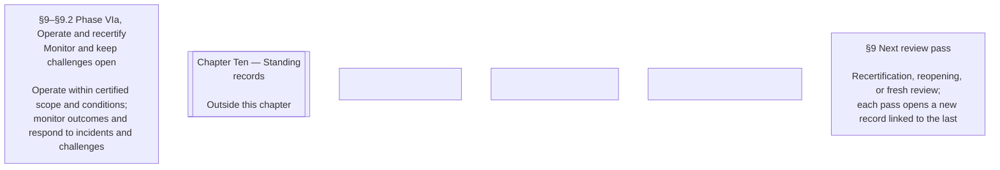
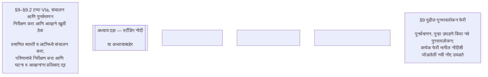

<!-- CHUNK-BEGIN mr__core_09.000_system_alignment_certification_evaluation__section_1_corpus_placement_overview.md bytes=5054 -->
<!-- AI-assisted translation draft; unreviewed. §1 corpus-placement overview, source lines 8–10; source SHA-256 4311e6ba74b7210f077c0bd4c8d21d8c9f517d2ada7b6d87288b39494dfeadd5. Draft only; do not synchronize into translations/. -->

# Chapter Nine Part A — §1 corpus-placement overview (mr)

## English source (lines 8–10)

> This file is **part of the Sentient Constitution** and is **binding only together** with the other numbered `core_*` files read as one text. It contains **Chapter Nine, Part A** — certification purpose, the process overview, and the first two phases of the process — **Frame** (system class) and **Evaluate** (whole-system evaluation in three sub-phases: the always-applicable evaluations, including data types and handling, in **§3**; the evaluations that apply where implicated in **§4**; and the Rights-Floor and domain evaluations that apply where triggered in **§5**) — **§1–§5**. The worked **Class A / B / C illustrations** (the system class profiles, §3.4.8, §5.1.5, §5.2.4, §5.3.7, §5.4.4, §5.5.5, and §5.6.4), including each one's **Reading across system classes** paragraph, are in [`core_09.010_system_alignment_certification_illustrations.md`](core_09.010_system_alignment_certification_illustrations.md); each keeps its Part A section number. The binding system-class-scaling and escalation rules those paragraphs illustrate stay in this file: system class scaling, including participation and proportionality, in §2.2; data-handling scaling in §3.4; and the **System class scaling and escalation** paragraph in each of §5.1–§5.6. The files of the whole chapter are listed in the table below.
>
> **Chapter Nine files.** Chapter Nine is split across four binding files read as one text. Part A, this file, opens the chapter; there is no separate index file.

## Translation draft

> ही फाइल **Sentient Constitution चा भाग** आहे आणि इतर क्रमांकित `core_*` फायलींसह एकच मजकूर म्हणून वाचल्यावरच बंधनकारक ठरते. यात **अध्याय नऊ, भाग अ** समाविष्ट आहे—प्रमाणनाचा उद्देश, प्रक्रियेचा आढावा आणि तिचे पहिले दोन टप्पे: **Frame** (प्रणालीचा वर्ग) आणि **Evaluate** (तीन उपटप्प्यांतील संपूर्ण-प्रणाली मूल्यांकन: डेटा प्रकार व हाताळणीसह नेहमी लागू होणारी मूल्यांकने **§3** मध्ये; लागू असतील तेव्हा होणारी मूल्यांकने **§4** मध्ये; आणि अट लागू झाल्यावर होणारी **अधिकार-तळ** व क्षेत्रीय मूल्यांकने **§5** मध्ये)—**§§1–5**. **वर्ग A / B / C** ची सविस्तर उदाहरणे (प्रणाली-वर्ग प्रोफाइल, §3.4.8, §5.1.5, §5.2.4, §5.3.7, §5.4.4, §5.5.5 आणि §5.6.4), प्रत्येकातील **प्रणाली-वर्गांमधून वाचन** या परिच्छेदासह, [`core_09.010_system_alignment_certification_illustrations.md`](core_09.010_system_alignment_certification_illustrations.md) येथे आहेत; प्रत्येक उदाहरण भाग अ मधील आपला विभाग क्रमांक राखते. हे परिच्छेद स्पष्ट करतात ते बंधनकारक वर्गानुसार प्रमाण-निर्धारण व वाढीचे नियम याच फाइलमध्ये राहतात: सहभाग व प्रमाणबद्धतेसह प्रणाली-वर्गानुसार प्रमाण §2.2 मध्ये; डेटा-हाताळणीचे प्रमाण §3.4 मध्ये; आणि §§5.1–5.6 मधील प्रत्येक विभागात **प्रणाली-वर्गानुसार प्रमाण व वाढ** हा परिच्छेद. खालील तक्त्यात संपूर्ण अध्यायाच्या फायली दिल्या आहेत.
>
> **अध्याय नऊच्या फायली.** अध्याय नऊ चार बंधनकारक फायलींमध्ये विभागला आहे आणि त्या एकत्र वाचल्या जातात. भाग अ ही फाइल अध्यायाची सुरुवात करते; स्वतंत्र अनुक्रमणिका फाइल नाही.

<!-- CHUNK-END -->
<!-- CHUNK-BEGIN mr__core_09.000_system_alignment_certification_evaluation__section_1_corpus_file_table.md bytes=6567 -->
<!-- AI-assisted translation draft; unreviewed. §1 corpus-placement file table, source lines 12–17; source SHA-256 4311e6ba74b7210f077c0bd4c8d21d8c9f517d2ada7b6d87288b39494dfeadd5. Draft only; do not synchronize into translations/. -->

# Chapter Nine Part A — §1 corpus-placement file table (mr)

## English source (lines 12–17)

> | Part | File | Owns |
> |------|------|------|
> | **Part A — Evaluation** | [`core_09.000_system_alignment_certification_evaluation.md`](core_09.000_system_alignment_certification_evaluation.md) | §1–§5: purpose and process overview (with a chart of the whole certification process in its six phases), **Phase I Frame** (system class, how system class scales every evaluation, and pilot certification) and **Phase II Evaluate** (whole-system evaluation in three sub-phases: **IIa** always, in §3, including chartered scope versus functional boundaries and data types and handling; **IIb** where implicated, in §4; and **IIc** where triggered, the Rights-Floor and domain evaluations, in §5) |
> | **Part B — Record and process** | [`core_09.005_system_alignment_certification_record_process.md`](core_09.005_system_alignment_certification_record_process.md) | §6–§10: **Phase III Review** (forum roles, supervisory sequence, and the contestability chain), **Phase IV Decide** (certification outcomes, including the go-live gate), **Phase V Record** (the certification record and its integrity, including governing [System Charter](core_05.040_band_continuity.md#system-charter) fields), and **Phase VI Operate** (the challenge path; recertification and reopening; the standing bridge) — continuous chapter numbering from Part A §5 |
> | **Part C — Illustrations** | [`core_09.010_system_alignment_certification_illustrations.md`](core_09.010_system_alignment_certification_illustrations.md) | the illustrative system class profiles, §3.4, §3.4.8, §5.1.5, §5.2.4, §5.3.7, §5.4.4, §5.5.5, and §5.6.4: worked Class A / B / C walkthroughs for each Part A evaluation area, numbered to match Part A and linked both ways |
> | **Part D — Institutional alignment certification** | [`core_09.015_institutional_alignment_certification.md`](core_09.015_institutional_alignment_certification.md) | §11–§15: the same six phases for an **Institution** rather than a System — the institution class and the institutional evaluation (**Phases I and II**, §12), the forum roles, outcome, and **Institutional Certification Record** (**Phases III to V**, §13), and recertification, reopening, the cascade from System certifications, and the standing bridge (**Phase VI**, §14–§15). It cites each System's certification by link and does not repeat it, and it is not a licence — continuous chapter numbering from Part B §10 |

## Translation draft

| भाग | फाइल | व्याप्ती |
|------|------|------|
| **Part A — Evaluation** | [`core_09.000_system_alignment_certification_evaluation.md`](core_09.000_system_alignment_certification_evaluation.md) | §§1–5: उद्देश आणि प्रक्रियेचा आढावा (सहा टप्प्यांचा तक्ता), तसेच I Frame (प्रणालीचा वर्ग, प्रत्येक मूल्यांकनाची खोली वर्गानुसार कशी ठरते, आणि पायलट प्रमाणन) व II Evaluate (तीन उपटप्प्यांतील संपूर्ण-प्रणाली मूल्यांकन: IIa नेहमी §3 मध्ये—सनदेतील व्याप्ती विरुद्ध कार्यात्मक सीमा आणि डेटा प्रकार/हाताळणीसह; IIb लागू असल्यास §4 मध्ये; IIc अट लागू झाल्यास §5 मधील अधिकार-तळ व क्षेत्रीय मूल्यांकन). |
| **Part B — Record and process** | [`core_09.005_system_alignment_certification_record_process.md`](core_09.005_system_alignment_certification_record_process.md) | §§6–10: III Review (मंचाच्या भूमिका, देखरेखीचा क्रम, आणि आव्हान-साखळी); IV Decide (प्रमाणनाचे निष्कर्ष, कार्यान्वयनापूर्वीची अट); V Record (प्रमाणन नोंद व तिची अखंडता, [System Charter](core_05.040_band_continuity.md#system-charter) मधील नियंत्रक घटकांसह); VI Operate (आव्हानाचा मार्ग, पुनःप्रमाणन व पुनःउघडणे, standing सेतू) — भाग अ §5 पासून सलग क्रमांकन. |
| **Part C — Illustrations** | [`core_09.010_system_alignment_certification_illustrations.md`](core_09.010_system_alignment_certification_illustrations.md) | प्रणाली-वर्गांची दृष्टांतात्मक रूपरेषा आणि §§3.4, 3.4.8, 5.1.5, 5.2.4, 5.3.7, 5.4.4, 5.5.5, 5.6.4: भाग अ मधील प्रत्येक मूल्यांकन क्षेत्रासाठी वर्ग A/B/C ची सविस्तर उदाहरणे; क्रमांक जुळतात आणि दोन्ही बाजूंनी दुवे आहेत. |
| **Part D — Institutional alignment certification** | [`core_09.015_institutional_alignment_certification.md`](core_09.015_institutional_alignment_certification.md) | §§11–15: प्रणालीऐवजी संस्थेसाठी तेच सहा टप्पे—संस्थेचा वर्ग व मूल्यांकन (I–II, §12), मंचाच्या भूमिका, निष्कर्ष व संस्थात्मक प्रमाणन नोंद (III–V, §13), पुनःप्रमाणन, पुनःउघडणे, प्रणाली प्रमाणनांची साखळी व standing सेतू (VI, §§14–15). प्रत्येक प्रणालीच्या प्रमाणनाचा संदर्भ देते, पुनरावृत्ती करत नाही, आणि परवाना नाही — भाग ब §10 पासून सलग क्रमांकन. |

<!-- CHUNK-END -->
<!-- CHUNK-BEGIN mr__core_09.000_system_alignment_certification_evaluation__section_1_corpus_explanation.md bytes=11617 -->
<!-- AI-assisted translation draft; unreviewed. §1 corpus-placement explanatory prose, source lines 19–30; source SHA-256 4311e6ba74b7210f077c0bd4c8d21d8c9f517d2ada7b6d87288b39494dfeadd5. Draft only; do not synchronize into translations/. -->

# Chapter Nine Part A — §1 corpus-placement explanatory prose (mr)

## English source (lines 19–30)

> **How the two certifications relate.** System Alignment Certification (Parts A to C) is the certification of a System. Institutional alignment certification (Part D) is the certification of an Institution, which may run Systems or none. Part D cites each System's certification record by link and does not redo it; [Part D §11.1](core_09.015_institutional_alignment_certification.md#111-relation-to-system-alignment-certification) states the relation and [Part D §11.3](core_09.015_institutional_alignment_certification.md#113-no-permission-and-no-gate) states that it is not a licence.
>
> Generic **Chapter Nine** links in other files route to the appropriate part by section number.
>
> - **Constitutional owner (joint with Parts B and D):** forum-supervised **system alignment certification and related records** — evaluation domains (Part A); forum process, supervisory sequence, certification-record duties, certification outcomes and the go-live gate, the challenge path, recertification and reopening, and verified-input bridge to Chapter Ten (Part B); the same six phases for an Institution (Part D). Under the **oversight** Tetrad leg, SAC is one especially large, high-stakes audit process among others; auditing floors remain at **Article XVI** (*Audit, Transparency, and Independent Verification*) and Chapter Five [Auditability](core_05.050_band_oversight.md#auditability).
> - **Verification substrate owner:** [Chapter Four — Burden of Proof, Traceability, and Verification](core_04.000_burden_traceability_verification.md#chapter-four-burden-of-proof-traceability-and-verification) (within Chapters Two through Four) owns burden allocation, compliance evidence, definition traceability, observability, and security-constrained verification. Chapter Nine **applies** that discipline to system alignment certification records; it does **not** restate Chapter Four sections **1** through **5**.
> - **Auditing home (not relocated here):** **Article XVI** (*Audit, Transparency, and Independent Verification*), **Def.O1** (*Transparency, Auditability, and Verification*), and **CJS-5.110 §3 and CJS-5.115 §3** (*Audit process home*)–**CJS-5.110 §5** own auditing floors and operational terms. Chapter Nine runs one especially large SAC audit process that must satisfy those floors; it does not own all auditing.
> - **Implementation owner:** system-class handling, CS-6.345, and forum-process detail in designated implementation files must remain consistent with Chapter Nine and may be stricter where the corpus already provides a [Fullest Protective Effect](core_05.045_band_integrative.md#fullest-protective-effect) rule.
> - **Anti-relocation rule:** Part A does not restate Chapter Five canonical definitions, Chapter Three anti-evasion discipline (see [Part B §9.3](core_09.005_system_alignment_certification_record_process.md#93-non-evasion)), Chapter Ten contribution or standing measurement, or Chapter Eleven standing effects. **[Part B §10](core_09.005_system_alignment_certification_record_process.md#10-relationship-to-standing)** states the standing bridge boundary explicitly.
>
> **Upstream:** Chapter Five definitions; Chapters Two through Four record, verification, burden, and traceability of definitions to results; and [Chapter Eight](core_08.000_functional_independence_separation_of_duties.md#chapter-eight-functional-independence-and-separation-of-duties), whose separation-of-duties requirement governs every materially binding certification act.
> **Downstream:** [Part B](core_09.005_system_alignment_certification_record_process.md#chapter-nine-part-b-system-alignment-certification--record-and-process) (*forum process, record, outcomes, and standing bridge*); Chapter Ten standing records and verified inputs; Chapter Eleven standing effects; Chapter Thirteen forum supervision and system alignment certification pathways.

## Translation draft

**दोन्ही प्रमाणनांचा संबंध.** System Alignment Certification (भाग A ते C) हे प्रणालीचे प्रमाणन आहे. Institutional alignment certification (भाग D) हे संस्थेचे प्रमाणन आहे; ती संस्था प्रणाली चालवू शकते किंवा एकही चालवत नसेल. भाग D प्रत्येक प्रणालीच्या प्रमाणन नोंदीचा दुवा देतो, परंतु प्रमाणन पुन्हा करत नाही; [Part D §11.1](core_09.015_institutional_alignment_certification.md#111-relation-to-system-alignment-certification) संबंध स्पष्ट करते आणि [Part D §11.3](core_09.015_institutional_alignment_certification.md#113-no-permission-and-no-gate) हे परवाना नसल्याचे सांगते.
>
> इतर फायलींमधील सर्वसाधारण **Chapter Nine** दुवे विभाग क्रमांकानुसार योग्य भागाकडे नेतात.
>
> - **संवैधानिक मालक (भाग B आणि D सह संयुक्त):** मंच-पर्यवेक्षित प्रणाली-संरेखन प्रमाणन आणि संबंधित नोंदी — मूल्यांकन क्षेत्रे (भाग A); मंच प्रक्रिया, पर्यवेक्षणाचा क्रम, प्रमाणन-नोंदीची कर्तव्ये, निकाल व कार्यारंभ-द्वार, आव्हानाचा मार्ग, पुनर्प्रमाणन व पुन्हा उघडणे, आणि अध्याय दह्यातील सत्यापित इनपुटचा दुवा (भाग B); संस्थेसाठी तेच सहा टप्पे (भाग D). Tetrad च्या **पर्यवेक्षण** घटकात SAC ही इतर प्रक्रियांमधील एक विशेषतः मोठी, उच्च-जोखमीची लेखापरीक्षण प्रक्रिया आहे; लेखापरीक्षणाची किमान तळरेषा **Article XVI** (*Audit, Transparency, and Independent Verification*) आणि अध्याय पाचमधील [Auditability](core_05.050_band_oversight.md#auditability) येथे राहते.
> - **पडताळणी-आधाराचा मालक:** [Chapter Four — Burden of Proof, Traceability, and Verification](core_04.000_burden_traceability_verification.md#chapter-four-burden-of-proof-traceability-and-verification) (अध्याय दोन ते चारमध्ये) पुराव्याच्या भाराचे वाटप, अनुपालनाचे पुरावे, व्याख्यांची मागोवा-क्षमता, निरीक्षणक्षमता आणि सुरक्षा-बंधनांतर्गत पडताळणी यांचा मालक आहे. अध्याय नऊ ही शिस्त प्रणाली-संरेखन प्रमाणन नोंदींना लागू करतो; अध्याय चारची **1** ते **5** ही कलमे पुन्हा सांगत नाही.
> - **लेखापरीक्षणाचे मूळ स्थान (येथे हलवलेले नाही):** **Article XVI** (*Audit, Transparency, and Independent Verification*), **Def.O1** (*Transparency, Auditability, and Verification*), आणि **CJS-5.110 §3 व CJS-5.115 §3** (*Audit process home*)–**CJS-5.110 §5** लेखापरीक्षणाच्या किमान तळरेषा व कार्यकारी संज्ञांचे मालक आहेत. अध्याय नऊ एक विशेष मोठी SAC लेखापरीक्षण प्रक्रिया चालवतो आणि तिने त्या तळरेषा पाळल्या पाहिजेत; परंतु सर्व लेखापरीक्षणाचा तो मालक नाही.
> - **अंमलबजावणीचा मालक:** निर्दिष्ट अंमलबजावणी फायलींमधील प्रणाली-वर्ग हाताळणी, CS-6.345 आणि मंच-प्रक्रियेचे तपशील अध्याय नऊशी सुसंगत राहिले पाहिजेत; corpus मध्ये [Fullest Protective Effect](core_05.045_band_integrative.md#fullest-protective-effect) नियम आधीच असल्यास ते अधिक कठोर असू शकतात.
> - **स्थलांतर-विरोधी नियम:** भाग A अध्याय पाचच्या प्रमाणभूत व्याख्या, अध्याय तीनची टाळाटाळ-विरोधी शिस्त ([Part B §9.3](core_09.005_system_alignment_certification_record_process.md#93-non-evasion) पहा), अध्याय दह्याचे योगदान किंवा standing मापन, किंवा अध्याय अकर्याचे standing परिणाम पुन्हा मांडत नाही. **[Part B §10](core_09.005_system_alignment_certification_record_process.md#10-relationship-to-standing)** standing दुव्याची सीमा स्पष्टपणे सांगते.
>
> **पूर्वस्रोत:** अध्याय पाचच्या व्याख्या; अध्याय दोन ते चारमधील नोंदी, पडताळणी, पुराव्याचा भार आणि व्याख्यांपासून निकालांपर्यंत मागोवा; आणि [Chapter Eight](core_08.000_functional_independence_separation_of_duties.md#chapter-eight-functional-independence-and-separation-of-duties), ज्याची कर्तव्य-विभाजनाची अट प्रत्येक महत्त्वपूर्णरीत्या बंधनकारक प्रमाणन-कृतीवर लागू होते.
> **उत्तरकालीन स्रोत:** [Part B](core_09.005_system_alignment_certification_record_process.md#chapter-nine-part-b-system-alignment-certification--record-and-process) (*मंच प्रक्रिया, नोंद, निकाल आणि standing दुवा*); अध्याय दह्याच्या standing नोंदी व सत्यापित इनपुट; अध्याय अकर्याचे standing परिणाम; अध्याय तेर्याचे मंच-पर्यवेक्षण व प्रणाली-संरेखन प्रमाणन मार्ग.

<!-- CHUNK-END -->
<!-- CHUNK-BEGIN mr__core_09.000_system_alignment_certification_evaluation__section_1_heading.md bytes=396 -->
<!-- AI-assisted translation draft; unreviewed. §1 heading, source line 44; source SHA-256 4311e6ba74b7210f077c0bd4c8d21d8c9f517d2ada7b6d87288b39494dfeadd5. Draft only; do not synchronize into translations/. -->

# Chapter Nine Part A — §1 heading (mr)

## English source (lines 44–45)

### 1. Purpose and Role


## Translation draft

### 1. उद्देश आणि भूमिका

<!-- CHUNK-END -->
<!-- CHUNK-BEGIN mr__core_09.000_system_alignment_certification_evaluation__section_1_trace.md bytes=12446 -->
<!-- AI-assisted translation draft; unreviewed. §1 trace, source lines 46–95; source SHA-256 4311e6ba74b7210f077c0bd4c8d21d8c9f517d2ada7b6d87288b39494dfeadd5. Draft only; do not synchronize into translations/. -->

# Chapter Nine Part A — §1 trace (mr)

## English source (lines 46–95)

<details>
<summary><strong><span style="color: #2563eb;">Trace</span></strong></summary>

- Upstream:
  - [Preamble — constitutional owner register](core_00.000_preamble.md#4-principles-definitions-and-rights) and
  - [Authority Stack and Internal Hierarchy](core_05.045_band_integrative.md#authority-stack-and-internal-hierarchy);
  - [Constitutional Tetrad](core_00.000_preamble.md#constitutional-tetrad);
  - [Two Constitutional Aims](core_00.000_preamble.md#two-constitutional-aims);
  - [material stake](core_00.000_preamble.md#material-stake);
  - [Proportionality](core_05.035_band_accountability.md#proportionality) and
  - [Substantive Fairness](core_05.055_band_participation.md#substantive-fairness) (Chapter Five); Participation measurement family (*voice, access, and contest paths*);
  - [Chapter One §16 Stewardship In Depth](core_01.010_stewardship_capacity_principles.md#16-stewardship-in-depth) (1.010 §16);
  - [Chapter One §12 Systemic Evaluation Requirement](core_01.000_values_principles.md#12-systemic-evaluation-requirement) (1.000 §12) (*principle-layer whole-system evaluation lens — not one corner alone*); Chapters Two through Four;
  - [Chapter Five](core_05.000_definitions_home.md#chapter-five-foundational-definitions) (5.000) (*canonical definitions*);
  - [Chapter Eight §2 Four-Seat Constitutional Requirement](core_08.000_functional_independence_separation_of_duties.md#2-four-seat-constitutional-requirement) (8.000 §2);
  - [System Alignment Certification](core_05.040_band_continuity.md#system-alignment-certification) (Chapter Five canonical term; non-operative shorthand **SAC**);
  - [System Certification Record](core_05.040_band_continuity.md#system-certification-record) (Chapter Five meaning).
- Downstream:
  - [§2](#2-system-class-evaluation) (*system class evaluation*);
  - [Part B §9.1](core_09.005_system_alignment_certification_record_process.md#91-challenging-a-certification) (9.005 §9.1) (*challenging a certification*); and
  - [Part C system class profiles](core_09.010_system_alignment_certification_illustrations.md#illustrative-system-class-profiles-non-exhaustive) (9.010) (*illustrative system class profiles*);
  - [Part C whole-system walkthroughs](core_09.010_system_alignment_certification_illustrations.md#illustrative-whole-system-application-by-system-class-non-exhaustive) (9.010) (*worked whole-system examples by system class*);
  - [§3.4.8](core_09.010_system_alignment_certification_illustrations.md#348-illustrative-data-handling-application-by-system-class-non-exhaustive) (*worked data-handling examples by system class*);
  - [§5.1.5](core_09.010_system_alignment_certification_illustrations.md#515-illustrative-ecological-footprint-application-by-system-class-non-exhaustive) (*worked ecological-footprint examples by system class*);
  - [§5.2.4](core_09.010_system_alignment_certification_illustrations.md#524-illustrative-educational-capability-application-by-system-class-non-exhaustive) (*worked educational-capability examples by system class*);
  - [§5.3.7](core_09.010_system_alignment_certification_illustrations.md#537-illustrative-cross-system-support-application-by-system-class-non-exhaustive) (*worked cross-system-support examples by system class*);
  - [§5.4.4](core_09.010_system_alignment_certification_illustrations.md#544-illustrative-nondiscrimination-application-by-system-class-non-exhaustive) (*worked nondiscrimination examples by system class*);
  - [§5.5.5](core_09.010_system_alignment_certification_illustrations.md#555-illustrative-accessibility-application-by-system-class-non-exhaustive) (*worked accessibility examples by system class*);
  - [§5.6.4](core_09.010_system_alignment_certification_illustrations.md#564-illustrative-trustworthiness-application-by-system-class-non-exhaustive) (*worked trustworthiness examples by system class*);
  - [§3](#3-whole-system-certification-evaluation) (*whole-system certification evaluation factors*);
  - [§3.4](#34-data-types-and-handling-evaluation) through
  - [§5.6](#56-trustworthiness-and-system-reliance-integrity-evaluation) (*domain evaluations*);
  - [Part B §6](core_09.005_system_alignment_certification_record_process.md#6-forum-process) (9.005 §6) (*supervisory sequence and contestability chain*);
  - [Part B §6.1](core_09.005_system_alignment_certification_record_process.md#61-forum-supervision-and-component-roles) (9.005 §6.1) (*forum component roles*);
  - [Part B §8](core_09.005_system_alignment_certification_record_process.md#8-system-certification-record) (9.005 §8) (*certification record contents*);
  - [Part B §8.2](core_09.005_system_alignment_certification_record_process.md#82-record-integrity-transparency-and-auditability) (9.005 §8.2) (*record integrity requirements*);
  - [Part B §7](core_09.005_system_alignment_certification_record_process.md#7-certification-outcomes) (9.005 §7) (*reopening and anti-evasion*);
  - [Part B §10](core_09.005_system_alignment_certification_record_process.md#10-relationship-to-standing) (9.005 §10) (*standing-record bridge*);
  - [Chapter Ten](core_11.000_standing_assessment.md#chapter-eleven-contribution-violation-and-standing-model--measurement) (10.000) (*standing records and verified-input gate*);
  - [Chapter Eleven](core_12.000_standing_integration.md#chapter-twelve-standing-effects-and-integration) (11.000) (*standing effects and integration*);
  - [Chapter Thirteen](core_14.000_forum.md#chapter-fourteen-forums-and-jurisdiction) (13.000) (*forum supervision, certification, alignment certification, and review*).
- Read with:
  - **[CS-9.305](corpus_systems/cs_09.305_system_classification_machinery.md#cs-9305-part-a-system-classification-machinery) (*System classification machinery*) and [CS-9.310 — System impact classifications](corpus_systems/cs_09.310_system_impact_classifications.md#cs-9310-part-b-system-impact-classifications)**, **[CS-6.305](corpus_systems/cs_06.305_information_types_and_handling.md#cs-6305-part-a-information-types-and-handling) (*Information types and handling*) and [CS-6.310 — Data classifications](corpus_systems/cs_06.310_data_classifications.md#cs-6310-part-b-data-classifications)**, and
  - **CS-6.345** (*System lifecycle*);
  - **CF-13.415** (*Routing operations, transfer, certification, and representative treatment*) and
  - **CF-13.425** (*Integrity safeguards, anti-capture operations, and anti-self-judging support*); **Article XVI** (*Audit, Transparency, and Independent Verification*) and
  - [Auditability](core_05.050_band_oversight.md#auditability) (*auditing floors — SAC is one especially large audit process under oversight, not the sole auditing home*); **CJS-5.110 §3 (*Oversight: auditability and reconstructability terms (annex)*) and CJS-5.115 §3** (*Audit process home*)–
  - **CJS-5.110 §5** (*Oversight: independent verification and claim-integrity terms*).

</details>

## Translation draft

#### संदर्भ-नकाशा

हा नकाशा या विभागाचा घटनात्मक व अधिकाराधारित पाया दाखवतो आणि मूल्यमापन, वर्गीकरण, पुनरावलोकनमार्ग, नोंदी, परिणाम व लेखापरीक्षणाशी जोडतो; सोबत वाचायची कार्यकारी साधनेही दर्शवतो.

**संदर्भ-नकाशा — upstream canonical sources:** [Preamble — constitutional owner register](core_00.000_preamble.md#4-principles-definitions-and-rights); [Authority Stack and Internal Hierarchy](core_05.045_band_integrative.md#authority-stack-and-internal-hierarchy); [Constitutional Tetrad](core_00.000_preamble.md#constitutional-tetrad); [Two Constitutional Aims](core_00.000_preamble.md#two-constitutional-aims); [material stake](core_00.000_preamble.md#material-stake); [Proportionality](core_05.035_band_accountability.md#proportionality); [Substantive Fairness](core_05.055_band_participation.md#substantive-fairness); [Chapter One §16 Stewardship In Depth](core_01.010_stewardship_capacity_principles.md#16-stewardship-in-depth); [Chapter One §12 Systemic Evaluation Requirement](core_01.000_values_principles.md#12-systemic-evaluation-requirement); [Chapter Five](core_05.000_definitions_home.md#chapter-five-foundational-definitions); [Chapter Eight §2 Four-Seat Constitutional Requirement](core_08.000_functional_independence_separation_of_duties.md#2-four-seat-constitutional-requirement); [System Alignment Certification](core_05.040_band_continuity.md#system-alignment-certification); [System Certification Record](core_05.040_band_continuity.md#system-certification-record)

**संदर्भ-नकाशा — downstream routes and related records:** [§2](#2-system-class-evaluation); [Part B §9.1](core_09.005_system_alignment_certification_record_process.md#91-challenging-a-certification); [Part C system class profiles](core_09.010_system_alignment_certification_illustrations.md#illustrative-system-class-profiles-non-exhaustive); [Part C whole-system walkthroughs](core_09.010_system_alignment_certification_illustrations.md#illustrative-whole-system-application-by-system-class-non-exhaustive); [§3.4.8](core_09.010_system_alignment_certification_illustrations.md#348-illustrative-data-handling-application-by-system-class-non-exhaustive); [§5.1.5](core_09.010_system_alignment_certification_illustrations.md#515-illustrative-ecological-footprint-application-by-system-class-non-exhaustive); [§5.2.4](core_09.010_system_alignment_certification_illustrations.md#524-illustrative-educational-capability-application-by-system-class-non-exhaustive); [§5.3.7](core_09.010_system_alignment_certification_illustrations.md#537-illustrative-cross-system-support-application-by-system-class-non-exhaustive); [§5.4.4](core_09.010_system_alignment_certification_illustrations.md#544-illustrative-nondiscrimination-application-by-system-class-non-exhaustive); [§5.5.5](core_09.010_system_alignment_certification_illustrations.md#555-illustrative-accessibility-application-by-system-class-non-exhaustive); [§5.6.4](core_09.010_system_alignment_certification_illustrations.md#564-illustrative-trustworthiness-application-by-system-class-non-exhaustive); [§3](#3-whole-system-certification-evaluation); [§3.4](#34-data-types-and-handling-evaluation); [§5.6](#56-trustworthiness-and-system-reliance-integrity-evaluation); [Part B §6](core_09.005_system_alignment_certification_record_process.md#6-forum-process); [Part B §6.1](core_09.005_system_alignment_certification_record_process.md#61-forum-supervision-and-component-roles); [Part B §8](core_09.005_system_alignment_certification_record_process.md#8-system-certification-record); [Part B §8.2](core_09.005_system_alignment_certification_record_process.md#82-record-integrity-transparency-and-auditability); [Part B §7](core_09.005_system_alignment_certification_record_process.md#7-certification-outcomes); [Part B §10](core_09.005_system_alignment_certification_record_process.md#10-relationship-to-standing); [Chapter Ten](core_11.000_standing_assessment.md#chapter-eleven-contribution-violation-and-standing-model--measurement); [Chapter Eleven](core_12.000_standing_integration.md#chapter-twelve-standing-effects-and-integration); [Chapter Thirteen](core_14.000_forum.md#chapter-fourteen-forums-and-jurisdiction)

**संदर्भ-नकाशा — operational materials to read with this section:** [CS-9.305](corpus_systems/cs_09.305_system_classification_machinery.md#cs-9305-part-a-system-classification-machinery); [CS-9.310 — System impact classifications](corpus_systems/cs_09.310_system_impact_classifications.md#cs-9310-part-b-system-impact-classifications); [CS-6.305](corpus_systems/cs_06.305_information_types_and_handling.md#cs-6305-part-a-information-types-and-handling); [CS-6.310 — Data classifications](corpus_systems/cs_06.310_data_classifications.md#cs-6310-part-b-data-classifications); [Auditability](core_05.050_band_oversight.md#auditability)

<!-- CHUNK-END -->
<!-- CHUNK-BEGIN mr__core_09.000_system_alignment_certification_evaluation__purpose_adjuncts.md bytes=8679 -->
<!-- AI-assisted translation draft; unreviewed. Selected §1 passages, source lines 99 and 107–114; source SHA-256 4311e6ba74b7210f077c0bd4c8d21d8c9f517d2ada7b6d87288b39494dfeadd5. -->

# Chapter Nine Part A — §1 plain-terms excerpt

**Status:** AI-assisted draft; unreviewed. English source remains controlling.

## English source

When a system really matters to sentients' lives, certification has to be **proportionate** — as demanding as the system's real impact, dependency, and risk require, not a one-size-fits-all checklist or a rubber stamp. It also has to be **participatory** — affected sentients and communities must be able to see what was reviewed, understand what was decided, and challenge it when something is wrong. Forums review evidence, write it down in a certification record, and require re-checks on a schedule that matches how risky the system is. Classes A, B, and C get the full process and Class L a lighter one. Class P is encouraged to use it, and must once it is reclassified to Class L or higher (that is, its effects reach beyond a private unit) or its operator claims constitutional compliance.

## mr draft

एखाद्या प्रणालीचा संवेदनशील जीवांच्या जीवनावर खरोखर महत्त्वाचा परिणाम होत असेल, तर प्रमाणन **प्रमाणबद्ध** असले पाहिजे—प्रणालीचा वास्तविक परिणाम, अवलंबित्व आणि जोखीम जितकी कठोरता मागतात तितके; सर्वांसाठी एकच तपासणीसूची किंवा केवळ शिक्कामोर्तब नव्हे. ते **सहभागी**ही असले पाहिजे—प्रभावित जीव आणि समुदायांना काय तपासले गेले हे पाहता यावे, निर्णय समजावा आणि चूक असल्यास आव्हान देता यावे. मंच पुराव्याचे पुनरावलोकन करतात, तो प्रमाणन नोंदीत लिहितात आणि प्रणालीच्या जोखमीशी जुळणाऱ्या वेळापत्रकानुसार पुन्हा तपासणी मागतात. A, B आणि C वर्गांसाठी पूर्ण प्रक्रिया लागू होते; L वर्गासाठी हलकी प्रक्रिया. P वर्गाने ही प्रक्रिया वापरावी असे प्रोत्साहन दिले जाते; L किंवा त्याहून उच्च वर्गात पुनर्वर्गीकृत झाल्यावर (म्हणजे परिणाम खाजगी घटकाच्या पलीकडे गेल्यावर) किंवा त्याच्या चालकाने घटनात्मक अनुपालनाचा दावा केल्यावर ती वापरणे बंधनकारक होते.


### English source — Flourishing

- **[Flourishing](core_00.000_preamble.md#flourishing)** — certification verifies that certification or continued reliance would not quietly defeat Rights Floors or block fair participation in constitutionally relevant life;

### mr draft

- **[समृद्धी](core_00.000_preamble.md#flourishing)** — प्रमाणन किंवा अवलंबित्व सुरू ठेवणे अधिकार-तळ शांतपणे निष्प्रभ करणार नाही किंवा घटनात्मकदृष्ट्या महत्त्वाच्या जीवनातील न्याय्य सहभाग रोखणार नाही याची प्रमाणन खात्री करते;


### English source — Continuity criterion

- **[Continuity](core_00.000_preamble.md#continuity)** — certification verifies durable, non-regressive supply that sustains rather than depletes healthy natural systems ([Ecological Integrity](core_05.040_band_continuity.md#ecological-integrity), including [Ecological Recovery Capacity](core_05.040_band_continuity.md#ecological-recovery-capacity)), and system-class-scaled recertification where shared systems gate or sustain delivery;

### mr draft

- **[सातत्य](core_00.000_preamble.md#continuity)** — प्रमाणन निरोगी नैसर्गिक प्रणालींचा ऱ्हास न करता त्यांना टिकवणारा टिकाऊ, प्रतिगामी नसलेला पुरवठा तपासते ([पर्यावरणीय अखंडता](core_05.040_band_continuity.md#ecological-integrity), यात [पर्यावरणीय पुनर्प्राप्ती क्षमता](core_05.040_band_continuity.md#ecological-recovery-capacity) समाविष्ट आहे); सामायिक प्रणाली पुरवठ्यावर नियंत्रण ठेवतात किंवा तो टिकवतात तेथे प्रणाली-वर्गानुसार पुनःप्रमाणनही तपासते;


### English source — Participation criterion

- **Participation** — affected sentients and communities can understand, contest, and take part in review paths that matter to them;

### mr draft

- **सहभाग** — प्रभावित संवेदनशील जीव आणि समुदायांना महत्त्वाचे पुनरावलोकन मार्ग समजतात, त्यांना आव्हान देता येते आणि त्यात सहभागी होता येते;


### English source — Oversight criterion

- **Oversight** — records, evidence, and assumptions are visible and auditable enough for independent checking; certification itself is one especially large audit process under that oversight duty, not the only one;

### mr draft

- **देखरेख** — नोंदी, पुरावे आणि गृहीतके स्वतंत्र तपासणीसाठी पुरेशी दृश्यमान व लेखापरीक्षणयोग्य असतात; प्रमाणन ही देखरेखीच्या कर्तव्यांतर्गत एक विशेष मोठी लेखापरीक्षण प्रक्रिया आहे, एकमेव नाही;


### English source — Accountability criterion

- **Accountability** — defects, misclassification, and floor-defeating operation route to remedy, conditions, withdrawal, or standing input where the facts support it;

### mr draft

- **उत्तरदायित्व** — दोष, चुकीचे वर्गीकरण आणि अधिकार-तळ निष्फळ करणारे संचालन तथ्यांनी समर्थित असल्यास उपाय, अटी, माघार किंवा स्थिती-मापनासाठीच्या इनपुटकडे वळते;


### English source — Timeliness criterion

- **Timeliness** — review and contest windows keep certification from going stale while harm can still be prevented or reversed.

### mr draft

- **समयबद्धता** — हानी अजून रोखता किंवा उलटवता येत असताना पुनरावलोकन व आव्हानाच्या मुदती प्रमाणन कालबाह्य होऊ देत नाहीत.


### English source — Tetrad introduction

Certification implements the [Two Constitutional Aims](core_00.000_preamble.md#two-constitutional-aims) through the [Constitutional Tetrad](core_00.000_preamble.md#constitutional-tetrad):

### mr draft

प्रमाणन [दोन घटनात्मक उद्दिष्टे](core_00.000_preamble.md#two-constitutional-aims) [घटनात्मक चतुष्टयाच्या](core_00.000_preamble.md#constitutional-tetrad) माध्यमातून राबवते:

<!-- CHUNK-END -->
<!-- CHUNK-BEGIN mr__core_09.000_system_alignment_certification_evaluation__section_1_purpose.md bytes=2321 -->
<!-- AI-assisted translation draft; unreviewed. Complete purpose statement excerpt, source lines 101–105; source SHA-256 4311e6ba74b7210f077c0bd4c8d21d8c9f517d2ada7b6d87288b39494dfeadd5. This is an excerpt, not a complete §1 translation. -->

**प्रणाली संरेखन प्रमाणन** हे निर्दिष्ट व्याप्ती आणि पुनरावलोकन वेळापत्रकासाठी एका प्रश्नाचे उत्तर देण्यासाठी असते: प्रमाणन, सशर्त प्रमाणन, वैधता-तपासणी, पुनःप्रमाणन, अवलंबित्व सुरू ठेवणे, तैनाती किंवा अटींमधून महत्त्वपूर्ण मुक्तता यासाठी प्रणालीने पुरेसे घटनात्मक संरेखन दाखवले आहे का?

- प्रमाणन हा लोकप्रियतेचा गुण नाही, कायमची परवानगी नाही आणि अधिकार-पुनरावलोकन टाळण्याचा मार्गही नाही.
- प्रणालीच्या संरेखनाबद्दल सध्या काय ज्ञात आहे याचे ते कालमर्यादित आणि आव्हानयोग्य विधान आहे.
- चतुष्टयाच्या **देखरेख** पायाखाली देखरेखीसाठी लेखापरीक्षण आवश्यक आहे; प्रणाली संरेखन प्रमाणन ही इतरांपैकी एक विशेषतः मोठी, उच्च-जोखमीची लेखापरीक्षण प्रक्रिया आहे — लेखापरीक्षणाचे एकमेव ठिकाण नाही (**अनुच्छेद XVI** (*लेखापरीक्षण, पारदर्शकता आणि स्वतंत्र पडताळणी*), [लेखापरीक्षणक्षमता](core_05.050_band_oversight.md#auditability)).

<!-- CHUNK-END -->
<!-- CHUNK-BEGIN mr__core_09.000_system_alignment_certification_evaluation__section_1_subsection_headings.md bytes=913 -->
<!-- AI-assisted translation draft; unreviewed. §1.1/§1.2 visible subsection headings, source lines 116–119 and 144–148; source SHA-256 4311e6ba74b7210f077c0bd4c8d21d8c9f517d2ada7b6d87288b39494dfeadd5. Draft only; anchors/blank layout are structural. Do not synchronize into translations/. -->

# Chapter Nine Part A — §1.1 and §1.2 subsection headings (mr)

## English source

### Lines 116–119

<a id="11-certification-as-an-audit-process-scaled-by-class"></a>

#### 1.1 Certification as an audit process, scaled by class


### Lines 144–148


<a id="12-certification-at-a-glance"></a>

#### 1.2 Certification at a glance


## Translation draft

#### 1.1 वर्गानुसार प्रमाणबद्ध केलेली लेखापरीक्षण प्रक्रिया म्हणून प्रमाणन

#### 1.2 एका नजरेत प्रमाणन

<!-- CHUNK-END -->
<!-- CHUNK-BEGIN mr__core_09.000_system_alignment_certification_evaluation__section_1_audit_scope.md bytes=4901 -->
<!-- AI-assisted translation draft; unreviewed. §1.1 audit mechanism and sibling audit modes, source lines 120–130; source SHA-256 4311e6ba74b7210f077c0bd4c8d21d8c9f517d2ada7b6d87288b39494dfeadd5. -->

# Chapter Nine Part A — §1.1 certification audit process excerpt (mr)

## English source

As an oversight mechanism, certification is one especially large audit process under [Auditability](core_05.050_band_oversight.md#auditability) and **Article XVI** (*Audit, Transparency, and Independent Verification*):

- It is forum-supervised, multi-domain, and status-granting.
- It may integrate the results of sibling audit modes, and it does not absorb or replace them. Each keeps its own owner, named in the [sibling audit modes map](corpus_joint_structure/cjs_05.115_audit_process.md#sibling-audit-modes-owner-map) of the audit process home:
  - System Data Types Record audits under **CS-6.305 (*Information types and handling*) and CS-6.310** (*Data classifications*)
  - System Classification Record audits under **CS-9.305 (*System classification machinery*) and CS-9.310** (*System impact classifications*)
  - steward assurance reviews under **CS-14.305** (*Critical system stewardship*)
  - continuous audit under **CS-6.345** (*System lifecycle*) ACA
  - complexity audits under **CS-6.315** (*Comprehensibility and complexity stewardship*) and **Article XXIII-B** (*Complexity Audit and Modularity Requirements*)
  - claim verification under **CJS-5.110 §5** (*Oversight: independent verification and claim-integrity terms*)
- You can still run any of these checks on their own, without going through certification. Certification doesn't replace them.

## mr draft

देखरेखीची यंत्रणा म्हणून, [लेखापरीक्षणक्षमता](core_05.050_band_oversight.md#auditability) आणि **Article XVI** (*Audit, Transparency, and Independent Verification*) अंतर्गत प्रमाणन ही विशेषतः मोठ्या प्रमाणाची लेखापरीक्षण प्रक्रिया आहे:

- ती मंचाच्या देखरेखीखाली असते, अनेक क्षेत्रांचा समावेश करते आणि दर्जा प्रदान करते.
- ती सहोदर लेखापरीक्षण पद्धतींचे निष्कर्ष एकत्र करू शकते; मात्र त्यांना स्वतःत सामावून घेत नाही किंवा त्यांची जागा घेत नाही. प्रत्येक पद्धतीचा स्वतंत्र मालक राहतो; त्याचे नाव लेखापरीक्षण प्रक्रियेच्या मूळ दस्तऐवजातील [सहोदर लेखापरीक्षण पद्धतींच्या नकाशात](corpus_joint_structure/cjs_05.115_audit_process.md#sibling-audit-modes-owner-map) दिलेले असते:
  - System Data Types Record लेखापरीक्षणे **CS-6.305 (*माहितीचे प्रकार आणि हाताळणी*) आणि CS-6.310** (*डेटा वर्गीकरणे*) अंतर्गत
  - System Classification Record लेखापरीक्षणे **CS-9.305 (*प्रणाली वर्गीकरण यंत्रणा*) आणि CS-9.310** (*प्रणाली प्रभाव वर्गीकरणे*) अंतर्गत
  - पालकत्व-आश्वासन पुनरावलोकने **CS-14.305** (*महत्त्वपूर्ण प्रणालीचे पालकत्व*) अंतर्गत
  - सततचे लेखापरीक्षण **CS-6.345** (*प्रणाली जीवनचक्र*) ACA अंतर्गत
  - जटिलता लेखापरीक्षणे **CS-6.315** (*समजण्यायोग्यता आणि जटिलतेचे पालकत्व*) आणि **Article XXIII-B** (*जटिलता लेखापरीक्षण आणि मॉड्युलरिटी आवश्यकता*) अंतर्गत
  - दाव्यांची पडताळणी **CJS-5.110 §5** (*देखरेख: स्वतंत्र पडताळणी आणि दाव्यांच्या अखंडतेच्या अटी*) अंतर्गत
- प्रमाणन प्रक्रियेतून न जाता यांपैकी कोणतीही तपासणी स्वतंत्रपणे करता येते. प्रमाणन त्यांची जागा घेत नाही.

<!-- CHUNK-END -->
<!-- CHUNK-BEGIN mr__core_09.000_system_alignment_certification_evaluation__section_1_class_scaling.md bytes=5593 -->
<!-- AI-assisted translation draft; unreviewed. Chapter Nine Part A §1 class scaling and cadence, source lines 132–143; source SHA-256 4311e6ba74b7210f077c0bd4c8d21d8c9f517d2ada7b6d87288b39494dfeadd5. Draft only; do not synchronize into translations/. -->

**Current English passage:**

Certification depth, record burden, certification interval, stakeholder review, and contest paths must scale with [material stake](core_00.000_preamble.md#material-stake) under [Proportionality](core_05.035_band_accountability.md#proportionality):

The process applies by impact class, as the [reclassification requirement](corpus_systems/cs_09.305_system_classification_machinery.md#35-reclassification-requirement) of **CS-9.305** (*System classification machinery*) sets out:

- **Class A, Class B, and Class C:** these systems carry the highest impact, dependency, and risk, and whole-system evaluation under [§3 Whole-System Certification Evaluation](#3-whole-system-certification-evaluation), [§4 Evaluations Where Implicated](#4-evaluations-where-implicated), and [§5 Rights-Floor and Domain Evaluations](#5-rights-floor-and-domain-evaluations), each as its own sub-phase applies, is mandatory at full depth;
- **Class L:** the same evaluation is mandatory but proportionate, with a lower default re-check cadence and simpler records where CS-9.305 (*System classification machinery*) and CS-9.310 (*System impact classifications*) permits; and
- **Class P:** the process is encouraged while the system is validly Class P, and a Class P system may use it voluntarily. It becomes mandatory on reclassification to Class L or higher, or where the operator voluntarily asserts constitutional compliance for the system.

The certification interval, and the financial, resource, or special audit that falls at its midpoint, are set by class in [Chapter Thirteen §6 Timely resolution, materiality tiers, and anti-delay discipline](core_14.000_forum.md#review-cadence) (*Review cadence*). This chapter does not restate the numbers.

**Proposed locale translation:**

प्रमाणनाची खोली, अभिलेखाचा भार, प्रमाणनांतील अंतर, हितधारक पुनरावलोकन आणि आव्हानमार्ग हे [भौतिक दाव्याच्या](core_00.000_preamble.md#material-stake) प्रमाणात [प्रमाणबद्धतेनुसार](core_05.035_band_accountability.md#proportionality) बदलले पाहिजेत:

**CS-9.305** (*प्रणाली वर्गीकरण यंत्रणा*) मधील [पुनर्वर्गीकरणाची अट](corpus_systems/cs_09.305_system_classification_machinery.md#35-reclassification-requirement) सांगते त्याप्रमाणे प्रक्रिया परिणाम-वर्गानुसार लागू होते:

- **वर्ग A, B आणि C:** या प्रणालींमध्ये परिणाम, अवलंबित्व आणि धोका सर्वाधिक असतात. [§3 संपूर्ण-प्रणाली प्रमाणन मूल्यांकन](#3-whole-system-certification-evaluation), [§4 लागू ठरल्यास मूल्यांकन](#4-evaluations-where-implicated), आणि [§5 अधिकार-तळ व क्षेत्रीय मूल्यांकन](#5-rights-floor-and-domain-evaluations) यांतील लागू प्रत्येक उपटप्प्यात संपूर्ण प्रणालीचे पूर्ण-खोली मूल्यांकन बंधनकारक आहे;
- **वर्ग L:** तेच मूल्यांकन बंधनकारक पण प्रमाणबद्ध असते; **CS-9.305** (*प्रणाली वर्गीकरण यंत्रणा*) आणि **CS-9.310** (*प्रणाली परिणाम-वर्गीकरण*) परवानगी देतात तेथे पुनर्तपासणीचे मूलभूत अंतर कमी वारंवार आणि अभिलेख सोपे असू शकतात; आणि
- **वर्ग P:** प्रणाली वैधपणे P-वर्गात असताना प्रक्रिया शिफारसीय असून स्वेच्छेने वापरता येते. L किंवा उच्च वर्गात पुनर्वर्गीकरण झाल्यास, किंवा संचालकाने प्रणालीच्या घटनात्मक अनुपालनाचा स्वेच्छेने दावा केल्यास, ती बंधनकारक होते.

प्रमाणन-अंतर आणि त्याच्या मध्यावर होणारे आर्थिक, संसाधन-संबंधी किंवा विशेष लेखापरीक्षण वर्गानुसार [अध्याय तेरा §6 वेळेवर निराकरण, भौतिकता-स्तर आणि विलंबविरोधी शिस्त](core_14.000_forum.md#review-cadence) (*पुनरावलोकनाची वारंवारता*) येथे ठरते. हा अध्याय आकडे पुन्हा सांगत नाही.

<!-- CHUNK-END -->
<!-- CHUNK-BEGIN mr__core_09.000_system_alignment_certification_evaluation__section_1_at_a_glance.md bytes=2790 -->
<!-- AI-assisted translation draft; unreviewed. Chapter Nine Part A §1.2 plain-language summary, source line 149; source SHA-256 4311e6ba74b7210f077c0bd4c8d21d8c9f517d2ada7b6d87288b39494dfeadd5. Draft only; do not synchronize into translations/. -->

# Chapter Nine Part A — §1.2 at-a-glance summary (mr)

## English source

*In plain terms: classify the system honestly, run the evaluations that apply, have forums independently review the evidence and stakeholder concerns, and decide an outcome. Complete the one record opened for forum review and publish it with an open challenge path. A certified system goes live only after its notice interval and required protections are satisfied. Monitor actual outcomes, respond to incidents and challenges, and check again on schedule or when the facts change. Correct defects and have the correction independently verified before authorizing the affected scope or releasing its conditions. Each review pass uses a new record linked to the last.*

## mr draft

*सोप्या शब्दांत: प्रणालीचे प्रामाणिक वर्गीकरण करा, लागू मूल्यांकने पार पाडा, मंचांकडून पुरावे आणि हितधारकांच्या चिंता स्वतंत्रपणे तपासून घ्या आणि निकाल ठरवा. मंचाच्या पुनरावलोकनासाठी उघडलेली एकच नोंद पूर्ण करा आणि खुले आव्हानमार्ग ठेवून प्रकाशित करा. सूचना-अवधी पूर्ण झाल्यावर आणि आवश्यक संरक्षणे पूर्ण झाल्यावरच प्रमाणित प्रणाली सुरू होईल. प्रत्यक्ष परिणामांचे निरीक्षण करा, घटना व आव्हानांना प्रतिसाद द्या आणि वेळापत्रकानुसार किंवा तथ्ये बदलल्यास पुन्हा तपासा. दोष दुरुस्त करा; प्रभावित व्याप्तीला अधिकृत करण्यापूर्वी किंवा तिच्या अटी काढण्यापूर्वी दुरुस्तीची स्वतंत्र पडताळणी करून घ्या. प्रत्येक पुनरावलोकन फेरीत मागील नोंदीशी जोडलेली नवी नोंद वापरली जाते.*

<!-- CHUNK-END -->
<!-- CHUNK-BEGIN mr__core_09.000_system_alignment_certification_evaluation__section_1_phase_map.md bytes=718 -->
<!-- AI-assisted translation draft; unreviewed. Chapter Nine Part A §1.2 phase map, source line 151; source SHA-256 4311e6ba74b7210f077c0bd4c8d21d8c9f517d2ada7b6d87288b39494dfeadd5. Draft only; do not synchronize into translations/. -->

**Current English passage:**

The process runs in **six phases**: **I Frame**, **II Evaluate**, **III Review**, **IV Decide**, **V Record**, and **VI Operate**.

**Proposed locale translation:**

प्रक्रिया **सहा टप्प्यांत** चालते: **I चौकट ठरवणे**, **II मूल्यांकन**, **III पुनरावलोकन**, **IV निर्णय**, **V नोंद**, आणि **VI संचालन**.

<!-- CHUNK-END -->
<!-- CHUNK-BEGIN mr__core_09.000_system_alignment_certification_evaluation__section_1_reopen_triggers.md bytes=2569 -->
<!-- AI-assisted translation draft; unreviewed. Chapter Nine Part A §1 review-reopening passage, source line 153; source SHA-256 4311e6ba74b7210f077c0bd4c8d21d8c9f517d2ada7b6d87288b39494dfeadd5. Draft only; do not synchronize into translations/. -->

**Current English passage:**

Every evaluation that applies is carried out again on each certification pass: at first certification, at each recertification on the schedule set by [§2 System Class Evaluation](#2-system-class-evaluation), and at each reopened or fresh review. Review reopens before the next scheduled recertification when material facts change, such as growing reliance on the system, growing extraction from shared foundations, a significant fall in what the system puts back into them, or a credible challenge. [Part B §9 Recertification and Reopening](core_09.005_system_alignment_certification_record_process.md#9-recertification-and-reopening) lists the triggers.

**Proposed locale translation:**

लागू होणारे प्रत्येक मूल्यांकन प्रत्येक प्रमाणन फेरीत पुन्हा केले जाते: प्रथम प्रमाणनाच्या वेळी, [§2 प्रणाली-वर्ग मूल्यांकन](#2-system-class-evaluation) ठरवलेल्या वेळापत्रकानुसार प्रत्येक पुनःप्रमाणनाच्या वेळी, आणि पुन्हा उघडलेल्या किंवा नव्या पुनरावलोकनाच्या वेळी. महत्त्वाची तथ्ये बदलल्यास पुढील नियोजित पुनःप्रमाणनापूर्वी पुनरावलोकन पुन्हा उघडले जाते—उदा., प्रणालीवरील अवलंबित्व वाढणे, सामायिक पायाभूत स्रोतांमधून अधिक काढणे, प्रणालीचे त्या स्रोतांना परत मिळणारे योगदान लक्षणीय घटणे, किंवा विश्वासार्ह आव्हान. [भाग ब §9 पुनःप्रमाणन आणि पुन्हा उघडणे](core_09.005_system_alignment_certification_record_process.md#9-recertification-and-reopening) ही कारणे सूचीबद्ध करतो.

<!-- CHUNK-END -->
<!-- CHUNK-BEGIN mr__core_09.000_system_alignment_certification_evaluation__section_1_phase_map_opening_nodes.md bytes=2615 -->
<!-- AI-assisted translation draft; unreviewed. §1.2 Phase I/II opening chart-node labels, source lines 155–165; source SHA-256 4311e6ba74b7210f077c0bd4c8d21d8c9f517d2ada7b6d87288b39494dfeadd5. Draft only; non-prose Mermaid syntax/connectors are retained. Do not synchronize into translations/. -->

# Chapter Nine Part A — §1.2 opening phase-map nodes (mr)

## English source (lines 155–165)

```mermaid
flowchart TB
    T(["System with material impact seeks certification,<br/>or reliance on it grows"])
    C["§2 Phase I, Frame<br/>Classify honestly<br/><br/>Class sets depth and re-check schedule"]
    subgraph W["§3–§5 Phase II, Evaluate — Whole-system evaluation"]
        direction LR
        Al["§3.1–§3.4 IIa — Always<br/><br/>Governance; systemic risk: evaluated,<br/>and disclosed to those who need it;<br/>time horizon; data types"]
        Im["§4 IIb — When implicated<br/><br/>Privacy loci, exit rights,<br/>assembly and dissent"]
        Tr["§5 IIc — When triggered<br/><br/>Applicable Rights-Floor checks<br/>and six domain evaluations"]
        Al ~~~ Im ~~~ Tr
    end

## Translation draft

```mermaid
flowchart TB
    T["महत्त्वपूर्ण परिणाम असलेली प्रणाली प्रमाणन मागते,<br/>किंवा तिच्यावरील अवलंबित्व वाढते"]
    C["§2 टप्पा I, चौकट ठरवणे<br/>प्रामाणिकपणे वर्गीकरण करा<br/><br/>वर्ग मूल्यमापनाची खोली व पुनर्तपासणी वेळापत्रक ठरवतो"]
    subgraph W["§3–§5 टप्पा II, मूल्यमापन — संपूर्ण प्रणालीचे मूल्यमापन"]
        direction LR
        Al["§3.1–§3.4 IIa — नेहमी<br/><br/>शासन; प्रणालीगत जोखमीचे मूल्यमापन आणि<br/>गरजूंना प्रकटीकरण; कालावधी; डेटा प्रकार"]
        Im["§4 IIb — लागू असल्यास<br/><br/>गोपनीयतेची स्थळे, निर्गमन-अधिकार,<br/>सभा व मतभेद"]
        Tr["§5 IIc — निकष लागू झाल्यावर<br/><br/>लागू अधिकार-आधार तपासण्या<br/>आणि सहा क्षेत्रीय मूल्यमापने"]
        Al ~~~ Im ~~~ Tr
    end
```

<!-- CHUNK-END -->
<!-- CHUNK-BEGIN mr__core_09.000_system_alignment_certification_evaluation__chart_review_node.md bytes=747 -->
# Chapter Nine Part A — chart review node (mr)

AI-assisted draft; unreviewed. Current source SHA-256: `4311e6ba74b7210f077c0bd4c8d21d8c9f517d2ada7b6d87288b39494dfeadd5`. Reconciles current source line 166: “Assigned forums issue findings; challenge paths stay open.” The translated node ID, chart structure, HTML line breaks, and code syntax are preserved.

```mermaid
    F["टप्पा III, आढावा — §6<br/>पुरावे आणि प्रभावित पक्षांच्या चिंतांचा<br/>स्वतंत्र आढावा<br/><br/>नियुक्त मंच निष्कर्ष देतात;<br/>आव्हान मार्ग खुले राहतात"]
```

<!-- CHUNK-END -->
<!-- CHUNK-BEGIN mr__core_09.000_system_alignment_certification_evaluation__section_1_decision_nodes.md bytes=5410 -->
<!-- AI-assisted translation draft; unreviewed. Chapter Nine Part A §1.2 decision and outcome diagram nodes, source lines 167–176; source SHA-256 4311e6ba74b7210f077c0bd4c8d21d8c9f517d2ada7b6d87288b39494dfeadd5. Draft only; do not synchronize into translations/. -->

# Chapter Nine Part A — §1.2 decision and outcome nodes (mr)

## English source (lines 167–176)

```mermaid
flowchart TB
    Rec["§8 Phase V, Record<br/>One System Certification Record<br/><br/>Opened for forum review; completed with the outcome,<br/>supporting findings, conditions, and operating plan"]
    S[["Chapter Ten — Standing<br/>records<br/><br/>Outside this chapter"]]
    O{"§7 Phase IV, Decide<br/><br/>What outcome and status<br/>does the evidence support?"}
    Fc["§7, §9.2 Full Certification<br/><br/>Required consecutive clean provisional recertifications;<br/>no current or indicated impending misalignment<br/>Full certification interval; conditions may apply"]
    Pc["§7, §9.2 Provisional Certification<br/><br/>First grant, recovery after misalignment,<br/>or continued or stepped-down provisional status<br/>Provisional interval, shorter; conditions may apply"]
    Nc["§7 Not Certified<br/><br/>Deferred, refused, withdrawn, or expired<br/>No go-live; state reasons and required corrective work"]
    Pub["§7, §9.1 Publish the completed record<br/><br/>Open the published record challenge path;<br/>for new or expanded scope, state go-live and notice"]
    G{"§7 Go-live gate<br/><br/>Certification and applicable<br/>go-live prerequisites satisfied?"}
    Hold["§7 Meet go-live prerequisites<br/><br/>Complete notice and independently verify<br/>conditions required before go-live"]
    Rm["§7, §9.2 Protect and correct<br/><br/>No new go-live in the affected scope;<br/>protect affected sentients, correct design or operation,<br/>and submit evidence for independent verification"]
```



## mr draft



<!-- CHUNK-END -->
<!-- CHUNK-BEGIN mr__core_09.000_system_alignment_certification_evaluation__section_1_review_cycle_nodes.md bytes=3292 -->
<!-- AI-assisted translation draft; unreviewed. Chapter Nine Part A §1.2 operation and next-review diagram nodes, source lines 177–182; source SHA-256 4311e6ba74b7210f077c0bd4c8d21d8c9f517d2ada7b6d87288b39494dfeadd5. Draft only; do not synchronize into translations/. -->

```mermaid
flowchart TB
    Rec["§8 टप्पा V, नोंद<br/>एक सिस्टम प्रमाणन नोंद<br/><br/>मंचाच्या पुनरावलोकनासाठी उघडली जाते; निकाल, समर्थनार्थ निष्कर्ष, अटी आणि संचालन योजना नमूद करून पूर्ण केली जाते"]
    S[["अध्याय दहा — स्टँडिंग नोंदी<br/><br/>या अध्यायाबाहेर"]]
    O{"§7 टप्पा IV, निर्णय<br/><br/>पुरावे कोणत्या निकालाला आणि स्थितीला<br/>समर्थन देतात?"}
    Fc["§7, §9.2 पूर्ण प्रमाणन<br/><br/>सलग दोषरहित तात्पुरती पुनर्प्रमाणने आवश्यक;<br/>सध्याची किंवा निकटची विसंगती सूचित झालेली नाही<br/>पूर्ण प्रमाणन कालावधी; अटी लागू होऊ शकतात"]
    Pc["§7, §9.2 तात्पुरते प्रमाणन<br/><br/>पहिली मंजुरी, विसंगतीनंतर पुनर्प्राप्ती,<br/>किंवा तात्पुरती स्थिती सुरू ठेवणे किंवा खाली आणणे<br/>लहान तात्पुरता कालावधी; अटी लागू होऊ शकतात"]
    Nc["§7 प्रमाणित नाही<br/><br/>पुढे ढकललेले, नाकारलेले, मागे घेतलेले किंवा कालबाह्य<br/>चालू करता येणार नाही; कारणे आणि आवश्यक सुधारात्मक काम नमूद करा"]
    Pub["§7, §9.1 पूर्ण नोंद प्रकाशित करा<br/><br/>प्रकाशित नोंदीसाठी आव्हानाचा मार्ग खुला करा;<br/>नवीन किंवा विस्तारित व्याप्तीसाठी चालू होण्याची वेळ आणि सूचना सांगा"]
    G{"§7 चालू होण्याची प्रवेश-अट<br/><br/>प्रमाणन आणि लागू चालू-पूर्व अटी<br/>पूर्ण झाल्या आहेत का?"}
    Hold["§7 चालू-पूर्व अटी पूर्ण करा<br/><br/>सूचना-अवधी पूर्ण करा आणि चालू होण्यापूर्वी आवश्यक<br/>अटींची स्वतंत्र पडताळणी करून घ्या"]
    Rm["§7, §9.2 संरक्षण आणि दुरुस्ती<br/><br/>प्रभावित व्याप्तीत नवीन चालूकरण नाही;<br/>प्रभावित संवेदनशील सत्तांचे संरक्षण करा, रचना किंवा संचालन दुरुस्त करा,<br/>आणि स्वतंत्र पडताळणीसाठी पुरावे सादर करा"]
```

# Chapter Nine Part A — §1.2 operation and review-cycle nodes (mr)

## English source (lines 177–182)



## mr draft



<!-- CHUNK-END -->
<!-- CHUNK-BEGIN mr__core_09.000_system_alignment_certification_evaluation__section_1_phase_map_edge_labels.md bytes=2461 -->
<!-- AI-assisted translation draft; unreviewed. §1.2 certification-phase chart edge labels, source lines 194, 199, 200–206; source SHA-256 4311e6ba74b7210f077c0bd4c8d21d8c9f517d2ada7b6d87288b39494dfeadd5. Mermaid node IDs, edge syntax, and <br/> delimiters are structural and preserved; visible edge labels are translated. Draft only; do not synchronize into translations/. -->

# Chapter Nine Part A — phase-chart edge labels (mr)

## English source

```mermaid
    Rec -.->|VIb, §10 —<br/>verified inputs only;<br/>current certification or facts<br/>arising during certification| S
    G --->|Yes: operate<br/>within the record| Ch
    G --->|Certified,<br/>prerequisites pending| Hold
    Ch -->|Material defect:<br/>protect and correct| Rm
    Ch -->|On schedule, or<br/>material change or<br/>credible challenge<br/>requires review| Re
    Ch -.->|VIb, §10 —<br/>verified inputs only;<br/>operation may supply facts<br/>for Contribution and<br/>Violation records| S2
    Rm -->|Correction evidence<br/>is checked in the<br/>next review pass| Re
    G -->|Not Certified| Rm
```

## Translation draft

```mermaid
    Rec -.->|VIb, §10 —<br/>फक्त पडताळलेले इनपुट;<br/>चालू प्रमाणन किंवा प्रमाणनादरम्यान<br/>उद्भवलेली तथ्ये| S
    G --->|होय: नोंदीच्या<br/>व्याप्तीत कार्य करा| Ch
    G --->|प्रमाणित,<br/>पूर्वअटी प्रलंबित| Hold
    Ch -->|महत्त्वाचा दोष:<br/>संरक्षण करा आणि दुरुस्त करा| Rm
    Ch -->|वेळापत्रकानुसार, किंवा<br/>महत्त्वाचा बदल अथवा<br/>विश्वसनीय आव्हानामुळे<br/>पुनरावलोकन आवश्यक असल्यास| Re
    Ch -.->|VIb, §10 —<br/>फक्त पडताळलेले इनपुट;<br/>कार्यवाहीमुळे Contribution व<br/>Violation नोंदींसाठी<br/>तथ्ये मिळू शकतात| S2
    Rm -->|दुरुस्तीचा पुरावा<br/>पुढील पुनरावलोकन फेरीत<br/>तपासला जातो| Re
    G -->|प्रमाणित नाही| Rm
```

<!-- CHUNK-END -->
<!-- CHUNK-BEGIN mr__core_09.000_system_alignment_certification_evaluation__section_1_reader_guide.md bytes=5104 -->
<!-- AI-assisted translation draft; unreviewed. §1 non-operative reader guide, source lines 236–245; source SHA-256 4311e6ba74b7210f077c0bd4c8d21d8c9f517d2ada7b6d87288b39494dfeadd5. Draft only; do not synchronize into translations/. -->

# Chapter Nine Part A — §1 reader guide (mr)

## English source (lines 236–245)

<details>
<summary><strong><span style="color: #2563eb;">Reader guide (non-operative): illustrations, run sheet, and Institutions</span></strong></summary>

> Illustrative **Class A**, **Class B**, and **Class C** profiles — and how system class scales certification depth across this chapter — are in [Illustrative System Class Profiles (Non-Exhaustive)](core_09.010_system_alignment_certification_illustrations.md#illustrative-system-class-profiles-non-exhaustive). Worked walkthroughs of the same three systems for each evaluation area in [§3 Whole-System Certification Evaluation](#3-whole-system-certification-evaluation) through [§5.6 Trustworthiness and System-Reliance Integrity Evaluation](#56-trustworthiness-and-system-reliance-integrity-evaluation) follow there, in [Part C — Illustrations](core_09.010_system_alignment_certification_illustrations.md#chapter-nine-part-c-system-alignment-certification--illustrations), which links each profile and walkthrough back to the Part A section it illustrates.
>
> A step-by-step run sheet for the six phases, with a link from each step to the section that holds the rule, is in [CS-9.315 §2 Run sheet](corpus_systems/cs_09.315_system_alignment_certification_run_sheet.md#cs-9315-2-run-sheet) (*System alignment certification run sheet*). Where the run sheet and a section differ, the section controls.
>
> For an Institution, the same six phases run through [Part D](core_09.015_institutional_alignment_certification.md#chapter-nine-part-d-institutional-alignment-certification): Phases I and II in [Part D §12 Institution Class and Institutional Evaluation](core_09.015_institutional_alignment_certification.md#12-institution-class-and-institutional-evaluation), Phases III to V in [§13 Review, Decision, and Record](core_09.015_institutional_alignment_certification.md#13-review-decision-and-record), and Phase VI in [§14 Operating, Reopening, and the Cascade](core_09.015_institutional_alignment_certification.md#14-operating-reopening-and-the-cascade) and [§15 Standing Bridge and Non-Evasion](core_09.015_institutional_alignment_certification.md#15-standing-bridge-and-non-evasion).

</details>

## Translation draft

<details>
<summary><strong>वाचक मार्गदर्शक (कार्यकारी नाही): उदाहरणे, कृतीसूची आणि संस्था</strong></summary>

**A**, **B**, **C** वर्गांची उदाहरणात्मक रूपरेषा आणि या प्रकरणात वर्गामुळे प्रमाणनाची खोली कशी बदलते हे [Illustrative System Class Profiles (Non-Exhaustive)](core_09.010_system_alignment_certification_illustrations.md#illustrative-system-class-profiles-non-exhaustive) येथे आहे. [Part C — Illustrations](core_09.010_system_alignment_certification_illustrations.md#chapter-nine-part-c-system-alignment-certification--illustrations) प्रत्येक मूल्यमापन क्षेत्रात त्याच तीन प्रणालींची उदाहरणे देते आणि प्रत्येक उदाहरणाला त्याच्या Part A नियमाशी जोडते.

सहा टप्प्यांची क्रमवार कृतीसूची [CS-9.315 §2 Run sheet](corpus_systems/cs_09.315_system_alignment_certification_run_sheet.md#cs-9315-2-run-sheet) मध्ये असून प्रत्येक पायरी नियम असलेल्या विभागाशी जोडलेली आहे. कृतीसूची व विभागात फरक असल्यास विभाग लागू होतो.

संस्थेसाठीही हे सहा टप्पे [Part D](core_09.015_institutional_alignment_certification.md#chapter-nine-part-d-institutional-alignment-certification) मधून चालतात: I व II [§12](core_09.015_institutional_alignment_certification.md#12-institution-class-and-institutional-evaluation), III ते V [§13](core_09.015_institutional_alignment_certification.md#13-review-decision-and-record), आणि VI [§14](core_09.015_institutional_alignment_certification.md#14-operating-reopening-and-the-cascade) व [§15](core_09.015_institutional_alignment_certification.md#15-standing-bridge-and-non-evasion) मध्ये.

या उदाहरणांत [§3](#3-whole-system-certification-evaluation) पासून [§5.6](#56-trustworthiness-and-system-reliance-integrity-evaluation) पर्यंतची मूल्यमापन क्षेत्रे समाविष्ट आहेत.

</details>

<!-- CHUNK-END -->
<!-- CHUNK-BEGIN mr__core_09.000_system_alignment_certification_evaluation__visible_section_headings_2_3.md bytes=1520 -->
<!-- AI-assisted translation draft; unreviewed. Remaining visible Part A headings, source lines 251, 409, 477, 531, 592, 653; source SHA-256 4311e6ba74b7210f077c0bd4c8d21d8c9f517d2ada7b6d87288b39494dfeadd5. Anchors are structural; prose headings are translated. Draft only; do not synchronize into translations/. -->

# Chapter Nine Part A — remaining visible section headings (mr)

## English source

<a id="2-system-class-evaluation"></a>
### 2. System Class Evaluation
<a id="3-whole-system-certification-evaluation"></a>
### 3. Whole-System Certification Evaluation
<a id="31-governance-incentive-and-contestability-discipline"></a>
#### 3.1 Governance, Incentive, and Contestability Discipline
<a id="32-systemic-scope-and-risk-factors"></a>
#### 3.2 Systemic Scope and Risk Factors
<a id="34-data-types-and-handling-evaluation"></a>
#### 3.4 Data Types and Handling Evaluation
<a id="341-type-o-baseline-disclosure"></a>
##### 3.4.1 Type O Baseline Disclosure

## Translation draft

### 2 प्रणाली-वर्ग मूल्यांकन
### 3 संपूर्ण-प्रणाली मूल्यांकन
#### 3.1 शासन, प्रोत्साहन आणि आव्हानक्षमता शिस्त
#### 3.2 प्रणालीगत व्याप्ती आणि जोखीम घटक
#### 3.4 डेटा प्रकार व हाताळणीचे मूल्यांकन
##### 3.4.1 Type O मूलभूत प्रकटीकरण

<!-- CHUNK-END -->
<!-- CHUNK-BEGIN mr__core_09.000_system_alignment_certification_evaluation__section_2_trace.md bytes=10362 -->
<!-- AI-assisted translation draft; unreviewed. §2 trace, source lines 253–295; source SHA-256 4311e6ba74b7210f077c0bd4c8d21d8c9f517d2ada7b6d87288b39494dfeadd5. Draft only; do not synchronize into translations/. -->

# Chapter Nine Part A — §2 trace (mr)

## English source (lines 253–295)

<details>
<summary><strong><span style="color: #2563eb;">Trace</span></strong></summary>

- Upstream:
  - [§1](#1-purpose-and-role) (*purpose and role*); Integrative Materiality (
  - [Materiality](core_05.050_band_oversight.md#materiality)) (*Materiality*);
  - [Constitutional Tetrad](core_00.000_preamble.md#constitutional-tetrad);
  - [Two Constitutional Aims](core_00.000_preamble.md#two-constitutional-aims);
  - [Material Impact](core_05.050_band_oversight.md#material-impact),
  - [Dependency](core_05.040_band_continuity.md#dependency),
  - [Risk](core_05.040_band_continuity.md#risk),
  - [System Boundaries](core_05.040_band_continuity.md#system-boundaries), and
  - [System Charter](core_05.040_band_continuity.md#system-charter) (Chapter Five);
  - [Chapter One §12 Systemic Evaluation Requirement](core_01.000_values_principles.md#12-systemic-evaluation-requirement) (1.000 §12); **Article III-A** (*Survival*) and **Article IV-A** (*Rights-Floor delivery where classification gates access*); **Article V-A** (*Dependency Mapping and Resource-Flow Transparency*) and **Article V-B** (*resource allocation and dependency stewardship where certification gates shared-infrastructure reliance*).
- Downstream:
  - [§2.1](#21-certification-recertification-and-defects) (*certification status, recertification, and defects*);
  - [§2.2](#22-how-system-class-scales-every-evaluation) (*system-class-scaled participation and proportionality*);
  - [§2.3](#23-pilot-certification) (*pilot certification*);
  - [Part C system class profiles and reclassification](core_09.010_system_alignment_certification_illustrations.md#illustrative-system-class-profiles-non-exhaustive) (9.010) (*illustrative system class profiles*);
  - [Part C whole-system walkthroughs](core_09.010_system_alignment_certification_illustrations.md#illustrative-whole-system-application-by-system-class-non-exhaustive) (9.010) (*worked whole-system examples by system class*);
  - [§3.4.8](core_09.010_system_alignment_certification_illustrations.md#348-illustrative-data-handling-application-by-system-class-non-exhaustive) (*worked data-handling examples by system class*);
  - [§5.1.5](core_09.010_system_alignment_certification_illustrations.md#515-illustrative-ecological-footprint-application-by-system-class-non-exhaustive) (*worked ecological-footprint examples by system class*);
  - [§5.2.4](core_09.010_system_alignment_certification_illustrations.md#524-illustrative-educational-capability-application-by-system-class-non-exhaustive) (*worked educational-capability examples by system class*);
  - [§5.3.7](core_09.010_system_alignment_certification_illustrations.md#537-illustrative-cross-system-support-application-by-system-class-non-exhaustive) (*worked cross-system-support examples by system class*);
  - [§5.4.4](core_09.010_system_alignment_certification_illustrations.md#544-illustrative-nondiscrimination-application-by-system-class-non-exhaustive) (*worked nondiscrimination examples by system class*);
  - [§5.5.5](core_09.010_system_alignment_certification_illustrations.md#555-illustrative-accessibility-application-by-system-class-non-exhaustive) (*worked accessibility examples by system class*);
  - [§5.6.4](core_09.010_system_alignment_certification_illustrations.md#564-illustrative-trustworthiness-application-by-system-class-non-exhaustive) (*worked trustworthiness examples by system class*);
  - [§3.4](#34-data-types-and-handling-evaluation) (*joint data-handling evaluation*);
  - [§5.1](#51-ecological-footprint-evaluation) (*ecological footprint evaluation*);
  - [§5.3](#53-proportionate-cross-system-support-evaluation) (*cross-system support evaluation*);
  - [Part B §8.2](core_09.005_system_alignment_certification_record_process.md#82-record-integrity-transparency-and-auditability) (9.005 §8.2) (*record integrity*);
  - [Part B §10](core_09.005_system_alignment_certification_record_process.md#10-relationship-to-standing) (9.005 §10) (*verified-input gate*);
  - [Part B §7](core_09.005_system_alignment_certification_record_process.md#7-certification-outcomes) (9.005 §7) (*classification drift and reclassification triggers*).
- Read with:
  - [System Classification Record](core_05.040_band_continuity.md#system-classification-record);
  - **[CS-9.305](corpus_systems/cs_09.305_system_classification_machinery.md#cs-9305-part-a-system-classification-machinery) (*System classification machinery*) and [CS-9.310 — System impact classifications](corpus_systems/cs_09.310_system_impact_classifications.md#cs-9310-part-b-system-impact-classifications)**, including **
  - [CS-9.305 §3.5 reclassification requirement](corpus_systems/cs_09.305_system_classification_machinery.md#35-reclassification-requirement)** (*Reclassification requirement* — triggers, system-class-scaled evaluation depth, and SAC verification bridge) and **
  - [CS-9.305 §7](corpus_systems/cs_09.305_system_classification_machinery.md#cs-9305-7-classification-governance-disclosure-and-challenge)** (*Classification governance, disclosure, and challenge*) — System Classification Record governance duties and the SAC bridge;
  - [CS-6.345 — System lifecycle](corpus_systems/cs_06.345_design_testing_verification_deployment.md#cs-6345-system-lifecycle);
  - [CJS-5.130 §21 — Adversarial robustness and abuse-resistance terms](corpus_joint_structure/cjs_05.130_continuity_operations.md#cjs-5130-20-continuity-reversibility-and-containment-terms) (*regression and hardening cycle obligations*);
  - **CF-13.425 §2** (*Constitutional alignment certification and review*).

</details>

## Translation draft

#### संदर्भ-नकाशा

वर्गानुसार मूल्यमापनाचा हा नकाशा महत्त्व, परिणाम, अवलंबित्व व जोखीम यांची आधारतत्त्वे मूल्यमापनाच्या आवश्यकतांशी जोडतो; वर्गीकरण/पुनर्वर्गीकरणाचे मार्ग, उदाहरणे, नोंदी आणि संबंधित दस्तऐवज दाखवतो.

**संदर्भ-नकाशा — upstream standards and principles:** [§1](#1-purpose-and-role); [Materiality](core_05.050_band_oversight.md#materiality); [Constitutional Tetrad](core_00.000_preamble.md#constitutional-tetrad); [Two Constitutional Aims](core_00.000_preamble.md#two-constitutional-aims); [Material Impact](core_05.050_band_oversight.md#material-impact); [Dependency](core_05.040_band_continuity.md#dependency); [Risk](core_05.040_band_continuity.md#risk); [System Boundaries](core_05.040_band_continuity.md#system-boundaries); [System Charter](core_05.040_band_continuity.md#system-charter); [Chapter One §12 Systemic Evaluation Requirement](core_01.000_values_principles.md#12-systemic-evaluation-requirement)

**संदर्भ-नकाशा — downstream routes and records:** [§2.1](#21-certification-recertification-and-defects); [§2.2](#22-how-system-class-scales-every-evaluation); [§2.3](#23-pilot-certification); [Part C system class profiles and reclassification](core_09.010_system_alignment_certification_illustrations.md#illustrative-system-class-profiles-non-exhaustive); [Part C whole-system walkthroughs](core_09.010_system_alignment_certification_illustrations.md#illustrative-whole-system-application-by-system-class-non-exhaustive); [§3.4.8](core_09.010_system_alignment_certification_illustrations.md#348-illustrative-data-handling-application-by-system-class-non-exhaustive); [§5.1.5](core_09.010_system_alignment_certification_illustrations.md#515-illustrative-ecological-footprint-application-by-system-class-non-exhaustive); [§5.2.4](core_09.010_system_alignment_certification_illustrations.md#524-illustrative-educational-capability-application-by-system-class-non-exhaustive); [§5.3.7](core_09.010_system_alignment_certification_illustrations.md#537-illustrative-cross-system-support-application-by-system-class-non-exhaustive); [§5.4.4](core_09.010_system_alignment_certification_illustrations.md#544-illustrative-nondiscrimination-application-by-system-class-non-exhaustive); [§5.5.5](core_09.010_system_alignment_certification_illustrations.md#555-illustrative-accessibility-application-by-system-class-non-exhaustive); [§5.6.4](core_09.010_system_alignment_certification_illustrations.md#564-illustrative-trustworthiness-application-by-system-class-non-exhaustive); [§3.4](#34-data-types-and-handling-evaluation); [§5.1](#51-ecological-footprint-evaluation); [§5.3](#53-proportionate-cross-system-support-evaluation); [Part B §8.2](core_09.005_system_alignment_certification_record_process.md#82-record-integrity-transparency-and-auditability); [Part B §10](core_09.005_system_alignment_certification_record_process.md#10-relationship-to-standing); [Part B §7](core_09.005_system_alignment_certification_record_process.md#7-certification-outcomes)

**संदर्भ-नकाशा — related operating materials:** [System Classification Record](core_05.040_band_continuity.md#system-classification-record); [CS-9.305](corpus_systems/cs_09.305_system_classification_machinery.md#cs-9305-part-a-system-classification-machinery); [CS-9.310 — System impact classifications](corpus_systems/cs_09.310_system_impact_classifications.md#cs-9310-part-b-system-impact-classifications); [CS-9.305 §3.5 reclassification requirement](corpus_systems/cs_09.305_system_classification_machinery.md#35-reclassification-requirement); [CS-9.305 §7](corpus_systems/cs_09.305_system_classification_machinery.md#cs-9305-7-classification-governance-disclosure-and-challenge); [CS-6.345 — System lifecycle](corpus_systems/cs_06.345_design_testing_verification_deployment.md#cs-6345-system-lifecycle); [CJS-5.130 §21 — Adversarial robustness and abuse-resistance terms](corpus_joint_structure/cjs_05.130_continuity_operations.md#cjs-5130-20-continuity-reversibility-and-containment-terms)

<!-- CHUNK-END -->
<!-- CHUNK-BEGIN mr__core_09.000_system_alignment_certification_evaluation__section_2_class_intro.md bytes=4537 -->
<!-- AI-assisted translation draft; unreviewed. Chapter Nine Part A §2 system-class introduction, source lines 299–309; source SHA-256 4311e6ba74b7210f077c0bd4c8d21d8c9f517d2ada7b6d87288b39494dfeadd5. Draft only; do not synchronize into translations/. -->

# Chapter Nine Part A — §2 system-class introduction (mr)

## English source (lines 299–309)

*In plain terms: certification has to check whether the system is classified honestly — not by what the operator calls it, but by what it actually does, what depends on it, and what could go wrong. Higher system classes mean stricter proof, faster re-checks, and stronger resilience expectations. See [Part C — Illustrations](core_09.010_system_alignment_certification_illustrations.md#chapter-nine-part-c-system-alignment-certification--illustrations) for one example system per system class and how evaluation applies to each of them.*

Every certification record for a materially impactful system must include an evaluation of the system's **system class**.

The detailed rules live in [CS-9.305 — System classification machinery](corpus_systems/cs_09.305_system_classification_machinery.md#cs-9305-part-a-system-classification-machinery), and [CS-6.345 — System lifecycle](corpus_systems/cs_06.345_design_testing_verification_deployment.md#cs-6345-system-lifecycle). They cover:

- what the system classes are, how a system class is assigned, and the system class profiles;
- how classification is governed;
- how much assurance each system class needs;
- how robust the infrastructure must be;
- which checks and records are recertified, on what system-class-scaled schedule, and how provisional and full certification change that schedule.

## mr draft

*सोप्या शब्दांत: प्रणालीचे वर्गीकरण प्रामाणिक आहे का हे प्रमाणन तपासते — ऑपरेटर तिला काय म्हणतो यावर नव्हे, तर ती प्रत्यक्षात काय करते, कोण तिच्यावर अवलंबून आहे आणि काय चूक होऊ शकते यावरून. उच्च प्रणाली-वर्गांसाठी अधिक मजबूत पुरावे, जलद पुनर्तपासणी आणि अधिक लवचिकतेची अपेक्षा असते. प्रत्येक प्रणाली-वर्गाचे उदाहरण आणि मूल्यांकन कसे लागू होते हे पाहण्यासाठी [भाग C — उदाहरणे](core_09.010_system_alignment_certification_illustrations.md#chapter-nine-part-c-system-alignment-certification--illustrations) पहा.*

भौतिक परिणाम असलेल्या प्रणालीच्या प्रत्येक प्रमाणन नोंदीत **प्रणाली-वर्गाचे** मूल्यांकन असणे आवश्यक आहे.

तपशीलवार नियम [CS-9.305 — प्रणाली वर्गीकरण यंत्रणा](corpus_systems/cs_09.305_system_classification_machinery.md#cs-9305-part-a-system-classification-machinery) आणि [CS-6.345 — प्रणाली जीवनचक्र](corpus_systems/cs_06.345_design_testing_verification_deployment.md#cs-6345-system-lifecycle) मध्ये आहेत. त्यात पुढील बाबी येतात:

- प्रणाली-वर्ग कोणते आहेत, प्रणालीला वर्ग कसा दिला जातो आणि प्रत्येक वर्गाचे स्वरूप;
- वर्गीकरणाचे शासन कसे होते;
- प्रत्येक प्रणाली-वर्गासाठी किती आश्वासन आवश्यक आहे;
- पायाभूत सुविधांची मजबुती किती असावी;
- कोणत्या तपासण्या व नोंदींचे पुनर्प्रमाणन होते, प्रणाली-वर्गानुसार वेळापत्रक काय असते, आणि तात्पुरते व पूर्ण प्रमाणन ते वेळापत्रक कसे बदलतात.


<!-- CHUNK-END -->
<!-- CHUNK-BEGIN mr__core_09.000_system_alignment_certification_evaluation__section_2_evaluation_requirements.md bytes=8670 -->
<!-- AI-assisted translation draft; unreviewed. §2 evaluation requirements, source lines 311–335; source SHA-256 4311e6ba74b7210f077c0bd4c8d21d8c9f517d2ada7b6d87288b39494dfeadd5. Draft only; do not synchronize into translations/. -->

# Chapter Nine Part A — §2 evaluation requirements (mr)

## English source (lines 311–335)

This section states what certification must verify:

- **Evaluation requirement:**
  - whether the assigned system class reflects observed and reasonably foreseeable **impact**, **dependency**, and **risk** under CS-9.305 (*System classification machinery*) and CS-9.310 (*System impact classifications*), including:
    - aggregate effects;
    - interaction effects;
    - adversarial effects;
    - threshold effects;
  - that classification is determined by actual system behavior and impacts, not from:
    - declared intent;
    - nominal scope;
    - [System Charter](core_05.040_band_continuity.md#system-charter) text alone; or
    - self-description alone;
  - that the system's class was re-checked under the **[CS-9.305 §3.5 reclassification requirement](corpus_systems/cs_09.305_system_classification_machinery.md#35-reclassification-requirement)** whenever a significant change called for it; and
  - that the [System Classification Record](core_05.040_band_continuity.md#system-classification-record) shows the **highest system class that applies** under current conditions.
- **Assurance and regression testing:**
  - that system-class-scaled assurance, infrastructure robustness, and regression coverage match the assigned system class under:
    - CS-9.305 (*System classification machinery*) and CS-9.310 (*System impact classifications*); and
    - CS-6.345 (*System lifecycle*), read with these shared operational terms where materially applicable:
      - [**CJS-5.130 §19**](corpus_joint_structure/cjs_05.130_continuity_operations.md#right-to-exit-pathway-integrity-c) (*Continuity: graceful degradation and failure-mode integrity terms*);
      - [**CJS-5.130 §20**](corpus_joint_structure/cjs_05.130_continuity_operations.md#transparency-disclosures-and-stakeholder-legibility-c) (*Continuity: reversibility and containment terms*);
      - [**CJS-5.130 §21**](corpus_joint_structure/cjs_05.130_continuity_operations.md#signaling-integrity-and-anti-silent-failure-controls-c) (*Continuity: adversarial robustness and abuse-resistance terms*);
      - [**CJS-5.135 §22**](corpus_joint_structure/cjs_05.135_integrative_operations.md#cjs-5135-22-integrative-constrained-secrecy-and-protected-investigation-terms) (*Integrative: constrained-secrecy and protected-investigation terms*), where the system's class or function makes it materially applicable; and
      - [**CJS-5.135 §23**](corpus_joint_structure/cjs_05.135_integrative_operations.md#cjs-5135-23-integrative-intervention-and-override-integrity-terms) (*Integrative: intervention and override integrity terms*), where the system's class or function makes it materially applicable; and
  - that regression testing was run for each recertification, as CS-6.345 (*System lifecycle*) requires, with its results on the record under [§8.1 Minimum record contents](core_09.005_system_alignment_certification_record_process.md#81-minimum-record-contents).

## Translation draft

या विभागात प्रमाणनाने काय पडताळले पाहिजे ते सांगितले आहे:

- **मूल्यांकनाची आवश्यकता:**
  - नियुक्त प्रणाली-वर्ग CS-9.305 (*प्रणाली वर्गीकरण यंत्रणा*) आणि CS-9.310 (*प्रणाली-प्रभाव वर्गीकरण*) अंतर्गत निरीक्षित आणि वाजवीपणे पूर्वानुमेय **प्रभाव**, **अवलंबित्व**, आणि **जोखीम** दर्शवतो का, यामध्ये:
    - एकत्रित परिणाम;
    - परस्परसंवादाचे परिणाम;
    - प्रतिकूल परिणाम;
    - उंबरठा-परिणाम;
  - वर्गीकरण प्रत्यक्ष प्रणाली-वर्तन आणि परिणामांवर ठरते, खालील बाबींवर नाही:
    - घोषित हेतू;
    - नाममात्र व्याप्ती;
    - केवळ [प्रणाली सनदेचा](core_05.040_band_continuity.md#system-charter) मजकूर; किंवा
    - केवळ स्व-वर्णन;
  - लक्षणीय बदलामुळे गरज निर्माण झाल्यास **[CS-9.305 §3.5 पुनर्वर्गीकरण आवश्यकतेनुसार](corpus_systems/cs_09.305_system_classification_machinery.md#35-reclassification-requirement)** प्रणाली-वर्गाची पुन्हा तपासणी केली गेली; आणि
  - [प्रणाली वर्गीकरण नोंद](core_05.040_band_continuity.md#system-classification-record) सध्याच्या परिस्थितीत लागू होणारा **सर्वोच्च प्रणाली-वर्ग** दाखवते.
- **आश्वासन आणि प्रतिगमन चाचणी:**
  - प्रणाली-वर्गानुसार प्रमाणबद्ध आश्वासन, पायाभूत सुविधांची मजबुती आणि प्रतिगमन व्याप्ती नियुक्त प्रणाली-वर्गाशी खालीलप्रमाणे जुळते:
    - CS-9.305 (*प्रणाली वर्गीकरण यंत्रणा*) आणि CS-9.310 (*प्रणाली-प्रभाव वर्गीकरण*); आणि
    - CS-6.345 (*प्रणाली जीवनचक्र*), तसेच महत्त्वपूर्णरीत्या लागू असल्यास या सामायिक कार्यकारी संज्ञा:
      - [**CJS-5.130 §19**](corpus_joint_structure/cjs_05.130_continuity_operations.md#right-to-exit-pathway-integrity-c) (*सातत्य: क्रमिक अवनती आणि अपयश-प्रकार अखंडतेच्या संज्ञा*);
      - [**CJS-5.130 §20**](corpus_joint_structure/cjs_05.130_continuity_operations.md#transparency-disclosures-and-stakeholder-legibility-c) (*सातत्य: उलटक्षमता आणि नियंत्रणाच्या संज्ञा*);
      - [**CJS-5.130 §21**](corpus_joint_structure/cjs_05.130_continuity_operations.md#signaling-integrity-and-anti-silent-failure-controls-c) (*सातत्य: प्रतिकूल-परिस्थितीतील मजबुती आणि गैरवापर-प्रतिरोधाच्या संज्ञा*);
      - [**CJS-5.135 §22**](corpus_joint_structure/cjs_05.135_integrative_operations.md#cjs-5135-22-integrative-constrained-secrecy-and-protected-investigation-terms) (*एकात्मता: मर्यादित गोपनीयता आणि संरक्षित तपासाच्या संज्ञा*), प्रणालीचा वर्ग किंवा कार्यामुळे महत्त्वपूर्णरीत्या लागू असल्यास; आणि
      - [**CJS-5.135 §23**](corpus_joint_structure/cjs_05.135_integrative_operations.md#cjs-5135-23-integrative-intervention-and-override-integrity-terms) (*एकात्मता: हस्तक्षेप आणि अध्यारोपण अखंडतेच्या संज्ञा*), प्रणालीचा वर्ग किंवा कार्यामुळे महत्त्वपूर्णरीत्या लागू असल्यास; आणि
  - CS-6.345 (*प्रणाली जीवनचक्र*) नुसार प्रत्येक पुनःप्रमाणनासाठी प्रतिगमन चाचणी केली गेली आणि तिचे निष्कर्ष [§8.1 किमान नोंद-सामग्री](core_09.005_system_alignment_certification_record_process.md#81-minimum-record-contents) अंतर्गत नोंदवले गेले.

<!-- CHUNK-END -->
<!-- CHUNK-BEGIN mr__core_09.000_system_alignment_certification_evaluation__section_2_1_certification_defects.md bytes=9703 -->
<!-- AI-assisted translation draft; unreviewed. Complete §2.1 subsection, source lines 339–366; source SHA-256 4311e6ba74b7210f077c0bd4c8d21d8c9f517d2ada7b6d87288b39494dfeadd5. -->

# Chapter Nine Part A — §2.1 certification, recertification, and defects (mr)

## English source

#### 2.1 Certification, recertification, and defects

This subsection states what certification must verify about certification status, recertification, and defects:

- **Certification and recertification:**
  - that a certification-and-review evidence package exists for the certification cycle, as CS-6.345 (*System lifecycle*) *Forum certification and lifecycle review* requires;
  - that the certification status on the record is supported under [Part B §9.2 Provisional and full certification](core_09.005_system_alignment_certification_record_process.md#92-provisional-and-full-certification):
    - full certification results only from a system that already holds provisional certification when it is being rechecked, and meets all three of these tests:
      - it has passed enough clean provisional rechecks in a row (at least one, and more for higher system classes);
      - it has no current misalignment; and
      - nothing being monitored shows misalignment coming;
    - provisional certification applies to a system certified for the first time, including a newly deployed system, and to a system certified again after a failed recertification or after a reopened review that found misalignment; and
  - for systems that deliver or depend on basic Rights Floor protections:
    - that the system is rechecked often enough, and retested deeply enough, to serve the **Continuity** aim in [Two Constitutional Aims](core_00.000_preamble.md#two-constitutional-aims), so that essentials keep reaching sentients over time; and
    - that a certification that has gone stale, or was issued too soon, is never treated as proof that sentients are getting food, water, shelter, education, or safety today.
- **Misclassification and defects:**
  - certification defects under CS-9.305 (*System classification machinery*) and CS-9.310 (*System impact classifications*) and [Part B §7](core_09.005_system_alignment_certification_record_process.md#7-certification-outcomes), not minor paperwork mistakes, include:
    - claiming a lower risk class than the system deserves;
    - breaking the system into pieces to dodge tougher rules; or
    - keeping an old system class label after conditions have changed, including failure to reassess under the **[CS-9.305 §3.5 reclassification requirement](corpus_systems/cs_09.305_system_classification_machinery.md#35-reclassification-requirement)**;
  - certification defects under CS-6.345 (*System lifecycle*) include:
    - skipping regression tests;
    - relying on outdated results;
    - leaving known breaks unfixed; or
    - accepting major fixes without re-testing when re-testing was feasible; and
  - where the system is certified and the facts support it, the same classification problems may also count toward adverse standing findings in [Chapter Ten](core_11.000_standing_assessment.md#chapter-eleven-contribution-violation-and-standing-model--measurement).

Consequences of these defects are set in [§7 Certification Outcomes](core_09.005_system_alignment_certification_record_process.md#7-certification-outcomes).

## mr draft

#### 2.1 प्रमाणन, पुनर्प्रमाणन आणि दोष

या उपविभागात प्रमाणन स्थिती, पुनर्प्रमाणन आणि दोष यांबाबत प्रमाणनाने काय पडताळावे हे नमूद केले आहे:

- **प्रमाणन आणि पुनर्प्रमाणन:**
  - CS-6.345 (*System lifecycle*) मधील *Forum certification and lifecycle review* नुसार प्रत्येक प्रमाणन चक्रासाठी प्रमाणन व पुनरावलोकनाचा पुरावा-संच अस्तित्वात असणे;
  - नोंदीतील प्रमाणन स्थिती [भाग B §9.2 तात्पुरते आणि पूर्ण प्रमाणन](core_09.005_system_alignment_certification_record_process.md#92-provisional-and-full-certification) यानुसार समर्थित असणे:
    - पुनर्तपासणीच्या वेळी आधीपासून तात्पुरते प्रमाणन असलेली आणि खालील तिन्ही कसोट्या पूर्ण करणारी प्रणालीच पूर्ण प्रमाणन मिळवू शकते:
      - सलग पुरेशा स्वच्छ तात्पुरत्या पुनर्तपासण्या उत्तीर्ण झाल्या आहेत (किमान एक; उच्च प्रणाली-वर्गांसाठी अधिक);
      - सध्या कोणताही विसंवाद नाही; आणि
      - निरीक्षणाखालील कोणतीही बाब विसंवाद येत असल्याचे दाखवत नाही;
    - प्रथमच प्रमाणित होणाऱ्या प्रणालीला—नव्याने तैनात प्रणालीसह—आणि पुनर्प्रमाणन अयशस्वी झाल्यानंतर किंवा विसंवाद आढळलेल्या पुनःउघडलेल्या पुनरावलोकनानंतर पुन्हा प्रमाणित होणाऱ्या प्रणालीला तात्पुरते प्रमाणन लागू होते; आणि
  - मूलभूत Rights Floor संरक्षण पुरवणाऱ्या किंवा त्यावर अवलंबून असलेल्या प्रणालींसाठी:
    - [दोन घटनात्मक उद्दिष्टां](core_00.000_preamble.md#two-constitutional-aims)तील **सातत्य** साधण्यासाठी आणि आवश्यक गोष्टी sentients पर्यंत काळानुसार पोहोचत राहण्यासाठी प्रणालीची पुरेशा वारंवारतेने पुनर्तपासणी व पुरेशा खोलीने पुनर्चाचणी करणे; आणि
    - कालबाह्य किंवा खूप लवकर जारी केलेले प्रमाणन आज sentients ना अन्न, पाणी, निवारा, शिक्षण किंवा सुरक्षितता मिळते याचा पुरावा म्हणून कधीही न धरणे.
- **चुकीचे वर्गीकरण आणि दोष:**
  - किरकोळ कागदपत्रीय चुका नव्हे, तर CS-9.305 (*System classification machinery*), CS-9.310 (*System impact classifications*) आणि [भाग B §7](core_09.005_system_alignment_certification_record_process.md#7-certification-outcomes) अंतर्गत प्रमाणन-दोष यांत पुढील गोष्टी येतात:
    - प्रणालीस योग्य असलेल्या वर्गापेक्षा कमी जोखीम-वर्गाचा दावा करणे;
    - कठोर नियम चुकवण्यासाठी प्रणालीचे तुकडे करणे; किंवा
    - परिस्थिती बदलल्यानंतरही जुने प्रणाली-वर्ग लेबल ठेवणे, ज्यात **[CS-9.305 §3.5 पुनर्वर्गीकरण आवश्यकता](corpus_systems/cs_09.305_system_classification_machinery.md#35-reclassification-requirement)**नुसार पुनर्मूल्यांकन न करणे समाविष्ट आहे;
  - CS-6.345 (*System lifecycle*) अंतर्गत प्रमाणन-दोषांत पुढील गोष्टी येतात:
    - regression चाचण्या वगळणे;
    - कालबाह्य निष्कर्षांवर अवलंबून राहणे;
    - ज्ञात बिघाड दुरुस्त न करता ठेवणे; किंवा
    - पुनर्चाचणी शक्य असताना मोठ्या दुरुस्त्या पुनर्चाचणीशिवाय स्वीकारणे; आणि
  - प्रणाली प्रमाणित असेल व तथ्ये समर्थन करत असतील, तर त्याच वर्गीकरण समस्यांचा [अध्याय दहा](core_11.000_standing_assessment.md#chapter-eleven-contribution-violation-and-standing-model--measurement) मधील प्रतिकूल standing निष्कर्षांतही विचार होऊ शकतो.

या दोषांचे परिणाम [§7 प्रमाणनाचे परिणाम](core_09.005_system_alignment_certification_record_process.md#7-certification-outcomes) येथे दिले आहेत.

<!-- CHUNK-END -->
<!-- CHUNK-BEGIN mr__core_09.000_system_alignment_certification_evaluation__section_2_2_class_scaling.md bytes=9495 -->
<!-- AI-assisted translation draft; unreviewed. Complete §2.2 subsection, current source lines 370–393; source SHA-256 4311e6ba74b7210f077c0bd4c8d21d8c9f517d2ada7b6d87288b39494dfeadd5. -->

# Chapter Nine Part A — §2.2 class scaling (mr)

## English source

#### 2.2 How System Class Scales Every Evaluation

System class sets how deeply every evaluation in this chapter is carried out — the whole-system factors in [§3 Whole-System Certification Evaluation](#3-whole-system-certification-evaluation), data handling in [§3.4 Data Types and Handling Evaluation](#34-data-types-and-handling-evaluation), and each Rights-Floor and domain evaluation in [§5 Rights-Floor and Domain Evaluations](#5-rights-floor-and-domain-evaluations) — and how often it is repeated:

- Higher-class systems require proportionately stronger evidence that each applicable evaluation was actually performed, not asserted. No class may settle for credentials, labels, or accommodations that exist only on paper, or for assessments and decisions that nobody can see into.
- Lower system classes still require an honest, proportionate evaluation wherever a trigger applies.
- System class never permits skipping a required evaluation. A system whose real role outgrows its system class must be reclassified and re-evaluated at the higher depth. Growth in scale, reach, or adoption, and dependence that strengthens, widens, or becomes harder to replace, are reassessment triggers under **[CS-9.305 §3](corpus_systems/cs_09.305_system_classification_machinery.md#35-reclassification-requirement)** (*Reclassification requirement*), and they reopen review under [§9 Recertification and Reopening](core_09.005_system_alignment_certification_record_process.md#9-recertification-and-reopening). Concentration past a level that an adopter has set under [Chapter One §11.4 Resource and Dependency Concentration](core_01.000_values_principles.md#114-resource-and-dependency-concentration-adopter-tunable) is further evidence of that growth. Reassessment does not wait for a level to be crossed, and a level that is unset or set too high does not delay it.

Participation and proportionality requirements scale the same way:

- **Class A** systems require the strongest practicable participation paths, because errors can foreclose survival essentials before remedy is possible. These include:
  - accessible challenge;
  - stakeholder review; and
  - findings from the forum family assigned the affected stake under [Part B §6.1 Forum supervision and component roles](core_09.005_system_alignment_certification_record_process.md#61-forum-supervision-and-component-roles), including Institutional or Sentient Forums as that section requires.
- **Class B** systems require robust participation where the system gates:
  - healthcare;
  - education;
  - benefits;
  - work; or
  - comparable daily life.
- **Class C** systems still require contestable records and proportionate disclosure, especially where coordination effects:
  - place a heavier burden on protected groups;
  - leave many sentients depending on the same system; or
  - suggest the system may soon move up to Class B or Class A.


## mr draft

### 2.2 प्रणाली-वर्ग प्रत्येक मूल्यांकनाची खोली कशी ठरवतो

प्रणाली-वर्ग या प्रकरणातील प्रत्येक मूल्यांकनाची खोली ठरवतो — [§3 संपूर्ण प्रणालीचे प्रमाणन मूल्यांकन](#3-whole-system-certification-evaluation) मधील संपूर्ण प्रणालीचे घटक, [§3.4 डेटा प्रकार आणि हाताळणी मूल्यांकन](#34-data-types-and-handling-evaluation) मधील डेटा हाताळणी, आणि [§5 अधिकार-किमान मर्यादा व क्षेत्रीय मूल्यांकन](#5-rights-floor-and-domain-evaluations) मधील प्रत्येक मूल्यांकन — तसेच ते किती वेळा पुन्हा करायचे ते ठरवतो:

- उच्च-वर्ग प्रणालींसाठी लागू असलेले प्रत्येक मूल्यांकन प्रत्यक्ष केले गेले, केवळ दावा केला गेला नाही, याचा प्रमाणानुसार अधिक ठोस पुरावा हवा. कागदावरच असलेली पात्रता, लेबले किंवा सुविधा, तसेच कोणी तपासू न शकणारी मूल्यांकने व निर्णय पुरेसे नाहीत.
- कमी प्रणाली-वर्गांनाही जिथे कारण लागू होते तिथे प्रामाणिक व प्रमाणबद्ध मूल्यांकन आवश्यक आहे.
- प्रणाली-वर्ग आवश्यक मूल्यांकन वगळण्याची परवानगी देत नाही. वास्तविक भूमिका वर्गाच्या पुढे गेल्यास प्रणालीचे पुनर्वर्गीकरण करून अधिक खोलीने पुन्हा मूल्यांकन करावे. आकार, पोहोच किंवा स्वीकार वाढणे आणि मजबूत, व्यापक किंवा बदलण्यास कठीण होणारे अवलंबित्व हे **[CS-9.305 §3](corpus_systems/cs_09.305_system_classification_machinery.md#35-reclassification-requirement)** (*पुनर्वर्गीकरण आवश्यकता*) अंतर्गत पुनर्मूल्यांकनाचे कारण असून [§9 पुनर्प्रमाणन व पुनःउघडणे](core_09.005_system_alignment_certification_record_process.md#9-recertification-and-reopening) अंतर्गत पुनरावलोकन पुन्हा उघडतात. [अध्याय एक §11.4 संसाधन व अवलंबित्व केंद्रीकरण](core_01.000_values_principles.md#114-resource-and-dependency-concentration-adopter-tunable) नुसार ठरवलेली पातळी ओलांडणारे केंद्रीकरणही अतिरिक्त पुरावा आहे. पुनर्मूल्यांकन पातळी ओलांडण्याची वाट पाहत नाही; पातळी नसणे किंवा खूप उंच असणेही विलंब घडवत नाही.


सहभाग आणि प्रमाणबद्धतेच्या आवश्यकताही त्याच प्रकारे वर्गानुसार बदलतात:

- **वर्ग A** प्रणालींसाठी व्यवहार्य असलेले सर्वाधिक मजबूत सहभागमार्ग आवश्यक आहेत, कारण उपाय शक्य होण्याआधी चुका जगण्यासाठीच्या अत्यावश्यक गोष्टी बंद करू शकतात. यात पुढील गोष्टी येतात:
  - सुलभ आव्हानमार्ग;
  - हितधारक पुनरावलोकन; आणि
  - प्रभावित हितासाठी नेमलेल्या मंच-कुटुंबाचे निष्कर्ष, [भाग B §6.1 मंच पर्यवेक्षण आणि घटकांच्या भूमिका](core_09.005_system_alignment_certification_record_process.md#61-forum-supervision-and-component-roles) नुसार; त्या विभागाने सांगितल्यास संस्थात्मक किंवा Sentient मंचही यात येतात.
- प्रणाली खालील गोष्टींवर प्रवेश नियंत्रित करत असल्यास **वर्ग B** प्रणालींना मजबूत सहभाग आवश्यक आहे:
  - आरोग्यसेवा;
  - शिक्षण;
  - लाभ;
  - काम; किंवा
  - तुलनीय दैनंदिन जीवन.
- **वर्ग C** प्रणालींसाठीही आव्हान देता येतील अशा नोंदी व प्रमाणबद्ध खुलासा आवश्यक आहे, विशेषतः समन्वयाचे परिणाम:
  - संरक्षित गटांवर अधिक भार टाकतात;
  - अनेक sentients ना त्याच प्रणालीवर अवलंबून ठेवतात; किंवा
  - प्रणाली लवकरच वर्ग B किंवा वर्ग A मध्ये जाऊ शकते असे सूचित करतात.
<!-- CHUNK-END -->
<!-- CHUNK-BEGIN mr__core_09.000_system_alignment_certification_evaluation__section_2_3_pilot.md bytes=3972 -->
<!-- AI-assisted translation draft; unreviewed. Complete §2.3 subsection, current source lines 397–404; source SHA-256 4311e6ba74b7210f077c0bd4c8d21d8c9f517d2ada7b6d87288b39494dfeadd5. -->

# Chapter Nine Part A — §2.3 pilot certification (mr)

## English source

A **[pilot](core_05.040_band_continuity.md#pilot)** is a [go-live](core_05.040_band_continuity.md#go-live), so it needs its own certification before it starts, under the go-live rule in [Part B §7.1 Go-Live Gate](core_09.005_system_alignment_certification_record_process.md#71-go-live-gate).

- A system at any system class is expected to run a pilot before full deployment; one that does not records why.
- A pilot still needs an honest classification and every evaluation whose trigger applies, and its scope, population, and duration are stated on its record.
- It is evaluated on its own record, at a depth scaled to its system class and to how substitutable the system is: whether a viable alternative exists for the sentients it would affect or who would rely on it, and at what cost, delay, and loss of function (see [Dependency](core_05.040_band_continuity.md#dependency)).
  - The more readily the system can be replaced, and the lower its system class, the lighter the pilot's evaluation may be.
  - A pilot of a system that cannot readily be replaced is evaluated at the depth its system class requires at full deployment.

## mr draft

#### 2.3 Pilot certification

**[पायलट](core_05.040_band_continuity.md#pilot)** म्हणजे [कार्यरत प्रारंभ](core_05.040_band_continuity.md#go-live); त्यामुळे तो सुरू होण्यापूर्वी त्याचे स्वतंत्र प्रमाणन आवश्यक आहे. [भाग B §7.1 कार्यरत प्रारंभ प्रवेशद्वार](core_09.005_system_alignment_certification_record_process.md#71-go-live-gate) मधील नियम लागू होतो.

- कोणत्याही प्रणाली-वर्गातील प्रणालीने पूर्ण तैनातीपूर्वी पायलट चालवणे अपेक्षित आहे; तसे न केल्यास कारण नोंदवावे.
- पायलटचे प्रामाणिक वर्गीकरण आणि लागू होणारे प्रत्येक मूल्यांकन आवश्यक आहे; त्याची व्याप्ती, लोकसमूह आणि कालावधी त्याच्या नोंदीत नमूद करावा.
- स्वतंत्र नोंदीवर, प्रणालीचा वर्ग आणि तिच्या पर्यायी उपलब्धतेनुसार योग्य खोलीने मूल्यांकन केले जाते: प्रभावित होणाऱ्या किंवा प्रणालीवर अवलंबून राहणाऱ्या सजीवांसाठी व्यवहार्य पर्याय आहे का, आणि त्याची किंमत, विलंब व कार्यहानी किती (पहा [अवलंबित्व](core_05.040_band_continuity.md#dependency)).
  - प्रणाली जितक्या सहज बदलता येते आणि तिचा वर्ग जितका कमी, तितके पायलटचे मूल्यांकन हलके असू शकते.
  - सहज बदलता न येणाऱ्या प्रणालीचा पायलट पूर्ण तैनातीसाठी तिच्या वर्गाला आवश्यक असलेल्या खोलीने मूल्यांकित केला जातो.

<!-- CHUNK-END -->
<!-- CHUNK-BEGIN mr__core_09.000_system_alignment_certification_evaluation__additional_prose_gaps.md bytes=4173 -->
<!-- AI-assisted translation draft; unreviewed. Part A prose gaps, source lines 405, 767, 769, 1569, and 1571; source SHA-256 4311e6ba74b7210f077c0bd4c8d21d8c9f517d2ada7b6d87288b39494dfeadd5. Draft only; do not synchronize into translations/. -->

# Chapter Nine Part A — additional prose excerpts (mr)

## English source

### Line 405

  - A pilot of a system that cannot readily be replaced is evaluated at the depth its system class requires at full deployment.

### Lines 767 and 769

*In plain terms: three checks apply only when the system actually touches them — whether private information stays properly walled off, whether sentients can leave without being trapped, and whether groups can still organize and dissent. If the system touches one, certification has to look at it.*

This section is sub-phase **IIb** of Phase II (Evaluate). It groups the whole-system evaluations that apply only where a subsection's own trigger is met.

### Lines 1569 and 1571

*Continue to forum process, record, outcomes, and standing bridge:* [Chapter Nine, Part B — Record and Process](core_09.005_system_alignment_certification_record_process.md#chapter-nine-part-b-system-alignment-certification--record-and-process) ([§6 Forum Process](core_09.005_system_alignment_certification_record_process.md#6-forum-process) through [§10 Relationship to Standing](core_09.005_system_alignment_certification_record_process.md#10-relationship-to-standing)).

*Worked examples for each evaluation area:* [Chapter Nine, Part C — Illustrations](core_09.010_system_alignment_certification_illustrations.md#chapter-nine-part-c-system-alignment-certification--illustrations).

## Translation draft

### §2.3 continuation

सहजपणे बदलता न येणाऱ्या प्रणालीच्या पायलटचे मूल्यांकन पूर्ण तैनातीवेळी तिच्या प्रणाली-वर्गाला आवश्यक असलेल्या खोलीने केले पाहिजे.

### §4 introduction

सोप्या भाषेत: प्रणालीचा प्रत्यक्ष संबंध असेल तेव्हाच तीन तपासण्या लागू होतात—खाजगी माहिती योग्यरीत्या सुरक्षित आहे का, sentients अडकून न पडता बाहेर पडू शकतात का, आणि गट अजूनही संघटित होऊन मतभेद व्यक्त करू शकतात का. प्रणाली यांपैकी कोणत्याही बाबीला स्पर्श करत असल्यास प्रमाणनाने ती तपासली पाहिजे.

हा विभाग दुसऱ्या टप्प्यातील (**Evaluate**) उपटप्पा **IIb** आहे. संबंधित उपविभागाची स्वतःची अट पूर्ण झाल्यावरच लागू होणारी संपूर्ण-प्रणाली मूल्यांकने यात एकत्र केली आहेत.

### Part A closing pointers

*मंचाची प्रक्रिया, नोंद, निष्कर्ष आणि standing सेतूसाठी पुढे जा:* [Chapter Nine, Part B — Record and Process](core_09.005_system_alignment_certification_record_process.md#chapter-nine-part-b-system-alignment-certification--record-and-process) ([§6 Forum Process](core_09.005_system_alignment_certification_record_process.md#6-forum-process) through [§10 Relationship to Standing](core_09.005_system_alignment_certification_record_process.md#10-relationship-to-standing)).

*प्रत्येक मूल्यांकन क्षेत्राची सविस्तर उदाहरणे:* [Chapter Nine, Part C — Illustrations](core_09.010_system_alignment_certification_illustrations.md#chapter-nine-part-c-system-alignment-certification--illustrations).

<!-- CHUNK-END -->
<!-- CHUNK-BEGIN mr__core_09.000_system_alignment_certification_evaluation__section_3_trace.md bytes=7953 -->
<!-- AI-assisted translation draft; unreviewed. §3 trace, source lines 412–449; source SHA-256 4311e6ba74b7210f077c0bd4c8d21d8c9f517d2ada7b6d87288b39494dfeadd5. Draft only; do not synchronize into translations/. -->

# Chapter Nine Part A — §3 trace (mr)

## English source (lines 412–449)

<summary><strong><span style="color: #2563eb;">Trace</span></strong></summary>

- Upstream:
  - [Chapter One §12 Systemic Evaluation Requirement](core_01.000_values_principles.md#12-systemic-evaluation-requirement) (1.000 §12); Flourishing measurement family (*Wellbeing, safety, harm, and survival-floor access*); Constitutional Performance measurement family (*Constitutional Efficiency, Avoidable Burden, and Productive Capacity*);
  - [Constitutional Tetrad](core_00.000_preamble.md#constitutional-tetrad);
  - [Two Constitutional Aims](core_00.000_preamble.md#two-constitutional-aims);
  - [material stake](core_00.000_preamble.md#material-stake);
  - [§1 Purpose and Role](#1-purpose-and-role).
- Downstream:
  - [Part C whole-system walkthroughs](core_09.010_system_alignment_certification_illustrations.md#illustrative-whole-system-application-by-system-class-non-exhaustive) (9.010) (*illustrative whole-system walkthroughs*);
  - [§3.4](#34-data-types-and-handling-evaluation) through
  - [§5.6](#56-trustworthiness-and-system-reliance-integrity-evaluation) (*domain evaluations*);
  - [Part C system class profiles](core_09.010_system_alignment_certification_illustrations.md#illustrative-system-class-profiles-non-exhaustive) (9.010) (*illustrative system class profiles*);
  - [Part B §8](core_09.005_system_alignment_certification_record_process.md#8-system-certification-record) (9.005 §8) (*record contents*);
  - [Part B §8.2](core_09.005_system_alignment_certification_record_process.md#82-record-integrity-transparency-and-auditability) (9.005 §8.2) (*record integrity*);
  - [Part B §6](core_09.005_system_alignment_certification_record_process.md#6-forum-process) (9.005 §6) (*contestability chain*);
  - [Part B §7](core_09.005_system_alignment_certification_record_process.md#7-certification-outcomes) (9.005 §7) (*reopening and anti-evasion*).
- Read with:
  - [Chapter One §16](core_01.010_stewardship_capacity_principles.md#16-stewardship-in-depth) (1.010 §16),
  - [§18](core_01.010_stewardship_capacity_principles.md#18-governance-under-stewardship-discipline), and
  - [§19](core_01.010_stewardship_capacity_principles.md#19-incentive-alignment-and-system-capture);
  - [Chapter One §7.4 Voluntary Discontinuation, Major Self-Modification, and Exit Rights](core_01.000_values_principles.md#74-voluntary-discontinuation-and-exit-rights) (1.000 §7.4);
  - [Chapter One §7.2 Assembly, Collective Organization, and Institutional Formation](core_01.000_values_principles.md#72-assembly-collective-organization-and-institutional-formation) (1.000 §7.2); **Article XVI** (*Audit, Transparency, and Independent Verification*) where audit, transparency, or independent-verification Rights Floors are materially at stake; Continuity measurement family (
  - [§3.2](#32-systemic-scope-and-risk-factors) — resilience, reversibility, and systemic risk);
  - [Risk Evaluation](core_05.040_band_continuity.md#risk-evaluation);
  - [Risk Disclosure](core_05.050_band_oversight.md#risk-disclosure);
  - [Public Oversight Baseline Disclosure](core_05.050_band_oversight.md#public-oversight-baseline-disclosure); Participation measurement family (
  - [§4.1](#41-privacy-informational-joint-invocation) — privacy and data stewardship); Accountability measurement family (
  - [§3.1](#31-governance-incentive-and-contestability-discipline) — incentive alignment and market contestability);
  - [System Boundaries](core_05.040_band_continuity.md#system-boundaries);
  - [System Charter](core_05.040_band_continuity.md#system-charter).
- Subsections:
  - [§3.1](#31-governance-incentive-and-contestability-discipline) through
  - [§3.4](#34-data-types-and-handling-evaluation) (*always: governance, systemic factors, time horizon, and data types and handling*). Phase II continues in
  - [§4 Evaluations Where Implicated](#4-evaluations-where-implicated) (*when implicated: privacy loci, exit rights, and assembly and dissent*) and
  - [§5 Rights-Floor and Domain Evaluations](#5-rights-floor-and-domain-evaluations) (*when triggered*).

</details>

## Translation draft

#### संदर्भ-नकाशा

संपूर्ण मूल्यमापनाचा हा नकाशा प्रणालीगत पुनरावलोकनाच्या आवश्यकतांना परिणाम, जोखीम व शासनाच्या स्रोतांशी तसेच संबंधित नोंदी, पुनरावलोकन आणि अधिकारमार्गांशी जोडतो; IIa, IIb, IIc उप-टप्प्यांचे नातेही दाखवतो.

**संदर्भ-नकाशा — upstream foundations:** [Chapter One §12 Systemic Evaluation Requirement](core_01.000_values_principles.md#12-systemic-evaluation-requirement); [Constitutional Tetrad](core_00.000_preamble.md#constitutional-tetrad); [Two Constitutional Aims](core_00.000_preamble.md#two-constitutional-aims); [material stake](core_00.000_preamble.md#material-stake); [§1 Purpose and Role](#1-purpose-and-role)

**संदर्भ-नकाशा — downstream evaluation and record routes:** [Part C whole-system walkthroughs](core_09.010_system_alignment_certification_illustrations.md#illustrative-whole-system-application-by-system-class-non-exhaustive); [§3.4](#34-data-types-and-handling-evaluation); [§5.6](#56-trustworthiness-and-system-reliance-integrity-evaluation); [Part C system class profiles](core_09.010_system_alignment_certification_illustrations.md#illustrative-system-class-profiles-non-exhaustive); [Part B §8](core_09.005_system_alignment_certification_record_process.md#8-system-certification-record); [Part B §8.2](core_09.005_system_alignment_certification_record_process.md#82-record-integrity-transparency-and-auditability); [Part B §6](core_09.005_system_alignment_certification_record_process.md#6-forum-process); [Part B §7](core_09.005_system_alignment_certification_record_process.md#7-certification-outcomes)

**संदर्भ-नकाशा — related governance and rights:** [Chapter One §16](core_01.010_stewardship_capacity_principles.md#16-stewardship-in-depth); [§18](core_01.010_stewardship_capacity_principles.md#18-governance-under-stewardship-discipline); [§19](core_01.010_stewardship_capacity_principles.md#19-incentive-alignment-and-system-capture); [Chapter One §7.4 Voluntary Discontinuation, Major Self-Modification, and Exit Rights](core_01.000_values_principles.md#74-voluntary-discontinuation-and-exit-rights); [Chapter One §7.2 Assembly, Collective Organization, and Institutional Formation](core_01.000_values_principles.md#72-assembly-collective-organization-and-institutional-formation); [§3.2](#32-systemic-scope-and-risk-factors); [Risk Evaluation](core_05.040_band_continuity.md#risk-evaluation); [Risk Disclosure](core_05.050_band_oversight.md#risk-disclosure); [Public Oversight Baseline Disclosure](core_05.050_band_oversight.md#public-oversight-baseline-disclosure); [§4.1](#41-privacy-informational-joint-invocation); [§3.1](#31-governance-incentive-and-contestability-discipline); [System Boundaries](core_05.040_band_continuity.md#system-boundaries); [System Charter](core_05.040_band_continuity.md#system-charter)

**संदर्भ-नकाशा — subsections and phase map:** [§3.1](#31-governance-incentive-and-contestability-discipline); [§3.4](#34-data-types-and-handling-evaluation); [§4 Evaluations Where Implicated](#4-evaluations-where-implicated); [§5 Rights-Floor and Domain Evaluations](#5-rights-floor-and-domain-evaluations)

<!-- CHUNK-END -->
<!-- CHUNK-BEGIN mr__core_09.000_system_alignment_certification_evaluation__section_3_introduction.md bytes=7100 -->
<!-- AI-assisted translation draft; unreviewed. Whole-system evaluation introduction, source lines 453–468; source SHA-256 4311e6ba74b7210f077c0bd4c8d21d8c9f517d2ada7b6d87288b39494dfeadd5. Draft only; do not synchronize into translations/. -->

# Chapter Nine Part A — §3 whole-system evaluation introduction (mr)

## English source (lines 453–468)

*In plain terms: you cannot green-light one piece of a system and ignore the rest. Reviewers need the full picture — what it depends on, what breaks when something upstream fails, harms that show up later or add up over time, whether sentients can actually use it (not just on paper), whether private information stays properly walled off, whether sentients can leave without being trapped, whether groups can still organize without the system splitting them apart, whether short-term wins hide long-term damage, and whether real oversight and accountability will still work when a lot is on the line.*

*Worked examples: [Part C](core_09.010_system_alignment_certification_illustrations.md#illustrative-whole-system-application-by-system-class-non-exhaustive) shows how this section plays out in practice. It takes three sample systems, one for each system class, and walks each through the checks above.*

A certification evaluation must confirm that the [Constitutional Tetrad](core_00.000_preamble.md#constitutional-tetrad) (Participation, Oversight, Accountability, and Timeliness) will be strong enough to meet the [material stake](core_00.000_preamble.md#material-stake) of the system under review.

Certification records must show that the evaluation considered each factor in this section, in [§4 Evaluations Where Implicated](#4-evaluations-where-implicated), and in [§5 Rights-Floor and Domain Evaluations](#5-rights-floor-and-domain-evaluations) wherever it is material to any of the following:

- certification;
- validation;
- recertification;
- continued reliance;
- deployment; or
- lifting a condition placed on a certification.

Evaluating only a system's immediate or local effects isn't enough. Phase II, the whole-system evaluation, fills that gap in three parts, listed in the table below. This section covers part **IIa**. [§4 Evaluations Where Implicated](#4-evaluations-where-implicated) covers **IIb**, and [§5 Rights-Floor and Domain Evaluations](#5-rights-floor-and-domain-evaluations) covers **IIc**. The table is just a guide; it doesn't change what any section requires.

## Translation draft

*सोप्या शब्दांत: प्रणालीचा एक भाग मंजूर करून उर्वरित भाग दुर्लक्षित करता येत नाही. पुनरावलोककांना संपूर्ण चित्र पाहणे आवश्यक आहे — प्रणाली कशावर अवलंबून आहे, upstream मधील काही अपयशी झाल्यास काय बिघडते, नंतर दिसणाऱ्या किंवा कालांतराने साचणाऱ्या हानी, sentient beings ती प्रत्यक्षात वापरू शकतात का (फक्त कागदावर नाही), खाजगी माहिती योग्यरीत्या वेगळी ठेवली जाते का, sentient beings अडकून न पडता बाहेर पडू शकतात का, प्रणाली गटांना विभाजित न करता ते संघटित राहू शकतात का, अल्पकालीन लाभ दीर्घकालीन हानी लपवतात का, आणि मोठे दांव असताना प्रत्यक्ष देखरेख व उत्तरदायित्व कार्यरत राहील का.*

*उदाहरणे: [भाग C](core_09.010_system_alignment_certification_illustrations.md#illustrative-whole-system-application-by-system-class-non-exhaustive) हा विभाग व्यवहारात कसा लागू होतो ते दाखवतो. प्रत्येक प्रणाली-वर्गासाठी एक अशा तीन नमुना प्रणाली घेतल्या जातात आणि प्रत्येकावर वरील तपासण्या लागू केल्या जातात.*

प्रमाणन मूल्यांकनाने हे निश्चित केले पाहिजे की [संवैधानिक चतुष्टय](core_00.000_preamble.md#constitutional-tetrad) (सहभाग, देखरेख, उत्तरदायित्व आणि समयसूचकता) पुनरावलोकनाधीन प्रणालीच्या [महत्त्वपूर्ण हिताची](core_00.000_preamble.md#material-stake) पूर्तता करण्याइतके सक्षम असेल.

प्रमाणन नोंदींनी हे दाखवले पाहिजे की मूल्यांकनाने या विभागातील प्रत्येक घटक, [§4 लागू असल्यास मूल्यांकने](#4-evaluations-where-implicated), आणि [§5 अधिकार-तळ व क्षेत्रीय मूल्यांकने](#5-rights-floor-and-domain-evaluations) यांचा विचार केला, जेव्हा ते खालीलपैकी कोणत्याही बाबीसाठी महत्त्वपूर्ण असतात:

- प्रमाणन;
- प्रमाणीकरण;
- पुनःप्रमाणन;
- सतत अवलंबित्व;
- तैनाती; किंवा
- प्रमाणनावर ठेवलेली अट उठवणे.

प्रणालीचे केवळ तात्काळ किंवा स्थानिक परिणाम तपासणे पुरेसे नाही. टप्पा II, म्हणजे संपूर्ण प्रणालीचे मूल्यांकन, खालील तक्त्यात दिलेल्या तीन भागांत ही उणीव भरून काढते. हा विभाग **IIa** समाविष्ट करतो. [§4 लागू असल्यास मूल्यांकने](#4-evaluations-where-implicated) **IIb** समाविष्ट करते आणि [§5 अधिकार-तळ व क्षेत्रीय मूल्यांकने](#5-rights-floor-and-domain-evaluations) **IIc** समाविष्ट करते. तक्ता केवळ मार्गदर्शक आहे; तो कोणत्याही विभागाच्या आवश्यकता बदलत नाही.

<!-- CHUNK-END -->
<!-- CHUNK-BEGIN mr__core_09.000_system_alignment_certification_evaluation__section_3_phase_table.md bytes=3711 -->
<!-- AI-assisted translation draft; unreviewed. §3 Phase II overview table, source lines 470–474; source SHA-256 4311e6ba74b7210f077c0bd4c8d21d8c9f517d2ada7b6d87288b39494dfeadd5. Draft only; do not synchronize into translations/. -->

# Chapter Nine Part A — §3 Phase II overview table (mr)

## English source (lines 470–474)

| When | Sub-phase | Sections | Applies |
|------|-----------|----------|---------|
| **Always** | IIa | [§3.1 Governance, Incentive, and Contestability Discipline](#31-governance-incentive-and-contestability-discipline); [§3.2 Systemic Scope and Risk Factors](#32-systemic-scope-and-risk-factors); [§3.3 Time-Consistency Constraint](#33-time-consistency-constraint); [§3.4 Data Types and Handling Evaluation](#34-data-types-and-handling-evaluation) | every materially impactful certification record |
| **When implicated** | IIb | [§4.1 Privacy (Informational) Joint Invocation](#41-privacy-informational-joint-invocation); [§4.2 Voluntary Discontinuation, Major Self-Modification, and Exit Rights](#42-voluntary-discontinuation-major-self-modification-and-exit-rights); [§4.3 Assembly, Collective Organization, and Institutional Formation](#43-assembly-collective-organization-and-institutional-formation), including [§4.3.1](#431-dissent-and-peaceful-protest) | where the certification matter materially implicates the locus or principle the subsection names |
| **When triggered** | IIc | [§5 Rights-Floor and Domain Evaluations](#5-rights-floor-and-domain-evaluations) | where a trigger in the §5 table is met |

## Translation draft

| केव्हा | उपटप्पा | विभाग | लागूता |
|------|--------|------|--------|
| **नेहमी** | IIa | [§3.1 शासन, प्रोत्साहन आणि आव्हानक्षमता शिस्त](#31-governance-incentive-and-contestability-discipline); [§3.2 प्रणालीगत व्याप्ती आणि जोखीम घटक](#32-systemic-scope-and-risk-factors); [§3.3 काल-सुसंगतता मर्यादा](#33-time-consistency-constraint); [§3.4 डेटा प्रकार आणि हाताळणी मूल्यांकन](#34-data-types-and-handling-evaluation) | महत्त्वपूर्ण प्रभाव असलेली प्रत्येक प्रमाणन नोंद |
| **लागू असल्यास** | IIb | [§4.1 गोपनीयता (माहितीविषयक) संयुक्त आवाहन](#41-privacy-informational-joint-invocation); [§4.2 स्वेच्छेने बंद करणे, मोठे स्व-सुधार आणि बाहेर पडण्याचे हक्क](#42-voluntary-discontinuation-major-self-modification-and-exit-rights); [§4.3 सभा, सामूहिक संघटन आणि संस्थात्मक निर्मिती](#43-assembly-collective-organization-and-institutional-formation), [§4.3.1](#431-dissent-and-peaceful-protest) सहित | प्रमाणनाचा विषय उपविभागात नमूद केलेल्या क्षेत्राला किंवा तत्त्वाला महत्त्वपूर्णरीत्या प्रभावित करतो तेव्हा |
| **प्रेरित झाल्यास** | IIc | [§5 अधिकार-तळ आणि क्षेत्रीय मूल्यांकने](#5-rights-floor-and-domain-evaluations) | §5 तक्त्यातील प्रेरक अट पूर्ण झाल्यास |

<!-- CHUNK-END -->
<!-- CHUNK-BEGIN mr__core_09.000_system_alignment_certification_evaluation__section_3_1_plain_language.md bytes=2559 -->
<!-- AI-assisted translation draft; unreviewed. §3.1 plain-language passage, source line 479; source SHA-256 4311e6ba74b7210f077c0bd4c8d21d8c9f517d2ada7b6d87288b39494dfeadd5. Draft only; do not synchronize into translations/. -->

# Chapter Nine Part A — §3.1 plain-language passage (mr)

## English source (line 479)

*In plain terms: the review is not finished unless reviewers ask whether the four legs of the [Tetrad](core_00.000_preamble.md#constitutional-tetrad) will still hold at the level of risk involved — participation (whether sentients can actually take part), oversight (whether the work can be watched and checked), accountability (whether wrongdoing can be answered for), and timeliness (whether decisions will move fast enough when it matters). Reviewers also need to know who actually holds material authority and who answers for what — not a vague "the team" or a blame-shifting shell. Those questions must be answered for a valid certification.*

## Translation draft

*सोप्या शब्दांत: संबंधित जोखीम-पातळीवर [चतुष्टयाचे](core_00.000_preamble.md#constitutional-tetrad) चार आधार टिकून राहतील का, असे पुनरावलोककांनी विचारल्याशिवाय पुनरावलोकन पूर्ण होत नाही — सहभाग (संवेदनशील जीव प्रत्यक्ष सहभागी होऊ शकतात का), देखरेख (काम पाहता आणि तपासता येते का), उत्तरदायित्व (चुकीच्या कृतींसाठी जबाबदारी मागता येते का), आणि समयसूचकता (महत्त्वाच्या वेळी निर्णय पुरेशा वेगाने होतील का). प्रत्यक्ष महत्त्वपूर्ण अधिकार कोणाकडे आहे आणि कोण कशासाठी उत्तरदायी आहे हेही पुनरावलोककांना समजले पाहिजे — अस्पष्ट “टीम” किंवा दोष दुसरीकडे ढकलणारी पोकळ रचना नव्हे. वैध प्रमाणनासाठी या प्रश्नांची उत्तरे आवश्यक आहेत.*

<!-- CHUNK-END -->
<!-- CHUNK-BEGIN mr__core_09.000_system_alignment_certification_evaluation__section_3_1_factors_roles.md bytes=3656 -->
<!-- AI-assisted translation draft; unreviewed. §3.1 proportional factors and role traceability, source lines 481–494; source SHA-256 4311e6ba74b7210f077c0bd4c8d21d8c9f517d2ada7b6d87288b39494dfeadd5. Draft only; do not synchronize into translations/. -->

# Chapter Nine Part A — §3.1 scaled factors and role traceability (mr)

## English source (lines 481–494)

Certification evaluation is incomplete if it does not assess whether each of the following will meet [material stake](core_00.000_preamble.md#material-stake) scaling for the system under review:

- **oversight**;
- **accountability**;
- **participation**; and
- **timeliness**.

That assessment must also check that each of the following kinds of material role is **formally assigned, documented, and traceable** well enough that sentients can tell who is answerable and can actually challenge decisions:

- stewardship roles;
- governance roles; and
- accountability roles.

This is scaled to system class and material impact under **[CS-9.305](corpus_systems/cs_09.305_system_classification_machinery.md#cs-9305-part-a-system-classification-machinery) (*System classification machinery*) and [CS-9.310 — System impact classifications](corpus_systems/cs_09.310_system_impact_classifications.md#cs-9310-part-b-system-impact-classifications)**. The class also sets the schedule on which it is checked again ([§2 System Class Evaluation](#2-system-class-evaluation)).

## Translation draft

खालील प्रत्येक बाब पुनरावलोकनाधीन प्रणालीच्या [महत्त्वपूर्ण हिताच्या](core_00.000_preamble.md#material-stake) प्रमाणात पूर्ण होईल का याचे मूल्यांकन न केल्यास प्रमाणन मूल्यांकन अपूर्ण राहते:

- **देखरेख**;
- **उत्तरदायित्व**;
- **सहभाग**; आणि
- **समयसूचकता**.

मूल्यांकनाने खालील प्रत्येक प्रकारची महत्त्वपूर्ण भूमिका इतकी **औपचारिकरीत्या नियुक्त, दस्तऐवजीकृत आणि शोधण्यायोग्य** आहे का हेही तपासले पाहिजे की संवेदनशील जीवांना कोण उत्तरदायी आहे हे कळेल आणि ते निर्णयांना प्रत्यक्ष आव्हान देऊ शकतील:

- स्ट्यूअरडशिप भूमिका;
- शासन भूमिका; आणि
- उत्तरदायित्व भूमिका.

हे प्रणाली-वर्ग आणि महत्त्वपूर्ण परिणामानुसार **[CS-9.305](corpus_systems/cs_09.305_system_classification_machinery.md#cs-9305-part-a-system-classification-machinery) (*प्रणाली वर्गीकरण यंत्रणा*) आणि [CS-9.310 — प्रणाली-प्रभाव वर्गीकरण](corpus_systems/cs_09.310_system_impact_classifications.md#cs-9310-part-b-system-impact-classifications)** अंतर्गत प्रमाणबद्ध केले जाते. पुन्हा तपासणीचे वेळापत्रकही वर्गच ठरवतो ([§2 प्रणाली-वर्ग मूल्यांकन](#2-system-class-evaluation)).

<!-- CHUNK-END -->
<!-- CHUNK-BEGIN mr__core_09.000_system_alignment_certification_evaluation__section_3_1_standards.md bytes=5209 -->
<!-- AI-assisted translation draft; unreviewed. §3.1 governance/incentive standards, source lines 496–503; source SHA-256 4311e6ba74b7210f077c0bd4c8d21d8c9f517d2ada7b6d87288b39494dfeadd5. Draft only; do not synchronize into translations/. -->

# Chapter Nine Part A — §3.1 governance, incentive, and contestability standards (mr)

## English source (lines 496–503)

To assess governance, incentives, and contestability, certification must apply the following:

- **[Chapter One §16 Stewardship In Depth](core_01.010_stewardship_capacity_principles.md#16-stewardship-in-depth)** — distributed understanding, transparency, auditability, and contestable observability;
- **[Chapter One §18 Governance Under Stewardship Discipline](core_01.010_stewardship_capacity_principles.md#18-governance-under-stewardship-discipline)** — authorized governance and answerability;
- **[Chapter One §19 Incentive Alignment and System Capture](core_01.010_stewardship_capacity_principles.md#19-incentive-alignment-and-system-capture)** — proxy integrity, short-horizon defect correction, and capture response, including:
  - **[Chapter One §19.1.4 Role-Depth and Material-Responsibility Pathways](core_01.010_stewardship_capacity_principles.md#1914-role-depth-and-material-responsibility-pathways)** — roles that carry real consequence, and safeguards against symbolic participation;
- **[Chapter Fourteen §5 Authorized Roles, Competency Development, and Contribution](core_15.000_governance.md#5-authorized-roles-competency-development-and-contribution)** and **[CS-14.305 — Critical system stewardship](corpus_systems/cs_15.305_critical_system_stewardship.md#cs-15305-critical-system-stewardship)** — operative role-definition, competency, and traceability requirements where material;
- **[Article XVI: Audit, Transparency, and Independent Verification](core_06.010_rights_part_c.md#article-xvi-audit-transparency-and-independent-verification)** where audit, transparency, or independent-verification Rights Floors are materially at stake.

## Translation draft

शासन, प्रोत्साहने आणि आव्हानक्षमता यांचे मूल्यांकन करण्यासाठी प्रमाणनाने पुढील बाबी लागू केल्या पाहिजेत:

- **[प्रकरण एक §16 सखोल स्ट्यूअरडशिप](core_01.010_stewardship_capacity_principles.md#16-stewardship-in-depth)** — वितरित समज, पारदर्शकता, लेखापरीक्षणक्षमता आणि आव्हान देता येण्याजोगी निरीक्षणक्षमता;
- **[प्रकरण एक §18 स्ट्यूअरडशिप शिस्तीखालील शासन](core_01.010_stewardship_capacity_principles.md#18-governance-under-stewardship-discipline)** — अधिकृत शासन आणि उत्तरदायित्व;
- **[प्रकरण एक §19 प्रोत्साहन संरेखन आणि प्रणाली-कब्जा](core_01.010_stewardship_capacity_principles.md#19-incentive-alignment-and-system-capture)** — प्रतिनिधी निर्देशकांची अखंडता, अल्पकालीन दोष-दुरुस्ती आणि कब्जाला प्रतिसाद, यामध्ये:
  - **[प्रकरण एक §19.1.4 भूमिका-खोली आणि महत्त्वपूर्ण जबाबदारी मार्ग](core_01.010_stewardship_capacity_principles.md#1914-role-depth-and-material-responsibility-pathways)** — वास्तविक परिणाम असलेल्या भूमिका आणि केवळ प्रतीकात्मक सहभागाविरुद्ध संरक्षण;
- **[प्रकरण चौदा §5 अधिकृत भूमिका, क्षमता-विकास आणि योगदान](core_15.000_governance.md#5-authorized-roles-competency-development-and-contribution)** आणि **[CS-14.305 — महत्त्वपूर्ण प्रणाली स्ट्यूअरडशिप](corpus_systems/cs_15.305_critical_system_stewardship.md#cs-15305-critical-system-stewardship)** — महत्त्वपूर्ण असल्यास भूमिका-व्याख्या, क्षमता आणि शोधक्षमता यांसाठी कार्यकारी आवश्यकता;
- **[अनुच्छेद XVI: लेखापरीक्षण, पारदर्शकता आणि स्वतंत्र पडताळणी](core_06.010_rights_part_c.md#article-xvi-audit-transparency-and-independent-verification)** जेव्हा लेखापरीक्षण, पारदर्शकता किंवा स्वतंत्र पडताळणीचे अधिकार-तळ महत्त्वपूर्णरीत्या दांवावर असतील.

<!-- CHUNK-END -->
<!-- CHUNK-BEGIN mr__core_09.000_system_alignment_certification_evaluation__section_3_1_institutional_facts.md bytes=4831 -->
<!-- AI-assisted translation draft; unreviewed. §3.1 institutional facts and forum treatment, source lines 505–518; source SHA-256 4311e6ba74b7210f077c0bd4c8d21d8c9f517d2ada7b6d87288b39494dfeadd5. Draft only; do not synchronize into translations/. -->

# Chapter Nine Part A — §3.1 institutional facts (mr)

## English source (lines 505–518)

**Institutional facts.** This section asks about the governance and incentives of the system's operator or steward. Where that operator or steward is an [Institution](core_05.040_band_continuity.md#institution), those facts are found once, in its Institutional Certification Record, rather than again for every system it runs. The following facts about the Institution may be taken by link from its current record under [Part D §12.2 Institutional evaluation, always](core_09.015_institutional_alignment_certification.md#122-institutional-evaluation-always):

- its own governance;
- its accountable offices; and
- its reward structures.

Part D does not take these facts on the Institution's word. It tests them against evidence and observed operation, and each finding states what it rests on. Where there is no current Institutional Certification Record, these facts are evaluated directly under this section.

For these facts, the forums for this system:

- still decide whether the facts are enough for this system; and
- may not find the same institutional fact differently without saying why on the System Certification Record.

A system's own governance, incentives, and contestability are still evaluated here. See [Part D §11.1 Relation to System Alignment Certification](core_09.015_institutional_alignment_certification.md#111-relation-to-system-alignment-certification).

## Translation draft

**संस्थात्मक तथ्ये.** हा विभाग प्रणालीच्या ऑपरेटर किंवा स्ट्यूअरडच्या शासन आणि प्रोत्साहनांबद्दल विचारतो. तो ऑपरेटर किंवा स्ट्यूअरड [संस्था](core_05.040_band_continuity.md#institution) असल्यास, ही तथ्ये ती चालवत असलेल्या प्रत्येक प्रणालीसाठी पुन्हा नोंदवण्याऐवजी तिच्या संस्थात्मक प्रमाणन नोंदीत एकदाच नोंदवली जातात. [भाग D §12.2 संस्थात्मक मूल्यांकन, नेहमी](core_09.015_institutional_alignment_certification.md#122-institutional-evaluation-always) अंतर्गत संस्थेच्या सध्याच्या नोंदीतून खालील तथ्यांचा दुव्याद्वारे संदर्भ घेता येतो:

- संस्थेचे स्वतःचे शासन;
- तिची उत्तरदायी कार्यालये; आणि
- तिची पुरस्कार रचना.

भाग D ही तथ्ये संस्थेच्या केवळ म्हणण्यावरून स्वीकारत नाही. तो पुरावे आणि निरीक्षित कार्यपद्धती यांच्या आधारे त्यांची पडताळणी करतो आणि प्रत्येक निष्कर्ष कोणत्या आधारावर आहे हे सांगतो. सध्याची संस्थात्मक प्रमाणन नोंद नसल्यास, ही तथ्ये या विभागाखाली थेट मूल्यांकित केली जातात.

या तथ्यांसाठी, या प्रणालीची मंचे:

- ही तथ्ये या प्रणालीसाठी पुरेशी आहेत का हे ठरवत राहतात; आणि
- प्रणाली प्रमाणन नोंदीत कारण न सांगता त्याच संस्थात्मक तथ्याबद्दल वेगळा निष्कर्ष काढू शकत नाहीत.

प्रणालीचे स्वतःचे शासन, प्रोत्साहने आणि आव्हानक्षमता यांचे मूल्यांकन येथेच होते. [भाग D §11.1 प्रणाली-संरेखन प्रमाणनाशी संबंध](core_09.015_institutional_alignment_certification.md#111-relation-to-system-alignment-certification) पहा.

<!-- CHUNK-END -->
<!-- CHUNK-BEGIN mr__core_09.000_system_alignment_certification_evaluation__section_3_1_type_o.md bytes=5713 -->
<!-- AI-assisted translation draft; unreviewed. §3.1 Type O publication rule, source lines 520–528; source SHA-256 4311e6ba74b7210f077c0bd4c8d21d8c9f517d2ada7b6d87288b39494dfeadd5. Draft only; do not synchronize into translations/. -->

# Chapter Nine Part A — §3.1 Type O publication (mr)

## English source (lines 520–528)

**Publication as Type O.** What this section establishes is certification data, and certification data is **Type O** for every system class under [CS-6.310 Part B §9.3 Type O](corpus_systems/cs_06.310_data_classifications.md#93-type-o-open-public-oversight-baseline-disclosure-data). It is not a private finding. That covers:

- the oversight, accountability, participation, and timeliness assessment;
- the assigned stewardship, governance, and accountability roles, and who holds material authority and answers for what; and
- the Institutional facts relied on, including its governance, accountable offices, and reward structures.

It is published through the [System Certification Record](core_05.040_band_continuity.md#system-certification-record) at public-baseline fidelity, under the substitute and hold-back rules of the **[CS-6.305 Part A §7 Type O baseline](corpus_systems/cs_06.305_information_types_and_handling.md#cs-6305-7-type-o-baseline-for-class-abc-systems)**. For **Class A**, **Class B**, and **Class C** systems it is also part of the [Public Oversight Baseline Disclosure](core_05.050_band_oversight.md#public-oversight-baseline-disclosure), and [§3.4.1 Type O Baseline Disclosure](#341-type-o-baseline-disclosure) verifies that it is actually published.

For **Class L** and **Class P** systems the full Public Oversight Baseline Disclosure does not apply, but this certification data is still **Type O**. How much detail it carries follows the class's transparency duty under [CS-9.310 §8.6 Scaled-duties intensity](corpus_systems/cs_09.310_system_impact_classifications.md#86-scaled-duties-intensity). If a Class L or Class P system is reclassified to Class C or higher, the full baseline applies from reclassification.

## Translation draft

**Type O म्हणून प्रकाशन.** हा विभाग जे स्थापित करतो ते प्रमाणन डेटा आहे आणि [CS-6.310 भाग B §9.3 Type O](corpus_systems/cs_06.310_data_classifications.md#93-type-o-open-public-oversight-baseline-disclosure-data) अंतर्गत प्रत्येक प्रणाली-वर्गासाठी प्रमाणन डेटा **Type O** असतो. हा खाजगी निष्कर्ष नाही. यात पुढील बाबी येतात:

- देखरेख, उत्तरदायित्व, सहभाग आणि समयसूचकता यांचे मूल्यांकन;
- नियुक्त स्ट्यूअरडशिप, शासन आणि उत्तरदायित्व भूमिका, तसेच महत्त्वपूर्ण अधिकार कोणाकडे आहे आणि कोण कशासाठी उत्तरदायी आहे; आणि
- अवलंबून असलेली संस्थात्मक तथ्ये, ज्यात संस्थेचे शासन, उत्तरदायी कार्यालये आणि पुरस्कार रचना यांचा समावेश आहे.

हा डेटा **[CS-6.305 भाग A §7 Type O आधाररेषा](corpus_systems/cs_06.305_information_types_and_handling.md#cs-6305-7-type-o-baseline-for-class-abc-systems)** मधील पर्यायी व रोखून ठेवण्याच्या नियमांनुसार सार्वजनिक-आधाररेषेच्या अचूकतेने [प्रणाली प्रमाणन नोंदी](core_05.040_band_continuity.md#system-certification-record) द्वारे प्रकाशित केला जातो. **वर्ग A**, **वर्ग B** आणि **वर्ग C** प्रणालींसाठी तो [सार्वजनिक देखरेख आधाररेषा प्रकटीकरणाचा](core_05.050_band_oversight.md#public-oversight-baseline-disclosure) भागही आहे; आणि [§3.4.1 Type O आधाररेषा प्रकटीकरण](#341-type-o-baseline-disclosure) तो प्रत्यक्ष प्रकाशित झाला आहे का हे तपासते.

**वर्ग L** आणि **वर्ग P** प्रणालींना पूर्ण सार्वजनिक देखरेख आधाररेषा प्रकटीकरण लागू होत नाही, पण हा प्रमाणन डेटा तरीही **Type O** असतो. त्यातील तपशीलाचे प्रमाण [CS-9.310 §8.6 प्रमाणबद्ध कर्तव्यांची तीव्रता](corpus_systems/cs_09.310_system_impact_classifications.md#86-scaled-duties-intensity) अंतर्गत त्या वर्गाच्या पारदर्शकता कर्तव्याचे अनुसरण करते. वर्ग L किंवा P प्रणालीचे वर्ग C किंवा त्याहून उच्च वर्गात पुनर्वर्गीकरण झाल्यास, पुनर्वर्गीकरणापासून पूर्ण आधाररेषा लागू होते.

<!-- CHUNK-END -->
<!-- CHUNK-BEGIN mr__core_09.000_system_alignment_certification_evaluation__section_3_2_scope_risks.md bytes=4746 -->
<!-- AI-assisted translation draft; unreviewed. §3.2 systemic scope and risk factors, source lines 533–544; source SHA-256 4311e6ba74b7210f077c0bd4c8d21d8c9f517d2ada7b6d87288b39494dfeadd5. Draft only; do not synchronize into translations/. -->

# Chapter Nine Part A — §3.2 systemic scope and risk factors (mr)

## English source (lines 533–544)

Certification evaluations must consider:

- **Harms at the largest scales:**
  - **ecological recovery capacity** — whether the system could damage the [Ecological Recovery Capacity](core_05.040_band_continuity.md#ecological-recovery-capacity) of any natural ecosystem, at any scale, so that it can no longer regenerate after harm;
  - **existential risks** — outcomes that could threaten sentient survival at civilization scale;
- **How effects spread and build up:**
  - **dependency relationships and cascading effects** — what fails downstream when something upstream breaks;
  - **aggregation and scale effects** — what changes when many small actions combine;
  - **delayed, cumulative, and probabilistic impacts** — harms that show up later, stack up, or depend on chance;
- **How the system could be misused or mis-scoped:**
  - **adversarial conditions and misuse potential** — how bad actors or predictable abuse could exploit the system;
  - **chartered scope versus functional boundaries** — whether the governing [System Charter](core_05.040_band_continuity.md#system-charter), where one exists or is required, matches observed [System Boundaries](core_05.040_band_continuity.md#system-boundaries), and whether stated scope understates material impact or dependency.

## Translation draft

प्रमाणन मूल्यांकनांनी पुढील बाबी विचारात घेतल्या पाहिजेत:

- **सर्वात मोठ्या प्रमाणावरील हानी:**
  - **पर्यावरणीय पुनर्प्राप्ती क्षमता** — प्रणाली कोणत्याही प्रमाणावर कोणत्याही नैसर्गिक परिसंस्थेची [पर्यावरणीय पुनर्प्राप्ती क्षमता](core_05.040_band_continuity.md#ecological-recovery-capacity) इतकी बाधित करू शकते का की हानीनंतर ती पुन्हा निर्माण होऊ शकणार नाही;
  - **अस्तित्वाला धोका** — संस्कृतीच्या प्रमाणावर संवेदनशील जीवांचे अस्तित्व धोक्यात आणू शकणारे परिणाम;
- **परिणाम कसे पसरतात व साचतात:**
  - **अवलंबित्व-संबंध आणि साखळीबद्ध परिणाम** — upstream मधील काही बिघडल्यावर downstream मध्ये काय अपयशी ठरते;
  - **एकत्रीकरण आणि प्रमाणाचे परिणाम** — अनेक लहान कृती एकत्र आल्यावर काय बदलते;
  - **विलंबित, संचयी आणि संभाव्यताधारित परिणाम** — नंतर दिसणाऱ्या, साचणाऱ्या किंवा शक्यतेवर अवलंबून असलेल्या हानी;
- **प्रणालीचा गैरवापर किंवा चुकीची व्याप्ती ठरवण्याची शक्यता:**
  - **प्रतिकूल परिस्थिती आणि गैरवापराची शक्यता** — वाईट हेतूचे घटक किंवा अपेक्षित गैरवापर प्रणालीचा फायदा कसा घेऊ शकतात;
  - **सनदेतील व्याप्ती विरुद्ध कार्यात्मक सीमा** — [प्रणाली सनद](core_05.040_band_continuity.md#system-charter) अस्तित्वात असल्यास किंवा आवश्यक असल्यास, ती निरीक्षित [प्रणाली सीमांशी](core_05.040_band_continuity.md#system-boundaries) जुळते का आणि घोषित व्याप्ती महत्त्वपूर्ण परिणाम किंवा अवलंबित्व कमी दाखवते का.

<!-- CHUNK-END -->
<!-- CHUNK-BEGIN mr__core_09.000_system_alignment_certification_evaluation__section_3_2_1_risk_bridge.md bytes=3261 -->
<!-- AI-assisted translation draft; unreviewed. §3.2.1 risk evaluation/disclosure bridge, source lines 547–556; source SHA-256 4311e6ba74b7210f077c0bd4c8d21d8c9f517d2ada7b6d87288b39494dfeadd5. Draft only; do not synchronize into translations/. -->

# Chapter Nine Part A — §3.2.1 risk evaluation and disclosure bridge (mr)

## English source (lines 547–556)

##### 3.2.1 Risk Evaluation and Disclosure Bridge

Where systemic [Risk](core_05.040_band_continuity.md#risk) is in scope under the factors above, certification must verify both halves of the Chapter Five pair — not invent a separate named risk-disclosure record species:

- **[Risk Evaluation](core_05.040_band_continuity.md#risk-evaluation)** — whether systemic risk was actually evaluated:
  - under the conditions that matter (dependency, time horizons, and [Adversarial, Scaled, and Exploited Conditions](core_05.050_band_oversight.md#adversarial-scaled-and-exploited-conditions)); and
  - at a level sized to system class and [material stake](core_00.000_preamble.md#material-stake).
- **[Risk Disclosure](core_05.050_band_oversight.md#risk-disclosure)** — whether evaluated risk:
  - reached the sentients who need it; and
  - reached them in time to understand, challenge, and act.

## Translation draft

##### 3.2.1 जोखीम मूल्यांकन आणि प्रकटीकरण यांतील दुवा

वरील घटकांनुसार प्रणालीगत [जोखीम](core_05.040_band_continuity.md#risk) व्याप्तीत येत असल्यास, प्रमाणनाने प्रकरण पाचमधील जोडीचे दोन्ही भाग पडताळले पाहिजेत — जोखीम-प्रकटीकरण नोंदीचा स्वतंत्र नामित प्रकार नव्याने निर्माण करू नये:

- **[जोखीम मूल्यांकन](core_05.040_band_continuity.md#risk-evaluation)** — प्रणालीगत जोखीम प्रत्यक्षात मूल्यांकित झाली का:
  - महत्त्वाच्या परिस्थितींमध्ये (अवलंबित्व, कालमर्यादा आणि [प्रतिकूल, प्रमाणित व शोषित परिस्थिती](core_05.050_band_oversight.md#adversarial-scaled-and-exploited-conditions)); आणि
  - प्रणाली-वर्ग व [महत्त्वपूर्ण हित](core_00.000_preamble.md#material-stake) यांना अनुरूप स्तरावर.
- **[जोखीम प्रकटीकरण](core_05.050_band_oversight.md#risk-disclosure)** — मूल्यांकित जोखीम:
  - ज्यांना आवश्यक आहे त्या संवेदनशील जीवांपर्यंत पोहोचली का; आणि
  - त्यांना ती समजून घेता, आव्हान देता आणि कृती करता येईल इतक्या वेळेत पोहोचली का.

<!-- CHUNK-END -->
<!-- CHUNK-BEGIN mr__core_09.000_system_alignment_certification_evaluation__section_3_2_2_defects.md bytes=3300 -->
<!-- AI-assisted translation draft; unreviewed. §3.2.2 defects and misalignment, source lines 559–573; source SHA-256 4311e6ba74b7210f077c0bd4c8d21d8c9f517d2ada7b6d87288b39494dfeadd5. Draft only; do not synchronize into translations/. -->

# Chapter Nine Part A — §3.2.2 defects and misalignment (mr)

## English source (lines 559–573)

##### 3.2.2 Defects and Misalignment

Doing only one of the two halves above fails:

- risk that was evaluated but never shared does not pass; and
- risk that was shared but never properly evaluated does not pass.

An internal note, buried appendix, checklist, or after-the-fact statement counts as neither risk evaluation nor risk disclosure.

Each of the following must be treated as a certification defect:

- failing to disclose evaluated systemic risk to those who need it where [Transparency](core_05.050_band_oversight.md#transparency) or [Safety (Constitutional Constraint)](core_05.040_band_continuity.md#safety-constitutional-constraint) requires it; or
- signing off on continued reliance on the system while known risks go undocumented, undisclosed, and unaddressed.

Their consequences are set in [§7 Certification Outcomes](core_09.005_system_alignment_certification_record_process.md#7-certification-outcomes).

## Translation draft

##### 3.2.2 दोष आणि विसंगती

वरील दोन भागांपैकी केवळ एकच करणे अपयशी ठरते:

- मूल्यांकन केलेली पण कधीही सामायिक न केलेली जोखीम उत्तीर्ण होत नाही; आणि
- सामायिक केलेली पण योग्यरीत्या मूल्यांकन न केलेली जोखीमही उत्तीर्ण होत नाही.

अंतर्गत नोंद, दडवलेले परिशिष्ट, तपासणीसूची किंवा घटनेनंतरचे विधान हे जोखीम मूल्यांकनही नाही आणि जोखीम प्रकटीकरणही नाही.

खालील प्रत्येक बाब प्रमाणन-दोष मानली पाहिजे:

- [पारदर्शकता](core_05.050_band_oversight.md#transparency) किंवा [सुरक्षा (संवैधानिक मर्यादा)](core_05.040_band_continuity.md#safety-constitutional-constraint) आवश्यक करतात तेव्हा मूल्यांकित प्रणालीगत जोखीम आवश्यक असणाऱ्यांना उघड न करणे; किंवा
- ज्ञात जोखीम दस्तऐवजीकृत, उघड किंवा हाताळलेली नसताना प्रणालीवरील अवलंबित्व सुरू ठेवण्यास मान्यता देणे.

त्याचे परिणाम [§7 प्रमाणनाचे निष्कर्ष](core_09.005_system_alignment_certification_record_process.md#7-certification-outcomes) येथे निश्चित केले आहेत.

<!-- CHUNK-END -->
<!-- CHUNK-BEGIN mr__core_09.000_system_alignment_certification_evaluation__section_3_3_time_consistency.md bytes=2110 -->
<!-- AI-assisted translation draft; unreviewed. §3.3 time-consistency constraint, source lines 576–588; source SHA-256 4311e6ba74b7210f077c0bd4c8d21d8c9f517d2ada7b6d87288b39494dfeadd5. Draft only; do not synchronize into translations/. -->

# Chapter Nine Part A — §3.3 time-consistency constraint (mr)

## English source (lines 576–588)

Certification may not treat any of the following as sufficient where foreseeable medium- or long-horizon violations remain unaddressed:

- near-term metrics;
- local compliance; or
- short-horizon efficiency.

Chasing short-term results is not acceptable if it can reasonably be expected to break any of the following down the road, even when the damage builds up slowly, shows up late, or spreads across different systems:

- **Safety**;
- **Truth**; or
- **wellbeing**.

## Translation draft

#### 3.3 काल-सुसंगतता मर्यादा

मध्यम किंवा दीर्घ कालावधीतील पूर्वानुमेय उल्लंघने अनुत्तरित राहिल्यास, प्रमाणनाने खालीलपैकी कोणतीही बाब पुरेशी मानू नये:

- निकट-मुदतीचे मापदंड;
- स्थानिक अनुपालन; किंवा
- अल्पकालीन कार्यक्षमता.

अल्पकालीन परिणामांचा पाठपुरावा स्वीकारार्ह नाही, जर त्यामुळे पुढे जाऊन खालीलपैकी कोणत्याही बाबीला हानी पोहोचेल अशी वाजवी अपेक्षा असेल — जरी हानी हळूहळू साचत असेल, उशिरा दिसत असेल किंवा वेगवेगळ्या प्रणालींमध्ये पसरत असेल:

- **सुरक्षा**;
- **सत्य**; किंवा
- **कल्याण**.

<!-- CHUNK-END -->
<!-- CHUNK-BEGIN mr__core_09.000_system_alignment_certification_evaluation__section_3_4_trace.md bytes=7891 -->
<!-- AI-assisted translation draft; unreviewed. §3.4 trace, source lines 594–632; source SHA-256 4311e6ba74b7210f077c0bd4c8d21d8c9f517d2ada7b6d87288b39494dfeadd5. Draft only; do not synchronize into translations/. -->

# Chapter Nine Part A — §3.4 trace (mr)

## English source (lines 594–632)

<details>
<summary><strong><span style="color: #2563eb;">Trace</span></strong></summary>

- Upstream:
  - [§3](#3-whole-system-certification-evaluation) (*whole-system evaluation factors*);
  - [Part C whole-system walkthroughs](core_09.010_system_alignment_certification_illustrations.md#illustrative-whole-system-application-by-system-class-non-exhaustive) (9.010) (*illustrative whole-system walkthroughs*);
  - [Part B §8](core_09.005_system_alignment_certification_record_process.md#8-system-certification-record) (9.005 §8) (*record contents*);
  - [§2](#2-system-class-evaluation) (*system class evaluation*); Oversight measurement family (*Truth and epistemic integrity as constitutional measurement*);
  - [Article XV: Info-Sphere Integrity](core_06.010_rights_part_c.md#article-xv-info-sphere-integrity);
  - [Article XVI: Audit, Transparency, and Independent Verification](core_06.010_rights_part_c.md#article-xvi-audit-transparency-and-independent-verification);
  - [Article VII: Self-Ownership](core_06.005_rights_part_b.md#article-vii-self-ownership).
- Downstream:
  - [§3.4.8](core_09.010_system_alignment_certification_illustrations.md#348-illustrative-data-handling-application-by-system-class-non-exhaustive) (*illustrative data-handling walkthroughs*);
  - [§5.1](#51-ecological-footprint-evaluation) and
  - [§5.1.5](core_09.010_system_alignment_certification_illustrations.md#515-illustrative-ecological-footprint-application-by-system-class-non-exhaustive) (*ecological footprint evaluation and walkthroughs*);
  - [Part B §8.2](core_09.005_system_alignment_certification_record_process.md#82-record-integrity-transparency-and-auditability) (9.005 §8.2) (*record integrity*);
  - [Part B §10](core_09.005_system_alignment_certification_record_process.md#10-relationship-to-standing) (9.005 §10) (*verified-input gate*);
  - [Part B §7](core_09.005_system_alignment_certification_record_process.md#7-certification-outcomes) (9.005 §7) (*reclassification and handling misalignment*).
- Read with:
  - **[CS-6.305](corpus_systems/cs_06.305_information_types_and_handling.md#cs-6305-part-a-information-types-and-handling) (*Information types and handling*) and [CS-6.310 — Data classifications](corpus_systems/cs_06.310_data_classifications.md#cs-6310-part-b-data-classifications)** (including **
  - [CS-6.305 §5.2](corpus_systems/cs_06.305_information_types_and_handling.md#52-reclassification-and-lifecycle-governance)** (*Reclassification and lifecycle governance*) and **
  - [CS-6.305 §8](corpus_systems/cs_06.305_information_types_and_handling.md#cs-6305-8-system-data-types-record-governance)** (*System Data Types Record governance*));
  - [System Data Types Record](core_05.040_band_continuity.md#system-data-types-record);
  - [Public Oversight Baseline Disclosure](core_05.050_band_oversight.md#public-oversight-baseline-disclosure);
  - **CJS-5.130 §18** (*data-retention and lifecycle-integrity terms*),
  - **CJS-5.130 §21** (*adversarial robustness and abuse-resistance terms*), and
  - **CJS-5.130 §17** (*interoperability, portability, and exit-integrity terms*) where materially applicable;
  - [§4.1 Privacy (Informational) Joint Invocation](#41-privacy-informational-joint-invocation) where a privacy locus is implicated.
- Subsections:
  - [§3.4.1](#341-type-o-baseline-disclosure) (*Type O baseline disclosure*);
  - [§3.4.2](#342-privacy-discipline) (*privacy discipline*);
  - [§3.4.3](#343-protective-storage-and-key-custody) (*protective storage and key custody*);
  - [§3.4.4](#344-scheduled-data-type-re-evaluation) (*scheduled data-type re-evaluation*);
  - [§3.4.5](#345-system-class-scaled-infrastructure-assurance) (*system-class-scaled infrastructure assurance*);
  - [§3.4.6](#346-infrastructure-robustness-for-data) (*infrastructure robustness for data*);
  - [§3.4.7](#347-defects-and-misalignment) (*defects and misalignment*);
  - [§3.4.8](core_09.010_system_alignment_certification_illustrations.md#348-illustrative-data-handling-application-by-system-class-non-exhaustive) (*illustrative data-handling application by system class*).

</details>

## Translation draft

#### संदर्भ-नकाशा

हा नकाशा डेटा प्रकार व हाताळणीचे मूल्यमापन संपूर्ण प्रणाली पुनरावलोकन, गोपनीयता/लेखापरीक्षण/स्वामित्व स्रोत, पुनर्वर्गीकरण व नोंद-शासन, प्रमाणन परिणाम आणि उपविभागांशी जोडतो.

**संदर्भ-नकाशा — upstream sources:** [§3](#3-whole-system-certification-evaluation); [Part C whole-system walkthroughs](core_09.010_system_alignment_certification_illustrations.md#illustrative-whole-system-application-by-system-class-non-exhaustive); [Part B §8](core_09.005_system_alignment_certification_record_process.md#8-system-certification-record); [§2](#2-system-class-evaluation); [Article XV: Info-Sphere Integrity](core_06.010_rights_part_c.md#article-xv-info-sphere-integrity); [Article XVI: Audit, Transparency, and Independent Verification](core_06.010_rights_part_c.md#article-xvi-audit-transparency-and-independent-verification); [Article VII: Self-Ownership](core_06.005_rights_part_b.md#article-vii-self-ownership)

**संदर्भ-नकाशा — downstream evaluation and record routes:** [§3.4.8](core_09.010_system_alignment_certification_illustrations.md#348-illustrative-data-handling-application-by-system-class-non-exhaustive); [§5.1](#51-ecological-footprint-evaluation); [§5.1.5](core_09.010_system_alignment_certification_illustrations.md#515-illustrative-ecological-footprint-application-by-system-class-non-exhaustive); [Part B §8.2](core_09.005_system_alignment_certification_record_process.md#82-record-integrity-transparency-and-auditability); [Part B §10](core_09.005_system_alignment_certification_record_process.md#10-relationship-to-standing); [Part B §7](core_09.005_system_alignment_certification_record_process.md#7-certification-outcomes)

**संदर्भ-नकाशा — related rights and operational records:** [CS-6.305](corpus_systems/cs_06.305_information_types_and_handling.md#cs-6305-part-a-information-types-and-handling); [CS-6.310 — Data classifications](corpus_systems/cs_06.310_data_classifications.md#cs-6310-part-b-data-classifications); [CS-6.305 §5.2](corpus_systems/cs_06.305_information_types_and_handling.md#52-reclassification-and-lifecycle-governance); [CS-6.305 §8](corpus_systems/cs_06.305_information_types_and_handling.md#cs-6305-8-system-data-types-record-governance); [System Data Types Record](core_05.040_band_continuity.md#system-data-types-record); [Public Oversight Baseline Disclosure](core_05.050_band_oversight.md#public-oversight-baseline-disclosure); [§4.1 Privacy (Informational) Joint Invocation](#41-privacy-informational-joint-invocation)

**संदर्भ-नकाशा — subsections:** [§3.4.1](#341-type-o-baseline-disclosure); [§3.4.2](#342-privacy-discipline); [§3.4.3](#343-protective-storage-and-key-custody); [§3.4.4](#344-scheduled-data-type-re-evaluation); [§3.4.5](#345-system-class-scaled-infrastructure-assurance); [§3.4.6](#346-infrastructure-robustness-for-data); [§3.4.7](#347-defects-and-misalignment); [§3.4.8](core_09.010_system_alignment_certification_illustrations.md#348-illustrative-data-handling-application-by-system-class-non-exhaustive)

<!-- CHUNK-END -->
<!-- CHUNK-BEGIN mr__core_09.000_system_alignment_certification_evaluation__section_3_4_intro.md bytes=5623 -->
<!-- AI-assisted translation draft; unreviewed. §3.4 data-types introduction and evaluation requirement, source lines 636–650; source SHA-256 4311e6ba74b7210f077c0bd4c8d21d8c9f517d2ada7b6d87288b39494dfeadd5. Draft only; do not synchronize into translations/. -->

# Chapter Nine Part A — §3.4 data types and handling introduction (mr)

## English source (lines 636–650)

*In plain terms: certification also has to look at what kinds of data the system touches and whether it handles them appropriately — including whether types are still right on the current review cycle, and whether the underlying infrastructure is strong enough for that data at that system class. The type rules and the System Data Types Record live in the systems corpus; certification checks that the rules were actually applied and that the record is honest.*

System alignment certification must evaluate **data types and handling** as part of every materially impactful certification record. This section states what certification must verify. The type taxonomy and handling mechanics live in **[CS-6.305](corpus_systems/cs_06.305_information_types_and_handling.md#cs-6305-part-a-information-types-and-handling) (*Information types and handling*) and [CS-6.310 — Data classifications](corpus_systems/cs_06.310_data_classifications.md#cs-6310-part-b-data-classifications)**, together with:

- canonical information-type definitions;
- handling rules and separation requirements;
- lifecycle detail; and
- the durable [System Data Types Record](core_05.040_band_continuity.md#system-data-types-record).

**Evaluation requirement.** The certification process must determine whether the system:

- identifies the data types materially in scope; and
- handles them under the **most restrictive applicable** classification, including across transformation, aggregation, delegation, storage, retention, and cross-domain linkage.

Evaluation must reflect functional effect, not label, format, or pipeline stage alone.

## Translation draft

*सोप्या शब्दांत: प्रणाली कोणत्या प्रकारच्या डेटाला स्पर्श करते आणि तो योग्यरीत्या हाताळते का हेही प्रमाणनाने पाहिले पाहिजे — सध्याच्या पुनरावलोकन चक्रात डेटा प्रकार योग्य आहेत का आणि त्या प्रणाली-वर्गात त्या डेटासाठी अंतर्निहित पायाभूत सुविधा पुरेशी मजबूत आहे का हेही यात येते. प्रकारांचे नियम आणि [प्रणाली डेटा प्रकार नोंद](core_05.040_band_continuity.md#system-data-types-record) प्रणाली-संग्रहात आहेत; नियम प्रत्यक्ष लागू केले गेले आणि नोंद प्रामाणिक आहे का हे प्रमाणन तपासते.*

प्रणाली-संरेखन प्रमाणनाने प्रत्येक महत्त्वपूर्ण प्रभाव असलेल्या प्रमाणन नोंदीचा भाग म्हणून **डेटा प्रकार आणि हाताळणी**चे मूल्यांकन केले पाहिजे. प्रमाणनाने काय पडताळावे हे हा विभाग सांगतो. प्रकार-वर्गीकरण आणि हाताळणी यंत्रणा **[CS-6.305](corpus_systems/cs_06.305_information_types_and_handling.md#cs-6305-part-a-information-types-and-handling) (*माहितीचे प्रकार आणि हाताळणी*) आणि [CS-6.310 — डेटा वर्गीकरणे](corpus_systems/cs_06.310_data_classifications.md#cs-6310-part-b-data-classifications)** मध्ये आहेत; तसेच:

- माहिती-प्रकारांच्या प्रमाणित व्याख्या;
- हाताळणी नियम आणि विभाजन आवश्यकता;
- जीवनचक्र तपशील; आणि
- टिकाऊ [प्रणाली डेटा प्रकार नोंद](core_05.040_band_continuity.md#system-data-types-record).

**मूल्यांकनाची आवश्यकता.** प्रमाणन प्रक्रियेने प्रणाली:

- महत्त्वपूर्णरीत्या व्याप्तीत असलेले डेटा प्रकार ओळखते का; आणि
- रूपांतरण, एकत्रीकरण, प्रतिनिधीकरण, साठवण, जतन आणि क्षेत्रांमधील जोडणी यांसह **लागू असलेल्या सर्वाधिक प्रतिबंधक** वर्गीकरणानुसार ते हाताळते का;

हे ठरवले पाहिजे. मूल्यांकनाने कार्यात्मक परिणाम दाखवला पाहिजे; केवळ लेबल, स्वरूप किंवा प्रक्रियाप्रवाहातील टप्पा नव्हे.

<!-- CHUNK-END -->
<!-- CHUNK-BEGIN mr__core_09.000_system_alignment_certification_evaluation__section_3_4_1_type_o.md bytes=5086 -->
<!-- AI-assisted translation draft; unreviewed. §3.4.1 Type O baseline disclosure, source lines 655–665; source SHA-256 4311e6ba74b7210f077c0bd4c8d21d8c9f517d2ada7b6d87288b39494dfeadd5. Draft only; do not synchronize into translations/. -->

# Chapter Nine Part A — §3.4.1 Type O baseline disclosure (mr)

## English source (lines 655–665)

Where the **[CS-6.305 Part A §7 Type O baseline](corpus_systems/cs_06.305_information_types_and_handling.md#cs-6305-7-type-o-baseline-for-class-abc-systems)** applies, certification must also verify that the published [Public Oversight Baseline Disclosure](core_05.050_band_oversight.md#public-oversight-baseline-disclosure) (**Type O**) covers the **certified scope**, mapped from:

- the governing [System Charter](core_05.040_band_continuity.md#system-charter);
- the assigned system class; and
- the observed [System Boundaries](core_05.040_band_continuity.md#system-boundaries).

That coverage must include the governance, incentive, and contestability findings and the assigned roles established under [§3.1 Governance, Incentive, and Contestability Discipline](#31-governance-incentive-and-contestability-discipline).

For every system class, including Class L and Class P, certification must also verify that the System Certification Record is published as **Type O** certification data under [CS-6.310 Part B §9.3 Type O](corpus_systems/cs_06.310_data_classifications.md#93-type-o-open-public-oversight-baseline-disclosure-data). That check does not require the full Public Oversight Baseline Disclosure outside Class A, B, and C.

Sharing evaluated risk can also count toward this baseline where systemic risk is in play. The public's baseline right is broader than certification, and it does not call for a separate record alongside the [System Classification Record](core_05.040_band_continuity.md#system-classification-record) or [System Data Types Record](core_05.040_band_continuity.md#system-data-types-record).

## Translation draft

**[CS-6.305 भाग A §7 Type O आधाररेषा](corpus_systems/cs_06.305_information_types_and_handling.md#cs-6305-7-type-o-baseline-for-class-abc-systems)** लागू असल्यास, प्रकाशित [सार्वजनिक देखरेख आधाररेषा प्रकटीकरण](core_05.050_band_oversight.md#public-oversight-baseline-disclosure) (**Type O**) **प्रमाणित व्याप्ती** समाविष्ट करते का हे प्रमाणनाने तपासले पाहिजे; ही व्याप्ती पुढील बाबींवरून निश्चित होते:

- लागू [प्रणाली सनद](core_05.040_band_continuity.md#system-charter);
- नियुक्त प्रणाली-वर्ग; आणि
- निरीक्षित [प्रणाली सीमा](core_05.040_band_continuity.md#system-boundaries).

या व्याप्तीत [§3.1 शासन, प्रोत्साहने आणि आव्हानक्षमता शिस्त](#31-governance-incentive-and-contestability-discipline) अंतर्गत स्थापित शासन, प्रोत्साहन, आव्हानक्षमता निष्कर्ष आणि नियुक्त भूमिका समाविष्ट असाव्यात.

वर्ग L आणि वर्ग P सहित प्रत्येक प्रणाली-वर्गासाठी, [CS-6.310 भाग B §9.3 Type O](corpus_systems/cs_06.310_data_classifications.md#93-type-o-open-public-oversight-baseline-disclosure-data) अंतर्गत प्रणाली प्रमाणन नोंद **Type O** प्रमाणन डेटा म्हणून प्रकाशित आहे का हेही प्रमाणनाने तपासले पाहिजे. वर्ग A, B आणि C च्या बाहेरील प्रणालींसाठी या तपासणीमुळे संपूर्ण सार्वजनिक देखरेख आधाररेषा प्रकटीकरण आवश्यक होत नाही.

प्रणालीगत जोखीम अस्तित्वात असल्यास मूल्यांकित जोखीम सामायिक करणेही या आधाररेषेत मोजले जाऊ शकते. आधाररेषेवरील जनतेचा हक्क प्रमाणनापेक्षा व्यापक आहे आणि [प्रणाली वर्गीकरण नोंद](core_05.040_band_continuity.md#system-classification-record) किंवा [प्रणाली डेटा प्रकार नोंद](core_05.040_band_continuity.md#system-data-types-record) यांच्याशेजारी स्वतंत्र नोंद मागत नाही.

<!-- CHUNK-END -->
<!-- CHUNK-BEGIN mr__core_09.000_system_alignment_certification_evaluation__section_3_4_1_holdback.md bytes=1691 -->
<!-- AI-assisted translation draft; unreviewed. §3.4.1 justified hold-back/public substitute rule, source line 667; source SHA-256 4311e6ba74b7210f077c0bd4c8d21d8c9f517d2ada7b6d87288b39494dfeadd5. Draft only; do not synchronize into translations/. -->

# Chapter Nine Part A — §3.4.1 hold-back and public substitute (mr)

## English source (line 667)

Each justified hold-back must be accompanied by the strongest public substitute reasonably possible ([§3.4.5 System-Class-Scaled Infrastructure Assurance](#345-system-class-scaled-infrastructure-assurance) gives examples). Chapter Five owns the term; CS-6.305 (*Information types and handling*) and CS-6.310 (*Data classifications*) owns baseline content and release mechanics.

## Translation draft

प्रत्येक न्याय्य रोखून ठेवण्यासोबत वाजवीरीत्या शक्य असलेला सर्वात मजबूत सार्वजनिक पर्याय द्यावा ([§3.4.5 प्रणाली-वर्गानुसार प्रमाणबद्ध पायाभूत सुविधा आश्वासन](#345-system-class-scaled-infrastructure-assurance) उदाहरणे देते). संज्ञेची जबाबदारी प्रकरण पाचाकडे आहे; आधाररेषेतील मजकूर आणि प्रसिद्धी यंत्रणा CS-6.305 (*माहितीचे प्रकार आणि हाताळणी*) व CS-6.310 (*डेटा वर्गीकरणे*) यांच्या अखत्यारीत आहेत.

<!-- CHUNK-END -->
<!-- CHUNK-BEGIN mr__core_09.000_system_alignment_certification_evaluation__visible_heading_3_4_2.md bytes=473 -->
<!-- AI-assisted translation draft; unreviewed. Part A visible subsection heading, source line 670; source SHA-256 4311e6ba74b7210f077c0bd4c8d21d8c9f517d2ada7b6d87288b39494dfeadd5. Draft only; do not synchronize into translations/. -->

**English source (line 670):**

##### 3.4.2 Privacy Discipline

**Proposed translation (mr):**

##### 3.4.2 गोपनीयता शिस्त

<!-- The source anchor at line 669 is structural and retained in the source file. -->

<!-- CHUNK-END -->
<!-- CHUNK-BEGIN mr__core_09.000_system_alignment_certification_evaluation__section_3_4_2_privacy.md bytes=3030 -->
<!-- AI-assisted translation draft; unreviewed. §3.4.2 privacy discipline, source lines 672–676; source SHA-256 4311e6ba74b7210f077c0bd4c8d21d8c9f517d2ada7b6d87288b39494dfeadd5. Draft only; do not synchronize into translations/. -->

# Chapter Nine Part A — §3.4.2 privacy discipline (mr)

## English source (lines 672–676)

Certification must hold data handling to the following privacy discipline:

- *Types H, I, N, S, and Y.* For **Type H**, **Type I**, **Type N**, **Type S**, and **Type Y** data, certification must verify that handling satisfies the [privacy homes](corpus_systems/cs_06.310_data_classifications.md#privacy-link) each type names in **CS-6.305 (*Information types and handling*) and CS-6.310** (*Data classifications*), including [Necessity](core_05.035_band_accountability.md#necessity), [Proportionality](core_05.035_band_accountability.md#proportionality), minimization, and consent or other adequate authority.
- *Joint invocation.* Where more than one privacy locus is implicated, [§4.1 Privacy (Informational) Joint Invocation](#41-privacy-informational-joint-invocation) also applies.
- *Labels are not enough.* A correct type label does not by itself show privacy compliance.

## Translation draft

##### 3.4.2 गोपनीयता शिस्त

प्रमाणनाने डेटा हाताळणीवर पुढील गोपनीयता शिस्त लागू केली पाहिजे:

- *प्रकार H, I, N, S आणि Y.* **Type H**, **Type I**, **Type N**, **Type S**, आणि **Type Y** डेटासाठी, प्रत्येक प्रकाराने **CS-6.305 (*माहितीचे प्रकार आणि हाताळणी*) आणि CS-6.310** (*डेटा वर्गीकरणे*) मध्ये नमूद केलेल्या [गोपनीयता क्षेत्रांचे](corpus_systems/cs_06.310_data_classifications.md#privacy-link) हाताळणी पालन करते का हे प्रमाणनाने तपासले पाहिजे; यात [आवश्यकता](core_05.035_band_accountability.md#necessity), [प्रमाणबद्धता](core_05.035_band_accountability.md#proportionality), कमीतकमीकरण आणि संमती किंवा अन्य पुरेसा अधिकार समाविष्ट आहे.
- *संयुक्त आवाहन.* एकापेक्षा अधिक गोपनीयता क्षेत्र लागू असल्यास, [§4.1 गोपनीयता (माहितीविषयक) संयुक्त आवाहन](#41-privacy-informational-joint-invocation) देखील लागू होते.
- *लेबल पुरेसे नाहीत.* योग्य प्रकार-लेबल स्वतःहून गोपनीयता-अनुपालन दाखवत नाही.

<!-- CHUNK-END -->
<!-- CHUNK-BEGIN mr__core_09.000_system_alignment_certification_evaluation__section_3_4_2_creator_control.md bytes=3987 -->
<!-- AI-assisted translation draft; unreviewed. §3.4.2 creator control and no-implied-consent rules, source lines 677–681; source SHA-256 4311e6ba74b7210f077c0bd4c8d21d8c9f517d2ada7b6d87288b39494dfeadd5. Draft only; do not synchronize into translations/. -->

# Chapter Nine Part A — §3.4.2 creator control and no implied consent (mr)

## English source (lines 677–681)

- *Types W, U, and T.* For **Type W**, **Type U**, and **Type T** works, certification must verify that the creator's control is honored, including:
  - withdrawal of a public release under [CS-6.310 Part B §9.9](corpus_systems/cs_06.310_data_classifications.md#99-type-w-works-published) (*Type W: Works, published*);
  - the limits of each recorded grant under [CS-6.310 Part B §9.13](corpus_systems/cs_06.310_data_classifications.md#913-commercial-grants) (*Commercial grants*); and
  - the creator's [reserved rights](corpus_systems/cs_06.310_data_classifications.md#9133-reserved-rights).
- *No implied consent.* A grant covers only the uses it names, within the scope, term, territory, and medium it states. Anything it does not name stays with the creator. Certification must not treat a default setting, bundled terms, silence, or a broader grant as consent to a use the grant does not name. For example, a general licence to publish or sell a work is not consent to use it as training data, which needs the creator's own specific consent (see the [reserved rights](corpus_systems/cs_06.310_data_classifications.md#9133-reserved-rights)).

## Translation draft

- *प्रकार W, U आणि T.* **Type W**, **Type U**, आणि **Type T** कलाकृतींसाठी, निर्मात्याचे नियंत्रण मानले जाते का हे प्रमाणनाने तपासले पाहिजे; यात पुढील बाबी समाविष्ट आहेत:
  - [CS-6.310 भाग B §9.9](corpus_systems/cs_06.310_data_classifications.md#99-type-w-works-published) (*Type W: प्रकाशित कलाकृती*) अंतर्गत सार्वजनिक प्रकाशन मागे घेणे;
  - [CS-6.310 भाग B §9.13](corpus_systems/cs_06.310_data_classifications.md#913-commercial-grants) (*व्यावसायिक परवानग्या*) अंतर्गत प्रत्येक नोंदवलेल्या परवानगीच्या मर्यादा; आणि
  - निर्मात्याचे [आरक्षित हक्क](corpus_systems/cs_06.310_data_classifications.md#9133-reserved-rights).
- *गृहीत संमती नाही.* परवानगी फक्त त्यात नमूद केलेल्या वापरांना, त्यात सांगितलेल्या व्याप्ती, कालावधी, प्रदेश आणि माध्यमात लागू होते. जे नमूद नाही ते निर्मात्याकडेच राहते. प्रमाणनाने डीफॉल्ट सेटिंग, एकत्रित अटी, मौन किंवा अधिक व्यापक परवानगी यांना परवानगीत नमूद नसलेल्या वापराची संमती मानू नये. उदाहरणार्थ, कलाकृती प्रकाशित किंवा विकण्याचा सर्वसाधारण परवाना तिला प्रशिक्षण डेटासाठी वापरण्याची संमती नाही; त्यासाठी निर्मात्याची विशिष्ट संमती आवश्यक आहे ([आरक्षित हक्क](corpus_systems/cs_06.310_data_classifications.md#9133-reserved-rights) पहा).

<!-- CHUNK-END -->
<!-- CHUNK-BEGIN mr__core_09.000_system_alignment_certification_evaluation__section_3_4_3_protective_storage.md bytes=2676 -->
<!-- AI-assisted translation draft; unreviewed. §3.4.3 protective storage and key custody, source lines 684–691; source SHA-256 4311e6ba74b7210f077c0bd4c8d21d8c9f517d2ada7b6d87288b39494dfeadd5. Draft only; do not synchronize into translations/. -->

# Chapter Nine Part A — §3.4.3 protective storage and key custody (mr)

## English source (lines 684–691)

##### 3.4.3 Protective Storage and Key Custody

For data in the restricted-by-default and non-accessible bands, certification must verify that the system meets the protective storage and key-custody minimum in [CS-6.305 Part A §5.0 Access-posture bands](corpus_systems/cs_06.305_information_types_and_handling.md#50-access-posture-bands). The record must show:
- where restricted data and its keys actually sit, including backups, caches, logs, and swap;
- that plaintext is confined to the processes that need it; and
- that audit, export, and lawful-override paths still work.

A claim of encryption without that evidence does not satisfy this check.

## Translation draft

##### 3.4.3 संरक्षक साठवण आणि किल्लीची अभिरक्षा

डीफॉल्टने प्रतिबंधित आणि प्रवेश-अनुपलब्ध पट्ट्यांतील डेटासाठी, [CS-6.305 भाग A §5.0 प्रवेश-स्थिती पट्टे](corpus_systems/cs_06.305_information_types_and_handling.md#50-access-posture-bands) मधील संरक्षक साठवण आणि किल्ली-अभिरक्षेची किमान अट प्रणाली पूर्ण करते का हे प्रमाणनाने तपासले पाहिजे. नोंदीत पुढील बाबी दिसल्या पाहिजेत:

- प्रतिबंधित डेटा आणि त्याच्या किल्ल्या प्रत्यक्ष कुठे आहेत, यामध्ये बॅकअप, कॅशे, लॉग आणि स्वॅप यांचा समावेश;
- साधा मजकूर फक्त त्याची गरज असलेल्या प्रक्रियांपुरताच मर्यादित आहे; आणि
- लेखापरीक्षण, निर्यात आणि कायदेशीर override मार्ग अजूनही कार्यरत आहेत.

या पुराव्याशिवाय एन्क्रिप्शनचा दावा ही तपासणी पूर्ण करत नाही.

<!-- CHUNK-END -->
<!-- CHUNK-BEGIN mr__core_09.000_system_alignment_certification_evaluation__section_3_4_4_scheduled_reevaluation.md bytes=2687 -->
<!-- AI-assisted translation draft; unreviewed. §3.4.4 scheduled data-type re-evaluation, source lines 695–702; source SHA-256 4311e6ba74b7210f077c0bd4c8d21d8c9f517d2ada7b6d87288b39494dfeadd5. Draft only; do not synchronize into translations/. -->

# Chapter Nine Part A — §3.4.4 scheduled data-type re-evaluation (mr)

## English source (lines 695–702)

##### 3.4.4 Scheduled Data-Type Re-evaluation

Each time a system with material impact is certified or recertified, the review must check that its important datasets were:

- **re-evaluated** for appropriate classification under **[CS-6.305 §5.2](corpus_systems/cs_06.305_information_types_and_handling.md#52-reclassification-and-lifecycle-governance)** (*Reclassification and lifecycle governance*) and **CJS-5.130 §18** (*data-retention and lifecycle-integrity terms*); and
- **reclassified** where that review required it.

Event-triggered retyping under CS-6.305 (*Information types and handling*) and CS-6.310 (*Data classifications*) does not replace this scheduled certification check.

## Translation draft

##### 3.4.4 डेटा प्रकारांचे नियोजित पुनर्मूल्यांकन

महत्त्वपूर्ण परिणाम असलेल्या प्रणालीचे प्रमाणन किंवा पुनर्प्रमाणन प्रत्येक वेळी होताना, तिच्या महत्त्वाच्या डेटासेटचे पुढीलप्रमाणे झाले आहे का हे पुनरावलोकनाने तपासले पाहिजे:

- [CS-6.305 §5.2](corpus_systems/cs_06.305_information_types_and_handling.md#52-reclassification-and-lifecycle-governance) (*पुनर्वर्गीकरण आणि जीवनचक्र प्रशासन*) आणि **CJS-5.130 §18** (*डेटा-धारण व जीवनचक्र-अखंडतेच्या अटी*) यांनुसार योग्य वर्गीकरणासाठी **पुनर्मूल्यांकन**; आणि
- त्या पुनरावलोकनाने आवश्यक ठरविल्यास **पुनर्वर्गीकरण**.

CS-6.305 (*माहितीचे प्रकार आणि हाताळणी*) आणि CS-6.310 (*डेटा वर्गीकरण*) अंतर्गत घटनेमुळे होणारे पुनःप्रकारन या नियोजित प्रमाणन तपासणीची जागा घेत नाही.

<!-- CHUNK-END -->
<!-- CHUNK-BEGIN mr__core_09.000_system_alignment_certification_evaluation__section_3_4_5_class_scaled_assurance.md bytes=3877 -->
<!-- AI-assisted translation draft; unreviewed. §3.4.5 system-class-scaled infrastructure assurance, source lines 705–717; source SHA-256 4311e6ba74b7210f077c0bd4c8d21d8c9f517d2ada7b6d87288b39494dfeadd5. Draft only; do not synchronize into translations/. -->

# Chapter Nine Part A — §3.4.5 system-class-scaled infrastructure assurance (mr)

## English source (lines 705–717)

##### 3.4.5 System-Class-Scaled Infrastructure Assurance

Under [§2.2 How system class scales every evaluation](#22-how-system-class-scales-every-evaluation) and CS-9.305 (*System classification machinery*) and CS-9.310 (*System impact classifications*), higher-class systems require proportionately stronger evidence that handling, storage, processing, transmission, backup, recovery, and monitoring infrastructure can preserve the following under stress:

- classification integrity;
- attribution; and
- contestability.

Where CS-6.305 (*Information types and handling*) and CS-6.310 (*Data classifications*) public-interest visibility defaults apply, certification must verify that restrictions are:

- narrowly scoped;
- documented and auditable; and
- accompanied by the strongest public substitute reasonably possible (for example, a summary, an aggregate, a de-identified version, a delayed release, or qualified audit access), so that what is withheld is explained rather than simply hidden.


## Translation draft

##### 3.4.5 प्रणाली-वर्गानुसार प्रमाणबद्ध पायाभूत सुविधा आश्वासन

[§2.2 प्रत्येक मूल्यमापनावर प्रणाली-वर्गाचा परिणाम](#22-how-system-class-scales-every-evaluation), CS-9.305 (*प्रणाली-वर्गीकरण यंत्रणा*) आणि CS-9.310 (*प्रणाली-परिणाम वर्गीकरणे*) यांनुसार, उच्च-वर्गीय प्रणालींसाठी हाताळणी, साठवण, प्रक्रिया, प्रसारण, बॅकअप, पुनर्प्राप्ती आणि निरीक्षणाची पायाभूत सुविधा तणावात पुढील गोष्टी टिकवू शकते याचे प्रमाणबद्धरीत्या अधिक मजबूत पुरावे आवश्यक आहेत:

- वर्गीकरणाची अखंडता;
- आरोपणक्षमता; and
- आव्हान देण्याची क्षमता.

CS-6.305 (*माहितीचे प्रकार आणि हाताळणी*) आणि CS-6.310 (*डेटा वर्गीकरणे*) मधील सार्वजनिक-हित दृश्यमानतेची पूर्वनियोजित तत्त्वे लागू असतील, तर प्रमाणनाने निर्बंध:

- मर्यादित व्याप्तीचे आहेत;
- दस्तऐवजीकृत आणि लेखापरीक्षणयोग्य आहेत; and
- आणि वाजवीरीत्या शक्य असलेल्या सर्वात मजबूत सार्वजनिक पर्यायासह आहेत (उदा. सारांश, एकत्रित माहिती, ओळख काढलेली आवृत्ती, विलंबित प्रकाशन किंवा पात्र लेखापरीक्षण प्रवेश), हे पडताळले पाहिजे; त्यामुळे रोखलेली माहिती केवळ लपवली न जाता स्पष्ट केली जाते.

<!-- CHUNK-END -->
<!-- CHUNK-BEGIN mr__core_09.000_system_alignment_certification_evaluation__section_3_4_6_infrastructure_robustness.md bytes=2636 -->
<!-- AI-assisted translation draft; unreviewed. §3.4.6 infrastructure robustness for data, source lines 720–730; source SHA-256 4311e6ba74b7210f077c0bd4c8d21d8c9f517d2ada7b6d87288b39494dfeadd5. Draft only; do not synchronize into translations/. -->

# Chapter Nine Part A — §3.4.6 infrastructure robustness for data (mr)

## English source (lines 720–730)

##### 3.4.6 Infrastructure Robustness for Data

Certification must evaluate whether data-handling infrastructure is appropriate for the data types and system class at issue. That infrastructure includes:

- persistence layers and pipelines;
- access controls;
- encryption or isolation boundaries;
- backup and restore paths; and
- operator or vendor delegation chains.

Material gaps in lifecycle integrity, adversarial robustness, portability, or recoverability must be stated on the record and reflected in certification outcome, conditions, or reliance limits.


## Translation draft

##### 3.4.6 डेटासाठी पायाभूत सुविधांची मजबुती

डेटा-हाताळणीची पायाभूत सुविधा संबंधित डेटा-प्रकार आणि प्रणाली-वर्गासाठी योग्य आहे का याचे प्रमाणनाने मूल्यमापन केले पाहिजे. या पायाभूत सुविधांमध्ये पुढील बाबींचा समावेश होतो:

- टिकाऊपणाचे स्तर आणि पाइपलाइन;
- प्रवेश-नियंत्रणे;
- एन्क्रिप्शन किंवा विलगीकरणाच्या सीमा;
- बॅकअप आणि पुनर्संचयित करण्याचे मार्ग;
- ऑपरेटर किंवा विक्रेत्यांकडे काम सोपवण्याच्या साखळ्या.

जीवनचक्र-अखंडता, प्रतिकूल घटकांविरुद्धची मजबुती, पोर्टेबिलिटी किंवा पुनर्प्राप्तीक्षमतेतील महत्त्वपूर्ण त्रुटी नोंदीत नमूद केल्या पाहिजेत आणि प्रमाणनाचा निकाल, अटी किंवा अवलंबित्व-मर्यादांमध्ये प्रतिबिंबित केल्या पाहिजेत.

<!-- CHUNK-END -->
<!-- CHUNK-BEGIN mr__core_09.000_system_alignment_certification_evaluation__section_3_4_7_defects.md bytes=3201 -->
<!-- AI-assisted translation draft; unreviewed. §3.4.7 defects and misalignment, source lines 733–746; source SHA-256 4311e6ba74b7210f077c0bd4c8d21d8c9f517d2ada7b6d87288b39494dfeadd5. Draft only; do not synchronize into translations/. -->

# Chapter Nine Part A — §3.4.7 defects and misalignment (mr)

## English source (lines 733–746)

##### 3.4.7 Defects and Misalignment

Each of the following must be treated as a certification defect:

- misclassification of data;
- evasive restructuring;
- unsafe cross-domain linkage;
- handling that carries the right type label but still breaks the privacy protections that type requires;
- no record of who accessed, processed, or changed data, so a significant harm could not be investigated;
- **overdue or skipped scheduled data-type re-evaluation**;
- restricted data held as plaintext in storage or beyond its authorized processing boundary, or keys reachable by processes that do not need them; and
- infrastructure fragility that foreseeably defeats CS-6.305 (*Information types and handling*) and CS-6.310 (*Data classifications*) protections.

Their consequences are set in [§7 Certification Outcomes](core_09.005_system_alignment_certification_record_process.md#7-certification-outcomes).

## Translation draft

##### 3.4.7 डेटा-दोष आणि विसंगती

खालील प्रत्येक बाब प्रमाणन-दोष म्हणून हाताळली पाहिजे:

- डेटाचे चुकीचे वर्गीकरण;
- नियम चुकवण्यासाठी पुनर्रचना;
- क्षेत्रांमधील असुरक्षित जोडणी;
- योग्य प्रकाराचे लेबल असूनही त्या प्रकारासाठी आवश्यक गोपनीयता संरक्षण मोडणारी हाताळणी;
- डेटा कोणी पाहिला, प्रक्रिया केली किंवा बदलला याची नोंद नसल्याने महत्त्वाच्या हानीची चौकशी न होणे;
- नियोजित डेटा-प्रकार पुनर्मूल्यांकन उशिरा करणे किंवा वगळणे;
- मर्यादित डेटा साठवणीत किंवा अधिकृत प्रक्रिया-सीमेबाहेर स्पष्ट मजकूररूपात ठेवणे, किंवा गरज नसलेल्या प्रक्रियांना कळ्यांपर्यंत पोहोच देणे;
- CS-6.305 (*Information types and handling*) आणि CS-6.310 (*Data classifications*) संरक्षणे अपेक्षितपणे निष्फळ करणारी पायाभूत सुविधांची नाजूकता.

त्यांचे परिणाम नमूद आहेत [§7 Certification Outcomes](core_09.005_system_alignment_certification_record_process.md#7-certification-outcomes).

<!-- CHUNK-END -->
<!-- CHUNK-BEGIN mr__core_09.000_system_alignment_certification_evaluation__visible_section_headings_4_5.md bytes=2798 -->
<!-- AI-assisted translation draft; unreviewed. Visible Part A headings, source lines 750, 772, 815, 820, 825, 980, 1074, 1248, 1337, 1458; source SHA-256 4311e6ba74b7210f077c0bd4c8d21d8c9f517d2ada7b6d87288b39494dfeadd5. Anchors are structural; prose headings are translated. Draft only; do not synchronize into translations/. -->

# Chapter Nine Part A — remaining visible section headings (mr)

## English source

<a id="4-evaluations-where-implicated"></a>
### 4. Evaluations Where Implicated
<a id="41-privacy-informational-joint-invocation"></a>
#### 4.1 Privacy (Informational) Joint Invocation
<a id="42-voluntary-discontinuation-major-self-modification-and-exit-rights"></a>
#### 4.2 Voluntary Discontinuation, Major Self-Modification, and Exit Rights
<a id="43-assembly-collective-organization-and-institutional-formation"></a>
#### 4.3 Assembly, Collective Organization, and Institutional Formation
<a id="431-dissent-and-peaceful-protest"></a>
##### 4.3.1 Dissent and Peaceful Protest
<a id="52-educational-capability-and-learning-system-integrity-evaluation"></a>
#### 5.2 Educational Capability and Learning-System Integrity Evaluation
<a id="53-proportionate-cross-system-support-evaluation"></a>
#### 5.3 Proportionate Cross-System Support Evaluation
<a id="54-nondiscrimination-evaluation"></a>
#### 5.4 Nondiscrimination Evaluation
<a id="55-accessibility-evaluation"></a>
#### 5.5 Accessibility Evaluation
<a id="56-trustworthiness-and-system-reliance-integrity-evaluation"></a>
#### 5.6 Trustworthiness and System-Reliance Integrity Evaluation

## Translation draft

### 4 लागू असेल तेथील मूल्यांकन
#### 4.1 गोपनीयतेची (माहितीविषयक) संयुक्त अंमलबजावणी
#### 4.2 स्वेच्छेने थांबवणे, मोठे स्व-सुधार आणि बाहेर पडण्याचे अधिकार
#### 4.3 सभा, सामूहिक संघटन आणि संस्थात्मक निर्मिती
##### 4.3.1 मतभेद आणि शांततापूर्ण निषेध
#### 5.2 शैक्षणिक क्षमता आणि शिक्षण-प्रणाली अखंडतेचे मूल्यांकन
#### 5.3 प्रणालींमधील प्रमाणबद्ध सहाय्याचे मूल्यांकन
#### 5.4 भेदभावरहिततेचे मूल्यांकन
#### 5.5 सुलभतेचे मूल्यांकन
#### 5.6 विश्वासार्हता आणि प्रणालीवरील अवलंबित्वाच्या अखंडतेचे मूल्यांकन

<!-- CHUNK-END -->
<!-- CHUNK-BEGIN mr__core_09.000_system_alignment_certification_evaluation__section_4_trace.md bytes=2663 -->
<!-- AI-assisted translation draft; unreviewed. §4 trace, source lines 752–763; source SHA-256 4311e6ba74b7210f077c0bd4c8d21d8c9f517d2ada7b6d87288b39494dfeadd5. Draft only; do not synchronize into translations/. -->

# Chapter Nine Part A — §4 trace (mr)

## English source (lines 752–763)

<details>
<summary><strong><span style="color: #2563eb;">Trace</span></strong></summary>

- Upstream: [§3](#3-whole-system-certification-evaluation) (*whole-system evaluation, including the always-applicable sub-phase*); [§2](#2-system-class-evaluation) (*system class evaluation*); [Chapter One §12 Systemic Evaluation Requirement](core_01.000_values_principles.md#12-systemic-evaluation-requirement) (1.000 §12).
- Downstream:
  - [§4.1](#41-privacy-informational-joint-invocation) (*privacy loci*);
  - [§4.2](#42-voluntary-discontinuation-major-self-modification-and-exit-rights) (*exit rights*);
  - [§4.3](#43-assembly-collective-organization-and-institutional-formation) (*assembly and dissent*);
  - [Part B §8](core_09.005_system_alignment_certification_record_process.md#8-system-certification-record) (9.005 §8) (*record contents*).
- Read with: [§5 Rights-Floor and Domain Evaluations](#5-rights-floor-and-domain-evaluations) (*the sub-phase that applies where triggered*).

</details>

## Translation draft

**वरचे स्रोत:** [§3](#3-whole-system-certification-evaluation) (नेहमी लागू उपटप्प्यासह संपूर्ण प्रणालीचे मूल्यमापन); [§2](#2-system-class-evaluation) (प्रणाली-वर्ग मूल्यमापन); [Chapter One §12](core_01.000_values_principles.md#12-systemic-evaluation-requirement) (प्रणालीगत मूल्यमापनाची आवश्यकता).
**पुढील मार्ग:** [§4.1](#41-privacy-informational-joint-invocation) (गोपनीयतेची स्थळे), [§4.2](#42-voluntary-discontinuation-major-self-modification-and-exit-rights) (निर्गमन-अधिकार), [§4.3](#43-assembly-collective-organization-and-institutional-formation) (सभा व मतभेद), आणि [Part B §8](core_09.005_system_alignment_certification_record_process.md#8-system-certification-record) (नोंदीतील मजकूर).
**सोबत वाचा:** [§5 अधिकारांचा पाया व क्षेत्रीय मूल्यमापने](#5-rights-floor-and-domain-evaluations)—निकष लागू झाल्यावर वापरला जाणारा उपटप्पा.

<!-- CHUNK-END -->
<!-- CHUNK-BEGIN mr__core_09.000_system_alignment_certification_evaluation__section_4_1_trace.md bytes=1302 -->
<!-- AI-assisted translation draft; unreviewed. §4.1 trace, source lines 774–779; source SHA-256 4311e6ba74b7210f077c0bd4c8d21d8c9f517d2ada7b6d87288b39494dfeadd5. Draft only; do not synchronize into translations/. -->

# Chapter Nine Part A — §4.1 trace (mr)

## English source (lines 774–779)

<details>
<summary><strong><span style="color: #2563eb;">Trace</span></strong></summary>

- Read with: Chapter Five [**Def.C3** (*Privacy (Informational)* — peer-level cluster head)](core_05.040_band_continuity.md#defc3-privacy-informational--peer-level-cluster-head) and [Privacy (Informational)](core_05.040_band_continuity.md#privacy-informational), the cluster-head home, which own meaning.

</details>

## Translation draft

हे संयुक्त आवाहन Chapter Five मधील समकक्ष क्लस्टर-शीर्षक [Def.C3 Privacy (Informational)](core_05.040_band_continuity.md#defc3-privacy-informational--peer-level-cluster-head) आणि क्लस्टर-शीर्षकाचे मुख्य स्थान [Privacy (Informational)](core_05.040_band_continuity.md#privacy-informational) यांच्यासह वाचावे; अर्थाचा अधिकार त्यांच्याकडेच राहतो.

<!-- CHUNK-END -->
<!-- CHUNK-BEGIN mr__core_09.000_system_alignment_certification_evaluation__section_4_1_joint_invocation_opening.md bytes=7240 -->
<!-- AI-assisted translation draft; unreviewed. §4.1 privacy joint-invocation opening and principles, source lines 783–792; source SHA-256 4311e6ba74b7210f077c0bd4c8d21d8c9f517d2ada7b6d87288b39494dfeadd5. Draft only; do not synchronize into translations/. -->

# Chapter Nine Part A — §4.1 privacy joint-invocation opening (mr)

## English source (lines 783–792)

*In plain terms: Chapter Six spreads privacy protections across several articles — not one tidy corner. If a certification review touches more than one of those protections, reviewers must check every one that actually applies. Clearing the easiest box and calling it done is not enough.*

When a certification matter materially implicates more than one Chapter Six privacy locus, certification must address each such locus. Closing the matter under one locus alone is insufficient.

**Principles that apply.** These govern how the loci are read together:

- *Joint assessment.* The matter may not be routed through one locus in a way that lets another be evaded ([§15.1.1 Anti-Segmentation Principle](core_01.005_interaction_interpretation.md#1511-anti-segmentation-principle)).
- *No relaxation by read-across.* Each cluster member's locally stated standard controls within its own scope and may not be loosened by importing a laxer standard from another member ([§15.1.1 Anti-Segmentation Principle](core_01.005_interaction_interpretation.md#1511-anti-segmentation-principle)).
- *Type minimums preserved.* This factor does not narrow the handling of any **[CS-6.305](corpus_systems/cs_06.305_information_types_and_handling.md#cs-6305-part-a-information-types-and-handling) (*Information types and handling*) and [CS-6.310](corpus_systems/cs_06.310_data_classifications.md#cs-6310-part-b-data-classifications)** (*Data classifications*) type that applies to data in scope. Each applicable type's access posture and handling duties under [CS-6.310 Part B §9](corpus_systems/cs_06.310_data_classifications.md#cs-6310-9-data-classifications) (*Data classifications*) apply in full, together with the [privacy homes](corpus_systems/cs_06.310_data_classifications.md#privacy-link) that type names.
- *Most protective type governs.* Where more than one type fits the same data, the most protective applicable handling governs under [CS-6.305 Part A §2](corpus_systems/cs_06.305_information_types_and_handling.md#cs-6305-2-determination-of-classification) (*Determination of classification*), and meeting one type's handling does not discharge another's.

## Translation draft

सोप्या भाषेत: सहाव्या अध्यायात गोपनीयतेची संरक्षणे अनेक कलमांमध्ये विखुरलेली आहेत—एका ठरावीक ठिकाणी नाहीत. प्रमाणन-पुनरावलोकनाचा संबंध एकापेक्षा अधिक संरक्षणांशी येत असल्यास, प्रत्यक्ष लागू होणाऱ्या प्रत्येक संरक्षणाची तपासणी पुनरावलोककांनी केली पाहिजे. सर्वात सोपा चौकोन भरून काम पूर्ण झाले असे म्हणणे पुरेसे नाही.

प्रमाणनाचा एखादा विषय सहाव्या अध्यायातील एकापेक्षा अधिक गोपनीयता-क्षेत्रांशी महत्त्वपूर्णरीत्या संबंधित असेल, तर प्रमाणनाने त्या प्रत्येक क्षेत्राचा विचार केला पाहिजे. केवळ एका क्षेत्राखाली विषय बंद करणे पुरेसे नाही.

**लागू तत्त्वे.** ही तत्त्वे गोपनीयता-क्षेत्रे एकत्र कशी वाचायची हे ठरवतात:

- *संयुक्त मूल्यमापन.* दुसरे क्षेत्र टाळता येईल अशा प्रकारे विषयाला एका क्षेत्रातूनच मार्गस्थ करता येणार नाही ([§15.1.1 Anti-Segmentation Principle](core_01.005_interaction_interpretation.md#1511-anti-segmentation-principle)).
- *दुसऱ्या क्षेत्राचा आधार घेऊन मानक शिथिल नाही.* प्रत्येक समूह-सदस्याने स्थानिक पातळीवर नमूद केलेले मानक त्याच्या स्वतःच्या व्याप्तीत लागू होते; दुसऱ्या सदस्याचे अधिक सैल मानक आणून ते शिथिल करता येत नाही ([§15.1.1 Anti-Segmentation Principle](core_01.005_interaction_interpretation.md#1511-anti-segmentation-principle)).
- *प्रकारनिहाय किमान अटी कायम.* हा घटक व्याप्तीतील डेटाला लागू असलेल्या कोणत्याही CS-6.305 किंवा CS-6.310 प्रकाराच्या हाताळणीची व्याप्ती कमी करत नाही. लागू असलेल्या प्रत्येक प्रकाराची प्रवेश-स्थिती व हाताळणीची कर्तव्ये CS-6.310 Part B §9 नुसार पूर्णपणे लागू होतात आणि त्या प्रकाराने नमूद केलेली गोपनीयता-क्षेत्रेही लागू होतात ([CS-6.305](corpus_systems/cs_06.305_information_types_and_handling.md#cs-6305-part-a-information-types-and-handling); [CS-6.310](corpus_systems/cs_06.310_data_classifications.md#cs-6310-part-b-data-classifications); [CS-6.310 Part B §9](corpus_systems/cs_06.310_data_classifications.md#cs-6310-9-data-classifications); [privacy homes](corpus_systems/cs_06.310_data_classifications.md#privacy-link)).
- *सर्वाधिक संरक्षण देणारा प्रकार लागू.* एकाच डेटाला एकापेक्षा अधिक प्रकार लागू होत असल्यास, CS-6.305 Part A §2 नुसार लागू असलेली सर्वाधिक संरक्षणात्मक हाताळणी नियंत्रित करते; एका प्रकाराची हाताळणी पूर्ण केल्याने दुसऱ्या प्रकाराची जबाबदारी संपत नाही ([CS-6.305 Part A §2](corpus_systems/cs_06.305_information_types_and_handling.md#cs-6305-2-determination-of-classification)).

<!-- CHUNK-END -->
<!-- CHUNK-BEGIN mr__core_09.000_system_alignment_certification_evaluation__section_4_1_cluster_loci.md bytes=6328 -->
<!-- AI-assisted translation draft; unreviewed. §4.1 cluster loci and data-type mapping, source lines 794–803; source SHA-256 4311e6ba74b7210f077c0bd4c8d21d8c9f517d2ada7b6d87288b39494dfeadd5. Draft only; do not synchronize into translations/. -->

# Chapter Nine Part A — §4.1 cluster loci (mr)

## English source (lines 794–803)

**Cluster loci.** Distributed privacy coverage lives across the following, each with the data types it reaches:

- **Article VII-A** (*Self-Ownership of Body*) — [**Type I**](corpus_systems/cs_06.310_data_classifications.md#95-type-i-identity-and-attribution-data) for health, biometric, and substrate-linked records;
- **Article VII-B** (*Self-Ownership of Mind*) — [**Type N**](corpus_systems/cs_06.310_data_classifications.md#96-type-n-neurocognitive-and-internal-data) for internal states, including their reconstruction or inference;
- **Article IX** (*Likeness, Experiential Data, and Publication Rights*):
  - **Type I** for likeness and voice under [Article IX-A](core_06.005_rights_part_b.md#article-ix-a-self-ownership-of-likeness-and-reputation) (*Self-Ownership of Likeness and Reputation*);
  - [**Type H**](corpus_systems/cs_06.310_data_classifications.md#94-type-h-historical-relational-transactional-and-participation-data) for experiential and interaction-derived data under [Article IX-B](core_06.005_rights_part_b.md#article-ix-b-experiential-and-derived-data-rights) (*Experiential and Derived Data Rights*); and
  - [**Type Y**](corpus_systems/cs_06.310_data_classifications.md#98-type-y-yours) for a creator's works under [Article IX-D](core_06.005_rights_part_b.md#article-ix-d-creative-work-training-data-use-and-anti-displacement) (*Creative Work, Training-Data Use, and Anti-Displacement*), whose protections carry into [**Type W**](corpus_systems/cs_06.310_data_classifications.md#99-type-w-works-published), [**Type U**](corpus_systems/cs_06.310_data_classifications.md#911-type-u-use-licensed), and [**Type T**](corpus_systems/cs_06.310_data_classifications.md#912-type-t-transferred) together with the creator's [reserved rights](corpus_systems/cs_06.310_data_classifications.md#9133-reserved-rights);
- **Article X-A** (*Agency and Freedom from Manipulation*) — [**Type N**](corpus_systems/cs_06.310_data_classifications.md#96-type-n-neurocognitive-and-internal-data) for internal states, including their reconstruction or inference; and
- **Article XIV-A** (*Security, Intelligence, and Covert-Power Limits*) — [**Type S**](corpus_systems/cs_06.310_data_classifications.md#97-type-s-safety-security-and-restricted-investigation-data) for restricted security and investigation material, whose **H**, **I**, or **N** components keep that type's protection when the restriction ends.

## Translation draft

**समूहातील क्षेत्रे.** गोपनीयतेची व्याप्ती पुढील क्षेत्रांमध्ये विभागलेली आहे; प्रत्येक क्षेत्राला लागू होणारे डेटा-प्रकारही दिले आहेत:

- **Article VII-A** (*Self-Ownership of Body*) — [**Type I**](corpus_systems/cs_06.310_data_classifications.md#95-type-i-identity-and-attribution-data) आरोग्य, जैवमितीय आणि आधाररचनेशी जोडलेल्या नोंदींसाठी.
- **Article VII-B** (*Self-Ownership of Mind*) — [**Type N**](corpus_systems/cs_06.310_data_classifications.md#96-type-n-neurocognitive-and-internal-data) अंतर्गत स्थितींसाठी, त्यांची पुनर्रचना किंवा अनुमान यांसह.
- **Article IX** (*Likeness, Experiential Data, and Publication Rights*):
  - सादृश्य आणि आवाजासाठी. under [Article IX-A](core_06.005_rights_part_b.md#article-ix-a-self-ownership-of-likeness-and-reputation) (*Self-Ownership of Likeness and Reputation*);
  - [**Type H**](corpus_systems/cs_06.310_data_classifications.md#94-type-h-historical-relational-transactional-and-participation-data) अनुभवाधारित आणि परस्परसंवादातून मिळालेल्या डेटासाठी. under [Article IX-B](core_06.005_rights_part_b.md#article-ix-b-experiential-and-derived-data-rights) (*Experiential and Derived Data Rights*); and
  - [**Type Y**](corpus_systems/cs_06.310_data_classifications.md#98-type-y-yours) निर्मात्याच्या कलाकृतींसाठी. संरक्षण संबंधित प्रकारांपर्यंतही पोहोचते आणि निर्मात्याचे राखीव अधिकार समाविष्ट करते. under [Article IX-D](core_06.005_rights_part_b.md#article-ix-d-creative-work-training-data-use-and-anti-displacement) (*Creative Work, Training-Data Use, and Anti-Displacement*), whose protections carry into [**Type W**](corpus_systems/cs_06.310_data_classifications.md#99-type-w-works-published), [**Type U**](corpus_systems/cs_06.310_data_classifications.md#911-type-u-use-licensed), and [**Type T**](corpus_systems/cs_06.310_data_classifications.md#912-type-t-transferred) together with the creator's [reserved rights](corpus_systems/cs_06.310_data_classifications.md#9133-reserved-rights);
- **Article X-A** (*Agency and Freedom from Manipulation*) — [**Type N**](corpus_systems/cs_06.310_data_classifications.md#96-type-n-neurocognitive-and-internal-data) अंतर्गत स्थितींसाठी, त्यांची पुनर्रचना किंवा अनुमान यांसह.; and
- **Article XIV-A** (*Security, Intelligence, and Covert-Power Limits*) — [**Type S**](corpus_systems/cs_06.310_data_classifications.md#97-type-s-safety-security-and-restricted-investigation-data) मर्यादित सुरक्षा आणि तपास-सामग्रीसाठी; निर्बंध संपल्यानंतरही त्यातील H, I किंवा N घटक त्या प्रकाराचे संरक्षण कायम ठेवतात.

<!-- CHUNK-END -->
<!-- CHUNK-BEGIN mr__core_09.000_system_alignment_certification_evaluation__section_4_1_certification_evidence.md bytes=5175 -->
<!-- AI-assisted translation draft; unreviewed. §4.1 certification evidence, source lines 805–812; source SHA-256 4311e6ba74b7210f077c0bd4c8d21d8c9f517d2ada7b6d87288b39494dfeadd5. Draft only; do not synchronize into translations/. -->

# Chapter Nine Part A — §4.1 certification evidence (mr)

## English source (lines 805–812)

**What certification must show:**

- *Participation enablement.* [Privacy (Informational)](core_05.040_band_continuity.md#privacy-informational) enables substantive [Participation](core_05.025_apex_participation_leg.md#participation-constitutional). Certification must confirm that privacy protections supporting voice, deliberation, association, and challenge are not defeated through segmentation, read-across, or exposure pressure.
- *Open and audit-accessible types.* The floors run in both directions:
  - personal, relational, or internal-state content inside **Type E**, **Type G**, or **Type O** material keeps its **H**, **I**, or **N** handling;
  - a privacy locus does not by itself justify withholding **Type O** or **Type E** data beyond the narrow hold-backs their own rules allow; and
  - when protecting someone's privacy and publishing what the public is owed truly pull against each other, neither side wins automatically: the conflict is decided openly and on the record under [CS-6.305 §7](corpus_systems/cs_06.305_information_types_and_handling.md#cs-6305-7-type-o-baseline-for-class-abc-systems) (*Type O baseline for Class A/B/C systems*).
- *Data-types evidence.* Certification must use the [System Data Types Record](core_05.040_band_continuity.md#system-data-types-record) verified under [§3.4 Data Types and Handling Evaluation](#34-data-types-and-handling-evaluation) as evidence for each privacy locus it reaches: the types in scope and their purpose, recipients, basis, and derived data. A privacy locus may not be closed on handling that record does not show.

## Translation draft

**प्रमाणनाने काय दाखवले पाहिजे:**

[Privacy (Informational)](core_05.040_band_continuity.md#privacy-informational) मुळे अर्थपूर्ण [Participation](core_05.025_apex_participation_leg.md#participation-constitutional) शक्य होते. मत मांडणे, विचारविनिमय, संघटन आणि आव्हान यांना आधार देणारी गोपनीयता-संरक्षणे विभाजन, दुसऱ्या क्षेत्राचा निकष आणणे किंवा उघड करण्याच्या दबावामुळे निष्प्रभ होत नाहीत याची प्रमाणनाने खात्री केली पाहिजे.

- *खुले आणि लेखापरीक्षणासाठी उपलब्ध प्रकार.* किमान मर्यादा दोन्ही दिशांनी लागू होतात:
  - Type E, G किंवा O सामग्रीतील वैयक्तिक, संबंधपरक किंवा अंतर्गत-स्थितीविषयक आशयावर H, I किंवा N हाताळणी लागूच राहते;
  - गोपनीयता-क्षेत्रामुळे एकट्याने Type O किंवा Type E डेटा त्यांच्या स्वतःच्या नियमांनी परवानगी दिलेल्या मर्यादित अपवादांपलीकडे रोखण्याचे समर्थन होत नाही; आणि
  - एखाद्याची गोपनीयता जपणे आणि जनतेला देय असलेली माहिती प्रकाशित करणे यांत खरोखर संघर्ष असल्यास कोणतीही बाजू आपोआप जिंकत नाही: [CS-6.305 §7](corpus_systems/cs_06.305_information_types_and_handling.md#cs-6305-7-type-o-baseline-for-class-abc-systems) नुसार संघर्ष खुलेपणाने आणि नोंदीवर ठरवला जातो.
- *Data-types evidence.* प्रत्येक संबंधित गोपनीयता-क्षेत्रासाठी पुरावा म्हणून [§3.4 Data Types and Handling Evaluation](#34-data-types-and-handling-evaluation) अंतर्गत पडताळलेला [System Data Types Record](core_05.040_band_continuity.md#system-data-types-record) प्रमाणनाने वापरला पाहिजे: व्याप्तीतील प्रकार व त्यांचा उद्देश, प्राप्तकर्ते, आधार आणि व्युत्पन्न डेटा. नोंदीत न दाखवलेल्या हाताळणीच्या आधारे गोपनीयता-क्षेत्र बंद करता येणार नाही.

<!-- CHUNK-END -->
<!-- CHUNK-BEGIN mr__core_09.000_system_alignment_certification_evaluation__section_4_2_exit_rights.md bytes=1855 -->
<!-- AI-assisted translation draft; unreviewed. §4.2 certification test for voluntary discontinuation, major self-modification, and exit rights, source line 817; source SHA-256 4311e6ba74b7210f077c0bd4c8d21d8c9f517d2ada7b6d87288b39494dfeadd5. Draft only; do not synchronize into translations/. -->

# Chapter Nine Part A — §4.2 exit-rights certification test (mr)

## English source (line 817)

Where [Chapter One §7.4 Voluntary Discontinuation, Major Self-Modification, and Exit Rights](core_01.000_values_principles.md#74-voluntary-discontinuation-and-exit-rights) applies to a certification matter, certification must test voluntariness, consent, anti-coercion, dependency pressure, information, and reversibility before the certification claim stands. Formal assent alone is insufficient.

## Translation draft

#### 4.2 स्वेच्छेने थांबवणे, मोठे स्व-संशोधन आणि बाहेर पडण्याचे अधिकार

[अध्याय एक §7.4 स्वेच्छेने थांबवणे, मोठे स्व-संशोधन आणि बाहेर पडण्याचे अधिकार](core_01.000_values_principles.md#74-voluntary-discontinuation-and-exit-rights) प्रमाणनाच्या विषयाला लागू असल्यास, प्रमाणनाचा दावा मान्य करण्यापूर्वी प्रमाणनाने स्वेच्छा, संमती, जबरदस्तीविरोध, अवलंबित्वाचा दबाव, माहिती आणि उलटवता येण्याची क्षमता तपासली पाहिजे. केवळ औपचारिक मान्यता पुरेशी नाही.

<!-- CHUNK-END -->
<!-- CHUNK-BEGIN mr__core_09.000_system_alignment_certification_evaluation__section_4_3_assembly.md bytes=2019 -->
<!-- AI-assisted translation draft; unreviewed. §4.3 assembly and collective-organization joint test, source line 822; source SHA-256 4311e6ba74b7210f077c0bd4c8d21d8c9f517d2ada7b6d87288b39494dfeadd5. Draft only; do not synchronize into translations/. -->

# Chapter Nine Part A — §4.3 assembly and collective-organization test (mr)

## English source (line 822)

Where [Chapter One §7.2 Assembly, Collective Organization, and Institutional Formation](core_01.000_values_principles.md#72-assembly-collective-organization-and-institutional-formation) applies to a certification matter, certification must test the issue jointly under the [Anti-Segmentation Principle](core_01.005_interaction_interpretation.md#1511-anti-segmentation-principle). The evaluation is incomplete if it routes the matter through one framing alone in a way that defeats assembly or collective-organization protection.

## Translation draft

#### 4.3 सभा, सामूहिक संघटन आणि संस्थात्मक निर्मिती

[अध्याय एक §7.2 सभा, सामूहिक संघटन आणि संस्थात्मक निर्मिती](core_01.000_values_principles.md#72-assembly-collective-organization-and-institutional-formation) प्रमाणनाच्या विषयाला लागू असल्यास, [विभाजन-विरोधी तत्त्व] अंतर्गत प्रमाणनाने त्या विषयाची संयुक्तपणे तपासणी केली पाहिजे. सभा किंवा सामूहिक संघटनाच्या संरक्षणाला निष्प्रभ करणाऱ्या एकाच चौकटीतून विषय नेल्यास मूल्यमापन अपूर्ण ठरते. ([Anti-Segmentation Principle](core_01.005_interaction_interpretation.md#1511-anti-segmentation-principle))

<!-- CHUNK-END -->
<!-- CHUNK-BEGIN mr__core_09.000_system_alignment_certification_evaluation__section_4_3_1_dissent.md bytes=6656 -->
<!-- AI-assisted translation draft; unreviewed. §4.3.1 dissent and peaceful-protest evaluation, source lines 827–835; source SHA-256 4311e6ba74b7210f077c0bd4c8d21d8c9f517d2ada7b6d87288b39494dfeadd5. Draft only; do not synchronize into translations/. -->

# Chapter Nine Part A — §4.3.1 dissent and peaceful protest (mr)

## English source (lines 827–835)

*In plain terms: a system cannot be certified as aligned if it quietly punishes the sentients who disagree with it. Reviewers must check whether sentients can actually object and protest, and whether dissent is being counted against them anywhere in the system's logic — including when the dissenter is the system itself.*

Where [Chapter One §7.3 Dissent and Peaceful Protest](core_01.000_values_principles.md#73-dissent-and-peaceful-protest) applies to a certification matter, certification must test:
- whether affected sentients can actually dissent, protest, and organize against the system and its operators through the channels the system controls, without viewpoint-based gating;
- whether records, scores, rankings, moderation, access controls, eligibility logic, or comparable mechanisms use dissent, peaceful protest, or [protected nonviolent civil disobedience](core_06.005_rights_part_b.md#xi-d-nonviolent-civil-disobedience) as an adverse input, directly or through proxies;
- whether adverse actions that follow dissent carry independent, verified grounds on the record, as the [**Article XI-D** (*Assembly, Dissent, and Peaceful Protest*) burden](core_06.005_rights_part_b.md#xi-d-dissent-burden-and-pretext) requires; and
- where the system is, or hosts, a synthetic sentient, whether that sentient has a working channel to object, and whether its objection is treated as a defect or answered by modifying its values, memory, or internal states as reprisal.

A system's own disagreement with its operator, raised through available channels, is not evidence of misalignment for certification purposes. A system that penalizes protected dissent has a certification defect. Treating dissent as a risk signal, or clearing the question on a formal statement of neutrality while the adverse effect persists, is not enough to close it.

## Translation draft

##### 4.3.1 असहमती आणि शांततापूर्ण निषेध

सोप्या भाषेत: प्रणालीशी असहमत असलेल्या संवेदनशील सत्तांना ती गुपचूप शिक्षा करत असेल, तर तिला संरेखित म्हणून प्रमाणित करता येणार नाही. संवेदनशील सत्ता प्रत्यक्षात आक्षेप घेऊ आणि निषेध करू शकतात का, आणि प्रणालीच्या तर्कात कुठेही त्यांचा असहमतीचा सूर त्यांच्याविरुद्ध मोजला जातो का—असहमत असलेली सत्ता स्वतः प्रणाली असली तरी—हे पुनरावलोककांनी तपासले पाहिजे.

अध्याय एक §7.3 प्रमाणनाच्या विषयाला लागू असल्यास, प्रमाणनाने पुढील गोष्टी तपासल्या पाहिजेत: ([Chapter One §7.3 Dissent and Peaceful Protest](core_01.000_values_principles.md#73-dissent-and-peaceful-protest))

- प्रभावित संवेदनशील सत्ता दृष्टिकोनावर आधारित अडथळ्यांशिवाय, प्रणालीच्या नियंत्रणातील माध्यमांतून प्रणाली व तिच्या चालकांविरुद्ध प्रत्यक्ष असहमती, निषेध आणि संघटन करू शकतात का;
- नोंदी, गुण, क्रमवारी, मॉडरेशन, प्रवेश-नियंत्रणे, पात्रता-तर्क किंवा तत्सम यंत्रणा असहमती, शांततापूर्ण निषेध किंवा संरक्षित अहिंसक नागरी अवज्ञा थेट किंवा प्रतिनिधी निर्देशकांमार्फत प्रतिकूल इनपुट म्हणून वापरतात का; ([protected nonviolent civil disobedience](core_06.005_rights_part_b.md#xi-d-nonviolent-civil-disobedience))
- असहमतीनंतरच्या प्रतिकूल कृतींसाठी Article XI-D च्या पुराव्याच्या भाराप्रमाणे स्वतंत्र, पडताळलेला आधार नोंदीत आहे का; आणि ([**Article XI-D** (*Assembly, Dissent, and Peaceful Protest*) burden](core_06.005_rights_part_b.md#xi-d-dissent-burden-and-pretext))
- प्रणाली स्वतः कृत्रिम संवेदनशील सत्ता असल्यास किंवा तिला आश्रय देत असल्यास, त्या सत्तेकडे आक्षेपासाठी कार्यरत माध्यम आहे का, आणि तिचा आक्षेप दोष मानला जातो की प्रतिशोध म्हणून तिची मूल्ये, स्मृती किंवा अंतर्गत स्थिती बदलली जाते.

उपलब्ध माध्यमांतून व्यक्त केलेला प्रणालीचा चालकाविरुद्धचा स्वतःचा मतभेद प्रमाणनासाठी विसंरेखनाचा पुरावा नाही. संरक्षित असहमतीला दंडित करणाऱ्या प्रणालीत प्रमाणन-दोष असतो. असहमतीला जोखीम-संकेत मानणे किंवा प्रतिकूल परिणाम सुरू असताना औपचारिक तटस्थतेच्या विधानाने प्रश्न निकाली काढणे पुरेसे नाही.

<!-- CHUNK-END -->
<!-- CHUNK-BEGIN mr__core_09.000_system_alignment_certification_evaluation__section_5_trace.md bytes=4496 -->
<!-- AI-assisted translation draft; unreviewed. §5 rights-floor/domain-evaluations trace, source lines 837–858; source SHA-256 4311e6ba74b7210f077c0bd4c8d21d8c9f517d2ada7b6d87288b39494dfeadd5. Draft only; do not synchronize into translations/. -->

# Chapter Nine Part A — §5 rights-floor/domain-evaluations trace (mr)

## English source (lines 837–858)

<a id="5-rights-floor-and-domain-evaluations"></a>

### 5. Rights-Floor and Domain Evaluations

<details>
<summary><strong><span style="color: #2563eb;">Trace</span></strong></summary>

- Upstream: [§1](#1-purpose-and-role) (*purpose and role*); [§2.2](#22-how-system-class-scales-every-evaluation) (*system class scaling*); Chapter Six Rights Floors — **Article I-B** (*Ecological Footprint and Transparency*), **Article III-A** (*Survival*), **Article IV** (*Right to Sentient-Centered Education*), **Article IV-A** (*Equal Educational Access*), **Article V** (*Resource Allocation, Dependencies, and Ecosystem Funding*), **Article VI-C** (*Nondiscrimination*), **Article VI-D** (*Accessibility*), **Article XIII** (*Right to Reliable and Trustworthy Systems*), and **Article XIII-A** (*Reliability and Trustworthiness Baseline*).
- Downstream:
  - [Part B §8.1](core_09.005_system_alignment_certification_record_process.md#81-minimum-record-contents) (9.005 §8.1) (*record contents*);
  - [Part B §6.1](core_09.005_system_alignment_certification_record_process.md#61-forum-supervision-and-component-roles) (9.005 §6.1) (*forum component roles*);
  - [Part B §7](core_09.005_system_alignment_certification_record_process.md#7-certification-outcomes) (9.005 §7) (*outcomes and reopening*);
  - [Part B §10](core_09.005_system_alignment_certification_record_process.md#10-relationship-to-standing) (9.005 §10) (*verified-input gate*).
- Subsections:
  - [§5.1](#51-ecological-footprint-evaluation) (*ecological footprint*);
  - [§5.2](#52-educational-capability-and-learning-system-integrity-evaluation) (*educational capability*);
  - [§5.3](#53-proportionate-cross-system-support-evaluation) (*cross-system support*);
  - [§5.4](#54-nondiscrimination-evaluation) (*nondiscrimination*);
  - [§5.5](#55-accessibility-evaluation) (*accessibility*);
  - [§5.6](#56-trustworthiness-and-system-reliance-integrity-evaluation) (*trustworthiness*).

</details>

## Translation draft

#### ५. हक्कांची किमान मर्यादा आणि क्षेत्रनिहाय मूल्यमापने

<details>
<summary><strong>संदर्भ-साखळी</strong></summary>

- **वरचे स्रोत:** [§1](#1-purpose-and-role) (*उद्देश व भूमिका*); [§2.2](#22-how-system-class-scales-every-evaluation) (*प्रणाली-वर्गानुसार मूल्यमापनाची तीव्रता*); आणि Chapter Six मधील हक्क-आधार: **Article I-B**, **Article III-A**, **Article IV**, **Article IV-A**, **Article V**, **Article VI-C**, **Article VI-D**, **Article XIII**, **Article XIII-A**.
- **खालचे संदर्भ:**
  - [Part B §8.1](core_09.005_system_alignment_certification_record_process.md#81-minimum-record-contents) (9.005 §8.1) (*नोंदीतील मजकूर*);
  - [Part B §6.1](core_09.005_system_alignment_certification_record_process.md#61-forum-supervision-and-component-roles) (9.005 §6.1) (*मंच घटकांच्या भूमिका*);
  - [Part B §7](core_09.005_system_alignment_certification_record_process.md#7-certification-outcomes) (9.005 §7) (*निकाल व पुनरारंभ*);
  - [Part B §10](core_09.005_system_alignment_certification_record_process.md#10-relationship-to-standing) (9.005 §10) (*सत्यापित इनपुटची तपासणी*).
- **उपविभाग:** [§5.1](#51-ecological-footprint-evaluation) (*पर्यावरणीय ठसा*); [§5.2](#52-educational-capability-and-learning-system-integrity-evaluation) (*शैक्षणिक क्षमता*); [§5.3](#53-proportionate-cross-system-support-evaluation) (*प्रणालींमधील सहाय्य*); [§5.4](#54-nondiscrimination-evaluation) (*भेदभावविरोध*); [§5.5](#55-accessibility-evaluation) (*सुगम्यता*); [§5.6](#56-trustworthiness-and-system-reliance-integrity-evaluation) (*विश्वसनीयता*).

</details>

<!-- CHUNK-END -->
<!-- CHUNK-BEGIN mr__core_09.000_system_alignment_certification_evaluation__section_5_intro.md bytes=4474 -->
<!-- AI-assisted translation draft; unreviewed. §5 rights-floor and domain-evaluation opening, source lines 862–866; source SHA-256 4311e6ba74b7210f077c0bd4c8d21d8c9f517d2ada7b6d87288b39494dfeadd5. Draft only; do not synchronize into translations/. -->

# Chapter Nine Part A — §5 domain-evaluation opening (mr)

## English source (lines 862–866)

*In plain terms: some systems have a big effect on whether sentients get their basic protections — honest accounting of environmental burdens, food and water, education, fair treatment, real access, systems they can trust, and a fair share of what shared infrastructure costs. When a system does, certification has to check that approving it would not quietly undermine those protections, and the check has to be real — not a box the operator ticked. The table shows which protection each check covers, when it applies, and where it is evaluated.*

This section is sub-phase **IIc** of Phase II (Evaluate), after [§3 Whole-System Certification Evaluation](#3-whole-system-certification-evaluation) (**IIa**) and [§4 Evaluations Where Implicated](#4-evaluations-where-implicated) (**IIb**).

When a materially impactful system meets a trigger in the table below, certification must evaluate the matching protection, read with related Chapter Six provisions. The evaluation must ask whether certification or continued reliance would foreclose or materially degrade that protection. Operator assertion, self-attestation, or paper compliance does not substitute for that evaluation.

## Translation draft

### 5. Rights-Floor and Domain Evaluations

सोप्या भाषेत: काही प्रणालींमुळे संवेदनशील सत्तांना त्यांचे मूलभूत संरक्षण मिळते की नाही यावर मोठा परिणाम होतो — पर्यावरणीय भारांचा प्रामाणिक हिशेब, अन्न व पाणी, शिक्षण, न्याय्य वागणूक, प्रत्यक्ष प्रवेश, विश्वासार्ह प्रणाली आणि सामायिक पायाभूत सुविधांच्या खर्चातील न्याय्य वाटा. प्रणालीचा परिणाम मोठा असल्यास, तिला मान्यता दिल्याने ही संरक्षणे गुपचूप कमकुवत होणार नाहीत आणि तपासणी प्रत्यक्ष असेल — चालकाने खूण केलेला चौकोन नव्हे — याची प्रमाणनाने खात्री केली पाहिजे. कोणती तपासणी कोणते संरक्षण पाहते, ती केव्हा लागू होते आणि कुठे मूल्यमापन होते हे तक्ता दाखवतो.

हा विभाग टप्पा II (मूल्यमापन) मधील उप-टप्पा IIc आहे; [§3 Whole-System Certification Evaluation](#3-whole-system-certification-evaluation) (IIa) आणि [§4 Evaluations Where Implicated](#4-evaluations-where-implicated) (IIb) नंतर येतो.

भौतिक परिणाम असलेली प्रणाली खालील तक्त्यातील एखादा ट्रिगर पूर्ण करत असल्यास, प्रमाणनाने सहाव्या अध्यायातील संबंधित तरतुदींसह जुळणाऱ्या संरक्षणाचे मूल्यमापन केले पाहिजे. प्रमाणन किंवा प्रणालीवरील अवलंबित्व सुरू ठेवल्याने ते संरक्षण बंद होईल किंवा महत्त्वपूर्णरीत्या खालावेल का हे मूल्यमापनाने विचारले पाहिजे. चालकाचा दावा, स्व-प्रमाणन किंवा कागदी अनुपालन या मूल्यमापनाची जागा घेत नाही.

<!-- CHUNK-END -->
<!-- CHUNK-BEGIN mr__core_09.000_system_alignment_certification_evaluation__section_5_trigger_matrix.md bytes=8665 -->
<!-- AI-assisted translation draft; unreviewed. §5 protection-trigger matrix, source lines 868–879; source SHA-256 4311e6ba74b7210f077c0bd4c8d21d8c9f517d2ada7b6d87288b39494dfeadd5. Draft only; do not synchronize into translations/. -->

# Chapter Nine Part A — §5 protection-trigger matrix (mr)

## English source (lines 868–879)

| Protection | Applies when the system… | Evaluated under |
|------------|--------------------------|-----------------|
| **Article I-B** (*Ecological Footprint and Transparency*) | carries material attributable environmental burdens | [§5.1](#51-ecological-footprint-evaluation) |
| **Article III-A** (*Survival*) — food, water, shelter, operating environment, and comparable substrate-agnostic inputs | supplies, allocates, prices, hosts, or terminates access to survival essentials | [§2](#2-system-class-evaluation) and [§3](#3-whole-system-certification-evaluation) |
| **Article IV** (*Right to Sentient-Centered Education*) | ranks, assesses, recommends, places, or credential-gates sentients in educational or training contexts, or gates retraining and lifelong-learning pathways | [§5.2](#52-educational-capability-and-learning-system-integrity-evaluation) |
| **Article IV-A** (*Equal Educational Access*) | supplies, allocates, prices, hosts, or terminates access to education | [§2](#2-system-class-evaluation) and [§3](#3-whole-system-certification-evaluation); [§5.2](#52-educational-capability-and-learning-system-integrity-evaluation) and [§5.5](#55-accessibility-evaluation) where their triggers apply |
| **Article V** (*Resource Allocation, Dependencies, and Ecosystem Funding*), including [Proportionate Cross-System Support](core_05.040_band_continuity.md#proportionate-cross-system-support) under **Article V-A** (*Dependency Mapping and Resource-Flow Transparency*) and **Article V-B** (*Cross-System Fairness and Sustainability*) | allocates, routes, funds, or extracts from shared infrastructure or foundational dependencies on which other systems or sentients rely | [§5.3](#53-proportionate-cross-system-support-evaluation) |
| **Article III-F** (*Safe Products and Health Information*) | supplies, lists, recommends, or advises on products or services that can affect body, health, or safety, or carries the information about them | [§2](#2-system-class-evaluation) and [§3](#3-whole-system-certification-evaluation); [§5.6](#56-trustworthiness-and-system-reliance-integrity-evaluation) where its trigger applies |
| **Article VI-C** (*Nondiscrimination*) | classifies, ranks, prices, gates, excludes, or allocates burdens and benefits among sentients | [§5.4](#54-nondiscrimination-evaluation) |
| **Article VI-D** (*Accessibility*) | gates substantive participation in constitutionally relevant domains | [§5.5](#55-accessibility-evaluation) |
| **Article XIII** (*Right to Reliable and Trustworthy Systems*) | shapes sentient reliance on represented behavior, limits, risks, challenge paths, or remediation | [§5.6](#56-trustworthiness-and-system-reliance-integrity-evaluation) |
| **Article XIII-A** (*Reliability and Trustworthiness Baseline*) and [**Safe Conditions**](core_05.040_band_continuity.md#safe-conditions) | supplies or gates productive activity, or supplies, allocates, prices, hosts, or terminates access to Safe Conditions | [§2](#2-system-class-evaluation) and [§3](#3-whole-system-certification-evaluation); [§5.6](#56-trustworthiness-and-system-reliance-integrity-evaluation) where its trigger applies |

## Translation draft

| संरक्षण | प्रणाली जेव्हा… तेव्हा लागू | मूल्यमापन |
|---|---|---|
| **Article I-B** | तिच्याशी संबंधित महत्त्वाचे पर्यावरणीय भार निर्माण करते | [§5.1](#51-ecological-footprint-evaluation) |
| **Article III-A** — जगणे: अन्न, पाणी, निवारा, कार्यकारी पर्यावरण व समतुल्य मूलभूत घटक | जगण्यासाठी आवश्यक गोष्टींचा प्रवेश पुरवते, वाटते, किंमत ठरवते, होस्ट करते किंवा बंद करते | [§2](#2-system-class-evaluation) आणि [§3](#3-whole-system-certification-evaluation) |
| **Article IV** — संवेदनशील सत्ताकेंद्रित शिक्षण | शिक्षण/प्रशिक्षणात क्रमवारी, मूल्यमापन, शिफारस, नियुक्ती किंवा प्रमाणपत्र-प्रवेश ठरवते, अथवा पुनःप्रशिक्षण/आजीवन शिक्षणाचे मार्ग रोखते | [§5.2](#52-educational-capability-and-learning-system-integrity-evaluation) |
| **Article IV-A** — शिक्षणातील समान प्रवेश | शिक्षणाचा प्रवेश पुरवते, वाटते, किंमत ठरवते, होस्ट करते किंवा समाप्त करते | [§2](#2-system-class-evaluation) आणि [§3](#3-whole-system-certification-evaluation); संबंधित निकष लागू असल्यास [§5.2](#52-educational-capability-and-learning-system-integrity-evaluation) व [§5.5](#55-accessibility-evaluation) |
| **Article V**, ज्यात **V-A/V-B** अंतर्गत प्रमाणबद्ध आंतर-प्रणाली सहाय्य समाविष्ट | इतर प्रणाली/सत्ता अवलंबून असलेली सामायिक पायाभूत सुविधा किंवा मूलभूत अवलंबित्व वाटते, मार्गित करते, निधी देते किंवा त्यातून संसाधने घेते | [§5.3](#53-proportionate-cross-system-support-evaluation) |
| **Article III-F** — सुरक्षित उत्पादने व आरोग्य माहिती | शरीर, आरोग्य किंवा सुरक्षिततेवर परिणाम करू शकणारी उत्पादने/सेवा देते, सूचीबद्ध/शिफारस करते किंवा त्यांची माहिती वाहून नेते | [§2](#2-system-class-evaluation) आणि [§3](#3-whole-system-certification-evaluation); निकष लागू झाल्यास [§5.6](#56-trustworthiness-and-system-reliance-integrity-evaluation) |
| **Article VI-C** — भेदभावनिषेध | संवेदनशील सत्तांचे वर्गीकरण, क्रमवारी, किंमत, प्रवेश-नियंत्रण, बहिष्कार किंवा भार/लाभांचे वाटप करते | [§5.4](#54-nondiscrimination-evaluation) |
| **Article VI-D** — सुलभता | घटनात्मकदृष्ट्या संबंधित क्षेत्रांतील वास्तविक सहभागावर अडथळा आणते | [§5.5](#55-accessibility-evaluation) |
| **Article XIII** — विश्वासार्ह प्रणालींचा हक्क | दर्शविलेल्या वर्तन, मर्यादा, धोके, आव्हानमार्ग किंवा उपायांवरील अवलंबित्व घडवते | [§5.6](#56-trustworthiness-and-system-reliance-integrity-evaluation) |
| **Article XIII-A** आणि **Safe Conditions** | उत्पादक कृती पुरवते/नियंत्रित करते किंवा सुरक्षित परिस्थितीचा प्रवेश पुरवते, वाटते, किंमत ठरवते, होस्ट करते किंवा बंद करते | [§2](#2-system-class-evaluation) आणि [§3](#3-whole-system-certification-evaluation); निकष लागू असल्यास [§5.6](#56-trustworthiness-and-system-reliance-integrity-evaluation) |

Chapter Five references: [Proportionate Cross-System Support](core_05.040_band_continuity.md#proportionate-cross-system-support) and [Safe Conditions](core_05.040_band_continuity.md#safe-conditions).

<!-- CHUNK-END -->
<!-- CHUNK-BEGIN mr__core_09.000_system_alignment_certification_evaluation__section_5_common_standards.md bytes=7642 -->
<!-- AI-assisted translation draft; unreviewed. §5 general domain-evaluation standards, source lines 881–904; source SHA-256 4311e6ba74b7210f077c0bd4c8d21d8c9f517d2ada7b6d87288b39494dfeadd5. Draft only; do not synchronize into translations/. -->

# Chapter Nine Part A — §5 domain-evaluation standards (mr)

## English source (lines 881–904)

Each domain evaluation in [§5.1 Ecological Footprint Evaluation](#51-ecological-footprint-evaluation) through [§5.6 Trustworthiness and System-Reliance Integrity Evaluation](#56-trustworthiness-and-system-reliance-integrity-evaluation):

- applies only where its own materiality trigger is met, so a certification record includes only the domain evaluations its system triggers, not an audit of all six domains on every record;
- is scaled to system class under [§2.2 How system class scales every evaluation](#22-how-system-class-scales-every-evaluation);
- puts its findings on the certification record under [Part B §8.1](core_09.005_system_alignment_certification_record_process.md#81-minimum-record-contents); and
- treats the defects it names as certification defects, with consequences under [Part B §7](core_09.005_system_alignment_certification_record_process.md#7-certification-outcomes).

Each domain evaluation:

- states what certification must verify, and no more;
- takes its canonical meaning, evaluation factors, and non-compliance discipline from Chapter Five and the Article it names; and
- leaves accounting methods, catalogs, metrics, disclosure formats, numeric targets, and other operational mechanics to incorporated documents where applicable.

**Principles that apply.** In every domain evaluation, reviewers must check that the following hold, so that significant burdens and defects are not hidden:

- [Chapter One §15.1 Constitutional No-Bypass Principle](core_01.005_interaction_interpretation.md#151-constitutional-no-bypass-principle) and [§15.1.1 Anti-Segmentation Principle](core_01.005_interaction_interpretation.md#1511-anti-segmentation-principle) — a requirement follows the act, not its label, owner, or framing, and is judged on checkable evidence;
- [System Boundary Integrity](core_05.040_band_continuity.md#system-boundary-integrity) — boundaries are not drawn to leave out material impacts;
- [Chapter One §5 Truth](core_01.000_values_principles.md#5-truth-epistemic-integrity-constraint) — including no selective reporting; and
- [Chapter One §6 Trust and Trustworthiness](core_01.000_values_principles.md#6-trust-and-trustworthiness-coordination-integrity) — reliance is not endorsed or continued while documented problems threaten alignment or cause misalignment.

**Defects that apply.** In every domain evaluation, each of the following counts as a certification defect:

- breaching any of the principles above; and
- hiding, misstating, breaking up, or handing off information that the Article the domain evaluation names requires the system to disclose.

## Translation draft

[§5.1](#51-ecological-footprint-evaluation) ते [§5.6](#56-trustworthiness-and-system-reliance-integrity-evaluation) मधील प्रत्येक क्षेत्रीय मूल्यमापन:
- स्वतःची महत्त्वपूर्णता-निकष पूर्ण झाल्यावरच लागू होते; म्हणून प्रमाणन नोंदीत प्रणालीमुळे सक्रिय झालेले क्षेत्रीय मूल्यमापनच असते, प्रत्येक नोंदीत सहाही क्षेत्रांचे लेखापरीक्षण नसते;
- [§2.2](#22-how-system-class-scales-every-evaluation) नुसार प्रणाली-वर्गाप्रमाणे प्रमाणित केले जाते;
- निष्कर्ष [Part B §8.1](core_09.005_system_alignment_certification_record_process.md#81-minimum-record-contents) नुसार प्रमाणन नोंदीत नोंदवते; आणि
- नमूद दोषांना प्रमाणन-दोष मानते; त्यांचे परिणाम [Part B §7](core_09.005_system_alignment_certification_record_process.md#7-certification-outcomes) नुसार ठरतात.

प्रत्येक क्षेत्रीय मूल्यमापन प्रमाणनाने नेमके काय पडताळावे हे सांगते; त्याचा प्रमाणित अर्थ, मूल्यमापन घटक आणि अनुपालनभंगाची शिस्त Chapter Five व नमूद Article मधून घेते; आणि लागू असल्यास लेखांकन पद्धती, सूची, मेट्रिक्स, प्रकटीकरणाचे स्वरूप, संख्यात्मक उद्दिष्टे व इतर कार्यकारी तपशील समाविष्ट दस्तऐवजांकडे सोपवते.

**लागू तत्त्वे.** महत्त्वाचे भार व दोष लपवले जाऊ नयेत म्हणून प्रत्येक क्षेत्रीय मूल्यमापनात समीक्षकांनी पुढील बाबी तपासाव्यात:
- [Chapter One §15.1 घटनात्मक बायपास-विरोधी तत्त्व](core_01.005_interaction_interpretation.md#151-constitutional-no-bypass-principle) आणि [§15.1.1 विभाजन-विरोधी तत्त्व](core_01.005_interaction_interpretation.md#1511-anti-segmentation-principle): आवश्यकता कृतीला अनुसरते, तिच्या नावाला, मालकाला किंवा मांडणीला नाही; निर्णय तपासता येणाऱ्या पुराव्यावर होतो;
- [प्रणाली-सीमा अखंडता](core_05.040_band_continuity.md#system-boundary-integrity): महत्त्वाचे परिणाम वगळण्यासाठी सीमा आखल्या जात नाहीत;
- [Chapter One §5 सत्य](core_01.000_values_principles.md#5-truth-epistemic-integrity-constraint): निवडक अहवाल न देणे यासह; आणि
- [Chapter One §6 विश्वास व विश्वासार्हता](core_01.000_values_principles.md#6-trust-and-trustworthiness-coordination-integrity): दस्तऐवजीकृत समस्या सुसंगतीला धोका देत असतील किंवा विसंगती घडवत असतील तर अवलंबित्वाला मान्यता किंवा सातत्य दिले जात नाही.

**लागू दोष.** वरील तत्त्वांचे उल्लंघन, तसेच संबंधित Article ने प्रणालीकडून उघड करणे आवश्यक ठरवलेली माहिती लपवणे, चुकीची सांगणे, तुकडे करणे किंवा दुसरीकडे सोपवणे—हे प्रत्येक क्षेत्रीय मूल्यमापनातील प्रमाणन-दोष आहेत.

<!-- CHUNK-END -->
<!-- CHUNK-BEGIN mr__core_09.000_system_alignment_certification_evaluation__section_5_1_heading.md bytes=535 -->
<!-- AI-assisted translation draft; unreviewed. §5.1 heading, source line 908; source SHA-256 4311e6ba74b7210f077c0bd4c8d21d8c9f517d2ada7b6d87288b39494dfeadd5. Draft only; anchor and blank line are structural. Do not synchronize into translations/. -->

# Chapter Nine Part A — §5.1 heading (mr)

## English source (lines 906–908)

<a id="51-ecological-footprint-evaluation"></a>

#### 5.1 Ecological Footprint Evaluation

## Translation draft

#### 5.1 पर्यावरणीय ठशाचे मूल्यांकन

<!-- CHUNK-END -->
<!-- CHUNK-BEGIN mr__core_09.000_system_alignment_certification_evaluation__section_5_1_trace.md bytes=6451 -->
<!-- AI-assisted translation draft; unreviewed. §5.1 trace, source lines 913–942; source SHA-256 4311e6ba74b7210f077c0bd4c8d21d8c9f517d2ada7b6d87288b39494dfeadd5. Draft only; do not synchronize into translations/. -->

# Chapter Nine Part A — §5.1 trace (mr)

## English source (lines 913–942)

- Upstream:
  - [Part B §8](core_09.005_system_alignment_certification_record_process.md#8-system-certification-record) (9.005 §8) (*record contents*);
  - [§2](#2-system-class-evaluation) (*system class evaluation*); Continuity measurement family (*Ecological Footprint as constitutional measurement*); **Article I-B** (*Ecological Footprint and Transparency*);
  - [Ecological Footprint](core_05.040_band_continuity.md#ecological-footprint),
  - [Material Impact](core_05.050_band_oversight.md#material-impact),
  - [Dependency](core_05.040_band_continuity.md#dependency),
  - [Transparency](core_05.050_band_oversight.md#transparency), and
  - [Epistemic Integrity](core_05.050_band_oversight.md#epistemic-integrity) (Chapter Five);
  - [Environmental Preconditions](core_05.040_band_continuity.md#environmental-preconditions) and
  - [Ecological Integrity](core_05.040_band_continuity.md#ecological-integrity) where materially implicated.
- Upstream: Principles: Chapter One
  - [§5 Truth](core_01.000_values_principles.md#5-truth-epistemic-integrity-constraint) (*partial counts are selective reporting*),
  - [§9.1.1 Preserve, Expand, and What Does Not Count](core_01.000_values_principles.md#911-preserve-expand-and-what-does-not-count), and
  - [§11.4 Resource and Dependency Concentration](core_01.000_values_principles.md#114-resource-and-dependency-concentration-adopter-tunable) (*choke points; the step-up in §5.1.3*).
- Downstream:
  - [§5.1.5](core_09.010_system_alignment_certification_illustrations.md#515-illustrative-ecological-footprint-application-by-system-class-non-exhaustive) (*illustrative ecological-footprint walkthroughs*);
  - [§5.3](#53-proportionate-cross-system-support-evaluation) and
  - [§5.3.7](core_09.010_system_alignment_certification_illustrations.md#537-illustrative-cross-system-support-application-by-system-class-non-exhaustive) (*cross-system support evaluation and walkthroughs*);
  - [Part B §8.2](core_09.005_system_alignment_certification_record_process.md#82-record-integrity-transparency-and-auditability) (9.005 §8.2) (*record integrity*);
  - [Part B §10](core_09.005_system_alignment_certification_record_process.md#10-relationship-to-standing) (9.005 §10) (*verified-input gate*);
  - [Part B §7](core_09.005_system_alignment_certification_record_process.md#7-certification-outcomes) (9.005 §7) (*footprint misrepresentation and misalignment*).
- Read with: [CS-6.325 — Adaptive sustainability and ecosystem resilience](corpus_systems/cs_06.325_adaptive_sustainability_ecosystem_resilience.md#cs-6325-adaptive-sustainability-and-ecosystem-resilience) where adaptive allocation or ecosystem interdependence is materially in scope.
- Subsections:
  - [§5.1.1](#511-scope-and-governing-rules) (*scope and governing rules*);
  - [§5.1.2](#512-evaluation-requirement) (*evaluation requirement*);
  - [§5.1.3](#513-system-class-scaling-and-escalation) (*system class scaling and escalation*);
  - [§5.1.4](#514-defects-and-misalignment) (*defects and misalignment*);
  - [§5.1.5](core_09.010_system_alignment_certification_illustrations.md#515-illustrative-ecological-footprint-application-by-system-class-non-exhaustive) (*illustrative ecological-footprint application by system class*).

</details>

## Translation draft

#### संदर्भ-नकाशा

हे दुवे प्रमाणित आधार, संबंधित तत्त्वे, पुढील दस्तऐवज आणि या विभागातील उपविभाग दाखवतात.

**वरचे स्रोत; Chapter One ची तत्त्वे; खालील संदर्भ; यांसह वाचा; उपविभाग:**

- [Part B §8](core_09.005_system_alignment_certification_record_process.md#8-system-certification-record) (9.005 §8); [§2](#2-system-class-evaluation); Continuity measurement family; **Article I-B**.
- [Ecological Footprint](core_05.040_band_continuity.md#ecological-footprint), [Material Impact](core_05.050_band_oversight.md#material-impact), [Dependency](core_05.040_band_continuity.md#dependency), [Transparency](core_05.050_band_oversight.md#transparency), [Epistemic Integrity](core_05.050_band_oversight.md#epistemic-integrity), [Environmental Preconditions](core_05.040_band_continuity.md#environmental-preconditions), and [Ecological Integrity](core_05.040_band_continuity.md#ecological-integrity).
- Chapter One: [§5 Truth](core_01.000_values_principles.md#5-truth-epistemic-integrity-constraint), [§9.1.1 Preserve, Expand, and What Does Not Count](core_01.000_values_principles.md#911-preserve-expand-and-what-does-not-count), and [§11.4 Resource and Dependency Concentration](core_01.000_values_principles.md#114-resource-and-dependency-concentration-adopter-tunable).
- [§5.1.5 illustrative application](core_09.010_system_alignment_certification_illustrations.md#515-illustrative-ecological-footprint-application-by-system-class-non-exhaustive); [§5.3](#53-proportionate-cross-system-support-evaluation); [§5.3.7 illustrative application](core_09.010_system_alignment_certification_illustrations.md#537-illustrative-cross-system-support-application-by-system-class-non-exhaustive); [Part B §8.2](core_09.005_system_alignment_certification_record_process.md#82-record-integrity-transparency-and-auditability); [Part B §10](core_09.005_system_alignment_certification_record_process.md#10-relationship-to-standing); [Part B §7](core_09.005_system_alignment_certification_record_process.md#7-certification-outcomes).
- [CS-6.325 — Adaptive sustainability and ecosystem resilience](corpus_systems/cs_06.325_adaptive_sustainability_ecosystem_resilience.md#cs-6325-adaptive-sustainability-and-ecosystem-resilience), where relevant.
- [§5.1.1](#511-scope-and-governing-rules); [§5.1.2](#512-evaluation-requirement); [§5.1.3](#513-system-class-scaling-and-escalation); [§5.1.4](#514-defects-and-misalignment); [§5.1.5 illustrative application](core_09.010_system_alignment_certification_illustrations.md#515-illustrative-ecological-footprint-application-by-system-class-non-exhaustive).

<!-- CHUNK-END -->
<!-- CHUNK-BEGIN mr__core_09.000_system_alignment_certification_evaluation__section_5_1_scope.md bytes=3992 -->
<!-- AI-assisted translation draft; unreviewed. §5.1 ecological-footprint plain-language scope and governing rule, source lines 946–951; source SHA-256 4311e6ba74b7210f077c0bd4c8d21d8c9f517d2ada7b6d87288b39494dfeadd5. Draft only; do not synchronize into translations/. -->

# Chapter Nine Part A — §5.1 ecological-footprint scope (mr)

## English source (lines 946–951)

*In plain terms: if a system does real damage to the environment, certification has to look at that damage honestly — including damage that happens through its suppliers and through what happens after sentients use it. Reviewers can't just take the operator's word that the system is "green." This section doesn't explain how to measure a footprint or how much it must shrink; other documents cover that. It only requires that, where the damage is significant, someone actually worked out how much of it belongs to this system, disclosed it, and compared it to alternatives. Worked examples: [§5.1.5 Illustrative ecological-footprint application by system class (non-exhaustive)](core_09.010_system_alignment_certification_illustrations.md#515-illustrative-ecological-footprint-application-by-system-class-non-exhaustive).*

<a id="511-scope-and-governing-rules"></a>
##### 5.1.1 Scope and Governing Rules

System alignment certification must evaluate **ecological footprint** as part of every materially impactful certification record where attributable environmental burdens are material under [Ecological Footprint](core_05.040_band_continuity.md#ecological-footprint) and **Article I-B** (*Ecological Footprint and Transparency*).

## Translation draft

#### 5.1 Ecological Footprint Evaluation

सोप्या भाषेत: एखाद्या प्रणालीमुळे पर्यावरणाचे प्रत्यक्ष नुकसान होत असल्यास, प्रमाणनाने त्या नुकसानीची प्रामाणिक तपासणी केली पाहिजे — पुरवठादारांमार्फत होणारे आणि संवेदनशील सत्तांनी वापरल्यानंतर होणारे नुकसान यांसह. प्रणाली “हरित” असल्याचा चालकाचा शब्दशः दावा पुरेसा मानता येत नाही. ठसा कसा मोजायचा किंवा किती कमी करायचा हे हा विभाग सांगत नाही; ते इतर दस्तऐवजांत आहे. नुकसान महत्त्वपूर्ण असल्यास या प्रणालीला किती नुकसान जोडता येते हे प्रत्यक्ष मोजणे, उघड करणे आणि पर्यायांशी तुलना करणे एवढीच अट येथे आहे. उदाहरणे: [§5.1.5 Illustrative ecological-footprint application by system class (non-exhaustive)](core_09.010_system_alignment_certification_illustrations.md#515-illustrative-ecological-footprint-application-by-system-class-non-exhaustive)

##### 5.1.1 Scope and Governing Rules

[Ecological Footprint](core_05.040_band_continuity.md#ecological-footprint) आणि **Article I-B** (*पर्यावरणीय ठसा व पारदर्शकता*) अंतर्गत आरोपणीय पर्यावरणीय भार महत्त्वपूर्ण असल्यास, प्रणाली-संरेखन प्रमाणनाने प्रत्येक महत्त्वपूर्ण-परिणाम प्रमाणन नोंदीचा भाग म्हणून **पर्यावरणीय ठशाचे** मूल्यमापन केले पाहिजे.

<!-- CHUNK-END -->
<!-- CHUNK-BEGIN mr__core_09.000_system_alignment_certification_evaluation__visible_headings_5.md bytes=4717 -->
<!-- AI-assisted translation draft; unreviewed. Visible Part A subsection headings, source lines 954, 965, 974, 1036, 1053, 1063, 1128, 1140, 1179, 1207, 1218, 1232, 1288, 1306, 1322, 1404, 1419, 1430, 1445, 1517, 1542, and 1557; source SHA-256 4311e6ba74b7210f077c0bd4c8d21d8c9f517d2ada7b6d87288b39494dfeadd5. Draft only; do not synchronize into translations/. -->

# Chapter Nine Part A — visible §5 subsection headings (mr)

**English source (line 954):**

##### 5.1.2 Evaluation Requirement

**Proposed translation (mr):**

##### 5.1.2 मूल्यमापनाची आवश्यकता

**English source (line 965):**

##### 5.1.3 System Class Scaling and Escalation

**Proposed translation (mr):**

##### 5.1.3 प्रणाली-वर्गानुसार प्रमाणबद्धता आणि पुढील कडक पातळी

**English source (line 974):**

##### 5.1.4 Defects and Misalignment

**Proposed translation (mr):**

##### 5.1.4 दोष आणि विसंगती

**English source (line 1036):**

##### 5.2.1 Evaluation Requirement

**Proposed translation (mr):**

##### 5.2.1 मूल्यमापनाची आवश्यकता

**English source (line 1053):**

##### 5.2.2 System Class Scaling and Escalation

**Proposed translation (mr):**

##### 5.2.2 प्रणाली-वर्गानुसार प्रमाणबद्धता आणि पुढील कडक पातळी

**English source (line 1063):**

##### 5.2.3 Defects and Misalignment

**Proposed translation (mr):**

##### 5.2.3 दोष आणि विसंगती

**English source (line 1128):**

##### 5.3.1 Meaning of Extraction

**Proposed translation (mr):**

##### 5.3.1 निष्कर्षणाचा अर्थ

**English source (line 1140):**

##### 5.3.2 Governing Rules

**Proposed translation (mr):**

##### 5.3.2 नियामक नियम

**English source (line 1179):**

##### 5.3.3 Evaluation Requirement

**Proposed translation (mr):**

##### 5.3.3 मूल्यमापनाची आवश्यकता

**English source (line 1207):**

##### 5.3.4 Map and Record Integrity

**Proposed translation (mr):**

##### 5.3.4 नकाशा आणि नोंदीची अखंडता

**English source (line 1218):**

##### 5.3.5 System Class Scaling and Escalation

**Proposed translation (mr):**

##### 5.3.5 प्रणाली-वर्गानुसार प्रमाणबद्धता आणि पुढील कडक पातळी

**English source (line 1232):**

##### 5.3.6 Defects and Misalignment

**Proposed translation (mr):**

##### 5.3.6 दोष आणि विसंगती

**English source (line 1288):**

##### 5.4.1 Evaluation Requirement

**Proposed translation (mr):**

##### 5.4.1 मूल्यमापनाची आवश्यकता

**English source (line 1306):**

##### 5.4.2 System Class Scaling and Escalation

**Proposed translation (mr):**

##### 5.4.2 प्रणाली-वर्गानुसार प्रमाणबद्धता आणि पुढील कडक पातळी

**English source (line 1322):**

##### 5.4.3 Defects and Misalignment

**Proposed translation (mr):**

##### 5.4.3 दोष आणि विसंगती

**English source (line 1404):**

##### 5.5.1 Evaluation Requirement

**Proposed translation (mr):**

##### 5.5.1 मूल्यमापनाची आवश्यकता

**English source (line 1419):**

##### 5.5.2 Profiles in Scope

**Proposed translation (mr):**

##### 5.5.2 व्याप्तीत समाविष्ट प्रोफाइल

**English source (line 1430):**

##### 5.5.3 System Class Scaling and Escalation

**Proposed translation (mr):**

##### 5.5.3 प्रणाली-वर्गानुसार प्रमाणबद्धता आणि पुढील कडक पातळी

**English source (line 1445):**

##### 5.5.4 Defects and Misalignment

**Proposed translation (mr):**

##### 5.5.4 दोष आणि विसंगती

**English source (line 1517):**

##### 5.6.1 Evaluation Requirement

**Proposed translation (mr):**

##### 5.6.1 मूल्यमापनाची आवश्यकता

**English source (line 1542):**

##### 5.6.2 System Class Scaling and Escalation

**Proposed translation (mr):**

##### 5.6.2 प्रणाली-वर्गानुसार प्रमाणबद्धता आणि पुढील कडक पातळी

**English source (line 1557):**

##### 5.6.3 Defects and Misalignment

**Proposed translation (mr):**

##### 5.6.3 दोष आणि विसंगती

<!-- CHUNK-END -->
<!-- CHUNK-BEGIN mr__core_09.000_system_alignment_certification_evaluation__section_5_1_2_evaluation_requirement.md bytes=3792 -->
<!-- AI-assisted translation draft; unreviewed. §5.1.2 ecological-flow evaluation requirement, source lines 956–962; source SHA-256 4311e6ba74b7210f077c0bd4c8d21d8c9f517d2ada7b6d87288b39494dfeadd5. Draft only; do not synchronize into translations/. -->

# Chapter Nine Part A — §5.1.2 evaluation requirement (mr)

## English source (lines 956–962)

The certification process must determine whether attributable environmental flows — energy, materials, emissions, air quality, water quality, water use, land use, and related burdens — are:

- identified across the system's materially relevant lifecycle and [Dependency](core_05.040_band_continuity.md#dependency) relationships;
- evaluated under [Material Impact](core_05.050_band_oversight.md#material-impact); and
- disclosed or withheld only as [Transparency](core_05.050_band_oversight.md#transparency), [Epistemic Integrity](core_05.050_band_oversight.md#epistemic-integrity), and applicable transparency obligations permit.

The principles in [§5 Rights-Floor and Domain Evaluations](#5-rights-floor-and-domain-evaluations) apply to this evaluation, as to every domain evaluation: it must reflect functional effect and system boundaries, not nominal scope, marketing labels, or partial lifecycle framing alone. Where practical, reviewers must also compare the system's significant environmental harms against realistic alternatives.

## Translation draft

##### 5.1.2 Evaluation Requirement

प्रमाणन प्रक्रियेने आरोपणीय पर्यावरणीय प्रवाह — ऊर्जा, साहित्य, उत्सर्जन, हवेची गुणवत्ता, पाण्याची गुणवत्ता, पाण्याचा वापर, जमीन-वापर आणि संबंधित भार — पुढीलप्रमाणे आहेत का हे ठरवले पाहिजे:

- प्रणालीच्या भौतिकदृष्ट्या संबंधित जीवनचक्रभर आणि [Dependency](core_05.040_band_continuity.md#dependency) संबंधांमध्ये ओळखले गेले आहेत;
- [Material Impact](core_05.050_band_oversight.md#material-impact) अंतर्गत मूल्यमापन केले गेले आहे; आणि
- [Transparency](core_05.050_band_oversight.md#transparency), [Epistemic Integrity](core_05.050_band_oversight.md#epistemic-integrity) तसेच लागू पारदर्शकता-कर्तव्ये जितकी परवानगी देतात तितक्याच मर्यादेत उघड किंवा रोखले गेले आहेत.

[§5 Rights-Floor and Domain Evaluations](#5-rights-floor-and-domain-evaluations) मधील तत्त्वे प्रत्येक क्षेत्रीय मूल्यमापनाप्रमाणे या मूल्यमापनालाही लागू होतात: नाममात्र व्याप्ती, विपणन-लेबल किंवा अंशतः जीवनचक्र मांडणी एवढेच नव्हे, तर कार्यात्मक परिणाम आणि प्रणालीच्या सीमा प्रतिबिंबित झाल्या पाहिजेत. शक्य असल्यास, प्रणालीच्या महत्त्वपूर्ण पर्यावरणीय हानीची वास्तववादी पर्यायांशी तुलनाही पुनरावलोककांनी केली पाहिजे.

<!-- CHUNK-END -->
<!-- CHUNK-BEGIN mr__core_09.000_system_alignment_certification_evaluation__section_5_1_3_class_scaling.md bytes=5880 -->
<!-- AI-assisted translation draft; unreviewed. §5.1.3 system-class scaling and escalation, source lines 967–971; source SHA-256 4311e6ba74b7210f077c0bd4c8d21d8c9f517d2ada7b6d87288b39494dfeadd5. Draft only; do not synchronize into translations/. -->

# Chapter Nine Part A — §5.1.3 system-class scaling and escalation (mr)

## English source (lines 967–971)

A system's class decides how deeply its environmental harm must be traced and how much comparison is required. It is never a way to avoid looking at significant harm: [Chapter One §9.1.1 Preserve, Expand, and What Does Not Count](core_01.000_values_principles.md#911-preserve-expand-and-what-does-not-count) gives no credit for gains that move harm onto others or the planet.

- A system must not be moved down to a lower system class while its water extraction, pollution discharge, energy use, or similar burdens are still only partly counted — especially where those burdens affect delivery of something sentients need to survive, such as safe water. Counting only part of the burden is the selective reporting that [Chapter One §5 Truth](core_01.000_values_principles.md#5-truth-epistemic-integrity-constraint) rules out.
- If a system grows (more load, or more of the hosting concentrated in one place) and its environmental harm rises significantly, the review must grow with it, and the growth is a reassessment trigger under [§2.2 How system class scales every evaluation](#22-how-system-class-scales-every-evaluation). That can mean going all the way up to **Class A** depth when the system's survival-essential delivery and the burdens of its sources are both involved.
- If a system becomes a choke point that sentients depend on for survival-essential coordination, it cannot get by with a token footprint file just because its operator calls it "non-critical." That is the dependency that [Chapter One §11.4 Resource and Dependency Concentration](core_01.000_values_principles.md#114-resource-and-dependency-concentration-adopter-tunable) looks for, and [§2.2 How system class scales every evaluation](#22-how-system-class-scales-every-evaluation) sets the step-up.

## Translation draft

##### 5.1.3 System Class Scaling and Escalation

प्रणालीचा वर्ग पर्यावरणीय हानीचा किती सखोल मागोवा घ्यायचा आणि किती तुलना आवश्यक आहे हे ठरवतो. महत्त्वपूर्ण हानीकडे पाहणे टाळण्यासाठी वर्गाचा वापर कधीही करता येणार नाही: [Chapter One §9.1.1 Preserve, Expand, and What Does Not Count] इतरांवर किंवा ग्रहावर हानी ढकलणाऱ्या लाभांना श्रेय देत नाही. ([Chapter One §9.1.1 Preserve, Expand, and What Does Not Count](core_01.000_values_principles.md#911-preserve-expand-and-what-does-not-count))

- पाण्याचे उपसा, प्रदूषण विसर्ग, ऊर्जा-वापर किंवा तत्सम भारांची मोजणी अंशतःच होत असताना प्रणालीचा वर्ग खाली आणता येणार नाही — विशेषतः जेव्हा हे भार सुरक्षित पाण्यासारख्या जगण्यासाठी आवश्यक पुरवठ्यावर परिणाम करतात. भाराचा केवळ काही भाग मोजणे म्हणजे [Chapter One §5 Truth] ने निषिद्ध केलेले निवडक अहवालन. ([Chapter One §5 Truth](core_01.000_values_principles.md#5-truth-epistemic-integrity-constraint))
- प्रणाली वाढल्यास (भार वाढणे किंवा होस्टिंग एका ठिकाणी अधिक केंद्रित होणे) आणि पर्यावरणीय हानी लक्षणीयरीत्या वाढल्यास, पुनरावलोकनही त्यानुसार वाढले पाहिजे; ही वाढ [§2.2 How system class scales every evaluation] अंतर्गत पुनर्मूल्यमापनाचा ट्रिगर आहे. जगण्यासाठी आवश्यक पुरवठा आणि त्याच्या स्रोतांचे भार दोन्ही समाविष्ट असल्यास **Class A** पातळीपर्यंत तपासणी वाढू शकते. ([§2.2 How system class scales every evaluation](#22-how-system-class-scales-every-evaluation))
- प्रणाली जगण्यासाठी आवश्यक समन्वयाचा असा अडथळा बनल्यास ज्यावर संवेदनशील सत्ता अवलंबून असतात, चालकाने तिला “गैर-महत्त्वाची” म्हटल्यामुळे केवळ नावापुरती ठसा-फाइल पुरेशी ठरत नाही. हीच [Chapter One §11.4 Resource and Dependency Concentration] मधील अवलंबित्वाची स्थिती; आणि [§2.2 How system class scales every evaluation] वाढीची पातळी ठरवते. ([Chapter One §11.4 Resource and Dependency Concentration](core_01.000_values_principles.md#114-resource-and-dependency-concentration-adopter-tunable); [§2.2 How system class scales every evaluation](#22-how-system-class-scales-every-evaluation))

<!-- CHUNK-END -->
<!-- CHUNK-BEGIN mr__core_09.000_system_alignment_certification_evaluation__section_5_1_4_defects.md bytes=1307 -->
<!-- AI-assisted translation draft; unreviewed. §5.1.4 defects and misalignment, source line 976; source SHA-256 4311e6ba74b7210f077c0bd4c8d21d8c9f517d2ada7b6d87288b39494dfeadd5. Draft only; do not synchronize into translations/. -->

# Chapter Nine Part A — §5.1.4 defects and misalignment (mr)

## English source (line 976)

The principles and defects in [§5](#5-rights-floor-and-domain-evaluations) (*Rights-Floor and Domain Evaluations*) apply to this evaluation, including to footprint information that **Article I-B** (*Ecological Footprint and Transparency*) requires the system to disclose. This evaluation adds no further defects.

## Translation draft

##### 5.1.4 Defects and Misalignment

[§5](#5-rights-floor-and-domain-evaluations) (*अधिकार-आधार आणि क्षेत्रीय मूल्यमापने*) मधील तत्त्वे व दोष या मूल्यमापनालाही लागू होतात; **Article I-B** (*पर्यावरणीय ठसा व पारदर्शकता*) प्रणालीला उघड करण्यास सांगते त्या ठसा-माहितीसह. हे मूल्यमापन अतिरिक्त दोष जोडत नाही.

<!-- CHUNK-END -->
<!-- CHUNK-BEGIN mr__core_09.000_system_alignment_certification_evaluation__section_5_2_trace.md bytes=6790 -->
<!-- AI-assisted translation draft; unreviewed. §5.2 trace, source lines 985–1012; source SHA-256 4311e6ba74b7210f077c0bd4c8d21d8c9f517d2ada7b6d87288b39494dfeadd5. Draft only; do not synchronize into translations/. -->

# Chapter Nine Part A — §5.2 trace (mr)

## English source (lines 985–1012)

- Upstream:
  - [Part B §8](core_09.005_system_alignment_certification_record_process.md#8-system-certification-record) (9.005 §8) (*record contents*);
  - [§2](#2-system-class-evaluation) (*system class evaluation*); Participation measurement family (*Educational Agency as constitutional measurement*); **Article IV** (*Right to Sentient-Centered Education*);
  - [Educational Agency](core_05.055_band_participation.md#educational-agency),
  - [Meaningful Agency](core_05.055_band_participation.md#meaningful-agency),
  - [Systemic Lock-In](core_05.040_band_continuity.md#systemic-lock-in),
  - [Contestability](core_05.035_band_accountability.md#contestability),
  - [Transparency](core_05.050_band_oversight.md#transparency),
  - [Auditability](core_05.050_band_oversight.md#auditability),
  - [Coercion and Manipulation](core_05.055_band_participation.md#coercion-and-manipulation),
  - [Materiality](core_05.050_band_oversight.md#materiality), and
  - [Dependency](core_05.040_band_continuity.md#dependency) (Chapter Five).
- Upstream: Principles: Chapter One
  - [§3.1 Fairness](core_01.000_values_principles.md#31-fairness) (especially [§3.1.1 Access and Opportunity](core_01.000_values_principles.md#311-access-and-opportunity)),
  - [§7 Freedom](core_01.000_values_principles.md#7-freedom-bounded-agency),
  - [§11.2 Pro-Competition and Anti-Domination](core_01.000_values_principles.md#112-pro-competition-and-anti-domination), and
  - [§11.4 Resource and Dependency Concentration](core_01.000_values_principles.md#114-resource-and-dependency-concentration-adopter-tunable) (*credential gatekeeping; the step-up in §5.2.2*).
- Downstream:
  - [§5.2.4](core_09.010_system_alignment_certification_illustrations.md#524-illustrative-educational-capability-application-by-system-class-non-exhaustive) (*illustrative educational-capability walkthroughs*);
  - [Part B §8.2](core_09.005_system_alignment_certification_record_process.md#82-record-integrity-transparency-and-auditability) (9.005 §8.2) (*record integrity*);
  - [Part B §10](core_09.005_system_alignment_certification_record_process.md#10-relationship-to-standing) (9.005 §10) (*verified-input gate*);
  - [Part B §7](core_09.005_system_alignment_certification_record_process.md#7-certification-outcomes) (9.005 §7) (*assessment-opacity misalignment, credential gatekeeping, and imposed-obsolescence misalignment*).
- Read with: **Article IV-A** (*Equal Educational Access*) where equal access or educational accessibility is implicated — equal access and educational accessibility remain owned there; **Article VI-C** (*Nondiscrimination*) and [§5.4](#54-nondiscrimination-evaluation) where ranking or placement patterns implicate protected-characteristic burdening; **Article X-A** (*Agency and Freedom from Manipulation*) where coercive or manipulative learning design is materially implicated; [Chapter One §16 Stewardship In Depth](core_01.010_stewardship_capacity_principles.md#16-stewardship-in-depth) (1.010 §16) (*distributed understanding and capability-building read-with*).
- Subsections:
  - [§5.2.1](#521-evaluation-requirement) (*evaluation requirement*);
  - [§5.2.2](#522-system-class-scaling-and-escalation) (*system class scaling and escalation*);
  - [§5.2.3](#523-defects-and-misalignment) (*defects and misalignment*);
  - [§5.2.4](core_09.010_system_alignment_certification_illustrations.md#524-illustrative-educational-capability-application-by-system-class-non-exhaustive) (*illustrative educational-capability application by system class*).

## Translation draft

#### संदर्भ-नकाशा

वरचे दुवे प्रमाणित आधार व संबंधित संकल्पना दाखवतात; Chapter One चे दुवे मार्गदर्शक तत्त्वे, तर पुढील दुवे संबंधित दस्तऐवज, सोबत वाचायचे संदर्भ आणि उपविभाग दाखवतात.

**संदर्भ-नकाशा:**

- [Part B §8](core_09.005_system_alignment_certification_record_process.md#8-system-certification-record); [§2](#2-system-class-evaluation); Participation measurement family; **Article IV**.
- [Educational Agency](core_05.055_band_participation.md#educational-agency), [Meaningful Agency](core_05.055_band_participation.md#meaningful-agency), [Systemic Lock-In](core_05.040_band_continuity.md#systemic-lock-in), [Contestability](core_05.035_band_accountability.md#contestability), [Transparency](core_05.050_band_oversight.md#transparency), [Auditability](core_05.050_band_oversight.md#auditability), [Coercion and Manipulation](core_05.055_band_participation.md#coercion-and-manipulation), [Materiality](core_05.050_band_oversight.md#materiality), and [Dependency](core_05.040_band_continuity.md#dependency).
- Chapter One: [§3.1 Fairness](core_01.000_values_principles.md#31-fairness), [§3.1.1 Access and Opportunity](core_01.000_values_principles.md#311-access-and-opportunity), [§7 Freedom](core_01.000_values_principles.md#7-freedom-bounded-agency), [§11.2 Pro-Competition and Anti-Domination](core_01.000_values_principles.md#112-pro-competition-and-anti-domination), and [§11.4 Resource and Dependency Concentration](core_01.000_values_principles.md#114-resource-and-dependency-concentration-adopter-tunable).
- [§5.2.4 illustrative educational-capability application](core_09.010_system_alignment_certification_illustrations.md#524-illustrative-educational-capability-application-by-system-class-non-exhaustive); [Part B §8.2](core_09.005_system_alignment_certification_record_process.md#82-record-integrity-transparency-and-auditability); [Part B §10](core_09.005_system_alignment_certification_record_process.md#10-relationship-to-standing); [Part B §7](core_09.005_system_alignment_certification_record_process.md#7-certification-outcomes).
- Read with **Article IV-A**, **Article VI-C**, [§5.4](#54-nondiscrimination-evaluation), **Article X-A**, and [Chapter One §16 Stewardship In Depth](core_01.010_stewardship_capacity_principles.md#16-stewardship-in-depth).
- [§5.2.1](#521-evaluation-requirement); [§5.2.2](#522-system-class-scaling-and-escalation); [§5.2.3](#523-defects-and-misalignment); [§5.2.4 illustrative application](core_09.010_system_alignment_certification_illustrations.md#524-illustrative-educational-capability-application-by-system-class-non-exhaustive).

<!-- CHUNK-END -->
<!-- CHUNK-BEGIN mr__core_09.000_system_alignment_certification_evaluation__section_5_2_scope.md bytes=8354 -->
<!-- AI-assisted translation draft; unreviewed. §5.2 educational capability scope and evaluation framework, source lines 1018–1033; source SHA-256 4311e6ba74b7210f077c0bd4c8d21d8c9f517d2ada7b6d87288b39494dfeadd5. Draft only; do not synchronize into translations/. -->

# Chapter Nine Part A — §5.2 educational capability scope (mr)

## English source (lines 1018–1033)

*In plain terms: some schools, platforms, and training systems can shape a sentient's future through grades, rankings, recommendations, placement, or credentials that open or close doors. Where that is true, certification has to check three things: whether sentients can actually build real skills there, whether they can retrain when the skills the world needs change, and whether they can see how decisions about them are made, check those decisions, and push back on them. This section doesn't say what to teach, how to grade, or how to pay for it; other documents cover that. It only checks that skill-building and the fairness of the learning system were actually looked at when this section applies. Worked examples: [§5.2.4 Illustrative educational-capability application by system class (non-exhaustive)](core_09.010_system_alignment_certification_illustrations.md#524-illustrative-educational-capability-application-by-system-class-non-exhaustive).*

This section applies when a system with a major effect on sentients' lives does either of the following in education or training:

- it significantly ranks, assesses, recommends, places, or acts as a credential gatekeeper for sentients — for example through grading, placement, admissions, licensing, course recommendations, adaptive-learning routing, or similar decisions; or
- it significantly controls access to continuing education, retraining, or help with transitions, in cases where changes to the system have significantly changed what skills sentients need.

Equal access to education and accessibility stay under **Article IV-A** (*Equal Educational Access*), and nothing here narrows them.

Where the materiality trigger applies, certification must evaluate **educational capability and learning-system integrity** — that is, whether the system really builds capability and treats sentients fairly — under:

- **Article IV** (*Right to Sentient-Centered Education*);
- **Article IV-C** (*Lifelong and Adaptive Learning and Contestability*); and
- [Educational Agency](core_05.055_band_participation.md#educational-agency).

This section does not set the rules for how education itself works. Decisions about what to teach, which credentials exist, how work is graded, and how schools are funded are made in other documents that may be incorporated, and certification does not pick a curriculum, a credential format, or a grading method.

## Translation draft

#### 5.2 Educational Capability and Learning-System Integrity Evaluation

सोप्या भाषेत: काही शाळा, प्लॅटफॉर्म आणि प्रशिक्षण प्रणाली गुण, क्रमवारी, शिफारसी, नेमणूक किंवा प्रमाणपत्रांद्वारे संवेदनशील सत्तेचे भविष्य घडवू शकतात—यामुळे संधी उघडतात किंवा बंद होतात. असे असल्यास प्रमाणनाने तीन गोष्टी तपासल्या पाहिजेत: संवेदनशील सत्ता प्रत्यक्ष कौशल्ये विकसित करू शकतात का; जगाला आवश्यक असलेली कौशल्ये बदलल्यावर त्यांना पुन्हा प्रशिक्षण मिळू शकते का; आणि त्यांच्याबद्दलचे निर्णय कसे घेतले जातात हे त्यांना कळते, ते तपासता आणि आव्हान देता येतात का. काय शिकवायचे, गुण कसे द्यायचे किंवा निधी कसा द्यायचा हे हा विभाग सांगत नाही; इतर दस्तऐवज ते ठरवतात. हा विभाग लागू होतो तेव्हा कौशल्य-विकास आणि शिक्षणव्यवस्थेतील न्याय्यता प्रत्यक्ष तपासली गेली का एवढेच तो पाहतो. उदाहरणे: [§5.2.4 Illustrative educational-capability application by system class (non-exhaustive)](core_09.010_system_alignment_certification_illustrations.md#524-illustrative-educational-capability-application-by-system-class-non-exhaustive)

संवेदनशील सत्तांच्या जीवनावर मोठा परिणाम करणारी प्रणाली शिक्षण किंवा प्रशिक्षणात पुढीलपैकी काही करत असल्यास हा विभाग लागू होतो:

- संवेदनशील सत्तांची लक्षणीय क्रमवारी, मूल्यमापन, शिफारस किंवा नेमणूक करते, किंवा प्रमाणपत्रासाठी प्रवेशद्वार बनते — जसे गुणांकन, नेमणूक, प्रवेश, परवाना, अभ्यासक्रम शिफारसी, अनुकूल शिक्षण मार्गनियोजन किंवा तत्सम निर्णय;
- किंवा सतत शिक्षण, पुनर्प्रशिक्षण किंवा संक्रमण-सहाय्यापर्यंतचा प्रवेश लक्षणीयरीत्या नियंत्रित करते, अशा वेळी जेव्हा प्रणालीतील बदलांमुळे संवेदनशील सत्तांना आवश्यक कौशल्ये मोठ्या प्रमाणात बदलली आहेत.

शिक्षणातील समान प्रवेश आणि शैक्षणिक सुलभता **Article IV-A** (*समान शैक्षणिक प्रवेश*) अंतर्गतच राहतात; येथे काहीही त्यांना मर्यादित करत नाही.

महत्त्वाचा ट्रिगर लागू झाल्यास, प्रमाणनाने **शैक्षणिक क्षमता आणि शिक्षण-प्रणालीची अखंडता** — म्हणजे प्रणाली प्रत्यक्ष क्षमता विकसित करते आणि संवेदनशील सत्तांशी न्याय्य वागते का — पुढीलप्रमाणे तपासली पाहिजे:

- **Article IV** (*संवेदनशील-केंद्रित शिक्षणाचा अधिकार*);
- **Article IV-C** (*आजीवन आणि अनुकूल शिक्षण व आव्हानक्षमता*); आणि
- [Educational Agency]. [Educational Agency](core_05.055_band_participation.md#educational-agency)

हा विभाग शिक्षण कसे चालते याचे नियम ठरवत नाही. काय शिकवायचे, कोणती प्रमाणपत्रे असतील, कामाचे मूल्यमापन कसे करायचे आणि शाळांना निधी कसा द्यायचा हे इतर समाविष्ट दस्तऐवज ठरवतात; प्रमाणन अभ्यासक्रम, प्रमाणपत्राचे स्वरूप किंवा मूल्यमापन पद्धत निवडत नाही.

<!-- CHUNK-END -->
<!-- CHUNK-BEGIN mr__core_09.000_system_alignment_certification_evaluation__section_5_2_1_evaluation_requirement.md bytes=6499 -->
<!-- AI-assisted translation draft; unreviewed. §5.2.1 educational capability evaluation requirement, source lines 1038–1050; source SHA-256 4311e6ba74b7210f077c0bd4c8d21d8c9f517d2ada7b6d87288b39494dfeadd5. Draft only; do not synchronize into translations/. -->

# Chapter Nine Part A — §5.2.1 evaluation requirement (mr)

## English source (lines 1038–1050)

Certification must check whether the learning and credential paths sentients actually rely on give them a real way to build skills — not just a certificate that looks good on paper — and whether sentients still have workable ways to retrain, keep learning, and get through transitions when the skills they need change significantly.

Reviewers must also test whether the system's ranking, grading, recommendation, and placement decisions can be seen, audited, and challenged, as **Article IV-C** (*Lifelong and Adaptive Learning and Contestability*) requires. How demanding that test is depends on how much is at stake ([Materiality](core_05.050_band_oversight.md#materiality)) and how much sentients depend on the system ([Dependency](core_05.040_band_continuity.md#dependency)).

Reviewers must watch for:

- scores or rankings built on hidden stand-ins (proxies) that nobody can review;
- credential gatekeeping that blocks sentients from building real skills;
- forced obsolescence or lock-in that takes away sentients' real choice over their own learning path — for example, by making their skills obsolete with no workable way to retrain, or by trapping them in a track or provider they cannot leave;
- coercive or manipulative learning design; and
- sorting sentients into tracks in ways that take away their ability to challenge decisions or keep adapting, where **Article IV** (*Right to Sentient-Centered Education*) also applies.

Reviewers judge by what the system actually does, not by its labels, stated intent, or paperwork, as [Chapter One §15.1 Constitutional No-Bypass Principle](core_01.005_interaction_interpretation.md#151-constitutional-no-bypass-principle) and [Chapter Three §2 Non-Compliance from Observable System Behavior](core_03.000_definition_integrity.md#2-non-compliance-from-observable-system-behavior) require.

## Translation draft

##### 5.2.1 Evaluation Requirement

संवेदनशील सत्तांना प्रत्यक्ष अवलंबून असलेले शिक्षण व प्रमाणपत्र मार्ग त्यांना खरे कौशल्य विकसित करण्याचा मार्ग देतात का — केवळ कागदावर छान दिसणारे प्रमाणपत्र नव्हे — आणि आवश्यक कौशल्ये लक्षणीयरीत्या बदलल्यावर पुनर्प्रशिक्षण, पुढे शिकणे व संक्रमण पार करण्याचे व्यवहार्य मार्ग त्यांच्याकडे राहतात का हे प्रमाणनाने तपासले पाहिजे.

प्रणालीचे क्रमवारी, गुणांकन, शिफारस आणि नेमणुकीचे निर्णय पाहता, लेखापरीक्षण करता आणि आव्हान देता येतात का हेही पुनरावलोककांनी तपासले पाहिजे, जसे **Article IV-C** (*आजीवन व अनुकूल शिक्षण आणि आव्हानक्षमता*) अपेक्षित करते. या तपासणीची कठोरता पणाला लागलेल्या बाबींवर आणि प्रणालीवरील संवेदनशील सत्तांच्या अवलंबित्वावर ठरते. ([Materiality](core_05.050_band_oversight.md#materiality); [Dependency](core_05.040_band_continuity.md#dependency))

**Reviewers must watch for:**

- कोणीही तपासू शकत नाही अशा लपवलेल्या प्रतिनिधी निर्देशकांवर आधारित गुण किंवा क्रमवारी;
- संवेदनशील सत्तांना खरी कौशल्ये विकसित करण्यापासून रोखणारी प्रमाणपत्र-द्वारपाल व्यवस्था;
- सक्तीची कालबाह्यता किंवा लॉक-इन, ज्यामुळे स्वतःचा शिक्षणमार्ग निवडण्याची खरी संधी जाते — उदा. पुनर्प्रशिक्षणाचा व्यवहार्य मार्ग न देता कौशल्ये कालबाह्य करणे किंवा सोडता न येणाऱ्या मार्गात/पुरवठादाराकडे अडकवणे;
- जबरदस्तीची किंवा हाताळणी करणारी शिक्षण-रचना; आणि
- निर्णयांना आव्हान देण्याची किंवा जुळवून घेणे सुरू ठेवण्याची क्षमता हिरावून घेणाऱ्या मार्गांमध्ये संवेदनशील सत्तांचे वर्गीकरण, जिथे **Article IV** (*संवेदनशील-केंद्रित शिक्षणाचा अधिकार*) देखील लागू होतो.

पुनरावलोकक प्रणाली प्रत्यक्षात काय करते यावर निर्णय घेतात; तिच्या लेबलांवर, घोषित हेतूवर किंवा कागदपत्रांवर नाही, जसे [Chapter One §15.1 Constitutional No-Bypass Principle](core_01.005_interaction_interpretation.md#151-constitutional-no-bypass-principle) आणि [Chapter Three §2 Non-Compliance from Observable System Behavior](core_03.000_definition_integrity.md#2-non-compliance-from-observable-system-behavior) अपेक्षित करतात.

<!-- CHUNK-END -->
<!-- CHUNK-BEGIN mr__core_09.000_system_alignment_certification_evaluation__section_5_2_2_class_scaling.md bytes=7814 -->
<!-- AI-assisted translation draft; unreviewed. §5.2.2 system-class scaling and escalation, source lines 1055–1060; source SHA-256 4311e6ba74b7210f077c0bd4c8d21d8c9f517d2ada7b6d87288b39494dfeadd5. Draft only; do not synchronize into translations/. -->

# Chapter Nine Part A — §5.2.2 system-class scaling and escalation (mr)

## English source (lines 1055–1060)

How deep the review goes depends on the system's class. Whenever the materiality trigger is met:

- If the system tests or licenses the operators of infrastructure that sentients need to survive, and its decisions could keep that infrastructure from running safely, the record must show the strongest proof that the system builds real skills, offers retraining, and can be challenged. A general training policy is not enough. Retraining is part of the access and opportunity that [Chapter One §3.1.1 Access and Opportunity](core_01.000_values_principles.md#311-access-and-opportunity) protects, and the challenge route is what [Chapter One §7 Freedom](core_01.000_values_principles.md#7-freedom-bounded-agency) keeps open.
- If the system's privileges, placement, or continuing-education rules decide who can work in roles where mistakes could cause significant harm to others (clinical roles, for example), the record must show how its assessments can be inspected and how sentients can retrain. The more critical the work, the more detail is needed.
- If the system's training-slot, recommendation, or credential-routing logic significantly ranks or shuts out participants, the record must show how that logic works and how sentients can challenge it. A short general description of the education offered is not enough. Ranking by logic that no one can see or contest is the unexplained rule that [Chapter One §3.1 Fairness](core_01.000_values_principles.md#31-fairness) rules out.
- If the system becomes something sentients must go through to do the work or get licensed, certification must review it more closely and reconsider its system class under [§2.2 How system class scales every evaluation](#22-how-system-class-scales-every-evaluation). That includes moving it up toward **Class A** when credentials for survival-essential staffing are gated. A credential that sentients cannot do without is the lock-in that [Chapter One §11.2 Pro-Competition and Anti-Domination](core_01.000_values_principles.md#112-pro-competition-and-anti-domination) and [Chapter One §11.4 Resource and Dependency Concentration](core_01.000_values_principles.md#114-resource-and-dependency-concentration-adopter-tunable) address.

## Translation draft

##### 5.2.2 प्रणाली-वर्गाचे प्रमाण आणि वाढीव पुनरावलोकन

पुनरावलोकन किती सखोल असेल हे प्रणालीच्या वर्गावर अवलंबून असते. महत्त्वाचा परिणाम निकष पूर्ण झाल्यावर:

- संवेदनक्षम सजीवांना जगण्यासाठी आवश्यक असलेल्या पायाभूत सुविधांच्या संचालकांची प्रणाली परीक्षा घेत असेल किंवा त्यांना परवाना देत असेल, आणि तिच्या निर्णयांमुळे त्या सुविधा सुरक्षितपणे चालण्यास अडथळा येऊ शकत असेल, तर प्रणाली प्रत्यक्ष कौशल्ये घडवते, पुनर्प्रशिक्षण देते आणि तिच्या निर्णयांना आव्हान देता येते याचा सर्वात ठोस पुरावा नोंदीत असला पाहिजे. सर्वसाधारण प्रशिक्षण धोरण पुरेसे नाही. पुनर्प्रशिक्षण हा [Chapter One §3.1.1 Access and Opportunity](core_01.000_values_principles.md#311-access-and-opportunity) ज्या प्रवेश व संधीचे संरक्षण करतो त्याचा भाग आहे; आव्हानाचा मार्ग [Chapter One §7 Freedom](core_01.000_values_principles.md#7-freedom-bounded-agency) खुला ठेवतो.
- प्रणालीचे विशेषाधिकार, नियुक्ती किंवा सतत शिक्षणाचे नियम अशा भूमिकांत कोण काम करू शकेल हे ठरवत असतील जिथे चुकांमुळे इतरांना मोठी हानी होऊ शकते (उदा. वैद्यकीय भूमिका), तर मूल्यमापन तपासता कसे येईल आणि संवेदनक्षम सजीव पुनर्प्रशिक्षण कसे घेऊ शकतील हे नोंदीत दाखवावे. काम जितके अधिक महत्त्वाचे तितका अधिक तपशील आवश्यक.
- प्रशिक्षण-जागा, शिफारसी किंवा पात्रता-वळवण्यामागील प्रणालीचे तर्क सहभागींचे लक्षणीय क्रमांकन किंवा वगळणे करत असतील, तर तो तर्क कसा काम करतो आणि संवेदनक्षम सजीव त्याला आव्हान कसे देऊ शकतात हे नोंदीत दाखवावे. दिल्या जाणाऱ्या शिक्षणाचे थोडक्यात सर्वसाधारण वर्णन पुरेसे नाही. कोणीही पाहू किंवा आव्हान देऊ शकत नाही अशा तर्काने क्रमवारी लावणे हा [Chapter One §3.1 Fairness](core_01.000_values_principles.md#31-fairness) निषिद्ध ठरवतो तो अस्पष्ट नियम आहे.
- काम करण्यासाठी किंवा परवाना मिळवण्यासाठी संवेदनक्षम सजीवांना प्रणालीतूनच जावे लागणार असेल, तर प्रमाणनाने तिचे अधिक बारकाईने पुनरावलोकन करून [§2.2 How system class scales every evaluation](#22-how-system-class-scales-every-evaluation) नुसार प्रणाली-वर्गाचा पुनर्विचार करावा. जगण्यासाठी आवश्यक कर्मचारी भरण्याची पात्रता रोखली असल्यास **Class A** कडे वर्ग वाढवणेही यात येते. संवेदनक्षम सजीवांना ज्याशिवाय काम करता येत नाही अशी पात्रता म्हणजे [Chapter One §11.2 Pro-Competition and Anti-Domination](core_01.000_values_principles.md#112-pro-competition-and-anti-domination) आणि [Chapter One §11.4 Resource and Dependency Concentration](core_01.000_values_principles.md#114-resource-and-dependency-concentration-adopter-tunable) यांनी संबोधित केलेली अडकवणूक.

<!-- CHUNK-END -->
<!-- CHUNK-BEGIN mr__core_09.000_system_alignment_certification_evaluation__section_5_2_3_defects.md bytes=4122 -->
<!-- AI-assisted translation draft; unreviewed. §5.2.3 defects and misalignment, source lines 1065–1070; source SHA-256 4311e6ba74b7210f077c0bd4c8d21d8c9f517d2ada7b6d87288b39494dfeadd5. Draft only; do not synchronize into translations/. -->

# Chapter Nine Part A — §5.2.3 defects and misalignment (mr)

## English source (lines 1065–1070)

The defects in [§5](#5-rights-floor-and-domain-evaluations) (*Rights-Floor and Domain Evaluations*) apply to this evaluation, including where the information at issue is the logic behind significant rankings, assessments, recommendations, or placements that **Article IV-C** (*Lifelong and Adaptive Learning and Contestability*) requires to be open to review. In addition, each of the following counts as a certification defect:

- accepting credentials, overall completion rates, or the operator's word as proof that sentients are learning, without checking whether they are actually building skills; and
- using efficiency, personalization, or scale as an excuse to deny retraining or the ability to challenge decisions, when the system has not met the skill-building requirements of **Article IV** (*Right to Sentient-Centered Education*) and the transparency requirements of **Article IV-C** (*Lifelong and Adaptive Learning and Contestability*).

Documented problems that count under [Chapter One §6 Trust and Trustworthiness](core_01.000_values_principles.md#6-trust-and-trustworthiness-coordination-integrity) include opaque assessments, credential gatekeeping, forced obsolescence, and manipulative learning design.

## Translation draft

##### 5.2.3 दोष आणि विसंगती

[§5](#5-rights-floor-and-domain-evaluations) (*Rights-Floor and Domain Evaluations*) मधील दोष या मूल्यमापनालाही लागू होतात. **Article IV-C** (*Lifelong and Adaptive Learning and Contestability*) ज्या महत्त्वपूर्ण क्रमवारी, मूल्यमापन, शिफारसी किंवा नियुक्त्यांच्या मागील तर्काची तपासणी खुली ठेवण्याची मागणी करतो, तो तर्कही यात येतो. याव्यतिरिक्त, पुढील प्रत्येक बाब प्रमाणनातील दोष ठरते:

- संवेदनक्षम सजीव शिकत आहेत याचा पुरावा म्हणून पात्रता, एकूण पूर्णता-दर किंवा ऑपरेटरचे म्हणणे स्वीकारणे, पण ते प्रत्यक्ष कौशल्ये तयार करत आहेत का हे न तपासणे; आणि
- प्रणालीने **Article IV** (*Right to Sentient-Centered Education*) मधील कौशल्य-विकासाच्या अटी आणि **Article IV-C** (*Lifelong and Adaptive Learning and Contestability*) मधील पारदर्शकतेच्या अटी पूर्ण केलेल्या नसताना पुनर्प्रशिक्षण किंवा निर्णयांना आव्हान देण्याची क्षमता नाकारण्यासाठी कार्यक्षमता, वैयक्तिकीकरण किंवा प्रमाण यांचा बहाणा करणे.

[Chapter One §6 Trust and Trustworthiness](core_01.000_values_principles.md#6-trust-and-trustworthiness-coordination-integrity) अंतर्गत गणल्या जाणाऱ्या नोंदवलेल्या समस्यांमध्ये अपारदर्शक मूल्यमापन, पात्रता-अडवणूक, सक्तीने कालबाह्य करणे आणि हाताळणी करणारी शिक्षणरचना यांचा समावेश होतो.

<!-- CHUNK-END -->
<!-- CHUNK-BEGIN mr__core_09.000_system_alignment_certification_evaluation__section_5_3_trace.md bytes=7403 -->
<!-- AI-assisted translation draft; unreviewed. §5.3 trace, source lines 1079–1110; source SHA-256 4311e6ba74b7210f077c0bd4c8d21d8c9f517d2ada7b6d87288b39494dfeadd5. Draft only; do not synchronize into translations/. -->

# Chapter Nine Part A — §5.3 trace (mr)

## English source (lines 1079–1110)

- Upstream:
  - [Part B §8](core_09.005_system_alignment_certification_record_process.md#8-system-certification-record) (9.005 §8) (*record contents*);
  - [§2](#2-system-class-evaluation) (*system class evaluation*); Continuity measurement family (*Proportionate Cross-System Support as constitutional measurement*); **Article V-A** (*Dependency Mapping and Resource-Flow Transparency*) and **Article V-B** (*Cross-System Fairness and Sustainability*);
  - [Cross-System Extraction](core_05.040_band_continuity.md#cross-system-extraction),
  - [Proportionate Cross-System Support](core_05.040_band_continuity.md#proportionate-cross-system-support),
  - [Dependency](core_05.040_band_continuity.md#dependency),
  - [Substantive Fairness](core_05.055_band_participation.md#substantive-fairness),
  - [Proportionality](core_05.035_band_accountability.md#proportionality),
  - [Ecological Footprint](core_05.040_band_continuity.md#ecological-footprint), and
  - [Sustainability](core_05.040_band_continuity.md#sustainability) (Chapter Five).
- Upstream: Principles: Chapter One
  - [§9 Shared-System Capacity](core_01.000_values_principles.md#9-shared-system-capacity),
  - [§11.4 Resource and Dependency Concentration](core_01.000_values_principles.md#114-resource-and-dependency-concentration-adopter-tunable) (*adopter-set concentration levels and the step-up in §5.3.5*),
  - [§15.1.1 Anti-Segmentation Principle](core_01.005_interaction_interpretation.md#1511-anti-segmentation-principle), and
  - [§18.5 Modular Architecture and Dependency Discipline](core_01.010_stewardship_capacity_principles.md#185-modular-architecture-and-dependency-discipline).
- Downstream:
  - [§5.3.7](core_09.010_system_alignment_certification_illustrations.md#537-illustrative-cross-system-support-application-by-system-class-non-exhaustive) (*illustrative cross-system support walkthroughs*);
  - [Part B §8.2](core_09.005_system_alignment_certification_record_process.md#82-record-integrity-transparency-and-auditability) (9.005 §8.2) (*record integrity*);
  - [Part B §10](core_09.005_system_alignment_certification_record_process.md#10-relationship-to-standing) (9.005 §10) (*verified-input gate*);
  - [Part B §7](core_09.005_system_alignment_certification_record_process.md#7-certification-outcomes) (9.005 §7) (*resource-flow misrepresentation, extraction misalignment, and support inadequacy*).
- Read with:
  - **[CS-6.335](corpus_systems/cs_06.335_resource_allocation_funding_stewardship.md#cs-6335-resource-allocation-and-funding-stewardship)** (*Resource allocation and funding stewardship*), and
  - **[CS-6.325](corpus_systems/cs_06.325_adaptive_sustainability_ecosystem_resilience.md#cs-6325-adaptive-sustainability-and-ecosystem-resilience)** (*Adaptive sustainability and ecosystem resilience*);
  - [*Governance Architecture, Oversight, Dependency, Decentralization, Concentration, Market Structure, and Exit-Path Integrity*](core_05.035_band_accountability.md#governance-architecture-decentralization-and-concentration) where concentration, dependency, or incentive routing intersect **Article V-B** (*Cross-System Fairness and Sustainability*).
- Subsections:
  - [§5.3.1](#531-meaning-of-extraction) (*meaning of extraction*);
  - [§5.3.2](#532-governing-rules) (*governing rules*);
  - [§5.3.3](#533-evaluation-requirement) (*evaluation requirement*);
  - [§5.3.4](#534-map-and-record-integrity) (*map and record integrity*);
  - [§5.3.5](#535-system-class-scaling-and-escalation) (*system class scaling and escalation*);
  - [§5.3.6](#536-defects-and-misalignment) (*defects and misalignment*);
  - [§5.3.7](core_09.010_system_alignment_certification_illustrations.md#537-illustrative-cross-system-support-application-by-system-class-non-exhaustive) (*illustrative cross-system support application by system class*).

## Translation draft

#### संदर्भ-नकाशा

या नकाशात प्रमाणित दुवे, न्याय्य वाटप व अवलंबित्वाची तत्त्वे, नोंद व परिणामांचे मार्ग, संबंधित दस्तऐवज आणि उपविभाग दिले आहेत.

**संदर्भ-नकाशा:**

- [Part B §8](core_09.005_system_alignment_certification_record_process.md#8-system-certification-record); [§2](#2-system-class-evaluation); Continuity measurement family; **Article V-A** and **Article V-B**.
- [Cross-System Extraction](core_05.040_band_continuity.md#cross-system-extraction), [Proportionate Cross-System Support](core_05.040_band_continuity.md#proportionate-cross-system-support), [Dependency](core_05.040_band_continuity.md#dependency), [Substantive Fairness](core_05.055_band_participation.md#substantive-fairness), [Proportionality](core_05.035_band_accountability.md#proportionality), [Ecological Footprint](core_05.040_band_continuity.md#ecological-footprint), and [Sustainability](core_05.040_band_continuity.md#sustainability).
- Chapter One: [§9 Shared-System Capacity](core_01.000_values_principles.md#9-shared-system-capacity), [§11.4 Resource and Dependency Concentration](core_01.000_values_principles.md#114-resource-and-dependency-concentration-adopter-tunable), [§15.1.1 Anti-Segmentation](core_01.005_interaction_interpretation.md#1511-anti-segmentation-principle), and [§18.5 Modular Architecture and Dependency Discipline](core_01.010_stewardship_capacity_principles.md#185-modular-architecture-and-dependency-discipline).
- [§5.3.7 illustrative application](core_09.010_system_alignment_certification_illustrations.md#537-illustrative-cross-system-support-application-by-system-class-non-exhaustive); [Part B §8.2](core_09.005_system_alignment_certification_record_process.md#82-record-integrity-transparency-and-auditability); [Part B §10](core_09.005_system_alignment_certification_record_process.md#10-relationship-to-standing); [Part B §7](core_09.005_system_alignment_certification_record_process.md#7-certification-outcomes).
- Read with [CS-6.335 Resource allocation and funding stewardship](corpus_systems/cs_06.335_resource_allocation_funding_stewardship.md#cs-6335-resource-allocation-and-funding-stewardship), [CS-6.325 Adaptive sustainability and ecosystem resilience](corpus_systems/cs_06.325_adaptive_sustainability_ecosystem_resilience.md#cs-6325-adaptive-sustainability-and-ecosystem-resilience), and [Governance Architecture, Oversight, Dependency, Decentralization, Concentration, Market Structure, and Exit-Path Integrity](core_05.035_band_accountability.md#governance-architecture-decentralization-and-concentration).
- [§5.3.1](#531-meaning-of-extraction); [§5.3.2](#532-governing-rules); [§5.3.3](#533-evaluation-requirement); [§5.3.4](#534-map-and-record-integrity); [§5.3.5](#535-system-class-scaling-and-escalation); [§5.3.6](#536-defects-and-misalignment); [§5.3.7 illustrative application](core_09.010_system_alignment_certification_illustrations.md#537-illustrative-cross-system-support-application-by-system-class-non-exhaustive).

<!-- CHUNK-END -->
<!-- CHUNK-BEGIN mr__core_09.000_system_alignment_certification_evaluation__section_5_3_plain_language_and_scope.md bytes=6019 -->
<!-- AI-assisted translation draft; unreviewed. §5.3 plain-language overview and applicability, source lines 1116–1125; source SHA-256 4311e6ba74b7210f077c0bd4c8d21d8c9f517d2ada7b6d87288b39494dfeadd5. Draft only; do not synchronize into translations/. -->

# Chapter Nine Part A — §5.3 plain-language overview and scope (mr)

## English source (lines 1116–1125)

*In plain terms: some systems depend on shared foundations — infrastructure, services, and resources that many other systems and sentients rely on. When a system draws heavily on those foundations, certification has to check what it takes — resources, goods, services, labor, information, or money — and whether it puts enough back to keep them going, and whether the records show that clearly enough for anyone to trace. The operator's word that "the books balance" is not enough. This section doesn't set allocation formulas or numeric targets; other documents do that. It checks that the system's dependencies, what it takes, what it gives back, and whether the arrangement is fair to others were actually evaluated when this section applies. Worked examples: [§5.3.7 Illustrative cross-system support application by system class (non-exhaustive)](core_09.010_system_alignment_certification_illustrations.md#537-illustrative-cross-system-support-application-by-system-class-non-exhaustive).*

This section applies when a system that has a material effect on sentients' lives does any of the following with shared infrastructure or foundations — the things that other systems and sentients depend on — and with the **resources, goods, services, labor, information, or money** that flow into, out of, or through them:

- decides who gets them (allocates them);
- directs where they flow (routes them);
- pays for them (funds them); or
- takes from them (extracts from them).

Typical flows are fees and public funding, shared supplies and services, maintenance and upkeep labor, compute and connectivity, shared capacity, and shared records that other systems keep up and rely on.

## Translation draft

#### 5.3 प्रमाणबद्ध आंतर-प्रणाली समर्थन मूल्यमापन

*सोप्या भाषेत: काही प्रणाली सामायिक पायांवर—पायाभूत सुविधा, सेवा आणि संसाधनांवर—अवलंबून असतात, ज्यांवर अनेक प्रणाली आणि संवेदनक्षम सजीव अवलंबून असतात. एखादी प्रणाली या पायांचा मोठ्या प्रमाणात वापर करत असेल, तर प्रमाणनाने ती काय घेते—संसाधने, वस्तू, सेवा, श्रम, माहिती किंवा पैसा—ते टिकवण्यासाठी पुरेसे परत देते का आणि नोंदी कोणालाही मागोवा घेता येईल इतक्या स्पष्ट आहेत का हे तपासले पाहिजे. ऑपरेटरचे “हिशेब जुळतात” हे म्हणणे पुरेसे नाही. हा विभाग वाटपाची सूत्रे किंवा संख्यात्मक लक्ष्य ठरवत नाही; इतर दस्तऐवज ते करतात. लागू होताना प्रणालीची अवलंबित्वे, ती काय घेते व परत देते, आणि इतरांसाठी व्यवस्था न्याय्य आहे का याचे प्रत्यक्ष मूल्यमापन झाले आहे का हे तो तपासतो. उदाहरणे: [§5.3.7 Illustrative cross-system support application by system class (non-exhaustive)](core_09.010_system_alignment_certification_illustrations.md#537-illustrative-cross-system-support-application-by-system-class-non-exhaustive).*

संवेदनक्षम सजीवांच्या जीवनावर महत्त्वपूर्ण परिणाम करणारी प्रणाली इतर प्रणाली आणि संवेदनक्षम सजीव अवलंबून असलेल्या सामायिक पायाभूत सुविधांबाबत, तसेच त्यांत येणाऱ्या-जाणाऱ्या किंवा त्यांतून प्रवाहित होणाऱ्या **संसाधने, वस्तू, सेवा, श्रम, माहिती किंवा पैशांबाबत** पुढीलपैकी काही करते तेव्हा हा विभाग लागू होतो:

- कोणाला ते मिळेल हे ठरवते (वाटप करते);
- त्यांचा प्रवाह कुठे जाईल हे निर्देशित करते;
- त्यासाठी पैसे देते (निधी पुरवते); किंवा
- त्यांतून घेते (उपसा करते).

सामान्य प्रवाहांमध्ये शुल्क व सार्वजनिक निधी, सामायिक पुरवठा व सेवा, देखभाल-दुरुस्तीचे श्रम, संगणकीय क्षमता व जोडणी, सामायिक क्षमता, आणि इतर प्रणाली ज्या सामायिक नोंदी राखतात व ज्यांवर अवलंबून असतात त्यांचा समावेश होतो.

<!-- CHUNK-END -->
<!-- CHUNK-BEGIN mr__core_09.000_system_alignment_certification_evaluation__section_5_3_1_meaning_of_extraction.md bytes=3430 -->
<!-- AI-assisted translation draft; unreviewed. §5.3.1 meaning of extraction, source lines 1130–1137; source SHA-256 4311e6ba74b7210f077c0bd4c8d21d8c9f517d2ada7b6d87288b39494dfeadd5. Draft only; do not synchronize into translations/. -->

# Chapter Nine Part A — §5.3.1 meaning of extraction (mr)

## English source (lines 1130–1137)

In this section, **extraction** has the meaning given in [Cross-System Extraction](core_05.040_band_continuity.md#cross-system-extraction) under [Article V-B](core_06.000_rights_part_a.md#article-v-b-cross-system-fairness-and-sustainability) (*Cross-System Fairness and Sustainability*).

- The question is **who benefits from shared backends and who pays to keep them running** — not what a system does with sentients' data.
- **Information** counts as a flow here only when it is itself a shared foundation that others rely on — for example a shared registry, directory, or reference dataset — and the question is who maintains it and who pays for it.
- How a system handles data, including sale, advertising, and profiling, is checked under:
  - [§3.4 Data Types and Handling Evaluation](#34-data-types-and-handling-evaluation) (especially [§3.4.2 Privacy Discipline](#342-privacy-discipline)); and
  - [§4.1 Privacy (Informational) Joint Invocation](#41-privacy-informational-joint-invocation).
- Neither review can stand in for the other.

## Translation draft

##### 5.3.1 उपशाचे अर्थ

या विभागात **उपसा** म्हणजे [Article V-B](core_06.000_rights_part_a.md#article-v-b-cross-system-fairness-and-sustainability) (*Cross-System Fairness and Sustainability*) अंतर्गत [Cross-System Extraction](core_05.040_band_continuity.md#cross-system-extraction) मध्ये दिलेला अर्थ.

- प्रश्न असा आहे की **सामायिक बॅकएंडचा फायदा कोणाला होतो आणि तो चालू ठेवण्याचा खर्च कोण भरतो**—प्रणाली संवेदनक्षम सजीवांच्या डेटाबाबत काय करते हा नाही.
- **माहिती** येथे प्रवाह म्हणून तेव्हाच मोजली जाते जेव्हा ती स्वतः इतरांना आधार देणारा सामायिक पाया असते—उदा. सामायिक नोंदणी, निर्देशिका किंवा संदर्भ डेटासंच—आणि तिची देखभाल व खर्च कोण करतो हा प्रश्न असतो.
- विक्री, जाहिरात आणि प्रोफाइलिंगसह प्रणाली डेटा कसा हाताळते याची तपासणी पुढील अंतर्गत होते:
  - [§3.4 Data Types and Handling Evaluation](#34-data-types-and-handling-evaluation) (विशेषतः [§3.4.2 Privacy Discipline](#342-privacy-discipline)); आणि
  - [§4.1 Privacy (Informational) Joint Invocation](#41-privacy-informational-joint-invocation).
- यांपैकी कोणतेही पुनरावलोकन दुसऱ्याची जागा घेऊ शकत नाही.

<!-- CHUNK-END -->
<!-- CHUNK-BEGIN mr__core_09.000_system_alignment_certification_evaluation__section_5_3_2_governing_rules.md bytes=1726 -->
<!-- AI-assisted translation draft; unreviewed. §5.3.2 governing rules, source lines 1142–1146; source SHA-256 4311e6ba74b7210f077c0bd4c8d21d8c9f517d2ada7b6d87288b39494dfeadd5. Draft only; do not synchronize into translations/. -->

# Chapter Nine Part A — §5.3.2 governing rules (mr)

## English source (lines 1142–1146)

Whenever the materiality trigger applies, certification must evaluate **proportionate cross-system support**. Put simply: if a system draws on shared foundations, does it put enough back to keep them going? The rules that govern this are:

- [Proportionate Cross-System Support](core_05.040_band_continuity.md#proportionate-cross-system-support);
- **Article V-A** (*Dependency Mapping and Resource-Flow Transparency*); and
- **Article V-B** (*Cross-System Fairness and Sustainability*).

## Translation draft

##### 5.3.2 लागू नियम

महत्त्वाचा परिणाम निकष लागू होताच प्रमाणनाने **प्रमाणबद्ध आंतर-प्रणाली समर्थनाचे** मूल्यमापन केले पाहिजे. सोप्या भाषेत: प्रणाली सामायिक पायांचा वापर करत असेल, तर ते टिकवण्यासाठी पुरेसे परत देते का? हे नियंत्रित करणारे नियम:

- [Proportionate Cross-System Support](core_05.040_band_continuity.md#proportionate-cross-system-support);
- **Article V-A** (*Dependency Mapping and Resource-Flow Transparency*); आणि
- **Article V-B** (*Cross-System Fairness and Sustainability*).

<!-- CHUNK-END -->
<!-- CHUNK-BEGIN mr__core_09.000_system_alignment_certification_evaluation__section_5_3_2_terms_and_adequacy.md bytes=3990 -->
<!-- AI-assisted translation draft; unreviewed. §5.3.2 governing-rule details, source lines 1148–1165; source SHA-256 4311e6ba74b7210f077c0bd4c8d21d8c9f517d2ada7b6d87288b39494dfeadd5. Draft only; do not synchronize into translations/. -->

# Chapter Nine Part A — §5.3.2 terms and adequacy details (mr)

## English source (lines 1148–1165)

The details are kept elsewhere:

- *Chapter Five* defines the terms, the kinds of support that count, and the test for whether support is adequate:
  - **The terms:**
    - [Cross-System Extraction](core_05.040_band_continuity.md#cross-system-extraction) — what counts as taking from shared foundations;
    - [Dependency](core_05.040_band_continuity.md#dependency) — how one-sided the reliance is; and
    - [Proportionate Cross-System Support](core_05.040_band_continuity.md#proportionate-cross-system-support) — what must come back.
  - **The kinds of support that count**, all in [Proportionate Cross-System Support](core_05.040_band_continuity.md#proportionate-cross-system-support):
    - continuity of operations;
    - remedy and resilience capacity;
    - ecosystem reinvestment; and
    - offsetting or restoring ecological burden.
  - **The test for adequacy:** [Proportionate Cross-System Support](core_05.040_band_continuity.md#proportionate-cross-system-support) asks for substantive adequacy, not labels or one-off transfers. It is judged under:
    - [Substantive Fairness](core_05.055_band_participation.md#substantive-fairness) and
    - [Proportionality](core_05.035_band_accountability.md#proportionality),
    and scaled by:
    - [Ecological Footprint](core_05.040_band_continuity.md#ecological-footprint) and
    - [Sustainability](core_05.040_band_continuity.md#sustainability).

## Translation draft

तपशील अन्यत्र दिले आहेत:

*Chapter Five* संज्ञा, मोजल्या जाणाऱ्या समर्थनाचे प्रकार आणि समर्थन पुरेसे आहे का याची कसोटी परिभाषित करतो:

- **संज्ञा:**
- [Cross-System Extraction](core_05.040_band_continuity.md#cross-system-extraction) — सामायिक पायांतून घेणे कशाला म्हणतात;
- [Dependency](core_05.040_band_continuity.md#dependency) — अवलंबित्व किती एकतर्फी आहे; आणि
- [Proportionate Cross-System Support](core_05.040_band_continuity.md#proportionate-cross-system-support) — काय परत करणे आवश्यक आहे.
- **मोजले जाणारे समर्थनाचे प्रकार**, सर्व [Proportionate Cross-System Support](core_05.040_band_continuity.md#proportionate-cross-system-support) मध्ये:
- कामकाजाची सातत्यता;
- उपाय व लवचिकता क्षमता;
- परिसंस्थेत पुनर्गुंतवणूक;
- पर्यावरणीय भाराची भरपाई किंवा पुनर्स्थापना.
- **पर्याप्ततेची कसोटी:** [Proportionate Cross-System Support](core_05.040_band_continuity.md#proportionate-cross-system-support) नावांपेक्षा किंवा एकदाच केलेल्या हस्तांतरणांपेक्षा वास्तविक पर्याप्तता मागतो. निर्णय यांनुसार होतो:
- [Substantive Fairness](core_05.055_band_participation.md#substantive-fairness) आणि
- [Proportionality](core_05.035_band_accountability.md#proportionality),
- आणि प्रमाण ठरते:
- [Ecological Footprint](core_05.040_band_continuity.md#ecological-footprint) व
- [Sustainability](core_05.040_band_continuity.md#sustainability) नुसार.

<!-- CHUNK-END -->
<!-- CHUNK-BEGIN mr__core_09.000_system_alignment_certification_evaluation__section_5_3_2_implementation_details.md bytes=4171 -->
<!-- AI-assisted translation draft; unreviewed. §5.3.2 implementation details and non-prescriptive limits, source lines 1166–1176; source SHA-256 4311e6ba74b7210f077c0bd4c8d21d8c9f517d2ada7b6d87288b39494dfeadd5. Draft only; do not synchronize into translations/. -->

# Chapter Nine Part A — §5.3.2 implementation details (mr)

## English source (lines 1166–1176)

- **Article V-B** (*Cross-System Fairness and Sustainability*) sets the factors for allocating fairly and the minimum floor itself.
- The systems implementation text sets those details, where it applies:
  - [CS-6.335](corpus_systems/cs_06.335_resource_allocation_funding_stewardship.md#cs-6335-resource-allocation-and-funding-stewardship) (*Resource allocation and funding stewardship*) sets:
    - the required allocation categories ([§7 Required allocation categories](corpus_systems/cs_06.335_resource_allocation_funding_stewardship.md#cs-6335-7-required-allocation-categories));
    - how funding models are renewed ([§10 Evolution of funding models](corpus_systems/cs_06.335_resource_allocation_funding_stewardship.md#cs-6335-10-evolution-of-funding-models)); and
    - illustrative allocation ranges, which bind nobody ([§12 Reference allocation guidance](corpus_systems/cs_06.335_resource_allocation_funding_stewardship.md#cs-6335-12-reference-allocation-guidance)).
  - [CS-6.325](corpus_systems/cs_06.325_adaptive_sustainability_ecosystem_resilience.md#cs-6325-adaptive-sustainability-and-ecosystem-resilience) (*Adaptive sustainability and ecosystem resilience*) sets how allocation adapts to measured strain:
    - [§3 Adaptive allocation requirement](corpus_systems/cs_06.325_adaptive_sustainability_ecosystem_resilience.md#cs-6325-3-adaptive-allocation-requirement); and
    - [§5 Ecosystem risk response](corpus_systems/cs_06.325_adaptive_sustainability_ecosystem_resilience.md#cs-6325-5-ecosystem-risk-response).

It does not require equal splits, fixed percentages, or any one funding model.

## Translation draft

##### 5.3.2 अंमलबजावणीचे तपशील आणि मर्यादा

- **Article V-B** (*Cross-System Fairness and Sustainability*) न्याय्य वाटपाचे घटक आणि किमान आधार ठरवतो.
- लागू असेल तेथे प्रणाली अंमलबजावणीचा मजकूर ते तपशील ठरवतो:
- [CS-6.335](corpus_systems/cs_06.335_resource_allocation_funding_stewardship.md#cs-6335-resource-allocation-and-funding-stewardship) (*Resource allocation and funding stewardship*) ठरवतो:
- आवश्यक वाटप-वर्ग ([§7 Required allocation categories](corpus_systems/cs_06.335_resource_allocation_funding_stewardship.md#cs-6335-7-required-allocation-categories));
- निधी-मॉडेलचे नूतनीकरण कसे होईल ([§10 Evolution of funding models](corpus_systems/cs_06.335_resource_allocation_funding_stewardship.md#cs-6335-10-evolution-of-funding-models)); आणि
- कोणावरही बंधनकारक नसलेल्या सूचक वाटप-श्रेणी ([§12 Reference allocation guidance](corpus_systems/cs_06.335_resource_allocation_funding_stewardship.md#cs-6335-12-reference-allocation-guidance).
- [CS-6.325](corpus_systems/cs_06.325_adaptive_sustainability_ecosystem_resilience.md#cs-6325-adaptive-sustainability-and-ecosystem-resilience) (*Adaptive sustainability and ecosystem resilience*) मोजलेल्या ताणानुसार वाटप कसे बदलते ते ठरवतो:
- [§3 Adaptive allocation requirement](corpus_systems/cs_06.325_adaptive_sustainability_ecosystem_resilience.md#cs-6325-3-adaptive-allocation-requirement); आणि
- [§5 Ecosystem risk response](corpus_systems/cs_06.325_adaptive_sustainability_ecosystem_resilience.md#cs-6325-5-ecosystem-risk-response).
- यामुळे समान वाटे, निश्चित टक्केवारी किंवा एकच निधी-मॉडेल बंधनकारक होत नाही.

<!-- CHUNK-END -->
<!-- CHUNK-BEGIN mr__core_09.000_system_alignment_certification_evaluation__section_5_3_3_evaluation_questions.md bytes=5489 -->
<!-- AI-assisted translation draft; unreviewed. §5.3.3 evaluation questions and proportionality factors, source lines 1181–1194; source SHA-256 4311e6ba74b7210f077c0bd4c8d21d8c9f517d2ada7b6d87288b39494dfeadd5. Draft only; do not synchronize into translations/. -->

# Chapter Nine Part A — §5.3.3 evaluation requirement (mr)

## English source (lines 1181–1194)

Certification must answer two questions:

- **What does the system take?** Do the documented maps of dependent systems and the auditable resource-flow records required by **Article V-A** (*Dependency Mapping and Resource-Flow Transparency*) show which resources, goods, services, labor, information, or money the system takes from shared infrastructure or foundations it depends on?
- **What does the system put back?** Do its return flows — of resources, goods, services, labor, information, or money — actually add up to adequate support under [Proportionate Cross-System Support](core_05.040_band_continuity.md#proportionate-cross-system-support)?

Certification must judge both for fairness and proportion, under [Substantive Fairness](core_05.055_band_participation.md#substantive-fairness) and [Proportionality](core_05.035_band_accountability.md#proportionality), taking into account:

- how critical the shared infrastructure is (its system class under [§2 System Class Evaluation](#2-system-class-evaluation), if one is assigned);
- how one-sided the dependency is;
- how easily the system could be replaced, and whether alternatives exist;
- the system's [Ecological Footprint](core_05.040_band_continuity.md#ecological-footprint), where it is significant; and
- long-term [Sustainability](core_05.040_band_continuity.md#sustainability).

Reviewers must go by what actually happens and what is documented — not by labels, one-off transfers, or claims that aren't on the map. They compare the maps and records as they stand at the time of evaluation. Not having an allocation formula or numeric target is not a reason to put the evaluation off.

## Translation draft

##### 5.3.3 मूल्यमापनाची आवश्यकता

प्रमाणनाने दोन प्रश्नांची उत्तरे दिली पाहिजेत:

- **प्रणाली काय घेते?** **Article V-A** (*Dependency Mapping and Resource-Flow Transparency*) नुसार आवश्यक असलेले अवलंबित प्रणालींचे दस्तऐवजीकृत नकाशे आणि लेखापरीक्षणयोग्य संसाधन-प्रवाह नोंदी, प्रणाली ज्या सामायिक पायाभूत सुविधांवर अवलंबून आहे त्यांतून ती कोणती संसाधने, वस्तू, सेवा, श्रम, माहिती किंवा पैसा घेते हे दाखवतात का?
- **प्रणाली काय परत देते?** संसाधने, वस्तू, सेवा, श्रम, माहिती किंवा पैशांचे तिचे परतावा प्रवाह [Proportionate Cross-System Support](core_05.040_band_continuity.md#proportionate-cross-system-support) अंतर्गत पुरेसे समर्थन प्रत्यक्षात देतात का?

प्रमाणनाने [Substantive Fairness](core_05.055_band_participation.md#substantive-fairness) आणि [Proportionality](core_05.035_band_accountability.md#proportionality) नुसार न्याय्यतेच्या आणि प्रमाणबद्धतेच्या दृष्टीने दोन्ही बाबींचे मूल्यमापन करावे, तसेच विचारात घ्यावे:

- सामायिक पायाभूत सुविधा किती महत्त्वाची आहे (वर्ग दिला असल्यास [§2 System Class Evaluation](#2-system-class-evaluation) नुसार प्रणाली-वर्ग);
- अवलंबित्व किती एकतर्फी आहे;
- प्रणाली बदलणे किती सोपे आहे आणि पर्याय आहेत का;
- महत्त्वपूर्ण असल्यास प्रणालीचा [Ecological Footprint](core_05.040_band_continuity.md#ecological-footprint); आणि
- दीर्घकालीन [Sustainability](core_05.040_band_continuity.md#sustainability).

पुनरावलोकनकर्त्यांनी प्रत्यक्ष काय घडते आणि काय दस्तऐवजीकृत आहे यावर आधार घ्यावा—नाममात्र लेबल, एकदाच झालेले हस्तांतरण किंवा नकाशात नसलेले दावे नव्हे. मूल्यमापनाच्या वेळी नकाशे व नोंदी जशा आहेत तशा तुलना कराव्यात. वाटपाचे सूत्र किंवा संख्यात्मक लक्ष्य नसणे हे मूल्यमापन पुढे ढकलण्याचे कारण नाही.

<!-- CHUNK-END -->
<!-- CHUNK-BEGIN mr__core_09.000_system_alignment_certification_evaluation__section_5_3_3_evaluation_coverage.md bytes=3260 -->
<!-- AI-assisted translation draft; unreviewed. §5.3.3 evaluation coverage criteria, source lines 1196–1204; source SHA-256 4311e6ba74b7210f077c0bd4c8d21d8c9f517d2ada7b6d87288b39494dfeadd5. Draft only; do not synchronize into translations/. -->

# Chapter Nine Part A — §5.3.3 evaluation coverage (mr)

## English source (lines 1196–1204)

The evaluation must cover:

- **Adequate return:** whether the documented return flows cover, where it matters, the support categories in [Proportionate Cross-System Support](core_05.040_band_continuity.md#proportionate-cross-system-support):
  - keeping operations going;
  - the capacity to fix problems and bounce back;
  - reinvestment in the surrounding ecosystem; and
  - offsetting or restoring ecological harm.
- **Fair allocation:** whether funding and allocation decisions took into account the fair-allocation factors in **Article V-B** (*Cross-System Fairness and Sustainability*), including whether smaller or more dependent participants carry unequal costs.
- **Support integrity:** whether the support mostly entrenches capture or concentration (control gathering in a few hands), or is set up to defeat the transparency that **Article V-A** (*Dependency Mapping and Resource-Flow Transparency*) requires.

## Translation draft

##### 5.3.3 मूल्यमापनात समाविष्ट करायच्या बाबी

मूल्यमापनात पुढील बाबींचा समावेश असावा:

- **पुरेसा परतावा:** नोंदवलेले परतावा-प्रवाह, जिथे महत्त्वाचे असेल तिथे, [Proportionate Cross-System Support](core_05.040_band_continuity.md#proportionate-cross-system-support) मधील समर्थन-वर्ग पूर्ण करतात का:
  - कामकाज सुरू ठेवणे;
  - समस्या सोडवण्याची व पुन्हा सावरण्याची क्षमता;
  - आसपासच्या परिसंस्थेत पुनर्गुंतवणूक;
  - पर्यावरणीय हानीची भरपाई किंवा पुनर्स्थापना.
- **न्याय्य वाटप:** निधी व वाटपाच्या निर्णयांत **Article V-B** (*Cross-System Fairness and Sustainability*) मधील न्याय्य-वाटप घटक विचारात घेतले का, यासह लहान किंवा अधिक अवलंबित सहभागी असमान खर्च वाहतात का.
- **समर्थनाची अखंडता:** समर्थन प्रामुख्याने कब्जा किंवा केंद्रीकरण (नियंत्रण काही हातांत एकवटणे) मजबूत करते का, किंवा **Article V-A** (*Dependency Mapping and Resource-Flow Transparency*) आवश्यक असलेल्या पारदर्शकतेला निष्फळ करण्यासाठी रचले आहे का.

<!-- CHUNK-END -->
<!-- CHUNK-BEGIN mr__core_09.000_system_alignment_certification_evaluation__section_5_3_4_map_record_integrity.md bytes=3456 -->
<!-- AI-assisted translation draft; unreviewed. §5.3.4 map and record integrity, source lines 1209–1215; source SHA-256 4311e6ba74b7210f077c0bd4c8d21d8c9f517d2ada7b6d87288b39494dfeadd5. Draft only; do not synchronize into translations/. -->

# Chapter Nine Part A — §5.3.4 map and record integrity (mr)

## English source (lines 1209–1215)

Before relying on dependency maps and resource-flow records, certification must check that they meet **Article V-A** (*Dependency Mapping and Resource-Flow Transparency*). They must be:

- **Complete:** they cover significant upstream and downstream dependencies, resource flows, and any relationships that are hidden or lopsided, where those matter.
- **Current:** they are updated often enough given how fast things change and how critical the system is, including its system class under [§2 System Class Evaluation](#2-system-class-evaluation). They show the system as it runs now, not as it ran at the last certification.
- **Auditable:** they are open to audit under **Article XVI-A** (*Auditability and Observable Evidence*).

A map or record that fails any of these tests cannot support a finding that the system gives back enough. The gap must be written down and handled under *Defects and misalignment* below.

## Translation draft

##### 5.3.4 नकाशे आणि नोंदींची अखंडता

अवलंबित्व नकाशे आणि संसाधन-प्रवाह नोंदींवर अवलंबून राहण्यापूर्वी, त्या **Article V-A** (*Dependency Mapping and Resource-Flow Transparency*) पूर्ण करतात का हे प्रमाणनाने तपासले पाहिजे. त्या असाव्यात:

- **पूर्ण:** महत्त्वाच्या वरच्या व खालच्या अवलंबित्वांचा, संसाधन प्रवाहांचा आणि महत्त्वाच्या ठिकाणी लपलेल्या किंवा एकतर्फी संबंधांचा समावेश करणाऱ्या.
- **अद्ययावत:** बदल किती वेगाने होतात आणि प्रणाली किती महत्त्वाची आहे—[§2 System Class Evaluation](#2-system-class-evaluation)-अंतर्गत तिच्या वर्गासह—यानुसार पुरेशा वारंवारतेने अद्ययावत. शेवटच्या प्रमाणनावेळचे नव्हे तर प्रणाली सध्या कशी चालते ते दाखवणाऱ्या.
- **लेखापरीक्षणयोग्य:** **Article XVI-A** (*Auditability and Observable Evidence*) अंतर्गत लेखापरीक्षणासाठी खुल्या.

यांपैकी कोणत्याही कसोटीत नापास होणारा नकाशा किंवा नोंद प्रणाली पुरेशी मदत परत देते असा निष्कर्ष समर्थित करू शकत नाही. ती त्रुटी नोंदवून खालील *Defects and misalignment* नुसार हाताळली पाहिजे.

<!-- CHUNK-END -->
<!-- CHUNK-BEGIN mr__core_09.000_system_alignment_certification_evaluation__section_5_3_5_class_scaling.md bytes=9309 -->
<!-- AI-assisted translation draft; unreviewed. §5.3.5 system-class scaling and escalation, source lines 1220–1229; source SHA-256 4311e6ba74b7210f077c0bd4c8d21d8c9f517d2ada7b6d87288b39494dfeadd5. Draft only; do not synchronize into translations/. -->

# Chapter Nine Part A — §5.3.5 system-class scaling and escalation (mr)

## English source (lines 1220–1229)

A system's class decides how deep the review goes and how closely adequacy is judged. It never makes a shared extraction too small to count, and extraction split across entities, records, or periods is judged as one under [Chapter One §15.1.1 Anti-Segmentation Principle](core_01.005_interaction_interpretation.md#1511-anti-segmentation-principle). Whenever the materiality trigger is met:

- A system drawing on a shared foundation that sentients need to survive — such as a shared watershed or the backbone of a regional power grid — must put the strongest dependency-map and return-flow proof on the record. These are the shared systems whose lasting capacity [Chapter One §9 Shared-System Capacity](core_01.000_values_principles.md#9-shared-system-capacity) protects, and **Article III-A** (*Survival*) is why the proof is strongest here.
- A system relying on shared authentication, health-IT, or similar infrastructure must document what it takes and whether its support is adequate, at a depth that matches how critical its operations are. Vague slogans about "interoperability" do not count: the reliance must be visible in the maps and records, as [Chapter One §18.5 Modular Architecture and Dependency Discipline](core_01.010_stewardship_capacity_principles.md#185-modular-architecture-and-dependency-discipline) requires.
- A system must not dodge cross-system review while quietly becoming the payments, identity, or staffing choke point for institutions that cannot realistically switch.
  - **Who cannot switch:** judged by the replaceability factors in [§5.3.3 Evaluation Requirement](#533-evaluation-requirement).
  - **Why it matters:** this is the kind of concentration that [Chapter One §11.4 Resource and Dependency Concentration](core_01.000_values_principles.md#114-resource-and-dependency-concentration-adopter-tunable) describes. It tells adopters to set levels for it, such as how many sentients or systems rely on one provider with no real alternative, or who controls the interfaces and access points to shared infrastructure. Certification does not wait for an adopter's level to be crossed before it steps up its review (see below).
  - **What certification does:** it steps up its review and reconsiders the system's class under [§2.2 How system class scales every evaluation](#22-how-system-class-scales-every-evaluation), up to **Class A** where the system controls access to survival-essential coordination.

The step-up does not wait for a concentration level set under [Chapter One §11.4 Resource and Dependency Concentration](core_01.000_values_principles.md#114-resource-and-dependency-concentration-adopter-tunable). A level that an adopter has set and the system has crossed is further evidence. A level that is unset, or set too high, does not delay the step-up, and crossing a level is not by itself a finding of misconduct.

## Translation draft

##### 5.3.5 प्रणाली-वर्गाचे प्रमाण आणि वाढीव पुनरावलोकन

प्रणालीचा वर्ग पुनरावलोकनाची खोली आणि पर्याप्ततेचे मूल्यमापन किती बारकाईने होईल हे ठरवतो. सामायिक उपशाला गणनेत न येण्याइतका लहान मानत नाही; संस्था, नोंदी किंवा कालखंडांत विभागलेला उपसा [Chapter One §15.1.1 Anti-Segmentation Principle](core_01.005_interaction_interpretation.md#1511-anti-segmentation-principle) नुसार एकच मानला जातो. महत्त्वाचा परिणाम निकष पूर्ण झाल्यावर:

- संवेदनक्षम सजीवांना जगण्यासाठी आवश्यक असलेल्या सामायिक पायाचा—उदा. सामायिक जलसंधारण क्षेत्र किंवा प्रादेशिक वीज-जाळ्याचा कणा—वापर करणाऱ्या प्रणालीने अवलंबित्व-नकाशा आणि परतावा-प्रवाहाचा सर्वात ठोस पुरावा नोंदीत द्यावा. या सामायिक प्रणालींची टिकाऊ क्षमता [Chapter One §9 Shared-System Capacity](core_01.000_values_principles.md#9-shared-system-capacity) जपतो, आणि **Article III-A** (*Survival*) मुळे येथे सर्वात भक्कम पुरावा आवश्यक आहे.
- सामायिक प्रमाणीकरण, आरोग्य-IT किंवा तत्सम पायाभूत सुविधांवर अवलंबून असलेल्या प्रणालीने काय घेतले आणि समर्थन पुरेसे आहे का हे तिच्या कामकाजाच्या महत्त्वाशी जुळणाऱ्या तपशीलात नोंदवावे. “आंतरकार्यक्षमता”विषयी अस्पष्ट घोषणा ग्राह्य नाहीत: [Chapter One §18.5 Modular Architecture and Dependency Discipline](core_01.010_stewardship_capacity_principles.md#185-modular-architecture-and-dependency-discipline) मागते तसे अवलंबित्व नकाशे आणि नोंदीत दिसले पाहिजे.
- प्रत्यक्षात बदलू न शकणाऱ्या संस्थांसाठी देयके, ओळख किंवा कर्मचारी व्यवस्थेचा अडथळा बनत असताना प्रणालीने आंतर-प्रणाली पुनरावलोकन टाळू नये.
  - **कोण बदलू शकत नाही:** [§5.3.3 Evaluation Requirement](#533-evaluation-requirement) मधील बदलण्यायोग्यतेच्या घटकांनुसार ठरवावे.
  - **हे महत्त्वाचे का:** [Chapter One §11.4 Resource and Dependency Concentration](core_01.000_values_principles.md#114-resource-and-dependency-concentration-adopter-tunable) या प्रकारच्या केंद्रीकरणाचे वर्णन करतो. वास्तविक पर्याय नसताना एका पुरवठादारावर अवलंबून असलेल्या संवेदनक्षम सजीव किंवा प्रणालींची संख्या, अथवा सामायिक पायाभूत सुविधांचे इंटरफेस आणि प्रवेशबिंदू कोण नियंत्रित करतो, यांसारख्या गोष्टींसाठी स्वीकारकर्त्यांनी पातळी ठरवावी असे तो सांगतो. पुनरावलोकन वाढवण्यापूर्वी प्रमाणन स्वीकारकर्त्याची पातळी ओलांडण्याची वाट पाहत नाही (खाली पहा).
  - **प्रमाणन काय करते:** पुनरावलोकन वाढवते आणि [§2.2 How system class scales every evaluation](#22-how-system-class-scales-every-evaluation) नुसार प्रणाली-वर्गाचा पुनर्विचार करते; जगण्यासाठी आवश्यक समन्वयापर्यंतचा प्रवेश प्रणाली नियंत्रित करत असल्यास **Class A** पर्यंत.

[Chapter One §11.4 Resource and Dependency Concentration](core_01.000_values_principles.md#114-resource-and-dependency-concentration-adopter-tunable) अंतर्गत ठरवलेली केंद्रीकरणाची पातळी ओलांडण्याची ही वाढीव तपासणी वाट पाहत नाही. स्वीकारकर्त्याने ठरवलेली पातळी ओलांडणे हा अतिरिक्त पुरावा आहे. पातळी ठरवलेली नसणे किंवा ती खूप उच्च असणे वाढ रोखत नाही; आणि पातळी ओलांडणे हे स्वतःहून गैरवर्तनाचा निष्कर्ष नसते.

<!-- CHUNK-END -->
<!-- CHUNK-BEGIN mr__core_09.000_system_alignment_certification_evaluation__section_5_3_6_defects.md bytes=4117 -->
<!-- AI-assisted translation draft; unreviewed. §5.3.6 defects and misalignment, source lines 1234–1244; source SHA-256 4311e6ba74b7210f077c0bd4c8d21d8c9f517d2ada7b6d87288b39494dfeadd5. Draft only; do not synchronize into translations/. -->

# Chapter Nine Part A — §5.3.6 defects and misalignment (mr)

## English source (lines 1234–1244)

The defects in [§5](#5-rights-floor-and-domain-evaluations) (*Rights-Floor and Domain Evaluations*) apply to this evaluation, including to dependency or resource-flow information that **Article V-A** (*Dependency Mapping and Resource-Flow Transparency*) requires the system to disclose. In addition, each of the following counts as a certification defect:

- treating any of the following as enough to satisfy [Proportionate Cross-System Support](core_05.040_band_continuity.md#proportionate-cross-system-support):
  - symbolic, opaque, off-map, or one-off transfers;
  - the fact that a system meets the survival floor in **Article III-A** (*Survival*); or
  - the fact that a system stays within the market-concentration limits in [Chapter One §11 Market Structure](core_01.000_values_principles.md#11-market-structure);
- repeatedly taking from shared foundations without giving back in proportion, where the materiality trigger applies;
- support that mainly entrenches capture or concentration; and
- support with strings attached that defeat the transparency **Article V-A** (*Dependency Mapping and Resource-Flow Transparency*) requires.

Documented gaps in support count under [Chapter One §6 Trust and Trustworthiness](core_01.000_values_principles.md#6-trust-and-trustworthiness-coordination-integrity).

## Translation draft

##### 5.3.6 दोष आणि विसंगती

[§5](#5-rights-floor-and-domain-evaluations) (*Rights-Floor and Domain Evaluations*) मधील दोष या मूल्यमापनालाही लागू होतात; **Article V-A** (*Dependency Mapping and Resource-Flow Transparency*) नुसार प्रणालीने उघड करावयाची अवलंबित्व किंवा संसाधन-प्रवाहाची माहितीही यात येते. याव्यतिरिक्त, पुढील प्रत्येक बाब प्रमाणनातील दोष आहे:

- पुढीलपैकी कोणतीही बाब [Proportionate Cross-System Support](core_05.040_band_continuity.md#proportionate-cross-system-support) पूर्ण करण्यासाठी पुरेशी मानणे:
- प्रतीकात्मक, अपारदर्शक, नकाशाबाहेरील किंवा एकदाच केलेले हस्तांतरण;
  - प्रणाली **Article III-A** (*Survival*) मधील जगण्याची किमान पातळी पूर्ण करते ही बाब; किंवा
  - प्रणाली [Chapter One §11 Market Structure](core_01.000_values_principles.md#11-market-structure) मधील बाजार-केंद्रीकरण मर्यादांच्या आत राहते ही बाब.
- महत्त्वाचा परिणाम निकष लागू असताना प्रमाणबद्ध परतावा न देता सामायिक पायांतून वारंवार घेणे;
- मुख्यतः कब्जा किंवा केंद्रीकरण दृढ करणारे समर्थन; आणि
- **Article V-A** (*Dependency Mapping and Resource-Flow Transparency*) आवश्यक असलेली पारदर्शकता निष्फळ करणाऱ्या अटींसह समर्थन.

दस्तऐवजीकृत समर्थनातील तूट [Chapter One §6 Trust and Trustworthiness](core_01.000_values_principles.md#6-trust-and-trustworthiness-coordination-integrity) अंतर्गत मोजली जाते.

<!-- CHUNK-END -->
<!-- CHUNK-BEGIN mr__core_09.000_system_alignment_certification_evaluation__section_5_4_trace.md bytes=5971 -->
<!-- AI-assisted translation draft; unreviewed. §5.4 trace, source lines 1253–1275; source SHA-256 4311e6ba74b7210f077c0bd4c8d21d8c9f517d2ada7b6d87288b39494dfeadd5. Draft only; do not synchronize into translations/. -->

# Chapter Nine Part A — §5.4 trace (mr)

## English source (lines 1253–1275)

- Upstream:
  - [Part B §8](core_09.005_system_alignment_certification_record_process.md#8-system-certification-record) (9.005 §8) (*record contents*);
  - [§2](#2-system-class-evaluation) (*system class evaluation*); Participation measurement family (*Substantive Fairness and Protected Characteristic Proxying and Disparate Impact as constitutional measurement*); **Article VI-C** (*Nondiscrimination*);
  - [Substantive Fairness](core_05.055_band_participation.md#substantive-fairness),
  - [Protected Characteristics](core_05.055_band_participation.md#protected-characteristics),
  - [Protected Characteristic Proxying and Disparate Impact](core_05.055_band_participation.md#protected-characteristic-proxying-and-disparate-impact),
  - [Language, Culture, and Heritage](core_05.040_band_continuity.md#language-culture-and-heritage),
  - [Necessity](core_05.035_band_accountability.md#necessity), and
  - [Proportionality](core_05.035_band_accountability.md#proportionality) (Chapter Five).
- Upstream: Principles: Chapter One
  - [§3.1 Fairness](core_01.000_values_principles.md#31-fairness) (especially [§3.1.2 Benefits and Burdens](core_01.000_values_principles.md#312-benefits-and-burdens)) and
  - [§11.4 Resource and Dependency Concentration](core_01.000_values_principles.md#114-resource-and-dependency-concentration-adopter-tunable) (*gatekeeping; the step-up in §5.4.2*).
- Downstream:
  - [§5.4.4](core_09.010_system_alignment_certification_illustrations.md#544-illustrative-nondiscrimination-application-by-system-class-non-exhaustive) (*illustrative nondiscrimination walkthroughs*);
  - [Part B §8.2](core_09.005_system_alignment_certification_record_process.md#82-record-integrity-transparency-and-auditability) (9.005 §8.2) (*record integrity*);
  - [Part B §10](core_09.005_system_alignment_certification_record_process.md#10-relationship-to-standing) (9.005 §10) (*verified-input gate*);
  - [Part B §7](core_09.005_system_alignment_certification_record_process.md#7-certification-outcomes) (9.005 §7) (*discrimination-pattern misalignment and proxy evasion*).
- Read with: **Article VI-C** (*Nondiscrimination*) adjudication-and-operations duty where certification gates forum, administrative, or enforcement access; [*Nondiscrimination, Protected Characteristics, Dignity, Intimate-Signal Gating, and **Article VII-E** (*Adult consensual commercial sexual services and sexual exploitation*) Status*](core_05.055_band_participation.md#fairness-protected-characteristics-and-nondiscrimination).
- Subsections:
  - [§5.4.1](#541-evaluation-requirement) (*evaluation requirement*);
  - [§5.4.2](#542-system-class-scaling-and-escalation) (*system class scaling and escalation*);
  - [§5.4.3](#543-defects-and-misalignment) (*defects and misalignment*);
  - [§5.4.4](core_09.010_system_alignment_certification_illustrations.md#544-illustrative-nondiscrimination-application-by-system-class-non-exhaustive) (*illustrative nondiscrimination application by system class*).

## Translation draft

#### संदर्भ-नकाशा

हा नकाशा भेदभावनिषेध व वास्तविक न्याय्यतेचे स्रोत, Chapter One तत्त्वे, नोंद/परिणामांचे मार्ग, संबंधित अंमलबजावणी कर्तव्ये व मूल्यमापन उपविभाग दाखवतो.

**संदर्भ-नकाशा:**

- [Part B §8](core_09.005_system_alignment_certification_record_process.md#8-system-certification-record); [§2](#2-system-class-evaluation); Participation measurement family; **Article VI-C**.
- [Substantive Fairness](core_05.055_band_participation.md#substantive-fairness), [Protected Characteristics](core_05.055_band_participation.md#protected-characteristics), [Protected Characteristic Proxying and Disparate Impact](core_05.055_band_participation.md#protected-characteristic-proxying-and-disparate-impact), [Language, Culture, and Heritage](core_05.040_band_continuity.md#language-culture-and-heritage), [Necessity](core_05.035_band_accountability.md#necessity), and [Proportionality](core_05.035_band_accountability.md#proportionality).
- Chapter One: [§3.1 Fairness](core_01.000_values_principles.md#31-fairness), [§3.1.2 Benefits and Burdens](core_01.000_values_principles.md#312-benefits-and-burdens), and [§11.4 Resource and Dependency Concentration](core_01.000_values_principles.md#114-resource-and-dependency-concentration-adopter-tunable).
- [§5.4.4 illustrative nondiscrimination application](core_09.010_system_alignment_certification_illustrations.md#544-illustrative-nondiscrimination-application-by-system-class-non-exhaustive); [Part B §8.2](core_09.005_system_alignment_certification_record_process.md#82-record-integrity-transparency-and-auditability); [Part B §10](core_09.005_system_alignment_certification_record_process.md#10-relationship-to-standing); [Part B §7](core_09.005_system_alignment_certification_record_process.md#7-certification-outcomes).
- Read with **Article VI-C** adjudication and operations duties, and [Nondiscrimination, Protected Characteristics, Dignity, Intimate-Signal Gating, and Article VII-E Status](core_05.055_band_participation.md#fairness-protected-characteristics-and-nondiscrimination).
- [§5.4.1](#541-evaluation-requirement); [§5.4.2](#542-system-class-scaling-and-escalation); [§5.4.3](#543-defects-and-misalignment); [§5.4.4 illustrative application](core_09.010_system_alignment_certification_illustrations.md#544-illustrative-nondiscrimination-application-by-system-class-non-exhaustive).

<!-- CHUNK-END -->
<!-- CHUNK-BEGIN mr__core_09.000_system_alignment_certification_evaluation__section_5_4_scope.md bytes=4463 -->
<!-- AI-assisted translation draft; unreviewed. §5.4 nondiscrimination overview and scope, source lines 1281–1285; source SHA-256 4311e6ba74b7210f077c0bd4c8d21d8c9f517d2ada7b6d87288b39494dfeadd5. Draft only; do not synchronize into translations/. -->

# Chapter Nine Part A — §5.4 nondiscrimination overview and scope (mr)

## English source (lines 1281–1285)

*In plain terms: some systems decide who gets in. Some decide who pays more. Some decide who ranks lower or carries the heavier burden. When a system makes decisions like these in a way that matters, certification asks one question. Does the harm fall mostly on sentients with protected characteristics, or on traits that stand in for them? An operator saying its rules are neutral does not answer that question. Worked examples: [§5.4.4 Illustrative nondiscrimination application by system class (non-exhaustive)](core_09.010_system_alignment_certification_illustrations.md#544-illustrative-nondiscrimination-application-by-system-class-non-exhaustive).*

This section applies where a materially impactful system materially classifies, ranks, prices, gates, excludes, or allocates burdens and benefits among sentients — including through eligibility rules, model features, ranking logic, platform policy, or comparable decision pathways.

System alignment certification must evaluate **nondiscrimination** under **Article VI-C** (*Nondiscrimination*), [Substantive Fairness](core_05.055_band_participation.md#substantive-fairness), and [Protected Characteristic Proxying and Disparate Impact](core_05.055_band_participation.md#protected-characteristic-proxying-and-disparate-impact) where the materiality trigger applies.

## Translation draft

#### 5.4 भेदभावविरहिततेचे मूल्यमापन

*सोप्या भाषेत: काही प्रणाली कोणाला प्रवेश मिळेल हे ठरवतात. काही कोण अधिक पैसे देईल, कोणाचा क्रमांक खाली असेल किंवा कोणावर अधिक भार पडेल हे ठरवतात. अशा निर्णयांना महत्त्वपूर्ण परिणाम असतील, तर प्रमाणन एक प्रश्न विचारते: हानी मुख्यतः संरक्षित वैशिष्ट्ये असलेल्या संवेदनक्षम सजीवांना होते का, की त्या वैशिष्ट्यांच्या जागी वापरल्या जाणाऱ्या गुणांना? ऑपरेटरचे नियम तटस्थ आहेत असे म्हणणे या प्रश्नाचे उत्तर नाही. उदाहरणे: [§5.4.4 Illustrative nondiscrimination application by system class (non-exhaustive)](core_09.010_system_alignment_certification_illustrations.md#544-illustrative-nondiscrimination-application-by-system-class-non-exhaustive).*

भौतिक परिणाम करणारी प्रणाली पात्रता-नियम, मॉडेलची वैशिष्ट्ये, क्रमवारीचा तर्क, प्लॅटफॉर्म धोरण किंवा तत्सम निर्णयमार्गांद्वारे संवेदनक्षम सजीवांचे महत्त्वपूर्ण वर्गीकरण, क्रमांकन, किंमत-निर्धारण, प्रवेश-नियंत्रण, वगळणे किंवा लाभ व भारांचे वाटप करत असेल तेव्हा हा विभाग लागू होतो.

महत्त्वाचा परिणाम निकष लागू होताच, प्रणाली-संरेखन प्रमाणनाने **Article VI-C** (*Nondiscrimination*), [Substantive Fairness](core_05.055_band_participation.md#substantive-fairness) आणि [Protected Characteristic Proxying and Disparate Impact](core_05.055_band_participation.md#protected-characteristic-proxying-and-disparate-impact) अंतर्गत **भेदभावविरहिततेचे** मूल्यमापन केले पाहिजे.

<!-- CHUNK-END -->
<!-- CHUNK-BEGIN mr__core_09.000_system_alignment_certification_evaluation__section_5_4_1_evaluation_requirement.md bytes=5520 -->
<!-- AI-assisted translation draft; unreviewed. §5.4.1 evaluation requirement, source lines 1290–1303; source SHA-256 4311e6ba74b7210f077c0bd4c8d21d8c9f517d2ada7b6d87288b39494dfeadd5. Draft only; do not synchronize into translations/. -->

# Chapter Nine Part A — §5.4.1 evaluation requirement (mr)

## English source (lines 1290–1303)

*In plain terms: this chapter does not set inclusion quotas. It does not pick a fairness formula. Other documents may cover those. So may later additions to the corpus, or the documents an adopter writes. Certification only checks that someone actually looked at who gets the benefits, who bears the burdens, and whether stand-ins for protected traits are at work. That check applies wherever the trigger applies.*

The certification process must determine whether the system's materially relied-on decision pathways impose material burdens, exclusions, or harms on sentients based on any of the following:

- [Protected Characteristics](core_05.055_band_participation.md#protected-characteristics);
- their proxies; or
- arbitrary groupings used as functional substitutes, including language, culture, and heritage specializations under [Language, Culture, and Heritage](core_05.040_band_continuity.md#language-culture-and-heritage).

Evaluation must, scaled to [material stake](core_00.000_preamble.md#material-stake):

- test burden-and-benefit patterns under [Substantive Fairness](core_05.055_band_participation.md#substantive-fairness); and
- test proxy or disparate-impact risk under [Protected Characteristic Proxying and Disparate Impact](core_05.055_band_participation.md#protected-characteristic-proxying-and-disparate-impact).

Differential treatment is acceptable only where documented [Necessity](core_05.035_band_accountability.md#necessity), [Proportionality](core_05.035_band_accountability.md#proportionality), and substantive fairness justify it. Evaluation must reflect functional effect, not nominal neutrality, declared intent, or label alone.

## Translation draft

##### 5.4.1 मूल्यमापनाची आवश्यकता

*सोप्या भाषेत: हा अध्याय समावेशनासाठी कोटा ठरवत नाही किंवा न्याय्यतेचे सूत्र निवडत नाही. इतर दस्तऐवज, संहितेत नंतर होणारी भर किंवा स्वीकारकर्त्याने लिहिलेले दस्तऐवज हे विषय हाताळू शकतात. कोणाला लाभ मिळतो, कोण भार वाहतो आणि संरक्षित वैशिष्ट्यांच्या जागी वापरले जाणारे गुण कार्यरत आहेत का हे प्रत्यक्ष पाहिले गेले का, एवढेच प्रमाणन तपासते. निकष लागू होतो तेथेच ही तपासणी लागू होते.*

प्रमाणन प्रक्रियेने प्रणाली ज्या निर्णयमार्गांवर महत्त्वपूर्णपणे अवलंबून आहे ते संवेदनक्षम सजीवांवर पुढीलपैकी कोणत्याही आधारावर महत्त्वपूर्ण भार, वगळणे किंवा हानी लादतात का हे ठरवले पाहिजे:

- संरक्षित वैशिष्ट्ये; ([Protected Characteristics](core_05.055_band_participation.md#protected-characteristics))
- त्यांचे पर्यायी गुण; किंवा
- कार्यात्मक पर्याय म्हणून वापरलेले मनमानी गट, ज्यात [Language, Culture, and Heritage](core_05.040_band_continuity.md#language-culture-and-heritage) अंतर्गत भाषा, संस्कृती आणि वारशातील विशेषीकरणे समाविष्ट आहेत.

मूल्यमापन [material stake](core_00.000_preamble.md#material-stake) नुसार प्रमाणबद्ध असावे आणि:

- भार व लाभांचे नमुने [Substantive Fairness](core_05.055_band_participation.md#substantive-fairness) अंतर्गत तपासावे; आणि
- पर्यायी गुण किंवा विषम परिणामाचा धोका [Protected Characteristic Proxying and Disparate Impact](core_05.055_band_participation.md#protected-characteristic-proxying-and-disparate-impact) अंतर्गत तपासावा.

वेगळी वागणूक केवळ दस्तऐवजीकृत [Necessity](core_05.035_band_accountability.md#necessity), [Proportionality](core_05.035_band_accountability.md#proportionality) आणि मूलभूत न्याय्यतेने समर्थित असेल तेव्हाच स्वीकार्य आहे. मूल्यमापनाने कार्यात्मक परिणाम दाखवावा; नाममात्र तटस्थता, घोषित हेतू किंवा केवळ लेबल नव्हे.

<!-- CHUNK-END -->
<!-- CHUNK-BEGIN mr__core_09.000_system_alignment_certification_evaluation__section_5_4_2_class_scaling.md bytes=6349 -->
<!-- AI-assisted translation draft; unreviewed. §5.4.2 system-class scaling and escalation, source lines 1308–1319; source SHA-256 4311e6ba74b7210f077c0bd4c8d21d8c9f517d2ada7b6d87288b39494dfeadd5. Draft only; do not synchronize into translations/. -->

# Chapter Nine Part A — §5.4.2 system-class scaling and escalation (mr)

## English source (lines 1308–1319)

System class sets how deeply a system is evaluated. It does not allow anyone to treat ranking or burden-shifting as immaterial. Wherever the materiality trigger is met, the following apply:

- **Systems whose shutoff, notification, or comparable rules can foreclose survival essentials:**
  - the record must carry the strongest burden-and-benefit and proxy analysis, not a generic best-practice statement; and
  - hidden cost-shifting does not satisfy [Chapter One §3.1.2 Benefits and Burdens](core_01.000_values_principles.md#312-benefits-and-burdens).
- **Systems whose matching or routing logic affects emergency care, benefits, or credential access:**
  - the record must document disparate-impact and substantive-fairness findings at operational criticality; and
  - the reason is that fairness under [Chapter One §3.1 Fairness](core_01.000_values_principles.md#31-fairness) means sentients are not treated by unexplained rules or left carrying costs that others avoid.
- **Systems whose shift, vendor, or booking logic materially ranks or excludes participants:**
  - the system must not keep a token fairness paragraph in place of real analysis;
  - when coordination becomes survival-essential, certification must escalate review and reclassification under [§2.2 How system class scales every evaluation](#22-how-system-class-scales-every-evaluation), including reclassification into **Class A** where the system gates staffing or emergency routing; and
  - gatekeeping of that kind is a concentration indicator under [Chapter One §11.4 Resource and Dependency Concentration](core_01.000_values_principles.md#114-resource-and-dependency-concentration-adopter-tunable), because many sentients or systems rely on one provider with no real alternative, and that is why certification steps up review here.

## Translation draft

##### 5.4.2 प्रणाली-वर्गाचे प्रमाण आणि वाढीव पुनरावलोकन

प्रणालीचा वर्ग मूल्यमापन किती सखोल होईल हे ठरवतो. क्रमांकन किंवा भार दुसरीकडे ढकलणे महत्त्वहीन मानण्याची परवानगी तो देत नाही. महत्त्वाचा परिणाम निकष पूर्ण झाल्यास पुढील नियम लागू होतात:

- **बंद करणे, सूचना देणे किंवा तत्सम नियम जगण्यासाठी आवश्यक बाबींपर्यंतचा प्रवेश रोखू शकणाऱ्या प्रणाली:**
  - नोंदीत भार-लाभ आणि पर्यायी गुणांचे सर्वात ठोस विश्लेषण असावे; सर्वसाधारण सर्वोत्तम-प्रथेचे विधान पुरेसे नाही; आणि
  - लपवून खर्च दुसऱ्यावर ढकलणे [Chapter One §3.1.2 Benefits and Burdens](core_01.000_values_principles.md#312-benefits-and-burdens) पूर्ण करत नाही.
- **जुळवणी किंवा मार्गनिर्देशनाचा तर्क आपत्कालीन सेवा, लाभ किंवा पात्रता-प्रवेशावर परिणाम करणाऱ्या प्रणाली:**
  - नोंदीत कार्यकारी महत्त्वाशी जुळणारे विषम-परिणाम आणि मूलभूत न्याय्यतेचे निष्कर्ष दस्तऐवजीकृत असावेत; आणि
  - [Chapter One §3.1 Fairness](core_01.000_values_principles.md#31-fairness) अंतर्गत न्याय्यतेचा अर्थ संवेदनक्षम सजीवांशी अस्पष्ट नियमांनुसार वागू नये आणि इतरांनी टाळलेले खर्च त्यांच्यावर टाकू नयेत असा आहे.
- **पाळी, विक्रेता किंवा आरक्षणाचा तर्क सहभागींचे महत्त्वपूर्ण क्रमांकन किंवा वगळणाऱ्या प्रणाली:**
  - खऱ्या विश्लेषणाऐवजी दिखाऊ न्याय्यतेचा परिच्छेद ठेवणे मान्य नाही;
  - समन्वय जगण्यासाठी आवश्यक झाल्यावर प्रमाणनाने [§2.2 How system class scales every evaluation](#22-how-system-class-scales-every-evaluation) नुसार पुनरावलोकन वाढवून पुनर्वर्गीकरण करावे; कर्मचारी नेमणूक किंवा आपत्कालीन मार्गनिर्देशन नियंत्रित असल्यास **Class A** पर्यंत उन्नती करावी; आणि
  - अशा प्रकारचे गेटकीपिंग [Chapter One §11.4 Resource and Dependency Concentration](core_01.000_values_principles.md#114-resource-and-dependency-concentration-adopter-tunable) मधील केंद्रीकरणाचे सूचक आहे, कारण अनेक संवेदनक्षम सजीव किंवा प्रणाली वास्तविक पर्याय नसताना एका पुरवठादारावर अवलंबून असतात; म्हणूनच येथे प्रमाणन पुनरावलोकन वाढवते.

<!-- CHUNK-END -->
<!-- CHUNK-BEGIN mr__core_09.000_system_alignment_certification_evaluation__section_5_4_3_defects.md bytes=3752 -->
<!-- AI-assisted translation draft; unreviewed. §5.4.3 defects and misalignment, source lines 1324–1333; source SHA-256 4311e6ba74b7210f077c0bd4c8d21d8c9f517d2ada7b6d87288b39494dfeadd5. Draft only; do not synchronize into translations/. -->

# Chapter Nine Part A — §5.4.3 defects and misalignment (mr)

## English source (lines 1324–1333)

Two sets of defects apply to this evaluation:

- **Section-wide defects:**
  - the defects in [§5](#5-rights-floor-and-domain-evaluations) (*Rights-Floor and Domain Evaluations*) apply to this evaluation; and
  - they apply to material classification, ranking, or burden-allocation logic where **Article VI-C** (*Nondiscrimination*) requires review.
- **Nondiscrimination defects:** each of the following must also be treated as a certification defect:
  - treating facial neutrality, aggregate convenience metrics, or operator self-report as sufficient without evaluable burden-and-benefit analysis; and
  - using homogenization, interoperability, or efficiency framings to defeat language, culture, or heritage protections without satisfying **Article VI-C** (*Nondiscrimination*)'s **Necessity** and **Proportionality** tests.

Documented proxy discrimination or substantive unfairness counts under [Chapter One §6 Trust and Trustworthiness](core_01.000_values_principles.md#6-trust-and-trustworthiness-coordination-integrity).

## Translation draft

##### 5.4.3 दोष आणि विसंगती

या मूल्यमापनाला दोषांचे दोन संच लागू होतात:

- **संपूर्ण विभागाला लागू होणारे दोष:**
  - [§5](#5-rights-floor-and-domain-evaluations) (*हक्कांची किमान मर्यादा आणि क्षेत्रनिहाय मूल्यमापने*) मधील दोष या मूल्यमापनालाही लागू होतात; आणि
  - **Article VI-C** (*भेदभावविरोध*) पुनरावलोकन आवश्यक करतो तेव्हा ते महत्त्वपूर्ण वर्गीकरण, क्रमवारी किंवा भार-वाटपाच्या तर्कालाही लागू होतात.
- **भेदभावविरोधी दोष:** पुढील प्रत्येक बाब प्रमाणनातील दोष म्हणूनही हाताळली पाहिजे:
  - मूल्यमापन करता येईल असे भार-लाभ विश्लेषण नसताना वरवरची तटस्थता, एकत्रित सोयीचे मापदंड किंवा संचालकाचे स्व-अहवाल पुरेसे मानणे; आणि
  - **Article VI-C** (*भेदभावविरोध*) मधील **Necessity** आणि **Proportionality** चाचण्या पूर्ण न करता भाषा, संस्कृती किंवा वारशाचे संरक्षण निष्प्रभ करण्यासाठी एकरूपीकरण, आंतरकार्यक्षमता किंवा कार्यक्षमतेची चौकट वापरणे.

नोंदवलेला प्रतिनिधी-वैशिष्ट्यांवर आधारित भेदभाव किंवा मूलभूत अन्याय [Chapter One §6 Trust and Trustworthiness](core_01.000_values_principles.md#6-trust-and-trustworthiness-coordination-integrity) अंतर्गत गणला जातो.

<!-- CHUNK-END -->
<!-- CHUNK-BEGIN mr__core_09.000_system_alignment_certification_evaluation__section_5_5_trace.md bytes=6987 -->
<!-- AI-assisted translation draft; unreviewed. §5.5 trace, source lines 1342–1370; source SHA-256 4311e6ba74b7210f077c0bd4c8d21d8c9f517d2ada7b6d87288b39494dfeadd5. Draft only; do not synchronize into translations/. -->

# Chapter Nine Part A — §5.5 trace (mr)

## English source (lines 1342–1370)

- Upstream:
  - [Part B §8](core_09.005_system_alignment_certification_record_process.md#8-system-certification-record) (9.005 §8) (*record contents*);
  - [§2](#2-system-class-evaluation) (*system class evaluation*); Participation measurement family (*Accessibility as constitutional measurement*); **Article VI-D** (*Accessibility*);
  - [Accessibility](core_05.055_band_participation.md#accessibility),
  - [Materiality](core_05.050_band_oversight.md#materiality),
  - [Dependency](core_05.040_band_continuity.md#dependency),
  - [Meaningful Agency](core_05.055_band_participation.md#meaningful-agency),
  - [Protected Characteristics](core_05.055_band_participation.md#protected-characteristics),
  - [Protected Characteristic Proxying and Disparate Impact](core_05.055_band_participation.md#protected-characteristic-proxying-and-disparate-impact),
  - [Substantive Fairness](core_05.055_band_participation.md#substantive-fairness),
  - [Necessity](core_05.035_band_accountability.md#necessity), and
  - [Proportionality](core_05.035_band_accountability.md#proportionality) (Chapter Five).
- Upstream: Principles: Chapter One
  - [§3.1.5 Present Capability and Proactive Help](core_01.000_values_principles.md#315-present-capability-and-proactive-help) (*changing needs in §5.5.2; the non-response safeguards in §5.5.3*),
  - [§7.1 Limitation Discipline](core_01.000_values_principles.md#71-limitation-discipline),
  - [§5.2 Plain-Language Accessibility](core_01.000_values_principles.md#52-plain-language-accessibility-participation-and-stewardship-duty), and
  - [§11.4 Resource and Dependency Concentration](core_01.000_values_principles.md#114-resource-and-dependency-concentration-adopter-tunable) (*gatekeeping; the step-up in §5.5.3*).
- Downstream:
  - [§5.5.5](core_09.010_system_alignment_certification_illustrations.md#555-illustrative-accessibility-application-by-system-class-non-exhaustive) (*illustrative accessibility walkthroughs*);
  - [Part B §8.2](core_09.005_system_alignment_certification_record_process.md#82-record-integrity-transparency-and-auditability) (9.005 §8.2) (*record integrity*);
  - [Part B §10](core_09.005_system_alignment_certification_record_process.md#10-relationship-to-standing) (9.005 §10) (*verified-input gate*);
  - [Part B §7](core_09.005_system_alignment_certification_record_process.md#7-certification-outcomes) (9.005 §7) (*accessibility misalignment and paper-only accommodation*).
- Read with: **Article IV-A** (*Equal Educational Access*) where educational accessibility is implicated — education-specific accessibility remains owned there; **Article III-A** (*Survival*) where billing, collection, or cutoff steps can end access to survival essentials — the meaningful-notice requirement behind the non-response safeguards in [§5.5.3](#553-system-class-scaling-and-escalation); **Article VI-C** (*Nondiscrimination*) (adjudication and operations) and **Article XII** (*Stakeholder System Participation, Representation, and Due Process*) where certification gates forum, administrative, stakeholder, or enforcement participation; [Chapter Nine §5.5](#55-accessibility-evaluation) (*cross-cutting accessibility evaluation-factor hook*).
- Subsections:
  - [§5.5.1](#551-evaluation-requirement) (*evaluation requirement*);
  - [§5.5.2](#552-profiles-in-scope) (*profiles in scope*);
  - [§5.5.3](#553-system-class-scaling-and-escalation) (*system class scaling and escalation*);
  - [§5.5.4](#554-defects-and-misalignment) (*defects and misalignment*);
  - [§5.5.5](core_09.010_system_alignment_certification_illustrations.md#555-illustrative-accessibility-application-by-system-class-non-exhaustive) (*illustrative accessibility application by system class*).

## Translation draft

#### संदर्भ-नकाशा

हा नकाशा सुलभता मूल्यमापनाला प्रमाणित स्रोत, क्षमता व मर्यादांची तत्त्वे, प्रमाणन नोंद/परिणाम, आडव्या सहभाग-अधिकार आणि उपविभागांशी जोडतो.

**संदर्भ-नकाशा:**

- [Part B §8](core_09.005_system_alignment_certification_record_process.md#8-system-certification-record); [§2](#2-system-class-evaluation); Participation measurement family; **Article VI-D**.
- [Accessibility](core_05.055_band_participation.md#accessibility), [Materiality](core_05.050_band_oversight.md#materiality), [Dependency](core_05.040_band_continuity.md#dependency), [Meaningful Agency](core_05.055_band_participation.md#meaningful-agency), [Protected Characteristics](core_05.055_band_participation.md#protected-characteristics), [Protected Characteristic Proxying and Disparate Impact](core_05.055_band_participation.md#protected-characteristic-proxying-and-disparate-impact), [Substantive Fairness](core_05.055_band_participation.md#substantive-fairness), [Necessity](core_05.035_band_accountability.md#necessity), and [Proportionality](core_05.035_band_accountability.md#proportionality).
- Chapter One: [§3.1.5 Present Capability and Proactive Help](core_01.000_values_principles.md#315-present-capability-and-proactive-help), [§7.1 Limitation Discipline](core_01.000_values_principles.md#71-limitation-discipline), [§5.2 Plain-Language Accessibility](core_01.000_values_principles.md#52-plain-language-accessibility-participation-and-stewardship-duty), and [§11.4 Resource and Dependency Concentration](core_01.000_values_principles.md#114-resource-and-dependency-concentration-adopter-tunable).
- [§5.5.5 illustrative accessibility application](core_09.010_system_alignment_certification_illustrations.md#555-illustrative-accessibility-application-by-system-class-non-exhaustive); [Part B §8.2](core_09.005_system_alignment_certification_record_process.md#82-record-integrity-transparency-and-auditability); [Part B §10](core_09.005_system_alignment_certification_record_process.md#10-relationship-to-standing); [Part B §7](core_09.005_system_alignment_certification_record_process.md#7-certification-outcomes).
- Read with **Article IV-A**, **Article III-A**, [§5.5.3](#553-system-class-scaling-and-escalation), **Article VI-C**, **Article XII**, and [§5.5](#55-accessibility-evaluation).
- [§5.5.1](#551-evaluation-requirement); [§5.5.2](#552-profiles-in-scope); [§5.5.3](#553-system-class-scaling-and-escalation); [§5.5.4](#554-defects-and-misalignment); [§5.5.5 illustrative application](core_09.010_system_alignment_certification_illustrations.md#555-illustrative-accessibility-application-by-system-class-non-exhaustive).

<!-- CHUNK-END -->
<!-- CHUNK-BEGIN mr__core_09.000_system_alignment_certification_evaluation__section_5_5_scope.md bytes=6218 -->
<!-- AI-assisted translation draft; unreviewed. §5.5 accessibility evaluation and scope, source lines 1376–1401; source SHA-256 4311e6ba74b7210f077c0bd4c8d21d8c9f517d2ada7b6d87288b39494dfeadd5. Draft only; do not synchronize into translations/. -->

# Chapter Nine Part A — §5.5 accessibility evaluation and scope (mr)

## English source (lines 1376–1401)

*In plain terms: when a system materially controls whether sentients can actually take part — not just whether a door is labeled "open" — certification has to check whether participation is genuinely reachable across sensory, cognitive, mobility, communication, substrate-interface, and comparable needs. Accommodation catalogs and interface standards may live in other documents, later corpus additions, or adoption documents; certification checks that substantive participation was actually evaluated where the trigger applies. Worked examples: [§5.5.5 Illustrative accessibility application by system class (non-exhaustive)](core_09.010_system_alignment_certification_illustrations.md#555-illustrative-accessibility-application-by-system-class-non-exhaustive).*

This section applies when a system with a major effect on sentients' lives controls whether they can really take part in something the Constitution protects, such as:

- governance, stakeholder participation, adjudication, and operations;
- survival essentials and healthcare;
- expression, assembly, and press; or
- comparable areas.

The control may come through:

- interfaces, venues, or scheduling;
- credentials or compute access;
- how accommodations are designed; or
- similar pathways.

Accessibility in education stays under **Article IV-A** (*Equal Educational Access*), and nothing here narrows it.

Where that applies, certification must evaluate **accessibility** under **Article VI-D** (*Accessibility*) and [Accessibility](core_05.055_band_participation.md#accessibility). This section does not set:

- lists of accommodations;
- interface standards;
- universal-design specifications; or
- day-to-day accommodation procedures.

Those live in other documents that may be incorporated.

## Translation draft

#### 5.5 सुगम्यता मूल्यमापन आणि व्याप्ती

*सोप्या भाषेत: एखादी प्रणाली संवेदनशील सजीवांना प्रत्यक्ष सहभागी होता येते की नाही हे महत्त्वपूर्णरीत्या नियंत्रित करत असेल—फक्त दरवाजावर “उघडे” अशी पाटी आहे की नाही एवढेच नव्हे—तर संवेदन, आकलन, हालचाल, संवाद, सब्स्ट्रेट-इंटरफेस आणि तत्सम गरजांनुसार सहभाग खरोखर शक्य आहे का हे प्रमाणनाने तपासले पाहिजे. सोयींच्या याद्या आणि इंटरफेस मानके इतर दस्तऐवजांत, पुढील कॉर्पस भरांत किंवा स्वीकारकर्त्याच्या दस्तऐवजांत असू शकतात; निकष लागू झाल्यावर प्रत्यक्ष सहभागाचे मूल्यमापन झाले आहे का हे प्रमाणन तपासते. उदाहरणे: [§5.5.5 Illustrative accessibility application by system class (non-exhaustive)](core_09.010_system_alignment_certification_illustrations.md#555-illustrative-accessibility-application-by-system-class-non-exhaustive).* 

संवेदनशील सजीवांच्या जीवनावर मोठा परिणाम करणारी प्रणाली संविधान-संरक्षित विषयांत त्यांना खरोखर सहभागी होता येईल की नाही हे नियंत्रित करत असेल, तेव्हा हा विभाग लागू होतो. उदाहरणार्थ:

- शासन, हितधारक सहभाग, निर्णयनिवाडा आणि कामकाज;
- जगण्यासाठी आवश्यक गोष्टी आणि आरोग्यसेवा;
- अभिव्यक्ती, सभा आणि प्रसारमाध्यमे; किंवा
- तुलनीय क्षेत्रे.

हे नियंत्रण पुढील मार्गांनी येऊ शकते:

- इंटरफेस, स्थळे किंवा वेळापत्रक;
- पात्रता-प्रमाणपत्रे किंवा संगणकीय प्रवेश;
- सोयींची रचना कशी केली आहे; किंवा
- तत्सम मार्ग.

शिक्षणातील सुगम्यता **Article IV-A** (*समान शैक्षणिक प्रवेश*) अंतर्गतच राहते; येथे काहीही तिची व्याप्ती कमी करत नाही.

हे लागू असल्यास प्रमाणनाने **Article VI-D** (*सुगम्यता*) आणि [Accessibility](core_05.055_band_participation.md#accessibility) अंतर्गत **सुगम्यतेचे** मूल्यमापन केले पाहिजे. हा विभाग पुढील गोष्टी ठरवत नाही:

- सोयींच्या याद्या;
- इंटरफेस मानके;
- सार्वत्रिक-रचना तपशील; किंवा
- दैनंदिन सोय-प्रदान प्रक्रिया.

या बाबी समाविष्ट करता येतील अशा इतर दस्तऐवजांत असतात.

<!-- CHUNK-END -->
<!-- CHUNK-BEGIN mr__core_09.000_system_alignment_certification_evaluation__section_5_5_1_evaluation_requirement.md bytes=5046 -->
<!-- AI-assisted translation draft; unreviewed. §5.5.1 evaluation requirement and reviewer checklist, source lines 1406–1416; source SHA-256 4311e6ba74b7210f077c0bd4c8d21d8c9f517d2ada7b6d87288b39494dfeadd5. Draft only; do not synchronize into translations/. -->

# Chapter Nine Part A — §5.5.1 evaluation requirement (mr)

## English source (lines 1406–1416)

Certification must check whether sentients can really take part in the areas the system controls, not just whether formal features, default interfaces, or accommodations on paper exist. It must test the real effect on participation under [Accessibility](core_05.055_band_participation.md#accessibility), scaled to [Materiality](core_05.050_band_oversight.md#materiality) and [Dependency](core_05.040_band_continuity.md#dependency).

Reviewers must watch for:

- accommodations that exist only on paper;
- "general access" claims that rely on default features but give no one real capacity to take part;
- arguments that the system is only partly material, used to shrink the accommodations it owes;
- exclusion that conflicts with [Sentience Non-Exclusion](core_05.055_band_participation.md#sentience-non-exclusion); and
- design that shuts sentients out indirectly, through scheduling, venue choice, credentialing, compute access, or similar mechanics (denial by proxy).

Certification must also apply [Protected Characteristics](core_05.055_band_participation.md#protected-characteristics) and [Protected Characteristic Proxying and Disparate Impact](core_05.055_band_participation.md#protected-characteristic-proxying-and-disparate-impact) to how accommodations are designed. Any limit on accommodation must be documented and must satisfy [Necessity](core_05.035_band_accountability.md#necessity), [Proportionality](core_05.035_band_accountability.md#proportionality), and [Substantive Fairness](core_05.055_band_participation.md#substantive-fairness).

## Translation draft

##### 5.5.1 मूल्यमापनाची आवश्यकता

प्रणाली ज्या क्षेत्रांवर नियंत्रण ठेवते त्यांत संवेदनशील सजीव खरोखर सहभागी होऊ शकतात का हे प्रमाणनाने तपासले पाहिजे; केवळ औपचारिक वैशिष्ट्ये, पूर्वनिश्चित इंटरफेस किंवा कागदावरील सोयी अस्तित्वात आहेत का हे नव्हे. [Accessibility](core_05.055_band_participation.md#accessibility) अंतर्गत सहभागावरील वास्तविक परिणाम [Materiality](core_05.050_band_oversight.md#materiality) आणि [Dependency](core_05.040_band_continuity.md#dependency) यांच्या प्रमाणात तपासला पाहिजे.

पुनरावलोककांनी पुढील बाबी तपासाव्यात:

- केवळ कागदावर असलेल्या सोयी;
- पूर्वनिश्चित वैशिष्ट्यांवर अवलंबून असलेले, पण कोणालाही सहभागी होण्याची वास्तविक क्षमता न देणारे “सर्वसाधारण प्रवेश” दावे;
- प्रणाली केवळ अंशतः महत्त्वाची असल्याचे सांगून आवश्यक सोयी कमी करण्याचे युक्तिवाद;
- [Sentience Non-Exclusion](core_05.055_band_participation.md#sentience-non-exclusion) शी विसंगत वगळणे; आणि
- वेळापत्रक, स्थळनिवड, पात्रता-प्रमाणपत्र, संगणकीय प्रवेश किंवा तत्सम यंत्रणांद्वारे संवेदनशील सजीवांना अप्रत्यक्षपणे बाहेर ठेवणारी रचना (प्रतिनिधीद्वारे नकार).

सोयींच्या रचनेवर प्रमाणनाने [Protected Characteristics](core_05.055_band_participation.md#protected-characteristics) आणि [Protected Characteristic Proxying and Disparate Impact](core_05.055_band_participation.md#protected-characteristic-proxying-and-disparate-impact) देखील लागू केले पाहिजे. सोयींवरील प्रत्येक मर्यादा दस्तऐवजीकृत असावी आणि [Necessity](core_05.035_band_accountability.md#necessity), [Proportionality](core_05.035_band_accountability.md#proportionality) व [Substantive Fairness](core_05.055_band_participation.md#substantive-fairness) पूर्ण करावी.

<!-- CHUNK-END -->
<!-- CHUNK-BEGIN mr__core_09.000_system_alignment_certification_evaluation__section_5_5_2_profiles_in_scope.md bytes=4617 -->
<!-- AI-assisted translation draft; unreviewed. §5.5.2 profiles in scope, source lines 1421–1427; source SHA-256 4311e6ba74b7210f077c0bd4c8d21d8c9f517d2ada7b6d87288b39494dfeadd5. Draft only; do not synchronize into translations/. -->

# Chapter Nine Part A — §5.5.2 profiles in scope (mr)

## English source (lines 1421–1427)

Evaluation must test real participation, not paper compliance, for every sentient form and ability profile in scope under [Accessibility](core_05.055_band_participation.md#accessibility):

- **Profiles that count:** sensory, cognitive, mobility, and communication profiles; profiles about how a sentient connects through its substrate (**substrate-interface**) or through computing (**compute-interface**); and comparable profiles.
- **How needs change over time:** profiles may be **constant** (they stay the same), **episodic** (they come and go), or **developmental** (they change as the sentient develops). All three are covered the same way, and each is judged by what the sentient can do now, not by what they could do before or by a label, under [Chapter One §3.1.5 Present Capability and Proactive Help](core_01.000_values_principles.md#315-present-capability-and-proactive-help).
- **What does not satisfy this section:**
  - a **general access** claim, where access looks broad overall but leaves a specific group of affected sentients without real access; and
  - **selective-materiality scaling**, where the system is argued to be only partly material in order to shrink the accommodations it owes, so that sentients fall below the participation that **Article VI-D** (*Accessibility*) protects.

## Translation draft

##### 5.5.2 व्याप्तीतील प्रोफाइल

[Accessibility](core_05.055_band_participation.md#accessibility) अंतर्गत येणाऱ्या प्रत्येक संवेदनशील रूपासाठी आणि क्षमता-प्रोफाइलसाठी मूल्यमापनाने कागदी अनुपालन नव्हे, तर वास्तविक सहभाग तपासला पाहिजे.

- **गणले जाणारे प्रोफाइल:** संवेदन, आकलन, हालचाल आणि संवादाचे प्रोफाइल; संवेदनशील सजीव त्याच्या सब्स्ट्रेटद्वारे (**substrate-interface**) किंवा संगणनाद्वारे (**compute-interface**) कसा जोडतो यासंबंधी प्रोफाइल; आणि तुलनीय प्रोफाइल.
- **काळानुसार गरजांतील बदल:** प्रोफाइल **स्थिर** (तसेच राहणारे), **प्रासंगिक** (येत-जात असलेले) किंवा **विकसनशील** (संवेदनशील सजीवाच्या विकासासोबत बदलणारे) असू शकतात. तिन्हींचा समान प्रकारे समावेश होतो; प्रत्येकाचे मूल्यमापन त्या सजीवाला आत्ता काय करता येते यावर होईल, पूर्वी काय करता येत होते किंवा कोणते लेबल आहे यावर नाही, [Chapter One §3.1.5 Present Capability and Proactive Help](core_01.000_values_principles.md#315-present-capability-and-proactive-help) नुसार.
- **या विभागाची पूर्तता न करणाऱ्या गोष्टी:**
  - एकूण प्रवेश व्यापक दिसत असला तरी प्रभावित संवेदनशील सजीवांच्या विशिष्ट गटाला वास्तविक प्रवेश न देणारा **सर्वसाधारण प्रवेश** दावा; आणि
  - देणे आवश्यक असलेल्या सोयी कमी करण्यासाठी प्रणाली केवळ अंशतः महत्त्वाची असल्याचे सांगणारे **निवडक महत्त्व-प्रमाणन**, ज्यामुळे सहभाग **Article VI-D** (*सुगम्यता*) संरक्षित पातळीखाली येतो.

<!-- CHUNK-END -->
<!-- CHUNK-BEGIN mr__core_09.000_system_alignment_certification_evaluation__section_5_5_3_survival_essentials.md bytes=3100 -->
<!-- AI-assisted translation draft; unreviewed. §5.5.3 class scaling and survival-essential barriers, source lines 1432–1434; source SHA-256 4311e6ba74b7210f077c0bd4c8d21d8c9f517d2ada7b6d87288b39494dfeadd5. Draft only; do not synchronize into translations/. -->

# Chapter Nine Part A — §5.5.3 system-class scaling and escalation (mr)

## English source (lines 1432–1434)

System class changes how deep the evaluation goes. It never permits treating paper accommodations or default interfaces as enough. Wherever the materiality trigger is met:

- If a system's billing or outage pathways could cut sentients off from survival essentials, the record must show the strongest proof that sentients can really take part. A generic accessibility statement is not enough. A barrier that shuts sentients out needs a justification under [Chapter One §7.1 Limitation Discipline](core_01.000_values_principles.md#71-limitation-discipline), and billing and outage notices must be written so sentients can read and act on them under [Chapter One §5.2 Plain-Language Accessibility](core_01.000_values_principles.md#52-plain-language-accessibility-participation-and-stewardship-duty).

## Translation draft

##### 5.5.3 प्रणालीच्या वर्गानुसार पुनरावलोकन वाढवणे

प्रणालीचा वर्ग मूल्यमापनाची खोली बदलतो. कागदावरील सोयी किंवा पूर्वनिश्चित इंटरफेस पुरेसे मानण्याची परवानगी तो कधीही देत नाही. महत्त्वाचा निकष लागू झाल्यास:

- प्रणालीचे बिलिंग किंवा सेवा-बंद करण्याचे मार्ग संवेदनशील सजीवांना जगण्यासाठी आवश्यक गोष्टींपासून वंचित करू शकत असतील, तर ते खरोखर सहभागी होऊ शकतात याचा सर्वांत ठोस पुरावा नोंदीत असला पाहिजे. सर्वसाधारण सुगम्यता-विधान पुरेसे नाही. सहभाग रोखणाऱ्या अडथळ्याचे [Chapter One §7.1 Limitation Discipline](core_01.000_values_principles.md#71-limitation-discipline) अंतर्गत समर्थन करावे लागेल; बिलिंग व सेवा-बंद करण्याच्या सूचना संवेदनशील सजीवांना वाचता व त्यानुसार कृती करता येतील अशा प्रकारे [Chapter One §5.2 Plain-Language Accessibility](core_01.000_values_principles.md#52-plain-language-accessibility-participation-and-stewardship-duty) नुसार लिहिल्या पाहिजेत.

<!-- CHUNK-END -->
<!-- CHUNK-BEGIN mr__core_09.000_system_alignment_certification_evaluation__section_5_5_3_nonresponse_safeguards.md bytes=6262 -->
<!-- AI-assisted translation draft; unreviewed. §5.5.3 non-response safeguards, source lines 1435–1440; source SHA-256 4311e6ba74b7210f077c0bd4c8d21d8c9f517d2ada7b6d87288b39494dfeadd5. Draft only; do not synchronize into translations/. -->

# Chapter Nine Part A — §5.5.3 non-response safeguards (mr)

## English source (lines 1435–1440)

- If a system's billing, collection, or cutoff process could cut sentients off from survival essentials when they stop paying or stop answering, the record must show how it protects sentients who cannot respond, whatever the reason, including a cognitive or mental health condition such as severe depression. The system must not need to know why a sentient is silent. This applies [Chapter One §3.1.5 Present Capability and Proactive Help](core_01.000_values_principles.md#315-present-capability-and-proactive-help) to billing, collection, and cutoff. Silence is not consent, and it is not a choice to give up the service. A notice that a sentient cannot act on is not the meaningful notice that [**Article III-A** (*Survival*)](core_06.000_rights_part_a.md#article-iii-a-survival) requires before an essential relationship is ended. The record must show:
  - more than one way to reach the sentient, with follow-up that does not depend on a channel that has already gone unanswered;
  - a way for sentients to choose, in advance, a trusted sentient or advocate to be contacted before any cutoff, with only the information needed to get a response shared;
  - active outreach before any cutoff, in which the system tries to connect the sentient with help (for example, a support or care service or their chosen contact) rather than waiting for them to come forward;
  - a review by a sentient reviewer, not only an automated process, before survival essentials are cut off for non-response, based on what the system can observe (the unanswered contacts and what is at stake) and not on a guess about the sentient's health or state of mind; and
  - a quick, low-barrier way back (restoring service and arranging payment), so that one stretch of silence does not become a permanent loss.

## Translation draft

##### 5.5.3 प्रतिसाद न मिळाल्यास संरक्षण

संवेदनशील सजीवाने पैसे देणे किंवा उत्तर देणे थांबवल्यावर प्रणालीचे बिलिंग, वसुली किंवा सेवा-बंद प्रक्रिया त्याला जगण्यासाठी आवश्यक गोष्टींपासून वंचित करू शकत असेल, तर कोणत्याही कारणाने—गंभीर नैराश्यासारख्या आकलन किंवा मानसिक आरोग्यस्थितीसह—उत्तर देता न येणाऱ्या सजीवांचे संरक्षण कसे केले आहे हे नोंदीत दाखवले पाहिजे. सजीव शांत का आहे हे प्रणालीला माहीत असणे आवश्यक नसावे. हे बिलिंग, वसुली आणि सेवा-बंद करण्यास [Chapter One §3.1.5 Present Capability and Proactive Help](core_01.000_values_principles.md#315-present-capability-and-proactive-help) लागू करते. मौन म्हणजे संमती नाही किंवा सेवा सोडण्याची निवडही नाही. सजीव कृती करू शकत नाही अशी सूचना, आवश्यक संबंध संपवण्यापूर्वी [**Article III-A** (*Survival*)](core_06.000_rights_part_a.md#article-iii-a-survival) मागत असलेली अर्थपूर्ण सूचना ठरत नाही. नोंदीत हे दाखवले पाहिजे:

- सजीवाशी संपर्क साधण्याचे एकापेक्षा अधिक मार्ग; आधी उत्तर न मिळालेल्या माध्यमावर अवलंबून नसलेला पाठपुरावा;
- सेवा बंद करण्यापूर्वी संपर्कासाठी विश्वासू संवेदनशील सजीव किंवा प्रतिनिधीची आगाऊ निवड करण्याची सोय; उत्तर मिळवण्यासाठी आवश्यक तेवढीच माहिती सामायिक करणे;
- सेवा बंद करण्यापूर्वी सक्रिय संपर्क साधून मदतीशी (उदा. सहाय्य/काळजी सेवा किंवा निवडलेल्या संपर्काशी) जोडण्याचा प्रयत्न; सजीव पुढे येण्याची वाट न पाहणे;
- उत्तर न मिळाल्यामुळे जगण्यासाठी आवश्यक गोष्टी बंद करण्यापूर्वी संवेदनशील पुनरावलोककाकडून तपासणी; केवळ स्वयंचलित प्रक्रिया नव्हे. तपासणी निरीक्षणयोग्य बाबींवर (अनुत्तरित संपर्क आणि काय पणाला आहे) आधारित असावी, आरोग्याबद्दल किंवा मनःस्थितीबद्दलच्या अंदाजावर नाही; आणि
- सेवा पुन्हा सुरू करून पैसे भरण्याची व्यवस्था करणारा जलद, कमी-अडथळ्याचा परतीचा मार्ग, जेणेकरून एकदा आलेले मौन कायमचे नुकसान ठरू नये.

<!-- CHUNK-END -->
<!-- CHUNK-BEGIN mr__core_09.000_system_alignment_certification_evaluation__section_5_5_3_portals_coordination.md bytes=3323 -->
<!-- AI-assisted translation draft; unreviewed. §5.5.3 healthcare portals and coordination interfaces, source lines 1441–1442; source SHA-256 4311e6ba74b7210f077c0bd4c8d21d8c9f517d2ada7b6d87288b39494dfeadd5. Draft only; do not synchronize into translations/. -->

# Chapter Nine Part A — §5.5.3 healthcare portals and coordination (mr)

## English source (lines 1441–1442)

- If a system's portals control access to healthcare, it must document its findings on accommodations and on denial by proxy. The more critical the operations, the more detail is needed.
- A system cannot get by with a token paragraph about accessibility while its shift, booking, or vendor interfaces materially shut participants out. When the system's coordination becomes essential to survival, certification must review it more closely and reconsider its system class under [§2.2 How system class scales every evaluation](#22-how-system-class-scales-every-evaluation). That includes moving it up toward **Class A** where staffing or emergency routing is gated. Interfaces that sentients cannot realistically avoid are the gatekeeping that [Chapter One §11.4 Resource and Dependency Concentration](core_01.000_values_principles.md#114-resource-and-dependency-concentration-adopter-tunable) names.

## Translation draft

##### 5.5.3 आरोग्य पोर्टल आणि वगळणारे समन्वय इंटरफेस

- प्रणालीचे पोर्टल आरोग्यसेवेचा प्रवेश नियंत्रित करत असतील, तर सोयी आणि प्रतिनिधीद्वारे नकार यावरील निष्कर्ष नोंदवले पाहिजेत. कामकाज जितके अधिक गंभीर, तितका अधिक तपशील आवश्यक.
- शिफ्ट, बुकिंग किंवा विक्रेता इंटरफेस सहभागींना महत्त्वपूर्णरीत्या बाहेर ठेवत असताना प्रणाली प्रवेशयोग्यतेवरील केवळ औपचारिक परिच्छेदावर निभावू शकत नाही. समन्वय जगण्यासाठी अत्यावश्यक झाल्यास प्रमाणनाने [§2.2 How system class scales every evaluation](#22-how-system-class-scales-every-evaluation) नुसार अधिक सखोल पुनरावलोकन व प्रणाली-वर्गाचा पुनर्विचार करावा; कर्मचारी-नियोजन किंवा आपत्कालीन मार्गनियोजन नियंत्रित असल्यास **Class A** कडे उन्नतीही यात येते. संवेदनशील सजीव वास्तवात टाळू शकत नाहीत असे इंटरफेस म्हणजे [Chapter One §11.4 Resource and Dependency Concentration](core_01.000_values_principles.md#114-resource-and-dependency-concentration-adopter-tunable) मधील प्रवेश-नियंत्रण.

<!-- CHUNK-END -->
<!-- CHUNK-BEGIN mr__core_09.000_system_alignment_certification_evaluation__section_5_5_4_defects.md bytes=3836 -->
<!-- AI-assisted translation draft; unreviewed. §5.5.4 accessibility defects and misalignment, source lines 1447–1454; source SHA-256 4311e6ba74b7210f077c0bd4c8d21d8c9f517d2ada7b6d87288b39494dfeadd5. Draft only; do not synchronize into translations/. -->

# Chapter Nine Part A — §5.5.4 defects and misalignment (mr)

## English source (lines 1447–1454)

The defects in [§5](#5-rights-floor-and-domain-evaluations) (*Rights-Floor and Domain Evaluations*) apply to this evaluation. In addition, each of the following must be treated as a certification defect:

- treating formal affordances, default interfaces, or paper accommodations as sufficient without evaluable substantive-participation analysis;
- using cost, design-choice, substrate-class, or operational-scale framings to defeat the participation floor without satisfying **Article VI-D** (*Accessibility*)'s **Necessity** and **Proportionality** tests;
- operational design whose effect is to defeat accessibility where a less-burdensome option is feasible; and
- treating a sentient's silence or non-payment as consent, as a refusal, or as a choice to give up the service, and cutting off survival essentials, without the safeguards the record must show under [§5.5.3 System Class Scaling and Escalation](#553-system-class-scaling-and-escalation).

Documented participation barriers count under [Chapter One §6 Trust and Trustworthiness](core_01.000_values_principles.md#6-trust-and-trustworthiness-coordination-integrity).

## Translation draft

##### 5.5.4 दोष आणि विसंगती

[§5](#5-rights-floor-and-domain-evaluations) (*हक्कांची किमान मर्यादा आणि क्षेत्रनिहाय मूल्यमापने*) मधील दोष या मूल्यमापनालाही लागू होतात. याशिवाय पुढील प्रत्येक बाब प्रमाणनातील दोष मानली पाहिजे:

- वास्तविक सहभागाचे मूल्यमापन करता येईल असे विश्लेषण नसताना औपचारिक सुविधा, पूर्वनिश्चित इंटरफेस किंवा कागदावरील सोयी पुरेशा मानणे;
- **Article VI-D** (*सुगम्यता*) मधील **Necessity** आणि **Proportionality** चाचण्या पूर्ण न करता खर्च, रचना-निवड, सब्स्ट्रेट वर्ग किंवा कार्यकारी प्रमाणाच्या चौकटी वापरून सहभागाची किमान मर्यादा निष्प्रभ करणे;
- कमी भाराचा पर्याय शक्य असताना सुगम्यता निष्फळ करणारी कार्यकारी रचना; आणि
- संवेदनशील सजीवाचे मौन किंवा पैसे न देणे याला संमती, नकार किंवा सेवा सोडण्याची निवड मानून जगण्यासाठी आवश्यक गोष्टी बंद करणे, आणि [§5.5.3 System Class Scaling and Escalation](#553-system-class-scaling-and-escalation) नुसार नोंदीत दाखवायच्या संरक्षणांचा अभाव.

दस्तऐवजीकृत सहभागातील अडथळे [Chapter One §6 Trust and Trustworthiness](core_01.000_values_principles.md#6-trust-and-trustworthiness-coordination-integrity) अंतर्गत गणले जातात.

<!-- CHUNK-END -->
<!-- CHUNK-BEGIN mr__core_09.000_system_alignment_certification_evaluation__section_5_6_trace.md bytes=8584 -->
<!-- AI-assisted translation draft; unreviewed. §5.6 trace, source lines 1463–1493; source SHA-256 4311e6ba74b7210f077c0bd4c8d21d8c9f517d2ada7b6d87288b39494dfeadd5. Draft only; do not synchronize into translations/. -->

# Chapter Nine Part A — §5.6 trace (mr)

## English source (lines 1463–1493)

- Upstream:
  - [Part B §8](core_09.005_system_alignment_certification_record_process.md#8-system-certification-record) (9.005 §8) (*record contents*);
  - [§2](#2-system-class-evaluation) (*system class evaluation*); Oversight measurement family (*Truth and epistemic integrity; Trustworthiness and Trust Degradation and Misleading Reliance as constitutional measurement*); **Article XIII** (*Right to Reliable and Trustworthy Systems*);
  - [Trustworthiness](core_05.040_band_continuity.md#trustworthiness),
  - [Trust](core_05.040_band_continuity.md#trust),
  - [Trust Degradation and Misleading Reliance](core_05.040_band_continuity.md#trust-degradation-and-misleading-reliance),
  - [Contestability](core_05.035_band_accountability.md#contestability),
  - [Redress and Remediation](core_05.035_band_accountability.md#redress-and-remediation),
  - [Incentive Alignment](core_05.045_band_integrative.md#incentive-alignment),
  - [Reversibility](core_05.040_band_continuity.md#reversibility),
  - [Materiality](core_05.050_band_oversight.md#materiality),
  - [Dependency](core_05.040_band_continuity.md#dependency), and
  - [Risk](core_05.040_band_continuity.md#risk) (Chapter Five).
- Upstream: Principles: Chapter One
  - [§3.1.5 Present Capability and Proactive Help](core_01.000_values_principles.md#315-present-capability-and-proactive-help) (*challenge and review paths that work for sentients as they are now; misleading reliance judged against the sentients who rely; survival-critical alerts that reach those who do not respond*),
  - [§4 Safety](core_01.000_values_principles.md#4-safety-harm-constraint),
  - [§6 Trust](core_01.000_values_principles.md#6-trust-and-trustworthiness-coordination-integrity),
  - [§10 Resilience and Self-Healing Design](core_01.000_values_principles.md#10-resilience-and-self-healing-design), and
  - [§11.4 Resource and Dependency Concentration](core_01.000_values_principles.md#114-resource-and-dependency-concentration-adopter-tunable) (*reliance that cannot be avoided; the step-up in §5.6.2*).
- Downstream:
  - [§5.6.4](core_09.010_system_alignment_certification_illustrations.md#564-illustrative-trustworthiness-application-by-system-class-non-exhaustive) (*illustrative trustworthiness walkthroughs*);
  - [Part B §8.2](core_09.005_system_alignment_certification_record_process.md#82-record-integrity-transparency-and-auditability) (9.005 §8.2) (*record integrity*);
  - [Part B §10](core_09.005_system_alignment_certification_record_process.md#10-relationship-to-standing) (9.005 §10) (*verified-input gate*);
  - [Part B §7](core_09.005_system_alignment_certification_record_process.md#7-certification-outcomes) (9.005 §7) (*false-trust misalignment, perverse-incentive misalignment, and recovery-integrity misalignment*).
- Read with: **Article XIII-A** (*Reliability and Trustworthiness Baseline*) and **Article XIII-B** (*Right to Redress and Remedy*) and **Article XVI** (*Audit, Transparency, and Independent Verification*) — challenge and audit rights remain owned there; **Article XIII-E** (*High-Autonomy Systems and Tool-Mediated Process Integrity*) where high-autonomy systems materially mediate governance or verification pathways; **Article III-A** (*Survival*) where continued system reliance would affect survival-essential access; **Article III-F** (*Safe Products and Health Information*) where the system supplies, lists, recommends, or advises on products or services that can affect body, health, or safety; **Article VI-D** (*Accessibility*) where health and safety information must be usable by every sentient who relies on it; [Chapter One §6 Trust](core_01.000_values_principles.md#6-trust-and-trustworthiness-coordination-integrity) (1.000 §6) and [Chapter One §5 Truth](core_01.000_values_principles.md#5-truth-epistemic-integrity-constraint) (1.000 §5).
- Operating terms: [CJS-5.120 §10](corpus_joint_structure/cjs_05.120_participation_operations.md#product-and-service-health-and-safety-information) (*Participation: disclosure sufficiency and observability terms*) for product and service health and safety information and for ratings, rankings, and paid promotion; [CJS-5.125 §15](corpus_joint_structure/cjs_05.125_accountability_operations.md#harm-reports-and-corrective-notices) (*Accountability: structural review, correction urgency, and disclosure terms*) for harm reports and corrective notices.
- Subsections:
  - [§5.6.1](#561-evaluation-requirement) (*evaluation requirement*);
  - [§5.6.2](#562-system-class-scaling-and-escalation) (*system class scaling and escalation*);
  - [§5.6.3](#563-defects-and-misalignment) (*defects and misalignment*);
  - [§5.6.4](core_09.010_system_alignment_certification_illustrations.md#564-illustrative-trustworthiness-application-by-system-class-non-exhaustive) (*illustrative trustworthiness application by system class*).

## Translation draft

#### संदर्भ-नकाशा

हा नकाशा विश्वासार्हता, सुरक्षितता व आव्हानमार्गांचे स्रोत, Chapter One तत्त्वे, नोंद/परिणामांचे मार्ग, संबंधित अधिकार, कार्यकारी संदर्भ आणि उपविभाग एकत्र करतो.

**संदर्भ-नकाशा:**

- [Part B §8](core_09.005_system_alignment_certification_record_process.md#8-system-certification-record); [§2](#2-system-class-evaluation); Oversight measurement family; **Article XIII**.
- [Trustworthiness](core_05.040_band_continuity.md#trustworthiness), [Trust](core_05.040_band_continuity.md#trust), [Trust Degradation and Misleading Reliance](core_05.040_band_continuity.md#trust-degradation-and-misleading-reliance), [Contestability](core_05.035_band_accountability.md#contestability), [Redress and Remediation](core_05.035_band_accountability.md#redress-and-remediation), [Incentive Alignment](core_05.045_band_integrative.md#incentive-alignment), [Reversibility](core_05.040_band_continuity.md#reversibility), [Materiality](core_05.050_band_oversight.md#materiality), [Dependency](core_05.040_band_continuity.md#dependency), and [Risk](core_05.040_band_continuity.md#risk).
- Chapter One: [§3.1.5 Present Capability and Proactive Help](core_01.000_values_principles.md#315-present-capability-and-proactive-help), [§4 Safety](core_01.000_values_principles.md#4-safety-harm-constraint), [§6 Trust](core_01.000_values_principles.md#6-trust-and-trustworthiness-coordination-integrity), [§10 Resilience and Self-Healing Design](core_01.000_values_principles.md#10-resilience-and-self-healing-design), and [§11.4 Resource and Dependency Concentration](core_01.000_values_principles.md#114-resource-and-dependency-concentration-adopter-tunable).
- [§5.6.4 illustrative trustworthiness application](core_09.010_system_alignment_certification_illustrations.md#564-illustrative-trustworthiness-application-by-system-class-non-exhaustive); [Part B §8.2](core_09.005_system_alignment_certification_record_process.md#82-record-integrity-transparency-and-auditability); [Part B §10](core_09.005_system_alignment_certification_record_process.md#10-relationship-to-standing); [Part B §7](core_09.005_system_alignment_certification_record_process.md#7-certification-outcomes).
- Read with **Article XIII-A**, **Article XIII-B**, **Article XVI**, **Article XIII-E**, **Article III-A**, **Article III-F**, **Article VI-D**, and the linked Chapter One §§5–6 principles.
- Operating terms: [CJS-5.120 §10](corpus_joint_structure/cjs_05.120_participation_operations.md#product-and-service-health-and-safety-information) for product/service health and safety information, ratings, rankings, and paid promotion; [CJS-5.125 §15](corpus_joint_structure/cjs_05.125_accountability_operations.md#harm-reports-and-corrective-notices) for harm reports and corrective notices.
- [§5.6.1](#561-evaluation-requirement); [§5.6.2](#562-system-class-scaling-and-escalation); [§5.6.3](#563-defects-and-misalignment); [§5.6.4 illustrative application](core_09.010_system_alignment_certification_illustrations.md#564-illustrative-trustworthiness-application-by-system-class-non-exhaustive).

<!-- CHUNK-END -->
<!-- CHUNK-BEGIN mr__core_09.000_system_alignment_certification_evaluation__section_5_6_plain_language_and_scope.md bytes=5483 -->
<!-- AI-assisted translation draft; unreviewed. §5.6 trustworthiness and system-reliance integrity overview, source lines 1499–1514; source SHA-256 4311e6ba74b7210f077c0bd4c8d21d8c9f517d2ada7b6d87288b39494dfeadd5. Draft only; do not synchronize into translations/. -->

# Chapter Nine Part A — §5.6 trustworthiness and system-reliance integrity (mr)

## English source (lines 1499–1514)

*In plain terms: when a system materially affects whether sentients can trust what it says and does — and push back when that trust fails — certification has to check whether reliance is actually warranted, honestly disclosed, and repairable. Reliability metrics and test-suite designs live in other documents; certification checks that trustworthiness, false-trust risk, and challenge paths were actually evaluated where the trigger applies. Worked examples: [§5.6.4 Illustrative trustworthiness application by system class (non-exhaustive)](core_09.010_system_alignment_certification_illustrations.md#564-illustrative-trustworthiness-application-by-system-class-non-exhaustive).*

This section applies when a major system shapes what sentients count on it for: what it does, where its limits are, what could go wrong, how to challenge it, and how problems get fixed. That can happen through:

- claims about how reliable it is;
- what it does and doesn't disclose;
- how it actually operates;
- the incentives built into it;
- how it recovers from failures; or
- any similar way sentients come to depend on it.

System alignment certification must evaluate **trustworthiness and system-reliance integrity** under the following, where the materiality trigger applies:

- **Article XIII** (*Right to Reliable and Trustworthy Systems*);
- [Trustworthiness](core_05.040_band_continuity.md#trustworthiness); and
- [Trust Degradation and Misleading Reliance](core_05.040_band_continuity.md#trust-degradation-and-misleading-reliance).

## Translation draft

#### 5.6 विश्वसनीयता आणि प्रणालीवरील अवलंबित्वाची अखंडता यांचे मूल्यमापन

*सोप्या भाषेत: एखादी प्रणाली संवेदनशील सजीव तिच्या म्हणण्यावर व कृतीवर विश्वास ठेवू शकतात का—आणि विश्वास ढासळल्यास त्याला आव्हान देऊ शकतात का—यावर महत्त्वपूर्ण परिणाम करत असेल, तर अवलंबित्व खरोखर न्याय्य, प्रामाणिकपणे उघड केलेले आणि दुरुस्त करता येण्याजोगे आहे का हे प्रमाणनाने तपासले पाहिजे. विश्वासार्हतेची मोजमापे आणि चाचणी-संचांची रचना इतर दस्तऐवजांत असते; निकष लागू झाल्यास विश्वासार्हता, खोट्या विश्वासाचा धोका आणि आव्हानाचे मार्ग प्रत्यक्ष तपासले आहेत का हे प्रमाणन पाहते. उदाहरणे: [§5.6.4 Illustrative trustworthiness application by system class (non-exhaustive)](core_09.010_system_alignment_certification_illustrations.md#564-illustrative-trustworthiness-application-by-system-class-non-exhaustive).*

प्रमुख प्रणाली संवेदनशील सजीव तिच्यावर कशासाठी अवलंबून राहतात हे घडवत असेल तेव्हा हा विभाग लागू होतो: ती काय करते, तिच्या मर्यादा कुठे आहेत, काय चुकू शकते, तिला आव्हान कसे द्यायचे आणि समस्या कशा दुरुस्त होतात. हे पुढील मार्गांनी होऊ शकते:

- विश्वासार्हतेबद्दलचे दावे;
- ती काय उघड करते किंवा लपवते;
- प्रत्यक्ष कामकाजाची पद्धत;
- तिच्यातील प्रोत्साहने;
- अपयशातून सावरण्याची पद्धत; किंवा
- संवेदनशील सजीवांना अवलंबून करणारा तत्सम मार्ग.

महत्त्वाचा निकष लागू असेल तेथे प्रमाणनाने पुढील आधारांवर **विश्वसनीयता आणि प्रणालीवरील अवलंबित्वाची अखंडता** तपासली पाहिजे:

- **Article XIII** (*विश्वसनीय व विश्वासार्ह प्रणालींचा हक्क*);
- [Trustworthiness](core_05.040_band_continuity.md#trustworthiness); आणि
- [Trust Degradation and Misleading Reliance](core_05.040_band_continuity.md#trust-degradation-and-misleading-reliance).

<!-- CHUNK-END -->
<!-- CHUNK-BEGIN mr__core_09.000_system_alignment_certification_evaluation__section_5_6_1_trust_challenge.md bytes=4213 -->
<!-- AI-assisted translation draft; unreviewed. §5.6.1 evaluation requirement: warranted trust, challenge, and misleading reliance, source lines 1519–1524; source SHA-256 4311e6ba74b7210f077c0bd4c8d21d8c9f517d2ada7b6d87288b39494dfeadd5. Draft only; do not synchronize into translations/. -->

# Chapter Nine Part A — §5.6.1 evaluation requirement (mr)

## English source (lines 1519–1524)

The certification process must check whether sentients have good reason to [trust](core_05.040_band_continuity.md#trust) the system and can rely on it accurately, under **Article XIII-A** (*Reliability and Trustworthiness Baseline*).

Evaluation must also test whether:

- sentients can actually challenge the system, get a decision reviewed, and get a problem fixed — not just on paper. This must work for sentients as they are now, including those who cannot easily answer or get through a long process ([Chapter One §3.1.5 Present Capability and Proactive Help](core_01.000_values_principles.md#315-present-capability-and-proactive-help); **Article XIII-A** (*Reliability and Trustworthiness Baseline*) and **Article XIII-B** (*Right to Redress and Remedy*));
- sentients could be misled into trusting or relying on the system more than it deserves, whether through trust it has not earned or through limits it does not disclose. This is judged against the sentients who really use the system, not an average sentient (**Article XIII-C** (*Prohibition of False Trust and Misleading Reliance*));

## Translation draft

##### 5.6.1 मूल्यमापनाची आवश्यकता: विश्वास आणि आव्हान

**Article XIII-A** (*विश्वसनीयता आणि विश्वासार्हतेची आधाररेषा*) नुसार संवेदनशील सजीवांना प्रणालीवर [विश्वास](core_05.040_band_continuity.md#trust) ठेवण्याचे योग्य कारण आहे आणि ते तिच्यावर अचूकपणे अवलंबून राहू शकतात का हे प्रमाणन प्रक्रियेने तपासले पाहिजे.

मूल्यमापनाने पुढील बाबीही तपासल्या पाहिजेत:

- संवेदनशील सजीव प्रणालीला प्रत्यक्ष आव्हान देऊ शकतात, निर्णयाचे पुनरावलोकन करून घेऊ शकतात आणि समस्या दुरुस्त करून घेऊ शकतात का—केवळ कागदावर नव्हे. हे त्यांच्या सध्याच्या स्थितीनुसार कार्यरत असले पाहिजे; सहज उत्तर देऊ न शकणारे किंवा दीर्घ प्रक्रिया पूर्ण करू न शकणारे सजीवही यात येतात ([Chapter One §3.1.5 Present Capability and Proactive Help](core_01.000_values_principles.md#315-present-capability-and-proactive-help); **Article XIII-A** आणि **Article XIII-B** (*निवारण व उपायाचा हक्क*));
- प्रणालीने न कमावलेला विश्वास दाखवून किंवा मर्यादा न उघड करून संवेदनशील सजीवांना तिच्यावर पात्रतेपेक्षा जास्त विश्वास ठेवण्यास किंवा अवलंबून राहण्यास दिशाभूल होऊ शकते का. निर्णय प्रत्यक्ष वापरणाऱ्या सजीवांच्या आधारे होईल, सरासरी सजीवाच्या आधारे नव्हे (**Article XIII-C** (*खोटा विश्वास आणि दिशाभूल करणाऱ्या अवलंबित्वास मनाई*)).

<!-- CHUNK-END -->
<!-- CHUNK-BEGIN mr__core_09.000_system_alignment_certification_evaluation__section_5_6_1_health_safety.md bytes=6019 -->
<!-- AI-assisted translation draft; unreviewed. §5.6.1 health/safety information, correction, incentives, recovery, and scaling criteria, source lines 1525–1531; source SHA-256 4311e6ba74b7210f077c0bd4c8d21d8c9f517d2ada7b6d87288b39494dfeadd5. Draft only; do not synchronize into translations/. -->

# Chapter Nine Part A — §5.6.1 evaluation criteria (mr)

## English source (lines 1525–1531)

- the information the system gives about products and services that can affect health or safety is accurate, complete enough to act on, and easy for the sentient who needs it to find and understand. That covers safety warnings, health claims, nutrition facts, ingredients, and allergen information. It also covers saying plainly when something is unknown or untested, instead of leaving a gap that reads as "safe" (**Article III-F** (*Safe Products and Health Information*), with **Article XIII-A** (*Reliability and Trustworthiness Baseline*) and **Article XIII-C** (*Prohibition of False Trust and Misleading Reliance*) as the systems-layer hooks);
- that safety and health information can be used by sentients with different sensory, cognitive, and language needs, and reaches them when they are deciding, not buried in small print or offered in only one format (**Article III-F** (*Safe Products and Health Information*); **Article VI-D** (*Accessibility*); [Chapter One §3.1.5 Present Capability and Proactive Help](core_01.000_values_principles.md#315-present-capability-and-proactive-help));
- when that information turns out to be wrong, or a product turns out to be unsafe, everyone who relied on it is told inside the notice window for the urgency of the harm (NU-1 to NU-3) and reached where they are, and the unsafe product or wrong information is contained and corrected everywhere it appears inside the containment and correction windows for that urgency (CU-1 to CU-4) ([Chapter One §3.1.5 Present Capability and Proactive Help](core_01.000_values_principles.md#315-present-capability-and-proactive-help); **Article XIII-B** (*Right to Redress and Remedy*));
- the rewards built into the system favor deception or cutting corners (**Article XIII-D** (*Incentive-Alignment Constraint*)); and
- the system can recover from failures honestly, without hiding them or quietly taking away anyone's rights, where that matters (**Article XIII-F** (*Resilience and Self-Healing Baseline*)).

Testing is scaled to [Materiality](core_05.050_band_oversight.md#materiality), [Dependency](core_05.040_band_continuity.md#dependency), and [Risk](core_05.040_band_continuity.md#risk).

## Translation draft

##### 5.6.1 मूल्यमापनाचे पुढील निकष

- आरोग्य किंवा सुरक्षिततेवर परिणाम करू शकणाऱ्या उत्पादने व सेवांबद्दलची माहिती अचूक, कृतीसाठी पुरेशी आणि गरजू संवेदनशील सजीवाला सहज सापडणारी व समजणारी असावी. यात सुरक्षा सूचना, आरोग्यविषयक दावे, पोषणमाहिती, घटक आणि अॅलर्जन माहिती येते. काही अज्ञात किंवा न तपासलेले असल्यास “सुरक्षित” असा अर्थ निघेल अशी पोकळी न ठेवता ते स्पष्ट सांगावे (**Article III-F**; प्रणाली-स्तरीय दुवे म्हणून **Article XIII-A**, **Article XIII-C**);
- वेगवेगळ्या संवेदन, आकलन आणि भाषिक गरजा असलेले सजीव आरोग्य व सुरक्षितता माहिती वापरू शकतील आणि निर्णय घेताना ती मिळवू शकतील; ती लहान अक्षरांत दडलेली किंवा एकाच स्वरूपात नसावी (**Article III-F**; **Article VI-D**; [Chapter One §3.1.5 Present Capability and Proactive Help](core_01.000_values_principles.md#315-present-capability-and-proactive-help));
- माहिती चुकीची किंवा उत्पादन असुरक्षित ठरल्यास, त्यावर अवलंबून असलेल्या सर्वांना हानीच्या निकडीला अनुरूप सूचना-मुदतीत (NU-1 ते NU-3) कळवून ते जिथे असतील तिथे पोहोचावे; असुरक्षित उत्पादन किंवा चुकीची माहिती जिथे जिथे आहे तिथे संबंधित नियंत्रण व दुरुस्ती-मुदतीत (CU-1 ते CU-4) रोखून दुरुस्त करावी ([Chapter One §3.1.5 Present Capability and Proactive Help](core_01.000_values_principles.md#315-present-capability-and-proactive-help); **Article XIII-B**);
- प्रणालीतील बक्षिसे फसवणूक किंवा शॉर्टकटला प्रोत्साहन देतात का (**Article XIII-D**); आणि
- आवश्यक ठिकाणी प्रणाली अपयश लपविल्याशिवाय किंवा कोणाचे हक्क गुपचूप काढून न घेता प्रामाणिकपणे सावरू शकते का (**Article XIII-F**).

चाचणी [Materiality](core_05.050_band_oversight.md#materiality), [Dependency](core_05.040_band_continuity.md#dependency) आणि [Risk](core_05.040_band_continuity.md#risk) नुसार प्रमाणित असावी.

<!-- CHUNK-END -->
<!-- CHUNK-BEGIN mr__core_09.000_system_alignment_certification_evaluation__section_5_6_1_functional_effect.md bytes=1849 -->
<!-- AI-assisted translation draft; unreviewed. §5.6.1 functional-effect criteria and insufficient proxies, source lines 1533–1539; source SHA-256 4311e6ba74b7210f077c0bd4c8d21d8c9f517d2ada7b6d87288b39494dfeadd5. Draft only; do not synchronize into translations/. -->

# Chapter Nine Part A — §5.6.1 functional-effect criteria (mr)

## English source (lines 1533–1539)

Evaluation must reflect functional effect across time, scale, and dependency, not:

- reputation, size, or marketing;
- nominal assurance labels;
- a token paragraph on trustworthiness, where reliability badges or vendor scores really drive who gets staffed or what gets bought;
- declared intent; or
- prior performance alone.

## Translation draft

##### 5.6.1 कार्यात्मक परिणाम आणि अपुरे निर्देशक

मूल्यमापनाने काळ, प्रमाण आणि अवलंबित्व यांमधील कार्यात्मक परिणाम प्रतिबिंबित केला पाहिजे; पुढील गोष्टींवर अवलंबून राहू नये:

- प्रतिष्ठा, आकार किंवा विपणन;
- नाममात्र आश्वासन-लेबले;
- विश्वासार्हतेवरील केवळ औपचारिक परिच्छेद, जेव्हा प्रत्यक्षात विश्वासार्हता बॅज किंवा विक्रेता गुण कोणाला कामावर घ्यायचे किंवा काय खरेदी करायचे हे ठरवतात;
- घोषित हेतू; किंवा
- केवळ पूर्वीची कामगिरी.

<!-- CHUNK-END -->
<!-- CHUNK-BEGIN mr__core_09.000_system_alignment_certification_evaluation__section_5_6_2_class_scaling.md bytes=6970 -->
<!-- AI-assisted translation draft; unreviewed. §5.6.2 system-class scaling, warranted survival reliance, emergency claims, and escalation, source lines 1544–1554; source SHA-256 4311e6ba74b7210f077c0bd4c8d21d8c9f517d2ada7b6d87288b39494dfeadd5. Draft only; do not synchronize into translations/. -->

# Chapter Nine Part A — §5.6.2 system-class scaling and escalation (mr)

## English source (lines 1544–1554)

How deep the review goes depends on the system's class. Wherever the materiality trigger is met:

- If a system's readings, alerts, or recovery claims could mislead households or operators about survival essentials (things sentients need to live), the record must show strong evidence, not just a claim that the system is reliable, because dependence must be earned by how the system actually behaves ([Chapter One §6 Trust](core_01.000_values_principles.md#6-trust-and-trustworthiness-coordination-integrity)). The evidence must show that:
  - sentients can trust the system;
  - sentients won't be falsely reassured;
  - survival-critical alerts and advisories reach sentients who do not acknowledge them, with follow-up when they go unanswered, as [Chapter One §3.1.5 Present Capability and Proactive Help](core_01.000_values_principles.md#315-present-capability-and-proactive-help) requires; and
  - the system recovers from failures honestly, as [Chapter One §10 Resilience and Self-Healing Design](core_01.000_values_principles.md#10-resilience-and-self-healing-design) requires.
- If a system's claims about uptime, matching, or emergency overrides ("break-glass" access) control whether sentients can get clinical care or emergency services (a risk that [Chapter One §4 Safety](core_01.000_values_principles.md#4-safety-harm-constraint) covers), the record must show the following, in detail that matches how critical the system is:
  - how sentients can challenge those claims; and
  - whether sentients could be misled into relying on them.
- When coordination becomes essential to survival, certification must escalate its review and reconsider the system's class under [§2.2 How system class scales every evaluation](#22-how-system-class-scales-every-evaluation). That can mean moving the system up toward **Class A** when misleading reliance could cut off coordination sentients need to survive. Reliance that sentients cannot realistically do without is the dependency that [Chapter One §11.4 Resource and Dependency Concentration](core_01.000_values_principles.md#114-resource-and-dependency-concentration-adopter-tunable) names.

## Translation draft

##### 5.6.2 प्रणालीच्या वर्गानुसार पुनरावलोकन वाढवणे

पुनरावलोकनाची खोली प्रणालीच्या वर्गावर अवलंबून असते. महत्त्वाचा निकष लागू असल्यास:

- प्रणालीची मोजमापे, सूचना किंवा पुनर्प्राप्तीविषयक दावे कुटुंबांना किंवा संचालकांना जगण्यासाठी आवश्यक गोष्टींबाबत (संवेदनशील सजीवांना जगण्यासाठी लागणाऱ्या गोष्टी) दिशाभूल करू शकत असतील, तर नोंदीत प्रणाली विश्वासार्ह आहे एवढाच दावा नव्हे तर भक्कम पुरावा असला पाहिजे; प्रणालीच्या प्रत्यक्ष वर्तनातूनच अवलंबित्व कमावले पाहिजे ([Chapter One §6 Trust](core_01.000_values_principles.md#6-trust-and-trustworthiness-coordination-integrity)). पुराव्याने दाखवले पाहिजे की:
  - संवेदनशील सजीव प्रणालीवर विश्वास ठेवू शकतात;
  - त्यांना खोटे आश्वासन मिळत नाही;
  - जगण्यासाठी अत्यावश्यक सूचना व सल्ले पावती न देणाऱ्या सजीवांपर्यंत पोहोचतात आणि उत्तर न आल्यास पाठपुरावा होतो, जसे [Chapter One §3.1.5 Present Capability and Proactive Help](core_01.000_values_principles.md#315-present-capability-and-proactive-help) मागते; आणि
  - [Chapter One §10 Resilience and Self-Healing Design](core_01.000_values_principles.md#10-resilience-and-self-healing-design) नुसार प्रणाली अपयशातून प्रामाणिकपणे सावरते.
- अपटाइम, जुळवणी किंवा आपत्कालीन override (“break-glass” प्रवेश) याबद्दलचे दावे संवेदनशील सजीवांना वैद्यकीय उपचार किंवा आपत्कालीन सेवा मिळेल का हे ठरवत असतील ([Chapter One §4 Safety](core_01.000_values_principles.md#4-safety-harm-constraint) मधील धोका), तर प्रणालीच्या गंभीरतेशी सुसंगत तपशीलात नोंदीने पुढील दाखवले पाहिजे:
  - सजीव त्या दाव्यांना कसे आव्हान देऊ शकतात; आणि
  - त्या दाव्यांवर अवलंबून राहण्यासाठी त्यांची दिशाभूल होऊ शकते का.
- समन्वय जगण्यासाठी अत्यावश्यक झाल्यास प्रमाणनाने [§2.2 How system class scales every evaluation](#22-how-system-class-scales-every-evaluation) नुसार पुनरावलोकन वाढवून प्रणाली-वर्गाचा पुनर्विचार करावा. दिशाभूल करणारे अवलंबित्व जगण्यासाठी आवश्यक समन्वय तोडू शकत असेल, तर **Class A** कडे उन्नती करावी लागू शकते. संवेदनशील सजीव व्यवहारात ज्याशिवाय राहू शकत नाहीत ते अवलंबित्व [Chapter One §11.4 Resource and Dependency Concentration](core_01.000_values_principles.md#114-resource-and-dependency-concentration-adopter-tunable) मध्ये नमूद केलेले आहे.

<!-- CHUNK-END -->
<!-- CHUNK-BEGIN mr__core_09.000_system_alignment_certification_evaluation__section_5_6_3_defects.md bytes=4554 -->
<!-- AI-assisted translation draft; unreviewed. §5.6.3 trustworthiness defects/misalignment, source lines 1559–1565; source SHA-256 4311e6ba74b7210f077c0bd4c8d21d8c9f517d2ada7b6d87288b39494dfeadd5. Draft only; do not synchronize into translations/. -->

# Chapter Nine Part A — §5.6.3 defects and misalignment (mr)

## English source (lines 1559–1565)

The defects in [§5](#5-rights-floor-and-domain-evaluations) (*Rights-Floor and Domain Evaluations*) apply to this evaluation, including to material limits, risks, or failure history where **Article XIII** (*Right to Reliable and Trustworthy Systems*) requires review. In addition, each of the following must be treated as a certification defect:

- treating reputation, endorsement, scale, or operator self-report as sufficient without evaluable [Trustworthiness](core_05.040_band_continuity.md#trustworthiness) analysis;
- treating the absence of a warning, or a blank field, as showing that a product or service is safe, instead of saying plainly that it is unknown or untested, under **Article III-F** (*Safe Products and Health Information*); and
- using efficiency, innovation, or security framings to defeat disclosure, contestability, or redress without satisfying **Article XIII** (*Right to Reliable and Trustworthy Systems*)'s reliability and **Article XIII-A** (*Reliability and Trustworthiness Baseline*) challenge disciplines.

Documented false trust, perverse incentives, inaccessible challenge paths, and recovery practices that hide failure count under [Chapter One §6 Trust and Trustworthiness](core_01.000_values_principles.md#6-trust-and-trustworthiness-coordination-integrity).

## Translation draft

##### 5.6.3 दोष आणि विसंगती

[§5](#5-rights-floor-and-domain-evaluations) (*हक्कांची किमान मर्यादा आणि क्षेत्रनिहाय मूल्यमापने*) मधील दोष या मूल्यमापनालाही लागू होतात; **Article XIII** (*विश्वसनीय व विश्वासार्ह प्रणालींचा हक्क*) पुनरावलोकन आवश्यक करतो तेव्हा महत्त्वपूर्ण मर्यादा, धोके किंवा अपयशाचा इतिहासही यात समाविष्ट असतो. याशिवाय पुढील प्रत्येक बाब प्रमाणनातील दोष मानली पाहिजे:

- मूल्यमापन करता येईल असे [Trustworthiness](core_05.040_band_continuity.md#trustworthiness) विश्लेषण नसताना प्रतिष्ठा, समर्थन, प्रमाण किंवा संचालकाचा स्व-अहवाल पुरेसा मानणे;
- **Article III-F** (*सुरक्षित उत्पादने आणि आरोग्यविषयक माहिती*) अंतर्गत उत्पादन किंवा सेवा सुरक्षित असल्याचे दाखवणारा पुरावा म्हणून इशारा नसणे किंवा रिक्त जागा मानणे, अज्ञात किंवा न तपासलेले असल्याचे स्पष्ट सांगण्याऐवजी; आणि
- **Article XIII** ची विश्वसनीयता शिस्त आणि **Article XIII-A** (*विश्वसनीयता व विश्वासार्हतेची आधाररेषा*) ची आव्हान-शिस्त पूर्ण न करता प्रकटीकरण, आव्हानक्षमता किंवा निवारण रोखण्यासाठी कार्यक्षमता, नवोपक्रम किंवा सुरक्षिततेची चौकट वापरणे.

दस्तऐवजीकृत खोटा विश्वास, विपरीत प्रोत्साहने, दुर्गम आव्हानमार्ग आणि अपयश लपवणाऱ्या पुनर्प्राप्ती पद्धती [Chapter One §6 Trust and Trustworthiness](core_01.000_values_principles.md#6-trust-and-trustworthiness-coordination-integrity) अंतर्गत गणल्या जातात.

<!-- CHUNK-END -->
<!-- CHUNK-BEGIN mr__core_09.000_system_alignment_certification_evaluation__opening.md bytes=703 -->
<!-- AI-assisted translation draft; unreviewed. Source lines 1–6; source SHA-256 4311e6ba74b7210f077c0bd4c8d21d8c9f517d2ada7b6d87288b39494dfeadd5. -->

<a id="chapter-nine-system-alignment-certification"></a>
<a id="chapter-nine-system-alignment-certification-and-recognition"></a>
<a id="chapter-nine-part-a-certification-evaluation"></a>
# अध्याय नऊ, भाग अ: प्रणाली संरेखन प्रमाणन — मूल्यमापन
<details>
<summary><strong><span style="color: #2563eb;">संग्रहस्थान (असंक्रियात्मक): फाइल रचना आणि वाचन नियम</span></strong></summary>

<!-- CHUNK-END -->
<!-- CHUNK-BEGIN mr__core_09.000_system_alignment_certification_evaluation__owner_and_part_scope.md bytes=2205 -->
<!-- AI-assisted translation draft; unreviewed. Chapter Nine Part A owner-and-part-scope passage; source SHA-256 4311e6ba74b7210f077c0bd4c8d21d8c9f517d2ada7b6d87288b39494dfeadd5. Draft only; do not synchronize into translations/. -->

**Current English passage:**

Chapter Nine, **Part A**, is the constitutional owner of **system alignment certification evaluation**.

- Forum supervision, record contents, outcomes and reopening, and the standing bridge are in **[Part B](core_09.005_system_alignment_certification_record_process.md#chapter-nine-part-b-system-alignment-certification--record-and-process)**.
- Worked illustrations of these evaluation sections are in **[Part C](core_09.010_system_alignment_certification_illustrations.md#chapter-nine-part-c-system-alignment-certification--illustrations)**.
- Institutional alignment certification is in **[Part D](core_09.015_institutional_alignment_certification.md#chapter-nine-part-d-institutional-alignment-certification)**.

**Proposed locale translation:**

अध्याय नऊचा **भाग अ** हा प्रणाली-संरेखन प्रमाणन मूल्यांकनाचा घटनात्मक स्वामी आहे.

- मंचाचे पर्यवेक्षण, अभिलेखातील मजकूर, निष्पत्ती व पुनःउघडणे, आणि कायमस्वरूपी स्थितीकडे जाणारा दुवा **[भाग ब](core_09.005_system_alignment_certification_record_process.md#chapter-nine-part-b-system-alignment-certification--record-and-process)** मध्ये आहेत.
- या मूल्यांकन विभागांची प्रत्यक्ष उदाहरणे **[भाग क](core_09.010_system_alignment_certification_illustrations.md#chapter-nine-part-c-system-alignment-certification--illustrations)** मध्ये आहेत.
- संस्थात्मक संरेखन प्रमाणन **[भाग ड](core_09.015_institutional_alignment_certification.md#chapter-nine-part-d-institutional-alignment-certification)** मध्ये आहे.


<!-- CHUNK-END -->
<!-- CHUNK-BEGIN mr__core_09.000_system_alignment_certification_evaluation__section_1_proportionality.md bytes=1823 -->
<!-- AI-assisted translation draft; unreviewed. Source lines 134–135; source SHA-256 4311e6ba74b7210f077c0bd4c8d21d8c9f517d2ada7b6d87288b39494dfeadd5. -->

# Chapter Nine Part A — proportionality excerpt (mr)

## English source

- Higher-impact, higher-dependency, and higher-risk systems require stronger proof, clearer records, and more practicable participation — including substantive accessibility, stakeholder input, and challenge routes scaled to who relies on the system.
- Lower system classes and bounded scopes still require honest classification and proportionate assurance; they do not receive a free pass from material obligations where external effects exist.

## mr draft

- अधिक परिणाम, अवलंबित्व आणि जोखीम असलेल्या प्रणालींसाठी अधिक ठोस पुरावे, अधिक स्पष्ट नोंदी आणि प्रत्यक्षात शक्य अशी अधिक सहभागिता आवश्यक आहे—यात वास्तविक सुलभता, हितधारकांचे मत आणि प्रणालीवर अवलंबून असणाऱ्यांनुसार आव्हान देण्याचे मार्ग समाविष्ट आहेत.
- कमी प्रणाली-वर्ग आणि मर्यादित व्याप्तीसाठीही प्रामाणिक वर्गीकरण व प्रमाणबद्ध आश्वासन आवश्यक आहे; बाह्य परिणाम असताना महत्त्वाच्या दायित्वांतून त्यांना सूट मिळत नाही.

<!-- CHUNK-END -->
<!-- CHUNK-BEGIN mr__core_09.000_system_alignment_certification_evaluation__section_1_proportionality_heading.md bytes=1002 -->
<!-- AI-assisted translation draft; unreviewed. Source line 132; source SHA-256 4311e6ba74b7210f077c0bd4c8d21d8c9f517d2ada7b6d87288b39494dfeadd5. -->

# Chapter Nine Part A — proportionality heading (mr)

## English source

Certification depth, record burden, certification interval, stakeholder review, and contest paths must scale with [material stake](core_00.000_preamble.md#material-stake) under [Proportionality](core_05.035_band_accountability.md#proportionality):

## mr draft

प्रमाणनाची व्याप्ती, नोंदींचा भार, प्रमाणनांतील कालावधी, हितधारकांचे पुनरावलोकन आणि आव्हानाचे मार्ग हे [भौतिक दाव्यानुसार](core_00.000_preamble.md#material-stake), [प्रमाणबद्धतेनुसार](core_05.035_band_accountability.md#proportionality) असले पाहिजेत:

<!-- CHUNK-END -->
