# अध्याय नऊ, भाग ब: प्रणाली-संरेखन प्रमाणन — मंच प्रक्रिया आणि परिणाम

<strong>कॉर्पसमधील स्थान (कार्यकारी नाही): फाइल रचना आणि वाचन नियम</strong>

> ही फाइल **संवेदनशील प्राणी संविधानाचा भाग** आहे आणि एकाच मजकुराप्रमाणे वाचल्या जाणाऱ्या इतर क्रमांकित `core_*` फाइल्ससोबतच **बंधनकारक** आहे. यात **अध्याय नऊ, भाग ब** — **मंच प्रक्रिया** (घटकांच्या भूमिका, देखरेखीचा क्रम आणि आव्हानयोग्यता साखळी) आणि कार्यारंभ प्रवेशद्वारासह प्रमाणनाचे **परिणाम** (**§6–§7**, भाग अ §§1–5 पुढे) आहेत. **भाग अ** — उद्देश, चौकट (प्रणाली वर्ग) आणि मूल्यमापन आवश्यकता — [`core_09.000_system_alignment_certification_evaluation.md`](core_09.000_system_alignment_certification_evaluation.md) मध्ये आहे. **भाग क** — प्रमाणन **अभिलेख** आणि त्याची अखंडता, पुनर्प्रमाणन व पुनःउघडण्यासह **आव्हान मार्ग**, आणि **स्थिती सेतू** (**§8–§10**) — [`core_09.010_system_alignment_certification_record_recertification.md`](core_09.010_system_alignment_certification_record_recertification.md) मध्ये आहे.
>
> - **संवैधानिक मालक (भाग अ आणि क यांच्यासह संयुक्त):** मंचाच्या देखरेखीखालील प्रणाली-संरेखन प्रमाणन आणि संबंधित अभिलेख. चतुष्काच्या **देखरेख** पायाखाली SAC ही इतरांपैकी विशेषतः मोठी आणि उच्च-दांवाची लेखापरीक्षण प्रक्रिया आहे; लेखापरीक्षणाची किमान मर्यादा **Article XVI** (*लेखापरीक्षण, पारदर्शकता आणि स्वतंत्र पडताळणी*) आणि अध्याय पाचच्या [लेखापरीक्षणक्षमता](core_05.050_band_oversight.md#auditability) येथे राहते.
> - **मूल्यमापन इनपुट:** [भाग अ §2](core_09.000_system_alignment_certification_evaluation.md#2-system-class-evaluation) ते [§5](core_09.000_system_alignment_certification_evaluation.md#5-rights-floor-and-domain-evaluations) मूल्यमापन निष्कर्ष देतात; मंच त्यांची तपासणी करतात आणि त्यावरच निकाल आधारित असतो.
> - **हक्क-स्थानांतरणविरोधी नियम:** भाग ब भाग अची मूल्यमापन यंत्रणा, अध्याय पाचच्या प्रमाणित व्याख्या, अध्याय दहाचे स्थिती-मापन किंवा अध्याय अकराचे स्थिती-परिणाम पुन्हा सांगत नाही. स्थिती सेतूची सीमा [भाग क §10](core_09.010_system_alignment_certification_record_recertification.md#10-relationship-to-standing) मध्ये आहे. भाग ब लेखापरीक्षणाची मालकी **Article XVI** (*लेखापरीक्षण, पारदर्शकता आणि स्वतंत्र पडताळणी*) / **Def.O1** / **CJS-5.110 §3 आणि CJS-5.115 §3** (*लेखापरीक्षण प्रक्रियेचे मुख्य स्थान*)–**CJS-5.110 §5** येथून हलवत नाही.
>
> **पूर्वस्रोत:** [भाग अ](core_09.000_system_alignment_certification_evaluation.md#chapter-nine-part-a-system-alignment-certification--evaluation); [अध्याय आठ](core_08.000_functional_independence_separation_of_duties.md#chapter-eight-functional-independence-and-separation-of-duties) मधील कार्यात्मक स्वातंत्र्य व कर्तव्यविभाजन; अध्याय तेरामधील मंच देखरेख; अध्याय दोन ते चारमधील पडताळणी शिस्त.
> **पुढील भाग:** [भाग क](core_09.010_system_alignment_certification_record_recertification.md#chapter-nine-part-c-system-alignment-certification--record-recertification-and-standing); अध्याय दहातील स्थिती-अभिलेख व पडताळलेले इनपुट; अध्याय अकरातील स्थिती-परिणाम.

<strong>अनुसरण</strong>

- पूर्वस्रोत:
  - [भाग अ §1](core_09.000_system_alignment_certification_evaluation.md#1-purpose-and-role) (9.000 §1) (*प्रमाणनाचा उद्देश आणि प्रक्रियेचा आढावा*);
  - [भाग अ §2](core_09.000_system_alignment_certification_evaluation.md#2-system-class-evaluation) (9.000 §2) ते
  - [§5](core_09.000_system_alignment_certification_evaluation.md#5-rights-floor-and-domain-evaluations) (*अभिलेखासाठी मूल्यमापन निष्कर्ष*);
  - [अध्याय आठ §2 चार आसनांची घटनात्मक अट](core_08.000_functional_independence_separation_of_duties.md#2-four-seat-constitutional-requirement) (8.000 §2);
  - [घटनात्मक चतुष्क](core_00.000_preamble.md#constitutional-tetrad);
  - [दोन घटनात्मक उद्दिष्टे](core_00.000_preamble.md#two-constitutional-aims).
- पुढील भाग:
  - [§6](#6-forum-process)
  - [§7](#7-certification-outcomes);
  - [भाग क §8](core_09.010_system_alignment_certification_record_recertification.md#8-system-certification-record);
  - [§10](core_09.010_system_alignment_certification_record_recertification.md#10-relationship-to-standing) (*अभिलेख, पुनर्प्रमाणन आणि स्थिती सेतू*);
  - [अध्याय दहा](core_11.000_standing_assessment.md#chapter-eleven-contribution-violation-and-standing-model--measurement) (10.000);
  - [अध्याय तेरा](core_14.000_forum.md#chapter-fourteen-forums-and-jurisdiction) (13.000).
- यांच्यासह वाचा: **[CF-13.415](corpus_forum/cf_14.415_routing_operations_transfer_certification_representative_treatment.md#cf-14415-routing-operations-transfer-certification-and-representative-treatment)** (*कार्यवाही मार्गी लावणे, हस्तांतरण, प्रमाणन आणि प्रतिनिधिक वागणूक*) आणि **[CF-13.425](corpus_forum/cf_14.425_integrity_safeguards_anti_capture_anti_self_judging.md#cf-14425-integrity-safeguards-anti-capture-operations-and-anti-self-judging-support)** (*अखंडता संरक्षण, ताबा-प्रतिबंधक कार्यवाही आणि स्व-न्यायनिवाडा प्रतिबंधक मदत*).

 

अध्याय नऊ, **भाग ब**, प्रणाली-संरेखन प्रमाणनाच्या या भागांची घटनात्मक जबाबदारी घेतो:

- **Phase III, पुनरावलोकन:** **मंच-देखरेखीखालील प्रक्रिया** ([§6 मंच प्रक्रिया](#6-forum-process)); आणि
- **Phase IV, निर्णय:** **परिणाम** ([§7 प्रमाणन परिणाम](#7-certification-outcomes)).

**भाग क** येथे **Phase V, अभिलेख**, **Phase VI, कार्यवाही** (पुनर्प्रमाणन व पुनःउघडणे आणि स्थिती सेतू) पुढे चालू ठेवतो: [भाग क §8 प्रणाली प्रमाणन अभिलेख](core_09.010_system_alignment_certification_record_recertification.md#8-system-certification-record), [§9 पुनर्प्रमाणन आणि पुनःउघडणे](core_09.010_system_alignment_certification_record_recertification.md#9-recertification-and-reopening), आणि [§10 स्थितीशी संबंध](core_09.010_system_alignment_certification_record_recertification.md#10-relationship-to-standing).

मूल्यमापनाच्या आवश्यकता **[भाग अ](core_09.000_system_alignment_certification_evaluation.md#chapter-nine-part-a-system-alignment-certification--evaluation)** मध्ये आहेत (**Phase I, चौकट**, आणि **Phase II, मूल्यमापन**), ज्याचा शेवट [§5 अधिकार-आधार आणि क्षेत्रीय मूल्यमापन](core_09.000_system_alignment_certification_evaluation.md#5-rights-floor-and-domain-evaluations) येथे होतो. हा भाग अध्याय **§6** (*मंच प्रक्रिया*) पासून पुढे चालवतो आणि भाग क **§8** (*प्रणाली प्रमाणन अभिलेख*) पासून चालवतो. [भाग अ §1.2 एका नजरेत प्रमाणन](core_09.000_system_alignment_certification_evaluation.md#12-certification-at-a-glance) संपूर्ण प्रक्रिया दर्शवतो.

*सोप्या शब्दांत: भाग अ प्रणालीची **चौकट कशी ठरवावी** आणि **मूल्यमापन कसे करावे** हे सांगतो. भाग ब पुढे काय घडते ते सांगतो. मंच निष्कर्ष तपासून **निकाल** देतात आणि प्रणाली प्रमाणित होईपर्यंत कार्यरत होत नाही. भाग क निर्णयानंतरचा **अभिलेख**, **आव्हान** मार्ग, प्रमाणन अद्ययावत ठेवणे आणि **स्थिती**शी संबंध याबद्दल आहे.*

या भागानुसार प्रमाणन:

- [§6 मंच प्रक्रिया](#6-forum-process) नुसार मंचांच्या देखरेखीखाली आणि आव्हानासाठी खुले आहे; प्रकाशित अभिलेख आव्हान मार्ग [भाग क §9.1 प्रमाणनाला आव्हान](core_09.010_system_alignment_certification_record_recertification.md#91-challenging-a-certification) अंतर्गत उघडतो; आणि
- [§7 प्रमाणन परिणाम](#7-certification-outcomes) नुसार घोषित निकालावर संपते; प्रमाणित होण्यापूर्वी कोणतीही प्रणाली कार्यरत होत नाही.

निकाल [भाग क §8 प्रणाली प्रमाणन अभिलेख](core_09.010_system_alignment_certification_record_recertification.md#8-system-certification-record) अंतर्गत एका मर्यादित **प्रणाली प्रमाणन अभिलेखात** नोंदवला जातो, [भाग क §9 पुनर्प्रमाणन आणि पुनःउघडणे](core_09.010_system_alignment_certification_record_recertification.md#9-recertification-and-reopening) अंतर्गत अद्ययावत ठेवला जातो आणि [भाग क §10 स्थितीशी संबंध](core_09.010_system_alignment_certification_record_recertification.md#10-relationship-to-standing) मार्गेच अध्याय दहाला पडताळलेले इनपुट देऊ शकतो.

खालील आकृती [भाग अ §1.2 एका नजरेत प्रमाणन](core_09.000_system_alignment_certification_evaluation.md#12-certification-at-a-glance) मधील प्रक्रियेच्या भाग ब व क भागाचे चित्रण आहे: **Phase III पुनरावलोकन** ते **Phase VI कार्यवाही** ([§6 मंच प्रक्रिया](#6-forum-process) ते [भाग क §10 स्थितीशी संबंध](core_09.010_system_alignment_certification_record_recertification.md#10-relationship-to-standing)). पुनरावलोकन व निर्णय नोड्सची जबाबदारी भाग बची ([§6 मंच प्रक्रिया](#6-forum-process) आणि [§7 प्रमाणन परिणाम](#7-certification-outcomes)) आहे. अभिलेख, पुनर्प्रमाणन व स्थिती-सेतू नोड्सची जबाबदारी भाग कची ([§8 प्रणाली प्रमाणन अभिलेख](core_09.010_system_alignment_certification_record_recertification.md#8-system-certification-record) ते [§10 स्थितीशी संबंध](core_09.010_system_alignment_certification_record_recertification.md#10-relationship-to-standing)) आहे. आकृती भाग अच्या चौकट आणि मूल्यमापन कामापासून सुरू होते आणि प्रत्येक नवीन पुनरावलोकन फेरी A जोडणीवर तिथे परतते.

```mermaid
flowchart TB
    PA["§2–§5 भाग अ — Phase I–II<br/><br/>प्रणाली वर्गीकृत आणि मूल्यमापित;<br/>मूल्यमापन निष्कर्ष पुढे नेले"]
    F["§6 Phase III, पुनरावलोकन<br/>पुरावे आणि हितधारकांच्या चिंतांचे<br/>स्वतंत्र पुनरावलोकन<br/><br/>नेमलेले मंच निष्कर्ष जारी करतात;<br/>आव्हानाचे मार्ग खुले राहतात"]
    Rec["§8 Phase V, अभिलेख<br/>एक प्रणाली प्रमाणन अभिलेख<br/><br/>मंच पुनरावलोकनासाठी उघडला; निकाल,<br/>समर्थक निष्कर्ष, अटी आणि कार्ययोजना यांसह पूर्ण"]
    S[["अध्याय दहा — स्थिती<br/>अभिलेख<br/><br/>या अध्यायाबाहेर"]]
    O{"§7 Phase IV, निर्णय<br/><br/>पुरावे कोणत्या निकालाला आणि<br/>स्थितीला आधार देतात?"}
    Fc["§7, §9.2 पूर्ण प्रमाणन<br/><br/>सलग स्वच्छ तात्पुरती पुनर्प्रमाणने आवश्यक;<br/>सध्याची किंवा निकटवर्ती विसंरेखितता सूचित नाही<br/>पूर्ण प्रमाणन कालावधी; अटी लागू होऊ शकतात"]
    Pc["§7, §9.2 तात्पुरते प्रमाणन<br/><br/>पहिली मंजुरी, विसंरेखनानंतर पुनर्प्राप्ती,<br/>किंवा तात्पुरती स्थिती कायम/कमी करणे<br/>तात्पुरता कालावधी लहान; अटी लागू होऊ शकतात"]
    Nc["§7 प्रमाणित नाही<br/><br/>स्थगित, नाकारलेले, मागे घेतलेले किंवा कालबाह्य<br/>कार्यरत होऊ नये; कारणे व आवश्यक दुरुस्ती सांगा"]
    Pub["§7, §9.1 पूर्ण अभिलेख प्रकाशित करा<br/><br/>प्रकाशित अभिलेखासाठी आव्हान मार्ग उघडा;<br/>नवीन किंवा विस्तारित व्याप्तीसाठी कार्यारंभ व सूचना सांगा"]
    G{"§7 कार्यारंभ प्रवेशद्वार<br/><br/>प्रमाणन व लागू कार्यारंभ-पूर्व<br/>अटी पूर्ण आहेत का?"}
    Hold["§7 कार्यारंभ-पूर्व अटी पूर्ण करा<br/><br/>सूचना-अंतर पूर्ण करा आणि कार्यारंभापूर्वी आवश्यक<br/>अटी स्वतंत्रपणे पडताळा"]
    Rm["§7 संरक्षण व दुरुस्ती<br/><br/>प्रभावित व्याप्तीत नवे कार्यारंभ नाही;<br/>प्रभावित संवेदनशील प्राण्यांचे संरक्षण, रचना किंवा कार्यवाही दुरुस्त,<br/>आणि स्वतंत्र पडताळणीसाठी पुरावे सादर"]
    Ch["§9–§9.2 Phase VIa, कार्यवाही व पुनर्प्रमाणन<br/>देखरेख करा व आव्हाने खुली ठेवा<br/><br/>प्रमाणित व्याप्ती व अटींमध्ये कार्यवाही;<br/>निकालांचे निरीक्षण आणि घटना/आव्हानांना प्रतिसाद"]
    S2[["अध्याय दहा — स्थिती<br/>अभिलेख<br/><br/>या अध्यायाबाहेर"]]
    Re["§9 पुढील पुनरावलोकन फेरी<br/><br/>पुनर्प्रमाणन, पुनःउघडणे किंवा नवे पुनरावलोकन;<br/>प्रत्येक फेरी पूर्वीच्या नोंदीशी जोडलेला नवा अभिलेख उघडते"]
    Sp["&nbsp;&nbsp;&nbsp;&nbsp;&nbsp;&nbsp;&nbsp;&nbsp;&nbsp;&nbsp;&nbsp;&nbsp;&nbsp;&nbsp;&nbsp;&nbsp;&nbsp;&nbsp;&nbsp;&nbsp;&nbsp;&nbsp;&nbsp;&nbsp;&nbsp;&nbsp;&nbsp;&nbsp;&nbsp;&nbsp;&nbsp;&nbsp;&nbsp;"]
    SpL["&nbsp;&nbsp;&nbsp;&nbsp;&nbsp;&nbsp;&nbsp;&nbsp;&nbsp;&nbsp;&nbsp;&nbsp;&nbsp;&nbsp;&nbsp;&nbsp;&nbsp;&nbsp;&nbsp;&nbsp;&nbsp;&nbsp;&nbsp;&nbsp;&nbsp;&nbsp;&nbsp;&nbsp;&nbsp;&nbsp;&nbsp;&nbsp;&nbsp;&nbsp;&nbsp;"]
    SpA["&nbsp;&nbsp;&nbsp;&nbsp;&nbsp;&nbsp;&nbsp;&nbsp;&nbsp;&nbsp;&nbsp;&nbsp;&nbsp;&nbsp;&nbsp;&nbsp;&nbsp;&nbsp;&nbsp;&nbsp;&nbsp;&nbsp;&nbsp;&nbsp;&nbsp;&nbsp;&nbsp;&nbsp;&nbsp;&nbsp;&nbsp;&nbsp;&nbsp;&nbsp;&nbsp;&nbsp;&nbsp;&nbsp;&nbsp;&nbsp;&nbsp;&nbsp;&nbsp;&nbsp;&nbsp;"]
    A1((A)) --> PA
    PA --> F
    F --> O
    O --> Fc
    O --> Pc
    O --> Nc
    Fc --> Rec
    Pc --> Rec
    Nc --> Rec
    Rec -.->|VIb, §10 —<br/>फक्त पडताळलेले इनपुट;<br/>सध्याचे प्रमाणन किंवा प्रमाणनादरम्यान<br/>उद्भवलेली तथ्ये| S
    Rec --> Pub
    Rec ~~~ Sp
    Pub --> G
    G ~~~ SpL
    G -->|प्रमाणित नाही| Rm
    G --->|होय: अभिलेखाच्या<br/>मर्यादेत कार्यवाही| Ch
    G --->|प्रमाणित,<br/>पूर्वअटी प्रलंबित| Hold
    Hold --> G
    Ch -->|महत्त्वपूर्ण दोष:<br/>संरक्षण आणि दुरुस्ती| Rm
    Ch -->|वेळापत्रकानुसार, किंवा<br/>महत्त्वपूर्ण बदल किंवा<br/>विश्वसनीय आव्हानामुळे<br/>पुनरावलोकन आवश्यक| Re
    Ch -.->|VIb, §10 —<br/>फक्त पडताळलेले इनपुट;<br/>कार्यवाहीमुळे योगदान व<br/>उल्लंघन अभिलेखांसाठी तथ्ये| S2
    Rm -->|दुरुस्तीचे पुरावे पुढील<br/>पुनरावलोकन फेरीत तपासले| Re
    S2 ~~~~ SpA
    SpA ~~~ Re
    Re --> A2((A))
    style Sp fill:none,stroke:none,color:#111111
    style SpL fill:none,stroke:none,color:#111111
    style SpA fill:none,stroke:none,color:#111111
    style PA fill:none,stroke:#16a34a,color:#ffffff
    style Ch fill:none,stroke:#16a34a,color:#ffffff
    style F fill:none,stroke:#ea580c,color:#ffffff
    style Rec fill:none,stroke:#2563eb,color:#ffffff
    style S fill:none,stroke:#db2777,color:#ffffff
    style S2 fill:none,stroke:#db2777,color:#ffffff
    style O fill:none,stroke:#ea580c,color:#ffffff
    style Fc fill:none,stroke:#9333ea,color:#ffffff
    style Pc fill:none,stroke:#9333ea,color:#ffffff
    style Nc fill:none,stroke:#9333ea,color:#ffffff
    style G fill:none,stroke:#ea580c,color:#ffffff
    style Pub fill:none,stroke:#2563eb,color:#ffffff
    style Rm fill:none,stroke:#9333ea,color:#ffffff
    style Hold fill:none,stroke:#16a34a,color:#ffffff
    style Re fill:none,stroke:#16a34a,color:#ffffff
    style A1 fill:none,stroke:#64748b,color:#ffffff
    style A2 fill:none,stroke:#64748b,color:#ffffff
```

### 6. फोरम प्रक्रिया

<strong>ट्रेस</strong>

- वरून येणारे:
  - [भाग A §3 संपूर्ण-प्रणाली प्रमाणन मूल्यांकन](core_09.000_system_alignment_certification_evaluation.md#3-whole-system-certification-evaluation) (9.000 §3),
  - [§4 जेथे लागू असेल तेथील मूल्यांकने](core_09.000_system_alignment_certification_evaluation.md#4-evaluations-where-implicated), आणि
  - [§5 अधिकार-आधार आणि क्षेत्रीय मूल्यांकने](core_09.000_system_alignment_certification_evaluation.md#5-rights-floor-and-domain-evaluations) (*फोरम तपासतात ते मूल्यांकन-निष्कर्ष*);
  - [अध्याय आठ §2 चार-आसनांची घटनात्मक आवश्यकता](core_08.000_functional_independence_separation_of_duties.md#2-four-seat-constitutional-requirement) (8.000 §2), आणि
  - [§9 नंतरच्या प्रक्रियांशी संबंध](core_08.000_functional_independence_separation_of_duties.md#9-relationship-to-later-processes) (*चार आसने आणि प्रमाणन त्यांचा वापर कसा करते हे सांगण्याचे कर्तव्य*);
  - [§6.1.1](#611-four-seats-in-a-certification) (*प्रमाणनासाठी लागू होणारे विधान*);
  - [सनद-भूमिका नकाशा](core_05.040_band_continuity.md#charter-role-map) (*प्रमाणनाची आसने कुठे ठेवली आहेत*);
  - [अध्याय तेरा §4](core_14.000_forum.md#4-forum-family-definitions--accountability-through-adjudication) (13.000 §4) (*फोरम-कुटुंबे, अखंडता-नेतृत्वाखालील संरेखन प्रमाणन, घटक संदर्भण आणि प्रमाणीकरण*);
  - [अध्याय तेरा §3](core_14.000_forum.md#3-transfer-consolidation-and-coordination--continuity-and-anti-capture) (13.000 §3) (*अखंडता-नेतृत्वाखालील संरेखन समन्वय आणि स्व-निर्णयविरोधी व्यवस्था*); समयबद्धता मापन-कुटुंब (*वेळेत निराकरण आणि विलंबविरोधी शिस्त*);
  - [घटनात्मक चतुष्टय](core_00.000_preamble.md#constitutional-tetrad) — **सहभाग**, **पर्यवेक्षण**, **उत्तरदायित्व**, आणि **समयबद्धता**;
  - [आव्हानक्षमता](core_05.035_band_accountability.md#contestability).
- पुढे जाणारे:
  - [§7](#7-certification-outcomes) (*परिणाम आणि सुरू करण्याचा द्वारबिंदू*);
  - [भाग C §8](core_09.010_system_alignment_certification_record_recertification.md#8-system-certification-record) (*अभिलेखातील मजकूर व अखंडता*);
  - [भाग C §9](core_09.010_system_alignment_certification_record_recertification.md#9-recertification-and-reopening) (*पुनःप्रमाणन, पुन्हा उघडणे आणि आव्हानाचा मार्ग*);
  - [भाग C §10](core_09.010_system_alignment_certification_record_recertification.md#10-relationship-to-standing) (*सत्यापित इनपुटचा द्वारबिंदू*);
  - [अध्याय तेरा §5](core_14.000_forum.md#5-escalation-and-certification) (13.000 §5) (*कुटुंबांमधील उन्नयन आणि घटनात्मक प्रमाणन*).
- यांच्यासह वाचा:
  - अध्याय तेरा §1 अंतर्गत [वादांचे क्रमांकन](core_14.000_forum.md#dispute-sequencing);
  - [प्रस्तावना §3.3](core_00.000_preamble.md#33-governance-layers);
  - **CF-13.415** (*कार्यवाहीचे मार्गीकरण, हस्तांतरण, प्रमाणन आणि प्रतिनिधिक वागणूक*);
  - **CF-13.425** (*अखंडता संरक्षण, कब्जाविरोधी कारवाई आणि स्व-निर्णयविरोधी मदत*); आणि
  - **CF-13.440** (*तांत्रिक विशेषज्ञ फोरम आणि विशेषज्ञ कक्ष*);
  - [अनुच्छेद XIII-A](core_06.010_rights_part_c.md#article-xiii-a-reliability-and-trustworthiness-baseline) (*विश्वसनीयता आणि भरोसेमंदपणाचा आधार*), आणि
  - [अनुच्छेद XIII-B](core_06.010_rights_part_c.md#article-xiii-b-right-to-redress-and-remedy) (*दाद आणि उपायाचा अधिकार*).
- उपविभाग:
  - [§6.1](#61-forum-supervision-and-component-roles) (*फोरम घटकांच्या भूमिका*), ज्यात
  - [§6.1.1 प्रमाणनातील चार आसने](#611-four-seats-in-a-certification) आणि
  - [§6.1.2 तांत्रिक फोरम](#612-technical-forums) ते
  - [§6.1.7 घटनात्मक आणि इतर नियमित फोरम-कुटुंबे](#617-constitutional-and-other-regular-forum-families) यांचा समावेश आहे, प्रत्येक फोरम-कुटुंबासाठी एक;
  - [§6.2](#62-supervisory-sequence) (*पर्यवेक्षण क्रम*), ज्यात
  - [§6.2.1 आधी आव्हानाचा मार्ग](#621-challenge-path-first),
  - [§6.2.2 नेहमीचा क्रम](#622-default-sequence),
  - [§6.2.3 तातडीचे संरक्षण](#623-urgent-protection), आणि
  - [§6.2.4 पुनरावलोकनादरम्यान सहभाग](#624-participation-during-review) आहेत;
  - [§6.3](#63-contestability-chain) (*आव्हानक्षमता-साखळी*);
  - [§6.4](#64-anti-bypass) (*वळसा रोखणे*); तसेच
  - [भाग C §9.1](core_09.010_system_alignment_certification_record_recertification.md#91-challenging-a-certification) (*प्रमाणनाला आव्हान देणे*) आणि
  - [भाग C §9.1.1](core_09.010_system_alignment_certification_record_recertification.md#911-contestability-paths) (*आव्हानक्षमता मार्ग*) वाचा.

 

*सोप्या भाषेत: प्रमाणन म्हणजे निरनिराळ्या कोपऱ्यांतून आलेल्या मतांचा ढीग नाही. मूल्यांकनाचे काम समांतर चालू शकते, पण इथून अभिलेख क्रमाने पुढे जातो: पुनरावलोकन, मग निर्णय, आणि नंतर प्रकाशित अभिलेख. प्रत्येक प्रकारचा फोरम पुनरावलोकनाचा ठरलेला भाग हाताळतो आणि एक प्रमुख फोरम ते भाग एकत्र आणतो. प्रभावित पक्ष अंतर्गत नोकरशाहीत हरवून न जाता किंवा फोरमांकडून इकडे-तिकडे पाठवले न जाता, ज्या स्तरावर वाद आहे तिथे आव्हान देऊ शकतात.*

हा विभाग **तिसरा टप्पा, पुनरावलोकन** आहे. तो घटनात्मक **पर्यवेक्षण क्रम** (फोरम प्रमाणन अभिलेखावर ज्या क्रमाने पर्यवेक्षण करतात) आणि **आव्हानक्षमता-साखळी** (वाद ज्या ठिकाणी उद्भवतो त्याला अनुरूप आव्हानाचे मार्ग) ठरवतो.

भौतिक परिणाम घडवणाऱ्या प्रणालींसाठी, फोरम प्रमाणनावर कारवाई करतो तेथे अध्याय तेराअंतर्गत फोरम-पर्यवेक्षित प्रक्रिया आवश्यक आहे. हे काम पुढील टप्प्यांत येते:

- **तिसरा टप्पा, पुनरावलोकन** (हा विभाग): प्रत्येक फेरीत पुरावे आणि हितधारकांच्या चिंतांचे स्वतंत्र पुनरावलोकन;
- **चौथा टप्पा, निर्णय** ([§7 प्रमाणनाचे परिणाम](#7-certification-outcomes)): परिणाम—अधिकृत घटनात्मक संरेखन **प्रमाणन** (तात्पुरते किंवा पूर्ण, अटींसह किंवा अटींशिवाय), पुढे ढकलणे, **अप्रमाणन**, **माघार**, किंवा अटींतून मुक्तता;
- **पाचवा टप्पा, अभिलेख** ([भाग C §8 प्रणाली प्रमाणन अभिलेख](core_09.010_system_alignment_certification_record_recertification.md#8-system-certification-record)): एकमेव प्रणाली प्रमाणन अभिलेख पूर्ण करणे आणि प्रकाशित करणे; आणि
- **सहावा-अ टप्पा, संचालन आणि पुनःप्रमाणन** ([भाग C §9 पुनःप्रमाणन आणि पुन्हा उघडणे](core_09.010_system_alignment_certification_record_recertification.md#9-recertification-and-reopening)): **पुनःप्रमाणन**, विद्यमान प्रणालीचे **प्रमाणीकरण**, आणि पुन्हा उघडलेले किंवा नव्याने केलेले पुनरावलोकन. प्रत्येक प्रक्रिया नवी फेरी सुरू करते जी पहिल्या टप्प्यावर परत जाते.

मुदत संपल्याने वेळेनुसार प्रमाणन संपते. यासाठी फोरमची कृती आवश्यक नाही, परंतु [भाग C §8 प्रणाली प्रमाणन अभिलेख](core_09.010_system_alignment_certification_record_recertification.md#8-system-certification-record) अंतर्गत त्याची नोंद केली जाते.

[घटनात्मक चतुष्टय](core_00.000_preamble.md#constitutional-tetrad) अंतर्गत:

- पर्यवेक्षण क्रम फोरम-कुटुंबांमध्ये **पर्यवेक्षण** आणि **उत्तरदायित्व** अमलात आणतो; आणि
- आव्हानक्षमता-साखळी **सहभाग** आणि **समयबद्धता** अमलात आणते, जेणेकरून जीवनावश्यक गरजा, शिक्षण किंवा सुरक्षितता नियंत्रित करणाऱ्या प्रणालींवरील अवलंबित्व अपरिवर्तनीय होण्यापूर्वी प्रभावित संवेदनशील जीव प्रमाणनाला आव्हान देऊ शकतील.

फोरम प्रक्रियेचे सविस्तर नियम **फोरम आणि अधिकारक्षेत्र** या मालक-स्तराकडे ([अध्याय तेरा](core_14.000_forum.md#chapter-fourteen-forums-and-jurisdiction)) राहतात. कार्यकारी तपशील **[CS-9.315](corpus_systems/cs_09.315_system_alignment_certification_run_sheet.md#cs-9315-system-alignment-certification-run-sheet)** (*प्रणाली-संरेखन प्रमाणन कार्यपत्रक*) आणि त्याने संदर्भित केलेल्या प्रणाली-नियमांकडे निर्देशित आहेत; [प्रस्तावना — घटनात्मक मालक नोंदवही](core_00.000_preamble.md#4-principles-definitions-and-rights) आणि [अधिकार-संच व अंतर्गत पदानुक्रम](core_05.045_band_integrative.md#owner-non-relocation) यानुसार.

#### 6.1 फोरमचे पर्यवेक्षण आणि घटकांच्या भूमिका

*सोप्या भाषेत: एखादी प्रणाली घटनात्मक संरेखन पूर्ण करते असे प्रमाणित करण्यासाठी पुरावे आणि हितधारकांच्या चिंता स्वतंत्रपणे तपासणे आवश्यक आहे. विविध प्रकारचे फोरम या कामातील नेमून दिलेला भाग हाताळतात. परिणाम प्रकाशित होण्यापूर्वी प्रभावित संवेदनशील जीव पुरावे जोडू शकतात आणि घटक व अखंडता आव्हान-मार्गांद्वारे पुनरावलोकनाला आव्हान देऊ शकतात. तांत्रिक पुनरावलोकन किंवा अखंडता समन्वयासह कोणतीही एक विशेषज्ञता संपूर्ण प्रक्रिया एकटी चालवू शकत नाही.*

हा विभाग प्रणाली-संरेखन प्रमाणनात प्रत्येक फोरम-कुटुंबाची **घटक भूमिका** निश्चित करतो. यात प्रमाणन, प्रमाणीकरण किंवा पुनःप्रमाणनाची प्रत्येक फेरी—माघार किंवा अप्रमाणनाने संपणारी फेरीही—आणि [भाग C §8 प्रणाली प्रमाणन अभिलेख](core_09.010_system_alignment_certification_record_recertification.md#8-system-certification-record) अंतर्गत संबंधित अभिलेख समाविष्ट आहेत. या भूमिका [§6.2 पर्यवेक्षण क्रम](#62-supervisory-sequence) याला आधार देतात. फोरमच्या संपूर्ण व्याख्या आणि संदर्भनाचा तपशील [अध्याय तेरा](core_14.000_forum.md#chapter-fourteen-forums-and-jurisdiction), [CF-13.405](corpus_forum/cf_14.405_forum_formation_chamber_structure.md#cf-14405-forum-formation-forum-structure-mapping-and-chamber-structure) (*फोरम निर्मिती, फोरम-संरचना नकाशण आणि कक्ष-संरचना*) आणि [CF-13.415](corpus_forum/cf_14.415_routing_operations_transfer_certification_representative_treatment.md#cf-14415-routing-operations-transfer-certification-and-representative-treatment) (*कारवाईचे संदर्भन, हस्तांतरण, प्रमाणन आणि प्रतिनिधिक वागणूक*) येथे राहतात. येथे प्रत्येक कुटुंबाला प्रमाणन अभिलेख तयार करणे, पर्यवेक्षण करणे किंवा आव्हान देणे यातील मर्यादित भूमिका मिळते; कोणतेही कुटुंब दुसऱ्याचे काम स्वतःकडे घेत नाही.

##### 6.1.1 प्रमाणनातील चार आसने

अध्याय नऊ [अध्याय आठ §2 चार-आसन घटनात्मक आवश्यकता](core_08.000_functional_independence_separation_of_duties.md#2-four-seat-constitutional-requirement) कशी लागू करतो हे हा उपविभाग सांगतो. [अध्याय आठ §9 नंतरच्या प्रक्रियांशी संबंध](core_08.000_functional_independence_separation_of_duties.md#9-relationship-to-later-processes) प्रत्येक पुढील प्रक्रियेला चारही आसने कशी नेमली आणि वापरली जातात हे सांगण्याची आवश्यकता घालतो; प्रमाणनासाठी हा उपविभाग ते निवेदन देतो. प्रमाणन ही [भौतिकदृष्ट्या बंधनकारक कृती](core_05.035_band_accountability.md#materially-binding-act) आहे, म्हणून प्रत्येक फेरीत अध्याय आठने परिभाषित केलेली आणि त्याने दिलेलीच नावे असलेली चार आसने असतात. हा उपविभाग कोणतेही आसन जोडत नाही आणि अध्याय आठचा कोणताही नियम शिथिल करत नाही. या अध्यायातील इतर नियम अधिक कठोर असू शकतात, कधीही कमी कठोर नाहीत.

प्रमाणन-कृतीसाठी आसने पुढीलप्रमाणे असतात:

- **[आरंभक आसन](core_05.035_band_accountability.md#initiating-seat):** प्रमाणन मागणारा प्रणाली-संचालक, पालक, विक्रेता किंवा अन्य प्रस्तावक. तो विनंती करतो, प्रणाली चालवतो किंवा संरेखनाचा दावा करतो.
- **[पडताळणी-किंवा-अधिकृतता आसन](core_05.035_band_accountability.md#verify-or-authorize-seat):** पुरावे आणि अधिकार लागू मानकानुसार तपासणारे आणि आपल्या अधिकारक्षेत्रात निष्कर्ष देणारे फोरम किंवा मर्यादित घटक-अधिकारी.
- **[अभिलेख आसन](core_05.035_band_accountability.md#record-seat):** समन्वित प्रणाली प्रमाणन अभिलेख उघडणारे, नोंद करणारे, सुधारित करणारे, जतन करणारे आणि प्रकाशित करणारे कार्यालय. तो अभिलेख प्रमाणन-कृतीचा Act Record आहे (पाहा [भाग C §8.1 किमान अभिलेख-मजकूर](core_09.010_system_alignment_certification_record_recertification.md#81-minimum-record-contents)).
- **[आव्हान आसन](core_05.035_band_accountability.md#contest-seat):** प्रकाशित अभिलेख-आव्हान मार्ग आणि आव्हानित कृतीसाठी सक्षम पुनरावलोकन किंवा पर्यायी फोरम (पाहा [भाग C §9.1.1 आव्हानक्षमतेचे मार्ग](core_09.010_system_alignment_certification_record_recertification.md#911-contestability-paths)).

**आसनांचे स्थान:**

- प्रणालीचा [सनद-भूमिका नकाशा](core_05.040_band_continuity.md#charter-role-map) प्रमाणनातील आरंभक, अभिलेख आणि आव्हान आसनांची स्थाने निश्चित करतो. प्रत्येकासाठी पात्र कार्यालये, सध्या आसन धारण करण्यास अधिकृत पालक आणि पर्यायी व्यक्ती नोंदवतो.
- त्यात नामनिर्दिष्ट अभिलेख आणि आव्हान आसने संचालक व प्रस्तावकाच्या [भौतिक नियंत्रण-रेषे](core_05.035_band_accountability.md#material-control-line) बाहेर असतात.
- नकाशा पडताळणी-किंवा-अधिकृतता आसनाचे स्थान निश्चित करत नाही. [§6.2 पर्यवेक्षण क्रम](#62-supervisory-sequence) आणि अध्याय तेरानुसार मुख्य फोरम आणि घटक-अधिकारी नेमले जातात; त्यामुळे संचालक स्वतःचा पडताळणी-अधिकारी निवडू शकत नाही.
- प्रत्येक फेरीसाठी लागू असलेली सनद-भूमिका नकाशाची आवृत्ती प्रणाली प्रमाणन अभिलेखात नमूद असते (पाहा [भाग C §8.1 किमान अभिलेख-मजकूर](core_09.010_system_alignment_certification_record_recertification.md#81-minimum-record-contents)).
- नकाशात स्थान न दिलेले आसन हा System Charter दोष आहे; त्याची नोंद व दुरुस्ती करावी आणि फेरी [अध्याय आठ §5 प्रकाशित स्थाननियुक्ती, रिक्तता आणि प्रतिस्थापन](core_08.000_functional_independence_separation_of_duties.md#5-published-placement-vacancy-and-substitution) यानुसार चालते.

**संचालकापासून स्वतंत्र.** प्रमाणनातील पडताळणी-किंवा-अधिकृतता आसन धारण करणारी प्रत्येक व्यक्ती संचालक आणि प्रस्तावकाच्या [भौतिक नियंत्रण-रेषे](core_05.035_band_accountability.md#material-control-line) बाहेर असावी आणि निकालाने ठरणारा कोणताही हितसंबंध नसावा. विशेषतः:

- संचालक, पालक, विक्रेता किंवा अन्य प्रस्तावक स्वतःची तपासणी करणारे फोरम किंवा घटक-अधिकारी निवडू, नियुक्त करू, स्वतः नियंत्रित चॅनेलद्वारे निधी देऊ किंवा काढून टाकू शकत नाही.
- प्रस्तावकासाठी काम करणारी, त्याच्या मालकीची किंवा त्याला उत्तरदायी असलेली व्यक्ती त्याच्या प्रमाणनासाठी हे आसन धारण करू शकत नाही.
- ही अट पूर्ण न करू शकणाऱ्या संवेदनशील जीवाने त्या फेरीतून बाजूला व्हावे (अध्याय तेरानुसार माघार).
- अट न पाळणारी नियुक्ती अवैध आहे—सनद-भूमिका नकाशात काहीही म्हटले असले तरी ([अध्याय आठ §3 स्वातंत्र्य, हितसंबंधांचा संघर्ष आणि नियंत्रण-रेषा](core_08.000_functional_independence_separation_of_duties.md#3-independence-conflict-and-control-lines)).

एका फोरम-कुटुंबाकडे वेगवेगळ्या कृतींमध्ये वेगवेगळी आसने असू शकतात. पण [अध्याय आठ §2 चार-आसन घटनात्मक आवश्यकता](core_08.000_functional_independence_separation_of_duties.md#2-four-seat-constitutional-requirement) एकाच कृतीत एकत्र करण्यास मनाई करत असलेली आसने कुटुंब-लेबल वापरून एकत्र करता येत नाहीत.

**मुख्य फोरम आणि अभिलेख-धारक:**

- निकालासाठी मुख्य फोरम पडताळणी-किंवा-अधिकृतता आसन धारण करतो; घटक-निष्कर्ष देणारे प्रत्येक फोरम किंवा अधिकारी त्या निष्कर्षासाठी हे आसन धारण करतो.
- मुख्य फोरम क्रमाचे मार्गदर्शन करतो, पण त्याच कृतीत अभिलेख आसन धारण करत नाही.
- सनद-भूमिका नकाशात नामनिर्दिष्ट अभिलेख-धारक अभिलेख उघडतो, सुधारतो, जतन करतो आणि प्रकाशित करतो. निर्णय घेणाऱ्या फोरमांनी काय ठरवले ते नोंदवतो; स्वतः काही ठरवत नाही.
- अध्याय तेरामधील “एक समन्वित अभिलेख” ठेवण्याचे कर्तव्य म्हणजे मुख्य फोरमने अभिलेख समन्वित करण्याचे कर्तव्य, तो स्वतःकडे ठेवण्याचे नव्हे.

##### 6.1.2 तांत्रिक फोरम

**तांत्रिक भाग:**

- वैध अधिकारक्षेत्रात तांत्रिक तपशील, मापनपद्धती, चाचणी प्रोटोकॉल, तज्ज्ञ-पुरावा मानके, अनिश्चितता कमी करण्याच्या पद्धती आणि तांत्रिक पर्याप्ततेचे निष्कर्ष राखणे व लागू करणे;
- प्रमाणन अभिलेखासाठी **घटक-निष्कर्ष** देणे; यात [§2 प्रणाली-वर्ग मूल्यांकन](core_09.000_system_alignment_certification_evaluation.md#2-system-class-evaluation) आणि [§3.4 डेटा-प्रकार व हाताळणी मूल्यांकन](core_09.000_system_alignment_certification_evaluation.md#34-data-types-and-handling-evaluation) यांनुसार प्रणाली-वर्गानुसार खात्री आणि डेटा-हाताळणी पायाभूत सुविधा यांवरील निष्कर्ष येतात;
- [अध्याय तेरा §4.2 तांत्रिक फोरमची क्षेत्रे](core_14.000_forum.md#42-technical-forum-domains) परवानगी देतो त्याप्रमाणे मुख्य फोरमने प्रमाणन अभिलेखासाठी त्यांच्याकडे पाठवलेल्या तांत्रिक प्रश्नांची उत्तरे देणे;
- प्रणाली शरीर, आरोग्य किंवा सुरक्षिततेवर परिणाम करू शकणारी उत्पादने किंवा सेवा पुरवत, सूचीबद्ध करत, सुचवत किंवा त्याबाबत सल्ला देत असेल तर आरोग्य व सुरक्षितता माहितीवरील घटक-निष्कर्ष देणे. **Article III-F** (*सुरक्षित उत्पादने आणि आरोग्यविषयक माहिती*) अंतर्गत [§5.6 विश्वासार्हता व प्रणाली-अवलंबित्वाची अखंडता मूल्यांकन](core_09.000_system_alignment_certification_evaluation.md#56-trustworthiness-and-system-reliance-integrity-evaluation) हे तपासते. इशारे, आरोग्य-दावे, पोषण तथ्ये, घटक आणि अॅलर्जेन माहिती अचूक, पुराव्याने समर्थित व अद्ययावत आहेत का, आणि अज्ञात किंवा न तपासलेल्या गोष्टी स्पष्ट सांगितल्या आहेत का हे तांत्रिक निष्कर्ष ठरवतो; आणि
- [संवेदनशीलता-स्थिती निवाडा](core_05.055_band_participation.md#sentience-status-adjudication) घटक-भूमिका धारण करणे (सूचक मूल्यांकन, तज्ज्ञ पुरावा आणि मर्यादित अनिश्चितता):
  - अधिकार, standing किंवा संरक्षणाच्या प्रयोजनांसाठी कोणाला **संवेदनशील जीव** मानले जाते यावर प्रमाणनाचा भौतिक परिणाम होत असल्यास, [Article VI-B](core_06.005_rights_part_b.md#article-vi-b-sentience-status-adjudication-floor) (*संवेदनशीलता-स्थिती निवाडा आधार*) याला अनुसरून ही अट लागू होते.
  - [अध्याय तेरा §4.2 तांत्रिक फोरमची क्षेत्रे](core_14.000_forum.md#42-technical-forum-domains) आणि [अध्याय तेरा §5 उन्नयन व प्रमाणन](core_14.000_forum.md#5-escalation-and-certification) मधील (*संवेदनशीलता-स्थिती निवाडा* दुवा) अंतर्गत तांत्रिक फोरम सामान्यतः मुख्य फोरम असतात.
  - अध्याय तेरा जेथे सांगतो तेथे त्या दुव्यानुसार ते विषय अखंडता, संस्थात्मक किंवा घटनात्मक विशेष मार्गांकडे पाठवतात.

##### 6.1.3 अखंडता फोरम

**सामान्यतः मुख्य समन्वय:**

- अध्याय तेराने वेगळा प्राथमिक हितसंबंध नेमला नसल्यास अधिकृत घटनात्मक संरेखन प्रमाणन आणि सततचे संरेखन प्रमाणीकरण यांचे नेतृत्व करणे;
- तांत्रिक फोरमची मानके भौतिकदृष्ट्या लागू असल्यास वापरणे; आणि
- [§6.2 पर्यवेक्षण क्रम](#62-supervisory-sequence) नुसार इतर फोरम-कुटुंबांची असलेली घटक-प्रश्ने पाठवणे, प्रमाणित करणे किंवा [स्थगित](core_05.035_band_accountability.md#stay) (तात्पुरती थांबवणे).

##### 6.1.4 पर्यावरण फोरम

**परिसंस्था महत्त्वाची असताना पर्यावरणीय संरेखन:**

- भौतिक पर्यावरणीय संपर्क, पर्यावरणीय पूर्वअटींवरील अवलंबित्व, जीवनचक्राचा भार, पुनर्स्थापनेचे कर्तव्य किंवा वाजवीपणे पूर्वानुमेय पर्यावरणीय धोका असताना पर्यावरणीय-संरेखन घटक-भूमिका धारण करणे; आणि
- आरोपित करता येणारे पर्यावरणीय भार भौतिकदृष्ट्या महत्त्वाचे असल्यास [§5.1 पर्यावरणीय पदचिन्ह मूल्यांकन](core_09.000_system_alignment_certification_evaluation.md#51-ecological-footprint-evaluation) अंतर्गत [पर्यावरणीय पदचिन्ह](core_05.040_band_continuity.md#ecological-footprint) आरोपण, प्रकटीकरण आणि तुलना समाविष्ट करणे.

##### 6.1.5 संवेदनशील जीव फोरम

एखादी प्रणाली समुदाय स्वतःचे शासन कसे करतो यावर भौतिक परिणाम करत असेल तर संवेदनशील जीव फोरम:

- **समुदाय-शासन निष्कर्ष** देतात: प्रणालीचे निर्णय समुदायांच्या प्रकाशित प्रक्रियांचे पालन करतात का, प्रभावित सदस्यांना ऐकून घेण्याची व आव्हान देण्याची संधी देतात का आणि भाग A मधील लागू चाचण्या पूर्ण करतात का ([§4.3 सभा, सामूहिक संघटन आणि संस्था-निर्मिती](core_09.000_system_alignment_certification_evaluation.md#43-assembly-collective-organization-and-institutional-formation), [§5.3 प्रमाणबद्ध आंतर-प्रणाली सहाय्य मूल्यांकन](core_09.000_system_alignment_certification_evaluation.md#53-proportionate-cross-system-support-evaluation), आणि [§5.4 भेदभावरहितता मूल्यांकन](core_09.000_system_alignment_certification_evaluation.md#54-nondiscrimination-evaluation)). यात सदस्यत्व, वगळणे, नियंत्रण-मॉडरेशन, सामायिक समुदाय प्रक्रियेतील प्रवेश, सहभागात्मक इनपुट आणि सामायिक साधनसंपत्तीचा वापर येतो—प्रणाली कोणीही चालवत असो ([अध्याय तेरा §4.1 संवेदनशील जीव फोरम](core_14.000_forum.md#41-sentient-forums) हे विषय स्पष्ट करतो);
- वगळणे, सामायिक समुदाय प्रक्रियेतील प्रवेश किंवा सामायिक साधनसंपत्तीचा वापर अशा समुदाय-स्तरीय हितांसाठी Rights Floor घटक धारण करतात. [§6.1.6 संस्थात्मक फोरम](#616-institutional-forums) अंतर्गत संस्थात्मक फोरम व्यापक Rights Floor प्रश्न हाताळतात. कोणतेही कुटुंब घटक धारण करत नसल्यास, अखंडता-प्रमुख अन्य घटक-निष्कर्ष वापरून Rights Floors लागू करतो;
- त्यांच्या Rights Floor निष्कर्षांत संघर्ष असल्यास संस्थात्मक फोरमकडे माघार घेतात, कारण त्या फेरीत अंतिम म्हणणे त्याचे असते. [§6.2 पर्यवेक्षण क्रम](#62-supervisory-sequence) नुसार दोन्ही निष्कर्ष अभिलेखात राहतात आणि संघर्ष [§6.3 आव्हानक्षमता साखळी](#63-contestability-chain) नुसार आव्हानासाठी खुला राहतो;
- केवळ समुदाय-शासन निष्कर्षापुरत्या आव्हानांची सुनावणी करतात ([§6.3 आव्हानक्षमता साखळी](#63-contestability-chain) मधील घटक-फोरम मार्ग), आणि नियुक्त फोरमच्या सहभाग कर्तव्याचा भाग म्हणून पुनरावलोकनावेळी प्रभावित सदस्यांकडून समुदाय-स्तरीय पुरावे व चिंता स्वीकारतात ([§6.2 पर्यवेक्षण क्रम](#62-supervisory-sequence)); आणि
- एखाद्या फेरीत समुदाय-सदस्यांना हानी झाल्याचे आढळल्यानंतर संवेदनशील जीवांमधील निवारण व पुनर्स्थापना हाताळतात, [अध्याय तेरा §4.1 संवेदनशील जीव फोरम](core_14.000_forum.md#41-sentient-forums) नुसार. हे फेरीनंतरचे काम आहे आणि गुणदोषांवरील दुसरा मार्ग निर्माण करत नाही.

##### 6.1.6 संस्थात्मक फोरम

संस्था सहभागी असल्यास, संस्थात्मक फोरम:

- प्रमाणनात असे प्रश्न उद्भवल्यास संस्थेला काय करण्याची परवानगी व जबाबदारी आहे, तिचे पर्यवेक्षित क्षेत्र काय, तिचे वर्गीकरण कसे आणि ती कर्तव्ये पाळते का, यांबाबत घटक-निष्कर्ष देतात; आणि
- प्रमाणन घटनात्मक संरक्षित आधार जपेल की त्यांना निष्फळ करेल हे ठरवतात. ते आधार भौतिकदृष्ट्या गुंतलेले असतील आणि पुढीलपैकी कोणतीही अट खरी असेल तर हे लागू होते: संस्था आवश्यक पक्ष आहे; संचालक किंवा पालक संस्थात्मक आहे; किंवा संस्थात्मक अधिदेश अथवा पर्यवेक्षित अनुपालन हा प्राथमिक हितसंबंध आहे. हे आधार [भाग A §5 अधिकार-आधार व क्षेत्रीय मूल्यांकन](core_09.000_system_alignment_certification_evaluation.md#5-rights-floor-and-domain-evaluations) तक्त्यातील अध्याय सहाचे Rights Floors आहेत. संबंधित क्षेत्र-विभागाचा ट्रिगर लागू असल्यास निर्णयात त्या विभागानुसार मूल्यांकन असते. आधार असे आहेत:
  - **Article III-A** (*जीवनरक्षण*);
  - **Article IV-A** (*शिक्षणातील समान प्रवेश*);
  - **Article IV** (*संवेदनशील-जीव-केंद्रित शिक्षणाचा अधिकार*);
  - **Article V** (*संसाधन वाटप, अवलंबित्व आणि परिसंस्था निधीपुरवठा*);
  - **Article VI-C** (*भेदभावरहितता*);
  - **Article VI-D** (*प्रवेशसुलभता*);
  - **Article XIII** (*विश्वसनीय आणि भरोसेमंद प्रणालींचा अधिकार*); आणि
  - **Article XIII-A** (*विश्वसनीयता व भरोसेमंदतेचा आधार*), [**सुरक्षित अटीं**](core_05.040_band_continuity.md#safe-conditions) सह.

##### 6.1.7 घटनात्मक आणि इतर नियमित फोरम-कुटुंबे

**घटनात्मक आणि अवशिष्ट हितसंबंध:**

- अध्याय तेराने दिलेले प्रश्न त्यांच्याकडे ठेवतात: घटनात्मक मजकूर वैध आहे का, त्याचा अर्थ काय आणि वर्गव्यापी उपायासाठी शासनाची पुनर्रचना आवश्यक आहे का; तसेच वरीलप्रमाणे नामनिर्दिष्ट नसलेल्या कुटुंबाकडे अध्याय तेराने मुख्य हित दिलेला अन्य कोणताही प्रश्न;
- [अध्याय तेरा §5 उन्नयन आणि प्रमाणन](core_14.000_forum.md#5-escalation-and-certification) अंतर्गत मुख्य फोरमने प्रमाणित केलेल्या घटनात्मक प्रश्नांची उत्तरे देतात: वैधतेचा प्रश्न, शासनाची पुनर्रचना करण्याचा संरचनात्मक प्रश्न किंवा घटनात्मक मुद्द्यावर खालच्या पॅनेलमधील संघर्ष. उत्तर मिळेपर्यंत मुख्य फोरम तो मुद्दा अंतिमतः निकाली निघाला असे मानू शकत नाही ([§6.2 पर्यवेक्षण क्रम](#62-supervisory-sequence), टप्पा 5); आणि
- तांत्रिक विशेषज्ञता किंवा अखंडता समन्वयाला हे प्रश्न हातात घेऊ देत नाहीत.

#### 6.2 देखरेख क्रम

*सोप्या भाषेत: **स्थगन** म्हणजे तात्पुरता विराम. योग्य मंचाची समीक्षा पूर्ण होईपर्यंत ते अंतिम मंजुरी, अवलंब, किंवा पुढील समीक्षा पायरी थांबवते. स्थगन हा अंतिम होय किंवा नाही असा निर्णय नसतो.*

##### 6.2.1 प्रथम आक्षेप मार्ग

कोणताही मंच प्रमाणन अभिलेखास मान्यता देण्यापूर्वी त्या अभिलेखात [प्रकाशित अभिलेखावरील आक्षेप मार्ग](core_09.010_system_alignment_certification_record_recertification.md#911-contestability-paths) [भाग C §9.1 प्रमाणनाला आव्हान देणे](core_09.010_system_alignment_certification_record_recertification.md#91-challenging-a-certification) अंतर्गत नमूद केला पाहिजे. म्हणजे आक्षेप कोण स्वीकारेल, तो कसा दाखल करायचा, आणि त्यासाठी कोणती कालमर्यादा असेल, हे सांगणे. निकाल प्रकाशित होताच हा मार्ग खुला होतो. प्रणाली आधीच कार्यरत असल्यास हा मार्ग आधीपासून खुला असतो (पहा [भाग C §9.1.1 आक्षेप मार्ग](core_09.010_system_alignment_certification_record_recertification.md#911-contestability-paths)). मार्ग नमूद न करणाऱ्या अभिलेखास मान्यता देता येत नाही. हितधारक असलेल्या प्रणालीसाठी, घटक निष्कर्ष काहीही सांगत असले तरी, खुला आणि आक्षेप घेता येण्याजोगा मार्ग नसताना प्रमाणन कायम ठेवता येत नाही.

##### 6.2.2 पूर्वनिर्धारित क्रम

**देखरेख क्रम** म्हणजे मंच प्रमाणन अभिलेखावर देखरेख करतात तो पायरी-पायरीचा क्रम. प्राथमिक दाव, स्व-न्यायनिषेध संरक्षण, किंवा प्रमाणन मार्गनिर्देशन लागू होत असल्यास अध्याय तेरा वेगळा कायदेशीर क्रम आवश्यक करू शकतो. अन्यथा पूर्वनिर्धारित क्रम असा आहे:

1. **अग्रणी समन्वय:** अधिकृत संवैधानिक संरेखन प्रमाणन, प्रमाणीकरण, किंवा पुनःप्रमाणनाच्या प्रत्येक फेरीचे नेतृत्व **सचोटी मंच** करतो. माघार किंवा अप्रमाणनात संपणारी फेरीही यात येते. तो मंच अभिलेख-आसन धारकास (पहा [§6.1 मंच देखरेख आणि घटक भूमिका](#61-forum-supervision-and-component-roles)) त्या फेरीसाठी एक समन्वित प्रमाणन अभिलेख उघडण्यास सांगतो, आणि अभिलेख-आसन धारक तो राखतो. येथे उघडलेला अभिलेख टप्पा V मध्ये पूर्ण केला जातो (पायरी 6 पहा). प्राथमिक दावासाठी अध्याय तेरा वेगळा कायदेशीर अग्रणी नेमत असल्यास अपवाद लागू होतो.
2. **घटक निष्कर्ष:** तांत्रिक, पर्यावरण, संस्थात्मक, संज्ञ, संवैधानिक आणि अन्य नेमलेली मंच-कुटुंबे त्यांच्या कायदेशीर अधिकारक्षेत्रात मर्यादित घटक निष्कर्ष तयार करतात.
   - **तांत्रिक मंच** तपशील, पद्धती, चाचण्या, आणि तांत्रिक पर्याप्ततेचे निष्कर्ष पुरवतात. [§6.1 मंच देखरेख आणि घटक भूमिका](#61-forum-supervision-and-component-roles) तो दाव नेमत असेल, तर [संज्ञता स्थिती न्यायनिर्णय](core_05.055_band_participation.md#sentience-status-adjudication) यासंबंधीचे घटक निष्कर्षही यात येतात.
   - **पर्यावरण मंच** भौतिक पारिस्थितिक प्रदर्शन असेल तिथे आवश्यक पर्यावरण-संरेखन घटक निष्कर्ष पुरवतात. आरोपयोग्य पर्यावरणीय भार भौतिक असतील तिथे [पारिस्थितिक पदचिन्ह](core_05.040_band_continuity.md#ecological-footprint) याचे मूल्यमापन [§5.1 पारिस्थितिक पदचिन्ह मूल्यमापन](core_09.000_system_alignment_certification_evaluation.md#51-ecological-footprint-evaluation) खाली येते.
   - **संस्थात्मक मंच** [§6.1 मंच देखरेख आणि घटक भूमिका](#61-forum-supervision-and-component-roles) तो दाव नेमत असेल तिथे आवश्यक संस्थात्मक आदेश आणि अधिकार-तळ घटक निष्कर्ष पुरवतात.
   - **संज्ञ मंच** प्रणाली एखाद्या समुदायाच्या स्वशासनाच्या पद्धतीवर भौतिक परिणाम करत असेल तिथे समुदाय-शासन निष्कर्ष पुरवतात. समुदाय-स्तरीय दावांसाठी ते अधिकार-तळ घटक निष्कर्षही पुरवतात; दोन्ही मंचांमध्ये संघर्ष असल्यास संस्थात्मक मंचाचा निर्णय अंतिम असतो ([§6.1.5 संज्ञ मंच](#615-sentient-forums)).
   - **संवैधानिक** आणि अन्य नेमलेली मंच-कुटुंबे अध्याय तेरा त्यांना नेमलेल्या दावांसाठी घटक निष्कर्ष पुरवतात.
3. **संदर्भ, प्रमाणन, आणि स्थगन:** मुख्यतः दुसऱ्या मंच-कुटुंबाच्या अधिकारातील कोणताही घटक प्रश्न अग्रणी मंचाने त्या मंचाकडे संदर्भित, प्रमाणित, किंवा [स्थगित](core_05.035_band_accountability.md#stay) केला पाहिजे. प्राधिकरणाचा आधार असलेले आवश्यक घटक काम पूर्ण होईपर्यंत अग्रणी मंच प्रभावित व्याप्तीला प्राधिकृत करू शकत नाही आणि तिच्या अटी काढू किंवा लक्षणीयरीत्या शिथिल करू शकत नाही. आवश्यक घटक कामात हे समाविष्ट आहे:
   - घटक मंचाने देणे आवश्यक असलेला प्रत्येक निष्कर्ष;
   - निकालावर परिणाम करू शकणाऱ्या प्रत्येक भौतिक आक्षेपावरील निर्णय;
   - प्राधिकरणापूर्वी पूर्ण करणे आवश्यक असलेली प्रत्येक अट पूर्ण झाल्याची पडताळणी; आणि
   - प्राधिकरण एखाद्या उत्तरावर अवलंबून असल्यास, दुसऱ्या मंचाकडे पाठवलेल्या कोणत्याही प्रश्नाचे (प्रमाणित प्रश्नाचे) उत्तर.

   या प्रक्रियेस वळसा घालणे किंवा ती ठप्प करणे टाळण्यासाठी दोन नियम आहेत:
   - **मर्यादित कार्यासाठी पूर्ण निष्कर्ष आवश्यक:** घटक प्राधिकारी नमूद केलेल्या चालू अटी किंवा सुधारणा कामाखाली ठरावीक मर्यादेत कार्याला आधार देणारा पूर्ण निष्कर्ष देऊ शकतो (पहा [§7.1 गो-लाइव्ह प्रवेशद्वार](#71-go-live-gate)). परवानगी दिलेली व्याप्ती लागू अधिकार-तळांचे संरक्षण कसे करत राहते आणि अजून काय पडताळायचे आहे, हे निष्कर्षात सांगितले पाहिजे.
   - **मौन म्हणजे मान्यता नाही:** उत्तर न मिळालेला आक्षेप, नसलेला निष्कर्ष, किंवा घटकाचे मौन यांपैकी कशालाही प्राधिकरण मानले जाणार नाही.
4. **निर्णयासाठी एकत्रीकरण:** अग्रणी मंच निर्णयासाठी घटक निष्कर्षांचे एकत्रीकरण करतो. अभिलेख-आसन धारक ते पायरी 1 मध्ये उघडलेल्या एका प्रमाणन अभिलेखात नोंदवतो. निर्णयाच्या वेळीची स्थिती म्हणून अभिलेखात पुढील गोष्टी सांगितल्या जातात: प्रत्येक घटक निष्कर्ष कोणत्या मंचाने किंवा प्राधिकाऱ्याने दिला, प्रत्येक निष्कर्षात काय म्हटले आहे, प्रत्येक अनिर्णित बाब, प्रत्येक अट, आणि अवलंबनाची प्रत्येक मर्यादा.
5. **संवैधानिक निपटारा:** संवैधानिक अर्थ, वैधता, किंवा वर्ग-व्यापी संरचनात्मक निवारण हा भौतिक मुद्दा असल्यास, त्या मुद्द्यावर विषय अंतिमतः निकाली निघाला असे मानण्यापूर्वी अग्रणी मंचाने अध्याय तेरानुसार प्रमाणित किंवा उच्चस्तरावर पाठवले पाहिजे.
6. **टप्पा IV आणि टप्पा V कडे हस्तांतरण:** अग्रणी मंच [§7 प्रमाणनाचे निकाल](#7-certification-outcomes) अंतर्गत निकाल सांगतो (टप्पा IV, निर्णय). त्यानंतर अभिलेख-आसन धारक निकाल आणि तो गाठताना मांडलेल्या चिंता नोंदवून [भाग C §8 प्रणाली प्रमाणन अभिलेख](core_09.010_system_alignment_certification_record_recertification.md#8-system-certification-record) अंतर्गत अभिलेख पूर्ण करतो (टप्पा V, अभिलेख). त्या निर्णयासाठी दुसरा अभिलेख उघडला जात नाही.

##### 6.2.3 तातडीचे संरक्षण

तातडीच्या संरक्षणासाठी या क्रमाची वाट पाहिली जात नाही. क्रम पूर्ण होण्यापूर्वी — माघारीचा निर्णय होण्यापूर्वीदेखील — स्थगन, अंतरिम संरक्षण, किंवा अवलंब मर्यादा आदेशित केली जाऊ शकते. अशा उपायांना पुढील विभाग लागू होतात:

- [§7 प्रमाणनाचे निकाल](#7-certification-outcomes);
- [§6.3 आक्षेपक्षमतेची साखळी](#63-contestability-chain);
- अध्याय तेरातील [अंतरिम संरक्षण](core_14.000_forum.md#interim-protection); आणि
- अध्याय तेरातील [§6.1 आपत्कालीन उपाय आणि पुढे चालू ठेवण्याचा भार](core_14.000_forum.md#61-emergency-measures-and-continuation-burden).

क्रम पुढे चालू राहतो आणि उपायाची नोंद अभिलेखात केली जाते.

##### 6.2.4 समीक्षेदरम्यान सहभाग

नेमलेल्या मंचांनी प्रभावित संज्ञांना मूल्यमापन आणि मंच-समीक्षेदरम्यान पुरावे आणि चिंता सादर करण्याचे व्यवहार्य, सुलभ मार्ग दिले पाहिजेत. हे मार्ग प्रणालीचा वर्ग आणि भौतिक परिणाम यांच्याशी प्रमाणबद्ध असावेत.

- मूल्यमापन प्रत्यक्ष आणि वाजवीपणे अपेक्षित परिणाम तसेच अवलंबन यांच्या आधारे प्रभावित संज्ञ ओळखते; तैनातीपूर्वीचे परिणामही यात येतात. प्रणाली अद्याप कार्यरत नाही यावरून कोणीही प्रभावित नाही असे सिद्ध होत नाही.
- [§6.3 आक्षेपक्षमतेची साखळी](#63-contestability-chain) अंतर्गत घटक, अग्रणी-सचोटी, आणि उच्चस्तरीय संदर्भाचे मार्ग संपूर्ण समीक्षेदरम्यान उपलब्ध राहतात.
- निकालासोबत नेहमीचा प्रकाशित अभिलेख आक्षेप मार्ग उघडल्याने हे सहभाग आणि समीक्षा मार्ग पुढे ढकलले जात नाहीत.

समीक्षेदरम्यान केलेला प्रत्येक अर्ज अभिलेख-आसन धारक प्रणाली प्रमाणन अभिलेखाचा भाग म्हणून राखत असलेल्या एका **समीक्षा अर्ज नोंदवहीत** जातो. नोंदवही अशी कार्य करते:

- **अर्ज कुठे पाठवायचा:** अभिलेख-आसन धारकाकडे किंवा नेमलेल्या कोणत्याही मंचाकडे. अर्ज स्वीकारणारा मंच तो प्रणालीच्या वर्गाशी जुळणाऱ्या स्तराच्या ग्रहण-लक्ष्य वेळेत अभिलेख-आसन धारकाकडे पाठवतो ([CF-13.445 §3.1](corpus_forum/cf_14.445_performance_backlog_publication_accessibility.md#cf-14445-31-stage-targets-and-outer-bounds) (*टप्पा लक्ष्य आणि बाह्य मर्यादा*)).
- **अभिलेख-आसन धारकाची कृती:** अर्जाची तारीख, स्रोत, आणि तो ज्या मंचाशी संबंधित आहे त्यासह नोंद करणे. अर्ज मिळाल्याचे अर्जदाराला सांगणे, तो संबंधित मंचाकडे पाठवणे, आणि मंचाने काय केले ते नंतर नोंदवणे.
- **गाळणी नाही:** अभिलेख-आसन धारक अर्जाची प्रासंगिकता किंवा महत्त्व ठरवत नाही आणि तो नाकारू, वगळू, किंवा विलंबित करू शकत नाही.
- **अनामिक आणि गोपनीय अर्ज:** अर्जदार अनामिकता किंवा गोपनीयता मागू शकतो. अग्रणी मंच निर्णय करेपर्यंत अर्जदाराची ओळख आणि अर्जातील ओळख उघड करू शकणारी कोणतीही माहिती, ऑपरेटरसह सर्वांपासून रोखली जाते. [संरक्षित अहवाल (व्हिसलब्लोइंग)](core_05.035_band_accountability.md#protected-reporting-whistleblowing) ज्या प्रकारे अहवाल देणाऱ्याचे संरक्षण करते, त्याच प्रकारे गोपनीयता योग्य असल्याचे अग्रणी मंचाला वाटल्यास ओळख रोखलेली राहते आणि अर्जाची नोंद करून तो पुढे पाठवला जातो. गोपनीयता योग्य नसल्याचे मंचाला वाटल्यास, काहीही उघड करण्यापूर्वी तो अर्जदाराला कळवतो; अर्जदार अर्ज मागे घेऊ शकतो. अर्जदारावरील प्रतिशोध किंवा अर्ज करण्यातील हस्तक्षेप हे [संरक्षित अहवालावरील प्रतिशोध आणि प्रवेशातील हस्तक्षेप](core_05.035_band_accountability.md#protected-reporting-retaliation-and-access-interference) ठरते.
- **नोंदवही कोण पाहू शकते:** कोणीही. नोंदवही अभिलेखासोबत प्रकाशित होते आणि [भाग C §8.2 अभिलेखाची पारदर्शकता आणि लेखापरीक्षणक्षमता](core_09.010_system_alignment_certification_record_recertification.md#82-transparency-and-auditability-of-the-record) मधील प्रकटीकरण नियम लागू होतात. सुरक्षितता किंवा सुरक्षेमुळे न्याय्य ठरणारी मर्यादा असेल तेव्हाच एखादी नोंद दृश्यापासून रोखता येते.

#### 6.3 आक्षेपक्षमतेची साखळी

**आक्षेपक्षमतेची साखळी** म्हणजे प्रभावित पक्ष प्रमाणन अभिलेखाला कसे आव्हान देऊ शकतात.

- **दोन दिशा:** ती देखरेख क्रमाचे प्रतिबिंब आहे: देखरेख वरून अभिलेख तपासते आणि आक्षेप प्रभावित पक्षांना खालून प्रतिवाद करू देतात.
- **योग्य स्तर:** विवाद प्रत्यक्षात ज्या स्तरावर आहे, त्याच स्तरावर आव्हान पाठवले जाते.
- **सामान्य पहिली पायरी:** अध्याय तेरा §1 खालील [विवाद क्रम](core_14.000_forum.md#dispute-sequencing) (*उद्देश आणि भूमिका — सहभाग रचना*) सामान्य पहिली पायरी आणि विवाद ऐकणारा औपचारिक निकाय असलेला मंच कधी कार्यभार घेतो, हे स्पष्ट करतो.
- **आपत्कालीन बाहेर पडण्याचे मार्ग:** गरज पडल्यास अध्याय तेराची व्यापक साधने उपलब्ध राहतात: हस्तांतरण, प्रमाणन, पर्यायी मार्गनिर्देशन, आणि एका मंच-कुटुंबाकडून दुसऱ्याकडे उन्नयन. यांपासून सुरुवात करू नका. वरच्या सामान्य पहिल्या पायरीपासून सुरुवात करा आणि ती विवाद सोडवू शकत नसेल तेव्हाच ही साधने वापरा.

चार मार्ग आहेत. अभिलेखात त्यांची नावे [भाग C §9.1.1 आक्षेप मार्ग](core_09.010_system_alignment_certification_record_recertification.md#911-contestability-paths) अंतर्गत नमूद केली जातात. ते असे:

1. **प्रकाशित अभिलेखावरील आक्षेप मार्ग:** प्रभावित पक्ष प्रमाणन अभिलेखातील मजकूर, व्याप्ती, वर्गीकरण गृहितके, पुराव्यावरील अवलंब, निकाल, अवलंब मर्यादा, किंवा देखरेखीच्या सचोटीला आव्हान देऊ शकतात. [भाग C §9.1 प्रमाणनाला आव्हान देणे](core_09.010_system_alignment_certification_record_recertification.md#91-challenging-a-certification) पहा. प्रणाली अद्याप कार्यरत नसल्यास, निकालासोबत हा मार्ग उघडतो (पहा [भाग C §9.1.1 आक्षेप मार्ग](core_09.010_system_alignment_certification_record_recertification.md#911-contestability-paths)).
2. **घटक मंच मार्ग:** एकाच घटक निष्कर्षापुरता मर्यादित आक्षेप त्या घटकावर अधिकारक्षेत्र असलेल्या मंच-कुटुंबाकडे जातो. वेळेत समीक्षा होण्याची प्रतीक्षा करताना अग्रणी मंच आव्हानित घटकावरील अवलंब [स्थगित](core_05.035_band_accountability.md#stay) करू शकतो.
3. **अग्रणी-सचोटी मार्ग:** अग्रणी मंचाने प्रक्रिया कशी चालवली याविषयीचा आक्षेप [अध्याय तेरा](core_14.000_forum.md#chapter-fourteen-forums-and-jurisdiction) मधील सचोटी आणि स्व-न्यायनिषेध नियमांखाली जातो. यात पुढील गोष्टी येतात:
   - ताबा मिळवणे;
   - लपवलेली माहिती;
   - स्वतःच्याच कामाची समीक्षा;
   - पायऱ्यांचा गैरवापरपूर्ण क्रम;
   - प्रमाणन खूप लवकर पूर्ण झाल्याचे घोषित करणे; आणि
   - अग्रणी मंचाच्या सचोटीशी संबंधित इतर समस्या.

   आक्षेप अग्रणी मंचाचा स्वतःचा पक्षपात, ताबा, हितसंबंधांचा संघर्ष, किंवा प्रक्रियेचा गैरवापर याविषयी असेल, तर अध्याय तेराचे पर्यायी मार्गनिर्देशन नियम लागू होतात. त्यामुळे आक्षेप स्वतंत्र पर्यायी मंच-कुटुंबाकडे किंवा बाह्य समीक्षा मार्गाकडे पाठवता येतो; समीक्षा त्याच अग्रणी मंचावरच सोडली जात नाही.
4. **उन्नयन मार्ग:** प्राथमिक दावे, संवैधानिक वैधता, संरचनात्मक निवारण, मंच-कुटुंबातील कोंडी, किंवा स्व-न्यायनिषेध संरक्षण यांपैकी काही आवश्यक असेल, तर आक्षेप मार्गनिर्देशन अध्याय तेरातील हस्तांतरण, प्रमाणन, पर्यायी मार्गनिर्देशन, आणि कुटुंबा-कुटुंबातील उन्नयनातून पुढे जाते.

**हे मार्ग एकत्र कसे काम करतात:**

- **मार्ग 1 पासून सुरू करा:** प्रकाशित अभिलेखावरील आक्षेप मार्गापासून सुरुवात करा.
- **मार्ग 1 अपुरा पडल्यास:** अभिलेख आक्षेप मार्गावर विवाद सुरूच असेल, तो नसल्यास, त्यावर ताबा मिळवला असल्यास, किंवा आवश्यक निवारण देणे त्याला शक्य नसल्यास, अध्याय तेरा प्राथमिक दावानुसार आक्षेपाचे मार्गनिर्देशन करतो.
- **समस्येला अनुरूप मार्ग निवडा:** मार्ग 2 ते 4 विशिष्ट प्रकारच्या समस्यांसाठी आहेत आणि समीक्षा चालू असेपर्यंत खुले राहतात.
- **विलंब धोकादायक असल्यास थेट मार्ग:** वाट पाहिल्यामुळे अधिकार, पुरावे, स्वायत्तता, किंवा व्यावहारिकरीत्या दुरुस्ती करण्याची क्षमता भौतिकरीत्या धोक्यात येणार असल्यास, [भाग C §9.1.1 आक्षेप मार्ग](core_09.010_system_alignment_certification_record_recertification.md#911-contestability-paths) अंतर्गत थेट मंच मार्गावर जाता येते.

**आक्षेपादरम्यान अवलंब मर्यादा.** भौतिक आणि वेळेत केलेला आक्षेप, पुढील गोष्टींसाठी आवश्यक तेवढ्याच प्रमाणात प्रमाणन अभिलेखावरील अवलंब मर्यादित किंवा स्थगित करू शकतो:

- वाजवीपणे अपेक्षित हानी टाळणे;
- पुरावे जतन करणे; किंवा
- आव्हानित निष्कर्षावरील अपरिवर्तनीय अवलंब टाळणे.

पुनरावलोकनाची सुरुवात [अनुच्छेद XXVI-C](core_06.020_rights_part_e.md#article-xxvi-c-timely-resolution-and-anti-delay-floor) (*वेळेवर निराकरण आणि विलंबविरोधी तळ*) खालील **त्वरित-समीक्षा कालमर्यादेत** ([अध्याय तेरा §6 वेळेवर निराकरण, भौतिकतेचे स्तर, आणि विलंबविरोधी शिस्त](core_14.000_forum.md#prompt-review) (*त्वरित समीक्षा*)) होते.

#### 6.4 वळसा-प्रतिबंध

कर्त्यांनी पुढील प्रकारे देखरेख क्रम किंवा आक्षेपक्षमतेची साखळी निष्प्रभ करू नये:

- एक प्रमाणन लपवलेल्या उप-अभिलेखांमध्ये विभागणे;
- आक्षेप फक्त ताब्यात घेतलेल्या अंतर्गत निकायांकडे पाठवणे;
- आक्षेप सर्वात खालच्या प्रशासकीय स्तरावरच संपवणे; किंवा
- आवश्यक घटक निष्कर्ष कायदेशीररीत्या कधी दिलाच गेला नाही, तरी घटकाच्या मौनाला अंतिम मान्यता मानणे.

मंच-देखरेखीखालील आक्षेप आवश्यक असताना, ऑपरेटरची अंतर्गत समीक्षा, विक्रेत्याचे प्रमाणीकरण, किंवा तांत्रिक मान्यता त्याची जागा घेऊ शकत नाही. प्रभावित पक्षांकडे [विवाद क्रम](core_14.000_forum.md#dispute-sequencing) आणि नामनिर्दिष्ट [आक्षेप मार्ग](core_09.010_system_alignment_certification_record_recertification.md#911-contestability-paths) खाली खरा मंच मार्ग असलाच पाहिजे.

### 7. प्रमाणन निकाल

<strong>संदर्भ मागोवा</strong>

- ऊर्ध्वसंदर्भ:
  - [§6](#6-forum-process) (*मंच प्रक्रिया आणि विश्वासार्ह आक्षेप*);
  - [भाग A §2](core_09.000_system_alignment_certification_evaluation.md#2-system-class-evaluation) (9.000 §2) पासून
  - [§5](core_09.000_system_alignment_certification_evaluation.md#5-rights-floor-and-domain-evaluations) (*मूल्यमापनात आढळलेले चुकीचे वर्गीकरण, विसंरेखन, आणि दोष*);
  - [दोन संवैधानिक उद्दिष्टे](core_00.000_preamble.md#two-constitutional-aims);
  - [अध्याय तीन §1](core_03.000_definition_integrity.md#1-definition-integrity-and-anti-evasion-constraints) (3.000 §1) आणि
  - [§2](core_03.000_definition_integrity.md#2-non-compliance-from-observable-system-behavior) (*व्याख्या सचोटी आणि चुकवणे*);
  - [अध्याय तीन §2.1 सामान्य चुकवण्याचे नमुने](core_03.000_definition_integrity.md#21-common-evasion-patterns) (3.000 §2.1) (*व्याप्ती आणि सीमा चुकवणे*);
  - [प्रणाली सनद](core_05.040_band_continuity.md#system-charter) (*प्रणाली सनद–वर्तन विसंगती आणि थकीत समीक्षा*).
- अधःसंदर्भ:
  - [भाग C §8](core_09.010_system_alignment_certification_record_recertification.md#8-system-certification-record) (*निकाल अभिलेखात नमूद होतो*);
  - [भाग C §9.1](core_09.010_system_alignment_certification_record_recertification.md#91-challenging-a-certification) (*निकालासोबत आक्षेप मार्ग उघडतो*);
  - [भाग C §9](core_09.010_system_alignment_certification_record_recertification.md#9-recertification-and-reopening) (*पुनःप्रमाणन आणि पुन्हा उघडणे*);
  - [भाग C §10](core_09.010_system_alignment_certification_record_recertification.md#10-relationship-to-standing) (*प्रतिकूल निष्कर्षांना तथ्यांचा आधार असेल तेव्हाचे पडताळलेले-इनपुट प्रवेशद्वार*);
  - [अध्याय तेरा](core_14.000_forum.md#chapter-fourteen-forums-and-jurisdiction) (13.000) (*मंच देखरेख*);
  - [अध्याय दहा](core_11.000_standing_assessment.md#chapter-eleven-contribution-violation-and-standing-model--measurement) (10.000).
- यासोबत वाचा: नियोजित माहिती-प्रकार पुनर्मूल्यांकनासाठी **[CS-6.305 §5](corpus_systems/cs_06.305_information_types_and_handling.md#52-reclassification-and-lifecycle-governance)** (*पुनर्वर्गीकरण आणि जीवनचक्र प्रशासन*), आणि प्रणाली-वर्ग पुनर्मूल्यांकन ट्रिगर्स व SAC पडताळणीसाठी **[CS-9.305 §3](corpus_systems/cs_09.305_system_classification_machinery.md#35-reclassification-requirement)** (*पुनर्वर्गीकरण आवश्यकता*).
- उपविभाग:
  - [§7.1](#71-go-live-gate) (*गो-लाइव्ह प्रवेशद्वार*, यासह
  - [§7.1.1 आधीपासून कार्यरत प्रणाली](#711-systems-already-operating) आणि
  - [§7.1.2 पायलट](#712-pilots));
  - [§7.2](#72-certification-defects-and-correction) (*प्रमाणन दोष आणि दुरुस्ती*);
  - [§7.3](#73-remediation-readiness-willingness-and-capacity-to-correct) (*निवारण सज्जता: दुरुस्तीची इच्छा आणि क्षमता*, यासह
  - [§7.3.1 इच्छा](#731-willingness),
  - [§7.3.2 क्षमता](#732-capacity),
  - [§7.3.3 पुरावा पायरी](#733-proof-step),
  - [§7.3.4 निष्कर्ष](#734-findings), आणि
  - [§7.3.5 प्रत्येक ऑपरेटरसाठी समान अटी](#735-same-terms-for-every-operator));
  - [§7.4](#74-denial-and-revocation) (*नकार आणि रद्द करणे*, यासह
  - [§7.4.1 नकार आणि रद्द करणे म्हणजे काय](#741-what-denial-and-revocation-are),
  - [§7.4.2 नकार किंवा रद्द करणे कधी आवश्यक आहे](#742-when-denial-or-revocation-is-required),
  - [§7.4.3 संरक्षण प्रथम](#743-protection-first),
  - [§7.4.4 प्रक्रिया](#744-process),
  - [§7.4.5 परिणाम](#745-effect), आणि
  - [§7.4.6 कायमची मनाई नाही](#746-not-a-permanent-bar)).

 

*सोप्या भाषेत: प्रत्येक प्रमाणन समीक्षा स्पष्ट केलेल्या निकालाने संपते; त्या निकालाला पुरावे आणि प्रक्रियेदरम्यान मांडलेल्या चिंतांचा आधार असतो. प्रमाणन होईपर्यंत, प्रकाशित निकालाने प्रभावित संज्ञांना आव्हान देण्याची व्यवहार्य संधी मिळेपर्यंत, आणि गो-लाइव्हपूर्वी आवश्यक संरक्षणे तपासली जाईपर्यंत कोणतीही प्रणाली कार्यरत होत नाही.*

हा विभाग [§6 मंच प्रक्रिया](#6-forum-process) (**टप्पा III, समीक्षा**) नंतरचा **टप्पा IV, निर्णय** आहे. मंच ज्या निकालापर्यंत पोहोचतात, तो यात समाविष्ट आहे. [§7.1 गो-लाइव्ह प्रवेशद्वार](#71-go-live-gate) गो-लाइव्ह प्रवेशद्वार सांगतो, आणि [§7.2 प्रमाणन दोष आणि दुरुस्ती](#72-certification-defects-and-correction) दोष आढळल्यावर काय होते ते सांगतो.

प्रमाणन निर्णयात निकाल [भाग C §8.1 अभिलेखाची किमान सामग्री](core_09.010_system_alignment_certification_record_recertification.md#81-minimum-record-contents) नुसार अभिलेखात नमूद केला पाहिजे; तो गाठताना मांडलेल्या चिंताही त्यासोबत नोंदवल्या पाहिजेत. निकाल पुढीलपैकी एक असतो:

- तात्पुरते प्रमाणन;
- पूर्ण प्रमाणन;
- सशर्त प्रमाणन;
- स्थगित प्रमाणन;
- अप्रमाणन;
- माघार;
- कालबाह्यता; किंवा
- अटीतून मुक्तता.

तात्पुरते किंवा पूर्ण प्रमाणन नसलेली प्रणाली **अप्रमाणित** असते. प्रमाणन पुढीलपैकी काही असेल, तेव्हा ही स्थिती लागू होते:

- स्थगित;
- नाकारलेले;
- मागे घेतलेले; किंवा
- कालबाह्य.

तात्पुरते आणि पूर्ण प्रमाणन हे प्रमाणनाचे दोन **दर्जे** आहेत. [भाग C §9.2 तात्पुरते आणि पूर्ण प्रमाणन](core_09.010_system_alignment_certification_record_recertification.md#92-provisional-and-full-certification) प्रणाली प्रत्येक दर्जा कसा मिळवते, टिकवते, आणि गमावते हे स्पष्ट करतो. सशर्त प्रमाणनातील अटी यांपैकी कोणत्याही दर्जाला जोडल्या जाऊ शकतात.

#### 7.1 गो-लाइव्ह प्रवेशद्वार

*सोप्या भाषेत: गो-लाइव्ह ही परवानगी आहे, कामाचा स्वतंत्र टप्पा नाही. प्रणाली प्रमाणित झाल्यावर, सूचना कालावधी पूर्ण झाल्यावर, आणि गो-लाइव्हपूर्वी आवश्यक असलेल्या अटी स्वतंत्रपणे पडताळल्यावर ही परवानगी दिली जाते. अटींमध्ये कार्य सुरू करण्यापूर्वी काय केले पाहिजे, कार्यादरम्यान काय कायम ठेवले पाहिजे, आणि मर्यादित व्याप्तीत कोणते सुधारणा काम नंतर होऊ शकते, हे सांगितले जाते.*

**प्रमाणनापूर्वी [गो-लाइव्ह](core_05.040_band_continuity.md#go-live) नाही.** संज्ञांवर भौतिक परिणाम करणारी किंवा संज्ञ ज्यांच्यावर भौतिकरीत्या अवलंबून असतील अशी प्रणाली पुढील सर्व अटी पूर्ण होईपर्यंत गो-लाइव्ह होऊ शकत नाही:

- **प्रमाणित:** तिच्या प्रणाली प्रमाणन अभिलेखात अटींसह किंवा अटींशिवाय तात्पुरते किंवा पूर्ण प्रमाणन आहे;
- **प्रकाशित, आक्षेप मार्ग खुला:** पूर्ण निकाल सुलभ स्वरूपात प्रकाशित झाला आहे आणि [भाग C §9.1 प्रमाणनाला आव्हान देणे](core_09.010_system_alignment_certification_record_recertification.md#91-challenging-a-certification) अंतर्गत प्रकाशित अभिलेखावरील आक्षेप मार्ग खुला आहे. गो-लाइव्ह निकालानंतरच होते. त्यामुळे निकाल प्रकाशित होताच मार्ग उघडतो, जेणेकरून प्रणाली गो-लाइव्ह होण्यापूर्वी आक्षेप दाखल करता येईल आणि अवलंब स्थगित करता येईल;
- **सूचना कालावधी पूर्ण:** खाली स्पष्ट केलेला आणि अभिलेखात ठरवलेला सूचना कालावधी पूर्ण झाला आहे;
- **अटी पडताळल्या:** गो-लाइव्हपूर्वी आवश्यक असलेली प्रत्येक अट स्वतंत्रपणे पडताळली आहे; आणि
- **स्थगन किंवा मर्यादेमुळे मनाई नाही:** लागू स्थगन किंवा अवलंब मर्यादा पूर्ण झाली आहे.

तात्पुरते किंवा पूर्ण प्रमाणन नसलेली प्रणाली, तिचे प्रमाणन स्थगित किंवा नाकारले असले तरी, गो-लाइव्ह होऊ शकत नाही.

**प्रकाशन आणि आक्षेपाची संधी.** पहिल्या गो-लाइव्हपूर्वी किंवा भौतिक विस्तारापूर्वी निर्णय घेणाऱ्या मंचाने अभिलेखात दोन गोष्टी ठरवल्या पाहिजेत:

- गो-लाइव्हची सर्वांत लवकर परवानगीची वेळ; आणि
- पूर्ण निकालाच्या सुलभ प्रकाशनापासून त्या वेळेपर्यंतचा सूचना कालावधी.

सूचना कालावधीला पुढील नियम लागू होतात.

- कालावधी प्रणालीचा वर्ग, भौतिक परिणाम, आणि अवलंब यांच्या प्रमाणात असावा. अवलंब अपरिवर्तनीय होण्यापूर्वी प्रभावित संज्ञांना निकाल समजून घेण्यासाठी, आक्षेप दाखल करण्यासाठी, आणि अंतरिम संरक्षण मागण्यासाठी वाजवीरीत्या लागणारा वेळही त्यात विचारात घ्यावा.
- मंचाने कालावधीमागील कारणे सांगितली पाहिजेत. **त्वरित-समीक्षा कालमर्यादेत** आक्षेप स्वीकारणारा प्राधिकारी आणि अवलंब स्थगित किंवा मर्यादित करू शकणारा प्राधिकारी ओळखला पाहिजे ([अध्याय तेरा §6 वेळेवर निराकरण, भौतिकतेचे स्तर, आणि विलंबविरोधी शिस्त](core_14.000_forum.md#prompt-review) (*त्वरित समीक्षा*)). [§6.3 आक्षेपक्षमतेची साखळी](#63-contestability-chain) अंतर्गत लागू स्तर-कालमर्यादाही सांगाव्यात.
- आक्षेप दाखल केल्याने आपोआप स्थगन लागू होत नाही. लागू मंच-प्रक्रियेनुसार अंतरिम संरक्षणाचा निर्णय घेतला जातो.
- सूचना कालावधी [अनुच्छेद XXVI-C](core_06.020_rights_part_e.md#article-xxvi-c-timely-resolution-and-anti-delay-floor) (*वेळेवर निराकरण आणि विलंबविरोधी तळ*) अंतर्गत आक्षेप-प्रतिसादाची किंवा समीक्षेची मुदत वाढवत नाही.

**अटी आणि मर्यादित प्राधिकरण.** सशर्त प्रमाणनाने तीन प्रकारच्या आवश्यकता वेगळ्या ओळखल्या पाहिजेत:

- **गो-लाइव्हपूर्वीच्या अटी:** प्रभावित व्याप्ती कार्यरत होण्यापूर्वी स्वतंत्रपणे पडताळायचे निष्कर्ष, सुधारणा उपाय, आणि संरक्षणे;
- **सततच्या कार्य-अटी:** परवानगी दिलेल्या कार्यकाळात कायम पाळायच्या मर्यादा आणि संरक्षणे; त्यात देखरेख आणि उल्लंघनाला दिले जाणारे स्पष्ट उत्तरही समाविष्ट असते; आणि
- **प्राधिकरणानंतरचे सुधारणा काम:** प्रणाली चालू असताना नंतर होऊ शकणारे काम, परंतु संरक्षणे पडताळलेल्या स्पष्टपणे मर्यादित व्याप्तीतच. सुधारणा प्रलंबित असताना ही व्याप्ती लागू अधिकार-तळ जपते, असे नेमलेल्या घटक प्राधिकाऱ्याने सांगितले पाहिजे.

प्रत्येक अट किंवा सुधारणा कामासाठी अभिलेखात पुढील नावे नमूद केली पाहिजेत:

- जबाबदार मालक;
- पूर्ण करण्याची मुदत किंवा सततचा आवर्तनक्रम;
- आवश्यक पुरावा;
- स्वतंत्र पडताळणी प्राधिकारी; आणि
- काम अपूर्ण राहिल्यास किंवा उल्लंघन झाल्यास होणारा परिणाम.

प्राधिकृत व्याप्तीला अधिकार-तळ जपण्यासाठी लागणारे संरक्षण एखादी अट पुढे ढकलू शकत नाही. अट सोडण्यासाठी, [अध्याय आठ](core_08.000_functional_independence_separation_of_duties.md#2-four-seat-constitutional-requirement) आणि [§6.2 देखरेख क्रम](#62-supervisory-sequence) अंतर्गत, अट सोडण्यास आधार देणाऱ्या पुराव्याची स्वतंत्र पडताळणी आवश्यक आहे.

##### 7.1.1 आधीपासून कार्यरत प्रणाली

एखादी संस्था हे संविधान स्वीकारते तेव्हा प्रणाली आधीच चालू असल्यास, तिचा प्रकाशित सवलत कालावधी सुरू असेपर्यंत ती “गो-लाइव्हपूर्वी प्रमाणन” नियम मोडत नाही.

- [अनुच्छेद XXVIII-A](core_06.020_rights_part_e.md#xxviii-a-existing-instantiations-adoption-transition-window) (*टप्प्याटप्प्याने स्वीकार आणि अधिकार-तळ सातत्य*) प्रणालीच्या वर्गानुसार हा स्वीकार-संक्रमण कालावधी ठरवतो, जेणेकरून प्रणाली या अध्यायाच्या कार्यक्षेत्रात येईल.
- त्या अनुच्छेदातील संयमाची कर्तव्ये प्रभावी तारखेपासून लागू होतात. सवलत कालावधी केवळ प्रमाणन मिळवण्यासारखे बांधणीचे काम पुढे ढकलतो. तो “करू नये” नियम किंवा संभाव्यतः संज्ञ प्रणाली पुसण्याची वा नष्ट करण्याची मनाई पुढे ढकलत नाही.
- अपवाद फक्त स्वीकार-संक्रमण कालावधीपुरता आहे.
- नवीन प्रणाली किंवा कार्यरत प्रणालीचा भौतिक विस्तार यांना सवलत कालावधी मिळत नाही. इतर कोणत्याही नवीन प्रणालीप्रमाणे, गो-लाइव्हपूर्वी प्रमाणन आवश्यक आहे (वरील गो-लाइव्ह प्रवेशद्वार).
- प्रणालीचा स्वीकार-संक्रमण कालावधी संपल्यावरही तिच्याकडे तात्पुरते किंवा पूर्ण प्रमाणन नसेल, तर तिची मुदत चुकली आहे. [अनुच्छेद XXVIII-B](core_06.020_rights_part_e.md#article-xxviii-b-adoption-transition-authority-limits-and-reauthorization) (*स्वीकार-संक्रमण प्राधिकरण मर्यादा आणि पुनःप्राधिकरण*) अंतर्गत दस्तऐवजीकृत पुनःप्राधिकरण दाखवता येत नसेल, तर हा स्वीकार-संक्रमण टप्प्याचा भंग आहे आणि [अध्याय दहा](core_11.000_standing_assessment.md#chapter-eleven-contribution-violation-and-standing-model--measurement) मधील सामान्य अनुपालन व उल्लंघन मार्ग खुला होतो. ही तफावत दीर्घकाळ राहिली म्हणून ती नवी सामान्य स्थिती ठरत नाही.

##### 7.1.2 पायलट

गो-लाइव्ह नियम पूर्ण तैनातीप्रमाणेच [पायलटला](core_05.040_band_continuity.md#pilot) लागू होतो. पायलटचे स्वतःच्या अभिलेखावर प्रमाणन होते आणि त्याचा आकार [भाग A §2.3 पायलट प्रमाणन](core_09.000_system_alignment_certification_evaluation.md#23-pilot-certification) नुसार ठरतो. त्याचे प्रमाणन फक्त त्या अभिलेखात नमूद व्याप्ती, लोकसंख्या, आणि कालावधीपुरते असते. पूर्ण तैनातीसाठी स्वतंत्र प्रमाणन आवश्यक आहे; त्यात पायलटचा अभिलेख आधार म्हणून वापरता येईल.

#### 7.2 प्रमाणन दोष आणि दुरुस्ती

*सोप्या भाषेत: दोषांमुळे अटी, स्थगन, नकार, रद्द करणे, किंवा नव्याने समीक्षा होऊ शकते. दुरुस्तीला प्राधिकरण किंवा अटीतून मुक्ततेचा आधार मानण्यापूर्वी तिची स्वतंत्र पडताळणी आवश्यक आहे. ऑपरेटर दुरुस्त करण्यास इच्छुक आणि सक्षम आहे का, यावर मंचाने यांपैकी कोणती कृती करावी हे ठरते ([§7.3 निवारण सज्जता: दुरुस्तीची इच्छा आणि क्षमता](#73-remediation-readiness-willingness-and-capacity-to-correct), [§7.4 नकार आणि रद्द करणे](#74-denial-and-revocation)).*

भाग A मधील कोणत्याही मूल्यमापनात आढळलेले प्रमाणन दोष हे किरकोळ कागदपत्री चुका नसतात. त्यांत पुढील गोष्टी येतात:

- [§2 प्रणाली-वर्ग मूल्यमापन](core_09.000_system_alignment_certification_evaluation.md#2-system-class-evaluation) अंतर्गत चुकीचे वर्गीकरण;
- [§3.2.2 दोष आणि विसंरेखन](core_09.000_system_alignment_certification_evaluation.md#322-defects-and-misalignment) अंतर्गत जोखीम-मूल्यमापन आणि जोखीम-प्रकटीकरण दोष;
- [§3.4 माहितीचे प्रकार आणि हाताळणी मूल्यमापन](core_09.000_system_alignment_certification_evaluation.md#34-data-types-and-handling-evaluation) अंतर्गत माहिती-हाताळणी दोष; आणि
- [§5.1 पारिस्थितिक पदचिन्ह मूल्यमापन](core_09.000_system_alignment_certification_evaluation.md#51-ecological-footprint-evaluation) ते [§5.6 विश्वासार्हता आणि प्रणाली-अवलंब सचोटी मूल्यमापन](core_09.000_system_alignment_certification_evaluation.md#56-trustworthiness-and-system-reliance-integrity-evaluation) येथे नमूद केलेले क्षेत्रीय दोष.

असा दोष आढळल्यास मंच पुढील कृती करू शकतात:

- अटींसह प्रमाणन;
- प्रमाणन स्थगित करणे;
- प्रमाणन नाकारणे;
- प्रमाणन रद्द करणे;
- प्रमाणनाचा कालावधी बदलणे; किंवा
- [भाग C §9 पुनःप्रमाणन आणि पुन्हा उघडणे](core_09.010_system_alignment_certification_record_recertification.md#9-recertification-and-reopening) अंतर्गत समीक्षा पुन्हा उघडणे किंवा नवी समीक्षा आदेशित करणे.

यांपैकी कोणती कृती निवडायची हे दोष दुरुस्त करण्यास ऑपरेटर किंवा कारभारी इच्छुक आणि सक्षम आहे का यावर ठरते. [§7.3 निवारण सज्जता: दुरुस्तीची इच्छा आणि क्षमता](#73-remediation-readiness-willingness-and-capacity-to-correct) ही तपासणी सांगतो, तर [§7.4 नकार आणि रद्द करणे](#74-denial-and-revocation) नकार किंवा रद्द करणे कधी आवश्यक आहे ते सांगतो.

**संरक्षण, दुरुस्ती, आणि पडताळणी.** दोष आढळल्यास मंचाने पुढील गोष्टी स्पष्ट केल्या पाहिजेत:

- प्रभावित व्याप्ती;
- अंतरिम संरक्षण आणि अवलंब मर्यादा; आणि
- आवश्यक सुधारणा काम.

मंच [भाग C §9.2 तात्पुरते आणि पूर्ण प्रमाणन](core_09.010_system_alignment_certification_record_recertification.md#92-provisional-and-full-certification) मधील कारण-निष्कर्ष आणि स्तर-कालमर्यादा वापरतो.

ऑपरेटर किंवा कारभारी दुरुस्तीचा पुरावा देतो. त्या व्याप्तीला प्राधिकृत करण्यासाठी किंवा तिच्या अटी सोडण्यासाठी तो आधार ठरण्यापूर्वी नेमलेला प्राधिकारी त्याची स्वतंत्र पडताळणी करतो. दुरुस्तीने पुढील बाबी केल्या पाहिजेत:

- दोष आणि त्याचे ओळखलेले कारण हाताळणे; आणि
- प्रभावित संरक्षणे कायम लागू आहेत हे दाखवणे; [CS-6.345 §10 पुनःप्रमाणन, प्रतिगमन चाचणी, आणि प्रमाणन दोष](corpus_systems/cs_06.345_design_testing_verification_deployment.md#cs-6345-10-recertification-regression-testing-and-certification-defects) मध्ये मागितले असल्यास प्रतिगमन पुष्टीकरणासह.

दुरुस्तीचे आश्वासन किंवा काम पूर्ण झाल्याचे ऑपरेटरचे निवेदन पुरेसे नाही. प्रत्येक दुरुस्तीने ओळखलेल्या विशिष्ट समस्येचे थेट निराकरण केले आहे, हे दाखवणारा पडताळलेला पुरावा ऑपरेटरने सादर केला पाहिजे. ऑपरेटरने काम केले किंवा प्रणाली आता चालू आहे एवढाच पुरावा पुरेसा नाही; ओळखलेली समस्या खरोखर सोडवली आहे हे दाखवले पाहिजे.

अप्रमाणित प्रणाली नवे कार्य सुरू करू शकत नाही. तोपर्यंत कार्यरत प्रणालीवर अवलंब सुरू राहिल्यास, लागू मंच-प्रक्रिया आणि [भाग C §9.2 तात्पुरते आणि पूर्ण प्रमाणन](core_09.010_system_alignment_certification_record_recertification.md#92-provisional-and-full-certification) मधील जगण्यासाठी आवश्यक संरक्षण यांनुसार त्याचा स्वतंत्र निर्णय घेतला जातो.

#### 7.3 निवारण सज्जता: दुरुस्तीची इच्छा आणि क्षमता

*सोप्या भाषेत: समीक्षा विसंरेखन शोधते तेव्हा पुढचा प्रश्न असा असतो की ऑपरेटर ते सुधारेल का आणि सुधारू शकतो का. आश्वासन म्हणजे उत्तर नव्हे. ऑपरेटरला कळवल्यानंतर त्याने प्रत्यक्ष काय केले, समस्येचे कारण बदलत आहे का, आणि कामासाठी अधिकार, कौशल्य, पैसा, आणि वेळ त्याच्याकडे आहे का, हे मंच पाहतात. प्रामाणिक उत्तर नाही असेल तर निकाल नकार किंवा रद्द करणे हा असतो. अटींची अधिक लांब यादी हा उपाय नाही.*

ही **निवारण-सज्जता तपासणी** आहे. टप्पा III चे घटक निष्कर्ष मिळाल्यानंतर ती टप्पा IV, निर्णय येथे होते. मूल्यमापन, पुनःप्रमाणन, पुन्हा उघडलेली किंवा नवी समीक्षा विसंरेखन किंवा प्रमाणन दोष शोधते तेव्हा ती लागू होते; परंतु [भाग C §9.2 तात्पुरते आणि पूर्ण प्रमाणन](core_09.010_system_alignment_certification_record_recertification.md#92-provisional-and-full-certification) नुसार कारण सापडल्यानंतर किंवा “अद्याप ठरलेले नाही” असे नोंदवल्यानंतरच. ती एकच प्रश्न विचारते: **ऑपरेटर किंवा कारभारी स्तराच्या कालमर्यादेत ही समस्या सुधारण्यास इच्छुक आणि सक्षम दोन्ही आहे का?** उत्तर व्यक्त केलेल्या हेतूवर नव्हे, वर्तन आणि पुराव्यावर ठरते.

कोण काय करतो:

- **ऑपरेटर किंवा कारभारी:** प्रस्तावक; तो पुरावा देतो. तो स्वतःच्या सज्जतेचा न्याय करत नाही ([§6.1.1 प्रमाणनातील चार आसने](#611-four-seats-in-a-certification)).
- **अग्रणी मंच:** निष्कर्ष ठरवतो.
- **तांत्रिक मंच:** क्षमता-पुरावा सांभाळतात.
- **संस्थात्मक मंच:** कारण शासन किंवा प्रोत्साहनात असल्यास त्याबद्दलचा पुरावा सांभाळतात. संस्थेसाठी तपासणी [भाग E §13.5 संस्थेसाठी निवारण सज्जता, नकार, आणि रद्द करणे](core_09.020_institutional_alignment_certification.md#135-remediation-readiness-denial-and-revocation-for-an-institution) सांगतो तशी चालते.
- **प्रभावित संज्ञ:** [§6.2 देखरेख क्रम](#62-supervisory-sequence) मधील मार्गाने पुरावा सादर करू शकतात.

##### 7.3.1 इच्छा

मंच अभिलेखावरून पुढील निष्कर्ष काढतो:

- **सूचनेनंतरचे वर्तन:** ऑपरेटरने हानी थांबवली किंवा मर्यादित केली, अंतरिम संरक्षण लावले, पुरावे जतन केले, आणि [भाग C §9.2 तात्पुरते आणि पूर्ण प्रमाणन](core_09.010_system_alignment_certification_record_recertification.md#92-provisional-and-full-certification) मधील कालमर्यादेत प्रभावित संज्ञांना सांगितले का, की उलट विलंब, तुच्छीकरण, किंवा लपवाछपवी केली.
- **दुरुस्ती आणि कारण यांचा मेळ:** प्रस्तावित दुरुस्ती कारण-निष्कर्षाला हाताळते का, की फक्त लक्षण, मेट्रिक, किंवा दुरुस्तीचा आभास हाताळते ([प्रॉक्सी विचलन](core_05.050_band_oversight.md#proxy-divergence)).
- **प्रोत्साहने:** विसंरेखन घडवणारी बक्षीस-रचना बदलत आहे का, की अजूनही त्यालाच बक्षीस देते. ऑपरेटरच्या स्वतःच्या रचनेला बक्षीस मिळणाऱ्या वर्तनासाठी खर्च करून केलेली दुरुस्ती, पण ती रचना तशीच ठेवणे, विश्वासार्ह नाही ([दोन मूलभूत प्रश्न](core_00.000_preamble.md#two-fundamental-questions)).
- **इतिहास:** या प्रणालीबाबत किंवा समान नियंत्रणाखालील इतर प्रणालींबाबतचे आधीचे निष्कर्ष दुरुस्त होऊन पडताळले गेले का, की ते पुन्हा घडले.
- **सहकार्य:** ऑपरेटर स्वतंत्र पडताळणी स्वीकारतो का, मागितल्यावर अभिलेख देतो का, आक्षेप मार्ग खुला ठेवतो का, आणि समस्या कळवणाऱ्या कोणाला दंडित केले गेले का.

सद्भावनेने केलेला विवाद म्हणजे अनिच्छा नाही. प्रकाशित मार्गाने निष्कर्षाला आव्हान देणारा आणि ते करताना अंतरिम संरक्षण कायम ठेवणारा ऑपरेटर संरक्षित असतो ([§6.3 आक्षेपक्षमतेची साखळी](#63-contestability-chain)).

##### 7.3.2 क्षमता

मंच पुढील गोष्टी ठरवतो:

- **अधिकार:** दुरुस्तीचे जबाबदार मालक कारणावर नियंत्रण ठेवतात का — ते डिझाइन, माहिती, निधी, तैनाती, किंवा शासनाचा निर्णय असो. कारण बदलू न शकणारा मालक योजना ठरत नाही.
- **कौशल्य:** पात्र संज्ञ काम सांभाळतात आणि पर्यायी मदतही आहे, त्यामुळे दुरुस्ती एका व्यक्तीवर अवलंबून राहत नाही ([अध्याय एक §17.6 हस्तांतरणीय क्षमता](core_01.010_stewardship_capacity_principles.md#176-portable-competence); **CI-14.205 §1** (*सामायिक कर्मचारी आणि क्षमता आवश्यकता*)).
- **संसाधने:** कामासाठी निधी आणि वेळापत्रक आहे, आणि खर्च प्रभावित संज्ञांवर ढकलला जात नाही ([अध्याय अकरा §9.1 निवारण क्षमता आणि निधी](core_12.000_standing_integration.md#91-remediation-capacity-and-funding); **CI-11.205** (*उपाय प्रणाली आणि संस्थात्मक निवारण क्षमता*)).
- **अवलंबित्वे:** कारण तृतीय पक्षाकडे — जसे विक्रेता, ऊर्ध्व प्रणाली, किंवा पालक संस्था — असल्यास, कोणीतरी त्या पक्षाला बदल करण्यास भाग पाडू किंवा त्याची जागा घेऊ शकतो का, आणि केव्हा.
- **पडताळणीयोग्यता:** स्वतंत्र पडताळणी प्राधिकारी दिलेला प्रवेश आणि वेळ वापरून दुरुस्ती तपासू शकतो का. कुणालाच पडताळता न येणारी दुरुस्ती म्हणजे क्षमता नव्हे.
- **वेळ:** योजना [भाग C §9.2 तात्पुरते आणि पूर्ण प्रमाणन](core_09.010_system_alignment_certification_record_recertification.md#92-provisional-and-full-certification) मधील स्तर-कालमर्यादेत बसते का.

##### 7.3.3 पुरावा पायरी

**पुरावा पायरी** दाखवते की तयारी आहे: दुरुस्तीची किंवा अंतरिम संरक्षणाची पहिली कृती पूर्ण केली आहे आणि [भाग C §9.2 तात्पुरते आणि पूर्ण प्रमाणन](core_09.010_system_alignment_certification_record_recertification.md#92-provisional-and-full-certification) मधील स्तरावरून मंचाने ठरवलेल्या कालमर्यादेत स्वतंत्रपणे पडताळली आहे. प्रणालीच्या वर्गानुसार योजना कितपत ग्राह्य धरता येते:

- **वर्ग A आणि वर्ग B प्रणाली:** फक्त योजनेच्या आधारे सज्जतेचा निष्कर्ष देता येत नाही.
- **वर्ग C आणि वर्ग L प्रणाली:** पहिली पडताळता येण्याजोगी पायरी त्या कालमर्यादेत येणारी दिनांकित योजना मंच स्वीकारू शकतो.

##### 7.3.4 निष्कर्ष

मंच पुढीलपैकी एक निष्कर्ष सांगतो:

- **सज्ज:** इच्छुक आणि सक्षम. [§7.1 गो-लाइव्ह प्रवेशद्वार](#71-go-live-gate) नुसार अटी आणि मर्यादित प्राधिकरण पुढे जातात.
- **सहाय्याने सज्ज:** इच्छुक, परंतु बाह्य सहाय्याने भरून निघू शकणाऱ्या एका क्षमतेत कमी. अटींमध्ये सहाय्य, ते कोण देईल आणि कधीपर्यंत, हे नमूद असते.
- **इच्छुक, पण असक्षम:** इच्छुक असला तरी कारण ऑपरेटरच्या नियंत्रणाबाहेर असल्याने किंवा साधने नसल्याने कालमर्यादेत दुरुस्ती शक्य नाही, किंवा ती अजिबात शक्य नाही. हे गैरवर्तन नाही आणि उल्लंघनासाठी इनपुट पुरवत नाही. [§7.4 नकार आणि रद्द करणे](#74-denial-and-revocation) पर्यंत पोहोचण्यापूर्वी मंच व्याप्ती कमी करणे, सक्षम कारभाऱ्याकडे हस्तांतरण, किंवा दर्जा कमी करणे विचारात घेतो.
- **सक्षम, पण अनिच्छुक:** क्षमता आहे, पण दुरुस्ती नाकारतो, विलंब करतो, किंवा तिच्या आड येतो.
- **ना इच्छुक ना सक्षम:** ऑपरेटरला इच्छा आणि क्षमता दोन्ही नाहीत.
- **अद्याप दाखवलेले नाही:** पुराव्यावरून अजून निर्णय होत नाही. मंच वर्गानुसार मर्यादित कालावधीसाठी एकदाच स्थगित करू शकतो; अंतरिम संरक्षण लागू राहते. त्यानंतर बाब [§7.4 नकार आणि रद्द करणे](#74-denial-and-revocation) कडे परत जाते.

तपासणीत सज्ज किंवा सहाय्याने सज्ज असा निष्कर्ष न आलेल्या योजनेवर सशर्त प्रमाणन आधारता येत नाही.

##### 7.3.5 प्रत्येक ऑपरेटरसाठी समान अटी

सज्जता तपासणी आवश्यक दुरुस्ती मोजते; ऑपरेटरचा आकार, वय, किंवा संपत्ती नाही. म्हणून:

- **लहान, नवीन, किंवा स्पर्धक ऑपरेटर:** इच्छुक आणि ज्याला सहाय्य देता येईल अशा ऑपरेटरला नाकारण्यासाठी ही तपासणी वापरता येत नाही ([अनुच्छेद XI-E](core_06.005_rights_part_b.md#article-xi-e-institutional-formation-and-business-creation) (*संस्थात्मक निर्मिती आणि व्यवसाय निर्मिती*)).
- **प्रस्थापित ऑपरेटर:** त्यांच्यावरही हीच अटी लागू होतात.

#### 7.4 नकार आणि रद्द करणे

*सोप्या भाषेत: नकार आणि रद्द करणे हे खरे निकाल आहेत, धमक्या नाहीत. प्रणाली अद्याप प्रमाणित नसेल आणि ऑपरेटर समस्येचे निराकरण करू इच्छित किंवा करू शकत नसेल, तर प्रमाणन नाकारले जाते. प्रणालीकडे प्रमाणन असेल आणि ऑपरेटर समस्या सुधारण्यास इच्छुक किंवा सक्षम नसेल, तर प्रमाणन मागे घेतले जाते. दोन्ही बाबतींत प्रभावित संज्ञांना कळवले जाते, अवलंब मर्यादित केला जातो, आणि पर्याय उपलब्ध होण्यापूर्वी कोणालाही जगण्यासाठी आवश्यक गोष्टींपासून तोडले जात नाही.*

##### 7.4.1 नकार आणि रद्द करणे म्हणजे काय

**नकार** ([प्रमाणन नकार](core_05.040_band_continuity.md#certification-denial)) म्हणजे [प्रमाणन निकालां](#7-certification-outcomes) मधील अप्रमाणनाचा निकाल, जो प्रमाणन नाकारून गाठला जातो. **रद्द करणे** ([प्रमाणन रद्द करणे](core_05.040_band_continuity.md#certification-revocation)) म्हणजे आधीपासून असलेले प्रमाणन मागे घेऊन गाठलेला माघारीचा निकाल. [§7 प्रमाणन निकाल](#7-certification-outcomes) मध्ये आधीच सूचीबद्ध निकालांची ही सोपी नावे आहेत.

##### 7.4.2 नकार किंवा रद्द करणे कधी आवश्यक आहे

पहिल्या प्रमाणनात, नव्या समीक्षेत, किंवा कोणताही दर्जा नसलेल्या प्रणालीच्या फेरीत पुढीलपैकी परिस्थिती असल्यास **नकार आवश्यक आहे**:

1. तपासणीत ऑपरेटर सक्षम पण अनिच्छुक, किंवा इच्छुकही नाही आणि सक्षमही नाही असा निष्कर्ष येतो;
2. ऑपरेटर इच्छुक पण असक्षम आहे, आणि व्याप्ती कमी करणे, सहाय्य, किंवा हस्तांतरण यांपैकी काहीही वर्गाने परवानगी दिलेल्या कमाल कालावधीत उणीव भरून काढत नाही; किंवा
3. [§7.3 निवारण सज्जता: दुरुस्तीची इच्छा आणि क्षमता](#73-remediation-readiness-willingness-and-capacity-to-correct) अंतर्गत एकदाच दिलेली स्थगिती संपली आहे आणि निष्कर्ष अद्याप दाखवलेला नाही.

प्रमाणन असलेल्या प्रणालीच्या पुनःप्रमाणनावेळी किंवा पुन्हा उघडलेल्या समीक्षेत पुढीलपैकी परिस्थिती असल्यास **रद्द करणे आवश्यक आहे**:

1. सूचना आणि उत्तर देण्याची संधी दिल्यानंतर, तपासणीत ऑपरेटर सक्षम पण अनिच्छुक, किंवा इच्छुकही नाही आणि सक्षमही नाही असा निष्कर्ष येतो;
2. अटीची मुदत दोनदा पूर्ण न होता उलटली आहे, किंवा सततची अट भौतिकरीत्या मोडली आहे, आणि ऑपरेटरच्या नियंत्रणाबाहेरील कारणाची पडताळलेली पुष्टी ऑपरेटर दाखवू शकत नाही;
3. सज्जता, दुरुस्ती, किंवा अटीतून मुक्ततेसाठी दिलेला पुरावा खोटा, बनावट, किंवा लपवलेला असल्याचे समोर येते;
4. विसंरेखन सुरू असताना मंचाने आवश्यक केलेली पुरावा पायरी तिच्या कालमर्यादेत झाली नाही; किंवा
5. तपासणीत ऑपरेटर इच्छुक पण असक्षम असल्याचे दिसते आणि अंतरिम संरक्षण लागू झाल्यानंतर मंचाने ठरवलेल्या कालमर्यादेत उणीव भरून निघत नाही.

अटींसह प्रमाणन देऊन किंवा चालू ठेवून मंच यांपैकी कोणतीही आवश्यकता पूर्ण झाल्याचे मानू शकत नाही.

##### 7.4.3 संरक्षण प्रथम

नकार आणि रद्द करणे प्रमाणनाच्या दर्जावर परिणाम करतात. ते स्वतःहून प्रणाली बंद करत नाहीत.

- **यांपैकी कोणतीही कृती लागू होण्यापूर्वी:** मंच अंतरिम संरक्षण आणि अवलंब मर्यादा सांगतो ([§7.2 प्रमाणन दोष आणि दुरुस्ती](#72-certification-defects-and-correction), *संरक्षण, दुरुस्ती, आणि पडताळणी*).
- **वर्ग A प्रणाली: जिचा व्यत्यय पर्याय नसताना जगण्यासाठी आवश्यक गोष्टी बंद करेल:** दर्जा तत्काळ बदलतो. संचालन फक्त [भाग C §9.2 तात्पुरते आणि पूर्ण प्रमाणन](core_09.010_system_alignment_certification_record_recertification.md#92-provisional-and-full-certification) (*वर्ग A अवलंब*) अंतर्गत स्वतंत्रपणे प्राधिकृत अंतरिम अवलंब म्हणूनच सुरू राहते; पर्याय किंवा सक्षम कारभाऱ्यासाठी दिनांकित योजना आवश्यक आहे.

##### 7.4.4 प्रक्रिया

नकार किंवा रद्द करण्यापूर्वी ऑपरेटरला पुढील गोष्टी दिल्या जातात:

- निष्कर्ष आणि पुराव्याची सूचना;
- उत्तर देण्यासाठी किंवा पुरावा पायरी दाखवण्यासाठी सांगितलेली छोटी कालमर्यादा ([भाग C §9.2 तात्पुरते आणि पूर्ण प्रमाणन](core_09.010_system_alignment_certification_record_recertification.md#92-provisional-and-full-certification) मधील स्तरावरून ठरवलेली); आणि
- [आक्षेपक्षमतेच्या साखळी](#63-contestability-chain) मार्फत निष्कर्षाला आव्हान देण्याची संधी.

निर्णयात इच्छा आणि क्षमता निष्कर्षांसह कारणे [भाग C §8.1 अभिलेखाची किमान सामग्री](core_09.010_system_alignment_certification_record_recertification.md#81-minimum-record-contents) नुसार अभिलेखात सांगितली पाहिजेत. तातडीचे संरक्षण यांपैकी कशाचीही वाट पाहत नाही ([§6.2 देखरेख क्रम](#62-supervisory-sequence)).

##### 7.4.5 परिणाम

नकार किंवा रद्द करण्याचे परिणाम असे आहेत:

- **दर्जा:** प्रणाली अप्रमाणित असते. तिला गो-लाइव्ह होता येत नाही किंवा भौतिक विस्तार करता येत नाही, आणि ती स्वतःला प्रमाणित म्हणू शकत नाही.
- **सूचना:** प्रणालीवर अवलंबून असलेल्यांना आणि ती चालवणाऱ्या किंवा सांभाळणाऱ्या प्रत्येक संस्थेला कळवले जाते.
- **संचालन:** पुढील अवलंबाचा निर्णय [भाग C §9.2 तात्पुरते आणि पूर्ण प्रमाणन](core_09.010_system_alignment_certification_record_recertification.md#92-provisional-and-full-certification) मधील जगण्यासाठी आवश्यक संरक्षणानुसार स्वतंत्रपणे घेतला जातो.
- **संस्था:** संस्थेने दाखवलेल्या प्रमाणनाचे रद्द होणे म्हणजे [भाग E §14.3 प्रणाली प्रमाणनातून येणारी साखळी](core_09.020_institutional_alignment_certification.md#143-cascade-from-system-certifications) साठी मागे घेतलेले प्रमाणन.
- **दर्जा-स्थिती:** नकार किंवा रद्द केल्याने स्वतःहून कोणाच्याही दर्जा-स्थितीत बदल होत नाही. तो निर्णय फक्त [अध्याय दहा](core_11.000_standing_assessment.md#chapter-eleven-contribution-violation-and-standing-model--measurement) आणि [अध्याय अकरा](core_12.000_standing_integration.md#chapter-twelve-standing-effects-and-integration) घेतात. त्यामागील तथ्ये उल्लंघन-दर्जा अभिलेखासाठी इनपुट होऊ शकतात, पण फक्त [भाग C §10 दर्जा-स्थितीशी संबंध](core_09.010_system_alignment_certification_record_recertification.md#10-relationship-to-standing) आणि त्याच्या पडताळलेल्या-इनपुट प्रवेशद्वारातून:
  - लपवाछपवी, फसवे पुरावे, भौतिक अटीचा भंग, किंवा प्रमाणित व्याप्तीबाहेरील संचालनासाठी रद्द करणे असा इनपुट देऊ शकते.
  - इच्छुक पण असक्षम असा निष्कर्ष कोणताही इनपुट देत नाही.
  - कधीही प्रमाणन नसलेल्या प्रणालीचा नकार या अध्यायातून कोणताही इनपुट देत नाही.

##### 7.4.6 कायमची मनाई नाही

नकार किंवा रद्द करणे झालेला ऑपरेटर पुन्हा अर्ज करू शकतो.

- **नव्या अर्जाने काय दाखवले पाहिजे:** काय बदलले.
  - नवीन सज्जता-प्रमाण, ज्यात पुरावा पायरी आधीच पूर्ण करून पडताळली आहे; आणि
  - कारण शासन किंवा प्रोत्साहनात असल्यास, कार्यरत संरचनेत झालेला बदल.
- **नवे काय नाही:** तोच ऑपरेटर, नियंत्रण, किंवा प्रणाली पुढे नेणारी उत्तराधिकारी, नाव बदललेली, विभागलेली, किंवा हस्तांतरित संस्था ([भाग C §9.3 चुकवू नये](core_09.010_system_alignment_certification_record_recertification.md#93-non-evasion); [अध्याय तीन §2.1 सामान्य चुकवण्याचे नमुने](core_03.000_definition_integrity.md#21-common-evasion-patterns)).
- **प्रतीक्षा कालावधी:** मंच स्वतःच्या हेतूसाठी प्रतीक्षा कालावधी ठरवू शकत नाही.

---

**मागील फाइल:** [core_09.000_system_alignment_certification_evaluation.md](core_09.000_system_alignment_certification_evaluation.md#chapter-nine-part-a-certification-evaluation)

**पुढील फाइल:** [core_09.010_system_alignment_certification_record_recertification.md](core_09.010_system_alignment_certification_record_recertification.md#chapter-nine-part-c-certification-record-recertification-and-standing)
