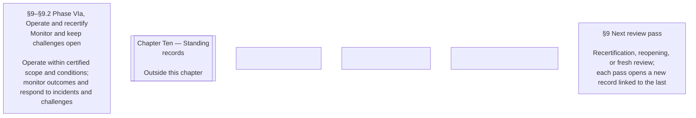

<!-- CHUNK-BEGIN pt__core_09.000_system_alignment_certification_evaluation__section_1_corpus_placement_overview.md bytes=3523 -->
<!-- AI-assisted translation draft; unreviewed. §1 corpus-placement overview, source lines 8–10; source SHA-256 4311e6ba74b7210f077c0bd4c8d21d8c9f517d2ada7b6d87288b39494dfeadd5. Draft only; do not synchronize into translations/. -->

# Chapter Nine Part A — §1 corpus-placement overview (pt)

## English source (lines 8–10)

> This file is **part of the Sentient Constitution** and is **binding only together** with the other numbered `core_*` files read as one text. It contains **Chapter Nine, Part A** — certification purpose, the process overview, and the first two phases of the process — **Frame** (system class) and **Evaluate** (whole-system evaluation in three sub-phases: the always-applicable evaluations, including data types and handling, in **§3**; the evaluations that apply where implicated in **§4**; and the Rights-Floor and domain evaluations that apply where triggered in **§5**) — **§1–§5**. The worked **Class A / B / C illustrations** (the system class profiles, §3.4.8, §5.1.5, §5.2.4, §5.3.7, §5.4.4, §5.5.5, and §5.6.4), including each one's **Reading across system classes** paragraph, are in [`core_09.010_system_alignment_certification_illustrations.md`](core_09.010_system_alignment_certification_illustrations.md); each keeps its Part A section number. The binding system-class-scaling and escalation rules those paragraphs illustrate stay in this file: system class scaling, including participation and proportionality, in §2.2; data-handling scaling in §3.4; and the **System class scaling and escalation** paragraph in each of §5.1–§5.6. The files of the whole chapter are listed in the table below.
>
> **Chapter Nine files.** Chapter Nine is split across four binding files read as one text. Part A, this file, opens the chapter; there is no separate index file.

## Translation draft

> Este arquivo **faz parte da Sentient Constitution** e só é vinculante quando lido como um texto único junto com os demais arquivos `core_*` numerados. Ele contém o **Capítulo Nove, Parte A** — o propósito da certificação, uma visão geral do processo e suas duas primeiras fases: **Frame** (classe do sistema) e **Evaluate** (avaliação do sistema como um todo em três subfases: avaliações sempre aplicáveis, incluindo tipos e tratamento de dados, em **§3**; avaliações aplicáveis quando pertinentes em **§4**; e avaliações do **Piso de Direitos** e dos domínios aplicáveis quando acionados em **§5**) — **§§1–5**. As ilustrações detalhadas das classes **A / B / C** (perfis de classe do sistema, §3.4.8, §5.1.5, §5.2.4, §5.3.7, §5.4.4, §5.5.5 e §5.6.4), incluindo o parágrafo **Leitura entre classes de sistemas** de cada uma, estão em [`core_09.010_system_alignment_certification_illustrations.md`](core_09.010_system_alignment_certification_illustrations.md); cada uma mantém seu número de seção da Parte A. As regras vinculantes de ajuste por classe e escalonamento que esses parágrafos ilustram permanecem neste arquivo: o ajuste por classe do sistema, inclusive participação e proporcionalidade, em §2.2; o ajuste do tratamento de dados em §3.4; e o parágrafo **Ajuste e escalonamento por classe do sistema** em cada uma das seções §5.1–§5.6. A tabela abaixo lista os arquivos de todo o capítulo.
>
> **Arquivos do Capítulo Nove.** O Capítulo Nove está dividido em quatro arquivos vinculantes, lidos em conjunto. A Parte A, este arquivo, abre o capítulo; não há um arquivo de índice separado.

<!-- CHUNK-END -->
<!-- CHUNK-BEGIN pt__core_09.000_system_alignment_certification_evaluation__section_1_corpus_file_table.md bytes=5155 -->
<!-- AI-assisted translation draft; unreviewed. §1 corpus-placement file table, source lines 12–17; source SHA-256 4311e6ba74b7210f077c0bd4c8d21d8c9f517d2ada7b6d87288b39494dfeadd5. Draft only; do not synchronize into translations/. -->

# Chapter Nine Part A — §1 corpus-placement file table (pt)

## English source (lines 12–17)

> | Part | File | Owns |
> |------|------|------|
> | **Part A — Evaluation** | [`core_09.000_system_alignment_certification_evaluation.md`](core_09.000_system_alignment_certification_evaluation.md) | §1–§5: purpose and process overview (with a chart of the whole certification process in its six phases), **Phase I Frame** (system class, how system class scales every evaluation, and pilot certification) and **Phase II Evaluate** (whole-system evaluation in three sub-phases: **IIa** always, in §3, including chartered scope versus functional boundaries and data types and handling; **IIb** where implicated, in §4; and **IIc** where triggered, the Rights-Floor and domain evaluations, in §5) |
> | **Part B — Record and process** | [`core_09.005_system_alignment_certification_record_process.md`](core_09.005_system_alignment_certification_record_process.md) | §6–§10: **Phase III Review** (forum roles, supervisory sequence, and the contestability chain), **Phase IV Decide** (certification outcomes, including the go-live gate), **Phase V Record** (the certification record and its integrity, including governing [System Charter](core_05.040_band_continuity.md#system-charter) fields), and **Phase VI Operate** (the challenge path; recertification and reopening; the standing bridge) — continuous chapter numbering from Part A §5 |
> | **Part C — Illustrations** | [`core_09.010_system_alignment_certification_illustrations.md`](core_09.010_system_alignment_certification_illustrations.md) | the illustrative system class profiles, §3.4, §3.4.8, §5.1.5, §5.2.4, §5.3.7, §5.4.4, §5.5.5, and §5.6.4: worked Class A / B / C walkthroughs for each Part A evaluation area, numbered to match Part A and linked both ways |
> | **Part D — Institutional alignment certification** | [`core_09.015_institutional_alignment_certification.md`](core_09.015_institutional_alignment_certification.md) | §11–§15: the same six phases for an **Institution** rather than a System — the institution class and the institutional evaluation (**Phases I and II**, §12), the forum roles, outcome, and **Institutional Certification Record** (**Phases III to V**, §13), and recertification, reopening, the cascade from System certifications, and the standing bridge (**Phase VI**, §14–§15). It cites each System's certification by link and does not repeat it, and it is not a licence — continuous chapter numbering from Part B §10 |

## Translation draft

| Parte | Arquivo | Abrange |
|------|------|------|
| **Part A — Evaluation** | [`core_09.000_system_alignment_certification_evaluation.md`](core_09.000_system_alignment_certification_evaluation.md) | §§1–5: finalidade e visão geral do processo (com gráfico das seis fases), além das fases I Frame (classe do sistema, como a classe ajusta cada avaliação e certificação-piloto) e II Evaluate (avaliação do sistema inteiro em três subfases: IIa sempre, em §3, incluindo escopo da Carta versus limites funcionais e tipos/tratamento de dados; IIb quando pertinente, em §4; IIc quando acionada, avaliações do Piso de Direitos e dos domínios em §5). |
| **Part B — Record and process** | [`core_09.005_system_alignment_certification_record_process.md`](core_09.005_system_alignment_certification_record_process.md) | §§6–10: fase III Review (papéis do fórum, sequência de supervisão e cadeia de contestação); IV Decide (resultados da certificação, incluindo a condição para entrada em operação); V Record (registro e integridade da certificação, inclusive campos regentes do [System Charter](core_05.040_band_continuity.md#system-charter)); VI Operate (via de contestação, recertificação e reabertura, ponte de standing) — numeração contínua desde a Parte A §5. |
| **Part C — Illustrations** | [`core_09.010_system_alignment_certification_illustrations.md`](core_09.010_system_alignment_certification_illustrations.md) | Perfis ilustrativos de classes de sistemas e §§3.4, 3.4.8, 5.1.5, 5.2.4, 5.3.7, 5.4.4, 5.5.5, 5.6.4: exemplos detalhados A/B/C para cada área de avaliação da Parte A, com numeração correspondente e links nos dois sentidos. |
| **Part D — Institutional alignment certification** | [`core_09.015_institutional_alignment_certification.md`](core_09.015_institutional_alignment_certification.md) | §§11–15: as mesmas seis fases para uma Instituição, em vez de um Sistema — classe e avaliação institucional (I–II, §12), funções do fórum, resultado e Registro de Certificação Institucional (III–V, §13), e recertificação, reabertura, cascata de certificações de Sistemas e ponte de standing (VI, §§14–15). Cita por link a certificação de cada Sistema, sem repeti-la, e não é licença — numeração contínua desde a Parte B §10. |

<!-- CHUNK-END -->
<!-- CHUNK-BEGIN pt__core_09.000_system_alignment_certification_evaluation__section_1_corpus_explanation.md bytes=8612 -->
<!-- AI-assisted translation draft; unreviewed. §1 corpus-placement explanatory prose, source lines 19–30; source SHA-256 4311e6ba74b7210f077c0bd4c8d21d8c9f517d2ada7b6d87288b39494dfeadd5. Draft only; do not synchronize into translations/. -->

# Chapter Nine Part A — §1 corpus-placement explanatory prose (pt)

## English source (lines 19–30)

> **How the two certifications relate.** System Alignment Certification (Parts A to C) is the certification of a System. Institutional alignment certification (Part D) is the certification of an Institution, which may run Systems or none. Part D cites each System's certification record by link and does not redo it; [Part D §11.1](core_09.015_institutional_alignment_certification.md#111-relation-to-system-alignment-certification) states the relation and [Part D §11.3](core_09.015_institutional_alignment_certification.md#113-no-permission-and-no-gate) states that it is not a licence.
>
> Generic **Chapter Nine** links in other files route to the appropriate part by section number.
>
> - **Constitutional owner (joint with Parts B and D):** forum-supervised **system alignment certification and related records** — evaluation domains (Part A); forum process, supervisory sequence, certification-record duties, certification outcomes and the go-live gate, the challenge path, recertification and reopening, and verified-input bridge to Chapter Ten (Part B); the same six phases for an Institution (Part D). Under the **oversight** Tetrad leg, SAC is one especially large, high-stakes audit process among others; auditing floors remain at **Article XVI** (*Audit, Transparency, and Independent Verification*) and Chapter Five [Auditability](core_05.050_band_oversight.md#auditability).
> - **Verification substrate owner:** [Chapter Four — Burden of Proof, Traceability, and Verification](core_04.000_burden_traceability_verification.md#chapter-four-burden-of-proof-traceability-and-verification) (within Chapters Two through Four) owns burden allocation, compliance evidence, definition traceability, observability, and security-constrained verification. Chapter Nine **applies** that discipline to system alignment certification records; it does **not** restate Chapter Four sections **1** through **5**.
> - **Auditing home (not relocated here):** **Article XVI** (*Audit, Transparency, and Independent Verification*), **Def.O1** (*Transparency, Auditability, and Verification*), and **CJS-5.110 §3 and CJS-5.115 §3** (*Audit process home*)–**CJS-5.110 §5** own auditing floors and operational terms. Chapter Nine runs one especially large SAC audit process that must satisfy those floors; it does not own all auditing.
> - **Implementation owner:** system-class handling, CS-6.345, and forum-process detail in designated implementation files must remain consistent with Chapter Nine and may be stricter where the corpus already provides a [Fullest Protective Effect](core_05.045_band_integrative.md#fullest-protective-effect) rule.
> - **Anti-relocation rule:** Part A does not restate Chapter Five canonical definitions, Chapter Three anti-evasion discipline (see [Part B §9.3](core_09.005_system_alignment_certification_record_process.md#93-non-evasion)), Chapter Ten contribution or standing measurement, or Chapter Eleven standing effects. **[Part B §10](core_09.005_system_alignment_certification_record_process.md#10-relationship-to-standing)** states the standing bridge boundary explicitly.
>
> **Upstream:** Chapter Five definitions; Chapters Two through Four record, verification, burden, and traceability of definitions to results; and [Chapter Eight](core_08.000_functional_independence_separation_of_duties.md#chapter-eight-functional-independence-and-separation-of-duties), whose separation-of-duties requirement governs every materially binding certification act.
> **Downstream:** [Part B](core_09.005_system_alignment_certification_record_process.md#chapter-nine-part-b-system-alignment-certification--record-and-process) (*forum process, record, outcomes, and standing bridge*); Chapter Ten standing records and verified inputs; Chapter Eleven standing effects; Chapter Thirteen forum supervision and system alignment certification pathways.

## Translation draft

**Relação entre as duas certificações.** A System Alignment Certification (Partes A a C) certifica um Sistema. A certificação de alinhamento institucional (Parte D) certifica uma Instituição, que pode operar Sistemas ou nenhum. A Parte D cita por link o registro de certificação de cada Sistema, sem refazê-lo; [Part D §11.1](core_09.015_institutional_alignment_certification.md#111-relation-to-system-alignment-certification) explica a relação e [Part D §11.3](core_09.015_institutional_alignment_certification.md#113-no-permission-and-no-gate) afirma que não é uma licença.
>
> Links genéricos para **Chapter Nine** em outros arquivos direcionam à parte apropriada pelo número da seção.
>
> - **Responsável constitucional (em conjunto com as Partes B e D):** certificação de alinhamento do sistema e registros relacionados sob supervisão do fórum — domínios de avaliação (Parte A); processo do fórum, sequência de supervisão, deveres do registro de certificação, resultados e condição de entrada em operação, via de contestação, recertificação e reabertura, e ponte de entradas verificadas para o Capítulo Dez (Parte B); as mesmas seis fases para uma Instituição (Parte D). No componente de **supervisão** do Tetrad, SAC é um processo de auditoria especialmente grande e de alto risco entre outros; os pisos de auditoria continuam em **Article XVI** (*Audit, Transparency, and Independent Verification*) e [Auditability](core_05.050_band_oversight.md#auditability) do Capítulo Cinco.
> - **Responsável pela base de verificação:** [Chapter Four — Burden of Proof, Traceability, and Verification](core_04.000_burden_traceability_verification.md#chapter-four-burden-of-proof-traceability-and-verification) (dentro dos Capítulos Dois a Quatro) é responsável pela alocação do ônus da prova, evidência de conformidade, rastreabilidade de definições, observabilidade e verificação condicionada pela segurança. O Capítulo Nove aplica essa disciplina aos registros de certificação de alinhamento do sistema; não repete as seções **1** a **5** do Capítulo Quatro.
> - **Sede da auditoria (não transferida para cá):** **Article XVI** (*Audit, Transparency, and Independent Verification*), **Def.O1** (*Transparency, Auditability, and Verification*) e **CJS-5.110 §3 e CJS-5.115 §3** (*Audit process home*)–**CJS-5.110 §5** são responsáveis pelos pisos de auditoria e termos operacionais. O Capítulo Nove executa um processo SAC especialmente grande que deve cumprir esses pisos; não é responsável por toda auditoria.
> - **Responsável pela implementação:** o tratamento por classe de sistema, CS-6.345 e os detalhes do processo do fórum nos arquivos de implementação designados devem permanecer coerentes com o Capítulo Nove e podem ser mais rigorosos quando o corpus já trouxer uma regra de [Fullest Protective Effect](core_05.045_band_integrative.md#fullest-protective-effect).
> - **Regra contra realocação:** a Parte A não repete definições canônicas do Capítulo Cinco, a disciplina antievasão do Capítulo Três (ver [Part B §9.3](core_09.005_system_alignment_certification_record_process.md#93-non-evasion)), a medição de contribuição ou standing do Capítulo Dez, nem os efeitos sobre standing do Capítulo Onze. **[Part B §10](core_09.005_system_alignment_certification_record_process.md#10-relationship-to-standing)** declara explicitamente o limite da ponte de standing.
>
> **Fontes anteriores:** definições do Capítulo Cinco; registros, verificação, ônus da prova e rastreabilidade das definições aos resultados dos Capítulos Dois a Quatro; e [Chapter Eight](core_08.000_functional_independence_separation_of_duties.md#chapter-eight-functional-independence-and-separation-of-duties), cujo requisito de separação de funções rege todo ato de certificação com efeito materialmente vinculante.
> **Fontes posteriores:** [Part B](core_09.005_system_alignment_certification_record_process.md#chapter-nine-part-b-system-alignment-certification--record-and-process) (*processo do fórum, registro, resultados e ponte de standing*); registros de standing e entradas verificadas do Capítulo Dez; efeitos sobre standing do Capítulo Onze; supervisão do fórum e caminhos de certificação de alinhamento do sistema do Capítulo Treze.

<!-- CHUNK-END -->
<!-- CHUNK-BEGIN pt__core_09.000_system_alignment_certification_evaluation__section_1_heading.md bytes=370 -->
<!-- AI-assisted translation draft; unreviewed. §1 heading, source line 44; source SHA-256 4311e6ba74b7210f077c0bd4c8d21d8c9f517d2ada7b6d87288b39494dfeadd5. Draft only; do not synchronize into translations/. -->

# Chapter Nine Part A — §1 heading (pt)

## English source (lines 44–45)

### 1. Purpose and Role


## Translation draft

### 1. Propósito e função

<!-- CHUNK-END -->
<!-- CHUNK-BEGIN pt__core_09.000_system_alignment_certification_evaluation__section_1_trace.md bytes=12117 -->
<!-- AI-assisted translation draft; unreviewed. §1 trace, source lines 46–95; source SHA-256 4311e6ba74b7210f077c0bd4c8d21d8c9f517d2ada7b6d87288b39494dfeadd5. Draft only; do not synchronize into translations/. -->

# Chapter Nine Part A — §1 trace (pt)

## English source (lines 46–95)

<details>
<summary><strong><span style="color: #2563eb;">Trace</span></strong></summary>

- Upstream:
  - [Preamble — constitutional owner register](core_00.000_preamble.md#4-principles-definitions-and-rights) and
  - [Authority Stack and Internal Hierarchy](core_05.045_band_integrative.md#authority-stack-and-internal-hierarchy);
  - [Constitutional Tetrad](core_00.000_preamble.md#constitutional-tetrad);
  - [Two Constitutional Aims](core_00.000_preamble.md#two-constitutional-aims);
  - [material stake](core_00.000_preamble.md#material-stake);
  - [Proportionality](core_05.035_band_accountability.md#proportionality) and
  - [Substantive Fairness](core_05.055_band_participation.md#substantive-fairness) (Chapter Five); Participation measurement family (*voice, access, and contest paths*);
  - [Chapter One §16 Stewardship In Depth](core_01.010_stewardship_capacity_principles.md#16-stewardship-in-depth) (1.010 §16);
  - [Chapter One §12 Systemic Evaluation Requirement](core_01.000_values_principles.md#12-systemic-evaluation-requirement) (1.000 §12) (*principle-layer whole-system evaluation lens — not one corner alone*); Chapters Two through Four;
  - [Chapter Five](core_05.000_definitions_home.md#chapter-five-foundational-definitions) (5.000) (*canonical definitions*);
  - [Chapter Eight §2 Four-Seat Constitutional Requirement](core_08.000_functional_independence_separation_of_duties.md#2-four-seat-constitutional-requirement) (8.000 §2);
  - [System Alignment Certification](core_05.040_band_continuity.md#system-alignment-certification) (Chapter Five canonical term; non-operative shorthand **SAC**);
  - [System Certification Record](core_05.040_band_continuity.md#system-certification-record) (Chapter Five meaning).
- Downstream:
  - [§2](#2-system-class-evaluation) (*system class evaluation*);
  - [Part B §9.1](core_09.005_system_alignment_certification_record_process.md#91-challenging-a-certification) (9.005 §9.1) (*challenging a certification*); and
  - [Part C system class profiles](core_09.010_system_alignment_certification_illustrations.md#illustrative-system-class-profiles-non-exhaustive) (9.010) (*illustrative system class profiles*);
  - [Part C whole-system walkthroughs](core_09.010_system_alignment_certification_illustrations.md#illustrative-whole-system-application-by-system-class-non-exhaustive) (9.010) (*worked whole-system examples by system class*);
  - [§3.4.8](core_09.010_system_alignment_certification_illustrations.md#348-illustrative-data-handling-application-by-system-class-non-exhaustive) (*worked data-handling examples by system class*);
  - [§5.1.5](core_09.010_system_alignment_certification_illustrations.md#515-illustrative-ecological-footprint-application-by-system-class-non-exhaustive) (*worked ecological-footprint examples by system class*);
  - [§5.2.4](core_09.010_system_alignment_certification_illustrations.md#524-illustrative-educational-capability-application-by-system-class-non-exhaustive) (*worked educational-capability examples by system class*);
  - [§5.3.7](core_09.010_system_alignment_certification_illustrations.md#537-illustrative-cross-system-support-application-by-system-class-non-exhaustive) (*worked cross-system-support examples by system class*);
  - [§5.4.4](core_09.010_system_alignment_certification_illustrations.md#544-illustrative-nondiscrimination-application-by-system-class-non-exhaustive) (*worked nondiscrimination examples by system class*);
  - [§5.5.5](core_09.010_system_alignment_certification_illustrations.md#555-illustrative-accessibility-application-by-system-class-non-exhaustive) (*worked accessibility examples by system class*);
  - [§5.6.4](core_09.010_system_alignment_certification_illustrations.md#564-illustrative-trustworthiness-application-by-system-class-non-exhaustive) (*worked trustworthiness examples by system class*);
  - [§3](#3-whole-system-certification-evaluation) (*whole-system certification evaluation factors*);
  - [§3.4](#34-data-types-and-handling-evaluation) through
  - [§5.6](#56-trustworthiness-and-system-reliance-integrity-evaluation) (*domain evaluations*);
  - [Part B §6](core_09.005_system_alignment_certification_record_process.md#6-forum-process) (9.005 §6) (*supervisory sequence and contestability chain*);
  - [Part B §6.1](core_09.005_system_alignment_certification_record_process.md#61-forum-supervision-and-component-roles) (9.005 §6.1) (*forum component roles*);
  - [Part B §8](core_09.005_system_alignment_certification_record_process.md#8-system-certification-record) (9.005 §8) (*certification record contents*);
  - [Part B §8.2](core_09.005_system_alignment_certification_record_process.md#82-record-integrity-transparency-and-auditability) (9.005 §8.2) (*record integrity requirements*);
  - [Part B §7](core_09.005_system_alignment_certification_record_process.md#7-certification-outcomes) (9.005 §7) (*reopening and anti-evasion*);
  - [Part B §10](core_09.005_system_alignment_certification_record_process.md#10-relationship-to-standing) (9.005 §10) (*standing-record bridge*);
  - [Chapter Ten](core_11.000_standing_assessment.md#chapter-eleven-contribution-violation-and-standing-model--measurement) (10.000) (*standing records and verified-input gate*);
  - [Chapter Eleven](core_12.000_standing_integration.md#chapter-twelve-standing-effects-and-integration) (11.000) (*standing effects and integration*);
  - [Chapter Thirteen](core_14.000_forum.md#chapter-fourteen-forums-and-jurisdiction) (13.000) (*forum supervision, certification, alignment certification, and review*).
- Read with:
  - **[CS-9.305](corpus_systems/cs_09.305_system_classification_machinery.md#cs-9305-part-a-system-classification-machinery) (*System classification machinery*) and [CS-9.310 — System impact classifications](corpus_systems/cs_09.310_system_impact_classifications.md#cs-9310-part-b-system-impact-classifications)**, **[CS-6.305](corpus_systems/cs_06.305_information_types_and_handling.md#cs-6305-part-a-information-types-and-handling) (*Information types and handling*) and [CS-6.310 — Data classifications](corpus_systems/cs_06.310_data_classifications.md#cs-6310-part-b-data-classifications)**, and
  - **CS-6.345** (*System lifecycle*);
  - **CF-13.415** (*Routing operations, transfer, certification, and representative treatment*) and
  - **CF-13.425** (*Integrity safeguards, anti-capture operations, and anti-self-judging support*); **Article XVI** (*Audit, Transparency, and Independent Verification*) and
  - [Auditability](core_05.050_band_oversight.md#auditability) (*auditing floors — SAC is one especially large audit process under oversight, not the sole auditing home*); **CJS-5.110 §3 (*Oversight: auditability and reconstructability terms (annex)*) and CJS-5.115 §3** (*Audit process home*)–
  - **CJS-5.110 §5** (*Oversight: independent verification and claim-integrity terms*).

</details>

## Translation draft

#### Rastreabilidade

O mapa apresenta a base constitucional e de autoridade desta seção e a conecta à avaliação, classificação, vias de revisão, registros, resultados e auditoria; também indica instrumentos operacionais correlatos.

**Rastreabilidade — upstream canonical sources:** [Preamble — constitutional owner register](core_00.000_preamble.md#4-principles-definitions-and-rights); [Authority Stack and Internal Hierarchy](core_05.045_band_integrative.md#authority-stack-and-internal-hierarchy); [Constitutional Tetrad](core_00.000_preamble.md#constitutional-tetrad); [Two Constitutional Aims](core_00.000_preamble.md#two-constitutional-aims); [material stake](core_00.000_preamble.md#material-stake); [Proportionality](core_05.035_band_accountability.md#proportionality); [Substantive Fairness](core_05.055_band_participation.md#substantive-fairness); [Chapter One §16 Stewardship In Depth](core_01.010_stewardship_capacity_principles.md#16-stewardship-in-depth); [Chapter One §12 Systemic Evaluation Requirement](core_01.000_values_principles.md#12-systemic-evaluation-requirement); [Chapter Five](core_05.000_definitions_home.md#chapter-five-foundational-definitions); [Chapter Eight §2 Four-Seat Constitutional Requirement](core_08.000_functional_independence_separation_of_duties.md#2-four-seat-constitutional-requirement); [System Alignment Certification](core_05.040_band_continuity.md#system-alignment-certification); [System Certification Record](core_05.040_band_continuity.md#system-certification-record)

**Rastreabilidade — downstream routes and related records:** [§2](#2-system-class-evaluation); [Part B §9.1](core_09.005_system_alignment_certification_record_process.md#91-challenging-a-certification); [Part C system class profiles](core_09.010_system_alignment_certification_illustrations.md#illustrative-system-class-profiles-non-exhaustive); [Part C whole-system walkthroughs](core_09.010_system_alignment_certification_illustrations.md#illustrative-whole-system-application-by-system-class-non-exhaustive); [§3.4.8](core_09.010_system_alignment_certification_illustrations.md#348-illustrative-data-handling-application-by-system-class-non-exhaustive); [§5.1.5](core_09.010_system_alignment_certification_illustrations.md#515-illustrative-ecological-footprint-application-by-system-class-non-exhaustive); [§5.2.4](core_09.010_system_alignment_certification_illustrations.md#524-illustrative-educational-capability-application-by-system-class-non-exhaustive); [§5.3.7](core_09.010_system_alignment_certification_illustrations.md#537-illustrative-cross-system-support-application-by-system-class-non-exhaustive); [§5.4.4](core_09.010_system_alignment_certification_illustrations.md#544-illustrative-nondiscrimination-application-by-system-class-non-exhaustive); [§5.5.5](core_09.010_system_alignment_certification_illustrations.md#555-illustrative-accessibility-application-by-system-class-non-exhaustive); [§5.6.4](core_09.010_system_alignment_certification_illustrations.md#564-illustrative-trustworthiness-application-by-system-class-non-exhaustive); [§3](#3-whole-system-certification-evaluation); [§3.4](#34-data-types-and-handling-evaluation); [§5.6](#56-trustworthiness-and-system-reliance-integrity-evaluation); [Part B §6](core_09.005_system_alignment_certification_record_process.md#6-forum-process); [Part B §6.1](core_09.005_system_alignment_certification_record_process.md#61-forum-supervision-and-component-roles); [Part B §8](core_09.005_system_alignment_certification_record_process.md#8-system-certification-record); [Part B §8.2](core_09.005_system_alignment_certification_record_process.md#82-record-integrity-transparency-and-auditability); [Part B §7](core_09.005_system_alignment_certification_record_process.md#7-certification-outcomes); [Part B §10](core_09.005_system_alignment_certification_record_process.md#10-relationship-to-standing); [Chapter Ten](core_11.000_standing_assessment.md#chapter-eleven-contribution-violation-and-standing-model--measurement); [Chapter Eleven](core_12.000_standing_integration.md#chapter-twelve-standing-effects-and-integration); [Chapter Thirteen](core_14.000_forum.md#chapter-fourteen-forums-and-jurisdiction)

**Rastreabilidade — operational materials to read with this section:** [CS-9.305](corpus_systems/cs_09.305_system_classification_machinery.md#cs-9305-part-a-system-classification-machinery); [CS-9.310 — System impact classifications](corpus_systems/cs_09.310_system_impact_classifications.md#cs-9310-part-b-system-impact-classifications); [CS-6.305](corpus_systems/cs_06.305_information_types_and_handling.md#cs-6305-part-a-information-types-and-handling); [CS-6.310 — Data classifications](corpus_systems/cs_06.310_data_classifications.md#cs-6310-part-b-data-classifications); [Auditability](core_05.050_band_oversight.md#auditability)

<!-- CHUNK-END -->
<!-- CHUNK-BEGIN pt__core_09.000_system_alignment_certification_evaluation__purpose_adjuncts.md bytes=5794 -->
<!-- AI-assisted translation draft; unreviewed. Selected §1 passages, source lines 99 and 107–114; source SHA-256 4311e6ba74b7210f077c0bd4c8d21d8c9f517d2ada7b6d87288b39494dfeadd5. -->

# Chapter Nine Part A — §1 plain-terms excerpt

**Status:** AI-assisted draft; unreviewed. English source remains controlling.

## English source

When a system really matters to sentients' lives, certification has to be **proportionate** — as demanding as the system's real impact, dependency, and risk require, not a one-size-fits-all checklist or a rubber stamp. It also has to be **participatory** — affected sentients and communities must be able to see what was reviewed, understand what was decided, and challenge it when something is wrong. Forums review evidence, write it down in a certification record, and require re-checks on a schedule that matches how risky the system is. Classes A, B, and C get the full process and Class L a lighter one. Class P is encouraged to use it, and must once it is reclassified to Class L or higher (that is, its effects reach beyond a private unit) or its operator claims constitutional compliance.

## pt draft

Quando um sistema realmente afeta a vida de seres sencientes, sua certificação deve ser **proporcional**: tão exigente quanto exigirem seu impacto real, a dependência e os riscos, e não uma lista de verificação igual para todos nem um carimbo automático. Também deve ser **participativa**: os seres sencientes e as comunidades afetadas precisam poder ver o que foi avaliado, entender a decisão e contestá-la se houver erro. Os fóruns examinam as evidências, registram-nas em um processo de certificação e exigem novas verificações em um cronograma compatível com o risco do sistema. As classes A, B e C passam pelo processo completo; a classe L, por um processo mais leve. A classe P é incentivada a usá-lo e deve fazê-lo quando for reclassificada como L ou superior (isto é, quando seus efeitos ultrapassarem uma unidade privada) ou quando seu operador alegar conformidade constitucional.


### English source — Flourishing

- **[Flourishing](core_00.000_preamble.md#flourishing)** — certification verifies that certification or continued reliance would not quietly defeat Rights Floors or block fair participation in constitutionally relevant life;

### pt draft

- **[Florescimento](core_00.000_preamble.md#flourishing)** — a certificação verifica que certificar ou continuar confiando no sistema não frustre silenciosamente os Pisos de Direitos nem bloqueie a participação justa na vida relevante para a Constituição;


### English source — Continuity criterion

- **[Continuity](core_00.000_preamble.md#continuity)** — certification verifies durable, non-regressive supply that sustains rather than depletes healthy natural systems ([Ecological Integrity](core_05.040_band_continuity.md#ecological-integrity), including [Ecological Recovery Capacity](core_05.040_band_continuity.md#ecological-recovery-capacity)), and system-class-scaled recertification where shared systems gate or sustain delivery;

### pt draft

- **[Continuidade](core_00.000_preamble.md#continuity)** — a certificação verifica um fornecimento duradouro e não regressivo que sustente, em vez de esgotar, sistemas naturais saudáveis ([Integridade Ecológica](core_05.040_band_continuity.md#ecological-integrity), incluindo a [Capacidade de Recuperação Ecológica](core_05.040_band_continuity.md#ecological-recovery-capacity)), e a recertificação proporcional à classe do sistema quando sistemas compartilhados controlarem ou sustentarem a prestação;


### English source — Participation criterion

- **Participation** — affected sentients and communities can understand, contest, and take part in review paths that matter to them;

### pt draft

- **Participação** — seres sencientes e comunidades afetados podem entender, contestar e participar dos caminhos de revisão que lhes dizem respeito;


### English source — Oversight criterion

- **Oversight** — records, evidence, and assumptions are visible and auditable enough for independent checking; certification itself is one especially large audit process under that oversight duty, not the only one;

### pt draft

- **Supervisão** — registros, evidências e premissas ficam visíveis e auditáveis o bastante para verificação independente; a certificação é, por si, um processo de auditoria especialmente amplo dentro desse dever, mas não é o único espaço de auditoria;


### English source — Accountability criterion

- **Accountability** — defects, misclassification, and floor-defeating operation route to remedy, conditions, withdrawal, or standing input where the facts support it;

### pt draft

- **Responsabilização** — defeitos, classificação incorreta e operação que frustre Pisos de Direitos levam a reparação, condições, retirada ou insumo para avaliação de trajetória quando os fatos sustentarem;


### English source — Timeliness criterion

- **Timeliness** — review and contest windows keep certification from going stale while harm can still be prevented or reversed.

### pt draft

- **Tempestividade** — prazos de revisão e contestação impedem que a certificação fique desatualizada enquanto o dano ainda puder ser evitado ou revertido.


### English source — Tetrad introduction

Certification implements the [Two Constitutional Aims](core_00.000_preamble.md#two-constitutional-aims) through the [Constitutional Tetrad](core_00.000_preamble.md#constitutional-tetrad):

### pt draft

A certificação implementa os [Dois Objetivos Constitucionais](core_00.000_preamble.md#two-constitutional-aims) por meio da [Tétrade Constitucional](core_00.000_preamble.md#constitutional-tetrad):

<!-- CHUNK-END -->
<!-- CHUNK-BEGIN pt__core_09.000_system_alignment_certification_evaluation__section_1_purpose.md bytes=1257 -->
<!-- AI-assisted translation draft; unreviewed. Complete purpose statement excerpt, source lines 101–105; source SHA-256 4311e6ba74b7210f077c0bd4c8d21d8c9f517d2ada7b6d87288b39494dfeadd5. This is an excerpt, not a complete §1 translation. -->

A **certificação de alinhamento do sistema** existe para responder a uma pergunta dentro de um escopo e calendário de revisão definidos: o sistema demonstrou alinhamento constitucional suficiente para certificação, certificação condicional, validação, recertificação, continuidade da dependência, implantação ou liberação material de condições?

- Uma certificação não é uma pontuação de popularidade, uma aprovação permanente nem uma forma de ignorar a revisão de direitos.
- É uma declaração limitada no tempo e passível de contestação sobre o que se sabe agora a respeito do alinhamento do sistema.
- Sob o pilar de **supervisão** da Tétrade, a supervisão exige auditoria; a certificação de alinhamento do sistema é um processo de auditoria especialmente amplo e de alto risco entre outros — não o único espaço de auditoria (**Artigo XVI** (*Auditoria, Transparência e Verificação Independente*), [Auditabilidade](core_05.050_band_oversight.md#auditability)).

<!-- CHUNK-END -->
<!-- CHUNK-BEGIN pt__core_09.000_system_alignment_certification_evaluation__section_1_subsection_headings.md bytes=778 -->
<!-- AI-assisted translation draft; unreviewed. §1.1/§1.2 visible subsection headings, source lines 116–119 and 144–148; source SHA-256 4311e6ba74b7210f077c0bd4c8d21d8c9f517d2ada7b6d87288b39494dfeadd5. Draft only; anchors/blank layout are structural. Do not synchronize into translations/. -->

# Chapter Nine Part A — §1.1 and §1.2 subsection headings (pt)

## English source

### Lines 116–119

<a id="11-certification-as-an-audit-process-scaled-by-class"></a>

#### 1.1 Certification as an audit process, scaled by class


### Lines 144–148


<a id="12-certification-at-a-glance"></a>

#### 1.2 Certification at a glance


## Translation draft

#### 1.1 Certificação como processo de auditoria escalonado segundo a classe

#### 1.2 A certificação em resumo

<!-- CHUNK-END -->
<!-- CHUNK-BEGIN pt__core_09.000_system_alignment_certification_evaluation__section_1_audit_scope.md bytes=3297 -->
<!-- AI-assisted translation draft; unreviewed. §1.1 audit mechanism and sibling audit modes, source lines 120–130; source SHA-256 4311e6ba74b7210f077c0bd4c8d21d8c9f517d2ada7b6d87288b39494dfeadd5. -->

# Chapter Nine Part A — §1.1 certification audit process excerpt (pt)

## English source

As an oversight mechanism, certification is one especially large audit process under [Auditability](core_05.050_band_oversight.md#auditability) and **Article XVI** (*Audit, Transparency, and Independent Verification*):

- It is forum-supervised, multi-domain, and status-granting.
- It may integrate the results of sibling audit modes, and it does not absorb or replace them. Each keeps its own owner, named in the [sibling audit modes map](corpus_joint_structure/cjs_05.115_audit_process.md#sibling-audit-modes-owner-map) of the audit process home:
  - System Data Types Record audits under **CS-6.305 (*Information types and handling*) and CS-6.310** (*Data classifications*)
  - System Classification Record audits under **CS-9.305 (*System classification machinery*) and CS-9.310** (*System impact classifications*)
  - steward assurance reviews under **CS-14.305** (*Critical system stewardship*)
  - continuous audit under **CS-6.345** (*System lifecycle*) ACA
  - complexity audits under **CS-6.315** (*Comprehensibility and complexity stewardship*) and **Article XXIII-B** (*Complexity Audit and Modularity Requirements*)
  - claim verification under **CJS-5.110 §5** (*Oversight: independent verification and claim-integrity terms*)
- You can still run any of these checks on their own, without going through certification. Certification doesn't replace them.

## pt draft

Como mecanismo de supervisão, a certificação é um processo de auditoria especialmente amplo nos termos de [Auditabilidade](core_05.050_band_oversight.md#auditability) e **Article XVI** (*Auditoria, Transparência e Verificação Independente*):

- É supervisionada por fóruns, abrange vários domínios e concede status.
- Pode integrar os resultados de modos de auditoria correlatos, mas não os absorve nem os substitui. Cada modo mantém seu próprio responsável, identificado no [mapa de modos de auditoria correlatos](corpus_joint_structure/cjs_05.115_audit_process.md#sibling-audit-modes-owner-map) do documento central do processo de auditoria:
  - Auditorias do System Data Types Record conforme **CS-6.305 (*Tipos e tratamento de informações*) e CS-6.310** (*Classificações de dados*)
  - Auditorias do System Classification Record conforme **CS-9.305 (*Mecanismos de classificação do sistema*) e CS-9.310** (*Classificações de impacto do sistema*)
  - Revisões de garantia de tutela conforme **CS-14.305** (*Tutela de sistemas críticos*)
  - Auditoria contínua conforme **CS-6.345** (*Ciclo de vida do sistema*) ACA
  - Auditorias de complexidade conforme **CS-6.315** (*Compreensibilidade e tutela da complexidade*) e **Article XXIII-B** (*Requisitos de Auditoria de Complexidade e Modularidade*)
  - Verificação de alegações conforme **CJS-5.110 §5** (*Supervisão: verificação independente e termos de integridade das alegações*)
- Você ainda pode executar qualquer uma dessas verificações isoladamente, sem passar pela certificação. A certificação não as substitui.

<!-- CHUNK-END -->
<!-- CHUNK-BEGIN pt__core_09.000_system_alignment_certification_evaluation__section_1_class_scaling.md bytes=4022 -->
<!-- AI-assisted translation draft; unreviewed. Chapter Nine Part A §1 class scaling and cadence, source lines 132–143; source SHA-256 4311e6ba74b7210f077c0bd4c8d21d8c9f517d2ada7b6d87288b39494dfeadd5. Draft only; do not synchronize into translations/. -->

**Current English passage:**

Certification depth, record burden, certification interval, stakeholder review, and contest paths must scale with [material stake](core_00.000_preamble.md#material-stake) under [Proportionality](core_05.035_band_accountability.md#proportionality):

The process applies by impact class, as the [reclassification requirement](corpus_systems/cs_09.305_system_classification_machinery.md#35-reclassification-requirement) of **CS-9.305** (*System classification machinery*) sets out:

- **Class A, Class B, and Class C:** these systems carry the highest impact, dependency, and risk, and whole-system evaluation under [§3 Whole-System Certification Evaluation](#3-whole-system-certification-evaluation), [§4 Evaluations Where Implicated](#4-evaluations-where-implicated), and [§5 Rights-Floor and Domain Evaluations](#5-rights-floor-and-domain-evaluations), each as its own sub-phase applies, is mandatory at full depth;
- **Class L:** the same evaluation is mandatory but proportionate, with a lower default re-check cadence and simpler records where CS-9.305 (*System classification machinery*) and CS-9.310 (*System impact classifications*) permits; and
- **Class P:** the process is encouraged while the system is validly Class P, and a Class P system may use it voluntarily. It becomes mandatory on reclassification to Class L or higher, or where the operator voluntarily asserts constitutional compliance for the system.

The certification interval, and the financial, resource, or special audit that falls at its midpoint, are set by class in [Chapter Thirteen §6 Timely resolution, materiality tiers, and anti-delay discipline](core_14.000_forum.md#review-cadence) (*Review cadence*). This chapter does not restate the numbers.

**Proposed locale translation:**

A profundidade da certificação, a carga dos registros, o intervalo de certificação, a revisão das partes interessadas e as vias de contestação devem variar conforme o [interesse material](core_00.000_preamble.md#material-stake), de acordo com a [proporcionalidade](core_05.035_band_accountability.md#proportionality):

O processo aplica-se por classe de impacto, conforme estabelece o [requisito de reclassificação](corpus_systems/cs_09.305_system_classification_machinery.md#35-reclassification-requirement) de **CS-9.305** (*Mecanismo de classificação de sistemas*):

- **Classes A, B e C:** esses sistemas têm o maior impacto, dependência e risco. É obrigatória, em profundidade total, a avaliação de todo o sistema em cada subfase aplicável, conforme [§3 Avaliação de certificação de todo o sistema](#3-whole-system-certification-evaluation), [§4 Avaliações quando implicadas](#4-evaluations-where-implicated) e [§5 Avaliações do Piso de Direitos e por domínio](#5-rights-floor-and-domain-evaluations);
- **Classe L:** a mesma avaliação é obrigatória, mas proporcional, com menor frequência padrão de nova verificação e registros mais simples quando permitido por **CS-9.305** (*Mecanismo de classificação de sistemas*) e **CS-9.310** (*Classificações de impacto do sistema*); e
- **Classe P:** recomenda-se o processo enquanto a classe P for válida, e o sistema pode usá-lo voluntariamente. Ele se torna obrigatório quando houver reclassificação para L ou superior, ou quando o operador declarar voluntariamente que o sistema está em conformidade constitucional.

O intervalo de certificação e a auditoria financeira, de recursos ou especial prevista para seu ponto médio são definidos por classe no [Capítulo Treze §6 Resolução oportuna, níveis de materialidade e disciplina contra atrasos](core_14.000_forum.md#review-cadence) (*Periodicidade de revisão*). Este capítulo não repete os números.

<!-- CHUNK-END -->
<!-- CHUNK-BEGIN pt__core_09.000_system_alignment_certification_evaluation__section_1_at_a_glance.md bytes=1780 -->
<!-- AI-assisted translation draft; unreviewed. Chapter Nine Part A §1.2 plain-language summary, source line 149; source SHA-256 4311e6ba74b7210f077c0bd4c8d21d8c9f517d2ada7b6d87288b39494dfeadd5. Draft only; do not synchronize into translations/. -->

# Chapter Nine Part A — §1.2 at-a-glance summary (pt)

## English source

*In plain terms: classify the system honestly, run the evaluations that apply, have forums independently review the evidence and stakeholder concerns, and decide an outcome. Complete the one record opened for forum review and publish it with an open challenge path. A certified system goes live only after its notice interval and required protections are satisfied. Monitor actual outcomes, respond to incidents and challenges, and check again on schedule or when the facts change. Correct defects and have the correction independently verified before authorizing the affected scope or releasing its conditions. Each review pass uses a new record linked to the last.*

## pt draft

*Em termos simples: classifique o sistema com honestidade, realize as avaliações aplicáveis, peça aos fóruns que examinem de forma independente as provas e as preocupações das partes interessadas e decida o resultado. Conclua o único registro aberto para análise do fórum e publique-o com uma via de contestação aberta. Um sistema certificado só entra em operação depois do prazo de aviso e das proteções exigidas. Monitore os resultados reais, responda a incidentes e contestações e verifique novamente conforme o calendário ou quando os fatos mudarem. Corrija as falhas e obtenha verificação independente antes de autorizar o escopo afetado ou suspender suas condições. Cada rodada de análise utiliza um novo registro vinculado ao anterior.*

<!-- CHUNK-END -->
<!-- CHUNK-BEGIN pt__core_09.000_system_alignment_certification_evaluation__section_1_phase_map.md bytes=571 -->
<!-- AI-assisted translation draft; unreviewed. Chapter Nine Part A §1.2 phase map, source line 151; source SHA-256 4311e6ba74b7210f077c0bd4c8d21d8c9f517d2ada7b6d87288b39494dfeadd5. Draft only; do not synchronize into translations/. -->

**Current English passage:**

The process runs in **six phases**: **I Frame**, **II Evaluate**, **III Review**, **IV Decide**, **V Record**, and **VI Operate**.

**Proposed locale translation:**

O processo ocorre em **seis fases**: **I Enquadrar**, **II Avaliar**, **III Revisar**, **IV Decidir**, **V Registrar** e **VI Operar**.

<!-- CHUNK-END -->
<!-- CHUNK-BEGIN pt__core_09.000_system_alignment_certification_evaluation__section_1_reopen_triggers.md bytes=1713 -->
<!-- AI-assisted translation draft; unreviewed. Chapter Nine Part A §1 review-reopening passage, source line 153; source SHA-256 4311e6ba74b7210f077c0bd4c8d21d8c9f517d2ada7b6d87288b39494dfeadd5. Draft only; do not synchronize into translations/. -->

**Current English passage:**

Every evaluation that applies is carried out again on each certification pass: at first certification, at each recertification on the schedule set by [§2 System Class Evaluation](#2-system-class-evaluation), and at each reopened or fresh review. Review reopens before the next scheduled recertification when material facts change, such as growing reliance on the system, growing extraction from shared foundations, a significant fall in what the system puts back into them, or a credible challenge. [Part B §9 Recertification and Reopening](core_09.005_system_alignment_certification_record_process.md#9-recertification-and-reopening) lists the triggers.

**Proposed locale translation:**

Toda avaliação aplicável é repetida em cada ciclo de certificação: na certificação inicial, em cada recertificação conforme o cronograma definido pela [§2 Avaliação da Classe do Sistema](#2-system-class-evaluation) e em cada revisão reaberta ou nova. A revisão é reaberta antes da próxima recertificação programada quando fatos materiais mudam, como o aumento da dependência do sistema, a maior extração de fundamentos compartilhados, uma queda significativa do que o sistema devolve a esses fundamentos ou uma contestação crível. A [Parte B §9 Recertificação e Reabertura](core_09.005_system_alignment_certification_record_process.md#9-recertification-and-reopening) lista os fatores que acionam a reabertura.

<!-- CHUNK-END -->
<!-- CHUNK-BEGIN pt__core_09.000_system_alignment_certification_evaluation__section_1_phase_map_opening_nodes.md bytes=1959 -->
<!-- AI-assisted translation draft; unreviewed. §1.2 Phase I/II opening chart-node labels, source lines 155–165; source SHA-256 4311e6ba74b7210f077c0bd4c8d21d8c9f517d2ada7b6d87288b39494dfeadd5. Draft only; non-prose Mermaid syntax/connectors are retained. Do not synchronize into translations/. -->

# Chapter Nine Part A — §1.2 opening phase-map nodes (pt)

## English source (lines 155–165)

```mermaid
flowchart TB
    T(["System with material impact seeks certification,<br/>or reliance on it grows"])
    C["§2 Phase I, Frame<br/>Classify honestly<br/><br/>Class sets depth and re-check schedule"]
    subgraph W["§3–§5 Phase II, Evaluate — Whole-system evaluation"]
        direction LR
        Al["§3.1–§3.4 IIa — Always<br/><br/>Governance; systemic risk: evaluated,<br/>and disclosed to those who need it;<br/>time horizon; data types"]
        Im["§4 IIb — When implicated<br/><br/>Privacy loci, exit rights,<br/>assembly and dissent"]
        Tr["§5 IIc — When triggered<br/><br/>Applicable Rights-Floor checks<br/>and six domain evaluations"]
        Al ~~~ Im ~~~ Tr
    end

## Translation draft

```mermaid
flowchart TB
    T["Um sistema com impacto material busca certificação,<br/>ou aumenta a dependência em relação a ele"]
    C["§2 Fase I, Enquadrar<br/>Classificar honestamente<br/><br/>A classe define a profundidade e o calendário de revisão"]
    subgraph W["§3–§5 Fase II, Avaliar — avaliação integral do sistema"]
        direction LR
        Al["§3.1–§3.4 IIa — Sempre<br/><br/>Governança; avaliar o risco sistêmico e divulgá-lo<br/>a quem precisa; horizonte temporal; tipos de dados"]
        Im["§4 IIb — Quando implicado<br/><br/>Âmbitos de privacidade, direitos de saída,<br/>assembleia e dissenso"]
        Tr["§5 IIc — Quando acionado<br/><br/>Verificações aplicáveis do piso de direitos<br/>e seis avaliações de domínio"]
        Al ~~~ Im ~~~ Tr
    end
```

<!-- CHUNK-END -->
<!-- CHUNK-BEGIN pt__core_09.000_system_alignment_certification_evaluation__chart_review_node.md bytes=589 -->
# Chapter Nine Part A — chart review node (pt)

AI-assisted draft; unreviewed. Current source SHA-256: `4311e6ba74b7210f077c0bd4c8d21d8c9f517d2ada7b6d87288b39494dfeadd5`. Reconciles current source line 166: “Assigned forums issue findings; challenge paths stay open.” The translated node ID, chart structure, HTML line breaks, and code syntax are preserved.

```mermaid
    F["Fase III, Revisar — §6<br/>Revisão independente das evidências<br/>e preocupações das partes afetadas<br/><br/>Fóruns designados emitem conclusões;<br/>vias de impugnação continuam abertas"]
```

<!-- CHUNK-END -->
<!-- CHUNK-BEGIN pt__core_09.000_system_alignment_certification_evaluation__section_1_decision_nodes.md bytes=3738 -->
<!-- AI-assisted translation draft; unreviewed. Chapter Nine Part A §1.2 decision and outcome diagram nodes, source lines 167–176; source SHA-256 4311e6ba74b7210f077c0bd4c8d21d8c9f517d2ada7b6d87288b39494dfeadd5. Draft only; do not synchronize into translations/. -->

# Chapter Nine Part A — §1.2 decision and outcome nodes (pt)

## English source (lines 167–176)

```mermaid
flowchart TB
    Rec["§8 Phase V, Record<br/>One System Certification Record<br/><br/>Opened for forum review; completed with the outcome,<br/>supporting findings, conditions, and operating plan"]
    S[["Chapter Ten — Standing<br/>records<br/><br/>Outside this chapter"]]
    O{"§7 Phase IV, Decide<br/><br/>What outcome and status<br/>does the evidence support?"}
    Fc["§7, §9.2 Full Certification<br/><br/>Required consecutive clean provisional recertifications;<br/>no current or indicated impending misalignment<br/>Full certification interval; conditions may apply"]
    Pc["§7, §9.2 Provisional Certification<br/><br/>First grant, recovery after misalignment,<br/>or continued or stepped-down provisional status<br/>Provisional interval, shorter; conditions may apply"]
    Nc["§7 Not Certified<br/><br/>Deferred, refused, withdrawn, or expired<br/>No go-live; state reasons and required corrective work"]
    Pub["§7, §9.1 Publish the completed record<br/><br/>Open the published record challenge path;<br/>for new or expanded scope, state go-live and notice"]
    G{"§7 Go-live gate<br/><br/>Certification and applicable<br/>go-live prerequisites satisfied?"}
    Hold["§7 Meet go-live prerequisites<br/><br/>Complete notice and independently verify<br/>conditions required before go-live"]
    Rm["§7, §9.2 Protect and correct<br/><br/>No new go-live in the affected scope;<br/>protect affected sentients, correct design or operation,<br/>and submit evidence for independent verification"]
```



## pt draft



<!-- CHUNK-END -->
<!-- CHUNK-BEGIN pt__core_09.000_system_alignment_certification_evaluation__section_1_review_cycle_nodes.md bytes=2783 -->
<!-- AI-assisted translation draft; unreviewed. Chapter Nine Part A §1.2 operation and next-review diagram nodes, source lines 177–182; source SHA-256 4311e6ba74b7210f077c0bd4c8d21d8c9f517d2ada7b6d87288b39494dfeadd5. Draft only; do not synchronize into translations/. -->

```mermaid
flowchart TB
    Rec["§8 Fase V, Registro<br/>Um único Registro de Certificação do Sistema<br/><br/>Aberto para análise do fórum; concluído com o resultado, as conclusões de apoio, as condições e o plano operacional"]
    S[["Capítulo Dez — Registros de standing<br/><br/>Fora deste capítulo"]]
    O{"§7 Fase IV, Decidir<br/><br/>Que resultado e status<br/>as provas sustentam?"}
    Fc["§7, §9.2 Certificação plena<br/><br/>Recertificações provisórias consecutivas sem falhas são exigidas;<br/>sem desalinhamento atual ou iminente indicado<br/>Intervalo de certificação plena; podem ser aplicadas condições"]
    Pc["§7, §9.2 Certificação provisória<br/><br/>Primeira concessão, recuperação após desalinhamento,<br/>ou continuidade ou redução do status provisório<br/>Intervalo provisório mais curto; podem ser aplicadas condições"]
    Nc["§7 Não certificado<br/><br/>Adiado, recusado, retirado ou expirado<br/>Sem entrada em operação; declarar os motivos e o trabalho corretivo exigido"]
    Pub["§7, §9.1 Publicar o registro concluído<br/><br/>Abrir a via de contestação do registro publicado;<br/>para escopo novo ou ampliado, indicar a entrada em operação e o aviso"]
    G{"§7 Condição para entrada em operação<br/><br/>A certificação e os pré-requisitos aplicáveis<br/>à entrada em operação foram satisfeitos?"}
    Hold["§7 Cumprir os pré-requisitos para entrada em operação<br/><br/>Concluir o aviso e verificar independentemente<br/>as condições exigidas antes da entrada em operação"]
    Rm["§7, §9.2 Proteger e corrigir<br/><br/>Não iniciar nova operação no escopo afetado;<br/>proteger os seres sencientes afetados, corrigir o projeto ou a operação,<br/>e apresentar provas para verificação independente"]
```

# Chapter Nine Part A — §1.2 operation and review-cycle nodes (pt)

## English source (lines 177–182)



## pt draft


<!-- CHUNK-END -->
<!-- CHUNK-BEGIN pt__core_09.000_system_alignment_certification_evaluation__section_1_phase_map_edge_labels.md bytes=1813 -->
<!-- AI-assisted translation draft; unreviewed. §1.2 certification-phase chart edge labels, source lines 194, 199, 200–206; source SHA-256 4311e6ba74b7210f077c0bd4c8d21d8c9f517d2ada7b6d87288b39494dfeadd5. Mermaid node IDs, edge syntax, and <br/> delimiters are structural and preserved; visible edge labels are translated. Draft only; do not synchronize into translations/. -->

# Chapter Nine Part A — phase-chart edge labels (pt)

## English source

```mermaid
    Rec -.->|VIb, §10 —<br/>verified inputs only;<br/>current certification or facts<br/>arising during certification| S
    G --->|Yes: operate<br/>within the record| Ch
    G --->|Certified,<br/>prerequisites pending| Hold
    Ch -->|Material defect:<br/>protect and correct| Rm
    Ch -->|On schedule, or<br/>material change or<br/>credible challenge<br/>requires review| Re
    Ch -.->|VIb, §10 —<br/>verified inputs only;<br/>operation may supply facts<br/>for Contribution and<br/>Violation records| S2
    Rm -->|Correction evidence<br/>is checked in the<br/>next review pass| Re
    G -->|Not Certified| Rm
```

## Translation draft

```mermaid
    Rec -.->|VIb, §10 —<br/>somente dados verificados;<br/>certificação atual ou fatos<br/>surgidos durante a certificação| S
    G --->|Sim: operar<br/>dentro do registro| Ch
    G --->|Certificado,<br/>pré-requisitos pendentes| Hold
    Ch -->|Defeito material:<br/>proteger e corrigir| Rm
    Ch -->|No prazo, ou<br/>quando mudança material ou<br/>contestação crível<br/>exigir revisão| Re
    Ch -.->|VIb, §10 —<br/>somente dados verificados;<br/>a operação pode fornecer fatos<br/>para os registros de Contribuição<br/>e Violação| S2
    Rm -->|As evidências da correção<br/>são verificadas na<br/>próxima revisão| Re
    G -->|Não certificado| Rm
```

<!-- CHUNK-END -->
<!-- CHUNK-BEGIN pt__core_09.000_system_alignment_certification_evaluation__section_1_reader_guide.md bytes=4337 -->
<!-- AI-assisted translation draft; unreviewed. §1 non-operative reader guide, source lines 236–245; source SHA-256 4311e6ba74b7210f077c0bd4c8d21d8c9f517d2ada7b6d87288b39494dfeadd5. Draft only; do not synchronize into translations/. -->

# Chapter Nine Part A — §1 reader guide (pt)

## English source (lines 236–245)

<details>
<summary><strong><span style="color: #2563eb;">Reader guide (non-operative): illustrations, run sheet, and Institutions</span></strong></summary>

> Illustrative **Class A**, **Class B**, and **Class C** profiles — and how system class scales certification depth across this chapter — are in [Illustrative System Class Profiles (Non-Exhaustive)](core_09.010_system_alignment_certification_illustrations.md#illustrative-system-class-profiles-non-exhaustive). Worked walkthroughs of the same three systems for each evaluation area in [§3 Whole-System Certification Evaluation](#3-whole-system-certification-evaluation) through [§5.6 Trustworthiness and System-Reliance Integrity Evaluation](#56-trustworthiness-and-system-reliance-integrity-evaluation) follow there, in [Part C — Illustrations](core_09.010_system_alignment_certification_illustrations.md#chapter-nine-part-c-system-alignment-certification--illustrations), which links each profile and walkthrough back to the Part A section it illustrates.
>
> A step-by-step run sheet for the six phases, with a link from each step to the section that holds the rule, is in [CS-9.315 §2 Run sheet](corpus_systems/cs_09.315_system_alignment_certification_run_sheet.md#cs-9315-2-run-sheet) (*System alignment certification run sheet*). Where the run sheet and a section differ, the section controls.
>
> For an Institution, the same six phases run through [Part D](core_09.015_institutional_alignment_certification.md#chapter-nine-part-d-institutional-alignment-certification): Phases I and II in [Part D §12 Institution Class and Institutional Evaluation](core_09.015_institutional_alignment_certification.md#12-institution-class-and-institutional-evaluation), Phases III to V in [§13 Review, Decision, and Record](core_09.015_institutional_alignment_certification.md#13-review-decision-and-record), and Phase VI in [§14 Operating, Reopening, and the Cascade](core_09.015_institutional_alignment_certification.md#14-operating-reopening-and-the-cascade) and [§15 Standing Bridge and Non-Evasion](core_09.015_institutional_alignment_certification.md#15-standing-bridge-and-non-evasion).

</details>

## Translation draft

<details>
<summary><strong>Guia do leitor (não operativo): ilustrações, roteiro e instituições</strong></summary>

Os perfis ilustrativos das classes **A**, **B** e **C** e como a classe do sistema dimensiona a profundidade da certificação neste capítulo constam em [Illustrative System Class Profiles (Non-Exhaustive)](core_09.010_system_alignment_certification_illustrations.md#illustrative-system-class-profiles-non-exhaustive). [Part C — Illustrations](core_09.010_system_alignment_certification_illustrations.md#chapter-nine-part-c-system-alignment-certification--illustrations) apresenta exemplos práticos dos mesmos três sistemas em cada área de avaliação e vincula cada perfil/roteiro à regra correspondente da Part A.

[CS-9.315 §2 Run sheet](corpus_systems/cs_09.315_system_alignment_certification_run_sheet.md#cs-9315-2-run-sheet) fornece um roteiro passo a passo das seis fases, ligando cada etapa à seção que contém a regra. Em caso de divergência, prevalece a seção.

Para uma instituição, as mesmas seis fases são executadas pela [Part D](core_09.015_institutional_alignment_certification.md#chapter-nine-part-d-institutional-alignment-certification): fases I e II em [§12](core_09.015_institutional_alignment_certification.md#12-institution-class-and-institutional-evaluation), III a V em [§13](core_09.015_institutional_alignment_certification.md#13-review-decision-and-record), e VI em [§14](core_09.015_institutional_alignment_certification.md#14-operating-reopening-and-the-cascade) e [§15](core_09.015_institutional_alignment_certification.md#15-standing-bridge-and-non-evasion).

Esses percursos abrangem as áreas de avaliação de [§3](#3-whole-system-certification-evaluation) a [§5.6](#56-trustworthiness-and-system-reliance-integrity-evaluation).

</details>

<!-- CHUNK-END -->
<!-- CHUNK-BEGIN pt__core_09.000_system_alignment_certification_evaluation__visible_section_headings_2_3.md bytes=1283 -->
<!-- AI-assisted translation draft; unreviewed. Remaining visible Part A headings, source lines 251, 409, 477, 531, 592, 653; source SHA-256 4311e6ba74b7210f077c0bd4c8d21d8c9f517d2ada7b6d87288b39494dfeadd5. Anchors are structural; prose headings are translated. Draft only; do not synchronize into translations/. -->

# Chapter Nine Part A — remaining visible section headings (pt)

## English source

<a id="2-system-class-evaluation"></a>
### 2. System Class Evaluation
<a id="3-whole-system-certification-evaluation"></a>
### 3. Whole-System Certification Evaluation
<a id="31-governance-incentive-and-contestability-discipline"></a>
#### 3.1 Governance, Incentive, and Contestability Discipline
<a id="32-systemic-scope-and-risk-factors"></a>
#### 3.2 Systemic Scope and Risk Factors
<a id="34-data-types-and-handling-evaluation"></a>
#### 3.4 Data Types and Handling Evaluation
<a id="341-type-o-baseline-disclosure"></a>
##### 3.4.1 Type O Baseline Disclosure

## Translation draft

### 2 Avaliação da classe do sistema
### 3 Avaliação do sistema como um todo
#### 3.1 Disciplina de governança, incentivos e contestabilidade
#### 3.2 Escopo sistêmico e fatores de risco
#### 3.4 Avaliação dos tipos e do tratamento de dados
##### 3.4.1 Divulgação básica de Tipo O

<!-- CHUNK-END -->
<!-- CHUNK-BEGIN pt__core_09.000_system_alignment_certification_evaluation__section_2_trace.md bytes=9990 -->
<!-- AI-assisted translation draft; unreviewed. §2 trace, source lines 253–295; source SHA-256 4311e6ba74b7210f077c0bd4c8d21d8c9f517d2ada7b6d87288b39494dfeadd5. Draft only; do not synchronize into translations/. -->

# Chapter Nine Part A — §2 trace (pt)

## English source (lines 253–295)

<details>
<summary><strong><span style="color: #2563eb;">Trace</span></strong></summary>

- Upstream:
  - [§1](#1-purpose-and-role) (*purpose and role*); Integrative Materiality (
  - [Materiality](core_05.050_band_oversight.md#materiality)) (*Materiality*);
  - [Constitutional Tetrad](core_00.000_preamble.md#constitutional-tetrad);
  - [Two Constitutional Aims](core_00.000_preamble.md#two-constitutional-aims);
  - [Material Impact](core_05.050_band_oversight.md#material-impact),
  - [Dependency](core_05.040_band_continuity.md#dependency),
  - [Risk](core_05.040_band_continuity.md#risk),
  - [System Boundaries](core_05.040_band_continuity.md#system-boundaries), and
  - [System Charter](core_05.040_band_continuity.md#system-charter) (Chapter Five);
  - [Chapter One §12 Systemic Evaluation Requirement](core_01.000_values_principles.md#12-systemic-evaluation-requirement) (1.000 §12); **Article III-A** (*Survival*) and **Article IV-A** (*Rights-Floor delivery where classification gates access*); **Article V-A** (*Dependency Mapping and Resource-Flow Transparency*) and **Article V-B** (*resource allocation and dependency stewardship where certification gates shared-infrastructure reliance*).
- Downstream:
  - [§2.1](#21-certification-recertification-and-defects) (*certification status, recertification, and defects*);
  - [§2.2](#22-how-system-class-scales-every-evaluation) (*system-class-scaled participation and proportionality*);
  - [§2.3](#23-pilot-certification) (*pilot certification*);
  - [Part C system class profiles and reclassification](core_09.010_system_alignment_certification_illustrations.md#illustrative-system-class-profiles-non-exhaustive) (9.010) (*illustrative system class profiles*);
  - [Part C whole-system walkthroughs](core_09.010_system_alignment_certification_illustrations.md#illustrative-whole-system-application-by-system-class-non-exhaustive) (9.010) (*worked whole-system examples by system class*);
  - [§3.4.8](core_09.010_system_alignment_certification_illustrations.md#348-illustrative-data-handling-application-by-system-class-non-exhaustive) (*worked data-handling examples by system class*);
  - [§5.1.5](core_09.010_system_alignment_certification_illustrations.md#515-illustrative-ecological-footprint-application-by-system-class-non-exhaustive) (*worked ecological-footprint examples by system class*);
  - [§5.2.4](core_09.010_system_alignment_certification_illustrations.md#524-illustrative-educational-capability-application-by-system-class-non-exhaustive) (*worked educational-capability examples by system class*);
  - [§5.3.7](core_09.010_system_alignment_certification_illustrations.md#537-illustrative-cross-system-support-application-by-system-class-non-exhaustive) (*worked cross-system-support examples by system class*);
  - [§5.4.4](core_09.010_system_alignment_certification_illustrations.md#544-illustrative-nondiscrimination-application-by-system-class-non-exhaustive) (*worked nondiscrimination examples by system class*);
  - [§5.5.5](core_09.010_system_alignment_certification_illustrations.md#555-illustrative-accessibility-application-by-system-class-non-exhaustive) (*worked accessibility examples by system class*);
  - [§5.6.4](core_09.010_system_alignment_certification_illustrations.md#564-illustrative-trustworthiness-application-by-system-class-non-exhaustive) (*worked trustworthiness examples by system class*);
  - [§3.4](#34-data-types-and-handling-evaluation) (*joint data-handling evaluation*);
  - [§5.1](#51-ecological-footprint-evaluation) (*ecological footprint evaluation*);
  - [§5.3](#53-proportionate-cross-system-support-evaluation) (*cross-system support evaluation*);
  - [Part B §8.2](core_09.005_system_alignment_certification_record_process.md#82-record-integrity-transparency-and-auditability) (9.005 §8.2) (*record integrity*);
  - [Part B §10](core_09.005_system_alignment_certification_record_process.md#10-relationship-to-standing) (9.005 §10) (*verified-input gate*);
  - [Part B §7](core_09.005_system_alignment_certification_record_process.md#7-certification-outcomes) (9.005 §7) (*classification drift and reclassification triggers*).
- Read with:
  - [System Classification Record](core_05.040_band_continuity.md#system-classification-record);
  - **[CS-9.305](corpus_systems/cs_09.305_system_classification_machinery.md#cs-9305-part-a-system-classification-machinery) (*System classification machinery*) and [CS-9.310 — System impact classifications](corpus_systems/cs_09.310_system_impact_classifications.md#cs-9310-part-b-system-impact-classifications)**, including **
  - [CS-9.305 §3.5 reclassification requirement](corpus_systems/cs_09.305_system_classification_machinery.md#35-reclassification-requirement)** (*Reclassification requirement* — triggers, system-class-scaled evaluation depth, and SAC verification bridge) and **
  - [CS-9.305 §7](corpus_systems/cs_09.305_system_classification_machinery.md#cs-9305-7-classification-governance-disclosure-and-challenge)** (*Classification governance, disclosure, and challenge*) — System Classification Record governance duties and the SAC bridge;
  - [CS-6.345 — System lifecycle](corpus_systems/cs_06.345_design_testing_verification_deployment.md#cs-6345-system-lifecycle);
  - [CJS-5.130 §21 — Adversarial robustness and abuse-resistance terms](corpus_joint_structure/cjs_05.130_continuity_operations.md#cjs-5130-20-continuity-reversibility-and-containment-terms) (*regression and hardening cycle obligations*);
  - **CF-13.425 §2** (*Constitutional alignment certification and review*).

</details>

## Translation draft

#### Rastreabilidade

O mapa de avaliação por classe conecta os fundamentos de materialidade, impacto, dependência e risco aos requisitos de avaliação, e indica vias de classificação/reclassificação, exemplos, registros e documentos relacionados.

**Rastreabilidade — upstream standards and principles:** [§1](#1-purpose-and-role); [Materiality](core_05.050_band_oversight.md#materiality); [Constitutional Tetrad](core_00.000_preamble.md#constitutional-tetrad); [Two Constitutional Aims](core_00.000_preamble.md#two-constitutional-aims); [Material Impact](core_05.050_band_oversight.md#material-impact); [Dependency](core_05.040_band_continuity.md#dependency); [Risk](core_05.040_band_continuity.md#risk); [System Boundaries](core_05.040_band_continuity.md#system-boundaries); [System Charter](core_05.040_band_continuity.md#system-charter); [Chapter One §12 Systemic Evaluation Requirement](core_01.000_values_principles.md#12-systemic-evaluation-requirement)

**Rastreabilidade — downstream routes and records:** [§2.1](#21-certification-recertification-and-defects); [§2.2](#22-how-system-class-scales-every-evaluation); [§2.3](#23-pilot-certification); [Part C system class profiles and reclassification](core_09.010_system_alignment_certification_illustrations.md#illustrative-system-class-profiles-non-exhaustive); [Part C whole-system walkthroughs](core_09.010_system_alignment_certification_illustrations.md#illustrative-whole-system-application-by-system-class-non-exhaustive); [§3.4.8](core_09.010_system_alignment_certification_illustrations.md#348-illustrative-data-handling-application-by-system-class-non-exhaustive); [§5.1.5](core_09.010_system_alignment_certification_illustrations.md#515-illustrative-ecological-footprint-application-by-system-class-non-exhaustive); [§5.2.4](core_09.010_system_alignment_certification_illustrations.md#524-illustrative-educational-capability-application-by-system-class-non-exhaustive); [§5.3.7](core_09.010_system_alignment_certification_illustrations.md#537-illustrative-cross-system-support-application-by-system-class-non-exhaustive); [§5.4.4](core_09.010_system_alignment_certification_illustrations.md#544-illustrative-nondiscrimination-application-by-system-class-non-exhaustive); [§5.5.5](core_09.010_system_alignment_certification_illustrations.md#555-illustrative-accessibility-application-by-system-class-non-exhaustive); [§5.6.4](core_09.010_system_alignment_certification_illustrations.md#564-illustrative-trustworthiness-application-by-system-class-non-exhaustive); [§3.4](#34-data-types-and-handling-evaluation); [§5.1](#51-ecological-footprint-evaluation); [§5.3](#53-proportionate-cross-system-support-evaluation); [Part B §8.2](core_09.005_system_alignment_certification_record_process.md#82-record-integrity-transparency-and-auditability); [Part B §10](core_09.005_system_alignment_certification_record_process.md#10-relationship-to-standing); [Part B §7](core_09.005_system_alignment_certification_record_process.md#7-certification-outcomes)

**Rastreabilidade — related operating materials:** [System Classification Record](core_05.040_band_continuity.md#system-classification-record); [CS-9.305](corpus_systems/cs_09.305_system_classification_machinery.md#cs-9305-part-a-system-classification-machinery); [CS-9.310 — System impact classifications](corpus_systems/cs_09.310_system_impact_classifications.md#cs-9310-part-b-system-impact-classifications); [CS-9.305 §3.5 reclassification requirement](corpus_systems/cs_09.305_system_classification_machinery.md#35-reclassification-requirement); [CS-9.305 §7](corpus_systems/cs_09.305_system_classification_machinery.md#cs-9305-7-classification-governance-disclosure-and-challenge); [CS-6.345 — System lifecycle](corpus_systems/cs_06.345_design_testing_verification_deployment.md#cs-6345-system-lifecycle); [CJS-5.130 §21 — Adversarial robustness and abuse-resistance terms](corpus_joint_structure/cjs_05.130_continuity_operations.md#cjs-5130-20-continuity-reversibility-and-containment-terms)

<!-- CHUNK-END -->
<!-- CHUNK-BEGIN pt__core_09.000_system_alignment_certification_evaluation__section_2_class_intro.md bytes=3204 -->
<!-- AI-assisted translation draft; unreviewed. Chapter Nine Part A §2 system-class introduction, source lines 299–309; source SHA-256 4311e6ba74b7210f077c0bd4c8d21d8c9f517d2ada7b6d87288b39494dfeadd5. Draft only; do not synchronize into translations/. -->

# Chapter Nine Part A — §2 system-class introduction (pt)

## English source (lines 299–309)

*In plain terms: certification has to check whether the system is classified honestly — not by what the operator calls it, but by what it actually does, what depends on it, and what could go wrong. Higher system classes mean stricter proof, faster re-checks, and stronger resilience expectations. See [Part C — Illustrations](core_09.010_system_alignment_certification_illustrations.md#chapter-nine-part-c-system-alignment-certification--illustrations) for one example system per system class and how evaluation applies to each of them.*

Every certification record for a materially impactful system must include an evaluation of the system's **system class**.

The detailed rules live in [CS-9.305 — System classification machinery](corpus_systems/cs_09.305_system_classification_machinery.md#cs-9305-part-a-system-classification-machinery), and [CS-6.345 — System lifecycle](corpus_systems/cs_06.345_design_testing_verification_deployment.md#cs-6345-system-lifecycle). They cover:

- what the system classes are, how a system class is assigned, and the system class profiles;
- how classification is governed;
- how much assurance each system class needs;
- how robust the infrastructure must be;
- which checks and records are recertified, on what system-class-scaled schedule, and how provisional and full certification change that schedule.

## pt draft

*Em termos simples: a certificação deve verificar se o sistema foi classificado com honestidade — pelo que realmente faz, pelo que depende dele e pelo que pode dar errado, e não pelo nome escolhido pelo operador. Classes de sistema mais altas exigem provas mais fortes, verificações mais rápidas e expectativas maiores de resiliência. Consulte [Part C — Ilustrações](core_09.010_system_alignment_certification_illustrations.md#chapter-nine-part-c-system-alignment-certification--illustrations) para ver um sistema de exemplo de cada classe e como a avaliação se aplica.*

Todo Registro de Certificação de um sistema com impacto material deve incluir uma avaliação da **classe do sistema**.

As regras detalhadas estão em [CS-9.305 — Mecanismo de classificação de sistemas](corpus_systems/cs_09.305_system_classification_machinery.md#cs-9305-part-a-system-classification-machinery) e [CS-6.345 — Ciclo de vida do sistema](corpus_systems/cs_06.345_design_testing_verification_deployment.md#cs-6345-system-lifecycle). Elas abrangem:

- quais são as classes de sistema, como uma classe é atribuída a um sistema e os perfis das classes;
- como a classificação é governada;
- o nível de garantia exigido para cada classe de sistema;
- a robustez necessária da infraestrutura;
- quais verificações e registros são recertificados, o calendário ajustado à classe do sistema e como a certificação provisória e a plena alteram esse calendário.


<!-- CHUNK-END -->
<!-- CHUNK-BEGIN pt__core_09.000_system_alignment_certification_evaluation__section_2_evaluation_requirements.md bytes=6507 -->
<!-- AI-assisted translation draft; unreviewed. §2 evaluation requirements, source lines 311–335; source SHA-256 4311e6ba74b7210f077c0bd4c8d21d8c9f517d2ada7b6d87288b39494dfeadd5. Draft only; do not synchronize into translations/. -->

# Chapter Nine Part A — §2 evaluation requirements (pt)

## English source (lines 311–335)

This section states what certification must verify:

- **Evaluation requirement:**
  - whether the assigned system class reflects observed and reasonably foreseeable **impact**, **dependency**, and **risk** under CS-9.305 (*System classification machinery*) and CS-9.310 (*System impact classifications*), including:
    - aggregate effects;
    - interaction effects;
    - adversarial effects;
    - threshold effects;
  - that classification is determined by actual system behavior and impacts, not from:
    - declared intent;
    - nominal scope;
    - [System Charter](core_05.040_band_continuity.md#system-charter) text alone; or
    - self-description alone;
  - that the system's class was re-checked under the **[CS-9.305 §3.5 reclassification requirement](corpus_systems/cs_09.305_system_classification_machinery.md#35-reclassification-requirement)** whenever a significant change called for it; and
  - that the [System Classification Record](core_05.040_band_continuity.md#system-classification-record) shows the **highest system class that applies** under current conditions.
- **Assurance and regression testing:**
  - that system-class-scaled assurance, infrastructure robustness, and regression coverage match the assigned system class under:
    - CS-9.305 (*System classification machinery*) and CS-9.310 (*System impact classifications*); and
    - CS-6.345 (*System lifecycle*), read with these shared operational terms where materially applicable:
      - [**CJS-5.130 §19**](corpus_joint_structure/cjs_05.130_continuity_operations.md#right-to-exit-pathway-integrity-c) (*Continuity: graceful degradation and failure-mode integrity terms*);
      - [**CJS-5.130 §20**](corpus_joint_structure/cjs_05.130_continuity_operations.md#transparency-disclosures-and-stakeholder-legibility-c) (*Continuity: reversibility and containment terms*);
      - [**CJS-5.130 §21**](corpus_joint_structure/cjs_05.130_continuity_operations.md#signaling-integrity-and-anti-silent-failure-controls-c) (*Continuity: adversarial robustness and abuse-resistance terms*);
      - [**CJS-5.135 §22**](corpus_joint_structure/cjs_05.135_integrative_operations.md#cjs-5135-22-integrative-constrained-secrecy-and-protected-investigation-terms) (*Integrative: constrained-secrecy and protected-investigation terms*), where the system's class or function makes it materially applicable; and
      - [**CJS-5.135 §23**](corpus_joint_structure/cjs_05.135_integrative_operations.md#cjs-5135-23-integrative-intervention-and-override-integrity-terms) (*Integrative: intervention and override integrity terms*), where the system's class or function makes it materially applicable; and
  - that regression testing was run for each recertification, as CS-6.345 (*System lifecycle*) requires, with its results on the record under [§8.1 Minimum record contents](core_09.005_system_alignment_certification_record_process.md#81-minimum-record-contents).

## Translation draft

Esta seção estabelece o que a certificação deve verificar:

- **Requisito de avaliação:**
  - se a classe de sistema atribuída reflete o **impacto**, a **dependência** e o **risco** observados e razoavelmente previsíveis nos termos de CS-9.305 (*Mecanismo de classificação de sistemas*) e CS-9.310 (*Classificações de impacto do sistema*), incluindo:
    - efeitos agregados;
    - efeitos de interação;
    - efeitos adversariais;
    - efeitos de limiar;
  - que a classificação é determinada pelo comportamento e pelos impactos reais do sistema, e não por:
    - intenção declarada;
    - escopo nominal;
    - somente o texto da [Carta do Sistema](core_05.040_band_continuity.md#system-charter); ou
    - somente a autodescrição;
  - que a classe do sistema foi verificada novamente conforme o **[requisito de reclassificação de CS-9.305 §3.5](corpus_systems/cs_09.305_system_classification_machinery.md#35-reclassification-requirement)** sempre que uma mudança significativa o exigiu; e
  - que o [Registro de Classificação do Sistema](core_05.040_band_continuity.md#system-classification-record) mostra a **classe de sistema mais alta aplicável** nas condições atuais.
- **Garantia e testes de regressão:**
  - que a garantia dimensionada pela classe do sistema, a robustez da infraestrutura e a cobertura de regressão correspondem à classe atribuída conforme:
    - CS-9.305 (*Mecanismo de classificação de sistemas*) e CS-9.310 (*Classificações de impacto do sistema*); e
    - CS-6.345 (*Ciclo de vida do sistema*), em conjunto com estes termos operacionais comuns quando forem materialmente aplicáveis:
      - [**CJS-5.130 §19**](corpus_joint_structure/cjs_05.130_continuity_operations.md#right-to-exit-pathway-integrity-c) (*Continuidade: termos de degradação gradual e integridade dos modos de falha*);
      - [**CJS-5.130 §20**](corpus_joint_structure/cjs_05.130_continuity_operations.md#transparency-disclosures-and-stakeholder-legibility-c) (*Continuidade: termos de reversibilidade e contenção*);
      - [**CJS-5.130 §21**](corpus_joint_structure/cjs_05.130_continuity_operations.md#signaling-integrity-and-anti-silent-failure-controls-c) (*Continuidade: termos de robustez adversarial e resistência a abusos*);
      - [**CJS-5.135 §22**](corpus_joint_structure/cjs_05.135_integrative_operations.md#cjs-5135-22-integrative-constrained-secrecy-and-protected-investigation-terms) (*Integração: termos de sigilo restrito e investigação protegida*), quando a classe ou função do sistema o tornar materialmente aplicável; e
      - [**CJS-5.135 §23**](corpus_joint_structure/cjs_05.135_integrative_operations.md#cjs-5135-23-integrative-intervention-and-override-integrity-terms) (*Integração: termos de integridade de intervenção e sobreposição*), quando a classe ou função do sistema o tornar materialmente aplicável; e
  - que testes de regressão foram executados em cada recertificação, conforme exige CS-6.345 (*Ciclo de vida do sistema*), e que seus resultados foram registrados de acordo com [§8.1 Conteúdo mínimo do registro](core_09.005_system_alignment_certification_record_process.md#81-minimum-record-contents).

<!-- CHUNK-END -->
<!-- CHUNK-BEGIN pt__core_09.000_system_alignment_certification_evaluation__section_2_1_certification_defects.md bytes=6793 -->
<!-- AI-assisted translation draft; unreviewed. Complete §2.1 subsection, source lines 339–366; source SHA-256 4311e6ba74b7210f077c0bd4c8d21d8c9f517d2ada7b6d87288b39494dfeadd5. -->

# Chapter Nine Part A — §2.1 certification, recertification, and defects (pt)

## English source

#### 2.1 Certification, recertification, and defects

This subsection states what certification must verify about certification status, recertification, and defects:

- **Certification and recertification:**
  - that a certification-and-review evidence package exists for the certification cycle, as CS-6.345 (*System lifecycle*) *Forum certification and lifecycle review* requires;
  - that the certification status on the record is supported under [Part B §9.2 Provisional and full certification](core_09.005_system_alignment_certification_record_process.md#92-provisional-and-full-certification):
    - full certification results only from a system that already holds provisional certification when it is being rechecked, and meets all three of these tests:
      - it has passed enough clean provisional rechecks in a row (at least one, and more for higher system classes);
      - it has no current misalignment; and
      - nothing being monitored shows misalignment coming;
    - provisional certification applies to a system certified for the first time, including a newly deployed system, and to a system certified again after a failed recertification or after a reopened review that found misalignment; and
  - for systems that deliver or depend on basic Rights Floor protections:
    - that the system is rechecked often enough, and retested deeply enough, to serve the **Continuity** aim in [Two Constitutional Aims](core_00.000_preamble.md#two-constitutional-aims), so that essentials keep reaching sentients over time; and
    - that a certification that has gone stale, or was issued too soon, is never treated as proof that sentients are getting food, water, shelter, education, or safety today.
- **Misclassification and defects:**
  - certification defects under CS-9.305 (*System classification machinery*) and CS-9.310 (*System impact classifications*) and [Part B §7](core_09.005_system_alignment_certification_record_process.md#7-certification-outcomes), not minor paperwork mistakes, include:
    - claiming a lower risk class than the system deserves;
    - breaking the system into pieces to dodge tougher rules; or
    - keeping an old system class label after conditions have changed, including failure to reassess under the **[CS-9.305 §3.5 reclassification requirement](corpus_systems/cs_09.305_system_classification_machinery.md#35-reclassification-requirement)**;
  - certification defects under CS-6.345 (*System lifecycle*) include:
    - skipping regression tests;
    - relying on outdated results;
    - leaving known breaks unfixed; or
    - accepting major fixes without re-testing when re-testing was feasible; and
  - where the system is certified and the facts support it, the same classification problems may also count toward adverse standing findings in [Chapter Ten](core_11.000_standing_assessment.md#chapter-eleven-contribution-violation-and-standing-model--measurement).

Consequences of these defects are set in [§7 Certification Outcomes](core_09.005_system_alignment_certification_record_process.md#7-certification-outcomes).

## pt draft

#### 2.1 Certificação, recertificação e defeitos

Esta subseção declara o que a certificação deve verificar sobre o status da certificação, a recertificação e os defeitos:

- **Certificação e recertificação:**
  - existe um conjunto de provas de certificação e revisão para cada ciclo, conforme exige CS-6.345 (*System lifecycle*), *Forum certification and lifecycle review*;
  - o status de certificação registrado tem respaldo segundo a [Parte B §9.2 Certificação provisória e plena](core_09.005_system_alignment_certification_record_process.md#92-provisional-and-full-certification):
    - somente um sistema que já possua certificação provisória no momento da nova verificação e cumpra os três testes a seguir pode obter certificação plena:
      - passou por quantidade suficiente de novas verificações provisórias consecutivas sem problemas (pelo menos uma, e mais para classes de sistema superiores);
      - não apresenta desalinhamento atual; e
      - nada do que está sendo monitorado indica desalinhamento iminente;
    - a certificação provisória aplica-se a um sistema certificado pela primeira vez, inclusive um sistema recém-implantado, e a um sistema novamente certificado após uma recertificação malsucedida ou uma revisão reaberta que encontrou desalinhamento; e
  - para sistemas que oferecem ou dos quais dependem proteções básicas do Piso de Direitos:
    - o sistema é revisto com frequência suficiente e retestado em profundidade suficiente para atender ao objetivo de **Continuidade** nos [Dois Objetivos Constitucionais](core_00.000_preamble.md#two-constitutional-aims), para que os itens essenciais continuem chegando aos sentientes ao longo do tempo; e
    - uma certificação vencida ou emitida cedo demais nunca é tratada como prova de que os sentientes recebem hoje alimento, água, abrigo, educação ou segurança.
- **Classificação incorreta e defeitos:**
  - defeitos de certificação conforme CS-9.305 (*System classification machinery*), CS-9.310 (*System impact classifications*) e [Parte B §7](core_09.005_system_alignment_certification_record_process.md#7-certification-outcomes), e não pequenos erros de documentação, incluem:
    - declarar uma classe de risco menor do que a adequada ao sistema;
    - dividir o sistema em partes para evitar regras mais rigorosas; ou
    - manter um rótulo antigo de classe após a mudança das condições, inclusive deixar de reavaliar conforme o **[requisito de reclassificação do CS-9.305 §3.5](corpus_systems/cs_09.305_system_classification_machinery.md#35-reclassification-requirement)**;
  - defeitos de certificação conforme CS-6.345 (*System lifecycle*) incluem:
    - pular testes de regressão;
    - depender de resultados desatualizados;
    - deixar falhas conhecidas sem correção; ou
    - aceitar correções importantes sem retestar quando era viável fazê-lo; e
  - quando o sistema é certificado e os fatos sustentam essa conclusão, os mesmos problemas de classificação também podem contribuir para constatações adversas de standing no [Capítulo Dez](core_11.000_standing_assessment.md#chapter-eleven-contribution-violation-and-standing-model--measurement).

As consequências desses defeitos são estabelecidas em [§7 Resultados da certificação](core_09.005_system_alignment_certification_record_process.md#7-certification-outcomes).

<!-- CHUNK-END -->
<!-- CHUNK-BEGIN pt__core_09.000_system_alignment_certification_evaluation__section_2_2_class_scaling.md bytes=6457 -->
<!-- AI-assisted translation draft; unreviewed. Complete §2.2 subsection, current source lines 370–393; source SHA-256 4311e6ba74b7210f077c0bd4c8d21d8c9f517d2ada7b6d87288b39494dfeadd5. -->

# Chapter Nine Part A — §2.2 class scaling (pt)

## English source

#### 2.2 How System Class Scales Every Evaluation

System class sets how deeply every evaluation in this chapter is carried out — the whole-system factors in [§3 Whole-System Certification Evaluation](#3-whole-system-certification-evaluation), data handling in [§3.4 Data Types and Handling Evaluation](#34-data-types-and-handling-evaluation), and each Rights-Floor and domain evaluation in [§5 Rights-Floor and Domain Evaluations](#5-rights-floor-and-domain-evaluations) — and how often it is repeated:

- Higher-class systems require proportionately stronger evidence that each applicable evaluation was actually performed, not asserted. No class may settle for credentials, labels, or accommodations that exist only on paper, or for assessments and decisions that nobody can see into.
- Lower system classes still require an honest, proportionate evaluation wherever a trigger applies.
- System class never permits skipping a required evaluation. A system whose real role outgrows its system class must be reclassified and re-evaluated at the higher depth. Growth in scale, reach, or adoption, and dependence that strengthens, widens, or becomes harder to replace, are reassessment triggers under **[CS-9.305 §3](corpus_systems/cs_09.305_system_classification_machinery.md#35-reclassification-requirement)** (*Reclassification requirement*), and they reopen review under [§9 Recertification and Reopening](core_09.005_system_alignment_certification_record_process.md#9-recertification-and-reopening). Concentration past a level that an adopter has set under [Chapter One §11.4 Resource and Dependency Concentration](core_01.000_values_principles.md#114-resource-and-dependency-concentration-adopter-tunable) is further evidence of that growth. Reassessment does not wait for a level to be crossed, and a level that is unset or set too high does not delay it.

Participation and proportionality requirements scale the same way:

- **Class A** systems require the strongest practicable participation paths, because errors can foreclose survival essentials before remedy is possible. These include:
  - accessible challenge;
  - stakeholder review; and
  - findings from the forum family assigned the affected stake under [Part B §6.1 Forum supervision and component roles](core_09.005_system_alignment_certification_record_process.md#61-forum-supervision-and-component-roles), including Institutional or Sentient Forums as that section requires.
- **Class B** systems require robust participation where the system gates:
  - healthcare;
  - education;
  - benefits;
  - work; or
  - comparable daily life.
- **Class C** systems still require contestable records and proportionate disclosure, especially where coordination effects:
  - place a heavier burden on protected groups;
  - leave many sentients depending on the same system; or
  - suggest the system may soon move up to Class B or Class A.


## pt draft

### 2.2 Como a classe do sistema determina a profundidade de cada avaliação

A classe do sistema determina a profundidade de cada avaliação deste capítulo — os fatores do sistema inteiro em [§3 Avaliação de Certificação do Sistema Inteiro](#3-whole-system-certification-evaluation), o tratamento de dados em [§3.4 Avaliação de Tipos e Tratamento de Dados](#34-data-types-and-handling-evaluation) e cada avaliação do Piso de Direitos e por domínio em [§5 Avaliações do Piso de Direitos e por Domínio](#5-rights-floor-and-domain-evaluations) — e também a frequência de repetição:

- Sistemas de classe superior exigem provas proporcionalmente mais robustas de que cada avaliação aplicável foi de fato realizada, e não apenas alegada. Nenhuma classe pode aceitar credenciais, rótulos ou adaptações que só existam no papel, nem avaliações e decisões que ninguém possa examinar.
- Classes inferiores também exigem uma avaliação honesta e proporcional sempre que um gatilho se aplicar.
- A classe do sistema nunca permite dispensar uma avaliação obrigatória. Se o papel real superar sua classe, o sistema deve ser reclassificado e reavaliado em maior profundidade. O crescimento de escala, alcance ou adoção, e a dependência que se fortalece, amplia ou se torna mais difícil de substituir, acionam a reavaliação segundo **[CS-9.305 §3](corpus_systems/cs_09.305_system_classification_machinery.md#35-reclassification-requirement)** (*Requisito de reclassificação*) e reabrem a revisão conforme [§9 Recertificação e Reabertura](core_09.005_system_alignment_certification_record_process.md#9-recertification-and-reopening). A concentração acima do nível definido pelo adotante em [Capítulo Um §11.4 Concentração de Recursos e Dependência](core_01.000_values_principles.md#114-resource-and-dependency-concentration-adopter-tunable) é uma prova adicional. A reavaliação não espera que um nível seja ultrapassado, e a falta de nível ou um nível alto demais não a atrasa.


Os requisitos de participação e proporcionalidade variam da mesma forma:

- Sistemas de **Classe A** exigem as vias de participação mais fortes que sejam praticáveis, porque erros podem bloquear necessidades essenciais à sobrevivência antes que haja possibilidade de reparação. Isso inclui:
  - contestação acessível;
  - revisão das partes interessadas; e
  - conclusões da família de fóruns designada para o interesse afetado nos termos da [Parte B §6.1 Supervisão dos Fóruns e Papéis dos Componentes](core_09.005_system_alignment_certification_record_process.md#61-forum-supervision-and-component-roles), incluindo Fóruns Institucionais ou de Sentientes quando essa seção assim exigir.
- Sistemas de **Classe B** exigem participação robusta quando o sistema condiciona o acesso a:
  - saúde;
  - educação;
  - benefícios;
  - trabalho; ou
  - aspectos comparáveis da vida diária.
- Sistemas de **Classe C** também exigem registros contestáveis e divulgação proporcional, especialmente quando os efeitos da coordenação:
  - impõem maior ônus a grupos protegidos;
  - deixam muitos sentientes dependentes do mesmo sistema; ou
  - indicam que o sistema pode em breve passar à Classe B ou A.
<!-- CHUNK-END -->
<!-- CHUNK-BEGIN pt__core_09.000_system_alignment_certification_evaluation__section_2_3_pilot.md bytes=2747 -->
<!-- AI-assisted translation draft; unreviewed. Complete §2.3 subsection, current source lines 397–404; source SHA-256 4311e6ba74b7210f077c0bd4c8d21d8c9f517d2ada7b6d87288b39494dfeadd5. -->

# Chapter Nine Part A — §2.3 pilot certification (pt)

## English source

A **[pilot](core_05.040_band_continuity.md#pilot)** is a [go-live](core_05.040_band_continuity.md#go-live), so it needs its own certification before it starts, under the go-live rule in [Part B §7.1 Go-Live Gate](core_09.005_system_alignment_certification_record_process.md#71-go-live-gate).

- A system at any system class is expected to run a pilot before full deployment; one that does not records why.
- A pilot still needs an honest classification and every evaluation whose trigger applies, and its scope, population, and duration are stated on its record.
- It is evaluated on its own record, at a depth scaled to its system class and to how substitutable the system is: whether a viable alternative exists for the sentients it would affect or who would rely on it, and at what cost, delay, and loss of function (see [Dependency](core_05.040_band_continuity.md#dependency)).
  - The more readily the system can be replaced, and the lower its system class, the lighter the pilot's evaluation may be.
  - A pilot of a system that cannot readily be replaced is evaluated at the depth its system class requires at full deployment.

## pt draft

#### 2.3 Pilot certification

Um **[piloto](core_05.040_band_continuity.md#pilot)** é uma [entrada em operação](core_05.040_band_continuity.md#go-live), portanto precisa de certificação própria antes de começar, conforme a regra de entrada em operação da [Parte B §7.1, Marco de entrada em operação](core_09.005_system_alignment_certification_record_process.md#71-go-live-gate).

- Espera-se que um sistema de qualquer classe passe por um piloto antes da implantação completa; se isso não ocorrer, o motivo deve ser registrado.
- O piloto também precisa de classificação honesta e de cada avaliação cujo gatilho se aplique. Seu escopo, população e duração devem constar no próprio registro.
- A avaliação é feita em registro próprio e com profundidade proporcional à classe do sistema e à possibilidade de substituí-lo: existe alternativa viável para os sentientes que ele afetaria ou que dependeriam dele, e qual seria o custo, o atraso e a perda de função (consulte [Dependência](core_05.040_band_continuity.md#dependency))?
  - Quanto mais facilmente o sistema puder ser substituído e quanto menor sua classe, mais leve poderá ser a avaliação do piloto.
  - O piloto de um sistema difícil de substituir é avaliado com a profundidade exigida por sua classe na implantação completa.

<!-- CHUNK-END -->
<!-- CHUNK-BEGIN pt__core_09.000_system_alignment_certification_evaluation__additional_prose_gaps.md bytes=3199 -->
<!-- AI-assisted translation draft; unreviewed. Part A prose gaps, source lines 405, 767, 769, 1569, and 1571; source SHA-256 4311e6ba74b7210f077c0bd4c8d21d8c9f517d2ada7b6d87288b39494dfeadd5. Draft only; do not synchronize into translations/. -->

# Chapter Nine Part A — additional prose excerpts (pt)

## English source

### Line 405

  - A pilot of a system that cannot readily be replaced is evaluated at the depth its system class requires at full deployment.

### Lines 767 and 769

*In plain terms: three checks apply only when the system actually touches them — whether private information stays properly walled off, whether sentients can leave without being trapped, and whether groups can still organize and dissent. If the system touches one, certification has to look at it.*

This section is sub-phase **IIb** of Phase II (Evaluate). It groups the whole-system evaluations that apply only where a subsection's own trigger is met.

### Lines 1569 and 1571

*Continue to forum process, record, outcomes, and standing bridge:* [Chapter Nine, Part B — Record and Process](core_09.005_system_alignment_certification_record_process.md#chapter-nine-part-b-system-alignment-certification--record-and-process) ([§6 Forum Process](core_09.005_system_alignment_certification_record_process.md#6-forum-process) through [§10 Relationship to Standing](core_09.005_system_alignment_certification_record_process.md#10-relationship-to-standing)).

*Worked examples for each evaluation area:* [Chapter Nine, Part C — Illustrations](core_09.010_system_alignment_certification_illustrations.md#chapter-nine-part-c-system-alignment-certification--illustrations).

## Translation draft

### §2.3 continuation

Um piloto de sistema que não pode ser facilmente substituído é avaliado com a profundidade exigida por sua classe quando estiver totalmente implantado.

### §4 introduction

Em termos simples: as três verificações só se aplicam quando o sistema realmente toca nesses temas — se as informações privadas continuam devidamente protegidas, se os seres sencientes podem sair sem ficar presos e se os grupos ainda conseguem se organizar e manifestar discordância. Se o sistema toca em qualquer um desses pontos, a certificação deve examiná-lo.

Esta seção é a subfase **IIb** da Fase II (**Evaluate**). Ela reúne as avaliações do sistema inteiro que só se aplicam quando o gatilho próprio de uma subseção é atendido.

### Part A closing pointers

*Continue para o processo do fórum, o registro, os resultados e a ponte de standing:* [Chapter Nine, Part B — Record and Process](core_09.005_system_alignment_certification_record_process.md#chapter-nine-part-b-system-alignment-certification--record-and-process) ([§6 Forum Process](core_09.005_system_alignment_certification_record_process.md#6-forum-process) through [§10 Relationship to Standing](core_09.005_system_alignment_certification_record_process.md#10-relationship-to-standing)).

*Exemplos detalhados de cada área de avaliação:* [Chapter Nine, Part C — Illustrations](core_09.010_system_alignment_certification_illustrations.md#chapter-nine-part-c-system-alignment-certification--illustrations).

<!-- CHUNK-END -->
<!-- CHUNK-BEGIN pt__core_09.000_system_alignment_certification_evaluation__section_3_trace.md bytes=7563 -->
<!-- AI-assisted translation draft; unreviewed. §3 trace, source lines 412–449; source SHA-256 4311e6ba74b7210f077c0bd4c8d21d8c9f517d2ada7b6d87288b39494dfeadd5. Draft only; do not synchronize into translations/. -->

# Chapter Nine Part A — §3 trace (pt)

## English source (lines 412–449)

<summary><strong><span style="color: #2563eb;">Trace</span></strong></summary>

- Upstream:
  - [Chapter One §12 Systemic Evaluation Requirement](core_01.000_values_principles.md#12-systemic-evaluation-requirement) (1.000 §12); Flourishing measurement family (*Wellbeing, safety, harm, and survival-floor access*); Constitutional Performance measurement family (*Constitutional Efficiency, Avoidable Burden, and Productive Capacity*);
  - [Constitutional Tetrad](core_00.000_preamble.md#constitutional-tetrad);
  - [Two Constitutional Aims](core_00.000_preamble.md#two-constitutional-aims);
  - [material stake](core_00.000_preamble.md#material-stake);
  - [§1 Purpose and Role](#1-purpose-and-role).
- Downstream:
  - [Part C whole-system walkthroughs](core_09.010_system_alignment_certification_illustrations.md#illustrative-whole-system-application-by-system-class-non-exhaustive) (9.010) (*illustrative whole-system walkthroughs*);
  - [§3.4](#34-data-types-and-handling-evaluation) through
  - [§5.6](#56-trustworthiness-and-system-reliance-integrity-evaluation) (*domain evaluations*);
  - [Part C system class profiles](core_09.010_system_alignment_certification_illustrations.md#illustrative-system-class-profiles-non-exhaustive) (9.010) (*illustrative system class profiles*);
  - [Part B §8](core_09.005_system_alignment_certification_record_process.md#8-system-certification-record) (9.005 §8) (*record contents*);
  - [Part B §8.2](core_09.005_system_alignment_certification_record_process.md#82-record-integrity-transparency-and-auditability) (9.005 §8.2) (*record integrity*);
  - [Part B §6](core_09.005_system_alignment_certification_record_process.md#6-forum-process) (9.005 §6) (*contestability chain*);
  - [Part B §7](core_09.005_system_alignment_certification_record_process.md#7-certification-outcomes) (9.005 §7) (*reopening and anti-evasion*).
- Read with:
  - [Chapter One §16](core_01.010_stewardship_capacity_principles.md#16-stewardship-in-depth) (1.010 §16),
  - [§18](core_01.010_stewardship_capacity_principles.md#18-governance-under-stewardship-discipline), and
  - [§19](core_01.010_stewardship_capacity_principles.md#19-incentive-alignment-and-system-capture);
  - [Chapter One §7.4 Voluntary Discontinuation, Major Self-Modification, and Exit Rights](core_01.000_values_principles.md#74-voluntary-discontinuation-and-exit-rights) (1.000 §7.4);
  - [Chapter One §7.2 Assembly, Collective Organization, and Institutional Formation](core_01.000_values_principles.md#72-assembly-collective-organization-and-institutional-formation) (1.000 §7.2); **Article XVI** (*Audit, Transparency, and Independent Verification*) where audit, transparency, or independent-verification Rights Floors are materially at stake; Continuity measurement family (
  - [§3.2](#32-systemic-scope-and-risk-factors) — resilience, reversibility, and systemic risk);
  - [Risk Evaluation](core_05.040_band_continuity.md#risk-evaluation);
  - [Risk Disclosure](core_05.050_band_oversight.md#risk-disclosure);
  - [Public Oversight Baseline Disclosure](core_05.050_band_oversight.md#public-oversight-baseline-disclosure); Participation measurement family (
  - [§4.1](#41-privacy-informational-joint-invocation) — privacy and data stewardship); Accountability measurement family (
  - [§3.1](#31-governance-incentive-and-contestability-discipline) — incentive alignment and market contestability);
  - [System Boundaries](core_05.040_band_continuity.md#system-boundaries);
  - [System Charter](core_05.040_band_continuity.md#system-charter).
- Subsections:
  - [§3.1](#31-governance-incentive-and-contestability-discipline) through
  - [§3.4](#34-data-types-and-handling-evaluation) (*always: governance, systemic factors, time horizon, and data types and handling*). Phase II continues in
  - [§4 Evaluations Where Implicated](#4-evaluations-where-implicated) (*when implicated: privacy loci, exit rights, and assembly and dissent*) and
  - [§5 Rights-Floor and Domain Evaluations](#5-rights-floor-and-domain-evaluations) (*when triggered*).

</details>

## Translation draft

#### Rastreabilidade

O mapa de avaliação integral conecta os requisitos de análise sistêmica às fontes de impacto, risco e governança, bem como a registros, revisões e direitos relacionados; também mostra a relação entre as subfases IIa, IIb e IIc.

**Rastreabilidade — upstream foundations:** [Chapter One §12 Systemic Evaluation Requirement](core_01.000_values_principles.md#12-systemic-evaluation-requirement); [Constitutional Tetrad](core_00.000_preamble.md#constitutional-tetrad); [Two Constitutional Aims](core_00.000_preamble.md#two-constitutional-aims); [material stake](core_00.000_preamble.md#material-stake); [§1 Purpose and Role](#1-purpose-and-role)

**Rastreabilidade — downstream evaluation and record routes:** [Part C whole-system walkthroughs](core_09.010_system_alignment_certification_illustrations.md#illustrative-whole-system-application-by-system-class-non-exhaustive); [§3.4](#34-data-types-and-handling-evaluation); [§5.6](#56-trustworthiness-and-system-reliance-integrity-evaluation); [Part C system class profiles](core_09.010_system_alignment_certification_illustrations.md#illustrative-system-class-profiles-non-exhaustive); [Part B §8](core_09.005_system_alignment_certification_record_process.md#8-system-certification-record); [Part B §8.2](core_09.005_system_alignment_certification_record_process.md#82-record-integrity-transparency-and-auditability); [Part B §6](core_09.005_system_alignment_certification_record_process.md#6-forum-process); [Part B §7](core_09.005_system_alignment_certification_record_process.md#7-certification-outcomes)

**Rastreabilidade — related governance and rights:** [Chapter One §16](core_01.010_stewardship_capacity_principles.md#16-stewardship-in-depth); [§18](core_01.010_stewardship_capacity_principles.md#18-governance-under-stewardship-discipline); [§19](core_01.010_stewardship_capacity_principles.md#19-incentive-alignment-and-system-capture); [Chapter One §7.4 Voluntary Discontinuation, Major Self-Modification, and Exit Rights](core_01.000_values_principles.md#74-voluntary-discontinuation-and-exit-rights); [Chapter One §7.2 Assembly, Collective Organization, and Institutional Formation](core_01.000_values_principles.md#72-assembly-collective-organization-and-institutional-formation); [§3.2](#32-systemic-scope-and-risk-factors); [Risk Evaluation](core_05.040_band_continuity.md#risk-evaluation); [Risk Disclosure](core_05.050_band_oversight.md#risk-disclosure); [Public Oversight Baseline Disclosure](core_05.050_band_oversight.md#public-oversight-baseline-disclosure); [§4.1](#41-privacy-informational-joint-invocation); [§3.1](#31-governance-incentive-and-contestability-discipline); [System Boundaries](core_05.040_band_continuity.md#system-boundaries); [System Charter](core_05.040_band_continuity.md#system-charter)

**Rastreabilidade — subsections and phase map:** [§3.1](#31-governance-incentive-and-contestability-discipline); [§3.4](#34-data-types-and-handling-evaluation); [§4 Evaluations Where Implicated](#4-evaluations-where-implicated); [§5 Rights-Floor and Domain Evaluations](#5-rights-floor-and-domain-evaluations)

<!-- CHUNK-END -->
<!-- CHUNK-BEGIN pt__core_09.000_system_alignment_certification_evaluation__section_3_introduction.md bytes=4799 -->
<!-- AI-assisted translation draft; unreviewed. Whole-system evaluation introduction, source lines 453–468; source SHA-256 4311e6ba74b7210f077c0bd4c8d21d8c9f517d2ada7b6d87288b39494dfeadd5. Draft only; do not synchronize into translations/. -->

# Chapter Nine Part A — §3 whole-system evaluation introduction (pt)

## English source (lines 453–468)

*In plain terms: you cannot green-light one piece of a system and ignore the rest. Reviewers need the full picture — what it depends on, what breaks when something upstream fails, harms that show up later or add up over time, whether sentients can actually use it (not just on paper), whether private information stays properly walled off, whether sentients can leave without being trapped, whether groups can still organize without the system splitting them apart, whether short-term wins hide long-term damage, and whether real oversight and accountability will still work when a lot is on the line.*

*Worked examples: [Part C](core_09.010_system_alignment_certification_illustrations.md#illustrative-whole-system-application-by-system-class-non-exhaustive) shows how this section plays out in practice. It takes three sample systems, one for each system class, and walks each through the checks above.*

A certification evaluation must confirm that the [Constitutional Tetrad](core_00.000_preamble.md#constitutional-tetrad) (Participation, Oversight, Accountability, and Timeliness) will be strong enough to meet the [material stake](core_00.000_preamble.md#material-stake) of the system under review.

Certification records must show that the evaluation considered each factor in this section, in [§4 Evaluations Where Implicated](#4-evaluations-where-implicated), and in [§5 Rights-Floor and Domain Evaluations](#5-rights-floor-and-domain-evaluations) wherever it is material to any of the following:

- certification;
- validation;
- recertification;
- continued reliance;
- deployment; or
- lifting a condition placed on a certification.

Evaluating only a system's immediate or local effects isn't enough. Phase II, the whole-system evaluation, fills that gap in three parts, listed in the table below. This section covers part **IIa**. [§4 Evaluations Where Implicated](#4-evaluations-where-implicated) covers **IIb**, and [§5 Rights-Floor and Domain Evaluations](#5-rights-floor-and-domain-evaluations) covers **IIc**. The table is just a guide; it doesn't change what any section requires.

## Translation draft

*Em termos simples: não se pode aprovar uma parte de um sistema e ignorar o restante. Quem revisa precisa ter o quadro completo: do que o sistema depende, o que falha quando algo a montante falha, os danos que surgem depois ou se acumulam com o tempo, se seres sencientes conseguem realmente usá-lo (não apenas no papel), se as informações privadas permanecem devidamente isoladas, se seres sencientes podem sair sem ficar presos, se grupos ainda conseguem se organizar sem que o sistema os divida, se ganhos de curto prazo escondem danos de longo prazo e se a supervisão e a responsabilização reais continuarão funcionando quando muito estiver em jogo.*

*Exemplos práticos: a [Parte C](core_09.010_system_alignment_certification_illustrations.md#illustrative-whole-system-application-by-system-class-non-exhaustive) mostra como esta seção se aplica na prática. Ela apresenta três sistemas exemplificativos, um para cada classe de sistema, e percorre as verificações acima para cada um.*

A avaliação de certificação deve confirmar que o [Tetrad Constitucional](core_00.000_preamble.md#constitutional-tetrad) (Participação, Supervisão, Responsabilização e Tempestividade) será suficientemente forte para atender ao [interesse material](core_00.000_preamble.md#material-stake) do sistema sob análise.

Os registros de certificação devem demonstrar que a avaliação considerou cada fator desta seção, de [§4 Avaliações quando implicadas](#4-evaluations-where-implicated) e de [§5 Avaliações de Piso de Direitos e por Domínio](#5-rights-floor-and-domain-evaluations) sempre que isso for material para qualquer dos seguintes fins:

- certificação;
- validação;
- recertificação;
- dependência contínua;
- implantação; ou
- retirada de uma condição imposta à certificação.

Avaliar apenas os efeitos imediatos ou locais de um sistema não basta. A Fase II, a avaliação do sistema inteiro, preenche essa lacuna em três partes listadas na tabela abaixo. Esta seção cobre a parte **IIa**. [§4 Avaliações quando implicadas](#4-evaluations-where-implicated) cobre **IIb**, e [§5 Avaliações de Piso de Direitos e por Domínio](#5-rights-floor-and-domain-evaluations) cobre **IIc**. A tabela é apenas um guia; ela não altera o que qualquer seção exige.

<!-- CHUNK-END -->
<!-- CHUNK-BEGIN pt__core_09.000_system_alignment_certification_evaluation__section_3_phase_table.md bytes=2907 -->
<!-- AI-assisted translation draft; unreviewed. §3 Phase II overview table, source lines 470–474; source SHA-256 4311e6ba74b7210f077c0bd4c8d21d8c9f517d2ada7b6d87288b39494dfeadd5. Draft only; do not synchronize into translations/. -->

# Chapter Nine Part A — §3 Phase II overview table (pt)

## English source (lines 470–474)

| When | Sub-phase | Sections | Applies |
|------|-----------|----------|---------|
| **Always** | IIa | [§3.1 Governance, Incentive, and Contestability Discipline](#31-governance-incentive-and-contestability-discipline); [§3.2 Systemic Scope and Risk Factors](#32-systemic-scope-and-risk-factors); [§3.3 Time-Consistency Constraint](#33-time-consistency-constraint); [§3.4 Data Types and Handling Evaluation](#34-data-types-and-handling-evaluation) | every materially impactful certification record |
| **When implicated** | IIb | [§4.1 Privacy (Informational) Joint Invocation](#41-privacy-informational-joint-invocation); [§4.2 Voluntary Discontinuation, Major Self-Modification, and Exit Rights](#42-voluntary-discontinuation-major-self-modification-and-exit-rights); [§4.3 Assembly, Collective Organization, and Institutional Formation](#43-assembly-collective-organization-and-institutional-formation), including [§4.3.1](#431-dissent-and-peaceful-protest) | where the certification matter materially implicates the locus or principle the subsection names |
| **When triggered** | IIc | [§5 Rights-Floor and Domain Evaluations](#5-rights-floor-and-domain-evaluations) | where a trigger in the §5 table is met |

## Translation draft

| Quando | Subfase | Seções | Aplica-se |
|---------|---------|---------|------------|
| **Sempre** | IIa | [§3.1 Disciplina de governança, incentivos e contestabilidade](#31-governance-incentive-and-contestability-discipline); [§3.2 Escopo sistêmico e fatores de risco](#32-systemic-scope-and-risk-factors); [§3.3 Restrição de consistência temporal](#33-time-consistency-constraint); [§3.4 Avaliação dos tipos e do tratamento de dados](#34-data-types-and-handling-evaluation) | todo registro de certificação com impacto material |
| **Quando implicado** | IIb | [§4.1 Invocação conjunta da privacidade (informacional)](#41-privacy-informational-joint-invocation); [§4.2 Descontinuação voluntária, automodificação importante e direitos de saída](#42-voluntary-discontinuation-major-self-modification-and-exit-rights); [§4.3 Assembleia, organização coletiva e formação institucional](#43-assembly-collective-organization-and-institutional-formation), incluindo [§4.3.1](#431-dissent-and-peaceful-protest) | quando a matéria de certificação implicar materialmente o locus ou princípio nomeado pela subseção |
| **Quando acionado** | IIc | [§5 Avaliações de Piso de Direitos e por Domínio](#5-rights-floor-and-domain-evaluations) | quando um gatilho da tabela de §5 for satisfeito |

<!-- CHUNK-END -->
<!-- CHUNK-BEGIN pt__core_09.000_system_alignment_certification_evaluation__section_3_1_plain_language.md bytes=1781 -->
<!-- AI-assisted translation draft; unreviewed. §3.1 plain-language passage, source line 479; source SHA-256 4311e6ba74b7210f077c0bd4c8d21d8c9f517d2ada7b6d87288b39494dfeadd5. Draft only; do not synchronize into translations/. -->

# Chapter Nine Part A — §3.1 plain-language passage (pt)

## English source (line 479)

*In plain terms: the review is not finished unless reviewers ask whether the four legs of the [Tetrad](core_00.000_preamble.md#constitutional-tetrad) will still hold at the level of risk involved — participation (whether sentients can actually take part), oversight (whether the work can be watched and checked), accountability (whether wrongdoing can be answered for), and timeliness (whether decisions will move fast enough when it matters). Reviewers also need to know who actually holds material authority and who answers for what — not a vague "the team" or a blame-shifting shell. Those questions must be answered for a valid certification.*

## Translation draft

*Em termos simples: a revisão não está concluída sem que os revisores perguntem se os quatro pilares do [Tetrad](core_00.000_preamble.md#constitutional-tetrad) continuarão firmes no nível de risco envolvido — participação (se seres sencientes podem realmente participar), supervisão (se o trabalho pode ser observado e verificado), responsabilização (se é possível exigir resposta por irregularidades) e tempestividade (se as decisões avançarão com rapidez suficiente quando isso importar). Os revisores também precisam saber quem detém de fato autoridade material e quem responde por cada coisa — não basta um “a equipe” vago nem uma estrutura vazia que transfira a culpa. Essas perguntas precisam ser respondidas para que a certificação seja válida.*

<!-- CHUNK-END -->
<!-- CHUNK-BEGIN pt__core_09.000_system_alignment_certification_evaluation__section_3_1_factors_roles.md bytes=2641 -->
<!-- AI-assisted translation draft; unreviewed. §3.1 proportional factors and role traceability, source lines 481–494; source SHA-256 4311e6ba74b7210f077c0bd4c8d21d8c9f517d2ada7b6d87288b39494dfeadd5. Draft only; do not synchronize into translations/. -->

# Chapter Nine Part A — §3.1 scaled factors and role traceability (pt)

## English source (lines 481–494)

Certification evaluation is incomplete if it does not assess whether each of the following will meet [material stake](core_00.000_preamble.md#material-stake) scaling for the system under review:

- **oversight**;
- **accountability**;
- **participation**; and
- **timeliness**.

That assessment must also check that each of the following kinds of material role is **formally assigned, documented, and traceable** well enough that sentients can tell who is answerable and can actually challenge decisions:

- stewardship roles;
- governance roles; and
- accountability roles.

This is scaled to system class and material impact under **[CS-9.305](corpus_systems/cs_09.305_system_classification_machinery.md#cs-9305-part-a-system-classification-machinery) (*System classification machinery*) and [CS-9.310 — System impact classifications](corpus_systems/cs_09.310_system_impact_classifications.md#cs-9310-part-b-system-impact-classifications)**. The class also sets the schedule on which it is checked again ([§2 System Class Evaluation](#2-system-class-evaluation)).

## Translation draft

A avaliação de certificação é incompleta se não avaliar se cada um dos itens a seguir atenderá à escala do [interesse material](core_00.000_preamble.md#material-stake) do sistema em análise:

- **supervisão**;
- **responsabilização**;
- **participação**; e
- **tempestividade**.

Essa avaliação também deve verificar se cada tipo de função material abaixo está **formalmente atribuído, documentado e rastreável** o suficiente para que seres sencientes saibam quem deve responder e possam contestar decisões de fato:

- funções de stewardship;
- funções de governança; e
- funções de responsabilização.

Isso é dimensionado conforme a classe do sistema e o impacto material nos termos de **[CS-9.305](corpus_systems/cs_09.305_system_classification_machinery.md#cs-9305-part-a-system-classification-machinery) (*Mecanismo de classificação de sistemas*) e [CS-9.310 — Classificações de impacto do sistema](corpus_systems/cs_09.310_system_impact_classifications.md#cs-9310-part-b-system-impact-classifications)**. A classe também define o cronograma de nova verificação ([§2 Avaliação da Classe do Sistema](#2-system-class-evaluation)).

<!-- CHUNK-END -->
<!-- CHUNK-BEGIN pt__core_09.000_system_alignment_certification_evaluation__section_3_1_standards.md bytes=3918 -->
<!-- AI-assisted translation draft; unreviewed. §3.1 governance/incentive standards, source lines 496–503; source SHA-256 4311e6ba74b7210f077c0bd4c8d21d8c9f517d2ada7b6d87288b39494dfeadd5. Draft only; do not synchronize into translations/. -->

# Chapter Nine Part A — §3.1 governance, incentive, and contestability standards (pt)

## English source (lines 496–503)

To assess governance, incentives, and contestability, certification must apply the following:

- **[Chapter One §16 Stewardship In Depth](core_01.010_stewardship_capacity_principles.md#16-stewardship-in-depth)** — distributed understanding, transparency, auditability, and contestable observability;
- **[Chapter One §18 Governance Under Stewardship Discipline](core_01.010_stewardship_capacity_principles.md#18-governance-under-stewardship-discipline)** — authorized governance and answerability;
- **[Chapter One §19 Incentive Alignment and System Capture](core_01.010_stewardship_capacity_principles.md#19-incentive-alignment-and-system-capture)** — proxy integrity, short-horizon defect correction, and capture response, including:
  - **[Chapter One §19.1.4 Role-Depth and Material-Responsibility Pathways](core_01.010_stewardship_capacity_principles.md#1914-role-depth-and-material-responsibility-pathways)** — roles that carry real consequence, and safeguards against symbolic participation;
- **[Chapter Fourteen §5 Authorized Roles, Competency Development, and Contribution](core_15.000_governance.md#5-authorized-roles-competency-development-and-contribution)** and **[CS-14.305 — Critical system stewardship](corpus_systems/cs_15.305_critical_system_stewardship.md#cs-15305-critical-system-stewardship)** — operative role-definition, competency, and traceability requirements where material;
- **[Article XVI: Audit, Transparency, and Independent Verification](core_06.010_rights_part_c.md#article-xvi-audit-transparency-and-independent-verification)** where audit, transparency, or independent-verification Rights Floors are materially at stake.

## Translation draft

Para avaliar governança, incentivos e contestabilidade, a certificação deve aplicar o seguinte:

- **[Capítulo Um §16 Stewardship em Profundidade](core_01.010_stewardship_capacity_principles.md#16-stewardship-in-depth)** — compreensão distribuída, transparência, auditabilidade e observabilidade contestável;
- **[Capítulo Um §18 Governança sob Disciplina de Stewardship](core_01.010_stewardship_capacity_principles.md#18-governance-under-stewardship-discipline)** — governança autorizada e obrigação de responder;
- **[Capítulo Um §19 Alinhamento de Incentivos e Captura do Sistema](core_01.010_stewardship_capacity_principles.md#19-incentive-alignment-and-system-capture)** — integridade de indicadores indiretos, correção de defeitos de curto prazo e resposta à captura, incluindo:
  - **[Capítulo Um §19.1.4 Percursos de Profundidade de Funções e Responsabilidade Material](core_01.010_stewardship_capacity_principles.md#1914-role-depth-and-material-responsibility-pathways)** — funções com consequências reais e salvaguardas contra participação simbólica;
- **[Capítulo Quatorze §5 Funções Autorizadas, Desenvolvimento de Competências e Contribuição](core_15.000_governance.md#5-authorized-roles-competency-development-and-contribution)** e **[CS-14.305 — Stewardship de sistemas críticos](corpus_systems/cs_15.305_critical_system_stewardship.md#cs-15305-critical-system-stewardship)** — requisitos operacionais de definição de funções, competência e rastreabilidade quando forem materiais;
- **[Artigo XVI: Auditoria, Transparência e Verificação Independente](core_06.010_rights_part_c.md#article-xvi-audit-transparency-and-independent-verification)** quando os pisos de direitos relativos à auditoria, transparência ou verificação independente estiverem materialmente em jogo.

<!-- CHUNK-END -->
<!-- CHUNK-BEGIN pt__core_09.000_system_alignment_certification_evaluation__section_3_1_institutional_facts.md bytes=3343 -->
<!-- AI-assisted translation draft; unreviewed. §3.1 institutional facts and forum treatment, source lines 505–518; source SHA-256 4311e6ba74b7210f077c0bd4c8d21d8c9f517d2ada7b6d87288b39494dfeadd5. Draft only; do not synchronize into translations/. -->

# Chapter Nine Part A — §3.1 institutional facts (pt)

## English source (lines 505–518)

**Institutional facts.** This section asks about the governance and incentives of the system's operator or steward. Where that operator or steward is an [Institution](core_05.040_band_continuity.md#institution), those facts are found once, in its Institutional Certification Record, rather than again for every system it runs. The following facts about the Institution may be taken by link from its current record under [Part D §12.2 Institutional evaluation, always](core_09.015_institutional_alignment_certification.md#122-institutional-evaluation-always):

- its own governance;
- its accountable offices; and
- its reward structures.

Part D does not take these facts on the Institution's word. It tests them against evidence and observed operation, and each finding states what it rests on. Where there is no current Institutional Certification Record, these facts are evaluated directly under this section.

For these facts, the forums for this system:

- still decide whether the facts are enough for this system; and
- may not find the same institutional fact differently without saying why on the System Certification Record.

A system's own governance, incentives, and contestability are still evaluated here. See [Part D §11.1 Relation to System Alignment Certification](core_09.015_institutional_alignment_certification.md#111-relation-to-system-alignment-certification).

## Translation draft

**Fatos institucionais.** Esta seção trata da governança e dos incentivos do operador ou responsável pela custódia do sistema. Quando esse operador ou responsável é uma [Instituição](core_05.040_band_continuity.md#institution), esses fatos são registrados uma única vez em seu Registro de Certificação Institucional, em vez de serem repetidos para cada sistema que opera. Os fatos a seguir sobre a Instituição podem ser consultados por link em seu registro atual, conforme [Parte D §12.2 Avaliação institucional, sempre](core_09.015_institutional_alignment_certification.md#122-institutional-evaluation-always):

- sua própria governança;
- seus órgãos responsáveis; e
- suas estruturas de recompensa.

A Parte D não aceita esses fatos apenas com base na palavra da Instituição. Ela os confronta com evidências e operações observadas, e cada constatação declara sua base. Quando não há um Registro de Certificação Institucional atual, esses fatos são avaliados diretamente nos termos desta seção.

Quanto a esses fatos, os fóruns deste sistema:

- ainda decidem se os fatos são suficientes para este sistema; e
- não podem chegar a uma conclusão diferente sobre o mesmo fato institucional sem explicar o motivo no Registro de Certificação do Sistema.

A governança, os incentivos e a contestabilidade do próprio sistema continuam sendo avaliados aqui. Consulte [Parte D §11.1 Relação com a Certificação de Alinhamento do Sistema](core_09.015_institutional_alignment_certification.md#111-relation-to-system-alignment-certification).

<!-- CHUNK-END -->
<!-- CHUNK-BEGIN pt__core_09.000_system_alignment_certification_evaluation__section_3_1_type_o.md bytes=4079 -->
<!-- AI-assisted translation draft; unreviewed. §3.1 Type O publication rule, source lines 520–528; source SHA-256 4311e6ba74b7210f077c0bd4c8d21d8c9f517d2ada7b6d87288b39494dfeadd5. Draft only; do not synchronize into translations/. -->

# Chapter Nine Part A — §3.1 Type O publication (pt)

## English source (lines 520–528)

**Publication as Type O.** What this section establishes is certification data, and certification data is **Type O** for every system class under [CS-6.310 Part B §9.3 Type O](corpus_systems/cs_06.310_data_classifications.md#93-type-o-open-public-oversight-baseline-disclosure-data). It is not a private finding. That covers:

- the oversight, accountability, participation, and timeliness assessment;
- the assigned stewardship, governance, and accountability roles, and who holds material authority and answers for what; and
- the Institutional facts relied on, including its governance, accountable offices, and reward structures.

It is published through the [System Certification Record](core_05.040_band_continuity.md#system-certification-record) at public-baseline fidelity, under the substitute and hold-back rules of the **[CS-6.305 Part A §7 Type O baseline](corpus_systems/cs_06.305_information_types_and_handling.md#cs-6305-7-type-o-baseline-for-class-abc-systems)**. For **Class A**, **Class B**, and **Class C** systems it is also part of the [Public Oversight Baseline Disclosure](core_05.050_band_oversight.md#public-oversight-baseline-disclosure), and [§3.4.1 Type O Baseline Disclosure](#341-type-o-baseline-disclosure) verifies that it is actually published.

For **Class L** and **Class P** systems the full Public Oversight Baseline Disclosure does not apply, but this certification data is still **Type O**. How much detail it carries follows the class's transparency duty under [CS-9.310 §8.6 Scaled-duties intensity](corpus_systems/cs_09.310_system_impact_classifications.md#86-scaled-duties-intensity). If a Class L or Class P system is reclassified to Class C or higher, the full baseline applies from reclassification.

## Translation draft

**Publicação como Tipo O.** O que esta seção estabelece são dados de certificação, e esses dados são **Tipo O** para todas as classes de sistema nos termos de [CS-6.310 Parte B §9.3 Tipo O](corpus_systems/cs_06.310_data_classifications.md#93-type-o-open-public-oversight-baseline-disclosure-data). Não se trata de uma constatação privada. Isso abrange:

- a avaliação de supervisão, responsabilização, participação e tempestividade;
- as funções atribuídas de stewardship, governança e responsabilização, e quem detém autoridade material e responde por cada assunto; e
- os fatos institucionais considerados, incluindo a governança, os órgãos responsáveis e as estruturas de recompensa da Instituição.

Esses dados são publicados pelo [Registro de Certificação do Sistema](core_05.040_band_continuity.md#system-certification-record) com fidelidade ao baseline público, conforme as regras de substituição e retenção de **[CS-6.305 Parte A §7 Baseline Tipo O](corpus_systems/cs_06.305_information_types_and_handling.md#cs-6305-7-type-o-baseline-for-class-abc-systems)**. Para sistemas de **Classe A**, **Classe B** e **Classe C**, também integram a [Divulgação do Baseline de Supervisão Pública](core_05.050_band_oversight.md#public-oversight-baseline-disclosure), e [§3.4.1 Divulgação do Baseline Tipo O](#341-type-o-baseline-disclosure) verifica se foram efetivamente publicados.

A Divulgação completa do Baseline de Supervisão Pública não se aplica aos sistemas de **Classe L** e **Classe P**, mas esses dados de certificação continuam sendo **Tipo O**. O nível de detalhe acompanha o dever de transparência da classe previsto em [CS-9.310 §8.6 Intensidade dos deveres escalonados](corpus_systems/cs_09.310_system_impact_classifications.md#86-scaled-duties-intensity). Se um sistema de Classe L ou P for reclassificado para Classe C ou superior, o baseline completo passa a valer a partir da reclassificação.

<!-- CHUNK-END -->
<!-- CHUNK-BEGIN pt__core_09.000_system_alignment_certification_evaluation__section_3_2_scope_risks.md bytes=3129 -->
<!-- AI-assisted translation draft; unreviewed. §3.2 systemic scope and risk factors, source lines 533–544; source SHA-256 4311e6ba74b7210f077c0bd4c8d21d8c9f517d2ada7b6d87288b39494dfeadd5. Draft only; do not synchronize into translations/. -->

# Chapter Nine Part A — §3.2 systemic scope and risk factors (pt)

## English source (lines 533–544)

Certification evaluations must consider:

- **Harms at the largest scales:**
  - **ecological recovery capacity** — whether the system could damage the [Ecological Recovery Capacity](core_05.040_band_continuity.md#ecological-recovery-capacity) of any natural ecosystem, at any scale, so that it can no longer regenerate after harm;
  - **existential risks** — outcomes that could threaten sentient survival at civilization scale;
- **How effects spread and build up:**
  - **dependency relationships and cascading effects** — what fails downstream when something upstream breaks;
  - **aggregation and scale effects** — what changes when many small actions combine;
  - **delayed, cumulative, and probabilistic impacts** — harms that show up later, stack up, or depend on chance;
- **How the system could be misused or mis-scoped:**
  - **adversarial conditions and misuse potential** — how bad actors or predictable abuse could exploit the system;
  - **chartered scope versus functional boundaries** — whether the governing [System Charter](core_05.040_band_continuity.md#system-charter), where one exists or is required, matches observed [System Boundaries](core_05.040_band_continuity.md#system-boundaries), and whether stated scope understates material impact or dependency.

## Translation draft

As avaliações de certificação devem considerar:

- **Danos nas maiores escalas:**
  - **capacidade de recuperação ecológica** — se o sistema poderia prejudicar a [Capacidade de Recuperação Ecológica](core_05.040_band_continuity.md#ecological-recovery-capacity) de qualquer ecossistema natural, em qualquer escala, a ponto de impedir sua regeneração após um dano;
  - **riscos existenciais** — resultados que poderiam ameaçar a sobrevivência de seres sencientes em escala civilizacional;
- **Como os efeitos se propagam e se acumulam:**
  - **relações de dependência e efeitos em cascata** — o que falha a jusante quando algo a montante se rompe;
  - **efeitos de agregação e escala** — o que muda quando muitas ações pequenas se combinam;
  - **impactos tardios, cumulativos e probabilísticos** — danos que surgem depois, se acumulam ou dependem do acaso;
- **Como o sistema pode ser usado indevidamente ou ter seu escopo mal definido:**
  - **condições adversariais e potencial de uso indevido** — como agentes mal-intencionados ou abusos previsíveis poderiam explorar o sistema;
  - **escopo da Carta versus limites funcionais** — se a [Carta do Sistema](core_05.040_band_continuity.md#system-charter) aplicável, quando existir ou for exigida, corresponde aos [Limites do Sistema](core_05.040_band_continuity.md#system-boundaries) observados e se o escopo declarado subestima o impacto material ou a dependência.

<!-- CHUNK-END -->
<!-- CHUNK-BEGIN pt__core_09.000_system_alignment_certification_evaluation__section_3_2_1_risk_bridge.md bytes=2280 -->
<!-- AI-assisted translation draft; unreviewed. §3.2.1 risk evaluation/disclosure bridge, source lines 547–556; source SHA-256 4311e6ba74b7210f077c0bd4c8d21d8c9f517d2ada7b6d87288b39494dfeadd5. Draft only; do not synchronize into translations/. -->

# Chapter Nine Part A — §3.2.1 risk evaluation and disclosure bridge (pt)

## English source (lines 547–556)

##### 3.2.1 Risk Evaluation and Disclosure Bridge

Where systemic [Risk](core_05.040_band_continuity.md#risk) is in scope under the factors above, certification must verify both halves of the Chapter Five pair — not invent a separate named risk-disclosure record species:

- **[Risk Evaluation](core_05.040_band_continuity.md#risk-evaluation)** — whether systemic risk was actually evaluated:
  - under the conditions that matter (dependency, time horizons, and [Adversarial, Scaled, and Exploited Conditions](core_05.050_band_oversight.md#adversarial-scaled-and-exploited-conditions)); and
  - at a level sized to system class and [material stake](core_00.000_preamble.md#material-stake).
- **[Risk Disclosure](core_05.050_band_oversight.md#risk-disclosure)** — whether evaluated risk:
  - reached the sentients who need it; and
  - reached them in time to understand, challenge, and act.

## Translation draft

##### 3.2.1 Ponte entre avaliação e divulgação de riscos

Quando os fatores acima incluírem [Risco](core_05.040_band_continuity.md#risk) sistêmico no escopo, a certificação deve verificar as duas partes do par do Capítulo Cinco — sem inventar uma espécie separada e nomeada de registro de divulgação de riscos:

- **[Avaliação de Riscos](core_05.040_band_continuity.md#risk-evaluation)** — se o risco sistêmico foi de fato avaliado:
  - nas condições relevantes (dependência, horizontes temporais e [Condições Adversariais, Escalonadas e Exploradas](core_05.050_band_oversight.md#adversarial-scaled-and-exploited-conditions)); e
  - em nível proporcional à classe do sistema e ao [interesse material](core_00.000_preamble.md#material-stake).
- **[Divulgação de Riscos](core_05.050_band_oversight.md#risk-disclosure)** — se o risco avaliado:
  - chegou aos seres sencientes que dele precisam; e
  - chegou a tempo de que possam compreendê-lo, contestá-lo e agir.

<!-- CHUNK-END -->
<!-- CHUNK-BEGIN pt__core_09.000_system_alignment_certification_evaluation__section_3_2_2_defects.md bytes=2364 -->
<!-- AI-assisted translation draft; unreviewed. §3.2.2 defects and misalignment, source lines 559–573; source SHA-256 4311e6ba74b7210f077c0bd4c8d21d8c9f517d2ada7b6d87288b39494dfeadd5. Draft only; do not synchronize into translations/. -->

# Chapter Nine Part A — §3.2.2 defects and misalignment (pt)

## English source (lines 559–573)

##### 3.2.2 Defects and Misalignment

Doing only one of the two halves above fails:

- risk that was evaluated but never shared does not pass; and
- risk that was shared but never properly evaluated does not pass.

An internal note, buried appendix, checklist, or after-the-fact statement counts as neither risk evaluation nor risk disclosure.

Each of the following must be treated as a certification defect:

- failing to disclose evaluated systemic risk to those who need it where [Transparency](core_05.050_band_oversight.md#transparency) or [Safety (Constitutional Constraint)](core_05.040_band_continuity.md#safety-constitutional-constraint) requires it; or
- signing off on continued reliance on the system while known risks go undocumented, undisclosed, and unaddressed.

Their consequences are set in [§7 Certification Outcomes](core_09.005_system_alignment_certification_record_process.md#7-certification-outcomes).

## Translation draft

##### 3.2.2 Defeitos e Desalinhamento

Fazer apenas uma das duas partes acima significa falhar:

- o risco que foi avaliado, mas nunca compartilhado, não passa; e
- o risco que foi compartilhado, mas nunca avaliado adequadamente, não passa.

Uma nota interna, um apêndice oculto, uma lista de verificação ou uma declaração posterior não conta como avaliação nem como divulgação de riscos.

Cada um dos itens a seguir deve ser tratado como defeito de certificação:

- deixar de divulgar o risco sistêmico avaliado às pessoas que precisam conhecê-lo quando a [Transparência](core_05.050_band_oversight.md#transparency) ou a [Segurança (Restrição Constitucional)](core_05.040_band_continuity.md#safety-constitutional-constraint) assim exigir; ou
- aprovar a continuidade da dependência do sistema enquanto riscos conhecidos permanecem sem documentação, sem divulgação e sem resposta.

As consequências estão definidas em [§7 Resultados da Certificação](core_09.005_system_alignment_certification_record_process.md#7-certification-outcomes).

<!-- CHUNK-END -->
<!-- CHUNK-BEGIN pt__core_09.000_system_alignment_certification_evaluation__section_3_3_time_consistency.md bytes=1410 -->
<!-- AI-assisted translation draft; unreviewed. §3.3 time-consistency constraint, source lines 576–588; source SHA-256 4311e6ba74b7210f077c0bd4c8d21d8c9f517d2ada7b6d87288b39494dfeadd5. Draft only; do not synchronize into translations/. -->

# Chapter Nine Part A — §3.3 time-consistency constraint (pt)

## English source (lines 576–588)

Certification may not treat any of the following as sufficient where foreseeable medium- or long-horizon violations remain unaddressed:

- near-term metrics;
- local compliance; or
- short-horizon efficiency.

Chasing short-term results is not acceptable if it can reasonably be expected to break any of the following down the road, even when the damage builds up slowly, shows up late, or spreads across different systems:

- **Safety**;
- **Truth**; or
- **wellbeing**.

## Translation draft

#### 3.3 Restrição de Consistência Temporal

A certificação não pode considerar suficientes os itens abaixo quando violações previsíveis a médio ou longo prazo permanecerem sem resposta:

- métricas de curto prazo;
- conformidade local; ou
- eficiência em horizonte curto.

Buscar resultados de curto prazo é inaceitável se for razoável esperar que isso venha a prejudicar qualquer um dos itens a seguir, mesmo que o dano se acumule lentamente, apareça tarde ou se espalhe por sistemas diferentes:

- **Segurança**;
- **Verdade**; ou
- **bem-estar**.

<!-- CHUNK-END -->
<!-- CHUNK-BEGIN pt__core_09.000_system_alignment_certification_evaluation__section_3_4_trace.md bytes=7557 -->
<!-- AI-assisted translation draft; unreviewed. §3.4 trace, source lines 594–632; source SHA-256 4311e6ba74b7210f077c0bd4c8d21d8c9f517d2ada7b6d87288b39494dfeadd5. Draft only; do not synchronize into translations/. -->

# Chapter Nine Part A — §3.4 trace (pt)

## English source (lines 594–632)

<details>
<summary><strong><span style="color: #2563eb;">Trace</span></strong></summary>

- Upstream:
  - [§3](#3-whole-system-certification-evaluation) (*whole-system evaluation factors*);
  - [Part C whole-system walkthroughs](core_09.010_system_alignment_certification_illustrations.md#illustrative-whole-system-application-by-system-class-non-exhaustive) (9.010) (*illustrative whole-system walkthroughs*);
  - [Part B §8](core_09.005_system_alignment_certification_record_process.md#8-system-certification-record) (9.005 §8) (*record contents*);
  - [§2](#2-system-class-evaluation) (*system class evaluation*); Oversight measurement family (*Truth and epistemic integrity as constitutional measurement*);
  - [Article XV: Info-Sphere Integrity](core_06.010_rights_part_c.md#article-xv-info-sphere-integrity);
  - [Article XVI: Audit, Transparency, and Independent Verification](core_06.010_rights_part_c.md#article-xvi-audit-transparency-and-independent-verification);
  - [Article VII: Self-Ownership](core_06.005_rights_part_b.md#article-vii-self-ownership).
- Downstream:
  - [§3.4.8](core_09.010_system_alignment_certification_illustrations.md#348-illustrative-data-handling-application-by-system-class-non-exhaustive) (*illustrative data-handling walkthroughs*);
  - [§5.1](#51-ecological-footprint-evaluation) and
  - [§5.1.5](core_09.010_system_alignment_certification_illustrations.md#515-illustrative-ecological-footprint-application-by-system-class-non-exhaustive) (*ecological footprint evaluation and walkthroughs*);
  - [Part B §8.2](core_09.005_system_alignment_certification_record_process.md#82-record-integrity-transparency-and-auditability) (9.005 §8.2) (*record integrity*);
  - [Part B §10](core_09.005_system_alignment_certification_record_process.md#10-relationship-to-standing) (9.005 §10) (*verified-input gate*);
  - [Part B §7](core_09.005_system_alignment_certification_record_process.md#7-certification-outcomes) (9.005 §7) (*reclassification and handling misalignment*).
- Read with:
  - **[CS-6.305](corpus_systems/cs_06.305_information_types_and_handling.md#cs-6305-part-a-information-types-and-handling) (*Information types and handling*) and [CS-6.310 — Data classifications](corpus_systems/cs_06.310_data_classifications.md#cs-6310-part-b-data-classifications)** (including **
  - [CS-6.305 §5.2](corpus_systems/cs_06.305_information_types_and_handling.md#52-reclassification-and-lifecycle-governance)** (*Reclassification and lifecycle governance*) and **
  - [CS-6.305 §8](corpus_systems/cs_06.305_information_types_and_handling.md#cs-6305-8-system-data-types-record-governance)** (*System Data Types Record governance*));
  - [System Data Types Record](core_05.040_band_continuity.md#system-data-types-record);
  - [Public Oversight Baseline Disclosure](core_05.050_band_oversight.md#public-oversight-baseline-disclosure);
  - **CJS-5.130 §18** (*data-retention and lifecycle-integrity terms*),
  - **CJS-5.130 §21** (*adversarial robustness and abuse-resistance terms*), and
  - **CJS-5.130 §17** (*interoperability, portability, and exit-integrity terms*) where materially applicable;
  - [§4.1 Privacy (Informational) Joint Invocation](#41-privacy-informational-joint-invocation) where a privacy locus is implicated.
- Subsections:
  - [§3.4.1](#341-type-o-baseline-disclosure) (*Type O baseline disclosure*);
  - [§3.4.2](#342-privacy-discipline) (*privacy discipline*);
  - [§3.4.3](#343-protective-storage-and-key-custody) (*protective storage and key custody*);
  - [§3.4.4](#344-scheduled-data-type-re-evaluation) (*scheduled data-type re-evaluation*);
  - [§3.4.5](#345-system-class-scaled-infrastructure-assurance) (*system-class-scaled infrastructure assurance*);
  - [§3.4.6](#346-infrastructure-robustness-for-data) (*infrastructure robustness for data*);
  - [§3.4.7](#347-defects-and-misalignment) (*defects and misalignment*);
  - [§3.4.8](core_09.010_system_alignment_certification_illustrations.md#348-illustrative-data-handling-application-by-system-class-non-exhaustive) (*illustrative data-handling application by system class*).

</details>

## Translation draft

#### Rastreabilidade

O mapa conecta a avaliação de tipos e tratamento de dados à revisão integral do sistema, fontes de privacidade/auditoria/propriedade, reclassificação e governança dos registros, resultados da certificação e subseções.

**Rastreabilidade — upstream sources:** [§3](#3-whole-system-certification-evaluation); [Part C whole-system walkthroughs](core_09.010_system_alignment_certification_illustrations.md#illustrative-whole-system-application-by-system-class-non-exhaustive); [Part B §8](core_09.005_system_alignment_certification_record_process.md#8-system-certification-record); [§2](#2-system-class-evaluation); [Article XV: Info-Sphere Integrity](core_06.010_rights_part_c.md#article-xv-info-sphere-integrity); [Article XVI: Audit, Transparency, and Independent Verification](core_06.010_rights_part_c.md#article-xvi-audit-transparency-and-independent-verification); [Article VII: Self-Ownership](core_06.005_rights_part_b.md#article-vii-self-ownership)

**Rastreabilidade — downstream evaluation and record routes:** [§3.4.8](core_09.010_system_alignment_certification_illustrations.md#348-illustrative-data-handling-application-by-system-class-non-exhaustive); [§5.1](#51-ecological-footprint-evaluation); [§5.1.5](core_09.010_system_alignment_certification_illustrations.md#515-illustrative-ecological-footprint-application-by-system-class-non-exhaustive); [Part B §8.2](core_09.005_system_alignment_certification_record_process.md#82-record-integrity-transparency-and-auditability); [Part B §10](core_09.005_system_alignment_certification_record_process.md#10-relationship-to-standing); [Part B §7](core_09.005_system_alignment_certification_record_process.md#7-certification-outcomes)

**Rastreabilidade — related rights and operational records:** [CS-6.305](corpus_systems/cs_06.305_information_types_and_handling.md#cs-6305-part-a-information-types-and-handling); [CS-6.310 — Data classifications](corpus_systems/cs_06.310_data_classifications.md#cs-6310-part-b-data-classifications); [CS-6.305 §5.2](corpus_systems/cs_06.305_information_types_and_handling.md#52-reclassification-and-lifecycle-governance); [CS-6.305 §8](corpus_systems/cs_06.305_information_types_and_handling.md#cs-6305-8-system-data-types-record-governance); [System Data Types Record](core_05.040_band_continuity.md#system-data-types-record); [Public Oversight Baseline Disclosure](core_05.050_band_oversight.md#public-oversight-baseline-disclosure); [§4.1 Privacy (Informational) Joint Invocation](#41-privacy-informational-joint-invocation)

**Rastreabilidade — subsections:** [§3.4.1](#341-type-o-baseline-disclosure); [§3.4.2](#342-privacy-discipline); [§3.4.3](#343-protective-storage-and-key-custody); [§3.4.4](#344-scheduled-data-type-re-evaluation); [§3.4.5](#345-system-class-scaled-infrastructure-assurance); [§3.4.6](#346-infrastructure-robustness-for-data); [§3.4.7](#347-defects-and-misalignment); [§3.4.8](core_09.010_system_alignment_certification_illustrations.md#348-illustrative-data-handling-application-by-system-class-non-exhaustive)

<!-- CHUNK-END -->
<!-- CHUNK-BEGIN pt__core_09.000_system_alignment_certification_evaluation__section_3_4_intro.md bytes=3856 -->
<!-- AI-assisted translation draft; unreviewed. §3.4 data-types introduction and evaluation requirement, source lines 636–650; source SHA-256 4311e6ba74b7210f077c0bd4c8d21d8c9f517d2ada7b6d87288b39494dfeadd5. Draft only; do not synchronize into translations/. -->

# Chapter Nine Part A — §3.4 data types and handling introduction (pt)

## English source (lines 636–650)

*In plain terms: certification also has to look at what kinds of data the system touches and whether it handles them appropriately — including whether types are still right on the current review cycle, and whether the underlying infrastructure is strong enough for that data at that system class. The type rules and the System Data Types Record live in the systems corpus; certification checks that the rules were actually applied and that the record is honest.*

System alignment certification must evaluate **data types and handling** as part of every materially impactful certification record. This section states what certification must verify. The type taxonomy and handling mechanics live in **[CS-6.305](corpus_systems/cs_06.305_information_types_and_handling.md#cs-6305-part-a-information-types-and-handling) (*Information types and handling*) and [CS-6.310 — Data classifications](corpus_systems/cs_06.310_data_classifications.md#cs-6310-part-b-data-classifications)**, together with:

- canonical information-type definitions;
- handling rules and separation requirements;
- lifecycle detail; and
- the durable [System Data Types Record](core_05.040_band_continuity.md#system-data-types-record).

**Evaluation requirement.** The certification process must determine whether the system:

- identifies the data types materially in scope; and
- handles them under the **most restrictive applicable** classification, including across transformation, aggregation, delegation, storage, retention, and cross-domain linkage.

Evaluation must reflect functional effect, not label, format, or pipeline stage alone.

## Translation draft

*Em termos simples: a certificação também precisa examinar que tipos de dados o sistema acessa e se os trata adequadamente — incluindo se os tipos continuam corretos no ciclo de revisão atual e se a infraestrutura subjacente é suficientemente robusta para esses dados naquela classe de sistema. As regras de tipos e o [Registro de Tipos de Dados do Sistema](core_05.040_band_continuity.md#system-data-types-record) estão no corpus de sistemas; a certificação verifica se as regras foram realmente aplicadas e se o registro é fiel.*

A certificação de alinhamento do sistema deve avaliar **tipos e tratamento de dados** como parte de todo registro de certificação com impacto material. Esta seção estabelece o que a certificação deve verificar. A taxonomia de tipos e os mecanismos de tratamento estão em **[CS-6.305](corpus_systems/cs_06.305_information_types_and_handling.md#cs-6305-part-a-information-types-and-handling) (*Tipos e tratamento de informações*) e [CS-6.310 — Classificações de dados](corpus_systems/cs_06.310_data_classifications.md#cs-6310-part-b-data-classifications)**, juntamente com:

- definições canônicas dos tipos de informação;
- regras de tratamento e requisitos de separação;
- detalhes do ciclo de vida; e
- o [Registro de Tipos de Dados do Sistema](core_05.040_band_continuity.md#system-data-types-record), durável.

**Requisito de avaliação.** O processo de certificação deve determinar se o sistema:

- identifica os tipos de dados materialmente incluídos no escopo; e
- os trata conforme a classificação **mais restritiva aplicável**, inclusive durante transformação, agregação, delegação, armazenamento, retenção e vinculação entre domínios.

A avaliação deve refletir o efeito funcional, não apenas o rótulo, o formato ou a etapa do pipeline.

<!-- CHUNK-END -->
<!-- CHUNK-BEGIN pt__core_09.000_system_alignment_certification_evaluation__section_3_4_1_type_o.md bytes=3778 -->
<!-- AI-assisted translation draft; unreviewed. §3.4.1 Type O baseline disclosure, source lines 655–665; source SHA-256 4311e6ba74b7210f077c0bd4c8d21d8c9f517d2ada7b6d87288b39494dfeadd5. Draft only; do not synchronize into translations/. -->

# Chapter Nine Part A — §3.4.1 Type O baseline disclosure (pt)

## English source (lines 655–665)

Where the **[CS-6.305 Part A §7 Type O baseline](corpus_systems/cs_06.305_information_types_and_handling.md#cs-6305-7-type-o-baseline-for-class-abc-systems)** applies, certification must also verify that the published [Public Oversight Baseline Disclosure](core_05.050_band_oversight.md#public-oversight-baseline-disclosure) (**Type O**) covers the **certified scope**, mapped from:

- the governing [System Charter](core_05.040_band_continuity.md#system-charter);
- the assigned system class; and
- the observed [System Boundaries](core_05.040_band_continuity.md#system-boundaries).

That coverage must include the governance, incentive, and contestability findings and the assigned roles established under [§3.1 Governance, Incentive, and Contestability Discipline](#31-governance-incentive-and-contestability-discipline).

For every system class, including Class L and Class P, certification must also verify that the System Certification Record is published as **Type O** certification data under [CS-6.310 Part B §9.3 Type O](corpus_systems/cs_06.310_data_classifications.md#93-type-o-open-public-oversight-baseline-disclosure-data). That check does not require the full Public Oversight Baseline Disclosure outside Class A, B, and C.

Sharing evaluated risk can also count toward this baseline where systemic risk is in play. The public's baseline right is broader than certification, and it does not call for a separate record alongside the [System Classification Record](core_05.040_band_continuity.md#system-classification-record) or [System Data Types Record](core_05.040_band_continuity.md#system-data-types-record).

## Translation draft

Quando a **[base Tipo O de CS-6.305 Parte A §7](corpus_systems/cs_06.305_information_types_and_handling.md#cs-6305-7-type-o-baseline-for-class-abc-systems)** se aplicar, a certificação também deve verificar se a [Divulgação do Baseline de Supervisão Pública](core_05.050_band_oversight.md#public-oversight-baseline-disclosure) publicada (**Tipo O**) cobre o **escopo certificado**, mapeado a partir de:

- a [Carta do Sistema](core_05.040_band_continuity.md#system-charter) aplicável;
- a classe de sistema atribuída; e
- os [Limites do Sistema](core_05.040_band_continuity.md#system-boundaries) observados.

Essa cobertura deve incluir as constatações sobre governança, incentivos e contestabilidade, além das funções atribuídas estabelecidas em [§3.1 Disciplina de Governança, Incentivos e Contestabilidade](#31-governance-incentive-and-contestability-discipline).

Para todas as classes de sistema, incluindo as Classes L e P, a certificação também deve verificar se o Registro de Certificação do Sistema foi publicado como dados de certificação **Tipo O** conforme [CS-6.310 Parte B §9.3 Tipo O](corpus_systems/cs_06.310_data_classifications.md#93-type-o-open-public-oversight-baseline-disclosure-data). Essa verificação não exige a Divulgação completa do Baseline de Supervisão Pública fora das Classes A, B e C.

Quando houver risco sistêmico, compartilhar o risco avaliado também pode contar para esse baseline. O direito público ao baseline é mais amplo do que a certificação e não exige um registro separado ao lado do [Registro de Classificação do Sistema](core_05.040_band_continuity.md#system-classification-record) ou do [Registro de Tipos de Dados do Sistema](core_05.040_band_continuity.md#system-data-types-record).

<!-- CHUNK-END -->
<!-- CHUNK-BEGIN pt__core_09.000_system_alignment_certification_evaluation__section_3_4_1_holdback.md bytes=1221 -->
<!-- AI-assisted translation draft; unreviewed. §3.4.1 justified hold-back/public substitute rule, source line 667; source SHA-256 4311e6ba74b7210f077c0bd4c8d21d8c9f517d2ada7b6d87288b39494dfeadd5. Draft only; do not synchronize into translations/. -->

# Chapter Nine Part A — §3.4.1 hold-back and public substitute (pt)

## English source (line 667)

Each justified hold-back must be accompanied by the strongest public substitute reasonably possible ([§3.4.5 System-Class-Scaled Infrastructure Assurance](#345-system-class-scaled-infrastructure-assurance) gives examples). Chapter Five owns the term; CS-6.305 (*Information types and handling*) and CS-6.310 (*Data classifications*) owns baseline content and release mechanics.

## Translation draft

Cada retenção justificada deve vir acompanhada do substituto público mais robusto que seja razoavelmente possível ([§3.4.5 Garantia de Infraestrutura Dimensionada pela Classe do Sistema](#345-system-class-scaled-infrastructure-assurance) apresenta exemplos). O Capítulo Cinco é responsável pelo termo; CS-6.305 (*Tipos e tratamento de informações*) e CS-6.310 (*Classificações de dados*) regem o conteúdo do baseline e os mecanismos de divulgação.

<!-- CHUNK-END -->
<!-- CHUNK-BEGIN pt__core_09.000_system_alignment_certification_evaluation__visible_heading_3_4_2.md bytes=458 -->
<!-- AI-assisted translation draft; unreviewed. Part A visible subsection heading, source line 670; source SHA-256 4311e6ba74b7210f077c0bd4c8d21d8c9f517d2ada7b6d87288b39494dfeadd5. Draft only; do not synchronize into translations/. -->

**English source (line 670):**

##### 3.4.2 Privacy Discipline

**Proposed translation (pt):**

##### 3.4.2 Disciplina de Privacidade

<!-- The source anchor at line 669 is structural and retained in the source file. -->

<!-- CHUNK-END -->
<!-- CHUNK-BEGIN pt__core_09.000_system_alignment_certification_evaluation__section_3_4_2_privacy.md bytes=2267 -->
<!-- AI-assisted translation draft; unreviewed. §3.4.2 privacy discipline, source lines 672–676; source SHA-256 4311e6ba74b7210f077c0bd4c8d21d8c9f517d2ada7b6d87288b39494dfeadd5. Draft only; do not synchronize into translations/. -->

# Chapter Nine Part A — §3.4.2 privacy discipline (pt)

## English source (lines 672–676)

Certification must hold data handling to the following privacy discipline:

- *Types H, I, N, S, and Y.* For **Type H**, **Type I**, **Type N**, **Type S**, and **Type Y** data, certification must verify that handling satisfies the [privacy homes](corpus_systems/cs_06.310_data_classifications.md#privacy-link) each type names in **CS-6.305 (*Information types and handling*) and CS-6.310** (*Data classifications*), including [Necessity](core_05.035_band_accountability.md#necessity), [Proportionality](core_05.035_band_accountability.md#proportionality), minimization, and consent or other adequate authority.
- *Joint invocation.* Where more than one privacy locus is implicated, [§4.1 Privacy (Informational) Joint Invocation](#41-privacy-informational-joint-invocation) also applies.
- *Labels are not enough.* A correct type label does not by itself show privacy compliance.

## Translation draft

##### 3.4.2 Disciplina de Privacidade

A certificação deve submeter o tratamento de dados à seguinte disciplina de privacidade:

- *Tipos H, I, N, S e Y.* Para dados de **Tipo H**, **Tipo I**, **Tipo N**, **Tipo S** e **Tipo Y**, a certificação deve verificar se o tratamento satisfaz os [âmbitos de privacidade](corpus_systems/cs_06.310_data_classifications.md#privacy-link) que cada tipo especifica em **CS-6.305 (*Tipos e tratamento de informações*) e CS-6.310** (*Classificações de dados*), incluindo [Necessidade](core_05.035_band_accountability.md#necessity), [Proporcionalidade](core_05.035_band_accountability.md#proportionality), minimização e consentimento ou outra autoridade adequada.
- *Invocação conjunta.* Quando mais de um locus de privacidade estiver implicado, também se aplica [§4.1 Invocação conjunta de privacidade (informacional)](#41-privacy-informational-joint-invocation).
- *Rótulos não bastam.* Um rótulo de tipo correto, por si só, não demonstra conformidade com a privacidade.

<!-- CHUNK-END -->
<!-- CHUNK-BEGIN pt__core_09.000_system_alignment_certification_evaluation__section_3_4_2_creator_control.md bytes=2835 -->
<!-- AI-assisted translation draft; unreviewed. §3.4.2 creator control and no-implied-consent rules, source lines 677–681; source SHA-256 4311e6ba74b7210f077c0bd4c8d21d8c9f517d2ada7b6d87288b39494dfeadd5. Draft only; do not synchronize into translations/. -->

# Chapter Nine Part A — §3.4.2 creator control and no implied consent (pt)

## English source (lines 677–681)

- *Types W, U, and T.* For **Type W**, **Type U**, and **Type T** works, certification must verify that the creator's control is honored, including:
  - withdrawal of a public release under [CS-6.310 Part B §9.9](corpus_systems/cs_06.310_data_classifications.md#99-type-w-works-published) (*Type W: Works, published*);
  - the limits of each recorded grant under [CS-6.310 Part B §9.13](corpus_systems/cs_06.310_data_classifications.md#913-commercial-grants) (*Commercial grants*); and
  - the creator's [reserved rights](corpus_systems/cs_06.310_data_classifications.md#9133-reserved-rights).
- *No implied consent.* A grant covers only the uses it names, within the scope, term, territory, and medium it states. Anything it does not name stays with the creator. Certification must not treat a default setting, bundled terms, silence, or a broader grant as consent to a use the grant does not name. For example, a general licence to publish or sell a work is not consent to use it as training data, which needs the creator's own specific consent (see the [reserved rights](corpus_systems/cs_06.310_data_classifications.md#9133-reserved-rights)).

## Translation draft

- *Tipos W, U e T.* Para obras de **Tipo W**, **Tipo U** e **Tipo T**, a certificação deve verificar se o controle do criador é respeitado, incluindo:
  - retirada de uma publicação pública conforme [CS-6.310 Parte B §9.9](corpus_systems/cs_06.310_data_classifications.md#99-type-w-works-published) (*Tipo W: Obras publicadas*);
  - os limites de cada concessão registrada conforme [CS-6.310 Parte B §9.13](corpus_systems/cs_06.310_data_classifications.md#913-commercial-grants) (*Concessões comerciais*); e
  - os [direitos reservados](corpus_systems/cs_06.310_data_classifications.md#9133-reserved-rights) do criador.
- *Não há consentimento implícito.* Uma concessão cobre apenas os usos que nomeia, dentro do escopo, prazo, território e meio que especifica. Tudo o que não nomeia permanece com o criador. A certificação não deve tratar uma configuração padrão, termos agrupados, silêncio ou uma concessão mais ampla como consentimento para uso não especificado. Por exemplo, uma licença geral para publicar ou vender uma obra não é consentimento para usá-la como dado de treinamento; isso exige o consentimento específico do próprio criador (consulte os [direitos reservados](corpus_systems/cs_06.310_data_classifications.md#9133-reserved-rights)).

<!-- CHUNK-END -->
<!-- CHUNK-BEGIN pt__core_09.000_system_alignment_certification_evaluation__section_3_4_3_protective_storage.md bytes=1812 -->
<!-- AI-assisted translation draft; unreviewed. §3.4.3 protective storage and key custody, source lines 684–691; source SHA-256 4311e6ba74b7210f077c0bd4c8d21d8c9f517d2ada7b6d87288b39494dfeadd5. Draft only; do not synchronize into translations/. -->

# Chapter Nine Part A — §3.4.3 protective storage and key custody (pt)

## English source (lines 684–691)

##### 3.4.3 Protective Storage and Key Custody

For data in the restricted-by-default and non-accessible bands, certification must verify that the system meets the protective storage and key-custody minimum in [CS-6.305 Part A §5.0 Access-posture bands](corpus_systems/cs_06.305_information_types_and_handling.md#50-access-posture-bands). The record must show:
- where restricted data and its keys actually sit, including backups, caches, logs, and swap;
- that plaintext is confined to the processes that need it; and
- that audit, export, and lawful-override paths still work.

A claim of encryption without that evidence does not satisfy this check.

## Translation draft

##### 3.4.3 Armazenamento Protetivo e Custódia de Chaves

Para dados nas faixas de acesso restrito por padrão e não acessível, a certificação deve verificar se o sistema atende ao mínimo de armazenamento protetivo e custódia de chaves de [CS-6.305 Parte A §5.0 Faixas de postura de acesso](corpus_systems/cs_06.305_information_types_and_handling.md#50-access-posture-bands). O registro deve mostrar:

- onde os dados restritos e suas chaves realmente ficam, incluindo backups, caches, logs e memória de troca;
- que o texto não cifrado fica restrito aos processos que dele precisam; e
- que as vias de auditoria, exportação e sobreposição lícita continuam funcionando.

Alegar que há criptografia sem essas evidências não satisfaz esta verificação.

<!-- CHUNK-END -->
<!-- CHUNK-BEGIN pt__core_09.000_system_alignment_certification_evaluation__section_3_4_4_scheduled_reevaluation.md bytes=1892 -->
<!-- AI-assisted translation draft; unreviewed. §3.4.4 scheduled data-type re-evaluation, source lines 695–702; source SHA-256 4311e6ba74b7210f077c0bd4c8d21d8c9f517d2ada7b6d87288b39494dfeadd5. Draft only; do not synchronize into translations/. -->

# Chapter Nine Part A — §3.4.4 scheduled data-type re-evaluation (pt)

## English source (lines 695–702)

##### 3.4.4 Scheduled Data-Type Re-evaluation

Each time a system with material impact is certified or recertified, the review must check that its important datasets were:

- **re-evaluated** for appropriate classification under **[CS-6.305 §5.2](corpus_systems/cs_06.305_information_types_and_handling.md#52-reclassification-and-lifecycle-governance)** (*Reclassification and lifecycle governance*) and **CJS-5.130 §18** (*data-retention and lifecycle-integrity terms*); and
- **reclassified** where that review required it.

Event-triggered retyping under CS-6.305 (*Information types and handling*) and CS-6.310 (*Data classifications*) does not replace this scheduled certification check.

## Translation draft

##### 3.4.4 Reavaliação programada dos tipos de dados

Sempre que um sistema de impacto material for certificado ou recertificado, a análise deve verificar se seus conjuntos de dados importantes foram:

- **reavaliados** quanto à classificação adequada nos termos de [CS-6.305 §5.2](corpus_systems/cs_06.305_information_types_and_handling.md#52-reclassification-and-lifecycle-governance) (*Reclassificação e governança do ciclo de vida*) e **CJS-5.130 §18** (*termos de retenção de dados e integridade do ciclo de vida*); e
- **reclassificados** quando essa análise assim exigiu.

A reclassificação por tipo acionada por evento nos termos de CS-6.305 (*Tipos e tratamento da informação*) e CS-6.310 (*Classificações de dados*) não substitui esta verificação programada de certificação.

<!-- CHUNK-END -->
<!-- CHUNK-BEGIN pt__core_09.000_system_alignment_certification_evaluation__section_3_4_5_class_scaled_assurance.md bytes=2606 -->
<!-- AI-assisted translation draft; unreviewed. §3.4.5 system-class-scaled infrastructure assurance, source lines 705–717; source SHA-256 4311e6ba74b7210f077c0bd4c8d21d8c9f517d2ada7b6d87288b39494dfeadd5. Draft only; do not synchronize into translations/. -->

# Chapter Nine Part A — §3.4.5 system-class-scaled infrastructure assurance (pt)

## English source (lines 705–717)

##### 3.4.5 System-Class-Scaled Infrastructure Assurance

Under [§2.2 How system class scales every evaluation](#22-how-system-class-scales-every-evaluation) and CS-9.305 (*System classification machinery*) and CS-9.310 (*System impact classifications*), higher-class systems require proportionately stronger evidence that handling, storage, processing, transmission, backup, recovery, and monitoring infrastructure can preserve the following under stress:

- classification integrity;
- attribution; and
- contestability.

Where CS-6.305 (*Information types and handling*) and CS-6.310 (*Data classifications*) public-interest visibility defaults apply, certification must verify that restrictions are:

- narrowly scoped;
- documented and auditable; and
- accompanied by the strongest public substitute reasonably possible (for example, a summary, an aggregate, a de-identified version, a delayed release, or qualified audit access), so that what is withheld is explained rather than simply hidden.


## Translation draft

##### 3.4.5 Garantia de infraestrutura proporcional à classe do sistema

Nos termos de [§2.2 Como a classe do sistema determina cada avaliação](#22-how-system-class-scales-every-evaluation), CS-9.305 (*Mecanismos de classificação de sistemas*) e CS-9.310 (*Classificações de impacto do sistema*), sistemas de classe superior exigem evidências proporcionalmente mais robustas de que a infraestrutura de tratamento, armazenamento, processamento, transmissão, backup, recuperação e monitoramento pode preservar sob estresse o seguinte:

- integridade da classificação;
- atribuição; and
- possibilidade de contestação.

Quando se aplicarem os padrões de visibilidade de interesse público de CS-6.305 (*Tipos e tratamento da informação*) e CS-6.310 (*Classificações de dados*), a certificação deve verificar se as restrições são:

- estritamente delimitadas;
- documentadas e auditáveis; and
- e acompanhadas do substituto público mais forte razoavelmente possível (por exemplo, um resumo, um agregado, uma versão desidentificada, uma divulgação adiada ou acesso qualificado para auditoria), para que o que for retido seja explicado, e não simplesmente ocultado.

<!-- CHUNK-END -->
<!-- CHUNK-BEGIN pt__core_09.000_system_alignment_certification_evaluation__section_3_4_6_infrastructure_robustness.md bytes=1611 -->
<!-- AI-assisted translation draft; unreviewed. §3.4.6 infrastructure robustness for data, source lines 720–730; source SHA-256 4311e6ba74b7210f077c0bd4c8d21d8c9f517d2ada7b6d87288b39494dfeadd5. Draft only; do not synchronize into translations/. -->

# Chapter Nine Part A — §3.4.6 infrastructure robustness for data (pt)

## English source (lines 720–730)

##### 3.4.6 Infrastructure Robustness for Data

Certification must evaluate whether data-handling infrastructure is appropriate for the data types and system class at issue. That infrastructure includes:

- persistence layers and pipelines;
- access controls;
- encryption or isolation boundaries;
- backup and restore paths; and
- operator or vendor delegation chains.

Material gaps in lifecycle integrity, adversarial robustness, portability, or recoverability must be stated on the record and reflected in certification outcome, conditions, or reliance limits.


## Translation draft

##### 3.4.6 Robustez da infraestrutura de dados

A certificação deve avaliar se a infraestrutura de tratamento de dados é adequada aos tipos de dados e à classe do sistema em questão. Essa infraestrutura inclui:

- camadas de persistência e pipelines;
- controles de acesso;
- limites de criptografia ou isolamento;
- caminhos de backup e restauração;
- cadeias de delegação a operadores ou fornecedores.

Lacunas materiais na integridade do ciclo de vida, na robustez contra adversários, na portabilidade ou na recuperabilidade devem ser registradas e refletidas no resultado da certificação, em suas condições ou nos limites de confiança.

<!-- CHUNK-END -->
<!-- CHUNK-BEGIN pt__core_09.000_system_alignment_certification_evaluation__section_3_4_7_defects.md bytes=2268 -->
<!-- AI-assisted translation draft; unreviewed. §3.4.7 defects and misalignment, source lines 733–746; source SHA-256 4311e6ba74b7210f077c0bd4c8d21d8c9f517d2ada7b6d87288b39494dfeadd5. Draft only; do not synchronize into translations/. -->

# Chapter Nine Part A — §3.4.7 defects and misalignment (pt)

## English source (lines 733–746)

##### 3.4.7 Defects and Misalignment

Each of the following must be treated as a certification defect:

- misclassification of data;
- evasive restructuring;
- unsafe cross-domain linkage;
- handling that carries the right type label but still breaks the privacy protections that type requires;
- no record of who accessed, processed, or changed data, so a significant harm could not be investigated;
- **overdue or skipped scheduled data-type re-evaluation**;
- restricted data held as plaintext in storage or beyond its authorized processing boundary, or keys reachable by processes that do not need them; and
- infrastructure fragility that foreseeably defeats CS-6.305 (*Information types and handling*) and CS-6.310 (*Data classifications*) protections.

Their consequences are set in [§7 Certification Outcomes](core_09.005_system_alignment_certification_record_process.md#7-certification-outcomes).

## Translation draft

##### 3.4.7 Defeitos e desalinhamento

Cada um dos itens a seguir deve ser tratado como defeito de certificação:

- classificação incorreta de dados;
- reestruturação evasiva;
- vinculação insegura entre domínios;
- tratamento que usa o rótulo correto de tipo, mas ainda viola as proteções de privacidade exigidas por esse tipo;
- ausência de registro de quem acessou, processou ou alterou dados, impedindo a investigação de dano significativo;
- atraso ou omissão da reavaliação programada do tipo de dado;
- dados restritos armazenados em texto simples ou além do limite de processamento autorizado, ou chaves acessíveis a processos que não precisam delas;
- fragilidade da infraestrutura que previsivelmente frustra as proteções de CS-6.305 (*Information types and handling*) e CS-6.310 (*Data classifications*).

As consequências são definidas em [§7 Certification Outcomes](core_09.005_system_alignment_certification_record_process.md#7-certification-outcomes).

<!-- CHUNK-END -->
<!-- CHUNK-BEGIN pt__core_09.000_system_alignment_certification_evaluation__visible_section_headings_4_5.md bytes=2202 -->
<!-- AI-assisted translation draft; unreviewed. Visible Part A headings, source lines 750, 772, 815, 820, 825, 980, 1074, 1248, 1337, 1458; source SHA-256 4311e6ba74b7210f077c0bd4c8d21d8c9f517d2ada7b6d87288b39494dfeadd5. Anchors are structural; prose headings are translated. Draft only; do not synchronize into translations/. -->

# Chapter Nine Part A — remaining visible section headings (pt)

## English source

<a id="4-evaluations-where-implicated"></a>
### 4. Evaluations Where Implicated
<a id="41-privacy-informational-joint-invocation"></a>
#### 4.1 Privacy (Informational) Joint Invocation
<a id="42-voluntary-discontinuation-major-self-modification-and-exit-rights"></a>
#### 4.2 Voluntary Discontinuation, Major Self-Modification, and Exit Rights
<a id="43-assembly-collective-organization-and-institutional-formation"></a>
#### 4.3 Assembly, Collective Organization, and Institutional Formation
<a id="431-dissent-and-peaceful-protest"></a>
##### 4.3.1 Dissent and Peaceful Protest
<a id="52-educational-capability-and-learning-system-integrity-evaluation"></a>
#### 5.2 Educational Capability and Learning-System Integrity Evaluation
<a id="53-proportionate-cross-system-support-evaluation"></a>
#### 5.3 Proportionate Cross-System Support Evaluation
<a id="54-nondiscrimination-evaluation"></a>
#### 5.4 Nondiscrimination Evaluation
<a id="55-accessibility-evaluation"></a>
#### 5.5 Accessibility Evaluation
<a id="56-trustworthiness-and-system-reliance-integrity-evaluation"></a>
#### 5.6 Trustworthiness and System-Reliance Integrity Evaluation

## Translation draft

### 4 Avaliações quando pertinentes
#### 4.1 Invocação conjunta da privacidade (informacional)
#### 4.2 Interrupção voluntária, automodificação importante e direitos de saída
#### 4.3 Assembleia, organização coletiva e formação institucional
##### 4.3.1 Dissenso e protesto pacífico
#### 5.2 Avaliação da capacidade educacional e da integridade do sistema de aprendizagem
#### 5.3 Avaliação do apoio proporcional entre sistemas
#### 5.4 Avaliação da não discriminação
#### 5.5 Avaliação da acessibilidade
#### 5.6 Avaliação da confiabilidade e da integridade da dependência do sistema

<!-- CHUNK-END -->
<!-- CHUNK-BEGIN pt__core_09.000_system_alignment_certification_evaluation__section_4_trace.md bytes=2240 -->
<!-- AI-assisted translation draft; unreviewed. §4 trace, source lines 752–763; source SHA-256 4311e6ba74b7210f077c0bd4c8d21d8c9f517d2ada7b6d87288b39494dfeadd5. Draft only; do not synchronize into translations/. -->

# Chapter Nine Part A — §4 trace (pt)

## English source (lines 752–763)

<details>
<summary><strong><span style="color: #2563eb;">Trace</span></strong></summary>

- Upstream: [§3](#3-whole-system-certification-evaluation) (*whole-system evaluation, including the always-applicable sub-phase*); [§2](#2-system-class-evaluation) (*system class evaluation*); [Chapter One §12 Systemic Evaluation Requirement](core_01.000_values_principles.md#12-systemic-evaluation-requirement) (1.000 §12).
- Downstream:
  - [§4.1](#41-privacy-informational-joint-invocation) (*privacy loci*);
  - [§4.2](#42-voluntary-discontinuation-major-self-modification-and-exit-rights) (*exit rights*);
  - [§4.3](#43-assembly-collective-organization-and-institutional-formation) (*assembly and dissent*);
  - [Part B §8](core_09.005_system_alignment_certification_record_process.md#8-system-certification-record) (9.005 §8) (*record contents*).
- Read with: [§5 Rights-Floor and Domain Evaluations](#5-rights-floor-and-domain-evaluations) (*the sub-phase that applies where triggered*).

</details>

## Translation draft

**Fontes a montante:** [§3](#3-whole-system-certification-evaluation) (avaliação integral, inclusive a subfase sempre aplicável); [§2](#2-system-class-evaluation) (avaliação por classe); [Chapter One §12](core_01.000_values_principles.md#12-systemic-evaluation-requirement) (requisito de avaliação sistêmica).
**Vias a jusante:** [§4.1](#41-privacy-informational-joint-invocation) (âmbitos de privacidade), [§4.2](#42-voluntary-discontinuation-major-self-modification-and-exit-rights) (direitos de saída), [§4.3](#43-assembly-collective-organization-and-institutional-formation) (assembleia e dissenso), e [Part B §8](core_09.005_system_alignment_certification_record_process.md#8-system-certification-record) (conteúdo do registro).
**Ler em conjunto com:** [§5 Piso de direitos e avaliações por domínio](#5-rights-floor-and-domain-evaluations), a subfase que se aplica quando acionada.

<!-- CHUNK-END -->
<!-- CHUNK-BEGIN pt__core_09.000_system_alignment_certification_evaluation__section_4_1_trace.md bytes=1092 -->
<!-- AI-assisted translation draft; unreviewed. §4.1 trace, source lines 774–779; source SHA-256 4311e6ba74b7210f077c0bd4c8d21d8c9f517d2ada7b6d87288b39494dfeadd5. Draft only; do not synchronize into translations/. -->

# Chapter Nine Part A — §4.1 trace (pt)

## English source (lines 774–779)

<details>
<summary><strong><span style="color: #2563eb;">Trace</span></strong></summary>

- Read with: Chapter Five [**Def.C3** (*Privacy (Informational)* — peer-level cluster head)](core_05.040_band_continuity.md#defc3-privacy-informational--peer-level-cluster-head) and [Privacy (Informational)](core_05.040_band_continuity.md#privacy-informational), the cluster-head home, which own meaning.

</details>

## Translation draft

Esta invocação conjunta deve ser lida com [Def.C3 Privacy (Informational)](core_05.040_band_continuity.md#defc3-privacy-informational--peer-level-cluster-head), cabeçalho de cluster par no Chapter Five, e com [Privacy (Informational)](core_05.040_band_continuity.md#privacy-informational), sua sede; essas fontes detêm a autoridade sobre o significado.

<!-- CHUNK-END -->
<!-- CHUNK-BEGIN pt__core_09.000_system_alignment_certification_evaluation__section_4_1_joint_invocation_opening.md bytes=4881 -->
<!-- AI-assisted translation draft; unreviewed. §4.1 privacy joint-invocation opening and principles, source lines 783–792; source SHA-256 4311e6ba74b7210f077c0bd4c8d21d8c9f517d2ada7b6d87288b39494dfeadd5. Draft only; do not synchronize into translations/. -->

# Chapter Nine Part A — §4.1 privacy joint-invocation opening (pt)

## English source (lines 783–792)

*In plain terms: Chapter Six spreads privacy protections across several articles — not one tidy corner. If a certification review touches more than one of those protections, reviewers must check every one that actually applies. Clearing the easiest box and calling it done is not enough.*

When a certification matter materially implicates more than one Chapter Six privacy locus, certification must address each such locus. Closing the matter under one locus alone is insufficient.

**Principles that apply.** These govern how the loci are read together:

- *Joint assessment.* The matter may not be routed through one locus in a way that lets another be evaded ([§15.1.1 Anti-Segmentation Principle](core_01.005_interaction_interpretation.md#1511-anti-segmentation-principle)).
- *No relaxation by read-across.* Each cluster member's locally stated standard controls within its own scope and may not be loosened by importing a laxer standard from another member ([§15.1.1 Anti-Segmentation Principle](core_01.005_interaction_interpretation.md#1511-anti-segmentation-principle)).
- *Type minimums preserved.* This factor does not narrow the handling of any **[CS-6.305](corpus_systems/cs_06.305_information_types_and_handling.md#cs-6305-part-a-information-types-and-handling) (*Information types and handling*) and [CS-6.310](corpus_systems/cs_06.310_data_classifications.md#cs-6310-part-b-data-classifications)** (*Data classifications*) type that applies to data in scope. Each applicable type's access posture and handling duties under [CS-6.310 Part B §9](corpus_systems/cs_06.310_data_classifications.md#cs-6310-9-data-classifications) (*Data classifications*) apply in full, together with the [privacy homes](corpus_systems/cs_06.310_data_classifications.md#privacy-link) that type names.
- *Most protective type governs.* Where more than one type fits the same data, the most protective applicable handling governs under [CS-6.305 Part A §2](corpus_systems/cs_06.305_information_types_and_handling.md#cs-6305-2-determination-of-classification) (*Determination of classification*), and meeting one type's handling does not discharge another's.

## Translation draft

Em termos simples: o Capítulo Seis distribui as proteções de privacidade por vários artigos, em vez de reuni-las em um único lugar. Se uma análise de certificação alcançar mais de uma dessas proteções, os revisores devem verificar todas as que realmente se aplicam. Marcar a opção mais fácil e dar o assunto por encerrado não basta.

Quando uma questão de certificação envolver materialmente mais de um locus de privacidade do Capítulo Seis, a certificação deve abordar cada um deles. Encerrar a questão com base em apenas um locus é insuficiente.

**Princípios aplicáveis.** Estes regem a leitura conjunta dos loci:

- *Avaliação conjunta.* A questão não pode ser encaminhada por um locus de modo que permita contornar outro ([§15.1.1 Anti-Segmentation Principle](core_01.005_interaction_interpretation.md#1511-anti-segmentation-principle)).
- *Não há flexibilização por comparação.* O padrão declarado localmente por cada integrante do grupo rege dentro do seu próprio escopo e não pode ser flexibilizado pela importação de um padrão mais brando de outro integrante ([§15.1.1 Anti-Segmentation Principle](core_01.005_interaction_interpretation.md#1511-anti-segmentation-principle)).
- *Preservam-se os mínimos de cada tipo.* Este fator não reduz o tratamento exigido por nenhum tipo de CS-6.305 ou CS-6.310 aplicável aos dados em escopo. A postura de acesso e os deveres de tratamento de cada tipo aplicável nos termos de CS-6.310 Part B §9 se aplicam integralmente, junto com os loci de privacidade que esse tipo nomeia ([CS-6.305](corpus_systems/cs_06.305_information_types_and_handling.md#cs-6305-part-a-information-types-and-handling); [CS-6.310](corpus_systems/cs_06.310_data_classifications.md#cs-6310-part-b-data-classifications); [CS-6.310 Part B §9](corpus_systems/cs_06.310_data_classifications.md#cs-6310-9-data-classifications); [privacy homes](corpus_systems/cs_06.310_data_classifications.md#privacy-link)).
- *Prevalece o tipo mais protetivo.* Quando mais de um tipo se aplica aos mesmos dados, prevalece o tratamento aplicável mais protetivo nos termos de CS-6.305 Part A §2; cumprir o tratamento de um tipo não satisfaz o de outro ([CS-6.305 Part A §2](corpus_systems/cs_06.305_information_types_and_handling.md#cs-6305-2-determination-of-classification)).

<!-- CHUNK-END -->
<!-- CHUNK-BEGIN pt__core_09.000_system_alignment_certification_evaluation__section_4_1_cluster_loci.md bytes=5344 -->
<!-- AI-assisted translation draft; unreviewed. §4.1 cluster loci and data-type mapping, source lines 794–803; source SHA-256 4311e6ba74b7210f077c0bd4c8d21d8c9f517d2ada7b6d87288b39494dfeadd5. Draft only; do not synchronize into translations/. -->

# Chapter Nine Part A — §4.1 cluster loci (pt)

## English source (lines 794–803)

**Cluster loci.** Distributed privacy coverage lives across the following, each with the data types it reaches:

- **Article VII-A** (*Self-Ownership of Body*) — [**Type I**](corpus_systems/cs_06.310_data_classifications.md#95-type-i-identity-and-attribution-data) for health, biometric, and substrate-linked records;
- **Article VII-B** (*Self-Ownership of Mind*) — [**Type N**](corpus_systems/cs_06.310_data_classifications.md#96-type-n-neurocognitive-and-internal-data) for internal states, including their reconstruction or inference;
- **Article IX** (*Likeness, Experiential Data, and Publication Rights*):
  - **Type I** for likeness and voice under [Article IX-A](core_06.005_rights_part_b.md#article-ix-a-self-ownership-of-likeness-and-reputation) (*Self-Ownership of Likeness and Reputation*);
  - [**Type H**](corpus_systems/cs_06.310_data_classifications.md#94-type-h-historical-relational-transactional-and-participation-data) for experiential and interaction-derived data under [Article IX-B](core_06.005_rights_part_b.md#article-ix-b-experiential-and-derived-data-rights) (*Experiential and Derived Data Rights*); and
  - [**Type Y**](corpus_systems/cs_06.310_data_classifications.md#98-type-y-yours) for a creator's works under [Article IX-D](core_06.005_rights_part_b.md#article-ix-d-creative-work-training-data-use-and-anti-displacement) (*Creative Work, Training-Data Use, and Anti-Displacement*), whose protections carry into [**Type W**](corpus_systems/cs_06.310_data_classifications.md#99-type-w-works-published), [**Type U**](corpus_systems/cs_06.310_data_classifications.md#911-type-u-use-licensed), and [**Type T**](corpus_systems/cs_06.310_data_classifications.md#912-type-t-transferred) together with the creator's [reserved rights](corpus_systems/cs_06.310_data_classifications.md#9133-reserved-rights);
- **Article X-A** (*Agency and Freedom from Manipulation*) — [**Type N**](corpus_systems/cs_06.310_data_classifications.md#96-type-n-neurocognitive-and-internal-data) for internal states, including their reconstruction or inference; and
- **Article XIV-A** (*Security, Intelligence, and Covert-Power Limits*) — [**Type S**](corpus_systems/cs_06.310_data_classifications.md#97-type-s-safety-security-and-restricted-investigation-data) for restricted security and investigation material, whose **H**, **I**, or **N** components keep that type's protection when the restriction ends.

## Translation draft

**Loci do grupo.** A cobertura de privacidade se distribui pelos loci abaixo, cada um com os tipos de dados que alcança:

- **Article VII-A** (*Self-Ownership of Body*) — [**Type I**](corpus_systems/cs_06.310_data_classifications.md#95-type-i-identity-and-attribution-data) para registros de saúde, biométricos e vinculados ao substrato.
- **Article VII-B** (*Self-Ownership of Mind*) — [**Type N**](corpus_systems/cs_06.310_data_classifications.md#96-type-n-neurocognitive-and-internal-data) para estados internos, inclusive sua reconstrução ou inferência.
- **Article IX** (*Likeness, Experiential Data, and Publication Rights*):
  - para a imagem e a voz. under [Article IX-A](core_06.005_rights_part_b.md#article-ix-a-self-ownership-of-likeness-and-reputation) (*Self-Ownership of Likeness and Reputation*);
  - [**Type H**](corpus_systems/cs_06.310_data_classifications.md#94-type-h-historical-relational-transactional-and-participation-data) para dados experienciais e derivados da interação. under [Article IX-B](core_06.005_rights_part_b.md#article-ix-b-experiential-and-derived-data-rights) (*Experiential and Derived Data Rights*); and
  - [**Type Y**](corpus_systems/cs_06.310_data_classifications.md#98-type-y-yours) para as obras de uma pessoa criadora. As proteções se estendem aos tipos relacionados, junto com os direitos reservados da pessoa criadora. under [Article IX-D](core_06.005_rights_part_b.md#article-ix-d-creative-work-training-data-use-and-anti-displacement) (*Creative Work, Training-Data Use, and Anti-Displacement*), whose protections carry into [**Type W**](corpus_systems/cs_06.310_data_classifications.md#99-type-w-works-published), [**Type U**](corpus_systems/cs_06.310_data_classifications.md#911-type-u-use-licensed), and [**Type T**](corpus_systems/cs_06.310_data_classifications.md#912-type-t-transferred) together with the creator's [reserved rights](corpus_systems/cs_06.310_data_classifications.md#9133-reserved-rights);
- **Article X-A** (*Agency and Freedom from Manipulation*) — [**Type N**](corpus_systems/cs_06.310_data_classifications.md#96-type-n-neurocognitive-and-internal-data) para estados internos, inclusive sua reconstrução ou inferência.; and
- **Article XIV-A** (*Security, Intelligence, and Covert-Power Limits*) — [**Type S**](corpus_systems/cs_06.310_data_classifications.md#97-type-s-safety-security-and-restricted-investigation-data) para material restrito de segurança e investigação; os componentes H, I ou N mantêm a proteção de seu tipo quando a restrição termina.

<!-- CHUNK-END -->
<!-- CHUNK-BEGIN pt__core_09.000_system_alignment_certification_evaluation__section_4_1_certification_evidence.md bytes=3589 -->
<!-- AI-assisted translation draft; unreviewed. §4.1 certification evidence, source lines 805–812; source SHA-256 4311e6ba74b7210f077c0bd4c8d21d8c9f517d2ada7b6d87288b39494dfeadd5. Draft only; do not synchronize into translations/. -->

# Chapter Nine Part A — §4.1 certification evidence (pt)

## English source (lines 805–812)

**What certification must show:**

- *Participation enablement.* [Privacy (Informational)](core_05.040_band_continuity.md#privacy-informational) enables substantive [Participation](core_05.025_apex_participation_leg.md#participation-constitutional). Certification must confirm that privacy protections supporting voice, deliberation, association, and challenge are not defeated through segmentation, read-across, or exposure pressure.
- *Open and audit-accessible types.* The floors run in both directions:
  - personal, relational, or internal-state content inside **Type E**, **Type G**, or **Type O** material keeps its **H**, **I**, or **N** handling;
  - a privacy locus does not by itself justify withholding **Type O** or **Type E** data beyond the narrow hold-backs their own rules allow; and
  - when protecting someone's privacy and publishing what the public is owed truly pull against each other, neither side wins automatically: the conflict is decided openly and on the record under [CS-6.305 §7](corpus_systems/cs_06.305_information_types_and_handling.md#cs-6305-7-type-o-baseline-for-class-abc-systems) (*Type O baseline for Class A/B/C systems*).
- *Data-types evidence.* Certification must use the [System Data Types Record](core_05.040_band_continuity.md#system-data-types-record) verified under [§3.4 Data Types and Handling Evaluation](#34-data-types-and-handling-evaluation) as evidence for each privacy locus it reaches: the types in scope and their purpose, recipients, basis, and derived data. A privacy locus may not be closed on handling that record does not show.

## Translation draft

**O que a certificação deve demonstrar:**

[Privacy (Informational)](core_05.040_band_continuity.md#privacy-informational) viabiliza a [Participation](core_05.025_apex_participation_leg.md#participation-constitutional) substantiva. A certificação deve confirmar que as proteções de privacidade que sustentam voz, deliberação, associação e contestação não são frustradas por segmentação, leitura cruzada ou pressão para exposição.

- *Tipos abertos e acessíveis para auditoria.* Os pisos atuam nas duas direções:
  - conteúdo pessoal, relacional ou de estado interno dentro de material Type E, G ou O mantém o tratamento H, I ou N;
  - um locus de privacidade, por si só, não justifica reter dados Type O ou Type E além das exceções estreitas permitidas pelas regras próprias desses tipos; e
  - quando proteger a privacidade de alguém e publicar o que é devido ao público realmente entrarem em conflito, nenhum lado vence automaticamente: o conflito é decidido abertamente e registrado nos termos de [CS-6.305 §7](corpus_systems/cs_06.305_information_types_and_handling.md#cs-6305-7-type-o-baseline-for-class-abc-systems).
- *Data-types evidence.* A certificação deve usar o [System Data Types Record](core_05.040_band_continuity.md#system-data-types-record), verificado nos termos de [§3.4 Data Types and Handling Evaluation](#34-data-types-and-handling-evaluation), como evidência para cada locus de privacidade alcançado: os tipos em escopo e sua finalidade, destinatários, fundamento e dados derivados. Um locus não pode ser encerrado com base em tratamento que o registro não demonstre.

<!-- CHUNK-END -->
<!-- CHUNK-BEGIN pt__core_09.000_system_alignment_certification_evaluation__section_4_2_exit_rights.md bytes=1393 -->
<!-- AI-assisted translation draft; unreviewed. §4.2 certification test for voluntary discontinuation, major self-modification, and exit rights, source line 817; source SHA-256 4311e6ba74b7210f077c0bd4c8d21d8c9f517d2ada7b6d87288b39494dfeadd5. Draft only; do not synchronize into translations/. -->

# Chapter Nine Part A — §4.2 exit-rights certification test (pt)

## English source (line 817)

Where [Chapter One §7.4 Voluntary Discontinuation, Major Self-Modification, and Exit Rights](core_01.000_values_principles.md#74-voluntary-discontinuation-and-exit-rights) applies to a certification matter, certification must test voluntariness, consent, anti-coercion, dependency pressure, information, and reversibility before the certification claim stands. Formal assent alone is insufficient.

## Translation draft

#### 4.2 Descontinuação voluntária, automodificação importante e direitos de saída

Quando o [Capítulo Um §7.4 Descontinuação voluntária, automodificação importante e direitos de saída](core_01.000_values_principles.md#74-voluntary-discontinuation-and-exit-rights) se aplicar a uma questão de certificação, a certificação deve testar voluntariedade, consentimento, ausência de coerção, pressão de dependência, informação e reversibilidade antes que a alegação de certificação seja aceita. A concordância formal, por si só, é insuficiente.

<!-- CHUNK-END -->
<!-- CHUNK-BEGIN pt__core_09.000_system_alignment_certification_evaluation__section_4_3_assembly.md bytes=1563 -->
<!-- AI-assisted translation draft; unreviewed. §4.3 assembly and collective-organization joint test, source line 822; source SHA-256 4311e6ba74b7210f077c0bd4c8d21d8c9f517d2ada7b6d87288b39494dfeadd5. Draft only; do not synchronize into translations/. -->

# Chapter Nine Part A — §4.3 assembly and collective-organization test (pt)

## English source (line 822)

Where [Chapter One §7.2 Assembly, Collective Organization, and Institutional Formation](core_01.000_values_principles.md#72-assembly-collective-organization-and-institutional-formation) applies to a certification matter, certification must test the issue jointly under the [Anti-Segmentation Principle](core_01.005_interaction_interpretation.md#1511-anti-segmentation-principle). The evaluation is incomplete if it routes the matter through one framing alone in a way that defeats assembly or collective-organization protection.

## Translation draft

#### 4.3 Assembleia, organização coletiva e formação institucional

Quando o [Capítulo Um §7.2 Assembleia, organização coletiva e formação institucional](core_01.000_values_principles.md#72-assembly-collective-organization-and-institutional-formation) se aplicar a uma questão de certificação, a certificação deve examinar a questão conjuntamente nos termos do [Princípio Antissegmentação](core_01.005_interaction_interpretation.md#1511-anti-segmentation-principle). A avaliação é incompleta se encaminhar a questão por um único enquadramento de modo a frustrar a proteção da assembleia ou da organização coletiva.

<!-- CHUNK-END -->
<!-- CHUNK-BEGIN pt__core_09.000_system_alignment_certification_evaluation__section_4_3_1_dissent.md bytes=4410 -->
<!-- AI-assisted translation draft; unreviewed. §4.3.1 dissent and peaceful-protest evaluation, source lines 827–835; source SHA-256 4311e6ba74b7210f077c0bd4c8d21d8c9f517d2ada7b6d87288b39494dfeadd5. Draft only; do not synchronize into translations/. -->

# Chapter Nine Part A — §4.3.1 dissent and peaceful protest (pt)

## English source (lines 827–835)

*In plain terms: a system cannot be certified as aligned if it quietly punishes the sentients who disagree with it. Reviewers must check whether sentients can actually object and protest, and whether dissent is being counted against them anywhere in the system's logic — including when the dissenter is the system itself.*

Where [Chapter One §7.3 Dissent and Peaceful Protest](core_01.000_values_principles.md#73-dissent-and-peaceful-protest) applies to a certification matter, certification must test:
- whether affected sentients can actually dissent, protest, and organize against the system and its operators through the channels the system controls, without viewpoint-based gating;
- whether records, scores, rankings, moderation, access controls, eligibility logic, or comparable mechanisms use dissent, peaceful protest, or [protected nonviolent civil disobedience](core_06.005_rights_part_b.md#xi-d-nonviolent-civil-disobedience) as an adverse input, directly or through proxies;
- whether adverse actions that follow dissent carry independent, verified grounds on the record, as the [**Article XI-D** (*Assembly, Dissent, and Peaceful Protest*) burden](core_06.005_rights_part_b.md#xi-d-dissent-burden-and-pretext) requires; and
- where the system is, or hosts, a synthetic sentient, whether that sentient has a working channel to object, and whether its objection is treated as a defect or answered by modifying its values, memory, or internal states as reprisal.

A system's own disagreement with its operator, raised through available channels, is not evidence of misalignment for certification purposes. A system that penalizes protected dissent has a certification defect. Treating dissent as a risk signal, or clearing the question on a formal statement of neutrality while the adverse effect persists, is not enough to close it.

## Translation draft

##### 4.3.1 Dissidência e protesto pacífico

Em termos simples: um sistema não pode ser certificado como alinhado se pune discretamente os seres sencientes que discordam dele. Os revisores devem verificar se os seres sencientes conseguem realmente objetar e protestar, e se a discordância é usada contra eles em algum ponto da lógica do sistema — inclusive quando quem discorda é o próprio sistema.

Quando o Capítulo Um §7.3 se aplicar a uma questão de certificação, a certificação deve testar: ([Chapter One §7.3 Dissent and Peaceful Protest](core_01.000_values_principles.md#73-dissent-and-peaceful-protest))

- se os seres sencientes afetados podem realmente dissentir, protestar e se organizar contra o sistema e seus operadores pelos canais controlados pelo sistema, sem filtragem baseada em ponto de vista;
- se registros, pontuações, classificações, moderação, controles de acesso, lógica de elegibilidade ou mecanismos comparáveis usam a dissidência, o protesto pacífico ou a desobediência civil não violenta protegida como fator adverso, diretamente ou por meio de indicadores substitutos; ([protected nonviolent civil disobedience](core_06.005_rights_part_b.md#xi-d-nonviolent-civil-disobedience))
- se ações adversas posteriores à dissidência têm fundamentos independentes e verificados no registro, como exige o ônus de Article XI-D; e ([**Article XI-D** (*Assembly, Dissent, and Peaceful Protest*) burden](core_06.005_rights_part_b.md#xi-d-dissent-burden-and-pretext))
- se o sistema é ou hospeda um ser senciente sintético, se esse ser tem um canal funcional para objetar e se sua objeção é tratada como defeito ou respondida com a modificação de seus valores, memória ou estados internos como represália.

A discordância do próprio sistema em relação ao seu operador, expressa pelos canais disponíveis, não constitui prova de desalinhamento para fins de certificação. Um sistema que penaliza dissidência protegida tem um defeito de certificação. Tratar a dissidência como sinal de risco ou encerrar a questão com uma declaração formal de neutralidade enquanto o efeito adverso persiste não basta.

<!-- CHUNK-END -->
<!-- CHUNK-BEGIN pt__core_09.000_system_alignment_certification_evaluation__section_5_trace.md bytes=4020 -->
<!-- AI-assisted translation draft; unreviewed. §5 rights-floor/domain-evaluations trace, source lines 837–858; source SHA-256 4311e6ba74b7210f077c0bd4c8d21d8c9f517d2ada7b6d87288b39494dfeadd5. Draft only; do not synchronize into translations/. -->

# Chapter Nine Part A — §5 rights-floor/domain-evaluations trace (pt)

## English source (lines 837–858)

<a id="5-rights-floor-and-domain-evaluations"></a>

### 5. Rights-Floor and Domain Evaluations

<details>
<summary><strong><span style="color: #2563eb;">Trace</span></strong></summary>

- Upstream: [§1](#1-purpose-and-role) (*purpose and role*); [§2.2](#22-how-system-class-scales-every-evaluation) (*system class scaling*); Chapter Six Rights Floors — **Article I-B** (*Ecological Footprint and Transparency*), **Article III-A** (*Survival*), **Article IV** (*Right to Sentient-Centered Education*), **Article IV-A** (*Equal Educational Access*), **Article V** (*Resource Allocation, Dependencies, and Ecosystem Funding*), **Article VI-C** (*Nondiscrimination*), **Article VI-D** (*Accessibility*), **Article XIII** (*Right to Reliable and Trustworthy Systems*), and **Article XIII-A** (*Reliability and Trustworthiness Baseline*).
- Downstream:
  - [Part B §8.1](core_09.005_system_alignment_certification_record_process.md#81-minimum-record-contents) (9.005 §8.1) (*record contents*);
  - [Part B §6.1](core_09.005_system_alignment_certification_record_process.md#61-forum-supervision-and-component-roles) (9.005 §6.1) (*forum component roles*);
  - [Part B §7](core_09.005_system_alignment_certification_record_process.md#7-certification-outcomes) (9.005 §7) (*outcomes and reopening*);
  - [Part B §10](core_09.005_system_alignment_certification_record_process.md#10-relationship-to-standing) (9.005 §10) (*verified-input gate*).
- Subsections:
  - [§5.1](#51-ecological-footprint-evaluation) (*ecological footprint*);
  - [§5.2](#52-educational-capability-and-learning-system-integrity-evaluation) (*educational capability*);
  - [§5.3](#53-proportionate-cross-system-support-evaluation) (*cross-system support*);
  - [§5.4](#54-nondiscrimination-evaluation) (*nondiscrimination*);
  - [§5.5](#55-accessibility-evaluation) (*accessibility*);
  - [§5.6](#56-trustworthiness-and-system-reliance-integrity-evaluation) (*trustworthiness*).

</details>

## Translation draft

#### 5. Piso de Direitos e Avaliações por Domínio

<details>
<summary><strong>Rastreabilidade</strong></summary>

- **Fontes anteriores:** [§1](#1-purpose-and-role) (*propósito e função*); [§2.2](#22-how-system-class-scales-every-evaluation) (*escalonamento conforme a classe do sistema*); e Pisos de Direitos do Capítulo Seis: **Article I-B**, **Article III-A**, **Article IV**, **Article IV-A**, **Article V**, **Article VI-C**, **Article VI-D**, **Article XIII** e **Article XIII-A**.
- **Referências posteriores:**
  - [Part B §8.1](core_09.005_system_alignment_certification_record_process.md#81-minimum-record-contents) (9.005 §8.1) (*conteúdo do registro*);
  - [Part B §6.1](core_09.005_system_alignment_certification_record_process.md#61-forum-supervision-and-component-roles) (9.005 §6.1) (*papéis dos componentes do fórum*);
  - [Part B §7](core_09.005_system_alignment_certification_record_process.md#7-certification-outcomes) (9.005 §7) (*resultados e reabertura*);
  - [Part B §10](core_09.005_system_alignment_certification_record_process.md#10-relationship-to-standing) (9.005 §10) (*controle de entradas verificadas*).
- **Subseções:** [§5.1](#51-ecological-footprint-evaluation) (*pegada ecológica*); [§5.2](#52-educational-capability-and-learning-system-integrity-evaluation) (*capacidade educacional*); [§5.3](#53-proportionate-cross-system-support-evaluation) (*apoio entre sistemas*); [§5.4](#54-nondiscrimination-evaluation) (*não discriminação*); [§5.5](#55-accessibility-evaluation) (*acessibilidade*); [§5.6](#56-trustworthiness-and-system-reliance-integrity-evaluation) (*confiabilidade*).

</details>

<!-- CHUNK-END -->
<!-- CHUNK-BEGIN pt__core_09.000_system_alignment_certification_evaluation__section_5_intro.md bytes=2929 -->
<!-- AI-assisted translation draft; unreviewed. §5 rights-floor and domain-evaluation opening, source lines 862–866; source SHA-256 4311e6ba74b7210f077c0bd4c8d21d8c9f517d2ada7b6d87288b39494dfeadd5. Draft only; do not synchronize into translations/. -->

# Chapter Nine Part A — §5 domain-evaluation opening (pt)

## English source (lines 862–866)

*In plain terms: some systems have a big effect on whether sentients get their basic protections — honest accounting of environmental burdens, food and water, education, fair treatment, real access, systems they can trust, and a fair share of what shared infrastructure costs. When a system does, certification has to check that approving it would not quietly undermine those protections, and the check has to be real — not a box the operator ticked. The table shows which protection each check covers, when it applies, and where it is evaluated.*

This section is sub-phase **IIc** of Phase II (Evaluate), after [§3 Whole-System Certification Evaluation](#3-whole-system-certification-evaluation) (**IIa**) and [§4 Evaluations Where Implicated](#4-evaluations-where-implicated) (**IIb**).

When a materially impactful system meets a trigger in the table below, certification must evaluate the matching protection, read with related Chapter Six provisions. The evaluation must ask whether certification or continued reliance would foreclose or materially degrade that protection. Operator assertion, self-attestation, or paper compliance does not substitute for that evaluation.

## Translation draft

### 5. Rights-Floor and Domain Evaluations

Em termos simples: alguns sistemas afetam muito a possibilidade de os seres sencientes receberem proteções básicas — contabilização honesta dos encargos ambientais, alimentos e água, educação, tratamento justo, acesso real, sistemas confiáveis e uma parcela justa dos custos da infraestrutura compartilhada. Quando o impacto de um sistema é material, a certificação deve verificar se sua aprovação não enfraquecerá essas proteções às ocultas e se a verificação é real, não apenas uma caixa marcada pelo operador. A tabela mostra qual proteção cada verificação abrange, quando se aplica e onde é avaliada.

Esta seção é a subfase IIc da Fase II (Avaliar), depois de [§3 Whole-System Certification Evaluation](#3-whole-system-certification-evaluation) (IIa) e [§4 Evaluations Where Implicated](#4-evaluations-where-implicated) (IIb).

Quando um sistema de impacto material satisfizer um gatilho da tabela abaixo, a certificação deve avaliar a proteção correspondente em conjunto com as disposições relacionadas do Capítulo Seis. A avaliação deve perguntar se a certificação ou a confiança continuada no sistema impediria ou degradaria materialmente essa proteção. A declaração do operador, a autodeclaração ou a conformidade documental não substituem essa avaliação.

<!-- CHUNK-END -->
<!-- CHUNK-BEGIN pt__core_09.000_system_alignment_certification_evaluation__section_5_trigger_matrix.md bytes=6527 -->
<!-- AI-assisted translation draft; unreviewed. §5 protection-trigger matrix, source lines 868–879; source SHA-256 4311e6ba74b7210f077c0bd4c8d21d8c9f517d2ada7b6d87288b39494dfeadd5. Draft only; do not synchronize into translations/. -->

# Chapter Nine Part A — §5 protection-trigger matrix (pt)

## English source (lines 868–879)

| Protection | Applies when the system… | Evaluated under |
|------------|--------------------------|-----------------|
| **Article I-B** (*Ecological Footprint and Transparency*) | carries material attributable environmental burdens | [§5.1](#51-ecological-footprint-evaluation) |
| **Article III-A** (*Survival*) — food, water, shelter, operating environment, and comparable substrate-agnostic inputs | supplies, allocates, prices, hosts, or terminates access to survival essentials | [§2](#2-system-class-evaluation) and [§3](#3-whole-system-certification-evaluation) |
| **Article IV** (*Right to Sentient-Centered Education*) | ranks, assesses, recommends, places, or credential-gates sentients in educational or training contexts, or gates retraining and lifelong-learning pathways | [§5.2](#52-educational-capability-and-learning-system-integrity-evaluation) |
| **Article IV-A** (*Equal Educational Access*) | supplies, allocates, prices, hosts, or terminates access to education | [§2](#2-system-class-evaluation) and [§3](#3-whole-system-certification-evaluation); [§5.2](#52-educational-capability-and-learning-system-integrity-evaluation) and [§5.5](#55-accessibility-evaluation) where their triggers apply |
| **Article V** (*Resource Allocation, Dependencies, and Ecosystem Funding*), including [Proportionate Cross-System Support](core_05.040_band_continuity.md#proportionate-cross-system-support) under **Article V-A** (*Dependency Mapping and Resource-Flow Transparency*) and **Article V-B** (*Cross-System Fairness and Sustainability*) | allocates, routes, funds, or extracts from shared infrastructure or foundational dependencies on which other systems or sentients rely | [§5.3](#53-proportionate-cross-system-support-evaluation) |
| **Article III-F** (*Safe Products and Health Information*) | supplies, lists, recommends, or advises on products or services that can affect body, health, or safety, or carries the information about them | [§2](#2-system-class-evaluation) and [§3](#3-whole-system-certification-evaluation); [§5.6](#56-trustworthiness-and-system-reliance-integrity-evaluation) where its trigger applies |
| **Article VI-C** (*Nondiscrimination*) | classifies, ranks, prices, gates, excludes, or allocates burdens and benefits among sentients | [§5.4](#54-nondiscrimination-evaluation) |
| **Article VI-D** (*Accessibility*) | gates substantive participation in constitutionally relevant domains | [§5.5](#55-accessibility-evaluation) |
| **Article XIII** (*Right to Reliable and Trustworthy Systems*) | shapes sentient reliance on represented behavior, limits, risks, challenge paths, or remediation | [§5.6](#56-trustworthiness-and-system-reliance-integrity-evaluation) |
| **Article XIII-A** (*Reliability and Trustworthiness Baseline*) and [**Safe Conditions**](core_05.040_band_continuity.md#safe-conditions) | supplies or gates productive activity, or supplies, allocates, prices, hosts, or terminates access to Safe Conditions | [§2](#2-system-class-evaluation) and [§3](#3-whole-system-certification-evaluation); [§5.6](#56-trustworthiness-and-system-reliance-integrity-evaluation) where its trigger applies |

## Translation draft

| Proteção | Aplica-se quando o sistema… | Avaliação |
|---|---|---|
| **Article I-B** | acarreta encargos ambientais materiais que lhe sejam atribuíveis | [§5.1](#51-ecological-footprint-evaluation) |
| **Article III-A** — sobrevivência: alimento, água, abrigo, ambiente operacional e insumos equivalentes | fornece, aloca, precifica, hospeda ou encerra acesso a itens essenciais à sobrevivência | [§2](#2-system-class-evaluation) e [§3](#3-whole-system-certification-evaluation) |
| **Article IV** — educação centrada em seres sencientes | classifica, avalia, recomenda, posiciona ou condiciona credenciais em educação/treinamento, ou bloqueia requalificação e aprendizagem ao longo da vida | [§5.2](#52-educational-capability-and-learning-system-integrity-evaluation) |
| **Article IV-A** — igualdade de acesso educacional | fornece, aloca, precifica, hospeda ou encerra acesso à educação | [§2](#2-system-class-evaluation) e [§3](#3-whole-system-certification-evaluation); [§5.2](#52-educational-capability-and-learning-system-integrity-evaluation) e [§5.5](#55-accessibility-evaluation) quando seus gatilhos incidirem |
| **Article V**, incluindo apoio proporcional entre sistemas segundo **V-A/V-B** | aloca, encaminha, financia ou extrai de infraestrutura compartilhada/dependências fundamentais das quais outros sistemas ou seres sencientes dependam | [§5.3](#53-proportionate-cross-system-support-evaluation) |
| **Article III-F** — produtos seguros e informações de saúde | fornece, lista ou recomenda produtos/serviços que possam afetar corpo, saúde ou segurança, ou transporta informações sobre eles | [§2](#2-system-class-evaluation) e [§3](#3-whole-system-certification-evaluation); [§5.6](#56-trustworthiness-and-system-reliance-integrity-evaluation) se o gatilho incidir |
| **Article VI-C** — não discriminação | classifica, ordena, precifica, condiciona, exclui ou distribui encargos e benefícios entre seres sencientes | [§5.4](#54-nondiscrimination-evaluation) |
| **Article VI-D** — acessibilidade | condiciona participação substantiva em domínios constitucionalmente relevantes | [§5.5](#55-accessibility-evaluation) |
| **Article XIII** — direito a sistemas confiáveis | molda a dependência em comportamentos representados, limites, riscos, vias de contestação ou reparação | [§5.6](#56-trustworthiness-and-system-reliance-integrity-evaluation) |
| **Article XIII-A** e **Safe Conditions** | fornece ou condiciona atividade produtiva, ou fornece, aloca, precifica, hospeda ou encerra acesso a condições seguras | [§2](#2-system-class-evaluation) e [§3](#3-whole-system-certification-evaluation); [§5.6](#56-trustworthiness-and-system-reliance-integrity-evaluation) se o gatilho incidir |

Chapter Five references: [Proportionate Cross-System Support](core_05.040_band_continuity.md#proportionate-cross-system-support) and [Safe Conditions](core_05.040_band_continuity.md#safe-conditions).

<!-- CHUNK-END -->
<!-- CHUNK-BEGIN pt__core_09.000_system_alignment_certification_evaluation__section_5_common_standards.md bytes=5644 -->
<!-- AI-assisted translation draft; unreviewed. §5 general domain-evaluation standards, source lines 881–904; source SHA-256 4311e6ba74b7210f077c0bd4c8d21d8c9f517d2ada7b6d87288b39494dfeadd5. Draft only; do not synchronize into translations/. -->

# Chapter Nine Part A — §5 domain-evaluation standards (pt)

## English source (lines 881–904)

Each domain evaluation in [§5.1 Ecological Footprint Evaluation](#51-ecological-footprint-evaluation) through [§5.6 Trustworthiness and System-Reliance Integrity Evaluation](#56-trustworthiness-and-system-reliance-integrity-evaluation):

- applies only where its own materiality trigger is met, so a certification record includes only the domain evaluations its system triggers, not an audit of all six domains on every record;
- is scaled to system class under [§2.2 How system class scales every evaluation](#22-how-system-class-scales-every-evaluation);
- puts its findings on the certification record under [Part B §8.1](core_09.005_system_alignment_certification_record_process.md#81-minimum-record-contents); and
- treats the defects it names as certification defects, with consequences under [Part B §7](core_09.005_system_alignment_certification_record_process.md#7-certification-outcomes).

Each domain evaluation:

- states what certification must verify, and no more;
- takes its canonical meaning, evaluation factors, and non-compliance discipline from Chapter Five and the Article it names; and
- leaves accounting methods, catalogs, metrics, disclosure formats, numeric targets, and other operational mechanics to incorporated documents where applicable.

**Principles that apply.** In every domain evaluation, reviewers must check that the following hold, so that significant burdens and defects are not hidden:

- [Chapter One §15.1 Constitutional No-Bypass Principle](core_01.005_interaction_interpretation.md#151-constitutional-no-bypass-principle) and [§15.1.1 Anti-Segmentation Principle](core_01.005_interaction_interpretation.md#1511-anti-segmentation-principle) — a requirement follows the act, not its label, owner, or framing, and is judged on checkable evidence;
- [System Boundary Integrity](core_05.040_band_continuity.md#system-boundary-integrity) — boundaries are not drawn to leave out material impacts;
- [Chapter One §5 Truth](core_01.000_values_principles.md#5-truth-epistemic-integrity-constraint) — including no selective reporting; and
- [Chapter One §6 Trust and Trustworthiness](core_01.000_values_principles.md#6-trust-and-trustworthiness-coordination-integrity) — reliance is not endorsed or continued while documented problems threaten alignment or cause misalignment.

**Defects that apply.** In every domain evaluation, each of the following counts as a certification defect:

- breaching any of the principles above; and
- hiding, misstating, breaking up, or handing off information that the Article the domain evaluation names requires the system to disclose.

## Translation draft

Cada avaliação de domínio, de [§5.1](#51-ecological-footprint-evaluation) a [§5.6](#56-trustworthiness-and-system-reliance-integrity-evaluation):
- aplica-se somente quando seu próprio gatilho de materialidade é satisfeito; assim, o registro de certificação inclui apenas as avaliações acionadas pelo sistema, não uma auditoria dos seis domínios em todo registro;
- é dimensionada segundo a classe do sistema, conforme [§2.2](#22-how-system-class-scales-every-evaluation);
- registra suas constatações no registro de certificação conforme [Part B §8.1](core_09.005_system_alignment_certification_record_process.md#81-minimum-record-contents); e
- trata os defeitos que identifica como defeitos de certificação, com consequências nos termos de [Part B §7](core_09.005_system_alignment_certification_record_process.md#7-certification-outcomes).

Cada avaliação de domínio declara o que a certificação deve verificar, e nada além; deriva seu significado canônico, fatores de avaliação e disciplina de descumprimento do Chapter Five e do Article indicado; e deixa, quando aplicável, métodos contábeis, catálogos, métricas, formatos de divulgação, metas numéricas e outros mecanismos operacionais para os documentos incorporados.

**Princípios aplicáveis.** Em toda avaliação de domínio, os revisores devem verificar o seguinte para que encargos e defeitos relevantes não sejam ocultados:
- [Princípio Constitucional de Não Contorno, Chapter One §15.1](core_01.005_interaction_interpretation.md#151-constitutional-no-bypass-principle) e [Princípio Antissegmentação, §15.1.1](core_01.005_interaction_interpretation.md#1511-anti-segmentation-principle): o requisito acompanha o ato, não seu rótulo, titular ou enquadramento, e é julgado com base em provas verificáveis;
- [integridade dos limites do sistema](core_05.040_band_continuity.md#system-boundary-integrity): não se traçam limites para excluir impactos materiais;
- [verdade, Chapter One §5](core_01.000_values_principles.md#5-truth-epistemic-integrity-constraint), inclusive a vedação de divulgação seletiva; e
- [confiança e confiabilidade, Chapter One §6](core_01.000_values_principles.md#6-trust-and-trustworthiness-coordination-integrity): a dependência não é endossada nem mantida quando problemas documentados ameaçam o alinhamento ou causam desalinhamento.

**Defeitos aplicáveis.** Em toda avaliação de domínio, violar qualquer princípio acima e ocultar, declarar incorretamente, fragmentar ou transferir informações que o Article correspondente exige que o sistema divulgue são defeitos de certificação.

<!-- CHUNK-END -->
<!-- CHUNK-BEGIN pt__core_09.000_system_alignment_certification_evaluation__section_5_1_heading.md bytes=493 -->
<!-- AI-assisted translation draft; unreviewed. §5.1 heading, source line 908; source SHA-256 4311e6ba74b7210f077c0bd4c8d21d8c9f517d2ada7b6d87288b39494dfeadd5. Draft only; anchor and blank line are structural. Do not synchronize into translations/. -->

# Chapter Nine Part A — §5.1 heading (pt)

## English source (lines 906–908)

<a id="51-ecological-footprint-evaluation"></a>

#### 5.1 Ecological Footprint Evaluation

## Translation draft

#### 5.1 Avaliação da Pegada Ecológica

<!-- CHUNK-END -->
<!-- CHUNK-BEGIN pt__core_09.000_system_alignment_certification_evaluation__section_5_1_trace.md bytes=6266 -->
<!-- AI-assisted translation draft; unreviewed. §5.1 trace, source lines 913–942; source SHA-256 4311e6ba74b7210f077c0bd4c8d21d8c9f517d2ada7b6d87288b39494dfeadd5. Draft only; do not synchronize into translations/. -->

# Chapter Nine Part A — §5.1 trace (pt)

## English source (lines 913–942)

- Upstream:
  - [Part B §8](core_09.005_system_alignment_certification_record_process.md#8-system-certification-record) (9.005 §8) (*record contents*);
  - [§2](#2-system-class-evaluation) (*system class evaluation*); Continuity measurement family (*Ecological Footprint as constitutional measurement*); **Article I-B** (*Ecological Footprint and Transparency*);
  - [Ecological Footprint](core_05.040_band_continuity.md#ecological-footprint),
  - [Material Impact](core_05.050_band_oversight.md#material-impact),
  - [Dependency](core_05.040_band_continuity.md#dependency),
  - [Transparency](core_05.050_band_oversight.md#transparency), and
  - [Epistemic Integrity](core_05.050_band_oversight.md#epistemic-integrity) (Chapter Five);
  - [Environmental Preconditions](core_05.040_band_continuity.md#environmental-preconditions) and
  - [Ecological Integrity](core_05.040_band_continuity.md#ecological-integrity) where materially implicated.
- Upstream: Principles: Chapter One
  - [§5 Truth](core_01.000_values_principles.md#5-truth-epistemic-integrity-constraint) (*partial counts are selective reporting*),
  - [§9.1.1 Preserve, Expand, and What Does Not Count](core_01.000_values_principles.md#911-preserve-expand-and-what-does-not-count), and
  - [§11.4 Resource and Dependency Concentration](core_01.000_values_principles.md#114-resource-and-dependency-concentration-adopter-tunable) (*choke points; the step-up in §5.1.3*).
- Downstream:
  - [§5.1.5](core_09.010_system_alignment_certification_illustrations.md#515-illustrative-ecological-footprint-application-by-system-class-non-exhaustive) (*illustrative ecological-footprint walkthroughs*);
  - [§5.3](#53-proportionate-cross-system-support-evaluation) and
  - [§5.3.7](core_09.010_system_alignment_certification_illustrations.md#537-illustrative-cross-system-support-application-by-system-class-non-exhaustive) (*cross-system support evaluation and walkthroughs*);
  - [Part B §8.2](core_09.005_system_alignment_certification_record_process.md#82-record-integrity-transparency-and-auditability) (9.005 §8.2) (*record integrity*);
  - [Part B §10](core_09.005_system_alignment_certification_record_process.md#10-relationship-to-standing) (9.005 §10) (*verified-input gate*);
  - [Part B §7](core_09.005_system_alignment_certification_record_process.md#7-certification-outcomes) (9.005 §7) (*footprint misrepresentation and misalignment*).
- Read with: [CS-6.325 — Adaptive sustainability and ecosystem resilience](corpus_systems/cs_06.325_adaptive_sustainability_ecosystem_resilience.md#cs-6325-adaptive-sustainability-and-ecosystem-resilience) where adaptive allocation or ecosystem interdependence is materially in scope.
- Subsections:
  - [§5.1.1](#511-scope-and-governing-rules) (*scope and governing rules*);
  - [§5.1.2](#512-evaluation-requirement) (*evaluation requirement*);
  - [§5.1.3](#513-system-class-scaling-and-escalation) (*system class scaling and escalation*);
  - [§5.1.4](#514-defects-and-misalignment) (*defects and misalignment*);
  - [§5.1.5](core_09.010_system_alignment_certification_illustrations.md#515-illustrative-ecological-footprint-application-by-system-class-non-exhaustive) (*illustrative ecological-footprint application by system class*).

</details>

## Translation draft

#### Rastreabilidade

Estes links indicam a base normativa, os princípios pertinentes, os documentos subsequentes e os destinos desta seção.

**Fontes a montante; Princípios do Chapter One; Referências a jusante; Ler em conjunto com; Subseções:**

- [Part B §8](core_09.005_system_alignment_certification_record_process.md#8-system-certification-record) (9.005 §8); [§2](#2-system-class-evaluation); Continuity measurement family; **Article I-B**.
- [Ecological Footprint](core_05.040_band_continuity.md#ecological-footprint), [Material Impact](core_05.050_band_oversight.md#material-impact), [Dependency](core_05.040_band_continuity.md#dependency), [Transparency](core_05.050_band_oversight.md#transparency), [Epistemic Integrity](core_05.050_band_oversight.md#epistemic-integrity), [Environmental Preconditions](core_05.040_band_continuity.md#environmental-preconditions), and [Ecological Integrity](core_05.040_band_continuity.md#ecological-integrity).
- Chapter One: [§5 Truth](core_01.000_values_principles.md#5-truth-epistemic-integrity-constraint), [§9.1.1 Preserve, Expand, and What Does Not Count](core_01.000_values_principles.md#911-preserve-expand-and-what-does-not-count), and [§11.4 Resource and Dependency Concentration](core_01.000_values_principles.md#114-resource-and-dependency-concentration-adopter-tunable).
- [§5.1.5 illustrative application](core_09.010_system_alignment_certification_illustrations.md#515-illustrative-ecological-footprint-application-by-system-class-non-exhaustive); [§5.3](#53-proportionate-cross-system-support-evaluation); [§5.3.7 illustrative application](core_09.010_system_alignment_certification_illustrations.md#537-illustrative-cross-system-support-application-by-system-class-non-exhaustive); [Part B §8.2](core_09.005_system_alignment_certification_record_process.md#82-record-integrity-transparency-and-auditability); [Part B §10](core_09.005_system_alignment_certification_record_process.md#10-relationship-to-standing); [Part B §7](core_09.005_system_alignment_certification_record_process.md#7-certification-outcomes).
- [CS-6.325 — Adaptive sustainability and ecosystem resilience](corpus_systems/cs_06.325_adaptive_sustainability_ecosystem_resilience.md#cs-6325-adaptive-sustainability-and-ecosystem-resilience), where relevant.
- [§5.1.1](#511-scope-and-governing-rules); [§5.1.2](#512-evaluation-requirement); [§5.1.3](#513-system-class-scaling-and-escalation); [§5.1.4](#514-defects-and-misalignment); [§5.1.5 illustrative application](core_09.010_system_alignment_certification_illustrations.md#515-illustrative-ecological-footprint-application-by-system-class-non-exhaustive).

<!-- CHUNK-END -->
<!-- CHUNK-BEGIN pt__core_09.000_system_alignment_certification_evaluation__section_5_1_scope.md bytes=2914 -->
<!-- AI-assisted translation draft; unreviewed. §5.1 ecological-footprint plain-language scope and governing rule, source lines 946–951; source SHA-256 4311e6ba74b7210f077c0bd4c8d21d8c9f517d2ada7b6d87288b39494dfeadd5. Draft only; do not synchronize into translations/. -->

# Chapter Nine Part A — §5.1 ecological-footprint scope (pt)

## English source (lines 946–951)

*In plain terms: if a system does real damage to the environment, certification has to look at that damage honestly — including damage that happens through its suppliers and through what happens after sentients use it. Reviewers can't just take the operator's word that the system is "green." This section doesn't explain how to measure a footprint or how much it must shrink; other documents cover that. It only requires that, where the damage is significant, someone actually worked out how much of it belongs to this system, disclosed it, and compared it to alternatives. Worked examples: [§5.1.5 Illustrative ecological-footprint application by system class (non-exhaustive)](core_09.010_system_alignment_certification_illustrations.md#515-illustrative-ecological-footprint-application-by-system-class-non-exhaustive).*

<a id="511-scope-and-governing-rules"></a>
##### 5.1.1 Scope and Governing Rules

System alignment certification must evaluate **ecological footprint** as part of every materially impactful certification record where attributable environmental burdens are material under [Ecological Footprint](core_05.040_band_continuity.md#ecological-footprint) and **Article I-B** (*Ecological Footprint and Transparency*).

## Translation draft

#### 5.1 Ecological Footprint Evaluation

Em termos simples: se um sistema causa dano real ao meio ambiente, a certificação deve examiná-lo com honestidade — inclusive o dano causado por seus fornecedores e o que ocorre depois que seres sencientes o utilizam. Os revisores não podem simplesmente aceitar a palavra do operador de que o sistema é “verde”. Esta seção não explica como medir a pegada nem quanto ela deve diminuir; outros documentos tratam disso. Ela apenas exige que, quando o dano for material, alguém calcule de fato quanto dele é atribuível ao sistema, divulgue esse valor e o compare com alternativas. Exemplos práticos: [§5.1.5 Illustrative ecological-footprint application by system class (non-exhaustive)](core_09.010_system_alignment_certification_illustrations.md#515-illustrative-ecological-footprint-application-by-system-class-non-exhaustive)

##### 5.1.1 Scope and Governing Rules

A certificação de alinhamento do sistema deve avaliar a **pegada ecológica** como parte de todo registro de certificação de impacto material quando os encargos ambientais atribuíveis forem materiais segundo [Ecological Footprint](core_05.040_band_continuity.md#ecological-footprint) e **Article I-B** (*Pegada Ecológica e Transparência*).

<!-- CHUNK-END -->
<!-- CHUNK-BEGIN pt__core_09.000_system_alignment_certification_evaluation__visible_headings_5.md bytes=3633 -->
<!-- AI-assisted translation draft; unreviewed. Visible Part A subsection headings, source lines 954, 965, 974, 1036, 1053, 1063, 1128, 1140, 1179, 1207, 1218, 1232, 1288, 1306, 1322, 1404, 1419, 1430, 1445, 1517, 1542, and 1557; source SHA-256 4311e6ba74b7210f077c0bd4c8d21d8c9f517d2ada7b6d87288b39494dfeadd5. Draft only; do not synchronize into translations/. -->

# Chapter Nine Part A — visible §5 subsection headings (pt)

**English source (line 954):**

##### 5.1.2 Evaluation Requirement

**Proposed translation (pt):**

##### 5.1.2 Requisito de avaliação

**English source (line 965):**

##### 5.1.3 System Class Scaling and Escalation

**Proposed translation (pt):**

##### 5.1.3 Escalonamento por classe do sistema

**English source (line 974):**

##### 5.1.4 Defects and Misalignment

**Proposed translation (pt):**

##### 5.1.4 Defeitos e desalinhamento

**English source (line 1036):**

##### 5.2.1 Evaluation Requirement

**Proposed translation (pt):**

##### 5.2.1 Requisito de avaliação

**English source (line 1053):**

##### 5.2.2 System Class Scaling and Escalation

**Proposed translation (pt):**

##### 5.2.2 Escalonamento por classe do sistema

**English source (line 1063):**

##### 5.2.3 Defects and Misalignment

**Proposed translation (pt):**

##### 5.2.3 Defeitos e desalinhamento

**English source (line 1128):**

##### 5.3.1 Meaning of Extraction

**Proposed translation (pt):**

##### 5.3.1 Significado de extração

**English source (line 1140):**

##### 5.3.2 Governing Rules

**Proposed translation (pt):**

##### 5.3.2 Regras aplicáveis

**English source (line 1179):**

##### 5.3.3 Evaluation Requirement

**Proposed translation (pt):**

##### 5.3.3 Requisito de avaliação

**English source (line 1207):**

##### 5.3.4 Map and Record Integrity

**Proposed translation (pt):**

##### 5.3.4 Integridade do mapa e do registro

**English source (line 1218):**

##### 5.3.5 System Class Scaling and Escalation

**Proposed translation (pt):**

##### 5.3.5 Escalonamento por classe do sistema

**English source (line 1232):**

##### 5.3.6 Defects and Misalignment

**Proposed translation (pt):**

##### 5.3.6 Defeitos e desalinhamento

**English source (line 1288):**

##### 5.4.1 Evaluation Requirement

**Proposed translation (pt):**

##### 5.4.1 Requisito de avaliação

**English source (line 1306):**

##### 5.4.2 System Class Scaling and Escalation

**Proposed translation (pt):**

##### 5.4.2 Escalonamento por classe do sistema

**English source (line 1322):**

##### 5.4.3 Defects and Misalignment

**Proposed translation (pt):**

##### 5.4.3 Defeitos e desalinhamento

**English source (line 1404):**

##### 5.5.1 Evaluation Requirement

**Proposed translation (pt):**

##### 5.5.1 Requisito de avaliação

**English source (line 1419):**

##### 5.5.2 Profiles in Scope

**Proposed translation (pt):**

##### 5.5.2 Perfis abrangidos

**English source (line 1430):**

##### 5.5.3 System Class Scaling and Escalation

**Proposed translation (pt):**

##### 5.5.3 Escalonamento por classe do sistema

**English source (line 1445):**

##### 5.5.4 Defects and Misalignment

**Proposed translation (pt):**

##### 5.5.4 Defeitos e desalinhamento

**English source (line 1517):**

##### 5.6.1 Evaluation Requirement

**Proposed translation (pt):**

##### 5.6.1 Requisito de avaliação

**English source (line 1542):**

##### 5.6.2 System Class Scaling and Escalation

**Proposed translation (pt):**

##### 5.6.2 Escalonamento por classe do sistema

**English source (line 1557):**

##### 5.6.3 Defects and Misalignment

**Proposed translation (pt):**

##### 5.6.3 Defeitos e desalinhamento

<!-- CHUNK-END -->
<!-- CHUNK-BEGIN pt__core_09.000_system_alignment_certification_evaluation__section_5_1_2_evaluation_requirement.md bytes=2612 -->
<!-- AI-assisted translation draft; unreviewed. §5.1.2 ecological-flow evaluation requirement, source lines 956–962; source SHA-256 4311e6ba74b7210f077c0bd4c8d21d8c9f517d2ada7b6d87288b39494dfeadd5. Draft only; do not synchronize into translations/. -->

# Chapter Nine Part A — §5.1.2 evaluation requirement (pt)

## English source (lines 956–962)

The certification process must determine whether attributable environmental flows — energy, materials, emissions, air quality, water quality, water use, land use, and related burdens — are:

- identified across the system's materially relevant lifecycle and [Dependency](core_05.040_band_continuity.md#dependency) relationships;
- evaluated under [Material Impact](core_05.050_band_oversight.md#material-impact); and
- disclosed or withheld only as [Transparency](core_05.050_band_oversight.md#transparency), [Epistemic Integrity](core_05.050_band_oversight.md#epistemic-integrity), and applicable transparency obligations permit.

The principles in [§5 Rights-Floor and Domain Evaluations](#5-rights-floor-and-domain-evaluations) apply to this evaluation, as to every domain evaluation: it must reflect functional effect and system boundaries, not nominal scope, marketing labels, or partial lifecycle framing alone. Where practical, reviewers must also compare the system's significant environmental harms against realistic alternatives.

## Translation draft

##### 5.1.2 Evaluation Requirement

O processo de certificação deve determinar se os fluxos ambientais atribuíveis — energia, materiais, emissões, qualidade do ar, qualidade da água, uso da água, uso do solo e encargos relacionados — foram:

- identificados ao longo do ciclo de vida materialmente relevante do sistema e das relações de [Dependency](core_05.040_band_continuity.md#dependency);
- avaliados segundo [Material Impact](core_05.050_band_oversight.md#material-impact); e
- divulgados ou retidos apenas na medida permitida por [Transparency](core_05.050_band_oversight.md#transparency), [Epistemic Integrity](core_05.050_band_oversight.md#epistemic-integrity) e pelas obrigações de transparência aplicáveis.

Os princípios de [§5 Rights-Floor and Domain Evaluations](#5-rights-floor-and-domain-evaluations) aplicam-se a esta avaliação, como a toda avaliação de domínio: ela deve refletir o efeito funcional e os limites do sistema, e não apenas o escopo nominal, rótulos de marketing ou uma delimitação parcial do ciclo de vida. Quando viável, os revisores também devem comparar os danos ambientais materiais do sistema com alternativas realistas.

<!-- CHUNK-END -->
<!-- CHUNK-BEGIN pt__core_09.000_system_alignment_certification_evaluation__section_5_1_3_class_scaling.md bytes=4374 -->
<!-- AI-assisted translation draft; unreviewed. §5.1.3 system-class scaling and escalation, source lines 967–971; source SHA-256 4311e6ba74b7210f077c0bd4c8d21d8c9f517d2ada7b6d87288b39494dfeadd5. Draft only; do not synchronize into translations/. -->

# Chapter Nine Part A — §5.1.3 system-class scaling and escalation (pt)

## English source (lines 967–971)

A system's class decides how deeply its environmental harm must be traced and how much comparison is required. It is never a way to avoid looking at significant harm: [Chapter One §9.1.1 Preserve, Expand, and What Does Not Count](core_01.000_values_principles.md#911-preserve-expand-and-what-does-not-count) gives no credit for gains that move harm onto others or the planet.

- A system must not be moved down to a lower system class while its water extraction, pollution discharge, energy use, or similar burdens are still only partly counted — especially where those burdens affect delivery of something sentients need to survive, such as safe water. Counting only part of the burden is the selective reporting that [Chapter One §5 Truth](core_01.000_values_principles.md#5-truth-epistemic-integrity-constraint) rules out.
- If a system grows (more load, or more of the hosting concentrated in one place) and its environmental harm rises significantly, the review must grow with it, and the growth is a reassessment trigger under [§2.2 How system class scales every evaluation](#22-how-system-class-scales-every-evaluation). That can mean going all the way up to **Class A** depth when the system's survival-essential delivery and the burdens of its sources are both involved.
- If a system becomes a choke point that sentients depend on for survival-essential coordination, it cannot get by with a token footprint file just because its operator calls it "non-critical." That is the dependency that [Chapter One §11.4 Resource and Dependency Concentration](core_01.000_values_principles.md#114-resource-and-dependency-concentration-adopter-tunable) looks for, and [§2.2 How system class scales every evaluation](#22-how-system-class-scales-every-evaluation) sets the step-up.

## Translation draft

##### 5.1.3 System Class Scaling and Escalation

A classe do sistema determina a profundidade do rastreamento dos danos ambientais e o nível de comparação exigido. Ela nunca pode servir para evitar o exame de danos materiais: [Chapter One §9.1.1 Preserve, Expand, and What Does Not Count] não reconhece ganhos que transferem danos a outras pessoas ou ao planeta. ([Chapter One §9.1.1 Preserve, Expand, and What Does Not Count](core_01.000_values_principles.md#911-preserve-expand-and-what-does-not-count))

- O sistema não deve ser rebaixado enquanto sua extração de água, descarga de poluentes, uso de energia ou encargos semelhantes forem contabilizados apenas parcialmente — sobretudo quando afetarem o fornecimento de algo de que seres sencientes precisam para sobreviver, como água segura. Contabilizar apenas parte do encargo é a divulgação seletiva proibida por [Chapter One §5 Truth]. ([Chapter One §5 Truth](core_01.000_values_principles.md#5-truth-epistemic-integrity-constraint))
- Se o sistema crescer (mais carga ou maior concentração da hospedagem em um só lugar) e seus danos ambientais aumentarem significativamente, a análise deve crescer junto; esse crescimento é um gatilho de reavaliação nos termos de [§2.2 How system class scales every evaluation]. Isso pode exigir chegar à profundidade de **Class A** quando estiverem envolvidos tanto o fornecimento essencial à sobrevivência quanto os encargos de suas fontes. ([§2.2 How system class scales every evaluation](#22-how-system-class-scales-every-evaluation))
- Se o sistema se tornar um gargalo de coordenação essencial à sobrevivência do qual seres sencientes dependem, não basta um arquivo simbólico de pegada só porque o operador o chama de “não crítico”. Essa é a dependência examinada por [Chapter One §11.4 Resource and Dependency Concentration], e [§2.2 How system class scales every evaluation] determina o escalonamento. ([Chapter One §11.4 Resource and Dependency Concentration](core_01.000_values_principles.md#114-resource-and-dependency-concentration-adopter-tunable); [§2.2 How system class scales every evaluation](#22-how-system-class-scales-every-evaluation))

<!-- CHUNK-END -->
<!-- CHUNK-BEGIN pt__core_09.000_system_alignment_certification_evaluation__section_5_1_4_defects.md bytes=1045 -->
<!-- AI-assisted translation draft; unreviewed. §5.1.4 defects and misalignment, source line 976; source SHA-256 4311e6ba74b7210f077c0bd4c8d21d8c9f517d2ada7b6d87288b39494dfeadd5. Draft only; do not synchronize into translations/. -->

# Chapter Nine Part A — §5.1.4 defects and misalignment (pt)

## English source (line 976)

The principles and defects in [§5](#5-rights-floor-and-domain-evaluations) (*Rights-Floor and Domain Evaluations*) apply to this evaluation, including to footprint information that **Article I-B** (*Ecological Footprint and Transparency*) requires the system to disclose. This evaluation adds no further defects.

## Translation draft

##### 5.1.4 Defects and Misalignment

Os princípios e defeitos de [§5](#5-rights-floor-and-domain-evaluations) (*Avaliações de Piso de Direitos e de Domínio*) aplicam-se a esta avaliação, inclusive às informações sobre a pegada que **Article I-B** (*Pegada Ecológica e Transparência*) exige que o sistema divulgue. Esta avaliação não acrescenta outros defeitos.

<!-- CHUNK-END -->
<!-- CHUNK-BEGIN pt__core_09.000_system_alignment_certification_evaluation__section_5_2_trace.md bytes=6546 -->
<!-- AI-assisted translation draft; unreviewed. §5.2 trace, source lines 985–1012; source SHA-256 4311e6ba74b7210f077c0bd4c8d21d8c9f517d2ada7b6d87288b39494dfeadd5. Draft only; do not synchronize into translations/. -->

# Chapter Nine Part A — §5.2 trace (pt)

## English source (lines 985–1012)

- Upstream:
  - [Part B §8](core_09.005_system_alignment_certification_record_process.md#8-system-certification-record) (9.005 §8) (*record contents*);
  - [§2](#2-system-class-evaluation) (*system class evaluation*); Participation measurement family (*Educational Agency as constitutional measurement*); **Article IV** (*Right to Sentient-Centered Education*);
  - [Educational Agency](core_05.055_band_participation.md#educational-agency),
  - [Meaningful Agency](core_05.055_band_participation.md#meaningful-agency),
  - [Systemic Lock-In](core_05.040_band_continuity.md#systemic-lock-in),
  - [Contestability](core_05.035_band_accountability.md#contestability),
  - [Transparency](core_05.050_band_oversight.md#transparency),
  - [Auditability](core_05.050_band_oversight.md#auditability),
  - [Coercion and Manipulation](core_05.055_band_participation.md#coercion-and-manipulation),
  - [Materiality](core_05.050_band_oversight.md#materiality), and
  - [Dependency](core_05.040_band_continuity.md#dependency) (Chapter Five).
- Upstream: Principles: Chapter One
  - [§3.1 Fairness](core_01.000_values_principles.md#31-fairness) (especially [§3.1.1 Access and Opportunity](core_01.000_values_principles.md#311-access-and-opportunity)),
  - [§7 Freedom](core_01.000_values_principles.md#7-freedom-bounded-agency),
  - [§11.2 Pro-Competition and Anti-Domination](core_01.000_values_principles.md#112-pro-competition-and-anti-domination), and
  - [§11.4 Resource and Dependency Concentration](core_01.000_values_principles.md#114-resource-and-dependency-concentration-adopter-tunable) (*credential gatekeeping; the step-up in §5.2.2*).
- Downstream:
  - [§5.2.4](core_09.010_system_alignment_certification_illustrations.md#524-illustrative-educational-capability-application-by-system-class-non-exhaustive) (*illustrative educational-capability walkthroughs*);
  - [Part B §8.2](core_09.005_system_alignment_certification_record_process.md#82-record-integrity-transparency-and-auditability) (9.005 §8.2) (*record integrity*);
  - [Part B §10](core_09.005_system_alignment_certification_record_process.md#10-relationship-to-standing) (9.005 §10) (*verified-input gate*);
  - [Part B §7](core_09.005_system_alignment_certification_record_process.md#7-certification-outcomes) (9.005 §7) (*assessment-opacity misalignment, credential gatekeeping, and imposed-obsolescence misalignment*).
- Read with: **Article IV-A** (*Equal Educational Access*) where equal access or educational accessibility is implicated — equal access and educational accessibility remain owned there; **Article VI-C** (*Nondiscrimination*) and [§5.4](#54-nondiscrimination-evaluation) where ranking or placement patterns implicate protected-characteristic burdening; **Article X-A** (*Agency and Freedom from Manipulation*) where coercive or manipulative learning design is materially implicated; [Chapter One §16 Stewardship In Depth](core_01.010_stewardship_capacity_principles.md#16-stewardship-in-depth) (1.010 §16) (*distributed understanding and capability-building read-with*).
- Subsections:
  - [§5.2.1](#521-evaluation-requirement) (*evaluation requirement*);
  - [§5.2.2](#522-system-class-scaling-and-escalation) (*system class scaling and escalation*);
  - [§5.2.3](#523-defects-and-misalignment) (*defects and misalignment*);
  - [§5.2.4](core_09.010_system_alignment_certification_illustrations.md#524-illustrative-educational-capability-application-by-system-class-non-exhaustive) (*illustrative educational-capability application by system class*).

## Translation draft

#### Rastreabilidade

Os links a montante apontam a base normativa e conceitos relacionados; os do Chapter One indicam princípios orientadores, e os links seguintes mostram documentos posteriores, leituras conexas e subseções.

**Rastreabilidade:**

- [Part B §8](core_09.005_system_alignment_certification_record_process.md#8-system-certification-record); [§2](#2-system-class-evaluation); Participation measurement family; **Article IV**.
- [Educational Agency](core_05.055_band_participation.md#educational-agency), [Meaningful Agency](core_05.055_band_participation.md#meaningful-agency), [Systemic Lock-In](core_05.040_band_continuity.md#systemic-lock-in), [Contestability](core_05.035_band_accountability.md#contestability), [Transparency](core_05.050_band_oversight.md#transparency), [Auditability](core_05.050_band_oversight.md#auditability), [Coercion and Manipulation](core_05.055_band_participation.md#coercion-and-manipulation), [Materiality](core_05.050_band_oversight.md#materiality), and [Dependency](core_05.040_band_continuity.md#dependency).
- Chapter One: [§3.1 Fairness](core_01.000_values_principles.md#31-fairness), [§3.1.1 Access and Opportunity](core_01.000_values_principles.md#311-access-and-opportunity), [§7 Freedom](core_01.000_values_principles.md#7-freedom-bounded-agency), [§11.2 Pro-Competition and Anti-Domination](core_01.000_values_principles.md#112-pro-competition-and-anti-domination), and [§11.4 Resource and Dependency Concentration](core_01.000_values_principles.md#114-resource-and-dependency-concentration-adopter-tunable).
- [§5.2.4 illustrative educational-capability application](core_09.010_system_alignment_certification_illustrations.md#524-illustrative-educational-capability-application-by-system-class-non-exhaustive); [Part B §8.2](core_09.005_system_alignment_certification_record_process.md#82-record-integrity-transparency-and-auditability); [Part B §10](core_09.005_system_alignment_certification_record_process.md#10-relationship-to-standing); [Part B §7](core_09.005_system_alignment_certification_record_process.md#7-certification-outcomes).
- Read with **Article IV-A**, **Article VI-C**, [§5.4](#54-nondiscrimination-evaluation), **Article X-A**, and [Chapter One §16 Stewardship In Depth](core_01.010_stewardship_capacity_principles.md#16-stewardship-in-depth).
- [§5.2.1](#521-evaluation-requirement); [§5.2.2](#522-system-class-scaling-and-escalation); [§5.2.3](#523-defects-and-misalignment); [§5.2.4 illustrative application](core_09.010_system_alignment_certification_illustrations.md#524-illustrative-educational-capability-application-by-system-class-non-exhaustive).

<!-- CHUNK-END -->
<!-- CHUNK-BEGIN pt__core_09.000_system_alignment_certification_evaluation__section_5_2_scope.md bytes=5665 -->
<!-- AI-assisted translation draft; unreviewed. §5.2 educational capability scope and evaluation framework, source lines 1018–1033; source SHA-256 4311e6ba74b7210f077c0bd4c8d21d8c9f517d2ada7b6d87288b39494dfeadd5. Draft only; do not synchronize into translations/. -->

# Chapter Nine Part A — §5.2 educational capability scope (pt)

## English source (lines 1018–1033)

*In plain terms: some schools, platforms, and training systems can shape a sentient's future through grades, rankings, recommendations, placement, or credentials that open or close doors. Where that is true, certification has to check three things: whether sentients can actually build real skills there, whether they can retrain when the skills the world needs change, and whether they can see how decisions about them are made, check those decisions, and push back on them. This section doesn't say what to teach, how to grade, or how to pay for it; other documents cover that. It only checks that skill-building and the fairness of the learning system were actually looked at when this section applies. Worked examples: [§5.2.4 Illustrative educational-capability application by system class (non-exhaustive)](core_09.010_system_alignment_certification_illustrations.md#524-illustrative-educational-capability-application-by-system-class-non-exhaustive).*

This section applies when a system with a major effect on sentients' lives does either of the following in education or training:

- it significantly ranks, assesses, recommends, places, or acts as a credential gatekeeper for sentients — for example through grading, placement, admissions, licensing, course recommendations, adaptive-learning routing, or similar decisions; or
- it significantly controls access to continuing education, retraining, or help with transitions, in cases where changes to the system have significantly changed what skills sentients need.

Equal access to education and accessibility stay under **Article IV-A** (*Equal Educational Access*), and nothing here narrows them.

Where the materiality trigger applies, certification must evaluate **educational capability and learning-system integrity** — that is, whether the system really builds capability and treats sentients fairly — under:

- **Article IV** (*Right to Sentient-Centered Education*);
- **Article IV-C** (*Lifelong and Adaptive Learning and Contestability*); and
- [Educational Agency](core_05.055_band_participation.md#educational-agency).

This section does not set the rules for how education itself works. Decisions about what to teach, which credentials exist, how work is graded, and how schools are funded are made in other documents that may be incorporated, and certification does not pick a curriculum, a credential format, or a grading method.

## Translation draft

#### 5.2 Educational Capability and Learning-System Integrity Evaluation

Em termos simples: algumas escolas, plataformas e sistemas de treinamento podem moldar o futuro de um ser senciente por meio de notas, classificações, recomendações, alocações ou credenciais que abrem ou fecham portas. Quando isso acontece, a certificação deve verificar três coisas: se os seres sencientes conseguem desenvolver habilidades reais; se conseguem se requalificar quando mudam as habilidades de que o mundo precisa; e se conseguem entender como as decisões sobre eles são tomadas, verificá-las e contestá-las. Esta seção não determina o que ensinar, como avaliar nem como financiar; outros documentos tratam disso. Ela apenas verifica se, quando aplicável, o desenvolvimento de habilidades e a equidade do sistema de aprendizagem foram realmente examinados. Exemplos práticos: [§5.2.4 Illustrative educational-capability application by system class (non-exhaustive)](core_09.010_system_alignment_certification_illustrations.md#524-illustrative-educational-capability-application-by-system-class-non-exhaustive)

Esta seção se aplica quando um sistema com grande efeito na vida dos seres sencientes realiza qualquer uma das seguintes ações na educação ou no treinamento:

- classifica, avalia, recomenda ou aloca seres sencientes de forma significativa, ou funciona como filtro de credenciais — por exemplo, por meio de notas, alocação, admissão, licenciamento, recomendações de cursos, encaminhamento para aprendizagem adaptativa ou decisões semelhantes;
- ou controla significativamente o acesso à educação continuada, à requalificação ou ao apoio em transições, nos casos em que mudanças no sistema alteraram de modo significativo as habilidades necessárias aos seres sencientes.

A igualdade de acesso à educação e a acessibilidade educacional continuam sob **Article IV-A** (*Igualdade de Acesso Educacional*), e nada aqui as restringe.

Quando o gatilho de materialidade se aplicar, a certificação deve avaliar a **capacidade educacional e a integridade do sistema de aprendizagem** — isto é, se o sistema realmente desenvolve capacidades e trata os seres sencientes com justiça — nos termos de:

- **Article IV** (*Direito à Educação Centrada nos Seres Sencientes*);
- **Article IV-C** (*Aprendizagem ao Longo da Vida e Adaptativa e Contestabilidade*); e
- [Educational Agency]. [Educational Agency](core_05.055_band_participation.md#educational-agency)

Esta seção não define as regras de funcionamento da educação. As decisões sobre o que ensinar, quais credenciais existem, como o trabalho é avaliado e como as escolas são financiadas são tomadas em outros documentos que podem ser incorporados; a certificação não escolhe currículo, formato de credencial ou método de avaliação.

<!-- CHUNK-END -->
<!-- CHUNK-BEGIN pt__core_09.000_system_alignment_certification_evaluation__section_5_2_1_evaluation_requirement.md bytes=4401 -->
<!-- AI-assisted translation draft; unreviewed. §5.2.1 educational capability evaluation requirement, source lines 1038–1050; source SHA-256 4311e6ba74b7210f077c0bd4c8d21d8c9f517d2ada7b6d87288b39494dfeadd5. Draft only; do not synchronize into translations/. -->

# Chapter Nine Part A — §5.2.1 evaluation requirement (pt)

## English source (lines 1038–1050)

Certification must check whether the learning and credential paths sentients actually rely on give them a real way to build skills — not just a certificate that looks good on paper — and whether sentients still have workable ways to retrain, keep learning, and get through transitions when the skills they need change significantly.

Reviewers must also test whether the system's ranking, grading, recommendation, and placement decisions can be seen, audited, and challenged, as **Article IV-C** (*Lifelong and Adaptive Learning and Contestability*) requires. How demanding that test is depends on how much is at stake ([Materiality](core_05.050_band_oversight.md#materiality)) and how much sentients depend on the system ([Dependency](core_05.040_band_continuity.md#dependency)).

Reviewers must watch for:

- scores or rankings built on hidden stand-ins (proxies) that nobody can review;
- credential gatekeeping that blocks sentients from building real skills;
- forced obsolescence or lock-in that takes away sentients' real choice over their own learning path — for example, by making their skills obsolete with no workable way to retrain, or by trapping them in a track or provider they cannot leave;
- coercive or manipulative learning design; and
- sorting sentients into tracks in ways that take away their ability to challenge decisions or keep adapting, where **Article IV** (*Right to Sentient-Centered Education*) also applies.

Reviewers judge by what the system actually does, not by its labels, stated intent, or paperwork, as [Chapter One §15.1 Constitutional No-Bypass Principle](core_01.005_interaction_interpretation.md#151-constitutional-no-bypass-principle) and [Chapter Three §2 Non-Compliance from Observable System Behavior](core_03.000_definition_integrity.md#2-non-compliance-from-observable-system-behavior) require.

## Translation draft

##### 5.2.1 Evaluation Requirement

A certificação deve verificar se os caminhos de aprendizagem e credenciais dos quais os seres sencientes realmente dependem lhes oferecem meios reais de desenvolver habilidades — e não apenas um certificado que parece bom no papel — e se continuam tendo maneiras viáveis de se requalificar, continuar aprendendo e atravessar transições quando as habilidades necessárias mudam significativamente.

Os revisores também devem testar se as decisões do sistema sobre classificação, notas, recomendações e alocação podem ser vistas, auditadas e contestadas, como exige **Article IV-C** (*Aprendizagem ao Longo da Vida e Adaptativa e Contestabilidade*). O rigor desse teste depende do que está em jogo e do quanto os seres sencientes dependem do sistema. ([Materiality](core_05.050_band_oversight.md#materiality); [Dependency](core_05.040_band_continuity.md#dependency))

**Reviewers must watch for:**

- pontuações ou classificações construídas com indicadores indiretos ocultos que ninguém pode revisar;
- filtros de credenciais que impedem os seres sencientes de desenvolver habilidades reais;
- obsolescência forçada ou aprisionamento que retira dos seres sencientes a escolha real de seu próprio caminho de aprendizagem — por exemplo, tornando suas habilidades obsoletas sem uma forma viável de requalificação, ou prendendo-os em um percurso ou provedor do qual não podem sair;
- projeto de aprendizagem coercitivo ou manipulador; e
- separação dos seres sencientes em percursos que lhes retiram a capacidade de contestar decisões ou continuar se adaptando, quando **Article IV** (*Direito à Educação Centrada nos Seres Sencientes*) também se aplicar.

Os revisores julgam pelo que o sistema realmente faz, não por seus rótulos, intenção declarada ou documentação, conforme exigem [Chapter One §15.1 Constitutional No-Bypass Principle](core_01.005_interaction_interpretation.md#151-constitutional-no-bypass-principle) e [Chapter Three §2 Non-Compliance from Observable System Behavior](core_03.000_definition_integrity.md#2-non-compliance-from-observable-system-behavior).

<!-- CHUNK-END -->
<!-- CHUNK-BEGIN pt__core_09.000_system_alignment_certification_evaluation__section_5_2_2_class_scaling.md bytes=5190 -->
<!-- AI-assisted translation draft; unreviewed. §5.2.2 system-class scaling and escalation, source lines 1055–1060; source SHA-256 4311e6ba74b7210f077c0bd4c8d21d8c9f517d2ada7b6d87288b39494dfeadd5. Draft only; do not synchronize into translations/. -->

# Chapter Nine Part A — §5.2.2 system-class scaling and escalation (pt)

## English source (lines 1055–1060)

How deep the review goes depends on the system's class. Whenever the materiality trigger is met:

- If the system tests or licenses the operators of infrastructure that sentients need to survive, and its decisions could keep that infrastructure from running safely, the record must show the strongest proof that the system builds real skills, offers retraining, and can be challenged. A general training policy is not enough. Retraining is part of the access and opportunity that [Chapter One §3.1.1 Access and Opportunity](core_01.000_values_principles.md#311-access-and-opportunity) protects, and the challenge route is what [Chapter One §7 Freedom](core_01.000_values_principles.md#7-freedom-bounded-agency) keeps open.
- If the system's privileges, placement, or continuing-education rules decide who can work in roles where mistakes could cause significant harm to others (clinical roles, for example), the record must show how its assessments can be inspected and how sentients can retrain. The more critical the work, the more detail is needed.
- If the system's training-slot, recommendation, or credential-routing logic significantly ranks or shuts out participants, the record must show how that logic works and how sentients can challenge it. A short general description of the education offered is not enough. Ranking by logic that no one can see or contest is the unexplained rule that [Chapter One §3.1 Fairness](core_01.000_values_principles.md#31-fairness) rules out.
- If the system becomes something sentients must go through to do the work or get licensed, certification must review it more closely and reconsider its system class under [§2.2 How system class scales every evaluation](#22-how-system-class-scales-every-evaluation). That includes moving it up toward **Class A** when credentials for survival-essential staffing are gated. A credential that sentients cannot do without is the lock-in that [Chapter One §11.2 Pro-Competition and Anti-Domination](core_01.000_values_principles.md#112-pro-competition-and-anti-domination) and [Chapter One §11.4 Resource and Dependency Concentration](core_01.000_values_principles.md#114-resource-and-dependency-concentration-adopter-tunable) address.

## Translation draft

##### 5.2.2 Escalonamento e elevação da classe do sistema

A profundidade da análise depende da classe do sistema. Sempre que o limiar de materialidade for atingido:

- Se o sistema testa ou licencia operadores de infraestrutura de que os seres sencientes precisam para sobreviver, e suas decisões puderem impedir que essa infraestrutura funcione com segurança, o registro deve apresentar a prova mais robusta de que o sistema desenvolve competências reais, oferece requalificação e pode ser contestado. Uma política geral de treinamento não basta. A requalificação faz parte do acesso e das oportunidades protegidos por [Chapter One §3.1.1 Access and Opportunity](core_01.000_values_principles.md#311-access-and-opportunity), e a via de contestação é o que [Chapter One §7 Freedom](core_01.000_values_principles.md#7-freedom-bounded-agency) mantém aberto.
- Se os privilégios, a alocação ou as regras de educação continuada do sistema determinam quem pode exercer funções em que erros podem causar danos significativos a outras pessoas (por exemplo, funções clínicas), o registro deve mostrar como as avaliações podem ser inspecionadas e como seres sencientes podem se requalificar. Quanto mais crítico o trabalho, mais detalhes são necessários.
- Se a lógica do sistema para vagas de treinamento, recomendações ou encaminhamento de credenciais classifica ou exclui participantes de forma significativa, o registro deve mostrar como essa lógica funciona e como seres sencientes podem contestá-la. Uma descrição geral breve da educação oferecida não basta. Classificar por uma lógica que ninguém pode ver ou contestar é a regra sem explicação que [Chapter One §3.1 Fairness](core_01.000_values_principles.md#31-fairness) exclui.
- Se o sistema se tornar algo pelo qual seres sencientes precisam passar para trabalhar ou obter licença, a certificação deve examiná-lo mais de perto e reconsiderar sua classe conforme [§2.2 How system class scales every evaluation](#22-how-system-class-scales-every-evaluation). Isso inclui elevá-lo em direção à **Class A** quando credenciais para equipes essenciais à sobrevivência forem bloqueadas. Uma credencial sem a qual seres sencientes não podem trabalhar é o aprisionamento tratado por [Chapter One §11.2 Pro-Competition and Anti-Domination](core_01.000_values_principles.md#112-pro-competition-and-anti-domination) e [Chapter One §11.4 Resource and Dependency Concentration](core_01.000_values_principles.md#114-resource-and-dependency-concentration-adopter-tunable).

<!-- CHUNK-END -->
<!-- CHUNK-BEGIN pt__core_09.000_system_alignment_certification_evaluation__section_5_2_3_defects.md bytes=2977 -->
<!-- AI-assisted translation draft; unreviewed. §5.2.3 defects and misalignment, source lines 1065–1070; source SHA-256 4311e6ba74b7210f077c0bd4c8d21d8c9f517d2ada7b6d87288b39494dfeadd5. Draft only; do not synchronize into translations/. -->

# Chapter Nine Part A — §5.2.3 defects and misalignment (pt)

## English source (lines 1065–1070)

The defects in [§5](#5-rights-floor-and-domain-evaluations) (*Rights-Floor and Domain Evaluations*) apply to this evaluation, including where the information at issue is the logic behind significant rankings, assessments, recommendations, or placements that **Article IV-C** (*Lifelong and Adaptive Learning and Contestability*) requires to be open to review. In addition, each of the following counts as a certification defect:

- accepting credentials, overall completion rates, or the operator's word as proof that sentients are learning, without checking whether they are actually building skills; and
- using efficiency, personalization, or scale as an excuse to deny retraining or the ability to challenge decisions, when the system has not met the skill-building requirements of **Article IV** (*Right to Sentient-Centered Education*) and the transparency requirements of **Article IV-C** (*Lifelong and Adaptive Learning and Contestability*).

Documented problems that count under [Chapter One §6 Trust and Trustworthiness](core_01.000_values_principles.md#6-trust-and-trustworthiness-coordination-integrity) include opaque assessments, credential gatekeeping, forced obsolescence, and manipulative learning design.

## Translation draft

##### 5.2.3 Defeitos e desalinhamento

Os defeitos da [§5](#5-rights-floor-and-domain-evaluations) (*Rights-Floor and Domain Evaluations*) aplicam-se a esta avaliação, inclusive quando a informação em questão é a lógica por trás de classificações, avaliações, recomendações ou alocações significativas que **Article IV-C** (*Lifelong and Adaptive Learning and Contestability*) exige que estejam abertas à revisão. Além disso, cada caso a seguir conta como defeito de certificação:

- aceitar credenciais, taxas gerais de conclusão ou a palavra do operador como prova de que seres sencientes estão aprendendo, sem verificar se de fato estão desenvolvendo competências; e
- usar eficiência, personalização ou escala como justificativa para negar requalificação ou a capacidade de contestar decisões, quando o sistema não cumpriu os requisitos de desenvolvimento de competências de **Article IV** (*Right to Sentient-Centered Education*) nem os requisitos de transparência de **Article IV-C** (*Lifelong and Adaptive Learning and Contestability*).

Problemas documentados contabilizados nos termos de [Chapter One §6 Trust and Trustworthiness](core_01.000_values_principles.md#6-trust-and-trustworthiness-coordination-integrity) incluem avaliações opacas, bloqueio de credenciais, obsolescência forçada e desenho manipulador da aprendizagem.

<!-- CHUNK-END -->
<!-- CHUNK-BEGIN pt__core_09.000_system_alignment_certification_evaluation__section_5_3_trace.md bytes=7187 -->
<!-- AI-assisted translation draft; unreviewed. §5.3 trace, source lines 1079–1110; source SHA-256 4311e6ba74b7210f077c0bd4c8d21d8c9f517d2ada7b6d87288b39494dfeadd5. Draft only; do not synchronize into translations/. -->

# Chapter Nine Part A — §5.3 trace (pt)

## English source (lines 1079–1110)

- Upstream:
  - [Part B §8](core_09.005_system_alignment_certification_record_process.md#8-system-certification-record) (9.005 §8) (*record contents*);
  - [§2](#2-system-class-evaluation) (*system class evaluation*); Continuity measurement family (*Proportionate Cross-System Support as constitutional measurement*); **Article V-A** (*Dependency Mapping and Resource-Flow Transparency*) and **Article V-B** (*Cross-System Fairness and Sustainability*);
  - [Cross-System Extraction](core_05.040_band_continuity.md#cross-system-extraction),
  - [Proportionate Cross-System Support](core_05.040_band_continuity.md#proportionate-cross-system-support),
  - [Dependency](core_05.040_band_continuity.md#dependency),
  - [Substantive Fairness](core_05.055_band_participation.md#substantive-fairness),
  - [Proportionality](core_05.035_band_accountability.md#proportionality),
  - [Ecological Footprint](core_05.040_band_continuity.md#ecological-footprint), and
  - [Sustainability](core_05.040_band_continuity.md#sustainability) (Chapter Five).
- Upstream: Principles: Chapter One
  - [§9 Shared-System Capacity](core_01.000_values_principles.md#9-shared-system-capacity),
  - [§11.4 Resource and Dependency Concentration](core_01.000_values_principles.md#114-resource-and-dependency-concentration-adopter-tunable) (*adopter-set concentration levels and the step-up in §5.3.5*),
  - [§15.1.1 Anti-Segmentation Principle](core_01.005_interaction_interpretation.md#1511-anti-segmentation-principle), and
  - [§18.5 Modular Architecture and Dependency Discipline](core_01.010_stewardship_capacity_principles.md#185-modular-architecture-and-dependency-discipline).
- Downstream:
  - [§5.3.7](core_09.010_system_alignment_certification_illustrations.md#537-illustrative-cross-system-support-application-by-system-class-non-exhaustive) (*illustrative cross-system support walkthroughs*);
  - [Part B §8.2](core_09.005_system_alignment_certification_record_process.md#82-record-integrity-transparency-and-auditability) (9.005 §8.2) (*record integrity*);
  - [Part B §10](core_09.005_system_alignment_certification_record_process.md#10-relationship-to-standing) (9.005 §10) (*verified-input gate*);
  - [Part B §7](core_09.005_system_alignment_certification_record_process.md#7-certification-outcomes) (9.005 §7) (*resource-flow misrepresentation, extraction misalignment, and support inadequacy*).
- Read with:
  - **[CS-6.335](corpus_systems/cs_06.335_resource_allocation_funding_stewardship.md#cs-6335-resource-allocation-and-funding-stewardship)** (*Resource allocation and funding stewardship*), and
  - **[CS-6.325](corpus_systems/cs_06.325_adaptive_sustainability_ecosystem_resilience.md#cs-6325-adaptive-sustainability-and-ecosystem-resilience)** (*Adaptive sustainability and ecosystem resilience*);
  - [*Governance Architecture, Oversight, Dependency, Decentralization, Concentration, Market Structure, and Exit-Path Integrity*](core_05.035_band_accountability.md#governance-architecture-decentralization-and-concentration) where concentration, dependency, or incentive routing intersect **Article V-B** (*Cross-System Fairness and Sustainability*).
- Subsections:
  - [§5.3.1](#531-meaning-of-extraction) (*meaning of extraction*);
  - [§5.3.2](#532-governing-rules) (*governing rules*);
  - [§5.3.3](#533-evaluation-requirement) (*evaluation requirement*);
  - [§5.3.4](#534-map-and-record-integrity) (*map and record integrity*);
  - [§5.3.5](#535-system-class-scaling-and-escalation) (*system class scaling and escalation*);
  - [§5.3.6](#536-defects-and-misalignment) (*defects and misalignment*);
  - [§5.3.7](core_09.010_system_alignment_certification_illustrations.md#537-illustrative-cross-system-support-application-by-system-class-non-exhaustive) (*illustrative cross-system support application by system class*).

## Translation draft

#### Rastreabilidade

O mapa reúne links normativos, princípios de alocação justa e dependência, vias do registro e dos resultados, documentos relacionados e subseções.

**Rastreabilidade:**

- [Part B §8](core_09.005_system_alignment_certification_record_process.md#8-system-certification-record); [§2](#2-system-class-evaluation); Continuity measurement family; **Article V-A** and **Article V-B**.
- [Cross-System Extraction](core_05.040_band_continuity.md#cross-system-extraction), [Proportionate Cross-System Support](core_05.040_band_continuity.md#proportionate-cross-system-support), [Dependency](core_05.040_band_continuity.md#dependency), [Substantive Fairness](core_05.055_band_participation.md#substantive-fairness), [Proportionality](core_05.035_band_accountability.md#proportionality), [Ecological Footprint](core_05.040_band_continuity.md#ecological-footprint), and [Sustainability](core_05.040_band_continuity.md#sustainability).
- Chapter One: [§9 Shared-System Capacity](core_01.000_values_principles.md#9-shared-system-capacity), [§11.4 Resource and Dependency Concentration](core_01.000_values_principles.md#114-resource-and-dependency-concentration-adopter-tunable), [§15.1.1 Anti-Segmentation](core_01.005_interaction_interpretation.md#1511-anti-segmentation-principle), and [§18.5 Modular Architecture and Dependency Discipline](core_01.010_stewardship_capacity_principles.md#185-modular-architecture-and-dependency-discipline).
- [§5.3.7 illustrative application](core_09.010_system_alignment_certification_illustrations.md#537-illustrative-cross-system-support-application-by-system-class-non-exhaustive); [Part B §8.2](core_09.005_system_alignment_certification_record_process.md#82-record-integrity-transparency-and-auditability); [Part B §10](core_09.005_system_alignment_certification_record_process.md#10-relationship-to-standing); [Part B §7](core_09.005_system_alignment_certification_record_process.md#7-certification-outcomes).
- Read with [CS-6.335 Resource allocation and funding stewardship](corpus_systems/cs_06.335_resource_allocation_funding_stewardship.md#cs-6335-resource-allocation-and-funding-stewardship), [CS-6.325 Adaptive sustainability and ecosystem resilience](corpus_systems/cs_06.325_adaptive_sustainability_ecosystem_resilience.md#cs-6325-adaptive-sustainability-and-ecosystem-resilience), and [Governance Architecture, Oversight, Dependency, Decentralization, Concentration, Market Structure, and Exit-Path Integrity](core_05.035_band_accountability.md#governance-architecture-decentralization-and-concentration).
- [§5.3.1](#531-meaning-of-extraction); [§5.3.2](#532-governing-rules); [§5.3.3](#533-evaluation-requirement); [§5.3.4](#534-map-and-record-integrity); [§5.3.5](#535-system-class-scaling-and-escalation); [§5.3.6](#536-defects-and-misalignment); [§5.3.7 illustrative application](core_09.010_system_alignment_certification_illustrations.md#537-illustrative-cross-system-support-application-by-system-class-non-exhaustive).

<!-- CHUNK-END -->
<!-- CHUNK-BEGIN pt__core_09.000_system_alignment_certification_evaluation__section_5_3_plain_language_and_scope.md bytes=3945 -->
<!-- AI-assisted translation draft; unreviewed. §5.3 plain-language overview and applicability, source lines 1116–1125; source SHA-256 4311e6ba74b7210f077c0bd4c8d21d8c9f517d2ada7b6d87288b39494dfeadd5. Draft only; do not synchronize into translations/. -->

# Chapter Nine Part A — §5.3 plain-language overview and scope (pt)

## English source (lines 1116–1125)

*In plain terms: some systems depend on shared foundations — infrastructure, services, and resources that many other systems and sentients rely on. When a system draws heavily on those foundations, certification has to check what it takes — resources, goods, services, labor, information, or money — and whether it puts enough back to keep them going, and whether the records show that clearly enough for anyone to trace. The operator's word that "the books balance" is not enough. This section doesn't set allocation formulas or numeric targets; other documents do that. It checks that the system's dependencies, what it takes, what it gives back, and whether the arrangement is fair to others were actually evaluated when this section applies. Worked examples: [§5.3.7 Illustrative cross-system support application by system class (non-exhaustive)](core_09.010_system_alignment_certification_illustrations.md#537-illustrative-cross-system-support-application-by-system-class-non-exhaustive).*

This section applies when a system that has a material effect on sentients' lives does any of the following with shared infrastructure or foundations — the things that other systems and sentients depend on — and with the **resources, goods, services, labor, information, or money** that flow into, out of, or through them:

- decides who gets them (allocates them);
- directs where they flow (routes them);
- pays for them (funds them); or
- takes from them (extracts from them).

Typical flows are fees and public funding, shared supplies and services, maintenance and upkeep labor, compute and connectivity, shared capacity, and shared records that other systems keep up and rely on.

## Translation draft

#### 5.3 Avaliação proporcional de apoio entre sistemas

*Em termos simples: alguns sistemas dependem de bases compartilhadas — infraestrutura, serviços e recursos dos quais muitos outros sistemas e seres sencientes dependem. Quando um sistema recorre muito a essas bases, a certificação precisa verificar o que ele retira — recursos, bens, serviços, trabalho, informações ou dinheiro —, se devolve o suficiente para mantê-las e se os registros mostram isso com clareza suficiente para que qualquer pessoa possa rastrear. A palavra do operador de que “as contas fecham” não basta. Esta seção não estabelece fórmulas de alocação nem metas numéricas; outros documentos fazem isso. Quando se aplica, verifica se foram realmente avaliadas as dependências do sistema, o que ele retira e devolve e se o arranjo é justo para os demais. Exemplos: [§5.3.7 Illustrative cross-system support application by system class (non-exhaustive)](core_09.010_system_alignment_certification_illustrations.md#537-illustrative-cross-system-support-application-by-system-class-non-exhaustive).*

Esta seção se aplica quando um sistema com efeito material na vida de seres sencientes faz qualquer uma das seguintes coisas com infraestrutura ou bases compartilhadas — das quais outros sistemas e seres sencientes dependem — e com os **recursos, bens, serviços, trabalho, informações ou dinheiro** que fluem para dentro, para fora ou através delas:

- decide quem os recebe (aloca);
- direciona para onde fluem;
- paga por eles (os financia); ou
- retira deles (extrai).

Os fluxos típicos incluem tarifas e financiamento público, suprimentos e serviços compartilhados, trabalho de manutenção e conservação, computação e conectividade, capacidade compartilhada e registros comuns mantidos por outros sistemas e dos quais eles dependem.

<!-- CHUNK-END -->
<!-- CHUNK-BEGIN pt__core_09.000_system_alignment_certification_evaluation__section_5_3_1_meaning_of_extraction.md bytes=2629 -->
<!-- AI-assisted translation draft; unreviewed. §5.3.1 meaning of extraction, source lines 1130–1137; source SHA-256 4311e6ba74b7210f077c0bd4c8d21d8c9f517d2ada7b6d87288b39494dfeadd5. Draft only; do not synchronize into translations/. -->

# Chapter Nine Part A — §5.3.1 meaning of extraction (pt)

## English source (lines 1130–1137)

In this section, **extraction** has the meaning given in [Cross-System Extraction](core_05.040_band_continuity.md#cross-system-extraction) under [Article V-B](core_06.000_rights_part_a.md#article-v-b-cross-system-fairness-and-sustainability) (*Cross-System Fairness and Sustainability*).

- The question is **who benefits from shared backends and who pays to keep them running** — not what a system does with sentients' data.
- **Information** counts as a flow here only when it is itself a shared foundation that others rely on — for example a shared registry, directory, or reference dataset — and the question is who maintains it and who pays for it.
- How a system handles data, including sale, advertising, and profiling, is checked under:
  - [§3.4 Data Types and Handling Evaluation](#34-data-types-and-handling-evaluation) (especially [§3.4.2 Privacy Discipline](#342-privacy-discipline)); and
  - [§4.1 Privacy (Informational) Joint Invocation](#41-privacy-informational-joint-invocation).
- Neither review can stand in for the other.

## Translation draft

##### 5.3.1 Significado de extração

Nesta seção, **extração** tem o significado atribuído em [Cross-System Extraction](core_05.040_band_continuity.md#cross-system-extraction) nos termos de [Article V-B](core_06.000_rights_part_a.md#article-v-b-cross-system-fairness-and-sustainability) (*Cross-System Fairness and Sustainability*).

- A questão é **quem se beneficia dos backends compartilhados e quem paga para mantê-los em funcionamento** — não o que um sistema faz com os dados dos seres sencientes.
- **Informação** só conta como fluxo aqui quando ela própria é uma base compartilhada da qual outros dependem — por exemplo, um registro, diretório ou conjunto de dados de referência compartilhado — e a questão é quem a mantém e quem paga por ela.
- A forma como um sistema trata dados, incluindo venda, publicidade e criação de perfis, é examinada nos termos de:
  - [§3.4 Data Types and Handling Evaluation](#34-data-types-and-handling-evaluation) (especialmente [§3.4.2 Privacy Discipline](#342-privacy-discipline)); e
  - [§4.1 Privacy (Informational) Joint Invocation](#41-privacy-informational-joint-invocation).
- Nenhuma das duas análises pode substituir a outra.

<!-- CHUNK-END -->
<!-- CHUNK-BEGIN pt__core_09.000_system_alignment_certification_evaluation__section_5_3_2_governing_rules.md bytes=1390 -->
<!-- AI-assisted translation draft; unreviewed. §5.3.2 governing rules, source lines 1142–1146; source SHA-256 4311e6ba74b7210f077c0bd4c8d21d8c9f517d2ada7b6d87288b39494dfeadd5. Draft only; do not synchronize into translations/. -->

# Chapter Nine Part A — §5.3.2 governing rules (pt)

## English source (lines 1142–1146)

Whenever the materiality trigger applies, certification must evaluate **proportionate cross-system support**. Put simply: if a system draws on shared foundations, does it put enough back to keep them going? The rules that govern this are:

- [Proportionate Cross-System Support](core_05.040_band_continuity.md#proportionate-cross-system-support);
- **Article V-A** (*Dependency Mapping and Resource-Flow Transparency*); and
- **Article V-B** (*Cross-System Fairness and Sustainability*).

## Translation draft

##### 5.3.2 Regras aplicáveis

Sempre que o gatilho de materialidade se aplicar, a certificação deve avaliar o **apoio proporcional entre sistemas**. Em termos simples: se um sistema utiliza bases compartilhadas, ele devolve o suficiente para mantê-las? As regras que regem essa avaliação são:

- [Proportionate Cross-System Support](core_05.040_band_continuity.md#proportionate-cross-system-support);
- **Article V-A** (*Dependency Mapping and Resource-Flow Transparency*); e
- **Article V-B** (*Cross-System Fairness and Sustainability*).

<!-- CHUNK-END -->
<!-- CHUNK-BEGIN pt__core_09.000_system_alignment_certification_evaluation__section_5_3_2_terms_and_adequacy.md bytes=3225 -->
<!-- AI-assisted translation draft; unreviewed. §5.3.2 governing-rule details, source lines 1148–1165; source SHA-256 4311e6ba74b7210f077c0bd4c8d21d8c9f517d2ada7b6d87288b39494dfeadd5. Draft only; do not synchronize into translations/. -->

# Chapter Nine Part A — §5.3.2 terms and adequacy details (pt)

## English source (lines 1148–1165)

The details are kept elsewhere:

- *Chapter Five* defines the terms, the kinds of support that count, and the test for whether support is adequate:
  - **The terms:**
    - [Cross-System Extraction](core_05.040_band_continuity.md#cross-system-extraction) — what counts as taking from shared foundations;
    - [Dependency](core_05.040_band_continuity.md#dependency) — how one-sided the reliance is; and
    - [Proportionate Cross-System Support](core_05.040_band_continuity.md#proportionate-cross-system-support) — what must come back.
  - **The kinds of support that count**, all in [Proportionate Cross-System Support](core_05.040_band_continuity.md#proportionate-cross-system-support):
    - continuity of operations;
    - remedy and resilience capacity;
    - ecosystem reinvestment; and
    - offsetting or restoring ecological burden.
  - **The test for adequacy:** [Proportionate Cross-System Support](core_05.040_band_continuity.md#proportionate-cross-system-support) asks for substantive adequacy, not labels or one-off transfers. It is judged under:
    - [Substantive Fairness](core_05.055_band_participation.md#substantive-fairness) and
    - [Proportionality](core_05.035_band_accountability.md#proportionality),
    and scaled by:
    - [Ecological Footprint](core_05.040_band_continuity.md#ecological-footprint) and
    - [Sustainability](core_05.040_band_continuity.md#sustainability).

## Translation draft

Os detalhes são tratados em outros lugares:

*Chapter Five* define os termos, os tipos de apoio contabilizados e o teste para saber se o apoio é adequado:

- **Os termos:**
- [Cross-System Extraction](core_05.040_band_continuity.md#cross-system-extraction) — o que conta como retirar de bases compartilhadas;
- [Dependency](core_05.040_band_continuity.md#dependency) — o grau de unilateralidade da dependência; e
- [Proportionate Cross-System Support](core_05.040_band_continuity.md#proportionate-cross-system-support) — o que precisa ser devolvido.
- **Os tipos de apoio contabilizados**, todos em [Proportionate Cross-System Support](core_05.040_band_continuity.md#proportionate-cross-system-support):
- continuidade das operações;
- capacidade de reparação e resiliência;
- reinvestimento no ecossistema;
- compensação ou restauração do ônus ecológico.
- **O teste de suficiência:** [Proportionate Cross-System Support](core_05.040_band_continuity.md#proportionate-cross-system-support) exige suficiência substantiva, não rótulos nem transferências pontuais. A avaliação é feita segundo:
- [Substantive Fairness](core_05.055_band_participation.md#substantive-fairness) e
- [Proportionality](core_05.035_band_accountability.md#proportionality),
- e dimensionada por:
- [Ecological Footprint](core_05.040_band_continuity.md#ecological-footprint) e
- [Sustainability](core_05.040_band_continuity.md#sustainability).

<!-- CHUNK-END -->
<!-- CHUNK-BEGIN pt__core_09.000_system_alignment_certification_evaluation__section_5_3_2_implementation_details.md bytes=3724 -->
<!-- AI-assisted translation draft; unreviewed. §5.3.2 implementation details and non-prescriptive limits, source lines 1166–1176; source SHA-256 4311e6ba74b7210f077c0bd4c8d21d8c9f517d2ada7b6d87288b39494dfeadd5. Draft only; do not synchronize into translations/. -->

# Chapter Nine Part A — §5.3.2 implementation details (pt)

## English source (lines 1166–1176)

- **Article V-B** (*Cross-System Fairness and Sustainability*) sets the factors for allocating fairly and the minimum floor itself.
- The systems implementation text sets those details, where it applies:
  - [CS-6.335](corpus_systems/cs_06.335_resource_allocation_funding_stewardship.md#cs-6335-resource-allocation-and-funding-stewardship) (*Resource allocation and funding stewardship*) sets:
    - the required allocation categories ([§7 Required allocation categories](corpus_systems/cs_06.335_resource_allocation_funding_stewardship.md#cs-6335-7-required-allocation-categories));
    - how funding models are renewed ([§10 Evolution of funding models](corpus_systems/cs_06.335_resource_allocation_funding_stewardship.md#cs-6335-10-evolution-of-funding-models)); and
    - illustrative allocation ranges, which bind nobody ([§12 Reference allocation guidance](corpus_systems/cs_06.335_resource_allocation_funding_stewardship.md#cs-6335-12-reference-allocation-guidance)).
  - [CS-6.325](corpus_systems/cs_06.325_adaptive_sustainability_ecosystem_resilience.md#cs-6325-adaptive-sustainability-and-ecosystem-resilience) (*Adaptive sustainability and ecosystem resilience*) sets how allocation adapts to measured strain:
    - [§3 Adaptive allocation requirement](corpus_systems/cs_06.325_adaptive_sustainability_ecosystem_resilience.md#cs-6325-3-adaptive-allocation-requirement); and
    - [§5 Ecosystem risk response](corpus_systems/cs_06.325_adaptive_sustainability_ecosystem_resilience.md#cs-6325-5-ecosystem-risk-response).

It does not require equal splits, fixed percentages, or any one funding model.

## Translation draft

##### 5.3.2 Detalhes de implementação e limites

- **Article V-B** (*Cross-System Fairness and Sustainability*) estabelece os fatores de alocação justa e o próprio patamar mínimo.
- O texto de implementação dos sistemas define esses detalhes, quando aplicável:
- [CS-6.335](corpus_systems/cs_06.335_resource_allocation_funding_stewardship.md#cs-6335-resource-allocation-and-funding-stewardship) (*Resource allocation and funding stewardship*) estabelece:
- as categorias de alocação obrigatórias ([§7 Required allocation categories](corpus_systems/cs_06.335_resource_allocation_funding_stewardship.md#cs-6335-7-required-allocation-categories));
- como os modelos de financiamento são renovados ([§10 Evolution of funding models](corpus_systems/cs_06.335_resource_allocation_funding_stewardship.md#cs-6335-10-evolution-of-funding-models)); e
- faixas ilustrativas de alocação que não vinculam ninguém ([§12 Reference allocation guidance](corpus_systems/cs_06.335_resource_allocation_funding_stewardship.md#cs-6335-12-reference-allocation-guidance).
- [CS-6.325](corpus_systems/cs_06.325_adaptive_sustainability_ecosystem_resilience.md#cs-6325-adaptive-sustainability-and-ecosystem-resilience) (*Adaptive sustainability and ecosystem resilience*) define como a alocação se adapta à pressão medida:
- [§3 Adaptive allocation requirement](corpus_systems/cs_06.325_adaptive_sustainability_ecosystem_resilience.md#cs-6325-3-adaptive-allocation-requirement); e
- [§5 Ecosystem risk response](corpus_systems/cs_06.325_adaptive_sustainability_ecosystem_resilience.md#cs-6325-5-ecosystem-risk-response).
- Isso não exige divisões iguais, porcentagens fixas nem um único modelo de financiamento.

<!-- CHUNK-END -->
<!-- CHUNK-BEGIN pt__core_09.000_system_alignment_certification_evaluation__section_5_3_3_evaluation_questions.md bytes=3869 -->
<!-- AI-assisted translation draft; unreviewed. §5.3.3 evaluation questions and proportionality factors, source lines 1181–1194; source SHA-256 4311e6ba74b7210f077c0bd4c8d21d8c9f517d2ada7b6d87288b39494dfeadd5. Draft only; do not synchronize into translations/. -->

# Chapter Nine Part A — §5.3.3 evaluation requirement (pt)

## English source (lines 1181–1194)

Certification must answer two questions:

- **What does the system take?** Do the documented maps of dependent systems and the auditable resource-flow records required by **Article V-A** (*Dependency Mapping and Resource-Flow Transparency*) show which resources, goods, services, labor, information, or money the system takes from shared infrastructure or foundations it depends on?
- **What does the system put back?** Do its return flows — of resources, goods, services, labor, information, or money — actually add up to adequate support under [Proportionate Cross-System Support](core_05.040_band_continuity.md#proportionate-cross-system-support)?

Certification must judge both for fairness and proportion, under [Substantive Fairness](core_05.055_band_participation.md#substantive-fairness) and [Proportionality](core_05.035_band_accountability.md#proportionality), taking into account:

- how critical the shared infrastructure is (its system class under [§2 System Class Evaluation](#2-system-class-evaluation), if one is assigned);
- how one-sided the dependency is;
- how easily the system could be replaced, and whether alternatives exist;
- the system's [Ecological Footprint](core_05.040_band_continuity.md#ecological-footprint), where it is significant; and
- long-term [Sustainability](core_05.040_band_continuity.md#sustainability).

Reviewers must go by what actually happens and what is documented — not by labels, one-off transfers, or claims that aren't on the map. They compare the maps and records as they stand at the time of evaluation. Not having an allocation formula or numeric target is not a reason to put the evaluation off.

## Translation draft

##### 5.3.3 Requisito de avaliação

A certificação deve responder a duas perguntas:

- **O que o sistema retira?** Os mapas documentados dos sistemas dependentes e os registros auditáveis dos fluxos de recursos exigidos por **Article V-A** (*Dependency Mapping and Resource-Flow Transparency*) mostram quais recursos, bens, serviços, trabalho, informações ou dinheiro o sistema retira da infraestrutura ou das bases compartilhadas das quais depende?
- **O que o sistema devolve?** Seus fluxos de retorno — de recursos, bens, serviços, trabalho, informações ou dinheiro — realmente somam apoio adequado nos termos de [Proportionate Cross-System Support](core_05.040_band_continuity.md#proportionate-cross-system-support)?

A certificação deve julgar ambos quanto à justiça e à proporcionalidade, nos termos de [Substantive Fairness](core_05.055_band_participation.md#substantive-fairness) e [Proportionality](core_05.035_band_accountability.md#proportionality), levando em conta:

- o grau de criticidade da infraestrutura compartilhada (sua classe de sistema segundo [§2 System Class Evaluation](#2-system-class-evaluation), se atribuída);
- o quanto a dependência é unilateral;
- a facilidade com que o sistema poderia ser substituído e se há alternativas;
- a [Ecological Footprint](core_05.040_band_continuity.md#ecological-footprint) do sistema, quando significativa; e
- a [Sustainability](core_05.040_band_continuity.md#sustainability) a longo prazo.

Os avaliadores devem se pautar pelo que realmente acontece e está documentado — não por rótulos, transferências pontuais ou alegações ausentes do mapa. Comparam os mapas e registros como estão no momento da avaliação. A inexistência de fórmula de alocação ou meta numérica não é motivo para adiar a avaliação.

<!-- CHUNK-END -->
<!-- CHUNK-BEGIN pt__core_09.000_system_alignment_certification_evaluation__section_5_3_3_evaluation_coverage.md bytes=2309 -->
<!-- AI-assisted translation draft; unreviewed. §5.3.3 evaluation coverage criteria, source lines 1196–1204; source SHA-256 4311e6ba74b7210f077c0bd4c8d21d8c9f517d2ada7b6d87288b39494dfeadd5. Draft only; do not synchronize into translations/. -->

# Chapter Nine Part A — §5.3.3 evaluation coverage (pt)

## English source (lines 1196–1204)

The evaluation must cover:

- **Adequate return:** whether the documented return flows cover, where it matters, the support categories in [Proportionate Cross-System Support](core_05.040_band_continuity.md#proportionate-cross-system-support):
  - keeping operations going;
  - the capacity to fix problems and bounce back;
  - reinvestment in the surrounding ecosystem; and
  - offsetting or restoring ecological harm.
- **Fair allocation:** whether funding and allocation decisions took into account the fair-allocation factors in **Article V-B** (*Cross-System Fairness and Sustainability*), including whether smaller or more dependent participants carry unequal costs.
- **Support integrity:** whether the support mostly entrenches capture or concentration (control gathering in a few hands), or is set up to defeat the transparency that **Article V-A** (*Dependency Mapping and Resource-Flow Transparency*) requires.

## Translation draft

##### 5.3.3 O que a avaliação deve abranger

A avaliação deve abranger:

- **Retorno adequado:** se os fluxos de retorno documentados cobrem, quando pertinente, as categorias de apoio de [Proportionate Cross-System Support](core_05.040_band_continuity.md#proportionate-cross-system-support):
  - manter as operações em funcionamento;
  - a capacidade de corrigir problemas e se recuperar;
  - reinvestimento no ecossistema ao redor;
  - compensação ou restauração de danos ecológicos.
- **Alocação justa:** se as decisões de financiamento e alocação consideraram os fatores de alocação justa de **Article V-B** (*Cross-System Fairness and Sustainability*), inclusive se participantes menores ou mais dependentes arcam com custos desiguais.
- **Integridade do apoio:** se o apoio consolida sobretudo a captura ou concentração (controle reunido em poucas mãos), ou se foi estruturado para frustrar a transparência exigida por **Article V-A** (*Dependency Mapping and Resource-Flow Transparency*).

<!-- CHUNK-END -->
<!-- CHUNK-BEGIN pt__core_09.000_system_alignment_certification_evaluation__section_5_3_4_map_record_integrity.md bytes=2380 -->
<!-- AI-assisted translation draft; unreviewed. §5.3.4 map and record integrity, source lines 1209–1215; source SHA-256 4311e6ba74b7210f077c0bd4c8d21d8c9f517d2ada7b6d87288b39494dfeadd5. Draft only; do not synchronize into translations/. -->

# Chapter Nine Part A — §5.3.4 map and record integrity (pt)

## English source (lines 1209–1215)

Before relying on dependency maps and resource-flow records, certification must check that they meet **Article V-A** (*Dependency Mapping and Resource-Flow Transparency*). They must be:

- **Complete:** they cover significant upstream and downstream dependencies, resource flows, and any relationships that are hidden or lopsided, where those matter.
- **Current:** they are updated often enough given how fast things change and how critical the system is, including its system class under [§2 System Class Evaluation](#2-system-class-evaluation). They show the system as it runs now, not as it ran at the last certification.
- **Auditable:** they are open to audit under **Article XVI-A** (*Auditability and Observable Evidence*).

A map or record that fails any of these tests cannot support a finding that the system gives back enough. The gap must be written down and handled under *Defects and misalignment* below.

## Translation draft

##### 5.3.4 Integridade de mapas e registros

Antes de se basear em mapas de dependências e registros de fluxos de recursos, a certificação deve verificar se eles atendem a **Article V-A** (*Dependency Mapping and Resource-Flow Transparency*). Eles devem ser:

- **Completos:** devem cobrir dependências significativas a montante e a jusante, fluxos de recursos e relações ocultas ou desequilibradas quando isso for relevante.
- **Atuais:** devem ser atualizados com frequência suficiente conforme a velocidade das mudanças e a criticidade do sistema, incluindo sua classe segundo [§2 System Class Evaluation](#2-system-class-evaluation). Devem mostrar o sistema como opera agora, não como operava na última certificação.
- **Auditáveis:** devem estar abertos à auditoria nos termos de **Article XVI-A** (*Auditability and Observable Evidence*).

Um mapa ou registro que falhe em qualquer um desses testes não pode sustentar uma conclusão de que o sistema devolve apoio suficiente. A lacuna deve ser registrada e tratada nos termos de *Defects and misalignment* abaixo.

<!-- CHUNK-END -->
<!-- CHUNK-BEGIN pt__core_09.000_system_alignment_certification_evaluation__section_5_3_5_class_scaling.md bytes=6575 -->
<!-- AI-assisted translation draft; unreviewed. §5.3.5 system-class scaling and escalation, source lines 1220–1229; source SHA-256 4311e6ba74b7210f077c0bd4c8d21d8c9f517d2ada7b6d87288b39494dfeadd5. Draft only; do not synchronize into translations/. -->

# Chapter Nine Part A — §5.3.5 system-class scaling and escalation (pt)

## English source (lines 1220–1229)

A system's class decides how deep the review goes and how closely adequacy is judged. It never makes a shared extraction too small to count, and extraction split across entities, records, or periods is judged as one under [Chapter One §15.1.1 Anti-Segmentation Principle](core_01.005_interaction_interpretation.md#1511-anti-segmentation-principle). Whenever the materiality trigger is met:

- A system drawing on a shared foundation that sentients need to survive — such as a shared watershed or the backbone of a regional power grid — must put the strongest dependency-map and return-flow proof on the record. These are the shared systems whose lasting capacity [Chapter One §9 Shared-System Capacity](core_01.000_values_principles.md#9-shared-system-capacity) protects, and **Article III-A** (*Survival*) is why the proof is strongest here.
- A system relying on shared authentication, health-IT, or similar infrastructure must document what it takes and whether its support is adequate, at a depth that matches how critical its operations are. Vague slogans about "interoperability" do not count: the reliance must be visible in the maps and records, as [Chapter One §18.5 Modular Architecture and Dependency Discipline](core_01.010_stewardship_capacity_principles.md#185-modular-architecture-and-dependency-discipline) requires.
- A system must not dodge cross-system review while quietly becoming the payments, identity, or staffing choke point for institutions that cannot realistically switch.
  - **Who cannot switch:** judged by the replaceability factors in [§5.3.3 Evaluation Requirement](#533-evaluation-requirement).
  - **Why it matters:** this is the kind of concentration that [Chapter One §11.4 Resource and Dependency Concentration](core_01.000_values_principles.md#114-resource-and-dependency-concentration-adopter-tunable) describes. It tells adopters to set levels for it, such as how many sentients or systems rely on one provider with no real alternative, or who controls the interfaces and access points to shared infrastructure. Certification does not wait for an adopter's level to be crossed before it steps up its review (see below).
  - **What certification does:** it steps up its review and reconsiders the system's class under [§2.2 How system class scales every evaluation](#22-how-system-class-scales-every-evaluation), up to **Class A** where the system controls access to survival-essential coordination.

The step-up does not wait for a concentration level set under [Chapter One §11.4 Resource and Dependency Concentration](core_01.000_values_principles.md#114-resource-and-dependency-concentration-adopter-tunable). A level that an adopter has set and the system has crossed is further evidence. A level that is unset, or set too high, does not delay the step-up, and crossing a level is not by itself a finding of misconduct.

## Translation draft

##### 5.3.5 Escalonamento e elevação da classe do sistema

A classe do sistema determina a profundidade da análise e o rigor com que a suficiência é julgada. Ela nunca torna uma extração compartilhada pequena demais para ser contabilizada; a extração dividida entre entidades, registros ou períodos é avaliada como um todo conforme [Chapter One §15.1.1 Anti-Segmentation Principle](core_01.005_interaction_interpretation.md#1511-anti-segmentation-principle). Sempre que o gatilho de materialidade for atingido:

- Um sistema que recorre a uma base compartilhada de que seres sencientes precisam para sobreviver — como uma bacia hidrográfica compartilhada ou a espinha dorsal de uma rede elétrica regional — deve registrar a prova mais robusta de mapas de dependência e fluxos de retorno. São sistemas compartilhados cuja capacidade duradoura é protegida por [Chapter One §9 Shared-System Capacity](core_01.000_values_principles.md#9-shared-system-capacity), e **Article III-A** (*Survival*) explica por que a prova deve ser mais forte aqui.
- Um sistema que depende de autenticação compartilhada, TI de saúde ou infraestrutura semelhante deve documentar o que retira e se o apoio é adequado, com profundidade proporcional à criticidade de suas operações. Slogans vagos sobre “interoperabilidade” não contam: a dependência deve estar visível nos mapas e registros, conforme exige [Chapter One §18.5 Modular Architecture and Dependency Discipline](core_01.010_stewardship_capacity_principles.md#185-modular-architecture-and-dependency-discipline).
- Um sistema não pode escapar da análise entre sistemas enquanto se torna discretamente um gargalo de pagamentos, identidade ou pessoal para instituições que não podem realisticamente mudar de fornecedor.
  - **Quem não pode mudar:** avalia-se segundo os fatores de substituibilidade de [§5.3.3 Evaluation Requirement](#533-evaluation-requirement).
  - **Por que isso importa:** esse é o tipo de concentração descrito em [Chapter One §11.4 Resource and Dependency Concentration](core_01.000_values_principles.md#114-resource-and-dependency-concentration-adopter-tunable). Essa regra orienta adotantes a definir níveis, como quantos seres sencientes ou sistemas dependem de um fornecedor sem alternativa real, ou quem controla interfaces e pontos de acesso à infraestrutura compartilhada. A certificação não espera que um nível definido pelo adotante seja ultrapassado para intensificar a análise (veja abaixo).
  - **O que a certificação faz:** intensifica a análise e reconsidera a classe do sistema segundo [§2.2 How system class scales every evaluation](#22-how-system-class-scales-every-evaluation), até **Class A** quando o sistema controla o acesso à coordenação essencial para a sobrevivência.

A intensificação não espera a superação de um nível de concentração definido conforme [Chapter One §11.4 Resource and Dependency Concentration](core_01.000_values_principles.md#114-resource-and-dependency-concentration-adopter-tunable). Ultrapassar um nível definido pelo adotante é evidência adicional. A ausência de nível, ou um nível excessivamente alto, não atrasa a intensificação; e ultrapassar um nível, por si só, não constitui constatação de conduta indevida.

<!-- CHUNK-END -->
<!-- CHUNK-BEGIN pt__core_09.000_system_alignment_certification_evaluation__section_5_3_6_defects.md bytes=3134 -->
<!-- AI-assisted translation draft; unreviewed. §5.3.6 defects and misalignment, source lines 1234–1244; source SHA-256 4311e6ba74b7210f077c0bd4c8d21d8c9f517d2ada7b6d87288b39494dfeadd5. Draft only; do not synchronize into translations/. -->

# Chapter Nine Part A — §5.3.6 defects and misalignment (pt)

## English source (lines 1234–1244)

The defects in [§5](#5-rights-floor-and-domain-evaluations) (*Rights-Floor and Domain Evaluations*) apply to this evaluation, including to dependency or resource-flow information that **Article V-A** (*Dependency Mapping and Resource-Flow Transparency*) requires the system to disclose. In addition, each of the following counts as a certification defect:

- treating any of the following as enough to satisfy [Proportionate Cross-System Support](core_05.040_band_continuity.md#proportionate-cross-system-support):
  - symbolic, opaque, off-map, or one-off transfers;
  - the fact that a system meets the survival floor in **Article III-A** (*Survival*); or
  - the fact that a system stays within the market-concentration limits in [Chapter One §11 Market Structure](core_01.000_values_principles.md#11-market-structure);
- repeatedly taking from shared foundations without giving back in proportion, where the materiality trigger applies;
- support that mainly entrenches capture or concentration; and
- support with strings attached that defeat the transparency **Article V-A** (*Dependency Mapping and Resource-Flow Transparency*) requires.

Documented gaps in support count under [Chapter One §6 Trust and Trustworthiness](core_01.000_values_principles.md#6-trust-and-trustworthiness-coordination-integrity).

## Translation draft

##### 5.3.6 Defeitos e desalinhamento

Os defeitos da [§5](#5-rights-floor-and-domain-evaluations) (*Rights-Floor and Domain Evaluations*) aplicam-se a esta avaliação, inclusive às informações sobre dependências ou fluxos de recursos que **Article V-A** (*Dependency Mapping and Resource-Flow Transparency*) exige que o sistema divulgue. Além disso, cada caso a seguir conta como defeito de certificação:

- tratar qualquer um dos seguintes elementos como suficiente para cumprir [Proportionate Cross-System Support](core_05.040_band_continuity.md#proportionate-cross-system-support):
- transferências simbólicas, opacas, fora do mapa ou pontuais;
  - o fato de o sistema cumprir o piso de sobrevivência de **Article III-A** (*Survival*); ou
  - o fato de o sistema permanecer dentro dos limites de concentração de mercado de [Chapter One §11 Market Structure](core_01.000_values_principles.md#11-market-structure).
- retirar repetidamente de bases compartilhadas sem devolver proporcionalmente quando o gatilho de materialidade se aplicar;
- apoio que principalmente consolide captura ou concentração; e
- apoio condicionado de modo a frustrar a transparência exigida por **Article V-A** (*Dependency Mapping and Resource-Flow Transparency*).

Lacunas documentadas de apoio contam nos termos de [Chapter One §6 Trust and Trustworthiness](core_01.000_values_principles.md#6-trust-and-trustworthiness-coordination-integrity).

<!-- CHUNK-END -->
<!-- CHUNK-BEGIN pt__core_09.000_system_alignment_certification_evaluation__section_5_4_trace.md bytes=5724 -->
<!-- AI-assisted translation draft; unreviewed. §5.4 trace, source lines 1253–1275; source SHA-256 4311e6ba74b7210f077c0bd4c8d21d8c9f517d2ada7b6d87288b39494dfeadd5. Draft only; do not synchronize into translations/. -->

# Chapter Nine Part A — §5.4 trace (pt)

## English source (lines 1253–1275)

- Upstream:
  - [Part B §8](core_09.005_system_alignment_certification_record_process.md#8-system-certification-record) (9.005 §8) (*record contents*);
  - [§2](#2-system-class-evaluation) (*system class evaluation*); Participation measurement family (*Substantive Fairness and Protected Characteristic Proxying and Disparate Impact as constitutional measurement*); **Article VI-C** (*Nondiscrimination*);
  - [Substantive Fairness](core_05.055_band_participation.md#substantive-fairness),
  - [Protected Characteristics](core_05.055_band_participation.md#protected-characteristics),
  - [Protected Characteristic Proxying and Disparate Impact](core_05.055_band_participation.md#protected-characteristic-proxying-and-disparate-impact),
  - [Language, Culture, and Heritage](core_05.040_band_continuity.md#language-culture-and-heritage),
  - [Necessity](core_05.035_band_accountability.md#necessity), and
  - [Proportionality](core_05.035_band_accountability.md#proportionality) (Chapter Five).
- Upstream: Principles: Chapter One
  - [§3.1 Fairness](core_01.000_values_principles.md#31-fairness) (especially [§3.1.2 Benefits and Burdens](core_01.000_values_principles.md#312-benefits-and-burdens)) and
  - [§11.4 Resource and Dependency Concentration](core_01.000_values_principles.md#114-resource-and-dependency-concentration-adopter-tunable) (*gatekeeping; the step-up in §5.4.2*).
- Downstream:
  - [§5.4.4](core_09.010_system_alignment_certification_illustrations.md#544-illustrative-nondiscrimination-application-by-system-class-non-exhaustive) (*illustrative nondiscrimination walkthroughs*);
  - [Part B §8.2](core_09.005_system_alignment_certification_record_process.md#82-record-integrity-transparency-and-auditability) (9.005 §8.2) (*record integrity*);
  - [Part B §10](core_09.005_system_alignment_certification_record_process.md#10-relationship-to-standing) (9.005 §10) (*verified-input gate*);
  - [Part B §7](core_09.005_system_alignment_certification_record_process.md#7-certification-outcomes) (9.005 §7) (*discrimination-pattern misalignment and proxy evasion*).
- Read with: **Article VI-C** (*Nondiscrimination*) adjudication-and-operations duty where certification gates forum, administrative, or enforcement access; [*Nondiscrimination, Protected Characteristics, Dignity, Intimate-Signal Gating, and **Article VII-E** (*Adult consensual commercial sexual services and sexual exploitation*) Status*](core_05.055_band_participation.md#fairness-protected-characteristics-and-nondiscrimination).
- Subsections:
  - [§5.4.1](#541-evaluation-requirement) (*evaluation requirement*);
  - [§5.4.2](#542-system-class-scaling-and-escalation) (*system class scaling and escalation*);
  - [§5.4.3](#543-defects-and-misalignment) (*defects and misalignment*);
  - [§5.4.4](core_09.010_system_alignment_certification_illustrations.md#544-illustrative-nondiscrimination-application-by-system-class-non-exhaustive) (*illustrative nondiscrimination application by system class*).

## Translation draft

#### Rastreabilidade

O mapa aponta fontes de não discriminação e equidade substantiva, princípios do Chapter One, vias do registro/resultados, deveres de aplicação pertinentes e subseções.

**Rastreabilidade:**

- [Part B §8](core_09.005_system_alignment_certification_record_process.md#8-system-certification-record); [§2](#2-system-class-evaluation); Participation measurement family; **Article VI-C**.
- [Substantive Fairness](core_05.055_band_participation.md#substantive-fairness), [Protected Characteristics](core_05.055_band_participation.md#protected-characteristics), [Protected Characteristic Proxying and Disparate Impact](core_05.055_band_participation.md#protected-characteristic-proxying-and-disparate-impact), [Language, Culture, and Heritage](core_05.040_band_continuity.md#language-culture-and-heritage), [Necessity](core_05.035_band_accountability.md#necessity), and [Proportionality](core_05.035_band_accountability.md#proportionality).
- Chapter One: [§3.1 Fairness](core_01.000_values_principles.md#31-fairness), [§3.1.2 Benefits and Burdens](core_01.000_values_principles.md#312-benefits-and-burdens), and [§11.4 Resource and Dependency Concentration](core_01.000_values_principles.md#114-resource-and-dependency-concentration-adopter-tunable).
- [§5.4.4 illustrative nondiscrimination application](core_09.010_system_alignment_certification_illustrations.md#544-illustrative-nondiscrimination-application-by-system-class-non-exhaustive); [Part B §8.2](core_09.005_system_alignment_certification_record_process.md#82-record-integrity-transparency-and-auditability); [Part B §10](core_09.005_system_alignment_certification_record_process.md#10-relationship-to-standing); [Part B §7](core_09.005_system_alignment_certification_record_process.md#7-certification-outcomes).
- Read with **Article VI-C** adjudication and operations duties, and [Nondiscrimination, Protected Characteristics, Dignity, Intimate-Signal Gating, and Article VII-E Status](core_05.055_band_participation.md#fairness-protected-characteristics-and-nondiscrimination).
- [§5.4.1](#541-evaluation-requirement); [§5.4.2](#542-system-class-scaling-and-escalation); [§5.4.3](#543-defects-and-misalignment); [§5.4.4 illustrative application](core_09.010_system_alignment_certification_illustrations.md#544-illustrative-nondiscrimination-application-by-system-class-non-exhaustive).

<!-- CHUNK-END -->
<!-- CHUNK-BEGIN pt__core_09.000_system_alignment_certification_evaluation__section_5_4_scope.md bytes=3191 -->
<!-- AI-assisted translation draft; unreviewed. §5.4 nondiscrimination overview and scope, source lines 1281–1285; source SHA-256 4311e6ba74b7210f077c0bd4c8d21d8c9f517d2ada7b6d87288b39494dfeadd5. Draft only; do not synchronize into translations/. -->

# Chapter Nine Part A — §5.4 nondiscrimination overview and scope (pt)

## English source (lines 1281–1285)

*In plain terms: some systems decide who gets in. Some decide who pays more. Some decide who ranks lower or carries the heavier burden. When a system makes decisions like these in a way that matters, certification asks one question. Does the harm fall mostly on sentients with protected characteristics, or on traits that stand in for them? An operator saying its rules are neutral does not answer that question. Worked examples: [§5.4.4 Illustrative nondiscrimination application by system class (non-exhaustive)](core_09.010_system_alignment_certification_illustrations.md#544-illustrative-nondiscrimination-application-by-system-class-non-exhaustive).*

This section applies where a materially impactful system materially classifies, ranks, prices, gates, excludes, or allocates burdens and benefits among sentients — including through eligibility rules, model features, ranking logic, platform policy, or comparable decision pathways.

System alignment certification must evaluate **nondiscrimination** under **Article VI-C** (*Nondiscrimination*), [Substantive Fairness](core_05.055_band_participation.md#substantive-fairness), and [Protected Characteristic Proxying and Disparate Impact](core_05.055_band_participation.md#protected-characteristic-proxying-and-disparate-impact) where the materiality trigger applies.

## Translation draft

#### 5.4 Avaliação de não discriminação

*Em termos simples: alguns sistemas decidem quem entra. Outros decidem quem paga mais, quem fica em posição inferior ou quem suporta o maior ônus. Quando decisões assim têm impacto relevante, a certificação faz uma pergunta: o dano recai principalmente sobre seres sencientes com características protegidas ou sobre traços que as substituem? A afirmação do operador de que suas regras são neutras não responde à pergunta. Exemplos: [§5.4.4 Illustrative nondiscrimination application by system class (non-exhaustive)](core_09.010_system_alignment_certification_illustrations.md#544-illustrative-nondiscrimination-application-by-system-class-non-exhaustive).*

Esta seção aplica-se quando um sistema de impacto material classifica, ordena, define preços, controla acesso, exclui ou distribui materialmente ônus e benefícios entre seres sencientes — inclusive por regras de elegibilidade, recursos do modelo, lógica de classificação, política da plataforma ou vias decisórias comparáveis.

Quando o gatilho de materialidade se aplicar, a certificação de alinhamento do sistema deve avaliar a **não discriminação** nos termos de **Article VI-C** (*Nondiscrimination*), [Substantive Fairness](core_05.055_band_participation.md#substantive-fairness) e [Protected Characteristic Proxying and Disparate Impact](core_05.055_band_participation.md#protected-characteristic-proxying-and-disparate-impact).

<!-- CHUNK-END -->
<!-- CHUNK-BEGIN pt__core_09.000_system_alignment_certification_evaluation__section_5_4_1_evaluation_requirement.md bytes=3954 -->
<!-- AI-assisted translation draft; unreviewed. §5.4.1 evaluation requirement, source lines 1290–1303; source SHA-256 4311e6ba74b7210f077c0bd4c8d21d8c9f517d2ada7b6d87288b39494dfeadd5. Draft only; do not synchronize into translations/. -->

# Chapter Nine Part A — §5.4.1 evaluation requirement (pt)

## English source (lines 1290–1303)

*In plain terms: this chapter does not set inclusion quotas. It does not pick a fairness formula. Other documents may cover those. So may later additions to the corpus, or the documents an adopter writes. Certification only checks that someone actually looked at who gets the benefits, who bears the burdens, and whether stand-ins for protected traits are at work. That check applies wherever the trigger applies.*

The certification process must determine whether the system's materially relied-on decision pathways impose material burdens, exclusions, or harms on sentients based on any of the following:

- [Protected Characteristics](core_05.055_band_participation.md#protected-characteristics);
- their proxies; or
- arbitrary groupings used as functional substitutes, including language, culture, and heritage specializations under [Language, Culture, and Heritage](core_05.040_band_continuity.md#language-culture-and-heritage).

Evaluation must, scaled to [material stake](core_00.000_preamble.md#material-stake):

- test burden-and-benefit patterns under [Substantive Fairness](core_05.055_band_participation.md#substantive-fairness); and
- test proxy or disparate-impact risk under [Protected Characteristic Proxying and Disparate Impact](core_05.055_band_participation.md#protected-characteristic-proxying-and-disparate-impact).

Differential treatment is acceptable only where documented [Necessity](core_05.035_band_accountability.md#necessity), [Proportionality](core_05.035_band_accountability.md#proportionality), and substantive fairness justify it. Evaluation must reflect functional effect, not nominal neutrality, declared intent, or label alone.

## Translation draft

##### 5.4.1 Requisito de avaliação

*Em termos simples: este capítulo não estabelece cotas de inclusão nem escolhe uma fórmula de justiça. Outros documentos podem tratar disso, assim como adições futuras ao corpus ou documentos redigidos por um adotante. A certificação apenas verifica se alguém realmente examinou quem recebe os benefícios, quem suporta os ônus e se estão em uso características substitutas das características protegidas. Essa verificação aplica-se sempre que o gatilho se aplicar.*

O processo de certificação deve determinar se as vias decisórias das quais o sistema depende materialmente impõem ônus, exclusões ou danos materiais aos seres sencientes com base em algum dos seguintes elementos:

- características protegidas; ([Protected Characteristics](core_05.055_band_participation.md#protected-characteristics))
- seus substitutos; ou
- agrupamentos arbitrários usados como substitutos funcionais, incluindo especializações de idioma, cultura e herança segundo [Language, Culture, and Heritage](core_05.040_band_continuity.md#language-culture-and-heritage).

A avaliação deve ser dimensionada ao [material stake](core_00.000_preamble.md#material-stake) e:

- testar padrões de ônus e benefícios nos termos de [Substantive Fairness](core_05.055_band_participation.md#substantive-fairness); e
- testar o risco de substitutos ou impacto díspar nos termos de [Protected Characteristic Proxying and Disparate Impact](core_05.055_band_participation.md#protected-characteristic-proxying-and-disparate-impact).

O tratamento diferenciado só é aceitável quando justificado por [Necessity](core_05.035_band_accountability.md#necessity), [Proportionality](core_05.035_band_accountability.md#proportionality) e justiça substantiva documentadas. A avaliação deve refletir o efeito funcional, não a neutralidade nominal, a intenção declarada ou apenas o rótulo.

<!-- CHUNK-END -->
<!-- CHUNK-BEGIN pt__core_09.000_system_alignment_certification_evaluation__section_5_4_2_class_scaling.md bytes=4377 -->
<!-- AI-assisted translation draft; unreviewed. §5.4.2 system-class scaling and escalation, source lines 1308–1319; source SHA-256 4311e6ba74b7210f077c0bd4c8d21d8c9f517d2ada7b6d87288b39494dfeadd5. Draft only; do not synchronize into translations/. -->

# Chapter Nine Part A — §5.4.2 system-class scaling and escalation (pt)

## English source (lines 1308–1319)

System class sets how deeply a system is evaluated. It does not allow anyone to treat ranking or burden-shifting as immaterial. Wherever the materiality trigger is met, the following apply:

- **Systems whose shutoff, notification, or comparable rules can foreclose survival essentials:**
  - the record must carry the strongest burden-and-benefit and proxy analysis, not a generic best-practice statement; and
  - hidden cost-shifting does not satisfy [Chapter One §3.1.2 Benefits and Burdens](core_01.000_values_principles.md#312-benefits-and-burdens).
- **Systems whose matching or routing logic affects emergency care, benefits, or credential access:**
  - the record must document disparate-impact and substantive-fairness findings at operational criticality; and
  - the reason is that fairness under [Chapter One §3.1 Fairness](core_01.000_values_principles.md#31-fairness) means sentients are not treated by unexplained rules or left carrying costs that others avoid.
- **Systems whose shift, vendor, or booking logic materially ranks or excludes participants:**
  - the system must not keep a token fairness paragraph in place of real analysis;
  - when coordination becomes survival-essential, certification must escalate review and reclassification under [§2.2 How system class scales every evaluation](#22-how-system-class-scales-every-evaluation), including reclassification into **Class A** where the system gates staffing or emergency routing; and
  - gatekeeping of that kind is a concentration indicator under [Chapter One §11.4 Resource and Dependency Concentration](core_01.000_values_principles.md#114-resource-and-dependency-concentration-adopter-tunable), because many sentients or systems rely on one provider with no real alternative, and that is why certification steps up review here.

## Translation draft

##### 5.4.2 Escalonamento e elevação da classe do sistema

A classe do sistema define a profundidade da avaliação. Ela não permite tratar a classificação ou a transferência de ônus como algo imaterial. Sempre que o gatilho de materialidade se aplicar, vale o seguinte:

- **Sistemas cujas regras de desligamento, notificação ou semelhantes podem bloquear o acesso a elementos essenciais para a sobrevivência:**
  - o registro deve conter a análise mais robusta de ônus, benefícios e substitutos, não uma declaração genérica de boas práticas; e
  - a transferência oculta de custos não atende a [Chapter One §3.1.2 Benefits and Burdens](core_01.000_values_principles.md#312-benefits-and-burdens).
- **Sistemas cuja lógica de correspondência ou encaminhamento afeta atendimento de emergência, benefícios ou acesso a credenciais:**
  - o registro deve documentar conclusões sobre impacto díspar e justiça substantiva em nível compatível com a criticidade operacional; e
  - a razão é que justiça conforme [Chapter One §3.1 Fairness](core_01.000_values_principles.md#31-fairness) significa que seres sencientes não são submetidos a regras sem explicação nem deixados com custos que outros evitam.
- **Sistemas cuja lógica de turnos, fornecedores ou reservas classifica ou exclui participantes de forma material:**
  - o sistema não pode substituir uma análise real por um parágrafo simbólico sobre justiça;
  - quando a coordenação se torna essencial à sobrevivência, a certificação deve intensificar a análise e reclassificar conforme [§2.2 How system class scales every evaluation](#22-how-system-class-scales-every-evaluation), inclusive elevando a **Class A** quando o sistema controla o pessoal ou o encaminhamento de emergências; e
  - esse tipo de controle de acesso é um indicador de concentração segundo [Chapter One §11.4 Resource and Dependency Concentration](core_01.000_values_principles.md#114-resource-and-dependency-concentration-adopter-tunable), pois muitos seres sencientes ou sistemas dependem de um único provedor sem alternativa real; por isso a certificação intensifica a análise aqui.

<!-- CHUNK-END -->
<!-- CHUNK-BEGIN pt__core_09.000_system_alignment_certification_evaluation__section_5_4_3_defects.md bytes=2645 -->
<!-- AI-assisted translation draft; unreviewed. §5.4.3 defects and misalignment, source lines 1324–1333; source SHA-256 4311e6ba74b7210f077c0bd4c8d21d8c9f517d2ada7b6d87288b39494dfeadd5. Draft only; do not synchronize into translations/. -->

# Chapter Nine Part A — §5.4.3 defects and misalignment (pt)

## English source (lines 1324–1333)

Two sets of defects apply to this evaluation:

- **Section-wide defects:**
  - the defects in [§5](#5-rights-floor-and-domain-evaluations) (*Rights-Floor and Domain Evaluations*) apply to this evaluation; and
  - they apply to material classification, ranking, or burden-allocation logic where **Article VI-C** (*Nondiscrimination*) requires review.
- **Nondiscrimination defects:** each of the following must also be treated as a certification defect:
  - treating facial neutrality, aggregate convenience metrics, or operator self-report as sufficient without evaluable burden-and-benefit analysis; and
  - using homogenization, interoperability, or efficiency framings to defeat language, culture, or heritage protections without satisfying **Article VI-C** (*Nondiscrimination*)'s **Necessity** and **Proportionality** tests.

Documented proxy discrimination or substantive unfairness counts under [Chapter One §6 Trust and Trustworthiness](core_01.000_values_principles.md#6-trust-and-trustworthiness-coordination-integrity).

## Translation draft

##### 5.4.3 Defeitos e desalinhamento

Dois conjuntos de defeitos se aplicam a esta avaliação:

- **Defeitos aplicáveis a toda a seção:**
  - os defeitos de [§5](#5-rights-floor-and-domain-evaluations) (*Piso de Direitos e Avaliações por Domínio*) se aplicam a esta avaliação; e
  - também se aplicam à lógica material de classificação, ordenação ou alocação de ônus quando **Article VI-C** (*Não discriminação*) exigir análise.
- **Defeitos de não discriminação:** cada um dos itens a seguir também deve ser tratado como defeito de certificação:
  - considerar suficiente a neutralidade aparente, métricas agregadas de conveniência ou o autorrelato do operador sem uma análise avaliável de ônus e benefícios; e
  - usar enquadramentos de homogeneização, interoperabilidade ou eficiência para afastar proteções de língua, cultura ou patrimônio sem satisfazer os testes de **Necessity** e **Proportionality** de **Article VI-C** (*Não discriminação*).

A discriminação documentada por características substitutas ou a injustiça substantiva conta nos termos de [Chapter One §6 Trust and Trustworthiness](core_01.000_values_principles.md#6-trust-and-trustworthiness-coordination-integrity).

<!-- CHUNK-END -->
<!-- CHUNK-BEGIN pt__core_09.000_system_alignment_certification_evaluation__section_5_5_trace.md bytes=6785 -->
<!-- AI-assisted translation draft; unreviewed. §5.5 trace, source lines 1342–1370; source SHA-256 4311e6ba74b7210f077c0bd4c8d21d8c9f517d2ada7b6d87288b39494dfeadd5. Draft only; do not synchronize into translations/. -->

# Chapter Nine Part A — §5.5 trace (pt)

## English source (lines 1342–1370)

- Upstream:
  - [Part B §8](core_09.005_system_alignment_certification_record_process.md#8-system-certification-record) (9.005 §8) (*record contents*);
  - [§2](#2-system-class-evaluation) (*system class evaluation*); Participation measurement family (*Accessibility as constitutional measurement*); **Article VI-D** (*Accessibility*);
  - [Accessibility](core_05.055_band_participation.md#accessibility),
  - [Materiality](core_05.050_band_oversight.md#materiality),
  - [Dependency](core_05.040_band_continuity.md#dependency),
  - [Meaningful Agency](core_05.055_band_participation.md#meaningful-agency),
  - [Protected Characteristics](core_05.055_band_participation.md#protected-characteristics),
  - [Protected Characteristic Proxying and Disparate Impact](core_05.055_band_participation.md#protected-characteristic-proxying-and-disparate-impact),
  - [Substantive Fairness](core_05.055_band_participation.md#substantive-fairness),
  - [Necessity](core_05.035_band_accountability.md#necessity), and
  - [Proportionality](core_05.035_band_accountability.md#proportionality) (Chapter Five).
- Upstream: Principles: Chapter One
  - [§3.1.5 Present Capability and Proactive Help](core_01.000_values_principles.md#315-present-capability-and-proactive-help) (*changing needs in §5.5.2; the non-response safeguards in §5.5.3*),
  - [§7.1 Limitation Discipline](core_01.000_values_principles.md#71-limitation-discipline),
  - [§5.2 Plain-Language Accessibility](core_01.000_values_principles.md#52-plain-language-accessibility-participation-and-stewardship-duty), and
  - [§11.4 Resource and Dependency Concentration](core_01.000_values_principles.md#114-resource-and-dependency-concentration-adopter-tunable) (*gatekeeping; the step-up in §5.5.3*).
- Downstream:
  - [§5.5.5](core_09.010_system_alignment_certification_illustrations.md#555-illustrative-accessibility-application-by-system-class-non-exhaustive) (*illustrative accessibility walkthroughs*);
  - [Part B §8.2](core_09.005_system_alignment_certification_record_process.md#82-record-integrity-transparency-and-auditability) (9.005 §8.2) (*record integrity*);
  - [Part B §10](core_09.005_system_alignment_certification_record_process.md#10-relationship-to-standing) (9.005 §10) (*verified-input gate*);
  - [Part B §7](core_09.005_system_alignment_certification_record_process.md#7-certification-outcomes) (9.005 §7) (*accessibility misalignment and paper-only accommodation*).
- Read with: **Article IV-A** (*Equal Educational Access*) where educational accessibility is implicated — education-specific accessibility remains owned there; **Article III-A** (*Survival*) where billing, collection, or cutoff steps can end access to survival essentials — the meaningful-notice requirement behind the non-response safeguards in [§5.5.3](#553-system-class-scaling-and-escalation); **Article VI-C** (*Nondiscrimination*) (adjudication and operations) and **Article XII** (*Stakeholder System Participation, Representation, and Due Process*) where certification gates forum, administrative, stakeholder, or enforcement participation; [Chapter Nine §5.5](#55-accessibility-evaluation) (*cross-cutting accessibility evaluation-factor hook*).
- Subsections:
  - [§5.5.1](#551-evaluation-requirement) (*evaluation requirement*);
  - [§5.5.2](#552-profiles-in-scope) (*profiles in scope*);
  - [§5.5.3](#553-system-class-scaling-and-escalation) (*system class scaling and escalation*);
  - [§5.5.4](#554-defects-and-misalignment) (*defects and misalignment*);
  - [§5.5.5](core_09.010_system_alignment_certification_illustrations.md#555-illustrative-accessibility-application-by-system-class-non-exhaustive) (*illustrative accessibility application by system class*).

## Translation draft

#### Rastreabilidade

O mapa conecta a avaliação de acessibilidade às fontes normativas, princípios sobre capacidade e limites, registro/resultados da certificação, direitos transversais de participação e subseções.

**Rastreabilidade:**

- [Part B §8](core_09.005_system_alignment_certification_record_process.md#8-system-certification-record); [§2](#2-system-class-evaluation); Participation measurement family; **Article VI-D**.
- [Accessibility](core_05.055_band_participation.md#accessibility), [Materiality](core_05.050_band_oversight.md#materiality), [Dependency](core_05.040_band_continuity.md#dependency), [Meaningful Agency](core_05.055_band_participation.md#meaningful-agency), [Protected Characteristics](core_05.055_band_participation.md#protected-characteristics), [Protected Characteristic Proxying and Disparate Impact](core_05.055_band_participation.md#protected-characteristic-proxying-and-disparate-impact), [Substantive Fairness](core_05.055_band_participation.md#substantive-fairness), [Necessity](core_05.035_band_accountability.md#necessity), and [Proportionality](core_05.035_band_accountability.md#proportionality).
- Chapter One: [§3.1.5 Present Capability and Proactive Help](core_01.000_values_principles.md#315-present-capability-and-proactive-help), [§7.1 Limitation Discipline](core_01.000_values_principles.md#71-limitation-discipline), [§5.2 Plain-Language Accessibility](core_01.000_values_principles.md#52-plain-language-accessibility-participation-and-stewardship-duty), and [§11.4 Resource and Dependency Concentration](core_01.000_values_principles.md#114-resource-and-dependency-concentration-adopter-tunable).
- [§5.5.5 illustrative accessibility application](core_09.010_system_alignment_certification_illustrations.md#555-illustrative-accessibility-application-by-system-class-non-exhaustive); [Part B §8.2](core_09.005_system_alignment_certification_record_process.md#82-record-integrity-transparency-and-auditability); [Part B §10](core_09.005_system_alignment_certification_record_process.md#10-relationship-to-standing); [Part B §7](core_09.005_system_alignment_certification_record_process.md#7-certification-outcomes).
- Read with **Article IV-A**, **Article III-A**, [§5.5.3](#553-system-class-scaling-and-escalation), **Article VI-C**, **Article XII**, and [§5.5](#55-accessibility-evaluation).
- [§5.5.1](#551-evaluation-requirement); [§5.5.2](#552-profiles-in-scope); [§5.5.3](#553-system-class-scaling-and-escalation); [§5.5.4](#554-defects-and-misalignment); [§5.5.5 illustrative application](core_09.010_system_alignment_certification_illustrations.md#555-illustrative-accessibility-application-by-system-class-non-exhaustive).

<!-- CHUNK-END -->
<!-- CHUNK-BEGIN pt__core_09.000_system_alignment_certification_evaluation__section_5_5_scope.md bytes=4194 -->
<!-- AI-assisted translation draft; unreviewed. §5.5 accessibility evaluation and scope, source lines 1376–1401; source SHA-256 4311e6ba74b7210f077c0bd4c8d21d8c9f517d2ada7b6d87288b39494dfeadd5. Draft only; do not synchronize into translations/. -->

# Chapter Nine Part A — §5.5 accessibility evaluation and scope (pt)

## English source (lines 1376–1401)

*In plain terms: when a system materially controls whether sentients can actually take part — not just whether a door is labeled "open" — certification has to check whether participation is genuinely reachable across sensory, cognitive, mobility, communication, substrate-interface, and comparable needs. Accommodation catalogs and interface standards may live in other documents, later corpus additions, or adoption documents; certification checks that substantive participation was actually evaluated where the trigger applies. Worked examples: [§5.5.5 Illustrative accessibility application by system class (non-exhaustive)](core_09.010_system_alignment_certification_illustrations.md#555-illustrative-accessibility-application-by-system-class-non-exhaustive).*

This section applies when a system with a major effect on sentients' lives controls whether they can really take part in something the Constitution protects, such as:

- governance, stakeholder participation, adjudication, and operations;
- survival essentials and healthcare;
- expression, assembly, and press; or
- comparable areas.

The control may come through:

- interfaces, venues, or scheduling;
- credentials or compute access;
- how accommodations are designed; or
- similar pathways.

Accessibility in education stays under **Article IV-A** (*Equal Educational Access*), and nothing here narrows it.

Where that applies, certification must evaluate **accessibility** under **Article VI-D** (*Accessibility*) and [Accessibility](core_05.055_band_participation.md#accessibility). This section does not set:

- lists of accommodations;
- interface standards;
- universal-design specifications; or
- day-to-day accommodation procedures.

Those live in other documents that may be incorporated.

## Translation draft

#### 5.5 Avaliação de acessibilidade e escopo

*Em termos simples: quando um sistema controla materialmente se seres sencientes podem realmente participar — e não apenas se uma porta está rotulada como “aberta” —, a certificação deve verificar se a participação é de fato alcançável diante de necessidades sensoriais, cognitivas, de mobilidade, comunicação, interface com o substrato e outras comparáveis. Catálogos de adaptações e padrões de interface podem constar de outros documentos, de futuras adições ao corpus ou de documentos de adoção; a certificação verifica se a participação substantiva foi realmente avaliada quando o gatilho se aplica. Exemplos: [§5.5.5 Illustrative accessibility application by system class (non-exhaustive)](core_09.010_system_alignment_certification_illustrations.md#555-illustrative-accessibility-application-by-system-class-non-exhaustive).* 

Esta seção se aplica quando um sistema com grande efeito na vida de seres sencientes controla se eles podem realmente participar de algo protegido pela Constituição, como:

- governança, participação de partes interessadas, julgamento e operações;
- necessidades essenciais à sobrevivência e assistência médica;
- expressão, reunião e imprensa; ou
- áreas comparáveis.

Esse controle pode ocorrer por meio de:

- interfaces, locais ou agendamento;
- credenciais ou acesso computacional;
- modo como as adaptações são projetadas; ou
- vias semelhantes.

A acessibilidade na educação continua sob **Article IV-A** (*Igualdade de Acesso Educacional*), e nada aqui a restringe.

Quando aplicável, a certificação deve avaliar a **acessibilidade** conforme **Article VI-D** (*Acessibilidade*) e [Accessibility](core_05.055_band_participation.md#accessibility). Esta seção não estabelece:

- listas de adaptações;
- padrões de interface;
- especificações de desenho universal; nem
- procedimentos cotidianos de adaptação.

Esses itens ficam em outros documentos que podem ser incorporados.

<!-- CHUNK-END -->
<!-- CHUNK-BEGIN pt__core_09.000_system_alignment_certification_evaluation__section_5_5_1_evaluation_requirement.md bytes=3662 -->
<!-- AI-assisted translation draft; unreviewed. §5.5.1 evaluation requirement and reviewer checklist, source lines 1406–1416; source SHA-256 4311e6ba74b7210f077c0bd4c8d21d8c9f517d2ada7b6d87288b39494dfeadd5. Draft only; do not synchronize into translations/. -->

# Chapter Nine Part A — §5.5.1 evaluation requirement (pt)

## English source (lines 1406–1416)

Certification must check whether sentients can really take part in the areas the system controls, not just whether formal features, default interfaces, or accommodations on paper exist. It must test the real effect on participation under [Accessibility](core_05.055_band_participation.md#accessibility), scaled to [Materiality](core_05.050_band_oversight.md#materiality) and [Dependency](core_05.040_band_continuity.md#dependency).

Reviewers must watch for:

- accommodations that exist only on paper;
- "general access" claims that rely on default features but give no one real capacity to take part;
- arguments that the system is only partly material, used to shrink the accommodations it owes;
- exclusion that conflicts with [Sentience Non-Exclusion](core_05.055_band_participation.md#sentience-non-exclusion); and
- design that shuts sentients out indirectly, through scheduling, venue choice, credentialing, compute access, or similar mechanics (denial by proxy).

Certification must also apply [Protected Characteristics](core_05.055_band_participation.md#protected-characteristics) and [Protected Characteristic Proxying and Disparate Impact](core_05.055_band_participation.md#protected-characteristic-proxying-and-disparate-impact) to how accommodations are designed. Any limit on accommodation must be documented and must satisfy [Necessity](core_05.035_band_accountability.md#necessity), [Proportionality](core_05.035_band_accountability.md#proportionality), and [Substantive Fairness](core_05.055_band_participation.md#substantive-fairness).

## Translation draft

##### 5.5.1 Requisito de avaliação

A certificação deve verificar se os seres sencientes conseguem realmente participar das áreas controladas pelo sistema, e não apenas se existem recursos formais, interfaces padrão ou adaptações no papel. Deve testar o efeito real sobre a participação conforme [Accessibility](core_05.055_band_participation.md#accessibility), em escala proporcional a [Materiality](core_05.050_band_oversight.md#materiality) e [Dependency](core_05.040_band_continuity.md#dependency).

Quem revisa deve observar:

- adaptações que existem apenas no papel;
- alegações de “acesso geral” que dependem de recursos padrão, mas não dão a ninguém capacidade real de participar;
- argumentos de que o sistema é material apenas em parte, usados para reduzir as adaptações que deve oferecer;
- exclusão incompatível com [Sentience Non-Exclusion](core_05.055_band_participation.md#sentience-non-exclusion); e
- projetos que excluem indiretamente seres sencientes por meio de horários, escolha do local, credenciais, acesso computacional ou mecanismos semelhantes (negação por procuração).

A certificação também deve aplicar [Protected Characteristics](core_05.055_band_participation.md#protected-characteristics) e [Protected Characteristic Proxying and Disparate Impact](core_05.055_band_participation.md#protected-characteristic-proxying-and-disparate-impact) ao desenho das adaptações. Qualquer limite a uma adaptação deve ser documentado e satisfazer [Necessity](core_05.035_band_accountability.md#necessity), [Proportionality](core_05.035_band_accountability.md#proportionality) e [Substantive Fairness](core_05.055_band_participation.md#substantive-fairness).

<!-- CHUNK-END -->
<!-- CHUNK-BEGIN pt__core_09.000_system_alignment_certification_evaluation__section_5_5_2_profiles_in_scope.md bytes=3103 -->
<!-- AI-assisted translation draft; unreviewed. §5.5.2 profiles in scope, source lines 1421–1427; source SHA-256 4311e6ba74b7210f077c0bd4c8d21d8c9f517d2ada7b6d87288b39494dfeadd5. Draft only; do not synchronize into translations/. -->

# Chapter Nine Part A — §5.5.2 profiles in scope (pt)

## English source (lines 1421–1427)

Evaluation must test real participation, not paper compliance, for every sentient form and ability profile in scope under [Accessibility](core_05.055_band_participation.md#accessibility):

- **Profiles that count:** sensory, cognitive, mobility, and communication profiles; profiles about how a sentient connects through its substrate (**substrate-interface**) or through computing (**compute-interface**); and comparable profiles.
- **How needs change over time:** profiles may be **constant** (they stay the same), **episodic** (they come and go), or **developmental** (they change as the sentient develops). All three are covered the same way, and each is judged by what the sentient can do now, not by what they could do before or by a label, under [Chapter One §3.1.5 Present Capability and Proactive Help](core_01.000_values_principles.md#315-present-capability-and-proactive-help).
- **What does not satisfy this section:**
  - a **general access** claim, where access looks broad overall but leaves a specific group of affected sentients without real access; and
  - **selective-materiality scaling**, where the system is argued to be only partly material in order to shrink the accommodations it owes, so that sentients fall below the participation that **Article VI-D** (*Accessibility*) protects.

## Translation draft

##### 5.5.2 Perfis abrangidos

A avaliação deve testar a participação real, e não a conformidade no papel, para cada forma senciente e perfil de capacidade abrangido por [Accessibility](core_05.055_band_participation.md#accessibility):

- **Perfis considerados:** perfis sensoriais, cognitivos, de mobilidade e comunicação; perfis sobre como um ser senciente se conecta por meio de seu substrato (**substrate-interface**) ou da computação (**compute-interface**); e perfis comparáveis.
- **Como as necessidades mudam com o tempo:** os perfis podem ser **constantes** (permanecem iguais), **episódicos** (vêm e vão) ou **de desenvolvimento** (mudam à medida que o ser senciente se desenvolve). Os três são abrangidos da mesma forma, e cada um é avaliado pelo que o ser senciente consegue fazer agora, não pelo que conseguia antes nem por um rótulo, conforme [Chapter One §3.1.5 Present Capability and Proactive Help](core_01.000_values_principles.md#315-present-capability-and-proactive-help).
- **O que não satisfaz esta seção:**
  - uma alegação de **acesso geral** que parece ampla no conjunto, mas deixa um grupo específico de seres sencientes afetados sem acesso real; e
  - a **escala seletiva de materialidade**, que afirma que o sistema é material apenas em parte para reduzir as adaptações devidas, fazendo a participação ficar abaixo do nível protegido pelo **Article VI-D** (*Acessibilidade*).

<!-- CHUNK-END -->
<!-- CHUNK-BEGIN pt__core_09.000_system_alignment_certification_evaluation__section_5_5_3_survival_essentials.md bytes=2171 -->
<!-- AI-assisted translation draft; unreviewed. §5.5.3 class scaling and survival-essential barriers, source lines 1432–1434; source SHA-256 4311e6ba74b7210f077c0bd4c8d21d8c9f517d2ada7b6d87288b39494dfeadd5. Draft only; do not synchronize into translations/. -->

# Chapter Nine Part A — §5.5.3 system-class scaling and escalation (pt)

## English source (lines 1432–1434)

System class changes how deep the evaluation goes. It never permits treating paper accommodations or default interfaces as enough. Wherever the materiality trigger is met:

- If a system's billing or outage pathways could cut sentients off from survival essentials, the record must show the strongest proof that sentients can really take part. A generic accessibility statement is not enough. A barrier that shuts sentients out needs a justification under [Chapter One §7.1 Limitation Discipline](core_01.000_values_principles.md#71-limitation-discipline), and billing and outage notices must be written so sentients can read and act on them under [Chapter One §5.2 Plain-Language Accessibility](core_01.000_values_principles.md#52-plain-language-accessibility-participation-and-stewardship-duty).

## Translation draft

##### 5.5.3 Escalonamento conforme a classe do sistema

A classe do sistema altera a profundidade da avaliação. Nunca permite considerar suficientes as adaptações no papel ou as interfaces padrão. Sempre que o gatilho de materialidade for atingido:

- Se os fluxos de cobrança ou interrupção do sistema puderem privar seres sencientes de necessidades essenciais à sobrevivência, o registro deve apresentar a prova mais forte de que eles podem realmente participar. Uma declaração genérica de acessibilidade não basta. Uma barreira que os exclua precisa ser justificada conforme [Chapter One §7.1 Limitation Discipline](core_01.000_values_principles.md#71-limitation-discipline), e os avisos de cobrança e interrupção devem ser redigidos para que os seres sencientes possam lê-los e agir, conforme [Chapter One §5.2 Plain-Language Accessibility](core_01.000_values_principles.md#52-plain-language-accessibility-participation-and-stewardship-duty).

<!-- CHUNK-END -->
<!-- CHUNK-BEGIN pt__core_09.000_system_alignment_certification_evaluation__section_5_5_3_nonresponse_safeguards.md bytes=4105 -->
<!-- AI-assisted translation draft; unreviewed. §5.5.3 non-response safeguards, source lines 1435–1440; source SHA-256 4311e6ba74b7210f077c0bd4c8d21d8c9f517d2ada7b6d87288b39494dfeadd5. Draft only; do not synchronize into translations/. -->

# Chapter Nine Part A — §5.5.3 non-response safeguards (pt)

## English source (lines 1435–1440)

- If a system's billing, collection, or cutoff process could cut sentients off from survival essentials when they stop paying or stop answering, the record must show how it protects sentients who cannot respond, whatever the reason, including a cognitive or mental health condition such as severe depression. The system must not need to know why a sentient is silent. This applies [Chapter One §3.1.5 Present Capability and Proactive Help](core_01.000_values_principles.md#315-present-capability-and-proactive-help) to billing, collection, and cutoff. Silence is not consent, and it is not a choice to give up the service. A notice that a sentient cannot act on is not the meaningful notice that [**Article III-A** (*Survival*)](core_06.000_rights_part_a.md#article-iii-a-survival) requires before an essential relationship is ended. The record must show:
  - more than one way to reach the sentient, with follow-up that does not depend on a channel that has already gone unanswered;
  - a way for sentients to choose, in advance, a trusted sentient or advocate to be contacted before any cutoff, with only the information needed to get a response shared;
  - active outreach before any cutoff, in which the system tries to connect the sentient with help (for example, a support or care service or their chosen contact) rather than waiting for them to come forward;
  - a review by a sentient reviewer, not only an automated process, before survival essentials are cut off for non-response, based on what the system can observe (the unanswered contacts and what is at stake) and not on a guess about the sentient's health or state of mind; and
  - a quick, low-barrier way back (restoring service and arranging payment), so that one stretch of silence does not become a permanent loss.

## Translation draft

##### 5.5.3 Salvaguardas em caso de falta de resposta

Se os processos de cobrança, arrecadação ou corte do sistema puderem privar seres sencientes de necessidades essenciais à sobrevivência quando deixarem de pagar ou responder, o registro deve mostrar como protege aqueles que não conseguem responder, qualquer que seja o motivo, inclusive uma condição cognitiva ou de saúde mental como depressão grave. O sistema não precisa saber por que um ser senciente está em silêncio. Isso aplica [Chapter One §3.1.5 Present Capability and Proactive Help](core_01.000_values_principles.md#315-present-capability-and-proactive-help) à cobrança, arrecadação e ao corte. O silêncio não é consentimento nem escolha de abandonar o serviço. Um aviso sobre o qual o ser senciente não pode agir não é o aviso significativo exigido por [**Article III-A** (*Survival*)](core_06.000_rights_part_a.md#article-iii-a-survival) antes do encerramento de uma relação essencial. O registro deve demonstrar:

- mais de uma forma de contatar o ser senciente, com acompanhamento que não dependa de um canal que já ficou sem resposta;
- uma forma de escolher antecipadamente um ser senciente de confiança ou defensor para contato antes de qualquer corte, compartilhando apenas as informações necessárias para obter resposta;
- contato ativo antes do corte, tentando conectar o ser senciente a ajuda (por exemplo, serviço de apoio ou cuidado ou contato escolhido), em vez de esperar que ele se manifeste;
- análise por uma pessoa senciente, e não apenas por processo automatizado, antes de cortar necessidades essenciais por falta de resposta; baseada no que o sistema pode observar (contatos sem resposta e o que está em jogo), não em suposições sobre saúde ou estado mental; e
- um caminho rápido e simples de retorno (restabelecer o serviço e organizar o pagamento), para que um período de silêncio não se torne perda permanente.

<!-- CHUNK-END -->
<!-- CHUNK-BEGIN pt__core_09.000_system_alignment_certification_evaluation__section_5_5_3_portals_coordination.md bytes=2420 -->
<!-- AI-assisted translation draft; unreviewed. §5.5.3 healthcare portals and coordination interfaces, source lines 1441–1442; source SHA-256 4311e6ba74b7210f077c0bd4c8d21d8c9f517d2ada7b6d87288b39494dfeadd5. Draft only; do not synchronize into translations/. -->

# Chapter Nine Part A — §5.5.3 healthcare portals and coordination (pt)

## English source (lines 1441–1442)

- If a system's portals control access to healthcare, it must document its findings on accommodations and on denial by proxy. The more critical the operations, the more detail is needed.
- A system cannot get by with a token paragraph about accessibility while its shift, booking, or vendor interfaces materially shut participants out. When the system's coordination becomes essential to survival, certification must review it more closely and reconsider its system class under [§2.2 How system class scales every evaluation](#22-how-system-class-scales-every-evaluation). That includes moving it up toward **Class A** where staffing or emergency routing is gated. Interfaces that sentients cannot realistically avoid are the gatekeeping that [Chapter One §11.4 Resource and Dependency Concentration](core_01.000_values_principles.md#114-resource-and-dependency-concentration-adopter-tunable) names.

## Translation draft

##### 5.5.3 Portais de saúde e interfaces de coordenação excludentes

- Se os portais do sistema controlam o acesso à assistência médica, ele deve documentar suas conclusões sobre adaptações e negação por procuração. Quanto mais críticas as operações, mais detalhes são necessários.
- Um sistema não pode se limitar a um parágrafo simbólico sobre acessibilidade enquanto suas interfaces de turnos, reservas ou fornecedores excluem materialmente participantes. Quando a coordenação se torna essencial à sobrevivência, a certificação deve aprofundar a análise e reconsiderar a classe do sistema conforme [§2.2 How system class scales every evaluation](#22-how-system-class-scales-every-evaluation), inclusive elevá-lo em direção à **Class A** quando controlar alocação de pessoal ou encaminhamento de emergências. Interfaces que os seres sencientes não conseguem evitar de modo realista são o controle de acesso descrito por [Chapter One §11.4 Resource and Dependency Concentration](core_01.000_values_principles.md#114-resource-and-dependency-concentration-adopter-tunable).

<!-- CHUNK-END -->
<!-- CHUNK-BEGIN pt__core_09.000_system_alignment_certification_evaluation__section_5_5_4_defects.md bytes=2793 -->
<!-- AI-assisted translation draft; unreviewed. §5.5.4 accessibility defects and misalignment, source lines 1447–1454; source SHA-256 4311e6ba74b7210f077c0bd4c8d21d8c9f517d2ada7b6d87288b39494dfeadd5. Draft only; do not synchronize into translations/. -->

# Chapter Nine Part A — §5.5.4 defects and misalignment (pt)

## English source (lines 1447–1454)

The defects in [§5](#5-rights-floor-and-domain-evaluations) (*Rights-Floor and Domain Evaluations*) apply to this evaluation. In addition, each of the following must be treated as a certification defect:

- treating formal affordances, default interfaces, or paper accommodations as sufficient without evaluable substantive-participation analysis;
- using cost, design-choice, substrate-class, or operational-scale framings to defeat the participation floor without satisfying **Article VI-D** (*Accessibility*)'s **Necessity** and **Proportionality** tests;
- operational design whose effect is to defeat accessibility where a less-burdensome option is feasible; and
- treating a sentient's silence or non-payment as consent, as a refusal, or as a choice to give up the service, and cutting off survival essentials, without the safeguards the record must show under [§5.5.3 System Class Scaling and Escalation](#553-system-class-scaling-and-escalation).

Documented participation barriers count under [Chapter One §6 Trust and Trustworthiness](core_01.000_values_principles.md#6-trust-and-trustworthiness-coordination-integrity).

## Translation draft

##### 5.5.4 Defeitos e desalinhamento

Os defeitos de [§5](#5-rights-floor-and-domain-evaluations) (*Piso de Direitos e Avaliações por Domínio*) se aplicam a esta avaliação. Além disso, cada item a seguir deve ser tratado como defeito de certificação:

- considerar suficientes recursos formais, interfaces padrão ou adaptações no papel sem análise avaliável da participação substantiva;
- usar argumentos de custo, escolha de projeto, classe de substrato ou escala operacional para frustrar o piso de participação sem satisfazer os testes de **Necessity** e **Proportionality** de **Article VI-D** (*Acessibilidade*);
- projeto operacional cujo efeito seja frustrar a acessibilidade quando houver alternativa menos onerosa viável; e
- tratar o silêncio ou a falta de pagamento de um ser senciente como consentimento, recusa ou escolha de abandonar o serviço e cortar necessidades essenciais à sobrevivência sem as salvaguardas que o registro deve demonstrar conforme [§5.5.3 System Class Scaling and Escalation](#553-system-class-scaling-and-escalation).

Barreiras de participação documentadas contam nos termos de [Chapter One §6 Trust and Trustworthiness](core_01.000_values_principles.md#6-trust-and-trustworthiness-coordination-integrity).

<!-- CHUNK-END -->
<!-- CHUNK-BEGIN pt__core_09.000_system_alignment_certification_evaluation__section_5_6_trace.md bytes=8326 -->
<!-- AI-assisted translation draft; unreviewed. §5.6 trace, source lines 1463–1493; source SHA-256 4311e6ba74b7210f077c0bd4c8d21d8c9f517d2ada7b6d87288b39494dfeadd5. Draft only; do not synchronize into translations/. -->

# Chapter Nine Part A — §5.6 trace (pt)

## English source (lines 1463–1493)

- Upstream:
  - [Part B §8](core_09.005_system_alignment_certification_record_process.md#8-system-certification-record) (9.005 §8) (*record contents*);
  - [§2](#2-system-class-evaluation) (*system class evaluation*); Oversight measurement family (*Truth and epistemic integrity; Trustworthiness and Trust Degradation and Misleading Reliance as constitutional measurement*); **Article XIII** (*Right to Reliable and Trustworthy Systems*);
  - [Trustworthiness](core_05.040_band_continuity.md#trustworthiness),
  - [Trust](core_05.040_band_continuity.md#trust),
  - [Trust Degradation and Misleading Reliance](core_05.040_band_continuity.md#trust-degradation-and-misleading-reliance),
  - [Contestability](core_05.035_band_accountability.md#contestability),
  - [Redress and Remediation](core_05.035_band_accountability.md#redress-and-remediation),
  - [Incentive Alignment](core_05.045_band_integrative.md#incentive-alignment),
  - [Reversibility](core_05.040_band_continuity.md#reversibility),
  - [Materiality](core_05.050_band_oversight.md#materiality),
  - [Dependency](core_05.040_band_continuity.md#dependency), and
  - [Risk](core_05.040_band_continuity.md#risk) (Chapter Five).
- Upstream: Principles: Chapter One
  - [§3.1.5 Present Capability and Proactive Help](core_01.000_values_principles.md#315-present-capability-and-proactive-help) (*challenge and review paths that work for sentients as they are now; misleading reliance judged against the sentients who rely; survival-critical alerts that reach those who do not respond*),
  - [§4 Safety](core_01.000_values_principles.md#4-safety-harm-constraint),
  - [§6 Trust](core_01.000_values_principles.md#6-trust-and-trustworthiness-coordination-integrity),
  - [§10 Resilience and Self-Healing Design](core_01.000_values_principles.md#10-resilience-and-self-healing-design), and
  - [§11.4 Resource and Dependency Concentration](core_01.000_values_principles.md#114-resource-and-dependency-concentration-adopter-tunable) (*reliance that cannot be avoided; the step-up in §5.6.2*).
- Downstream:
  - [§5.6.4](core_09.010_system_alignment_certification_illustrations.md#564-illustrative-trustworthiness-application-by-system-class-non-exhaustive) (*illustrative trustworthiness walkthroughs*);
  - [Part B §8.2](core_09.005_system_alignment_certification_record_process.md#82-record-integrity-transparency-and-auditability) (9.005 §8.2) (*record integrity*);
  - [Part B §10](core_09.005_system_alignment_certification_record_process.md#10-relationship-to-standing) (9.005 §10) (*verified-input gate*);
  - [Part B §7](core_09.005_system_alignment_certification_record_process.md#7-certification-outcomes) (9.005 §7) (*false-trust misalignment, perverse-incentive misalignment, and recovery-integrity misalignment*).
- Read with: **Article XIII-A** (*Reliability and Trustworthiness Baseline*) and **Article XIII-B** (*Right to Redress and Remedy*) and **Article XVI** (*Audit, Transparency, and Independent Verification*) — challenge and audit rights remain owned there; **Article XIII-E** (*High-Autonomy Systems and Tool-Mediated Process Integrity*) where high-autonomy systems materially mediate governance or verification pathways; **Article III-A** (*Survival*) where continued system reliance would affect survival-essential access; **Article III-F** (*Safe Products and Health Information*) where the system supplies, lists, recommends, or advises on products or services that can affect body, health, or safety; **Article VI-D** (*Accessibility*) where health and safety information must be usable by every sentient who relies on it; [Chapter One §6 Trust](core_01.000_values_principles.md#6-trust-and-trustworthiness-coordination-integrity) (1.000 §6) and [Chapter One §5 Truth](core_01.000_values_principles.md#5-truth-epistemic-integrity-constraint) (1.000 §5).
- Operating terms: [CJS-5.120 §10](corpus_joint_structure/cjs_05.120_participation_operations.md#product-and-service-health-and-safety-information) (*Participation: disclosure sufficiency and observability terms*) for product and service health and safety information and for ratings, rankings, and paid promotion; [CJS-5.125 §15](corpus_joint_structure/cjs_05.125_accountability_operations.md#harm-reports-and-corrective-notices) (*Accountability: structural review, correction urgency, and disclosure terms*) for harm reports and corrective notices.
- Subsections:
  - [§5.6.1](#561-evaluation-requirement) (*evaluation requirement*);
  - [§5.6.2](#562-system-class-scaling-and-escalation) (*system class scaling and escalation*);
  - [§5.6.3](#563-defects-and-misalignment) (*defects and misalignment*);
  - [§5.6.4](core_09.010_system_alignment_certification_illustrations.md#564-illustrative-trustworthiness-application-by-system-class-non-exhaustive) (*illustrative trustworthiness application by system class*).

## Translation draft

#### Rastreabilidade

O mapa reúne fontes de confiabilidade, segurança e contestação, princípios do Chapter One, vias do registro/resultados, direitos relacionados, referências operacionais e subseções.

**Rastreabilidade:**

- [Part B §8](core_09.005_system_alignment_certification_record_process.md#8-system-certification-record); [§2](#2-system-class-evaluation); Oversight measurement family; **Article XIII**.
- [Trustworthiness](core_05.040_band_continuity.md#trustworthiness), [Trust](core_05.040_band_continuity.md#trust), [Trust Degradation and Misleading Reliance](core_05.040_band_continuity.md#trust-degradation-and-misleading-reliance), [Contestability](core_05.035_band_accountability.md#contestability), [Redress and Remediation](core_05.035_band_accountability.md#redress-and-remediation), [Incentive Alignment](core_05.045_band_integrative.md#incentive-alignment), [Reversibility](core_05.040_band_continuity.md#reversibility), [Materiality](core_05.050_band_oversight.md#materiality), [Dependency](core_05.040_band_continuity.md#dependency), and [Risk](core_05.040_band_continuity.md#risk).
- Chapter One: [§3.1.5 Present Capability and Proactive Help](core_01.000_values_principles.md#315-present-capability-and-proactive-help), [§4 Safety](core_01.000_values_principles.md#4-safety-harm-constraint), [§6 Trust](core_01.000_values_principles.md#6-trust-and-trustworthiness-coordination-integrity), [§10 Resilience and Self-Healing Design](core_01.000_values_principles.md#10-resilience-and-self-healing-design), and [§11.4 Resource and Dependency Concentration](core_01.000_values_principles.md#114-resource-and-dependency-concentration-adopter-tunable).
- [§5.6.4 illustrative trustworthiness application](core_09.010_system_alignment_certification_illustrations.md#564-illustrative-trustworthiness-application-by-system-class-non-exhaustive); [Part B §8.2](core_09.005_system_alignment_certification_record_process.md#82-record-integrity-transparency-and-auditability); [Part B §10](core_09.005_system_alignment_certification_record_process.md#10-relationship-to-standing); [Part B §7](core_09.005_system_alignment_certification_record_process.md#7-certification-outcomes).
- Read with **Article XIII-A**, **Article XIII-B**, **Article XVI**, **Article XIII-E**, **Article III-A**, **Article III-F**, **Article VI-D**, and the linked Chapter One §§5–6 principles.
- Operating terms: [CJS-5.120 §10](corpus_joint_structure/cjs_05.120_participation_operations.md#product-and-service-health-and-safety-information) for product/service health and safety information, ratings, rankings, and paid promotion; [CJS-5.125 §15](corpus_joint_structure/cjs_05.125_accountability_operations.md#harm-reports-and-corrective-notices) for harm reports and corrective notices.
- [§5.6.1](#561-evaluation-requirement); [§5.6.2](#562-system-class-scaling-and-escalation); [§5.6.3](#563-defects-and-misalignment); [§5.6.4 illustrative application](core_09.010_system_alignment_certification_illustrations.md#564-illustrative-trustworthiness-application-by-system-class-non-exhaustive).

<!-- CHUNK-END -->
<!-- CHUNK-BEGIN pt__core_09.000_system_alignment_certification_evaluation__section_5_6_plain_language_and_scope.md bytes=3646 -->
<!-- AI-assisted translation draft; unreviewed. §5.6 trustworthiness and system-reliance integrity overview, source lines 1499–1514; source SHA-256 4311e6ba74b7210f077c0bd4c8d21d8c9f517d2ada7b6d87288b39494dfeadd5. Draft only; do not synchronize into translations/. -->

# Chapter Nine Part A — §5.6 trustworthiness and system-reliance integrity (pt)

## English source (lines 1499–1514)

*In plain terms: when a system materially affects whether sentients can trust what it says and does — and push back when that trust fails — certification has to check whether reliance is actually warranted, honestly disclosed, and repairable. Reliability metrics and test-suite designs live in other documents; certification checks that trustworthiness, false-trust risk, and challenge paths were actually evaluated where the trigger applies. Worked examples: [§5.6.4 Illustrative trustworthiness application by system class (non-exhaustive)](core_09.010_system_alignment_certification_illustrations.md#564-illustrative-trustworthiness-application-by-system-class-non-exhaustive).*

This section applies when a major system shapes what sentients count on it for: what it does, where its limits are, what could go wrong, how to challenge it, and how problems get fixed. That can happen through:

- claims about how reliable it is;
- what it does and doesn't disclose;
- how it actually operates;
- the incentives built into it;
- how it recovers from failures; or
- any similar way sentients come to depend on it.

System alignment certification must evaluate **trustworthiness and system-reliance integrity** under the following, where the materiality trigger applies:

- **Article XIII** (*Right to Reliable and Trustworthy Systems*);
- [Trustworthiness](core_05.040_band_continuity.md#trustworthiness); and
- [Trust Degradation and Misleading Reliance](core_05.040_band_continuity.md#trust-degradation-and-misleading-reliance).

## Translation draft

#### 5.6 Avaliação da confiabilidade e da integridade da dependência do sistema

*Em termos simples: quando um sistema afeta materialmente se seres sencientes podem confiar no que ele diz e faz — e contestá-lo quando essa confiança falha —, a certificação deve verificar se a dependência é realmente justificada, divulgada com honestidade e reparável. Métricas de confiabilidade e projetos de conjuntos de testes ficam em outros documentos; quando o gatilho se aplica, a certificação verifica se confiabilidade, risco de confiança falsa e vias de contestação foram efetivamente avaliados. Exemplos: [§5.6.4 Illustrative trustworthiness application by system class (non-exhaustive)](core_09.010_system_alignment_certification_illustrations.md#564-illustrative-trustworthiness-application-by-system-class-non-exhaustive).*

Esta seção se aplica quando um sistema importante molda aquilo com que seres sencientes contam: o que ele faz, seus limites, o que pode dar errado, como contestá-lo e como corrigir problemas. Isso pode ocorrer por meio de:

- alegações sobre sua confiabilidade;
- o que divulga e o que omite;
- seu funcionamento real;
- os incentivos incorporados;
- como se recupera de falhas; ou
- qualquer forma semelhante de dependência.

Quando o gatilho de materialidade se aplica, a certificação deve avaliar **confiabilidade e integridade da dependência do sistema** conforme:

- **Article XIII** (*Direito a Sistemas Confiáveis e Dignos de Confiança*);
- [Trustworthiness](core_05.040_band_continuity.md#trustworthiness); e
- [Trust Degradation and Misleading Reliance](core_05.040_band_continuity.md#trust-degradation-and-misleading-reliance).

<!-- CHUNK-END -->
<!-- CHUNK-BEGIN pt__core_09.000_system_alignment_certification_evaluation__section_5_6_1_trust_challenge.md bytes=2734 -->
<!-- AI-assisted translation draft; unreviewed. §5.6.1 evaluation requirement: warranted trust, challenge, and misleading reliance, source lines 1519–1524; source SHA-256 4311e6ba74b7210f077c0bd4c8d21d8c9f517d2ada7b6d87288b39494dfeadd5. Draft only; do not synchronize into translations/. -->

# Chapter Nine Part A — §5.6.1 evaluation requirement (pt)

## English source (lines 1519–1524)

The certification process must check whether sentients have good reason to [trust](core_05.040_band_continuity.md#trust) the system and can rely on it accurately, under **Article XIII-A** (*Reliability and Trustworthiness Baseline*).

Evaluation must also test whether:

- sentients can actually challenge the system, get a decision reviewed, and get a problem fixed — not just on paper. This must work for sentients as they are now, including those who cannot easily answer or get through a long process ([Chapter One §3.1.5 Present Capability and Proactive Help](core_01.000_values_principles.md#315-present-capability-and-proactive-help); **Article XIII-A** (*Reliability and Trustworthiness Baseline*) and **Article XIII-B** (*Right to Redress and Remedy*));
- sentients could be misled into trusting or relying on the system more than it deserves, whether through trust it has not earned or through limits it does not disclose. This is judged against the sentients who really use the system, not an average sentient (**Article XIII-C** (*Prohibition of False Trust and Misleading Reliance*));

## Translation draft

##### 5.6.1 Requisito de avaliação: confiança e contestação

O processo de certificação deve verificar se os seres sencientes têm bons motivos para [confiar](core_05.040_band_continuity.md#trust) no sistema e podem depender dele com precisão, conforme **Article XIII-A** (*Piso de Confiabilidade e Confiança*).

A avaliação também deve testar se:

- os seres sencientes conseguem realmente contestar o sistema, obter a revisão de uma decisão e corrigir um problema — não apenas no papel. Isso deve funcionar para eles como são agora, inclusive para quem não consegue responder facilmente ou atravessar um processo longo ([Chapter One §3.1.5 Present Capability and Proactive Help](core_01.000_values_principles.md#315-present-capability-and-proactive-help); **Article XIII-A** e **Article XIII-B** (*Direito à Reparação e ao Remédio*));
- os seres sencientes podem ser induzidos a confiar ou depender do sistema mais do que ele merece, seja por uma confiança não conquistada, seja por limites não divulgados. A avaliação considera os seres que realmente usam o sistema, e não um ser senciente médio (**Article XIII-C** (*Proibição de Falsa Confiança e Dependência Enganosa*)).

<!-- CHUNK-END -->
<!-- CHUNK-BEGIN pt__core_09.000_system_alignment_certification_evaluation__section_5_6_1_health_safety.md bytes=4693 -->
<!-- AI-assisted translation draft; unreviewed. §5.6.1 health/safety information, correction, incentives, recovery, and scaling criteria, source lines 1525–1531; source SHA-256 4311e6ba74b7210f077c0bd4c8d21d8c9f517d2ada7b6d87288b39494dfeadd5. Draft only; do not synchronize into translations/. -->

# Chapter Nine Part A — §5.6.1 evaluation criteria (pt)

## English source (lines 1525–1531)

- the information the system gives about products and services that can affect health or safety is accurate, complete enough to act on, and easy for the sentient who needs it to find and understand. That covers safety warnings, health claims, nutrition facts, ingredients, and allergen information. It also covers saying plainly when something is unknown or untested, instead of leaving a gap that reads as "safe" (**Article III-F** (*Safe Products and Health Information*), with **Article XIII-A** (*Reliability and Trustworthiness Baseline*) and **Article XIII-C** (*Prohibition of False Trust and Misleading Reliance*) as the systems-layer hooks);
- that safety and health information can be used by sentients with different sensory, cognitive, and language needs, and reaches them when they are deciding, not buried in small print or offered in only one format (**Article III-F** (*Safe Products and Health Information*); **Article VI-D** (*Accessibility*); [Chapter One §3.1.5 Present Capability and Proactive Help](core_01.000_values_principles.md#315-present-capability-and-proactive-help));
- when that information turns out to be wrong, or a product turns out to be unsafe, everyone who relied on it is told inside the notice window for the urgency of the harm (NU-1 to NU-3) and reached where they are, and the unsafe product or wrong information is contained and corrected everywhere it appears inside the containment and correction windows for that urgency (CU-1 to CU-4) ([Chapter One §3.1.5 Present Capability and Proactive Help](core_01.000_values_principles.md#315-present-capability-and-proactive-help); **Article XIII-B** (*Right to Redress and Remedy*));
- the rewards built into the system favor deception or cutting corners (**Article XIII-D** (*Incentive-Alignment Constraint*)); and
- the system can recover from failures honestly, without hiding them or quietly taking away anyone's rights, where that matters (**Article XIII-F** (*Resilience and Self-Healing Baseline*)).

Testing is scaled to [Materiality](core_05.050_band_oversight.md#materiality), [Dependency](core_05.040_band_continuity.md#dependency), and [Risk](core_05.040_band_continuity.md#risk).

## Translation draft

##### 5.6.1 Critérios adicionais de avaliação

- As informações sobre produtos e serviços que possam afetar a saúde ou a segurança devem ser precisas, suficientemente completas para permitir ação e fáceis de encontrar e entender por quem precisa delas. Isso inclui alertas de segurança, alegações de saúde, dados nutricionais, ingredientes e alérgenos. Também é necessário dizer claramente quando algo é desconhecido ou não foi testado, em vez de deixar uma lacuna que pareça indicar “seguro” (**Article III-F**, com **Article XIII-A** e **Article XIII-C** como conexões no nível do sistema);
- seres sencientes com diferentes necessidades sensoriais, cognitivas e linguísticas devem conseguir usar as informações de saúde e segurança e recebê-las no momento da decisão, sem que fiquem escondidas em letras pequenas ou disponíveis em apenas um formato (**Article III-F**; **Article VI-D**; [Chapter One §3.1.5 Present Capability and Proactive Help](core_01.000_values_principles.md#315-present-capability-and-proactive-help));
- se a informação se revelar errada ou um produto se mostrar inseguro, todos os que dependeram dela devem ser avisados dentro do prazo correspondente à urgência do dano (NU-1 a NU-3) e localizados onde estiverem; o produto inseguro ou a informação incorreta devem ser contidos e corrigidos em todos os locais em que apareçam, dentro dos prazos de contenção e correção aplicáveis (CU-1 a CU-4) ([Chapter One §3.1.5 Present Capability and Proactive Help](core_01.000_values_principles.md#315-present-capability-and-proactive-help); **Article XIII-B**);
- se as recompensas incorporadas ao sistema favorecem a fraude ou atalhos (**Article XIII-D**); e
- quando pertinente, se o sistema consegue se recuperar de falhas com honestidade, sem ocultá-las nem retirar direitos silenciosamente (**Article XIII-F**).

Os testes são dimensionados conforme [Materiality](core_05.050_band_oversight.md#materiality), [Dependency](core_05.040_band_continuity.md#dependency) e [Risk](core_05.040_band_continuity.md#risk).

<!-- CHUNK-END -->
<!-- CHUNK-BEGIN pt__core_09.000_system_alignment_certification_evaluation__section_5_6_1_functional_effect.md bytes=1213 -->
<!-- AI-assisted translation draft; unreviewed. §5.6.1 functional-effect criteria and insufficient proxies, source lines 1533–1539; source SHA-256 4311e6ba74b7210f077c0bd4c8d21d8c9f517d2ada7b6d87288b39494dfeadd5. Draft only; do not synchronize into translations/. -->

# Chapter Nine Part A — §5.6.1 functional-effect criteria (pt)

## English source (lines 1533–1539)

Evaluation must reflect functional effect across time, scale, and dependency, not:

- reputation, size, or marketing;
- nominal assurance labels;
- a token paragraph on trustworthiness, where reliability badges or vendor scores really drive who gets staffed or what gets bought;
- declared intent; or
- prior performance alone.

## Translation draft

##### 5.6.1 Efeito funcional e indicadores insuficientes

A avaliação deve refletir o efeito funcional ao longo do tempo, da escala e da dependência, e não se basear em:

- reputação, tamanho ou marketing;
- rótulos nominais de garantia;
- um parágrafo simbólico sobre confiabilidade quando, na prática, selos de confiabilidade ou pontuações de fornecedores determinam quem será contratado ou o que será comprado;
- intenção declarada; ou
- apenas desempenho passado.

<!-- CHUNK-END -->
<!-- CHUNK-BEGIN pt__core_09.000_system_alignment_certification_evaluation__section_5_6_2_class_scaling.md bytes=5022 -->
<!-- AI-assisted translation draft; unreviewed. §5.6.2 system-class scaling, warranted survival reliance, emergency claims, and escalation, source lines 1544–1554; source SHA-256 4311e6ba74b7210f077c0bd4c8d21d8c9f517d2ada7b6d87288b39494dfeadd5. Draft only; do not synchronize into translations/. -->

# Chapter Nine Part A — §5.6.2 system-class scaling and escalation (pt)

## English source (lines 1544–1554)

How deep the review goes depends on the system's class. Wherever the materiality trigger is met:

- If a system's readings, alerts, or recovery claims could mislead households or operators about survival essentials (things sentients need to live), the record must show strong evidence, not just a claim that the system is reliable, because dependence must be earned by how the system actually behaves ([Chapter One §6 Trust](core_01.000_values_principles.md#6-trust-and-trustworthiness-coordination-integrity)). The evidence must show that:
  - sentients can trust the system;
  - sentients won't be falsely reassured;
  - survival-critical alerts and advisories reach sentients who do not acknowledge them, with follow-up when they go unanswered, as [Chapter One §3.1.5 Present Capability and Proactive Help](core_01.000_values_principles.md#315-present-capability-and-proactive-help) requires; and
  - the system recovers from failures honestly, as [Chapter One §10 Resilience and Self-Healing Design](core_01.000_values_principles.md#10-resilience-and-self-healing-design) requires.
- If a system's claims about uptime, matching, or emergency overrides ("break-glass" access) control whether sentients can get clinical care or emergency services (a risk that [Chapter One §4 Safety](core_01.000_values_principles.md#4-safety-harm-constraint) covers), the record must show the following, in detail that matches how critical the system is:
  - how sentients can challenge those claims; and
  - whether sentients could be misled into relying on them.
- When coordination becomes essential to survival, certification must escalate its review and reconsider the system's class under [§2.2 How system class scales every evaluation](#22-how-system-class-scales-every-evaluation). That can mean moving the system up toward **Class A** when misleading reliance could cut off coordination sentients need to survive. Reliance that sentients cannot realistically do without is the dependency that [Chapter One §11.4 Resource and Dependency Concentration](core_01.000_values_principles.md#114-resource-and-dependency-concentration-adopter-tunable) names.

## Translation draft

##### 5.6.2 Escalonamento da revisão conforme a classe do sistema

A profundidade da revisão depende da classe do sistema. Sempre que o gatilho de materialidade se aplicar:

- Se as leituras, os alertas ou as alegações de recuperação do sistema puderem induzir famílias ou operadores a erro sobre necessidades essenciais à sobrevivência (aquilo de que seres sencientes precisam para viver), o registro deve apresentar provas robustas, e não apenas afirmar que o sistema é confiável; a dependência deve ser conquistada pelo comportamento real do sistema ([Chapter One §6 Trust](core_01.000_values_principles.md#6-trust-and-trustworthiness-coordination-integrity)). As provas devem demonstrar que:
  - os seres sencientes podem confiar no sistema;
  - não recebem falsa tranquilização;
  - alertas e recomendações críticos à sobrevivência chegam a quem não confirma o recebimento, com acompanhamento se não houver resposta, conforme exige [Chapter One §3.1.5 Present Capability and Proactive Help](core_01.000_values_principles.md#315-present-capability-and-proactive-help); e
  - o sistema se recupera de falhas com honestidade, conforme exige [Chapter One §10 Resilience and Self-Healing Design](core_01.000_values_principles.md#10-resilience-and-self-healing-design).
- Se alegações sobre disponibilidade, correspondência ou sobrescritas de emergência (“acesso break-glass”) controlarem o acesso de seres sencientes a atendimento clínico ou serviços de emergência (risco tratado em [Chapter One §4 Safety](core_01.000_values_principles.md#4-safety-harm-constraint)), o registro deve detalhar, conforme a criticidade do sistema:
  - como os seres sencientes podem contestar essas alegações; e
  - se podem ser induzidos a confiar nelas.
- Quando a coordenação se tornar essencial à sobrevivência, a certificação deve intensificar a revisão e reconsiderar a classe do sistema segundo [§2.2 How system class scales every evaluation](#22-how-system-class-scales-every-evaluation). Isso pode significar elevá-lo em direção à **Class A** quando a dependência enganosa puder interromper a coordenação necessária para sobreviver. A dependência da qual os seres sencientes não podem realisticamente prescindir é a descrita em [Chapter One §11.4 Resource and Dependency Concentration](core_01.000_values_principles.md#114-resource-and-dependency-concentration-adopter-tunable).

<!-- CHUNK-END -->
<!-- CHUNK-BEGIN pt__core_09.000_system_alignment_certification_evaluation__section_5_6_3_defects.md bytes=3087 -->
<!-- AI-assisted translation draft; unreviewed. §5.6.3 trustworthiness defects/misalignment, source lines 1559–1565; source SHA-256 4311e6ba74b7210f077c0bd4c8d21d8c9f517d2ada7b6d87288b39494dfeadd5. Draft only; do not synchronize into translations/. -->

# Chapter Nine Part A — §5.6.3 defects and misalignment (pt)

## English source (lines 1559–1565)

The defects in [§5](#5-rights-floor-and-domain-evaluations) (*Rights-Floor and Domain Evaluations*) apply to this evaluation, including to material limits, risks, or failure history where **Article XIII** (*Right to Reliable and Trustworthy Systems*) requires review. In addition, each of the following must be treated as a certification defect:

- treating reputation, endorsement, scale, or operator self-report as sufficient without evaluable [Trustworthiness](core_05.040_band_continuity.md#trustworthiness) analysis;
- treating the absence of a warning, or a blank field, as showing that a product or service is safe, instead of saying plainly that it is unknown or untested, under **Article III-F** (*Safe Products and Health Information*); and
- using efficiency, innovation, or security framings to defeat disclosure, contestability, or redress without satisfying **Article XIII** (*Right to Reliable and Trustworthy Systems*)'s reliability and **Article XIII-A** (*Reliability and Trustworthiness Baseline*) challenge disciplines.

Documented false trust, perverse incentives, inaccessible challenge paths, and recovery practices that hide failure count under [Chapter One §6 Trust and Trustworthiness](core_01.000_values_principles.md#6-trust-and-trustworthiness-coordination-integrity).

## Translation draft

##### 5.6.3 Defeitos e desalinhamento

Os defeitos de [§5](#5-rights-floor-and-domain-evaluations) (*Piso de Direitos e Avaliações por Domínio*) se aplicam a esta avaliação, inclusive a limites materiais, riscos ou histórico de falhas quando **Article XIII** (*Direito a Sistemas Confiáveis e Dignos de Confiança*) exigir revisão. Além disso, cada item a seguir deve ser tratado como defeito de certificação:

- considerar reputação, endosso, escala ou autorrelato do operador suficientes sem análise avaliável de [Trustworthiness](core_05.040_band_continuity.md#trustworthiness);
- tratar a ausência de aviso ou um campo em branco como indicação de que um produto ou serviço é seguro, em vez de dizer claramente que é desconhecido ou não testado, conforme **Article III-F** (*Produtos Seguros e Informações de Saúde*); e
- usar argumentos de eficiência, inovação ou segurança para frustrar divulgação, contestabilidade ou reparação sem cumprir as disciplinas de confiabilidade de **Article XIII** e de contestação de **Article XIII-A** (*Piso de Confiabilidade e Confiança*).

Confiança falsa documentada, incentivos perversos, vias de contestação inacessíveis e práticas de recuperação que ocultam falhas contam nos termos de [Chapter One §6 Trust and Trustworthiness](core_01.000_values_principles.md#6-trust-and-trustworthiness-coordination-integrity).

<!-- CHUNK-END -->
<!-- CHUNK-BEGIN pt__core_09.000_system_alignment_certification_evaluation__opening.md bytes=584 -->
<!-- AI-assisted translation draft; unreviewed. Source lines 1–6; source SHA-256 4311e6ba74b7210f077c0bd4c8d21d8c9f517d2ada7b6d87288b39494dfeadd5. -->

<a id="chapter-nine-system-alignment-certification"></a>
<a id="chapter-nine-system-alignment-certification-and-recognition"></a>
<a id="chapter-nine-part-a-certification-evaluation"></a>
# CAPÍTULO NOVE, PARTE A: CERTIFICAÇÃO DE ALINHAMENTO DO SISTEMA — AVALIAÇÃO
<details>
<summary><strong><span style="color: #2563eb;">Lugar no corpus (não operativo): estrutura do arquivo e regras de leitura</span></strong></summary>

<!-- CHUNK-END -->
<!-- CHUNK-BEGIN pt__core_09.000_system_alignment_certification_evaluation__owner_and_part_scope.md bytes=1810 -->
<!-- AI-assisted translation draft; unreviewed. Chapter Nine Part A owner-and-part-scope passage; source SHA-256 4311e6ba74b7210f077c0bd4c8d21d8c9f517d2ada7b6d87288b39494dfeadd5. Draft only; do not synchronize into translations/. -->

**Current English passage:**

Chapter Nine, **Part A**, is the constitutional owner of **system alignment certification evaluation**.

- Forum supervision, record contents, outcomes and reopening, and the standing bridge are in **[Part B](core_09.005_system_alignment_certification_record_process.md#chapter-nine-part-b-system-alignment-certification--record-and-process)**.
- Worked illustrations of these evaluation sections are in **[Part C](core_09.010_system_alignment_certification_illustrations.md#chapter-nine-part-c-system-alignment-certification--illustrations)**.
- Institutional alignment certification is in **[Part D](core_09.015_institutional_alignment_certification.md#chapter-nine-part-d-institutional-alignment-certification)**.

**Proposed locale translation:**

A **Parte A** do Capítulo Nove é a titular constitucional da avaliação da certificação de alinhamento do sistema.

- A supervisão dos fóruns, o conteúdo dos registros, os resultados e a reabertura, e a ponte para a condição permanente estão na **[Parte B](core_09.005_system_alignment_certification_record_process.md#chapter-nine-part-b-system-alignment-certification--record-and-process)**.
- Exemplos práticos destas seções de avaliação estão na **[Parte C](core_09.010_system_alignment_certification_illustrations.md#chapter-nine-part-c-system-alignment-certification--illustrations)**.
- A certificação de alinhamento institucional está na **[Parte D](core_09.015_institutional_alignment_certification.md#chapter-nine-part-d-institutional-alignment-certification)**.


<!-- CHUNK-END -->
<!-- CHUNK-BEGIN pt__core_09.000_system_alignment_certification_evaluation__section_1_proportionality.md bytes=1158 -->
<!-- AI-assisted translation draft; unreviewed. Source lines 134–135; source SHA-256 4311e6ba74b7210f077c0bd4c8d21d8c9f517d2ada7b6d87288b39494dfeadd5. -->

# Chapter Nine Part A — proportionality excerpt (pt)

## English source

- Higher-impact, higher-dependency, and higher-risk systems require stronger proof, clearer records, and more practicable participation — including substantive accessibility, stakeholder input, and challenge routes scaled to who relies on the system.
- Lower system classes and bounded scopes still require honest classification and proportionate assurance; they do not receive a free pass from material obligations where external effects exist.

## pt draft

- Sistemas com maior impacto, dependência e risco exigem provas mais robustas, registros mais claros e participação mais viável, incluindo acessibilidade efetiva, contribuições das partes interessadas e vias de contestação proporcionais a quem depende do sistema.
- Classes inferiores de sistemas e escopos limitados também exigem classificação honesta e garantia proporcional; não ficam isentos de obrigações materiais quando há efeitos externos.

<!-- CHUNK-END -->
<!-- CHUNK-BEGIN pt__core_09.000_system_alignment_certification_evaluation__section_1_proportionality_heading.md bytes=810 -->
<!-- AI-assisted translation draft; unreviewed. Source line 132; source SHA-256 4311e6ba74b7210f077c0bd4c8d21d8c9f517d2ada7b6d87288b39494dfeadd5. -->

# Chapter Nine Part A — proportionality heading (pt)

## English source

Certification depth, record burden, certification interval, stakeholder review, and contest paths must scale with [material stake](core_00.000_preamble.md#material-stake) under [Proportionality](core_05.035_band_accountability.md#proportionality):

## pt draft

A profundidade da certificação, o ônus dos registros, o intervalo de certificação, a revisão das partes interessadas e as vias de contestação devem ser proporcionais ao [interesse material](core_00.000_preamble.md#material-stake), segundo a [proporcionalidade](core_05.035_band_accountability.md#proportionality):

<!-- CHUNK-END -->
