# CAPÍTULO NOVE, PARTE B: CERTIFICAÇÃO DE ALINHAMENTO DO SISTEMA — PROCESSO DO FÓRUM E RESULTADOS

<strong>Posição no corpus (não operativa): estrutura do arquivo e regras de leitura</strong>

> Este arquivo **faz parte da Constituição Senciente** e só é **vinculante em conjunto com** os demais arquivos numerados `core_*`, lidos como um único texto. Contém o **Capítulo Nove, Parte B** — o **processo do fórum** (funções dos componentes, sequência de supervisão e cadeia de contestabilidade) e os **resultados** da certificação com a porta de entrada em operação (**§6–§7**, continuação da Parte A §§1–5). A **Parte A** — finalidade, enquadramento (classe do sistema) e requisitos de avaliação — está em [`core_09.000_system_alignment_certification_evaluation.md`](core_09.000_system_alignment_certification_evaluation.md). A **Parte C** — o **registro** de certificação e sua integridade, o caminho de **contestação** com recertificação e reabertura, e a ponte de **posição** (**§8–§10**) — está em [`core_09.010_system_alignment_certification_record_recertification.md`](core_09.010_system_alignment_certification_record_recertification.md).
>
> - **Responsável constitucional (em conjunto com as Partes A e C):** certificação do alinhamento do sistema e registros relacionados sob supervisão do fórum. Na perna de **supervisão** da Tétrade, a SAC é um processo de auditoria especialmente amplo e de alto risco entre outros; os pisos de auditoria continuam no **Article XVI** (*Auditoria, Transparência e Verificação Independente*) e na [Auditabilidade](core_05.050_band_oversight.md#auditability) do Capítulo Cinco.
> - **Entradas de avaliação:** [Parte A §2](core_09.000_system_alignment_certification_evaluation.md#2-system-class-evaluation) a [§5](core_09.000_system_alignment_certification_evaluation.md#5-rights-floor-and-domain-evaluations) fornecem resultados de avaliação que os fóruns analisam e nos quais o resultado se baseia.
> - **Regra antideslocamento:** a Parte B não repete a mecânica de avaliação da Parte A, as definições canônicas do Capítulo Cinco, a medição de posição do Capítulo Dez ou os efeitos de posição do Capítulo Onze. O limite da ponte de posição consta da [Parte C §10](core_09.010_system_alignment_certification_record_recertification.md#10-relationship-to-standing). A Parte B também não desloca a titularidade da auditoria de **Article XVI** (*Auditoria, Transparência e Verificação Independente*) / **Def.O1** / **CJS-5.110 §3 e CJS-5.115 §3** (*Base do processo de auditoria*)–**CJS-5.110 §5**.
>
> **Origem:** [Parte A](core_09.000_system_alignment_certification_evaluation.md#chapter-nine-part-a-system-alignment-certification--evaluation); [Capítulo Oito](core_08.000_functional_independence_separation_of_duties.md#chapter-eight-functional-independence-and-separation-of-duties), independência funcional e separação de deveres; supervisão de fóruns no Capítulo Treze; disciplina de verificação nos Capítulos Dois a Quatro.
> **Destino:** [Parte C](core_09.010_system_alignment_certification_record_recertification.md#chapter-nine-part-c-system-alignment-certification--record-recertification-and-standing); registros de posição e entradas verificadas do Capítulo Dez; efeitos de posição do Capítulo Onze.

<strong>Rastreio</strong>

- Origem:
  - [Parte A §1](core_09.000_system_alignment_certification_evaluation.md#1-purpose-and-role) (9.000 §1) (*finalidade da certificação e visão geral do processo*);
  - [Parte A §2](core_09.000_system_alignment_certification_evaluation.md#2-system-class-evaluation) (9.000 §2) até
  - [§5](core_09.000_system_alignment_certification_evaluation.md#5-rights-floor-and-domain-evaluations) (*resultados de avaliação para o registro*);
  - [Capítulo Oito §2 Requisito Constitucional de Quatro Assentos](core_08.000_functional_independence_separation_of_duties.md#2-four-seat-constitutional-requirement) (8.000 §2);
  - [Tétrade Constitucional](core_00.000_preamble.md#constitutional-tetrad);
  - [Dois Objetivos Constitucionais](core_00.000_preamble.md#two-constitutional-aims).
- Destino:
  - [§6](#6-forum-process)
  - [§7](#7-certification-outcomes);
  - [Parte C §8](core_09.010_system_alignment_certification_record_recertification.md#8-system-certification-record);
  - [§10](core_09.010_system_alignment_certification_record_recertification.md#10-relationship-to-standing) (*registro, recertificação e ponte de posição*);
  - [Capítulo Dez](core_11.000_standing_assessment.md#chapter-eleven-contribution-violation-and-standing-model--measurement) (10.000);
  - [Capítulo Treze](core_14.000_forum.md#chapter-fourteen-forums-and-jurisdiction) (13.000).
- Leia com: **[CF-13.415](corpus_forum/cf_14.415_routing_operations_transfer_certification_representative_treatment.md#cf-14415-routing-operations-transfer-certification-and-representative-treatment)** (*Roteamento de operações, transferência, certificação e tratamento representativo*) e **[CF-13.425](corpus_forum/cf_14.425_integrity_safeguards_anti_capture_anti_self_judging.md#cf-14425-integrity-safeguards-anti-capture-operations-and-anti-self-judging-support)** (*Salvaguardas de integridade, operações anticaptura e apoio contra autojulgamento*).

 

O **Capítulo Nove, Parte B** é responsável constitucionalmente por estas partes da certificação de alinhamento do sistema:

- **Fase III, Revisão:** o **processo supervisionado pelo fórum** ([§6 Processo do Fórum](#6-forum-process)); e
- **Fase IV, Decisão:** os **resultados** ([§7 Resultados da Certificação](#7-certification-outcomes)).

A **Parte C** continua com a **Fase V, Registro** e a **Fase VI, Operação** (recertificação e reabertura, e ponte de posição): [Parte C §8 Registro de Certificação do Sistema](core_09.010_system_alignment_certification_record_recertification.md#8-system-certification-record), [§9 Recertificação e Reabertura](core_09.010_system_alignment_certification_record_recertification.md#9-recertification-and-reopening) e [§10 Relação com a Posição](core_09.010_system_alignment_certification_record_recertification.md#10-relationship-to-standing).

Os requisitos de avaliação estão na **[Parte A](core_09.000_system_alignment_certification_evaluation.md#chapter-nine-part-a-system-alignment-certification--evaluation)** (**Fase I, Enquadrar**, e **Fase II, Avaliar**), que termina em [§5 Avaliações do Piso de Direitos e de Domínio](core_09.000_system_alignment_certification_evaluation.md#5-rights-floor-and-domain-evaluations). Esta Parte continua o capítulo em **§6** (*Processo do Fórum*), e a Parte C continua em **§8** (*Registro de Certificação do Sistema*). [Parte A §1.2 Certificação em resumo](core_09.000_system_alignment_certification_evaluation.md#12-certification-at-a-glance) apresenta o processo completo.

*Em termos simples: a Parte A explica como **enquadrar** e **avaliar** um sistema. A Parte B explica o que acontece a seguir. Os fóruns analisam as constatações e chegam a um **resultado**, e nada entra em operação até que o sistema seja certificado. A Parte C trata do que vem após a decisão: o **registro**, o caminho de **contestação**, a manutenção da certificação atualizada e a ligação com a **posição**.*

A certificação nos termos desta Parte:

- é supervisionada pelos fóruns e pode ser contestada conforme [§6 Processo do Fórum](#6-forum-process), e o caminho para contestar o registro publicado se abre conforme [Parte C §9.1 Contestação de uma Certificação](core_09.010_system_alignment_certification_record_recertification.md#91-challenging-a-certification); e
- termina em resultado declarado conforme [§7 Resultados da Certificação](#7-certification-outcomes), e nenhum sistema entra em operação antes de ser certificado.

O resultado consta de um **Registro de Certificação do Sistema** único e delimitado conforme [Parte C §8 Registro de Certificação do Sistema](core_09.010_system_alignment_certification_record_recertification.md#8-system-certification-record), é mantido atualizado conforme [Parte C §9 Recertificação e Reabertura](core_09.010_system_alignment_certification_record_recertification.md#9-recertification-and-reopening), e só pode fornecer entradas verificadas ao Capítulo Dez por meio da [Parte C §10 Relação com a Posição](core_09.010_system_alignment_certification_record_recertification.md#10-relationship-to-standing).

O diagrama abaixo é a parte das Partes B e C do diagrama de processo em [Parte A §1.2 Certificação em resumo](core_09.000_system_alignment_certification_evaluation.md#12-certification-at-a-glance): da **Fase III Revisão** à **Fase VI Operação** ([§6 Processo do Fórum](#6-forum-process) até [Parte C §10 Relação com a Posição](core_09.010_system_alignment_certification_record_recertification.md#10-relationship-to-standing)). A Parte B é responsável pelos nós de revisão e decisão ([§6 Processo do Fórum](#6-forum-process) e [§7 Resultados da Certificação](#7-certification-outcomes)). A Parte C é responsável pelos nós de registro, recertificação e ponte de posição ([§8 Registro de Certificação do Sistema](core_09.010_system_alignment_certification_record_recertification.md#8-system-certification-record) a [§10 Relação com a Posição](core_09.010_system_alignment_certification_record_recertification.md#10-relationship-to-standing)). O diagrama começa pelo trabalho de enquadramento e avaliação da Parte A, e cada nova rodada de revisão retorna a ele pelo conector A.

```mermaid
flowchart TB
    PA["§2–§5 Parte A — Fases I–II<br/><br/>Sistema classificado e avaliado;<br/>constatações da avaliação levadas adiante"]
    F["§6 Fase III, Revisão<br/>Revisão independente das evidências<br/>e preocupações das partes interessadas<br/><br/>Fóruns designados emitem constatações;<br/>caminhos de contestação permanecem abertos"]
    Rec["§8 Fase V, Registro<br/>Um Registro de Certificação do Sistema<br/><br/>Aberto para revisão do fórum; concluído com resultado,<br/>constatações de apoio, condições e plano operacional"]
    S[["Capítulo Dez — Registros<br/>de posição<br/><br/>Fora deste capítulo"]]
    O{"§7 Fase IV, Decisão<br/><br/>Que resultado e status<br/>as evidências sustentam?"}
    Fc["§7, §9.2 Certificação Plena<br/><br/>Exige recertificações provisórias limpas consecutivas;<br/>nenhum desalinhamento atual ou iminente indicado<br/>Intervalo de certificação plena; condições podem se aplicar"]
    Pc["§7, §9.2 Certificação Provisória<br/><br/>Primeira concessão, recuperação após desalinhamento,<br/>ou manutenção/redução do status provisório<br/>Intervalo provisório mais curto; condições podem se aplicar"]
    Nc["§7 Não Certificado<br/><br/>Adiado, recusado, retirado ou expirado<br/>Sem entrada em operação; declarar motivos e correções necessárias"]
    Pub["§7, §9.1 Publicar o registro concluído<br/><br/>Abrir caminho de contestação do registro publicado;<br/>para escopo novo ou ampliado, declarar operação e aviso"]
    G{"§7 Porta de entrada em operação<br/><br/>Certificação e pré-requisitos aplicáveis<br>foram satisfeitos?"}
    Hold["§7 Cumprir pré-requisitos de entrada<br/><br/>Completar aviso e verificar independentemente<br/>condições exigidas antes da operação"]
    Rm["§7 Proteger e corrigir<br/><br/>Sem nova entrada em operação no escopo afetado;<br/>proteger sencientes afetados, corrigir projeto ou operação,<br/>e apresentar evidências para verificação independente"]
    Ch["§9–§9.2 Fase VIa, Operar e recertificar<br/>Monitorar e manter contestações abertas<br/><br/>Operar dentro do escopo e condições certificados;<br/>monitorar resultados e responder a incidentes e contestações"]
    S2[["Capítulo Dez — Registros<br/>de posição<br/><br/>Fora deste capítulo"]]
    Re["§9 Próxima rodada de revisão<br/><br/>Recertificação, reabertura ou nova revisão;<br/>cada rodada abre novo registro ligado ao anterior"]
    Sp["&nbsp;&nbsp;&nbsp;&nbsp;&nbsp;&nbsp;&nbsp;&nbsp;&nbsp;&nbsp;&nbsp;&nbsp;&nbsp;&nbsp;&nbsp;&nbsp;&nbsp;&nbsp;&nbsp;&nbsp;&nbsp;&nbsp;&nbsp;&nbsp;&nbsp;&nbsp;&nbsp;&nbsp;&nbsp;&nbsp;&nbsp;&nbsp;&nbsp;"]
    SpL["&nbsp;&nbsp;&nbsp;&nbsp;&nbsp;&nbsp;&nbsp;&nbsp;&nbsp;&nbsp;&nbsp;&nbsp;&nbsp;&nbsp;&nbsp;&nbsp;&nbsp;&nbsp;&nbsp;&nbsp;&nbsp;&nbsp;&nbsp;&nbsp;&nbsp;&nbsp;&nbsp;&nbsp;&nbsp;&nbsp;&nbsp;&nbsp;&nbsp;&nbsp;&nbsp;"]
    SpA["&nbsp;&nbsp;&nbsp;&nbsp;&nbsp;&nbsp;&nbsp;&nbsp;&nbsp;&nbsp;&nbsp;&nbsp;&nbsp;&nbsp;&nbsp;&nbsp;&nbsp;&nbsp;&nbsp;&nbsp;&nbsp;&nbsp;&nbsp;&nbsp;&nbsp;&nbsp;&nbsp;&nbsp;&nbsp;&nbsp;&nbsp;&nbsp;&nbsp;&nbsp;&nbsp;&nbsp;&nbsp;&nbsp;&nbsp;&nbsp;&nbsp;&nbsp;&nbsp;&nbsp;&nbsp;"]
    A1((A)) --> PA
    PA --> F
    F --> O
    O --> Fc
    O --> Pc
    O --> Nc
    Fc --> Rec
    Pc --> Rec
    Nc --> Rec
    Rec -.->|VIb, §10 —<br/>somente entradas verificadas;<br/>certificação atual ou fatos<br/>surgidos durante a certificação| S
    Rec --> Pub
    Rec ~~~ Sp
    Pub --> G
    G ~~~ SpL
    G -->|Não Certificado| Rm
    G --->|Sim: operar<br/>dentro do registro| Ch
    G --->|Certificado,<br/>pré-requisitos pendentes| Hold
    Hold --> G
    Ch -->|Defeito material:<br/>proteger e corrigir| Rm
    Ch -->|No cronograma, ou<br/>mudança material ou<br/>contestação crível<br/>exige revisão| Re
    Ch -.->|VIb, §10 —<br/>somente entradas verificadas;<br/>operação pode fornecer fatos<br/>para registros de Contribuição<br/>e Violação| S2
    Rm -->|Evidências de correção<br/>verificadas na próxima<br/>rodada de revisão| Re
    S2 ~~~~ SpA
    SpA ~~~ Re
    Re --> A2((A))
    style Sp fill:none,stroke:none,color:#111111
    style SpL fill:none,stroke:none,color:#111111
    style SpA fill:none,stroke:none,color:#111111
    style PA fill:none,stroke:#16a34a,color:#ffffff
    style Ch fill:none,stroke:#16a34a,color:#ffffff
    style F fill:none,stroke:#ea580c,color:#ffffff
    style Rec fill:none,stroke:#2563eb,color:#ffffff
    style S fill:none,stroke:#db2777,color:#ffffff
    style S2 fill:none,stroke:#db2777,color:#ffffff
    style O fill:none,stroke:#ea580c,color:#ffffff
    style Fc fill:none,stroke:#9333ea,color:#ffffff
    style Pc fill:none,stroke:#9333ea,color:#ffffff
    style Nc fill:none,stroke:#9333ea,color:#ffffff
    style G fill:none,stroke:#ea580c,color:#ffffff
    style Pub fill:none,stroke:#2563eb,color:#ffffff
    style Rm fill:none,stroke:#9333ea,color:#ffffff
    style Hold fill:none,stroke:#16a34a,color:#ffffff
    style Re fill:none,stroke:#16a34a,color:#ffffff
    style A1 fill:none,stroke:#64748b,color:#ffffff
    style A2 fill:none,stroke:#64748b,color:#ffffff
```

### 6. Processo do fórum

<strong>Trace</strong>

- A montante:
  - [Parte A §3 Avaliação de Certificação de Sistema Completo](core_09.000_system_alignment_certification_evaluation.md#3-whole-system-certification-evaluation) (9.000 §3),
  - [§4 Avaliações quando implicadas](core_09.000_system_alignment_certification_evaluation.md#4-evaluations-where-implicated), e
  - [§5 Avaliações de piso de direitos e domínios](core_09.000_system_alignment_certification_evaluation.md#5-rights-floor-and-domain-evaluations) (*resultados da avaliação revisados ​​nos fóruns*);
  - [Capítulo Oito §2 Requisito Constitucional de Quatro Assentos](core_08.000_functional_independence_separation_of_duties.md#2-four-seat-constitutional-requirement) (8.000 §2) e
  - [§9 Relação com Processos Posteriores](core_08.000_functional_independence_separation_of_duties.md#9-relationship-to-later-processes) (*os quatro assentos, e o dever de dizer como a certificação os utiliza; aplicado em
  - [§6.1.1](#611-four-seats-in-a-certification)*);
  - [Mapa de Funções da Carta](core_05.040_band_continuity.md#charter-role-map) (*onde são colocadas as vagas para uma certificação*);
  - [Capítulo Treze §4](core_14.000_forum.md#4-forum-family-definitions--accountability-through-adjudication) (13.000 §4) (*famílias de fóruns, certificação de alinhamento liderada por integridade, referência de componentes e validação*);
  - [Capítulo Treze §3](core_14.000_forum.md#3-transfer-consolidation-and-coordination--continuity-and-anti-capture) (13.000 §3) (*Coordenação de alinhamento liderada pela integridade e antiautojulgamento*); Família de medição de pontualidade (*Resolução oportuna e disciplina anti-atraso*);
  - [Tétrade Constitucional](core_00.000_preamble.md#constitutional-tetrad) — **participação**, **supervisão**, **responsabilidade** e **oportunidade**;
  - [Contestabilidade](core_05.035_band_accountability.md#contestability).
- A jusante:
  - [§7](#7-certification-outcomes) (*resultados e portão de entrada em operação*);
  - [Parte C §8](core_09.010_system_alignment_certification_record_recertification.md#8-system-certification-record) (*conteúdo e integridade do registro*);
  - [Parte C §9](core_09.010_system_alignment_certification_record_recertification.md#9-recertification-and-reopening) (*recertificação, reabertura e caminho do desafio*);
  - [Parte C §10](core_09.010_system_alignment_certification_record_recertification.md#10-relationship-to-standing) (*porta de entrada verificada*);
  - [Capítulo Treze §5](core_14.000_forum.md#5-escalation-and-certification) (13.000 §5) (*escalonamento de família para família e certificação constitucional*).
- Leia com:
  - [Sequenciamento de disputas](core_14.000_forum.md#dispute-sequencing) nos termos do Capítulo Treze §1;
  - [Preâmbulo §3.3](core_00.000_preamble.md#33-governance-layers);
  - **CF-13.415** (*Operações de roteirização, transferência, certificação e tratamento representativo*),
  - **CF-13.425** (*Proteções de integridade, operações anticaptura e apoio antiautojulgamento*), e
  - **CF-13.440** (*Fóruns técnicos especializados e câmaras especializadas*);
  - [Artigo XIII-A](core_06.010_rights_part_c.md#article-xiii-a-reliability-and-trustworthiness-baseline) (*Linha de base de confiabilidade e confiabilidade*) e
  - [Artigo XIII-B](core_06.010_rights_part_c.md#article-xiii-b-right-to-redress-and-remedy) (*Direito à Reparação e Reparação*).
- Subseções:
  - [§6.1](#61-forum-supervision-and-component-roles) (*funções de componentes do fórum*, com
  - [§6.1.1 Quatro vagas em uma certificação](#611-four-seats-in-a-certification) e
  - [§6.1.2 Fóruns Técnicos](#612-technical-forums) até
  - [§6.1.7 Famílias de fóruns constitucionais e outras famílias de fóruns regulares](#617-constitutional-and-other-regular-forum-families), uma para cada família de fóruns);
  - [§6.2](#62-supervisory-sequence) (*sequência de supervisão*, com
  - [§6.2.1 Caminho do desafio primeiro](#621-challenge-path-first),
  - [§6.2.2 Sequência padrão](#622-default-sequence),
  - [§6.2.3 Proteção urgente](#623-urgent-protection), e
  - [§6.2.4 Participação durante a revisão](#624-participation-during-review));
  - [§6.3](#63-contestability-chain) (*cadeia de contestabilidade*);
  - [§6.4](#64-anti-bypass) (*anti-desvio*); leia com
  - [Parte C §9.1](core_09.010_system_alignment_certification_record_recertification.md#91-challenging-a-certification) (*desafiando uma certificação*) e
  - [Parte C §9.1.1](core_09.010_system_alignment_certification_record_recertification.md#911-contestability-paths) (*caminhos de contestabilidade*).

 

*Em termos simples: a certificação não é um amontoado de opiniões de diferentes ângulos. O trabalho de avaliação pode decorrer lado a lado, mas a partir daqui o registo move-se por ordem: revisão, depois decisão e depois o registo publicado. Cada tipo de fórum lida com uma parte definida da revisão, e um fórum principal reúne as peças. As partes afetadas podem contestar no nível em que reside a disputa, sem se perderem na burocracia interna ou ficarem saltando entre os fóruns.*

Esta seção é **Fase III, Revisão**. Ele estabelece a **sequência de supervisão** constitucional (a ordem em que os fóruns supervisionam um registro de certificação) e a **cadeia de contestabilidade** (as rotas para contestá-lo, de acordo com o local onde surge uma disputa).

Para sistemas com impacto material, é necessário um processo supervisionado pelo fórum, de acordo com o Capítulo Treze, sempre que um fórum agir sobre uma certificação. Esse trabalho se enquadra nestas fases:

- **Fase III, Revisão** (esta seção): revisão independente das evidências e preocupações das partes interessadas, em cada passagem;
- **Fase IV, Decidir** ([§7 Resultados da Certificação](#7-certification-outcomes)): o resultado. Isso é alinhamento constitucional oficial **certificação** (provisória ou completa, com ou sem condições), diferimento, **não certificação**, **retirada** ou isenção de condições;
- **Fase V, Registro** ([Parte C §8 Registro de Certificação do Sistema](core_09.010_system_alignment_certification_record_recertification.md#8-system-certification-record)): preenchimento e publicação de um Registro de Certificação do Sistema; e
- **Fase VIa, Operar e recertificar** ([Parte C §9 Recertificação e Reabertura](core_09.010_system_alignment_certification_record_recertification.md#9-recertification-and-reopening)): **recertificação**, **validação** de um sistema existente e reabertura ou nova revisão. Cada um inicia uma nova passagem que retorna à Fase I.

A expiração encerra uma certificação a cada hora. Não precisa de lei do fórum, mas ainda é declarado no registro em [Parte C §8 Registro de Certificação do Sistema](core_09.010_system_alignment_certification_record_recertification.md#8-system-certification-record).

Sob a [Tétrade Constitucional](core_00.000_preamble.md#constitutional-tetrad):

- a sequência de supervisão coloca em prática a **supervisão** e a **responsabilidade** em todas as famílias de fóruns; e
- a cadeia de contestabilidade coloca em prática a **participação** e a **oportunidade**, para que os sencientes afetados possam contestar uma certificação antes que sua confiança se torne irreversível em sistemas que controlam itens essenciais de sobrevivência, educação ou segurança.

O processo detalhado do fórum fica com a camada do proprietário **Fóruns e jurisdição** ([Capítulo Treze](core_14.000_forum.md#chapter-fourteen-forums-and-jurisdiction)). Os detalhes operacionais são encaminhados em **[CS-9.315](corpus_systems/cs_09.315_system_alignment_certification_run_sheet.md#cs-9315-system-alignment-certification-run-sheet)** (*Folha de execução de certificação de alinhamento do sistema*) e as regras de sistemas para as quais ele aponta, de acordo com o [Preâmbulo — registro de proprietário constitucional](core_00.000_preamble.md#4-principles-definitions-and-rights) e [Pilha de autoridade e hierarquia interna](core_05.045_band_integrative.md#owner-non-relocation).

#### 6.1 Supervisão do fórum e funções dos componentes

*Em termos simples: certificar que um sistema cumpre o alinhamento constitucional requer uma análise independente das evidências e das preocupações das partes interessadas. Diferentes tipos de fóruns lidam com uma parte específica desse trabalho. Os sencientes afetados podem adicionar evidências e contestar a revisão antes que o resultado seja publicado, por meio das rotas de desafio de componente e integridade. Nenhuma especialidade pode executar todo o processo sozinha, nem mesmo a revisão técnica ou a coordenação de Integridade.*

Esta seção dá a cada família de fóruns sua **função de componente** na certificação de alinhamento do sistema. Isso cobre cada aprovação de certificação, validação ou recertificação, incluindo uma aprovação que termina em retirada ou não certificação, e os registros relacionados sob [Parte C §8 Registro de Certificação do Sistema](core_09.010_system_alignment_certification_record_recertification.md#8-system-certification-record). Essas funções alimentam a sequência de supervisão em [§6.2 Sequência de supervisão](#62-supervisory-sequence). As definições completas do fórum e detalhes de roteamento permanecem no [Capítulo Treze](core_14.000_forum.md#chapter-fourteen-forums-and-jurisdiction) e [CF-13.405](corpus_forum/cf_14.405_forum_formation_chamber_structure.md#cf-14405-forum-formation-forum-structure-mapping-and-chamber-structure) (*Formação do fórum, mapeamento da estrutura do fórum e estrutura da câmara*) e [CF-13.415](corpus_forum/cf_14.415_routing_operations_transfer_certification_representative_treatment.md#cf-14415-routing-operations-transfer-certification-and-representative-treatment) (*Operações de roteamento, transferência, certificação e tratamento representativo*). Aqui, cada família desempenha apenas o seu papel limitado na produção, supervisão ou contestação de um registo de certificação, e nenhuma família absorve trabalho que pertence a outra.

##### 6.1.1 Quatro vagas em uma certificação

Esta subseção mostra como o Capítulo Nove aplica o [Capítulo Oito §2 Requisito Constitucional de Quatro Assentos](core_08.000_functional_independence_separation_of_duties.md#2-four-seat-constitutional-requirement). [Capítulo Oito §9 Relacionamento com Processos Posteriores](core_08.000_functional_independence_separation_of_duties.md#9-relationship-to-later-processes) exige que cada processo posterior diga como ele atribui e usa todos os quatro assentos, e esta subseção é a declaração para certificação. Uma certificação é uma [Lei Materialmente Vinculante](core_05.035_band_accountability.md#materially-binding-act), portanto, cada passe tem os quatro assentos definidos pelo Capítulo Oito, sob os nomes que o Capítulo Oito lhes dá. Esta subseção não acrescenta nenhum assento e não relaxa nenhuma regra do Capítulo Oito. Outras regras neste capítulo podem ser mais rigorosas, nunca mais fracas.

Para o ato de certificação, os assentos são ocupados da seguinte forma:

- **[Iniciando Seat](core_05.035_band_accountability.md#initiating-seat):** o operador do sistema, administrador, fornecedor ou outro proponente que busca a certificação. Ele solicita, opera ou reivindica alinhamento.
- **[Verificar ou autorizar Seat](core_05.035_band_accountability.md#verify-or-authorize-seat):** o fórum ou autoridade componente limitada que verifica as evidências e a autoridade em relação ao padrão vigente e emite sua conclusão, dentro dessa autoridade.
- **[Record Seat](core_05.035_band_accountability.md#record-seat):** o escritório que abre, insere, altera, preserva e publica o Registro de Certificação do Sistema coordenado. Esse registro é o Registro do Ato para o ato de certificação (ver [Parte C §8.1 Conteúdo mínimo do registro](core_09.010_system_alignment_certification_record_recertification.md#81-minimum-record-contents)).
- **[Contest Seat](core_05.035_band_accountability.md#contest-seat):** o caminho de desafio de registro publicado, juntamente com a revisão competente ou fórum de backup, para o ato contestado (ver [Parte C §9.1.1 Caminhos de contestabilidade](core_09.010_system_alignment_certification_record_recertification.md#911-contestability-paths)).

**Onde os assentos são colocados:**

- O [Mapa de Funções da Carta](core_05.040_band_continuity.md#charter-role-map) do sistema coloca as vagas de iniciação, registro e concurso para uma certificação. Para cada um, lista os cargos elegíveis, os administradores agora autorizados a exercê-los e o substituto.
- Os assentos de registro e concurso que ele nomeia ficam fora da [Linha de Controle de Material](core_05.035_band_accountability.md#material-control-line) do operador e do proponente.
- O mapa não coloca o assento de verificação ou autorização. O fórum principal e as autoridades componentes são atribuídos em [§6.2 Sequência de supervisão](#62-supervisory-sequence) e Capítulo Treze, portanto o operador não pode escolher sua própria autoridade de verificação.
- O Registro de Certificação do Sistema nomeia a versão do Mapa de Funções da Carta em vigor para cada aprovação (ver [Parte C §8.1 Conteúdo mínimo do registro](core_09.010_system_alignment_certification_record_recertification.md#81-minimum-record-contents)).
- Um assento que o mapa deixa sem colocação é um defeito da Carta do Sistema a ser registrado e corrigido, e as rotas de passagem conforme [Capítulo Oito §5 Colocação Publicada, Vaga e Substituição](core_08.000_functional_independence_separation_of_duties.md#5-published-placement-vacancy-and-substitution) fornece.

**Fora do operador.** Todos que possuem uma posição de verificação ou autorização em uma certificação devem estar fora da [Linha de Controle de Material](core_05.035_band_accountability.md#material-control-line) do operador e do proponente, e não devem ter interesse que o resultado decida. Em particular:

- O operador, administrador, fornecedor ou outro proponente não pode escolher, nomear, financiar através de um canal que controla, ou remover o fórum ou autoridade componente que o verifica.
- Ninguém que para ela trabalhe, seja de sua propriedade ou responda a ela poderá ocupar a vaga para sua certificação.
- Um senciente que não consegue cumprir isso deve afastar-se desse passe (recusa no Capítulo Treze).
- Uma colocação que não cumpra isso não é válida, independentemente do que diga qualquer Mapa de Funções da Carta ([Capítulo Oito §3 Independência, Conflito e Linhas de Controle](core_08.000_functional_independence_separation_of_duties.md#3-independence-conflict-and-control-lines)).

Uma família de fórum pode ocupar assentos diferentes em atos diferentes. Não pode usar seu rótulo de família para fundir assentos proibidos pelo [Capítulo Oito §2 Requisito Constitucional de Quatro Assentos](core_08.000_functional_independence_separation_of_duties.md#2-four-seat-constitutional-requirement) no mesmo ato.

**Fórum líder e recordista:**

- O fórum principal detém o assento de verificação ou autorização para o resultado, e cada fórum ou autoridade que fornece uma descoberta de componente o detém para essa descoberta.
- O fórum líder dirige a sequência, mas não detém o recorde no mesmo ato.
- O detentor do registro nomeado no Mapa de Funções da Carta abre, altera, preserva e publica o registro. Entra no que os fóruns decisórios determinaram e não decide nada sozinho.
- O dever de “um registro coordenado” no Capítulo Treze é um dever do fórum líder de coordenar o registro, e não de mantê-lo.

##### 6.1.2 Fóruns Técnicos

**A peça técnica:**

- Manter e aplicar especificações técnicas, métodos de medição, protocolos de testes, padrões de evidências periciais, métodos para redução de incertezas e constatações de adequação técnica, dentro de seu escopo legal;
- Fornecer **descobertas de componentes** para o registro de certificação. Isso inclui descobertas sobre garantia em escala de classe de sistema e infraestrutura de tratamento de dados em [§2 Avaliação de classe de sistema](core_09.000_system_alignment_certification_evaluation.md#2-system-class-evaluation) e [§3.4 Tipos de dados e avaliação de tratamento](core_09.000_system_alignment_certification_evaluation.md#34-data-types-and-handling-evaluation);
- Responder às questões técnicas que o fórum líder certifica para registro de certificação, conforme o [Capítulo Treze §4.2 Domínios do Fórum Técnico](core_14.000_forum.md#42-technical-forum-domains) permite;
- Fornecer conclusões de componentes sobre informações de saúde e segurança onde o sistema fornece, lista, recomenda ou aconselha sobre produtos ou serviços que podem afetar o corpo, a saúde ou a segurança. [§5.6 Avaliação de integridade de confiabilidade e confiança do sistema](core_09.000_system_alignment_certification_evaluation.md#56-trustworthiness-and-system-reliance-integrity-evaluation) testa isso de acordo com o **Artigo III-F** (*Produtos seguros e informações de saúde*). A conclusão técnica é se as advertências, alegações de saúde, informações nutricionais, ingredientes e informações sobre alérgenos são precisas, apoiadas por evidências e mantidas atualizadas, e se dizem claramente o que é desconhecido ou não testado; e
- Desempenhar a função de componente [Adjudicação do status de senciência](core_05.055_band_participation.md#sentience-status-adjudication) (avaliação de indicadores, evidência pericial e incerteza limitada):
  - Isso se aplica quando a certificação afeta materialmente quem conta como **senciente** para fins de direitos, posição ou proteção, consistente com o [Artigo VI-B](core_06.005_rights_part_b.md#article-vi-b-sentience-status-adjudication-floor) (*Piso de Adjudicação de Status de Senciência*).
  - Os Fóruns Técnicos são o líder padrão em [Capítulo Treze §4.2 Domínios de Fórum Técnico](core_14.000_forum.md#42-technical-forum-domains) e [Capítulo Treze §5 Escalonamento e certificação](core_14.000_forum.md#5-escalation-and-certification) (*gancho de adjudicação de status de senciência*).
  - Quando o Capítulo Treze assim o exigir, eles encaminham o assunto para vias especiais de Integridade, Institucionais ou Constitucionais sob esse gancho.

##### 6.1.3 Fóruns de integridade

**Coordenação de lead padrão:**

- Liderar a certificação oficial de alinhamento constitucional e a validação contínua do alinhamento, a menos que o Capítulo Treze atribua uma participação primária diferente;
- Utilizar normas de fóruns técnicos onde elas se aplicarem materialmente; e
- Encaminhar, certificar ou [ficar](core_05.035_band_accountability.md#stay) (pausar) perguntas componentes que pertencem a outras famílias de fóruns, conforme [§6.2 Sequência de supervisão](#62-supervisory-sequence) exige.

##### 6.1.4 Fóruns de Meio Ambiente

**Alinhamento ambiental quando a ecologia é importante:**

- Desempenhar a função de componente de alinhamento ambiental onde houver exposição ecológica material, dependência de pré-condições ambientais, carga do ciclo de vida, dever de restauração ou risco ecológico razoavelmente previsível; e
- Incluir atribuição, divulgação e comparação da [Pegada Ecológica](core_05.040_band_continuity.md#ecological-footprint) em [§5.1 Avaliação da Pegada Ecológica](core_09.000_system_alignment_certification_evaluation.md#51-ecological-footprint-evaluation) onde os encargos ambientais atribuíveis são materiais.

##### 6.1.5 Fóruns Sencientes

Quando um sistema afeta materialmente o modo como uma comunidade se governa, os Fóruns Sencientes:

- Fornecer **constatações de governança comunitária** sobre se as decisões do sistema seguem os processos publicados pelas comunidades, permitir que os membros afetados sejam ouvidos e contestar, e atender aos testes da Parte A que se aplicam ([§4.3 Assembleia, Organização Coletiva e Formação Institucional](core_09.000_system_alignment_certification_evaluation.md#43-assembly-collective-organization-and-institutional-formation), [§5.3 Avaliação Proporcional de Apoio Intersistema](core_09.000_system_alignment_certification_evaluation.md#53-proportionate-cross-system-support-evaluation), e [§5.4 Não-discriminação Avaliação](core_09.000_system_alignment_certification_evaluation.md#54-nondiscrimination-evaluation)). Isto abrange adesão, exclusão, moderação, acesso ao processo comunitário compartilhado, contribuições participativas e uso de bens comuns, quem quer que opere o sistema ([Capítulo Treze §4.1 Fóruns Sensíveis](core_14.000_forum.md#41-sentient-forums) descreve esses assuntos);
- Manter a componente Rights Floor para questões a nível comunitário, tais como exclusão, acesso a processos comunitários partilhados ou uso de bens comuns. Os Fóruns Institucionais mantêm as questões mais amplas do Piso de Direitos em [§6.1.6 Fóruns Institucionais](#616-institutional-forums). Quando nenhuma família detém o componente, o líder de Integridade aplica os Pisos de Direitos, usando as outras conclusões do componente;
- Ceder ao Fórum Institucional se as suas conclusões sobre o Piso de Direitos entrarem em conflito, uma vez que o Fórum Institucional tem a palavra final nessa questão. Ambas as conclusões permanecem registradas em [§6.2 Sequência de supervisão](#62-supervisory-sequence), e o conflito permanece aberto a contestação em [§6.3 Cadeia de contestabilidade](#63-contestability-chain);
- Ouvir desafios confinados a uma conclusão de governança comunitária (o caminho do fórum do componente em [§6.3 Cadeia de contestabilidade](#63-contestability-chain)) e receber evidências e preocupações em nível comunitário dos membros afetados durante a revisão, como parte do dever de participação dos fóruns designados em [§6.2 Sequência de supervisão](#62-supervisory-sequence); e
- Tomar medidas de reparação e restauração entre os sencientes após um passe encontrar danos aos membros da comunidade, de acordo com o [Capítulo Treze §4.1 Fóruns Sencientes](core_14.000_forum.md#41-sentient-forums). Isso segue o passe e não cria uma segunda trilha de mérito.

##### 6.1.6 Fóruns Institucionais

Quando uma instituição está envolvida, os Fóruns Institucionais:

- Fornecer as conclusões componentes sobre o que a instituição está autorizada e obrigada a fazer, o âmbito em que é supervisionada, como é classificada e se está a cumprir os seus deveres, quando essas questões surgem numa certificação; e
- Decidir se a certificação preservaria ou anularia pisos protegidos constitucionalmente. Isto se aplica quando esses andares estão materialmente envolvidos e qualquer uma destas afirmações é verdadeira: uma instituição é uma parte necessária; o operador ou administrador é institucional; ou mandato institucional ou conformidade supervisionada é o principal interesse. Os pisos são os Pisos de Direitos do Capítulo Seis na tabela [Parte A §5 Piso de Direitos e Avaliações de Domínio](core_09.000_system_alignment_certification_evaluation.md#5-rights-floor-and-domain-evaluations). A decisão inclui avaliação na seção de domínio correspondente, onde seu gatilho se aplica. Os pisos são:
  - **Artigo III-A** (*Sobrevivência*);
  - **Artigo IV-A** (*Igualdade de acesso educacional*);
  - **Artigo IV** (*Direito à Educação Centrada na Senciência*);
  - **Artigo V** (*Alocação de Recursos, Dependências e Financiamento de Ecossistemas*);
  - **Artigo VI-C** (*Não-discriminação*);
  - **Artigo VI-D** (*Acessibilidade*);
  - **Artigo XIII** (*Direito a Sistemas Confiáveis ​​e Confiáveis*); e
  - **Artigo XIII-A** (*Linha de base de confiabilidade e confiabilidade*), com [**Condições de segurança**](core_05.040_band_continuity.md#safe-conditions).

##### 6.1.7 Famílias de fóruns constitucionais e outras famílias regulares

**Apostas constitucionais e residuais:**

- Manter as questões que o Capítulo Treze lhes apresenta: se o texto constitucional é válido, o que significa, e se uma solução para toda a classe deve reestruturar a governação, juntamente com qualquer outra questão cujo interesse principal o Capítulo Treze atribui a uma família não mencionada acima;
- Responder às questões constitucionais que o fórum principal lhes certifica no [Capítulo Treze §5 Escalação e certificação](core_14.000_forum.md#5-escalation-and-certification): uma questão de validade, uma questão estrutural sobre a reestruturação da governança ou um conflito entre os painéis inferiores sobre uma questão constitucional. Até que eles respondam, o fórum principal não pode tratar esse ponto como definitivamente resolvido ([§6.2 Sequência de supervisão](#62-supervisory-sequence), passo 5); e
- A expertise técnica e a coordenação de integridade não devem abordar essas questões.

#### 6.2 Sequência supervisora

*Em termos simples: uma **suspensão** é uma pausa temporária. Ela adia a aprovação final, a confiança ou o próximo passo de revisão até que o fórum adequado conclua a análise. Uma suspensão não é um sim ou não final.*

##### 6.2.1 Primeiro, a via de contestação

Antes que qualquer fórum aprove um registro de certificação, o registro deve identificar a [via de contestação do registro publicado](core_09.010_system_alignment_certification_record_recertification.md#911-contestability-paths) sob a [Parte C §9.1 Contestação de uma certificação](core_09.010_system_alignment_certification_record_recertification.md#91-challenging-a-certification). Isso significa informar quem recebe as contestações, como apresentá-las e quais são os prazos. A via se abre quando o resultado é publicado. Quando o sistema já está em operação, a via já está aberta (ver [Parte C §9.1.1 Vias de contestação](core_09.010_system_alignment_certification_record_recertification.md#911-contestability-paths)). Um registro que não identifique essa via não pode ser aprovado. Um sistema com partes interessadas não pode manter a certificação sem uma via aberta e contestável, quaisquer que sejam os achados de componente.

##### 6.2.2 Sequência padrão

A **sequência supervisora** é a ordem passo a passo em que os fóruns supervisionam um registro de certificação. O Capítulo Treze pode exigir outra ordem lícita quando se aplicarem apostas primárias, proteção contra autojulgamento ou roteamento de certificação. Caso contrário, a sequência padrão é:

1. **Coordenação líder:** Um fórum de **Integridade** lidera cada rodada de certificação oficial do alinhamento constitucional, validação ou recertificação, inclusive uma rodada que termine em retirada ou não certificação. Ele orienta o titular do assento de registro (ver [§6.1 Supervisão do fórum e papéis de componente](#61-forum-supervision-and-component-roles)) a abrir um único registro de certificação coordenado para a rodada, e o titular do assento de registro o mantém. O registro aberto aqui é concluído na Fase V (ver etapa 6). A exceção ocorre quando o Capítulo Treze atribui outro líder lícito para a aposta primária.
2. **Achados de componente:** Fóruns Técnicos, de Ambiente, Institucionais, Sencientes, Constitucionais e outras famílias de fóruns atribuídas produzem, cada uma, achados de componente delimitados dentro de sua jurisdição lícita:
   - **Fóruns Técnicos** fornecem especificações, métodos, testes e achados de adequação técnica. Isso inclui achados de componente da [Adjudicação do status de senciência](core_05.055_band_participation.md#sentience-status-adjudication) quando a [§6.1 Supervisão do fórum e papéis de componente](#61-forum-supervision-and-component-roles) atribuir essa aposta;
   - **Fóruns de Ambiente** fornecem os achados de componente de alinhamento ambiental exigidos quando houver exposição ecológica material. Isso inclui a avaliação da [Pegada ecológica](core_05.040_band_continuity.md#ecological-footprint) sob a [§5.1 Avaliação da pegada ecológica](core_09.000_system_alignment_certification_evaluation.md#51-ecological-footprint-evaluation) quando as cargas ambientais atribuíveis forem materiais;
   - **Fóruns Institucionais** fornecem os achados de componente de mandato institucional e do Piso de Direitos exigidos quando a [§6.1 Supervisão do fórum e papéis de componente](#61-forum-supervision-and-component-roles) atribuir essas apostas;
   - **Fóruns Sencientes** fornecem achados de governança comunitária quando o sistema afetar materialmente como uma comunidade se governa, e o achado de componente do Piso de Direitos para apostas no nível comunitário. Quando os dois entrarem em conflito, a decisão final cabe aos Fóruns Institucionais ([§6.1.5 Fóruns Sencientes](#615-sentient-forums)); e
   - **Constitucionais** e outras famílias de fóruns atribuídas fornecem achados de componente para as apostas que o Capítulo Treze lhes atribuir.
3. **Referência, certificação e suspensão:** O fórum líder deve encaminhar, certificar ou [suspender](core_05.035_band_accountability.md#stay) qualquer questão de componente que pertença principalmente a outra família de fóruns. Até que o trabalho de componente exigido para fundamentar uma autorização esteja concluído, o fórum líder não pode autorizar o escopo afetado nem remover ou afrouxar substancialmente suas condições. O trabalho de componente exigido inclui:
   - todo achado que um fórum de componente tenha de apresentar;
   - uma decisão sobre qualquer objeção material (que possa afetar o resultado);
   - a verificação de que todas as condições exigidas antes da autorização foram cumpridas; e
   - a resposta a qualquer pergunta enviada a outro fórum (pergunta certificada), se a autorização depender da resposta.

   Duas regras impedem que isso seja contornado ou que o processo fique parado:
   - **Operação limitada exige um achado concluído:** Uma autoridade de componente pode emitir um achado concluído que dê suporte à operação dentro de limites definidos, sob condições continuadas ou trabalho corretivo declarado (ver [§7.1 Barreira de entrada em operação](#71-go-live-gate)). O achado deve dizer por que o escopo permitido continua protegendo os Pisos de Direitos aplicáveis e o que ainda precisa ser verificado.
   - **Silêncio não é aprovação:** Uma objeção sem resposta, um achado ausente ou o silêncio de um componente nunca conta como autorização.
4. **Integração para decisão:** O fórum líder integra os achados de componente para a decisão. O titular do assento de registro os inclui no único registro de certificação aberto na etapa 1. O registro declara então, conforme a situação no momento da decisão: qual fórum ou autoridade apresentou cada achado de componente, o que diz cada achado, todos os itens não resolvidos, todas as condições e todos os limites de confiança.
5. **Disposição constitucional:** Se o significado ou a validade constitucional, ou um remédio estrutural aplicável a toda a classe, estiver materialmente em questão, o fórum líder deve certificar ou escalar o assunto sob o Capítulo Treze antes de tratá-lo como definitivamente resolvido nesse ponto.
6. **Transição para as Fases IV e V:** O fórum líder declara o resultado sob [§7 Resultados da certificação](#7-certification-outcomes) (Fase IV, Decidir). Em seguida, o titular do assento de registro conclui o registro sob a [Parte C §8 Registro de certificação do sistema](core_09.010_system_alignment_certification_record_recertification.md#8-system-certification-record) (Fase V, Registro), incluindo o resultado e as preocupações levantadas para alcançá-lo. Não se abre um segundo registro para a decisão.

##### 6.2.3 Proteção urgente

A proteção urgente não espera a sequência. Uma suspensão, proteção provisória ou limitação de confiança pode ser ordenada antes do fim da sequência, inclusive antes da decisão de retirada. As seguintes seções regem essas medidas:

- [§7 Resultados da certificação](#7-certification-outcomes);
- [§6.3 Cadeia de contestabilidade](#63-contestability-chain);
- [Proteção provisória](core_14.000_forum.md#interim-protection) do Capítulo Treze; e
- [§6.1 Medidas de emergência e ônus de continuidade](core_14.000_forum.md#61-emergency-measures-and-continuation-burden) do Capítulo Treze.

A sequência continua, e a medida é registrada.

##### 6.2.4 Participação durante a revisão

Os fóruns atribuídos devem oferecer aos sencientes afetados meios praticáveis e acessíveis para apresentar evidências e preocupações durante a avaliação e a revisão pelos fóruns, proporcionais à classe do sistema e ao impacto material.

- A avaliação identifica os sencientes afetados pelos efeitos reais e razoavelmente previsíveis e pela dependência, inclusive antes da implantação. O fato de um sistema ainda não estar em operação não demonstra que ninguém seja afetado.
- As vias de componente, de integridade líder e de escalonamento sob a [§6.3 Cadeia de contestabilidade](#63-contestability-chain) permanecem disponíveis durante toda a revisão.
- Abrir a via ordinária de contestação do registro publicado junto com o resultado não adia essas vias de participação e revisão.

Toda submissão feita durante a revisão entra em um único **registro de submissões da revisão**, mantido pelo titular do assento de registro como parte do Registro de Certificação do Sistema. O registro funciona da seguinte forma:

- **Para onde enviar uma submissão:** ao titular do assento de registro ou a qualquer fórum atribuído. O fórum que a receber a encaminha ao titular do assento de registro dentro da meta de recebimento do nível correspondente à classe do sistema ([CF-13.445 §3.1](corpus_forum/cf_14.445_performance_backlog_publication_accessibility.md#cf-14445-31-stage-targets-and-outer-bounds) (*Metas por etapa e limites máximos*)).
- **O que o titular do assento de registro faz:** registra a submissão com sua data, origem e o fórum a que diz respeito. Informa ao remetente que a recebeu, encaminha-a ao fórum e, depois, registra o que o fórum fez a respeito.
- **Sem filtragem:** o titular do assento de registro não julga a relevância ou o peso da submissão e não pode recusá-la, descartá-la ou atrasá-la.
- **Submissões anônimas e confidenciais:** quem submete pode pedir anonimato ou confidencialidade. Até que o fórum líder decida, a identidade de quem submete e qualquer parte da submissão que a revele ficam ocultas de todos, inclusive do operador. Se o fórum líder considerar a confidencialidade justificada, da forma como o [Relato protegido (denúncia de irregularidades)](core_05.035_band_accountability.md#protected-reporting-whistleblowing) protege quem relata, a identidade permanece oculta e a submissão continua sendo registrada e encaminhada. Se considerar a confidencialidade injustificada, informa quem submeteu antes de qualquer divulgação; essa pessoa pode retirar a submissão. A retaliação contra quem submete ou a interferência na submissão constitui [Retaliação contra relato protegido e interferência de acesso](core_05.035_band_accountability.md#protected-reporting-retaliation-and-access-interference).
- **Quem pode ver o registro:** qualquer pessoa. O registro é publicado com o relatório, e aplicam-se as regras de divulgação da [Parte C §8.2 Transparência e auditabilidade do registro](core_09.010_system_alignment_certification_record_recertification.md#82-transparency-and-auditability-of-the-record); somente uma limitação justificada por segurança ou proteção pode ocultar uma entrada.

#### 6.3 Cadeia de contestabilidade

A **cadeia de contestabilidade** é a forma como as partes afetadas podem contestar um registro de certificação.

- **Duas direções:** Ela espelha a sequência supervisora: a supervisão verifica o registro de cima, e as contestações permitem que as partes afetadas se oponham de baixo.
- **Nível adequado:** A contestação vai para o nível em que a disputa realmente existe.
- **Primeiro passo ordinário:** O [Sequenciamento de controvérsias](core_14.000_forum.md#dispute-sequencing) sob o Capítulo Treze §1 (*Propósito e papel — arquitetura de participação*) explica o primeiro passo ordinário e quando assume o fórum (órgão formal que ouve disputas).
- **Saídas de emergência:** As ferramentas mais amplas do Capítulo Treze continuam disponíveis quando necessárias: transferência, certificação, roteamento de reserva e escalada de uma família de fóruns para outra. Não comece por elas. Comece pelo primeiro passo ordinário acima e use essas ferramentas somente quando ele não puder resolver a disputa.

Há quatro vias, que a [Parte C §9.1.1 Vias de contestação](core_09.010_system_alignment_certification_record_recertification.md#911-contestability-paths) exige que o registro nomeie. As vias são:

1. **Via de contestação do registro publicado:** As partes afetadas podem contestar o conteúdo, escopo, pressupostos de classificação, confiança em evidências, resultado, limites de confiança ou integridade supervisora de um registro de certificação. Ver [Parte C §9.1 Contestação de uma certificação](core_09.010_system_alignment_certification_record_recertification.md#91-challenging-a-certification). Para um sistema ainda não em operação, esta via se abre com o resultado (ver [Parte C §9.1.1 Vias de contestação](core_09.010_system_alignment_certification_record_recertification.md#911-contestability-paths)).
2. **Via do fórum de componente:** Uma contestação limitada a um achado de componente vai para a família de fóruns com jurisdição sobre esse componente. Enquanto se aguarda uma revisão oportuna, o fórum líder pode [suspender](core_05.035_band_accountability.md#stay) a confiança no componente contestado.
3. **Via de integridade do líder:** Uma contestação sobre como o fórum líder conduziu o processo segue as regras de integridade e antiautojulgamento do [Capítulo Treze](core_14.000_forum.md#chapter-fourteen-forums-and-jurisdiction). Isso inclui:
   - captura;
   - informação oculta;
   - autorrevisão;
   - ordenação abusiva das etapas;
   - declarar a certificação concluída cedo demais; e
   - outros problemas de integridade do fórum líder.

   Quando a contestação diz respeito ao próprio viés, captura, conflito ou abuso de processo do fórum líder, aplicam-se as regras de roteamento de reserva do Capítulo Treze. Elas podem encaminhar a contestação para uma família de fóruns de reserva independente ou para uma via de revisão externa, para que a revisão não fique apenas a cargo do mesmo fórum líder.
4. **Via de escalada:** O roteamento da contestação continua por transferência, certificação, roteamento de reserva e escalada entre famílias sob o Capítulo Treze quando qualquer um desses mecanismos for exigido por apostas primárias, validade constitucional, remédio estrutural, impasse entre famílias ou proteção antiautojulgamento.

**Como as vias se articulam:**

- **Comece pela via 1:** Comece pela via de contestação do registro publicado.
- **Quando a via 1 for insuficiente:** Se a via de contestação do registro continuar contestada, estiver ausente, tiver sido capturada ou não puder conceder o remédio necessário, o Capítulo Treze encaminha a contestação conforme a aposta primária.
- **Escolha a via adequada:** As vias 2 a 4 se ajustam a tipos específicos de problema e permanecem abertas durante todo o período da revisão.
- **Atalho quando o atraso é perigoso:** Pode-se ir diretamente a uma via de fórum, sob a [Parte C §9.1.1 Vias de contestação](core_09.010_system_alignment_certification_record_recertification.md#911-contestability-paths), se esperar colocar materialmente em risco direitos, evidências, independência ou a capacidade prática de corrigir a situação.

**Limites de confiança durante a contestação.** Uma contestação material e oportuna pode limitar ou pausar a confiança no registro de certificação na medida necessária para:

- prevenir dano previsível;
- preservar evidências; ou
- impedir dependência irreversível de um achado contestado.

A revisão começa dentro da **janela de revisão imediata** ([Capítulo Treze §6 Resolução oportuna, níveis de materialidade e disciplina antidemora](core_14.000_forum.md#prompt-review) (*Revisão imediata*)) sob o [Artigo XXVI-C](core_06.020_rights_part_e.md#article-xxvi-c-timely-resolution-and-anti-delay-floor) (*Resolução Oportuna e Piso contra Atrasos*).

#### 6.4 Anticontorno

Os atores não devem frustrar a sequência supervisora ou a cadeia de contestabilidade por meio de:

- dividir uma certificação em sub-registros ocultos;
- encaminhar contestações apenas a órgãos internos capturados;
- deixar que uma contestação termine no nível administrativo mais baixo; ou
- tratar o silêncio de um componente como aprovação final quando o achado de componente exigido nunca foi emitido licitamente.

Quando se exigir uma contestação supervisionada por fórum, a revisão interna do operador, a atestação do fornecedor ou a aprovação técnica não podem substituí-la. As partes afetadas ainda devem dispor de uma via real de fórum sob o [Sequenciamento de controvérsias](core_14.000_forum.md#dispute-sequencing) e as [vias de contestação](core_09.010_system_alignment_certification_record_recertification.md#911-contestability-paths) nomeadas.

### 7. Resultados da certificação

<strong>Rastreio</strong>

- A montante:
  - [§6](#6-forum-process) (*processo do fórum e contestação confiável*);
  - da [Parte A §2](core_09.000_system_alignment_certification_evaluation.md#2-system-class-evaluation) (9.000 §2) até
  - [§5](core_09.000_system_alignment_certification_evaluation.md#5-rights-floor-and-domain-evaluations) (*classificação incorreta, desalinhamento e defeitos encontrados na avaliação*);
  - [Dois Objetivos Constitucionais](core_00.000_preamble.md#two-constitutional-aims);
  - [Capítulo Três §1](core_03.000_definition_integrity.md#1-definition-integrity-and-anti-evasion-constraints) (3.000 §1) e
  - [§2](core_03.000_definition_integrity.md#2-non-compliance-from-observable-system-behavior) (*integridade de definição e evasão*);
  - [Capítulo Três §2.1 Padrões comuns de evasão](core_03.000_definition_integrity.md#21-common-evasion-patterns) (3.000 §2.1) (*evasão de escopo e limites*);
  - [Carta do sistema](core_05.040_band_continuity.md#system-charter) (*divergência entre a Carta do sistema e o comportamento, e revisão em atraso*).
- A jusante:
  - [Parte C §8](core_09.010_system_alignment_certification_record_recertification.md#8-system-certification-record) (*o resultado é declarado no registro*);
  - [Parte C §9.1](core_09.010_system_alignment_certification_record_recertification.md#91-challenging-a-certification) (*a via de contestação se abre com o resultado*);
  - [Parte C §9](core_09.010_system_alignment_certification_record_recertification.md#9-recertification-and-reopening) (*recertificação e reabertura*);
  - [Parte C §10](core_09.010_system_alignment_certification_record_recertification.md#10-relationship-to-standing) (*barreira de entradas verificadas quando os fatos sustentam achados adversos*);
  - [Capítulo Treze](core_14.000_forum.md#chapter-fourteen-forums-and-jurisdiction) (13.000) (*supervisão do fórum*);
  - [Capítulo Dez](core_11.000_standing_assessment.md#chapter-eleven-contribution-violation-and-standing-model--measurement) (10.000).
- Leia também: **[CS-6.305 §5](corpus_systems/cs_06.305_information_types_and_handling.md#52-reclassification-and-lifecycle-governance)** (*Reclassificação e governança do ciclo de vida*) para a reavaliação programada dos tipos de dados, e **[CS-9.305 §3](corpus_systems/cs_09.305_system_classification_machinery.md#35-reclassification-requirement)** (*Requisito de reclassificação*) para os gatilhos de reavaliação da classe do sistema e a verificação SAC.
- Subseções:
  - [§7.1](#71-go-live-gate) (*barreira de entrada em operação*, com
  - [§7.1.1 Sistemas já em operação](#711-systems-already-operating) e
  - [§7.1.2 Projetos-piloto](#712-pilots));
  - [§7.2](#72-certification-defects-and-correction) (*defeitos de certificação e correção*);
  - [§7.3](#73-remediation-readiness-willingness-and-capacity-to-correct) (*prontidão para remediação: disposição e capacidade de corrigir*, com
  - [§7.3.1 Disposição](#731-willingness),
  - [§7.3.2 Capacidade](#732-capacity),
  - [§7.3.3 Etapa de comprovação](#733-proof-step),
  - [§7.3.4 Achados](#734-findings), e
  - [§7.3.5 Mesmos termos para todos os operadores](#735-same-terms-for-every-operator));
  - [§7.4](#74-denial-and-revocation) (*recusa e revogação*, com
  - [§7.4.1 O que são recusa e revogação](#741-what-denial-and-revocation-are),
  - [§7.4.2 Quando a recusa ou revogação é obrigatória](#742-when-denial-or-revocation-is-required),
  - [§7.4.3 Proteção primeiro](#743-protection-first),
  - [§7.4.4 Processo](#744-process),
  - [§7.4.5 Efeito](#745-effect), e
  - [§7.4.6 Não é uma proibição permanente](#746-not-a-permanent-bar)).

 

*Em termos simples: toda revisão de certificação termina com um resultado declarado, respaldado por evidências e pelas preocupações levantadas ao longo do processo. Nada entra em operação até ser certificado, até que o resultado publicado tenha dado aos sencientes afetados uma oportunidade prática de contestá-lo, e até que as proteções exigidas antes da entrada em operação tenham sido verificadas.*

Esta seção é a **Fase IV, Decidir**, após [§6 Processo do fórum](#6-forum-process) (**Fase III, Revisão**). Ela abrange o resultado alcançado pelos fóruns. [§7.1 Barreira de entrada em operação](#71-go-live-gate) estabelece essa barreira, e [§7.2 Defeitos de certificação e correção](#72-certification-defects-and-correction) estabelece o que ocorre quando um defeito é encontrado.

Uma decisão de certificação deve declarar seu resultado no registro segundo a [Parte C §8.1 Conteúdo mínimo do registro](core_09.010_system_alignment_certification_record_recertification.md#81-minimum-record-contents), junto com as preocupações levantadas para alcançá-lo. O resultado é um dos seguintes:

- certificação provisória;
- certificação plena;
- certificação condicional;
- certificação diferida;
- não certificação;
- retirada;
- expiração; ou
- liberação das condições.

Um sistema sem certificação provisória nem plena está **Não Certificado**. É o caso quando a certificação está:

- diferida;
- recusada;
- retirada; ou
- expirada.

Certificação provisória e certificação plena são os dois **status** da certificação. A [Parte C §9.2 Certificação provisória e plena](core_09.010_system_alignment_certification_record_recertification.md#92-provisional-and-full-certification) explica como um sistema obtém, mantém e perde cada status. As condições da certificação condicional podem se aplicar a qualquer um dos status.

#### 7.1 Barreira de entrada em operação

*Em termos simples: a entrada em operação é uma autorização, não uma etapa de trabalho separada. Ela é concedida quando o sistema está certificado, o intervalo de notificação transcorreu e as condições exigidas antes da entrada em operação foram verificadas de forma independente. As condições indicam o que deve ser feito antes da operação, o que deve ser mantido durante a operação e que trabalho corretivo pode vir depois dentro de um escopo delimitado.*

**Sem [entrada em operação](core_05.040_band_continuity.md#go-live) antes da certificação.** Um sistema que afetaria materialmente os sencientes, ou no qual os sencientes confiariam materialmente, não entra em operação até que todas estas condições sejam satisfeitas:

- **Certificado:** seu Registro de Certificação do Sistema contém certificação provisória ou plena, com ou sem condições;
- **Publicado, com a via de contestação aberta:** o resultado concluído foi publicado de forma acessível, e a via de contestação do registro publicado sob a [Parte C §9.1 Contestação de uma certificação](core_09.010_system_alignment_certification_record_recertification.md#91-challenging-a-certification) está aberta. A entrada em operação vem depois do resultado. Assim, a via se abre quando o resultado é publicado, com tempo para apresentar uma contestação e suspender a confiança antes de o sistema entrar em operação;
- **Intervalo de notificação transcorrido:** transcorreu o intervalo de notificação fixado no registro e explicado abaixo;
- **Condições verificadas:** cada condição exigida antes da entrada em operação foi verificada independentemente; e
- **Nenhuma proibição por suspensão ou limite:** qualquer suspensão ou limite de confiança aplicável foi satisfeito.

Um sistema Não Certificado, inclusive aquele cuja certificação foi diferida ou recusada, não pode entrar em operação.

**Publicação e oportunidade de contestação.** Antes da primeira entrada em operação ou de uma expansão material, o fórum decisório deve fixar duas coisas no registro:

- a data mais próxima em que a entrada em operação é permitida; e
- um intervalo de notificação entre a publicação acessível do resultado concluído e essa data.

Aplicam-se as seguintes regras ao intervalo de notificação.

- O intervalo deve ser proporcional à classe do sistema, ao impacto material e à dependência. Também deve levar em conta o tempo de que os sencientes afetados razoavelmente precisam para compreender o resultado, apresentar uma contestação e solicitar proteção provisória antes que a confiança se torne irreversível.
- O fórum deve declarar os motivos do intervalo. Deve identificar a autoridade que recebe a contestação e a autoridade que pode suspender ou limitar a confiança dentro da **janela de revisão imediata** ([Capítulo Treze §6 Resolução oportuna, níveis de materialidade e disciplina antidemora](core_14.000_forum.md#prompt-review) (*Revisão imediata*)). Deve ainda indicar os prazos por nível aplicáveis sob a [§6.3 Cadeia de contestabilidade](#63-contestability-chain).
- Apresentar uma contestação não impõe, por si só, uma suspensão automática. A proteção provisória é decidida conforme o processo do fórum aplicável.
- O intervalo de notificação não prorroga os prazos de resposta à contestação ou de revisão sob o [Artigo XXVI-C](core_06.020_rights_part_e.md#article-xxvi-c-timely-resolution-and-anti-delay-floor) (*Resolução Oportuna e Piso contra Atrasos*).

**Condições e autorização delimitada.** Uma certificação condicional deve distinguir três tipos de requisito:

- **Condições antes da entrada em operação:** achados, medidas corretivas e proteções que devem ser verificados independentemente antes de o escopo afetado operar;
- **Condições operacionais continuadas:** limites e salvaguardas que devem ser mantidos durante toda a operação permitida, com monitoramento e resposta declarada a uma violação; e
- **Trabalho corretivo após a autorização:** trabalho que pode ocorrer enquanto o sistema opera, mas somente dentro de um escopo expressamente delimitado cujas proteções foram verificadas. A autoridade de componente atribuída deve declarar por que esse escopo preserva os Pisos de Direitos aplicáveis enquanto a correção estiver pendente.

Para cada condição ou tarefa corretiva, o registro deve nomear:

- o responsável;
- o prazo de conclusão ou a periodicidade continuada;
- as evidências exigidas;
- a autoridade de verificação independente; e
- a consequência do não cumprimento ou da violação.

Uma condição não pode adiar uma proteção de que o escopo autorizado necessita para preservar um Piso de Direitos. Liberar uma condição exige verificação independente das evidências que apoiam sua liberação, sob o [Capítulo Oito](core_08.000_functional_independence_separation_of_duties.md#2-four-seat-constitutional-requirement) e a [§6.2 Sequência supervisora](#62-supervisory-sequence).

##### 7.1.1 Sistemas já em operação

Se um sistema já estava funcionando quando uma organização adotou esta constituição, ele não viola a regra de “certificar antes de entrar em operação” enquanto durar o período de carência publicado.

- O [Artigo XXVIII-A](core_06.020_rights_part_e.md#xxviii-a-existing-instantiations-adoption-transition-window) (*Adoção em fases e continuidade do Piso de Direitos*) estabelece essa janela de Transição de Adoção, proporcional à classe do sistema, para colocá-lo no escopo deste capítulo.
- Os deveres de contenção desse Artigo se aplicam desde a data de vigência. O período de carência só adia o trabalho de construção, como obter certificação. Não adia as regras de “não deve” nem a proibição de excluir ou destruir um sistema possivelmente senciente.
- A exceção cobre somente o período de Transição de Adoção.
- Um sistema novo ou a expansão material de um sistema em operação não recebe período de carência. Deve ser certificado antes de entrar em operação, como qualquer outro sistema novo (a Barreira de entrada em operação acima).
- Se a janela de Transição de Adoção de um sistema terminar e ele ainda não tiver certificação provisória nem plena, perdeu o prazo. A menos que apresente uma demonstração documentada de reautorização sob o [Artigo XXVIII-B](core_06.020_rights_part_e.md#article-xxviii-b-adoption-transition-authority-limits-and-reauthorization) (*Limites da autoridade de Transição de Adoção e reautorização*), isso constitui falha de um marco da Transição de Adoção, e se abre a via ordinária de conformidade e violação do [Capítulo Dez](core_11.000_standing_assessment.md#chapter-eleven-contribution-violation-and-standing-model--measurement). A lacuna não se torna normal por durar.

##### 7.1.2 Projetos-piloto

A regra de entrada em operação se aplica a um [projeto-piloto](core_05.040_band_continuity.md#pilot) como à implantação completa. O piloto é certificado em seu próprio registro, dimensionado sob a [Parte A §2.3 Certificação de piloto](core_09.000_system_alignment_certification_evaluation.md#23-pilot-certification). Sua certificação cobre apenas o escopo, a população e a duração declarados nesse registro. A implantação completa exige certificação própria, que pode usar o registro do piloto.

#### 7.2 Defeitos de certificação e correção

*Em termos simples: os defeitos podem levar a condições, adiamento, recusa, retirada ou uma nova revisão. A correção deve ser verificada independentemente antes de servir de base para autorização ou liberação de condições. A disposição e a capacidade do operador para corrigir determinam qual dessas medidas o fórum deve escolher ([§7.3 Prontidão para remediação: disposição e capacidade de corrigir](#73-remediation-readiness-willingness-and-capacity-to-correct), [§7.4 Recusa e revogação](#74-denial-and-revocation)).*

Os defeitos de certificação encontrados em qualquer avaliação da Parte A não são pequenos erros de documentação. Incluem:

- classificação incorreta sob a [§2 Avaliação da classe do sistema](core_09.000_system_alignment_certification_evaluation.md#2-system-class-evaluation);
- defeitos na avaliação e divulgação de riscos sob a [§3.2.2 Defeitos e desalinhamento](core_09.000_system_alignment_certification_evaluation.md#322-defects-and-misalignment);
- defeitos no tratamento de dados sob a [§3.4 Avaliação de tipos e tratamento de dados](core_09.000_system_alignment_certification_evaluation.md#34-data-types-and-handling-evaluation); e
- os defeitos de domínio nomeados da [§5.1 Avaliação da pegada ecológica](core_09.000_system_alignment_certification_evaluation.md#51-ecological-footprint-evaluation) até a [§5.6 Avaliação de confiabilidade e integridade da dependência do sistema](core_09.000_system_alignment_certification_evaluation.md#56-trustworthiness-and-system-reliance-integrity-evaluation).

Quando um defeito assim for encontrado, os fóruns podem:

- certificar sob condições;
- adiar a certificação;
- recusar a certificação;
- retirar a certificação;
- alterar o intervalo de certificação; ou
- reabrir a revisão sob a [Parte C §9 Recertificação e reabertura](core_09.010_system_alignment_certification_record_recertification.md#9-recertification-and-reopening) ou ordenar uma nova revisão.

A escolha do fórum depende de o operador ou responsável estar disposto e ser capaz de corrigir o defeito. A [§7.3 Prontidão para remediação: disposição e capacidade de corrigir](#73-remediation-readiness-willingness-and-capacity-to-correct) estabelece essa verificação, e a [§7.4 Recusa e revogação](#74-denial-and-revocation) estabelece quando a recusa ou a retirada é obrigatória.

**Proteção, correção e verificação.** Quando um defeito for encontrado, o fórum deve declarar:

- o escopo afetado;
- a proteção provisória e os limites de confiança; e
- o trabalho corretivo exigido.

O fórum usa o achado sobre a causa e os prazos por nível da [Parte C §9.2 Certificação provisória e plena](core_09.010_system_alignment_certification_record_recertification.md#92-provisional-and-full-certification).

O operador ou responsável fornece evidências da correção. A autoridade atribuída verifica-as independentemente antes que sirvam de base para autorizar esse escopo ou liberar suas condições. A correção deve:

- tratar do defeito e de sua causa identificada; e
- demonstrar que as salvaguardas afetadas permanecem válidas, incluindo confirmação de regressão quando exigida pela [CS-6.345 §10 Recertificação, testes de regressão e defeitos de certificação](corpus_systems/cs_06.345_design_testing_verification_deployment.md#cs-6345-10-recertification-regression-testing-and-certification-defects).

Uma promessa de correção ou a declaração do operador de que o trabalho terminou não basta. O operador deve apresentar evidências verificadas de que cada correção trata diretamente do problema específico identificado. A evidência de que o operador realizou o trabalho ou de que o sistema agora funciona não satisfaz isso, a menos que demonstre que o problema identificado foi efetivamente resolvido.

Um sistema Não Certificado não pode iniciar nova operação. Se, enquanto isso, continuarem dependendo de um sistema em operação, isso será decidido separadamente segundo o processo de fórum aplicável e a proteção de elementos essenciais à sobrevivência da [Parte C §9.2 Certificação provisória e plena](core_09.010_system_alignment_certification_record_recertification.md#92-provisional-and-full-certification).

#### 7.3 Prontidão para remediação: disposição e capacidade de corrigir

*Em termos simples: quando uma revisão encontra desalinhamento, a próxima pergunta é se o operador quer e consegue corrigi-lo. Uma promessa não é resposta. Os fóruns examinam o que o operador realmente fez depois de ser notificado, se está mudando a causa do problema e se dispõe de autoridade, competência, recursos financeiros e tempo para realizar o trabalho. Se a resposta honesta for não, o resultado é recusa ou revogação. Não uma lista mais longa de condições.*

Esta é a **verificação de prontidão para remediação**. Ela ocorre na Fase IV, Decidir, depois de apresentados os achados de componente da Fase III. É feita sempre que uma avaliação, recertificação, revisão reaberta ou nova revisão encontra desalinhamento ou defeito de certificação, mas somente após a causa ter sido identificada ou marcada como “ainda não determinada” sob a [Parte C §9.2 Certificação provisória e plena](core_09.010_system_alignment_certification_record_recertification.md#92-provisional-and-full-certification). A verificação faz uma pergunta: **o operador ou responsável está disposto e é capaz de corrigir isso dentro do prazo do nível?** A resposta se baseia na conduta e nas evidências, nunca apenas na intenção declarada.

Quem faz o quê:

- **Operador ou responsável:** o proponente. Fornece as evidências. Não avalia a própria prontidão ([§6.1.1 Quatro assentos em uma certificação](#611-four-seats-in-a-certification)).
- **Fórum líder:** decide o achado.
- **Fóruns Técnicos:** detêm as evidências de capacidade.
- **Fóruns Institucionais:** detêm as evidências de governança e incentivos quando a causa estiver ali. Para uma Instituição, a verificação ocorre conforme a [Parte E §13.5 Prontidão para remediação, recusa e revogação de uma Instituição](core_09.020_institutional_alignment_certification.md#135-remediation-readiness-denial-and-revocation-for-an-institution).
- **Sencientes afetados:** podem apresentar evidências pela via da [§6.2 Sequência supervisora](#62-supervisory-sequence).

##### 7.3.1 Disposição

O fórum conclui a partir do registro:

- **Conduta após a notificação:** se o operador interrompeu ou conteve o dano, implantou proteção provisória, preservou evidências e informou os sencientes afetados dentro dos prazos da [Parte C §9.2 Certificação provisória e plena](core_09.010_system_alignment_certification_record_recertification.md#92-provisional-and-full-certification), ou se, em vez disso, atrasou, minimizou ou ocultou o problema.
- **Adequação entre a correção e a causa:** se a correção proposta trata do achado sobre a causa, ou apenas de um sintoma, uma métrica ou a aparência de correção ([Divergência de proxy](core_05.050_band_oversight.md#proxy-divergence)).
- **Incentivos:** se a estrutura de recompensas que produziu o desalinhamento está sendo alterada ou ainda o recompensa. Uma correção que custa ao operador algo que sua própria estrutura recompensa, mas deixa essa estrutura intacta, não é confiável ([Duas Perguntas Fundamentais](core_00.000_preamble.md#two-fundamental-questions)).
- **Histórico:** se achados anteriores sobre esse sistema ou outros sob controle comum foram corrigidos e verificados, ou voltaram a ocorrer.
- **Cooperação:** se o operador aceita verificação independente, apresenta registros quando solicitado e mantém aberta a via de contestação, e se alguém que relatou o problema foi penalizado.

Uma disputa de boa-fé não é falta de disposição. O operador que contesta um achado pela via publicada e mantém a proteção provisória enquanto isso está protegido ([§6.3 Cadeia de contestabilidade](#63-contestability-chain)).

##### 7.3.2 Capacidade

O fórum determina se:

- **Autoridade:** os responsáveis nomeados pela correção controlam a causa, seja ela o projeto, os dados, o financiamento, a implantação ou a decisão de governança. Um responsável incapaz de mudar a causa não é um plano.
- **Competência:** sencientes qualificados executam o trabalho, com substitutos, de modo que a correção não dependa de uma só pessoa ([Capítulo Um §17.6 Competência transferível](core_01.010_stewardship_capacity_principles.md#176-portable-competence); **CI-14.205 §1** (*Requisito de pessoal compartilhado e competência*)).
- **Recursos:** o trabalho tem financiamento e cronograma, e o custo não é repassado aos sencientes afetados ([Capítulo Onze §9.1 Capacidade e financiamento da remediação](core_12.000_standing_integration.md#91-remediation-capacity-and-funding); **CI-11.205** (*Sistemas de reparação e capacidade institucional de reparação*)).
- **Dependências:** se a causa estiver com terceiros, como um fornecedor, sistema a montante ou instituição controladora, alguém pode obrigá-los a agir ou substituí-los, e até quando.
- **Verificabilidade:** uma autoridade de verificação independente pode testar a correção com o acesso e o tempo concedidos. Correção que ninguém pode verificar não demonstra capacidade.
- **Tempo:** o plano cabe no prazo do nível previsto na [Parte C §9.2 Certificação provisória e plena](core_09.010_system_alignment_certification_record_recertification.md#92-provisional-and-full-certification).

##### 7.3.3 Etapa de comprovação

A prontidão é demonstrada por uma **etapa de comprovação**: a primeira medida corretiva ou proteção provisória que foi concluída e verificada independentemente dentro do prazo fixado pelo fórum com base no nível da [Parte C §9.2 Certificação provisória e plena](core_09.010_system_alignment_certification_record_recertification.md#92-provisional-and-full-certification). Até que ponto um plano pode contar depende da classe do sistema:

- **Sistemas de Classe A e Classe B:** nenhum achado de prontidão pode se basear apenas em um plano.
- **Sistemas de Classe C e Classe L:** o fórum pode aceitar um plano datado cuja primeira etapa verificável caiba no prazo definido.

##### 7.3.4 Achados

O fórum declara um dos seguintes:

- **Pronto:** disposto e capaz. As condições e a autorização delimitada prosseguem conforme a [§7.1 Barreira de entrada em operação](#71-go-live-gate).
- **Pronto com apoio:** disposto, mas com uma lacuna de capacidade que o apoio externo pode preencher. As condições identificam o apoio, quem o fornece e até quando.
- **Disposto, mas incapaz:** disposto, porém a correção não pode ser feita dentro do prazo ou de modo algum, porque a causa está fora do controle do operador ou faltam os meios. Isso não é má conduta e não fornece entrada para uma violação. Antes de chegar à [§7.4 Recusa e revogação](#74-denial-and-revocation), o fórum considera reduzir o escopo, transferir a responsabilidade a um responsável capaz ou rebaixar o status.
- **Capaz, mas não disposto:** capaz, mas recusa, atrasa ou dificulta a correção.
- **Nem disposto nem capaz:** o operador não quer e não consegue.
- **Ainda não demonstrado:** as evidências ainda não permitem decidir. O fórum pode adiar uma vez, por um período delimitado segundo a classe, mantendo a proteção provisória em vigor. Depois, o assunto retorna à [§7.4 Recusa e revogação](#74-denial-and-revocation).

Uma certificação condicional não pode se basear em um plano que a verificação não tenha considerado pronto ou pronto com apoio.

##### 7.3.5 Mesmos termos para todos os operadores

A verificação de prontidão mede a correção necessária, não o tamanho, a idade ou a riqueza do operador. Portanto:

- **Operadores pequenos, novos ou concorrentes:** a verificação não pode ser usada para recusar um operador que esteja disposto e possa receber apoio ([Artigo XI-E](core_06.005_rights_part_b.md#article-xi-e-institutional-formation-and-business-creation) (*Formação institucional e criação de negócios*)).
- **Operadores estabelecidos:** a verificação se aplica a eles nos mesmos termos.

#### 7.4 Recusa e revogação

*Em termos simples: recusa e revogação são resultados reais, não ameaças. Se um sistema ainda não está certificado e seu operador não quer ou não consegue corrigir o problema, a certificação é recusada. Se um sistema tem certificação e seu operador não quer ou não consegue corrigir o problema, a certificação é retirada. Em ambos os casos, os sencientes afetados são avisados, a confiança é limitada e ninguém perde elementos essenciais à sobrevivência antes de haver um substituto.*

##### 7.4.1 O que são recusa e revogação

**Recusa** ([Recusa de certificação](core_05.040_band_continuity.md#certification-denial)) é o resultado de não certificação ([§7 Resultados da certificação](#7-certification-outcomes)), alcançado ao recusar a certificação. **Revogação** ([Revogação da certificação](core_05.040_band_continuity.md#certification-revocation)) é o resultado de retirada, alcançado ao retirar uma certificação já mantida. São nomes simples para resultados já listados na [§7 Resultados da certificação](#7-certification-outcomes).

##### 7.4.2 Quando a recusa ou revogação é obrigatória

**A recusa é obrigatória** na primeira certificação, em uma nova revisão ou em uma rodada de um sistema sem status, quando:

1. a verificação conclui que o operador é capaz, mas não está disposto, ou não está disposto nem é capaz;
2. a verificação conclui que está disposto, mas não é capaz, e nenhuma redução de escopo, apoio ou transferência fecha a lacuna dentro da janela mais longa permitida pela classe; ou
3. terminou o único adiamento sob a [§7.3 Prontidão para remediação: disposição e capacidade de corrigir](#73-remediation-readiness-willingness-and-capacity-to-correct), e o achado continua não demonstrado.

**A revogação é obrigatória** para um sistema que mantém certificação, durante uma recertificação ou revisão reaberta, quando:

1. após a notificação e a oportunidade de responder, a verificação conclui que o operador é capaz, mas não está disposto, ou não está disposto nem é capaz;
2. o prazo de uma condição passou sem cumprimento por duas vezes, ou uma condição continuada foi materialmente violada, e o operador não consegue demonstrar uma causa verificada fora de seu controle;
3. evidências apresentadas para prontidão, correção ou liberação de uma condição se mostram falsas, fabricadas ou ocultadas;
4. uma etapa de comprovação exigida pelo fórum não foi feita dentro da janela enquanto o desalinhamento permanece; ou
5. a verificação conclui que o operador está disposto, mas não é capaz, e a lacuna não é fechada dentro da janela fixada pelo fórum depois de a proteção provisória entrar em vigor.

O fórum não pode satisfazer nenhuma dessas condições certificando ou mantendo a certificação sob condições.

##### 7.4.3 Proteção primeiro

Recusa e revogação alteram o status da certificação. Por si sós, não desligam um sistema.

- **Antes de qualquer uma produzir efeito:** o fórum declara a proteção provisória e os limites de confiança ([§7.2 Defeitos de certificação e correção](#72-certification-defects-and-correction), *Proteção, correção e verificação*).
- **Sistema de Classe A cuja interrupção cortaria elementos essenciais à sobrevivência antes de haver substitutos:** o status muda imediatamente. A operação só continua como confiança provisória autorizada separadamente sob a [Parte C §9.2 Certificação provisória e plena](core_09.010_system_alignment_certification_record_recertification.md#92-provisional-and-full-certification) (*Confiança de Classe A*), com um plano datado para substitutos ou um responsável capaz.

##### 7.4.4 Processo

Antes da recusa ou revogação, o operador recebe:

- notificação do achado e das evidências;
- um prazo curto declarado para responder ou apresentar a etapa de comprovação (fixado pelo nível sob a [Parte C §9.2 Certificação provisória e plena](core_09.010_system_alignment_certification_record_recertification.md#92-provisional-and-full-certification)); e
- a oportunidade de contestar o achado pela [cadeia de contestabilidade](#63-contestability-chain), as vias para contestar um registro de certificação.

A decisão declara seus motivos no registro, incluindo os achados sobre disposição e capacidade ([Parte C §8.1 Conteúdo mínimo do registro](core_09.010_system_alignment_certification_record_recertification.md#81-minimum-record-contents)). A proteção urgente não espera nada disso ([§6.2 Sequência supervisora](#62-supervisory-sequence)).

##### 7.4.5 Efeito

Uma recusa ou revogação produz estes efeitos:

- **Status:** o sistema está Não Certificado. Não pode entrar em operação nem se expandir materialmente, e não pode se descrever como certificado.
- **Notificação:** são avisados aqueles que confiam no sistema e cada Instituição que o opera ou administra.
- **Operação:** a confiança continuada é decidida separadamente sob a proteção de elementos essenciais à sobrevivência da [Parte C §9.2 Certificação provisória e plena](core_09.010_system_alignment_certification_record_recertification.md#92-provisional-and-full-certification).
- **Instituição:** a revogação de uma certificação citada por uma Instituição conta como certificação retirada para a cascata da [Parte E §14.3 Cascata a partir de certificações de sistemas](core_09.020_institutional_alignment_certification.md#143-cascade-from-system-certifications).
- **Status de standing:** recusa ou revogação não altera, por si só, o standing de ninguém. Somente o [Capítulo Dez](core_11.000_standing_assessment.md#chapter-eleven-contribution-violation-and-standing-model--measurement) e o [Capítulo Onze](core_12.000_standing_integration.md#chapter-twelve-standing-effects-and-integration) decidem isso. Os fatos por trás da decisão podem alimentar um registro de standing de violação, mas somente pela [Parte C §10 Relação com standing](core_09.010_system_alignment_certification_record_recertification.md#10-relationship-to-standing) e sua barreira de entradas verificadas:
  - Revogação por ocultação, evidência fraudulenta, violação material de condição ou operação fora do escopo certificado pode fornecer essa entrada.
  - Um achado de disposto, mas incapaz, não fornece nenhuma.
  - A recusa de um sistema que nunca teve certificação não fornece entrada por este capítulo.

##### 7.4.6 Não é uma proibição permanente

Um operador cuja certificação foi recusada ou revogada pode se candidatar novamente.

- **O que a nova candidatura deve demonstrar:** o que mudou.
  - uma nova demonstração de prontidão, com a etapa de comprovação já concluída e verificada; e
  - se a causa estava na governança ou nos incentivos, a mudança na estrutura operacional.
- **O que não é novo:** uma entidade sucessora, renomeada, dividida ou transferida que leve o mesmo operador, controle ou sistema ([Parte C §9.3 Antievasão](core_09.010_system_alignment_certification_record_recertification.md#93-non-evasion); [Capítulo Três §2.1 Padrões comuns de evasão](core_03.000_definition_integrity.md#21-common-evasion-patterns)).
- **Períodos de espera:** um fórum não pode estabelecer um período de espera sem finalidade própria.

---

**Arquivo anterior:** [core_09.000_system_alignment_certification_evaluation.md](core_09.000_system_alignment_certification_evaluation.md#chapter-nine-part-a-certification-evaluation)

**Próximo arquivo:** [core_09.010_system_alignment_certification_record_recertification.md](core_09.010_system_alignment_certification_record_recertification.md#chapter-nine-part-c-certification-record-recertification-and-standing)
