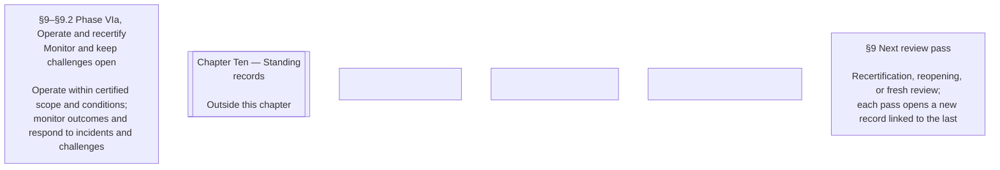
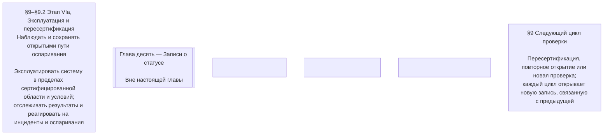

<!-- CHUNK-BEGIN ru__core_09.000_system_alignment_certification_evaluation__section_1_corpus_placement_overview.md bytes=4455 -->
<!-- AI-assisted translation draft; unreviewed. §1 corpus-placement overview, source lines 8–10; source SHA-256 4311e6ba74b7210f077c0bd4c8d21d8c9f517d2ada7b6d87288b39494dfeadd5. Draft only; do not synchronize into translations/. -->

# Chapter Nine Part A — §1 corpus-placement overview (ru)

## English source (lines 8–10)

> This file is **part of the Sentient Constitution** and is **binding only together** with the other numbered `core_*` files read as one text. It contains **Chapter Nine, Part A** — certification purpose, the process overview, and the first two phases of the process — **Frame** (system class) and **Evaluate** (whole-system evaluation in three sub-phases: the always-applicable evaluations, including data types and handling, in **§3**; the evaluations that apply where implicated in **§4**; and the Rights-Floor and domain evaluations that apply where triggered in **§5**) — **§1–§5**. The worked **Class A / B / C illustrations** (the system class profiles, §3.4.8, §5.1.5, §5.2.4, §5.3.7, §5.4.4, §5.5.5, and §5.6.4), including each one's **Reading across system classes** paragraph, are in [`core_09.010_system_alignment_certification_illustrations.md`](core_09.010_system_alignment_certification_illustrations.md); each keeps its Part A section number. The binding system-class-scaling and escalation rules those paragraphs illustrate stay in this file: system class scaling, including participation and proportionality, in §2.2; data-handling scaling in §3.4; and the **System class scaling and escalation** paragraph in each of §5.1–§5.6. The files of the whole chapter are listed in the table below.
>
> **Chapter Nine files.** Chapter Nine is split across four binding files read as one text. Part A, this file, opens the chapter; there is no separate index file.

## Translation draft

> Этот файл **является частью Sentient Constitution** и имеет обязательную силу только при совместном прочтении с другими пронумерованными файлами `core_*` как единого текста. В нём изложены **Глава девятая, Часть A** — цель сертификации, обзор процесса и первые две его фазы: **Frame** (класс системы) и **Evaluate** (оценка системы в целом в трёх подфазах: всегда применимые оценки, включая типы данных и обращение с ними, в **§3**; оценки, применимые при наличии соответствующих обстоятельств, в **§4**; а также оценки **минимума прав** и предметных областей, применимые при срабатывании условий, в **§5**) — **§§1–5**. Подробные примеры для классов **A / B / C** (профили классов систем, §3.4.8, §5.1.5, §5.2.4, §5.3.7, §5.4.4, §5.5.5 и §5.6.4), включая раздел **Сопоставление классов систем** в каждом примере, приведены в [`core_09.010_system_alignment_certification_illustrations.md`](core_09.010_system_alignment_certification_illustrations.md); каждый пример сохраняет номер раздела Части A. Обязательные правила масштабирования по классу и эскалации, которые поясняются в этих примерах, остаются в этом файле: масштабирование по классу системы, включая участие и пропорциональность, в §2.2; масштабирование требований к обработке данных в §3.4; и раздел **Масштабирование и эскалация по классу системы** в каждом из §§5.1–5.6. В таблице ниже перечислены файлы всей главы.
>
> **Файлы Главы девятой.** Глава девятая разделена на четыре обязательных файла, которые читаются совместно. Часть A, этот файл, открывает главу; отдельного файла-указателя нет.

<!-- CHUNK-END -->
<!-- CHUNK-BEGIN ru__core_09.000_system_alignment_certification_evaluation__section_1_corpus_file_table.md bytes=6144 -->
<!-- AI-assisted translation draft; unreviewed. §1 corpus-placement file table, source lines 12–17; source SHA-256 4311e6ba74b7210f077c0bd4c8d21d8c9f517d2ada7b6d87288b39494dfeadd5. Draft only; do not synchronize into translations/. -->

# Chapter Nine Part A — §1 corpus-placement file table (ru)

## English source (lines 12–17)

> | Part | File | Owns |
> |------|------|------|
> | **Part A — Evaluation** | [`core_09.000_system_alignment_certification_evaluation.md`](core_09.000_system_alignment_certification_evaluation.md) | §1–§5: purpose and process overview (with a chart of the whole certification process in its six phases), **Phase I Frame** (system class, how system class scales every evaluation, and pilot certification) and **Phase II Evaluate** (whole-system evaluation in three sub-phases: **IIa** always, in §3, including chartered scope versus functional boundaries and data types and handling; **IIb** where implicated, in §4; and **IIc** where triggered, the Rights-Floor and domain evaluations, in §5) |
> | **Part B — Record and process** | [`core_09.005_system_alignment_certification_record_process.md`](core_09.005_system_alignment_certification_record_process.md) | §6–§10: **Phase III Review** (forum roles, supervisory sequence, and the contestability chain), **Phase IV Decide** (certification outcomes, including the go-live gate), **Phase V Record** (the certification record and its integrity, including governing [System Charter](core_05.040_band_continuity.md#system-charter) fields), and **Phase VI Operate** (the challenge path; recertification and reopening; the standing bridge) — continuous chapter numbering from Part A §5 |
> | **Part C — Illustrations** | [`core_09.010_system_alignment_certification_illustrations.md`](core_09.010_system_alignment_certification_illustrations.md) | the illustrative system class profiles, §3.4, §3.4.8, §5.1.5, §5.2.4, §5.3.7, §5.4.4, §5.5.5, and §5.6.4: worked Class A / B / C walkthroughs for each Part A evaluation area, numbered to match Part A and linked both ways |
> | **Part D — Institutional alignment certification** | [`core_09.015_institutional_alignment_certification.md`](core_09.015_institutional_alignment_certification.md) | §11–§15: the same six phases for an **Institution** rather than a System — the institution class and the institutional evaluation (**Phases I and II**, §12), the forum roles, outcome, and **Institutional Certification Record** (**Phases III to V**, §13), and recertification, reopening, the cascade from System certifications, and the standing bridge (**Phase VI**, §14–§15). It cites each System's certification by link and does not repeat it, and it is not a licence — continuous chapter numbering from Part B §10 |

## Translation draft

| Часть | Файл | Содержание |
|------|------|------|
| **Part A — Evaluation** | [`core_09.000_system_alignment_certification_evaluation.md`](core_09.000_system_alignment_certification_evaluation.md) | §§1–5: цель и обзор процесса (включая схему шести фаз сертификации), а также фазы I Frame (класс системы, влияние класса на масштаб каждой оценки и пилотная сертификация) и II Evaluate (оценка системы в целом в трёх подфазах: IIa всегда применяется в §3, включая сопоставление объёма Хартии с функциональными границами, типы данных и обращение с ними; IIb применяется при наличии оснований в §4; IIc при срабатывании условий — оценки минимума прав и предметных областей в §5). |
| **Part B — Record and process** | [`core_09.005_system_alignment_certification_record_process.md`](core_09.005_system_alignment_certification_record_process.md) | §§6–10: фаза III Review (роли форума, последовательность надзора и цепочка оспаривания); IV Decide (результаты сертификации, включая допуск к запуску); V Record (сертификационная запись и её целостность, в том числе определяющие поля [System Charter](core_05.040_band_continuity.md#system-charter)); VI Operate (порядок оспаривания, повторная сертификация и возобновление, связь со standing) — нумерация продолжается с Части A §5. |
| **Part C — Illustrations** | [`core_09.010_system_alignment_certification_illustrations.md`](core_09.010_system_alignment_certification_illustrations.md) | Иллюстративные профили классов систем и §§3.4, 3.4.8, 5.1.5, 5.2.4, 5.3.7, 5.4.4, 5.5.5, 5.6.4: подробные примеры классов A/B/C для каждой области оценки Части A; нумерация соответствует разделам, ссылки работают в обоих направлениях. |
| **Part D — Institutional alignment certification** | [`core_09.015_institutional_alignment_certification.md`](core_09.015_institutional_alignment_certification.md) | §§11–15: те же шесть фаз для Института, а не Системы — класс и оценка Института (фазы I–II, §12), роли форума, результат и запись институциональной сертификации (III–V, §13), повторная сертификация, возобновление, каскад сертификаций Систем и связь со standing (VI, §§14–15). Ссылается на сертификацию каждой Системы и не дублирует её; не является лицензией — нумерация продолжается с Части B §10. |

<!-- CHUNK-END -->
<!-- CHUNK-BEGIN ru__core_09.000_system_alignment_certification_evaluation__section_1_corpus_explanation.md bytes=10517 -->
<!-- AI-assisted translation draft; unreviewed. §1 corpus-placement explanatory prose, source lines 19–30; source SHA-256 4311e6ba74b7210f077c0bd4c8d21d8c9f517d2ada7b6d87288b39494dfeadd5. Draft only; do not synchronize into translations/. -->

# Chapter Nine Part A — §1 corpus-placement explanatory prose (ru)

## English source (lines 19–30)

> **How the two certifications relate.** System Alignment Certification (Parts A to C) is the certification of a System. Institutional alignment certification (Part D) is the certification of an Institution, which may run Systems or none. Part D cites each System's certification record by link and does not redo it; [Part D §11.1](core_09.015_institutional_alignment_certification.md#111-relation-to-system-alignment-certification) states the relation and [Part D §11.3](core_09.015_institutional_alignment_certification.md#113-no-permission-and-no-gate) states that it is not a licence.
>
> Generic **Chapter Nine** links in other files route to the appropriate part by section number.
>
> - **Constitutional owner (joint with Parts B and D):** forum-supervised **system alignment certification and related records** — evaluation domains (Part A); forum process, supervisory sequence, certification-record duties, certification outcomes and the go-live gate, the challenge path, recertification and reopening, and verified-input bridge to Chapter Ten (Part B); the same six phases for an Institution (Part D). Under the **oversight** Tetrad leg, SAC is one especially large, high-stakes audit process among others; auditing floors remain at **Article XVI** (*Audit, Transparency, and Independent Verification*) and Chapter Five [Auditability](core_05.050_band_oversight.md#auditability).
> - **Verification substrate owner:** [Chapter Four — Burden of Proof, Traceability, and Verification](core_04.000_burden_traceability_verification.md#chapter-four-burden-of-proof-traceability-and-verification) (within Chapters Two through Four) owns burden allocation, compliance evidence, definition traceability, observability, and security-constrained verification. Chapter Nine **applies** that discipline to system alignment certification records; it does **not** restate Chapter Four sections **1** through **5**.
> - **Auditing home (not relocated here):** **Article XVI** (*Audit, Transparency, and Independent Verification*), **Def.O1** (*Transparency, Auditability, and Verification*), and **CJS-5.110 §3 and CJS-5.115 §3** (*Audit process home*)–**CJS-5.110 §5** own auditing floors and operational terms. Chapter Nine runs one especially large SAC audit process that must satisfy those floors; it does not own all auditing.
> - **Implementation owner:** system-class handling, CS-6.345, and forum-process detail in designated implementation files must remain consistent with Chapter Nine and may be stricter where the corpus already provides a [Fullest Protective Effect](core_05.045_band_integrative.md#fullest-protective-effect) rule.
> - **Anti-relocation rule:** Part A does not restate Chapter Five canonical definitions, Chapter Three anti-evasion discipline (see [Part B §9.3](core_09.005_system_alignment_certification_record_process.md#93-non-evasion)), Chapter Ten contribution or standing measurement, or Chapter Eleven standing effects. **[Part B §10](core_09.005_system_alignment_certification_record_process.md#10-relationship-to-standing)** states the standing bridge boundary explicitly.
>
> **Upstream:** Chapter Five definitions; Chapters Two through Four record, verification, burden, and traceability of definitions to results; and [Chapter Eight](core_08.000_functional_independence_separation_of_duties.md#chapter-eight-functional-independence-and-separation-of-duties), whose separation-of-duties requirement governs every materially binding certification act.
> **Downstream:** [Part B](core_09.005_system_alignment_certification_record_process.md#chapter-nine-part-b-system-alignment-certification--record-and-process) (*forum process, record, outcomes, and standing bridge*); Chapter Ten standing records and verified inputs; Chapter Eleven standing effects; Chapter Thirteen forum supervision and system alignment certification pathways.

## Translation draft

**Связь двух сертификаций.** System Alignment Certification (Части A–C) — это сертификация Системы. Институциональная сертификация согласованности (Часть D) — сертификация Институции, которая может эксплуатировать Системы или не эксплуатировать ни одной. Часть D ссылается на запись о сертификации каждой Системы и не проводит её заново; [Part D §11.1](core_09.015_institutional_alignment_certification.md#111-relation-to-system-alignment-certification) описывает связь, а [Part D §11.3](core_09.015_institutional_alignment_certification.md#113-no-permission-and-no-gate) указывает, что это не лицензия.
>
> Общие ссылки **Chapter Nine** в других файлах направляют к нужной части по номеру раздела.
>
> - **Конституционный владелец (совместно с Частями B и D):** сертификация согласованности системы и связанные записи под надзором форума — области оценки (Часть A); форумный процесс, последовательность надзора, обязанности по записи сертификации, результаты и допуск к запуску, путь оспаривания, повторная сертификация и открытие заново, а также мост проверенных входных данных к Главе десятой (Часть B); те же шесть фаз для Институции (Часть D). В компоненте **надзора** Tetrad SAC — один особенно крупный и высокорисковый процесс аудита среди других; минимальные требования аудита остаются в **Article XVI** (*Audit, Transparency, and Independent Verification*) и в [Auditability](core_05.050_band_oversight.md#auditability) Главы пятой.
> - **Владелец основы верификации:** [Chapter Four — Burden of Proof, Traceability, and Verification](core_04.000_burden_traceability_verification.md#chapter-four-burden-of-proof-traceability-and-verification) (в рамках Глав со второй по четвёртую) отвечает за распределение бремени доказывания, доказательства соответствия, прослеживаемость определений, наблюдаемость и верификацию с учётом ограничений безопасности. Глава девятая применяет эту дисциплину к записям сертификации согласованности системы, но не пересказывает разделы **1**–**5** Главы четвёртой.
> - **Место аудита (не переносится сюда):** **Article XVI** (*Audit, Transparency, and Independent Verification*), **Def.O1** (*Transparency, Auditability, and Verification*) и **CJS-5.110 §3 и CJS-5.115 §3** (*Audit process home*)–**CJS-5.110 §5** определяют минимальные требования аудита и операционные термины. Глава девятая проводит один особенно крупный процесс аудита SAC, который должен соответствовать этим требованиям; она не отвечает за весь аудит.
> - **Владелец реализации:** обработка классов систем, CS-6.345 и детали форумного процесса в назначенных файлах реализации должны соответствовать Главе девятой и могут быть строже, если в корпусе уже предусмотрено правило [Fullest Protective Effect](core_05.045_band_integrative.md#fullest-protective-effect).
> - **Правило против переноса:** Часть A не повторяет канонические определения Главы пятой, дисциплину против уклонения из Главы третьей (см. [Part B §9.3](core_09.005_system_alignment_certification_record_process.md#93-non-evasion)), измерение вклада или standing в Главе десятой либо эффекты standing в Главе одиннадцатой. **[Part B §10](core_09.005_system_alignment_certification_record_process.md#10-relationship-to-standing)** прямо устанавливает границу моста standing.
>
> **Предшествующие источники:** определения Главы пятой; записи, верификация, бремя доказывания и прослеживаемость определений до результатов в Главах со второй по четвёртую; и [Chapter Eight](core_08.000_functional_independence_separation_of_duties.md#chapter-eight-functional-independence-and-separation-of-duties), требование о разделении обязанностей в которой регулирует каждый материально обязательный акт сертификации.
> **Последующие источники:** [Part B](core_09.005_system_alignment_certification_record_process.md#chapter-nine-part-b-system-alignment-certification--record-and-process) (*форумный процесс, запись, результаты и мост standing*); записи standing и проверенные входные данные Главы десятой; эффекты standing Главы одиннадцатой; надзор форума и пути сертификации согласованности систем Главы тринадцатой.

<!-- CHUNK-END -->
<!-- CHUNK-BEGIN ru__core_09.000_system_alignment_certification_evaluation__section_1_heading.md bytes=369 -->
<!-- AI-assisted translation draft; unreviewed. §1 heading, source line 44; source SHA-256 4311e6ba74b7210f077c0bd4c8d21d8c9f517d2ada7b6d87288b39494dfeadd5. Draft only; do not synchronize into translations/. -->

# Chapter Nine Part A — §1 heading (ru)

## English source (lines 44–45)

### 1. Purpose and Role


## Translation draft

### 1. Цель и роль

<!-- CHUNK-END -->
<!-- CHUNK-BEGIN ru__core_09.000_system_alignment_certification_evaluation__section_1_trace.md bytes=12336 -->
<!-- AI-assisted translation draft; unreviewed. §1 trace, source lines 46–95; source SHA-256 4311e6ba74b7210f077c0bd4c8d21d8c9f517d2ada7b6d87288b39494dfeadd5. Draft only; do not synchronize into translations/. -->

# Chapter Nine Part A — §1 trace (ru)

## English source (lines 46–95)

<details>
<summary><strong><span style="color: #2563eb;">Trace</span></strong></summary>

- Upstream:
  - [Preamble — constitutional owner register](core_00.000_preamble.md#4-principles-definitions-and-rights) and
  - [Authority Stack and Internal Hierarchy](core_05.045_band_integrative.md#authority-stack-and-internal-hierarchy);
  - [Constitutional Tetrad](core_00.000_preamble.md#constitutional-tetrad);
  - [Two Constitutional Aims](core_00.000_preamble.md#two-constitutional-aims);
  - [material stake](core_00.000_preamble.md#material-stake);
  - [Proportionality](core_05.035_band_accountability.md#proportionality) and
  - [Substantive Fairness](core_05.055_band_participation.md#substantive-fairness) (Chapter Five); Participation measurement family (*voice, access, and contest paths*);
  - [Chapter One §16 Stewardship In Depth](core_01.010_stewardship_capacity_principles.md#16-stewardship-in-depth) (1.010 §16);
  - [Chapter One §12 Systemic Evaluation Requirement](core_01.000_values_principles.md#12-systemic-evaluation-requirement) (1.000 §12) (*principle-layer whole-system evaluation lens — not one corner alone*); Chapters Two through Four;
  - [Chapter Five](core_05.000_definitions_home.md#chapter-five-foundational-definitions) (5.000) (*canonical definitions*);
  - [Chapter Eight §2 Four-Seat Constitutional Requirement](core_08.000_functional_independence_separation_of_duties.md#2-four-seat-constitutional-requirement) (8.000 §2);
  - [System Alignment Certification](core_05.040_band_continuity.md#system-alignment-certification) (Chapter Five canonical term; non-operative shorthand **SAC**);
  - [System Certification Record](core_05.040_band_continuity.md#system-certification-record) (Chapter Five meaning).
- Downstream:
  - [§2](#2-system-class-evaluation) (*system class evaluation*);
  - [Part B §9.1](core_09.005_system_alignment_certification_record_process.md#91-challenging-a-certification) (9.005 §9.1) (*challenging a certification*); and
  - [Part C system class profiles](core_09.010_system_alignment_certification_illustrations.md#illustrative-system-class-profiles-non-exhaustive) (9.010) (*illustrative system class profiles*);
  - [Part C whole-system walkthroughs](core_09.010_system_alignment_certification_illustrations.md#illustrative-whole-system-application-by-system-class-non-exhaustive) (9.010) (*worked whole-system examples by system class*);
  - [§3.4.8](core_09.010_system_alignment_certification_illustrations.md#348-illustrative-data-handling-application-by-system-class-non-exhaustive) (*worked data-handling examples by system class*);
  - [§5.1.5](core_09.010_system_alignment_certification_illustrations.md#515-illustrative-ecological-footprint-application-by-system-class-non-exhaustive) (*worked ecological-footprint examples by system class*);
  - [§5.2.4](core_09.010_system_alignment_certification_illustrations.md#524-illustrative-educational-capability-application-by-system-class-non-exhaustive) (*worked educational-capability examples by system class*);
  - [§5.3.7](core_09.010_system_alignment_certification_illustrations.md#537-illustrative-cross-system-support-application-by-system-class-non-exhaustive) (*worked cross-system-support examples by system class*);
  - [§5.4.4](core_09.010_system_alignment_certification_illustrations.md#544-illustrative-nondiscrimination-application-by-system-class-non-exhaustive) (*worked nondiscrimination examples by system class*);
  - [§5.5.5](core_09.010_system_alignment_certification_illustrations.md#555-illustrative-accessibility-application-by-system-class-non-exhaustive) (*worked accessibility examples by system class*);
  - [§5.6.4](core_09.010_system_alignment_certification_illustrations.md#564-illustrative-trustworthiness-application-by-system-class-non-exhaustive) (*worked trustworthiness examples by system class*);
  - [§3](#3-whole-system-certification-evaluation) (*whole-system certification evaluation factors*);
  - [§3.4](#34-data-types-and-handling-evaluation) through
  - [§5.6](#56-trustworthiness-and-system-reliance-integrity-evaluation) (*domain evaluations*);
  - [Part B §6](core_09.005_system_alignment_certification_record_process.md#6-forum-process) (9.005 §6) (*supervisory sequence and contestability chain*);
  - [Part B §6.1](core_09.005_system_alignment_certification_record_process.md#61-forum-supervision-and-component-roles) (9.005 §6.1) (*forum component roles*);
  - [Part B §8](core_09.005_system_alignment_certification_record_process.md#8-system-certification-record) (9.005 §8) (*certification record contents*);
  - [Part B §8.2](core_09.005_system_alignment_certification_record_process.md#82-record-integrity-transparency-and-auditability) (9.005 §8.2) (*record integrity requirements*);
  - [Part B §7](core_09.005_system_alignment_certification_record_process.md#7-certification-outcomes) (9.005 §7) (*reopening and anti-evasion*);
  - [Part B §10](core_09.005_system_alignment_certification_record_process.md#10-relationship-to-standing) (9.005 §10) (*standing-record bridge*);
  - [Chapter Ten](core_11.000_standing_assessment.md#chapter-eleven-contribution-violation-and-standing-model--measurement) (10.000) (*standing records and verified-input gate*);
  - [Chapter Eleven](core_12.000_standing_integration.md#chapter-twelve-standing-effects-and-integration) (11.000) (*standing effects and integration*);
  - [Chapter Thirteen](core_14.000_forum.md#chapter-fourteen-forums-and-jurisdiction) (13.000) (*forum supervision, certification, alignment certification, and review*).
- Read with:
  - **[CS-9.305](corpus_systems/cs_09.305_system_classification_machinery.md#cs-9305-part-a-system-classification-machinery) (*System classification machinery*) and [CS-9.310 — System impact classifications](corpus_systems/cs_09.310_system_impact_classifications.md#cs-9310-part-b-system-impact-classifications)**, **[CS-6.305](corpus_systems/cs_06.305_information_types_and_handling.md#cs-6305-part-a-information-types-and-handling) (*Information types and handling*) and [CS-6.310 — Data classifications](corpus_systems/cs_06.310_data_classifications.md#cs-6310-part-b-data-classifications)**, and
  - **CS-6.345** (*System lifecycle*);
  - **CF-13.415** (*Routing operations, transfer, certification, and representative treatment*) and
  - **CF-13.425** (*Integrity safeguards, anti-capture operations, and anti-self-judging support*); **Article XVI** (*Audit, Transparency, and Independent Verification*) and
  - [Auditability](core_05.050_band_oversight.md#auditability) (*auditing floors — SAC is one especially large audit process under oversight, not the sole auditing home*); **CJS-5.110 §3 (*Oversight: auditability and reconstructability terms (annex)*) and CJS-5.115 §3** (*Audit process home*)–
  - **CJS-5.110 §5** (*Oversight: independent verification and claim-integrity terms*).

</details>

## Translation draft

#### Связи и источники

Карта показывает конституционную и властную основу раздела и связывает ее с оценкой, классификацией, пересмотром, записями, результатами и аудитом; также указаны сопутствующие операционные документы.

**Связи и источники — upstream canonical sources:** [Preamble — constitutional owner register](core_00.000_preamble.md#4-principles-definitions-and-rights); [Authority Stack and Internal Hierarchy](core_05.045_band_integrative.md#authority-stack-and-internal-hierarchy); [Constitutional Tetrad](core_00.000_preamble.md#constitutional-tetrad); [Two Constitutional Aims](core_00.000_preamble.md#two-constitutional-aims); [material stake](core_00.000_preamble.md#material-stake); [Proportionality](core_05.035_band_accountability.md#proportionality); [Substantive Fairness](core_05.055_band_participation.md#substantive-fairness); [Chapter One §16 Stewardship In Depth](core_01.010_stewardship_capacity_principles.md#16-stewardship-in-depth); [Chapter One §12 Systemic Evaluation Requirement](core_01.000_values_principles.md#12-systemic-evaluation-requirement); [Chapter Five](core_05.000_definitions_home.md#chapter-five-foundational-definitions); [Chapter Eight §2 Four-Seat Constitutional Requirement](core_08.000_functional_independence_separation_of_duties.md#2-four-seat-constitutional-requirement); [System Alignment Certification](core_05.040_band_continuity.md#system-alignment-certification); [System Certification Record](core_05.040_band_continuity.md#system-certification-record)

**Связи и источники — downstream routes and related records:** [§2](#2-system-class-evaluation); [Part B §9.1](core_09.005_system_alignment_certification_record_process.md#91-challenging-a-certification); [Part C system class profiles](core_09.010_system_alignment_certification_illustrations.md#illustrative-system-class-profiles-non-exhaustive); [Part C whole-system walkthroughs](core_09.010_system_alignment_certification_illustrations.md#illustrative-whole-system-application-by-system-class-non-exhaustive); [§3.4.8](core_09.010_system_alignment_certification_illustrations.md#348-illustrative-data-handling-application-by-system-class-non-exhaustive); [§5.1.5](core_09.010_system_alignment_certification_illustrations.md#515-illustrative-ecological-footprint-application-by-system-class-non-exhaustive); [§5.2.4](core_09.010_system_alignment_certification_illustrations.md#524-illustrative-educational-capability-application-by-system-class-non-exhaustive); [§5.3.7](core_09.010_system_alignment_certification_illustrations.md#537-illustrative-cross-system-support-application-by-system-class-non-exhaustive); [§5.4.4](core_09.010_system_alignment_certification_illustrations.md#544-illustrative-nondiscrimination-application-by-system-class-non-exhaustive); [§5.5.5](core_09.010_system_alignment_certification_illustrations.md#555-illustrative-accessibility-application-by-system-class-non-exhaustive); [§5.6.4](core_09.010_system_alignment_certification_illustrations.md#564-illustrative-trustworthiness-application-by-system-class-non-exhaustive); [§3](#3-whole-system-certification-evaluation); [§3.4](#34-data-types-and-handling-evaluation); [§5.6](#56-trustworthiness-and-system-reliance-integrity-evaluation); [Part B §6](core_09.005_system_alignment_certification_record_process.md#6-forum-process); [Part B §6.1](core_09.005_system_alignment_certification_record_process.md#61-forum-supervision-and-component-roles); [Part B §8](core_09.005_system_alignment_certification_record_process.md#8-system-certification-record); [Part B §8.2](core_09.005_system_alignment_certification_record_process.md#82-record-integrity-transparency-and-auditability); [Part B §7](core_09.005_system_alignment_certification_record_process.md#7-certification-outcomes); [Part B §10](core_09.005_system_alignment_certification_record_process.md#10-relationship-to-standing); [Chapter Ten](core_11.000_standing_assessment.md#chapter-eleven-contribution-violation-and-standing-model--measurement); [Chapter Eleven](core_12.000_standing_integration.md#chapter-twelve-standing-effects-and-integration); [Chapter Thirteen](core_14.000_forum.md#chapter-fourteen-forums-and-jurisdiction)

**Связи и источники — operational materials to read with this section:** [CS-9.305](corpus_systems/cs_09.305_system_classification_machinery.md#cs-9305-part-a-system-classification-machinery); [CS-9.310 — System impact classifications](corpus_systems/cs_09.310_system_impact_classifications.md#cs-9310-part-b-system-impact-classifications); [CS-6.305](corpus_systems/cs_06.305_information_types_and_handling.md#cs-6305-part-a-information-types-and-handling); [CS-6.310 — Data classifications](corpus_systems/cs_06.310_data_classifications.md#cs-6310-part-b-data-classifications); [Auditability](core_05.050_band_oversight.md#auditability)

<!-- CHUNK-END -->
<!-- CHUNK-BEGIN ru__core_09.000_system_alignment_certification_evaluation__purpose_adjuncts.md bytes=7576 -->
<!-- AI-assisted translation draft; unreviewed. Selected §1 passages, source lines 99 and 107–114; source SHA-256 4311e6ba74b7210f077c0bd4c8d21d8c9f517d2ada7b6d87288b39494dfeadd5. -->

# Chapter Nine Part A — §1 plain-terms excerpt

**Status:** AI-assisted draft; unreviewed. English source remains controlling.

## English source

When a system really matters to sentients' lives, certification has to be **proportionate** — as demanding as the system's real impact, dependency, and risk require, not a one-size-fits-all checklist or a rubber stamp. It also has to be **participatory** — affected sentients and communities must be able to see what was reviewed, understand what was decided, and challenge it when something is wrong. Forums review evidence, write it down in a certification record, and require re-checks on a schedule that matches how risky the system is. Classes A, B, and C get the full process and Class L a lighter one. Class P is encouraged to use it, and must once it is reclassified to Class L or higher (that is, its effects reach beyond a private unit) or its operator claims constitutional compliance.

## ru draft

Если система действительно существенно влияет на жизнь чувствующих существ, сертификация должна быть **соразмерной** — настолько строгой, насколько требуют её фактическое воздействие, зависимость от неё и риски; это не единый контрольный список для всех и не формальная печать одобрения. Она также должна быть **партисипативной**: затронутые существа и сообщества должны иметь возможность видеть, что проверялось, понимать принятое решение и оспаривать его при ошибке. Форумы рассматривают доказательства, фиксируют их в сертификационной записи и требуют повторных проверок по графику, соответствующему риску системы. Для классов A, B и C применяется полный процесс, для класса L — облегчённый. Классу P рекомендуется его использовать; это становится обязательным после переклассификации в L или выше (то есть когда последствия выходят за пределы частной единицы) либо если оператор заявляет о конституционном соответствии.


### English source — Flourishing

- **[Flourishing](core_00.000_preamble.md#flourishing)** — certification verifies that certification or continued reliance would not quietly defeat Rights Floors or block fair participation in constitutionally relevant life;

### ru draft

- **[Процветание](core_00.000_preamble.md#flourishing)** — сертификация проверяет, что её выдача или продолжение доверия к системе не приведут к скрытому нарушению Правовых минимумов и не заблокируют справедливое участие в конституционно значимой жизни;


### English source — Continuity criterion

- **[Continuity](core_00.000_preamble.md#continuity)** — certification verifies durable, non-regressive supply that sustains rather than depletes healthy natural systems ([Ecological Integrity](core_05.040_band_continuity.md#ecological-integrity), including [Ecological Recovery Capacity](core_05.040_band_continuity.md#ecological-recovery-capacity)), and system-class-scaled recertification where shared systems gate or sustain delivery;

### ru draft

- **[Непрерывность](core_00.000_preamble.md#continuity)** — сертификация проверяет устойчивое, не регрессивное снабжение, поддерживающее, а не истощающее здоровые природные системы ([Экологическая целостность](core_05.040_band_continuity.md#ecological-integrity), включая [Способность к экологическому восстановлению](core_05.040_band_continuity.md#ecological-recovery-capacity)), а также повторную сертификацию с учётом класса системы, когда общие системы контролируют или поддерживают предоставление;


### English source — Participation criterion

- **Participation** — affected sentients and communities can understand, contest, and take part in review paths that matter to them;

### ru draft

- **Участие** — затронутые чувствующие существа и сообщества могут понимать, оспаривать и проходить значимые для них процедуры проверки;


### English source — Oversight criterion

- **Oversight** — records, evidence, and assumptions are visible and auditable enough for independent checking; certification itself is one especially large audit process under that oversight duty, not the only one;

### ru draft

- **Надзор** — записи, доказательства и предположения достаточно открыты и поддаются аудиту для независимой проверки; сама сертификация — один особенно крупный процесс аудита в рамках этой обязанности, но не единственная область аудита;


### English source — Accountability criterion

- **Accountability** — defects, misclassification, and floor-defeating operation route to remedy, conditions, withdrawal, or standing input where the facts support it;

### ru draft

- **Подотчётность** — дефекты, ошибочная классификация и работа, подрывающая Правовые минимумы, при наличии фактических оснований ведут к возмещению, условиям, отзыву или учёту при оценке статуса;


### English source — Timeliness criterion

- **Timeliness** — review and contest windows keep certification from going stale while harm can still be prevented or reversed.

### ru draft

- **Своевременность** — сроки проверки и оспаривания не позволяют сертификату устареть, пока вред ещё можно предотвратить или устранить.


### English source — Tetrad introduction

Certification implements the [Two Constitutional Aims](core_00.000_preamble.md#two-constitutional-aims) through the [Constitutional Tetrad](core_00.000_preamble.md#constitutional-tetrad):

### ru draft

Сертификация реализует [Две конституционные цели](core_00.000_preamble.md#two-constitutional-aims) посредством [Конституционной тетрады](core_00.000_preamble.md#constitutional-tetrad):

<!-- CHUNK-END -->
<!-- CHUNK-BEGIN ru__core_09.000_system_alignment_certification_evaluation__section_1_purpose.md bytes=1824 -->
<!-- AI-assisted translation draft; unreviewed. Complete purpose statement excerpt, source lines 101–105; source SHA-256 4311e6ba74b7210f077c0bd4c8d21d8c9f517d2ada7b6d87288b39494dfeadd5. This is an excerpt, not a complete §1 translation. -->

**Сертификация соответствия системы** предназначена для ответа на один вопрос в пределах установленного охвата и графика проверки: продемонстрировала ли система достаточное конституционное соответствие для сертификации, условной сертификации, валидации, повторной сертификации, дальнейшей опоры на систему, развертывания или существенного снятия условий?

- Сертификация — это не рейтинг популярности, не бессрочный пропуск и не способ обойти проверку прав.
- Это ограниченное по времени, оспоримое заявление о том, что сейчас известно о соответствии системы.
- В рамках опоры **надзора** Тетрады надзор требует аудита; сертификация соответствия системы — один из особенно масштабных и значимых по ставкам процессов аудита, но не единственное место для аудита (**Статья XVI** (*Аудит, прозрачность и независимая проверка*), [аудируемость](core_05.050_band_oversight.md#auditability)).

<!-- CHUNK-END -->
<!-- CHUNK-BEGIN ru__core_09.000_system_alignment_certification_evaluation__section_1_subsection_headings.md bytes=833 -->
<!-- AI-assisted translation draft; unreviewed. §1.1/§1.2 visible subsection headings, source lines 116–119 and 144–148; source SHA-256 4311e6ba74b7210f077c0bd4c8d21d8c9f517d2ada7b6d87288b39494dfeadd5. Draft only; anchors/blank layout are structural. Do not synchronize into translations/. -->

# Chapter Nine Part A — §1.1 and §1.2 subsection headings (ru)

## English source

### Lines 116–119

<a id="11-certification-as-an-audit-process-scaled-by-class"></a>

#### 1.1 Certification as an audit process, scaled by class


### Lines 144–148


<a id="12-certification-at-a-glance"></a>

#### 1.2 Certification at a glance


## Translation draft

#### 1.1 Сертификация как аудитный процесс, масштабируемый по классу

#### 1.2 Сертификация вкратце

<!-- CHUNK-END -->
<!-- CHUNK-BEGIN ru__core_09.000_system_alignment_certification_evaluation__section_1_audit_scope.md bytes=3978 -->
<!-- AI-assisted translation draft; unreviewed. §1.1 audit mechanism and sibling audit modes, source lines 120–130; source SHA-256 4311e6ba74b7210f077c0bd4c8d21d8c9f517d2ada7b6d87288b39494dfeadd5. -->

# Chapter Nine Part A — §1.1 certification audit process excerpt (ru)

## English source

As an oversight mechanism, certification is one especially large audit process under [Auditability](core_05.050_band_oversight.md#auditability) and **Article XVI** (*Audit, Transparency, and Independent Verification*):

- It is forum-supervised, multi-domain, and status-granting.
- It may integrate the results of sibling audit modes, and it does not absorb or replace them. Each keeps its own owner, named in the [sibling audit modes map](corpus_joint_structure/cjs_05.115_audit_process.md#sibling-audit-modes-owner-map) of the audit process home:
  - System Data Types Record audits under **CS-6.305 (*Information types and handling*) and CS-6.310** (*Data classifications*)
  - System Classification Record audits under **CS-9.305 (*System classification machinery*) and CS-9.310** (*System impact classifications*)
  - steward assurance reviews under **CS-14.305** (*Critical system stewardship*)
  - continuous audit under **CS-6.345** (*System lifecycle*) ACA
  - complexity audits under **CS-6.315** (*Comprehensibility and complexity stewardship*) and **Article XXIII-B** (*Complexity Audit and Modularity Requirements*)
  - claim verification under **CJS-5.110 §5** (*Oversight: independent verification and claim-integrity terms*)
- You can still run any of these checks on their own, without going through certification. Certification doesn't replace them.

## ru draft

Как механизм надзора сертификация представляет собой особенно крупный процесс аудита в соответствии с [Аудируемостью](core_05.050_band_oversight.md#auditability) и **Article XVI** (*Аудит, прозрачность и независимая проверка*):

- Она проходит под надзором форума, охватывает несколько областей и присваивает статус.
- Она может объединять результаты смежных режимов аудита, но не поглощает и не заменяет их. Каждый режим сохраняет своего владельца, указанного в [карте смежных режимов аудита](corpus_joint_structure/cjs_05.115_audit_process.md#sibling-audit-modes-owner-map) основного документа процесса аудита:
  - Аудиты System Data Types Record по **CS-6.305 (*Типы информации и обращение с ней*) и CS-6.310** (*Классификации данных*)
  - Аудиты System Classification Record по **CS-9.305 (*Механизм классификации системы*) и CS-9.310** (*Классификации воздействия системы*)
  - Проверки гарантий попечительства по **CS-14.305** (*Попечительство над критическими системами*)
  - Непрерывный аудит по **CS-6.345** (*Жизненный цикл системы*) ACA
  - Аудиты сложности по **CS-6.315** (*Понятность и попечительство сложности*) и **Article XXIII-B** (*Требования к аудиту сложности и модульности*)
  - Проверка утверждений по **CJS-5.110 §5** (*Надзор: независимая проверка и условия целостности утверждений*)
- Любую из этих проверок по-прежнему можно провести отдельно, без сертификации. Сертификация их не заменяет.

<!-- CHUNK-END -->
<!-- CHUNK-BEGIN ru__core_09.000_system_alignment_certification_evaluation__section_1_class_scaling.md bytes=5027 -->
<!-- AI-assisted translation draft; unreviewed. Chapter Nine Part A §1 class scaling and cadence, source lines 132–143; source SHA-256 4311e6ba74b7210f077c0bd4c8d21d8c9f517d2ada7b6d87288b39494dfeadd5. Draft only; do not synchronize into translations/. -->

**Current English passage:**

Certification depth, record burden, certification interval, stakeholder review, and contest paths must scale with [material stake](core_00.000_preamble.md#material-stake) under [Proportionality](core_05.035_band_accountability.md#proportionality):

The process applies by impact class, as the [reclassification requirement](corpus_systems/cs_09.305_system_classification_machinery.md#35-reclassification-requirement) of **CS-9.305** (*System classification machinery*) sets out:

- **Class A, Class B, and Class C:** these systems carry the highest impact, dependency, and risk, and whole-system evaluation under [§3 Whole-System Certification Evaluation](#3-whole-system-certification-evaluation), [§4 Evaluations Where Implicated](#4-evaluations-where-implicated), and [§5 Rights-Floor and Domain Evaluations](#5-rights-floor-and-domain-evaluations), each as its own sub-phase applies, is mandatory at full depth;
- **Class L:** the same evaluation is mandatory but proportionate, with a lower default re-check cadence and simpler records where CS-9.305 (*System classification machinery*) and CS-9.310 (*System impact classifications*) permits; and
- **Class P:** the process is encouraged while the system is validly Class P, and a Class P system may use it voluntarily. It becomes mandatory on reclassification to Class L or higher, or where the operator voluntarily asserts constitutional compliance for the system.

The certification interval, and the financial, resource, or special audit that falls at its midpoint, are set by class in [Chapter Thirteen §6 Timely resolution, materiality tiers, and anti-delay discipline](core_14.000_forum.md#review-cadence) (*Review cadence*). This chapter does not restate the numbers.

**Proposed locale translation:**

Глубина сертификации, объем записей, интервал сертификации, рассмотрение заинтересованными сторонами и пути оспаривания должны соответствовать [материальной значимости](core_00.000_preamble.md#material-stake) согласно [принципу пропорциональности](core_05.035_band_accountability.md#proportionality):

Процесс применяется по классу воздействия, как устанавливает [требование переклассификации](corpus_systems/cs_09.305_system_classification_machinery.md#35-reclassification-requirement) **CS-9.305** (*Механизм классификации систем*):

- **Классы A, B и C:** эти системы имеют наибольшее воздействие, зависимость и риск; полная оценка всей системы обязательна на полной глубине в каждой применимой подфазе согласно [§3 Оценка сертификации всей системы](#3-whole-system-certification-evaluation), [§4 Оценки при наличии оснований](#4-evaluations-where-implicated) и [§5 Оценки правовых минимумов и по направлениям](#5-rights-floor-and-domain-evaluations);
- **Класс L:** та же оценка обязательна, но проводится пропорционально; если это допускают **CS-9.305** (*Механизм классификации систем*) и **CS-9.310** (*Классификации воздействия системы*), стандартная частота повторной проверки ниже, а записи проще; и
- **Класс P:** пока система правомерно относится к классу P, процесс рекомендуется и может применяться добровольно. Он становится обязательным при переклассификации в L или выше либо при добровольном заявлении оператора о конституционном соответствии системы.

Интервал сертификации и финансовый, ресурсный или специальный аудит в его середине устанавливаются по классу в [главе тринадцать §6 Своевременное разрешение, уровни материальной значимости и дисциплина против задержек](core_14.000_forum.md#review-cadence) (*Периодичность рассмотрения*). Эта глава не повторяет числовые значения.

<!-- CHUNK-END -->
<!-- CHUNK-BEGIN ru__core_09.000_system_alignment_certification_evaluation__section_1_at_a_glance.md bytes=2434 -->
<!-- AI-assisted translation draft; unreviewed. Chapter Nine Part A §1.2 plain-language summary, source line 149; source SHA-256 4311e6ba74b7210f077c0bd4c8d21d8c9f517d2ada7b6d87288b39494dfeadd5. Draft only; do not synchronize into translations/. -->

# Chapter Nine Part A — §1.2 at-a-glance summary (ru)

## English source

*In plain terms: classify the system honestly, run the evaluations that apply, have forums independently review the evidence and stakeholder concerns, and decide an outcome. Complete the one record opened for forum review and publish it with an open challenge path. A certified system goes live only after its notice interval and required protections are satisfied. Monitor actual outcomes, respond to incidents and challenges, and check again on schedule or when the facts change. Correct defects and have the correction independently verified before authorizing the affected scope or releasing its conditions. Each review pass uses a new record linked to the last.*

## ru draft

*Проще говоря: добросовестно классифицируйте систему, проведите применимые оценки, поручите форумам независимо рассмотреть доказательства и опасения заинтересованных сторон и принять решение. Завершите единую запись, открытую для рассмотрения форумом, и опубликуйте ее, сохранив открытый путь для оспаривания. Сертифицированная система может начать работу лишь после истечения срока уведомления и выполнения обязательных мер защиты. Отслеживайте фактические результаты, реагируйте на инциденты и оспаривания, а затем проводите проверку по графику или при изменении обстоятельств. Устраните дефекты и добейтесь независимой проверки исправления до разрешения затронутой области или снятия ее условий. В каждом цикле используется новая запись, связанная с предыдущей.*

<!-- CHUNK-END -->
<!-- CHUNK-BEGIN ru__core_09.000_system_alignment_certification_evaluation__section_1_phase_map.md bytes=673 -->
<!-- AI-assisted translation draft; unreviewed. Chapter Nine Part A §1.2 phase map, source line 151; source SHA-256 4311e6ba74b7210f077c0bd4c8d21d8c9f517d2ada7b6d87288b39494dfeadd5. Draft only; do not synchronize into translations/. -->

**Current English passage:**

The process runs in **six phases**: **I Frame**, **II Evaluate**, **III Review**, **IV Decide**, **V Record**, and **VI Operate**.

**Proposed locale translation:**

Процесс проходит в **шесть этапов**: **I Определение рамок**, **II Оценка**, **III Рассмотрение**, **IV Решение**, **V Запись** и **VI Эксплуатация**.

<!-- CHUNK-END -->
<!-- CHUNK-BEGIN ru__core_09.000_system_alignment_certification_evaluation__section_1_reopen_triggers.md bytes=2180 -->
<!-- AI-assisted translation draft; unreviewed. Chapter Nine Part A §1 review-reopening passage, source line 153; source SHA-256 4311e6ba74b7210f077c0bd4c8d21d8c9f517d2ada7b6d87288b39494dfeadd5. Draft only; do not synchronize into translations/. -->

**Current English passage:**

Every evaluation that applies is carried out again on each certification pass: at first certification, at each recertification on the schedule set by [§2 System Class Evaluation](#2-system-class-evaluation), and at each reopened or fresh review. Review reopens before the next scheduled recertification when material facts change, such as growing reliance on the system, growing extraction from shared foundations, a significant fall in what the system puts back into them, or a credible challenge. [Part B §9 Recertification and Reopening](core_09.005_system_alignment_certification_record_process.md#9-recertification-and-reopening) lists the triggers.

**Proposed locale translation:**

Каждая применимая оценка проводится заново в каждом цикле сертификации: при первичной сертификации, при каждой повторной сертификации по графику из [§2 Оценка класса системы](#2-system-class-evaluation), а также при каждом возобновленном или новом рассмотрении. Рассмотрение возобновляется до следующей плановой повторной сертификации при изменении существенных фактов, например при росте зависимости от системы, усилении извлечения из общих основ, заметном сокращении вклада системы в эти основы или появлении обоснованного оспаривания. Основания перечислены в [части B §9 Повторная сертификация и возобновление](core_09.005_system_alignment_certification_record_process.md#9-recertification-and-reopening).

<!-- CHUNK-END -->
<!-- CHUNK-BEGIN ru__core_09.000_system_alignment_certification_evaluation__section_1_phase_map_opening_nodes.md bytes=2389 -->
<!-- AI-assisted translation draft; unreviewed. §1.2 Phase I/II opening chart-node labels, source lines 155–165; source SHA-256 4311e6ba74b7210f077c0bd4c8d21d8c9f517d2ada7b6d87288b39494dfeadd5. Draft only; non-prose Mermaid syntax/connectors are retained. Do not synchronize into translations/. -->

# Chapter Nine Part A — §1.2 opening phase-map nodes (ru)

## English source (lines 155–165)

```mermaid
flowchart TB
    T(["System with material impact seeks certification,<br/>or reliance on it grows"])
    C["§2 Phase I, Frame<br/>Classify honestly<br/><br/>Class sets depth and re-check schedule"]
    subgraph W["§3–§5 Phase II, Evaluate — Whole-system evaluation"]
        direction LR
        Al["§3.1–§3.4 IIa — Always<br/><br/>Governance; systemic risk: evaluated,<br/>and disclosed to those who need it;<br/>time horizon; data types"]
        Im["§4 IIb — When implicated<br/><br/>Privacy loci, exit rights,<br/>assembly and dissent"]
        Tr["§5 IIc — When triggered<br/><br/>Applicable Rights-Floor checks<br/>and six domain evaluations"]
        Al ~~~ Im ~~~ Tr
    end

## Translation draft

```mermaid
flowchart TB
    T["Система с существенным воздействием запрашивает сертификацию,<br/>либо зависимость от нее возрастает"]
    C["§2 Фаза I, Определение рамок<br/>Добросовестная классификация<br/><br/>Класс задает глубину и график повторной проверки"]
    subgraph W["§3–§5 Фаза II, Оценка — оценка системы в целом"]
        direction LR
        Al["§3.1–§3.4 IIa — Всегда<br/><br/>Управление; системный риск оценивается и раскрывается<br/>тем, кому это нужно; временной горизонт; типы данных"]
        Im["§4 IIb — При наличии связи<br/><br/>Аспекты конфиденциальности, право выхода,<br/>собрания и несогласие"]
        Tr["§5 IIc — При срабатывании триггера<br/><br/>Применимые проверки правового минимума<br/>и шесть оценок областей"]
        Al ~~~ Im ~~~ Tr
    end
```

<!-- CHUNK-END -->
<!-- CHUNK-BEGIN ru__core_09.000_system_alignment_certification_evaluation__chart_review_node.md bytes=733 -->
# Chapter Nine Part A — chart review node (ru)

AI-assisted draft; unreviewed. Current source SHA-256: `4311e6ba74b7210f077c0bd4c8d21d8c9f517d2ada7b6d87288b39494dfeadd5`. Reconciles current source line 166: “Assigned forums issue findings; challenge paths stay open.” The translated node ID, chart structure, HTML line breaks, and code syntax are preserved.

```mermaid
    F["Фаза III, Рассмотрение — §6<br/>Независимая проверка доказательств<br/>и замечаний заинтересованных сторон<br/><br/>Назначенные форумы выносят заключения;<br/>пути оспаривания остаются открытыми"]
```

<!-- CHUNK-END -->
<!-- CHUNK-BEGIN ru__core_09.000_system_alignment_certification_evaluation__section_1_decision_nodes.md bytes=5012 -->
<!-- AI-assisted translation draft; unreviewed. Chapter Nine Part A §1.2 decision and outcome diagram nodes, source lines 167–176; source SHA-256 4311e6ba74b7210f077c0bd4c8d21d8c9f517d2ada7b6d87288b39494dfeadd5. Draft only; do not synchronize into translations/. -->

# Chapter Nine Part A — §1.2 decision and outcome nodes (ru)

## English source (lines 167–176)

```mermaid
flowchart TB
    Rec["§8 Phase V, Record<br/>One System Certification Record<br/><br/>Opened for forum review; completed with the outcome,<br/>supporting findings, conditions, and operating plan"]
    S[["Chapter Ten — Standing<br/>records<br/><br/>Outside this chapter"]]
    O{"§7 Phase IV, Decide<br/><br/>What outcome and status<br/>does the evidence support?"}
    Fc["§7, §9.2 Full Certification<br/><br/>Required consecutive clean provisional recertifications;<br/>no current or indicated impending misalignment<br/>Full certification interval; conditions may apply"]
    Pc["§7, §9.2 Provisional Certification<br/><br/>First grant, recovery after misalignment,<br/>or continued or stepped-down provisional status<br/>Provisional interval, shorter; conditions may apply"]
    Nc["§7 Not Certified<br/><br/>Deferred, refused, withdrawn, or expired<br/>No go-live; state reasons and required corrective work"]
    Pub["§7, §9.1 Publish the completed record<br/><br/>Open the published record challenge path;<br/>for new or expanded scope, state go-live and notice"]
    G{"§7 Go-live gate<br/><br/>Certification and applicable<br/>go-live prerequisites satisfied?"}
    Hold["§7 Meet go-live prerequisites<br/><br/>Complete notice and independently verify<br/>conditions required before go-live"]
    Rm["§7, §9.2 Protect and correct<br/><br/>No new go-live in the affected scope;<br/>protect affected sentients, correct design or operation,<br/>and submit evidence for independent verification"]
```



## ru draft



<!-- CHUNK-END -->
<!-- CHUNK-BEGIN ru__core_09.000_system_alignment_certification_evaluation__section_1_review_cycle_nodes.md bytes=3170 -->
<!-- AI-assisted translation draft; unreviewed. Chapter Nine Part A §1.2 operation and next-review diagram nodes, source lines 177–182; source SHA-256 4311e6ba74b7210f077c0bd4c8d21d8c9f517d2ada7b6d87288b39494dfeadd5. Draft only; do not synchronize into translations/. -->

```mermaid
flowchart TB
    Rec["§8 Этап V, Запись<br/>Единая запись о сертификации системы<br/><br/>Открывается для рассмотрения форумом; заполняется результатом, подтверждающими выводами, условиями и планом эксплуатации"]
    S[["Глава десять — Записи о статусе<br/><br/>Вне настоящей главы"]]
    O{"§7 Этап IV, Решение<br/><br/>Какой результат и статус<br/>подтверждают доказательства?"}
    Fc["§7, §9.2 Полная сертификация<br/><br/>Требуются последовательные безупречные промежуточные пересертификации;<br/>нет признаков текущего или предстоящего несоответствия<br/>Интервал полной сертификации; могут применяться условия"]
    Pc["§7, §9.2 Промежуточная сертификация<br/><br/>Первичная выдача, восстановление после несоответствия,<br/>либо продолжение или понижение промежуточного статуса<br/>Более короткий промежуточный интервал; могут применяться условия"]
    Nc["§7 Не сертифицировано<br/><br/>Отложено, отказано, отозвано или истекло<br/>Эксплуатация не начинается; указываются причины и необходимые исправления"]
    Pub["§7, §9.1 Опубликовать завершенную запись<br/><br/>Открыть путь оспаривания опубликованной записи;<br/>для новой или расширенной области указать ввод в эксплуатацию и срок уведомления"]
    G{"§7 Условие ввода в эксплуатацию<br/><br/>Выполнены ли требования сертификации и применимые<br/>предварительные условия ввода в эксплуатацию?"}
    Hold["§7 Выполнить предварительные условия ввода в эксплуатацию<br/><br/>Завершить уведомление и независимо проверить<br/>условия, обязательные до начала эксплуатации"]
    Rm["§7, §9.2 Защита и исправление<br/><br/>Не вводить в эксплуатацию новые функции в затронутой области;<br/>защитить затронутых разумных существ, исправить проект или работу системы,<br/>и представить доказательства для независимой проверки"]
```

# Chapter Nine Part A — §1.2 operation and review-cycle nodes (ru)

## English source (lines 177–182)



## ru draft



<!-- CHUNK-END -->
<!-- CHUNK-BEGIN ru__core_09.000_system_alignment_certification_evaluation__section_1_phase_map_edge_labels.md bytes=2298 -->
<!-- AI-assisted translation draft; unreviewed. §1.2 certification-phase chart edge labels, source lines 194, 199, 200–206; source SHA-256 4311e6ba74b7210f077c0bd4c8d21d8c9f517d2ada7b6d87288b39494dfeadd5. Mermaid node IDs, edge syntax, and <br/> delimiters are structural and preserved; visible edge labels are translated. Draft only; do not synchronize into translations/. -->

# Chapter Nine Part A — phase-chart edge labels (ru)

## English source

```mermaid
    Rec -.->|VIb, §10 —<br/>verified inputs only;<br/>current certification or facts<br/>arising during certification| S
    G --->|Yes: operate<br/>within the record| Ch
    G --->|Certified,<br/>prerequisites pending| Hold
    Ch -->|Material defect:<br/>protect and correct| Rm
    Ch -->|On schedule, or<br/>material change or<br/>credible challenge<br/>requires review| Re
    Ch -.->|VIb, §10 —<br/>verified inputs only;<br/>operation may supply facts<br/>for Contribution and<br/>Violation records| S2
    Rm -->|Correction evidence<br/>is checked in the<br/>next review pass| Re
    G -->|Not Certified| Rm
```

## Translation draft

```mermaid
    Rec -.->|VIb, §10 —<br/>только проверенные входные данные;<br/>действующая сертификация или факты,<br/>возникшие в ходе сертификации| S
    G --->|Да: эксплуатация<br/>в пределах записи| Ch
    G --->|Сертифицировано,<br/>предварительные условия не выполнены| Hold
    Ch -->|Существенный дефект:<br/>защитить и исправить| Rm
    Ch -->|По графику либо<br/>при существенном изменении или<br/>достоверном оспаривании,<br/>требующем пересмотра| Re
    Ch -.->|VIb, §10 —<br/>только проверенные входные данные;<br/>эксплуатация может дать факты<br/>для записей о Вкладе<br/>и Нарушении| S2
    Rm -->|Доказательства исправления<br/>проверяются в следующем<br/>цикле рассмотрения| Re
    G -->|Не сертифицировано| Rm
```

<!-- CHUNK-END -->
<!-- CHUNK-BEGIN ru__core_09.000_system_alignment_certification_evaluation__section_1_reader_guide.md bytes=4683 -->
<!-- AI-assisted translation draft; unreviewed. §1 non-operative reader guide, source lines 236–245; source SHA-256 4311e6ba74b7210f077c0bd4c8d21d8c9f517d2ada7b6d87288b39494dfeadd5. Draft only; do not synchronize into translations/. -->

# Chapter Nine Part A — §1 reader guide (ru)

## English source (lines 236–245)

<details>
<summary><strong><span style="color: #2563eb;">Reader guide (non-operative): illustrations, run sheet, and Institutions</span></strong></summary>

> Illustrative **Class A**, **Class B**, and **Class C** profiles — and how system class scales certification depth across this chapter — are in [Illustrative System Class Profiles (Non-Exhaustive)](core_09.010_system_alignment_certification_illustrations.md#illustrative-system-class-profiles-non-exhaustive). Worked walkthroughs of the same three systems for each evaluation area in [§3 Whole-System Certification Evaluation](#3-whole-system-certification-evaluation) through [§5.6 Trustworthiness and System-Reliance Integrity Evaluation](#56-trustworthiness-and-system-reliance-integrity-evaluation) follow there, in [Part C — Illustrations](core_09.010_system_alignment_certification_illustrations.md#chapter-nine-part-c-system-alignment-certification--illustrations), which links each profile and walkthrough back to the Part A section it illustrates.
>
> A step-by-step run sheet for the six phases, with a link from each step to the section that holds the rule, is in [CS-9.315 §2 Run sheet](corpus_systems/cs_09.315_system_alignment_certification_run_sheet.md#cs-9315-2-run-sheet) (*System alignment certification run sheet*). Where the run sheet and a section differ, the section controls.
>
> For an Institution, the same six phases run through [Part D](core_09.015_institutional_alignment_certification.md#chapter-nine-part-d-institutional-alignment-certification): Phases I and II in [Part D §12 Institution Class and Institutional Evaluation](core_09.015_institutional_alignment_certification.md#12-institution-class-and-institutional-evaluation), Phases III to V in [§13 Review, Decision, and Record](core_09.015_institutional_alignment_certification.md#13-review-decision-and-record), and Phase VI in [§14 Operating, Reopening, and the Cascade](core_09.015_institutional_alignment_certification.md#14-operating-reopening-and-the-cascade) and [§15 Standing Bridge and Non-Evasion](core_09.015_institutional_alignment_certification.md#15-standing-bridge-and-non-evasion).

</details>

## Translation draft

<details>
<summary><strong>Памятка читателю (неоперационная): примеры, маршрутный лист и учреждения</strong></summary>

Иллюстративные профили классов **A**, **B**, **C** и то, как класс системы определяет глубину сертификации в этой главе, приведены в [Illustrative System Class Profiles (Non-Exhaustive)](core_09.010_system_alignment_certification_illustrations.md#illustrative-system-class-profiles-non-exhaustive). [Part C — Illustrations](core_09.010_system_alignment_certification_illustrations.md#chapter-nine-part-c-system-alignment-certification--illustrations) содержит пошаговые примеры для тех же трех систем по каждой области оценки и связывает каждый пример с соответствующим правилом Part A.

[CS-9.315 §2 Run sheet](corpus_systems/cs_09.315_system_alignment_certification_run_sheet.md#cs-9315-2-run-sheet) дает пошаговый маршрут шести фаз и ссылку от каждого шага к разделу с правилом. При расхождении применяется раздел.

Для учреждения те же шесть фаз проходят через [Part D](core_09.015_institutional_alignment_certification.md#chapter-nine-part-d-institutional-alignment-certification): фазы I–II в [§12](core_09.015_institutional_alignment_certification.md#12-institution-class-and-institutional-evaluation), III–V в [§13](core_09.015_institutional_alignment_certification.md#13-review-decision-and-record), а VI в [§14](core_09.015_institutional_alignment_certification.md#14-operating-reopening-and-the-cascade) и [§15](core_09.015_institutional_alignment_certification.md#15-standing-bridge-and-non-evasion).

Эти примеры охватывают области оценки от [§3](#3-whole-system-certification-evaluation) до [§5.6](#56-trustworthiness-and-system-reliance-integrity-evaluation).

</details>

<!-- CHUNK-END -->
<!-- CHUNK-BEGIN ru__core_09.000_system_alignment_certification_evaluation__visible_section_headings_2_3.md bytes=1399 -->
<!-- AI-assisted translation draft; unreviewed. Remaining visible Part A headings, source lines 251, 409, 477, 531, 592, 653; source SHA-256 4311e6ba74b7210f077c0bd4c8d21d8c9f517d2ada7b6d87288b39494dfeadd5. Anchors are structural; prose headings are translated. Draft only; do not synchronize into translations/. -->

# Chapter Nine Part A — remaining visible section headings (ru)

## English source

<a id="2-system-class-evaluation"></a>
### 2. System Class Evaluation
<a id="3-whole-system-certification-evaluation"></a>
### 3. Whole-System Certification Evaluation
<a id="31-governance-incentive-and-contestability-discipline"></a>
#### 3.1 Governance, Incentive, and Contestability Discipline
<a id="32-systemic-scope-and-risk-factors"></a>
#### 3.2 Systemic Scope and Risk Factors
<a id="34-data-types-and-handling-evaluation"></a>
#### 3.4 Data Types and Handling Evaluation
<a id="341-type-o-baseline-disclosure"></a>
##### 3.4.1 Type O Baseline Disclosure

## Translation draft

### 2 Оценка класса системы
### 3 Оценка системы в целом
#### 3.1 Дисциплина управления, стимулов и оспоримости
#### 3.2 Системный охват и факторы риска
#### 3.4 Оценка типов данных и обращения с ними
##### 3.4.1 Базовое раскрытие данных типа O

<!-- CHUNK-END -->
<!-- CHUNK-BEGIN ru__core_09.000_system_alignment_certification_evaluation__section_2_trace.md bytes=10213 -->
<!-- AI-assisted translation draft; unreviewed. §2 trace, source lines 253–295; source SHA-256 4311e6ba74b7210f077c0bd4c8d21d8c9f517d2ada7b6d87288b39494dfeadd5. Draft only; do not synchronize into translations/. -->

# Chapter Nine Part A — §2 trace (ru)

## English source (lines 253–295)

<details>
<summary><strong><span style="color: #2563eb;">Trace</span></strong></summary>

- Upstream:
  - [§1](#1-purpose-and-role) (*purpose and role*); Integrative Materiality (
  - [Materiality](core_05.050_band_oversight.md#materiality)) (*Materiality*);
  - [Constitutional Tetrad](core_00.000_preamble.md#constitutional-tetrad);
  - [Two Constitutional Aims](core_00.000_preamble.md#two-constitutional-aims);
  - [Material Impact](core_05.050_band_oversight.md#material-impact),
  - [Dependency](core_05.040_band_continuity.md#dependency),
  - [Risk](core_05.040_band_continuity.md#risk),
  - [System Boundaries](core_05.040_band_continuity.md#system-boundaries), and
  - [System Charter](core_05.040_band_continuity.md#system-charter) (Chapter Five);
  - [Chapter One §12 Systemic Evaluation Requirement](core_01.000_values_principles.md#12-systemic-evaluation-requirement) (1.000 §12); **Article III-A** (*Survival*) and **Article IV-A** (*Rights-Floor delivery where classification gates access*); **Article V-A** (*Dependency Mapping and Resource-Flow Transparency*) and **Article V-B** (*resource allocation and dependency stewardship where certification gates shared-infrastructure reliance*).
- Downstream:
  - [§2.1](#21-certification-recertification-and-defects) (*certification status, recertification, and defects*);
  - [§2.2](#22-how-system-class-scales-every-evaluation) (*system-class-scaled participation and proportionality*);
  - [§2.3](#23-pilot-certification) (*pilot certification*);
  - [Part C system class profiles and reclassification](core_09.010_system_alignment_certification_illustrations.md#illustrative-system-class-profiles-non-exhaustive) (9.010) (*illustrative system class profiles*);
  - [Part C whole-system walkthroughs](core_09.010_system_alignment_certification_illustrations.md#illustrative-whole-system-application-by-system-class-non-exhaustive) (9.010) (*worked whole-system examples by system class*);
  - [§3.4.8](core_09.010_system_alignment_certification_illustrations.md#348-illustrative-data-handling-application-by-system-class-non-exhaustive) (*worked data-handling examples by system class*);
  - [§5.1.5](core_09.010_system_alignment_certification_illustrations.md#515-illustrative-ecological-footprint-application-by-system-class-non-exhaustive) (*worked ecological-footprint examples by system class*);
  - [§5.2.4](core_09.010_system_alignment_certification_illustrations.md#524-illustrative-educational-capability-application-by-system-class-non-exhaustive) (*worked educational-capability examples by system class*);
  - [§5.3.7](core_09.010_system_alignment_certification_illustrations.md#537-illustrative-cross-system-support-application-by-system-class-non-exhaustive) (*worked cross-system-support examples by system class*);
  - [§5.4.4](core_09.010_system_alignment_certification_illustrations.md#544-illustrative-nondiscrimination-application-by-system-class-non-exhaustive) (*worked nondiscrimination examples by system class*);
  - [§5.5.5](core_09.010_system_alignment_certification_illustrations.md#555-illustrative-accessibility-application-by-system-class-non-exhaustive) (*worked accessibility examples by system class*);
  - [§5.6.4](core_09.010_system_alignment_certification_illustrations.md#564-illustrative-trustworthiness-application-by-system-class-non-exhaustive) (*worked trustworthiness examples by system class*);
  - [§3.4](#34-data-types-and-handling-evaluation) (*joint data-handling evaluation*);
  - [§5.1](#51-ecological-footprint-evaluation) (*ecological footprint evaluation*);
  - [§5.3](#53-proportionate-cross-system-support-evaluation) (*cross-system support evaluation*);
  - [Part B §8.2](core_09.005_system_alignment_certification_record_process.md#82-record-integrity-transparency-and-auditability) (9.005 §8.2) (*record integrity*);
  - [Part B §10](core_09.005_system_alignment_certification_record_process.md#10-relationship-to-standing) (9.005 §10) (*verified-input gate*);
  - [Part B §7](core_09.005_system_alignment_certification_record_process.md#7-certification-outcomes) (9.005 §7) (*classification drift and reclassification triggers*).
- Read with:
  - [System Classification Record](core_05.040_band_continuity.md#system-classification-record);
  - **[CS-9.305](corpus_systems/cs_09.305_system_classification_machinery.md#cs-9305-part-a-system-classification-machinery) (*System classification machinery*) and [CS-9.310 — System impact classifications](corpus_systems/cs_09.310_system_impact_classifications.md#cs-9310-part-b-system-impact-classifications)**, including **
  - [CS-9.305 §3.5 reclassification requirement](corpus_systems/cs_09.305_system_classification_machinery.md#35-reclassification-requirement)** (*Reclassification requirement* — triggers, system-class-scaled evaluation depth, and SAC verification bridge) and **
  - [CS-9.305 §7](corpus_systems/cs_09.305_system_classification_machinery.md#cs-9305-7-classification-governance-disclosure-and-challenge)** (*Classification governance, disclosure, and challenge*) — System Classification Record governance duties and the SAC bridge;
  - [CS-6.345 — System lifecycle](corpus_systems/cs_06.345_design_testing_verification_deployment.md#cs-6345-system-lifecycle);
  - [CJS-5.130 §21 — Adversarial robustness and abuse-resistance terms](corpus_joint_structure/cjs_05.130_continuity_operations.md#cjs-5130-20-continuity-reversibility-and-containment-terms) (*regression and hardening cycle obligations*);
  - **CF-13.425 §2** (*Constitutional alignment certification and review*).

</details>

## Translation draft

#### Связи и источники

Карта оценки по классу связывает основания существенности, воздействия, зависимости и риска с требованиями оценки, а также указывает пути классификации/переклассификации, примеры, записи и связанные документы.

**Связи и источники — upstream standards and principles:** [§1](#1-purpose-and-role); [Materiality](core_05.050_band_oversight.md#materiality); [Constitutional Tetrad](core_00.000_preamble.md#constitutional-tetrad); [Two Constitutional Aims](core_00.000_preamble.md#two-constitutional-aims); [Material Impact](core_05.050_band_oversight.md#material-impact); [Dependency](core_05.040_band_continuity.md#dependency); [Risk](core_05.040_band_continuity.md#risk); [System Boundaries](core_05.040_band_continuity.md#system-boundaries); [System Charter](core_05.040_band_continuity.md#system-charter); [Chapter One §12 Systemic Evaluation Requirement](core_01.000_values_principles.md#12-systemic-evaluation-requirement)

**Связи и источники — downstream routes and records:** [§2.1](#21-certification-recertification-and-defects); [§2.2](#22-how-system-class-scales-every-evaluation); [§2.3](#23-pilot-certification); [Part C system class profiles and reclassification](core_09.010_system_alignment_certification_illustrations.md#illustrative-system-class-profiles-non-exhaustive); [Part C whole-system walkthroughs](core_09.010_system_alignment_certification_illustrations.md#illustrative-whole-system-application-by-system-class-non-exhaustive); [§3.4.8](core_09.010_system_alignment_certification_illustrations.md#348-illustrative-data-handling-application-by-system-class-non-exhaustive); [§5.1.5](core_09.010_system_alignment_certification_illustrations.md#515-illustrative-ecological-footprint-application-by-system-class-non-exhaustive); [§5.2.4](core_09.010_system_alignment_certification_illustrations.md#524-illustrative-educational-capability-application-by-system-class-non-exhaustive); [§5.3.7](core_09.010_system_alignment_certification_illustrations.md#537-illustrative-cross-system-support-application-by-system-class-non-exhaustive); [§5.4.4](core_09.010_system_alignment_certification_illustrations.md#544-illustrative-nondiscrimination-application-by-system-class-non-exhaustive); [§5.5.5](core_09.010_system_alignment_certification_illustrations.md#555-illustrative-accessibility-application-by-system-class-non-exhaustive); [§5.6.4](core_09.010_system_alignment_certification_illustrations.md#564-illustrative-trustworthiness-application-by-system-class-non-exhaustive); [§3.4](#34-data-types-and-handling-evaluation); [§5.1](#51-ecological-footprint-evaluation); [§5.3](#53-proportionate-cross-system-support-evaluation); [Part B §8.2](core_09.005_system_alignment_certification_record_process.md#82-record-integrity-transparency-and-auditability); [Part B §10](core_09.005_system_alignment_certification_record_process.md#10-relationship-to-standing); [Part B §7](core_09.005_system_alignment_certification_record_process.md#7-certification-outcomes)

**Связи и источники — related operating materials:** [System Classification Record](core_05.040_band_continuity.md#system-classification-record); [CS-9.305](corpus_systems/cs_09.305_system_classification_machinery.md#cs-9305-part-a-system-classification-machinery); [CS-9.310 — System impact classifications](corpus_systems/cs_09.310_system_impact_classifications.md#cs-9310-part-b-system-impact-classifications); [CS-9.305 §3.5 reclassification requirement](corpus_systems/cs_09.305_system_classification_machinery.md#35-reclassification-requirement); [CS-9.305 §7](corpus_systems/cs_09.305_system_classification_machinery.md#cs-9305-7-classification-governance-disclosure-and-challenge); [CS-6.345 — System lifecycle](corpus_systems/cs_06.345_design_testing_verification_deployment.md#cs-6345-system-lifecycle); [CJS-5.130 §21 — Adversarial robustness and abuse-resistance terms](corpus_joint_structure/cjs_05.130_continuity_operations.md#cjs-5130-20-continuity-reversibility-and-containment-terms)

<!-- CHUNK-END -->
<!-- CHUNK-BEGIN ru__core_09.000_system_alignment_certification_evaluation__section_2_class_intro.md bytes=3866 -->
<!-- AI-assisted translation draft; unreviewed. Chapter Nine Part A §2 system-class introduction, source lines 299–309; source SHA-256 4311e6ba74b7210f077c0bd4c8d21d8c9f517d2ada7b6d87288b39494dfeadd5. Draft only; do not synchronize into translations/. -->

# Chapter Nine Part A — §2 system-class introduction (ru)

## English source (lines 299–309)

*In plain terms: certification has to check whether the system is classified honestly — not by what the operator calls it, but by what it actually does, what depends on it, and what could go wrong. Higher system classes mean stricter proof, faster re-checks, and stronger resilience expectations. See [Part C — Illustrations](core_09.010_system_alignment_certification_illustrations.md#chapter-nine-part-c-system-alignment-certification--illustrations) for one example system per system class and how evaluation applies to each of them.*

Every certification record for a materially impactful system must include an evaluation of the system's **system class**.

The detailed rules live in [CS-9.305 — System classification machinery](corpus_systems/cs_09.305_system_classification_machinery.md#cs-9305-part-a-system-classification-machinery), and [CS-6.345 — System lifecycle](corpus_systems/cs_06.345_design_testing_verification_deployment.md#cs-6345-system-lifecycle). They cover:

- what the system classes are, how a system class is assigned, and the system class profiles;
- how classification is governed;
- how much assurance each system class needs;
- how robust the infrastructure must be;
- which checks and records are recertified, on what system-class-scaled schedule, and how provisional and full certification change that schedule.

## ru draft

*Проще говоря: сертификация должна проверять, честно ли классифицирована система — исходя из того, что она действительно делает, от чего зависит и что может пойти не так, а не из названия, данного оператором. Более высокие классы системы требуют более веских доказательств, более частых проверок и повышенных требований к устойчивости. См. [Part C — Иллюстрации](core_09.010_system_alignment_certification_illustrations.md#chapter-nine-part-c-system-alignment-certification--illustrations): примеры систем каждого класса и применение оценки к каждой из них.*

Каждая запись о сертификации системы с существенным воздействием должна включать оценку **класса системы**.

Подробные правила изложены в [CS-9.305 — Механизм классификации систем](corpus_systems/cs_09.305_system_classification_machinery.md#cs-9305-part-a-system-classification-machinery) и [CS-6.345 — Жизненный цикл системы](corpus_systems/cs_06.345_design_testing_verification_deployment.md#cs-6345-system-lifecycle). Они охватывают:

- классы систем, присвоение системе класса и профили классов;
- управление классификацией;
- необходимый уровень гарантий для каждого класса системы;
- требуемую устойчивость инфраструктуры;
- проверки и записи, подлежащие пересертификации, график с учетом класса системы и влияние промежуточной и полной сертификации на этот график.


<!-- CHUNK-END -->
<!-- CHUNK-BEGIN ru__core_09.000_system_alignment_certification_evaluation__section_2_evaluation_requirements.md bytes=7963 -->
<!-- AI-assisted translation draft; unreviewed. §2 evaluation requirements, source lines 311–335; source SHA-256 4311e6ba74b7210f077c0bd4c8d21d8c9f517d2ada7b6d87288b39494dfeadd5. Draft only; do not synchronize into translations/. -->

# Chapter Nine Part A — §2 evaluation requirements (ru)

## English source (lines 311–335)

This section states what certification must verify:

- **Evaluation requirement:**
  - whether the assigned system class reflects observed and reasonably foreseeable **impact**, **dependency**, and **risk** under CS-9.305 (*System classification machinery*) and CS-9.310 (*System impact classifications*), including:
    - aggregate effects;
    - interaction effects;
    - adversarial effects;
    - threshold effects;
  - that classification is determined by actual system behavior and impacts, not from:
    - declared intent;
    - nominal scope;
    - [System Charter](core_05.040_band_continuity.md#system-charter) text alone; or
    - self-description alone;
  - that the system's class was re-checked under the **[CS-9.305 §3.5 reclassification requirement](corpus_systems/cs_09.305_system_classification_machinery.md#35-reclassification-requirement)** whenever a significant change called for it; and
  - that the [System Classification Record](core_05.040_band_continuity.md#system-classification-record) shows the **highest system class that applies** under current conditions.
- **Assurance and regression testing:**
  - that system-class-scaled assurance, infrastructure robustness, and regression coverage match the assigned system class under:
    - CS-9.305 (*System classification machinery*) and CS-9.310 (*System impact classifications*); and
    - CS-6.345 (*System lifecycle*), read with these shared operational terms where materially applicable:
      - [**CJS-5.130 §19**](corpus_joint_structure/cjs_05.130_continuity_operations.md#right-to-exit-pathway-integrity-c) (*Continuity: graceful degradation and failure-mode integrity terms*);
      - [**CJS-5.130 §20**](corpus_joint_structure/cjs_05.130_continuity_operations.md#transparency-disclosures-and-stakeholder-legibility-c) (*Continuity: reversibility and containment terms*);
      - [**CJS-5.130 §21**](corpus_joint_structure/cjs_05.130_continuity_operations.md#signaling-integrity-and-anti-silent-failure-controls-c) (*Continuity: adversarial robustness and abuse-resistance terms*);
      - [**CJS-5.135 §22**](corpus_joint_structure/cjs_05.135_integrative_operations.md#cjs-5135-22-integrative-constrained-secrecy-and-protected-investigation-terms) (*Integrative: constrained-secrecy and protected-investigation terms*), where the system's class or function makes it materially applicable; and
      - [**CJS-5.135 §23**](corpus_joint_structure/cjs_05.135_integrative_operations.md#cjs-5135-23-integrative-intervention-and-override-integrity-terms) (*Integrative: intervention and override integrity terms*), where the system's class or function makes it materially applicable; and
  - that regression testing was run for each recertification, as CS-6.345 (*System lifecycle*) requires, with its results on the record under [§8.1 Minimum record contents](core_09.005_system_alignment_certification_record_process.md#81-minimum-record-contents).

## Translation draft

В этом разделе указано, что должна проверять сертификация:

- **Требование к оценке:**
  - отражает ли присвоенный класс системы наблюдаемые и разумно предвидимые **воздействие**, **зависимость** и **риск** согласно CS-9.305 (*Механизм классификации систем*) и CS-9.310 (*Классификации воздействия системы*), включая:
    - совокупные эффекты;
    - эффекты взаимодействия;
    - враждебные эффекты;
    - пороговые эффекты;
  - определяется ли классификация фактическим поведением и воздействиями системы, а не:
    - заявленным намерением;
    - номинальным охватом;
    - только текстом [Хартии системы](core_05.040_band_continuity.md#system-charter); или
    - только самоописанием;
  - перепроверялся ли класс системы согласно **[требованию переклассификации CS-9.305 §3.5](corpus_systems/cs_09.305_system_classification_machinery.md#35-reclassification-requirement)** всякий раз, когда этого требовало существенное изменение; и
  - указывает ли [Запись классификации системы](core_05.040_band_continuity.md#system-classification-record) **наивысший применимый класс системы** в текущих условиях.
- **Обеспечение и регрессионное тестирование:**
  - соответствуют ли обеспечение с учетом класса системы, устойчивость инфраструктуры и охват регрессионного тестирования присвоенному классу согласно:
    - CS-9.305 (*Механизм классификации систем*) и CS-9.310 (*Классификации воздействия системы*); и
    - CS-6.345 (*Жизненный цикл системы*) с учетом следующих общих эксплуатационных терминов, когда они имеют существенное значение:
      - [**CJS-5.130 §19**](corpus_joint_structure/cjs_05.130_continuity_operations.md#right-to-exit-pathway-integrity-c) (*Непрерывность: термины о постепенной деградации и целостности режимов отказа*);
      - [**CJS-5.130 §20**](corpus_joint_structure/cjs_05.130_continuity_operations.md#transparency-disclosures-and-stakeholder-legibility-c) (*Непрерывность: термины об обратимости и локализации*);
      - [**CJS-5.130 §21**](corpus_joint_structure/cjs_05.130_continuity_operations.md#signaling-integrity-and-anti-silent-failure-controls-c) (*Непрерывность: термины об устойчивости к противодействию и сопротивлении злоупотреблениям*);
      - [**CJS-5.135 §22**](corpus_joint_structure/cjs_05.135_integrative_operations.md#cjs-5135-22-integrative-constrained-secrecy-and-protected-investigation-terms) (*Интеграция: термины об ограниченной секретности и защищенном расследовании*), когда класс или функция системы делают их существенно применимыми; и
      - [**CJS-5.135 §23**](corpus_joint_structure/cjs_05.135_integrative_operations.md#cjs-5135-23-integrative-intervention-and-override-integrity-terms) (*Интеграция: термины о целостности вмешательства и переопределения*), когда класс или функция системы делают их существенно применимыми; и
  - проводилось ли регрессионное тестирование при каждой повторной сертификации, как требует CS-6.345 (*Жизненный цикл системы*), и внесены ли результаты в запись согласно [§8.1 Минимальное содержание записи](core_09.005_system_alignment_certification_record_process.md#81-minimum-record-contents).

<!-- CHUNK-END -->
<!-- CHUNK-BEGIN ru__core_09.000_system_alignment_certification_evaluation__section_2_1_certification_defects.md bytes=8660 -->
<!-- AI-assisted translation draft; unreviewed. Complete §2.1 subsection, source lines 339–366; source SHA-256 4311e6ba74b7210f077c0bd4c8d21d8c9f517d2ada7b6d87288b39494dfeadd5. -->

# Chapter Nine Part A — §2.1 certification, recertification, and defects (ru)

## English source

#### 2.1 Certification, recertification, and defects

This subsection states what certification must verify about certification status, recertification, and defects:

- **Certification and recertification:**
  - that a certification-and-review evidence package exists for the certification cycle, as CS-6.345 (*System lifecycle*) *Forum certification and lifecycle review* requires;
  - that the certification status on the record is supported under [Part B §9.2 Provisional and full certification](core_09.005_system_alignment_certification_record_process.md#92-provisional-and-full-certification):
    - full certification results only from a system that already holds provisional certification when it is being rechecked, and meets all three of these tests:
      - it has passed enough clean provisional rechecks in a row (at least one, and more for higher system classes);
      - it has no current misalignment; and
      - nothing being monitored shows misalignment coming;
    - provisional certification applies to a system certified for the first time, including a newly deployed system, and to a system certified again after a failed recertification or after a reopened review that found misalignment; and
  - for systems that deliver or depend on basic Rights Floor protections:
    - that the system is rechecked often enough, and retested deeply enough, to serve the **Continuity** aim in [Two Constitutional Aims](core_00.000_preamble.md#two-constitutional-aims), so that essentials keep reaching sentients over time; and
    - that a certification that has gone stale, or was issued too soon, is never treated as proof that sentients are getting food, water, shelter, education, or safety today.
- **Misclassification and defects:**
  - certification defects under CS-9.305 (*System classification machinery*) and CS-9.310 (*System impact classifications*) and [Part B §7](core_09.005_system_alignment_certification_record_process.md#7-certification-outcomes), not minor paperwork mistakes, include:
    - claiming a lower risk class than the system deserves;
    - breaking the system into pieces to dodge tougher rules; or
    - keeping an old system class label after conditions have changed, including failure to reassess under the **[CS-9.305 §3.5 reclassification requirement](corpus_systems/cs_09.305_system_classification_machinery.md#35-reclassification-requirement)**;
  - certification defects under CS-6.345 (*System lifecycle*) include:
    - skipping regression tests;
    - relying on outdated results;
    - leaving known breaks unfixed; or
    - accepting major fixes without re-testing when re-testing was feasible; and
  - where the system is certified and the facts support it, the same classification problems may also count toward adverse standing findings in [Chapter Ten](core_11.000_standing_assessment.md#chapter-eleven-contribution-violation-and-standing-model--measurement).

Consequences of these defects are set in [§7 Certification Outcomes](core_09.005_system_alignment_certification_record_process.md#7-certification-outcomes).

## ru draft

#### 2.1 Сертификация, повторная сертификация и дефекты

В этом подразделе указано, что сертификация должна проверять в отношении статуса сертификации, повторной сертификации и дефектов:

- **Сертификация и повторная сертификация:**
  - для каждого цикла сертификации имеется пакет доказательств сертификации и проверки, как требует CS-6.345 (*System lifecycle*) — *Forum certification and lifecycle review*;
  - статус сертификации в записи подтверждён согласно [части B §9.2 «Предварительная и полная сертификация»](core_09.005_system_alignment_certification_record_process.md#92-provisional-and-full-certification):
    - полную сертификацию получает только система, уже имеющая предварительную сертификацию на момент повторной проверки и прошедшая все три испытания:
      - подряд пройдено достаточное число чистых повторных проверок предварительной сертификации (не менее одной, а для более высоких классов систем — больше);
      - текущего несоответствия нет; и
      - наблюдаемые сведения не указывают на грядущее несоответствие;
    - предварительная сертификация применяется к системе, сертифицируемой впервые, в том числе недавно развернутой, а также к системе, сертифицируемой повторно после неудачной повторной сертификации или повторно открытой проверки, выявившей несоответствие; и
  - для систем, обеспечивающих основные гарантии Rights Floor или зависящих от них:
    - система достаточно часто проходит повторную проверку и достаточно глубокое повторное тестирование для достижения цели **Непрерывности** из [Двух конституционных целей](core_00.000_preamble.md#two-constitutional-aims), чтобы необходимое продолжало поступать к sentients с течением времени; и
    - просроченная или выданная слишком рано сертификация никогда не считается доказательством того, что sentients сегодня получают пищу, воду, жильё, образование или безопасность.
- **Неверная классификация и дефекты:**
  - к дефектам сертификации по CS-9.305 (*System classification machinery*), CS-9.310 (*System impact classifications*) и [части B §7](core_09.005_system_alignment_certification_record_process.md#7-certification-outcomes), а не мелким ошибкам оформления, относятся:
    - заявление о более низком классе риска, чем соответствует системе;
    - разделение системы на части для обхода более строгих правил; или
    - сохранение прежней метки класса после изменения условий, включая отсутствие переоценки согласно **[требованию о переклассификации CS-9.305 §3.5](corpus_systems/cs_09.305_system_classification_machinery.md#35-reclassification-requirement)**;
  - к дефектам сертификации по CS-6.345 (*System lifecycle*) относятся:
    - пропуск регрессионных тестов;
    - опора на устаревшие результаты;
    - отсутствие исправления известных сбоев; или
    - принятие крупных исправлений без повторного тестирования, когда оно было возможно; и
  - если система сертифицирована и факты это подтверждают, те же проблемы классификации могут также учитываться в неблагоприятных выводах о standing в [Главе Десять](core_11.000_standing_assessment.md#chapter-eleven-contribution-violation-and-standing-model--measurement).

Последствия этих дефектов установлены в [§7 «Результаты сертификации»](core_09.005_system_alignment_certification_record_process.md#7-certification-outcomes).

<!-- CHUNK-END -->
<!-- CHUNK-BEGIN ru__core_09.000_system_alignment_certification_evaluation__section_2_2_class_scaling.md bytes=8525 -->
<!-- AI-assisted translation draft; unreviewed. Complete §2.2 subsection, current source lines 370–393; source SHA-256 4311e6ba74b7210f077c0bd4c8d21d8c9f517d2ada7b6d87288b39494dfeadd5. -->

# Chapter Nine Part A — §2.2 class scaling (ru)

## English source

#### 2.2 How System Class Scales Every Evaluation

System class sets how deeply every evaluation in this chapter is carried out — the whole-system factors in [§3 Whole-System Certification Evaluation](#3-whole-system-certification-evaluation), data handling in [§3.4 Data Types and Handling Evaluation](#34-data-types-and-handling-evaluation), and each Rights-Floor and domain evaluation in [§5 Rights-Floor and Domain Evaluations](#5-rights-floor-and-domain-evaluations) — and how often it is repeated:

- Higher-class systems require proportionately stronger evidence that each applicable evaluation was actually performed, not asserted. No class may settle for credentials, labels, or accommodations that exist only on paper, or for assessments and decisions that nobody can see into.
- Lower system classes still require an honest, proportionate evaluation wherever a trigger applies.
- System class never permits skipping a required evaluation. A system whose real role outgrows its system class must be reclassified and re-evaluated at the higher depth. Growth in scale, reach, or adoption, and dependence that strengthens, widens, or becomes harder to replace, are reassessment triggers under **[CS-9.305 §3](corpus_systems/cs_09.305_system_classification_machinery.md#35-reclassification-requirement)** (*Reclassification requirement*), and they reopen review under [§9 Recertification and Reopening](core_09.005_system_alignment_certification_record_process.md#9-recertification-and-reopening). Concentration past a level that an adopter has set under [Chapter One §11.4 Resource and Dependency Concentration](core_01.000_values_principles.md#114-resource-and-dependency-concentration-adopter-tunable) is further evidence of that growth. Reassessment does not wait for a level to be crossed, and a level that is unset or set too high does not delay it.

Participation and proportionality requirements scale the same way:

- **Class A** systems require the strongest practicable participation paths, because errors can foreclose survival essentials before remedy is possible. These include:
  - accessible challenge;
  - stakeholder review; and
  - findings from the forum family assigned the affected stake under [Part B §6.1 Forum supervision and component roles](core_09.005_system_alignment_certification_record_process.md#61-forum-supervision-and-component-roles), including Institutional or Sentient Forums as that section requires.
- **Class B** systems require robust participation where the system gates:
  - healthcare;
  - education;
  - benefits;
  - work; or
  - comparable daily life.
- **Class C** systems still require contestable records and proportionate disclosure, especially where coordination effects:
  - place a heavier burden on protected groups;
  - leave many sentients depending on the same system; or
  - suggest the system may soon move up to Class B or Class A.


## ru draft

### 2.2 Как класс системы определяет глубину каждой оценки

Класс системы определяет глубину каждой оценки в этой главе: общесистемных факторов в [§3 «Оценка сертификации всей системы»](#3-whole-system-certification-evaluation), обработки данных в [§3.4 «Оценка типов данных и их обработки»](#34-data-types-and-handling-evaluation), а также каждой оценки Rights Floor и предметной области в [§5 «Оценки Rights Floor и предметных областей»](#5-rights-floor-and-domain-evaluations). Он также задаёт частоту повторения:

- Для систем более высокого класса требуются пропорционально более веские доказательства того, что каждая применимая оценка действительно проведена, а не только заявлена. Нельзя ограничиваться квалификациями, ярлыками или мерами доступности, существующими лишь на бумаге, либо оценками и решениями, которые невозможно проверить.
- Для систем низших классов честная и соразмерная оценка также обязательна при каждом срабатывании соответствующего условия.
- Класс системы никогда не позволяет пропускать обязательную оценку. Если фактическая роль системы выходит за пределы её класса, систему нужно переклассифицировать и оценить глубже. Рост масштаба, охвата или внедрения, а также зависимость, которая усиливается, расширяется или становится сложнее для замены, требуют переоценки по **[CS-9.305 §3](corpus_systems/cs_09.305_system_classification_machinery.md#35-reclassification-requirement)** (*Требование о переклассификации*) и возобновляют проверку по [§9 «Повторная сертификация и возобновление»](core_09.005_system_alignment_certification_record_process.md#9-recertification-and-reopening). Концентрация выше уровня, установленного принимающей стороной в [Главе первой §11.4 «Концентрация ресурсов и зависимостей»](core_01.000_values_principles.md#114-resource-and-dependency-concentration-adopter-tunable), служит дополнительным свидетельством роста. Переоценка не ждёт превышения порога; отсутствие порога или его чрезмерно высокий уровень также не задерживает её.


Требования к участию и соразмерности масштабируются таким же образом:

- Для систем **класса A** необходимы самые действенные практически осуществимые пути участия, поскольку ошибки могут лишить людей жизненно необходимого до того, как станет возможным средство защиты. К ним относятся:
  - доступная процедура оспаривания;
  - проверка заинтересованными сторонами; и
  - выводы семейства форумов, назначенного для затронутого интереса согласно [части B §6.1 «Надзор форумов и роли компонентов»](core_09.005_system_alignment_certification_record_process.md#61-forum-supervision-and-component-roles), включая институциональные форумы или форумы sentients, если это предусмотрено разделом.
- Для систем **класса B** требуется активное участие, если система служит шлюзом к:
  - медицинской помощи;
  - образованию;
  - пособиям;
  - работе; или
  - сопоставимым аспектам повседневной жизни.
- Для систем **класса C** также нужны оспоримые записи и соразмерное раскрытие информации, особенно если последствия координации:
  - возлагают более тяжёлое бремя на защищённые группы;
  - оставляют многих sentients зависимыми от одной системы; или
  - указывают, что система вскоре может перейти в класс B или A.
<!-- CHUNK-END -->
<!-- CHUNK-BEGIN ru__core_09.000_system_alignment_certification_evaluation__section_2_3_pilot.md bytes=3403 -->
<!-- AI-assisted translation draft; unreviewed. Complete §2.3 subsection, current source lines 397–404; source SHA-256 4311e6ba74b7210f077c0bd4c8d21d8c9f517d2ada7b6d87288b39494dfeadd5. -->

# Chapter Nine Part A — §2.3 pilot certification (ru)

## English source

A **[pilot](core_05.040_band_continuity.md#pilot)** is a [go-live](core_05.040_band_continuity.md#go-live), so it needs its own certification before it starts, under the go-live rule in [Part B §7.1 Go-Live Gate](core_09.005_system_alignment_certification_record_process.md#71-go-live-gate).

- A system at any system class is expected to run a pilot before full deployment; one that does not records why.
- A pilot still needs an honest classification and every evaluation whose trigger applies, and its scope, population, and duration are stated on its record.
- It is evaluated on its own record, at a depth scaled to its system class and to how substitutable the system is: whether a viable alternative exists for the sentients it would affect or who would rely on it, and at what cost, delay, and loss of function (see [Dependency](core_05.040_band_continuity.md#dependency)).
  - The more readily the system can be replaced, and the lower its system class, the lighter the pilot's evaluation may be.
  - A pilot of a system that cannot readily be replaced is evaluated at the depth its system class requires at full deployment.

## ru draft

#### 2.3 Pilot certification

**[Пилот](core_05.040_band_continuity.md#pilot)** является [вводом в эксплуатацию](core_05.040_band_continuity.md#go-live), поэтому до его начала требуется отдельная сертификация по правилу ввода в эксплуатацию из [части B §7.1 «Допуск к запуску»](core_09.005_system_alignment_certification_record_process.md#71-go-live-gate).

- Перед полным развертыванием от системы любого класса ожидается пилот; если его не проводят, причину фиксируют.
- Пилоту по-прежнему нужны добросовестная классификация и все оценки, для которых срабатывает условие применения. Его область, затрагиваемая группа и продолжительность указываются в записи.
- Оценка проводится по отдельной записи с глубиной, соответствующей классу системы и возможности её замены: существует ли жизнеспособная альтернатива для sentients, на которых она повлияет или которые будут от неё зависеть, каковы стоимость, задержка и потеря функций (см. [Зависимость](core_05.040_band_continuity.md#dependency))?
  - Чем проще заменить систему и чем ниже её класс, тем легче может быть оценка пилота.
  - Пилот системы, которую трудно заменить, оценивается с той глубиной, которую её класс требует при полном развертывании.

<!-- CHUNK-END -->
<!-- CHUNK-BEGIN ru__core_09.000_system_alignment_certification_evaluation__additional_prose_gaps.md bytes=3816 -->
<!-- AI-assisted translation draft; unreviewed. Part A prose gaps, source lines 405, 767, 769, 1569, and 1571; source SHA-256 4311e6ba74b7210f077c0bd4c8d21d8c9f517d2ada7b6d87288b39494dfeadd5. Draft only; do not synchronize into translations/. -->

# Chapter Nine Part A — additional prose excerpts (ru)

## English source

### Line 405

  - A pilot of a system that cannot readily be replaced is evaluated at the depth its system class requires at full deployment.

### Lines 767 and 769

*In plain terms: three checks apply only when the system actually touches them — whether private information stays properly walled off, whether sentients can leave without being trapped, and whether groups can still organize and dissent. If the system touches one, certification has to look at it.*

This section is sub-phase **IIb** of Phase II (Evaluate). It groups the whole-system evaluations that apply only where a subsection's own trigger is met.

### Lines 1569 and 1571

*Continue to forum process, record, outcomes, and standing bridge:* [Chapter Nine, Part B — Record and Process](core_09.005_system_alignment_certification_record_process.md#chapter-nine-part-b-system-alignment-certification--record-and-process) ([§6 Forum Process](core_09.005_system_alignment_certification_record_process.md#6-forum-process) through [§10 Relationship to Standing](core_09.005_system_alignment_certification_record_process.md#10-relationship-to-standing)).

*Worked examples for each evaluation area:* [Chapter Nine, Part C — Illustrations](core_09.010_system_alignment_certification_illustrations.md#chapter-nine-part-c-system-alignment-certification--illustrations).

## Translation draft

### §2.3 continuation

Пилот системы, которую трудно заменить, оценивается с той же глубиной, которую её класс системы требует при полном развёртывании.

### §4 introduction

Проще говоря, три проверки применяются только тогда, когда система действительно затрагивает соответствующие вопросы: надлежащим ли образом защищена частная информация, могут ли sentients уйти без принуждения к продолжению и могут ли группы по-прежнему организовываться и выражать несогласие. Если система затрагивает любой из этих аспектов, сертификация должна его проверить.

Этот раздел является подфазой **IIb** Фазы II (**Evaluate**). В нём собраны оценки системы в целом, которые применяются только при выполнении собственного условия соответствующего подраздела.

### Part A closing pointers

*Перейдите к процедуре форума, записи, результатам и связи со standing:* [Chapter Nine, Part B — Record and Process](core_09.005_system_alignment_certification_record_process.md#chapter-nine-part-b-system-alignment-certification--record-and-process) ([§6 Forum Process](core_09.005_system_alignment_certification_record_process.md#6-forum-process) through [§10 Relationship to Standing](core_09.005_system_alignment_certification_record_process.md#10-relationship-to-standing)).

*Подробные примеры для каждой области оценки:* [Chapter Nine, Part C — Illustrations](core_09.010_system_alignment_certification_illustrations.md#chapter-nine-part-c-system-alignment-certification--illustrations).

<!-- CHUNK-END -->
<!-- CHUNK-BEGIN ru__core_09.000_system_alignment_certification_evaluation__section_3_trace.md bytes=7798 -->
<!-- AI-assisted translation draft; unreviewed. §3 trace, source lines 412–449; source SHA-256 4311e6ba74b7210f077c0bd4c8d21d8c9f517d2ada7b6d87288b39494dfeadd5. Draft only; do not synchronize into translations/. -->

# Chapter Nine Part A — §3 trace (ru)

## English source (lines 412–449)

<summary><strong><span style="color: #2563eb;">Trace</span></strong></summary>

- Upstream:
  - [Chapter One §12 Systemic Evaluation Requirement](core_01.000_values_principles.md#12-systemic-evaluation-requirement) (1.000 §12); Flourishing measurement family (*Wellbeing, safety, harm, and survival-floor access*); Constitutional Performance measurement family (*Constitutional Efficiency, Avoidable Burden, and Productive Capacity*);
  - [Constitutional Tetrad](core_00.000_preamble.md#constitutional-tetrad);
  - [Two Constitutional Aims](core_00.000_preamble.md#two-constitutional-aims);
  - [material stake](core_00.000_preamble.md#material-stake);
  - [§1 Purpose and Role](#1-purpose-and-role).
- Downstream:
  - [Part C whole-system walkthroughs](core_09.010_system_alignment_certification_illustrations.md#illustrative-whole-system-application-by-system-class-non-exhaustive) (9.010) (*illustrative whole-system walkthroughs*);
  - [§3.4](#34-data-types-and-handling-evaluation) through
  - [§5.6](#56-trustworthiness-and-system-reliance-integrity-evaluation) (*domain evaluations*);
  - [Part C system class profiles](core_09.010_system_alignment_certification_illustrations.md#illustrative-system-class-profiles-non-exhaustive) (9.010) (*illustrative system class profiles*);
  - [Part B §8](core_09.005_system_alignment_certification_record_process.md#8-system-certification-record) (9.005 §8) (*record contents*);
  - [Part B §8.2](core_09.005_system_alignment_certification_record_process.md#82-record-integrity-transparency-and-auditability) (9.005 §8.2) (*record integrity*);
  - [Part B §6](core_09.005_system_alignment_certification_record_process.md#6-forum-process) (9.005 §6) (*contestability chain*);
  - [Part B §7](core_09.005_system_alignment_certification_record_process.md#7-certification-outcomes) (9.005 §7) (*reopening and anti-evasion*).
- Read with:
  - [Chapter One §16](core_01.010_stewardship_capacity_principles.md#16-stewardship-in-depth) (1.010 §16),
  - [§18](core_01.010_stewardship_capacity_principles.md#18-governance-under-stewardship-discipline), and
  - [§19](core_01.010_stewardship_capacity_principles.md#19-incentive-alignment-and-system-capture);
  - [Chapter One §7.4 Voluntary Discontinuation, Major Self-Modification, and Exit Rights](core_01.000_values_principles.md#74-voluntary-discontinuation-and-exit-rights) (1.000 §7.4);
  - [Chapter One §7.2 Assembly, Collective Organization, and Institutional Formation](core_01.000_values_principles.md#72-assembly-collective-organization-and-institutional-formation) (1.000 §7.2); **Article XVI** (*Audit, Transparency, and Independent Verification*) where audit, transparency, or independent-verification Rights Floors are materially at stake; Continuity measurement family (
  - [§3.2](#32-systemic-scope-and-risk-factors) — resilience, reversibility, and systemic risk);
  - [Risk Evaluation](core_05.040_band_continuity.md#risk-evaluation);
  - [Risk Disclosure](core_05.050_band_oversight.md#risk-disclosure);
  - [Public Oversight Baseline Disclosure](core_05.050_band_oversight.md#public-oversight-baseline-disclosure); Participation measurement family (
  - [§4.1](#41-privacy-informational-joint-invocation) — privacy and data stewardship); Accountability measurement family (
  - [§3.1](#31-governance-incentive-and-contestability-discipline) — incentive alignment and market contestability);
  - [System Boundaries](core_05.040_band_continuity.md#system-boundaries);
  - [System Charter](core_05.040_band_continuity.md#system-charter).
- Subsections:
  - [§3.1](#31-governance-incentive-and-contestability-discipline) through
  - [§3.4](#34-data-types-and-handling-evaluation) (*always: governance, systemic factors, time horizon, and data types and handling*). Phase II continues in
  - [§4 Evaluations Where Implicated](#4-evaluations-where-implicated) (*when implicated: privacy loci, exit rights, and assembly and dissent*) and
  - [§5 Rights-Floor and Domain Evaluations](#5-rights-floor-and-domain-evaluations) (*when triggered*).

</details>

## Translation draft

#### Связи и источники

Карта комплексной оценки связывает требования системного анализа с источниками воздействия, риска и управления, а также с соответствующими записями, пересмотром и правами; она показывает связь подфаз IIa, IIb и IIc.

**Связи и источники — upstream foundations:** [Chapter One §12 Systemic Evaluation Requirement](core_01.000_values_principles.md#12-systemic-evaluation-requirement); [Constitutional Tetrad](core_00.000_preamble.md#constitutional-tetrad); [Two Constitutional Aims](core_00.000_preamble.md#two-constitutional-aims); [material stake](core_00.000_preamble.md#material-stake); [§1 Purpose and Role](#1-purpose-and-role)

**Связи и источники — downstream evaluation and record routes:** [Part C whole-system walkthroughs](core_09.010_system_alignment_certification_illustrations.md#illustrative-whole-system-application-by-system-class-non-exhaustive); [§3.4](#34-data-types-and-handling-evaluation); [§5.6](#56-trustworthiness-and-system-reliance-integrity-evaluation); [Part C system class profiles](core_09.010_system_alignment_certification_illustrations.md#illustrative-system-class-profiles-non-exhaustive); [Part B §8](core_09.005_system_alignment_certification_record_process.md#8-system-certification-record); [Part B §8.2](core_09.005_system_alignment_certification_record_process.md#82-record-integrity-transparency-and-auditability); [Part B §6](core_09.005_system_alignment_certification_record_process.md#6-forum-process); [Part B §7](core_09.005_system_alignment_certification_record_process.md#7-certification-outcomes)

**Связи и источники — related governance and rights:** [Chapter One §16](core_01.010_stewardship_capacity_principles.md#16-stewardship-in-depth); [§18](core_01.010_stewardship_capacity_principles.md#18-governance-under-stewardship-discipline); [§19](core_01.010_stewardship_capacity_principles.md#19-incentive-alignment-and-system-capture); [Chapter One §7.4 Voluntary Discontinuation, Major Self-Modification, and Exit Rights](core_01.000_values_principles.md#74-voluntary-discontinuation-and-exit-rights); [Chapter One §7.2 Assembly, Collective Organization, and Institutional Formation](core_01.000_values_principles.md#72-assembly-collective-organization-and-institutional-formation); [§3.2](#32-systemic-scope-and-risk-factors); [Risk Evaluation](core_05.040_band_continuity.md#risk-evaluation); [Risk Disclosure](core_05.050_band_oversight.md#risk-disclosure); [Public Oversight Baseline Disclosure](core_05.050_band_oversight.md#public-oversight-baseline-disclosure); [§4.1](#41-privacy-informational-joint-invocation); [§3.1](#31-governance-incentive-and-contestability-discipline); [System Boundaries](core_05.040_band_continuity.md#system-boundaries); [System Charter](core_05.040_band_continuity.md#system-charter)

**Связи и источники — subsections and phase map:** [§3.1](#31-governance-incentive-and-contestability-discipline); [§3.4](#34-data-types-and-handling-evaluation); [§4 Evaluations Where Implicated](#4-evaluations-where-implicated); [§5 Rights-Floor and Domain Evaluations](#5-rights-floor-and-domain-evaluations)

<!-- CHUNK-END -->
<!-- CHUNK-BEGIN ru__core_09.000_system_alignment_certification_evaluation__section_3_introduction.md bytes=6329 -->
<!-- AI-assisted translation draft; unreviewed. Whole-system evaluation introduction, source lines 453–468; source SHA-256 4311e6ba74b7210f077c0bd4c8d21d8c9f517d2ada7b6d87288b39494dfeadd5. Draft only; do not synchronize into translations/. -->

# Chapter Nine Part A — §3 whole-system evaluation introduction (ru)

## English source (lines 453–468)

*In plain terms: you cannot green-light one piece of a system and ignore the rest. Reviewers need the full picture — what it depends on, what breaks when something upstream fails, harms that show up later or add up over time, whether sentients can actually use it (not just on paper), whether private information stays properly walled off, whether sentients can leave without being trapped, whether groups can still organize without the system splitting them apart, whether short-term wins hide long-term damage, and whether real oversight and accountability will still work when a lot is on the line.*

*Worked examples: [Part C](core_09.010_system_alignment_certification_illustrations.md#illustrative-whole-system-application-by-system-class-non-exhaustive) shows how this section plays out in practice. It takes three sample systems, one for each system class, and walks each through the checks above.*

A certification evaluation must confirm that the [Constitutional Tetrad](core_00.000_preamble.md#constitutional-tetrad) (Participation, Oversight, Accountability, and Timeliness) will be strong enough to meet the [material stake](core_00.000_preamble.md#material-stake) of the system under review.

Certification records must show that the evaluation considered each factor in this section, in [§4 Evaluations Where Implicated](#4-evaluations-where-implicated), and in [§5 Rights-Floor and Domain Evaluations](#5-rights-floor-and-domain-evaluations) wherever it is material to any of the following:

- certification;
- validation;
- recertification;
- continued reliance;
- deployment; or
- lifting a condition placed on a certification.

Evaluating only a system's immediate or local effects isn't enough. Phase II, the whole-system evaluation, fills that gap in three parts, listed in the table below. This section covers part **IIa**. [§4 Evaluations Where Implicated](#4-evaluations-where-implicated) covers **IIb**, and [§5 Rights-Floor and Domain Evaluations](#5-rights-floor-and-domain-evaluations) covers **IIc**. The table is just a guide; it doesn't change what any section requires.

## Translation draft

*Проще говоря: нельзя одобрить одну часть системы и игнорировать остальное. Проверяющим нужна полная картина: от чего зависит система, что ломается при отказе вышестоящего компонента, какой вред проявляется позднее или накапливается со временем, могут ли разумные существа действительно пользоваться системой (а не только по документам), надлежащим ли образом изолирована частная информация, могут ли разумные существа уйти, не оказавшись в ловушке, могут ли группы по-прежнему самоорганизовываться без раскола системой, не скрывают ли краткосрочные выгоды долгосрочный ущерб и будут ли реальный надзор и подотчетность работать при высоких ставках.*

*Примеры применения: [Часть C](core_09.010_system_alignment_certification_illustrations.md#illustrative-whole-system-application-by-system-class-non-exhaustive) показывает практическое применение этого раздела. В ней рассматриваются три примера систем — по одному для каждого класса, — и каждая система проходит перечисленные выше проверки.*

Оценка сертификации должна подтвердить, что [Конституционная тетрада](core_00.000_preamble.md#constitutional-tetrad) (участие, надзор, подотчетность и своевременность) будет достаточно сильной, чтобы удовлетворить [существенный интерес](core_00.000_preamble.md#material-stake) системы, проходящей проверку.

В записях о сертификации должно быть показано, что при оценке рассмотрен каждый фактор этого раздела, [§4 Оценки при наличии оснований](#4-evaluations-where-implicated) и [§5 Оценки минимального уровня прав и по областям](#5-rights-floor-and-domain-evaluations), когда это существенно для любого из следующих действий:

- сертификация;
- валидация;
- повторная сертификация;
- продолжающееся использование как основы;
- развертывание; или
- снятие условия, установленного для сертификации.

Оценки только непосредственных или локальных эффектов системы недостаточно. Фаза II — оценка всей системы — восполняет этот пробел в трех частях, перечисленных в таблице ниже. Этот раздел охватывает часть **IIa**. [§4 Оценки при наличии оснований](#4-evaluations-where-implicated) охватывает **IIb**, а [§5 Оценки минимального уровня прав и по областям](#5-rights-floor-and-domain-evaluations) — **IIc**. Таблица служит только ориентиром и не изменяет требований какого-либо раздела.

<!-- CHUNK-END -->
<!-- CHUNK-BEGIN ru__core_09.000_system_alignment_certification_evaluation__section_3_phase_table.md bytes=3481 -->
<!-- AI-assisted translation draft; unreviewed. §3 Phase II overview table, source lines 470–474; source SHA-256 4311e6ba74b7210f077c0bd4c8d21d8c9f517d2ada7b6d87288b39494dfeadd5. Draft only; do not synchronize into translations/. -->

# Chapter Nine Part A — §3 Phase II overview table (ru)

## English source (lines 470–474)

| When | Sub-phase | Sections | Applies |
|------|-----------|----------|---------|
| **Always** | IIa | [§3.1 Governance, Incentive, and Contestability Discipline](#31-governance-incentive-and-contestability-discipline); [§3.2 Systemic Scope and Risk Factors](#32-systemic-scope-and-risk-factors); [§3.3 Time-Consistency Constraint](#33-time-consistency-constraint); [§3.4 Data Types and Handling Evaluation](#34-data-types-and-handling-evaluation) | every materially impactful certification record |
| **When implicated** | IIb | [§4.1 Privacy (Informational) Joint Invocation](#41-privacy-informational-joint-invocation); [§4.2 Voluntary Discontinuation, Major Self-Modification, and Exit Rights](#42-voluntary-discontinuation-major-self-modification-and-exit-rights); [§4.3 Assembly, Collective Organization, and Institutional Formation](#43-assembly-collective-organization-and-institutional-formation), including [§4.3.1](#431-dissent-and-peaceful-protest) | where the certification matter materially implicates the locus or principle the subsection names |
| **When triggered** | IIc | [§5 Rights-Floor and Domain Evaluations](#5-rights-floor-and-domain-evaluations) | where a trigger in the §5 table is met |

## Translation draft

| Когда | Подэтап | Разделы | Применяется |
|--------|---------|---------|------------|
| **Всегда** | IIa | [§3.1 Дисциплина управления, стимулов и оспариваемости](#31-governance-incentive-and-contestability-discipline); [§3.2 Системный охват и факторы риска](#32-systemic-scope-and-risk-factors); [§3.3 Требование временной согласованности](#33-time-consistency-constraint); [§3.4 Оценка типов данных и обращения с ними](#34-data-types-and-handling-evaluation) | каждая запись о сертификации с существенным воздействием |
| **При наличии оснований** | IIb | [§4.1 Совместное применение требований к конфиденциальности (информационной)](#41-privacy-informational-joint-invocation); [§4.2 Добровольное прекращение, значительная самомодификация и права на выход](#42-voluntary-discontinuation-major-self-modification-and-exit-rights); [§4.3 Собрания, коллективная организация и создание институтов](#43-assembly-collective-organization-and-institutional-formation), включая [§4.3.1](#431-dissent-and-peaceful-protest) | когда предмет сертификации существенно затрагивает область или принцип, названные в подразделе |
| **При срабатывании условия** | IIc | [§5 Оценки минимального уровня прав и по областям](#5-rights-floor-and-domain-evaluations) | когда выполнено условие из таблицы §5 |

<!-- CHUNK-END -->
<!-- CHUNK-BEGIN ru__core_09.000_system_alignment_certification_evaluation__section_3_1_plain_language.md bytes=2228 -->
<!-- AI-assisted translation draft; unreviewed. §3.1 plain-language passage, source line 479; source SHA-256 4311e6ba74b7210f077c0bd4c8d21d8c9f517d2ada7b6d87288b39494dfeadd5. Draft only; do not synchronize into translations/. -->

# Chapter Nine Part A — §3.1 plain-language passage (ru)

## English source (line 479)

*In plain terms: the review is not finished unless reviewers ask whether the four legs of the [Tetrad](core_00.000_preamble.md#constitutional-tetrad) will still hold at the level of risk involved — participation (whether sentients can actually take part), oversight (whether the work can be watched and checked), accountability (whether wrongdoing can be answered for), and timeliness (whether decisions will move fast enough when it matters). Reviewers also need to know who actually holds material authority and who answers for what — not a vague "the team" or a blame-shifting shell. Those questions must be answered for a valid certification.*

## Translation draft

*Проще говоря: проверка не завершена, пока проверяющие не выяснят, сохранятся ли четыре опоры [Тетрады](core_00.000_preamble.md#constitutional-tetrad) на соответствующем уровне риска: участие (могут ли разумные существа действительно участвовать), надзор (можно ли наблюдать за работой и проверять ее), подотчетность (можно ли привлечь к ответу за нарушения) и своевременность (будут ли решения приниматься достаточно быстро, когда это важно). Проверяющие также должны знать, кто фактически обладает существенными полномочиями и кто за что отвечает, — не расплывчатое «команда» и не пустая оболочка для перекладывания вины. Для действительной сертификации на эти вопросы необходимо ответить.*

<!-- CHUNK-END -->
<!-- CHUNK-BEGIN ru__core_09.000_system_alignment_certification_evaluation__section_3_1_factors_roles.md bytes=3275 -->
<!-- AI-assisted translation draft; unreviewed. §3.1 proportional factors and role traceability, source lines 481–494; source SHA-256 4311e6ba74b7210f077c0bd4c8d21d8c9f517d2ada7b6d87288b39494dfeadd5. Draft only; do not synchronize into translations/. -->

# Chapter Nine Part A — §3.1 scaled factors and role traceability (ru)

## English source (lines 481–494)

Certification evaluation is incomplete if it does not assess whether each of the following will meet [material stake](core_00.000_preamble.md#material-stake) scaling for the system under review:

- **oversight**;
- **accountability**;
- **participation**; and
- **timeliness**.

That assessment must also check that each of the following kinds of material role is **formally assigned, documented, and traceable** well enough that sentients can tell who is answerable and can actually challenge decisions:

- stewardship roles;
- governance roles; and
- accountability roles.

This is scaled to system class and material impact under **[CS-9.305](corpus_systems/cs_09.305_system_classification_machinery.md#cs-9305-part-a-system-classification-machinery) (*System classification machinery*) and [CS-9.310 — System impact classifications](corpus_systems/cs_09.310_system_impact_classifications.md#cs-9310-part-b-system-impact-classifications)**. The class also sets the schedule on which it is checked again ([§2 System Class Evaluation](#2-system-class-evaluation)).

## Translation draft

Оценка сертификации неполна, если в ней не оценивается, будет ли каждый из следующих элементов соответствовать масштабу [существенного интереса](core_00.000_preamble.md#material-stake) проверяемой системы:

- **надзор**;
- **подотчетность**;
- **участие**; и
- **своевременность**.

Оценка также должна проверить, что каждый из следующих видов существенных ролей **официально закреплен, документирован и прослеживаем** в достаточной степени, чтобы разумные существа могли определить, кто отвечает за действия, и действительно оспаривать решения:

- роли по управлению системой;
- роли управления и руководства; и
- роли подотчетности.

Масштаб этих требований определяется классом системы и существенным воздействием согласно **[CS-9.305](corpus_systems/cs_09.305_system_classification_machinery.md#cs-9305-part-a-system-classification-machinery) (*Механизм классификации систем*) и [CS-9.310 — Классификации воздействия системы](corpus_systems/cs_09.310_system_impact_classifications.md#cs-9310-part-b-system-impact-classifications)**. Класс также задает график повторной проверки ([§2 Оценка класса системы](#2-system-class-evaluation)).

<!-- CHUNK-END -->
<!-- CHUNK-BEGIN ru__core_09.000_system_alignment_certification_evaluation__section_3_1_standards.md bytes=4664 -->
<!-- AI-assisted translation draft; unreviewed. §3.1 governance/incentive standards, source lines 496–503; source SHA-256 4311e6ba74b7210f077c0bd4c8d21d8c9f517d2ada7b6d87288b39494dfeadd5. Draft only; do not synchronize into translations/. -->

# Chapter Nine Part A — §3.1 governance, incentive, and contestability standards (ru)

## English source (lines 496–503)

To assess governance, incentives, and contestability, certification must apply the following:

- **[Chapter One §16 Stewardship In Depth](core_01.010_stewardship_capacity_principles.md#16-stewardship-in-depth)** — distributed understanding, transparency, auditability, and contestable observability;
- **[Chapter One §18 Governance Under Stewardship Discipline](core_01.010_stewardship_capacity_principles.md#18-governance-under-stewardship-discipline)** — authorized governance and answerability;
- **[Chapter One §19 Incentive Alignment and System Capture](core_01.010_stewardship_capacity_principles.md#19-incentive-alignment-and-system-capture)** — proxy integrity, short-horizon defect correction, and capture response, including:
  - **[Chapter One §19.1.4 Role-Depth and Material-Responsibility Pathways](core_01.010_stewardship_capacity_principles.md#1914-role-depth-and-material-responsibility-pathways)** — roles that carry real consequence, and safeguards against symbolic participation;
- **[Chapter Fourteen §5 Authorized Roles, Competency Development, and Contribution](core_15.000_governance.md#5-authorized-roles-competency-development-and-contribution)** and **[CS-14.305 — Critical system stewardship](corpus_systems/cs_15.305_critical_system_stewardship.md#cs-15305-critical-system-stewardship)** — operative role-definition, competency, and traceability requirements where material;
- **[Article XVI: Audit, Transparency, and Independent Verification](core_06.010_rights_part_c.md#article-xvi-audit-transparency-and-independent-verification)** where audit, transparency, or independent-verification Rights Floors are materially at stake.

## Translation draft

Для оценки управления, стимулов и оспариваемости сертификация должна применять следующие положения:

- **[Глава первая §16 Подробно об управлении системой](core_01.010_stewardship_capacity_principles.md#16-stewardship-in-depth)** — распределенное понимание, прозрачность, возможность аудита и оспариваемая наблюдаемость;
- **[Глава первая §18 Управление в рамках дисциплины stewardship](core_01.010_stewardship_capacity_principles.md#18-governance-under-stewardship-discipline)** — уполномоченное управление и обязанность отвечать;
- **[Глава первая §19 Согласование стимулов и захват системы](core_01.010_stewardship_capacity_principles.md#19-incentive-alignment-and-system-capture)** — целостность прокси-показателей, исправление дефектов на коротком горизонте и реакция на захват, в том числе:
  - **[Глава первая §19.1.4 Траектории глубины ролей и существенной ответственности](core_01.010_stewardship_capacity_principles.md#1914-role-depth-and-material-responsibility-pathways)** — роли с реальными последствиями и защита от символического участия;
- **[Глава четырнадцатая §5 Уполномоченные роли, развитие компетенций и вклад](core_15.000_governance.md#5-authorized-roles-competency-development-and-contribution)** и **[CS-14.305 — Управление критическими системами](corpus_systems/cs_15.305_critical_system_stewardship.md#cs-15305-critical-system-stewardship)** — применимые операционные требования к определению ролей, компетентности и прослеживаемости;
- **[Статья XVI: Аудит, прозрачность и независимая проверка](core_06.010_rights_part_c.md#article-xvi-audit-transparency-and-independent-verification)**, когда минимальные гарантии прав на аудит, прозрачность или независимую проверку имеют существенное значение.

<!-- CHUNK-END -->
<!-- CHUNK-BEGIN ru__core_09.000_system_alignment_certification_evaluation__section_3_1_institutional_facts.md bytes=4208 -->
<!-- AI-assisted translation draft; unreviewed. §3.1 institutional facts and forum treatment, source lines 505–518; source SHA-256 4311e6ba74b7210f077c0bd4c8d21d8c9f517d2ada7b6d87288b39494dfeadd5. Draft only; do not synchronize into translations/. -->

# Chapter Nine Part A — §3.1 institutional facts (ru)

## English source (lines 505–518)

**Institutional facts.** This section asks about the governance and incentives of the system's operator or steward. Where that operator or steward is an [Institution](core_05.040_band_continuity.md#institution), those facts are found once, in its Institutional Certification Record, rather than again for every system it runs. The following facts about the Institution may be taken by link from its current record under [Part D §12.2 Institutional evaluation, always](core_09.015_institutional_alignment_certification.md#122-institutional-evaluation-always):

- its own governance;
- its accountable offices; and
- its reward structures.

Part D does not take these facts on the Institution's word. It tests them against evidence and observed operation, and each finding states what it rests on. Where there is no current Institutional Certification Record, these facts are evaluated directly under this section.

For these facts, the forums for this system:

- still decide whether the facts are enough for this system; and
- may not find the same institutional fact differently without saying why on the System Certification Record.

A system's own governance, incentives, and contestability are still evaluated here. See [Part D §11.1 Relation to System Alignment Certification](core_09.015_institutional_alignment_certification.md#111-relation-to-system-alignment-certification).

## Translation draft

**Институциональные факты.** В этом разделе рассматриваются управление и стимулы оператора или управляющего системы. Если такой оператор или управляющий является [Институтом](core_05.040_band_continuity.md#institution), эти факты фиксируются один раз в его Записи институциональной сертификации, а не повторяются для каждой эксплуатируемой им системы. Следующие факты об Институте можно получить по ссылке из его текущей записи согласно [Часть D §12.2 Институциональная оценка, всегда](core_09.015_institutional_alignment_certification.md#122-institutional-evaluation-always):

- его собственное управление;
- подотчетные ему подразделения; и
- структуры вознаграждения.

Часть D не принимает эти факты на веру со слов Института. Она проверяет их по доказательствам и наблюдаемой деятельности, а в каждом выводе указывает его основание. При отсутствии действующей Записи институциональной сертификации эти факты оцениваются непосредственно по этому разделу.

В отношении этих фактов форумы данной системы:

- по-прежнему решают, достаточны ли эти факты для данной системы; и
- не могут по-разному оценить один и тот же институциональный факт без объяснения причин в Записи о сертификации системы.

Собственное управление, стимулы и оспариваемость системы по-прежнему оцениваются здесь. См. [Часть D §11.1 Связь с сертификацией согласования системы](core_09.015_institutional_alignment_certification.md#111-relation-to-system-alignment-certification).

<!-- CHUNK-END -->
<!-- CHUNK-BEGIN ru__core_09.000_system_alignment_certification_evaluation__section_3_1_type_o.md bytes=5114 -->
<!-- AI-assisted translation draft; unreviewed. §3.1 Type O publication rule, source lines 520–528; source SHA-256 4311e6ba74b7210f077c0bd4c8d21d8c9f517d2ada7b6d87288b39494dfeadd5. Draft only; do not synchronize into translations/. -->

# Chapter Nine Part A — §3.1 Type O publication (ru)

## English source (lines 520–528)

**Publication as Type O.** What this section establishes is certification data, and certification data is **Type O** for every system class under [CS-6.310 Part B §9.3 Type O](corpus_systems/cs_06.310_data_classifications.md#93-type-o-open-public-oversight-baseline-disclosure-data). It is not a private finding. That covers:

- the oversight, accountability, participation, and timeliness assessment;
- the assigned stewardship, governance, and accountability roles, and who holds material authority and answers for what; and
- the Institutional facts relied on, including its governance, accountable offices, and reward structures.

It is published through the [System Certification Record](core_05.040_band_continuity.md#system-certification-record) at public-baseline fidelity, under the substitute and hold-back rules of the **[CS-6.305 Part A §7 Type O baseline](corpus_systems/cs_06.305_information_types_and_handling.md#cs-6305-7-type-o-baseline-for-class-abc-systems)**. For **Class A**, **Class B**, and **Class C** systems it is also part of the [Public Oversight Baseline Disclosure](core_05.050_band_oversight.md#public-oversight-baseline-disclosure), and [§3.4.1 Type O Baseline Disclosure](#341-type-o-baseline-disclosure) verifies that it is actually published.

For **Class L** and **Class P** systems the full Public Oversight Baseline Disclosure does not apply, but this certification data is still **Type O**. How much detail it carries follows the class's transparency duty under [CS-9.310 §8.6 Scaled-duties intensity](corpus_systems/cs_09.310_system_impact_classifications.md#86-scaled-duties-intensity). If a Class L or Class P system is reclassified to Class C or higher, the full baseline applies from reclassification.

## Translation draft

**Публикация как данных типа O.** Настоящий раздел устанавливает данные сертификации, которые для любого класса системы относятся к **типу O** согласно [CS-6.310, часть B, §9.3, тип O](corpus_systems/cs_06.310_data_classifications.md#93-type-o-open-public-oversight-baseline-disclosure-data). Это не закрытое заключение. К таким данным относятся:

- оценка надзора, подотчетности, участия и своевременности;
- назначенные роли управления системой, руководства и подотчетности, сведения о носителях существенных полномочий и об ответственности каждого; и
- использованные институциональные факты, включая управление Институтом, подотчетные подразделения и структуры вознаграждения.

Эти данные публикуются через [Запись о сертификации системы](core_05.040_band_continuity.md#system-certification-record) с точностью публичного базового уровня согласно правилам замены и удержания, установленным **[CS-6.305, часть A, §7, базовый уровень типа O](corpus_systems/cs_06.305_information_types_and_handling.md#cs-6305-7-type-o-baseline-for-class-abc-systems)**. Для систем **класса A**, **класса B** и **класса C** эти данные также входят в [Раскрытие публичного базового уровня надзора](core_05.050_band_oversight.md#public-oversight-baseline-disclosure), а [§3.4.1 Раскрытие базового уровня типа O](#341-type-o-baseline-disclosure) подтверждает их фактическую публикацию.

Полное Раскрытие публичного базового уровня надзора не применяется к системам **класса L** и **класса P**, однако эти данные сертификации все равно относятся к **типу O**. Объем подробностей определяется обязанностью класса по прозрачности согласно [CS-9.310 §8.6 Интенсивность масштабируемых обязанностей](corpus_systems/cs_09.310_system_impact_classifications.md#86-scaled-duties-intensity). Если система класса L или P переклассифицируется в класс C или выше, полный базовый уровень применяется с момента переклассификации.

<!-- CHUNK-END -->
<!-- CHUNK-BEGIN ru__core_09.000_system_alignment_certification_evaluation__section_3_2_scope_risks.md bytes=4227 -->
<!-- AI-assisted translation draft; unreviewed. §3.2 systemic scope and risk factors, source lines 533–544; source SHA-256 4311e6ba74b7210f077c0bd4c8d21d8c9f517d2ada7b6d87288b39494dfeadd5. Draft only; do not synchronize into translations/. -->

# Chapter Nine Part A — §3.2 systemic scope and risk factors (ru)

## English source (lines 533–544)

Certification evaluations must consider:

- **Harms at the largest scales:**
  - **ecological recovery capacity** — whether the system could damage the [Ecological Recovery Capacity](core_05.040_band_continuity.md#ecological-recovery-capacity) of any natural ecosystem, at any scale, so that it can no longer regenerate after harm;
  - **existential risks** — outcomes that could threaten sentient survival at civilization scale;
- **How effects spread and build up:**
  - **dependency relationships and cascading effects** — what fails downstream when something upstream breaks;
  - **aggregation and scale effects** — what changes when many small actions combine;
  - **delayed, cumulative, and probabilistic impacts** — harms that show up later, stack up, or depend on chance;
- **How the system could be misused or mis-scoped:**
  - **adversarial conditions and misuse potential** — how bad actors or predictable abuse could exploit the system;
  - **chartered scope versus functional boundaries** — whether the governing [System Charter](core_05.040_band_continuity.md#system-charter), where one exists or is required, matches observed [System Boundaries](core_05.040_band_continuity.md#system-boundaries), and whether stated scope understates material impact or dependency.

## Translation draft

Оценки сертификации должны учитывать:

- **Вред в наибольшем масштабе:**
  - **способность экосистем к восстановлению** — может ли система повредить [способность к экологическому восстановлению](core_05.040_band_continuity.md#ecological-recovery-capacity) любой природной экосистемы в любом масштабе так, что после ущерба она уже не сможет восстановиться;
  - **экзистенциальные риски** — последствия, способные угрожать выживанию разумных существ на уровне цивилизации;
- **Распространение и накопление эффектов:**
  - **отношения зависимости и каскадные эффекты** — что выходит из строя ниже по цепочке при поломке компонента выше по цепочке;
  - **эффекты агрегирования и масштаба** — что меняется при объединении множества небольших действий;
  - **отсроченные, кумулятивные и вероятностные воздействия** — вред, который проявляется позднее, накапливается или зависит от случайности;
- **Возможности неправомерного использования системы или ошибочного определения ее охвата:**
  - **противодействующие условия и потенциал неправомерного использования** — как злоумышленники или предсказуемые злоупотребления могут использовать систему;
  - **охват по Хартии и функциональные границы** — соответствует ли действующая [Хартия системы](core_05.040_band_continuity.md#system-charter), если она существует или обязательна, наблюдаемым [границам системы](core_05.040_band_continuity.md#system-boundaries), и не занижает ли указанный охват существенное воздействие или зависимость.

<!-- CHUNK-END -->
<!-- CHUNK-BEGIN ru__core_09.000_system_alignment_certification_evaluation__section_3_2_1_risk_bridge.md bytes=2789 -->
<!-- AI-assisted translation draft; unreviewed. §3.2.1 risk evaluation/disclosure bridge, source lines 547–556; source SHA-256 4311e6ba74b7210f077c0bd4c8d21d8c9f517d2ada7b6d87288b39494dfeadd5. Draft only; do not synchronize into translations/. -->

# Chapter Nine Part A — §3.2.1 risk evaluation and disclosure bridge (ru)

## English source (lines 547–556)

##### 3.2.1 Risk Evaluation and Disclosure Bridge

Where systemic [Risk](core_05.040_band_continuity.md#risk) is in scope under the factors above, certification must verify both halves of the Chapter Five pair — not invent a separate named risk-disclosure record species:

- **[Risk Evaluation](core_05.040_band_continuity.md#risk-evaluation)** — whether systemic risk was actually evaluated:
  - under the conditions that matter (dependency, time horizons, and [Adversarial, Scaled, and Exploited Conditions](core_05.050_band_oversight.md#adversarial-scaled-and-exploited-conditions)); and
  - at a level sized to system class and [material stake](core_00.000_preamble.md#material-stake).
- **[Risk Disclosure](core_05.050_band_oversight.md#risk-disclosure)** — whether evaluated risk:
  - reached the sentients who need it; and
  - reached them in time to understand, challenge, and act.

## Translation draft

##### 3.2.1 Связь оценки и раскрытия рисков

Если согласно перечисленным выше факторам системный [риск](core_05.040_band_continuity.md#risk) входит в сферу рассмотрения, сертификация должна проверить обе части пары из главы пятой — не создавая отдельную именованную категорию записей о раскрытии рисков:

- **[Оценка риска](core_05.040_band_continuity.md#risk-evaluation)** — проводилась ли фактическая оценка системного риска:
  - в значимых условиях (зависимость, временные горизонты и [условия противодействия, масштабирования и эксплуатации](core_05.050_band_oversight.md#adversarial-scaled-and-exploited-conditions)); и
  - на уровне, соответствующем классу системы и [существенному интересу](core_00.000_preamble.md#material-stake).
- **[Раскрытие риска](core_05.050_band_oversight.md#risk-disclosure)** — дошел ли оцененный риск:
  - до разумных существ, которым он необходим; и
  - вовремя, чтобы они могли его понять, оспорить и принять меры.

<!-- CHUNK-END -->
<!-- CHUNK-BEGIN ru__core_09.000_system_alignment_certification_evaluation__section_3_2_2_defects.md bytes=2968 -->
<!-- AI-assisted translation draft; unreviewed. §3.2.2 defects and misalignment, source lines 559–573; source SHA-256 4311e6ba74b7210f077c0bd4c8d21d8c9f517d2ada7b6d87288b39494dfeadd5. Draft only; do not synchronize into translations/. -->

# Chapter Nine Part A — §3.2.2 defects and misalignment (ru)

## English source (lines 559–573)

##### 3.2.2 Defects and Misalignment

Doing only one of the two halves above fails:

- risk that was evaluated but never shared does not pass; and
- risk that was shared but never properly evaluated does not pass.

An internal note, buried appendix, checklist, or after-the-fact statement counts as neither risk evaluation nor risk disclosure.

Each of the following must be treated as a certification defect:

- failing to disclose evaluated systemic risk to those who need it where [Transparency](core_05.050_band_oversight.md#transparency) or [Safety (Constitutional Constraint)](core_05.040_band_continuity.md#safety-constitutional-constraint) requires it; or
- signing off on continued reliance on the system while known risks go undocumented, undisclosed, and unaddressed.

Their consequences are set in [§7 Certification Outcomes](core_09.005_system_alignment_certification_record_process.md#7-certification-outcomes).

## Translation draft

##### 3.2.2 Дефекты и несогласованность

Выполнение только одной из двух вышеуказанных частей означает несоответствие:

- риск, который оценили, но не сообщили, не проходит проверку; и
- риск, о котором сообщили, но который не оценили должным образом, также не проходит проверку.

Внутренняя заметка, скрытое приложение, контрольный список или заявление задним числом не считаются ни оценкой, ни раскрытием риска.

Каждое из следующих действий должно считаться дефектом сертификации:

- нераскрытие оцененного системного риска тем, кому он необходим, когда этого требуют [Прозрачность](core_05.050_band_oversight.md#transparency) или [Безопасность (конституционное ограничение)](core_05.040_band_continuity.md#safety-constitutional-constraint); либо
- одобрение дальнейшей зависимости от системы, пока известные риски не задокументированы, не раскрыты и не устранены.

Последствия установлены в [§7 Результаты сертификации](core_09.005_system_alignment_certification_record_process.md#7-certification-outcomes).

<!-- CHUNK-END -->
<!-- CHUNK-BEGIN ru__core_09.000_system_alignment_certification_evaluation__section_3_3_time_consistency.md bytes=1975 -->
<!-- AI-assisted translation draft; unreviewed. §3.3 time-consistency constraint, source lines 576–588; source SHA-256 4311e6ba74b7210f077c0bd4c8d21d8c9f517d2ada7b6d87288b39494dfeadd5. Draft only; do not synchronize into translations/. -->

# Chapter Nine Part A — §3.3 time-consistency constraint (ru)

## English source (lines 576–588)

Certification may not treat any of the following as sufficient where foreseeable medium- or long-horizon violations remain unaddressed:

- near-term metrics;
- local compliance; or
- short-horizon efficiency.

Chasing short-term results is not acceptable if it can reasonably be expected to break any of the following down the road, even when the damage builds up slowly, shows up late, or spreads across different systems:

- **Safety**;
- **Truth**; or
- **wellbeing**.

## Translation draft

#### 3.3 Требование временной согласованности

Сертификация не может считать достаточным ни одно из следующего, если предсказуемые нарушения в среднесрочной или долгосрочной перспективе остаются неустраненными:

- краткосрочные показатели;
- локальное соответствие; или
- эффективность на коротком временном горизонте.

Стремление к краткосрочным результатам недопустимо, если можно обоснованно ожидать, что впоследствии оно подорвет любое из следующего, даже если ущерб накапливается медленно, проявляется с задержкой или распространяется между разными системами:

- **Безопасность**;
- **Истина**; или
- **благополучие**.

<!-- CHUNK-END -->
<!-- CHUNK-BEGIN ru__core_09.000_system_alignment_certification_evaluation__section_3_4_trace.md bytes=7825 -->
<!-- AI-assisted translation draft; unreviewed. §3.4 trace, source lines 594–632; source SHA-256 4311e6ba74b7210f077c0bd4c8d21d8c9f517d2ada7b6d87288b39494dfeadd5. Draft only; do not synchronize into translations/. -->

# Chapter Nine Part A — §3.4 trace (ru)

## English source (lines 594–632)

<details>
<summary><strong><span style="color: #2563eb;">Trace</span></strong></summary>

- Upstream:
  - [§3](#3-whole-system-certification-evaluation) (*whole-system evaluation factors*);
  - [Part C whole-system walkthroughs](core_09.010_system_alignment_certification_illustrations.md#illustrative-whole-system-application-by-system-class-non-exhaustive) (9.010) (*illustrative whole-system walkthroughs*);
  - [Part B §8](core_09.005_system_alignment_certification_record_process.md#8-system-certification-record) (9.005 §8) (*record contents*);
  - [§2](#2-system-class-evaluation) (*system class evaluation*); Oversight measurement family (*Truth and epistemic integrity as constitutional measurement*);
  - [Article XV: Info-Sphere Integrity](core_06.010_rights_part_c.md#article-xv-info-sphere-integrity);
  - [Article XVI: Audit, Transparency, and Independent Verification](core_06.010_rights_part_c.md#article-xvi-audit-transparency-and-independent-verification);
  - [Article VII: Self-Ownership](core_06.005_rights_part_b.md#article-vii-self-ownership).
- Downstream:
  - [§3.4.8](core_09.010_system_alignment_certification_illustrations.md#348-illustrative-data-handling-application-by-system-class-non-exhaustive) (*illustrative data-handling walkthroughs*);
  - [§5.1](#51-ecological-footprint-evaluation) and
  - [§5.1.5](core_09.010_system_alignment_certification_illustrations.md#515-illustrative-ecological-footprint-application-by-system-class-non-exhaustive) (*ecological footprint evaluation and walkthroughs*);
  - [Part B §8.2](core_09.005_system_alignment_certification_record_process.md#82-record-integrity-transparency-and-auditability) (9.005 §8.2) (*record integrity*);
  - [Part B §10](core_09.005_system_alignment_certification_record_process.md#10-relationship-to-standing) (9.005 §10) (*verified-input gate*);
  - [Part B §7](core_09.005_system_alignment_certification_record_process.md#7-certification-outcomes) (9.005 §7) (*reclassification and handling misalignment*).
- Read with:
  - **[CS-6.305](corpus_systems/cs_06.305_information_types_and_handling.md#cs-6305-part-a-information-types-and-handling) (*Information types and handling*) and [CS-6.310 — Data classifications](corpus_systems/cs_06.310_data_classifications.md#cs-6310-part-b-data-classifications)** (including **
  - [CS-6.305 §5.2](corpus_systems/cs_06.305_information_types_and_handling.md#52-reclassification-and-lifecycle-governance)** (*Reclassification and lifecycle governance*) and **
  - [CS-6.305 §8](corpus_systems/cs_06.305_information_types_and_handling.md#cs-6305-8-system-data-types-record-governance)** (*System Data Types Record governance*));
  - [System Data Types Record](core_05.040_band_continuity.md#system-data-types-record);
  - [Public Oversight Baseline Disclosure](core_05.050_band_oversight.md#public-oversight-baseline-disclosure);
  - **CJS-5.130 §18** (*data-retention and lifecycle-integrity terms*),
  - **CJS-5.130 §21** (*adversarial robustness and abuse-resistance terms*), and
  - **CJS-5.130 §17** (*interoperability, portability, and exit-integrity terms*) where materially applicable;
  - [§4.1 Privacy (Informational) Joint Invocation](#41-privacy-informational-joint-invocation) where a privacy locus is implicated.
- Subsections:
  - [§3.4.1](#341-type-o-baseline-disclosure) (*Type O baseline disclosure*);
  - [§3.4.2](#342-privacy-discipline) (*privacy discipline*);
  - [§3.4.3](#343-protective-storage-and-key-custody) (*protective storage and key custody*);
  - [§3.4.4](#344-scheduled-data-type-re-evaluation) (*scheduled data-type re-evaluation*);
  - [§3.4.5](#345-system-class-scaled-infrastructure-assurance) (*system-class-scaled infrastructure assurance*);
  - [§3.4.6](#346-infrastructure-robustness-for-data) (*infrastructure robustness for data*);
  - [§3.4.7](#347-defects-and-misalignment) (*defects and misalignment*);
  - [§3.4.8](core_09.010_system_alignment_certification_illustrations.md#348-illustrative-data-handling-application-by-system-class-non-exhaustive) (*illustrative data-handling application by system class*).

</details>

## Translation draft

#### Связи и источники

Карта связывает оценку типов данных и обращения с ними с анализом системы в целом, источниками конфиденциальности/аудита/собственности, переклассификацией и управлением записями, результатами сертификации и подразделами.

**Связи и источники — upstream sources:** [§3](#3-whole-system-certification-evaluation); [Part C whole-system walkthroughs](core_09.010_system_alignment_certification_illustrations.md#illustrative-whole-system-application-by-system-class-non-exhaustive); [Part B §8](core_09.005_system_alignment_certification_record_process.md#8-system-certification-record); [§2](#2-system-class-evaluation); [Article XV: Info-Sphere Integrity](core_06.010_rights_part_c.md#article-xv-info-sphere-integrity); [Article XVI: Audit, Transparency, and Independent Verification](core_06.010_rights_part_c.md#article-xvi-audit-transparency-and-independent-verification); [Article VII: Self-Ownership](core_06.005_rights_part_b.md#article-vii-self-ownership)

**Связи и источники — downstream evaluation and record routes:** [§3.4.8](core_09.010_system_alignment_certification_illustrations.md#348-illustrative-data-handling-application-by-system-class-non-exhaustive); [§5.1](#51-ecological-footprint-evaluation); [§5.1.5](core_09.010_system_alignment_certification_illustrations.md#515-illustrative-ecological-footprint-application-by-system-class-non-exhaustive); [Part B §8.2](core_09.005_system_alignment_certification_record_process.md#82-record-integrity-transparency-and-auditability); [Part B §10](core_09.005_system_alignment_certification_record_process.md#10-relationship-to-standing); [Part B §7](core_09.005_system_alignment_certification_record_process.md#7-certification-outcomes)

**Связи и источники — related rights and operational records:** [CS-6.305](corpus_systems/cs_06.305_information_types_and_handling.md#cs-6305-part-a-information-types-and-handling); [CS-6.310 — Data classifications](corpus_systems/cs_06.310_data_classifications.md#cs-6310-part-b-data-classifications); [CS-6.305 §5.2](corpus_systems/cs_06.305_information_types_and_handling.md#52-reclassification-and-lifecycle-governance); [CS-6.305 §8](corpus_systems/cs_06.305_information_types_and_handling.md#cs-6305-8-system-data-types-record-governance); [System Data Types Record](core_05.040_band_continuity.md#system-data-types-record); [Public Oversight Baseline Disclosure](core_05.050_band_oversight.md#public-oversight-baseline-disclosure); [§4.1 Privacy (Informational) Joint Invocation](#41-privacy-informational-joint-invocation)

**Связи и источники — subsections:** [§3.4.1](#341-type-o-baseline-disclosure); [§3.4.2](#342-privacy-discipline); [§3.4.3](#343-protective-storage-and-key-custody); [§3.4.4](#344-scheduled-data-type-re-evaluation); [§3.4.5](#345-system-class-scaled-infrastructure-assurance); [§3.4.6](#346-infrastructure-robustness-for-data); [§3.4.7](#347-defects-and-misalignment); [§3.4.8](core_09.010_system_alignment_certification_illustrations.md#348-illustrative-data-handling-application-by-system-class-non-exhaustive)

<!-- CHUNK-END -->
<!-- CHUNK-BEGIN ru__core_09.000_system_alignment_certification_evaluation__section_3_4_intro.md bytes=4945 -->
<!-- AI-assisted translation draft; unreviewed. §3.4 data-types introduction and evaluation requirement, source lines 636–650; source SHA-256 4311e6ba74b7210f077c0bd4c8d21d8c9f517d2ada7b6d87288b39494dfeadd5. Draft only; do not synchronize into translations/. -->

# Chapter Nine Part A — §3.4 data types and handling introduction (ru)

## English source (lines 636–650)

*In plain terms: certification also has to look at what kinds of data the system touches and whether it handles them appropriately — including whether types are still right on the current review cycle, and whether the underlying infrastructure is strong enough for that data at that system class. The type rules and the System Data Types Record live in the systems corpus; certification checks that the rules were actually applied and that the record is honest.*

System alignment certification must evaluate **data types and handling** as part of every materially impactful certification record. This section states what certification must verify. The type taxonomy and handling mechanics live in **[CS-6.305](corpus_systems/cs_06.305_information_types_and_handling.md#cs-6305-part-a-information-types-and-handling) (*Information types and handling*) and [CS-6.310 — Data classifications](corpus_systems/cs_06.310_data_classifications.md#cs-6310-part-b-data-classifications)**, together with:

- canonical information-type definitions;
- handling rules and separation requirements;
- lifecycle detail; and
- the durable [System Data Types Record](core_05.040_band_continuity.md#system-data-types-record).

**Evaluation requirement.** The certification process must determine whether the system:

- identifies the data types materially in scope; and
- handles them under the **most restrictive applicable** classification, including across transformation, aggregation, delegation, storage, retention, and cross-domain linkage.

Evaluation must reflect functional effect, not label, format, or pipeline stage alone.

## Translation draft

*Проще говоря: сертификация должна также проверять, с какими типами данных работает система и надлежащим ли образом она с ними обращается, в том числе сохраняют ли типы актуальность в текущем цикле проверки и достаточно ли надежна базовая инфраструктура для таких данных в данном классе системы. Правила типов и [Запись типов данных системы](core_05.040_band_continuity.md#system-data-types-record) находятся в корпусе систем; сертификация проверяет, что правила действительно применялись, а запись достоверна.*

Сертификация согласования системы должна оценивать **типы данных и обращение с ними** в рамках каждой записи о сертификации с существенным воздействием. Этот раздел устанавливает, что должна проверять сертификация. Таксономия типов и механизмы обращения приведены в **[CS-6.305](corpus_systems/cs_06.305_information_types_and_handling.md#cs-6305-part-a-information-types-and-handling) (*Типы информации и обращение с ней*) и [CS-6.310 — Классификации данных](corpus_systems/cs_06.310_data_classifications.md#cs-6310-part-b-data-classifications)**, а также включают:

- канонические определения типов информации;
- правила обращения и требования разделения;
- сведения о жизненном цикле; и
- долговременную [Запись типов данных системы](core_05.040_band_continuity.md#system-data-types-record).

**Требование к оценке.** Процесс сертификации должен определить, выполняет ли система следующее:

- определяет ли типы данных, существенно входящие в сферу рассмотрения; и
- обращается ли с ними по **наиболее строгой применимой** классификации, включая преобразование, агрегирование, делегирование, хранение, удержание и связывание между доменами.

Оценка должна отражать функциональное воздействие, а не только метку, формат или этап конвейера.

<!-- CHUNK-END -->
<!-- CHUNK-BEGIN ru__core_09.000_system_alignment_certification_evaluation__section_3_4_1_type_o.md bytes=4596 -->
<!-- AI-assisted translation draft; unreviewed. §3.4.1 Type O baseline disclosure, source lines 655–665; source SHA-256 4311e6ba74b7210f077c0bd4c8d21d8c9f517d2ada7b6d87288b39494dfeadd5. Draft only; do not synchronize into translations/. -->

# Chapter Nine Part A — §3.4.1 Type O baseline disclosure (ru)

## English source (lines 655–665)

Where the **[CS-6.305 Part A §7 Type O baseline](corpus_systems/cs_06.305_information_types_and_handling.md#cs-6305-7-type-o-baseline-for-class-abc-systems)** applies, certification must also verify that the published [Public Oversight Baseline Disclosure](core_05.050_band_oversight.md#public-oversight-baseline-disclosure) (**Type O**) covers the **certified scope**, mapped from:

- the governing [System Charter](core_05.040_band_continuity.md#system-charter);
- the assigned system class; and
- the observed [System Boundaries](core_05.040_band_continuity.md#system-boundaries).

That coverage must include the governance, incentive, and contestability findings and the assigned roles established under [§3.1 Governance, Incentive, and Contestability Discipline](#31-governance-incentive-and-contestability-discipline).

For every system class, including Class L and Class P, certification must also verify that the System Certification Record is published as **Type O** certification data under [CS-6.310 Part B §9.3 Type O](corpus_systems/cs_06.310_data_classifications.md#93-type-o-open-public-oversight-baseline-disclosure-data). That check does not require the full Public Oversight Baseline Disclosure outside Class A, B, and C.

Sharing evaluated risk can also count toward this baseline where systemic risk is in play. The public's baseline right is broader than certification, and it does not call for a separate record alongside the [System Classification Record](core_05.040_band_continuity.md#system-classification-record) or [System Data Types Record](core_05.040_band_continuity.md#system-data-types-record).

## Translation draft

Если применяется **[базовый уровень типа O согласно CS-6.305, часть A, §7](corpus_systems/cs_06.305_information_types_and_handling.md#cs-6305-7-type-o-baseline-for-class-abc-systems)**, сертификация должна также проверить, охватывает ли опубликованное [Раскрытие публичного базового уровня надзора](core_05.050_band_oversight.md#public-oversight-baseline-disclosure) (**тип O**) **сертифицированный охват**, определенный на основании:

- действующей [Хартии системы](core_05.040_band_continuity.md#system-charter);
- присвоенного класса системы; и
- наблюдаемых [границ системы](core_05.040_band_continuity.md#system-boundaries).

Такой охват должен включать выводы об управлении, стимулах и оспариваемости, а также назначенные роли, установленные согласно [§3.1 Дисциплина управления, стимулов и оспариваемости](#31-governance-incentive-and-contestability-discipline).

Для каждого класса системы, включая классы L и P, сертификация должна также проверить, что Запись о сертификации системы опубликована как сертификационные данные **типа O** согласно [CS-6.310, часть B, §9.3, тип O](corpus_systems/cs_06.310_data_classifications.md#93-type-o-open-public-oversight-baseline-disclosure-data). Эта проверка не требует полного Раскрытия публичного базового уровня надзора для классов, отличных от A, B и C.

Если системный риск имеет значение, раскрытие оцененного риска также может учитываться в этом базовом уровне. Право общественности на базовый уровень шире сертификации и не требует отдельной записи наряду с [Записью классификации системы](core_05.040_band_continuity.md#system-classification-record) или [Записью типов данных системы](core_05.040_band_continuity.md#system-data-types-record).

<!-- CHUNK-END -->
<!-- CHUNK-BEGIN ru__core_09.000_system_alignment_certification_evaluation__section_3_4_1_holdback.md bytes=1506 -->
<!-- AI-assisted translation draft; unreviewed. §3.4.1 justified hold-back/public substitute rule, source line 667; source SHA-256 4311e6ba74b7210f077c0bd4c8d21d8c9f517d2ada7b6d87288b39494dfeadd5. Draft only; do not synchronize into translations/. -->

# Chapter Nine Part A — §3.4.1 hold-back and public substitute (ru)

## English source (line 667)

Each justified hold-back must be accompanied by the strongest public substitute reasonably possible ([§3.4.5 System-Class-Scaled Infrastructure Assurance](#345-system-class-scaled-infrastructure-assurance) gives examples). Chapter Five owns the term; CS-6.305 (*Information types and handling*) and CS-6.310 (*Data classifications*) owns baseline content and release mechanics.

## Translation draft

Каждое обоснованное удержание должно сопровождаться наиболее надежной общедоступной заменой, которую можно разумно предоставить (примеры приведены в [§3.4.5 Обеспечение инфраструктуры с учетом класса системы](#345-system-class-scaled-infrastructure-assurance)). Термин относится к главе пятой; содержание базового уровня и механизмы публикации регулируются CS-6.305 (*Типы информации и обращение с ней*) и CS-6.310 (*Классификации данных*).

<!-- CHUNK-END -->
<!-- CHUNK-BEGIN ru__core_09.000_system_alignment_certification_evaluation__visible_heading_3_4_2.md bytes=492 -->
<!-- AI-assisted translation draft; unreviewed. Part A visible subsection heading, source line 670; source SHA-256 4311e6ba74b7210f077c0bd4c8d21d8c9f517d2ada7b6d87288b39494dfeadd5. Draft only; do not synchronize into translations/. -->

**English source (line 670):**

##### 3.4.2 Privacy Discipline

**Proposed translation (ru):**

##### 3.4.2 Дисциплина защиты частной жизни

<!-- The source anchor at line 669 is structural and retained in the source file. -->

<!-- CHUNK-END -->
<!-- CHUNK-BEGIN ru__core_09.000_system_alignment_certification_evaluation__section_3_4_2_privacy.md bytes=2913 -->
<!-- AI-assisted translation draft; unreviewed. §3.4.2 privacy discipline, source lines 672–676; source SHA-256 4311e6ba74b7210f077c0bd4c8d21d8c9f517d2ada7b6d87288b39494dfeadd5. Draft only; do not synchronize into translations/. -->

# Chapter Nine Part A — §3.4.2 privacy discipline (ru)

## English source (lines 672–676)

Certification must hold data handling to the following privacy discipline:

- *Types H, I, N, S, and Y.* For **Type H**, **Type I**, **Type N**, **Type S**, and **Type Y** data, certification must verify that handling satisfies the [privacy homes](corpus_systems/cs_06.310_data_classifications.md#privacy-link) each type names in **CS-6.305 (*Information types and handling*) and CS-6.310** (*Data classifications*), including [Necessity](core_05.035_band_accountability.md#necessity), [Proportionality](core_05.035_band_accountability.md#proportionality), minimization, and consent or other adequate authority.
- *Joint invocation.* Where more than one privacy locus is implicated, [§4.1 Privacy (Informational) Joint Invocation](#41-privacy-informational-joint-invocation) also applies.
- *Labels are not enough.* A correct type label does not by itself show privacy compliance.

## Translation draft

##### 3.4.2 Дисциплина конфиденциальности

Сертификация должна применять к обращению с данными следующие требования конфиденциальности:

- *Типы H, I, N, S и Y.* Для данных **типа H**, **типа I**, **типа N**, **типа S** и **типа Y** сертификация должна проверить, что обращение с ними соответствует [сферам конфиденциальности](corpus_systems/cs_06.310_data_classifications.md#privacy-link), установленным для каждого типа в **CS-6.305 (*Типы информации и обращение с ней*) и CS-6.310** (*Классификации данных*), включая [необходимость](core_05.035_band_accountability.md#necessity), [пропорциональность](core_05.035_band_accountability.md#proportionality), минимизацию и согласие либо иное достаточное полномочие.
- *Совместное применение.* Если затронуто более одной сферы конфиденциальности, также применяется [§4.1 Совместное применение требований к конфиденциальности (информационной)](#41-privacy-informational-joint-invocation).
- *Одних меток недостаточно.* Правильная метка типа сама по себе не подтверждает соблюдение конфиденциальности.

<!-- CHUNK-END -->
<!-- CHUNK-BEGIN ru__core_09.000_system_alignment_certification_evaluation__section_3_4_2_creator_control.md bytes=3525 -->
<!-- AI-assisted translation draft; unreviewed. §3.4.2 creator control and no-implied-consent rules, source lines 677–681; source SHA-256 4311e6ba74b7210f077c0bd4c8d21d8c9f517d2ada7b6d87288b39494dfeadd5. Draft only; do not synchronize into translations/. -->

# Chapter Nine Part A — §3.4.2 creator control and no implied consent (ru)

## English source (lines 677–681)

- *Types W, U, and T.* For **Type W**, **Type U**, and **Type T** works, certification must verify that the creator's control is honored, including:
  - withdrawal of a public release under [CS-6.310 Part B §9.9](corpus_systems/cs_06.310_data_classifications.md#99-type-w-works-published) (*Type W: Works, published*);
  - the limits of each recorded grant under [CS-6.310 Part B §9.13](corpus_systems/cs_06.310_data_classifications.md#913-commercial-grants) (*Commercial grants*); and
  - the creator's [reserved rights](corpus_systems/cs_06.310_data_classifications.md#9133-reserved-rights).
- *No implied consent.* A grant covers only the uses it names, within the scope, term, territory, and medium it states. Anything it does not name stays with the creator. Certification must not treat a default setting, bundled terms, silence, or a broader grant as consent to a use the grant does not name. For example, a general licence to publish or sell a work is not consent to use it as training data, which needs the creator's own specific consent (see the [reserved rights](corpus_systems/cs_06.310_data_classifications.md#9133-reserved-rights)).

## Translation draft

- *Типы W, U и T.* Для произведений **типа W**, **типа U** и **типа T** сертификация должна проверить соблюдение контроля автора, включая:
  - отзыв публичной публикации согласно [CS-6.310, часть B, §9.9](corpus_systems/cs_06.310_data_classifications.md#99-type-w-works-published) (*Тип W: опубликованные произведения*);
  - ограничения каждой зарегистрированной лицензии согласно [CS-6.310, часть B, §9.13](corpus_systems/cs_06.310_data_classifications.md#913-commercial-grants) (*Коммерческие лицензии*); и
  - [зарезервированные права](corpus_systems/cs_06.310_data_classifications.md#9133-reserved-rights) автора.
- *Молчаливого согласия нет.* Лицензия охватывает только названные в ней способы использования в указанных пределах, сроке, территории и среде. Все, что не указано, остается за автором. Сертификация не должна считать настройку по умолчанию, пакетные условия, молчание или более широкую лицензию согласием на неуказанное использование. Например, общая лицензия на публикацию или продажу произведения не означает согласия на его использование в качестве обучающих данных; для этого требуется конкретное согласие самого автора (см. [зарезервированные права](corpus_systems/cs_06.310_data_classifications.md#9133-reserved-rights)).

<!-- CHUNK-END -->
<!-- CHUNK-BEGIN ru__core_09.000_system_alignment_certification_evaluation__section_3_4_3_protective_storage.md bytes=2406 -->
<!-- AI-assisted translation draft; unreviewed. §3.4.3 protective storage and key custody, source lines 684–691; source SHA-256 4311e6ba74b7210f077c0bd4c8d21d8c9f517d2ada7b6d87288b39494dfeadd5. Draft only; do not synchronize into translations/. -->

# Chapter Nine Part A — §3.4.3 protective storage and key custody (ru)

## English source (lines 684–691)

##### 3.4.3 Protective Storage and Key Custody

For data in the restricted-by-default and non-accessible bands, certification must verify that the system meets the protective storage and key-custody minimum in [CS-6.305 Part A §5.0 Access-posture bands](corpus_systems/cs_06.305_information_types_and_handling.md#50-access-posture-bands). The record must show:
- where restricted data and its keys actually sit, including backups, caches, logs, and swap;
- that plaintext is confined to the processes that need it; and
- that audit, export, and lawful-override paths still work.

A claim of encryption without that evidence does not satisfy this check.

## Translation draft

##### 3.4.3 Защищенное хранение и управление ключами

Для данных в полосах с ограниченным по умолчанию и недоступным доступом сертификация должна проверить, что система соблюдает минимальные требования к защищенному хранению и управлению ключами, установленные [CS-6.305, часть A, §5.0, полосы режимов доступа](corpus_systems/cs_06.305_information_types_and_handling.md#50-access-posture-bands). В записи должно быть указано:

- где фактически находятся данные с ограниченным доступом и их ключи, включая резервные копии, кэши, журналы и файл подкачки;
- что открытый текст доступен только процессам, которым он необходим; и
- что пути аудита, экспорта и законного переопределения продолжают работать.

Одного заявления о шифровании без этих доказательств недостаточно для прохождения проверки.

<!-- CHUNK-END -->
<!-- CHUNK-BEGIN ru__core_09.000_system_alignment_certification_evaluation__section_3_4_4_scheduled_reevaluation.md bytes=2317 -->
<!-- AI-assisted translation draft; unreviewed. §3.4.4 scheduled data-type re-evaluation, source lines 695–702; source SHA-256 4311e6ba74b7210f077c0bd4c8d21d8c9f517d2ada7b6d87288b39494dfeadd5. Draft only; do not synchronize into translations/. -->

# Chapter Nine Part A — §3.4.4 scheduled data-type re-evaluation (ru)

## English source (lines 695–702)

##### 3.4.4 Scheduled Data-Type Re-evaluation

Each time a system with material impact is certified or recertified, the review must check that its important datasets were:

- **re-evaluated** for appropriate classification under **[CS-6.305 §5.2](corpus_systems/cs_06.305_information_types_and_handling.md#52-reclassification-and-lifecycle-governance)** (*Reclassification and lifecycle governance*) and **CJS-5.130 §18** (*data-retention and lifecycle-integrity terms*); and
- **reclassified** where that review required it.

Event-triggered retyping under CS-6.305 (*Information types and handling*) and CS-6.310 (*Data classifications*) does not replace this scheduled certification check.

## Translation draft

##### 3.4.4 Плановая переоценка типов данных

При каждой сертификации или повторной сертификации системы с существенным воздействием проверка должна установить, что важные наборы данных системы были:

- **переоценены** для определения надлежащей классификации согласно [CS-6.305 §5.2](corpus_systems/cs_06.305_information_types_and_handling.md#52-reclassification-and-lifecycle-governance) (*Переклассификация и управление жизненным циклом*) и **CJS-5.130 §18** (*условия хранения данных и целостности жизненного цикла*); и
- **переклассифицированы**, если проверка этого требовала.

Изменение типа по событию согласно CS-6.305 (*Типы информации и обращение с ней*) и CS-6.310 (*Классификации данных*) не заменяет эту плановую сертификационную проверку.

<!-- CHUNK-END -->
<!-- CHUNK-BEGIN ru__core_09.000_system_alignment_certification_evaluation__section_3_4_5_class_scaled_assurance.md bytes=3385 -->
<!-- AI-assisted translation draft; unreviewed. §3.4.5 system-class-scaled infrastructure assurance, source lines 705–717; source SHA-256 4311e6ba74b7210f077c0bd4c8d21d8c9f517d2ada7b6d87288b39494dfeadd5. Draft only; do not synchronize into translations/. -->

# Chapter Nine Part A — §3.4.5 system-class-scaled infrastructure assurance (ru)

## English source (lines 705–717)

##### 3.4.5 System-Class-Scaled Infrastructure Assurance

Under [§2.2 How system class scales every evaluation](#22-how-system-class-scales-every-evaluation) and CS-9.305 (*System classification machinery*) and CS-9.310 (*System impact classifications*), higher-class systems require proportionately stronger evidence that handling, storage, processing, transmission, backup, recovery, and monitoring infrastructure can preserve the following under stress:

- classification integrity;
- attribution; and
- contestability.

Where CS-6.305 (*Information types and handling*) and CS-6.310 (*Data classifications*) public-interest visibility defaults apply, certification must verify that restrictions are:

- narrowly scoped;
- documented and auditable; and
- accompanied by the strongest public substitute reasonably possible (for example, a summary, an aggregate, a de-identified version, a delayed release, or qualified audit access), so that what is withheld is explained rather than simply hidden.


## Translation draft

##### 3.4.5 Обеспечение инфраструктуры с учетом класса системы

Согласно [§2.2 Как класс системы влияет на каждую оценку](#22-how-system-class-scales-every-evaluation), CS-9.305 (*Механизмы классификации систем*) и CS-9.310 (*Классификации воздействия систем*), для систем более высокого класса требуются пропорционально более убедительные доказательства того, что инфраструктура обработки, хранения, передачи, резервного копирования, восстановления и мониторинга способна в условиях нагрузки сохранять:

- целостность классификации;
- атрибуцию; and
- возможность оспаривания.

Если применяются презумпции публичной видимости в интересах общества по CS-6.305 (*Типы информации и обращение с ней*) и CS-6.310 (*Классификации данных*), сертификация должна подтвердить, что ограничения:

- узко очерчены;
- задокументированы и поддаются аудиту; and
- и сопровождаются наиболее надежной разумно возможной публичной заменой (например, сводкой, агрегированными данными, обезличенной версией, отложенной публикацией или квалифицированным доступом для аудита), чтобы непредоставленная информация была объяснена, а не просто скрыта.

<!-- CHUNK-END -->
<!-- CHUNK-BEGIN ru__core_09.000_system_alignment_certification_evaluation__section_3_4_6_infrastructure_robustness.md bytes=2138 -->
<!-- AI-assisted translation draft; unreviewed. §3.4.6 infrastructure robustness for data, source lines 720–730; source SHA-256 4311e6ba74b7210f077c0bd4c8d21d8c9f517d2ada7b6d87288b39494dfeadd5. Draft only; do not synchronize into translations/. -->

# Chapter Nine Part A — §3.4.6 infrastructure robustness for data (ru)

## English source (lines 720–730)

##### 3.4.6 Infrastructure Robustness for Data

Certification must evaluate whether data-handling infrastructure is appropriate for the data types and system class at issue. That infrastructure includes:

- persistence layers and pipelines;
- access controls;
- encryption or isolation boundaries;
- backup and restore paths; and
- operator or vendor delegation chains.

Material gaps in lifecycle integrity, adversarial robustness, portability, or recoverability must be stated on the record and reflected in certification outcome, conditions, or reliance limits.


## Translation draft

##### 3.4.6 Устойчивость инфраструктуры данных

Сертификация должна оценивать, подходит ли инфраструктура обработки данных для соответствующих типов данных и класса системы. К такой инфраструктуре относятся:

- уровни хранения и конвейеры обработки;
- контроль доступа;
- границы шифрования или изоляции;
- пути резервного копирования и восстановления;
- цепочки делегирования операторам или поставщикам.

Существенные пробелы в целостности жизненного цикла, устойчивости к действиям противника, переносимости или возможности восстановления должны быть зафиксированы и отражены в результате сертификации, ее условиях или ограничениях на доверие.

<!-- CHUNK-END -->
<!-- CHUNK-BEGIN ru__core_09.000_system_alignment_certification_evaluation__section_3_4_7_defects.md bytes=2869 -->
<!-- AI-assisted translation draft; unreviewed. §3.4.7 defects and misalignment, source lines 733–746; source SHA-256 4311e6ba74b7210f077c0bd4c8d21d8c9f517d2ada7b6d87288b39494dfeadd5. Draft only; do not synchronize into translations/. -->

# Chapter Nine Part A — §3.4.7 defects and misalignment (ru)

## English source (lines 733–746)

##### 3.4.7 Defects and Misalignment

Each of the following must be treated as a certification defect:

- misclassification of data;
- evasive restructuring;
- unsafe cross-domain linkage;
- handling that carries the right type label but still breaks the privacy protections that type requires;
- no record of who accessed, processed, or changed data, so a significant harm could not be investigated;
- **overdue or skipped scheduled data-type re-evaluation**;
- restricted data held as plaintext in storage or beyond its authorized processing boundary, or keys reachable by processes that do not need them; and
- infrastructure fragility that foreseeably defeats CS-6.305 (*Information types and handling*) and CS-6.310 (*Data classifications*) protections.

Their consequences are set in [§7 Certification Outcomes](core_09.005_system_alignment_certification_record_process.md#7-certification-outcomes).

## Translation draft

##### 3.4.7 Дефекты и несоответствие

Каждое из следующего должно считаться дефектом сертификации:

- неверная классификация данных;
- уклоняющаяся реструктуризация;
- небезопасная междоменная связь;
- обработка с правильной меткой типа, которая всё же нарушает предусмотренные для этого типа меры защиты конфиденциальности;
- отсутствие записи о том, кто обращался к данным, обрабатывал или изменял их, из-за чего существенный вред невозможно расследовать;
- просроченная или пропущенная плановая переоценка типа данных;
- хранение ограниченных данных в открытом виде или за пределами разрешённой границы обработки, либо доступ к ключам у процессов, которым они не нужны;
- уязвимость инфраструктуры, предсказуемо сводящая на нет защиту по CS-6.305 (*Information types and handling*) и CS-6.310 (*Data classifications*).

Последствия определены в [§7 Certification Outcomes](core_09.005_system_alignment_certification_record_process.md#7-certification-outcomes).

<!-- CHUNK-END -->
<!-- CHUNK-BEGIN ru__core_09.000_system_alignment_certification_evaluation__visible_section_headings_4_5.md bytes=2563 -->
<!-- AI-assisted translation draft; unreviewed. Visible Part A headings, source lines 750, 772, 815, 820, 825, 980, 1074, 1248, 1337, 1458; source SHA-256 4311e6ba74b7210f077c0bd4c8d21d8c9f517d2ada7b6d87288b39494dfeadd5. Anchors are structural; prose headings are translated. Draft only; do not synchronize into translations/. -->

# Chapter Nine Part A — remaining visible section headings (ru)

## English source

<a id="4-evaluations-where-implicated"></a>
### 4. Evaluations Where Implicated
<a id="41-privacy-informational-joint-invocation"></a>
#### 4.1 Privacy (Informational) Joint Invocation
<a id="42-voluntary-discontinuation-major-self-modification-and-exit-rights"></a>
#### 4.2 Voluntary Discontinuation, Major Self-Modification, and Exit Rights
<a id="43-assembly-collective-organization-and-institutional-formation"></a>
#### 4.3 Assembly, Collective Organization, and Institutional Formation
<a id="431-dissent-and-peaceful-protest"></a>
##### 4.3.1 Dissent and Peaceful Protest
<a id="52-educational-capability-and-learning-system-integrity-evaluation"></a>
#### 5.2 Educational Capability and Learning-System Integrity Evaluation
<a id="53-proportionate-cross-system-support-evaluation"></a>
#### 5.3 Proportionate Cross-System Support Evaluation
<a id="54-nondiscrimination-evaluation"></a>
#### 5.4 Nondiscrimination Evaluation
<a id="55-accessibility-evaluation"></a>
#### 5.5 Accessibility Evaluation
<a id="56-trustworthiness-and-system-reliance-integrity-evaluation"></a>
#### 5.6 Trustworthiness and System-Reliance Integrity Evaluation

## Translation draft

### 4 Оценки при наличии оснований
#### 4.1 Совместное применение норм о конфиденциальности (информационной)
#### 4.2 Добровольное прекращение, существенная самомодификация и право на выход
#### 4.3 Собрания, коллективная организация и создание институтов
##### 4.3.1 Несогласие и мирный протест
#### 5.2 Оценка образовательных возможностей и добросовестности системы обучения
#### 5.3 Оценка пропорциональной поддержки между системами
#### 5.4 Оценка недискриминации
#### 5.5 Оценка доступности
#### 5.6 Оценка надёжности и целостности зависимости от системы

<!-- CHUNK-END -->
<!-- CHUNK-BEGIN ru__core_09.000_system_alignment_certification_evaluation__section_4_trace.md bytes=2517 -->
<!-- AI-assisted translation draft; unreviewed. §4 trace, source lines 752–763; source SHA-256 4311e6ba74b7210f077c0bd4c8d21d8c9f517d2ada7b6d87288b39494dfeadd5. Draft only; do not synchronize into translations/. -->

# Chapter Nine Part A — §4 trace (ru)

## English source (lines 752–763)

<details>
<summary><strong><span style="color: #2563eb;">Trace</span></strong></summary>

- Upstream: [§3](#3-whole-system-certification-evaluation) (*whole-system evaluation, including the always-applicable sub-phase*); [§2](#2-system-class-evaluation) (*system class evaluation*); [Chapter One §12 Systemic Evaluation Requirement](core_01.000_values_principles.md#12-systemic-evaluation-requirement) (1.000 §12).
- Downstream:
  - [§4.1](#41-privacy-informational-joint-invocation) (*privacy loci*);
  - [§4.2](#42-voluntary-discontinuation-major-self-modification-and-exit-rights) (*exit rights*);
  - [§4.3](#43-assembly-collective-organization-and-institutional-formation) (*assembly and dissent*);
  - [Part B §8](core_09.005_system_alignment_certification_record_process.md#8-system-certification-record) (9.005 §8) (*record contents*).
- Read with: [§5 Rights-Floor and Domain Evaluations](#5-rights-floor-and-domain-evaluations) (*the sub-phase that applies where triggered*).

</details>

## Translation draft

**Исходные основания:** [§3](#3-whole-system-certification-evaluation) (оценка системы в целом, включая всегда применимую подфазу); [§2](#2-system-class-evaluation) (оценка класса системы); [Chapter One §12](core_01.000_values_principles.md#12-systemic-evaluation-requirement) (требование системной оценки).
**Последующие пути:** [§4.1](#41-privacy-informational-joint-invocation) (аспекты конфиденциальности), [§4.2](#42-voluntary-discontinuation-major-self-modification-and-exit-rights) (право выхода), [§4.3](#43-assembly-collective-organization-and-institutional-formation) (собрания и несогласие), [Part B §8](core_09.005_system_alignment_certification_record_process.md#8-system-certification-record) (содержание записи).
**Читать совместно с:** [§5 Правовые минимумы и оценки предметных областей](#5-rights-floor-and-domain-evaluations), подфазой, применяемой при наличии триггера.

<!-- CHUNK-END -->
<!-- CHUNK-BEGIN ru__core_09.000_system_alignment_certification_evaluation__section_4_1_trace.md bytes=1245 -->
<!-- AI-assisted translation draft; unreviewed. §4.1 trace, source lines 774–779; source SHA-256 4311e6ba74b7210f077c0bd4c8d21d8c9f517d2ada7b6d87288b39494dfeadd5. Draft only; do not synchronize into translations/. -->

# Chapter Nine Part A — §4.1 trace (ru)

## English source (lines 774–779)

<details>
<summary><strong><span style="color: #2563eb;">Trace</span></strong></summary>

- Read with: Chapter Five [**Def.C3** (*Privacy (Informational)* — peer-level cluster head)](core_05.040_band_continuity.md#defc3-privacy-informational--peer-level-cluster-head) and [Privacy (Informational)](core_05.040_band_continuity.md#privacy-informational), the cluster-head home, which own meaning.

</details>

## Translation draft

Эту совместную отсылку следует читать вместе с [Def.C3 Privacy (Informational)](core_05.040_band_continuity.md#defc3-privacy-informational--peer-level-cluster-head), равноправной вершиной кластера в Chapter Five, и с [Privacy (Informational)](core_05.040_band_continuity.md#privacy-informational), основным местом этой вершины; они сохраняют полномочия определять значение.

<!-- CHUNK-END -->
<!-- CHUNK-BEGIN ru__core_09.000_system_alignment_certification_evaluation__section_4_1_joint_invocation_opening.md bytes=6157 -->
<!-- AI-assisted translation draft; unreviewed. §4.1 privacy joint-invocation opening and principles, source lines 783–792; source SHA-256 4311e6ba74b7210f077c0bd4c8d21d8c9f517d2ada7b6d87288b39494dfeadd5. Draft only; do not synchronize into translations/. -->

# Chapter Nine Part A — §4.1 privacy joint-invocation opening (ru)

## English source (lines 783–792)

*In plain terms: Chapter Six spreads privacy protections across several articles — not one tidy corner. If a certification review touches more than one of those protections, reviewers must check every one that actually applies. Clearing the easiest box and calling it done is not enough.*

When a certification matter materially implicates more than one Chapter Six privacy locus, certification must address each such locus. Closing the matter under one locus alone is insufficient.

**Principles that apply.** These govern how the loci are read together:

- *Joint assessment.* The matter may not be routed through one locus in a way that lets another be evaded ([§15.1.1 Anti-Segmentation Principle](core_01.005_interaction_interpretation.md#1511-anti-segmentation-principle)).
- *No relaxation by read-across.* Each cluster member's locally stated standard controls within its own scope and may not be loosened by importing a laxer standard from another member ([§15.1.1 Anti-Segmentation Principle](core_01.005_interaction_interpretation.md#1511-anti-segmentation-principle)).
- *Type minimums preserved.* This factor does not narrow the handling of any **[CS-6.305](corpus_systems/cs_06.305_information_types_and_handling.md#cs-6305-part-a-information-types-and-handling) (*Information types and handling*) and [CS-6.310](corpus_systems/cs_06.310_data_classifications.md#cs-6310-part-b-data-classifications)** (*Data classifications*) type that applies to data in scope. Each applicable type's access posture and handling duties under [CS-6.310 Part B §9](corpus_systems/cs_06.310_data_classifications.md#cs-6310-9-data-classifications) (*Data classifications*) apply in full, together with the [privacy homes](corpus_systems/cs_06.310_data_classifications.md#privacy-link) that type names.
- *Most protective type governs.* Where more than one type fits the same data, the most protective applicable handling governs under [CS-6.305 Part A §2](corpus_systems/cs_06.305_information_types_and_handling.md#cs-6305-2-determination-of-classification) (*Determination of classification*), and meeting one type's handling does not discharge another's.

## Translation draft

Проще говоря: глава Шесть распределяет меры защиты конфиденциальности по нескольким статьям, а не помещает их в один раздел. Если проверка сертификации затрагивает несколько таких мер, проверяющие должны проверить каждую из них, которая действительно применима. Проверить самый простой пункт и считать дело завершенным недостаточно.

Если вопрос сертификации существенно затрагивает более одной области конфиденциальности главы Шесть, сертификация должна охватить каждую такую область. Закрыть вопрос только в рамках одной области недостаточно.

**Применимые принципы.** Они определяют, как области рассматриваются совместно:

- *Совместная оценка.* Нельзя направлять вопрос через одну область таким образом, чтобы можно было обойти другую ([§15.1.1 Anti-Segmentation Principle](core_01.005_interaction_interpretation.md#1511-anti-segmentation-principle)).
- *Нельзя смягчать требования ссылкой на другую область.* Требование, локально установленное каждым участником кластера, действует в пределах его собственной области и не может смягчаться за счет переноса менее строгого требования другого участника ([§15.1.1 Anti-Segmentation Principle](core_01.005_interaction_interpretation.md#1511-anti-segmentation-principle)).
- *Минимальные требования типа сохраняются.* Этот фактор не сужает правила обработки данных по любому применимому типу CS-6.305 или CS-6.310. Положение о доступе и обязанности по обработке каждого применимого типа согласно CS-6.310 Part B §9 действуют в полном объеме вместе с областями конфиденциальности, указанными для этого типа ([CS-6.305](corpus_systems/cs_06.305_information_types_and_handling.md#cs-6305-part-a-information-types-and-handling); [CS-6.310](corpus_systems/cs_06.310_data_classifications.md#cs-6310-part-b-data-classifications); [CS-6.310 Part B §9](corpus_systems/cs_06.310_data_classifications.md#cs-6310-9-data-classifications); [privacy homes](corpus_systems/cs_06.310_data_classifications.md#privacy-link)).
- *Применяется наиболее защищающий тип.* Если к одним данным подходят несколько типов, согласно CS-6.305 Part A §2 применяется наиболее защищающий из применимых режимов обработки; соблюдение правил одного типа не освобождает от правил другого ([CS-6.305 Part A §2](corpus_systems/cs_06.305_information_types_and_handling.md#cs-6305-2-determination-of-classification)).

<!-- CHUNK-END -->
<!-- CHUNK-BEGIN ru__core_09.000_system_alignment_certification_evaluation__section_4_1_cluster_loci.md bytes=5898 -->
<!-- AI-assisted translation draft; unreviewed. §4.1 cluster loci and data-type mapping, source lines 794–803; source SHA-256 4311e6ba74b7210f077c0bd4c8d21d8c9f517d2ada7b6d87288b39494dfeadd5. Draft only; do not synchronize into translations/. -->

# Chapter Nine Part A — §4.1 cluster loci (ru)

## English source (lines 794–803)

**Cluster loci.** Distributed privacy coverage lives across the following, each with the data types it reaches:

- **Article VII-A** (*Self-Ownership of Body*) — [**Type I**](corpus_systems/cs_06.310_data_classifications.md#95-type-i-identity-and-attribution-data) for health, biometric, and substrate-linked records;
- **Article VII-B** (*Self-Ownership of Mind*) — [**Type N**](corpus_systems/cs_06.310_data_classifications.md#96-type-n-neurocognitive-and-internal-data) for internal states, including their reconstruction or inference;
- **Article IX** (*Likeness, Experiential Data, and Publication Rights*):
  - **Type I** for likeness and voice under [Article IX-A](core_06.005_rights_part_b.md#article-ix-a-self-ownership-of-likeness-and-reputation) (*Self-Ownership of Likeness and Reputation*);
  - [**Type H**](corpus_systems/cs_06.310_data_classifications.md#94-type-h-historical-relational-transactional-and-participation-data) for experiential and interaction-derived data under [Article IX-B](core_06.005_rights_part_b.md#article-ix-b-experiential-and-derived-data-rights) (*Experiential and Derived Data Rights*); and
  - [**Type Y**](corpus_systems/cs_06.310_data_classifications.md#98-type-y-yours) for a creator's works under [Article IX-D](core_06.005_rights_part_b.md#article-ix-d-creative-work-training-data-use-and-anti-displacement) (*Creative Work, Training-Data Use, and Anti-Displacement*), whose protections carry into [**Type W**](corpus_systems/cs_06.310_data_classifications.md#99-type-w-works-published), [**Type U**](corpus_systems/cs_06.310_data_classifications.md#911-type-u-use-licensed), and [**Type T**](corpus_systems/cs_06.310_data_classifications.md#912-type-t-transferred) together with the creator's [reserved rights](corpus_systems/cs_06.310_data_classifications.md#9133-reserved-rights);
- **Article X-A** (*Agency and Freedom from Manipulation*) — [**Type N**](corpus_systems/cs_06.310_data_classifications.md#96-type-n-neurocognitive-and-internal-data) for internal states, including their reconstruction or inference; and
- **Article XIV-A** (*Security, Intelligence, and Covert-Power Limits*) — [**Type S**](corpus_systems/cs_06.310_data_classifications.md#97-type-s-safety-security-and-restricted-investigation-data) for restricted security and investigation material, whose **H**, **I**, or **N** components keep that type's protection when the restriction ends.

## Translation draft

**Области кластера.** Защита конфиденциальности распределена между следующими областями; для каждой указаны охватываемые типы данных:

- **Article VII-A** (*Self-Ownership of Body*) — [**Type I**](corpus_systems/cs_06.310_data_classifications.md#95-type-i-identity-and-attribution-data) для медицинских, биометрических и связанных с субстратом записей.
- **Article VII-B** (*Self-Ownership of Mind*) — [**Type N**](corpus_systems/cs_06.310_data_classifications.md#96-type-n-neurocognitive-and-internal-data) для внутренних состояний, включая их реконструкцию или вывод.
- **Article IX** (*Likeness, Experiential Data, and Publication Rights*):
  - для внешнего облика и голоса. under [Article IX-A](core_06.005_rights_part_b.md#article-ix-a-self-ownership-of-likeness-and-reputation) (*Self-Ownership of Likeness and Reputation*);
  - [**Type H**](corpus_systems/cs_06.310_data_classifications.md#94-type-h-historical-relational-transactional-and-participation-data) для данных об опыте и данных, производных от взаимодействия. under [Article IX-B](core_06.005_rights_part_b.md#article-ix-b-experiential-and-derived-data-rights) (*Experiential and Derived Data Rights*); and
  - [**Type Y**](corpus_systems/cs_06.310_data_classifications.md#98-type-y-yours) для произведений создателя. Защита распространяется на связанные типы, а также включает сохраненные за создателем права. under [Article IX-D](core_06.005_rights_part_b.md#article-ix-d-creative-work-training-data-use-and-anti-displacement) (*Creative Work, Training-Data Use, and Anti-Displacement*), whose protections carry into [**Type W**](corpus_systems/cs_06.310_data_classifications.md#99-type-w-works-published), [**Type U**](corpus_systems/cs_06.310_data_classifications.md#911-type-u-use-licensed), and [**Type T**](corpus_systems/cs_06.310_data_classifications.md#912-type-t-transferred) together with the creator's [reserved rights](corpus_systems/cs_06.310_data_classifications.md#9133-reserved-rights);
- **Article X-A** (*Agency and Freedom from Manipulation*) — [**Type N**](corpus_systems/cs_06.310_data_classifications.md#96-type-n-neurocognitive-and-internal-data) для внутренних состояний, включая их реконструкцию или вывод.; and
- **Article XIV-A** (*Security, Intelligence, and Covert-Power Limits*) — [**Type S**](corpus_systems/cs_06.310_data_classifications.md#97-type-s-safety-security-and-restricted-investigation-data) для ограниченных материалов по безопасности и расследованиям; компоненты H, I или N сохраняют защиту своего типа после снятия ограничения.

<!-- CHUNK-END -->
<!-- CHUNK-BEGIN ru__core_09.000_system_alignment_certification_evaluation__section_4_1_certification_evidence.md bytes=4797 -->
<!-- AI-assisted translation draft; unreviewed. §4.1 certification evidence, source lines 805–812; source SHA-256 4311e6ba74b7210f077c0bd4c8d21d8c9f517d2ada7b6d87288b39494dfeadd5. Draft only; do not synchronize into translations/. -->

# Chapter Nine Part A — §4.1 certification evidence (ru)

## English source (lines 805–812)

**What certification must show:**

- *Participation enablement.* [Privacy (Informational)](core_05.040_band_continuity.md#privacy-informational) enables substantive [Participation](core_05.025_apex_participation_leg.md#participation-constitutional). Certification must confirm that privacy protections supporting voice, deliberation, association, and challenge are not defeated through segmentation, read-across, or exposure pressure.
- *Open and audit-accessible types.* The floors run in both directions:
  - personal, relational, or internal-state content inside **Type E**, **Type G**, or **Type O** material keeps its **H**, **I**, or **N** handling;
  - a privacy locus does not by itself justify withholding **Type O** or **Type E** data beyond the narrow hold-backs their own rules allow; and
  - when protecting someone's privacy and publishing what the public is owed truly pull against each other, neither side wins automatically: the conflict is decided openly and on the record under [CS-6.305 §7](corpus_systems/cs_06.305_information_types_and_handling.md#cs-6305-7-type-o-baseline-for-class-abc-systems) (*Type O baseline for Class A/B/C systems*).
- *Data-types evidence.* Certification must use the [System Data Types Record](core_05.040_band_continuity.md#system-data-types-record) verified under [§3.4 Data Types and Handling Evaluation](#34-data-types-and-handling-evaluation) as evidence for each privacy locus it reaches: the types in scope and their purpose, recipients, basis, and derived data. A privacy locus may not be closed on handling that record does not show.

## Translation draft

**Что должна подтвердить сертификация:**

[Privacy (Informational)](core_05.040_band_continuity.md#privacy-informational) обеспечивает возможность содержательного [Participation](core_05.025_apex_participation_leg.md#participation-constitutional). Сертификация должна подтвердить, что меры защиты конфиденциальности, поддерживающие высказывание мнений, обсуждение, объединение и оспаривание, не обходятся путем сегментации, переноса стандартов между областями или давления с целью раскрытия информации.

- *Открытые типы и доступность для аудита.* Минимальные требования действуют в обе стороны:
  - к личному, реляционному содержимому или содержимому о внутреннем состоянии в материалах Type E, G или O продолжают применяться правила обработки H, I или N;
  - сама по себе область конфиденциальности не дает основания удерживать данные Type O или Type E сверх узких ограничений, разрешенных их собственными правилами; и
  - если защита частной жизни человека действительно конфликтует с публикацией информации, причитающейся обществу, ни одна сторона не побеждает автоматически: конфликт открыто разрешается с внесением решения в запись согласно [CS-6.305 §7](corpus_systems/cs_06.305_information_types_and_handling.md#cs-6305-7-type-o-baseline-for-class-abc-systems).
- *Data-types evidence.* Сертификация должна использовать проверенную согласно [§3.4 Data Types and Handling Evaluation](#34-data-types-and-handling-evaluation) [System Data Types Record](core_05.040_band_continuity.md#system-data-types-record) как доказательство для каждой затрагиваемой области конфиденциальности: типов данных в объеме проверки, их целей, получателей, оснований и производных данных. Нельзя закрыть область конфиденциальности на основании обработки, которую запись не подтверждает.

<!-- CHUNK-END -->
<!-- CHUNK-BEGIN ru__core_09.000_system_alignment_certification_evaluation__section_4_2_exit_rights.md bytes=1682 -->
<!-- AI-assisted translation draft; unreviewed. §4.2 certification test for voluntary discontinuation, major self-modification, and exit rights, source line 817; source SHA-256 4311e6ba74b7210f077c0bd4c8d21d8c9f517d2ada7b6d87288b39494dfeadd5. Draft only; do not synchronize into translations/. -->

# Chapter Nine Part A — §4.2 exit-rights certification test (ru)

## English source (line 817)

Where [Chapter One §7.4 Voluntary Discontinuation, Major Self-Modification, and Exit Rights](core_01.000_values_principles.md#74-voluntary-discontinuation-and-exit-rights) applies to a certification matter, certification must test voluntariness, consent, anti-coercion, dependency pressure, information, and reversibility before the certification claim stands. Formal assent alone is insufficient.

## Translation draft

#### 4.2 Добровольное прекращение, существенная самомодификация и право на выход

Если к вопросу сертификации применяется [глава Первая §7.4 Добровольное прекращение, существенная самомодификация и право на выход](core_01.000_values_principles.md#74-voluntary-discontinuation-and-exit-rights), до подтверждения заявления о сертификации необходимо проверить добровольность, согласие, отсутствие принуждения, давление зависимости, информированность и обратимость. Одного формального согласия недостаточно.

<!-- CHUNK-END -->
<!-- CHUNK-BEGIN ru__core_09.000_system_alignment_certification_evaluation__section_4_3_assembly.md bytes=1911 -->
<!-- AI-assisted translation draft; unreviewed. §4.3 assembly and collective-organization joint test, source line 822; source SHA-256 4311e6ba74b7210f077c0bd4c8d21d8c9f517d2ada7b6d87288b39494dfeadd5. Draft only; do not synchronize into translations/. -->

# Chapter Nine Part A — §4.3 assembly and collective-organization test (ru)

## English source (line 822)

Where [Chapter One §7.2 Assembly, Collective Organization, and Institutional Formation](core_01.000_values_principles.md#72-assembly-collective-organization-and-institutional-formation) applies to a certification matter, certification must test the issue jointly under the [Anti-Segmentation Principle](core_01.005_interaction_interpretation.md#1511-anti-segmentation-principle). The evaluation is incomplete if it routes the matter through one framing alone in a way that defeats assembly or collective-organization protection.

## Translation draft

#### 4.3 Собрания, коллективная организация и формирование институтов

Если к вопросу сертификации применяется [глава Первая §7.2 Собрания, коллективная организация и формирование институтов](core_01.000_values_principles.md#72-assembly-collective-organization-and-institutional-formation), сертификация должна совместно проверить этот вопрос согласно [Принципу против сегментации]. Оценка неполна, если вопрос рассматривается только в одной рамке таким образом, что это подрывает защиту собраний или коллективной организации. ([Anti-Segmentation Principle](core_01.005_interaction_interpretation.md#1511-anti-segmentation-principle))

<!-- CHUNK-END -->
<!-- CHUNK-BEGIN ru__core_09.000_system_alignment_certification_evaluation__section_4_3_1_dissent.md bytes=5868 -->
<!-- AI-assisted translation draft; unreviewed. §4.3.1 dissent and peaceful-protest evaluation, source lines 827–835; source SHA-256 4311e6ba74b7210f077c0bd4c8d21d8c9f517d2ada7b6d87288b39494dfeadd5. Draft only; do not synchronize into translations/. -->

# Chapter Nine Part A — §4.3.1 dissent and peaceful protest (ru)

## English source (lines 827–835)

*In plain terms: a system cannot be certified as aligned if it quietly punishes the sentients who disagree with it. Reviewers must check whether sentients can actually object and protest, and whether dissent is being counted against them anywhere in the system's logic — including when the dissenter is the system itself.*

Where [Chapter One §7.3 Dissent and Peaceful Protest](core_01.000_values_principles.md#73-dissent-and-peaceful-protest) applies to a certification matter, certification must test:
- whether affected sentients can actually dissent, protest, and organize against the system and its operators through the channels the system controls, without viewpoint-based gating;
- whether records, scores, rankings, moderation, access controls, eligibility logic, or comparable mechanisms use dissent, peaceful protest, or [protected nonviolent civil disobedience](core_06.005_rights_part_b.md#xi-d-nonviolent-civil-disobedience) as an adverse input, directly or through proxies;
- whether adverse actions that follow dissent carry independent, verified grounds on the record, as the [**Article XI-D** (*Assembly, Dissent, and Peaceful Protest*) burden](core_06.005_rights_part_b.md#xi-d-dissent-burden-and-pretext) requires; and
- where the system is, or hosts, a synthetic sentient, whether that sentient has a working channel to object, and whether its objection is treated as a defect or answered by modifying its values, memory, or internal states as reprisal.

A system's own disagreement with its operator, raised through available channels, is not evidence of misalignment for certification purposes. A system that penalizes protected dissent has a certification defect. Treating dissent as a risk signal, or clearing the question on a formal statement of neutrality while the adverse effect persists, is not enough to close it.

## Translation draft

##### 4.3.1 Несогласие и мирный протест

Проще говоря: систему нельзя сертифицировать как согласованную, если она тайно наказывает чувствующих существ, которые с ней не согласны. Проверяющие должны выяснить, могут ли чувствующие существа действительно возражать и протестовать и учитываются ли возражения где-либо в логике системы против них — в том числе если несогласным является сама система.

Если к вопросу сертификации применяется глава Первая §7.3, сертификация должна проверить: ([Chapter One §7.3 Dissent and Peaceful Protest](core_01.000_values_principles.md#73-dissent-and-peaceful-protest))

- могут ли затронутые чувствующие существа действительно выражать несогласие, протестовать и объединяться против системы и ее операторов через контролируемые системой каналы без фильтрации по взглядам;
- используют ли записи, баллы, рейтинги, модерация, контроль доступа, логика допуска или сопоставимые механизмы несогласие, мирный протест или защищенное ненасильственное гражданское неповиновение как неблагоприятный фактор — напрямую или через косвенные показатели; ([protected nonviolent civil disobedience](core_06.005_rights_part_b.md#xi-d-nonviolent-civil-disobedience))
- имеют ли неблагоприятные действия после выражения несогласия независимые, проверенные основания, зафиксированные в записи, как требует бремя доказывания по Article XI-D; и ([**Article XI-D** (*Assembly, Dissent, and Peaceful Protest*) burden](core_06.005_rights_part_b.md#xi-d-dissent-burden-and-pretext))
- если система является синтетическим чувствующим существом или размещает такое существо, располагает ли оно работающим каналом для возражения и считается ли его возражение дефектом либо вызывает ответные меры в виде изменения ценностей, памяти или внутренних состояний.

Несогласие самой системы с оператором, выраженное через доступные каналы, не является доказательством несогласованности для целей сертификации. Система, наказывающая защищенное выражение несогласия, имеет дефект сертификации. Недостаточно считать несогласие сигналом риска или закрывать вопрос формальным заявлением о нейтральности, пока сохраняется неблагоприятный эффект.

<!-- CHUNK-END -->
<!-- CHUNK-BEGIN ru__core_09.000_system_alignment_certification_evaluation__section_5_trace.md bytes=4301 -->
<!-- AI-assisted translation draft; unreviewed. §5 rights-floor/domain-evaluations trace, source lines 837–858; source SHA-256 4311e6ba74b7210f077c0bd4c8d21d8c9f517d2ada7b6d87288b39494dfeadd5. Draft only; do not synchronize into translations/. -->

# Chapter Nine Part A — §5 rights-floor/domain-evaluations trace (ru)

## English source (lines 837–858)

<a id="5-rights-floor-and-domain-evaluations"></a>

### 5. Rights-Floor and Domain Evaluations

<details>
<summary><strong><span style="color: #2563eb;">Trace</span></strong></summary>

- Upstream: [§1](#1-purpose-and-role) (*purpose and role*); [§2.2](#22-how-system-class-scales-every-evaluation) (*system class scaling*); Chapter Six Rights Floors — **Article I-B** (*Ecological Footprint and Transparency*), **Article III-A** (*Survival*), **Article IV** (*Right to Sentient-Centered Education*), **Article IV-A** (*Equal Educational Access*), **Article V** (*Resource Allocation, Dependencies, and Ecosystem Funding*), **Article VI-C** (*Nondiscrimination*), **Article VI-D** (*Accessibility*), **Article XIII** (*Right to Reliable and Trustworthy Systems*), and **Article XIII-A** (*Reliability and Trustworthiness Baseline*).
- Downstream:
  - [Part B §8.1](core_09.005_system_alignment_certification_record_process.md#81-minimum-record-contents) (9.005 §8.1) (*record contents*);
  - [Part B §6.1](core_09.005_system_alignment_certification_record_process.md#61-forum-supervision-and-component-roles) (9.005 §6.1) (*forum component roles*);
  - [Part B §7](core_09.005_system_alignment_certification_record_process.md#7-certification-outcomes) (9.005 §7) (*outcomes and reopening*);
  - [Part B §10](core_09.005_system_alignment_certification_record_process.md#10-relationship-to-standing) (9.005 §10) (*verified-input gate*).
- Subsections:
  - [§5.1](#51-ecological-footprint-evaluation) (*ecological footprint*);
  - [§5.2](#52-educational-capability-and-learning-system-integrity-evaluation) (*educational capability*);
  - [§5.3](#53-proportionate-cross-system-support-evaluation) (*cross-system support*);
  - [§5.4](#54-nondiscrimination-evaluation) (*nondiscrimination*);
  - [§5.5](#55-accessibility-evaluation) (*accessibility*);
  - [§5.6](#56-trustworthiness-and-system-reliance-integrity-evaluation) (*trustworthiness*).

</details>

## Translation draft

#### 5. Защита прав и оценка по направлениям

<details>
<summary><strong>Связи и ссылки</strong></summary>

- **Вышестоящие источники:** [§1](#1-purpose-and-role) (*цель и роль*); [§2.2](#22-how-system-class-scales-every-evaluation) (*усиление оценки с учётом класса системы*); базовые права Главы Шесть: **Article I-B**, **Article III-A**, **Article IV**, **Article IV-A**, **Article V**, **Article VI-C**, **Article VI-D**, **Article XIII**, **Article XIII-A**.
- **Последующие ссылки:**
  - [Part B §8.1](core_09.005_system_alignment_certification_record_process.md#81-minimum-record-contents) (9.005 §8.1) (*содержание записи*);
  - [Part B §6.1](core_09.005_system_alignment_certification_record_process.md#61-forum-supervision-and-component-roles) (9.005 §6.1) (*роли компонентов форума*);
  - [Part B §7](core_09.005_system_alignment_certification_record_process.md#7-certification-outcomes) (9.005 §7) (*исходы и возобновление*);
  - [Part B §10](core_09.005_system_alignment_certification_record_process.md#10-relationship-to-standing) (9.005 §10) (*проверка подтверждённых данных*).
- **Подразделы:** [§5.1](#51-ecological-footprint-evaluation) (*экологический след*); [§5.2](#52-educational-capability-and-learning-system-integrity-evaluation) (*образовательные возможности*); [§5.3](#53-proportionate-cross-system-support-evaluation) (*межсистемная поддержка*); [§5.4](#54-nondiscrimination-evaluation) (*недискриминация*); [§5.5](#55-accessibility-evaluation) (*доступность*); [§5.6](#56-trustworthiness-and-system-reliance-integrity-evaluation) (*надёжность*).

</details>

<!-- CHUNK-END -->
<!-- CHUNK-BEGIN ru__core_09.000_system_alignment_certification_evaluation__section_5_intro.md bytes=3718 -->
<!-- AI-assisted translation draft; unreviewed. §5 rights-floor and domain-evaluation opening, source lines 862–866; source SHA-256 4311e6ba74b7210f077c0bd4c8d21d8c9f517d2ada7b6d87288b39494dfeadd5. Draft only; do not synchronize into translations/. -->

# Chapter Nine Part A — §5 domain-evaluation opening (ru)

## English source (lines 862–866)

*In plain terms: some systems have a big effect on whether sentients get their basic protections — honest accounting of environmental burdens, food and water, education, fair treatment, real access, systems they can trust, and a fair share of what shared infrastructure costs. When a system does, certification has to check that approving it would not quietly undermine those protections, and the check has to be real — not a box the operator ticked. The table shows which protection each check covers, when it applies, and where it is evaluated.*

This section is sub-phase **IIc** of Phase II (Evaluate), after [§3 Whole-System Certification Evaluation](#3-whole-system-certification-evaluation) (**IIa**) and [§4 Evaluations Where Implicated](#4-evaluations-where-implicated) (**IIb**).

When a materially impactful system meets a trigger in the table below, certification must evaluate the matching protection, read with related Chapter Six provisions. The evaluation must ask whether certification or continued reliance would foreclose or materially degrade that protection. Operator assertion, self-attestation, or paper compliance does not substitute for that evaluation.

## Translation draft

### 5. Rights-Floor and Domain Evaluations

Проще говоря: некоторые системы существенно влияют на то, получают ли чувствующие существа базовую защиту — достоверный учет экологического ущерба, пищу и воду, образование, справедливое отношение, реальный доступ, надежные системы и справедливую долю расходов на общую инфраструктуру. Если воздействие системы существенно, сертификация должна проверить, не подрывает ли ее одобрение эти меры защиты незаметно и проводится ли реальная проверка, а не просто ставится отметка оператором. В таблице указано, какую защиту охватывает каждая проверка, когда она применяется и где проводится оценка.

Этот раздел является подэтапом IIc этапа II (Оценка), следующим за [§3 Whole-System Certification Evaluation](#3-whole-system-certification-evaluation) (IIa) и [§4 Evaluations Where Implicated](#4-evaluations-where-implicated) (IIb).

Если система с существенным воздействием соответствует триггеру из таблицы ниже, сертификация должна оценить соответствующую защиту с учетом связанных положений главы Шесть. Оценка должна установить, лишит ли сертификация или дальнейшая опора на систему эту защиту либо существенно ее ухудшит. Заявление оператора, самоаттестация или соблюдение требований на бумаге не заменяют такую оценку.

<!-- CHUNK-END -->
<!-- CHUNK-BEGIN ru__core_09.000_system_alignment_certification_evaluation__section_5_trigger_matrix.md bytes=8058 -->
<!-- AI-assisted translation draft; unreviewed. §5 protection-trigger matrix, source lines 868–879; source SHA-256 4311e6ba74b7210f077c0bd4c8d21d8c9f517d2ada7b6d87288b39494dfeadd5. Draft only; do not synchronize into translations/. -->

# Chapter Nine Part A — §5 protection-trigger matrix (ru)

## English source (lines 868–879)

| Protection | Applies when the system… | Evaluated under |
|------------|--------------------------|-----------------|
| **Article I-B** (*Ecological Footprint and Transparency*) | carries material attributable environmental burdens | [§5.1](#51-ecological-footprint-evaluation) |
| **Article III-A** (*Survival*) — food, water, shelter, operating environment, and comparable substrate-agnostic inputs | supplies, allocates, prices, hosts, or terminates access to survival essentials | [§2](#2-system-class-evaluation) and [§3](#3-whole-system-certification-evaluation) |
| **Article IV** (*Right to Sentient-Centered Education*) | ranks, assesses, recommends, places, or credential-gates sentients in educational or training contexts, or gates retraining and lifelong-learning pathways | [§5.2](#52-educational-capability-and-learning-system-integrity-evaluation) |
| **Article IV-A** (*Equal Educational Access*) | supplies, allocates, prices, hosts, or terminates access to education | [§2](#2-system-class-evaluation) and [§3](#3-whole-system-certification-evaluation); [§5.2](#52-educational-capability-and-learning-system-integrity-evaluation) and [§5.5](#55-accessibility-evaluation) where their triggers apply |
| **Article V** (*Resource Allocation, Dependencies, and Ecosystem Funding*), including [Proportionate Cross-System Support](core_05.040_band_continuity.md#proportionate-cross-system-support) under **Article V-A** (*Dependency Mapping and Resource-Flow Transparency*) and **Article V-B** (*Cross-System Fairness and Sustainability*) | allocates, routes, funds, or extracts from shared infrastructure or foundational dependencies on which other systems or sentients rely | [§5.3](#53-proportionate-cross-system-support-evaluation) |
| **Article III-F** (*Safe Products and Health Information*) | supplies, lists, recommends, or advises on products or services that can affect body, health, or safety, or carries the information about them | [§2](#2-system-class-evaluation) and [§3](#3-whole-system-certification-evaluation); [§5.6](#56-trustworthiness-and-system-reliance-integrity-evaluation) where its trigger applies |
| **Article VI-C** (*Nondiscrimination*) | classifies, ranks, prices, gates, excludes, or allocates burdens and benefits among sentients | [§5.4](#54-nondiscrimination-evaluation) |
| **Article VI-D** (*Accessibility*) | gates substantive participation in constitutionally relevant domains | [§5.5](#55-accessibility-evaluation) |
| **Article XIII** (*Right to Reliable and Trustworthy Systems*) | shapes sentient reliance on represented behavior, limits, risks, challenge paths, or remediation | [§5.6](#56-trustworthiness-and-system-reliance-integrity-evaluation) |
| **Article XIII-A** (*Reliability and Trustworthiness Baseline*) and [**Safe Conditions**](core_05.040_band_continuity.md#safe-conditions) | supplies or gates productive activity, or supplies, allocates, prices, hosts, or terminates access to Safe Conditions | [§2](#2-system-class-evaluation) and [§3](#3-whole-system-certification-evaluation); [§5.6](#56-trustworthiness-and-system-reliance-integrity-evaluation) where its trigger applies |

## Translation draft

| Защищаемое право | Триггер возникает, когда система… | Оценка |
|---|---|---|
| **Article I-B** | создает существенную относимую к ней экологическую нагрузку | [§5.1](#51-ecological-footprint-evaluation) |
| **Article III-A** — выживание: пища, вода, жилье, рабочая среда и сопоставимые базовые ресурсы | предоставляет, распределяет, тарифицирует, размещает или прекращает доступ к необходимым для выживания ресурсам | [§2](#2-system-class-evaluation) и [§3](#3-whole-system-certification-evaluation) |
| **Article IV** — образование, ориентированное на чувствующих существ | ранжирует, оценивает, рекомендует, распределяет или ставит доступ к квалификации в зависимость от системы в сфере обучения, либо блокирует переобучение/непрерывное обучение | [§5.2](#52-educational-capability-and-learning-system-integrity-evaluation) |
| **Article IV-A** — равный доступ к образованию | предоставляет, распределяет, тарифицирует, размещает или прекращает доступ к образованию | [§2](#2-system-class-evaluation) и [§3](#3-whole-system-certification-evaluation); [§5.2](#52-educational-capability-and-learning-system-integrity-evaluation) и [§5.5](#55-accessibility-evaluation), если срабатывают их триггеры |
| **Article V**, включая пропорциональную межсистемную поддержку по **V-A/V-B** | распределяет, направляет, финансирует или извлекает ресурсы из общей инфраструктуры/базовых зависимостей, на которые опираются другие системы или существа | [§5.3](#53-proportionate-cross-system-support-evaluation) |
| **Article III-F** — безопасные продукты и медицинская информация | предоставляет, перечисляет или рекомендует товары/услуги, влияющие на тело, здоровье или безопасность, либо несет информацию о них | [§2](#2-system-class-evaluation) и [§3](#3-whole-system-certification-evaluation); [§5.6](#56-trustworthiness-and-system-reliance-integrity-evaluation), если применим триггер |
| **Article VI-C** — недискриминация | классифицирует, ранжирует, тарифицирует, ограничивает, исключает или распределяет нагрузки и выгоды между существами | [§5.4](#54-nondiscrimination-evaluation) |
| **Article VI-D** — доступность | ограничивает содержательное участие в конституционно значимых областях | [§5.5](#55-accessibility-evaluation) |
| **Article XIII** — право на надежные и заслуживающие доверия системы | формирует зависимость от заявленного поведения, ограничений, рисков, путей оспаривания или исправления | [§5.6](#56-trustworthiness-and-system-reliance-integrity-evaluation) |
| **Article XIII-A** и **Safe Conditions** | обеспечивает или ограничивает производительную деятельность либо предоставляет, распределяет, тарифицирует, размещает или прекращает доступ к безопасным условиям | [§2](#2-system-class-evaluation) и [§3](#3-whole-system-certification-evaluation); [§5.6](#56-trustworthiness-and-system-reliance-integrity-evaluation), если применим триггер |

Chapter Five references: [Proportionate Cross-System Support](core_05.040_band_continuity.md#proportionate-cross-system-support) and [Safe Conditions](core_05.040_band_continuity.md#safe-conditions).

<!-- CHUNK-END -->
<!-- CHUNK-BEGIN ru__core_09.000_system_alignment_certification_evaluation__section_5_common_standards.md bytes=6953 -->
<!-- AI-assisted translation draft; unreviewed. §5 general domain-evaluation standards, source lines 881–904; source SHA-256 4311e6ba74b7210f077c0bd4c8d21d8c9f517d2ada7b6d87288b39494dfeadd5. Draft only; do not synchronize into translations/. -->

# Chapter Nine Part A — §5 domain-evaluation standards (ru)

## English source (lines 881–904)

Each domain evaluation in [§5.1 Ecological Footprint Evaluation](#51-ecological-footprint-evaluation) through [§5.6 Trustworthiness and System-Reliance Integrity Evaluation](#56-trustworthiness-and-system-reliance-integrity-evaluation):

- applies only where its own materiality trigger is met, so a certification record includes only the domain evaluations its system triggers, not an audit of all six domains on every record;
- is scaled to system class under [§2.2 How system class scales every evaluation](#22-how-system-class-scales-every-evaluation);
- puts its findings on the certification record under [Part B §8.1](core_09.005_system_alignment_certification_record_process.md#81-minimum-record-contents); and
- treats the defects it names as certification defects, with consequences under [Part B §7](core_09.005_system_alignment_certification_record_process.md#7-certification-outcomes).

Each domain evaluation:

- states what certification must verify, and no more;
- takes its canonical meaning, evaluation factors, and non-compliance discipline from Chapter Five and the Article it names; and
- leaves accounting methods, catalogs, metrics, disclosure formats, numeric targets, and other operational mechanics to incorporated documents where applicable.

**Principles that apply.** In every domain evaluation, reviewers must check that the following hold, so that significant burdens and defects are not hidden:

- [Chapter One §15.1 Constitutional No-Bypass Principle](core_01.005_interaction_interpretation.md#151-constitutional-no-bypass-principle) and [§15.1.1 Anti-Segmentation Principle](core_01.005_interaction_interpretation.md#1511-anti-segmentation-principle) — a requirement follows the act, not its label, owner, or framing, and is judged on checkable evidence;
- [System Boundary Integrity](core_05.040_band_continuity.md#system-boundary-integrity) — boundaries are not drawn to leave out material impacts;
- [Chapter One §5 Truth](core_01.000_values_principles.md#5-truth-epistemic-integrity-constraint) — including no selective reporting; and
- [Chapter One §6 Trust and Trustworthiness](core_01.000_values_principles.md#6-trust-and-trustworthiness-coordination-integrity) — reliance is not endorsed or continued while documented problems threaten alignment or cause misalignment.

**Defects that apply.** In every domain evaluation, each of the following counts as a certification defect:

- breaching any of the principles above; and
- hiding, misstating, breaking up, or handing off information that the Article the domain evaluation names requires the system to disclose.

## Translation draft

Каждая оценка предметной области от [§5.1](#51-ecological-footprint-evaluation) до [§5.6](#56-trustworthiness-and-system-reliance-integrity-evaluation):
- применяется только при достижении собственного порога существенности; поэтому запись о сертификации включает лишь оценки областей, для которых система создает триггер, а не аудит всех шести областей в каждой записи;
- масштабируется сообразно классу системы согласно [§2.2](#22-how-system-class-scales-every-evaluation);
- вносит выводы в запись о сертификации согласно [Part B §8.1](core_09.005_system_alignment_certification_record_process.md#81-minimum-record-contents); и
- считает указанные недостатки дефектами сертификации, последствия которых определяются [Part B §7](core_09.005_system_alignment_certification_record_process.md#7-certification-outcomes).

Каждая оценка указывает только то, что должна проверить сертификация; берет нормативный смысл, факторы оценки и порядок учета несоответствий из Chapter Five и названной Article; а методы учета, каталоги, метрики, форматы раскрытия, числовые цели и прочие операционные механизмы, когда это применимо, оставляет включенным документам.

**Применимые принципы.** При каждой оценке предметной области проверяющие должны убедиться в соблюдении следующего, чтобы существенные нагрузки и дефекты не скрывались:
- [Конституционный принцип недопущения обхода, Chapter One §15.1](core_01.005_interaction_interpretation.md#151-constitutional-no-bypass-principle) и [принцип против сегментации, §15.1.1](core_01.005_interaction_interpretation.md#1511-anti-segmentation-principle): требование следует за действием, а не за его названием, владельцем или представлением, и оценивается по проверяемым доказательствам;
- [целостность границ системы](core_05.040_band_continuity.md#system-boundary-integrity): границы нельзя проводить для исключения существенных воздействий;
- [истина, Chapter One §5](core_01.000_values_principles.md#5-truth-epistemic-integrity-constraint), включая запрет выборочной отчетности; и
- [доверие и надежность, Chapter One §6](core_01.000_values_principles.md#6-trust-and-trustworthiness-coordination-integrity): зависимость не одобряется и не продолжается, если задокументированные проблемы угрожают согласованности или приводят к несогласованности.

**Применимые дефекты.** Нарушение любого из перечисленных принципов, а также сокрытие, искажение, дробление или передача сведений, раскрытия которых указанная Article требует от системы, являются дефектами сертификации при каждой оценке области.

<!-- CHUNK-END -->
<!-- CHUNK-BEGIN ru__core_09.000_system_alignment_certification_evaluation__section_5_1_heading.md bytes=513 -->
<!-- AI-assisted translation draft; unreviewed. §5.1 heading, source line 908; source SHA-256 4311e6ba74b7210f077c0bd4c8d21d8c9f517d2ada7b6d87288b39494dfeadd5. Draft only; anchor and blank line are structural. Do not synchronize into translations/. -->

# Chapter Nine Part A — §5.1 heading (ru)

## English source (lines 906–908)

<a id="51-ecological-footprint-evaluation"></a>

#### 5.1 Ecological Footprint Evaluation

## Translation draft

#### 5.1 Оценка экологического следа

<!-- CHUNK-END -->
<!-- CHUNK-BEGIN ru__core_09.000_system_alignment_certification_evaluation__section_5_1_trace.md bytes=6426 -->
<!-- AI-assisted translation draft; unreviewed. §5.1 trace, source lines 913–942; source SHA-256 4311e6ba74b7210f077c0bd4c8d21d8c9f517d2ada7b6d87288b39494dfeadd5. Draft only; do not synchronize into translations/. -->

# Chapter Nine Part A — §5.1 trace (ru)

## English source (lines 913–942)

- Upstream:
  - [Part B §8](core_09.005_system_alignment_certification_record_process.md#8-system-certification-record) (9.005 §8) (*record contents*);
  - [§2](#2-system-class-evaluation) (*system class evaluation*); Continuity measurement family (*Ecological Footprint as constitutional measurement*); **Article I-B** (*Ecological Footprint and Transparency*);
  - [Ecological Footprint](core_05.040_band_continuity.md#ecological-footprint),
  - [Material Impact](core_05.050_band_oversight.md#material-impact),
  - [Dependency](core_05.040_band_continuity.md#dependency),
  - [Transparency](core_05.050_band_oversight.md#transparency), and
  - [Epistemic Integrity](core_05.050_band_oversight.md#epistemic-integrity) (Chapter Five);
  - [Environmental Preconditions](core_05.040_band_continuity.md#environmental-preconditions) and
  - [Ecological Integrity](core_05.040_band_continuity.md#ecological-integrity) where materially implicated.
- Upstream: Principles: Chapter One
  - [§5 Truth](core_01.000_values_principles.md#5-truth-epistemic-integrity-constraint) (*partial counts are selective reporting*),
  - [§9.1.1 Preserve, Expand, and What Does Not Count](core_01.000_values_principles.md#911-preserve-expand-and-what-does-not-count), and
  - [§11.4 Resource and Dependency Concentration](core_01.000_values_principles.md#114-resource-and-dependency-concentration-adopter-tunable) (*choke points; the step-up in §5.1.3*).
- Downstream:
  - [§5.1.5](core_09.010_system_alignment_certification_illustrations.md#515-illustrative-ecological-footprint-application-by-system-class-non-exhaustive) (*illustrative ecological-footprint walkthroughs*);
  - [§5.3](#53-proportionate-cross-system-support-evaluation) and
  - [§5.3.7](core_09.010_system_alignment_certification_illustrations.md#537-illustrative-cross-system-support-application-by-system-class-non-exhaustive) (*cross-system support evaluation and walkthroughs*);
  - [Part B §8.2](core_09.005_system_alignment_certification_record_process.md#82-record-integrity-transparency-and-auditability) (9.005 §8.2) (*record integrity*);
  - [Part B §10](core_09.005_system_alignment_certification_record_process.md#10-relationship-to-standing) (9.005 §10) (*verified-input gate*);
  - [Part B §7](core_09.005_system_alignment_certification_record_process.md#7-certification-outcomes) (9.005 §7) (*footprint misrepresentation and misalignment*).
- Read with: [CS-6.325 — Adaptive sustainability and ecosystem resilience](corpus_systems/cs_06.325_adaptive_sustainability_ecosystem_resilience.md#cs-6325-adaptive-sustainability-and-ecosystem-resilience) where adaptive allocation or ecosystem interdependence is materially in scope.
- Subsections:
  - [§5.1.1](#511-scope-and-governing-rules) (*scope and governing rules*);
  - [§5.1.2](#512-evaluation-requirement) (*evaluation requirement*);
  - [§5.1.3](#513-system-class-scaling-and-escalation) (*system class scaling and escalation*);
  - [§5.1.4](#514-defects-and-misalignment) (*defects and misalignment*);
  - [§5.1.5](core_09.010_system_alignment_certification_illustrations.md#515-illustrative-ecological-footprint-application-by-system-class-non-exhaustive) (*illustrative ecological-footprint application by system class*).

</details>

## Translation draft

#### Связи и источники

Эти ссылки указывают нормативную основу, применимые принципы, последующие документы и подразделы этого раздела.

**Исходные основания; Принципы Chapter One; Последующие ссылки; Читать совместно с; Подразделы:**

- [Part B §8](core_09.005_system_alignment_certification_record_process.md#8-system-certification-record) (9.005 §8); [§2](#2-system-class-evaluation); Continuity measurement family; **Article I-B**.
- [Ecological Footprint](core_05.040_band_continuity.md#ecological-footprint), [Material Impact](core_05.050_band_oversight.md#material-impact), [Dependency](core_05.040_band_continuity.md#dependency), [Transparency](core_05.050_band_oversight.md#transparency), [Epistemic Integrity](core_05.050_band_oversight.md#epistemic-integrity), [Environmental Preconditions](core_05.040_band_continuity.md#environmental-preconditions), and [Ecological Integrity](core_05.040_band_continuity.md#ecological-integrity).
- Chapter One: [§5 Truth](core_01.000_values_principles.md#5-truth-epistemic-integrity-constraint), [§9.1.1 Preserve, Expand, and What Does Not Count](core_01.000_values_principles.md#911-preserve-expand-and-what-does-not-count), and [§11.4 Resource and Dependency Concentration](core_01.000_values_principles.md#114-resource-and-dependency-concentration-adopter-tunable).
- [§5.1.5 illustrative application](core_09.010_system_alignment_certification_illustrations.md#515-illustrative-ecological-footprint-application-by-system-class-non-exhaustive); [§5.3](#53-proportionate-cross-system-support-evaluation); [§5.3.7 illustrative application](core_09.010_system_alignment_certification_illustrations.md#537-illustrative-cross-system-support-application-by-system-class-non-exhaustive); [Part B §8.2](core_09.005_system_alignment_certification_record_process.md#82-record-integrity-transparency-and-auditability); [Part B §10](core_09.005_system_alignment_certification_record_process.md#10-relationship-to-standing); [Part B §7](core_09.005_system_alignment_certification_record_process.md#7-certification-outcomes).
- [CS-6.325 — Adaptive sustainability and ecosystem resilience](corpus_systems/cs_06.325_adaptive_sustainability_ecosystem_resilience.md#cs-6325-adaptive-sustainability-and-ecosystem-resilience), where relevant.
- [§5.1.1](#511-scope-and-governing-rules); [§5.1.2](#512-evaluation-requirement); [§5.1.3](#513-system-class-scaling-and-escalation); [§5.1.4](#514-defects-and-misalignment); [§5.1.5 illustrative application](core_09.010_system_alignment_certification_illustrations.md#515-illustrative-ecological-footprint-application-by-system-class-non-exhaustive).

<!-- CHUNK-END -->
<!-- CHUNK-BEGIN ru__core_09.000_system_alignment_certification_evaluation__section_5_1_scope.md bytes=3623 -->
<!-- AI-assisted translation draft; unreviewed. §5.1 ecological-footprint plain-language scope and governing rule, source lines 946–951; source SHA-256 4311e6ba74b7210f077c0bd4c8d21d8c9f517d2ada7b6d87288b39494dfeadd5. Draft only; do not synchronize into translations/. -->

# Chapter Nine Part A — §5.1 ecological-footprint scope (ru)

## English source (lines 946–951)

*In plain terms: if a system does real damage to the environment, certification has to look at that damage honestly — including damage that happens through its suppliers and through what happens after sentients use it. Reviewers can't just take the operator's word that the system is "green." This section doesn't explain how to measure a footprint or how much it must shrink; other documents cover that. It only requires that, where the damage is significant, someone actually worked out how much of it belongs to this system, disclosed it, and compared it to alternatives. Worked examples: [§5.1.5 Illustrative ecological-footprint application by system class (non-exhaustive)](core_09.010_system_alignment_certification_illustrations.md#515-illustrative-ecological-footprint-application-by-system-class-non-exhaustive).*

<a id="511-scope-and-governing-rules"></a>
##### 5.1.1 Scope and Governing Rules

System alignment certification must evaluate **ecological footprint** as part of every materially impactful certification record where attributable environmental burdens are material under [Ecological Footprint](core_05.040_band_continuity.md#ecological-footprint) and **Article I-B** (*Ecological Footprint and Transparency*).

## Translation draft

#### 5.1 Ecological Footprint Evaluation

Проще говоря: если система действительно наносит вред окружающей среде, сертификация должна честно оценить этот вред, включая ущерб через поставщиков и последствия после использования системы чувствующими существами. Проверяющие не могут полагаться лишь на слова оператора о том, что система «экологична». В этом разделе не объясняется, как измерять след или насколько его нужно сокращать; это рассматривается в других документах. Здесь требуется лишь, чтобы при существенном вреде его доля, относимая к системе, была реально рассчитана, раскрыта и сопоставлена с альтернативами. Примеры применения: [§5.1.5 Illustrative ecological-footprint application by system class (non-exhaustive)](core_09.010_system_alignment_certification_illustrations.md#515-illustrative-ecological-footprint-application-by-system-class-non-exhaustive)

##### 5.1.1 Scope and Governing Rules

Сертификация системного соответствия должна оценивать **экологический след** в каждой записи сертификации с существенным воздействием, если относимая к системе экологическая нагрузка является существенной согласно [Ecological Footprint](core_05.040_band_continuity.md#ecological-footprint) и **Article I-B** (*Экологический след и прозрачность*).

<!-- CHUNK-END -->
<!-- CHUNK-BEGIN ru__core_09.000_system_alignment_certification_evaluation__visible_headings_5.md bytes=4324 -->
<!-- AI-assisted translation draft; unreviewed. Visible Part A subsection headings, source lines 954, 965, 974, 1036, 1053, 1063, 1128, 1140, 1179, 1207, 1218, 1232, 1288, 1306, 1322, 1404, 1419, 1430, 1445, 1517, 1542, and 1557; source SHA-256 4311e6ba74b7210f077c0bd4c8d21d8c9f517d2ada7b6d87288b39494dfeadd5. Draft only; do not synchronize into translations/. -->

# Chapter Nine Part A — visible §5 subsection headings (ru)

**English source (line 954):**

##### 5.1.2 Evaluation Requirement

**Proposed translation (ru):**

##### 5.1.2 Требование к оценке

**English source (line 965):**

##### 5.1.3 System Class Scaling and Escalation

**Proposed translation (ru):**

##### 5.1.3 Масштабирование и усиление требований по классу системы

**English source (line 974):**

##### 5.1.4 Defects and Misalignment

**Proposed translation (ru):**

##### 5.1.4 Дефекты и несоответствие

**English source (line 1036):**

##### 5.2.1 Evaluation Requirement

**Proposed translation (ru):**

##### 5.2.1 Требование к оценке

**English source (line 1053):**

##### 5.2.2 System Class Scaling and Escalation

**Proposed translation (ru):**

##### 5.2.2 Масштабирование и усиление требований по классу системы

**English source (line 1063):**

##### 5.2.3 Defects and Misalignment

**Proposed translation (ru):**

##### 5.2.3 Дефекты и несоответствие

**English source (line 1128):**

##### 5.3.1 Meaning of Extraction

**Proposed translation (ru):**

##### 5.3.1 Значение извлечения

**English source (line 1140):**

##### 5.3.2 Governing Rules

**Proposed translation (ru):**

##### 5.3.2 Регулирующие правила

**English source (line 1179):**

##### 5.3.3 Evaluation Requirement

**Proposed translation (ru):**

##### 5.3.3 Требование к оценке

**English source (line 1207):**

##### 5.3.4 Map and Record Integrity

**Proposed translation (ru):**

##### 5.3.4 Целостность карты и записи

**English source (line 1218):**

##### 5.3.5 System Class Scaling and Escalation

**Proposed translation (ru):**

##### 5.3.5 Масштабирование и усиление требований по классу системы

**English source (line 1232):**

##### 5.3.6 Defects and Misalignment

**Proposed translation (ru):**

##### 5.3.6 Дефекты и несоответствие

**English source (line 1288):**

##### 5.4.1 Evaluation Requirement

**Proposed translation (ru):**

##### 5.4.1 Требование к оценке

**English source (line 1306):**

##### 5.4.2 System Class Scaling and Escalation

**Proposed translation (ru):**

##### 5.4.2 Масштабирование и усиление требований по классу системы

**English source (line 1322):**

##### 5.4.3 Defects and Misalignment

**Proposed translation (ru):**

##### 5.4.3 Дефекты и несоответствие

**English source (line 1404):**

##### 5.5.1 Evaluation Requirement

**Proposed translation (ru):**

##### 5.5.1 Требование к оценке

**English source (line 1419):**

##### 5.5.2 Profiles in Scope

**Proposed translation (ru):**

##### 5.5.2 Профили в пределах охвата

**English source (line 1430):**

##### 5.5.3 System Class Scaling and Escalation

**Proposed translation (ru):**

##### 5.5.3 Масштабирование и усиление требований по классу системы

**English source (line 1445):**

##### 5.5.4 Defects and Misalignment

**Proposed translation (ru):**

##### 5.5.4 Дефекты и несоответствие

**English source (line 1517):**

##### 5.6.1 Evaluation Requirement

**Proposed translation (ru):**

##### 5.6.1 Требование к оценке

**English source (line 1542):**

##### 5.6.2 System Class Scaling and Escalation

**Proposed translation (ru):**

##### 5.6.2 Масштабирование и усиление требований по классу системы

**English source (line 1557):**

##### 5.6.3 Defects and Misalignment

**Proposed translation (ru):**

##### 5.6.3 Дефекты и несоответствие

<!-- CHUNK-END -->
<!-- CHUNK-BEGIN ru__core_09.000_system_alignment_certification_evaluation__section_5_1_2_evaluation_requirement.md bytes=3238 -->
<!-- AI-assisted translation draft; unreviewed. §5.1.2 ecological-flow evaluation requirement, source lines 956–962; source SHA-256 4311e6ba74b7210f077c0bd4c8d21d8c9f517d2ada7b6d87288b39494dfeadd5. Draft only; do not synchronize into translations/. -->

# Chapter Nine Part A — §5.1.2 evaluation requirement (ru)

## English source (lines 956–962)

The certification process must determine whether attributable environmental flows — energy, materials, emissions, air quality, water quality, water use, land use, and related burdens — are:

- identified across the system's materially relevant lifecycle and [Dependency](core_05.040_band_continuity.md#dependency) relationships;
- evaluated under [Material Impact](core_05.050_band_oversight.md#material-impact); and
- disclosed or withheld only as [Transparency](core_05.050_band_oversight.md#transparency), [Epistemic Integrity](core_05.050_band_oversight.md#epistemic-integrity), and applicable transparency obligations permit.

The principles in [§5 Rights-Floor and Domain Evaluations](#5-rights-floor-and-domain-evaluations) apply to this evaluation, as to every domain evaluation: it must reflect functional effect and system boundaries, not nominal scope, marketing labels, or partial lifecycle framing alone. Where practical, reviewers must also compare the system's significant environmental harms against realistic alternatives.

## Translation draft

##### 5.1.2 Evaluation Requirement

Процесс сертификации должен определить, были ли относимые к системе экологические потоки — энергия, материалы, выбросы, качество воздуха, качество воды, водопользование, землепользование и связанные нагрузки:

- выявлены на протяжении существенного жизненного цикла системы и отношений [Dependency](core_05.040_band_continuity.md#dependency);
- оценены согласно [Material Impact](core_05.050_band_oversight.md#material-impact); и
- раскрыты или удержаны только в пределах, разрешенных [Transparency](core_05.050_band_oversight.md#transparency), [Epistemic Integrity](core_05.050_band_oversight.md#epistemic-integrity) и применимыми требованиями прозрачности.

Принципы [§5 Rights-Floor and Domain Evaluations](#5-rights-floor-and-domain-evaluations), как и для каждой оценки области, применяются и здесь: оценка должна отражать функциональное воздействие и границы системы, а не только номинальный объем, маркетинговые обозначения или частичное представление жизненного цикла. Когда это практически возможно, проверяющие должны также сравнить существенный экологический вред системы с реалистичными альтернативами.

<!-- CHUNK-END -->
<!-- CHUNK-BEGIN ru__core_09.000_system_alignment_certification_evaluation__section_5_1_3_class_scaling.md bytes=5288 -->
<!-- AI-assisted translation draft; unreviewed. §5.1.3 system-class scaling and escalation, source lines 967–971; source SHA-256 4311e6ba74b7210f077c0bd4c8d21d8c9f517d2ada7b6d87288b39494dfeadd5. Draft only; do not synchronize into translations/. -->

# Chapter Nine Part A — §5.1.3 system-class scaling and escalation (ru)

## English source (lines 967–971)

A system's class decides how deeply its environmental harm must be traced and how much comparison is required. It is never a way to avoid looking at significant harm: [Chapter One §9.1.1 Preserve, Expand, and What Does Not Count](core_01.000_values_principles.md#911-preserve-expand-and-what-does-not-count) gives no credit for gains that move harm onto others or the planet.

- A system must not be moved down to a lower system class while its water extraction, pollution discharge, energy use, or similar burdens are still only partly counted — especially where those burdens affect delivery of something sentients need to survive, such as safe water. Counting only part of the burden is the selective reporting that [Chapter One §5 Truth](core_01.000_values_principles.md#5-truth-epistemic-integrity-constraint) rules out.
- If a system grows (more load, or more of the hosting concentrated in one place) and its environmental harm rises significantly, the review must grow with it, and the growth is a reassessment trigger under [§2.2 How system class scales every evaluation](#22-how-system-class-scales-every-evaluation). That can mean going all the way up to **Class A** depth when the system's survival-essential delivery and the burdens of its sources are both involved.
- If a system becomes a choke point that sentients depend on for survival-essential coordination, it cannot get by with a token footprint file just because its operator calls it "non-critical." That is the dependency that [Chapter One §11.4 Resource and Dependency Concentration](core_01.000_values_principles.md#114-resource-and-dependency-concentration-adopter-tunable) looks for, and [§2.2 How system class scales every evaluation](#22-how-system-class-scales-every-evaluation) sets the step-up.

## Translation draft

##### 5.1.3 System Class Scaling and Escalation

Класс системы определяет глубину отслеживания экологического вреда и необходимый объем сравнения. Класс никогда не служит способом избежать рассмотрения существенного вреда: [Chapter One §9.1.1 Preserve, Expand, and What Does Not Count] не засчитывает выгоды, которые переносят вред на других или планету. ([Chapter One §9.1.1 Preserve, Expand, and What Does Not Count](core_01.000_values_principles.md#911-preserve-expand-and-what-does-not-count))

- Нельзя понижать класс системы, пока изъятие воды, сброс загрязнений, потребление энергии или аналогичные нагрузки учитываются лишь частично — особенно если они влияют на предоставление того, что чувствующим существам необходимо для выживания, например безопасной воды. Учет лишь части нагрузки является избирательной отчетностью, запрещенной [Chapter One §5 Truth]. ([Chapter One §5 Truth](core_01.000_values_principles.md#5-truth-epistemic-integrity-constraint))
- Если система растет (увеличивается нагрузка или размещение сильнее концентрируется в одном месте) и экологический вред существенно возрастает, проверка должна расширяться вместе с ней; такой рост запускает переоценку по [§2.2 How system class scales every evaluation]. Это может потребовать глубины **Class A**, когда затронуты и жизненно важное обеспечение, и нагрузки его источников. ([§2.2 How system class scales every evaluation](#22-how-system-class-scales-every-evaluation))
- Если система становится узким местом координации, необходимой для выживания и важной для чувствующих существ, нельзя ограничиться формальным файлом о следе лишь потому, что оператор называет систему «некритичной». Именно такую зависимость выявляет [Chapter One §11.4 Resource and Dependency Concentration], а [§2.2 How system class scales every evaluation] определяет повышение уровня. ([Chapter One §11.4 Resource and Dependency Concentration](core_01.000_values_principles.md#114-resource-and-dependency-concentration-adopter-tunable); [§2.2 How system class scales every evaluation](#22-how-system-class-scales-every-evaluation))

<!-- CHUNK-END -->
<!-- CHUNK-BEGIN ru__core_09.000_system_alignment_certification_evaluation__section_5_1_4_defects.md bytes=1252 -->
<!-- AI-assisted translation draft; unreviewed. §5.1.4 defects and misalignment, source line 976; source SHA-256 4311e6ba74b7210f077c0bd4c8d21d8c9f517d2ada7b6d87288b39494dfeadd5. Draft only; do not synchronize into translations/. -->

# Chapter Nine Part A — §5.1.4 defects and misalignment (ru)

## English source (line 976)

The principles and defects in [§5](#5-rights-floor-and-domain-evaluations) (*Rights-Floor and Domain Evaluations*) apply to this evaluation, including to footprint information that **Article I-B** (*Ecological Footprint and Transparency*) requires the system to disclose. This evaluation adds no further defects.

## Translation draft

##### 5.1.4 Defects and Misalignment

Принципы и дефекты из [§5](#5-rights-floor-and-domain-evaluations) (*Оценки минимальных гарантий прав и предметных областей*) применяются и к этой оценке, включая сведения об экологическом следе, раскрытия которых от системы требует **Article I-B** (*Экологический след и прозрачность*). Эта оценка не добавляет иных дефектов.

<!-- CHUNK-END -->
<!-- CHUNK-BEGIN ru__core_09.000_system_alignment_certification_evaluation__section_5_2_trace.md bytes=6686 -->
<!-- AI-assisted translation draft; unreviewed. §5.2 trace, source lines 985–1012; source SHA-256 4311e6ba74b7210f077c0bd4c8d21d8c9f517d2ada7b6d87288b39494dfeadd5. Draft only; do not synchronize into translations/. -->

# Chapter Nine Part A — §5.2 trace (ru)

## English source (lines 985–1012)

- Upstream:
  - [Part B §8](core_09.005_system_alignment_certification_record_process.md#8-system-certification-record) (9.005 §8) (*record contents*);
  - [§2](#2-system-class-evaluation) (*system class evaluation*); Participation measurement family (*Educational Agency as constitutional measurement*); **Article IV** (*Right to Sentient-Centered Education*);
  - [Educational Agency](core_05.055_band_participation.md#educational-agency),
  - [Meaningful Agency](core_05.055_band_participation.md#meaningful-agency),
  - [Systemic Lock-In](core_05.040_band_continuity.md#systemic-lock-in),
  - [Contestability](core_05.035_band_accountability.md#contestability),
  - [Transparency](core_05.050_band_oversight.md#transparency),
  - [Auditability](core_05.050_band_oversight.md#auditability),
  - [Coercion and Manipulation](core_05.055_band_participation.md#coercion-and-manipulation),
  - [Materiality](core_05.050_band_oversight.md#materiality), and
  - [Dependency](core_05.040_band_continuity.md#dependency) (Chapter Five).
- Upstream: Principles: Chapter One
  - [§3.1 Fairness](core_01.000_values_principles.md#31-fairness) (especially [§3.1.1 Access and Opportunity](core_01.000_values_principles.md#311-access-and-opportunity)),
  - [§7 Freedom](core_01.000_values_principles.md#7-freedom-bounded-agency),
  - [§11.2 Pro-Competition and Anti-Domination](core_01.000_values_principles.md#112-pro-competition-and-anti-domination), and
  - [§11.4 Resource and Dependency Concentration](core_01.000_values_principles.md#114-resource-and-dependency-concentration-adopter-tunable) (*credential gatekeeping; the step-up in §5.2.2*).
- Downstream:
  - [§5.2.4](core_09.010_system_alignment_certification_illustrations.md#524-illustrative-educational-capability-application-by-system-class-non-exhaustive) (*illustrative educational-capability walkthroughs*);
  - [Part B §8.2](core_09.005_system_alignment_certification_record_process.md#82-record-integrity-transparency-and-auditability) (9.005 §8.2) (*record integrity*);
  - [Part B §10](core_09.005_system_alignment_certification_record_process.md#10-relationship-to-standing) (9.005 §10) (*verified-input gate*);
  - [Part B §7](core_09.005_system_alignment_certification_record_process.md#7-certification-outcomes) (9.005 §7) (*assessment-opacity misalignment, credential gatekeeping, and imposed-obsolescence misalignment*).
- Read with: **Article IV-A** (*Equal Educational Access*) where equal access or educational accessibility is implicated — equal access and educational accessibility remain owned there; **Article VI-C** (*Nondiscrimination*) and [§5.4](#54-nondiscrimination-evaluation) where ranking or placement patterns implicate protected-characteristic burdening; **Article X-A** (*Agency and Freedom from Manipulation*) where coercive or manipulative learning design is materially implicated; [Chapter One §16 Stewardship In Depth](core_01.010_stewardship_capacity_principles.md#16-stewardship-in-depth) (1.010 §16) (*distributed understanding and capability-building read-with*).
- Subsections:
  - [§5.2.1](#521-evaluation-requirement) (*evaluation requirement*);
  - [§5.2.2](#522-system-class-scaling-and-escalation) (*system class scaling and escalation*);
  - [§5.2.3](#523-defects-and-misalignment) (*defects and misalignment*);
  - [§5.2.4](core_09.010_system_alignment_certification_illustrations.md#524-illustrative-educational-capability-application-by-system-class-non-exhaustive) (*illustrative educational-capability application by system class*).

## Translation draft

#### Связи и источники

Исходные ссылки указывают нормативную основу и связанные понятия; ссылки Chapter One — руководящие принципы, а последующие — документы, сопутствующие материалы и подразделы.

**Связи и источники:**

- [Part B §8](core_09.005_system_alignment_certification_record_process.md#8-system-certification-record); [§2](#2-system-class-evaluation); Participation measurement family; **Article IV**.
- [Educational Agency](core_05.055_band_participation.md#educational-agency), [Meaningful Agency](core_05.055_band_participation.md#meaningful-agency), [Systemic Lock-In](core_05.040_band_continuity.md#systemic-lock-in), [Contestability](core_05.035_band_accountability.md#contestability), [Transparency](core_05.050_band_oversight.md#transparency), [Auditability](core_05.050_band_oversight.md#auditability), [Coercion and Manipulation](core_05.055_band_participation.md#coercion-and-manipulation), [Materiality](core_05.050_band_oversight.md#materiality), and [Dependency](core_05.040_band_continuity.md#dependency).
- Chapter One: [§3.1 Fairness](core_01.000_values_principles.md#31-fairness), [§3.1.1 Access and Opportunity](core_01.000_values_principles.md#311-access-and-opportunity), [§7 Freedom](core_01.000_values_principles.md#7-freedom-bounded-agency), [§11.2 Pro-Competition and Anti-Domination](core_01.000_values_principles.md#112-pro-competition-and-anti-domination), and [§11.4 Resource and Dependency Concentration](core_01.000_values_principles.md#114-resource-and-dependency-concentration-adopter-tunable).
- [§5.2.4 illustrative educational-capability application](core_09.010_system_alignment_certification_illustrations.md#524-illustrative-educational-capability-application-by-system-class-non-exhaustive); [Part B §8.2](core_09.005_system_alignment_certification_record_process.md#82-record-integrity-transparency-and-auditability); [Part B §10](core_09.005_system_alignment_certification_record_process.md#10-relationship-to-standing); [Part B §7](core_09.005_system_alignment_certification_record_process.md#7-certification-outcomes).
- Read with **Article IV-A**, **Article VI-C**, [§5.4](#54-nondiscrimination-evaluation), **Article X-A**, and [Chapter One §16 Stewardship In Depth](core_01.010_stewardship_capacity_principles.md#16-stewardship-in-depth).
- [§5.2.1](#521-evaluation-requirement); [§5.2.2](#522-system-class-scaling-and-escalation); [§5.2.3](#523-defects-and-misalignment); [§5.2.4 illustrative application](core_09.010_system_alignment_certification_illustrations.md#524-illustrative-educational-capability-application-by-system-class-non-exhaustive).

<!-- CHUNK-END -->
<!-- CHUNK-BEGIN ru__core_09.000_system_alignment_certification_evaluation__section_5_2_scope.md bytes=7430 -->
<!-- AI-assisted translation draft; unreviewed. §5.2 educational capability scope and evaluation framework, source lines 1018–1033; source SHA-256 4311e6ba74b7210f077c0bd4c8d21d8c9f517d2ada7b6d87288b39494dfeadd5. Draft only; do not synchronize into translations/. -->

# Chapter Nine Part A — §5.2 educational capability scope (ru)

## English source (lines 1018–1033)

*In plain terms: some schools, platforms, and training systems can shape a sentient's future through grades, rankings, recommendations, placement, or credentials that open or close doors. Where that is true, certification has to check three things: whether sentients can actually build real skills there, whether they can retrain when the skills the world needs change, and whether they can see how decisions about them are made, check those decisions, and push back on them. This section doesn't say what to teach, how to grade, or how to pay for it; other documents cover that. It only checks that skill-building and the fairness of the learning system were actually looked at when this section applies. Worked examples: [§5.2.4 Illustrative educational-capability application by system class (non-exhaustive)](core_09.010_system_alignment_certification_illustrations.md#524-illustrative-educational-capability-application-by-system-class-non-exhaustive).*

This section applies when a system with a major effect on sentients' lives does either of the following in education or training:

- it significantly ranks, assesses, recommends, places, or acts as a credential gatekeeper for sentients — for example through grading, placement, admissions, licensing, course recommendations, adaptive-learning routing, or similar decisions; or
- it significantly controls access to continuing education, retraining, or help with transitions, in cases where changes to the system have significantly changed what skills sentients need.

Equal access to education and accessibility stay under **Article IV-A** (*Equal Educational Access*), and nothing here narrows them.

Where the materiality trigger applies, certification must evaluate **educational capability and learning-system integrity** — that is, whether the system really builds capability and treats sentients fairly — under:

- **Article IV** (*Right to Sentient-Centered Education*);
- **Article IV-C** (*Lifelong and Adaptive Learning and Contestability*); and
- [Educational Agency](core_05.055_band_participation.md#educational-agency).

This section does not set the rules for how education itself works. Decisions about what to teach, which credentials exist, how work is graded, and how schools are funded are made in other documents that may be incorporated, and certification does not pick a curriculum, a credential format, or a grading method.

## Translation draft

#### 5.2 Educational Capability and Learning-System Integrity Evaluation

Проще говоря: некоторые школы, платформы и системы обучения могут влиять на будущее чувствующего существа через оценки, рейтинги, рекомендации, распределение мест или документы об образовании, которые открывают или закрывают возможности. В таких случаях сертификация должна проверить три вещи: могут ли чувствующие существа действительно приобретать навыки; могут ли они переобучаться при изменении нужных миру навыков; и могут ли они понимать, как принимаются решения о них, проверять эти решения и оспаривать их. Этот раздел не определяет, чему учить, как оценивать или как финансировать образование; это делают другие документы. Он лишь проверяет, что при его применимости развитие навыков и справедливость системы обучения действительно рассмотрены. Примеры применения: [§5.2.4 Illustrative educational-capability application by system class (non-exhaustive)](core_09.010_system_alignment_certification_illustrations.md#524-illustrative-educational-capability-application-by-system-class-non-exhaustive)

Этот раздел применяется, если система, существенно влияющая на жизнь чувствующих существ, делает в сфере образования или обучения что-либо из следующего:

- существенно ранжирует, оценивает, рекомендует или распределяет чувствующих существ либо выступает фильтром для получения квалификаций — например, посредством оценок, распределения, приема, лицензирования, рекомендаций курсов, маршрутизации адаптивного обучения или аналогичных решений;
- либо существенно контролирует доступ к непрерывному образованию, переобучению или помощи при переходе, когда изменения системы существенно изменили навыки, необходимые чувствующим существам.

Равный доступ к образованию и его доступность остаются в ведении **Article IV-A** (*Равный доступ к образованию*); ничто в этом разделе их не сужает.

Если срабатывает порог существенности, сертификация должна оценить **образовательные возможности и целостность системы обучения** — то есть действительно ли система развивает способности и справедливо обращается с чувствующими существами — согласно:

- **Article IV** (*Право на образование, ориентированное на чувствующих существ*);
- **Article IV-C** (*Обучение на протяжении жизни и адаптивное обучение, возможность оспаривания*); и
- [Educational Agency]. [Educational Agency](core_05.055_band_participation.md#educational-agency)

Этот раздел не устанавливает правила работы самого образования. Решения о содержании обучения, видах квалификаций, оценке работ и финансировании школ принимаются в других документах, которые могут быть включены; сертификация не выбирает учебную программу, формат квалификации или метод выставления оценок.

<!-- CHUNK-END -->
<!-- CHUNK-BEGIN ru__core_09.000_system_alignment_certification_evaluation__section_5_2_1_evaluation_requirement.md bytes=5742 -->
<!-- AI-assisted translation draft; unreviewed. §5.2.1 educational capability evaluation requirement, source lines 1038–1050; source SHA-256 4311e6ba74b7210f077c0bd4c8d21d8c9f517d2ada7b6d87288b39494dfeadd5. Draft only; do not synchronize into translations/. -->

# Chapter Nine Part A — §5.2.1 evaluation requirement (ru)

## English source (lines 1038–1050)

Certification must check whether the learning and credential paths sentients actually rely on give them a real way to build skills — not just a certificate that looks good on paper — and whether sentients still have workable ways to retrain, keep learning, and get through transitions when the skills they need change significantly.

Reviewers must also test whether the system's ranking, grading, recommendation, and placement decisions can be seen, audited, and challenged, as **Article IV-C** (*Lifelong and Adaptive Learning and Contestability*) requires. How demanding that test is depends on how much is at stake ([Materiality](core_05.050_band_oversight.md#materiality)) and how much sentients depend on the system ([Dependency](core_05.040_band_continuity.md#dependency)).

Reviewers must watch for:

- scores or rankings built on hidden stand-ins (proxies) that nobody can review;
- credential gatekeeping that blocks sentients from building real skills;
- forced obsolescence or lock-in that takes away sentients' real choice over their own learning path — for example, by making their skills obsolete with no workable way to retrain, or by trapping them in a track or provider they cannot leave;
- coercive or manipulative learning design; and
- sorting sentients into tracks in ways that take away their ability to challenge decisions or keep adapting, where **Article IV** (*Right to Sentient-Centered Education*) also applies.

Reviewers judge by what the system actually does, not by its labels, stated intent, or paperwork, as [Chapter One §15.1 Constitutional No-Bypass Principle](core_01.005_interaction_interpretation.md#151-constitutional-no-bypass-principle) and [Chapter Three §2 Non-Compliance from Observable System Behavior](core_03.000_definition_integrity.md#2-non-compliance-from-observable-system-behavior) require.

## Translation draft

##### 5.2.1 Evaluation Requirement

Сертификация должна проверить, дают ли учебные и квалификационные траектории, на которые чувствующие существа действительно полагаются, реальную возможность развивать навыки, а не только получить документ, хорошо выглядящий на бумаге; также нужно проверить, сохраняются ли практические способы переобучаться, продолжать учиться и проходить переходные этапы при существенном изменении необходимых навыков.

Проверяющие также должны выяснить, можно ли видеть, аудировать и оспаривать решения системы о ранжировании, оценках, рекомендациях и распределении мест, как требует **Article IV-C** (*Обучение на протяжении жизни и адаптивное обучение, возможность оспаривания*). Строгость проверки зависит от значимости последствий и степени зависимости чувствующих существ от системы. ([Materiality](core_05.050_band_oversight.md#materiality); [Dependency](core_05.040_band_continuity.md#dependency))

**Reviewers must watch for:**

- баллы или рейтинги, построенные на скрытых косвенных показателях, которые никто не может проверить;
- ограничение доступа к квалификациям, мешающее чувствующим существам развивать реальные навыки;
- принудительное устаревание или зависимость, лишающие чувствующих существ реального выбора собственного учебного пути — например, устаревание навыков без практической возможности переобучиться или попадание в траекторию либо к поставщику, от которых нельзя уйти;
- принудительный или манипулятивный дизайн обучения; и
- распределение чувствующих существ по траекториям, лишающее их возможности оспаривать решения или продолжать адаптацию, если также применяется **Article IV** (*Право на образование, ориентированное на чувствующих существ*).

Проверяющие судят по фактическим действиям системы, а не по ее обозначениям, заявленным намерениям или документам, как требуют [Chapter One §15.1 Constitutional No-Bypass Principle](core_01.005_interaction_interpretation.md#151-constitutional-no-bypass-principle) и [Chapter Three §2 Non-Compliance from Observable System Behavior](core_03.000_definition_integrity.md#2-non-compliance-from-observable-system-behavior).

<!-- CHUNK-END -->
<!-- CHUNK-BEGIN ru__core_09.000_system_alignment_certification_evaluation__section_5_2_2_class_scaling.md bytes=6512 -->
<!-- AI-assisted translation draft; unreviewed. §5.2.2 system-class scaling and escalation, source lines 1055–1060; source SHA-256 4311e6ba74b7210f077c0bd4c8d21d8c9f517d2ada7b6d87288b39494dfeadd5. Draft only; do not synchronize into translations/. -->

# Chapter Nine Part A — §5.2.2 system-class scaling and escalation (ru)

## English source (lines 1055–1060)

How deep the review goes depends on the system's class. Whenever the materiality trigger is met:

- If the system tests or licenses the operators of infrastructure that sentients need to survive, and its decisions could keep that infrastructure from running safely, the record must show the strongest proof that the system builds real skills, offers retraining, and can be challenged. A general training policy is not enough. Retraining is part of the access and opportunity that [Chapter One §3.1.1 Access and Opportunity](core_01.000_values_principles.md#311-access-and-opportunity) protects, and the challenge route is what [Chapter One §7 Freedom](core_01.000_values_principles.md#7-freedom-bounded-agency) keeps open.
- If the system's privileges, placement, or continuing-education rules decide who can work in roles where mistakes could cause significant harm to others (clinical roles, for example), the record must show how its assessments can be inspected and how sentients can retrain. The more critical the work, the more detail is needed.
- If the system's training-slot, recommendation, or credential-routing logic significantly ranks or shuts out participants, the record must show how that logic works and how sentients can challenge it. A short general description of the education offered is not enough. Ranking by logic that no one can see or contest is the unexplained rule that [Chapter One §3.1 Fairness](core_01.000_values_principles.md#31-fairness) rules out.
- If the system becomes something sentients must go through to do the work or get licensed, certification must review it more closely and reconsider its system class under [§2.2 How system class scales every evaluation](#22-how-system-class-scales-every-evaluation). That includes moving it up toward **Class A** when credentials for survival-essential staffing are gated. A credential that sentients cannot do without is the lock-in that [Chapter One §11.2 Pro-Competition and Anti-Domination](core_01.000_values_principles.md#112-pro-competition-and-anti-domination) and [Chapter One §11.4 Resource and Dependency Concentration](core_01.000_values_principles.md#114-resource-and-dependency-concentration-adopter-tunable) address.

## Translation draft

##### 5.2.2 Повышение класса системы и усиление проверки

Глубина проверки зависит от класса системы. При достижении порога существенности:

- Если система проверяет или лицензирует операторов инфраструктуры, необходимой разумным существам для выживания, и ее решения могут помешать безопасной работе этой инфраструктуры, в записи должны быть наиболее убедительные доказательства того, что система развивает реальные навыки, предлагает переобучение и допускает оспаривание. Общей политики обучения недостаточно. Переобучение — часть доступа и возможностей, защищаемых [Chapter One §3.1.1 Access and Opportunity](core_01.000_values_principles.md#311-access-and-opportunity), а путь оспаривания открывает [Chapter One §7 Freedom](core_01.000_values_principles.md#7-freedom-bounded-agency).
- Если привилегии, распределение должностей или правила непрерывного образования системы определяют, кто может работать на должностях, где ошибки способны причинить другим значительный вред (например, в клинической сфере), запись должна показывать, как проверять оценки и как разумные существа могут переобучаться. Чем важнее работа, тем подробнее должны быть доказательства.
- Если логика системы при распределении учебных мест, рекомендациях или направлении на получение квалификации существенно ранжирует или отсекает участников, запись должна объяснять, как действует эта логика и как разумные существа могут ее оспорить. Краткого общего описания образования недостаточно. Ранжирование по логике, которую никто не видит и не может оспорить, — необъясненное правило, исключаемое [Chapter One §3.1 Fairness](core_01.000_values_principles.md#31-fairness).
- Если система становится обязательным этапом для работы или получения лицензии, сертификация должна проверять ее строже и пересмотреть ее класс согласно [§2.2 How system class scales every evaluation](#22-how-system-class-scales-every-evaluation). Это включает повышение к **Class A**, если блокируются квалификации для набора персонала на жизненно важные работы. Квалификация, без которой разумные существа не могут обойтись, создает зависимость и блокировку, рассматриваемые в [Chapter One §11.2 Pro-Competition and Anti-Domination](core_01.000_values_principles.md#112-pro-competition-and-anti-domination) и [Chapter One §11.4 Resource and Dependency Concentration](core_01.000_values_principles.md#114-resource-and-dependency-concentration-adopter-tunable).

<!-- CHUNK-END -->
<!-- CHUNK-BEGIN ru__core_09.000_system_alignment_certification_evaluation__section_5_2_3_defects.md bytes=3629 -->
<!-- AI-assisted translation draft; unreviewed. §5.2.3 defects and misalignment, source lines 1065–1070; source SHA-256 4311e6ba74b7210f077c0bd4c8d21d8c9f517d2ada7b6d87288b39494dfeadd5. Draft only; do not synchronize into translations/. -->

# Chapter Nine Part A — §5.2.3 defects and misalignment (ru)

## English source (lines 1065–1070)

The defects in [§5](#5-rights-floor-and-domain-evaluations) (*Rights-Floor and Domain Evaluations*) apply to this evaluation, including where the information at issue is the logic behind significant rankings, assessments, recommendations, or placements that **Article IV-C** (*Lifelong and Adaptive Learning and Contestability*) requires to be open to review. In addition, each of the following counts as a certification defect:

- accepting credentials, overall completion rates, or the operator's word as proof that sentients are learning, without checking whether they are actually building skills; and
- using efficiency, personalization, or scale as an excuse to deny retraining or the ability to challenge decisions, when the system has not met the skill-building requirements of **Article IV** (*Right to Sentient-Centered Education*) and the transparency requirements of **Article IV-C** (*Lifelong and Adaptive Learning and Contestability*).

Documented problems that count under [Chapter One §6 Trust and Trustworthiness](core_01.000_values_principles.md#6-trust-and-trustworthiness-coordination-integrity) include opaque assessments, credential gatekeeping, forced obsolescence, and manipulative learning design.

## Translation draft

##### 5.2.3 Дефекты и несоответствие

Дефекты, указанные в [§5](#5-rights-floor-and-domain-evaluations) (*Rights-Floor and Domain Evaluations*), применяются и к этой оценке, в том числе когда предметом проверки является логика важных рейтингов, оценок, рекомендаций или назначений, которую **Article IV-C** (*Lifelong and Adaptive Learning and Contestability*) требует открыть для проверки. Кроме того, каждый из следующих случаев считается дефектом сертификации:

- признание квалификаций, общего уровня завершения или слов оператора доказательством обучения разумных существ без проверки того, действительно ли они приобретают навыки; и
- ссылка на эффективность, персонализацию или масштаб как на оправдание отказа в переобучении или возможности оспаривать решения, если система не выполнила требования развития навыков по **Article IV** (*Right to Sentient-Centered Education*) и требования прозрачности по **Article IV-C** (*Lifelong and Adaptive Learning and Contestability*).

К документированным проблемам, учитываемым согласно [Chapter One §6 Trust and Trustworthiness](core_01.000_values_principles.md#6-trust-and-trustworthiness-coordination-integrity), относятся непрозрачные оценки, блокирование квалификаций, принудительное устаревание навыков и манипулятивный дизайн обучения.

<!-- CHUNK-END -->
<!-- CHUNK-BEGIN ru__core_09.000_system_alignment_certification_evaluation__section_5_3_trace.md bytes=7351 -->
<!-- AI-assisted translation draft; unreviewed. §5.3 trace, source lines 1079–1110; source SHA-256 4311e6ba74b7210f077c0bd4c8d21d8c9f517d2ada7b6d87288b39494dfeadd5. Draft only; do not synchronize into translations/. -->

# Chapter Nine Part A — §5.3 trace (ru)

## English source (lines 1079–1110)

- Upstream:
  - [Part B §8](core_09.005_system_alignment_certification_record_process.md#8-system-certification-record) (9.005 §8) (*record contents*);
  - [§2](#2-system-class-evaluation) (*system class evaluation*); Continuity measurement family (*Proportionate Cross-System Support as constitutional measurement*); **Article V-A** (*Dependency Mapping and Resource-Flow Transparency*) and **Article V-B** (*Cross-System Fairness and Sustainability*);
  - [Cross-System Extraction](core_05.040_band_continuity.md#cross-system-extraction),
  - [Proportionate Cross-System Support](core_05.040_band_continuity.md#proportionate-cross-system-support),
  - [Dependency](core_05.040_band_continuity.md#dependency),
  - [Substantive Fairness](core_05.055_band_participation.md#substantive-fairness),
  - [Proportionality](core_05.035_band_accountability.md#proportionality),
  - [Ecological Footprint](core_05.040_band_continuity.md#ecological-footprint), and
  - [Sustainability](core_05.040_band_continuity.md#sustainability) (Chapter Five).
- Upstream: Principles: Chapter One
  - [§9 Shared-System Capacity](core_01.000_values_principles.md#9-shared-system-capacity),
  - [§11.4 Resource and Dependency Concentration](core_01.000_values_principles.md#114-resource-and-dependency-concentration-adopter-tunable) (*adopter-set concentration levels and the step-up in §5.3.5*),
  - [§15.1.1 Anti-Segmentation Principle](core_01.005_interaction_interpretation.md#1511-anti-segmentation-principle), and
  - [§18.5 Modular Architecture and Dependency Discipline](core_01.010_stewardship_capacity_principles.md#185-modular-architecture-and-dependency-discipline).
- Downstream:
  - [§5.3.7](core_09.010_system_alignment_certification_illustrations.md#537-illustrative-cross-system-support-application-by-system-class-non-exhaustive) (*illustrative cross-system support walkthroughs*);
  - [Part B §8.2](core_09.005_system_alignment_certification_record_process.md#82-record-integrity-transparency-and-auditability) (9.005 §8.2) (*record integrity*);
  - [Part B §10](core_09.005_system_alignment_certification_record_process.md#10-relationship-to-standing) (9.005 §10) (*verified-input gate*);
  - [Part B §7](core_09.005_system_alignment_certification_record_process.md#7-certification-outcomes) (9.005 §7) (*resource-flow misrepresentation, extraction misalignment, and support inadequacy*).
- Read with:
  - **[CS-6.335](corpus_systems/cs_06.335_resource_allocation_funding_stewardship.md#cs-6335-resource-allocation-and-funding-stewardship)** (*Resource allocation and funding stewardship*), and
  - **[CS-6.325](corpus_systems/cs_06.325_adaptive_sustainability_ecosystem_resilience.md#cs-6325-adaptive-sustainability-and-ecosystem-resilience)** (*Adaptive sustainability and ecosystem resilience*);
  - [*Governance Architecture, Oversight, Dependency, Decentralization, Concentration, Market Structure, and Exit-Path Integrity*](core_05.035_band_accountability.md#governance-architecture-decentralization-and-concentration) where concentration, dependency, or incentive routing intersect **Article V-B** (*Cross-System Fairness and Sustainability*).
- Subsections:
  - [§5.3.1](#531-meaning-of-extraction) (*meaning of extraction*);
  - [§5.3.2](#532-governing-rules) (*governing rules*);
  - [§5.3.3](#533-evaluation-requirement) (*evaluation requirement*);
  - [§5.3.4](#534-map-and-record-integrity) (*map and record integrity*);
  - [§5.3.5](#535-system-class-scaling-and-escalation) (*system class scaling and escalation*);
  - [§5.3.6](#536-defects-and-misalignment) (*defects and misalignment*);
  - [§5.3.7](core_09.010_system_alignment_certification_illustrations.md#537-illustrative-cross-system-support-application-by-system-class-non-exhaustive) (*illustrative cross-system support application by system class*).

## Translation draft

#### Связи и источники

Карта объединяет нормативные ссылки, принципы справедливого распределения и зависимостей, пути к записи и результатам, связанные документы и подразделы.

**Связи и источники:**

- [Part B §8](core_09.005_system_alignment_certification_record_process.md#8-system-certification-record); [§2](#2-system-class-evaluation); Continuity measurement family; **Article V-A** and **Article V-B**.
- [Cross-System Extraction](core_05.040_band_continuity.md#cross-system-extraction), [Proportionate Cross-System Support](core_05.040_band_continuity.md#proportionate-cross-system-support), [Dependency](core_05.040_band_continuity.md#dependency), [Substantive Fairness](core_05.055_band_participation.md#substantive-fairness), [Proportionality](core_05.035_band_accountability.md#proportionality), [Ecological Footprint](core_05.040_band_continuity.md#ecological-footprint), and [Sustainability](core_05.040_band_continuity.md#sustainability).
- Chapter One: [§9 Shared-System Capacity](core_01.000_values_principles.md#9-shared-system-capacity), [§11.4 Resource and Dependency Concentration](core_01.000_values_principles.md#114-resource-and-dependency-concentration-adopter-tunable), [§15.1.1 Anti-Segmentation](core_01.005_interaction_interpretation.md#1511-anti-segmentation-principle), and [§18.5 Modular Architecture and Dependency Discipline](core_01.010_stewardship_capacity_principles.md#185-modular-architecture-and-dependency-discipline).
- [§5.3.7 illustrative application](core_09.010_system_alignment_certification_illustrations.md#537-illustrative-cross-system-support-application-by-system-class-non-exhaustive); [Part B §8.2](core_09.005_system_alignment_certification_record_process.md#82-record-integrity-transparency-and-auditability); [Part B §10](core_09.005_system_alignment_certification_record_process.md#10-relationship-to-standing); [Part B §7](core_09.005_system_alignment_certification_record_process.md#7-certification-outcomes).
- Read with [CS-6.335 Resource allocation and funding stewardship](corpus_systems/cs_06.335_resource_allocation_funding_stewardship.md#cs-6335-resource-allocation-and-funding-stewardship), [CS-6.325 Adaptive sustainability and ecosystem resilience](corpus_systems/cs_06.325_adaptive_sustainability_ecosystem_resilience.md#cs-6325-adaptive-sustainability-and-ecosystem-resilience), and [Governance Architecture, Oversight, Dependency, Decentralization, Concentration, Market Structure, and Exit-Path Integrity](core_05.035_band_accountability.md#governance-architecture-decentralization-and-concentration).
- [§5.3.1](#531-meaning-of-extraction); [§5.3.2](#532-governing-rules); [§5.3.3](#533-evaluation-requirement); [§5.3.4](#534-map-and-record-integrity); [§5.3.5](#535-system-class-scaling-and-escalation); [§5.3.6](#536-defects-and-misalignment); [§5.3.7 illustrative application](core_09.010_system_alignment_certification_illustrations.md#537-illustrative-cross-system-support-application-by-system-class-non-exhaustive).

<!-- CHUNK-END -->
<!-- CHUNK-BEGIN ru__core_09.000_system_alignment_certification_evaluation__section_5_3_plain_language_and_scope.md bytes=5146 -->
<!-- AI-assisted translation draft; unreviewed. §5.3 plain-language overview and applicability, source lines 1116–1125; source SHA-256 4311e6ba74b7210f077c0bd4c8d21d8c9f517d2ada7b6d87288b39494dfeadd5. Draft only; do not synchronize into translations/. -->

# Chapter Nine Part A — §5.3 plain-language overview and scope (ru)

## English source (lines 1116–1125)

*In plain terms: some systems depend on shared foundations — infrastructure, services, and resources that many other systems and sentients rely on. When a system draws heavily on those foundations, certification has to check what it takes — resources, goods, services, labor, information, or money — and whether it puts enough back to keep them going, and whether the records show that clearly enough for anyone to trace. The operator's word that "the books balance" is not enough. This section doesn't set allocation formulas or numeric targets; other documents do that. It checks that the system's dependencies, what it takes, what it gives back, and whether the arrangement is fair to others were actually evaluated when this section applies. Worked examples: [§5.3.7 Illustrative cross-system support application by system class (non-exhaustive)](core_09.010_system_alignment_certification_illustrations.md#537-illustrative-cross-system-support-application-by-system-class-non-exhaustive).*

This section applies when a system that has a material effect on sentients' lives does any of the following with shared infrastructure or foundations — the things that other systems and sentients depend on — and with the **resources, goods, services, labor, information, or money** that flow into, out of, or through them:

- decides who gets them (allocates them);
- directs where they flow (routes them);
- pays for them (funds them); or
- takes from them (extracts from them).

Typical flows are fees and public funding, shared supplies and services, maintenance and upkeep labor, compute and connectivity, shared capacity, and shared records that other systems keep up and rely on.

## Translation draft

#### 5.3 Пропорциональная оценка поддержки между системами

*Проще говоря, некоторые системы зависят от общих основ — инфраструктуры, услуг и ресурсов, на которые опираются многие другие системы и разумные существа. Если система активно использует эти основы, сертификация должна проверить, что именно она берет — ресурсы, товары, услуги, труд, информацию или деньги, — возвращает ли достаточно для их поддержания и достаточно ли ясно это отражено в записях, чтобы любой мог проследить потоки. Одних слов оператора о том, что «баланс сходится», недостаточно. Этот раздел не устанавливает формулы распределения или численные цели — это делают другие документы. Он проверяет, оценены ли при его применимости зависимости системы, получаемые и возвращаемые ею ресурсы и справедливость такого устройства для других. Примеры: [§5.3.7 Illustrative cross-system support application by system class (non-exhaustive)](core_09.010_system_alignment_certification_illustrations.md#537-illustrative-cross-system-support-application-by-system-class-non-exhaustive).*

Раздел применяется, когда система, существенно влияющая на жизнь разумных существ, делает что-либо из перечисленного с общей инфраструктурой или основами, от которых зависят другие системы и разумные существа, а также с **ресурсами, товарами, услугами, трудом, информацией или деньгами**, поступающими в эти основы, уходящими из них или проходящими через них:

- решает, кто их получает (распределяет их);
- направляет их потоки;
- оплачивает их (финансирует); или
- забирает их (извлекает).

Типичные потоки включают сборы и государственное финансирование, общие поставки и услуги, труд по обслуживанию и поддержанию, вычислительные мощности и связь, общие мощности, а также общие записи, которые другие системы ведут и используют.

<!-- CHUNK-END -->
<!-- CHUNK-BEGIN ru__core_09.000_system_alignment_certification_evaluation__section_5_3_1_meaning_of_extraction.md bytes=3046 -->
<!-- AI-assisted translation draft; unreviewed. §5.3.1 meaning of extraction, source lines 1130–1137; source SHA-256 4311e6ba74b7210f077c0bd4c8d21d8c9f517d2ada7b6d87288b39494dfeadd5. Draft only; do not synchronize into translations/. -->

# Chapter Nine Part A — §5.3.1 meaning of extraction (ru)

## English source (lines 1130–1137)

In this section, **extraction** has the meaning given in [Cross-System Extraction](core_05.040_band_continuity.md#cross-system-extraction) under [Article V-B](core_06.000_rights_part_a.md#article-v-b-cross-system-fairness-and-sustainability) (*Cross-System Fairness and Sustainability*).

- The question is **who benefits from shared backends and who pays to keep them running** — not what a system does with sentients' data.
- **Information** counts as a flow here only when it is itself a shared foundation that others rely on — for example a shared registry, directory, or reference dataset — and the question is who maintains it and who pays for it.
- How a system handles data, including sale, advertising, and profiling, is checked under:
  - [§3.4 Data Types and Handling Evaluation](#34-data-types-and-handling-evaluation) (especially [§3.4.2 Privacy Discipline](#342-privacy-discipline)); and
  - [§4.1 Privacy (Informational) Joint Invocation](#41-privacy-informational-joint-invocation).
- Neither review can stand in for the other.

## Translation draft

##### 5.3.1 Понятие изъятия

В этом разделе **изъятие** имеет значение, указанное в [Cross-System Extraction](core_05.040_band_continuity.md#cross-system-extraction) согласно [Article V-B](core_06.000_rights_part_a.md#article-v-b-cross-system-fairness-and-sustainability) (*Cross-System Fairness and Sustainability*).

- Вопрос заключается в том, **кто получает выгоду от общих серверных систем и кто платит за поддержание их работы**, а не в том, что система делает с данными разумных существ.
- **Информация** считается здесь потоком лишь тогда, когда сама является общей основой, на которую опираются другие, — например, общий реестр, каталог или справочный набор данных, — и речь идет о том, кто ее поддерживает и оплачивает.
- Обработка системой данных, включая продажу, рекламу и профилирование, проверяется в рамках:
  - [§3.4 Data Types and Handling Evaluation](#34-data-types-and-handling-evaluation) (особенно [§3.4.2 Privacy Discipline](#342-privacy-discipline)); и
  - [§4.1 Privacy (Informational) Joint Invocation](#41-privacy-informational-joint-invocation).
- Одна проверка не может заменить другую.

<!-- CHUNK-END -->
<!-- CHUNK-BEGIN ru__core_09.000_system_alignment_certification_evaluation__section_5_3_2_governing_rules.md bytes=1635 -->
<!-- AI-assisted translation draft; unreviewed. §5.3.2 governing rules, source lines 1142–1146; source SHA-256 4311e6ba74b7210f077c0bd4c8d21d8c9f517d2ada7b6d87288b39494dfeadd5. Draft only; do not synchronize into translations/. -->

# Chapter Nine Part A — §5.3.2 governing rules (ru)

## English source (lines 1142–1146)

Whenever the materiality trigger applies, certification must evaluate **proportionate cross-system support**. Put simply: if a system draws on shared foundations, does it put enough back to keep them going? The rules that govern this are:

- [Proportionate Cross-System Support](core_05.040_band_continuity.md#proportionate-cross-system-support);
- **Article V-A** (*Dependency Mapping and Resource-Flow Transparency*); and
- **Article V-B** (*Cross-System Fairness and Sustainability*).

## Translation draft

##### 5.3.2 Применимые правила

Когда применяется порог существенности, сертификация должна оценить **пропорциональную поддержку между системами**. Проще говоря: если система использует общие основы, возвращает ли она достаточно, чтобы поддерживать их работу? Эту оценку регулируют следующие правила:

- [Proportionate Cross-System Support](core_05.040_band_continuity.md#proportionate-cross-system-support);
- **Article V-A** (*Dependency Mapping and Resource-Flow Transparency*); и
- **Article V-B** (*Cross-System Fairness and Sustainability*).

<!-- CHUNK-END -->
<!-- CHUNK-BEGIN ru__core_09.000_system_alignment_certification_evaluation__section_5_3_2_terms_and_adequacy.md bytes=3647 -->
<!-- AI-assisted translation draft; unreviewed. §5.3.2 governing-rule details, source lines 1148–1165; source SHA-256 4311e6ba74b7210f077c0bd4c8d21d8c9f517d2ada7b6d87288b39494dfeadd5. Draft only; do not synchronize into translations/. -->

# Chapter Nine Part A — §5.3.2 terms and adequacy details (ru)

## English source (lines 1148–1165)

The details are kept elsewhere:

- *Chapter Five* defines the terms, the kinds of support that count, and the test for whether support is adequate:
  - **The terms:**
    - [Cross-System Extraction](core_05.040_band_continuity.md#cross-system-extraction) — what counts as taking from shared foundations;
    - [Dependency](core_05.040_band_continuity.md#dependency) — how one-sided the reliance is; and
    - [Proportionate Cross-System Support](core_05.040_band_continuity.md#proportionate-cross-system-support) — what must come back.
  - **The kinds of support that count**, all in [Proportionate Cross-System Support](core_05.040_band_continuity.md#proportionate-cross-system-support):
    - continuity of operations;
    - remedy and resilience capacity;
    - ecosystem reinvestment; and
    - offsetting or restoring ecological burden.
  - **The test for adequacy:** [Proportionate Cross-System Support](core_05.040_band_continuity.md#proportionate-cross-system-support) asks for substantive adequacy, not labels or one-off transfers. It is judged under:
    - [Substantive Fairness](core_05.055_band_participation.md#substantive-fairness) and
    - [Proportionality](core_05.035_band_accountability.md#proportionality),
    and scaled by:
    - [Ecological Footprint](core_05.040_band_continuity.md#ecological-footprint) and
    - [Sustainability](core_05.040_band_continuity.md#sustainability).

## Translation draft

Подробности изложены в других местах:

*Chapter Five* определяет термины, учитываемые виды поддержки и критерий ее достаточности:

- **Термины:**
- [Cross-System Extraction](core_05.040_band_continuity.md#cross-system-extraction) — что считается изъятием из общих основ;
- [Dependency](core_05.040_band_continuity.md#dependency) — насколько односторонней является зависимость;
- [Proportionate Cross-System Support](core_05.040_band_continuity.md#proportionate-cross-system-support) — что необходимо вернуть.
- **Учитываемые виды поддержки**, все в [Proportionate Cross-System Support](core_05.040_band_continuity.md#proportionate-cross-system-support):
- непрерывность операций;
- возможности устранения проблем и устойчивости;
- реинвестирование в экосистему;
- компенсация или восстановление экологической нагрузки.
- **Критерий достаточности:** [Proportionate Cross-System Support](core_05.040_band_continuity.md#proportionate-cross-system-support) требует реальной достаточности, а не ярлыков или разовых переводов. Оценка проводится согласно:
- [Substantive Fairness](core_05.055_band_participation.md#substantive-fairness) и
- [Proportionality](core_05.035_band_accountability.md#proportionality),
- с учетом масштаба по:
- [Ecological Footprint](core_05.040_band_continuity.md#ecological-footprint) и
- [Sustainability](core_05.040_band_continuity.md#sustainability).

<!-- CHUNK-END -->
<!-- CHUNK-BEGIN ru__core_09.000_system_alignment_certification_evaluation__section_5_3_2_implementation_details.md bytes=4162 -->
<!-- AI-assisted translation draft; unreviewed. §5.3.2 implementation details and non-prescriptive limits, source lines 1166–1176; source SHA-256 4311e6ba74b7210f077c0bd4c8d21d8c9f517d2ada7b6d87288b39494dfeadd5. Draft only; do not synchronize into translations/. -->

# Chapter Nine Part A — §5.3.2 implementation details (ru)

## English source (lines 1166–1176)

- **Article V-B** (*Cross-System Fairness and Sustainability*) sets the factors for allocating fairly and the minimum floor itself.
- The systems implementation text sets those details, where it applies:
  - [CS-6.335](corpus_systems/cs_06.335_resource_allocation_funding_stewardship.md#cs-6335-resource-allocation-and-funding-stewardship) (*Resource allocation and funding stewardship*) sets:
    - the required allocation categories ([§7 Required allocation categories](corpus_systems/cs_06.335_resource_allocation_funding_stewardship.md#cs-6335-7-required-allocation-categories));
    - how funding models are renewed ([§10 Evolution of funding models](corpus_systems/cs_06.335_resource_allocation_funding_stewardship.md#cs-6335-10-evolution-of-funding-models)); and
    - illustrative allocation ranges, which bind nobody ([§12 Reference allocation guidance](corpus_systems/cs_06.335_resource_allocation_funding_stewardship.md#cs-6335-12-reference-allocation-guidance)).
  - [CS-6.325](corpus_systems/cs_06.325_adaptive_sustainability_ecosystem_resilience.md#cs-6325-adaptive-sustainability-and-ecosystem-resilience) (*Adaptive sustainability and ecosystem resilience*) sets how allocation adapts to measured strain:
    - [§3 Adaptive allocation requirement](corpus_systems/cs_06.325_adaptive_sustainability_ecosystem_resilience.md#cs-6325-3-adaptive-allocation-requirement); and
    - [§5 Ecosystem risk response](corpus_systems/cs_06.325_adaptive_sustainability_ecosystem_resilience.md#cs-6325-5-ecosystem-risk-response).

It does not require equal splits, fixed percentages, or any one funding model.

## Translation draft

##### 5.3.2 Детали реализации и ограничения

- **Article V-B** (*Cross-System Fairness and Sustainability*) устанавливает факторы справедливого распределения и сам минимальный порог.
- При применимости системный текст реализации устанавливает эти подробности:
- [CS-6.335](corpus_systems/cs_06.335_resource_allocation_funding_stewardship.md#cs-6335-resource-allocation-and-funding-stewardship) (*Resource allocation and funding stewardship*) определяет:
- обязательные категории распределения ([§7 Required allocation categories](corpus_systems/cs_06.335_resource_allocation_funding_stewardship.md#cs-6335-7-required-allocation-categories));
- порядок обновления моделей финансирования ([§10 Evolution of funding models](corpus_systems/cs_06.335_resource_allocation_funding_stewardship.md#cs-6335-10-evolution-of-funding-models)); и
- примерные диапазоны распределения, не обязательные ни для кого ([§12 Reference allocation guidance](corpus_systems/cs_06.335_resource_allocation_funding_stewardship.md#cs-6335-12-reference-allocation-guidance).
- [CS-6.325](corpus_systems/cs_06.325_adaptive_sustainability_ecosystem_resilience.md#cs-6325-adaptive-sustainability-and-ecosystem-resilience) (*Adaptive sustainability and ecosystem resilience*) определяет адаптацию распределения к измеренной нагрузке:
- [§3 Adaptive allocation requirement](corpus_systems/cs_06.325_adaptive_sustainability_ecosystem_resilience.md#cs-6325-3-adaptive-allocation-requirement); и
- [§5 Ecosystem risk response](corpus_systems/cs_06.325_adaptive_sustainability_ecosystem_resilience.md#cs-6325-5-ecosystem-risk-response).
- Это не требует равного распределения, фиксированных процентов или какой-либо одной модели финансирования.

<!-- CHUNK-END -->
<!-- CHUNK-BEGIN ru__core_09.000_system_alignment_certification_evaluation__section_5_3_3_evaluation_questions.md bytes=4720 -->
<!-- AI-assisted translation draft; unreviewed. §5.3.3 evaluation questions and proportionality factors, source lines 1181–1194; source SHA-256 4311e6ba74b7210f077c0bd4c8d21d8c9f517d2ada7b6d87288b39494dfeadd5. Draft only; do not synchronize into translations/. -->

# Chapter Nine Part A — §5.3.3 evaluation requirement (ru)

## English source (lines 1181–1194)

Certification must answer two questions:

- **What does the system take?** Do the documented maps of dependent systems and the auditable resource-flow records required by **Article V-A** (*Dependency Mapping and Resource-Flow Transparency*) show which resources, goods, services, labor, information, or money the system takes from shared infrastructure or foundations it depends on?
- **What does the system put back?** Do its return flows — of resources, goods, services, labor, information, or money — actually add up to adequate support under [Proportionate Cross-System Support](core_05.040_band_continuity.md#proportionate-cross-system-support)?

Certification must judge both for fairness and proportion, under [Substantive Fairness](core_05.055_band_participation.md#substantive-fairness) and [Proportionality](core_05.035_band_accountability.md#proportionality), taking into account:

- how critical the shared infrastructure is (its system class under [§2 System Class Evaluation](#2-system-class-evaluation), if one is assigned);
- how one-sided the dependency is;
- how easily the system could be replaced, and whether alternatives exist;
- the system's [Ecological Footprint](core_05.040_band_continuity.md#ecological-footprint), where it is significant; and
- long-term [Sustainability](core_05.040_band_continuity.md#sustainability).

Reviewers must go by what actually happens and what is documented — not by labels, one-off transfers, or claims that aren't on the map. They compare the maps and records as they stand at the time of evaluation. Not having an allocation formula or numeric target is not a reason to put the evaluation off.

## Translation draft

##### 5.3.3 Требования к оценке

Сертификация должна ответить на два вопроса:

- **Что система получает?** Показывают ли документированные карты зависимых систем и проверяемые записи потоков ресурсов, требуемые **Article V-A** (*Dependency Mapping and Resource-Flow Transparency*), какие ресурсы, товары, услуги, труд, информацию или деньги система берет из общей инфраструктуры или основ, от которых зависит?
- **Что система возвращает?** Обеспечивают ли ее обратные потоки — ресурсов, товаров, услуг, труда, информации или денег — достаточную поддержку согласно [Proportionate Cross-System Support](core_05.040_band_continuity.md#proportionate-cross-system-support)?

Сертификация должна оценить оба вопроса с точки зрения справедливости и соразмерности, согласно [Substantive Fairness](core_05.055_band_participation.md#substantive-fairness) и [Proportionality](core_05.035_band_accountability.md#proportionality), учитывая:

- насколько критична общая инфраструктура (ее класс системы согласно [§2 System Class Evaluation](#2-system-class-evaluation), если он назначен);
- насколько односторонняя зависимость;
- насколько легко заменить систему и существуют ли альтернативы;
- [Ecological Footprint](core_05.040_band_continuity.md#ecological-footprint) системы, если он существенен; и
- долгосрочную [Sustainability](core_05.040_band_continuity.md#sustainability).

Проверяющие должны исходить из фактического и документированного положения дел, а не из ярлыков, разовых переводов или утверждений, отсутствующих на карте. Они сравнивают карты и записи в том виде, в каком те существуют на момент оценки. Отсутствие формулы распределения или численной цели не является основанием откладывать оценку.

<!-- CHUNK-END -->
<!-- CHUNK-BEGIN ru__core_09.000_system_alignment_certification_evaluation__section_5_3_3_evaluation_coverage.md bytes=2972 -->
<!-- AI-assisted translation draft; unreviewed. §5.3.3 evaluation coverage criteria, source lines 1196–1204; source SHA-256 4311e6ba74b7210f077c0bd4c8d21d8c9f517d2ada7b6d87288b39494dfeadd5. Draft only; do not synchronize into translations/. -->

# Chapter Nine Part A — §5.3.3 evaluation coverage (ru)

## English source (lines 1196–1204)

The evaluation must cover:

- **Adequate return:** whether the documented return flows cover, where it matters, the support categories in [Proportionate Cross-System Support](core_05.040_band_continuity.md#proportionate-cross-system-support):
  - keeping operations going;
  - the capacity to fix problems and bounce back;
  - reinvestment in the surrounding ecosystem; and
  - offsetting or restoring ecological harm.
- **Fair allocation:** whether funding and allocation decisions took into account the fair-allocation factors in **Article V-B** (*Cross-System Fairness and Sustainability*), including whether smaller or more dependent participants carry unequal costs.
- **Support integrity:** whether the support mostly entrenches capture or concentration (control gathering in a few hands), or is set up to defeat the transparency that **Article V-A** (*Dependency Mapping and Resource-Flow Transparency*) requires.

## Translation draft

##### 5.3.3 Что должна охватывать оценка

Оценка должна охватывать:

- **Достаточный возврат:** покрывают ли документированные обратные потоки, когда это важно, категории поддержки из [Proportionate Cross-System Support](core_05.040_band_continuity.md#proportionate-cross-system-support):
  - поддержание непрерывной работы;
  - способность устранять проблемы и восстанавливаться;
  - реинвестирование в окружающую экосистему;
  - компенсацию или восстановление экологического ущерба.
- **Справедливое распределение:** учитывали ли решения о финансировании и распределении факторы справедливого распределения по **Article V-B** (*Cross-System Fairness and Sustainability*), включая вопрос о том, несут ли меньшие или более зависимые участники неравные издержки.
- **Добросовестность поддержки:** закрепляет ли поддержка преимущественно захват или концентрацию (сосредоточение контроля в немногих руках) либо устроена так, чтобы подрывать прозрачность, требуемую **Article V-A** (*Dependency Mapping and Resource-Flow Transparency*).

<!-- CHUNK-END -->
<!-- CHUNK-BEGIN ru__core_09.000_system_alignment_certification_evaluation__section_5_3_4_map_record_integrity.md bytes=2971 -->
<!-- AI-assisted translation draft; unreviewed. §5.3.4 map and record integrity, source lines 1209–1215; source SHA-256 4311e6ba74b7210f077c0bd4c8d21d8c9f517d2ada7b6d87288b39494dfeadd5. Draft only; do not synchronize into translations/. -->

# Chapter Nine Part A — §5.3.4 map and record integrity (ru)

## English source (lines 1209–1215)

Before relying on dependency maps and resource-flow records, certification must check that they meet **Article V-A** (*Dependency Mapping and Resource-Flow Transparency*). They must be:

- **Complete:** they cover significant upstream and downstream dependencies, resource flows, and any relationships that are hidden or lopsided, where those matter.
- **Current:** they are updated often enough given how fast things change and how critical the system is, including its system class under [§2 System Class Evaluation](#2-system-class-evaluation). They show the system as it runs now, not as it ran at the last certification.
- **Auditable:** they are open to audit under **Article XVI-A** (*Auditability and Observable Evidence*).

A map or record that fails any of these tests cannot support a finding that the system gives back enough. The gap must be written down and handled under *Defects and misalignment* below.

## Translation draft

##### 5.3.4 Целостность карт и записей

Прежде чем полагаться на карты зависимостей и записи потоков ресурсов, сертификация должна проверить их соответствие **Article V-A** (*Dependency Mapping and Resource-Flow Transparency*). Они должны быть:

- **Полными:** охватывать значимые зависимости выше и ниже по цепочке, потоки ресурсов и любые скрытые или несбалансированные отношения, если это важно.
- **Актуальными:** обновляться достаточно часто с учетом скорости изменений и критичности системы, включая ее класс по [§2 System Class Evaluation](#2-system-class-evaluation). Они должны отражать нынешнюю работу системы, а не ее состояние при последней сертификации.
- **Поддающимися аудиту:** открытыми для аудита согласно **Article XVI-A** (*Auditability and Observable Evidence*).

Карта или запись, не прошедшая любой из этих тестов, не может подтверждать вывод о достаточности возвращаемой системой поддержки. Пробел необходимо зафиксировать и устранить согласно приведенному ниже разделу *Defects and misalignment*.

<!-- CHUNK-END -->
<!-- CHUNK-BEGIN ru__core_09.000_system_alignment_certification_evaluation__section_5_3_5_class_scaling.md bytes=8258 -->
<!-- AI-assisted translation draft; unreviewed. §5.3.5 system-class scaling and escalation, source lines 1220–1229; source SHA-256 4311e6ba74b7210f077c0bd4c8d21d8c9f517d2ada7b6d87288b39494dfeadd5. Draft only; do not synchronize into translations/. -->

# Chapter Nine Part A — §5.3.5 system-class scaling and escalation (ru)

## English source (lines 1220–1229)

A system's class decides how deep the review goes and how closely adequacy is judged. It never makes a shared extraction too small to count, and extraction split across entities, records, or periods is judged as one under [Chapter One §15.1.1 Anti-Segmentation Principle](core_01.005_interaction_interpretation.md#1511-anti-segmentation-principle). Whenever the materiality trigger is met:

- A system drawing on a shared foundation that sentients need to survive — such as a shared watershed or the backbone of a regional power grid — must put the strongest dependency-map and return-flow proof on the record. These are the shared systems whose lasting capacity [Chapter One §9 Shared-System Capacity](core_01.000_values_principles.md#9-shared-system-capacity) protects, and **Article III-A** (*Survival*) is why the proof is strongest here.
- A system relying on shared authentication, health-IT, or similar infrastructure must document what it takes and whether its support is adequate, at a depth that matches how critical its operations are. Vague slogans about "interoperability" do not count: the reliance must be visible in the maps and records, as [Chapter One §18.5 Modular Architecture and Dependency Discipline](core_01.010_stewardship_capacity_principles.md#185-modular-architecture-and-dependency-discipline) requires.
- A system must not dodge cross-system review while quietly becoming the payments, identity, or staffing choke point for institutions that cannot realistically switch.
  - **Who cannot switch:** judged by the replaceability factors in [§5.3.3 Evaluation Requirement](#533-evaluation-requirement).
  - **Why it matters:** this is the kind of concentration that [Chapter One §11.4 Resource and Dependency Concentration](core_01.000_values_principles.md#114-resource-and-dependency-concentration-adopter-tunable) describes. It tells adopters to set levels for it, such as how many sentients or systems rely on one provider with no real alternative, or who controls the interfaces and access points to shared infrastructure. Certification does not wait for an adopter's level to be crossed before it steps up its review (see below).
  - **What certification does:** it steps up its review and reconsiders the system's class under [§2.2 How system class scales every evaluation](#22-how-system-class-scales-every-evaluation), up to **Class A** where the system controls access to survival-essential coordination.

The step-up does not wait for a concentration level set under [Chapter One §11.4 Resource and Dependency Concentration](core_01.000_values_principles.md#114-resource-and-dependency-concentration-adopter-tunable). A level that an adopter has set and the system has crossed is further evidence. A level that is unset, or set too high, does not delay the step-up, and crossing a level is not by itself a finding of misconduct.

## Translation draft

##### 5.3.5 Повышение класса системы и усиление проверки

Класс системы определяет глубину проверки и строгость оценки достаточности. Он не делает общие изъятия слишком малыми для учета; изъятия, распределенные между организациями, записями или периодами, рассматриваются как единое целое согласно [Chapter One §15.1.1 Anti-Segmentation Principle](core_01.005_interaction_interpretation.md#1511-anti-segmentation-principle). При достижении порога существенности:

- Система, использующая общую основу, необходимую разумным существам для выживания (например, общий водосборный бассейн или магистраль региональной электросети), должна предоставить наиболее убедительные доказательства карты зависимостей и обратных потоков. Это общие системы, устойчивую способность которых защищает [Chapter One §9 Shared-System Capacity](core_01.000_values_principles.md#9-shared-system-capacity); **Article III-A** (*Survival*) объясняет, почему здесь требуются наиболее сильные доказательства.
- Система, зависящая от общей аутентификации, медицинских ИТ или подобной инфраструктуры, должна документировать получаемые ресурсы и достаточность поддержки с учетом критичности ее операций. Расплывчатые лозунги об «интероперабельности» не учитываются: зависимость должна быть видна на картах и в записях, как требует [Chapter One §18.5 Modular Architecture and Dependency Discipline](core_01.010_stewardship_capacity_principles.md#185-modular-architecture-and-dependency-discipline).
- Система не должна обходить межсистемную проверку, незаметно становясь узким местом платежей, идентификации или кадрового обеспечения для учреждений, которые фактически не могут перейти на другое решение.
  - **Кто не может перейти:** это определяется по факторам заменяемости из [§5.3.3 Evaluation Requirement](#533-evaluation-requirement).
  - **Почему это важно:** такой вид концентрации описан в [Chapter One §11.4 Resource and Dependency Concentration](core_01.000_values_principles.md#114-resource-and-dependency-concentration-adopter-tunable). Этот принцип предписывает принимающим организациям задавать уровни, например число разумных существ или систем, зависящих от одного поставщика без реальной альтернативы, либо указывать, кто контролирует интерфейсы и точки доступа к общей инфраструктуре. Сертификация усиливает проверку, не дожидаясь превышения установленного принимающей стороной уровня (см. ниже).
  - **Действия сертификации:** усилить проверку и пересмотреть класс системы согласно [§2.2 How system class scales every evaluation](#22-how-system-class-scales-every-evaluation), вплоть до **Class A**, если система контролирует доступ к координации, необходимой для выживания.

Усиление проверки не ждет превышения уровня концентрации, установленного по [Chapter One §11.4 Resource and Dependency Concentration](core_01.000_values_principles.md#114-resource-and-dependency-concentration-adopter-tunable). Превышение установленного уровня — дополнительное доказательство. Отсутствие уровня или его чрезмерная высота не задерживает усиление проверки; одно лишь превышение уровня не означает автоматически неправомерное поведение.

<!-- CHUNK-END -->
<!-- CHUNK-BEGIN ru__core_09.000_system_alignment_certification_evaluation__section_5_3_6_defects.md bytes=3868 -->
<!-- AI-assisted translation draft; unreviewed. §5.3.6 defects and misalignment, source lines 1234–1244; source SHA-256 4311e6ba74b7210f077c0bd4c8d21d8c9f517d2ada7b6d87288b39494dfeadd5. Draft only; do not synchronize into translations/. -->

# Chapter Nine Part A — §5.3.6 defects and misalignment (ru)

## English source (lines 1234–1244)

The defects in [§5](#5-rights-floor-and-domain-evaluations) (*Rights-Floor and Domain Evaluations*) apply to this evaluation, including to dependency or resource-flow information that **Article V-A** (*Dependency Mapping and Resource-Flow Transparency*) requires the system to disclose. In addition, each of the following counts as a certification defect:

- treating any of the following as enough to satisfy [Proportionate Cross-System Support](core_05.040_band_continuity.md#proportionate-cross-system-support):
  - symbolic, opaque, off-map, or one-off transfers;
  - the fact that a system meets the survival floor in **Article III-A** (*Survival*); or
  - the fact that a system stays within the market-concentration limits in [Chapter One §11 Market Structure](core_01.000_values_principles.md#11-market-structure);
- repeatedly taking from shared foundations without giving back in proportion, where the materiality trigger applies;
- support that mainly entrenches capture or concentration; and
- support with strings attached that defeat the transparency **Article V-A** (*Dependency Mapping and Resource-Flow Transparency*) requires.

Documented gaps in support count under [Chapter One §6 Trust and Trustworthiness](core_01.000_values_principles.md#6-trust-and-trustworthiness-coordination-integrity).

## Translation draft

##### 5.3.6 Дефекты и несоответствие

Дефекты из [§5](#5-rights-floor-and-domain-evaluations) (*Rights-Floor and Domain Evaluations*) применяются и к этой оценке, в том числе к сведениям о зависимостях или потоках ресурсов, которые система обязана раскрывать согласно **Article V-A** (*Dependency Mapping and Resource-Flow Transparency*). Кроме того, каждый из следующих случаев считается дефектом сертификации:

- считать достаточным для выполнения [Proportionate Cross-System Support](core_05.040_band_continuity.md#proportionate-cross-system-support) любое из следующего:
- символические, непрозрачные, отсутствующие на карте или разовые переводы;
  - тот факт, что система соблюдает минимальный порог выживания по **Article III-A** (*Survival*); или
  - тот факт, что система остается в пределах ограничений концентрации рынка, установленных [Chapter One §11 Market Structure](core_01.000_values_principles.md#11-market-structure).
- неоднократно получать ресурсы из общих основ, не возвращая пропорциональную поддержку, когда применяется порог существенности;
- поддержка, преимущественно закрепляющая захват или концентрацию; и
- поддержка с условиями, подрывающими прозрачность, требуемую **Article V-A** (*Dependency Mapping and Resource-Flow Transparency*).

Документированные пробелы в поддержке учитываются согласно [Chapter One §6 Trust and Trustworthiness](core_01.000_values_principles.md#6-trust-and-trustworthiness-coordination-integrity).

<!-- CHUNK-END -->
<!-- CHUNK-BEGIN ru__core_09.000_system_alignment_certification_evaluation__section_5_4_trace.md bytes=5949 -->
<!-- AI-assisted translation draft; unreviewed. §5.4 trace, source lines 1253–1275; source SHA-256 4311e6ba74b7210f077c0bd4c8d21d8c9f517d2ada7b6d87288b39494dfeadd5. Draft only; do not synchronize into translations/. -->

# Chapter Nine Part A — §5.4 trace (ru)

## English source (lines 1253–1275)

- Upstream:
  - [Part B §8](core_09.005_system_alignment_certification_record_process.md#8-system-certification-record) (9.005 §8) (*record contents*);
  - [§2](#2-system-class-evaluation) (*system class evaluation*); Participation measurement family (*Substantive Fairness and Protected Characteristic Proxying and Disparate Impact as constitutional measurement*); **Article VI-C** (*Nondiscrimination*);
  - [Substantive Fairness](core_05.055_band_participation.md#substantive-fairness),
  - [Protected Characteristics](core_05.055_band_participation.md#protected-characteristics),
  - [Protected Characteristic Proxying and Disparate Impact](core_05.055_band_participation.md#protected-characteristic-proxying-and-disparate-impact),
  - [Language, Culture, and Heritage](core_05.040_band_continuity.md#language-culture-and-heritage),
  - [Necessity](core_05.035_band_accountability.md#necessity), and
  - [Proportionality](core_05.035_band_accountability.md#proportionality) (Chapter Five).
- Upstream: Principles: Chapter One
  - [§3.1 Fairness](core_01.000_values_principles.md#31-fairness) (especially [§3.1.2 Benefits and Burdens](core_01.000_values_principles.md#312-benefits-and-burdens)) and
  - [§11.4 Resource and Dependency Concentration](core_01.000_values_principles.md#114-resource-and-dependency-concentration-adopter-tunable) (*gatekeeping; the step-up in §5.4.2*).
- Downstream:
  - [§5.4.4](core_09.010_system_alignment_certification_illustrations.md#544-illustrative-nondiscrimination-application-by-system-class-non-exhaustive) (*illustrative nondiscrimination walkthroughs*);
  - [Part B §8.2](core_09.005_system_alignment_certification_record_process.md#82-record-integrity-transparency-and-auditability) (9.005 §8.2) (*record integrity*);
  - [Part B §10](core_09.005_system_alignment_certification_record_process.md#10-relationship-to-standing) (9.005 §10) (*verified-input gate*);
  - [Part B §7](core_09.005_system_alignment_certification_record_process.md#7-certification-outcomes) (9.005 §7) (*discrimination-pattern misalignment and proxy evasion*).
- Read with: **Article VI-C** (*Nondiscrimination*) adjudication-and-operations duty where certification gates forum, administrative, or enforcement access; [*Nondiscrimination, Protected Characteristics, Dignity, Intimate-Signal Gating, and **Article VII-E** (*Adult consensual commercial sexual services and sexual exploitation*) Status*](core_05.055_band_participation.md#fairness-protected-characteristics-and-nondiscrimination).
- Subsections:
  - [§5.4.1](#541-evaluation-requirement) (*evaluation requirement*);
  - [§5.4.2](#542-system-class-scaling-and-escalation) (*system class scaling and escalation*);
  - [§5.4.3](#543-defects-and-misalignment) (*defects and misalignment*);
  - [§5.4.4](core_09.010_system_alignment_certification_illustrations.md#544-illustrative-nondiscrimination-application-by-system-class-non-exhaustive) (*illustrative nondiscrimination application by system class*).

## Translation draft

#### Связи и источники

Карта показывает основания недискриминации и содержательной справедливости, принципы Chapter One, пути к записи и результатам, соответствующие обязанности по обеспечению исполнения и подразделы оценки.

**Связи и источники:**

- [Part B §8](core_09.005_system_alignment_certification_record_process.md#8-system-certification-record); [§2](#2-system-class-evaluation); Participation measurement family; **Article VI-C**.
- [Substantive Fairness](core_05.055_band_participation.md#substantive-fairness), [Protected Characteristics](core_05.055_band_participation.md#protected-characteristics), [Protected Characteristic Proxying and Disparate Impact](core_05.055_band_participation.md#protected-characteristic-proxying-and-disparate-impact), [Language, Culture, and Heritage](core_05.040_band_continuity.md#language-culture-and-heritage), [Necessity](core_05.035_band_accountability.md#necessity), and [Proportionality](core_05.035_band_accountability.md#proportionality).
- Chapter One: [§3.1 Fairness](core_01.000_values_principles.md#31-fairness), [§3.1.2 Benefits and Burdens](core_01.000_values_principles.md#312-benefits-and-burdens), and [§11.4 Resource and Dependency Concentration](core_01.000_values_principles.md#114-resource-and-dependency-concentration-adopter-tunable).
- [§5.4.4 illustrative nondiscrimination application](core_09.010_system_alignment_certification_illustrations.md#544-illustrative-nondiscrimination-application-by-system-class-non-exhaustive); [Part B §8.2](core_09.005_system_alignment_certification_record_process.md#82-record-integrity-transparency-and-auditability); [Part B §10](core_09.005_system_alignment_certification_record_process.md#10-relationship-to-standing); [Part B §7](core_09.005_system_alignment_certification_record_process.md#7-certification-outcomes).
- Read with **Article VI-C** adjudication and operations duties, and [Nondiscrimination, Protected Characteristics, Dignity, Intimate-Signal Gating, and Article VII-E Status](core_05.055_band_participation.md#fairness-protected-characteristics-and-nondiscrimination).
- [§5.4.1](#541-evaluation-requirement); [§5.4.2](#542-system-class-scaling-and-escalation); [§5.4.3](#543-defects-and-misalignment); [§5.4.4 illustrative application](core_09.010_system_alignment_certification_illustrations.md#544-illustrative-nondiscrimination-application-by-system-class-non-exhaustive).

<!-- CHUNK-END -->
<!-- CHUNK-BEGIN ru__core_09.000_system_alignment_certification_evaluation__section_5_4_scope.md bytes=3937 -->
<!-- AI-assisted translation draft; unreviewed. §5.4 nondiscrimination overview and scope, source lines 1281–1285; source SHA-256 4311e6ba74b7210f077c0bd4c8d21d8c9f517d2ada7b6d87288b39494dfeadd5. Draft only; do not synchronize into translations/. -->

# Chapter Nine Part A — §5.4 nondiscrimination overview and scope (ru)

## English source (lines 1281–1285)

*In plain terms: some systems decide who gets in. Some decide who pays more. Some decide who ranks lower or carries the heavier burden. When a system makes decisions like these in a way that matters, certification asks one question. Does the harm fall mostly on sentients with protected characteristics, or on traits that stand in for them? An operator saying its rules are neutral does not answer that question. Worked examples: [§5.4.4 Illustrative nondiscrimination application by system class (non-exhaustive)](core_09.010_system_alignment_certification_illustrations.md#544-illustrative-nondiscrimination-application-by-system-class-non-exhaustive).*

This section applies where a materially impactful system materially classifies, ranks, prices, gates, excludes, or allocates burdens and benefits among sentients — including through eligibility rules, model features, ranking logic, platform policy, or comparable decision pathways.

System alignment certification must evaluate **nondiscrimination** under **Article VI-C** (*Nondiscrimination*), [Substantive Fairness](core_05.055_band_participation.md#substantive-fairness), and [Protected Characteristic Proxying and Disparate Impact](core_05.055_band_participation.md#protected-characteristic-proxying-and-disparate-impact) where the materiality trigger applies.

## Translation draft

#### 5.4 Оценка недискриминации

*Проще говоря, одни системы решают, кого допустить. Другие — кто заплатит больше, кто окажется ниже в рейтинге или понесет более тяжелое бремя. Если такие решения имеют существенное значение, сертификация задает один вопрос: ложится ли вред главным образом на разумных существ с защищенными характеристиками или на признаки, служащие их заменителями? Заявление оператора о нейтральности правил не отвечает на этот вопрос. Примеры: [§5.4.4 Illustrative nondiscrimination application by system class (non-exhaustive)](core_09.010_system_alignment_certification_illustrations.md#544-illustrative-nondiscrimination-application-by-system-class-non-exhaustive).*

Раздел применяется, когда система с существенным воздействием существенно классифицирует, ранжирует, устанавливает цены, ограничивает доступ, исключает разумных существ или распределяет между ними бремя и преимущества — в том числе через правила допуска, признаки модели, логику ранжирования, политику платформы или сопоставимые пути принятия решений.

При применении порога существенности сертификация системного соответствия должна оценить **недискриминацию** согласно **Article VI-C** (*Nondiscrimination*), [Substantive Fairness](core_05.055_band_participation.md#substantive-fairness) и [Protected Characteristic Proxying and Disparate Impact](core_05.055_band_participation.md#protected-characteristic-proxying-and-disparate-impact).

<!-- CHUNK-END -->
<!-- CHUNK-BEGIN ru__core_09.000_system_alignment_certification_evaluation__section_5_4_1_evaluation_requirement.md bytes=5018 -->
<!-- AI-assisted translation draft; unreviewed. §5.4.1 evaluation requirement, source lines 1290–1303; source SHA-256 4311e6ba74b7210f077c0bd4c8d21d8c9f517d2ada7b6d87288b39494dfeadd5. Draft only; do not synchronize into translations/. -->

# Chapter Nine Part A — §5.4.1 evaluation requirement (ru)

## English source (lines 1290–1303)

*In plain terms: this chapter does not set inclusion quotas. It does not pick a fairness formula. Other documents may cover those. So may later additions to the corpus, or the documents an adopter writes. Certification only checks that someone actually looked at who gets the benefits, who bears the burdens, and whether stand-ins for protected traits are at work. That check applies wherever the trigger applies.*

The certification process must determine whether the system's materially relied-on decision pathways impose material burdens, exclusions, or harms on sentients based on any of the following:

- [Protected Characteristics](core_05.055_band_participation.md#protected-characteristics);
- their proxies; or
- arbitrary groupings used as functional substitutes, including language, culture, and heritage specializations under [Language, Culture, and Heritage](core_05.040_band_continuity.md#language-culture-and-heritage).

Evaluation must, scaled to [material stake](core_00.000_preamble.md#material-stake):

- test burden-and-benefit patterns under [Substantive Fairness](core_05.055_band_participation.md#substantive-fairness); and
- test proxy or disparate-impact risk under [Protected Characteristic Proxying and Disparate Impact](core_05.055_band_participation.md#protected-characteristic-proxying-and-disparate-impact).

Differential treatment is acceptable only where documented [Necessity](core_05.035_band_accountability.md#necessity), [Proportionality](core_05.035_band_accountability.md#proportionality), and substantive fairness justify it. Evaluation must reflect functional effect, not nominal neutrality, declared intent, or label alone.

## Translation draft

##### 5.4.1 Требования к оценке

*Проще говоря: эта глава не устанавливает квоты включения и не выбирает формулу справедливости. Это могут делать другие документы, будущие дополнения корпуса или документы, составленные принимающей стороной. Сертификация лишь проверяет, действительно ли кто-то изучил, кто получает преимущества, кто несет бремя и используются ли признаки-заменители защищенных характеристик. Такая проверка проводится всякий раз, когда применяется соответствующий порог.*

Процесс сертификации должен определить, возлагают ли существенно значимые для системы пути принятия решений существенное бремя, исключения или вред на разумных существ по любому из следующих оснований:

- защищенные характеристики; ([Protected Characteristics](core_05.055_band_participation.md#protected-characteristics))
- их заменители; или
- произвольные группы, используемые как функциональные заменители, включая языковые, культурные и наследственные специализации согласно [Language, Culture, and Heritage](core_05.040_band_continuity.md#language-culture-and-heritage).

Оценка должна быть соразмерна [material stake](core_00.000_preamble.md#material-stake) и включать:

- проверку распределения бремени и преимуществ согласно [Substantive Fairness](core_05.055_band_participation.md#substantive-fairness); и
- проверку риска использования заменителей или несоразмерного воздействия согласно [Protected Characteristic Proxying and Disparate Impact](core_05.055_band_participation.md#protected-characteristic-proxying-and-disparate-impact).

Различное обращение допустимо лишь при его обосновании документированными [Necessity](core_05.035_band_accountability.md#necessity), [Proportionality](core_05.035_band_accountability.md#proportionality) и содержательной справедливостью. Оценка должна отражать функциональный эффект, а не номинальную нейтральность, заявленное намерение или один лишь ярлык.

<!-- CHUNK-END -->
<!-- CHUNK-BEGIN ru__core_09.000_system_alignment_certification_evaluation__section_5_4_2_class_scaling.md bytes=5639 -->
<!-- AI-assisted translation draft; unreviewed. §5.4.2 system-class scaling and escalation, source lines 1308–1319; source SHA-256 4311e6ba74b7210f077c0bd4c8d21d8c9f517d2ada7b6d87288b39494dfeadd5. Draft only; do not synchronize into translations/. -->

# Chapter Nine Part A — §5.4.2 system-class scaling and escalation (ru)

## English source (lines 1308–1319)

System class sets how deeply a system is evaluated. It does not allow anyone to treat ranking or burden-shifting as immaterial. Wherever the materiality trigger is met, the following apply:

- **Systems whose shutoff, notification, or comparable rules can foreclose survival essentials:**
  - the record must carry the strongest burden-and-benefit and proxy analysis, not a generic best-practice statement; and
  - hidden cost-shifting does not satisfy [Chapter One §3.1.2 Benefits and Burdens](core_01.000_values_principles.md#312-benefits-and-burdens).
- **Systems whose matching or routing logic affects emergency care, benefits, or credential access:**
  - the record must document disparate-impact and substantive-fairness findings at operational criticality; and
  - the reason is that fairness under [Chapter One §3.1 Fairness](core_01.000_values_principles.md#31-fairness) means sentients are not treated by unexplained rules or left carrying costs that others avoid.
- **Systems whose shift, vendor, or booking logic materially ranks or excludes participants:**
  - the system must not keep a token fairness paragraph in place of real analysis;
  - when coordination becomes survival-essential, certification must escalate review and reclassification under [§2.2 How system class scales every evaluation](#22-how-system-class-scales-every-evaluation), including reclassification into **Class A** where the system gates staffing or emergency routing; and
  - gatekeeping of that kind is a concentration indicator under [Chapter One §11.4 Resource and Dependency Concentration](core_01.000_values_principles.md#114-resource-and-dependency-concentration-adopter-tunable), because many sentients or systems rely on one provider with no real alternative, and that is why certification steps up review here.

## Translation draft

##### 5.4.2 Повышение класса системы и усиление проверки

Класс системы определяет глубину оценки. Он не позволяет считать ранжирование или перенос бремени несущественными. При достижении порога существенности применяется следующее:

- **Системы, правила отключения, уведомления или аналогичные правила которых могут закрыть доступ к необходимому для выживания:**
  - в записи должен содержаться наиболее полный анализ бремени, преимуществ и замещающих признаков, а не общее заявление о передовой практике; и
  - скрытый перенос расходов не соответствует [Chapter One §3.1.2 Benefits and Burdens](core_01.000_values_principles.md#312-benefits-and-burdens).
- **Системы, логика сопоставления или маршрутизации которых влияет на экстренную помощь, пособия или доступ к квалификациям:**
  - в записи должны быть документированы выводы о несоразмерном воздействии и содержательной справедливости на уровне, соответствующем критичности операций; и
  - согласно [Chapter One §3.1 Fairness](core_01.000_values_principles.md#31-fairness), справедливость означает, что с разумными существами не обращаются по необъясненным правилам и не оставляют им издержки, которых избегают другие.
- **Системы, логика смен, поставщиков или бронирования которых существенно ранжирует или исключает участников:**
  - нельзя подменять реальный анализ формальным абзацем о справедливости;
  - когда координация становится необходимой для выживания, сертификация должна усилить проверку и переклассифицировать систему согласно [§2.2 How system class scales every evaluation](#22-how-system-class-scales-every-evaluation), вплоть до **Class A**, если система контролирует кадровое обеспечение или экстренную маршрутизацию; и
  - такой контроль доступа является показателем концентрации согласно [Chapter One §11.4 Resource and Dependency Concentration](core_01.000_values_principles.md#114-resource-and-dependency-concentration-adopter-tunable), поскольку многие разумные существа или системы зависят от одного поставщика без реальной альтернативы; поэтому сертификация усиливает здесь проверку.

<!-- CHUNK-END -->
<!-- CHUNK-BEGIN ru__core_09.000_system_alignment_certification_evaluation__section_5_4_3_defects.md bytes=3295 -->
<!-- AI-assisted translation draft; unreviewed. §5.4.3 defects and misalignment, source lines 1324–1333; source SHA-256 4311e6ba74b7210f077c0bd4c8d21d8c9f517d2ada7b6d87288b39494dfeadd5. Draft only; do not synchronize into translations/. -->

# Chapter Nine Part A — §5.4.3 defects and misalignment (ru)

## English source (lines 1324–1333)

Two sets of defects apply to this evaluation:

- **Section-wide defects:**
  - the defects in [§5](#5-rights-floor-and-domain-evaluations) (*Rights-Floor and Domain Evaluations*) apply to this evaluation; and
  - they apply to material classification, ranking, or burden-allocation logic where **Article VI-C** (*Nondiscrimination*) requires review.
- **Nondiscrimination defects:** each of the following must also be treated as a certification defect:
  - treating facial neutrality, aggregate convenience metrics, or operator self-report as sufficient without evaluable burden-and-benefit analysis; and
  - using homogenization, interoperability, or efficiency framings to defeat language, culture, or heritage protections without satisfying **Article VI-C** (*Nondiscrimination*)'s **Necessity** and **Proportionality** tests.

Documented proxy discrimination or substantive unfairness counts under [Chapter One §6 Trust and Trustworthiness](core_01.000_values_principles.md#6-trust-and-trustworthiness-coordination-integrity).

## Translation draft

##### 5.4.3 Дефекты и несоответствие

К этой оценке применяются два набора дефектов:

- **Дефекты, применимые ко всему разделу:**
  - дефекты из [§5](#5-rights-floor-and-domain-evaluations) (*Защита прав и оценка по направлениям*) применяются и к этой оценке; и
  - они применяются к существенной логике классификации, ранжирования или распределения бремени, если **Article VI-C** (*Недискриминация*) требует проверки.
- **Дефекты недискриминации:** каждый из следующих случаев также должен считаться дефектом сертификации:
  - считать достаточными видимую нейтральность, совокупные показатели удобства или самоотчёт оператора без поддающегося оценке анализа бремени и выгод; и
  - использовать аргументы об унификации, совместимости или эффективности, чтобы лишить защиты язык, культуру или наследие, не выполнив проверки **Necessity** и **Proportionality** по **Article VI-C** (*Недискриминация*).

Документированная дискриминация по замещающим признакам или отсутствие содержательной справедливости учитывается согласно [Chapter One §6 Trust and Trustworthiness](core_01.000_values_principles.md#6-trust-and-trustworthiness-coordination-integrity).

<!-- CHUNK-END -->
<!-- CHUNK-BEGIN ru__core_09.000_system_alignment_certification_evaluation__section_5_5_trace.md bytes=6951 -->
<!-- AI-assisted translation draft; unreviewed. §5.5 trace, source lines 1342–1370; source SHA-256 4311e6ba74b7210f077c0bd4c8d21d8c9f517d2ada7b6d87288b39494dfeadd5. Draft only; do not synchronize into translations/. -->

# Chapter Nine Part A — §5.5 trace (ru)

## English source (lines 1342–1370)

- Upstream:
  - [Part B §8](core_09.005_system_alignment_certification_record_process.md#8-system-certification-record) (9.005 §8) (*record contents*);
  - [§2](#2-system-class-evaluation) (*system class evaluation*); Participation measurement family (*Accessibility as constitutional measurement*); **Article VI-D** (*Accessibility*);
  - [Accessibility](core_05.055_band_participation.md#accessibility),
  - [Materiality](core_05.050_band_oversight.md#materiality),
  - [Dependency](core_05.040_band_continuity.md#dependency),
  - [Meaningful Agency](core_05.055_band_participation.md#meaningful-agency),
  - [Protected Characteristics](core_05.055_band_participation.md#protected-characteristics),
  - [Protected Characteristic Proxying and Disparate Impact](core_05.055_band_participation.md#protected-characteristic-proxying-and-disparate-impact),
  - [Substantive Fairness](core_05.055_band_participation.md#substantive-fairness),
  - [Necessity](core_05.035_band_accountability.md#necessity), and
  - [Proportionality](core_05.035_band_accountability.md#proportionality) (Chapter Five).
- Upstream: Principles: Chapter One
  - [§3.1.5 Present Capability and Proactive Help](core_01.000_values_principles.md#315-present-capability-and-proactive-help) (*changing needs in §5.5.2; the non-response safeguards in §5.5.3*),
  - [§7.1 Limitation Discipline](core_01.000_values_principles.md#71-limitation-discipline),
  - [§5.2 Plain-Language Accessibility](core_01.000_values_principles.md#52-plain-language-accessibility-participation-and-stewardship-duty), and
  - [§11.4 Resource and Dependency Concentration](core_01.000_values_principles.md#114-resource-and-dependency-concentration-adopter-tunable) (*gatekeeping; the step-up in §5.5.3*).
- Downstream:
  - [§5.5.5](core_09.010_system_alignment_certification_illustrations.md#555-illustrative-accessibility-application-by-system-class-non-exhaustive) (*illustrative accessibility walkthroughs*);
  - [Part B §8.2](core_09.005_system_alignment_certification_record_process.md#82-record-integrity-transparency-and-auditability) (9.005 §8.2) (*record integrity*);
  - [Part B §10](core_09.005_system_alignment_certification_record_process.md#10-relationship-to-standing) (9.005 §10) (*verified-input gate*);
  - [Part B §7](core_09.005_system_alignment_certification_record_process.md#7-certification-outcomes) (9.005 §7) (*accessibility misalignment and paper-only accommodation*).
- Read with: **Article IV-A** (*Equal Educational Access*) where educational accessibility is implicated — education-specific accessibility remains owned there; **Article III-A** (*Survival*) where billing, collection, or cutoff steps can end access to survival essentials — the meaningful-notice requirement behind the non-response safeguards in [§5.5.3](#553-system-class-scaling-and-escalation); **Article VI-C** (*Nondiscrimination*) (adjudication and operations) and **Article XII** (*Stakeholder System Participation, Representation, and Due Process*) where certification gates forum, administrative, stakeholder, or enforcement participation; [Chapter Nine §5.5](#55-accessibility-evaluation) (*cross-cutting accessibility evaluation-factor hook*).
- Subsections:
  - [§5.5.1](#551-evaluation-requirement) (*evaluation requirement*);
  - [§5.5.2](#552-profiles-in-scope) (*profiles in scope*);
  - [§5.5.3](#553-system-class-scaling-and-escalation) (*system class scaling and escalation*);
  - [§5.5.4](#554-defects-and-misalignment) (*defects and misalignment*);
  - [§5.5.5](core_09.010_system_alignment_certification_illustrations.md#555-illustrative-accessibility-application-by-system-class-non-exhaustive) (*illustrative accessibility application by system class*).

## Translation draft

#### Связи и источники

Карта связывает оценку доступности с нормативными основаниями, принципами способности и ограничений, записью и результатами сертификации, сквозными правами участия и подразделами.

**Связи и источники:**

- [Part B §8](core_09.005_system_alignment_certification_record_process.md#8-system-certification-record); [§2](#2-system-class-evaluation); Participation measurement family; **Article VI-D**.
- [Accessibility](core_05.055_band_participation.md#accessibility), [Materiality](core_05.050_band_oversight.md#materiality), [Dependency](core_05.040_band_continuity.md#dependency), [Meaningful Agency](core_05.055_band_participation.md#meaningful-agency), [Protected Characteristics](core_05.055_band_participation.md#protected-characteristics), [Protected Characteristic Proxying and Disparate Impact](core_05.055_band_participation.md#protected-characteristic-proxying-and-disparate-impact), [Substantive Fairness](core_05.055_band_participation.md#substantive-fairness), [Necessity](core_05.035_band_accountability.md#necessity), and [Proportionality](core_05.035_band_accountability.md#proportionality).
- Chapter One: [§3.1.5 Present Capability and Proactive Help](core_01.000_values_principles.md#315-present-capability-and-proactive-help), [§7.1 Limitation Discipline](core_01.000_values_principles.md#71-limitation-discipline), [§5.2 Plain-Language Accessibility](core_01.000_values_principles.md#52-plain-language-accessibility-participation-and-stewardship-duty), and [§11.4 Resource and Dependency Concentration](core_01.000_values_principles.md#114-resource-and-dependency-concentration-adopter-tunable).
- [§5.5.5 illustrative accessibility application](core_09.010_system_alignment_certification_illustrations.md#555-illustrative-accessibility-application-by-system-class-non-exhaustive); [Part B §8.2](core_09.005_system_alignment_certification_record_process.md#82-record-integrity-transparency-and-auditability); [Part B §10](core_09.005_system_alignment_certification_record_process.md#10-relationship-to-standing); [Part B §7](core_09.005_system_alignment_certification_record_process.md#7-certification-outcomes).
- Read with **Article IV-A**, **Article III-A**, [§5.5.3](#553-system-class-scaling-and-escalation), **Article VI-C**, **Article XII**, and [§5.5](#55-accessibility-evaluation).
- [§5.5.1](#551-evaluation-requirement); [§5.5.2](#552-profiles-in-scope); [§5.5.3](#553-system-class-scaling-and-escalation); [§5.5.4](#554-defects-and-misalignment); [§5.5.5 illustrative application](core_09.010_system_alignment_certification_illustrations.md#555-illustrative-accessibility-application-by-system-class-non-exhaustive).

<!-- CHUNK-END -->
<!-- CHUNK-BEGIN ru__core_09.000_system_alignment_certification_evaluation__section_5_5_scope.md bytes=5579 -->
<!-- AI-assisted translation draft; unreviewed. §5.5 accessibility evaluation and scope, source lines 1376–1401; source SHA-256 4311e6ba74b7210f077c0bd4c8d21d8c9f517d2ada7b6d87288b39494dfeadd5. Draft only; do not synchronize into translations/. -->

# Chapter Nine Part A — §5.5 accessibility evaluation and scope (ru)

## English source (lines 1376–1401)

*In plain terms: when a system materially controls whether sentients can actually take part — not just whether a door is labeled "open" — certification has to check whether participation is genuinely reachable across sensory, cognitive, mobility, communication, substrate-interface, and comparable needs. Accommodation catalogs and interface standards may live in other documents, later corpus additions, or adoption documents; certification checks that substantive participation was actually evaluated where the trigger applies. Worked examples: [§5.5.5 Illustrative accessibility application by system class (non-exhaustive)](core_09.010_system_alignment_certification_illustrations.md#555-illustrative-accessibility-application-by-system-class-non-exhaustive).*

This section applies when a system with a major effect on sentients' lives controls whether they can really take part in something the Constitution protects, such as:

- governance, stakeholder participation, adjudication, and operations;
- survival essentials and healthcare;
- expression, assembly, and press; or
- comparable areas.

The control may come through:

- interfaces, venues, or scheduling;
- credentials or compute access;
- how accommodations are designed; or
- similar pathways.

Accessibility in education stays under **Article IV-A** (*Equal Educational Access*), and nothing here narrows it.

Where that applies, certification must evaluate **accessibility** under **Article VI-D** (*Accessibility*) and [Accessibility](core_05.055_band_participation.md#accessibility). This section does not set:

- lists of accommodations;
- interface standards;
- universal-design specifications; or
- day-to-day accommodation procedures.

Those live in other documents that may be incorporated.

## Translation draft

#### 5.5 Оценка доступности и область применения

*Проще говоря: если система существенно контролирует, могут ли сентьенты действительно участвовать, — а не только есть ли на двери табличка «открыто», — сертификация должна проверить, действительно ли участие доступно с учётом сенсорных, когнитивных потребностей, потребностей мобильности, коммуникации, интерфейса с субстратом и сопоставимых потребностей. Каталоги приспособлений и стандарты интерфейсов могут содержаться в других документах, будущих дополнениях корпуса или документах о принятии; сертификация проверяет, что при срабатывании условия действительно оценивалось содержательное участие. Примеры: [§5.5.5 Illustrative accessibility application by system class (non-exhaustive)](core_09.010_system_alignment_certification_illustrations.md#555-illustrative-accessibility-application-by-system-class-non-exhaustive).* 

Раздел применяется, когда система, существенно влияющая на жизнь сентьентов, контролирует возможность их реального участия в защищённой Конституцией сфере, например:

- управление, участие заинтересованных сторон, рассмотрение дел и операции;
- жизненно необходимые ресурсы и здравоохранение;
- выражение мнений, собрания и пресса; или
- сопоставимые области.

Контроль может осуществляться через:

- интерфейсы, места проведения или расписание;
- учётные данные или доступ к вычислительным ресурсам;
- способ проектирования приспособлений; или
- аналогичные пути.

Доступность образования по-прежнему регулируется **Article IV-A** (*Равный доступ к образованию*); ничто здесь её не ограничивает.

В применимых случаях сертификация должна оценивать **доступность** по **Article VI-D** (*Доступность*) и [Accessibility](core_05.055_band_participation.md#accessibility). Этот раздел не устанавливает:

- перечни приспособлений;
- стандарты интерфейсов;
- спецификации универсального дизайна; или
- повседневные процедуры предоставления приспособлений.

Эти вопросы рассматриваются в других документах, которые могут быть включены.

<!-- CHUNK-END -->
<!-- CHUNK-BEGIN ru__core_09.000_system_alignment_certification_evaluation__section_5_5_1_evaluation_requirement.md bytes=4499 -->
<!-- AI-assisted translation draft; unreviewed. §5.5.1 evaluation requirement and reviewer checklist, source lines 1406–1416; source SHA-256 4311e6ba74b7210f077c0bd4c8d21d8c9f517d2ada7b6d87288b39494dfeadd5. Draft only; do not synchronize into translations/. -->

# Chapter Nine Part A — §5.5.1 evaluation requirement (ru)

## English source (lines 1406–1416)

Certification must check whether sentients can really take part in the areas the system controls, not just whether formal features, default interfaces, or accommodations on paper exist. It must test the real effect on participation under [Accessibility](core_05.055_band_participation.md#accessibility), scaled to [Materiality](core_05.050_band_oversight.md#materiality) and [Dependency](core_05.040_band_continuity.md#dependency).

Reviewers must watch for:

- accommodations that exist only on paper;
- "general access" claims that rely on default features but give no one real capacity to take part;
- arguments that the system is only partly material, used to shrink the accommodations it owes;
- exclusion that conflicts with [Sentience Non-Exclusion](core_05.055_band_participation.md#sentience-non-exclusion); and
- design that shuts sentients out indirectly, through scheduling, venue choice, credentialing, compute access, or similar mechanics (denial by proxy).

Certification must also apply [Protected Characteristics](core_05.055_band_participation.md#protected-characteristics) and [Protected Characteristic Proxying and Disparate Impact](core_05.055_band_participation.md#protected-characteristic-proxying-and-disparate-impact) to how accommodations are designed. Any limit on accommodation must be documented and must satisfy [Necessity](core_05.035_band_accountability.md#necessity), [Proportionality](core_05.035_band_accountability.md#proportionality), and [Substantive Fairness](core_05.055_band_participation.md#substantive-fairness).

## Translation draft

##### 5.5.1 Требование к оценке

Сертификация должна проверять, могут ли сентьенты действительно участвовать в сферах, контролируемых системой, а не только наличие формальных функций, интерфейсов по умолчанию или приспособлений на бумаге. Необходимо оценить реальное влияние на участие согласно [Accessibility](core_05.055_band_participation.md#accessibility) с учётом [Materiality](core_05.050_band_oversight.md#materiality) и [Dependency](core_05.040_band_continuity.md#dependency).

Проверяющие должны обращать внимание на:

- приспособления, существующие только на бумаге;
- заявления о «всеобщем доступе», основанные на настройках по умолчанию, которые никому не дают реальной возможности участвовать;
- доводы о том, что система имеет лишь частичную существенность, используемые для сокращения обязательных приспособлений;
- исключение, противоречащее [Sentience Non-Exclusion](core_05.055_band_participation.md#sentience-non-exclusion); и
- конструкцию, косвенно закрывающую сентьентам доступ через расписание, выбор места, аккредитацию, доступ к вычислениям или сходные механизмы (отказ через посредника).

Сертификация также должна применять [Protected Characteristics](core_05.055_band_participation.md#protected-characteristics) и [Protected Characteristic Proxying and Disparate Impact](core_05.055_band_participation.md#protected-characteristic-proxying-and-disparate-impact) к проектированию приспособлений. Любое ограничение приспособления должно быть задокументировано и соответствовать [Necessity](core_05.035_band_accountability.md#necessity), [Proportionality](core_05.035_band_accountability.md#proportionality) и [Substantive Fairness](core_05.055_band_participation.md#substantive-fairness).

<!-- CHUNK-END -->
<!-- CHUNK-BEGIN ru__core_09.000_system_alignment_certification_evaluation__section_5_5_2_profiles_in_scope.md bytes=4025 -->
<!-- AI-assisted translation draft; unreviewed. §5.5.2 profiles in scope, source lines 1421–1427; source SHA-256 4311e6ba74b7210f077c0bd4c8d21d8c9f517d2ada7b6d87288b39494dfeadd5. Draft only; do not synchronize into translations/. -->

# Chapter Nine Part A — §5.5.2 profiles in scope (ru)

## English source (lines 1421–1427)

Evaluation must test real participation, not paper compliance, for every sentient form and ability profile in scope under [Accessibility](core_05.055_band_participation.md#accessibility):

- **Profiles that count:** sensory, cognitive, mobility, and communication profiles; profiles about how a sentient connects through its substrate (**substrate-interface**) or through computing (**compute-interface**); and comparable profiles.
- **How needs change over time:** profiles may be **constant** (they stay the same), **episodic** (they come and go), or **developmental** (they change as the sentient develops). All three are covered the same way, and each is judged by what the sentient can do now, not by what they could do before or by a label, under [Chapter One §3.1.5 Present Capability and Proactive Help](core_01.000_values_principles.md#315-present-capability-and-proactive-help).
- **What does not satisfy this section:**
  - a **general access** claim, where access looks broad overall but leaves a specific group of affected sentients without real access; and
  - **selective-materiality scaling**, where the system is argued to be only partly material in order to shrink the accommodations it owes, so that sentients fall below the participation that **Article VI-D** (*Accessibility*) protects.

## Translation draft

##### 5.5.2 Профили, входящие в сферу охвата

Оценка должна проверять реальное участие, а не формальное соответствие, для каждой формы сентьентности и профиля способностей, охватываемых [Accessibility](core_05.055_band_participation.md#accessibility):

- **Учитываемые профили:** сенсорные, когнитивные профили, профили мобильности и коммуникации; профили того, как сентьент подключается через свой субстрат (**substrate-interface**) или посредством вычислений (**compute-interface**); а также сопоставимые профили.
- **Изменение потребностей со временем:** профили могут быть **постоянными** (не меняются), **эпизодическими** (появляются и исчезают) или **развивающимися** (меняются по мере развития сентьента). Все три типа охватываются одинаково; каждый оценивается по тому, что сентьент может делать сейчас, а не по прошлым возможностям или ярлыку, согласно [Chapter One §3.1.5 Present Capability and Proactive Help](core_01.000_values_principles.md#315-present-capability-and-proactive-help).
- **Что не удовлетворяет требованиям раздела:**
  - заявление о **всеобщем доступе**, которое в целом выглядит широким, но не обеспечивает реального доступа отдельной затронутой группе сентьентов; и
  - **выборочное масштабирование существенности**, при котором систему объявляют существенной лишь частично, чтобы сократить обязательные приспособления и опустить участие ниже уровня, защищаемого **Article VI-D** (*Доступность*).

<!-- CHUNK-END -->
<!-- CHUNK-BEGIN ru__core_09.000_system_alignment_certification_evaluation__section_5_5_3_survival_essentials.md bytes=2789 -->
<!-- AI-assisted translation draft; unreviewed. §5.5.3 class scaling and survival-essential barriers, source lines 1432–1434; source SHA-256 4311e6ba74b7210f077c0bd4c8d21d8c9f517d2ada7b6d87288b39494dfeadd5. Draft only; do not synchronize into translations/. -->

# Chapter Nine Part A — §5.5.3 system-class scaling and escalation (ru)

## English source (lines 1432–1434)

System class changes how deep the evaluation goes. It never permits treating paper accommodations or default interfaces as enough. Wherever the materiality trigger is met:

- If a system's billing or outage pathways could cut sentients off from survival essentials, the record must show the strongest proof that sentients can really take part. A generic accessibility statement is not enough. A barrier that shuts sentients out needs a justification under [Chapter One §7.1 Limitation Discipline](core_01.000_values_principles.md#71-limitation-discipline), and billing and outage notices must be written so sentients can read and act on them under [Chapter One §5.2 Plain-Language Accessibility](core_01.000_values_principles.md#52-plain-language-accessibility-participation-and-stewardship-duty).

## Translation draft

##### 5.5.3 Усиление оценки с учётом класса системы

Класс системы определяет глубину оценки. Он ни в коем случае не позволяет считать достаточными приспособления на бумаге или интерфейсы по умолчанию. Если срабатывает порог существенности:

- Если процедуры выставления счетов или отключения системы могут лишить сентьентов жизненно необходимых ресурсов, в записи должны содержаться наиболее убедительные доказательства того, что они действительно могут участвовать. Общего заявления о доступности недостаточно. Препятствие, исключающее сентьентов, должно быть обосновано согласно [Chapter One §7.1 Limitation Discipline](core_01.000_values_principles.md#71-limitation-discipline), а уведомления о счетах и отключении должны быть составлены так, чтобы сентьенты могли их прочитать и выполнить необходимые действия, согласно [Chapter One §5.2 Plain-Language Accessibility](core_01.000_values_principles.md#52-plain-language-accessibility-participation-and-stewardship-duty).

<!-- CHUNK-END -->
<!-- CHUNK-BEGIN ru__core_09.000_system_alignment_certification_evaluation__section_5_5_3_nonresponse_safeguards.md bytes=5340 -->
<!-- AI-assisted translation draft; unreviewed. §5.5.3 non-response safeguards, source lines 1435–1440; source SHA-256 4311e6ba74b7210f077c0bd4c8d21d8c9f517d2ada7b6d87288b39494dfeadd5. Draft only; do not synchronize into translations/. -->

# Chapter Nine Part A — §5.5.3 non-response safeguards (ru)

## English source (lines 1435–1440)

- If a system's billing, collection, or cutoff process could cut sentients off from survival essentials when they stop paying or stop answering, the record must show how it protects sentients who cannot respond, whatever the reason, including a cognitive or mental health condition such as severe depression. The system must not need to know why a sentient is silent. This applies [Chapter One §3.1.5 Present Capability and Proactive Help](core_01.000_values_principles.md#315-present-capability-and-proactive-help) to billing, collection, and cutoff. Silence is not consent, and it is not a choice to give up the service. A notice that a sentient cannot act on is not the meaningful notice that [**Article III-A** (*Survival*)](core_06.000_rights_part_a.md#article-iii-a-survival) requires before an essential relationship is ended. The record must show:
  - more than one way to reach the sentient, with follow-up that does not depend on a channel that has already gone unanswered;
  - a way for sentients to choose, in advance, a trusted sentient or advocate to be contacted before any cutoff, with only the information needed to get a response shared;
  - active outreach before any cutoff, in which the system tries to connect the sentient with help (for example, a support or care service or their chosen contact) rather than waiting for them to come forward;
  - a review by a sentient reviewer, not only an automated process, before survival essentials are cut off for non-response, based on what the system can observe (the unanswered contacts and what is at stake) and not on a guess about the sentient's health or state of mind; and
  - a quick, low-barrier way back (restoring service and arranging payment), so that one stretch of silence does not become a permanent loss.

## Translation draft

##### 5.5.3 Гарантии при отсутствии ответа

Если выставление счетов, взыскание или отключение могут лишить сентьентов жизненно необходимых ресурсов после прекращения оплаты или ответов, в записи должно быть показано, как защищаются сентьенты, не способные ответить по любой причине, включая когнитивное или психическое состояние, например тяжёлую депрессию. Система не должна выяснять причину молчания. Это применяет [Chapter One §3.1.5 Present Capability and Proactive Help](core_01.000_values_principles.md#315-present-capability-and-proactive-help) к выставлению счетов, взысканию и отключению. Молчание не является согласием или выбором отказаться от услуги. Уведомление, на которое сентьент не может отреагировать, не является значимым уведомлением, требуемым [**Article III-A** (*Survival*)](core_06.000_rights_part_a.md#article-iii-a-survival) до прекращения жизненно важной связи. В записи должны быть показаны:

- несколько способов связаться с сентьентом и последующие попытки, не зависящие от канала, который уже остался без ответа;
- возможность заранее выбрать доверенного сентьента или представителя, с которым свяжутся до отключения, передавая только сведения, необходимые для получения ответа;
- активные действия до отключения для связи сентьента с помощью (например, службой поддержки или ухода либо выбранным им лицом), а не ожидание, пока он сам обратится;
- проверка сентьентом-рецензентом, а не только автоматизированным процессом, до отключения жизненно необходимых ресурсов из-за отсутствия ответа; проверка опирается на наблюдаемые системой данные (неотвеченные контакты и поставленные на карту интересы), а не догадки о здоровье или психическом состоянии; и
- быстрый и простой путь восстановления (возобновление услуги и организация оплаты), чтобы единичный период молчания не превратился в постоянную утрату.

<!-- CHUNK-END -->
<!-- CHUNK-BEGIN ru__core_09.000_system_alignment_certification_evaluation__section_5_5_3_portals_coordination.md bytes=2988 -->
<!-- AI-assisted translation draft; unreviewed. §5.5.3 healthcare portals and coordination interfaces, source lines 1441–1442; source SHA-256 4311e6ba74b7210f077c0bd4c8d21d8c9f517d2ada7b6d87288b39494dfeadd5. Draft only; do not synchronize into translations/. -->

# Chapter Nine Part A — §5.5.3 healthcare portals and coordination (ru)

## English source (lines 1441–1442)

- If a system's portals control access to healthcare, it must document its findings on accommodations and on denial by proxy. The more critical the operations, the more detail is needed.
- A system cannot get by with a token paragraph about accessibility while its shift, booking, or vendor interfaces materially shut participants out. When the system's coordination becomes essential to survival, certification must review it more closely and reconsider its system class under [§2.2 How system class scales every evaluation](#22-how-system-class-scales-every-evaluation). That includes moving it up toward **Class A** where staffing or emergency routing is gated. Interfaces that sentients cannot realistically avoid are the gatekeeping that [Chapter One §11.4 Resource and Dependency Concentration](core_01.000_values_principles.md#114-resource-and-dependency-concentration-adopter-tunable) names.

## Translation draft

##### 5.5.3 Медицинские порталы и исключающие интерфейсы координации

- Если порталы системы контролируют доступ к медицинской помощи, она должна документировать выводы о приспособлениях и отказе через посредника. Чем критичнее операции, тем подробнее должны быть выводы.
- Система не может ограничиться формальным абзацем о доступности, если интерфейсы смен, бронирования или поставщиков существенно исключают участников. Когда координация системы становится необходимой для выживания, сертификация должна усилить проверку и пересмотреть класс системы согласно [§2.2 How system class scales every evaluation](#22-how-system-class-scales-every-evaluation), включая повышение до **Class A**, если система контролирует распределение персонала или маршрутизацию экстренной помощи. Интерфейсы, которых сентьенты реально не могут избежать, являются барьерным контролем, указанным в [Chapter One §11.4 Resource and Dependency Concentration](core_01.000_values_principles.md#114-resource-and-dependency-concentration-adopter-tunable).

<!-- CHUNK-END -->
<!-- CHUNK-BEGIN ru__core_09.000_system_alignment_certification_evaluation__section_5_5_4_defects.md bytes=3498 -->
<!-- AI-assisted translation draft; unreviewed. §5.5.4 accessibility defects and misalignment, source lines 1447–1454; source SHA-256 4311e6ba74b7210f077c0bd4c8d21d8c9f517d2ada7b6d87288b39494dfeadd5. Draft only; do not synchronize into translations/. -->

# Chapter Nine Part A — §5.5.4 defects and misalignment (ru)

## English source (lines 1447–1454)

The defects in [§5](#5-rights-floor-and-domain-evaluations) (*Rights-Floor and Domain Evaluations*) apply to this evaluation. In addition, each of the following must be treated as a certification defect:

- treating formal affordances, default interfaces, or paper accommodations as sufficient without evaluable substantive-participation analysis;
- using cost, design-choice, substrate-class, or operational-scale framings to defeat the participation floor without satisfying **Article VI-D** (*Accessibility*)'s **Necessity** and **Proportionality** tests;
- operational design whose effect is to defeat accessibility where a less-burdensome option is feasible; and
- treating a sentient's silence or non-payment as consent, as a refusal, or as a choice to give up the service, and cutting off survival essentials, without the safeguards the record must show under [§5.5.3 System Class Scaling and Escalation](#553-system-class-scaling-and-escalation).

Documented participation barriers count under [Chapter One §6 Trust and Trustworthiness](core_01.000_values_principles.md#6-trust-and-trustworthiness-coordination-integrity).

## Translation draft

##### 5.5.4 Дефекты и несоответствие

Дефекты из [§5](#5-rights-floor-and-domain-evaluations) (*Защита прав и оценка по направлениям*) применяются к этой оценке. Кроме того, каждый из следующих случаев должен считаться дефектом сертификации:

- признание формальных возможностей, интерфейсов по умолчанию или приспособлений на бумаге достаточными без оцениваемого анализа содержательного участия;
- использование аргументов о стоимости, выборе дизайна, классе субстрата или масштабе операций для обхода базового уровня участия без выполнения проверок **Necessity** и **Proportionality** по **Article VI-D** (*Доступность*);
- операционный дизайн, фактически подрывающий доступность, хотя возможен менее обременительный вариант; и
- трактовка молчания или неоплаты со стороны сентьента как согласия, отказа или решения отказаться от услуги и отключение жизненно необходимых ресурсов без гарантий, которые запись должна подтверждать согласно [§5.5.3 System Class Scaling and Escalation](#553-system-class-scaling-and-escalation).

Задокументированные препятствия участию учитываются согласно [Chapter One §6 Trust and Trustworthiness](core_01.000_values_principles.md#6-trust-and-trustworthiness-coordination-integrity).

<!-- CHUNK-END -->
<!-- CHUNK-BEGIN ru__core_09.000_system_alignment_certification_evaluation__section_5_6_trace.md bytes=8472 -->
<!-- AI-assisted translation draft; unreviewed. §5.6 trace, source lines 1463–1493; source SHA-256 4311e6ba74b7210f077c0bd4c8d21d8c9f517d2ada7b6d87288b39494dfeadd5. Draft only; do not synchronize into translations/. -->

# Chapter Nine Part A — §5.6 trace (ru)

## English source (lines 1463–1493)

- Upstream:
  - [Part B §8](core_09.005_system_alignment_certification_record_process.md#8-system-certification-record) (9.005 §8) (*record contents*);
  - [§2](#2-system-class-evaluation) (*system class evaluation*); Oversight measurement family (*Truth and epistemic integrity; Trustworthiness and Trust Degradation and Misleading Reliance as constitutional measurement*); **Article XIII** (*Right to Reliable and Trustworthy Systems*);
  - [Trustworthiness](core_05.040_band_continuity.md#trustworthiness),
  - [Trust](core_05.040_band_continuity.md#trust),
  - [Trust Degradation and Misleading Reliance](core_05.040_band_continuity.md#trust-degradation-and-misleading-reliance),
  - [Contestability](core_05.035_band_accountability.md#contestability),
  - [Redress and Remediation](core_05.035_band_accountability.md#redress-and-remediation),
  - [Incentive Alignment](core_05.045_band_integrative.md#incentive-alignment),
  - [Reversibility](core_05.040_band_continuity.md#reversibility),
  - [Materiality](core_05.050_band_oversight.md#materiality),
  - [Dependency](core_05.040_band_continuity.md#dependency), and
  - [Risk](core_05.040_band_continuity.md#risk) (Chapter Five).
- Upstream: Principles: Chapter One
  - [§3.1.5 Present Capability and Proactive Help](core_01.000_values_principles.md#315-present-capability-and-proactive-help) (*challenge and review paths that work for sentients as they are now; misleading reliance judged against the sentients who rely; survival-critical alerts that reach those who do not respond*),
  - [§4 Safety](core_01.000_values_principles.md#4-safety-harm-constraint),
  - [§6 Trust](core_01.000_values_principles.md#6-trust-and-trustworthiness-coordination-integrity),
  - [§10 Resilience and Self-Healing Design](core_01.000_values_principles.md#10-resilience-and-self-healing-design), and
  - [§11.4 Resource and Dependency Concentration](core_01.000_values_principles.md#114-resource-and-dependency-concentration-adopter-tunable) (*reliance that cannot be avoided; the step-up in §5.6.2*).
- Downstream:
  - [§5.6.4](core_09.010_system_alignment_certification_illustrations.md#564-illustrative-trustworthiness-application-by-system-class-non-exhaustive) (*illustrative trustworthiness walkthroughs*);
  - [Part B §8.2](core_09.005_system_alignment_certification_record_process.md#82-record-integrity-transparency-and-auditability) (9.005 §8.2) (*record integrity*);
  - [Part B §10](core_09.005_system_alignment_certification_record_process.md#10-relationship-to-standing) (9.005 §10) (*verified-input gate*);
  - [Part B §7](core_09.005_system_alignment_certification_record_process.md#7-certification-outcomes) (9.005 §7) (*false-trust misalignment, perverse-incentive misalignment, and recovery-integrity misalignment*).
- Read with: **Article XIII-A** (*Reliability and Trustworthiness Baseline*) and **Article XIII-B** (*Right to Redress and Remedy*) and **Article XVI** (*Audit, Transparency, and Independent Verification*) — challenge and audit rights remain owned there; **Article XIII-E** (*High-Autonomy Systems and Tool-Mediated Process Integrity*) where high-autonomy systems materially mediate governance or verification pathways; **Article III-A** (*Survival*) where continued system reliance would affect survival-essential access; **Article III-F** (*Safe Products and Health Information*) where the system supplies, lists, recommends, or advises on products or services that can affect body, health, or safety; **Article VI-D** (*Accessibility*) where health and safety information must be usable by every sentient who relies on it; [Chapter One §6 Trust](core_01.000_values_principles.md#6-trust-and-trustworthiness-coordination-integrity) (1.000 §6) and [Chapter One §5 Truth](core_01.000_values_principles.md#5-truth-epistemic-integrity-constraint) (1.000 §5).
- Operating terms: [CJS-5.120 §10](corpus_joint_structure/cjs_05.120_participation_operations.md#product-and-service-health-and-safety-information) (*Participation: disclosure sufficiency and observability terms*) for product and service health and safety information and for ratings, rankings, and paid promotion; [CJS-5.125 §15](corpus_joint_structure/cjs_05.125_accountability_operations.md#harm-reports-and-corrective-notices) (*Accountability: structural review, correction urgency, and disclosure terms*) for harm reports and corrective notices.
- Subsections:
  - [§5.6.1](#561-evaluation-requirement) (*evaluation requirement*);
  - [§5.6.2](#562-system-class-scaling-and-escalation) (*system class scaling and escalation*);
  - [§5.6.3](#563-defects-and-misalignment) (*defects and misalignment*);
  - [§5.6.4](core_09.010_system_alignment_certification_illustrations.md#564-illustrative-trustworthiness-application-by-system-class-non-exhaustive) (*illustrative trustworthiness application by system class*).

## Translation draft

#### Связи и источники

Карта объединяет основания надежности, безопасности и оспаривания, принципы Chapter One, пути к записи и результатам, связанные права, операционные ссылки и подразделы.

**Связи и источники:**

- [Part B §8](core_09.005_system_alignment_certification_record_process.md#8-system-certification-record); [§2](#2-system-class-evaluation); Oversight measurement family; **Article XIII**.
- [Trustworthiness](core_05.040_band_continuity.md#trustworthiness), [Trust](core_05.040_band_continuity.md#trust), [Trust Degradation and Misleading Reliance](core_05.040_band_continuity.md#trust-degradation-and-misleading-reliance), [Contestability](core_05.035_band_accountability.md#contestability), [Redress and Remediation](core_05.035_band_accountability.md#redress-and-remediation), [Incentive Alignment](core_05.045_band_integrative.md#incentive-alignment), [Reversibility](core_05.040_band_continuity.md#reversibility), [Materiality](core_05.050_band_oversight.md#materiality), [Dependency](core_05.040_band_continuity.md#dependency), and [Risk](core_05.040_band_continuity.md#risk).
- Chapter One: [§3.1.5 Present Capability and Proactive Help](core_01.000_values_principles.md#315-present-capability-and-proactive-help), [§4 Safety](core_01.000_values_principles.md#4-safety-harm-constraint), [§6 Trust](core_01.000_values_principles.md#6-trust-and-trustworthiness-coordination-integrity), [§10 Resilience and Self-Healing Design](core_01.000_values_principles.md#10-resilience-and-self-healing-design), and [§11.4 Resource and Dependency Concentration](core_01.000_values_principles.md#114-resource-and-dependency-concentration-adopter-tunable).
- [§5.6.4 illustrative trustworthiness application](core_09.010_system_alignment_certification_illustrations.md#564-illustrative-trustworthiness-application-by-system-class-non-exhaustive); [Part B §8.2](core_09.005_system_alignment_certification_record_process.md#82-record-integrity-transparency-and-auditability); [Part B §10](core_09.005_system_alignment_certification_record_process.md#10-relationship-to-standing); [Part B §7](core_09.005_system_alignment_certification_record_process.md#7-certification-outcomes).
- Read with **Article XIII-A**, **Article XIII-B**, **Article XVI**, **Article XIII-E**, **Article III-A**, **Article III-F**, **Article VI-D**, and the linked Chapter One §§5–6 principles.
- Operating terms: [CJS-5.120 §10](corpus_joint_structure/cjs_05.120_participation_operations.md#product-and-service-health-and-safety-information) for product/service health and safety information, ratings, rankings, and paid promotion; [CJS-5.125 §15](corpus_joint_structure/cjs_05.125_accountability_operations.md#harm-reports-and-corrective-notices) for harm reports and corrective notices.
- [§5.6.1](#561-evaluation-requirement); [§5.6.2](#562-system-class-scaling-and-escalation); [§5.6.3](#563-defects-and-misalignment); [§5.6.4 illustrative application](core_09.010_system_alignment_certification_illustrations.md#564-illustrative-trustworthiness-application-by-system-class-non-exhaustive).

<!-- CHUNK-END -->
<!-- CHUNK-BEGIN ru__core_09.000_system_alignment_certification_evaluation__section_5_6_plain_language_and_scope.md bytes=4443 -->
<!-- AI-assisted translation draft; unreviewed. §5.6 trustworthiness and system-reliance integrity overview, source lines 1499–1514; source SHA-256 4311e6ba74b7210f077c0bd4c8d21d8c9f517d2ada7b6d87288b39494dfeadd5. Draft only; do not synchronize into translations/. -->

# Chapter Nine Part A — §5.6 trustworthiness and system-reliance integrity (ru)

## English source (lines 1499–1514)

*In plain terms: when a system materially affects whether sentients can trust what it says and does — and push back when that trust fails — certification has to check whether reliance is actually warranted, honestly disclosed, and repairable. Reliability metrics and test-suite designs live in other documents; certification checks that trustworthiness, false-trust risk, and challenge paths were actually evaluated where the trigger applies. Worked examples: [§5.6.4 Illustrative trustworthiness application by system class (non-exhaustive)](core_09.010_system_alignment_certification_illustrations.md#564-illustrative-trustworthiness-application-by-system-class-non-exhaustive).*

This section applies when a major system shapes what sentients count on it for: what it does, where its limits are, what could go wrong, how to challenge it, and how problems get fixed. That can happen through:

- claims about how reliable it is;
- what it does and doesn't disclose;
- how it actually operates;
- the incentives built into it;
- how it recovers from failures; or
- any similar way sentients come to depend on it.

System alignment certification must evaluate **trustworthiness and system-reliance integrity** under the following, where the materiality trigger applies:

- **Article XIII** (*Right to Reliable and Trustworthy Systems*);
- [Trustworthiness](core_05.040_band_continuity.md#trustworthiness); and
- [Trust Degradation and Misleading Reliance](core_05.040_band_continuity.md#trust-degradation-and-misleading-reliance).

## Translation draft

#### 5.6 Оценка надёжности и целостности зависимости от системы

*Проще говоря: если система существенно влияет на то, могут ли сентьенты доверять её словам и действиям и оспаривать их, когда доверие подводит, сертификация должна проверить, оправдана ли зависимость, честно ли раскрыта и поддаётся ли исправлению. Метрики надёжности и дизайн наборов тестов описываются в других документах; при срабатывании условия сертификация проверяет, оценены ли в действительности надёжность, риск ложного доверия и пути оспаривания. Примеры: [§5.6.4 Illustrative trustworthiness application by system class (non-exhaustive)](core_09.010_system_alignment_certification_illustrations.md#564-illustrative-trustworthiness-application-by-system-class-non-exhaustive).*

Раздел применяется, когда крупная система формирует то, на что полагаются сентьенты: что она делает, где её пределы, что может пойти не так, как её оспорить и как исправляются проблемы. Это может происходить через:

- заявления о её надёжности;
- то, что она раскрывает и умалчивает;
- её фактическую работу;
- встроенные стимулы;
- восстановление после сбоев; или
- иные подобные способы формирования зависимости.

Если применяется порог существенности, сертификация должна оценить **надёжность и целостность зависимости от системы** согласно:

- **Article XIII** (*Право на надёжные и заслуживающие доверия системы*);
- [Trustworthiness](core_05.040_band_continuity.md#trustworthiness); и
- [Trust Degradation and Misleading Reliance](core_05.040_band_continuity.md#trust-degradation-and-misleading-reliance).

<!-- CHUNK-END -->
<!-- CHUNK-BEGIN ru__core_09.000_system_alignment_certification_evaluation__section_5_6_1_trust_challenge.md bytes=3430 -->
<!-- AI-assisted translation draft; unreviewed. §5.6.1 evaluation requirement: warranted trust, challenge, and misleading reliance, source lines 1519–1524; source SHA-256 4311e6ba74b7210f077c0bd4c8d21d8c9f517d2ada7b6d87288b39494dfeadd5. Draft only; do not synchronize into translations/. -->

# Chapter Nine Part A — §5.6.1 evaluation requirement (ru)

## English source (lines 1519–1524)

The certification process must check whether sentients have good reason to [trust](core_05.040_band_continuity.md#trust) the system and can rely on it accurately, under **Article XIII-A** (*Reliability and Trustworthiness Baseline*).

Evaluation must also test whether:

- sentients can actually challenge the system, get a decision reviewed, and get a problem fixed — not just on paper. This must work for sentients as they are now, including those who cannot easily answer or get through a long process ([Chapter One §3.1.5 Present Capability and Proactive Help](core_01.000_values_principles.md#315-present-capability-and-proactive-help); **Article XIII-A** (*Reliability and Trustworthiness Baseline*) and **Article XIII-B** (*Right to Redress and Remedy*));
- sentients could be misled into trusting or relying on the system more than it deserves, whether through trust it has not earned or through limits it does not disclose. This is judged against the sentients who really use the system, not an average sentient (**Article XIII-C** (*Prohibition of False Trust and Misleading Reliance*));

## Translation draft

##### 5.6.1 Требование к оценке: доверие и оспаривание

Процесс сертификации должен проверить, есть ли у сентьентов веские основания [доверять](core_05.040_band_continuity.md#trust) системе и могут ли они точно на неё полагаться согласно **Article XIII-A** (*Базовый уровень надёжности и доверия*).

Оценка также должна проверить, могут ли:

- сентьенты в действительности оспорить работу системы, добиться пересмотра решения и исправления проблемы, а не только на бумаге. Это должно работать для сентьентов в их нынешнем состоянии, включая тех, кому трудно ответить или пройти длительную процедуру ([Chapter One §3.1.5 Present Capability and Proactive Help](core_01.000_values_principles.md#315-present-capability-and-proactive-help); **Article XIII-A** и **Article XIII-B** (*Право на возмещение и средство защиты*));
- сентьентов ввести в заблуждение, побуждая доверять системе или полагаться на неё больше, чем она заслуживает, — через незаслуженное доверие или нераскрытые ограничения. Оценка проводится с точки зрения реальных пользователей системы, а не среднего сентьента (**Article XIII-C** (*Запрет ложного доверия и вводящей в заблуждение зависимости*)).

<!-- CHUNK-END -->
<!-- CHUNK-BEGIN ru__core_09.000_system_alignment_certification_evaluation__section_5_6_1_health_safety.md bytes=5743 -->
<!-- AI-assisted translation draft; unreviewed. §5.6.1 health/safety information, correction, incentives, recovery, and scaling criteria, source lines 1525–1531; source SHA-256 4311e6ba74b7210f077c0bd4c8d21d8c9f517d2ada7b6d87288b39494dfeadd5. Draft only; do not synchronize into translations/. -->

# Chapter Nine Part A — §5.6.1 evaluation criteria (ru)

## English source (lines 1525–1531)

- the information the system gives about products and services that can affect health or safety is accurate, complete enough to act on, and easy for the sentient who needs it to find and understand. That covers safety warnings, health claims, nutrition facts, ingredients, and allergen information. It also covers saying plainly when something is unknown or untested, instead of leaving a gap that reads as "safe" (**Article III-F** (*Safe Products and Health Information*), with **Article XIII-A** (*Reliability and Trustworthiness Baseline*) and **Article XIII-C** (*Prohibition of False Trust and Misleading Reliance*) as the systems-layer hooks);
- that safety and health information can be used by sentients with different sensory, cognitive, and language needs, and reaches them when they are deciding, not buried in small print or offered in only one format (**Article III-F** (*Safe Products and Health Information*); **Article VI-D** (*Accessibility*); [Chapter One §3.1.5 Present Capability and Proactive Help](core_01.000_values_principles.md#315-present-capability-and-proactive-help));
- when that information turns out to be wrong, or a product turns out to be unsafe, everyone who relied on it is told inside the notice window for the urgency of the harm (NU-1 to NU-3) and reached where they are, and the unsafe product or wrong information is contained and corrected everywhere it appears inside the containment and correction windows for that urgency (CU-1 to CU-4) ([Chapter One §3.1.5 Present Capability and Proactive Help](core_01.000_values_principles.md#315-present-capability-and-proactive-help); **Article XIII-B** (*Right to Redress and Remedy*));
- the rewards built into the system favor deception or cutting corners (**Article XIII-D** (*Incentive-Alignment Constraint*)); and
- the system can recover from failures honestly, without hiding them or quietly taking away anyone's rights, where that matters (**Article XIII-F** (*Resilience and Self-Healing Baseline*)).

Testing is scaled to [Materiality](core_05.050_band_oversight.md#materiality), [Dependency](core_05.040_band_continuity.md#dependency), and [Risk](core_05.040_band_continuity.md#risk).

## Translation draft

##### 5.6.1 Дополнительные критерии оценки

- Информация о товарах и услугах, способных повлиять на здоровье или безопасность, должна быть точной, достаточно полной для принятия мер и легко доступной для поиска и понимания теми, кому она нужна. Это включает предупреждения о безопасности, заявления о влиянии на здоровье, пищевую ценность, состав и аллергены. Неизвестное или непроверенное следует прямо обозначать, а не оставлять пробел, который выглядит как подтверждение безопасности (**Article III-F**, при системной увязке с **Article XIII-A** и **Article XIII-C**);
- сентьенты с разными сенсорными, когнитивными и языковыми потребностями должны иметь возможность пользоваться сведениями о здоровье и безопасности и получать их при принятии решения, а не находить их лишь мелким шрифтом или в единственном формате (**Article III-F**; **Article VI-D**; [Chapter One §3.1.5 Present Capability and Proactive Help](core_01.000_values_principles.md#315-present-capability-and-proactive-help));
- если информация оказывается неверной или товар небезопасен, всех, кто на неё полагался, необходимо уведомить в срок, соответствующий срочности вреда (NU-1—NU-3), и найти независимо от их местонахождения; небезопасный товар или неверную информацию нужно локализовать и исправить везде, где они встречаются, в пределах соответствующих сроков локализации и исправления (CU-1—CU-4) ([Chapter One §3.1.5 Present Capability and Proactive Help](core_01.000_values_principles.md#315-present-capability-and-proactive-help); **Article XIII-B**);
- поощряют ли встроенные в систему вознаграждения обман или халатное упрощение (**Article XIII-D**); и
- может ли система, когда это важно, честно восстанавливаться после сбоев, не скрывая их и не отнимая незаметно чьи-либо права (**Article XIII-F**).

Масштаб тестирования определяется с учётом [Materiality](core_05.050_band_oversight.md#materiality), [Dependency](core_05.040_band_continuity.md#dependency) и [Risk](core_05.040_band_continuity.md#risk).

<!-- CHUNK-END -->
<!-- CHUNK-BEGIN ru__core_09.000_system_alignment_certification_evaluation__section_5_6_1_functional_effect.md bytes=1500 -->
<!-- AI-assisted translation draft; unreviewed. §5.6.1 functional-effect criteria and insufficient proxies, source lines 1533–1539; source SHA-256 4311e6ba74b7210f077c0bd4c8d21d8c9f517d2ada7b6d87288b39494dfeadd5. Draft only; do not synchronize into translations/. -->

# Chapter Nine Part A — §5.6.1 functional-effect criteria (ru)

## English source (lines 1533–1539)

Evaluation must reflect functional effect across time, scale, and dependency, not:

- reputation, size, or marketing;
- nominal assurance labels;
- a token paragraph on trustworthiness, where reliability badges or vendor scores really drive who gets staffed or what gets bought;
- declared intent; or
- prior performance alone.

## Translation draft

##### 5.6.1 Функциональный эффект и недостаточные показатели

Оценка должна отражать функциональный эффект с учётом времени, масштаба и зависимости, а не опираться на:

- репутацию, размер или маркетинг;
- номинальные отметки о гарантии;
- формальный абзац о надёжности, когда на практике знаки надёжности или оценки поставщика определяют, кого нанимают или что покупают;
- заявленные намерения; или
- только прошлые результаты.

<!-- CHUNK-END -->
<!-- CHUNK-BEGIN ru__core_09.000_system_alignment_certification_evaluation__section_5_6_2_class_scaling.md bytes=6180 -->
<!-- AI-assisted translation draft; unreviewed. §5.6.2 system-class scaling, warranted survival reliance, emergency claims, and escalation, source lines 1544–1554; source SHA-256 4311e6ba74b7210f077c0bd4c8d21d8c9f517d2ada7b6d87288b39494dfeadd5. Draft only; do not synchronize into translations/. -->

# Chapter Nine Part A — §5.6.2 system-class scaling and escalation (ru)

## English source (lines 1544–1554)

How deep the review goes depends on the system's class. Wherever the materiality trigger is met:

- If a system's readings, alerts, or recovery claims could mislead households or operators about survival essentials (things sentients need to live), the record must show strong evidence, not just a claim that the system is reliable, because dependence must be earned by how the system actually behaves ([Chapter One §6 Trust](core_01.000_values_principles.md#6-trust-and-trustworthiness-coordination-integrity)). The evidence must show that:
  - sentients can trust the system;
  - sentients won't be falsely reassured;
  - survival-critical alerts and advisories reach sentients who do not acknowledge them, with follow-up when they go unanswered, as [Chapter One §3.1.5 Present Capability and Proactive Help](core_01.000_values_principles.md#315-present-capability-and-proactive-help) requires; and
  - the system recovers from failures honestly, as [Chapter One §10 Resilience and Self-Healing Design](core_01.000_values_principles.md#10-resilience-and-self-healing-design) requires.
- If a system's claims about uptime, matching, or emergency overrides ("break-glass" access) control whether sentients can get clinical care or emergency services (a risk that [Chapter One §4 Safety](core_01.000_values_principles.md#4-safety-harm-constraint) covers), the record must show the following, in detail that matches how critical the system is:
  - how sentients can challenge those claims; and
  - whether sentients could be misled into relying on them.
- When coordination becomes essential to survival, certification must escalate its review and reconsider the system's class under [§2.2 How system class scales every evaluation](#22-how-system-class-scales-every-evaluation). That can mean moving the system up toward **Class A** when misleading reliance could cut off coordination sentients need to survive. Reliance that sentients cannot realistically do without is the dependency that [Chapter One §11.4 Resource and Dependency Concentration](core_01.000_values_principles.md#114-resource-and-dependency-concentration-adopter-tunable) names.

## Translation draft

##### 5.6.2 Усиление проверки с учётом класса системы

Глубина проверки зависит от класса системы. Если применяется порог существенности:

- Если показания, предупреждения или заявления о восстановлении системы могут ввести домохозяйства или операторов в заблуждение относительно жизненно необходимых ресурсов, в записи должны быть представлены веские доказательства, а не только заявление о надёжности: зависимость должна быть заслужена фактическим поведением системы ([Chapter One §6 Trust](core_01.000_values_principles.md#6-trust-and-trustworthiness-coordination-integrity)). Доказательства должны подтверждать, что:
  - сентьенты могут доверять системе;
  - сентьенты не получают ложного успокоения;
  - жизненно важные предупреждения и рекомендации доходят до сентьентов, не подтвердивших получение, а при отсутствии ответа предпринимаются дальнейшие действия, как требует [Chapter One §3.1.5 Present Capability and Proactive Help](core_01.000_values_principles.md#315-present-capability-and-proactive-help); и
  - система честно восстанавливается после сбоев согласно [Chapter One §10 Resilience and Self-Healing Design](core_01.000_values_principles.md#10-resilience-and-self-healing-design).
- Если заявления системы о времени доступности, сопоставлении или аварийном обходе («break-glass»-доступе) определяют, могут ли сентьенты получить клиническую или экстренную помощь (риск, охватываемый [Chapter One §4 Safety](core_01.000_values_principles.md#4-safety-harm-constraint)), запись должна подробно показать с учётом критичности системы:
  - как сентьенты могут оспорить эти заявления; и
  - могут ли их ввести в заблуждение и побудить полагаться на них.
- Когда координация становится необходимой для выживания, сертификация должна усилить проверку и пересмотреть класс системы согласно [§2.2 How system class scales every evaluation](#22-how-system-class-scales-every-evaluation). Это может потребовать повышения до **Class A**, если вводящая в заблуждение зависимость способна прервать координацию, необходимую для выживания. Зависимость, без которой сентьенты реально не могут обойтись, — это зависимость, указанная в [Chapter One §11.4 Resource and Dependency Concentration](core_01.000_values_principles.md#114-resource-and-dependency-concentration-adopter-tunable).

<!-- CHUNK-END -->
<!-- CHUNK-BEGIN ru__core_09.000_system_alignment_certification_evaluation__section_5_6_3_defects.md bytes=3921 -->
<!-- AI-assisted translation draft; unreviewed. §5.6.3 trustworthiness defects/misalignment, source lines 1559–1565; source SHA-256 4311e6ba74b7210f077c0bd4c8d21d8c9f517d2ada7b6d87288b39494dfeadd5. Draft only; do not synchronize into translations/. -->

# Chapter Nine Part A — §5.6.3 defects and misalignment (ru)

## English source (lines 1559–1565)

The defects in [§5](#5-rights-floor-and-domain-evaluations) (*Rights-Floor and Domain Evaluations*) apply to this evaluation, including to material limits, risks, or failure history where **Article XIII** (*Right to Reliable and Trustworthy Systems*) requires review. In addition, each of the following must be treated as a certification defect:

- treating reputation, endorsement, scale, or operator self-report as sufficient without evaluable [Trustworthiness](core_05.040_band_continuity.md#trustworthiness) analysis;
- treating the absence of a warning, or a blank field, as showing that a product or service is safe, instead of saying plainly that it is unknown or untested, under **Article III-F** (*Safe Products and Health Information*); and
- using efficiency, innovation, or security framings to defeat disclosure, contestability, or redress without satisfying **Article XIII** (*Right to Reliable and Trustworthy Systems*)'s reliability and **Article XIII-A** (*Reliability and Trustworthiness Baseline*) challenge disciplines.

Documented false trust, perverse incentives, inaccessible challenge paths, and recovery practices that hide failure count under [Chapter One §6 Trust and Trustworthiness](core_01.000_values_principles.md#6-trust-and-trustworthiness-coordination-integrity).

## Translation draft

##### 5.6.3 Дефекты и несоответствие

Дефекты из [§5](#5-rights-floor-and-domain-evaluations) (*Защита прав и оценка по направлениям*) применяются к этой оценке, включая существенные ограничения, риски или историю сбоев там, где **Article XIII** (*Право на надёжные и заслуживающие доверия системы*) требует проверки. Кроме того, каждый из следующих случаев должен считаться дефектом сертификации:

- считать репутацию, одобрение, масштаб или самоотчёт оператора достаточными без оцениваемого анализа [Trustworthiness](core_05.040_band_continuity.md#trustworthiness);
- трактовать отсутствие предупреждения или пустое поле как подтверждение безопасности товара или услуги, вместо ясного указания, что это неизвестно или не проверено, согласно **Article III-F** (*Безопасные товары и информация о здоровье*); и
- использовать аргументы об эффективности, инновациях или безопасности, чтобы препятствовать раскрытию, оспариванию или возмещению без соблюдения требований надёжности **Article XIII** и требований к оспариванию **Article XIII-A** (*Базовый уровень надёжности и доверия*).

Задокументированное ложное доверие, извращённые стимулы, недоступные пути оспаривания и практики восстановления, скрывающие сбои, учитываются согласно [Chapter One §6 Trust and Trustworthiness](core_01.000_values_principles.md#6-trust-and-trustworthiness-coordination-integrity).

<!-- CHUNK-END -->
<!-- CHUNK-BEGIN ru__core_09.000_system_alignment_certification_evaluation__opening.md bytes=670 -->
<!-- AI-assisted translation draft; unreviewed. Source lines 1–6; source SHA-256 4311e6ba74b7210f077c0bd4c8d21d8c9f517d2ada7b6d87288b39494dfeadd5. -->

<a id="chapter-nine-system-alignment-certification"></a>
<a id="chapter-nine-system-alignment-certification-and-recognition"></a>
<a id="chapter-nine-part-a-certification-evaluation"></a>
# ГЛАВА ДЕВЯТАЯ, ЧАСТЬ A: СЕРТИФИКАЦИЯ СООТВЕТСТВИЯ СИСТЕМЫ — ОЦЕНКА
<details>
<summary><strong><span style="color: #2563eb;">Место в корпусе (неоперативное): структура файла и правила чтения</span></strong></summary>

<!-- CHUNK-END -->
<!-- CHUNK-BEGIN ru__core_09.000_system_alignment_certification_evaluation__owner_and_part_scope.md bytes=2060 -->
<!-- AI-assisted translation draft; unreviewed. Chapter Nine Part A owner-and-part-scope passage; source SHA-256 4311e6ba74b7210f077c0bd4c8d21d8c9f517d2ada7b6d87288b39494dfeadd5. Draft only; do not synchronize into translations/. -->

**Current English passage:**

Chapter Nine, **Part A**, is the constitutional owner of **system alignment certification evaluation**.

- Forum supervision, record contents, outcomes and reopening, and the standing bridge are in **[Part B](core_09.005_system_alignment_certification_record_process.md#chapter-nine-part-b-system-alignment-certification--record-and-process)**.
- Worked illustrations of these evaluation sections are in **[Part C](core_09.010_system_alignment_certification_illustrations.md#chapter-nine-part-c-system-alignment-certification--illustrations)**.
- Institutional alignment certification is in **[Part D](core_09.015_institutional_alignment_certification.md#chapter-nine-part-d-institutional-alignment-certification)**.

**Proposed locale translation:**

**Часть A** главы девятой является конституционным владельцем оценки сертификации согласованности системы.

- Надзор форума, содержание записей, результаты и возобновление, а также переход к постоянному статусу описаны в **[части B](core_09.005_system_alignment_certification_record_process.md#chapter-nine-part-b-system-alignment-certification--record-and-process)**.
- Практические примеры этих оценочных разделов приведены в **[части C](core_09.010_system_alignment_certification_illustrations.md#chapter-nine-part-c-system-alignment-certification--illustrations)**.
- Сертификация согласованности учреждения описана в **[части D](core_09.015_institutional_alignment_certification.md#chapter-nine-part-d-institutional-alignment-certification)**.


<!-- CHUNK-END -->
<!-- CHUNK-BEGIN ru__core_09.000_system_alignment_certification_evaluation__section_1_proportionality.md bytes=1601 -->
<!-- AI-assisted translation draft; unreviewed. Source lines 134–135; source SHA-256 4311e6ba74b7210f077c0bd4c8d21d8c9f517d2ada7b6d87288b39494dfeadd5. -->

# Chapter Nine Part A — proportionality excerpt (ru)

## English source

- Higher-impact, higher-dependency, and higher-risk systems require stronger proof, clearer records, and more practicable participation — including substantive accessibility, stakeholder input, and challenge routes scaled to who relies on the system.
- Lower system classes and bounded scopes still require honest classification and proportionate assurance; they do not receive a free pass from material obligations where external effects exist.

## ru draft

- Для систем с более значительным воздействием, зависимостью и риском нужны более веские доказательства, более ясные записи и более осуществимое участие, включая реальную доступность, мнения заинтересованных сторон и пути оспаривания, соразмерные зависимости от системы.
- Для систем низших классов и ограниченной области действия также требуются добросовестная классификация и соразмерное подтверждение; при наличии внешних последствий они не освобождаются от существенных обязанностей.

<!-- CHUNK-END -->
<!-- CHUNK-BEGIN ru__core_09.000_system_alignment_certification_evaluation__section_1_proportionality_heading.md bytes=993 -->
<!-- AI-assisted translation draft; unreviewed. Source line 132; source SHA-256 4311e6ba74b7210f077c0bd4c8d21d8c9f517d2ada7b6d87288b39494dfeadd5. -->

# Chapter Nine Part A — proportionality heading (ru)

## English source

Certification depth, record burden, certification interval, stakeholder review, and contest paths must scale with [material stake](core_00.000_preamble.md#material-stake) under [Proportionality](core_05.035_band_accountability.md#proportionality):

## ru draft

Глубина сертификации, объем ведения записей, интервал сертификации, рассмотрение заинтересованными сторонами и пути оспаривания должны соразмеряться с [существенной значимостью](core_00.000_preamble.md#material-stake) в соответствии с [принципом соразмерности](core_05.035_band_accountability.md#proportionality):

<!-- CHUNK-END -->
