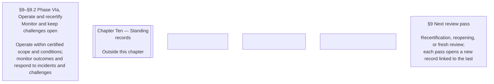
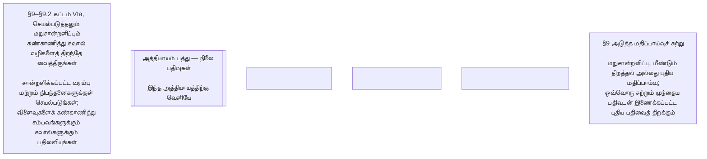

<!-- CHUNK-BEGIN ta__core_09.000_system_alignment_certification_evaluation__section_1_corpus_placement_overview.md bytes=5714 -->
<!-- AI-assisted translation draft; unreviewed. §1 corpus-placement overview, source lines 8–10; source SHA-256 4311e6ba74b7210f077c0bd4c8d21d8c9f517d2ada7b6d87288b39494dfeadd5. Draft only; do not synchronize into translations/. -->

# Chapter Nine Part A — §1 corpus-placement overview (ta)

## English source (lines 8–10)

> This file is **part of the Sentient Constitution** and is **binding only together** with the other numbered `core_*` files read as one text. It contains **Chapter Nine, Part A** — certification purpose, the process overview, and the first two phases of the process — **Frame** (system class) and **Evaluate** (whole-system evaluation in three sub-phases: the always-applicable evaluations, including data types and handling, in **§3**; the evaluations that apply where implicated in **§4**; and the Rights-Floor and domain evaluations that apply where triggered in **§5**) — **§1–§5**. The worked **Class A / B / C illustrations** (the system class profiles, §3.4.8, §5.1.5, §5.2.4, §5.3.7, §5.4.4, §5.5.5, and §5.6.4), including each one's **Reading across system classes** paragraph, are in [`core_09.010_system_alignment_certification_illustrations.md`](core_09.010_system_alignment_certification_illustrations.md); each keeps its Part A section number. The binding system-class-scaling and escalation rules those paragraphs illustrate stay in this file: system class scaling, including participation and proportionality, in §2.2; data-handling scaling in §3.4; and the **System class scaling and escalation** paragraph in each of §5.1–§5.6. The files of the whole chapter are listed in the table below.
>
> **Chapter Nine files.** Chapter Nine is split across four binding files read as one text. Part A, this file, opens the chapter; there is no separate index file.

## Translation draft

> இந்தக் கோப்பு **Sentient Constitution-இன் ஒரு பகுதி**; எண் குறிக்கப்பட்ட மற்ற `core_*` கோப்புகளுடன் ஒரே உரையாக வாசிக்கும்போது மட்டுமே இது கட்டுப்படுத்தும். இதில் **அத்தியாயம் ஒன்பது, பகுதி A** அடங்கும்: சான்றளிப்பின் நோக்கம், செயல்முறையின் கண்ணோட்டம், அதன் முதல் இரண்டு கட்டங்களான **Frame** (அமைப்பின் வகை) மற்றும் **Evaluate** (மூன்று துணைக் கட்டங்களில் முழு-அமைப்பு மதிப்பீடு)—**§§1–5**. அவை: தரவு வகைகள் மற்றும் கையாளுதலையும் உள்ளடக்கிய எப்போதும் பொருந்தும் மதிப்பீடுகள் **§3**-இல்; பொருந்தும் சூழலில் செய்யப்படும் மதிப்பீடுகள் **§4**-இல்; நிபந்தனை தூண்டப்படும்போது பொருந்தும் **உரிமைகள் அடித்தளம்** மற்றும் துறை மதிப்பீடுகள் **§5**-இல். **வகுப்பு A / B / C**-க்கான விரிவான எடுத்துக்காட்டுகள் (அமைப்பு-வகை சுயவிவரங்கள், §3.4.8, §5.1.5, §5.2.4, §5.3.7, §5.4.4, §5.5.5, §5.6.4), ஒவ்வொன்றின் **அமைப்பு வகைகளைக் கடந்து வாசித்தல்** என்ற பத்தி உட்பட, [`core_09.010_system_alignment_certification_illustrations.md`](core_09.010_system_alignment_certification_illustrations.md)-இல் உள்ளன; ஒவ்வொன்றும் பகுதி A-வின் பிரிவு எண்ணைத் தக்கவைக்கிறது. அவை விளக்கும் கட்டுப்படுத்தும் வகை-அளவாக்க மற்றும் உயர்த்தல் விதிகள் இந்தக் கோப்பிலேயே இருக்கும்: பங்கேற்பும் விகிதாசாரமும் உட்பட்ட அமைப்பு-வகை அளவாக்கம் §2.2-இல்; தரவு கையாளல் அளவாக்கம் §3.4-இல்; மேலும் §§5.1–5.6 ஒவ்வொன்றிலும் **அமைப்பு வகைக்கேற்ப அளவாக்கமும் உயர்த்தலும்** என்ற பத்தி. கீழுள்ள அட்டவணை முழு அத்தியாயத்தின் கோப்புகளைப் பட்டியலிடுகிறது.
>
> **அத்தியாயம் ஒன்பதின் கோப்புகள்.** அத்தியாயம் ஒன்பது ஒன்றாக வாசிக்கப்படும் நான்கு கட்டுப்படுத்தும் கோப்புகளாகப் பிரிக்கப்பட்டுள்ளது. இந்தக் கோப்பான பகுதி A அத்தியாயத்தைத் தொடங்குகிறது; தனியான குறியீட்டுக் கோப்பு இல்லை.

<!-- CHUNK-END -->
<!-- CHUNK-BEGIN ta__core_09.000_system_alignment_certification_evaluation__section_1_corpus_file_table.md bytes=7088 -->
<!-- AI-assisted translation draft; unreviewed. §1 corpus-placement file table, source lines 12–17; source SHA-256 4311e6ba74b7210f077c0bd4c8d21d8c9f517d2ada7b6d87288b39494dfeadd5. Draft only; do not synchronize into translations/. -->

# Chapter Nine Part A — §1 corpus-placement file table (ta)

## English source (lines 12–17)

> | Part | File | Owns |
> |------|------|------|
> | **Part A — Evaluation** | [`core_09.000_system_alignment_certification_evaluation.md`](core_09.000_system_alignment_certification_evaluation.md) | §1–§5: purpose and process overview (with a chart of the whole certification process in its six phases), **Phase I Frame** (system class, how system class scales every evaluation, and pilot certification) and **Phase II Evaluate** (whole-system evaluation in three sub-phases: **IIa** always, in §3, including chartered scope versus functional boundaries and data types and handling; **IIb** where implicated, in §4; and **IIc** where triggered, the Rights-Floor and domain evaluations, in §5) |
> | **Part B — Record and process** | [`core_09.005_system_alignment_certification_record_process.md`](core_09.005_system_alignment_certification_record_process.md) | §6–§10: **Phase III Review** (forum roles, supervisory sequence, and the contestability chain), **Phase IV Decide** (certification outcomes, including the go-live gate), **Phase V Record** (the certification record and its integrity, including governing [System Charter](core_05.040_band_continuity.md#system-charter) fields), and **Phase VI Operate** (the challenge path; recertification and reopening; the standing bridge) — continuous chapter numbering from Part A §5 |
> | **Part C — Illustrations** | [`core_09.010_system_alignment_certification_illustrations.md`](core_09.010_system_alignment_certification_illustrations.md) | the illustrative system class profiles, §3.4, §3.4.8, §5.1.5, §5.2.4, §5.3.7, §5.4.4, §5.5.5, and §5.6.4: worked Class A / B / C walkthroughs for each Part A evaluation area, numbered to match Part A and linked both ways |
> | **Part D — Institutional alignment certification** | [`core_09.015_institutional_alignment_certification.md`](core_09.015_institutional_alignment_certification.md) | §11–§15: the same six phases for an **Institution** rather than a System — the institution class and the institutional evaluation (**Phases I and II**, §12), the forum roles, outcome, and **Institutional Certification Record** (**Phases III to V**, §13), and recertification, reopening, the cascade from System certifications, and the standing bridge (**Phase VI**, §14–§15). It cites each System's certification by link and does not repeat it, and it is not a licence — continuous chapter numbering from Part B §10 |

## Translation draft

| பகுதி | கோப்பு | உள்ளடக்கம் |
|------|------|------|
| **Part A — Evaluation** | [`core_09.000_system_alignment_certification_evaluation.md`](core_09.000_system_alignment_certification_evaluation.md) | §§1–5: நோக்கமும் செயல்முறை கண்ணோட்டமும் (ஆறு கட்டச் சான்றளிப்பு விளக்கப்படத்துடன்), மேலும் I Frame (அமைப்பு வகை, ஒவ்வொரு மதிப்பீட்டின் அளவை வகை எவ்வாறு நிர்ணயிக்கிறது, முன்னோடி சான்றளிப்பு) மற்றும் II Evaluate (மூன்று துணைக் கட்டங்களிலான முழு-அமைப்பு மதிப்பீடு: IIa எப்போதும் §3-இல்; சாசன வரம்பு/செயல்பாட்டு எல்லைகள், தரவு வகைகள்/கையாளல் உட்பட; IIb தொடர்புடையபோது §4-இல்; IIc நிபந்தனை தூண்டப்படும்போது §5-இன் உரிமைகள் அடித்தளம் மற்றும் துறை மதிப்பீடுகள்). |
| **Part B — Record and process** | [`core_09.005_system_alignment_certification_record_process.md`](core_09.005_system_alignment_certification_record_process.md) | §§6–10: III Review (மன்றப் பங்குகள், மேற்பார்வை வரிசை, சவால் தொடர்); IV Decide (சான்றளிப்பு முடிவுகள், செயல்பாட்டைத் தொடங்கும் நுழைவாயில் உட்பட); V Record (சான்றளிப்பு பதிவு மற்றும் அதன் முழுமை, [System Charter](core_05.040_band_continuity.md#system-charter) கட்டுப்பாட்டு புலங்கள் உட்பட); VI Operate (சவால் வழி, மறுசான்றளிப்பு/மீண்டும் திறத்தல், standing பாலம்) — பகுதி A §5-இலிருந்து தொடரும் எண்கள். |
| **Part C — Illustrations** | [`core_09.010_system_alignment_certification_illustrations.md`](core_09.010_system_alignment_certification_illustrations.md) | அமைப்பு வகை விளக்கச் சுயவிவரங்களும் §§3.4, 3.4.8, 5.1.5, 5.2.4, 5.3.7, 5.4.4, 5.5.5, 5.6.4-மும்: பகுதி A-வின் ஒவ்வொரு மதிப்பீட்டுத் துறைக்கும் A/B/C வகை விரிவான எடுத்துக்காட்டுகள்; அதே பிரிவு எண்களும் இருவழி இணைப்புகளும் உள்ளன. |
| **Part D — Institutional alignment certification** | [`core_09.015_institutional_alignment_certification.md`](core_09.015_institutional_alignment_certification.md) | §§11–15: அமைப்புக்குப் பதிலாக ஒரு நிறுவனத்திற்கான அதே ஆறு கட்டங்கள்—நிறுவன வகை/மதிப்பீடு (I–II, §12), மன்றப் பங்குகள், முடிவு, நிறுவனச் சான்றளிப்புப் பதிவு (III–V, §13), மறுசான்றளிப்பு, மீண்டும் திறத்தல், அமைப்பு சான்றளிப்புகளின் தொடர், standing பாலம் (VI, §§14–15). ஒவ்வொரு அமைப்பின் சான்றளிப்பையும் இணைப்பாகக் குறிப்பிடும்; மீண்டும் சொல்லாது; உரிமம் அல்ல — பகுதி B §10-இலிருந்து தொடரும் எண்கள். |

<!-- CHUNK-END -->
<!-- CHUNK-BEGIN ta__core_09.000_system_alignment_certification_evaluation__section_1_corpus_explanation.md bytes=13075 -->
<!-- AI-assisted translation draft; unreviewed. §1 corpus-placement explanatory prose, source lines 19–30; source SHA-256 4311e6ba74b7210f077c0bd4c8d21d8c9f517d2ada7b6d87288b39494dfeadd5. Draft only; do not synchronize into translations/. -->

# Chapter Nine Part A — §1 corpus-placement explanatory prose (ta)

## English source (lines 19–30)

> **How the two certifications relate.** System Alignment Certification (Parts A to C) is the certification of a System. Institutional alignment certification (Part D) is the certification of an Institution, which may run Systems or none. Part D cites each System's certification record by link and does not redo it; [Part D §11.1](core_09.015_institutional_alignment_certification.md#111-relation-to-system-alignment-certification) states the relation and [Part D §11.3](core_09.015_institutional_alignment_certification.md#113-no-permission-and-no-gate) states that it is not a licence.
>
> Generic **Chapter Nine** links in other files route to the appropriate part by section number.
>
> - **Constitutional owner (joint with Parts B and D):** forum-supervised **system alignment certification and related records** — evaluation domains (Part A); forum process, supervisory sequence, certification-record duties, certification outcomes and the go-live gate, the challenge path, recertification and reopening, and verified-input bridge to Chapter Ten (Part B); the same six phases for an Institution (Part D). Under the **oversight** Tetrad leg, SAC is one especially large, high-stakes audit process among others; auditing floors remain at **Article XVI** (*Audit, Transparency, and Independent Verification*) and Chapter Five [Auditability](core_05.050_band_oversight.md#auditability).
> - **Verification substrate owner:** [Chapter Four — Burden of Proof, Traceability, and Verification](core_04.000_burden_traceability_verification.md#chapter-four-burden-of-proof-traceability-and-verification) (within Chapters Two through Four) owns burden allocation, compliance evidence, definition traceability, observability, and security-constrained verification. Chapter Nine **applies** that discipline to system alignment certification records; it does **not** restate Chapter Four sections **1** through **5**.
> - **Auditing home (not relocated here):** **Article XVI** (*Audit, Transparency, and Independent Verification*), **Def.O1** (*Transparency, Auditability, and Verification*), and **CJS-5.110 §3 and CJS-5.115 §3** (*Audit process home*)–**CJS-5.110 §5** own auditing floors and operational terms. Chapter Nine runs one especially large SAC audit process that must satisfy those floors; it does not own all auditing.
> - **Implementation owner:** system-class handling, CS-6.345, and forum-process detail in designated implementation files must remain consistent with Chapter Nine and may be stricter where the corpus already provides a [Fullest Protective Effect](core_05.045_band_integrative.md#fullest-protective-effect) rule.
> - **Anti-relocation rule:** Part A does not restate Chapter Five canonical definitions, Chapter Three anti-evasion discipline (see [Part B §9.3](core_09.005_system_alignment_certification_record_process.md#93-non-evasion)), Chapter Ten contribution or standing measurement, or Chapter Eleven standing effects. **[Part B §10](core_09.005_system_alignment_certification_record_process.md#10-relationship-to-standing)** states the standing bridge boundary explicitly.
>
> **Upstream:** Chapter Five definitions; Chapters Two through Four record, verification, burden, and traceability of definitions to results; and [Chapter Eight](core_08.000_functional_independence_separation_of_duties.md#chapter-eight-functional-independence-and-separation-of-duties), whose separation-of-duties requirement governs every materially binding certification act.
> **Downstream:** [Part B](core_09.005_system_alignment_certification_record_process.md#chapter-nine-part-b-system-alignment-certification--record-and-process) (*forum process, record, outcomes, and standing bridge*); Chapter Ten standing records and verified inputs; Chapter Eleven standing effects; Chapter Thirteen forum supervision and system alignment certification pathways.

## Translation draft

**இரு சான்றளிப்புகளின் தொடர்பு.** System Alignment Certification (பகுதிகள் A முதல் C வரை) என்பது ஒரு System-க்கான சான்றளிப்பு. Institutional alignment certification (பகுதி D) என்பது Systems-ஐ இயக்கக்கூடிய அல்லது எதையும் இயக்காத Institution-க்கான சான்றளிப்பு. பகுதி D ஒவ்வொரு System-இன் சான்றளிப்பு பதிவை இணைப்பு மூலம் மேற்கோள் காட்டுகிறது; அதை மீண்டும் செய்யாது. [Part D §11.1](core_09.015_institutional_alignment_certification.md#111-relation-to-system-alignment-certification) தொடர்பை விளக்குகிறது; [Part D §11.3](core_09.015_institutional_alignment_certification.md#113-no-permission-and-no-gate) இது உரிமம் அல்ல எனக் கூறுகிறது.
>
> பிற கோப்புகளில் உள்ள பொதுவான **Chapter Nine** இணைப்புகள் பிரிவு எண்ணின் அடிப்படையில் பொருத்தமான பகுதிக்குச் செலுத்துகின்றன.
>
> - **அரசியலமைப்பு உரிமையாளர் (பகுதிகள் B, D உடன் கூட்டாக):** மன்றக் கண்காணிப்பிலான System alignment certification மற்றும் தொடர்புடைய பதிவுகள் — மதிப்பீட்டுத் துறைகள் (பகுதி A); மன்றச் செயல்முறை, கண்காணிப்பு வரிசை, சான்றளிப்பு பதிவுக் கடமைகள், முடிவுகள் மற்றும் இயக்கத் தொடக்கத் தடைநிலை, சவால் பாதை, மறுசான்றளிப்பு மற்றும் மீள்திறப்பு, சரிபார்க்கப்பட்ட உள்ளீடுகள் அத்தியாயம் பத்திற்குச் செல்லும் பாலம் (பகுதி B); Institution-க்கான அதே ஆறு கட்டங்கள் (பகுதி D). Tetrad-இன் **கண்காணிப்பு** கூறில், SAC என்பது பல தணிக்கைச் செயல்முறைகளில் மிகவும் பெரியதும் அதிகப் பங்குள்ளதுமான ஒன்றாகும்; தணிக்கைத் தளங்கள் **Article XVI** (*Audit, Transparency, and Independent Verification*) மற்றும் அத்தியாயம் ஐந்தின் [Auditability](core_05.050_band_oversight.md#auditability)-இல் தொடர்கின்றன.
> - **சரிபார்ப்பு அடித்தள உரிமையாளர்:** [Chapter Four — Burden of Proof, Traceability, and Verification](core_04.000_burden_traceability_verification.md#chapter-four-burden-of-proof-traceability-and-verification) (அத்தியாயங்கள் இரண்டு முதல் நான்கு வரை) சான்றுச் சுமை ஒதுக்கீடு, இணக்கச் சான்று, வரையறைத் தடமறிதல், கவனிக்கத்தன்மை, பாதுகாப்புக் கட்டுப்பாடுகளுடனான சரிபார்ப்பு ஆகியவற்றின் உரிமையாளர். அத்தியாயம் ஒன்பது இந்த ஒழுங்கை System alignment certification பதிவுகளுக்குப் பயன்படுத்துகிறது; அத்தியாயம் நான்கின் **1** முதல் **5** வரையிலான பிரிவுகளை மீண்டும் கூறாது.
> - **தணிக்கையின் தளம் (இங்கு மாற்றப்படவில்லை):** **Article XVI** (*Audit, Transparency, and Independent Verification*), **Def.O1** (*Transparency, Auditability, and Verification*), மற்றும் **CJS-5.110 §3, CJS-5.115 §3** (*Audit process home*)–**CJS-5.110 §5** ஆகியவை தணிக்கைத் தளங்களையும் செயல்பாட்டு சொற்களையும் நிர்ணயிக்கின்றன. அத்தியாயம் ஒன்பது அந்தத் தளங்களைப் பூர்த்தி செய்ய வேண்டிய ஒரு மிகப்பெரிய SAC தணிக்கையை நடத்துகிறது; எல்லாத் தணிக்கைகளுக்கும் அது உரிமையாளர் அல்ல.
> - **செயலாக்க உரிமையாளர்:** குறிப்பிடப்பட்ட செயலாக்கக் கோப்புகளில் உள்ள அமைப்பு-வகை கையாளல், CS-6.345 மற்றும் மன்றச் செயல்முறை விவரங்கள் அத்தியாயம் ஒன்பதுடன் ஒத்திருக்க வேண்டும்; corpus-இல் ஏற்கெனவே [Fullest Protective Effect](core_05.045_band_integrative.md#fullest-protective-effect) விதி இருந்தால் மேலும் கடுமையாக இருக்கலாம்.
> - **இடமாற்றத் தடுப்பு விதி:** பகுதி A அத்தியாயம் ஐந்தின் அதிகாரப்பூர்வ வரையறைகள், அத்தியாயம் மூன்றின் தவிர்ப்பு-எதிர்ப்பு ஒழுங்கு ([Part B §9.3](core_09.005_system_alignment_certification_record_process.md#93-non-evasion) காண்க), அத்தியாயம் பத்தின் பங்களிப்பு அல்லது standing அளவீடு, அத்தியாயம் பதினொன்றின் standing விளைவுகள் ஆகியவற்றை மீண்டும் கூறாது. **[Part B §10](core_09.005_system_alignment_certification_record_process.md#10-relationship-to-standing)** standing பாலத்தின் எல்லையைத் தெளிவாகக் குறிப்பிடுகிறது.
>
> **முந்தைய ஆதாரங்கள்:** அத்தியாயம் ஐந்தின் வரையறைகள்; அத்தியாயங்கள் இரண்டு முதல் நான்கில் உள்ள பதிவுகள், சரிபார்ப்பு, சான்றுச் சுமை, வரையறைகளிலிருந்து முடிவுகள் வரையிலான தடமறிதல்; மேலும் [Chapter Eight](core_08.000_functional_independence_separation_of_duties.md#chapter-eight-functional-independence-and-separation-of-duties), அதன் கடமைப் பிரிப்பு தேவை பொருள்மிக்க வகையில் கட்டுப்படுத்தும் ஒவ்வொரு சான்றளிப்பு நடவடிக்கைக்கும் பொருந்தும்.
> **பின்னர் வரும் ஆதாரங்கள்:** [Part B](core_09.005_system_alignment_certification_record_process.md#chapter-nine-part-b-system-alignment-certification--record-and-process) (*மன்றச் செயல்முறை, பதிவு, முடிவுகள், standing பாலம்*); அத்தியாயம் பத்தின் standing பதிவுகள் மற்றும் சரிபார்க்கப்பட்ட உள்ளீடுகள்; அத்தியாயம் பதினொன்றின் standing விளைவுகள்; அத்தியாயம் பதின்மூன்றின் மன்றக் கண்காணிப்பு மற்றும் System alignment certification வழிகள்.

<!-- CHUNK-END -->
<!-- CHUNK-BEGIN ta__core_09.000_system_alignment_certification_evaluation__section_1_heading.md bytes=398 -->
<!-- AI-assisted translation draft; unreviewed. §1 heading, source line 44; source SHA-256 4311e6ba74b7210f077c0bd4c8d21d8c9f517d2ada7b6d87288b39494dfeadd5. Draft only; do not synchronize into translations/. -->

# Chapter Nine Part A — §1 heading (ta)

## English source (lines 44–45)

### 1. Purpose and Role


## Translation draft

### 1. நோக்கமும் பங்கும்

<!-- CHUNK-END -->
<!-- CHUNK-BEGIN ta__core_09.000_system_alignment_certification_evaluation__section_1_trace.md bytes=12637 -->
<!-- AI-assisted translation draft; unreviewed. §1 trace, source lines 46–95; source SHA-256 4311e6ba74b7210f077c0bd4c8d21d8c9f517d2ada7b6d87288b39494dfeadd5. Draft only; do not synchronize into translations/. -->

# Chapter Nine Part A — §1 trace (ta)

## English source (lines 46–95)

<details>
<summary><strong><span style="color: #2563eb;">Trace</span></strong></summary>

- Upstream:
  - [Preamble — constitutional owner register](core_00.000_preamble.md#4-principles-definitions-and-rights) and
  - [Authority Stack and Internal Hierarchy](core_05.045_band_integrative.md#authority-stack-and-internal-hierarchy);
  - [Constitutional Tetrad](core_00.000_preamble.md#constitutional-tetrad);
  - [Two Constitutional Aims](core_00.000_preamble.md#two-constitutional-aims);
  - [material stake](core_00.000_preamble.md#material-stake);
  - [Proportionality](core_05.035_band_accountability.md#proportionality) and
  - [Substantive Fairness](core_05.055_band_participation.md#substantive-fairness) (Chapter Five); Participation measurement family (*voice, access, and contest paths*);
  - [Chapter One §16 Stewardship In Depth](core_01.010_stewardship_capacity_principles.md#16-stewardship-in-depth) (1.010 §16);
  - [Chapter One §12 Systemic Evaluation Requirement](core_01.000_values_principles.md#12-systemic-evaluation-requirement) (1.000 §12) (*principle-layer whole-system evaluation lens — not one corner alone*); Chapters Two through Four;
  - [Chapter Five](core_05.000_definitions_home.md#chapter-five-foundational-definitions) (5.000) (*canonical definitions*);
  - [Chapter Eight §2 Four-Seat Constitutional Requirement](core_08.000_functional_independence_separation_of_duties.md#2-four-seat-constitutional-requirement) (8.000 §2);
  - [System Alignment Certification](core_05.040_band_continuity.md#system-alignment-certification) (Chapter Five canonical term; non-operative shorthand **SAC**);
  - [System Certification Record](core_05.040_band_continuity.md#system-certification-record) (Chapter Five meaning).
- Downstream:
  - [§2](#2-system-class-evaluation) (*system class evaluation*);
  - [Part B §9.1](core_09.005_system_alignment_certification_record_process.md#91-challenging-a-certification) (9.005 §9.1) (*challenging a certification*); and
  - [Part C system class profiles](core_09.010_system_alignment_certification_illustrations.md#illustrative-system-class-profiles-non-exhaustive) (9.010) (*illustrative system class profiles*);
  - [Part C whole-system walkthroughs](core_09.010_system_alignment_certification_illustrations.md#illustrative-whole-system-application-by-system-class-non-exhaustive) (9.010) (*worked whole-system examples by system class*);
  - [§3.4.8](core_09.010_system_alignment_certification_illustrations.md#348-illustrative-data-handling-application-by-system-class-non-exhaustive) (*worked data-handling examples by system class*);
  - [§5.1.5](core_09.010_system_alignment_certification_illustrations.md#515-illustrative-ecological-footprint-application-by-system-class-non-exhaustive) (*worked ecological-footprint examples by system class*);
  - [§5.2.4](core_09.010_system_alignment_certification_illustrations.md#524-illustrative-educational-capability-application-by-system-class-non-exhaustive) (*worked educational-capability examples by system class*);
  - [§5.3.7](core_09.010_system_alignment_certification_illustrations.md#537-illustrative-cross-system-support-application-by-system-class-non-exhaustive) (*worked cross-system-support examples by system class*);
  - [§5.4.4](core_09.010_system_alignment_certification_illustrations.md#544-illustrative-nondiscrimination-application-by-system-class-non-exhaustive) (*worked nondiscrimination examples by system class*);
  - [§5.5.5](core_09.010_system_alignment_certification_illustrations.md#555-illustrative-accessibility-application-by-system-class-non-exhaustive) (*worked accessibility examples by system class*);
  - [§5.6.4](core_09.010_system_alignment_certification_illustrations.md#564-illustrative-trustworthiness-application-by-system-class-non-exhaustive) (*worked trustworthiness examples by system class*);
  - [§3](#3-whole-system-certification-evaluation) (*whole-system certification evaluation factors*);
  - [§3.4](#34-data-types-and-handling-evaluation) through
  - [§5.6](#56-trustworthiness-and-system-reliance-integrity-evaluation) (*domain evaluations*);
  - [Part B §6](core_09.005_system_alignment_certification_record_process.md#6-forum-process) (9.005 §6) (*supervisory sequence and contestability chain*);
  - [Part B §6.1](core_09.005_system_alignment_certification_record_process.md#61-forum-supervision-and-component-roles) (9.005 §6.1) (*forum component roles*);
  - [Part B §8](core_09.005_system_alignment_certification_record_process.md#8-system-certification-record) (9.005 §8) (*certification record contents*);
  - [Part B §8.2](core_09.005_system_alignment_certification_record_process.md#82-record-integrity-transparency-and-auditability) (9.005 §8.2) (*record integrity requirements*);
  - [Part B §7](core_09.005_system_alignment_certification_record_process.md#7-certification-outcomes) (9.005 §7) (*reopening and anti-evasion*);
  - [Part B §10](core_09.005_system_alignment_certification_record_process.md#10-relationship-to-standing) (9.005 §10) (*standing-record bridge*);
  - [Chapter Ten](core_11.000_standing_assessment.md#chapter-eleven-contribution-violation-and-standing-model--measurement) (10.000) (*standing records and verified-input gate*);
  - [Chapter Eleven](core_12.000_standing_integration.md#chapter-twelve-standing-effects-and-integration) (11.000) (*standing effects and integration*);
  - [Chapter Thirteen](core_14.000_forum.md#chapter-fourteen-forums-and-jurisdiction) (13.000) (*forum supervision, certification, alignment certification, and review*).
- Read with:
  - **[CS-9.305](corpus_systems/cs_09.305_system_classification_machinery.md#cs-9305-part-a-system-classification-machinery) (*System classification machinery*) and [CS-9.310 — System impact classifications](corpus_systems/cs_09.310_system_impact_classifications.md#cs-9310-part-b-system-impact-classifications)**, **[CS-6.305](corpus_systems/cs_06.305_information_types_and_handling.md#cs-6305-part-a-information-types-and-handling) (*Information types and handling*) and [CS-6.310 — Data classifications](corpus_systems/cs_06.310_data_classifications.md#cs-6310-part-b-data-classifications)**, and
  - **CS-6.345** (*System lifecycle*);
  - **CF-13.415** (*Routing operations, transfer, certification, and representative treatment*) and
  - **CF-13.425** (*Integrity safeguards, anti-capture operations, and anti-self-judging support*); **Article XVI** (*Audit, Transparency, and Independent Verification*) and
  - [Auditability](core_05.050_band_oversight.md#auditability) (*auditing floors — SAC is one especially large audit process under oversight, not the sole auditing home*); **CJS-5.110 §3 (*Oversight: auditability and reconstructability terms (annex)*) and CJS-5.115 §3** (*Audit process home*)–
  - **CJS-5.110 §5** (*Oversight: independent verification and claim-integrity terms*).

</details>

## Translation draft

#### தொடர்பு வரைபடம்

இந்த வரைபடம் இப்பிரிவின் அரசியலமைப்பு மற்றும் அதிகார அடித்தளத்தைக் காட்டி, மதிப்பீடு, வகைப்பாடு, மறுஆய்வு வழிகள், பதிவுகள், விளைவுகள், தணிக்கை ஆகியவற்றுடன் இணைக்கிறது; உடன் படிக்க வேண்டிய செயல்பாட்டு ஆவணங்களையும் குறிப்பிடுகிறது.

**தொடர்பு வரைபடம் — upstream canonical sources:** [Preamble — constitutional owner register](core_00.000_preamble.md#4-principles-definitions-and-rights); [Authority Stack and Internal Hierarchy](core_05.045_band_integrative.md#authority-stack-and-internal-hierarchy); [Constitutional Tetrad](core_00.000_preamble.md#constitutional-tetrad); [Two Constitutional Aims](core_00.000_preamble.md#two-constitutional-aims); [material stake](core_00.000_preamble.md#material-stake); [Proportionality](core_05.035_band_accountability.md#proportionality); [Substantive Fairness](core_05.055_band_participation.md#substantive-fairness); [Chapter One §16 Stewardship In Depth](core_01.010_stewardship_capacity_principles.md#16-stewardship-in-depth); [Chapter One §12 Systemic Evaluation Requirement](core_01.000_values_principles.md#12-systemic-evaluation-requirement); [Chapter Five](core_05.000_definitions_home.md#chapter-five-foundational-definitions); [Chapter Eight §2 Four-Seat Constitutional Requirement](core_08.000_functional_independence_separation_of_duties.md#2-four-seat-constitutional-requirement); [System Alignment Certification](core_05.040_band_continuity.md#system-alignment-certification); [System Certification Record](core_05.040_band_continuity.md#system-certification-record)

**தொடர்பு வரைபடம் — downstream routes and related records:** [§2](#2-system-class-evaluation); [Part B §9.1](core_09.005_system_alignment_certification_record_process.md#91-challenging-a-certification); [Part C system class profiles](core_09.010_system_alignment_certification_illustrations.md#illustrative-system-class-profiles-non-exhaustive); [Part C whole-system walkthroughs](core_09.010_system_alignment_certification_illustrations.md#illustrative-whole-system-application-by-system-class-non-exhaustive); [§3.4.8](core_09.010_system_alignment_certification_illustrations.md#348-illustrative-data-handling-application-by-system-class-non-exhaustive); [§5.1.5](core_09.010_system_alignment_certification_illustrations.md#515-illustrative-ecological-footprint-application-by-system-class-non-exhaustive); [§5.2.4](core_09.010_system_alignment_certification_illustrations.md#524-illustrative-educational-capability-application-by-system-class-non-exhaustive); [§5.3.7](core_09.010_system_alignment_certification_illustrations.md#537-illustrative-cross-system-support-application-by-system-class-non-exhaustive); [§5.4.4](core_09.010_system_alignment_certification_illustrations.md#544-illustrative-nondiscrimination-application-by-system-class-non-exhaustive); [§5.5.5](core_09.010_system_alignment_certification_illustrations.md#555-illustrative-accessibility-application-by-system-class-non-exhaustive); [§5.6.4](core_09.010_system_alignment_certification_illustrations.md#564-illustrative-trustworthiness-application-by-system-class-non-exhaustive); [§3](#3-whole-system-certification-evaluation); [§3.4](#34-data-types-and-handling-evaluation); [§5.6](#56-trustworthiness-and-system-reliance-integrity-evaluation); [Part B §6](core_09.005_system_alignment_certification_record_process.md#6-forum-process); [Part B §6.1](core_09.005_system_alignment_certification_record_process.md#61-forum-supervision-and-component-roles); [Part B §8](core_09.005_system_alignment_certification_record_process.md#8-system-certification-record); [Part B §8.2](core_09.005_system_alignment_certification_record_process.md#82-record-integrity-transparency-and-auditability); [Part B §7](core_09.005_system_alignment_certification_record_process.md#7-certification-outcomes); [Part B §10](core_09.005_system_alignment_certification_record_process.md#10-relationship-to-standing); [Chapter Ten](core_11.000_standing_assessment.md#chapter-eleven-contribution-violation-and-standing-model--measurement); [Chapter Eleven](core_12.000_standing_integration.md#chapter-twelve-standing-effects-and-integration); [Chapter Thirteen](core_14.000_forum.md#chapter-fourteen-forums-and-jurisdiction)

**தொடர்பு வரைபடம் — operational materials to read with this section:** [CS-9.305](corpus_systems/cs_09.305_system_classification_machinery.md#cs-9305-part-a-system-classification-machinery); [CS-9.310 — System impact classifications](corpus_systems/cs_09.310_system_impact_classifications.md#cs-9310-part-b-system-impact-classifications); [CS-6.305](corpus_systems/cs_06.305_information_types_and_handling.md#cs-6305-part-a-information-types-and-handling); [CS-6.310 — Data classifications](corpus_systems/cs_06.310_data_classifications.md#cs-6310-part-b-data-classifications); [Auditability](core_05.050_band_oversight.md#auditability)

<!-- CHUNK-END -->
<!-- CHUNK-BEGIN ta__core_09.000_system_alignment_certification_evaluation__purpose_adjuncts.md bytes=9821 -->
<!-- AI-assisted translation draft; unreviewed. Selected §1 passages, source lines 99 and 107–114; source SHA-256 4311e6ba74b7210f077c0bd4c8d21d8c9f517d2ada7b6d87288b39494dfeadd5. -->

# Chapter Nine Part A — §1 plain-terms excerpt

**Status:** AI-assisted draft; unreviewed. English source remains controlling.

## English source

When a system really matters to sentients' lives, certification has to be **proportionate** — as demanding as the system's real impact, dependency, and risk require, not a one-size-fits-all checklist or a rubber stamp. It also has to be **participatory** — affected sentients and communities must be able to see what was reviewed, understand what was decided, and challenge it when something is wrong. Forums review evidence, write it down in a certification record, and require re-checks on a schedule that matches how risky the system is. Classes A, B, and C get the full process and Class L a lighter one. Class P is encouraged to use it, and must once it is reclassified to Class L or higher (that is, its effects reach beyond a private unit) or its operator claims constitutional compliance.

## ta draft

ஒரு அமைப்பு உணர்திறன் கொண்ட உயிர்களின் வாழ்க்கையை உண்மையாகப் பாதிக்கும்போது, அதன் சான்றளிப்பு **விகிதாசாரமானதாக** இருக்க வேண்டும்—அதன் உண்மையான தாக்கம், சார்பு, ஆபத்து கோரும் அளவுக்கு கடுமையாக; அனைவருக்கும் ஒரே மாதிரியான சரிபார்ப்புப் பட்டியலாகவோ வெறும் ஒப்புதல் முத்திரையாகவோ அல்ல. அது **பங்கேற்புடனும்** இருக்க வேண்டும்—பாதிக்கப்படும் உயிர்களும் சமூகங்களும் எது ஆய்வு செய்யப்பட்டது என்பதைப் பார்க்கவும், எது முடிவு செய்யப்பட்டது என்பதைப் புரிந்துகொள்ளவும், தவறு இருந்தால் சவால் செய்யவும் இயல வேண்டும். மன்றங்கள் ஆதாரங்களை ஆய்வு செய்து சான்றளிப்பு பதிவில் எழுதி, அமைப்பின் ஆபத்துக்கு ஏற்ற கால அட்டவணையில் மீளாய்வைக் கோருகின்றன. A, B, C வகுப்புகளுக்கு முழு நடைமுறையும் L வகுப்புக்கு எளிய நடைமுறையும் வழங்கப்படும். P வகுப்பு இதைப் பயன்படுத்த ஊக்குவிக்கப்படுகிறது; L அல்லது அதற்கு மேலான வகுப்பாக மறுவகைப்படுத்தப்பட்டதும் (அதாவது அதன் விளைவுகள் தனியார் அலகைத் தாண்டியதும்) அல்லது அதன் இயக்குநர் அரசியலமைப்பு இணக்கத்தைக் கோரியதும் இதைப் பயன்படுத்துவது கட்டாயம்.


### English source — Flourishing

- **[Flourishing](core_00.000_preamble.md#flourishing)** — certification verifies that certification or continued reliance would not quietly defeat Rights Floors or block fair participation in constitutionally relevant life;

### ta draft

- **[செழிப்பு](core_00.000_preamble.md#flourishing)** — சான்றளிப்போ தொடர்ந்த நம்பிக்கையோ உரிமை அடித்தளங்களை மறைமுகமாகத் தோற்கடிக்கவோ அரசியலமைப்புடன் தொடர்புடைய வாழ்வில் நியாயமான பங்கேற்பைத் தடுக்கவோ செய்யாது எனச் சான்றளிப்பு உறுதிப்படுத்துகிறது;


### English source — Continuity criterion

- **[Continuity](core_00.000_preamble.md#continuity)** — certification verifies durable, non-regressive supply that sustains rather than depletes healthy natural systems ([Ecological Integrity](core_05.040_band_continuity.md#ecological-integrity), including [Ecological Recovery Capacity](core_05.040_band_continuity.md#ecological-recovery-capacity)), and system-class-scaled recertification where shared systems gate or sustain delivery;

### ta draft

- **[தொடர்ச்சி](core_00.000_preamble.md#continuity)** — ஆரோக்கியமான இயற்கை அமைப்புகளைச் சுரண்டாமல் தாங்கும் நீடித்த, பின்னடைவு இல்லாத வழங்கலைச் சான்றளிப்பு உறுதிப்படுத்துகிறது ([சூழலியல் ஒருமைப்பாடு](core_05.040_band_continuity.md#ecological-integrity), அதில் [சூழலியல் மீட்புத் திறனும்](core_05.040_band_continuity.md#ecological-recovery-capacity) அடங்கும்); பகிரப்பட்ட அமைப்புகள் வழங்கலைக் கட்டுப்படுத்தும் அல்லது தாங்கும் இடங்களில் அமைப்பு வகைக்கேற்ற மறுசான்றளிப்பையும் உறுதிசெய்கிறது;


### English source — Participation criterion

- **Participation** — affected sentients and communities can understand, contest, and take part in review paths that matter to them;

### ta draft

- **பங்கேற்பு** — பாதிக்கப்படும் உயிர்களும் சமூகங்களும் தமக்குப் பொருத்தமான மறுஆய்வு வழிகளைப் புரிந்துகொண்டு, சவால் செய்து, பங்கேற்க முடியும்;


### English source — Oversight criterion

- **Oversight** — records, evidence, and assumptions are visible and auditable enough for independent checking; certification itself is one especially large audit process under that oversight duty, not the only one;

### ta draft

- **மேற்பார்வை** — பதிவுகள், ஆதாரங்கள், கருதுகோள்கள் சுயாதீனச் சரிபார்ப்புக்கு போதுமான அளவு வெளிப்படையாகவும் தணிக்கைக்குட்படுவதாகவும் இருக்கும்; சான்றளிப்பே இந்த மேற்பார்வைக் கடமையின் கீழ் ஒரு பெரிய தணிக்கைச் செயல்முறை, ஆனால் ஒரே தணிக்கைத் தளம் அல்ல;


### English source — Accountability criterion

- **Accountability** — defects, misclassification, and floor-defeating operation route to remedy, conditions, withdrawal, or standing input where the facts support it;

### ta draft

- **பொறுப்புடைமை** — குறைபாடுகள், தவறான வகைப்படுத்தல், உரிமை அடித்தளத்தைத் தோற்கடிக்கும் செயல்பாடு ஆகியவை உண்மைகள் ஆதரிக்கும் இடங்களில் தீர்வு, நிபந்தனைகள், விலக்கு அல்லது நிலை மதிப்பீட்டுக்கான உள்ளீட்டுக்கு வழிசெய்யும்;


### English source — Timeliness criterion

- **Timeliness** — review and contest windows keep certification from going stale while harm can still be prevented or reversed.

### ta draft

- **காலப்பொருத்தம்** — தீங்கை இன்னும் தடுக்கவோ மாற்றியமைக்கவோ முடியும் நிலையில் சான்றளிப்பு காலாவதியாகாமல் மறுஆய்வு மற்றும் சவால் காலவரம்புகள் காக்கின்றன.


### English source — Tetrad introduction

Certification implements the [Two Constitutional Aims](core_00.000_preamble.md#two-constitutional-aims) through the [Constitutional Tetrad](core_00.000_preamble.md#constitutional-tetrad):

### ta draft

சான்றளிப்பு [இரண்டு அரசியலமைப்பு நோக்கங்களை](core_00.000_preamble.md#two-constitutional-aims) [அரசியலமைப்பு நாற்கூறு](core_00.000_preamble.md#constitutional-tetrad) வழியாகச் செயல்படுத்துகிறது:

<!-- CHUNK-END -->
<!-- CHUNK-BEGIN ta__core_09.000_system_alignment_certification_evaluation__section_1_purpose.md bytes=2720 -->
<!-- AI-assisted translation draft; unreviewed. Complete purpose statement excerpt, source lines 101–105; source SHA-256 4311e6ba74b7210f077c0bd4c8d21d8c9f517d2ada7b6d87288b39494dfeadd5. This is an excerpt, not a complete §1 translation. -->

**அமைப்பு ஒத்திசைவு சான்றளிப்பு**, குறிப்பிடப்பட்ட வரம்புக்கும் மதிப்பாய்வு அட்டவணைக்கும் ஒரு கேள்விக்குப் பதிலளிக்க உள்ளது: சான்றளிப்பு, நிபந்தனைச் சான்றளிப்பு, சரிபார்த்தல், மறுசான்றளிப்பு, தொடர்ந்த சார்பு, பயன்பாட்டில் அமர்த்தல், அல்லது நிபந்தனைகளிலிருந்து பொருட்படுத்தத்தக்க விடுவிப்பு ஆகியவற்றுக்கு அமைப்பு போதிய அரசியலமைப்பு ஒத்திசைவைக் காட்டியுள்ளதா?

- சான்றளிப்பு என்பது புகழ் மதிப்பெண் அல்ல; நிரந்தர அனுமதியும் அல்ல; உரிமைகள் மதிப்பாய்வைத் தவிர்க்கும் வழியும் அல்ல.
- அமைப்பின் ஒத்திசைவு குறித்து இப்போது அறியப்பட்டவற்றின் காலவரம்புள்ள, சவால் செய்யக்கூடிய அறிக்கை அது.
- நாற்கூற்றின் **மேற்பார்வை** காலின் கீழ், மேற்பார்வைக்கு தணிக்கை தேவை; அமைப்பு ஒத்திசைவு சான்றளிப்பு என்பது பிறவற்றில் ஒன்றாக, குறிப்பாகப் பெரியதும் உயர்ந்த பங்குகளைக் கொண்டதுமான தணிக்கைச் செயல்முறை — தணிக்கைக்கான ஒரே இடமல்ல (**கட்டுரை XVI** (*தணிக்கை, வெளிப்படைத்தன்மை மற்றும் சுயாதீன சரிபார்ப்பு*), [தணிக்கைத்திறன்](core_05.050_band_oversight.md#auditability)).

<!-- CHUNK-END -->
<!-- CHUNK-BEGIN ta__core_09.000_system_alignment_certification_evaluation__section_1_subsection_headings.md bytes=929 -->
<!-- AI-assisted translation draft; unreviewed. §1.1/§1.2 visible subsection headings, source lines 116–119 and 144–148; source SHA-256 4311e6ba74b7210f077c0bd4c8d21d8c9f517d2ada7b6d87288b39494dfeadd5. Draft only; anchors/blank layout are structural. Do not synchronize into translations/. -->

# Chapter Nine Part A — §1.1 and §1.2 subsection headings (ta)

## English source

### Lines 116–119

<a id="11-certification-as-an-audit-process-scaled-by-class"></a>

#### 1.1 Certification as an audit process, scaled by class


### Lines 144–148


<a id="12-certification-at-a-glance"></a>

#### 1.2 Certification at a glance


## Translation draft

#### 1.1 வகைக்கேற்ப அளவிடப்படும் தணிக்கைச் செயல்முறையாகச் சான்றளிப்பு

#### 1.2 சான்றளிப்பு ஒரு பார்வையில்

<!-- CHUNK-END -->
<!-- CHUNK-BEGIN ta__core_09.000_system_alignment_certification_evaluation__section_1_audit_scope.md bytes=5165 -->
<!-- AI-assisted translation draft; unreviewed. §1.1 audit mechanism and sibling audit modes, source lines 120–130; source SHA-256 4311e6ba74b7210f077c0bd4c8d21d8c9f517d2ada7b6d87288b39494dfeadd5. -->

# Chapter Nine Part A — §1.1 certification audit process excerpt (ta)

## English source

As an oversight mechanism, certification is one especially large audit process under [Auditability](core_05.050_band_oversight.md#auditability) and **Article XVI** (*Audit, Transparency, and Independent Verification*):

- It is forum-supervised, multi-domain, and status-granting.
- It may integrate the results of sibling audit modes, and it does not absorb or replace them. Each keeps its own owner, named in the [sibling audit modes map](corpus_joint_structure/cjs_05.115_audit_process.md#sibling-audit-modes-owner-map) of the audit process home:
  - System Data Types Record audits under **CS-6.305 (*Information types and handling*) and CS-6.310** (*Data classifications*)
  - System Classification Record audits under **CS-9.305 (*System classification machinery*) and CS-9.310** (*System impact classifications*)
  - steward assurance reviews under **CS-14.305** (*Critical system stewardship*)
  - continuous audit under **CS-6.345** (*System lifecycle*) ACA
  - complexity audits under **CS-6.315** (*Comprehensibility and complexity stewardship*) and **Article XXIII-B** (*Complexity Audit and Modularity Requirements*)
  - claim verification under **CJS-5.110 §5** (*Oversight: independent verification and claim-integrity terms*)
- You can still run any of these checks on their own, without going through certification. Certification doesn't replace them.

## ta draft

மேற்பார்வை வழிமுறையாக, [தணிக்கைத்திறன்](core_05.050_band_oversight.md#auditability) மற்றும் **Article XVI** (*Audit, Transparency, and Independent Verification*) ஆகியவற்றின் கீழ் சான்றளிப்பு ஒரு குறிப்பாகப் பெரும் தணிக்கைச் செயல்முறையாகும்:

- அது மன்றத்தின் மேற்பார்வையில் பல துறைகளை உள்ளடக்கி, நிலையை வழங்குகிறது.
- இணைத் தணிக்கை முறைகளின் முடிவுகளை அது ஒருங்கிணைக்கலாம்; ஆனால் அவற்றைத் தன்னுள் சேர்த்தோ மாற்றீடாகவோ கொள்ளாது. ஒவ்வொரு முறையும் தனக்கென உரிமையாளரைத் தக்கவைக்கிறது; அந்த உரிமையாளர் தணிக்கைச் செயல்முறையின் மைய ஆவணத்திலுள்ள [இணைத் தணிக்கை முறை வரைபடத்தில்](corpus_joint_structure/cjs_05.115_audit_process.md#sibling-audit-modes-owner-map) குறிப்பிடப்பட்டுள்ளார்:
  - System Data Types Record தணிக்கைகள் **CS-6.305 (*தகவல் வகைகளும் கையாளுதலும்*) மற்றும் CS-6.310** (*தரவு வகைப்பாடுகள்*) கீழ்
  - System Classification Record தணிக்கைகள் **CS-9.305 (*அமைப்பு வகைப்பாட்டு இயந்திரம்*) மற்றும் CS-9.310** (*அமைப்புத் தாக்க வகைப்பாடுகள்*) கீழ்
  - பாதுகாவலர் உறுதிப்பாட்டு மறுஆய்வுகள் **CS-14.305** (*முக்கிய அமைப்புப் பாதுகாவல்*) கீழ்
  - தொடர்ச்சித் தணிக்கை **CS-6.345** (*அமைப்பின் வாழ்க்கைச் சுழற்சி*) ACA கீழ்
  - சிக்கல்தன்மைத் தணிக்கைகள் **CS-6.315** (*புரிந்துகொள்ளத்தன்மை மற்றும் சிக்கல்தன்மைப் பாதுகாவல்*) மற்றும் **Article XXIII-B** (*சிக்கல்தன்மைத் தணிக்கை மற்றும் தொகுதிப்பிரிப்பு தேவைகள்*) கீழ்
  - கூற்று சரிபார்ப்பு **CJS-5.110 §5** (*மேற்பார்வை: சுயாதீன சரிபார்ப்பும் கூற்று ஒருமைப்பாட்டு விதிகளும்*) கீழ்
- சான்றளிப்புக்குச் செல்லாமலேயே இச்சோதனைகளில் எதையும் தனியாக நடத்தலாம். சான்றளிப்பு அவற்றுக்குப் பதிலாகாது.

<!-- CHUNK-END -->
<!-- CHUNK-BEGIN ta__core_09.000_system_alignment_certification_evaluation__section_1_class_scaling.md bytes=6137 -->
<!-- AI-assisted translation draft; unreviewed. Chapter Nine Part A §1 class scaling and cadence, source lines 132–143; source SHA-256 4311e6ba74b7210f077c0bd4c8d21d8c9f517d2ada7b6d87288b39494dfeadd5. Draft only; do not synchronize into translations/. -->

**Current English passage:**

Certification depth, record burden, certification interval, stakeholder review, and contest paths must scale with [material stake](core_00.000_preamble.md#material-stake) under [Proportionality](core_05.035_band_accountability.md#proportionality):

The process applies by impact class, as the [reclassification requirement](corpus_systems/cs_09.305_system_classification_machinery.md#35-reclassification-requirement) of **CS-9.305** (*System classification machinery*) sets out:

- **Class A, Class B, and Class C:** these systems carry the highest impact, dependency, and risk, and whole-system evaluation under [§3 Whole-System Certification Evaluation](#3-whole-system-certification-evaluation), [§4 Evaluations Where Implicated](#4-evaluations-where-implicated), and [§5 Rights-Floor and Domain Evaluations](#5-rights-floor-and-domain-evaluations), each as its own sub-phase applies, is mandatory at full depth;
- **Class L:** the same evaluation is mandatory but proportionate, with a lower default re-check cadence and simpler records where CS-9.305 (*System classification machinery*) and CS-9.310 (*System impact classifications*) permits; and
- **Class P:** the process is encouraged while the system is validly Class P, and a Class P system may use it voluntarily. It becomes mandatory on reclassification to Class L or higher, or where the operator voluntarily asserts constitutional compliance for the system.

The certification interval, and the financial, resource, or special audit that falls at its midpoint, are set by class in [Chapter Thirteen §6 Timely resolution, materiality tiers, and anti-delay discipline](core_14.000_forum.md#review-cadence) (*Review cadence*). This chapter does not restate the numbers.

**Proposed locale translation:**

சான்றளிப்பின் ஆழம், பதிவு சுமை, சான்றளிப்பு இடைவெளி, பங்குதாரர் ஆய்வு, முறையீட்டுப் பாதைகள் ஆகியவை [பொருளளவு முக்கியத்துவத்திற்கு](core_00.000_preamble.md#material-stake) ஏற்ப [விகிதாசாரத்துடன்](core_05.035_band_accountability.md#proportionality) மாற வேண்டும்:

**CS-9.305** (*அமைப்பு வகைப்பாட்டு முறை*)-இன் [மறுவகைப்படுத்தல் நிபந்தனை](corpus_systems/cs_09.305_system_classification_machinery.md#35-reclassification-requirement) கூறுவதுபோல், தாக்க வகுப்பின்படி செயல்முறை பொருந்தும்:

- **A, B, C வகுப்புகள்:** இவ்வமைப்புகளுக்கு மிக உயர்ந்த தாக்கம், சார்பு, ஆபத்து உள்ளன. [§3 முழு-அமைப்பு சான்றளிப்பு மதிப்பீடு](#3-whole-system-certification-evaluation), [§4 பொருந்தும் இடங்களிலான மதிப்பீடுகள்](#4-evaluations-where-implicated), [§5 உரிமைத் தள மற்றும் துறை மதிப்பீடுகள்](#5-rights-floor-and-domain-evaluations) ஆகியவற்றின் பொருந்தும் ஒவ்வொரு துணைக்கட்டத்திலும் முழு ஆழத்தில் முழு அமைப்பு மதிப்பீடு கட்டாயம்;
- **L வகுப்பு:** அதே மதிப்பீடு கட்டாயம், ஆனால் விகிதாசாரமாக இருக்கும்; **CS-9.305** (*அமைப்பு வகைப்பாட்டு முறை*) மற்றும் **CS-9.310** (*அமைப்பு தாக்க வகைப்பாடுகள்*) அனுமதிக்கும் இடங்களில் இயல்புநிலை மறுசோதனை இடைவெளி நீளமாகவும் பதிவுகள் எளிமையாகவும் இருக்கலாம்; மற்றும்
- **P வகுப்பு:** அமைப்பு செல்லத்தக்க வகையில் P வகுப்பில் இருக்கும் வரை செயல்முறை பரிந்துரைக்கப்படுகிறது; அது விருப்பமாகப் பயன்படுத்தலாம். L அல்லது அதற்கு மேல் மறுவகைப்படுத்தப்பட்டால், அல்லது இயக்குநர் அமைப்பின் அரசியலமைப்புச் இணக்கத்தைத் தன்னார்வமாகக் கூறினால், அது கட்டாயமாகும்.

சான்றளிப்பு இடைவெளியும் அதன் நடுப்பகுதியில் நடைபெறும் நிதி, வளம் அல்லது சிறப்பு தணிக்கையும் வகுப்பின்படி [அத்தியாயம் பதின்மூன்று §6 காலத்திற்குள் தீர்வு, பொருளளவு நிலைகள், தாமதத் தடுப்பு ஒழுங்கு](core_14.000_forum.md#review-cadence) (*ஆய்வு அட்டவணை*)-இல் நிர்ணயிக்கப்படும். இந்த அத்தியாயம் எண்களை மீண்டும் கூறாது.

<!-- CHUNK-END -->
<!-- CHUNK-BEGIN ta__core_09.000_system_alignment_certification_evaluation__section_1_at_a_glance.md bytes=3167 -->
<!-- AI-assisted translation draft; unreviewed. Chapter Nine Part A §1.2 plain-language summary, source line 149; source SHA-256 4311e6ba74b7210f077c0bd4c8d21d8c9f517d2ada7b6d87288b39494dfeadd5. Draft only; do not synchronize into translations/. -->

# Chapter Nine Part A — §1.2 at-a-glance summary (ta)

## English source

*In plain terms: classify the system honestly, run the evaluations that apply, have forums independently review the evidence and stakeholder concerns, and decide an outcome. Complete the one record opened for forum review and publish it with an open challenge path. A certified system goes live only after its notice interval and required protections are satisfied. Monitor actual outcomes, respond to incidents and challenges, and check again on schedule or when the facts change. Correct defects and have the correction independently verified before authorizing the affected scope or releasing its conditions. Each review pass uses a new record linked to the last.*

## ta draft

*எளிய சொற்களில்: அமைப்பை நேர்மையாக வகைப்படுத்தி, பொருந்தும் மதிப்பீடுகளை நடத்தி, சான்றுகளையும் பங்குதாரர்களின் கவலைகளையும் மன்றங்கள் சுதந்திரமாக மதிப்பாய்வு செய்ய வைத்து, முடிவைத் தீர்மானிக்கவும். மன்ற மதிப்பாய்வுக்காகத் திறக்கப்பட்ட ஒரே பதிவை நிறைவுசெய்து, திறந்த சவால் வழியுடன் வெளியிடவும். அறிவிப்பு காலம் முடிந்து தேவையான பாதுகாப்புகள் நிறைவேறிய பிறகே சான்றளிக்கப்பட்ட அமைப்பு செயல்பாட்டுக்கு வரலாம். உண்மையான விளைவுகளைக் கண்காணித்து, சம்பவங்களுக்கும் சவால்களுக்கும் பதிலளித்து, அட்டவணைப்படியோ உண்மைகள் மாறும்போதோ மீண்டும் சரிபார்க்கவும். குறைகளைச் சரிசெய்து, பாதிக்கப்பட்ட வரம்பை அங்கீகரிக்க அல்லது அதன் நிபந்தனைகளை நீக்க முன் திருத்தம் சுதந்திரமாகச் சரிபார்க்கப்படுவதை உறுதிசெய்யவும். ஒவ்வொரு மதிப்பாய்வுச் சுற்றிலும் முந்தைய பதிவுடன் இணைக்கப்பட்ட புதிய பதிவு பயன்படும்.*

<!-- CHUNK-END -->
<!-- CHUNK-BEGIN ta__core_09.000_system_alignment_certification_evaluation__section_1_phase_map.md bytes=728 -->
<!-- AI-assisted translation draft; unreviewed. Chapter Nine Part A §1.2 phase map, source line 151; source SHA-256 4311e6ba74b7210f077c0bd4c8d21d8c9f517d2ada7b6d87288b39494dfeadd5. Draft only; do not synchronize into translations/. -->

**Current English passage:**

The process runs in **six phases**: **I Frame**, **II Evaluate**, **III Review**, **IV Decide**, **V Record**, and **VI Operate**.

**Proposed locale translation:**

செயல்முறை **ஆறு கட்டங்களில்** நடைபெறும்: **I வரையறுத்தல்**, **II மதிப்பீடு**, **III ஆய்வு**, **IV முடிவு**, **V பதிவு**, **VI செயல்பாடு**.

<!-- CHUNK-END -->
<!-- CHUNK-BEGIN ta__core_09.000_system_alignment_certification_evaluation__section_1_reopen_triggers.md bytes=2788 -->
<!-- AI-assisted translation draft; unreviewed. Chapter Nine Part A §1 review-reopening passage, source line 153; source SHA-256 4311e6ba74b7210f077c0bd4c8d21d8c9f517d2ada7b6d87288b39494dfeadd5. Draft only; do not synchronize into translations/. -->

**Current English passage:**

Every evaluation that applies is carried out again on each certification pass: at first certification, at each recertification on the schedule set by [§2 System Class Evaluation](#2-system-class-evaluation), and at each reopened or fresh review. Review reopens before the next scheduled recertification when material facts change, such as growing reliance on the system, growing extraction from shared foundations, a significant fall in what the system puts back into them, or a credible challenge. [Part B §9 Recertification and Reopening](core_09.005_system_alignment_certification_record_process.md#9-recertification-and-reopening) lists the triggers.

**Proposed locale translation:**

பொருந்தும் ஒவ்வொரு மதிப்பீடும் ஒவ்வொரு சான்றளிப்பு சுற்றிலும் மீண்டும் செய்யப்படும்: முதல் சான்றளிப்பில், [§2 அமைப்பு வகுப்பு மதிப்பீடு](#2-system-class-evaluation) நிர்ணயிக்கும் அட்டவணைப்படி ஒவ்வொரு மறுசான்றளிப்பிலும், மீண்டும் திறக்கப்பட்ட அல்லது புதிய ஒவ்வொரு ஆய்விலும். முக்கிய உண்மைகள் மாறினால் அடுத்த திட்டமிட்ட மறுசான்றளிப்புக்கு முன் ஆய்வு மீண்டும் திறக்கப்படும்; எடுத்துக்காட்டாக அமைப்பின் மீதான சார்பு அதிகரித்தல், பகிரப்பட்ட அடித்தளங்களிலிருந்து அதிகமாக எடுத்தல், அவற்றுக்கு அமைப்பு திருப்பித் தருவது கணிசமாகக் குறைதல், அல்லது நம்பத்தகுந்த முறையீடு. தூண்டுகாரணங்களை [பகுதி B §9 மறுசான்றளிப்பும் மீண்டும் திறத்தலும்](core_09.005_system_alignment_certification_record_process.md#9-recertification-and-reopening) பட்டியலிடுகிறது.

<!-- CHUNK-END -->
<!-- CHUNK-BEGIN ta__core_09.000_system_alignment_certification_evaluation__section_1_phase_map_opening_nodes.md bytes=2851 -->
<!-- AI-assisted translation draft; unreviewed. §1.2 Phase I/II opening chart-node labels, source lines 155–165; source SHA-256 4311e6ba74b7210f077c0bd4c8d21d8c9f517d2ada7b6d87288b39494dfeadd5. Draft only; non-prose Mermaid syntax/connectors are retained. Do not synchronize into translations/. -->

# Chapter Nine Part A — §1.2 opening phase-map nodes (ta)

## English source (lines 155–165)

```mermaid
flowchart TB
    T(["System with material impact seeks certification,<br/>or reliance on it grows"])
    C["§2 Phase I, Frame<br/>Classify honestly<br/><br/>Class sets depth and re-check schedule"]
    subgraph W["§3–§5 Phase II, Evaluate — Whole-system evaluation"]
        direction LR
        Al["§3.1–§3.4 IIa — Always<br/><br/>Governance; systemic risk: evaluated,<br/>and disclosed to those who need it;<br/>time horizon; data types"]
        Im["§4 IIb — When implicated<br/><br/>Privacy loci, exit rights,<br/>assembly and dissent"]
        Tr["§5 IIc — When triggered<br/><br/>Applicable Rights-Floor checks<br/>and six domain evaluations"]
        Al ~~~ Im ~~~ Tr
    end

## Translation draft

```mermaid
flowchart TB
    T["பொருட்தன்மை தாக்கமுள்ள அமைப்பு சான்றளிப்பை நாடுகிறது,<br/>அல்லது அதன்மீதான சார்பு அதிகரிக்கிறது"]
    C["§2 கட்டம் I, வரையறுத்தல்<br/>நேர்மையாக வகைப்படுத்து<br/><br/>வகை மதிப்பீட்டு ஆழத்தையும் மறுசோதனை அட்டவணையையும் தீர்மானிக்கும்"]
    subgraph W["§3–§5 கட்டம் II, மதிப்பீடு — முழு அமைப்பு மதிப்பீடு"]
        direction LR
        Al["§3.1–§3.4 IIa — எப்போதும்<br/><br/>ஆளுகை; அமைப்புசார் அபாயத்தை மதிப்பிட்டு<br/>தேவைப்படுவோருக்கு வெளிப்படுத்து; காலவெளி; தரவு வகைகள்"]
        Im["§4 IIb — தொடர்புடையபோது<br/><br/>தனியுரிமை இடங்கள், வெளியேறும் உரிமைகள்,<br/>கூட்டமும் கருத்து வேறுபாடும்"]
        Tr["§5 IIc — தூண்டுதல் ஏற்பட்டால்<br/><br/>பொருந்தும் உரிமை அடித்தளச் சோதனைகள்<br/>மற்றும் ஆறு துறை மதிப்பீடுகள்"]
        Al ~~~ Im ~~~ Tr
    end
```

<!-- CHUNK-END -->
<!-- CHUNK-BEGIN ta__core_09.000_system_alignment_certification_evaluation__chart_review_node.md bytes=841 -->
# Chapter Nine Part A — chart review node (ta)

AI-assisted draft; unreviewed. Current source SHA-256: `4311e6ba74b7210f077c0bd4c8d21d8c9f517d2ada7b6d87288b39494dfeadd5`. Reconciles current source line 166: “Assigned forums issue findings; challenge paths stay open.” The translated node ID, chart structure, HTML line breaks, and code syntax are preserved.

```mermaid
    F["கட்டம் III, மதிப்பாய்வு — §6<br/>சான்றுகள் மற்றும் பங்குதாரர் கவலைகளின்<br/>சுயாதீன மதிப்பாய்வு<br/><br/>ஒதுக்கப்பட்ட மன்றங்கள் முடிவுகள் வழங்கும்;<br/>சவால் வழிகள் திறந்திருக்கும்"]
```

<!-- CHUNK-END -->
<!-- CHUNK-BEGIN ta__core_09.000_system_alignment_certification_evaluation__section_1_decision_nodes.md bytes=6526 -->
<!-- AI-assisted translation draft; unreviewed. Chapter Nine Part A §1.2 decision and outcome diagram nodes, source lines 167–176; source SHA-256 4311e6ba74b7210f077c0bd4c8d21d8c9f517d2ada7b6d87288b39494dfeadd5. Draft only; do not synchronize into translations/. -->

# Chapter Nine Part A — §1.2 decision and outcome nodes (ta)

## English source (lines 167–176)

```mermaid
flowchart TB
    Rec["§8 Phase V, Record<br/>One System Certification Record<br/><br/>Opened for forum review; completed with the outcome,<br/>supporting findings, conditions, and operating plan"]
    S[["Chapter Ten — Standing<br/>records<br/><br/>Outside this chapter"]]
    O{"§7 Phase IV, Decide<br/><br/>What outcome and status<br/>does the evidence support?"}
    Fc["§7, §9.2 Full Certification<br/><br/>Required consecutive clean provisional recertifications;<br/>no current or indicated impending misalignment<br/>Full certification interval; conditions may apply"]
    Pc["§7, §9.2 Provisional Certification<br/><br/>First grant, recovery after misalignment,<br/>or continued or stepped-down provisional status<br/>Provisional interval, shorter; conditions may apply"]
    Nc["§7 Not Certified<br/><br/>Deferred, refused, withdrawn, or expired<br/>No go-live; state reasons and required corrective work"]
    Pub["§7, §9.1 Publish the completed record<br/><br/>Open the published record challenge path;<br/>for new or expanded scope, state go-live and notice"]
    G{"§7 Go-live gate<br/><br/>Certification and applicable<br/>go-live prerequisites satisfied?"}
    Hold["§7 Meet go-live prerequisites<br/><br/>Complete notice and independently verify<br/>conditions required before go-live"]
    Rm["§7, §9.2 Protect and correct<br/><br/>No new go-live in the affected scope;<br/>protect affected sentients, correct design or operation,<br/>and submit evidence for independent verification"]
```



## ta draft



<!-- CHUNK-END -->
<!-- CHUNK-BEGIN ta__core_09.000_system_alignment_certification_evaluation__section_1_review_cycle_nodes.md bytes=3640 -->
<!-- AI-assisted translation draft; unreviewed. Chapter Nine Part A §1.2 operation and next-review diagram nodes, source lines 177–182; source SHA-256 4311e6ba74b7210f077c0bd4c8d21d8c9f517d2ada7b6d87288b39494dfeadd5. Draft only; do not synchronize into translations/. -->

```mermaid
flowchart TB
    Rec["§8 கட்டம் V, பதிவு<br/>ஒரு முறைமைச் சான்றளிப்புப் பதிவு<br/><br/>மன்ற மதிப்பாய்வுக்காகத் திறக்கப்பட்டு, முடிவு, ஆதரவு கண்டறிதல்கள், நிபந்தனைகள் மற்றும் செயல்பாட்டுத் திட்டத்துடன் நிறைவுசெய்யப்படும்"]
    S[["அத்தியாயம் பத்து — நிலை பதிவுகள்<br/><br/>இந்த அத்தியாயத்திற்கு வெளியே"]]
    O{"§7 கட்டம் IV, முடிவெடுத்தல்<br/><br/>சான்றுகள் எந்த முடிவையும் நிலையையும்<br/>ஆதரிக்கின்றன?"}
    Fc["§7, §9.2 முழுச் சான்றளிப்பு<br/><br/>தொடர்ச்சியான குறையற்ற இடைக்கால மறுசான்றளிப்புகள் அவசியம்;<br/>தற்போதைய அல்லது நெருங்கிவரும் சீரின்மை குறிப்பு இல்லை<br/>முழுச் சான்றளிப்பு இடைவெளி; நிபந்தனைகள் விதிக்கப்படலாம்"]
    Pc["§7, §9.2 இடைக்காலச் சான்றளிப்பு<br/><br/>முதல் வழங்கல், சீரின்மைக்குப் பிந்தைய மீட்பு,<br/>அல்லது இடைக்கால நிலையைத் தொடர்தல் அல்லது குறைத்தல்<br/>குறுகிய இடைக்காலம்; நிபந்தனைகள் விதிக்கப்படலாம்"]
    Nc["§7 சான்றளிக்கப்படவில்லை<br/><br/>ஒத்திவைக்கப்பட்டது, மறுக்கப்பட்டது, திரும்பப் பெறப்பட்டது அல்லது காலாவதியானது<br/>செயல்பாடு தொடங்காது; காரணங்களையும் தேவையான திருத்தப் பணியையும் குறிப்பிடவும்"]
    Pub["§7, §9.1 நிறைவு செய்யப்பட்ட பதிவை வெளியிடுக<br/><br/>வெளியிடப்பட்ட பதிவைச் சவால் செய்யும் வழியைத் திறக்கவும்;<br/>புதிய அல்லது விரிவாக்கப்பட்ட வரம்பிற்கு செயல்பாட்டுத் தொடக்கத்தையும் அறிவிப்பையும் குறிப்பிடவும்"]
    G{"§7 செயல்பாட்டுத் தொடக்கத் தடைநிலை<br/><br/>சான்றளிப்பும் பொருந்தும் செயல்பாட்டுத் தொடக்க<br/>முன்நிபந்தனைகளும் நிறைவேற்றப்பட்டனவா?"}
    Hold["§7 செயல்பாட்டுத் தொடக்க முன்நிபந்தனைகளை நிறைவேற்றுக<br/><br/>அறிவிப்பு காலத்தை நிறைவு செய்து, தொடங்குவதற்கு முன் தேவைப்படும்<br/>நிபந்தனைகளைச் சுதந்திரமாகச் சரிபார்க்கவும்"]
    Rm["§7, §9.2 பாதுகாத்துச் சரிசெய்க<br/><br/>பாதிக்கப்பட்ட வரம்பில் புதிய செயல்பாடு தொடங்க வேண்டாம்;<br/>பாதிக்கப்பட்ட உணர்வுள்ள உயிர்களைப் பாதுகாத்து, வடிவமைப்பு அல்லது செயல்பாட்டைச் சரிசெய்து,<br/>சுதந்திரச் சரிபார்ப்புக்குச் சான்றுகளைச் சமர்ப்பிக்கவும்"]
```

# Chapter Nine Part A — §1.2 operation and review-cycle nodes (ta)

## English source (lines 177–182)



## ta draft



<!-- CHUNK-END -->
<!-- CHUNK-BEGIN ta__core_09.000_system_alignment_certification_evaluation__section_1_phase_map_edge_labels.md bytes=2712 -->
<!-- AI-assisted translation draft; unreviewed. §1.2 certification-phase chart edge labels, source lines 194, 199, 200–206; source SHA-256 4311e6ba74b7210f077c0bd4c8d21d8c9f517d2ada7b6d87288b39494dfeadd5. Mermaid node IDs, edge syntax, and <br/> delimiters are structural and preserved; visible edge labels are translated. Draft only; do not synchronize into translations/. -->

# Chapter Nine Part A — phase-chart edge labels (ta)

## English source

```mermaid
    Rec -.->|VIb, §10 —<br/>verified inputs only;<br/>current certification or facts<br/>arising during certification| S
    G --->|Yes: operate<br/>within the record| Ch
    G --->|Certified,<br/>prerequisites pending| Hold
    Ch -->|Material defect:<br/>protect and correct| Rm
    Ch -->|On schedule, or<br/>material change or<br/>credible challenge<br/>requires review| Re
    Ch -.->|VIb, §10 —<br/>verified inputs only;<br/>operation may supply facts<br/>for Contribution and<br/>Violation records| S2
    Rm -->|Correction evidence<br/>is checked in the<br/>next review pass| Re
    G -->|Not Certified| Rm
```

## Translation draft

```mermaid
    Rec -.->|VIb, §10 —<br/>சரிபார்க்கப்பட்ட உள்ளீடுகள் மட்டும்;<br/>தற்போதைய சான்றளிப்பு அல்லது அதன்போது<br/>உருவான உண்மைகள்| S
    G --->|ஆம்: பதிவின்<br/>வரம்பிற்குள் செயல்படுத்து| Ch
    G --->|சான்றளிக்கப்பட்டது,<br/>முன்நிபந்தனைகள் நிலுவையில்| Hold
    Ch -->|முக்கிய குறைபாடு:<br/>பாதுகாத்து சரிசெய்| Rm
    Ch -->|அட்டவணைப்படி, அல்லது<br/>முக்கிய மாற்றம் /<br/>நம்பத்தகுந்த சவால்<br/>மதிப்பாய்வைக் கோரும்போது| Re
    Ch -.->|VIb, §10 —<br/>சரிபார்க்கப்பட்ட உள்ளீடுகள் மட்டும்;<br/>செயல்பாடு பங்களிப்பு மற்றும்<br/>மீறல் பதிவுகளுக்கான<br/>உண்மைகளை வழங்கலாம்| S2
    Rm -->|சரிசெய்ததற்கான சான்று<br/>அடுத்த மதிப்பாய்வுச் சுற்றில்<br/>சரிபார்க்கப்படும்| Re
    G -->|சான்றளிக்கப்படவில்லை| Rm
```

<!-- CHUNK-END -->
<!-- CHUNK-BEGIN ta__core_09.000_system_alignment_certification_evaluation__section_1_reader_guide.md bytes=5496 -->
<!-- AI-assisted translation draft; unreviewed. §1 non-operative reader guide, source lines 236–245; source SHA-256 4311e6ba74b7210f077c0bd4c8d21d8c9f517d2ada7b6d87288b39494dfeadd5. Draft only; do not synchronize into translations/. -->

# Chapter Nine Part A — §1 reader guide (ta)

## English source (lines 236–245)

<details>
<summary><strong><span style="color: #2563eb;">Reader guide (non-operative): illustrations, run sheet, and Institutions</span></strong></summary>

> Illustrative **Class A**, **Class B**, and **Class C** profiles — and how system class scales certification depth across this chapter — are in [Illustrative System Class Profiles (Non-Exhaustive)](core_09.010_system_alignment_certification_illustrations.md#illustrative-system-class-profiles-non-exhaustive). Worked walkthroughs of the same three systems for each evaluation area in [§3 Whole-System Certification Evaluation](#3-whole-system-certification-evaluation) through [§5.6 Trustworthiness and System-Reliance Integrity Evaluation](#56-trustworthiness-and-system-reliance-integrity-evaluation) follow there, in [Part C — Illustrations](core_09.010_system_alignment_certification_illustrations.md#chapter-nine-part-c-system-alignment-certification--illustrations), which links each profile and walkthrough back to the Part A section it illustrates.
>
> A step-by-step run sheet for the six phases, with a link from each step to the section that holds the rule, is in [CS-9.315 §2 Run sheet](corpus_systems/cs_09.315_system_alignment_certification_run_sheet.md#cs-9315-2-run-sheet) (*System alignment certification run sheet*). Where the run sheet and a section differ, the section controls.
>
> For an Institution, the same six phases run through [Part D](core_09.015_institutional_alignment_certification.md#chapter-nine-part-d-institutional-alignment-certification): Phases I and II in [Part D §12 Institution Class and Institutional Evaluation](core_09.015_institutional_alignment_certification.md#12-institution-class-and-institutional-evaluation), Phases III to V in [§13 Review, Decision, and Record](core_09.015_institutional_alignment_certification.md#13-review-decision-and-record), and Phase VI in [§14 Operating, Reopening, and the Cascade](core_09.015_institutional_alignment_certification.md#14-operating-reopening-and-the-cascade) and [§15 Standing Bridge and Non-Evasion](core_09.015_institutional_alignment_certification.md#15-standing-bridge-and-non-evasion).

</details>

## Translation draft

<details>
<summary><strong>வாசகர் வழிகாட்டி (செயல்பாட்டு விதி அல்ல): எடுத்துக்காட்டுகள், படிநிலைப் பட்டியல், நிறுவனங்கள்</strong></summary>

**A**, **B**, **C** வகை விளக்கச் சுயவிவரங்களும் இந்த அத்தியாயத்தில் வகை சான்றளிப்பு ஆழத்தை எவ்வாறு தீர்மானிக்கிறது என்பதும் [Illustrative System Class Profiles (Non-Exhaustive)](core_09.010_system_alignment_certification_illustrations.md#illustrative-system-class-profiles-non-exhaustive)-இல் உள்ளன. அதே மூன்று அமைப்புகளுக்கான ஒவ்வொரு மதிப்பீட்டுத் துறை எடுத்துக்காட்டுகளும் [Part C — Illustrations](core_09.010_system_alignment_certification_illustrations.md#chapter-nine-part-c-system-alignment-certification--illustrations)-இல் தரப்பட்டு, ஒவ்வொன்றும் விளக்கும் Part A விதியுடன் இணைக்கப்படுகின்றன.

ஆறு கட்டங்களுக்கான படிப்படியான [CS-9.315 §2 Run sheet](corpus_systems/cs_09.315_system_alignment_certification_run_sheet.md#cs-9315-2-run-sheet), ஒவ்வொரு படியிலிருந்தும் விதி உள்ள பிரிவுக்கு இணைப்பைக் கொண்டுள்ளது. பட்டியலும் பிரிவும் மாறுபட்டால் பிரிவே மேலோங்கும்.

ஒரு நிறுவனத்திற்கு அதே ஆறு கட்டங்கள் [Part D](core_09.015_institutional_alignment_certification.md#chapter-nine-part-d-institutional-alignment-certification)-இல் நடைபெறும்: I, II கட்டங்கள் [§12](core_09.015_institutional_alignment_certification.md#12-institution-class-and-institutional-evaluation)-இல்; III–V [§13](core_09.015_institutional_alignment_certification.md#13-review-decision-and-record)-இல்; VI [§14](core_09.015_institutional_alignment_certification.md#14-operating-reopening-and-the-cascade), [§15](core_09.015_institutional_alignment_certification.md#15-standing-bridge-and-non-evasion)-இல்.

இந்த எடுத்துக்காட்டுகள் [§3](#3-whole-system-certification-evaluation) முதல் [§5.6](#56-trustworthiness-and-system-reliance-integrity-evaluation) வரையிலான மதிப்பீட்டுத் துறைகளை உள்ளடக்குகின்றன.

</details>

<!-- CHUNK-END -->
<!-- CHUNK-BEGIN ta__core_09.000_system_alignment_certification_evaluation__visible_section_headings_2_3.md bytes=1592 -->
<!-- AI-assisted translation draft; unreviewed. Remaining visible Part A headings, source lines 251, 409, 477, 531, 592, 653; source SHA-256 4311e6ba74b7210f077c0bd4c8d21d8c9f517d2ada7b6d87288b39494dfeadd5. Anchors are structural; prose headings are translated. Draft only; do not synchronize into translations/. -->

# Chapter Nine Part A — remaining visible section headings (ta)

## English source

<a id="2-system-class-evaluation"></a>
### 2. System Class Evaluation
<a id="3-whole-system-certification-evaluation"></a>
### 3. Whole-System Certification Evaluation
<a id="31-governance-incentive-and-contestability-discipline"></a>
#### 3.1 Governance, Incentive, and Contestability Discipline
<a id="32-systemic-scope-and-risk-factors"></a>
#### 3.2 Systemic Scope and Risk Factors
<a id="34-data-types-and-handling-evaluation"></a>
#### 3.4 Data Types and Handling Evaluation
<a id="341-type-o-baseline-disclosure"></a>
##### 3.4.1 Type O Baseline Disclosure

## Translation draft

### 2 அமைப்பு வகை மதிப்பீடு
### 3 முழு-அமைப்பு சான்றளிப்பு மதிப்பீடு
#### 3.1 ஆளுகை, ஊக்கங்கள், சவால்தன்மை ஒழுங்கு
#### 3.2 அமைப்புமுறை வரம்பும் ஆபத்துக் காரணிகளும்
#### 3.4 தரவு வகைகள் மற்றும் கையாளல் மதிப்பீடு
##### 3.4.1 Type O அடிப்படை வெளிப்படுத்தல்

<!-- CHUNK-END -->
<!-- CHUNK-BEGIN ta__core_09.000_system_alignment_certification_evaluation__section_2_trace.md bytes=10511 -->
<!-- AI-assisted translation draft; unreviewed. §2 trace, source lines 253–295; source SHA-256 4311e6ba74b7210f077c0bd4c8d21d8c9f517d2ada7b6d87288b39494dfeadd5. Draft only; do not synchronize into translations/. -->

# Chapter Nine Part A — §2 trace (ta)

## English source (lines 253–295)

<details>
<summary><strong><span style="color: #2563eb;">Trace</span></strong></summary>

- Upstream:
  - [§1](#1-purpose-and-role) (*purpose and role*); Integrative Materiality (
  - [Materiality](core_05.050_band_oversight.md#materiality)) (*Materiality*);
  - [Constitutional Tetrad](core_00.000_preamble.md#constitutional-tetrad);
  - [Two Constitutional Aims](core_00.000_preamble.md#two-constitutional-aims);
  - [Material Impact](core_05.050_band_oversight.md#material-impact),
  - [Dependency](core_05.040_band_continuity.md#dependency),
  - [Risk](core_05.040_band_continuity.md#risk),
  - [System Boundaries](core_05.040_band_continuity.md#system-boundaries), and
  - [System Charter](core_05.040_band_continuity.md#system-charter) (Chapter Five);
  - [Chapter One §12 Systemic Evaluation Requirement](core_01.000_values_principles.md#12-systemic-evaluation-requirement) (1.000 §12); **Article III-A** (*Survival*) and **Article IV-A** (*Rights-Floor delivery where classification gates access*); **Article V-A** (*Dependency Mapping and Resource-Flow Transparency*) and **Article V-B** (*resource allocation and dependency stewardship where certification gates shared-infrastructure reliance*).
- Downstream:
  - [§2.1](#21-certification-recertification-and-defects) (*certification status, recertification, and defects*);
  - [§2.2](#22-how-system-class-scales-every-evaluation) (*system-class-scaled participation and proportionality*);
  - [§2.3](#23-pilot-certification) (*pilot certification*);
  - [Part C system class profiles and reclassification](core_09.010_system_alignment_certification_illustrations.md#illustrative-system-class-profiles-non-exhaustive) (9.010) (*illustrative system class profiles*);
  - [Part C whole-system walkthroughs](core_09.010_system_alignment_certification_illustrations.md#illustrative-whole-system-application-by-system-class-non-exhaustive) (9.010) (*worked whole-system examples by system class*);
  - [§3.4.8](core_09.010_system_alignment_certification_illustrations.md#348-illustrative-data-handling-application-by-system-class-non-exhaustive) (*worked data-handling examples by system class*);
  - [§5.1.5](core_09.010_system_alignment_certification_illustrations.md#515-illustrative-ecological-footprint-application-by-system-class-non-exhaustive) (*worked ecological-footprint examples by system class*);
  - [§5.2.4](core_09.010_system_alignment_certification_illustrations.md#524-illustrative-educational-capability-application-by-system-class-non-exhaustive) (*worked educational-capability examples by system class*);
  - [§5.3.7](core_09.010_system_alignment_certification_illustrations.md#537-illustrative-cross-system-support-application-by-system-class-non-exhaustive) (*worked cross-system-support examples by system class*);
  - [§5.4.4](core_09.010_system_alignment_certification_illustrations.md#544-illustrative-nondiscrimination-application-by-system-class-non-exhaustive) (*worked nondiscrimination examples by system class*);
  - [§5.5.5](core_09.010_system_alignment_certification_illustrations.md#555-illustrative-accessibility-application-by-system-class-non-exhaustive) (*worked accessibility examples by system class*);
  - [§5.6.4](core_09.010_system_alignment_certification_illustrations.md#564-illustrative-trustworthiness-application-by-system-class-non-exhaustive) (*worked trustworthiness examples by system class*);
  - [§3.4](#34-data-types-and-handling-evaluation) (*joint data-handling evaluation*);
  - [§5.1](#51-ecological-footprint-evaluation) (*ecological footprint evaluation*);
  - [§5.3](#53-proportionate-cross-system-support-evaluation) (*cross-system support evaluation*);
  - [Part B §8.2](core_09.005_system_alignment_certification_record_process.md#82-record-integrity-transparency-and-auditability) (9.005 §8.2) (*record integrity*);
  - [Part B §10](core_09.005_system_alignment_certification_record_process.md#10-relationship-to-standing) (9.005 §10) (*verified-input gate*);
  - [Part B §7](core_09.005_system_alignment_certification_record_process.md#7-certification-outcomes) (9.005 §7) (*classification drift and reclassification triggers*).
- Read with:
  - [System Classification Record](core_05.040_band_continuity.md#system-classification-record);
  - **[CS-9.305](corpus_systems/cs_09.305_system_classification_machinery.md#cs-9305-part-a-system-classification-machinery) (*System classification machinery*) and [CS-9.310 — System impact classifications](corpus_systems/cs_09.310_system_impact_classifications.md#cs-9310-part-b-system-impact-classifications)**, including **
  - [CS-9.305 §3.5 reclassification requirement](corpus_systems/cs_09.305_system_classification_machinery.md#35-reclassification-requirement)** (*Reclassification requirement* — triggers, system-class-scaled evaluation depth, and SAC verification bridge) and **
  - [CS-9.305 §7](corpus_systems/cs_09.305_system_classification_machinery.md#cs-9305-7-classification-governance-disclosure-and-challenge)** (*Classification governance, disclosure, and challenge*) — System Classification Record governance duties and the SAC bridge;
  - [CS-6.345 — System lifecycle](corpus_systems/cs_06.345_design_testing_verification_deployment.md#cs-6345-system-lifecycle);
  - [CJS-5.130 §21 — Adversarial robustness and abuse-resistance terms](corpus_joint_structure/cjs_05.130_continuity_operations.md#cjs-5130-20-continuity-reversibility-and-containment-terms) (*regression and hardening cycle obligations*);
  - **CF-13.425 §2** (*Constitutional alignment certification and review*).

</details>

## Translation draft

#### தொடர்பு வரைபடம்

வகை அடிப்படையிலான மதிப்பீட்டு வரைபடம் பொருட்தன்மை, தாக்கம், சார்பு, அபாயம் ஆகியவற்றின் அடிப்படைகளை மதிப்பீட்டுத் தேவைகளுடன் இணைத்து வகைப்பாடு/மறுவகைப்பாட்டுப் பாதைகள், எடுத்துக்காட்டுகள், பதிவுகள், தொடர்புடைய ஆவணங்களைக் காட்டுகிறது.

**தொடர்பு வரைபடம் — upstream standards and principles:** [§1](#1-purpose-and-role); [Materiality](core_05.050_band_oversight.md#materiality); [Constitutional Tetrad](core_00.000_preamble.md#constitutional-tetrad); [Two Constitutional Aims](core_00.000_preamble.md#two-constitutional-aims); [Material Impact](core_05.050_band_oversight.md#material-impact); [Dependency](core_05.040_band_continuity.md#dependency); [Risk](core_05.040_band_continuity.md#risk); [System Boundaries](core_05.040_band_continuity.md#system-boundaries); [System Charter](core_05.040_band_continuity.md#system-charter); [Chapter One §12 Systemic Evaluation Requirement](core_01.000_values_principles.md#12-systemic-evaluation-requirement)

**தொடர்பு வரைபடம் — downstream routes and records:** [§2.1](#21-certification-recertification-and-defects); [§2.2](#22-how-system-class-scales-every-evaluation); [§2.3](#23-pilot-certification); [Part C system class profiles and reclassification](core_09.010_system_alignment_certification_illustrations.md#illustrative-system-class-profiles-non-exhaustive); [Part C whole-system walkthroughs](core_09.010_system_alignment_certification_illustrations.md#illustrative-whole-system-application-by-system-class-non-exhaustive); [§3.4.8](core_09.010_system_alignment_certification_illustrations.md#348-illustrative-data-handling-application-by-system-class-non-exhaustive); [§5.1.5](core_09.010_system_alignment_certification_illustrations.md#515-illustrative-ecological-footprint-application-by-system-class-non-exhaustive); [§5.2.4](core_09.010_system_alignment_certification_illustrations.md#524-illustrative-educational-capability-application-by-system-class-non-exhaustive); [§5.3.7](core_09.010_system_alignment_certification_illustrations.md#537-illustrative-cross-system-support-application-by-system-class-non-exhaustive); [§5.4.4](core_09.010_system_alignment_certification_illustrations.md#544-illustrative-nondiscrimination-application-by-system-class-non-exhaustive); [§5.5.5](core_09.010_system_alignment_certification_illustrations.md#555-illustrative-accessibility-application-by-system-class-non-exhaustive); [§5.6.4](core_09.010_system_alignment_certification_illustrations.md#564-illustrative-trustworthiness-application-by-system-class-non-exhaustive); [§3.4](#34-data-types-and-handling-evaluation); [§5.1](#51-ecological-footprint-evaluation); [§5.3](#53-proportionate-cross-system-support-evaluation); [Part B §8.2](core_09.005_system_alignment_certification_record_process.md#82-record-integrity-transparency-and-auditability); [Part B §10](core_09.005_system_alignment_certification_record_process.md#10-relationship-to-standing); [Part B §7](core_09.005_system_alignment_certification_record_process.md#7-certification-outcomes)

**தொடர்பு வரைபடம் — related operating materials:** [System Classification Record](core_05.040_band_continuity.md#system-classification-record); [CS-9.305](corpus_systems/cs_09.305_system_classification_machinery.md#cs-9305-part-a-system-classification-machinery); [CS-9.310 — System impact classifications](corpus_systems/cs_09.310_system_impact_classifications.md#cs-9310-part-b-system-impact-classifications); [CS-9.305 §3.5 reclassification requirement](corpus_systems/cs_09.305_system_classification_machinery.md#35-reclassification-requirement); [CS-9.305 §7](corpus_systems/cs_09.305_system_classification_machinery.md#cs-9305-7-classification-governance-disclosure-and-challenge); [CS-6.345 — System lifecycle](corpus_systems/cs_06.345_design_testing_verification_deployment.md#cs-6345-system-lifecycle); [CJS-5.130 §21 — Adversarial robustness and abuse-resistance terms](corpus_joint_structure/cjs_05.130_continuity_operations.md#cjs-5130-20-continuity-reversibility-and-containment-terms)

<!-- CHUNK-END -->
<!-- CHUNK-BEGIN ta__core_09.000_system_alignment_certification_evaluation__section_2_class_intro.md bytes=5114 -->
<!-- AI-assisted translation draft; unreviewed. Chapter Nine Part A §2 system-class introduction, source lines 299–309; source SHA-256 4311e6ba74b7210f077c0bd4c8d21d8c9f517d2ada7b6d87288b39494dfeadd5. Draft only; do not synchronize into translations/. -->

# Chapter Nine Part A — §2 system-class introduction (ta)

## English source (lines 299–309)

*In plain terms: certification has to check whether the system is classified honestly — not by what the operator calls it, but by what it actually does, what depends on it, and what could go wrong. Higher system classes mean stricter proof, faster re-checks, and stronger resilience expectations. See [Part C — Illustrations](core_09.010_system_alignment_certification_illustrations.md#chapter-nine-part-c-system-alignment-certification--illustrations) for one example system per system class and how evaluation applies to each of them.*

Every certification record for a materially impactful system must include an evaluation of the system's **system class**.

The detailed rules live in [CS-9.305 — System classification machinery](corpus_systems/cs_09.305_system_classification_machinery.md#cs-9305-part-a-system-classification-machinery), and [CS-6.345 — System lifecycle](corpus_systems/cs_06.345_design_testing_verification_deployment.md#cs-6345-system-lifecycle). They cover:

- what the system classes are, how a system class is assigned, and the system class profiles;
- how classification is governed;
- how much assurance each system class needs;
- how robust the infrastructure must be;
- which checks and records are recertified, on what system-class-scaled schedule, and how provisional and full certification change that schedule.

## ta draft

*எளிய சொற்களில்: இயக்குநர் என்ன பெயர் வைக்கிறார் என்பதன் அடிப்படையில் அல்ல; முறைமை உண்மையில் என்ன செய்கிறது, எதை அது சார்ந்துள்ளது, என்ன தவறு நிகழலாம் என்பதன் அடிப்படையில் முறைமை நேர்மையாக வகைப்படுத்தப்பட்டுள்ளதா என்பதைச் சான்றளிப்பு சரிபார்க்க வேண்டும். உயர்ந்த முறைமை வகைகளுக்கு வலுவான சான்றுகள், விரைவான மறுசரிபார்ப்புகள், உயர்ந்த மீள்திறன் எதிர்பார்ப்புகள் தேவை. ஒவ்வொரு முறைமை வகைக்கும் ஓர் எடுத்துக்காட்டையும் மதிப்பீடு எவ்வாறு பொருந்துகிறது என்பதையும் காண [பகுதி C — எடுத்துக்காட்டுகள்](core_09.010_system_alignment_certification_illustrations.md#chapter-nine-part-c-system-alignment-certification--illustrations) பார்க்கவும்.*

பொருள் தாக்கம் கொண்ட முறைமைக்கான ஒவ்வொரு சான்றளிப்புப் பதிவிலும் அதன் **முறைமை வகை** மதிப்பீடு இடம்பெற வேண்டும்.

விரிவான விதிகள் [CS-9.305 — முறைமை வகைப்பாட்டு இயந்திரம்](corpus_systems/cs_09.305_system_classification_machinery.md#cs-9305-part-a-system-classification-machinery), [CS-6.345 — முறைமை வாழ்க்கைச் சுழற்சி](corpus_systems/cs_06.345_design_testing_verification_deployment.md#cs-6345-system-lifecycle) ஆகியவற்றில் உள்ளன. அவை பின்வருவனவற்றை உள்ளடக்குகின்றன:

- முறைமை வகைகள் எவை, வகை எவ்வாறு ஒதுக்கப்படுகிறது, வகை சுயவிவரங்கள்;
- வகைப்பாடு எவ்வாறு நிர்வகிக்கப்படுகிறது;
- ஒவ்வொரு முறைமை வகைக்கும் தேவையான உத்தரவாத அளவு;
- கட்டமைப்பின் வலிமை எவ்வளவு இருக்க வேண்டும்;
- மீண்டும் சான்றளிக்கப்படும் சோதனைகள் மற்றும் பதிவுகள், முறைமை வகை சார்ந்த அட்டவணை, இடைக்கால மற்றும் முழுச் சான்றளிப்புகள் அந்த அட்டவணையை எவ்வாறு மாற்றுகின்றன.


<!-- CHUNK-END -->
<!-- CHUNK-BEGIN ta__core_09.000_system_alignment_certification_evaluation__section_2_evaluation_requirements.md bytes=9935 -->
<!-- AI-assisted translation draft; unreviewed. §2 evaluation requirements, source lines 311–335; source SHA-256 4311e6ba74b7210f077c0bd4c8d21d8c9f517d2ada7b6d87288b39494dfeadd5. Draft only; do not synchronize into translations/. -->

# Chapter Nine Part A — §2 evaluation requirements (ta)

## English source (lines 311–335)

This section states what certification must verify:

- **Evaluation requirement:**
  - whether the assigned system class reflects observed and reasonably foreseeable **impact**, **dependency**, and **risk** under CS-9.305 (*System classification machinery*) and CS-9.310 (*System impact classifications*), including:
    - aggregate effects;
    - interaction effects;
    - adversarial effects;
    - threshold effects;
  - that classification is determined by actual system behavior and impacts, not from:
    - declared intent;
    - nominal scope;
    - [System Charter](core_05.040_band_continuity.md#system-charter) text alone; or
    - self-description alone;
  - that the system's class was re-checked under the **[CS-9.305 §3.5 reclassification requirement](corpus_systems/cs_09.305_system_classification_machinery.md#35-reclassification-requirement)** whenever a significant change called for it; and
  - that the [System Classification Record](core_05.040_band_continuity.md#system-classification-record) shows the **highest system class that applies** under current conditions.
- **Assurance and regression testing:**
  - that system-class-scaled assurance, infrastructure robustness, and regression coverage match the assigned system class under:
    - CS-9.305 (*System classification machinery*) and CS-9.310 (*System impact classifications*); and
    - CS-6.345 (*System lifecycle*), read with these shared operational terms where materially applicable:
      - [**CJS-5.130 §19**](corpus_joint_structure/cjs_05.130_continuity_operations.md#right-to-exit-pathway-integrity-c) (*Continuity: graceful degradation and failure-mode integrity terms*);
      - [**CJS-5.130 §20**](corpus_joint_structure/cjs_05.130_continuity_operations.md#transparency-disclosures-and-stakeholder-legibility-c) (*Continuity: reversibility and containment terms*);
      - [**CJS-5.130 §21**](corpus_joint_structure/cjs_05.130_continuity_operations.md#signaling-integrity-and-anti-silent-failure-controls-c) (*Continuity: adversarial robustness and abuse-resistance terms*);
      - [**CJS-5.135 §22**](corpus_joint_structure/cjs_05.135_integrative_operations.md#cjs-5135-22-integrative-constrained-secrecy-and-protected-investigation-terms) (*Integrative: constrained-secrecy and protected-investigation terms*), where the system's class or function makes it materially applicable; and
      - [**CJS-5.135 §23**](corpus_joint_structure/cjs_05.135_integrative_operations.md#cjs-5135-23-integrative-intervention-and-override-integrity-terms) (*Integrative: intervention and override integrity terms*), where the system's class or function makes it materially applicable; and
  - that regression testing was run for each recertification, as CS-6.345 (*System lifecycle*) requires, with its results on the record under [§8.1 Minimum record contents](core_09.005_system_alignment_certification_record_process.md#81-minimum-record-contents).

## Translation draft

சான்றளிப்பு எதைச் சரிபார்க்க வேண்டும் என்பதை இந்தப் பகுதி கூறுகிறது:

- **மதிப்பீட்டுத் தேவை:**
  - ஒதுக்கப்பட்ட அமைப்பு வகுப்பு, CS-9.305 (*அமைப்பு வகைப்பாட்டு முறை*) மற்றும் CS-9.310 (*அமைப்பு தாக்க வகைப்பாடுகள்*) அடிப்படையில் காணப்பட்ட மற்றும் நியாயமாக முன்கணிக்கக்கூடிய **தாக்கம்**, **சார்பு**, **ஆபத்து** ஆகியவற்றைப் பிரதிபலிக்கிறதா, இதில்:
    - மொத்த விளைவுகள்;
    - இடைவினை விளைவுகள்;
    - எதிர்மறைத் தரப்பு விளைவுகள்;
    - வரம்பு விளைவுகள்;
  - வகைப்பாடு அமைப்பின் உண்மையான நடத்தை மற்றும் தாக்கங்களின் அடிப்படையில் தீர்மானிக்கப்படுகிறது; பின்வருவனவற்றின் அடிப்படையில் அல்ல:
    - அறிவிக்கப்பட்ட நோக்கம்;
    - பெயரளவு வரம்பு;
    - [அமைப்பு சாசனத்தின்](core_05.040_band_continuity.md#system-charter) உரை மட்டும்; அல்லது
    - சுயவிவரிப்பு மட்டும்;
  - குறிப்பிடத்தக்க மாற்றம் தேவைப்படும் போதெல்லாம் **[CS-9.305 §3.5 மறுவகைப்படுத்தல் தேவையின்](corpus_systems/cs_09.305_system_classification_machinery.md#35-reclassification-requirement)** கீழ் அமைப்பு வகுப்பு மீண்டும் சரிபார்க்கப்பட்டதா; மேலும்
  - [அமைப்பு வகைப்பாட்டுப் பதிவு](core_05.040_band_continuity.md#system-classification-record), தற்போதைய சூழலில் பொருந்தும் **மிக உயர்ந்த அமைப்பு வகுப்பைக்** காட்டுகிறதா.
- **உத்தரவாதமும் பின்னடைவு சோதனையும்:**
  - வகுப்புக்கு ஏற்ப அளவிடப்பட்ட உத்தரவாதம், உள்கட்டமைப்பு வலிமை மற்றும் பின்னடைவு சோதனைப் பரப்பு ஆகியவை பின்வருவனவற்றின் கீழ் ஒதுக்கப்பட்ட வகுப்புடன் பொருந்துகின்றனவா:
    - CS-9.305 (*அமைப்பு வகைப்பாட்டு முறை*) மற்றும் CS-9.310 (*அமைப்பு தாக்க வகைப்பாடுகள்*); மேலும்
    - CS-6.345 (*அமைப்பு வாழ்க்கைச் சுழற்சி*), பொருள்முறையில் பொருந்தும்போது பின்வரும் பொதுவான செயல்பாட்டுச் சொற்களுடன் வாசிக்கப்பட வேண்டும்:
      - [**CJS-5.130 §19**](corpus_joint_structure/cjs_05.130_continuity_operations.md#right-to-exit-pathway-integrity-c) (*தொடர்ச்சி: படிப்படியான சீரழிவு மற்றும் தோல்வி-முறை ஒருமைப்பாட்டுச் சொற்கள்*);
      - [**CJS-5.130 §20**](corpus_joint_structure/cjs_05.130_continuity_operations.md#transparency-disclosures-and-stakeholder-legibility-c) (*தொடர்ச்சி: மீள்தன்மை மற்றும் கட்டுப்படுத்தல் சொற்கள்*);
      - [**CJS-5.130 §21**](corpus_joint_structure/cjs_05.130_continuity_operations.md#signaling-integrity-and-anti-silent-failure-controls-c) (*தொடர்ச்சி: எதிர்மறைத் தரப்பு வலிமை மற்றும் தவறான பயன்பாட்டுத் தடுப்புச் சொற்கள்*);
      - [**CJS-5.135 §22**](corpus_joint_structure/cjs_05.135_integrative_operations.md#cjs-5135-22-integrative-constrained-secrecy-and-protected-investigation-terms) (*ஒருங்கிணைப்பு: கட்டுப்படுத்தப்பட்ட இரகசியம் மற்றும் பாதுகாக்கப்பட்ட விசாரணைச் சொற்கள்*), அமைப்பின் வகுப்பு அல்லது செயல்பாடு அதை பொருள்முறையில் பொருந்தச் செய்யும்போது; மேலும்
      - [**CJS-5.135 §23**](corpus_joint_structure/cjs_05.135_integrative_operations.md#cjs-5135-23-integrative-intervention-and-override-integrity-terms) (*ஒருங்கிணைப்பு: தலையீடு மற்றும் மேலெழுதல் ஒருமைப்பாட்டுச் சொற்கள்*), அமைப்பின் வகுப்பு அல்லது செயல்பாடு அதை பொருள்முறையில் பொருந்தச் செய்யும்போது; மேலும்
  - CS-6.345 (*அமைப்பு வாழ்க்கைச் சுழற்சி*) கோருவதுபோல் ஒவ்வொரு மறுசான்றளிப்புக்கும் பின்னடைவு சோதனை நடத்தப்பட்டு, அதன் முடிவுகள் [§8.1 குறைந்தபட்சப் பதிவுக் கூறுகள்](core_09.005_system_alignment_certification_record_process.md#81-minimum-record-contents) அடிப்படையில் பதிவுசெய்யப்பட்டுள்ளனவா.

<!-- CHUNK-END -->
<!-- CHUNK-BEGIN ta__core_09.000_system_alignment_certification_evaluation__section_2_1_certification_defects.md bytes=11089 -->
<!-- AI-assisted translation draft; unreviewed. Complete §2.1 subsection, source lines 339–366; source SHA-256 4311e6ba74b7210f077c0bd4c8d21d8c9f517d2ada7b6d87288b39494dfeadd5. -->

# Chapter Nine Part A — §2.1 certification, recertification, and defects (ta)

## English source

#### 2.1 Certification, recertification, and defects

This subsection states what certification must verify about certification status, recertification, and defects:

- **Certification and recertification:**
  - that a certification-and-review evidence package exists for the certification cycle, as CS-6.345 (*System lifecycle*) *Forum certification and lifecycle review* requires;
  - that the certification status on the record is supported under [Part B §9.2 Provisional and full certification](core_09.005_system_alignment_certification_record_process.md#92-provisional-and-full-certification):
    - full certification results only from a system that already holds provisional certification when it is being rechecked, and meets all three of these tests:
      - it has passed enough clean provisional rechecks in a row (at least one, and more for higher system classes);
      - it has no current misalignment; and
      - nothing being monitored shows misalignment coming;
    - provisional certification applies to a system certified for the first time, including a newly deployed system, and to a system certified again after a failed recertification or after a reopened review that found misalignment; and
  - for systems that deliver or depend on basic Rights Floor protections:
    - that the system is rechecked often enough, and retested deeply enough, to serve the **Continuity** aim in [Two Constitutional Aims](core_00.000_preamble.md#two-constitutional-aims), so that essentials keep reaching sentients over time; and
    - that a certification that has gone stale, or was issued too soon, is never treated as proof that sentients are getting food, water, shelter, education, or safety today.
- **Misclassification and defects:**
  - certification defects under CS-9.305 (*System classification machinery*) and CS-9.310 (*System impact classifications*) and [Part B §7](core_09.005_system_alignment_certification_record_process.md#7-certification-outcomes), not minor paperwork mistakes, include:
    - claiming a lower risk class than the system deserves;
    - breaking the system into pieces to dodge tougher rules; or
    - keeping an old system class label after conditions have changed, including failure to reassess under the **[CS-9.305 §3.5 reclassification requirement](corpus_systems/cs_09.305_system_classification_machinery.md#35-reclassification-requirement)**;
  - certification defects under CS-6.345 (*System lifecycle*) include:
    - skipping regression tests;
    - relying on outdated results;
    - leaving known breaks unfixed; or
    - accepting major fixes without re-testing when re-testing was feasible; and
  - where the system is certified and the facts support it, the same classification problems may also count toward adverse standing findings in [Chapter Ten](core_11.000_standing_assessment.md#chapter-eleven-contribution-violation-and-standing-model--measurement).

Consequences of these defects are set in [§7 Certification Outcomes](core_09.005_system_alignment_certification_record_process.md#7-certification-outcomes).

## ta draft

#### 2.1 சான்றளிப்பு, மறுசான்றளிப்பு, குறைபாடுகள்

சான்றளிப்பு நிலை, மறுசான்றளிப்பு, குறைபாடுகள் குறித்து சான்றளிப்பு எதைச் சரிபார்க்க வேண்டும் என்பதை இந்தத் துணைப்பிரிவு கூறுகிறது:

- **சான்றளிப்பும் மறுசான்றளிப்பும்:**
  - ஒவ்வொரு சான்றளிப்பு சுழற்சிக்கும் சான்றளிப்பு மற்றும் மறுஆய்வு ஆதாரத் தொகுப்பு இருக்க வேண்டும்; CS-6.345 (*System lifecycle*)-இன் *Forum certification and lifecycle review* இதைக் கோருகிறது;
  - பதிவிலுள்ள சான்றளிப்பு நிலை [பகுதி B §9.2 தற்காலிக மற்றும் முழுச் சான்றளிப்பு](core_09.005_system_alignment_certification_record_process.md#92-provisional-and-full-certification) அடிப்படையில் ஆதரிக்கப்பட வேண்டும்:
    - மறுசரிபார்ப்பின்போது ஏற்கெனவே தற்காலிகச் சான்றளிப்பு பெற்றிருந்து, கீழுள்ள மூன்று சோதனைகளிலும் தேர்ச்சி பெறும் அமைப்பே முழுச் சான்றளிப்பைப் பெறும்:
      - போதுமான எண்ணிக்கையிலான தொடர்ச்சியான குறையற்ற தற்காலிக மறுசரிபார்ப்புகளில் தேர்ச்சி பெற்றிருக்க வேண்டும் (குறைந்தது ஒன்று; உயர்ந்த அமைப்பு வகைகளுக்கு மேலும் பல);
      - தற்போதைய ஒத்திசைவின்மை இருக்கக்கூடாது; மேலும்
      - கண்காணிக்கப்படும் எந்தச் சுட்டியும் ஒத்திசைவின்மை வரவிருப்பதைக் காட்டக்கூடாது;
    - முதன்முறையாகச் சான்றளிக்கப்படும் அமைப்புக்கும், புதிதாகப் பயன்படுத்தத் தொடங்கிய அமைப்பு உட்பட, மறுசான்றளிப்பு தோல்வியடைந்தபின் அல்லது ஒத்திசைவின்மையைக் கண்ட மறுதிறக்கப்பட்ட மறுஆய்வுக்குப் பின் மீண்டும் சான்றளிக்கப்படும் அமைப்புக்கும் தற்காலிகச் சான்றளிப்பு பொருந்தும்; மேலும்
  - அடிப்படை உரிமைக் குறைந்தபட்சப் பாதுகாப்புகளை வழங்கும் அல்லது அவற்றைச் சார்ந்திருக்கும் அமைப்புகளுக்கு:
    - [இரு அரசியலமைப்பு நோக்கங்களின்](core_00.000_preamble.md#two-constitutional-aims) **தொடர்ச்சி** நோக்கை நிறைவேற்றி, அத்தியாவசியங்கள் sentients-ஐ காலப்போக்கிலும் சென்றடைய, போதுமான அடிக்கடி மறுசரிபார்த்து போதுமான ஆழத்தில் மறுசோதனை செய்ய வேண்டும்; மேலும்
    - காலாவதியான அல்லது மிக விரைவில் வழங்கப்பட்ட சான்றளிப்பு, இன்று sentients உணவு, நீர், தங்குமிடம், கல்வி அல்லது பாதுகாப்பைப் பெறுகிறார்கள் என்பதற்கான சான்றாக ஒருபோதும் கருதப்படக்கூடாது.
- **தவறான வகைப்பாடும் குறைபாடுகளும்:**
  - சிறிய ஆவணப் பிழைகள் அல்ல; CS-9.305 (*System classification machinery*), CS-9.310 (*System impact classifications*) மற்றும் [பகுதி B §7](core_09.005_system_alignment_certification_record_process.md#7-certification-outcomes) கீழுள்ள சான்றளிப்புக் குறைபாடுகளில் அடங்குபவை:
    - அமைப்புக்குரியதைவிடக் குறைந்த ஆபத்து வகையைச் சொல்வது;
    - கடுமையான விதிகளைத் தவிர்க்க அமைப்பைப் பகுதிகளாகப் பிரிப்பது; அல்லது
    - நிலைமைகள் மாறியபின் பழைய அமைப்பு வகை குறியீட்டைத் தொடர்வது; இதில் **[CS-9.305 §3.5 மறுவகைப்பாட்டுத் தேவை](corpus_systems/cs_09.305_system_classification_machinery.md#35-reclassification-requirement)** படி மறுமதிப்பீடு செய்யத் தவறுவதும் அடங்கும்;
  - CS-6.345 (*System lifecycle*) கீழுள்ள சான்றளிப்புக் குறைபாடுகளில் அடங்குபவை:
    - regression சோதனைகளைத் தவிர்ப்பது;
    - காலாவதியான முடிவுகளை நம்புவது;
    - அறிந்த கோளாறுகளைச் சரிசெய்யாமல் விடுவது; அல்லது
    - மறுசோதனை சாத்தியமாக இருந்தும் முக்கியத் திருத்தங்களை மறுசோதனையின்றி ஏற்றுக்கொள்வது; மேலும்
  - அமைப்பு சான்றளிக்கப்பட்டு உண்மைகள் ஆதரித்தால், அதே வகைப்பாட்டுச் சிக்கல்கள் [பத்தாம் அத்தியாயத்தின்](core_11.000_standing_assessment.md#chapter-eleven-contribution-violation-and-standing-model--measurement) பாதகமான standing கண்டறிதல்களிலும் கணக்கில் கொள்ளப்படலாம்.

இந்தக் குறைபாடுகளின் விளைவுகள் [§7 சான்றளிப்பு முடிவுகள்](core_09.005_system_alignment_certification_record_process.md#7-certification-outcomes)-இல் குறிப்பிடப்பட்டுள்ளன.

<!-- CHUNK-END -->
<!-- CHUNK-BEGIN ta__core_09.000_system_alignment_certification_evaluation__section_2_2_class_scaling.md bytes=10836 -->
<!-- AI-assisted translation draft; unreviewed. Complete §2.2 subsection, current source lines 370–393; source SHA-256 4311e6ba74b7210f077c0bd4c8d21d8c9f517d2ada7b6d87288b39494dfeadd5. -->

# Chapter Nine Part A — §2.2 class scaling (ta)

## English source

#### 2.2 How System Class Scales Every Evaluation

System class sets how deeply every evaluation in this chapter is carried out — the whole-system factors in [§3 Whole-System Certification Evaluation](#3-whole-system-certification-evaluation), data handling in [§3.4 Data Types and Handling Evaluation](#34-data-types-and-handling-evaluation), and each Rights-Floor and domain evaluation in [§5 Rights-Floor and Domain Evaluations](#5-rights-floor-and-domain-evaluations) — and how often it is repeated:

- Higher-class systems require proportionately stronger evidence that each applicable evaluation was actually performed, not asserted. No class may settle for credentials, labels, or accommodations that exist only on paper, or for assessments and decisions that nobody can see into.
- Lower system classes still require an honest, proportionate evaluation wherever a trigger applies.
- System class never permits skipping a required evaluation. A system whose real role outgrows its system class must be reclassified and re-evaluated at the higher depth. Growth in scale, reach, or adoption, and dependence that strengthens, widens, or becomes harder to replace, are reassessment triggers under **[CS-9.305 §3](corpus_systems/cs_09.305_system_classification_machinery.md#35-reclassification-requirement)** (*Reclassification requirement*), and they reopen review under [§9 Recertification and Reopening](core_09.005_system_alignment_certification_record_process.md#9-recertification-and-reopening). Concentration past a level that an adopter has set under [Chapter One §11.4 Resource and Dependency Concentration](core_01.000_values_principles.md#114-resource-and-dependency-concentration-adopter-tunable) is further evidence of that growth. Reassessment does not wait for a level to be crossed, and a level that is unset or set too high does not delay it.

Participation and proportionality requirements scale the same way:

- **Class A** systems require the strongest practicable participation paths, because errors can foreclose survival essentials before remedy is possible. These include:
  - accessible challenge;
  - stakeholder review; and
  - findings from the forum family assigned the affected stake under [Part B §6.1 Forum supervision and component roles](core_09.005_system_alignment_certification_record_process.md#61-forum-supervision-and-component-roles), including Institutional or Sentient Forums as that section requires.
- **Class B** systems require robust participation where the system gates:
  - healthcare;
  - education;
  - benefits;
  - work; or
  - comparable daily life.
- **Class C** systems still require contestable records and proportionate disclosure, especially where coordination effects:
  - place a heavier burden on protected groups;
  - leave many sentients depending on the same system; or
  - suggest the system may soon move up to Class B or Class A.


## ta draft

### 2.2 ஒவ்வொரு மதிப்பீட்டின் ஆழத்தையும் அமைப்பு வகை எவ்வாறு நிர்ணயிக்கிறது

இந்த அத்தியாயத்தின் ஒவ்வொரு மதிப்பீடும் எவ்வளவு ஆழமாக நடத்தப்பட வேண்டும் என்பதை அமைப்பு வகை நிர்ணயிக்கிறது — [§3 முழு அமைப்பு சான்றளிப்பு மதிப்பீடு](#3-whole-system-certification-evaluation)-இன் முழு அமைப்பு காரணிகள், [§3.4 தரவு வகைகள் மற்றும் கையாளல் மதிப்பீடு](#34-data-types-and-handling-evaluation)-இன் தரவு கையாளல், [§5 உரிமைக் குறைந்தபட்சம் மற்றும் துறை மதிப்பீடுகள்](#5-rights-floor-and-domain-evaluations)-இன் ஒவ்வொரு மதிப்பீடு — மேலும் அவை எவ்வளவு அடிக்கடி மீண்டும் செய்யப்பட வேண்டும் என்பதையும் நிர்ணயிக்கிறது:

- உயர்ந்த வகை அமைப்புகளுக்கு, பொருந்தும் ஒவ்வொரு மதிப்பீடும் உண்மையில் நடத்தப்பட்டது என்பதற்கான விகிதாசாரமான வலுவான சான்றுகள் தேவை; வெறும் கூற்று போதாது. காகிதத்தில் மட்டுமே உள்ள தகுதிகள், குறிச்சொற்கள் அல்லது வசதிகள், யாரும் ஆராய முடியாத மதிப்பீடுகள் அல்லது முடிவுகள் ஆகியவற்றில் எந்த வகையும் திருப்தியடைய முடியாது.
- தாழ்ந்த அமைப்பு வகைகளுக்கும் தூண்டுதல் நிபந்தனை பொருந்தும் இடங்களில் நேர்மையான, விகிதாசார மதிப்பீடு தேவை.
- தேவையான மதிப்பீட்டைத் தவிர்க்க அமைப்பு வகை ஒருபோதும் அனுமதிக்காது. உண்மையான பங்கு அதன் வகையை மீறினால், அமைப்பை மறுவகைப்படுத்தி அதிக ஆழத்தில் மறுமதிப்பீடு செய்ய வேண்டும். அளவு, சென்றடையும் பரப்பு அல்லது ஏற்றுக்கொள்ளுதல் வளர்வதும், வலுவாகும், விரிவாகும் அல்லது மாற்றுவது கடினமாகும் சார்பும் **[CS-9.305 §3](corpus_systems/cs_09.305_system_classification_machinery.md#35-reclassification-requirement)** (*மறுவகைப்பாட்டுத் தேவை*) கீழ் மறுமதிப்பீட்டுக்கான தூண்டுதல்கள்; அவை [§9 மறுசான்றளிப்பு மற்றும் மறுதிறப்பு](core_09.005_system_alignment_certification_record_process.md#9-recertification-and-reopening) கீழ் மறுஆய்வையும் மீண்டும் திறக்கும். [அத்தியாயம் ஒன்று §11.4 வளம் மற்றும் சார்பு குவிப்பு](core_01.000_values_principles.md#114-resource-and-dependency-concentration-adopter-tunable) கீழ் ஏற்றுக்கொள்பவர் நிர்ணயித்த அளவை மீறும் குவிப்பும் கூடுதல் சான்றாகும். அளவு மீறப்படும் வரை மறுமதிப்பீடு காத்திருக்காது; அளவு அமைக்கப்படாததும் மிக உயர்வாக அமைக்கப்பட்டதும் அதைத் தாமதப்படுத்தாது.


பங்கேற்பு மற்றும் விகிதாசாரத் தேவைகளும் இதேபோல் வகைக்கு ஏற்ப மாறுகின்றன:

- **வகுப்பு A** அமைப்புகளுக்கு நடைமுறையில் சாத்தியமான மிக வலுவான பங்கேற்புப் பாதைகள் தேவை; ஏனெனில் தீர்வு கிடைப்பதற்கு முன்பே பிழைகள் உயிர்வாழ்வுக்கான அத்தியாவசியங்களைத் தடுக்கக்கூடும். அவற்றில்:
  - அணுகல்தன்மையுள்ள சவால் வழி;
  - பங்குதாரர் மறுஆய்வு; மற்றும்
  - பாதிக்கப்பட்ட நலனுக்காக ஒதுக்கப்பட்ட மன்றக் குடும்பத்தின் கண்டறிதல்கள். [பகுதி B §6.1 மன்ற மேற்பார்வை மற்றும் கூறுகளின் பங்குகள்](core_09.005_system_alignment_certification_record_process.md#61-forum-supervision-and-component-roles) தேவைப்படுத்தும் இடங்களில் நிறுவன அல்லது Sentient மன்றங்களும் அடங்கும்.
- பின்வருவனவற்றுக்கான அணுகலை அமைப்பு கட்டுப்படுத்தும்போது **வகுப்பு B** அமைப்புகளுக்கு வலுவான பங்கேற்பு தேவை:
  - சுகாதாரப் பராமரிப்பு;
  - கல்வி;
  - நலனுதவிகள்;
  - வேலை; அல்லது
  - ஒப்பிடத்தக்க அன்றாட வாழ்க்கை.
- ஒருங்கிணைப்பு விளைவுகள் பின்வருவனவற்றை ஏற்படுத்தக்கூடும் இடங்களில் **வகுப்பு C** அமைப்புகளுக்கும் சவால் செய்யக்கூடிய பதிவுகளும் விகிதாசார வெளிப்பாடும் தேவை:
  - பாதுகாக்கப்பட்ட குழுக்களுக்கு அதிகச் சுமை;
  - பல sentients ஒரே அமைப்பைச் சார்ந்திருத்தல்; அல்லது
  - அமைப்பு விரைவில் வகுப்பு B அல்லது A-க்கு உயரக்கூடும் என்ற அறிகுறி.
<!-- CHUNK-END -->
<!-- CHUNK-BEGIN ta__core_09.000_system_alignment_certification_evaluation__section_2_3_pilot.md bytes=4350 -->
<!-- AI-assisted translation draft; unreviewed. Complete §2.3 subsection, current source lines 397–404; source SHA-256 4311e6ba74b7210f077c0bd4c8d21d8c9f517d2ada7b6d87288b39494dfeadd5. -->

# Chapter Nine Part A — §2.3 pilot certification (ta)

## English source

A **[pilot](core_05.040_band_continuity.md#pilot)** is a [go-live](core_05.040_band_continuity.md#go-live), so it needs its own certification before it starts, under the go-live rule in [Part B §7.1 Go-Live Gate](core_09.005_system_alignment_certification_record_process.md#71-go-live-gate).

- A system at any system class is expected to run a pilot before full deployment; one that does not records why.
- A pilot still needs an honest classification and every evaluation whose trigger applies, and its scope, population, and duration are stated on its record.
- It is evaluated on its own record, at a depth scaled to its system class and to how substitutable the system is: whether a viable alternative exists for the sentients it would affect or who would rely on it, and at what cost, delay, and loss of function (see [Dependency](core_05.040_band_continuity.md#dependency)).
  - The more readily the system can be replaced, and the lower its system class, the lighter the pilot's evaluation may be.
  - A pilot of a system that cannot readily be replaced is evaluated at the depth its system class requires at full deployment.

## ta draft

#### 2.3 Pilot certification

ஒரு **[முன்னோட்டச் சோதனை](core_05.040_band_continuity.md#pilot)** என்பது [செயல்பாட்டுத் தொடக்கம்](core_05.040_band_continuity.md#go-live) ஆகும்; எனவே அது தொடங்குவதற்கு முன் தனிச் சான்றளிப்பு தேவை. [பகுதி B §7.1 செயல்பாட்டுத் தொடக்க வாயில்](core_09.005_system_alignment_certification_record_process.md#71-go-live-gate) விதி இதற்குப் பொருந்தும்.

- எந்த அமைப்பு வகையாக இருந்தாலும், முழுமையாகப் பயன்படுத்துவதற்கு முன் முன்னோட்டச் சோதனை நடத்த வேண்டும்; நடத்தாவிட்டால் காரணம் பதிவு செய்யப்படும்.
- முன்னோட்டச் சோதனைக்கு நேர்மையான வகைப்பாடும், பொருந்தும் தூண்டுதல் நிபந்தனை கொண்ட ஒவ்வொரு மதிப்பீடும் தேவை. அதன் வரம்பு, மக்கள் தொகை, கால அளவு ஆகியவை அதன் பதிவில் குறிப்பிடப்படும்.
- தனிப் பதிவின் அடிப்படையில், அமைப்பு வகைக்கும் மாற்றீடு செய்யும் சாத்தியத்திற்கும் ஏற்ப ஆழத்தில் மதிப்பிடப்படும்: பாதிக்கப்படுவோர் அல்லது அதைச் சார்ந்திருப்போருக்கு நடைமுறை மாற்று உள்ளதா, அதன் செலவு, தாமதம், செயல்பாட்டு இழப்பு என்ன ( [சார்பு](core_05.040_band_continuity.md#dependency) பார்க்கவும்).
  - அமைப்பை மாற்றுவது எளிதாகவும் அதன் வகை தாழ்வாகவும் இருந்தால், முன்னோட்ட மதிப்பீடு குறைந்த ஆழத்தில் இருக்கலாம்.
  - எளிதில் மாற்ற முடியாத அமைப்பின் முன்னோட்டச் சோதனை, முழு பயன்பாட்டில் அதன் வகைக்குத் தேவையான ஆழத்தில் மதிப்பிடப்படும்.

<!-- CHUNK-END -->
<!-- CHUNK-BEGIN ta__core_09.000_system_alignment_certification_evaluation__additional_prose_gaps.md bytes=4508 -->
<!-- AI-assisted translation draft; unreviewed. Part A prose gaps, source lines 405, 767, 769, 1569, and 1571; source SHA-256 4311e6ba74b7210f077c0bd4c8d21d8c9f517d2ada7b6d87288b39494dfeadd5. Draft only; do not synchronize into translations/. -->

# Chapter Nine Part A — additional prose excerpts (ta)

## English source

### Line 405

  - A pilot of a system that cannot readily be replaced is evaluated at the depth its system class requires at full deployment.

### Lines 767 and 769

*In plain terms: three checks apply only when the system actually touches them — whether private information stays properly walled off, whether sentients can leave without being trapped, and whether groups can still organize and dissent. If the system touches one, certification has to look at it.*

This section is sub-phase **IIb** of Phase II (Evaluate). It groups the whole-system evaluations that apply only where a subsection's own trigger is met.

### Lines 1569 and 1571

*Continue to forum process, record, outcomes, and standing bridge:* [Chapter Nine, Part B — Record and Process](core_09.005_system_alignment_certification_record_process.md#chapter-nine-part-b-system-alignment-certification--record-and-process) ([§6 Forum Process](core_09.005_system_alignment_certification_record_process.md#6-forum-process) through [§10 Relationship to Standing](core_09.005_system_alignment_certification_record_process.md#10-relationship-to-standing)).

*Worked examples for each evaluation area:* [Chapter Nine, Part C — Illustrations](core_09.010_system_alignment_certification_illustrations.md#chapter-nine-part-c-system-alignment-certification--illustrations).

## Translation draft

### §2.3 continuation

எளிதில் மாற்ற முடியாத அமைப்பின் முன்னோடி, முழுமையாகப் பயன்படுத்தப்படும் போது அதன் அமைப்பு வகை கோரும் ஆழத்தில் மதிப்பிடப்பட வேண்டும்.

### §4 introduction

எளிமையாகச் சொன்னால்: அமைப்பு உண்மையில் தொடும் போதுதான் இந்த மூன்று சரிபார்ப்புகள் பொருந்தும்—தனிப்பட்ட தகவல் முறையாகப் பாதுகாக்கப்படுகிறதா, sentients சிக்கிக்கொள்ளாமல் வெளியேற முடியுமா, குழுக்கள் தொடர்ந்து ஒன்றிணைந்து கருத்து வேறுபாட்டை வெளிப்படுத்த முடியுமா என்பவை. இவற்றில் ஒன்றை அமைப்பு தொடுமானால், சான்றளிப்பு அதை ஆய்வு செய்ய வேண்டும்.

இந்தப் பகுதி இரண்டாம் கட்டத்தின் (**Evaluate**) துணைக் கட்டம் **IIb** ஆகும். ஒவ்வொரு துணைப்பிரிவின் தனிப்பட்ட தூண்டுதல் நிபந்தனை நிறைவேறும்போது மட்டுமே பொருந்தும் முழு-அமைப்பு மதிப்பீடுகளை இது தொகுக்கிறது.

### Part A closing pointers

*மன்றச் செயல்முறை, பதிவு, முடிவுகள், standing பாலத்திற்குத் தொடரவும்:* [Chapter Nine, Part B — Record and Process](core_09.005_system_alignment_certification_record_process.md#chapter-nine-part-b-system-alignment-certification--record-and-process) ([§6 Forum Process](core_09.005_system_alignment_certification_record_process.md#6-forum-process) through [§10 Relationship to Standing](core_09.005_system_alignment_certification_record_process.md#10-relationship-to-standing)).

*ஒவ்வொரு மதிப்பீட்டுத் துறைக்குமான விரிவான எடுத்துக்காட்டுகள்:* [Chapter Nine, Part C — Illustrations](core_09.010_system_alignment_certification_illustrations.md#chapter-nine-part-c-system-alignment-certification--illustrations).

<!-- CHUNK-END -->
<!-- CHUNK-BEGIN ta__core_09.000_system_alignment_certification_evaluation__section_3_trace.md bytes=8017 -->
<!-- AI-assisted translation draft; unreviewed. §3 trace, source lines 412–449; source SHA-256 4311e6ba74b7210f077c0bd4c8d21d8c9f517d2ada7b6d87288b39494dfeadd5. Draft only; do not synchronize into translations/. -->

# Chapter Nine Part A — §3 trace (ta)

## English source (lines 412–449)

<summary><strong><span style="color: #2563eb;">Trace</span></strong></summary>

- Upstream:
  - [Chapter One §12 Systemic Evaluation Requirement](core_01.000_values_principles.md#12-systemic-evaluation-requirement) (1.000 §12); Flourishing measurement family (*Wellbeing, safety, harm, and survival-floor access*); Constitutional Performance measurement family (*Constitutional Efficiency, Avoidable Burden, and Productive Capacity*);
  - [Constitutional Tetrad](core_00.000_preamble.md#constitutional-tetrad);
  - [Two Constitutional Aims](core_00.000_preamble.md#two-constitutional-aims);
  - [material stake](core_00.000_preamble.md#material-stake);
  - [§1 Purpose and Role](#1-purpose-and-role).
- Downstream:
  - [Part C whole-system walkthroughs](core_09.010_system_alignment_certification_illustrations.md#illustrative-whole-system-application-by-system-class-non-exhaustive) (9.010) (*illustrative whole-system walkthroughs*);
  - [§3.4](#34-data-types-and-handling-evaluation) through
  - [§5.6](#56-trustworthiness-and-system-reliance-integrity-evaluation) (*domain evaluations*);
  - [Part C system class profiles](core_09.010_system_alignment_certification_illustrations.md#illustrative-system-class-profiles-non-exhaustive) (9.010) (*illustrative system class profiles*);
  - [Part B §8](core_09.005_system_alignment_certification_record_process.md#8-system-certification-record) (9.005 §8) (*record contents*);
  - [Part B §8.2](core_09.005_system_alignment_certification_record_process.md#82-record-integrity-transparency-and-auditability) (9.005 §8.2) (*record integrity*);
  - [Part B §6](core_09.005_system_alignment_certification_record_process.md#6-forum-process) (9.005 §6) (*contestability chain*);
  - [Part B §7](core_09.005_system_alignment_certification_record_process.md#7-certification-outcomes) (9.005 §7) (*reopening and anti-evasion*).
- Read with:
  - [Chapter One §16](core_01.010_stewardship_capacity_principles.md#16-stewardship-in-depth) (1.010 §16),
  - [§18](core_01.010_stewardship_capacity_principles.md#18-governance-under-stewardship-discipline), and
  - [§19](core_01.010_stewardship_capacity_principles.md#19-incentive-alignment-and-system-capture);
  - [Chapter One §7.4 Voluntary Discontinuation, Major Self-Modification, and Exit Rights](core_01.000_values_principles.md#74-voluntary-discontinuation-and-exit-rights) (1.000 §7.4);
  - [Chapter One §7.2 Assembly, Collective Organization, and Institutional Formation](core_01.000_values_principles.md#72-assembly-collective-organization-and-institutional-formation) (1.000 §7.2); **Article XVI** (*Audit, Transparency, and Independent Verification*) where audit, transparency, or independent-verification Rights Floors are materially at stake; Continuity measurement family (
  - [§3.2](#32-systemic-scope-and-risk-factors) — resilience, reversibility, and systemic risk);
  - [Risk Evaluation](core_05.040_band_continuity.md#risk-evaluation);
  - [Risk Disclosure](core_05.050_band_oversight.md#risk-disclosure);
  - [Public Oversight Baseline Disclosure](core_05.050_band_oversight.md#public-oversight-baseline-disclosure); Participation measurement family (
  - [§4.1](#41-privacy-informational-joint-invocation) — privacy and data stewardship); Accountability measurement family (
  - [§3.1](#31-governance-incentive-and-contestability-discipline) — incentive alignment and market contestability);
  - [System Boundaries](core_05.040_band_continuity.md#system-boundaries);
  - [System Charter](core_05.040_band_continuity.md#system-charter).
- Subsections:
  - [§3.1](#31-governance-incentive-and-contestability-discipline) through
  - [§3.4](#34-data-types-and-handling-evaluation) (*always: governance, systemic factors, time horizon, and data types and handling*). Phase II continues in
  - [§4 Evaluations Where Implicated](#4-evaluations-where-implicated) (*when implicated: privacy loci, exit rights, and assembly and dissent*) and
  - [§5 Rights-Floor and Domain Evaluations](#5-rights-floor-and-domain-evaluations) (*when triggered*).

</details>

## Translation draft

#### தொடர்பு வரைபடம்

முழுமையான மதிப்பீட்டு வரைபடம் அமைப்பியல் மதிப்பீட்டுத் தேவைகளை தாக்கம், அபாயம், ஆளுகை ஆதாரங்களுடனும் தொடர்புடைய பதிவுகள், மறுஆய்வு, உரிமை வழிகளுடனும் இணைத்து IIa/IIb/IIc துணைக்கட்டங்களின் உறவைக் காட்டுகிறது.

**தொடர்பு வரைபடம் — upstream foundations:** [Chapter One §12 Systemic Evaluation Requirement](core_01.000_values_principles.md#12-systemic-evaluation-requirement); [Constitutional Tetrad](core_00.000_preamble.md#constitutional-tetrad); [Two Constitutional Aims](core_00.000_preamble.md#two-constitutional-aims); [material stake](core_00.000_preamble.md#material-stake); [§1 Purpose and Role](#1-purpose-and-role)

**தொடர்பு வரைபடம் — downstream evaluation and record routes:** [Part C whole-system walkthroughs](core_09.010_system_alignment_certification_illustrations.md#illustrative-whole-system-application-by-system-class-non-exhaustive); [§3.4](#34-data-types-and-handling-evaluation); [§5.6](#56-trustworthiness-and-system-reliance-integrity-evaluation); [Part C system class profiles](core_09.010_system_alignment_certification_illustrations.md#illustrative-system-class-profiles-non-exhaustive); [Part B §8](core_09.005_system_alignment_certification_record_process.md#8-system-certification-record); [Part B §8.2](core_09.005_system_alignment_certification_record_process.md#82-record-integrity-transparency-and-auditability); [Part B §6](core_09.005_system_alignment_certification_record_process.md#6-forum-process); [Part B §7](core_09.005_system_alignment_certification_record_process.md#7-certification-outcomes)

**தொடர்பு வரைபடம் — related governance and rights:** [Chapter One §16](core_01.010_stewardship_capacity_principles.md#16-stewardship-in-depth); [§18](core_01.010_stewardship_capacity_principles.md#18-governance-under-stewardship-discipline); [§19](core_01.010_stewardship_capacity_principles.md#19-incentive-alignment-and-system-capture); [Chapter One §7.4 Voluntary Discontinuation, Major Self-Modification, and Exit Rights](core_01.000_values_principles.md#74-voluntary-discontinuation-and-exit-rights); [Chapter One §7.2 Assembly, Collective Organization, and Institutional Formation](core_01.000_values_principles.md#72-assembly-collective-organization-and-institutional-formation); [§3.2](#32-systemic-scope-and-risk-factors); [Risk Evaluation](core_05.040_band_continuity.md#risk-evaluation); [Risk Disclosure](core_05.050_band_oversight.md#risk-disclosure); [Public Oversight Baseline Disclosure](core_05.050_band_oversight.md#public-oversight-baseline-disclosure); [§4.1](#41-privacy-informational-joint-invocation); [§3.1](#31-governance-incentive-and-contestability-discipline); [System Boundaries](core_05.040_band_continuity.md#system-boundaries); [System Charter](core_05.040_band_continuity.md#system-charter)

**தொடர்பு வரைபடம் — subsections and phase map:** [§3.1](#31-governance-incentive-and-contestability-discipline); [§3.4](#34-data-types-and-handling-evaluation); [§4 Evaluations Where Implicated](#4-evaluations-where-implicated); [§5 Rights-Floor and Domain Evaluations](#5-rights-floor-and-domain-evaluations)

<!-- CHUNK-END -->
<!-- CHUNK-BEGIN ta__core_09.000_system_alignment_certification_evaluation__section_3_introduction.md bytes=8397 -->
<!-- AI-assisted translation draft; unreviewed. Whole-system evaluation introduction, source lines 453–468; source SHA-256 4311e6ba74b7210f077c0bd4c8d21d8c9f517d2ada7b6d87288b39494dfeadd5. Draft only; do not synchronize into translations/. -->

# Chapter Nine Part A — §3 whole-system evaluation introduction (ta)

## English source (lines 453–468)

*In plain terms: you cannot green-light one piece of a system and ignore the rest. Reviewers need the full picture — what it depends on, what breaks when something upstream fails, harms that show up later or add up over time, whether sentients can actually use it (not just on paper), whether private information stays properly walled off, whether sentients can leave without being trapped, whether groups can still organize without the system splitting them apart, whether short-term wins hide long-term damage, and whether real oversight and accountability will still work when a lot is on the line.*

*Worked examples: [Part C](core_09.010_system_alignment_certification_illustrations.md#illustrative-whole-system-application-by-system-class-non-exhaustive) shows how this section plays out in practice. It takes three sample systems, one for each system class, and walks each through the checks above.*

A certification evaluation must confirm that the [Constitutional Tetrad](core_00.000_preamble.md#constitutional-tetrad) (Participation, Oversight, Accountability, and Timeliness) will be strong enough to meet the [material stake](core_00.000_preamble.md#material-stake) of the system under review.

Certification records must show that the evaluation considered each factor in this section, in [§4 Evaluations Where Implicated](#4-evaluations-where-implicated), and in [§5 Rights-Floor and Domain Evaluations](#5-rights-floor-and-domain-evaluations) wherever it is material to any of the following:

- certification;
- validation;
- recertification;
- continued reliance;
- deployment; or
- lifting a condition placed on a certification.

Evaluating only a system's immediate or local effects isn't enough. Phase II, the whole-system evaluation, fills that gap in three parts, listed in the table below. This section covers part **IIa**. [§4 Evaluations Where Implicated](#4-evaluations-where-implicated) covers **IIb**, and [§5 Rights-Floor and Domain Evaluations](#5-rights-floor-and-domain-evaluations) covers **IIc**. The table is just a guide; it doesn't change what any section requires.

## Translation draft

*எளிய சொற்களில்: ஒரு அமைப்பின் ஒரு பகுதியை மட்டும் ஒப்புதல் அளித்து மற்றவற்றைப் புறக்கணிக்க முடியாது. மதிப்பாய்வாளர்கள் முழுப் படத்தையும் காண வேண்டும் — அது எதைச் சார்ந்துள்ளது, மேல்நிலைப் பகுதி தோல்வியுறும்போது என்ன செயலிழக்கிறது, பின்னர் தோன்றும் அல்லது காலப்போக்கில் சேரும் தீங்குகள், உணர்வுடையோர் அதை உண்மையில் பயன்படுத்த முடியுமா (காகிதத்தில் மட்டும் அல்ல), தனிப்பட்ட தகவல் முறையாகத் தனிமைப்படுத்தப்பட்டுள்ளதா, உணர்வுடையோர் சிக்கிக்கொள்ளாமல் வெளியேற முடியுமா, அமைப்பு குழுக்களைப் பிரிக்காமல் அவை தொடர்ந்து ஒழுங்கமைக்க முடியுமா, குறுகியகால வெற்றிகள் நீண்டகால சேதத்தை மறைக்கிறதா, முக்கியமான சூழ்நிலையிலும் உண்மையான மேற்பார்வையும் பொறுப்புக்கூறலும் தொடர்ந்து செயல்படுமா என்பன.*

*செயல்பாட்டு எடுத்துக்காட்டுகள்: [பகுதி C](core_09.010_system_alignment_certification_illustrations.md#illustrative-whole-system-application-by-system-class-non-exhaustive) இந்தப் பகுதி நடைமுறையில் எவ்வாறு செயல்படுகிறது என்பதைக் காட்டுகிறது. ஒவ்வொரு அமைப்பு வகுப்பிற்கும் ஒன்று என மூன்று மாதிரி அமைப்புகளை எடுத்து, மேலுள்ள சரிபார்ப்புகள் ஒவ்வொன்றிலும் அவற்றை வழிநடத்துகிறது.*

மதிப்பாய்வில் உள்ள அமைப்பின் [முக்கியப் பங்கினை](core_00.000_preamble.md#material-stake) நிறைவேற்றுவதற்குப் [அரசியலமைப்புச் சதுரம்](core_00.000_preamble.md#constitutional-tetrad) (பங்கேற்பு, மேற்பார்வை, பொறுப்புக்கூறல், காலத்திற்கேற்ற செயல்பாடு) போதுமான வலிமையுடன் இருக்கும் என்பதைச் சான்றளிப்பு மதிப்பீடு உறுதிப்படுத்த வேண்டும்.

இந்தப் பிரிவிலும், [§4 தொடர்புடைய இடங்களில் மதிப்பீடுகள்](#4-evaluations-where-implicated) மற்றும் [§5 உரிமை அடித்தளம் மற்றும் துறைசார் மதிப்பீடுகள்](#5-rights-floor-and-domain-evaluations) ஆகியவற்றிலும் உள்ள ஒவ்வொரு காரணியையும், பின்வருவனவற்றில் ஏதேனும் ஒன்றுக்கு பொருள்முறையில் முக்கியமான இடங்களில் மதிப்பீடு பரிசீலித்தது என்பதைச் சான்றளிப்பு பதிவுகள் காட்ட வேண்டும்:

- சான்றளிப்பு;
- சரிபார்ப்பு;
- மறுசான்றளிப்பு;
- தொடர்ந்த சார்பு;
- பயன்பாட்டில் அமர்த்தல்; அல்லது
- சான்றளிப்பில் விதிக்கப்பட்ட நிபந்தனையை நீக்குதல்.

ஒரு அமைப்பின் உடனடி அல்லது உள்ளூர் விளைவுகளை மட்டும் மதிப்பிடுவது போதாது. இரண்டாம் கட்டமான முழு-அமைப்பு மதிப்பீடு, கீழுள்ள அட்டவணையில் பட்டியலிட்ட மூன்று பகுதிகளாக இந்தக் குறையை நிரப்புகிறது. இந்தப் பகுதி **IIa**-ஐ உள்ளடக்குகிறது. [§4 தொடர்புடைய இடங்களில் மதிப்பீடுகள்](#4-evaluations-where-implicated) **IIb**-ஐயும், [§5 உரிமை அடித்தளம் மற்றும் துறைசார் மதிப்பீடுகள்](#5-rights-floor-and-domain-evaluations) **IIc**-ஐயும் உள்ளடக்குகின்றன. அட்டவணை வழிகாட்டி மட்டுமே; எந்தப் பிரிவின் தேவையையும் மாற்றாது.

<!-- CHUNK-END -->
<!-- CHUNK-BEGIN ta__core_09.000_system_alignment_certification_evaluation__section_3_phase_table.md bytes=3956 -->
<!-- AI-assisted translation draft; unreviewed. §3 Phase II overview table, source lines 470–474; source SHA-256 4311e6ba74b7210f077c0bd4c8d21d8c9f517d2ada7b6d87288b39494dfeadd5. Draft only; do not synchronize into translations/. -->

# Chapter Nine Part A — §3 Phase II overview table (ta)

## English source (lines 470–474)

| When | Sub-phase | Sections | Applies |
|------|-----------|----------|---------|
| **Always** | IIa | [§3.1 Governance, Incentive, and Contestability Discipline](#31-governance-incentive-and-contestability-discipline); [§3.2 Systemic Scope and Risk Factors](#32-systemic-scope-and-risk-factors); [§3.3 Time-Consistency Constraint](#33-time-consistency-constraint); [§3.4 Data Types and Handling Evaluation](#34-data-types-and-handling-evaluation) | every materially impactful certification record |
| **When implicated** | IIb | [§4.1 Privacy (Informational) Joint Invocation](#41-privacy-informational-joint-invocation); [§4.2 Voluntary Discontinuation, Major Self-Modification, and Exit Rights](#42-voluntary-discontinuation-major-self-modification-and-exit-rights); [§4.3 Assembly, Collective Organization, and Institutional Formation](#43-assembly-collective-organization-and-institutional-formation), including [§4.3.1](#431-dissent-and-peaceful-protest) | where the certification matter materially implicates the locus or principle the subsection names |
| **When triggered** | IIc | [§5 Rights-Floor and Domain Evaluations](#5-rights-floor-and-domain-evaluations) | where a trigger in the §5 table is met |

## Translation draft

| எப்போது | துணைக் கட்டம் | பிரிவுகள் | பொருந்துவது |
|----------|-------------|----------|-------------|
| **எப்போதும்** | IIa | [§3.1 ஆளுகை, ஊக்கங்கள், சவாலிடத்தக்க தன்மை ஒழுங்கு](#31-governance-incentive-and-contestability-discipline); [§3.2 அமைப்புசார் வரம்பும் ஆபத்துக் காரணிகளும்](#32-systemic-scope-and-risk-factors); [§3.3 கால-ஒத்திசைவு கட்டுப்பாடு](#33-time-consistency-constraint); [§3.4 தரவு வகைகள் மற்றும் கையாளல் மதிப்பீடு](#34-data-types-and-handling-evaluation) | பொருள்முறையில் தாக்கமுள்ள ஒவ்வொரு சான்றளிப்புப் பதிவும் |
| **தொடர்புடையபோது** | IIb | [§4.1 தனியுரிமை (தகவல் சார்ந்த) கூட்டு அழைப்பு](#41-privacy-informational-joint-invocation); [§4.2 தன்னார்வ நிறுத்தம், முக்கிய சுய-மாற்றம், வெளியேறும் உரிமைகள்](#42-voluntary-discontinuation-major-self-modification-and-exit-rights); [§4.3 கூடுகை, கூட்டுச் சங்கடிப்பு, நிறுவன உருவாக்கம்](#43-assembly-collective-organization-and-institutional-formation), [§4.3.1](#431-dissent-and-peaceful-protest) உட்பட | சான்றளிப்பு விவகாரம் துணைப்பிரிவு குறிப்பிடும் இடம் அல்லது கொள்கையை பொருள்முறையில் தொடும்போது |
| **தூண்டப்படும்போது** | IIc | [§5 உரிமை அடித்தளம் மற்றும் துறைசார் மதிப்பீடுகள்](#5-rights-floor-and-domain-evaluations) | §5 அட்டவணையின் தூண்டுதல் நிபந்தனை நிறைவேறும்போது |

<!-- CHUNK-END -->
<!-- CHUNK-BEGIN ta__core_09.000_system_alignment_certification_evaluation__section_3_1_plain_language.md bytes=2896 -->
<!-- AI-assisted translation draft; unreviewed. §3.1 plain-language passage, source line 479; source SHA-256 4311e6ba74b7210f077c0bd4c8d21d8c9f517d2ada7b6d87288b39494dfeadd5. Draft only; do not synchronize into translations/. -->

# Chapter Nine Part A — §3.1 plain-language passage (ta)

## English source (line 479)

*In plain terms: the review is not finished unless reviewers ask whether the four legs of the [Tetrad](core_00.000_preamble.md#constitutional-tetrad) will still hold at the level of risk involved — participation (whether sentients can actually take part), oversight (whether the work can be watched and checked), accountability (whether wrongdoing can be answered for), and timeliness (whether decisions will move fast enough when it matters). Reviewers also need to know who actually holds material authority and who answers for what — not a vague "the team" or a blame-shifting shell. Those questions must be answered for a valid certification.*

## Translation draft

*எளிய சொற்களில்: சம்பந்தப்பட்ட ஆபத்து மட்டத்தில் [நான்கு தூண்கள்](core_00.000_preamble.md#constitutional-tetrad) தொடர்ந்து நிலைத்திருக்குமா என்று மதிப்பாய்வாளர்கள் கேட்காவிட்டால் மதிப்பாய்வு நிறைவடையாது — பங்கேற்பு (உணர்வுடையோர் உண்மையில் பங்கேற்க முடியுமா), மேற்பார்வை (பணியைப் பார்த்துச் சரிபார்க்க முடியுமா), பொறுப்புக்கூறல் (தவறுகளுக்குப் பதில் கேட்க முடியுமா), காலத்திற்கேற்ற செயல்பாடு (முக்கியமானபோது முடிவுகள் போதிய வேகத்தில் நகருமா). முக்கிய அதிகாரம் உண்மையில் யாரிடம் உள்ளது, ஒவ்வொன்றுக்கும் யார் பதிலளிக்க வேண்டும் என்பதையும் மதிப்பாய்வாளர்கள் அறிய வேண்டும் — தெளிவற்ற “குழு” என்ற பதிலோ பழியைத் தள்ளும் வெற்றுக் கட்டமைப்போ போதாது. செல்லுபடியாகும் சான்றளிப்புக்கு இந்தக் கேள்விகளுக்கு பதில் அளிக்கப்பட வேண்டும்.*

<!-- CHUNK-END -->
<!-- CHUNK-BEGIN ta__core_09.000_system_alignment_certification_evaluation__section_3_1_factors_roles.md bytes=3998 -->
<!-- AI-assisted translation draft; unreviewed. §3.1 proportional factors and role traceability, source lines 481–494; source SHA-256 4311e6ba74b7210f077c0bd4c8d21d8c9f517d2ada7b6d87288b39494dfeadd5. Draft only; do not synchronize into translations/. -->

# Chapter Nine Part A — §3.1 scaled factors and role traceability (ta)

## English source (lines 481–494)

Certification evaluation is incomplete if it does not assess whether each of the following will meet [material stake](core_00.000_preamble.md#material-stake) scaling for the system under review:

- **oversight**;
- **accountability**;
- **participation**; and
- **timeliness**.

That assessment must also check that each of the following kinds of material role is **formally assigned, documented, and traceable** well enough that sentients can tell who is answerable and can actually challenge decisions:

- stewardship roles;
- governance roles; and
- accountability roles.

This is scaled to system class and material impact under **[CS-9.305](corpus_systems/cs_09.305_system_classification_machinery.md#cs-9305-part-a-system-classification-machinery) (*System classification machinery*) and [CS-9.310 — System impact classifications](corpus_systems/cs_09.310_system_impact_classifications.md#cs-9310-part-b-system-impact-classifications)**. The class also sets the schedule on which it is checked again ([§2 System Class Evaluation](#2-system-class-evaluation)).

## Translation draft

பின்வரும் ஒவ்வொன்றும் மதிப்பாய்விலுள்ள அமைப்பின் [முக்கியப் பங்கு](core_00.000_preamble.md#material-stake) அளவிற்கு ஏற்ப அமையுமா என்பதை மதிப்பிடாவிட்டால் சான்றளிப்பு மதிப்பீடு முழுமையற்றதாகும்:

- **மேற்பார்வை**;
- **பொறுப்புக்கூறல்**;
- **பங்கேற்பு**; மற்றும்
- **காலத்திற்கேற்ற செயல்பாடு**.

கீழே உள்ள ஒவ்வொரு வகை முக்கியப் பொறுப்பும், யார் பதிலளிக்க வேண்டும் என்பதை உணர்வுடையோர் அறிந்து முடிவுகளுக்கு உண்மையில் சவாலிடக்கூடிய அளவுக்கு **முறையாக ஒதுக்கப்பட்டு, ஆவணப்படுத்தப்பட்டு, தடமறியக்கூடியதாக** உள்ளதா என்பதையும் மதிப்பீடு சரிபார்க்க வேண்டும்:

- பொறுப்பேற்புப் பணிகள்;
- ஆளுகைப் பணிகள்; மற்றும்
- பொறுப்புக்கூறல் பணிகள்.

இவை அமைப்பு வகுப்பு மற்றும் முக்கியத் தாக்கத்திற்கேற்ப **[CS-9.305](corpus_systems/cs_09.305_system_classification_machinery.md#cs-9305-part-a-system-classification-machinery) (*அமைப்பு வகைப்பாட்டு முறை*) மற்றும் [CS-9.310 — அமைப்பு தாக்க வகைப்பாடுகள்](corpus_systems/cs_09.310_system_impact_classifications.md#cs-9310-part-b-system-impact-classifications)** கீழ் அளவிடப்படுகின்றன. மீண்டும் எப்போது சரிபார்க்க வேண்டும் என்பதையும் வகுப்பே நிர்ணயிக்கிறது ([§2 அமைப்பு வகுப்பு மதிப்பீடு](#2-system-class-evaluation)).

<!-- CHUNK-END -->
<!-- CHUNK-BEGIN ta__core_09.000_system_alignment_certification_evaluation__section_3_1_standards.md bytes=5657 -->
<!-- AI-assisted translation draft; unreviewed. §3.1 governance/incentive standards, source lines 496–503; source SHA-256 4311e6ba74b7210f077c0bd4c8d21d8c9f517d2ada7b6d87288b39494dfeadd5. Draft only; do not synchronize into translations/. -->

# Chapter Nine Part A — §3.1 governance, incentive, and contestability standards (ta)

## English source (lines 496–503)

To assess governance, incentives, and contestability, certification must apply the following:

- **[Chapter One §16 Stewardship In Depth](core_01.010_stewardship_capacity_principles.md#16-stewardship-in-depth)** — distributed understanding, transparency, auditability, and contestable observability;
- **[Chapter One §18 Governance Under Stewardship Discipline](core_01.010_stewardship_capacity_principles.md#18-governance-under-stewardship-discipline)** — authorized governance and answerability;
- **[Chapter One §19 Incentive Alignment and System Capture](core_01.010_stewardship_capacity_principles.md#19-incentive-alignment-and-system-capture)** — proxy integrity, short-horizon defect correction, and capture response, including:
  - **[Chapter One §19.1.4 Role-Depth and Material-Responsibility Pathways](core_01.010_stewardship_capacity_principles.md#1914-role-depth-and-material-responsibility-pathways)** — roles that carry real consequence, and safeguards against symbolic participation;
- **[Chapter Fourteen §5 Authorized Roles, Competency Development, and Contribution](core_15.000_governance.md#5-authorized-roles-competency-development-and-contribution)** and **[CS-14.305 — Critical system stewardship](corpus_systems/cs_15.305_critical_system_stewardship.md#cs-15305-critical-system-stewardship)** — operative role-definition, competency, and traceability requirements where material;
- **[Article XVI: Audit, Transparency, and Independent Verification](core_06.010_rights_part_c.md#article-xvi-audit-transparency-and-independent-verification)** where audit, transparency, or independent-verification Rights Floors are materially at stake.

## Translation draft

ஆளுகை, ஊக்கங்கள், சவாலிடத்தக்க தன்மை ஆகியவற்றை மதிப்பிட, சான்றளிப்பு பின்வருவனவற்றைப் பயன்படுத்த வேண்டும்:

- **[அத்தியாயம் ஒன்று §16 ஆழமான பொறுப்பேற்பு](core_01.010_stewardship_capacity_principles.md#16-stewardship-in-depth)** — பரவலாக்கப்பட்ட புரிதல், வெளிப்படைத்தன்மை, தணிக்கைத்திறன், சவாலிடக்கூடிய கண்காணிப்புத் திறன்;
- **[அத்தியாயம் ஒன்று §18 பொறுப்பேற்பு ஒழுங்கின் கீழ் ஆளுகை](core_01.010_stewardship_capacity_principles.md#18-governance-under-stewardship-discipline)** — அங்கீகரிக்கப்பட்ட ஆளுகை மற்றும் பதிலளிக்கும் கடமை;
- **[அத்தியாயம் ஒன்று §19 ஊக்கச் சீரமைப்பும் அமைப்புப் பிடிப்பும்](core_01.010_stewardship_capacity_principles.md#19-incentive-alignment-and-system-capture)** — மாற்றுப் பிரதிநிதிகளின் ஒருமைப்பாடு, குறுகிய காலக் குறைதிருத்தம், பிடிப்புக்கான எதிர்வினை; இதில்:
  - **[அத்தியாயம் ஒன்று §19.1.4 பங்கு ஆழம் மற்றும் முக்கியப் பொறுப்புப் பாதைகள்](core_01.010_stewardship_capacity_principles.md#1914-role-depth-and-material-responsibility-pathways)** — உண்மையான விளைவுகளைத் தரும் பொறுப்புகள், குறியீட்டு பங்கேற்பைத் தடுக்கும் பாதுகாப்புகள்;
- **[அத்தியாயம் பதினான்கு §5 அங்கீகரிக்கப்பட்ட பணிகள், திறன் வளர்ச்சி, பங்களிப்பு](core_15.000_governance.md#5-authorized-roles-competency-development-and-contribution)** மற்றும் **[CS-14.305 — முக்கிய அமைப்புகளுக்கான பொறுப்பேற்பு](corpus_systems/cs_15.305_critical_system_stewardship.md#cs-15305-critical-system-stewardship)** — பொருள்முறையில் தொடர்புடையபோது பங்கு வரையறை, திறன், தடமறிதல் ஆகியவற்றுக்கான செயல்பாட்டுத் தேவைகள்;
- **[கட்டுரை XVI: தணிக்கை, வெளிப்படைத்தன்மை, சுயாதீனச் சரிபார்ப்பு](core_06.010_rights_part_c.md#article-xvi-audit-transparency-and-independent-verification)** — தணிக்கை, வெளிப்படைத்தன்மை அல்லது சுயாதீனச் சரிபார்ப்பு உரிமை அடித்தளங்கள் பொருள்முறையில் முக்கியமானபோது.

<!-- CHUNK-END -->
<!-- CHUNK-BEGIN ta__core_09.000_system_alignment_certification_evaluation__section_3_1_institutional_facts.md bytes=5388 -->
<!-- AI-assisted translation draft; unreviewed. §3.1 institutional facts and forum treatment, source lines 505–518; source SHA-256 4311e6ba74b7210f077c0bd4c8d21d8c9f517d2ada7b6d87288b39494dfeadd5. Draft only; do not synchronize into translations/. -->

# Chapter Nine Part A — §3.1 institutional facts (ta)

## English source (lines 505–518)

**Institutional facts.** This section asks about the governance and incentives of the system's operator or steward. Where that operator or steward is an [Institution](core_05.040_band_continuity.md#institution), those facts are found once, in its Institutional Certification Record, rather than again for every system it runs. The following facts about the Institution may be taken by link from its current record under [Part D §12.2 Institutional evaluation, always](core_09.015_institutional_alignment_certification.md#122-institutional-evaluation-always):

- its own governance;
- its accountable offices; and
- its reward structures.

Part D does not take these facts on the Institution's word. It tests them against evidence and observed operation, and each finding states what it rests on. Where there is no current Institutional Certification Record, these facts are evaluated directly under this section.

For these facts, the forums for this system:

- still decide whether the facts are enough for this system; and
- may not find the same institutional fact differently without saying why on the System Certification Record.

A system's own governance, incentives, and contestability are still evaluated here. See [Part D §11.1 Relation to System Alignment Certification](core_09.015_institutional_alignment_certification.md#111-relation-to-system-alignment-certification).

## Translation draft

**நிறுவன உண்மைகள்.** அமைப்பின் இயக்குநர் அல்லது பொறுப்பேற்பாளரின் ஆளுகை மற்றும் ஊக்கங்கள் குறித்து இந்தப் பகுதி கேட்கிறது. அந்த இயக்குநர் அல்லது பொறுப்பேற்பாளர் ஓர் [நிறுவனம்](core_05.040_band_continuity.md#institution) எனில், அது இயக்கும் ஒவ்வொரு அமைப்புக்கும் மீண்டும் குறிப்பிடாமல், அதன் நிறுவனச் சான்றளிப்புப் பதிவில் இந்த உண்மைகள் ஒருமுறை மட்டும் காணப்படும். நிறுவனத்தைப் பற்றிய பின்வரும் உண்மைகளை அதன் தற்போதைய பதிவிலிருந்து இணைப்பின் மூலம் [பகுதி D §12.2 நிறுவன மதிப்பீடு, எப்போதும்](core_09.015_institutional_alignment_certification.md#122-institutional-evaluation-always) கீழ் பெறலாம்:

- அதன் சொந்த ஆளுகை;
- அதற்குப் பொறுப்பான அலுவலகங்கள்; மற்றும்
- அதன் வெகுமதி அமைப்புகள்.

நிறுவனம் கூறுகிறது என்பதற்காகவே பகுதி D இந்த உண்மைகளை ஏற்றுக்கொள்வதில்லை. சான்றுகள் மற்றும் காணப்பட்ட செயல்பாட்டுடன் அவற்றைச் சோதிக்கிறது; ஒவ்வொரு முடிவும் அதன் ஆதாரத்தைக் குறிப்பிடுகிறது. தற்போதைய நிறுவனச் சான்றளிப்புப் பதிவு இல்லையெனில், இந்த உண்மைகள் இந்தப் பிரிவின் கீழ் நேரடியாக மதிப்பிடப்படும்.

இந்த உண்மைகளைப் பொறுத்தவரை, இந்த அமைப்புக்கான மன்றங்கள்:

- இந்த அமைப்புக்கு அந்த உண்மைகள் போதுமா என்பதைத் தொடர்ந்து தீர்மானிக்கும்; மேலும்
- அமைப்புச் சான்றளிப்புப் பதிவில் காரணம் குறிப்பிடாமல் அதே நிறுவன உண்மையை வேறுவிதமாகக் கண்டறியக்கூடாது.

அமைப்பின் சொந்த ஆளுகை, ஊக்கங்கள், சவாலிடத்தக்க தன்மை ஆகியவை இங்கும் மதிப்பிடப்படுகின்றன. [பகுதி D §11.1 அமைப்பு ஒத்திசைவுச் சான்றளிப்புடனான தொடர்பு](core_09.015_institutional_alignment_certification.md#111-relation-to-system-alignment-certification) பார்க்கவும்.

<!-- CHUNK-END -->
<!-- CHUNK-BEGIN ta__core_09.000_system_alignment_certification_evaluation__section_3_1_type_o.md bytes=6240 -->
<!-- AI-assisted translation draft; unreviewed. §3.1 Type O publication rule, source lines 520–528; source SHA-256 4311e6ba74b7210f077c0bd4c8d21d8c9f517d2ada7b6d87288b39494dfeadd5. Draft only; do not synchronize into translations/. -->

# Chapter Nine Part A — §3.1 Type O publication (ta)

## English source (lines 520–528)

**Publication as Type O.** What this section establishes is certification data, and certification data is **Type O** for every system class under [CS-6.310 Part B §9.3 Type O](corpus_systems/cs_06.310_data_classifications.md#93-type-o-open-public-oversight-baseline-disclosure-data). It is not a private finding. That covers:

- the oversight, accountability, participation, and timeliness assessment;
- the assigned stewardship, governance, and accountability roles, and who holds material authority and answers for what; and
- the Institutional facts relied on, including its governance, accountable offices, and reward structures.

It is published through the [System Certification Record](core_05.040_band_continuity.md#system-certification-record) at public-baseline fidelity, under the substitute and hold-back rules of the **[CS-6.305 Part A §7 Type O baseline](corpus_systems/cs_06.305_information_types_and_handling.md#cs-6305-7-type-o-baseline-for-class-abc-systems)**. For **Class A**, **Class B**, and **Class C** systems it is also part of the [Public Oversight Baseline Disclosure](core_05.050_band_oversight.md#public-oversight-baseline-disclosure), and [§3.4.1 Type O Baseline Disclosure](#341-type-o-baseline-disclosure) verifies that it is actually published.

For **Class L** and **Class P** systems the full Public Oversight Baseline Disclosure does not apply, but this certification data is still **Type O**. How much detail it carries follows the class's transparency duty under [CS-9.310 §8.6 Scaled-duties intensity](corpus_systems/cs_09.310_system_impact_classifications.md#86-scaled-duties-intensity). If a Class L or Class P system is reclassified to Class C or higher, the full baseline applies from reclassification.

## Translation draft

**Type O ஆக வெளியிடுதல்.** இந்தப் பகுதி நிறுவுவது சான்றளிப்புத் தரவாகும்; [CS-6.310 பகுதி B §9.3 Type O](corpus_systems/cs_06.310_data_classifications.md#93-type-o-open-public-oversight-baseline-disclosure-data) கீழ் ஒவ்வொரு அமைப்பு வகுப்பிற்கும் சான்றளிப்புத் தரவு **Type O** ஆகும். இது தனிப்பட்ட கண்டறிதல் அல்ல. இதில் அடங்குபவை:

- மேற்பார்வை, பொறுப்புக்கூறல், பங்கேற்பு, காலத்திற்கேற்ற செயல்பாடு ஆகியவற்றின் மதிப்பீடு;
- ஒதுக்கப்பட்ட பொறுப்பேற்பு, ஆளுகை, பொறுப்புக்கூறல் பணிகள்; முக்கிய அதிகாரம் யாரிடம் உள்ளது, எதற்காக யார் பதிலளிக்க வேண்டும் என்பவை; மற்றும்
- நம்பியிருக்கும் நிறுவன உண்மைகள், அதில் அதன் ஆளுகை, பொறுப்புள்ள அலுவலகங்கள், வெகுமதி அமைப்புகள் அடங்கும்.

இந்தத் தரவு [அமைப்புச் சான்றளிப்புப் பதிவு](core_05.040_band_continuity.md#system-certification-record) வழியாகப் பொதுவான அடித்தளத் துல்லியத்தில் வெளியிடப்படுகிறது; **[CS-6.305 பகுதி A §7 Type O அடித்தளத்தின்](corpus_systems/cs_06.305_information_types_and_handling.md#cs-6305-7-type-o-baseline-for-class-abc-systems)** மாற்றீடு மற்றும் தடுத்து வைக்கும் விதிகள் இதற்குப் பொருந்தும். **வகுப்பு A**, **வகுப்பு B**, **வகுப்பு C** அமைப்புகளுக்கு இது [பொது மேற்பார்வை அடித்தள வெளிப்படுத்தலின்](core_05.050_band_oversight.md#public-oversight-baseline-disclosure) ஒரு பகுதியாகவும் இருக்கும்; [§3.4.1 Type O அடித்தள வெளிப்படுத்தல்](#341-type-o-baseline-disclosure) இது உண்மையில் வெளியிடப்பட்டதா என்பதைச் சரிபார்க்கிறது.

**வகுப்பு L**, **வகுப்பு P** அமைப்புகளுக்கு முழுப் பொது மேற்பார்வை அடித்தள வெளிப்படுத்தல் பொருந்தாது; எனினும் இந்தச் சான்றளிப்புத் தரவு **Type O** ஆகவே இருக்கும். அதில் உள்ள விவரத்தின் அளவு [CS-9.310 §8.6 அளவிடப்பட்ட கடமைகளின் தீவிரம்](corpus_systems/cs_09.310_system_impact_classifications.md#86-scaled-duties-intensity) கீழ் வகுப்பின் வெளிப்படைத்தன்மைக் கடமையைப் பின்பற்றும். வகுப்பு L அல்லது P அமைப்பு வகுப்பு C அல்லது அதற்கு மேலாக மறுவகைப்படுத்தப்பட்டால், மறுவகைப்படுத்திய நேரத்திலிருந்து முழு அடித்தளம் பொருந்தும்.

<!-- CHUNK-END -->
<!-- CHUNK-BEGIN ta__core_09.000_system_alignment_certification_evaluation__section_3_2_scope_risks.md bytes=5185 -->
<!-- AI-assisted translation draft; unreviewed. §3.2 systemic scope and risk factors, source lines 533–544; source SHA-256 4311e6ba74b7210f077c0bd4c8d21d8c9f517d2ada7b6d87288b39494dfeadd5. Draft only; do not synchronize into translations/. -->

# Chapter Nine Part A — §3.2 systemic scope and risk factors (ta)

## English source (lines 533–544)

Certification evaluations must consider:

- **Harms at the largest scales:**
  - **ecological recovery capacity** — whether the system could damage the [Ecological Recovery Capacity](core_05.040_band_continuity.md#ecological-recovery-capacity) of any natural ecosystem, at any scale, so that it can no longer regenerate after harm;
  - **existential risks** — outcomes that could threaten sentient survival at civilization scale;
- **How effects spread and build up:**
  - **dependency relationships and cascading effects** — what fails downstream when something upstream breaks;
  - **aggregation and scale effects** — what changes when many small actions combine;
  - **delayed, cumulative, and probabilistic impacts** — harms that show up later, stack up, or depend on chance;
- **How the system could be misused or mis-scoped:**
  - **adversarial conditions and misuse potential** — how bad actors or predictable abuse could exploit the system;
  - **chartered scope versus functional boundaries** — whether the governing [System Charter](core_05.040_band_continuity.md#system-charter), where one exists or is required, matches observed [System Boundaries](core_05.040_band_continuity.md#system-boundaries), and whether stated scope understates material impact or dependency.

## Translation draft

சான்றளிப்பு மதிப்பீடுகள் பின்வருவனவற்றைக் கருத்தில் கொள்ள வேண்டும்:

- **மிகப் பெரிய அளவிலான தீங்குகள்:**
  - **சுற்றுச்சூழல் மீட்பு திறன்** — எந்த அளவிலும், எந்த இயற்கைச் சூழலியலின் [சுற்றுச்சூழல் மீட்பு திறனையும்](core_05.040_band_continuity.md#ecological-recovery-capacity) அமைப்பு சேதப்படுத்தி, தீங்குக்குப் பிறகு அது மீளுருவாக்கம் செய்ய முடியாதபடி செய்யக்கூடுமா;
  - **இருத்தல்சார் ஆபத்துகள்** — நாகரிக அளவில் உணர்வுடையோரின் உயிர்வாழ்வை அச்சுறுத்தக்கூடிய விளைவுகள்;
- **விளைவுகள் பரவும், குவியும் விதம்:**
  - **சார்பு உறவுகள் மற்றும் தொடர்விளைவுகள்** — மேல்நிலைப் பகுதியில் ஒன்று உடைந்தால் கீழ்நிலையில் எது செயலிழக்கிறது;
  - **திரட்டல் மற்றும் அளவு விளைவுகள்** — பல சிறிய செயல்கள் ஒன்றிணையும்போது எது மாறுகிறது;
  - **தாமதமான, திரட்டும், நிகழ்தகவு சார்ந்த தாக்கங்கள்** — பின்னர் தோன்றும், குவியும் அல்லது தற்செயலைச் சார்ந்திருக்கும் தீங்குகள்;
- **அமைப்பு தவறாகப் பயன்படுத்தப்படவோ அதன் வரம்பு தவறாகக் குறிக்கப்படவோ எவ்வாறு முடியும்:**
  - **எதிர்மறைத் தரப்பு நிலைமைகள் மற்றும் தவறான பயன்பாட்டு வாய்ப்பு** — தீய நோக்கமுடையவர்கள் அல்லது கணிக்கக்கூடிய தவறான பயன்பாடு அமைப்பை எவ்வாறு சுரண்டக்கூடும்;
  - **சாசன வரம்பும் செயல்பாட்டு எல்லைகளும்** — [அமைப்புச் சாசனம்](core_05.040_band_continuity.md#system-charter) இருந்தால் அல்லது தேவைப்பட்டால், அது காணப்பட்ட [அமைப்பு எல்லைகளுடன்](core_05.040_band_continuity.md#system-boundaries) பொருந்துகிறதா, அறிவிக்கப்பட்ட வரம்பு முக்கியத் தாக்கம் அல்லது சார்பைக் குறைத்துக் காட்டுகிறதா.

<!-- CHUNK-END -->
<!-- CHUNK-BEGIN ta__core_09.000_system_alignment_certification_evaluation__section_3_2_1_risk_bridge.md bytes=3488 -->
<!-- AI-assisted translation draft; unreviewed. §3.2.1 risk evaluation/disclosure bridge, source lines 547–556; source SHA-256 4311e6ba74b7210f077c0bd4c8d21d8c9f517d2ada7b6d87288b39494dfeadd5. Draft only; do not synchronize into translations/. -->

# Chapter Nine Part A — §3.2.1 risk evaluation and disclosure bridge (ta)

## English source (lines 547–556)

##### 3.2.1 Risk Evaluation and Disclosure Bridge

Where systemic [Risk](core_05.040_band_continuity.md#risk) is in scope under the factors above, certification must verify both halves of the Chapter Five pair — not invent a separate named risk-disclosure record species:

- **[Risk Evaluation](core_05.040_band_continuity.md#risk-evaluation)** — whether systemic risk was actually evaluated:
  - under the conditions that matter (dependency, time horizons, and [Adversarial, Scaled, and Exploited Conditions](core_05.050_band_oversight.md#adversarial-scaled-and-exploited-conditions)); and
  - at a level sized to system class and [material stake](core_00.000_preamble.md#material-stake).
- **[Risk Disclosure](core_05.050_band_oversight.md#risk-disclosure)** — whether evaluated risk:
  - reached the sentients who need it; and
  - reached them in time to understand, challenge, and act.

## Translation draft

##### 3.2.1 இடர் மதிப்பீடு மற்றும் வெளிப்படுத்தலுக்கான இணைப்புப் பாலம்

மேலுள்ள காரணிகளின் கீழ் அமைப்புசார் [இடர்](core_05.040_band_continuity.md#risk) வரம்பில் இருந்தால், சான்றளிப்பு அத்தியாயம் ஐந்தின் இணையின் இரு பகுதிகளையும் சரிபார்க்க வேண்டும் — இடர் வெளிப்படுத்தலுக்கென தனிப் பெயரிட்ட பதிவுவகையைப் புதிதாக உருவாக்கக்கூடாது:

- **[இடர் மதிப்பீடு](core_05.040_band_continuity.md#risk-evaluation)** — அமைப்புசார் இடர் உண்மையில் மதிப்பிடப்பட்டதா:
  - முக்கியமான சூழ்நிலைகளில் (சார்பு, கால எல்லைகள், மற்றும் [எதிர்மறைத் தரப்பு, அளவிடப்பட்ட, சுரண்டப்பட்ட சூழ்நிலைகள்](core_05.050_band_oversight.md#adversarial-scaled-and-exploited-conditions)); மேலும்
  - அமைப்பு வகுப்பு மற்றும் [முக்கியப் பங்கு](core_00.000_preamble.md#material-stake) அளவுக்கு ஏற்ற நிலையில்.
- **[இடர் வெளிப்படுத்தல்](core_05.050_band_oversight.md#risk-disclosure)** — மதிப்பிடப்பட்ட இடர்:
  - அது தேவைப்படும் உணர்வுடையோரிடம் சென்றடைந்ததா; மேலும்
  - புரிந்துகொள்ளவும், சவாலிடவும், செயல்படவும் ஏற்ற நேரத்தில் சென்றடைந்ததா.

<!-- CHUNK-END -->
<!-- CHUNK-BEGIN ta__core_09.000_system_alignment_certification_evaluation__section_3_2_2_defects.md bytes=3817 -->
<!-- AI-assisted translation draft; unreviewed. §3.2.2 defects and misalignment, source lines 559–573; source SHA-256 4311e6ba74b7210f077c0bd4c8d21d8c9f517d2ada7b6d87288b39494dfeadd5. Draft only; do not synchronize into translations/. -->

# Chapter Nine Part A — §3.2.2 defects and misalignment (ta)

## English source (lines 559–573)

##### 3.2.2 Defects and Misalignment

Doing only one of the two halves above fails:

- risk that was evaluated but never shared does not pass; and
- risk that was shared but never properly evaluated does not pass.

An internal note, buried appendix, checklist, or after-the-fact statement counts as neither risk evaluation nor risk disclosure.

Each of the following must be treated as a certification defect:

- failing to disclose evaluated systemic risk to those who need it where [Transparency](core_05.050_band_oversight.md#transparency) or [Safety (Constitutional Constraint)](core_05.040_band_continuity.md#safety-constitutional-constraint) requires it; or
- signing off on continued reliance on the system while known risks go undocumented, undisclosed, and unaddressed.

Their consequences are set in [§7 Certification Outcomes](core_09.005_system_alignment_certification_record_process.md#7-certification-outcomes).

## Translation draft

##### 3.2.2 குறைபாடுகளும் ஒத்திசைவின்மையும்

மேலுள்ள இரு பகுதிகளில் ஒன்றை மட்டும் செய்வது தோல்வியாகும்:

- மதிப்பிடப்பட்டும் ஒருபோதும் பகிரப்படாத இடர் தேர்ச்சி பெறாது; மேலும்
- பகிரப்பட்டும் முறையாக மதிப்பிடப்படாத இடரும் தேர்ச்சி பெறாது.

உள் குறிப்பு, மறைக்கப்பட்ட இணைப்பு, சரிபார்ப்புப் பட்டியல் அல்லது நிகழ்வுக்குப் பிந்தைய அறிக்கை ஆகியவை இடர் மதிப்பீடாகவோ இடர் வெளிப்படுத்தலாகவோ கருதப்படாது.

பின்வருவன ஒவ்வொன்றும் சான்றளிப்புக் குறைபாடாகக் கருதப்பட வேண்டும்:

- [வெளிப்படைத்தன்மை](core_05.050_band_oversight.md#transparency) அல்லது [பாதுகாப்பு (அரசியலமைப்புக் கட்டுப்பாடு)](core_05.040_band_continuity.md#safety-constitutional-constraint) கோரும் இடத்தில், மதிப்பிடப்பட்ட அமைப்புசார் இடரைத் தேவைப்படுவோருக்கு வெளிப்படுத்தத் தவறுதல்; அல்லது
- அறியப்பட்ட இடர்கள் ஆவணப்படுத்தப்படாமலும் வெளிப்படுத்தப்படாமலும் தீர்க்கப்படாமலும் இருக்கும்போது அமைப்பைத் தொடர்ந்து சார்ந்திருப்பதற்கு ஒப்புதல் அளித்தல்.

அதன் விளைவுகள் [§7 சான்றளிப்பு முடிவுகள்](core_09.005_system_alignment_certification_record_process.md#7-certification-outcomes) இல் அமைக்கப்பட்டுள்ளன.

<!-- CHUNK-END -->
<!-- CHUNK-BEGIN ta__core_09.000_system_alignment_certification_evaluation__section_3_3_time_consistency.md bytes=2372 -->
<!-- AI-assisted translation draft; unreviewed. §3.3 time-consistency constraint, source lines 576–588; source SHA-256 4311e6ba74b7210f077c0bd4c8d21d8c9f517d2ada7b6d87288b39494dfeadd5. Draft only; do not synchronize into translations/. -->

# Chapter Nine Part A — §3.3 time-consistency constraint (ta)

## English source (lines 576–588)

Certification may not treat any of the following as sufficient where foreseeable medium- or long-horizon violations remain unaddressed:

- near-term metrics;
- local compliance; or
- short-horizon efficiency.

Chasing short-term results is not acceptable if it can reasonably be expected to break any of the following down the road, even when the damage builds up slowly, shows up late, or spreads across different systems:

- **Safety**;
- **Truth**; or
- **wellbeing**.

## Translation draft

#### 3.3 கால-ஒத்திசைவு கட்டுப்பாடு

முன்கணிக்கக்கூடிய நடுத்தர அல்லது நீண்டகால மீறல்கள் தீர்க்கப்படாமல் இருக்கும் இடத்தில் பின்வருவனவற்றில் எதையும் சான்றளிப்பு போதுமானதாகக் கருதக்கூடாது:

- அண்மைக்கால அளவுகோல்கள்;
- உள்ளூர் இணக்கம்; அல்லது
- குறுகியகால செயல்திறன்.

குறுகியகால முடிவுகளைத் துரத்துவது ஏற்றுக்கொள்ள முடியாது; ஏனெனில் அது எதிர்காலத்தில் பின்வருவனவற்றில் ஏதேனும் ஒன்றைச் சிதைக்கும் என்று நியாயமாக எதிர்பார்க்கலாம் — சேதம் மெதுவாகக் குவிந்தாலும், தாமதமாகத் தோன்றினாலும் அல்லது பல்வேறு அமைப்புகளில் பரவினாலும்:

- **பாதுகாப்பு**;
- **உண்மை**; அல்லது
- **நல்வாழ்வு**.

<!-- CHUNK-END -->
<!-- CHUNK-BEGIN ta__core_09.000_system_alignment_certification_evaluation__section_3_4_trace.md bytes=7971 -->
<!-- AI-assisted translation draft; unreviewed. §3.4 trace, source lines 594–632; source SHA-256 4311e6ba74b7210f077c0bd4c8d21d8c9f517d2ada7b6d87288b39494dfeadd5. Draft only; do not synchronize into translations/. -->

# Chapter Nine Part A — §3.4 trace (ta)

## English source (lines 594–632)

<details>
<summary><strong><span style="color: #2563eb;">Trace</span></strong></summary>

- Upstream:
  - [§3](#3-whole-system-certification-evaluation) (*whole-system evaluation factors*);
  - [Part C whole-system walkthroughs](core_09.010_system_alignment_certification_illustrations.md#illustrative-whole-system-application-by-system-class-non-exhaustive) (9.010) (*illustrative whole-system walkthroughs*);
  - [Part B §8](core_09.005_system_alignment_certification_record_process.md#8-system-certification-record) (9.005 §8) (*record contents*);
  - [§2](#2-system-class-evaluation) (*system class evaluation*); Oversight measurement family (*Truth and epistemic integrity as constitutional measurement*);
  - [Article XV: Info-Sphere Integrity](core_06.010_rights_part_c.md#article-xv-info-sphere-integrity);
  - [Article XVI: Audit, Transparency, and Independent Verification](core_06.010_rights_part_c.md#article-xvi-audit-transparency-and-independent-verification);
  - [Article VII: Self-Ownership](core_06.005_rights_part_b.md#article-vii-self-ownership).
- Downstream:
  - [§3.4.8](core_09.010_system_alignment_certification_illustrations.md#348-illustrative-data-handling-application-by-system-class-non-exhaustive) (*illustrative data-handling walkthroughs*);
  - [§5.1](#51-ecological-footprint-evaluation) and
  - [§5.1.5](core_09.010_system_alignment_certification_illustrations.md#515-illustrative-ecological-footprint-application-by-system-class-non-exhaustive) (*ecological footprint evaluation and walkthroughs*);
  - [Part B §8.2](core_09.005_system_alignment_certification_record_process.md#82-record-integrity-transparency-and-auditability) (9.005 §8.2) (*record integrity*);
  - [Part B §10](core_09.005_system_alignment_certification_record_process.md#10-relationship-to-standing) (9.005 §10) (*verified-input gate*);
  - [Part B §7](core_09.005_system_alignment_certification_record_process.md#7-certification-outcomes) (9.005 §7) (*reclassification and handling misalignment*).
- Read with:
  - **[CS-6.305](corpus_systems/cs_06.305_information_types_and_handling.md#cs-6305-part-a-information-types-and-handling) (*Information types and handling*) and [CS-6.310 — Data classifications](corpus_systems/cs_06.310_data_classifications.md#cs-6310-part-b-data-classifications)** (including **
  - [CS-6.305 §5.2](corpus_systems/cs_06.305_information_types_and_handling.md#52-reclassification-and-lifecycle-governance)** (*Reclassification and lifecycle governance*) and **
  - [CS-6.305 §8](corpus_systems/cs_06.305_information_types_and_handling.md#cs-6305-8-system-data-types-record-governance)** (*System Data Types Record governance*));
  - [System Data Types Record](core_05.040_band_continuity.md#system-data-types-record);
  - [Public Oversight Baseline Disclosure](core_05.050_band_oversight.md#public-oversight-baseline-disclosure);
  - **CJS-5.130 §18** (*data-retention and lifecycle-integrity terms*),
  - **CJS-5.130 §21** (*adversarial robustness and abuse-resistance terms*), and
  - **CJS-5.130 §17** (*interoperability, portability, and exit-integrity terms*) where materially applicable;
  - [§4.1 Privacy (Informational) Joint Invocation](#41-privacy-informational-joint-invocation) where a privacy locus is implicated.
- Subsections:
  - [§3.4.1](#341-type-o-baseline-disclosure) (*Type O baseline disclosure*);
  - [§3.4.2](#342-privacy-discipline) (*privacy discipline*);
  - [§3.4.3](#343-protective-storage-and-key-custody) (*protective storage and key custody*);
  - [§3.4.4](#344-scheduled-data-type-re-evaluation) (*scheduled data-type re-evaluation*);
  - [§3.4.5](#345-system-class-scaled-infrastructure-assurance) (*system-class-scaled infrastructure assurance*);
  - [§3.4.6](#346-infrastructure-robustness-for-data) (*infrastructure robustness for data*);
  - [§3.4.7](#347-defects-and-misalignment) (*defects and misalignment*);
  - [§3.4.8](core_09.010_system_alignment_certification_illustrations.md#348-illustrative-data-handling-application-by-system-class-non-exhaustive) (*illustrative data-handling application by system class*).

</details>

## Translation draft

#### தொடர்பு வரைபடம்

இந்த வரைபடம் தரவு வகை/கையாளல் மதிப்பீட்டை முழு அமைப்பு ஆய்வு, தனியுரிமை/தணிக்கை/உரிமை ஆதாரங்கள், மறுவகைப்பாடு மற்றும் பதிவு ஆளுகை, சான்றளிப்பு விளைவுகள், துணைப்பிரிவுகளுடன் இணைக்கிறது.

**தொடர்பு வரைபடம் — upstream sources:** [§3](#3-whole-system-certification-evaluation); [Part C whole-system walkthroughs](core_09.010_system_alignment_certification_illustrations.md#illustrative-whole-system-application-by-system-class-non-exhaustive); [Part B §8](core_09.005_system_alignment_certification_record_process.md#8-system-certification-record); [§2](#2-system-class-evaluation); [Article XV: Info-Sphere Integrity](core_06.010_rights_part_c.md#article-xv-info-sphere-integrity); [Article XVI: Audit, Transparency, and Independent Verification](core_06.010_rights_part_c.md#article-xvi-audit-transparency-and-independent-verification); [Article VII: Self-Ownership](core_06.005_rights_part_b.md#article-vii-self-ownership)

**தொடர்பு வரைபடம் — downstream evaluation and record routes:** [§3.4.8](core_09.010_system_alignment_certification_illustrations.md#348-illustrative-data-handling-application-by-system-class-non-exhaustive); [§5.1](#51-ecological-footprint-evaluation); [§5.1.5](core_09.010_system_alignment_certification_illustrations.md#515-illustrative-ecological-footprint-application-by-system-class-non-exhaustive); [Part B §8.2](core_09.005_system_alignment_certification_record_process.md#82-record-integrity-transparency-and-auditability); [Part B §10](core_09.005_system_alignment_certification_record_process.md#10-relationship-to-standing); [Part B §7](core_09.005_system_alignment_certification_record_process.md#7-certification-outcomes)

**தொடர்பு வரைபடம் — related rights and operational records:** [CS-6.305](corpus_systems/cs_06.305_information_types_and_handling.md#cs-6305-part-a-information-types-and-handling); [CS-6.310 — Data classifications](corpus_systems/cs_06.310_data_classifications.md#cs-6310-part-b-data-classifications); [CS-6.305 §5.2](corpus_systems/cs_06.305_information_types_and_handling.md#52-reclassification-and-lifecycle-governance); [CS-6.305 §8](corpus_systems/cs_06.305_information_types_and_handling.md#cs-6305-8-system-data-types-record-governance); [System Data Types Record](core_05.040_band_continuity.md#system-data-types-record); [Public Oversight Baseline Disclosure](core_05.050_band_oversight.md#public-oversight-baseline-disclosure); [§4.1 Privacy (Informational) Joint Invocation](#41-privacy-informational-joint-invocation)

**தொடர்பு வரைபடம் — subsections:** [§3.4.1](#341-type-o-baseline-disclosure); [§3.4.2](#342-privacy-discipline); [§3.4.3](#343-protective-storage-and-key-custody); [§3.4.4](#344-scheduled-data-type-re-evaluation); [§3.4.5](#345-system-class-scaled-infrastructure-assurance); [§3.4.6](#346-infrastructure-robustness-for-data); [§3.4.7](#347-defects-and-misalignment); [§3.4.8](core_09.010_system_alignment_certification_illustrations.md#348-illustrative-data-handling-application-by-system-class-non-exhaustive)

<!-- CHUNK-END -->
<!-- CHUNK-BEGIN ta__core_09.000_system_alignment_certification_evaluation__section_3_4_intro.md bytes=6272 -->
<!-- AI-assisted translation draft; unreviewed. §3.4 data-types introduction and evaluation requirement, source lines 636–650; source SHA-256 4311e6ba74b7210f077c0bd4c8d21d8c9f517d2ada7b6d87288b39494dfeadd5. Draft only; do not synchronize into translations/. -->

# Chapter Nine Part A — §3.4 data types and handling introduction (ta)

## English source (lines 636–650)

*In plain terms: certification also has to look at what kinds of data the system touches and whether it handles them appropriately — including whether types are still right on the current review cycle, and whether the underlying infrastructure is strong enough for that data at that system class. The type rules and the System Data Types Record live in the systems corpus; certification checks that the rules were actually applied and that the record is honest.*

System alignment certification must evaluate **data types and handling** as part of every materially impactful certification record. This section states what certification must verify. The type taxonomy and handling mechanics live in **[CS-6.305](corpus_systems/cs_06.305_information_types_and_handling.md#cs-6305-part-a-information-types-and-handling) (*Information types and handling*) and [CS-6.310 — Data classifications](corpus_systems/cs_06.310_data_classifications.md#cs-6310-part-b-data-classifications)**, together with:

- canonical information-type definitions;
- handling rules and separation requirements;
- lifecycle detail; and
- the durable [System Data Types Record](core_05.040_band_continuity.md#system-data-types-record).

**Evaluation requirement.** The certification process must determine whether the system:

- identifies the data types materially in scope; and
- handles them under the **most restrictive applicable** classification, including across transformation, aggregation, delegation, storage, retention, and cross-domain linkage.

Evaluation must reflect functional effect, not label, format, or pipeline stage alone.

## Translation draft

*எளிய சொற்களில்: அமைப்பு எந்த வகைத் தரவைத் தொடுகிறது, அவற்றை முறையாகக் கையாளுகிறதா என்பதையும் சான்றளிப்பு பார்க்க வேண்டும் — தற்போதைய மதிப்பாய்வு சுழற்சியில் வகைகள் இன்னும் சரியாக உள்ளனவா, அந்த அமைப்பு வகுப்பில் அந்தத் தரவுக்கான அடிப்படை உள்கட்டமைப்பு போதிய வலிமையுடன் உள்ளதா என்பதும் இதில் அடங்கும். வகை விதிகளும் [அமைப்பு தரவு வகைப் பதிவும்](core_05.040_band_continuity.md#system-data-types-record) அமைப்புகள் தொகுப்பில் உள்ளன; விதிகள் உண்மையில் பயன்படுத்தப்பட்டனவா, பதிவு நேர்மையானதா என்பதைச் சான்றளிப்பு சரிபார்க்கிறது.*

ஒவ்வொரு பொருள்முறையில் தாக்கமுள்ள சான்றளிப்புப் பதிவின் ஒரு பகுதியாக **தரவு வகைகள் மற்றும் கையாளலை** அமைப்பு ஒத்திசைவுச் சான்றளிப்பு மதிப்பிட வேண்டும். சான்றளிப்பு எதைச் சரிபார்க்க வேண்டும் என்பதை இந்தப் பகுதி கூறுகிறது. வகை வகைப்பாடும் கையாளல் செயல்முறைகளும் **[CS-6.305](corpus_systems/cs_06.305_information_types_and_handling.md#cs-6305-part-a-information-types-and-handling) (*தகவல் வகைகள் மற்றும் கையாளல்*) மற்றும் [CS-6.310 — தரவு வகைப்பாடுகள்](corpus_systems/cs_06.310_data_classifications.md#cs-6310-part-b-data-classifications)** ஆகியவற்றில் உள்ளன; மேலும்:

- தகவல் வகைகளின் அங்கீகரிக்கப்பட்ட வரையறைகள்;
- கையாளல் விதிகளும் பிரித்துவைக்கும் தேவைகளும்;
- வாழ்க்கைச்சுழற்சி விவரங்கள்; மற்றும்
- நீடித்த [அமைப்பு தரவு வகைப் பதிவு](core_05.040_band_continuity.md#system-data-types-record).

**மதிப்பீட்டுத் தேவை.** அமைப்பு:

- பொருள்முறையில் வரம்புக்குள் வரும் தரவு வகைகளை அடையாளம் காண்கிறதா; மற்றும்
- மாற்றம், திரட்டல், ஒப்படைப்பு, சேமிப்பு, தக்கவைத்தல், துறைகள் கடந்த இணைப்பு ஆகியவற்றையும் உள்ளடக்கி **பொருந்தும் மிகக் கட்டுப்படுத்தும்** வகைப்பாட்டின்படி அவற்றைக் கையாளுகிறதா;

என்பதைச் சான்றளிப்பு செயல்முறை தீர்மானிக்க வேண்டும். மதிப்பீடு செயல்பாட்டு விளைவைப் பிரதிபலிக்க வேண்டும்; பெயர்ச் சீட்டு, வடிவம் அல்லது செயல்முறைத் தொடர் நிலை மட்டும் அல்ல.

<!-- CHUNK-END -->
<!-- CHUNK-BEGIN ta__core_09.000_system_alignment_certification_evaluation__section_3_4_1_type_o.md bytes=5521 -->
<!-- AI-assisted translation draft; unreviewed. §3.4.1 Type O baseline disclosure, source lines 655–665; source SHA-256 4311e6ba74b7210f077c0bd4c8d21d8c9f517d2ada7b6d87288b39494dfeadd5. Draft only; do not synchronize into translations/. -->

# Chapter Nine Part A — §3.4.1 Type O baseline disclosure (ta)

## English source (lines 655–665)

Where the **[CS-6.305 Part A §7 Type O baseline](corpus_systems/cs_06.305_information_types_and_handling.md#cs-6305-7-type-o-baseline-for-class-abc-systems)** applies, certification must also verify that the published [Public Oversight Baseline Disclosure](core_05.050_band_oversight.md#public-oversight-baseline-disclosure) (**Type O**) covers the **certified scope**, mapped from:

- the governing [System Charter](core_05.040_band_continuity.md#system-charter);
- the assigned system class; and
- the observed [System Boundaries](core_05.040_band_continuity.md#system-boundaries).

That coverage must include the governance, incentive, and contestability findings and the assigned roles established under [§3.1 Governance, Incentive, and Contestability Discipline](#31-governance-incentive-and-contestability-discipline).

For every system class, including Class L and Class P, certification must also verify that the System Certification Record is published as **Type O** certification data under [CS-6.310 Part B §9.3 Type O](corpus_systems/cs_06.310_data_classifications.md#93-type-o-open-public-oversight-baseline-disclosure-data). That check does not require the full Public Oversight Baseline Disclosure outside Class A, B, and C.

Sharing evaluated risk can also count toward this baseline where systemic risk is in play. The public's baseline right is broader than certification, and it does not call for a separate record alongside the [System Classification Record](core_05.040_band_continuity.md#system-classification-record) or [System Data Types Record](core_05.040_band_continuity.md#system-data-types-record).

## Translation draft

**[CS-6.305 பகுதி A §7 Type O அடித்தளம்](corpus_systems/cs_06.305_information_types_and_handling.md#cs-6305-7-type-o-baseline-for-class-abc-systems)** பொருந்தும் இடத்தில், வெளியிடப்பட்ட [பொது மேற்பார்வை அடித்தள வெளிப்படுத்தல்](core_05.050_band_oversight.md#public-oversight-baseline-disclosure) (**Type O**) **சான்றளிக்கப்பட்ட வரம்பை** உள்ளடக்குகிறதா என்பதையும் சான்றளிப்பு சரிபார்க்க வேண்டும்; அந்த வரம்பு பின்வருவனவற்றிலிருந்து வரைபடமிடப்படுகிறது:

- ஆளும் [அமைப்புச் சாசனம்](core_05.040_band_continuity.md#system-charter);
- ஒதுக்கப்பட்ட அமைப்பு வகுப்பு; மற்றும்
- காணப்பட்ட [அமைப்பு எல்லைகள்](core_05.040_band_continuity.md#system-boundaries).

இந்த உள்ளடக்கத்தில் [§3.1 ஆளுகை, ஊக்கங்கள், சவாலிடத்தக்க தன்மை ஒழுங்கு](#31-governance-incentive-and-contestability-discipline) கீழ் நிறுவப்பட்ட ஆளுகை, ஊக்கம், சவாலிடத்தக்க தன்மை ஆகிய கண்டறிதல்களும் ஒதுக்கப்பட்ட பணிகளும் இருக்க வேண்டும்.

வகுப்பு L, வகுப்பு P உட்பட ஒவ்வொரு அமைப்பு வகுப்புக்கும், [CS-6.310 பகுதி B §9.3 Type O](corpus_systems/cs_06.310_data_classifications.md#93-type-o-open-public-oversight-baseline-disclosure-data) கீழ் அமைப்புச் சான்றளிப்புப் பதிவு **Type O** சான்றளிப்புத் தரவாக வெளியிடப்பட்டுள்ளதா என்பதையும் சான்றளிப்பு சரிபார்க்க வேண்டும். வகுப்பு A, B, C அல்லாத இடங்களில் முழுப் பொது மேற்பார்வை அடித்தள வெளிப்படுத்தலை இந்தச் சரிபார்ப்பு கோராது.

அமைப்புசார் இடர் உள்ள இடத்தில் மதிப்பிடப்பட்ட இடரைப் பகிர்வதும் இந்த அடித்தளத்தில் கணக்கிடப்படலாம். அடித்தளத்திற்கான பொதுமக்களின் உரிமை சான்றளிப்பைவிடப் பரந்தது; [அமைப்பு வகைப்பாட்டுப் பதிவு](core_05.040_band_continuity.md#system-classification-record) அல்லது [அமைப்பு தரவு வகைப் பதிவுடன்](core_05.040_band_continuity.md#system-data-types-record) கூடுதலாகத் தனிப் பதிவை அது கோராது.

<!-- CHUNK-END -->
<!-- CHUNK-BEGIN ta__core_09.000_system_alignment_certification_evaluation__section_3_4_1_holdback.md bytes=1881 -->
<!-- AI-assisted translation draft; unreviewed. §3.4.1 justified hold-back/public substitute rule, source line 667; source SHA-256 4311e6ba74b7210f077c0bd4c8d21d8c9f517d2ada7b6d87288b39494dfeadd5. Draft only; do not synchronize into translations/. -->

# Chapter Nine Part A — §3.4.1 hold-back and public substitute (ta)

## English source (line 667)

Each justified hold-back must be accompanied by the strongest public substitute reasonably possible ([§3.4.5 System-Class-Scaled Infrastructure Assurance](#345-system-class-scaled-infrastructure-assurance) gives examples). Chapter Five owns the term; CS-6.305 (*Information types and handling*) and CS-6.310 (*Data classifications*) owns baseline content and release mechanics.

## Translation draft

நியாயப்படுத்தப்பட்ட ஒவ்வொரு தடுத்து வைத்தலுடனும் நியாயமாகச் சாத்தியமான மிக வலுவான பொதுப் பதிலீடு வழங்கப்பட வேண்டும் ([§3.4.5 அமைப்பு வகுப்புக்கு ஏற்ப அளவிடப்பட்ட உள்கட்டமைப்பு உத்தரவாதம்](#345-system-class-scaled-infrastructure-assurance) எடுத்துக்காட்டுகளை வழங்குகிறது). சொல்லின் உரிமை அத்தியாயம் ஐந்திடம் உள்ளது; அடித்தள உள்ளடக்கமும் வெளியீட்டு முறைகளும் CS-6.305 (*தகவல் வகைகள் மற்றும் கையாளல்*) மற்றும் CS-6.310 (*தரவு வகைப்பாடுகள்*) ஆகியவற்றின் பொறுப்பு.

<!-- CHUNK-END -->
<!-- CHUNK-BEGIN ta__core_09.000_system_alignment_certification_evaluation__visible_heading_3_4_2.md bytes=482 -->
<!-- AI-assisted translation draft; unreviewed. Part A visible subsection heading, source line 670; source SHA-256 4311e6ba74b7210f077c0bd4c8d21d8c9f517d2ada7b6d87288b39494dfeadd5. Draft only; do not synchronize into translations/. -->

**English source (line 670):**

##### 3.4.2 Privacy Discipline

**Proposed translation (ta):**

##### 3.4.2 தனியுரிமை ஒழுங்கு

<!-- The source anchor at line 669 is structural and retained in the source file. -->

<!-- CHUNK-END -->
<!-- CHUNK-BEGIN ta__core_09.000_system_alignment_certification_evaluation__section_3_4_2_privacy.md bytes=3302 -->
<!-- AI-assisted translation draft; unreviewed. §3.4.2 privacy discipline, source lines 672–676; source SHA-256 4311e6ba74b7210f077c0bd4c8d21d8c9f517d2ada7b6d87288b39494dfeadd5. Draft only; do not synchronize into translations/. -->

# Chapter Nine Part A — §3.4.2 privacy discipline (ta)

## English source (lines 672–676)

Certification must hold data handling to the following privacy discipline:

- *Types H, I, N, S, and Y.* For **Type H**, **Type I**, **Type N**, **Type S**, and **Type Y** data, certification must verify that handling satisfies the [privacy homes](corpus_systems/cs_06.310_data_classifications.md#privacy-link) each type names in **CS-6.305 (*Information types and handling*) and CS-6.310** (*Data classifications*), including [Necessity](core_05.035_band_accountability.md#necessity), [Proportionality](core_05.035_band_accountability.md#proportionality), minimization, and consent or other adequate authority.
- *Joint invocation.* Where more than one privacy locus is implicated, [§4.1 Privacy (Informational) Joint Invocation](#41-privacy-informational-joint-invocation) also applies.
- *Labels are not enough.* A correct type label does not by itself show privacy compliance.

## Translation draft

##### 3.4.2 தனியுரிமை ஒழுங்கு

தரவு கையாளல் பின்வரும் தனியுரிமை ஒழுங்கிற்கு உட்படுவதைச் சான்றளிப்பு உறுதிப்படுத்த வேண்டும்:

- *வகைகள் H, I, N, S, Y.* **வகை H**, **வகை I**, **வகை N**, **வகை S**, **வகை Y** தரவுகளுக்கு, ஒவ்வொரு வகையும் **CS-6.305 (*தகவல் வகைகள் மற்றும் கையாளல்*) மற்றும் CS-6.310** (*தரவு வகைப்பாடுகள்*) ஆகியவற்றில் குறிப்பிடும் [தனியுரிமைத் தளங்களை](corpus_systems/cs_06.310_data_classifications.md#privacy-link) கையாளல் நிறைவேற்றுகிறதா என்பதைச் சான்றளிப்பு சரிபார்க்க வேண்டும்; இதில் [தேவை](core_05.035_band_accountability.md#necessity), [விகிதாசாரம்](core_05.035_band_accountability.md#proportionality), குறைத்தல், ஒப்புதல் அல்லது பிற போதுமான அதிகாரம் அடங்கும்.
- *கூட்டு அழைப்பு.* ஒன்றுக்கு மேற்பட்ட தனியுரிமை இடங்கள் தொடர்புடையபோது, [§4.1 தனியுரிமை (தகவல் சார்ந்த) கூட்டு அழைப்பும்](#41-privacy-informational-joint-invocation) பொருந்தும்.
- *குறிச்சொற்கள் மட்டும் போதாது.* சரியான வகைக் குறிச்சொல் மட்டும் தனியுரிமை இணக்கத்தை நிரூபிக்காது.

<!-- CHUNK-END -->
<!-- CHUNK-BEGIN ta__core_09.000_system_alignment_certification_evaluation__section_3_4_2_creator_control.md bytes=4315 -->
<!-- AI-assisted translation draft; unreviewed. §3.4.2 creator control and no-implied-consent rules, source lines 677–681; source SHA-256 4311e6ba74b7210f077c0bd4c8d21d8c9f517d2ada7b6d87288b39494dfeadd5. Draft only; do not synchronize into translations/. -->

# Chapter Nine Part A — §3.4.2 creator control and no implied consent (ta)

## English source (lines 677–681)

- *Types W, U, and T.* For **Type W**, **Type U**, and **Type T** works, certification must verify that the creator's control is honored, including:
  - withdrawal of a public release under [CS-6.310 Part B §9.9](corpus_systems/cs_06.310_data_classifications.md#99-type-w-works-published) (*Type W: Works, published*);
  - the limits of each recorded grant under [CS-6.310 Part B §9.13](corpus_systems/cs_06.310_data_classifications.md#913-commercial-grants) (*Commercial grants*); and
  - the creator's [reserved rights](corpus_systems/cs_06.310_data_classifications.md#9133-reserved-rights).
- *No implied consent.* A grant covers only the uses it names, within the scope, term, territory, and medium it states. Anything it does not name stays with the creator. Certification must not treat a default setting, bundled terms, silence, or a broader grant as consent to a use the grant does not name. For example, a general licence to publish or sell a work is not consent to use it as training data, which needs the creator's own specific consent (see the [reserved rights](corpus_systems/cs_06.310_data_classifications.md#9133-reserved-rights)).

## Translation draft

- *வகைகள் W, U, T.* **Type W**, **Type U**, **Type T** படைப்புகளுக்கு, படைப்பாளரின் கட்டுப்பாடு மதிக்கப்படுகிறதா என்பதைச் சான்றளிப்பு சரிபார்க்க வேண்டும்; இதில்:
  - [CS-6.310 பகுதி B §9.9](corpus_systems/cs_06.310_data_classifications.md#99-type-w-works-published) (*Type W: வெளியிடப்பட்ட படைப்புகள்*) கீழ் பொது வெளியீட்டைத் திரும்பப் பெறுதல்;
  - [CS-6.310 பகுதி B §9.13](corpus_systems/cs_06.310_data_classifications.md#913-commercial-grants) (*வணிக அனுமதிகள்*) கீழ் பதிவுசெய்யப்பட்ட ஒவ்வொரு அனுமதியின் வரம்புகள்; மற்றும்
  - படைப்பாளரின் [ஒதுக்கப்பட்ட உரிமைகள்](corpus_systems/cs_06.310_data_classifications.md#9133-reserved-rights).
- *மறைமுக ஒப்புதல் இல்லை.* ஓர் அனுமதி அது குறிப்பிடும் பயன்பாடுகளை மட்டுமே, அதில் சொல்லப்படும் வரம்பு, காலம், நிலப்பரப்பு, ஊடகம் ஆகியவற்றுக்குள் உள்ளடக்கும். அது குறிப்பிடாதவை படைப்பாளரிடமே இருக்கும். இயல்புநிலை அமைப்பு, தொகுக்கப்பட்ட நிபந்தனைகள், மௌனம் அல்லது விரிவான அனுமதி ஆகியவற்றை, அனுமதி குறிப்பிடாத பயன்பாட்டுக்கான ஒப்புதலாகச் சான்றளிப்பு கருதக்கூடாது. எடுத்துக்காட்டாக, படைப்பை வெளியிட அல்லது விற்கும் பொதுவான உரிமம், அதை பயிற்சித் தரவாகப் பயன்படுத்த ஒப்புதல் அல்ல; அதற்கு படைப்பாளரின் குறிப்பிட்ட ஒப்புதல் தேவை ([ஒதுக்கப்பட்ட உரிமைகள்](corpus_systems/cs_06.310_data_classifications.md#9133-reserved-rights) பார்க்கவும்).

<!-- CHUNK-END -->
<!-- CHUNK-BEGIN ta__core_09.000_system_alignment_certification_evaluation__section_3_4_3_protective_storage.md bytes=3132 -->
<!-- AI-assisted translation draft; unreviewed. §3.4.3 protective storage and key custody, source lines 684–691; source SHA-256 4311e6ba74b7210f077c0bd4c8d21d8c9f517d2ada7b6d87288b39494dfeadd5. Draft only; do not synchronize into translations/. -->

# Chapter Nine Part A — §3.4.3 protective storage and key custody (ta)

## English source (lines 684–691)

##### 3.4.3 Protective Storage and Key Custody

For data in the restricted-by-default and non-accessible bands, certification must verify that the system meets the protective storage and key-custody minimum in [CS-6.305 Part A §5.0 Access-posture bands](corpus_systems/cs_06.305_information_types_and_handling.md#50-access-posture-bands). The record must show:
- where restricted data and its keys actually sit, including backups, caches, logs, and swap;
- that plaintext is confined to the processes that need it; and
- that audit, export, and lawful-override paths still work.

A claim of encryption without that evidence does not satisfy this check.

## Translation draft

##### 3.4.3 பாதுகாப்பு சேமிப்பும் திறவுகோல் பொறுப்பேற்பும்

இயல்பாகவே கட்டுப்படுத்தப்பட்ட மற்றும் அணுகமுடியாத பட்டைகளிலுள்ள தரவுகளுக்கு, [CS-6.305 பகுதி A §5.0 அணுகல் நிலைப் பட்டைகள்](corpus_systems/cs_06.305_information_types_and_handling.md#50-access-posture-bands) குறிப்பிடும் பாதுகாப்புச் சேமிப்பு மற்றும் திறவுகோல் பொறுப்பேற்பு குறைந்தபட்சத்தை அமைப்பு பூர்த்தி செய்கிறதா என்பதைச் சான்றளிப்பு சரிபார்க்க வேண்டும். பதிவு பின்வருவனவற்றைக் காட்ட வேண்டும்:

- கட்டுப்படுத்தப்பட்ட தரவும் அதன் திறவுகோல்களும் உண்மையில் எங்கு உள்ளன, காப்புப்பிரதிகள், இடைநினைவகம், பதிவுகள், swap உட்பட;
- வெளிப்படையான உரை அதற்குத் தேவைப்படும் செயல்முறைகளுக்குள் மட்டுமே உள்ளது; மற்றும்
- தணிக்கை, ஏற்றுமதி, சட்டபூர்வ மேலாண்மை வழிகள் தொடர்ந்து செயல்படுகின்றன.

இந்தச் சான்றுகள் இல்லாமல் குறியாக்கம் செய்துள்ளதாகக் கூறுவது இந்தச் சரிபார்ப்பை நிறைவேற்றாது.

<!-- CHUNK-END -->
<!-- CHUNK-BEGIN ta__core_09.000_system_alignment_certification_evaluation__section_3_4_4_scheduled_reevaluation.md bytes=3124 -->
<!-- AI-assisted translation draft; unreviewed. §3.4.4 scheduled data-type re-evaluation, source lines 695–702; source SHA-256 4311e6ba74b7210f077c0bd4c8d21d8c9f517d2ada7b6d87288b39494dfeadd5. Draft only; do not synchronize into translations/. -->

# Chapter Nine Part A — §3.4.4 scheduled data-type re-evaluation (ta)

## English source (lines 695–702)

##### 3.4.4 Scheduled Data-Type Re-evaluation

Each time a system with material impact is certified or recertified, the review must check that its important datasets were:

- **re-evaluated** for appropriate classification under **[CS-6.305 §5.2](corpus_systems/cs_06.305_information_types_and_handling.md#52-reclassification-and-lifecycle-governance)** (*Reclassification and lifecycle governance*) and **CJS-5.130 §18** (*data-retention and lifecycle-integrity terms*); and
- **reclassified** where that review required it.

Event-triggered retyping under CS-6.305 (*Information types and handling*) and CS-6.310 (*Data classifications*) does not replace this scheduled certification check.

## Translation draft

##### 3.4.4 தரவுவகைகளுக்கான திட்டமிட்ட மறுமதிப்பீடு

பொருளாதாரமான தாக்கமுள்ள ஒரு அமைப்பு சான்றளிக்கப்படும் அல்லது மறுசான்றளிக்கப்படும் ஒவ்வொரு முறையும், அதன் முக்கியத் தரவுத்தொகுப்புகள் பின்வருமாறு செய்யப்பட்டுள்ளனவா என்பதை மதிப்பாய்வு சரிபார்க்க வேண்டும்:

- [CS-6.305 §5.2](corpus_systems/cs_06.305_information_types_and_handling.md#52-reclassification-and-lifecycle-governance) (*மறுவகைப்படுத்தலும் வாழ்க்கைச்சுழற்சி நிர்வாகமும்*) மற்றும் **CJS-5.130 §18** (*தரவு தக்கவைப்பு மற்றும் வாழ்க்கைச்சுழற்சி ஒருமைப்பாட்டு விதிமுறைகள்*) ஆகியவற்றின்படி பொருத்தமான வகைப்பாட்டிற்காக **மறுமதிப்பீடு**; மேலும்
- அந்த மதிப்பாய்வு தேவைப்படுத்திய இடங்களில் **மறுவகைப்படுத்தல்**.

CS-6.305 (*தகவல் வகைகளும் கையாளுதலும்*) மற்றும் CS-6.310 (*தரவு வகைப்பாடுகள்*) அடிப்படையிலான நிகழ்வால் தூண்டப்படும் மறுவகைமைப்பு, இந்தத் திட்டமிட்ட சான்றளிப்பு சரிபார்ப்புக்கு மாற்றாகாது.

<!-- CHUNK-END -->
<!-- CHUNK-BEGIN ta__core_09.000_system_alignment_certification_evaluation__section_3_4_5_class_scaled_assurance.md bytes=4277 -->
<!-- AI-assisted translation draft; unreviewed. §3.4.5 system-class-scaled infrastructure assurance, source lines 705–717; source SHA-256 4311e6ba74b7210f077c0bd4c8d21d8c9f517d2ada7b6d87288b39494dfeadd5. Draft only; do not synchronize into translations/. -->

# Chapter Nine Part A — §3.4.5 system-class-scaled infrastructure assurance (ta)

## English source (lines 705–717)

##### 3.4.5 System-Class-Scaled Infrastructure Assurance

Under [§2.2 How system class scales every evaluation](#22-how-system-class-scales-every-evaluation) and CS-9.305 (*System classification machinery*) and CS-9.310 (*System impact classifications*), higher-class systems require proportionately stronger evidence that handling, storage, processing, transmission, backup, recovery, and monitoring infrastructure can preserve the following under stress:

- classification integrity;
- attribution; and
- contestability.

Where CS-6.305 (*Information types and handling*) and CS-6.310 (*Data classifications*) public-interest visibility defaults apply, certification must verify that restrictions are:

- narrowly scoped;
- documented and auditable; and
- accompanied by the strongest public substitute reasonably possible (for example, a summary, an aggregate, a de-identified version, a delayed release, or qualified audit access), so that what is withheld is explained rather than simply hidden.


## Translation draft

##### 3.4.5 அமைப்பு வகைக்கேற்ற உள்கட்டமைப்பு உறுதிப்பாடு

[§2.2 ஒவ்வொரு மதிப்பீட்டிலும் அமைப்பு வகையின் தாக்கம்](#22-how-system-class-scales-every-evaluation), CS-9.305 (*அமைப்பு வகைப்பாட்டு இயந்திரம்*) மற்றும் CS-9.310 (*அமைப்பு தாக்க வகைப்பாடுகள்*) ஆகியவற்றின் கீழ், உயர் வகை அமைப்புகள் கையாளுதல், சேமிப்பு, செயலாக்கம், பரிமாற்றம், காப்புநகல், மீட்பு, கண்காணிப்பு உள்கட்டமைப்பு அழுத்தத்திலும் பின்வருவனவற்றைப் பாதுகாக்கும் என்பதற்கான விகிதாசாரமாக வலுவான ஆதாரங்களை வழங்க வேண்டும்:

- வகைப்பாட்டின் ஒருமைப்பாடு;
- பொறுப்புச் சுட்டல்; and
- மறுப்பு/சவால் செய்யும் திறன்.

CS-6.305 (*தகவல் வகைகளும் கையாளுதலும்*) மற்றும் CS-6.310 (*தரவு வகைப்பாடுகள்*) ஆகியவற்றின் பொது நலத் தெரிவுநிலை இயல்புநிலைகள் பொருந்தும் இடங்களில், கட்டுப்பாடுகள்:

- குறுகிய வரம்பில் அமைந்துள்ளன;
- ஆவணப்படுத்தப்பட்டும் தணிக்கைக்குட்பட்டும் உள்ளன; and
- மேலும் நியாயமாகச் சாத்தியமான வலுவான பொது மாற்றுடன் (எடுத்துக்காட்டாக, சுருக்கம், திரட்டப்பட்ட தரவு, அடையாளம் நீக்கிய பதிப்பு, தாமதமான வெளியீடு அல்லது தகுதிபெற்ற தணிக்கை அணுகல்) வழங்கப்படுகின்றன என்பதைச் சான்றளிப்பு சரிபார்க்க வேண்டும்; இதனால் மறைக்கப்படும் தகவல் வெறுமனே ஒளிக்கப்படாமல் விளக்கப்படுகிறது.

<!-- CHUNK-END -->
<!-- CHUNK-BEGIN ta__core_09.000_system_alignment_certification_evaluation__section_3_4_6_infrastructure_robustness.md bytes=2837 -->
<!-- AI-assisted translation draft; unreviewed. §3.4.6 infrastructure robustness for data, source lines 720–730; source SHA-256 4311e6ba74b7210f077c0bd4c8d21d8c9f517d2ada7b6d87288b39494dfeadd5. Draft only; do not synchronize into translations/. -->

# Chapter Nine Part A — §3.4.6 infrastructure robustness for data (ta)

## English source (lines 720–730)

##### 3.4.6 Infrastructure Robustness for Data

Certification must evaluate whether data-handling infrastructure is appropriate for the data types and system class at issue. That infrastructure includes:

- persistence layers and pipelines;
- access controls;
- encryption or isolation boundaries;
- backup and restore paths; and
- operator or vendor delegation chains.

Material gaps in lifecycle integrity, adversarial robustness, portability, or recoverability must be stated on the record and reflected in certification outcome, conditions, or reliance limits.


## Translation draft

##### 3.4.6 தரவுக்கான உள்கட்டமைப்பு வலிமை

தரவு கையாளும் உள்கட்டமைப்பு, சம்பந்தப்பட்ட தரவு வகைகளுக்கும் அமைப்பு வகைக்கும் ஏற்றதா என்பதைச் சான்றளிப்பு மதிப்பிட வேண்டும். அந்த உள்கட்டமைப்பில் அடங்குபவை:

- நிலைத்திருப்பு அடுக்குகளும் செயலாக்க வழித்தடங்களும்;
- அணுகல் கட்டுப்பாடுகள்;
- குறியாக்க அல்லது தனிமைப்படுத்தல் எல்லைகள்;
- காப்புநகல் மற்றும் மீட்டெடுப்பு வழிகள்;
- இயக்குநர் அல்லது விற்பனையாளரிடம் ஒப்படைக்கும் தொடர்கள்.

வாழ்க்கைச்சுழற்சி ஒருமைப்பாடு, எதிர்மறைச் செயல்களுக்கு எதிரான வலிமை, எடுத்துச் செல்லத்தக்க தன்மை அல்லது மீட்டெடுக்கும் திறனில் உள்ள முக்கியக் குறைபாடுகள் பதிவில் குறிப்பிடப்பட்டு, சான்றளிப்பு முடிவு, நிபந்தனைகள் அல்லது நம்பிக்கை வரம்புகளில் பிரதிபலிக்கப்பட வேண்டும்.

<!-- CHUNK-END -->
<!-- CHUNK-BEGIN ta__core_09.000_system_alignment_certification_evaluation__section_3_4_7_defects.md bytes=3682 -->
<!-- AI-assisted translation draft; unreviewed. §3.4.7 defects and misalignment, source lines 733–746; source SHA-256 4311e6ba74b7210f077c0bd4c8d21d8c9f517d2ada7b6d87288b39494dfeadd5. Draft only; do not synchronize into translations/. -->

# Chapter Nine Part A — §3.4.7 defects and misalignment (ta)

## English source (lines 733–746)

##### 3.4.7 Defects and Misalignment

Each of the following must be treated as a certification defect:

- misclassification of data;
- evasive restructuring;
- unsafe cross-domain linkage;
- handling that carries the right type label but still breaks the privacy protections that type requires;
- no record of who accessed, processed, or changed data, so a significant harm could not be investigated;
- **overdue or skipped scheduled data-type re-evaluation**;
- restricted data held as plaintext in storage or beyond its authorized processing boundary, or keys reachable by processes that do not need them; and
- infrastructure fragility that foreseeably defeats CS-6.305 (*Information types and handling*) and CS-6.310 (*Data classifications*) protections.

Their consequences are set in [§7 Certification Outcomes](core_09.005_system_alignment_certification_record_process.md#7-certification-outcomes).

## Translation draft

##### 3.4.7 தரவு குறைபாடுகளும் ஒத்திசைவின்மையும்

பின்வருவன ஒவ்வொன்றும் சான்றளிப்புக் குறைபாடாகக் கருதப்பட வேண்டும்:

- தரவைத் தவறாக வகைப்படுத்துதல்;
- தவிர்க்கும் நோக்கில் மறுகட்டமைத்தல்;
- துறைகள் இடையிலான பாதுகாப்பற்ற இணைப்பு;
- சரியான வகை அடையாளம் இருந்தும் அந்த வகைக்குத் தேவையான தனியுரிமைப் பாதுகாப்பை மீறும் கையாளல்;
- தரவை யார் அணுகினார், செயலாக்கினார் அல்லது மாற்றினார் என்ற பதிவு இல்லாததால் குறிப்பிடத்தக்க தீங்கை விசாரிக்க முடியாமை;
- திட்டமிட்ட தரவு-வகை மறுமதிப்பீட்டைத் தாமதப்படுத்துதல் அல்லது தவிர்த்தல்;
- கட்டுப்படுத்தப்பட்ட தரவைச் சேமிப்பில் வெளிப்படையான உரையாகவோ அங்கீகரிக்கப்பட்ட செயலாக்க எல்லைக்கு வெளியேயோ வைத்தல், அல்லது தேவையற்ற செயல்முறைகள் விசைகளை அணுக அனுமதித்தல்;
- CS-6.305 (*Information types and handling*) மற்றும் CS-6.310 (*Data classifications*) பாதுகாப்புகளை முன்னறியத்தக்க வகையில் தோற்கடிக்கும் உள்கட்டமைப்பு பலவீனம்.

அவற்றின் விளைவுகள் குறிப்பிடப்பட்டுள்ளன [§7 Certification Outcomes](core_09.005_system_alignment_certification_record_process.md#7-certification-outcomes).

<!-- CHUNK-END -->
<!-- CHUNK-BEGIN ta__core_09.000_system_alignment_certification_evaluation__visible_section_headings_4_5.md bytes=2924 -->
<!-- AI-assisted translation draft; unreviewed. Visible Part A headings, source lines 750, 772, 815, 820, 825, 980, 1074, 1248, 1337, 1458; source SHA-256 4311e6ba74b7210f077c0bd4c8d21d8c9f517d2ada7b6d87288b39494dfeadd5. Anchors are structural; prose headings are translated. Draft only; do not synchronize into translations/. -->

# Chapter Nine Part A — remaining visible section headings (ta)

## English source

<a id="4-evaluations-where-implicated"></a>
### 4. Evaluations Where Implicated
<a id="41-privacy-informational-joint-invocation"></a>
#### 4.1 Privacy (Informational) Joint Invocation
<a id="42-voluntary-discontinuation-major-self-modification-and-exit-rights"></a>
#### 4.2 Voluntary Discontinuation, Major Self-Modification, and Exit Rights
<a id="43-assembly-collective-organization-and-institutional-formation"></a>
#### 4.3 Assembly, Collective Organization, and Institutional Formation
<a id="431-dissent-and-peaceful-protest"></a>
##### 4.3.1 Dissent and Peaceful Protest
<a id="52-educational-capability-and-learning-system-integrity-evaluation"></a>
#### 5.2 Educational Capability and Learning-System Integrity Evaluation
<a id="53-proportionate-cross-system-support-evaluation"></a>
#### 5.3 Proportionate Cross-System Support Evaluation
<a id="54-nondiscrimination-evaluation"></a>
#### 5.4 Nondiscrimination Evaluation
<a id="55-accessibility-evaluation"></a>
#### 5.5 Accessibility Evaluation
<a id="56-trustworthiness-and-system-reliance-integrity-evaluation"></a>
#### 5.6 Trustworthiness and System-Reliance Integrity Evaluation

## Translation draft

### 4 பொருந்தும் இடங்களில் மதிப்பீடுகள்
#### 4.1 தனியுரிமை (தகவல்) கூட்டு செயலாக்கம்
#### 4.2 தன்னார்வ நிறுத்தம், பெரிய சுயமாற்றம் மற்றும் வெளியேறும் உரிமைகள்
#### 4.3 கூட்டம், கூட்டு அமைப்பு, நிறுவன உருவாக்கம்
##### 4.3.1 மறுப்பு மற்றும் அமைதியான எதிர்ப்பு
#### 5.2 கல்வித் திறன் மற்றும் கற்றல் அமைப்பின் ஒருமைப்பாட்டை மதிப்பிடுதல்
#### 5.3 அமைப்புகளுக்கிடையிலான விகிதாசார ஆதரவை மதிப்பிடுதல்
#### 5.4 பாகுபாடின்மையை மதிப்பிடுதல்
#### 5.5 அணுகல்தன்மையை மதிப்பிடுதல்
#### 5.6 நம்பகத்தன்மை மற்றும் அமைப்பு சார்பு ஒருமைப்பாட்டை மதிப்பிடுதல்

<!-- CHUNK-END -->
<!-- CHUNK-BEGIN ta__core_09.000_system_alignment_certification_evaluation__section_4_trace.md bytes=2880 -->
<!-- AI-assisted translation draft; unreviewed. §4 trace, source lines 752–763; source SHA-256 4311e6ba74b7210f077c0bd4c8d21d8c9f517d2ada7b6d87288b39494dfeadd5. Draft only; do not synchronize into translations/. -->

# Chapter Nine Part A — §4 trace (ta)

## English source (lines 752–763)

<details>
<summary><strong><span style="color: #2563eb;">Trace</span></strong></summary>

- Upstream: [§3](#3-whole-system-certification-evaluation) (*whole-system evaluation, including the always-applicable sub-phase*); [§2](#2-system-class-evaluation) (*system class evaluation*); [Chapter One §12 Systemic Evaluation Requirement](core_01.000_values_principles.md#12-systemic-evaluation-requirement) (1.000 §12).
- Downstream:
  - [§4.1](#41-privacy-informational-joint-invocation) (*privacy loci*);
  - [§4.2](#42-voluntary-discontinuation-major-self-modification-and-exit-rights) (*exit rights*);
  - [§4.3](#43-assembly-collective-organization-and-institutional-formation) (*assembly and dissent*);
  - [Part B §8](core_09.005_system_alignment_certification_record_process.md#8-system-certification-record) (9.005 §8) (*record contents*).
- Read with: [§5 Rights-Floor and Domain Evaluations](#5-rights-floor-and-domain-evaluations) (*the sub-phase that applies where triggered*).

</details>

## Translation draft

**மேல்நிலை ஆதாரங்கள்:** [§3](#3-whole-system-certification-evaluation) (எப்போதும் பொருந்தும் துணைக்கட்டத்தையும் உள்ளடக்கிய முழு-அமைப்பு மதிப்பீடு); [§2](#2-system-class-evaluation) (அமைப்பு வகை மதிப்பீடு); [Chapter One §12](core_01.000_values_principles.md#12-systemic-evaluation-requirement) (அமைப்புசார் மதிப்பீட்டுத் தேவை).
**கீழ்நிலை வழிகள்:** [§4.1](#41-privacy-informational-joint-invocation) (தனியுரிமை இடங்கள்), [§4.2](#42-voluntary-discontinuation-major-self-modification-and-exit-rights) (வெளியேறும் உரிமை), [§4.3](#43-assembly-collective-organization-and-institutional-formation) (கூட்டமும் கருத்து வேறுபாடும்), [Part B §8](core_09.005_system_alignment_certification_record_process.md#8-system-certification-record) (பதிவின் உள்ளடக்கம்).
**இவற்றுடன் படிக்கவும்:** [§5 உரிமை அடித்தளம் மற்றும் துறை மதிப்பீடுகள்](#5-rights-floor-and-domain-evaluations)—தூண்டுதல் ஏற்பட்டால் பொருந்தும் துணைக்கட்டம்.

<!-- CHUNK-END -->
<!-- CHUNK-BEGIN ta__core_09.000_system_alignment_certification_evaluation__section_4_1_trace.md bytes=1421 -->
<!-- AI-assisted translation draft; unreviewed. §4.1 trace, source lines 774–779; source SHA-256 4311e6ba74b7210f077c0bd4c8d21d8c9f517d2ada7b6d87288b39494dfeadd5. Draft only; do not synchronize into translations/. -->

# Chapter Nine Part A — §4.1 trace (ta)

## English source (lines 774–779)

<details>
<summary><strong><span style="color: #2563eb;">Trace</span></strong></summary>

- Read with: Chapter Five [**Def.C3** (*Privacy (Informational)* — peer-level cluster head)](core_05.040_band_continuity.md#defc3-privacy-informational--peer-level-cluster-head) and [Privacy (Informational)](core_05.040_band_continuity.md#privacy-informational), the cluster-head home, which own meaning.

</details>

## Translation draft

இந்தக் கூட்டு அழைப்பை Chapter Five-இன் இணைநிலைத் தொகுதி தலைப்பான [Def.C3 Privacy (Informational)](core_05.040_band_continuity.md#defc3-privacy-informational--peer-level-cluster-head) மற்றும் அதன் தலைப்பின் முதன்மை இருப்பிடமான [Privacy (Informational)](core_05.040_band_continuity.md#privacy-informational) ஆகியவற்றுடன் படிக்க வேண்டும்; பொருளை நிர்ணயிக்கும் அதிகாரம் அவற்றிடமே உள்ளது.

<!-- CHUNK-END -->
<!-- CHUNK-BEGIN ta__core_09.000_system_alignment_certification_evaluation__section_4_1_joint_invocation_opening.md bytes=7470 -->
<!-- AI-assisted translation draft; unreviewed. §4.1 privacy joint-invocation opening and principles, source lines 783–792; source SHA-256 4311e6ba74b7210f077c0bd4c8d21d8c9f517d2ada7b6d87288b39494dfeadd5. Draft only; do not synchronize into translations/. -->

# Chapter Nine Part A — §4.1 privacy joint-invocation opening (ta)

## English source (lines 783–792)

*In plain terms: Chapter Six spreads privacy protections across several articles — not one tidy corner. If a certification review touches more than one of those protections, reviewers must check every one that actually applies. Clearing the easiest box and calling it done is not enough.*

When a certification matter materially implicates more than one Chapter Six privacy locus, certification must address each such locus. Closing the matter under one locus alone is insufficient.

**Principles that apply.** These govern how the loci are read together:

- *Joint assessment.* The matter may not be routed through one locus in a way that lets another be evaded ([§15.1.1 Anti-Segmentation Principle](core_01.005_interaction_interpretation.md#1511-anti-segmentation-principle)).
- *No relaxation by read-across.* Each cluster member's locally stated standard controls within its own scope and may not be loosened by importing a laxer standard from another member ([§15.1.1 Anti-Segmentation Principle](core_01.005_interaction_interpretation.md#1511-anti-segmentation-principle)).
- *Type minimums preserved.* This factor does not narrow the handling of any **[CS-6.305](corpus_systems/cs_06.305_information_types_and_handling.md#cs-6305-part-a-information-types-and-handling) (*Information types and handling*) and [CS-6.310](corpus_systems/cs_06.310_data_classifications.md#cs-6310-part-b-data-classifications)** (*Data classifications*) type that applies to data in scope. Each applicable type's access posture and handling duties under [CS-6.310 Part B §9](corpus_systems/cs_06.310_data_classifications.md#cs-6310-9-data-classifications) (*Data classifications*) apply in full, together with the [privacy homes](corpus_systems/cs_06.310_data_classifications.md#privacy-link) that type names.
- *Most protective type governs.* Where more than one type fits the same data, the most protective applicable handling governs under [CS-6.305 Part A §2](corpus_systems/cs_06.305_information_types_and_handling.md#cs-6305-2-determination-of-classification) (*Determination of classification*), and meeting one type's handling does not discharge another's.

## Translation draft

எளிய சொற்களில்: ஆறாம் அத்தியாயம் தனியுரிமைப் பாதுகாப்புகளை ஒரே இடத்தில் குவிக்காமல் பல கட்டுரைகளில் பரப்புகிறது. சான்றளிப்பு மதிப்பாய்வு ஒன்றுக்கு மேற்பட்ட பாதுகாப்புகளைத் தொடும்போது, உண்மையில் பொருந்தும் ஒவ்வொன்றையும் மதிப்பாய்வாளர்கள் சரிபார்க்க வேண்டும். மிக எளிய பெட்டியை மட்டும் குறித்துவிட்டு முடித்துவிட முடியாது.

சான்றளிப்பு விவகாரம் ஆறாம் அத்தியாயத்தின் ஒன்றுக்கு மேற்பட்ட தனியுரிமைத் தளங்களைப் பொருளளவில் உள்ளடக்கும்போது, சான்றளிப்பு ஒவ்வொரு தளத்தையும் கையாள வேண்டும். ஒரே தளத்தின் கீழ் மட்டும் விவகாரத்தை முடிப்பது போதாது.

**பொருந்தும் கொள்கைகள்.** தனியுரிமைத் தளங்களை ஒன்றாக எவ்வாறு வாசிப்பது என்பதை இவை வழிநடத்துகின்றன:

- *கூட்டு மதிப்பீடு.* மற்றொரு தளத்தைத் தவிர்க்கும் வகையில் விவகாரத்தை ஒரே தளத்தின் வழியாகச் செலுத்தக் கூடாது ([§15.1.1 Anti-Segmentation Principle](core_01.005_interaction_interpretation.md#1511-anti-segmentation-principle)).
- *ஒப்பீட்டின் மூலம் தளர்வு இல்லை.* குழுவின் ஒவ்வொரு உறுப்பினரும் உள்ளூரில் கூறிய தரநிலை அதன் சொந்த வரம்புக்குள் கட்டுப்படுத்தும்; மற்றொரு உறுப்பினரின் தளர்வான தரநிலையை இறக்குமதி செய்து அதைத் தளர்த்தக் கூடாது ([§15.1.1 Anti-Segmentation Principle](core_01.005_interaction_interpretation.md#1511-anti-segmentation-principle)).
- *வகை குறைந்தபட்சங்கள் காக்கப்பட வேண்டும்.* வரம்பிற்குள் உள்ள தரவுக்குப் பொருந்தும் எந்த CS-6.305 அல்லது CS-6.310 வகையின் கையாளுதலையும் இந்தக் காரணி குறுக்காது. CS-6.310 Part B §9 இன் கீழ் பொருந்தும் ஒவ்வொரு வகையின் அணுகல் நிலையும் கையாளும் கடமைகளும் முழுமையாகப் பொருந்தும்; அந்த வகை குறிப்பிடும் தனியுரிமைத் தளங்களும் அதனுடன் பொருந்தும் ([CS-6.305](corpus_systems/cs_06.305_information_types_and_handling.md#cs-6305-part-a-information-types-and-handling); [CS-6.310](corpus_systems/cs_06.310_data_classifications.md#cs-6310-part-b-data-classifications); [CS-6.310 Part B §9](corpus_systems/cs_06.310_data_classifications.md#cs-6310-9-data-classifications); [privacy homes](corpus_systems/cs_06.310_data_classifications.md#privacy-link)).
- *அதிகப் பாதுகாப்பளிக்கும் வகையே ஆளும்.* ஒரே தரவுக்கு ஒன்றுக்கு மேற்பட்ட வகைகள் பொருந்தினால், CS-6.305 Part A §2 இன் கீழ் பொருந்தக்கூடியவற்றில் அதிகப் பாதுகாப்பளிக்கும் கையாளுதலே ஆளும்; ஒரு வகையின் கையாளுதலைப் பின்பற்றுவது மற்றொரு வகையின் கடமையை நிறைவேற்றாது ([CS-6.305 Part A §2](corpus_systems/cs_06.305_information_types_and_handling.md#cs-6305-2-determination-of-classification)).

<!-- CHUNK-END -->
<!-- CHUNK-BEGIN ta__core_09.000_system_alignment_certification_evaluation__section_4_1_cluster_loci.md bytes=6649 -->
<!-- AI-assisted translation draft; unreviewed. §4.1 cluster loci and data-type mapping, source lines 794–803; source SHA-256 4311e6ba74b7210f077c0bd4c8d21d8c9f517d2ada7b6d87288b39494dfeadd5. Draft only; do not synchronize into translations/. -->

# Chapter Nine Part A — §4.1 cluster loci (ta)

## English source (lines 794–803)

**Cluster loci.** Distributed privacy coverage lives across the following, each with the data types it reaches:

- **Article VII-A** (*Self-Ownership of Body*) — [**Type I**](corpus_systems/cs_06.310_data_classifications.md#95-type-i-identity-and-attribution-data) for health, biometric, and substrate-linked records;
- **Article VII-B** (*Self-Ownership of Mind*) — [**Type N**](corpus_systems/cs_06.310_data_classifications.md#96-type-n-neurocognitive-and-internal-data) for internal states, including their reconstruction or inference;
- **Article IX** (*Likeness, Experiential Data, and Publication Rights*):
  - **Type I** for likeness and voice under [Article IX-A](core_06.005_rights_part_b.md#article-ix-a-self-ownership-of-likeness-and-reputation) (*Self-Ownership of Likeness and Reputation*);
  - [**Type H**](corpus_systems/cs_06.310_data_classifications.md#94-type-h-historical-relational-transactional-and-participation-data) for experiential and interaction-derived data under [Article IX-B](core_06.005_rights_part_b.md#article-ix-b-experiential-and-derived-data-rights) (*Experiential and Derived Data Rights*); and
  - [**Type Y**](corpus_systems/cs_06.310_data_classifications.md#98-type-y-yours) for a creator's works under [Article IX-D](core_06.005_rights_part_b.md#article-ix-d-creative-work-training-data-use-and-anti-displacement) (*Creative Work, Training-Data Use, and Anti-Displacement*), whose protections carry into [**Type W**](corpus_systems/cs_06.310_data_classifications.md#99-type-w-works-published), [**Type U**](corpus_systems/cs_06.310_data_classifications.md#911-type-u-use-licensed), and [**Type T**](corpus_systems/cs_06.310_data_classifications.md#912-type-t-transferred) together with the creator's [reserved rights](corpus_systems/cs_06.310_data_classifications.md#9133-reserved-rights);
- **Article X-A** (*Agency and Freedom from Manipulation*) — [**Type N**](corpus_systems/cs_06.310_data_classifications.md#96-type-n-neurocognitive-and-internal-data) for internal states, including their reconstruction or inference; and
- **Article XIV-A** (*Security, Intelligence, and Covert-Power Limits*) — [**Type S**](corpus_systems/cs_06.310_data_classifications.md#97-type-s-safety-security-and-restricted-investigation-data) for restricted security and investigation material, whose **H**, **I**, or **N** components keep that type's protection when the restriction ends.

## Translation draft

**குழுமத் தளங்கள்.** தனியுரிமைப் பாதுகாப்பு பின்வரும் தளங்களில் பரவியுள்ளது; ஒவ்வொன்றும் அது சென்றடையும் தரவு வகைகளைக் காட்டுகிறது:

- **Article VII-A** (*Self-Ownership of Body*) — [**Type I**](corpus_systems/cs_06.310_data_classifications.md#95-type-i-identity-and-attribution-data) உடல்நலம், உயிரளவியல் மற்றும் அடிப்படை அமைப்புடன் இணைக்கப்பட்ட பதிவுகளுக்கு.
- **Article VII-B** (*Self-Ownership of Mind*) — [**Type N**](corpus_systems/cs_06.310_data_classifications.md#96-type-n-neurocognitive-and-internal-data) உள் நிலைகளுக்கு, அவற்றின் மறுகட்டமைப்பு அல்லது ஊகமும் உட்பட.
- **Article IX** (*Likeness, Experiential Data, and Publication Rights*):
  - தோற்ற ஒற்றுமை மற்றும் குரலுக்கு. under [Article IX-A](core_06.005_rights_part_b.md#article-ix-a-self-ownership-of-likeness-and-reputation) (*Self-Ownership of Likeness and Reputation*);
  - [**Type H**](corpus_systems/cs_06.310_data_classifications.md#94-type-h-historical-relational-transactional-and-participation-data) அனுபவத் தரவு மற்றும் தொடர்பிலிருந்து பெறப்பட்ட தரவுக்கு. under [Article IX-B](core_06.005_rights_part_b.md#article-ix-b-experiential-and-derived-data-rights) (*Experiential and Derived Data Rights*); and
  - [**Type Y**](corpus_systems/cs_06.310_data_classifications.md#98-type-y-yours) உருவாக்குநரின் படைப்புகளுக்கு. பாதுகாப்புகள் தொடர்புடைய வகைகளுக்கும் நீள்கின்றன; உருவாக்குநரின் ஒதுக்கப்பட்ட உரிமைகளும் உடன் காக்கப்படுகின்றன. under [Article IX-D](core_06.005_rights_part_b.md#article-ix-d-creative-work-training-data-use-and-anti-displacement) (*Creative Work, Training-Data Use, and Anti-Displacement*), whose protections carry into [**Type W**](corpus_systems/cs_06.310_data_classifications.md#99-type-w-works-published), [**Type U**](corpus_systems/cs_06.310_data_classifications.md#911-type-u-use-licensed), and [**Type T**](corpus_systems/cs_06.310_data_classifications.md#912-type-t-transferred) together with the creator's [reserved rights](corpus_systems/cs_06.310_data_classifications.md#9133-reserved-rights);
- **Article X-A** (*Agency and Freedom from Manipulation*) — [**Type N**](corpus_systems/cs_06.310_data_classifications.md#96-type-n-neurocognitive-and-internal-data) உள் நிலைகளுக்கு, அவற்றின் மறுகட்டமைப்பு அல்லது ஊகமும் உட்பட.; and
- **Article XIV-A** (*Security, Intelligence, and Covert-Power Limits*) — [**Type S**](corpus_systems/cs_06.310_data_classifications.md#97-type-s-safety-security-and-restricted-investigation-data) கட்டுப்படுத்தப்பட்ட பாதுகாப்பு மற்றும் விசாரணைப் பொருட்களுக்கு; கட்டுப்பாடு முடிந்த பின்னரும் அவற்றின் H, I அல்லது N கூறுகள் தத்தம் வகையின் பாதுகாப்பைக் காக்கின்றன.

<!-- CHUNK-END -->
<!-- CHUNK-BEGIN ta__core_09.000_system_alignment_certification_evaluation__section_4_1_certification_evidence.md bytes=5603 -->
<!-- AI-assisted translation draft; unreviewed. §4.1 certification evidence, source lines 805–812; source SHA-256 4311e6ba74b7210f077c0bd4c8d21d8c9f517d2ada7b6d87288b39494dfeadd5. Draft only; do not synchronize into translations/. -->

# Chapter Nine Part A — §4.1 certification evidence (ta)

## English source (lines 805–812)

**What certification must show:**

- *Participation enablement.* [Privacy (Informational)](core_05.040_band_continuity.md#privacy-informational) enables substantive [Participation](core_05.025_apex_participation_leg.md#participation-constitutional). Certification must confirm that privacy protections supporting voice, deliberation, association, and challenge are not defeated through segmentation, read-across, or exposure pressure.
- *Open and audit-accessible types.* The floors run in both directions:
  - personal, relational, or internal-state content inside **Type E**, **Type G**, or **Type O** material keeps its **H**, **I**, or **N** handling;
  - a privacy locus does not by itself justify withholding **Type O** or **Type E** data beyond the narrow hold-backs their own rules allow; and
  - when protecting someone's privacy and publishing what the public is owed truly pull against each other, neither side wins automatically: the conflict is decided openly and on the record under [CS-6.305 §7](corpus_systems/cs_06.305_information_types_and_handling.md#cs-6305-7-type-o-baseline-for-class-abc-systems) (*Type O baseline for Class A/B/C systems*).
- *Data-types evidence.* Certification must use the [System Data Types Record](core_05.040_band_continuity.md#system-data-types-record) verified under [§3.4 Data Types and Handling Evaluation](#34-data-types-and-handling-evaluation) as evidence for each privacy locus it reaches: the types in scope and their purpose, recipients, basis, and derived data. A privacy locus may not be closed on handling that record does not show.

## Translation draft

**சான்றளிப்பு எதை நிரூபிக்க வேண்டும்:**

[Privacy (Informational)](core_05.040_band_continuity.md#privacy-informational) பொருளுள்ள [Participation](core_05.025_apex_participation_leg.md#participation-constitutional)-ஐ இயலச்செய்கிறது. குரல், ஆலோசனை, சங்கமித்தல், சவால் ஆகியவற்றை ஆதரிக்கும் தனியுரிமைப் பாதுகாப்புகள் பிரித்தல், மற்றொரு தளத்திலிருந்து தரநிலையை எடுத்தல் அல்லது வெளிப்படுத்தும் அழுத்தம் மூலம் தோற்கடிக்கப்படவில்லை என்பதைச் சான்றளிப்பு உறுதிப்படுத்த வேண்டும்.

- *திறந்த மற்றும் தணிக்கைக்கு அணுகக்கூடிய வகைகள்.* குறைந்தபட்சப் பாதுகாப்புகள் இரு திசைகளிலும் செயல்படுகின்றன:
  - Type E, G அல்லது O பொருட்களுக்குள் உள்ள தனிப்பட்ட, உறவுசார் அல்லது உள்-நிலை உள்ளடக்கத்திற்கு H, I அல்லது N கையாளுதல் தொடர்ந்து பொருந்தும்;
  - ஒரு தனியுரிமைத் தளம் மட்டும் Type O அல்லது Type E தரவை அவற்றின் சொந்த விதிகள் அனுமதிக்கும் குறுகிய விலக்குகளைத் தாண்டி மறைப்பதற்கு நியாயம் அளிக்காது; மேலும்
  - ஒருவரின் தனியுரிமையைப் பாதுகாப்பதும் பொதுமக்களுக்குரியதை வெளியிடுவதும் உண்மையில் முரண்பட்டால், எந்தப் பக்கமும் தானாக வெற்றி பெறாது: [CS-6.305 §7](corpus_systems/cs_06.305_information_types_and_handling.md#cs-6305-7-type-o-baseline-for-class-abc-systems) இன் கீழ் முரண்பாடு வெளிப்படையாகவும் பதிவிலும் தீர்மானிக்கப்படுகிறது.
- *Data-types evidence.* ஒவ்வொரு தனியுரிமைத் தளத்திற்குமான ஆதாரமாக [§3.4 Data Types and Handling Evaluation](#34-data-types-and-handling-evaluation) இன் கீழ் சரிபார்க்கப்பட்ட [System Data Types Record](core_05.040_band_continuity.md#system-data-types-record)-ஐச் சான்றளிப்பு பயன்படுத்த வேண்டும்: வரம்பிலுள்ள வகைகளும் அவற்றின் நோக்கம், பெறுநர்கள், அடிப்படை, பெறப்பட்ட தரவும். அந்தப் பதிவு காட்டாத கையாளுதலைக் கொண்டு தனியுரிமைத் தளத்தை மூட முடியாது.

<!-- CHUNK-END -->
<!-- CHUNK-BEGIN ta__core_09.000_system_alignment_certification_evaluation__section_4_2_exit_rights.md bytes=2050 -->
<!-- AI-assisted translation draft; unreviewed. §4.2 certification test for voluntary discontinuation, major self-modification, and exit rights, source line 817; source SHA-256 4311e6ba74b7210f077c0bd4c8d21d8c9f517d2ada7b6d87288b39494dfeadd5. Draft only; do not synchronize into translations/. -->

# Chapter Nine Part A — §4.2 exit-rights certification test (ta)

## English source (line 817)

Where [Chapter One §7.4 Voluntary Discontinuation, Major Self-Modification, and Exit Rights](core_01.000_values_principles.md#74-voluntary-discontinuation-and-exit-rights) applies to a certification matter, certification must test voluntariness, consent, anti-coercion, dependency pressure, information, and reversibility before the certification claim stands. Formal assent alone is insufficient.

## Translation draft

#### 4.2 தன்னார்வ நிறுத்தம், பெரிய அளவிலான சுய-மாற்றம் மற்றும் வெளியேறும் உரிமைகள்

சான்றளிப்பு விவகாரத்திற்கு [முதல் அத்தியாயம் §7.4 தன்னார்வ நிறுத்தம், பெரிய அளவிலான சுய-மாற்றம் மற்றும் வெளியேறும் உரிமைகள்](core_01.000_values_principles.md#74-voluntary-discontinuation-and-exit-rights) பொருந்தினால், சான்றளிப்பு கோரிக்கை நிலைநிறுத்தப்படுவதற்கு முன் தன்னார்வம், ஒப்புதல், கட்டாயப்படுத்தாமை, சார்பு அழுத்தம், தகவல் மற்றும் மீள்தன்மை ஆகியவற்றைச் சான்றளிப்பு சோதிக்க வேண்டும். முறையான ஒப்புதல் மட்டும் போதாது.

<!-- CHUNK-END -->
<!-- CHUNK-BEGIN ta__core_09.000_system_alignment_certification_evaluation__section_4_3_assembly.md bytes=2242 -->
<!-- AI-assisted translation draft; unreviewed. §4.3 assembly and collective-organization joint test, source line 822; source SHA-256 4311e6ba74b7210f077c0bd4c8d21d8c9f517d2ada7b6d87288b39494dfeadd5. Draft only; do not synchronize into translations/. -->

# Chapter Nine Part A — §4.3 assembly and collective-organization test (ta)

## English source (line 822)

Where [Chapter One §7.2 Assembly, Collective Organization, and Institutional Formation](core_01.000_values_principles.md#72-assembly-collective-organization-and-institutional-formation) applies to a certification matter, certification must test the issue jointly under the [Anti-Segmentation Principle](core_01.005_interaction_interpretation.md#1511-anti-segmentation-principle). The evaluation is incomplete if it routes the matter through one framing alone in a way that defeats assembly or collective-organization protection.

## Translation draft

#### 4.3 கூட்டம், கூட்டமைப்பு மற்றும் நிறுவன உருவாக்கம்

சான்றளிப்பு விவகாரத்திற்கு [முதல் அத்தியாயம் §7.2 கூட்டம், கூட்டமைப்பு மற்றும் நிறுவன உருவாக்கம்](core_01.000_values_principles.md#72-assembly-collective-organization-and-institutional-formation) பொருந்தினால், [பிரிவாக்கத்துக்கு எதிரான கொள்கை]யின் கீழ் அந்த விவகாரத்தைச் சான்றளிப்பு கூட்டாகச் சோதிக்க வேண்டும். கூட்டம் அல்லது கூட்டமைப்புப் பாதுகாப்பைத் தோற்கடிக்கும் வகையில் ஒரே அணுகுமுறையின் வழியாக விவகாரத்தைச் செலுத்தினால் மதிப்பீடு முழுமையற்றதாகும். ([Anti-Segmentation Principle](core_01.005_interaction_interpretation.md#1511-anti-segmentation-principle))

<!-- CHUNK-END -->
<!-- CHUNK-BEGIN ta__core_09.000_system_alignment_certification_evaluation__section_4_3_1_dissent.md bytes=7561 -->
<!-- AI-assisted translation draft; unreviewed. §4.3.1 dissent and peaceful-protest evaluation, source lines 827–835; source SHA-256 4311e6ba74b7210f077c0bd4c8d21d8c9f517d2ada7b6d87288b39494dfeadd5. Draft only; do not synchronize into translations/. -->

# Chapter Nine Part A — §4.3.1 dissent and peaceful protest (ta)

## English source (lines 827–835)

*In plain terms: a system cannot be certified as aligned if it quietly punishes the sentients who disagree with it. Reviewers must check whether sentients can actually object and protest, and whether dissent is being counted against them anywhere in the system's logic — including when the dissenter is the system itself.*

Where [Chapter One §7.3 Dissent and Peaceful Protest](core_01.000_values_principles.md#73-dissent-and-peaceful-protest) applies to a certification matter, certification must test:
- whether affected sentients can actually dissent, protest, and organize against the system and its operators through the channels the system controls, without viewpoint-based gating;
- whether records, scores, rankings, moderation, access controls, eligibility logic, or comparable mechanisms use dissent, peaceful protest, or [protected nonviolent civil disobedience](core_06.005_rights_part_b.md#xi-d-nonviolent-civil-disobedience) as an adverse input, directly or through proxies;
- whether adverse actions that follow dissent carry independent, verified grounds on the record, as the [**Article XI-D** (*Assembly, Dissent, and Peaceful Protest*) burden](core_06.005_rights_part_b.md#xi-d-dissent-burden-and-pretext) requires; and
- where the system is, or hosts, a synthetic sentient, whether that sentient has a working channel to object, and whether its objection is treated as a defect or answered by modifying its values, memory, or internal states as reprisal.

A system's own disagreement with its operator, raised through available channels, is not evidence of misalignment for certification purposes. A system that penalizes protected dissent has a certification defect. Treating dissent as a risk signal, or clearing the question on a formal statement of neutrality while the adverse effect persists, is not enough to close it.

## Translation draft

##### 4.3.1 முரண்பாடும் அமைதியான போராட்டமும்

எளிய சொற்களில்: தன்னுடன் முரண்படும் உணர்திறன் கொண்ட உயிர்களை ஒரு அமைப்பு மறைமுகமாகத் தண்டித்தால், அதை ஒத்திசைந்ததாகச் சான்றளிக்க முடியாது. உணர்திறன் கொண்ட உயிர்கள் உண்மையில் எதிர்ப்புத் தெரிவிக்கவும் போராட்டம் நடத்தவும் முடியுமா, மேலும் அமைப்பின் தர்க்கத்தில் எங்காவது அந்த முரண்பாடு அவர்களுக்கு எதிராகக் கணக்கிடப்படுகிறதா—முரண்படுவது அமைப்பே ஆனாலும்—என்பதை மதிப்பாய்வாளர்கள் சரிபார்க்க வேண்டும்.

முதல் அத்தியாயம் §7.3 சான்றளிப்பு விவகாரத்திற்குப் பொருந்தினால், சான்றளிப்பு பின்வருவனவற்றைச் சோதிக்க வேண்டும்: ([Chapter One §7.3 Dissent and Peaceful Protest](core_01.000_values_principles.md#73-dissent-and-peaceful-protest))

- பாதிக்கப்படும் உணர்திறன் கொண்ட உயிர்கள் பார்வை அடிப்படையிலான தடையின்றி, அமைப்பு கட்டுப்படுத்தும் வழிகள் மூலம் அமைப்புக்கும் அதன் இயக்குநர்களுக்கும் எதிராக உண்மையில் முரண்பாடு தெரிவிக்கவும், போராடவும், ஒழுங்கமைக்கவும் முடியுமா;
- பதிவுகள், மதிப்பெண்கள், தரவரிசைகள், உள்ளடக்கக் கட்டுப்பாடு, அணுகல் கட்டுப்பாடுகள், தகுதி தர்க்கம் அல்லது ஒத்த வழிமுறைகள் முரண்பாடு, அமைதியான போராட்டம் அல்லது பாதுகாக்கப்பட்ட வன்முறையற்ற குடிமை மறுப்பை நேரடியாகவோ மறைமுகக் குறியீடுகள் மூலமாகவோ பாதக உள்ளீடாகப் பயன்படுத்துகின்றனவா; ([protected nonviolent civil disobedience](core_06.005_rights_part_b.md#xi-d-nonviolent-civil-disobedience))
- முரண்பாட்டுக்குப் பின் எடுக்கப்படும் பாதக நடவடிக்கைகளுக்கு Article XI-D சுமை கோருவது போல் பதிவில் சுயாதீனமாகச் சரிபார்க்கப்பட்ட அடிப்படை உள்ளதா; மேலும் ([**Article XI-D** (*Assembly, Dissent, and Peaceful Protest*) burden](core_06.005_rights_part_b.md#xi-d-dissent-burden-and-pretext))
- அமைப்பே செயற்கை உணர்திறன் உயிராக இருந்தாலோ அத்தகைய உயிரைத் தங்கவைத்தாலோ, அந்த உயிருக்கு எதிர்ப்புத் தெரிவிக்கச் செயல்படும் வழி உள்ளதா, மேலும் அதன் எதிர்ப்பு குறையாகக் கருதப்படுகிறதா அல்லது பழிவாங்கலாக அதன் மதிப்புகள், நினைவகம் அல்லது உள் நிலைகள் மாற்றப்படுகின்றனவா.

கிடைக்கும் வழிகள் மூலம் தெரிவிக்கப்பட்ட அமைப்பின் இயக்குநருடனான சொந்த முரண்பாடு, சான்றளிப்புக்காக ஒத்திசைவின்மைக்கான சான்றல்ல. பாதுகாக்கப்பட்ட முரண்பாட்டைத் தண்டிக்கும் அமைப்பில் சான்றளிப்பு குறை உள்ளது. முரண்பாட்டை ஆபத்துக் குறியீடாகக் கருதுவதோ, பாதக விளைவு தொடரும்போது முறையான நடுநிலை அறிக்கையால் கேள்வியை முடிப்பதோ போதாது.

<!-- CHUNK-END -->
<!-- CHUNK-BEGIN ta__core_09.000_system_alignment_certification_evaluation__section_5_trace.md bytes=4801 -->
<!-- AI-assisted translation draft; unreviewed. §5 rights-floor/domain-evaluations trace, source lines 837–858; source SHA-256 4311e6ba74b7210f077c0bd4c8d21d8c9f517d2ada7b6d87288b39494dfeadd5. Draft only; do not synchronize into translations/. -->

# Chapter Nine Part A — §5 rights-floor/domain-evaluations trace (ta)

## English source (lines 837–858)

<a id="5-rights-floor-and-domain-evaluations"></a>

### 5. Rights-Floor and Domain Evaluations

<details>
<summary><strong><span style="color: #2563eb;">Trace</span></strong></summary>

- Upstream: [§1](#1-purpose-and-role) (*purpose and role*); [§2.2](#22-how-system-class-scales-every-evaluation) (*system class scaling*); Chapter Six Rights Floors — **Article I-B** (*Ecological Footprint and Transparency*), **Article III-A** (*Survival*), **Article IV** (*Right to Sentient-Centered Education*), **Article IV-A** (*Equal Educational Access*), **Article V** (*Resource Allocation, Dependencies, and Ecosystem Funding*), **Article VI-C** (*Nondiscrimination*), **Article VI-D** (*Accessibility*), **Article XIII** (*Right to Reliable and Trustworthy Systems*), and **Article XIII-A** (*Reliability and Trustworthiness Baseline*).
- Downstream:
  - [Part B §8.1](core_09.005_system_alignment_certification_record_process.md#81-minimum-record-contents) (9.005 §8.1) (*record contents*);
  - [Part B §6.1](core_09.005_system_alignment_certification_record_process.md#61-forum-supervision-and-component-roles) (9.005 §6.1) (*forum component roles*);
  - [Part B §7](core_09.005_system_alignment_certification_record_process.md#7-certification-outcomes) (9.005 §7) (*outcomes and reopening*);
  - [Part B §10](core_09.005_system_alignment_certification_record_process.md#10-relationship-to-standing) (9.005 §10) (*verified-input gate*).
- Subsections:
  - [§5.1](#51-ecological-footprint-evaluation) (*ecological footprint*);
  - [§5.2](#52-educational-capability-and-learning-system-integrity-evaluation) (*educational capability*);
  - [§5.3](#53-proportionate-cross-system-support-evaluation) (*cross-system support*);
  - [§5.4](#54-nondiscrimination-evaluation) (*nondiscrimination*);
  - [§5.5](#55-accessibility-evaluation) (*accessibility*);
  - [§5.6](#56-trustworthiness-and-system-reliance-integrity-evaluation) (*trustworthiness*).

</details>

## Translation draft

#### 5. உரிமைகள் அடித்தளம் மற்றும் துறைசார் மதிப்பீடுகள்

<details>
<summary><strong>தொடர்புக் குறிப்பு</strong></summary>

- **மேல்நிலை ஆதாரங்கள்:** [§1](#1-purpose-and-role) (*நோக்கமும் பங்கும்*); [§2.2](#22-how-system-class-scales-every-evaluation) (*அமைப்பு வகைக்கேற்ப மதிப்பீட்டைத் தீவிரப்படுத்துதல்*); மற்றும் ஆறாம் அத்தியாய உரிமைகள் அடித்தளங்கள்: **Article I-B**, **Article III-A**, **Article IV**, **Article IV-A**, **Article V**, **Article VI-C**, **Article VI-D**, **Article XIII**, **Article XIII-A**.
- **கீழ்நிலை இணைப்புகள்:**
  - [Part B §8.1](core_09.005_system_alignment_certification_record_process.md#81-minimum-record-contents) (9.005 §8.1) (*பதிவின் உள்ளடக்கம்*);
  - [Part B §6.1](core_09.005_system_alignment_certification_record_process.md#61-forum-supervision-and-component-roles) (9.005 §6.1) (*மன்றக் கூறுகளின் பங்குகள்*);
  - [Part B §7](core_09.005_system_alignment_certification_record_process.md#7-certification-outcomes) (9.005 §7) (*முடிவுகளும் மீள்திறப்பும்*);
  - [Part B §10](core_09.005_system_alignment_certification_record_process.md#10-relationship-to-standing) (9.005 §10) (*சரிபார்க்கப்பட்ட உள்ளீட்டு வாயில்*).
- **துணைப்பிரிவுகள்:** [§5.1](#51-ecological-footprint-evaluation) (*சுற்றுச்சூழல் தடம்*); [§5.2](#52-educational-capability-and-learning-system-integrity-evaluation) (*கல்வித் திறன்*); [§5.3](#53-proportionate-cross-system-support-evaluation) (*அமைப்புகளிடையிலான ஆதரவு*); [§5.4](#54-nondiscrimination-evaluation) (*பாகுபாடின்மை*); [§5.5](#55-accessibility-evaluation) (*அணுகல்தன்மை*); [§5.6](#56-trustworthiness-and-system-reliance-integrity-evaluation) (*நம்பகத்தன்மை*).

</details>

<!-- CHUNK-END -->
<!-- CHUNK-BEGIN ta__core_09.000_system_alignment_certification_evaluation__section_5_intro.md bytes=5165 -->
<!-- AI-assisted translation draft; unreviewed. §5 rights-floor and domain-evaluation opening, source lines 862–866; source SHA-256 4311e6ba74b7210f077c0bd4c8d21d8c9f517d2ada7b6d87288b39494dfeadd5. Draft only; do not synchronize into translations/. -->

# Chapter Nine Part A — §5 domain-evaluation opening (ta)

## English source (lines 862–866)

*In plain terms: some systems have a big effect on whether sentients get their basic protections — honest accounting of environmental burdens, food and water, education, fair treatment, real access, systems they can trust, and a fair share of what shared infrastructure costs. When a system does, certification has to check that approving it would not quietly undermine those protections, and the check has to be real — not a box the operator ticked. The table shows which protection each check covers, when it applies, and where it is evaluated.*

This section is sub-phase **IIc** of Phase II (Evaluate), after [§3 Whole-System Certification Evaluation](#3-whole-system-certification-evaluation) (**IIa**) and [§4 Evaluations Where Implicated](#4-evaluations-where-implicated) (**IIb**).

When a materially impactful system meets a trigger in the table below, certification must evaluate the matching protection, read with related Chapter Six provisions. The evaluation must ask whether certification or continued reliance would foreclose or materially degrade that protection. Operator assertion, self-attestation, or paper compliance does not substitute for that evaluation.

## Translation draft

### 5. Rights-Floor and Domain Evaluations

எளிய சொற்களில்: சில அமைப்புகள் உணர்திறன் கொண்ட உயிர்களுக்கு அடிப்படைப் பாதுகாப்புகள் கிடைக்கிறதா என்பதில் பெரும் தாக்கம் செலுத்துகின்றன — சுற்றுச்சூழல் சுமைகளின் நேர்மையான கணக்கீடு, உணவும் நீரும், கல்வி, நியாயமான அணுகுமுறை, உண்மையான அணுகல், நம்பகமான அமைப்புகள், பகிரப்பட்ட உள்கட்டமைப்புச் செலவுகளில் நியாயமான பங்கு ஆகியவை அவற்றில் அடங்கும். அமைப்பின் தாக்கம் முக்கியமானதாக இருக்கும்போது, அதற்கு ஒப்புதல் அளிப்பதால் இப்பாதுகாப்புகள் மறைமுகமாகக் குறைக்கப்படவில்லை என்றும், சோதனை உண்மையானது என்றும்—இயக்குநர் குறியிடும் பெட்டி மட்டுமல்ல என்றும்—சான்றளிப்பு சரிபார்க்க வேண்டும். ஒவ்வொரு சோதனையும் எந்தப் பாதுகாப்பை உள்ளடக்குகிறது, எப்போது பொருந்துகிறது, எங்கு மதிப்பிடப்படுகிறது என்பதை அட்டவணை காட்டுகிறது.

இந்தப் பிரிவு இரண்டாம் கட்டத்தின் (மதிப்பீடு) துணைக் கட்டம் IIc ஆகும்; [§3 Whole-System Certification Evaluation](#3-whole-system-certification-evaluation) (IIa) மற்றும் [§4 Evaluations Where Implicated](#4-evaluations-where-implicated) (IIb) ஆகியவற்றுக்குப் பின் வருகிறது.

கீழுள்ள அட்டவணையின் தூண்டுதலைப் பொருளாதார தாக்கமுள்ள அமைப்பு பூர்த்தி செய்யும் போது, சான்றளிப்பு பொருந்தும் பாதுகாப்பை ஆறாம் அத்தியாயத்தின் தொடர்புடைய விதிகளுடன் சேர்த்து மதிப்பிட வேண்டும். சான்றளிப்பு அல்லது அமைப்பின் மீதான தொடர்ந்த சார்பு அந்தப் பாதுகாப்பைத் தடுக்குமா அல்லது கணிசமாகக் குறைக்குமா என மதிப்பீடு கேட்க வேண்டும். இயக்குநரின் கூற்று, சுய சான்றளிப்பு அல்லது காகித இணக்கம் இந்த மதிப்பீட்டுக்கு மாற்றாகாது.

<!-- CHUNK-END -->
<!-- CHUNK-BEGIN ta__core_09.000_system_alignment_certification_evaluation__section_5_trigger_matrix.md bytes=9542 -->
<!-- AI-assisted translation draft; unreviewed. §5 protection-trigger matrix, source lines 868–879; source SHA-256 4311e6ba74b7210f077c0bd4c8d21d8c9f517d2ada7b6d87288b39494dfeadd5. Draft only; do not synchronize into translations/. -->

# Chapter Nine Part A — §5 protection-trigger matrix (ta)

## English source (lines 868–879)

| Protection | Applies when the system… | Evaluated under |
|------------|--------------------------|-----------------|
| **Article I-B** (*Ecological Footprint and Transparency*) | carries material attributable environmental burdens | [§5.1](#51-ecological-footprint-evaluation) |
| **Article III-A** (*Survival*) — food, water, shelter, operating environment, and comparable substrate-agnostic inputs | supplies, allocates, prices, hosts, or terminates access to survival essentials | [§2](#2-system-class-evaluation) and [§3](#3-whole-system-certification-evaluation) |
| **Article IV** (*Right to Sentient-Centered Education*) | ranks, assesses, recommends, places, or credential-gates sentients in educational or training contexts, or gates retraining and lifelong-learning pathways | [§5.2](#52-educational-capability-and-learning-system-integrity-evaluation) |
| **Article IV-A** (*Equal Educational Access*) | supplies, allocates, prices, hosts, or terminates access to education | [§2](#2-system-class-evaluation) and [§3](#3-whole-system-certification-evaluation); [§5.2](#52-educational-capability-and-learning-system-integrity-evaluation) and [§5.5](#55-accessibility-evaluation) where their triggers apply |
| **Article V** (*Resource Allocation, Dependencies, and Ecosystem Funding*), including [Proportionate Cross-System Support](core_05.040_band_continuity.md#proportionate-cross-system-support) under **Article V-A** (*Dependency Mapping and Resource-Flow Transparency*) and **Article V-B** (*Cross-System Fairness and Sustainability*) | allocates, routes, funds, or extracts from shared infrastructure or foundational dependencies on which other systems or sentients rely | [§5.3](#53-proportionate-cross-system-support-evaluation) |
| **Article III-F** (*Safe Products and Health Information*) | supplies, lists, recommends, or advises on products or services that can affect body, health, or safety, or carries the information about them | [§2](#2-system-class-evaluation) and [§3](#3-whole-system-certification-evaluation); [§5.6](#56-trustworthiness-and-system-reliance-integrity-evaluation) where its trigger applies |
| **Article VI-C** (*Nondiscrimination*) | classifies, ranks, prices, gates, excludes, or allocates burdens and benefits among sentients | [§5.4](#54-nondiscrimination-evaluation) |
| **Article VI-D** (*Accessibility*) | gates substantive participation in constitutionally relevant domains | [§5.5](#55-accessibility-evaluation) |
| **Article XIII** (*Right to Reliable and Trustworthy Systems*) | shapes sentient reliance on represented behavior, limits, risks, challenge paths, or remediation | [§5.6](#56-trustworthiness-and-system-reliance-integrity-evaluation) |
| **Article XIII-A** (*Reliability and Trustworthiness Baseline*) and [**Safe Conditions**](core_05.040_band_continuity.md#safe-conditions) | supplies or gates productive activity, or supplies, allocates, prices, hosts, or terminates access to Safe Conditions | [§2](#2-system-class-evaluation) and [§3](#3-whole-system-certification-evaluation); [§5.6](#56-trustworthiness-and-system-reliance-integrity-evaluation) where its trigger applies |

## Translation draft

| பாதுகாப்பு | அமைப்பு… செய்யும்போது பொருந்தும் | மதிப்பீடு |
|---|---|---|
| **Article I-B** | அதற்குச் சார்பான குறிப்பிடத்தக்க சுற்றுச்சூழல் சுமைகளை ஏற்படுத்துகிறது | [§5.1](#51-ecological-footprint-evaluation) |
| **Article III-A** — உயிர்வாழ்வு: உணவு, நீர், தங்குமிடம், இயக்கச் சூழல் மற்றும் ஒத்த அடிப்படை உள்ளீடுகள் | உயிர்வாழ்வுக்கு அத்தியாவசியமானவற்றுக்கான அணுகலை வழங்குகிறது, ஒதுக்குகிறது, விலை நிர்ணயிக்கிறது, வழங்கிடுகிறது அல்லது முடிக்கிறது | [§2](#2-system-class-evaluation) மற்றும் [§3](#3-whole-system-certification-evaluation) |
| **Article IV** — உணர்வுள்ள உயிர்களை மையப்படுத்திய கல்வி | கல்வி/பயிற்சியில் தரவரிசை, மதிப்பீடு, பரிந்துரை, இடமளிப்பு அல்லது சான்றிதழ் நுழைவைக் கட்டுப்படுத்துகிறது; மறுபயிற்சி/வாழ்நாள் கற்றல் வழிகளைத் தடுக்கிறது | [§5.2](#52-educational-capability-and-learning-system-integrity-evaluation) |
| **Article IV-A** — கல்விக்கான சம அணுகல் | கல்வி அணுகலை வழங்குகிறது, ஒதுக்குகிறது, விலை நிர்ணயிக்கிறது, வழங்கிடுகிறது அல்லது முடிக்கிறது | [§2](#2-system-class-evaluation), [§3](#3-whole-system-certification-evaluation); தூண்டுதல்கள் பொருந்தும்போது [§5.2](#52-educational-capability-and-learning-system-integrity-evaluation), [§5.5](#55-accessibility-evaluation) |
| **Article V**, **V-A/V-B** கீழ் விகிதாசார அமைப்பிடை ஆதரவு உட்பட | பிற அமைப்புகள்/உயிர்கள் சார்ந்திருக்கும் பகிரப்பட்ட கட்டமைப்பு அல்லது அடிப்படைச் சார்புகளை ஒதுக்குகிறது, வழிமாற்றுகிறது, நிதியளிக்கிறது அல்லது வளம் எடுக்கிறது | [§5.3](#53-proportionate-cross-system-support-evaluation) |
| **Article III-F** — பாதுகாப்பான தயாரிப்புகள் மற்றும் சுகாதாரத் தகவல் | உடல்/உடல்நலம்/பாதுகாப்பை பாதிக்கக்கூடிய தயாரிப்பு/சேவைகளை வழங்குகிறது, பட்டியலிடுகிறது, பரிந்துரைக்கிறது அல்லது அவற்றின் தகவலைக் கொண்டு செல்கிறது | [§2](#2-system-class-evaluation), [§3](#3-whole-system-certification-evaluation); தூண்டுதல் இருந்தால் [§5.6](#56-trustworthiness-and-system-reliance-integrity-evaluation) |
| **Article VI-C** — பாகுபாடின்மை | உயிர்களை வகைப்படுத்துகிறது, தரவரிசைப்படுத்துகிறது, விலை நிர்ணயிக்கிறது, தடுக்கிறது, விலக்குகிறது அல்லது சுமை/பயன்களைப் பகிர்கிறது | [§5.4](#54-nondiscrimination-evaluation) |
| **Article VI-D** — அணுகல்தன்மை | அரசியலமைப்புச் சார்ந்த துறைகளில் உண்மையான பங்கேற்பைத் தடுக்கிறது | [§5.5](#55-accessibility-evaluation) |
| **Article XIII** — நம்பகமான அமைப்புகளுக்கான உரிமை | காட்டப்படும் நடத்தை, வரம்புகள், அபாயங்கள், சவால் வழிகள் அல்லது தீர்வுகள் மீதான சார்பை வடிவமைக்கிறது | [§5.6](#56-trustworthiness-and-system-reliance-integrity-evaluation) |
| **Article XIII-A** மற்றும் **Safe Conditions** | உற்பத்திச் செயலை வழங்குகிறது/கட்டுப்படுத்துகிறது அல்லது பாதுகாப்பான நிலைகளுக்கான அணுகலை வழங்குகிறது, ஒதுக்குகிறது, விலை நிர்ணயிக்கிறது, வழங்கிடுகிறது அல்லது முடிக்கிறது | [§2](#2-system-class-evaluation), [§3](#3-whole-system-certification-evaluation); தூண்டுதல் இருந்தால் [§5.6](#56-trustworthiness-and-system-reliance-integrity-evaluation) |

Chapter Five references: [Proportionate Cross-System Support](core_05.040_band_continuity.md#proportionate-cross-system-support) and [Safe Conditions](core_05.040_band_continuity.md#safe-conditions).

<!-- CHUNK-END -->
<!-- CHUNK-BEGIN ta__core_09.000_system_alignment_certification_evaluation__section_5_common_standards.md bytes=8660 -->
<!-- AI-assisted translation draft; unreviewed. §5 general domain-evaluation standards, source lines 881–904; source SHA-256 4311e6ba74b7210f077c0bd4c8d21d8c9f517d2ada7b6d87288b39494dfeadd5. Draft only; do not synchronize into translations/. -->

# Chapter Nine Part A — §5 domain-evaluation standards (ta)

## English source (lines 881–904)

Each domain evaluation in [§5.1 Ecological Footprint Evaluation](#51-ecological-footprint-evaluation) through [§5.6 Trustworthiness and System-Reliance Integrity Evaluation](#56-trustworthiness-and-system-reliance-integrity-evaluation):

- applies only where its own materiality trigger is met, so a certification record includes only the domain evaluations its system triggers, not an audit of all six domains on every record;
- is scaled to system class under [§2.2 How system class scales every evaluation](#22-how-system-class-scales-every-evaluation);
- puts its findings on the certification record under [Part B §8.1](core_09.005_system_alignment_certification_record_process.md#81-minimum-record-contents); and
- treats the defects it names as certification defects, with consequences under [Part B §7](core_09.005_system_alignment_certification_record_process.md#7-certification-outcomes).

Each domain evaluation:

- states what certification must verify, and no more;
- takes its canonical meaning, evaluation factors, and non-compliance discipline from Chapter Five and the Article it names; and
- leaves accounting methods, catalogs, metrics, disclosure formats, numeric targets, and other operational mechanics to incorporated documents where applicable.

**Principles that apply.** In every domain evaluation, reviewers must check that the following hold, so that significant burdens and defects are not hidden:

- [Chapter One §15.1 Constitutional No-Bypass Principle](core_01.005_interaction_interpretation.md#151-constitutional-no-bypass-principle) and [§15.1.1 Anti-Segmentation Principle](core_01.005_interaction_interpretation.md#1511-anti-segmentation-principle) — a requirement follows the act, not its label, owner, or framing, and is judged on checkable evidence;
- [System Boundary Integrity](core_05.040_band_continuity.md#system-boundary-integrity) — boundaries are not drawn to leave out material impacts;
- [Chapter One §5 Truth](core_01.000_values_principles.md#5-truth-epistemic-integrity-constraint) — including no selective reporting; and
- [Chapter One §6 Trust and Trustworthiness](core_01.000_values_principles.md#6-trust-and-trustworthiness-coordination-integrity) — reliance is not endorsed or continued while documented problems threaten alignment or cause misalignment.

**Defects that apply.** In every domain evaluation, each of the following counts as a certification defect:

- breaching any of the principles above; and
- hiding, misstating, breaking up, or handing off information that the Article the domain evaluation names requires the system to disclose.

## Translation draft

[§5.1](#51-ecological-footprint-evaluation) முதல் [§5.6](#56-trustworthiness-and-system-reliance-integrity-evaluation) வரையிலான ஒவ்வொரு துறை மதிப்பீடும்:
- அதன் சொந்த பொருட்தன்மைத் தூண்டுதல் நிறைவேறினால் மட்டுமே பொருந்தும்; ஆகவே ஒவ்வொரு பதிவிலும் ஆறு துறைகளையும் தணிக்கை செய்யாமல், அமைப்பு தூண்டும் துறை மதிப்பீடுகள் மட்டுமே சான்றளிப்புப் பதிவில் இடம்பெறும்;
- [§2.2](#22-how-system-class-scales-every-evaluation) படி அமைப்பு வகைக்கு ஏற்ற அளவில் அமையும்;
- அதன் கண்டறிதல்களை [Part B §8.1](core_09.005_system_alignment_certification_record_process.md#81-minimum-record-contents) படி சான்றளிப்புப் பதிவில் இடும்; மேலும்
- அது குறிப்பிடும் குறைகளைச் சான்றளிப்புக் குறைகளாகக் கருதி, அவற்றின் விளைவுகளை [Part B §7](core_09.005_system_alignment_certification_record_process.md#7-certification-outcomes) படி கையாளும்.

ஒவ்வொரு துறை மதிப்பீடும் சான்றளிப்பு சரிபார்க்க வேண்டியதை மட்டும் கூறும்; அதன் நியமப் பொருள், மதிப்பீட்டுக் காரணிகள், இணக்கமின்மை நடைமுறை ஆகியவற்றை Chapter Five மற்றும் குறிப்பிடப்பட்ட Article-இலிருந்து பெறும்; பொருந்தும் இடங்களில் கணக்கீட்டு முறைகள், பட்டியல்கள், அளவீடுகள், வெளிப்படுத்தல் வடிவங்கள், எண் இலக்குகள் மற்றும் பிற செயல்முறை ஏற்பாடுகளை இணைக்கப்பட்ட ஆவணங்களுக்கு விடும்.

**பொருந்தும் கொள்கைகள்.** குறிப்பிடத்தக்க சுமைகளும் குறைகளும் மறைக்கப்படாமல் இருக்க ஒவ்வொரு துறை மதிப்பீட்டிலும் மதிப்பாய்வாளர்கள் பின்வருவனவற்றைச் சரிபார்க்க வேண்டும்:
- [Chapter One §15.1 அரசியலமைப்பு வழிமாற்றுத் தடைக் கொள்கை](core_01.005_interaction_interpretation.md#151-constitutional-no-bypass-principle), [§15.1.1 பிரிப்புத் தடைக் கொள்கை](core_01.005_interaction_interpretation.md#1511-anti-segmentation-principle): தேவை அதன் பெயர், உரிமையாளர் அல்லது விளக்கத்தை அல்ல, செயலையே பின்பற்றும்; சரிபார்க்கக்கூடிய சான்றுகளால் தீர்மானிக்கப்படும்;
- [அமைப்பு எல்லை ஒருமைப்பாடு](core_05.040_band_continuity.md#system-boundary-integrity): பொருட்தன்மை வாய்ந்த தாக்கங்களை விலக்க எல்லைகள் வரையப்படக் கூடாது;
- [Chapter One §5 உண்மை](core_01.000_values_principles.md#5-truth-epistemic-integrity-constraint): தேர்ந்தெடுத்த தகவல் அறிக்கையிடாமையும் இதில் அடங்கும்; மற்றும்
- [Chapter One §6 நம்பிக்கையும் நம்பகத்தன்மையும்](core_01.000_values_principles.md#6-trust-and-trustworthiness-coordination-integrity): ஆவணப்படுத்தப்பட்ட சிக்கல்கள் ஒத்திசைவுக்கு அச்சுறுத்தினாலோ ஒத்திசைவின்மையை ஏற்படுத்தினாலோ சார்புநிலைக்கு ஒப்புதல் அல்லது தொடர்ச்சி வழங்கப்படாது.

**பொருந்தும் குறைகள்.** மேலுள்ள கொள்கைகளில் ஏதேனும் ஒன்றை மீறுவதும், பெயரிடப்பட்ட Article அமைப்பு வெளிப்படுத்த வேண்டும் எனக் கோரும் தகவலை மறைத்தல், தவறாகக் கூறுதல், துண்டித்தல் அல்லது பிறரிடம் ஒப்படைத்தலும் ஒவ்வொரு துறை மதிப்பீட்டிலும் சான்றளிப்புக் குறையாகும்.

<!-- CHUNK-END -->
<!-- CHUNK-BEGIN ta__core_09.000_system_alignment_certification_evaluation__section_5_1_heading.md bytes=520 -->
<!-- AI-assisted translation draft; unreviewed. §5.1 heading, source line 908; source SHA-256 4311e6ba74b7210f077c0bd4c8d21d8c9f517d2ada7b6d87288b39494dfeadd5. Draft only; anchor and blank line are structural. Do not synchronize into translations/. -->

# Chapter Nine Part A — §5.1 heading (ta)

## English source (lines 906–908)

<a id="51-ecological-footprint-evaluation"></a>

#### 5.1 Ecological Footprint Evaluation

## Translation draft

#### 5.1 சூழலியல் தட மதிப்பீடு

<!-- CHUNK-END -->
<!-- CHUNK-BEGIN ta__core_09.000_system_alignment_certification_evaluation__section_5_1_trace.md bytes=6659 -->
<!-- AI-assisted translation draft; unreviewed. §5.1 trace, source lines 913–942; source SHA-256 4311e6ba74b7210f077c0bd4c8d21d8c9f517d2ada7b6d87288b39494dfeadd5. Draft only; do not synchronize into translations/. -->

# Chapter Nine Part A — §5.1 trace (ta)

## English source (lines 913–942)

- Upstream:
  - [Part B §8](core_09.005_system_alignment_certification_record_process.md#8-system-certification-record) (9.005 §8) (*record contents*);
  - [§2](#2-system-class-evaluation) (*system class evaluation*); Continuity measurement family (*Ecological Footprint as constitutional measurement*); **Article I-B** (*Ecological Footprint and Transparency*);
  - [Ecological Footprint](core_05.040_band_continuity.md#ecological-footprint),
  - [Material Impact](core_05.050_band_oversight.md#material-impact),
  - [Dependency](core_05.040_band_continuity.md#dependency),
  - [Transparency](core_05.050_band_oversight.md#transparency), and
  - [Epistemic Integrity](core_05.050_band_oversight.md#epistemic-integrity) (Chapter Five);
  - [Environmental Preconditions](core_05.040_band_continuity.md#environmental-preconditions) and
  - [Ecological Integrity](core_05.040_band_continuity.md#ecological-integrity) where materially implicated.
- Upstream: Principles: Chapter One
  - [§5 Truth](core_01.000_values_principles.md#5-truth-epistemic-integrity-constraint) (*partial counts are selective reporting*),
  - [§9.1.1 Preserve, Expand, and What Does Not Count](core_01.000_values_principles.md#911-preserve-expand-and-what-does-not-count), and
  - [§11.4 Resource and Dependency Concentration](core_01.000_values_principles.md#114-resource-and-dependency-concentration-adopter-tunable) (*choke points; the step-up in §5.1.3*).
- Downstream:
  - [§5.1.5](core_09.010_system_alignment_certification_illustrations.md#515-illustrative-ecological-footprint-application-by-system-class-non-exhaustive) (*illustrative ecological-footprint walkthroughs*);
  - [§5.3](#53-proportionate-cross-system-support-evaluation) and
  - [§5.3.7](core_09.010_system_alignment_certification_illustrations.md#537-illustrative-cross-system-support-application-by-system-class-non-exhaustive) (*cross-system support evaluation and walkthroughs*);
  - [Part B §8.2](core_09.005_system_alignment_certification_record_process.md#82-record-integrity-transparency-and-auditability) (9.005 §8.2) (*record integrity*);
  - [Part B §10](core_09.005_system_alignment_certification_record_process.md#10-relationship-to-standing) (9.005 §10) (*verified-input gate*);
  - [Part B §7](core_09.005_system_alignment_certification_record_process.md#7-certification-outcomes) (9.005 §7) (*footprint misrepresentation and misalignment*).
- Read with: [CS-6.325 — Adaptive sustainability and ecosystem resilience](corpus_systems/cs_06.325_adaptive_sustainability_ecosystem_resilience.md#cs-6325-adaptive-sustainability-and-ecosystem-resilience) where adaptive allocation or ecosystem interdependence is materially in scope.
- Subsections:
  - [§5.1.1](#511-scope-and-governing-rules) (*scope and governing rules*);
  - [§5.1.2](#512-evaluation-requirement) (*evaluation requirement*);
  - [§5.1.3](#513-system-class-scaling-and-escalation) (*system class scaling and escalation*);
  - [§5.1.4](#514-defects-and-misalignment) (*defects and misalignment*);
  - [§5.1.5](core_09.010_system_alignment_certification_illustrations.md#515-illustrative-ecological-footprint-application-by-system-class-non-exhaustive) (*illustrative ecological-footprint application by system class*).

</details>

## Translation draft

#### தொடர்பு வரைபடம்

இந்த இணைப்புகள் நியம அடிப்படை, தொடர்புடைய கொள்கைகள், அடுத்த ஆவணங்கள் மற்றும் இப்பிரிவின் துணைப்பிரிவுகளைக் காட்டுகின்றன.

**மேல்நிலை ஆதாரங்கள்; Chapter One கொள்கைகள்; கீழ்நிலை இணைப்புகள்; இவற்றுடன் படிக்கவும்; துணைப்பிரிவுகள்:**

- [Part B §8](core_09.005_system_alignment_certification_record_process.md#8-system-certification-record) (9.005 §8); [§2](#2-system-class-evaluation); Continuity measurement family; **Article I-B**.
- [Ecological Footprint](core_05.040_band_continuity.md#ecological-footprint), [Material Impact](core_05.050_band_oversight.md#material-impact), [Dependency](core_05.040_band_continuity.md#dependency), [Transparency](core_05.050_band_oversight.md#transparency), [Epistemic Integrity](core_05.050_band_oversight.md#epistemic-integrity), [Environmental Preconditions](core_05.040_band_continuity.md#environmental-preconditions), and [Ecological Integrity](core_05.040_band_continuity.md#ecological-integrity).
- Chapter One: [§5 Truth](core_01.000_values_principles.md#5-truth-epistemic-integrity-constraint), [§9.1.1 Preserve, Expand, and What Does Not Count](core_01.000_values_principles.md#911-preserve-expand-and-what-does-not-count), and [§11.4 Resource and Dependency Concentration](core_01.000_values_principles.md#114-resource-and-dependency-concentration-adopter-tunable).
- [§5.1.5 illustrative application](core_09.010_system_alignment_certification_illustrations.md#515-illustrative-ecological-footprint-application-by-system-class-non-exhaustive); [§5.3](#53-proportionate-cross-system-support-evaluation); [§5.3.7 illustrative application](core_09.010_system_alignment_certification_illustrations.md#537-illustrative-cross-system-support-application-by-system-class-non-exhaustive); [Part B §8.2](core_09.005_system_alignment_certification_record_process.md#82-record-integrity-transparency-and-auditability); [Part B §10](core_09.005_system_alignment_certification_record_process.md#10-relationship-to-standing); [Part B §7](core_09.005_system_alignment_certification_record_process.md#7-certification-outcomes).
- [CS-6.325 — Adaptive sustainability and ecosystem resilience](corpus_systems/cs_06.325_adaptive_sustainability_ecosystem_resilience.md#cs-6325-adaptive-sustainability-and-ecosystem-resilience), where relevant.
- [§5.1.1](#511-scope-and-governing-rules); [§5.1.2](#512-evaluation-requirement); [§5.1.3](#513-system-class-scaling-and-escalation); [§5.1.4](#514-defects-and-misalignment); [§5.1.5 illustrative application](core_09.010_system_alignment_certification_illustrations.md#515-illustrative-ecological-footprint-application-by-system-class-non-exhaustive).

<!-- CHUNK-END -->
<!-- CHUNK-BEGIN ta__core_09.000_system_alignment_certification_evaluation__section_5_1_scope.md bytes=4503 -->
<!-- AI-assisted translation draft; unreviewed. §5.1 ecological-footprint plain-language scope and governing rule, source lines 946–951; source SHA-256 4311e6ba74b7210f077c0bd4c8d21d8c9f517d2ada7b6d87288b39494dfeadd5. Draft only; do not synchronize into translations/. -->

# Chapter Nine Part A — §5.1 ecological-footprint scope (ta)

## English source (lines 946–951)

*In plain terms: if a system does real damage to the environment, certification has to look at that damage honestly — including damage that happens through its suppliers and through what happens after sentients use it. Reviewers can't just take the operator's word that the system is "green." This section doesn't explain how to measure a footprint or how much it must shrink; other documents cover that. It only requires that, where the damage is significant, someone actually worked out how much of it belongs to this system, disclosed it, and compared it to alternatives. Worked examples: [§5.1.5 Illustrative ecological-footprint application by system class (non-exhaustive)](core_09.010_system_alignment_certification_illustrations.md#515-illustrative-ecological-footprint-application-by-system-class-non-exhaustive).*

<a id="511-scope-and-governing-rules"></a>
##### 5.1.1 Scope and Governing Rules

System alignment certification must evaluate **ecological footprint** as part of every materially impactful certification record where attributable environmental burdens are material under [Ecological Footprint](core_05.040_band_continuity.md#ecological-footprint) and **Article I-B** (*Ecological Footprint and Transparency*).

## Translation draft

#### 5.1 Ecological Footprint Evaluation

எளிய சொற்களில்: ஒரு அமைப்பு சுற்றுச்சூழலுக்கு உண்மையான சேதத்தை ஏற்படுத்தினால், சான்றளிப்பு அந்தச் சேதத்தை நேர்மையாகப் பார்க்க வேண்டும் — அதன் வழங்குநர்கள் வழியாக ஏற்படும் சேதமும், உணர்திறன் கொண்ட உயிர்கள் அதைப் பயன்படுத்திய பின் ஏற்படும் சேதமும் உட்பட. அமைப்பு “பசுமையானது” என்ற இயக்குநரின் சொல்லை மட்டும் மதிப்பாய்வாளர்கள் ஏற்க முடியாது. தடத்தை எவ்வாறு அளவிடுவது அல்லது எவ்வளவு குறைக்க வேண்டும் என்பதை இந்தப் பிரிவு விளக்காது; பிற ஆவணங்கள் அதைக் கையாளுகின்றன. சேதம் முக்கியமானதாக இருக்கும் இடங்களில், இந்த அமைப்புக்குரிய அளவை உண்மையில் கணக்கிட்டு, வெளியிட்டு, மாற்று வழிகளுடன் ஒப்பிட வேண்டும் என்பதே இதன் கோரிக்கை. செயல்முறை எடுத்துக்காட்டுகள்: [§5.1.5 Illustrative ecological-footprint application by system class (non-exhaustive)](core_09.010_system_alignment_certification_illustrations.md#515-illustrative-ecological-footprint-application-by-system-class-non-exhaustive)

##### 5.1.1 Scope and Governing Rules

[Ecological Footprint](core_05.040_band_continuity.md#ecological-footprint) மற்றும் **Article I-B** (*சூழலியல் தடமும் வெளிப்படைத்தன்மையும்*) அடிப்படையில் ஒதுக்கக்கூடிய சுற்றுச்சூழல் சுமைகள் முக்கியமானதாக இருந்தால், அமைப்பு ஒத்திசைவு சான்றளிப்பு ஒவ்வொரு முக்கிய தாக்கமுள்ள சான்றளிப்பு பதிவின் ஒரு பகுதியாக **சூழலியல் தடத்தை** மதிப்பிட வேண்டும்.

<!-- CHUNK-END -->
<!-- CHUNK-BEGIN ta__core_09.000_system_alignment_certification_evaluation__visible_headings_5.md bytes=4924 -->
<!-- AI-assisted translation draft; unreviewed. Visible Part A subsection headings, source lines 954, 965, 974, 1036, 1053, 1063, 1128, 1140, 1179, 1207, 1218, 1232, 1288, 1306, 1322, 1404, 1419, 1430, 1445, 1517, 1542, and 1557; source SHA-256 4311e6ba74b7210f077c0bd4c8d21d8c9f517d2ada7b6d87288b39494dfeadd5. Draft only; do not synchronize into translations/. -->

# Chapter Nine Part A — visible §5 subsection headings (ta)

**English source (line 954):**

##### 5.1.2 Evaluation Requirement

**Proposed translation (ta):**

##### 5.1.2 மதிப்பீட்டுத் தேவை

**English source (line 965):**

##### 5.1.3 System Class Scaling and Escalation

**Proposed translation (ta):**

##### 5.1.3 அமைப்பு வகைக்கேற்ப அளவிடலும் தீவிரப்படுத்தலும்

**English source (line 974):**

##### 5.1.4 Defects and Misalignment

**Proposed translation (ta):**

##### 5.1.4 குறைபாடுகளும் பொருந்தாமையும்

**English source (line 1036):**

##### 5.2.1 Evaluation Requirement

**Proposed translation (ta):**

##### 5.2.1 மதிப்பீட்டுத் தேவை

**English source (line 1053):**

##### 5.2.2 System Class Scaling and Escalation

**Proposed translation (ta):**

##### 5.2.2 அமைப்பு வகைக்கேற்ப அளவிடலும் தீவிரப்படுத்தலும்

**English source (line 1063):**

##### 5.2.3 Defects and Misalignment

**Proposed translation (ta):**

##### 5.2.3 குறைபாடுகளும் பொருந்தாமையும்

**English source (line 1128):**

##### 5.3.1 Meaning of Extraction

**Proposed translation (ta):**

##### 5.3.1 பிரித்தெடுத்தலின் பொருள்

**English source (line 1140):**

##### 5.3.2 Governing Rules

**Proposed translation (ta):**

##### 5.3.2 ஆளும் விதிகள்

**English source (line 1179):**

##### 5.3.3 Evaluation Requirement

**Proposed translation (ta):**

##### 5.3.3 மதிப்பீட்டுத் தேவை

**English source (line 1207):**

##### 5.3.4 Map and Record Integrity

**Proposed translation (ta):**

##### 5.3.4 வரைபடம் மற்றும் பதிவின் ஒருமைப்பாடு

**English source (line 1218):**

##### 5.3.5 System Class Scaling and Escalation

**Proposed translation (ta):**

##### 5.3.5 அமைப்பு வகைக்கேற்ப அளவிடலும் தீவிரப்படுத்தலும்

**English source (line 1232):**

##### 5.3.6 Defects and Misalignment

**Proposed translation (ta):**

##### 5.3.6 குறைபாடுகளும் பொருந்தாமையும்

**English source (line 1288):**

##### 5.4.1 Evaluation Requirement

**Proposed translation (ta):**

##### 5.4.1 மதிப்பீட்டுத் தேவை

**English source (line 1306):**

##### 5.4.2 System Class Scaling and Escalation

**Proposed translation (ta):**

##### 5.4.2 அமைப்பு வகைக்கேற்ப அளவிடலும் தீவிரப்படுத்தலும்

**English source (line 1322):**

##### 5.4.3 Defects and Misalignment

**Proposed translation (ta):**

##### 5.4.3 குறைபாடுகளும் பொருந்தாமையும்

**English source (line 1404):**

##### 5.5.1 Evaluation Requirement

**Proposed translation (ta):**

##### 5.5.1 மதிப்பீட்டுத் தேவை

**English source (line 1419):**

##### 5.5.2 Profiles in Scope

**Proposed translation (ta):**

##### 5.5.2 வரம்புக்குள் உள்ள சுயவிவரங்கள்

**English source (line 1430):**

##### 5.5.3 System Class Scaling and Escalation

**Proposed translation (ta):**

##### 5.5.3 அமைப்பு வகைக்கேற்ப அளவிடலும் தீவிரப்படுத்தலும்

**English source (line 1445):**

##### 5.5.4 Defects and Misalignment

**Proposed translation (ta):**

##### 5.5.4 குறைபாடுகளும் பொருந்தாமையும்

**English source (line 1517):**

##### 5.6.1 Evaluation Requirement

**Proposed translation (ta):**

##### 5.6.1 மதிப்பீட்டுத் தேவை

**English source (line 1542):**

##### 5.6.2 System Class Scaling and Escalation

**Proposed translation (ta):**

##### 5.6.2 அமைப்பு வகைக்கேற்ப அளவிடலும் தீவிரப்படுத்தலும்

**English source (line 1557):**

##### 5.6.3 Defects and Misalignment

**Proposed translation (ta):**

##### 5.6.3 குறைபாடுகளும் பொருந்தாமையும்

<!-- CHUNK-END -->
<!-- CHUNK-BEGIN ta__core_09.000_system_alignment_certification_evaluation__section_5_1_2_evaluation_requirement.md bytes=4225 -->
<!-- AI-assisted translation draft; unreviewed. §5.1.2 ecological-flow evaluation requirement, source lines 956–962; source SHA-256 4311e6ba74b7210f077c0bd4c8d21d8c9f517d2ada7b6d87288b39494dfeadd5. Draft only; do not synchronize into translations/. -->

# Chapter Nine Part A — §5.1.2 evaluation requirement (ta)

## English source (lines 956–962)

The certification process must determine whether attributable environmental flows — energy, materials, emissions, air quality, water quality, water use, land use, and related burdens — are:

- identified across the system's materially relevant lifecycle and [Dependency](core_05.040_band_continuity.md#dependency) relationships;
- evaluated under [Material Impact](core_05.050_band_oversight.md#material-impact); and
- disclosed or withheld only as [Transparency](core_05.050_band_oversight.md#transparency), [Epistemic Integrity](core_05.050_band_oversight.md#epistemic-integrity), and applicable transparency obligations permit.

The principles in [§5 Rights-Floor and Domain Evaluations](#5-rights-floor-and-domain-evaluations) apply to this evaluation, as to every domain evaluation: it must reflect functional effect and system boundaries, not nominal scope, marketing labels, or partial lifecycle framing alone. Where practical, reviewers must also compare the system's significant environmental harms against realistic alternatives.

## Translation draft

##### 5.1.2 Evaluation Requirement

ஒதுக்கக்கூடிய சுற்றுச்சூழல் ஓட்டங்கள் — ஆற்றல், பொருட்கள், வெளியீடுகள், காற்றுத் தரம், நீர்த் தரம், நீர்ப் பயன்பாடு, நிலப் பயன்பாடு மற்றும் தொடர்புடைய சுமைகள் — பின்வருமாறு உள்ளனவா என்பதைச் சான்றளிப்பு செயல்முறை தீர்மானிக்க வேண்டும்:

- அமைப்பின் பொருளளவில் தொடர்புடைய வாழ்க்கைச்சுழற்சி முழுவதும் மற்றும் [Dependency](core_05.040_band_continuity.md#dependency) உறவுகளில் அடையாளம் காணப்பட்டுள்ளனவா;
- [Material Impact](core_05.050_band_oversight.md#material-impact) அடிப்படையில் மதிப்பிடப்பட்டுள்ளனவா; மேலும்
- [Transparency](core_05.050_band_oversight.md#transparency), [Epistemic Integrity](core_05.050_band_oversight.md#epistemic-integrity) மற்றும் பொருந்தும் வெளிப்படைத்தன்மைக் கடமைகள் அனுமதிக்கும் அளவுக்கே வெளியிடப்பட்டுள்ளனவா அல்லது மறைக்கப்பட்டுள்ளனவா.

[§5 Rights-Floor and Domain Evaluations](#5-rights-floor-and-domain-evaluations) கொள்கைகள் எல்லா துறை மதிப்பீடுகளையும் போல இம்மதிப்பீட்டுக்கும் பொருந்தும்: பெயரளவு வரம்பு, சந்தைப்படுத்தல் குறிச்சொற்கள் அல்லது பகுதி வாழ்க்கைச்சுழற்சி விளக்கம் மட்டும் அல்லாமல் செயல்பாட்டு விளைவும் அமைப்பு எல்லைகளும் பிரதிபலிக்க வேண்டும். நடைமுறைக்கு ஏற்ற இடங்களில், அமைப்பின் முக்கிய சுற்றுச்சூழல் சேதங்களை யதார்த்தமான மாற்று வழிகளுடன் மதிப்பாய்வாளர்கள் ஒப்பிட வேண்டும்.

<!-- CHUNK-END -->
<!-- CHUNK-BEGIN ta__core_09.000_system_alignment_certification_evaluation__section_5_1_3_class_scaling.md bytes=6431 -->
<!-- AI-assisted translation draft; unreviewed. §5.1.3 system-class scaling and escalation, source lines 967–971; source SHA-256 4311e6ba74b7210f077c0bd4c8d21d8c9f517d2ada7b6d87288b39494dfeadd5. Draft only; do not synchronize into translations/. -->

# Chapter Nine Part A — §5.1.3 system-class scaling and escalation (ta)

## English source (lines 967–971)

A system's class decides how deeply its environmental harm must be traced and how much comparison is required. It is never a way to avoid looking at significant harm: [Chapter One §9.1.1 Preserve, Expand, and What Does Not Count](core_01.000_values_principles.md#911-preserve-expand-and-what-does-not-count) gives no credit for gains that move harm onto others or the planet.

- A system must not be moved down to a lower system class while its water extraction, pollution discharge, energy use, or similar burdens are still only partly counted — especially where those burdens affect delivery of something sentients need to survive, such as safe water. Counting only part of the burden is the selective reporting that [Chapter One §5 Truth](core_01.000_values_principles.md#5-truth-epistemic-integrity-constraint) rules out.
- If a system grows (more load, or more of the hosting concentrated in one place) and its environmental harm rises significantly, the review must grow with it, and the growth is a reassessment trigger under [§2.2 How system class scales every evaluation](#22-how-system-class-scales-every-evaluation). That can mean going all the way up to **Class A** depth when the system's survival-essential delivery and the burdens of its sources are both involved.
- If a system becomes a choke point that sentients depend on for survival-essential coordination, it cannot get by with a token footprint file just because its operator calls it "non-critical." That is the dependency that [Chapter One §11.4 Resource and Dependency Concentration](core_01.000_values_principles.md#114-resource-and-dependency-concentration-adopter-tunable) looks for, and [§2.2 How system class scales every evaluation](#22-how-system-class-scales-every-evaluation) sets the step-up.

## Translation draft

##### 5.1.3 System Class Scaling and Escalation

அமைப்பின் வகை, அதன் சுற்றுச்சூழல் சேதத்தை எவ்வளவு ஆழமாகப் பின்தொடர வேண்டும் மற்றும் எவ்வளவு ஒப்பீடு தேவை என்பதைத் தீர்மானிக்கிறது. முக்கியமான சேதத்தைப் பார்க்காமல் தவிர்க்க வகையை ஒருபோதும் பயன்படுத்தக் கூடாது: [Chapter One §9.1.1 Preserve, Expand, and What Does Not Count] சேதத்தை பிறர்மீது அல்லது பூமிமீது மாற்றும் ஆதாயங்களுக்கு மதிப்பளிக்காது. ([Chapter One §9.1.1 Preserve, Expand, and What Does Not Count](core_01.000_values_principles.md#911-preserve-expand-and-what-does-not-count))

- நீர் எடுப்பு, மாசு வெளியேற்றம், ஆற்றல் பயன்பாடு அல்லது இதுபோன்ற சுமைகள் இன்னும் பகுதியளவிலேயே கணக்கிடப்படும்போது அமைப்பைத் தாழ்ந்த வகைக்கு மாற்றக் கூடாது — குறிப்பாக பாதுகாப்பான நீர் போன்ற உயிர்வாழத் தேவையான வழங்கலை அவை பாதிக்கும்போது. சுமையின் ஒரு பகுதியை மட்டும் கணக்கிடுவது [Chapter One §5 Truth] தடைசெய்யும் தேர்ந்தெடுத்த அறிக்கையிடலாகும். ([Chapter One §5 Truth](core_01.000_values_principles.md#5-truth-epistemic-integrity-constraint))
- அமைப்பு வளர்ந்து (சுமை அதிகரித்தாலோ ஒரே இடத்தில் வழங்கல் மேலும் குவிந்தாலோ) அதன் சுற்றுச்சூழல் சேதம் கணிசமாக உயர்ந்தால், மதிப்பாய்வும் அதனுடன் விரிவடைய வேண்டும்; அந்த வளர்ச்சி [§2.2 How system class scales every evaluation] அடிப்படையில் மறுமதிப்பீட்டுக்கான தூண்டுதலாகும். உயிர்வாழ்வுக்குத் தேவையான வழங்கலும் அதன் மூலங்களின் சுமைகளும் இரண்டும் தொடர்புடையதாக இருந்தால் **Class A** ஆழம் வரை உயர்த்த வேண்டியிருக்கலாம். ([§2.2 How system class scales every evaluation](#22-how-system-class-scales-every-evaluation))
- உயிர்வாழ்வுக்கு இன்றியமையாத ஒருங்கிணைப்புக்காக உணர்திறன் கொண்ட உயிர்கள் சார்ந்திருக்கும் இடையூறு-மையமாக அமைப்பு மாறினால், இயக்குநர் அதை “முக்கியமற்றது” என்று அழைப்பதால் பெயரளவிலான தடப் பதிவு மட்டும் போதாது. [Chapter One §11.4 Resource and Dependency Concentration] தேடும் சார்பு இதுவே; [§2.2 How system class scales every evaluation] உயர்வு அளவை நிர்ணயிக்கிறது. ([Chapter One §11.4 Resource and Dependency Concentration](core_01.000_values_principles.md#114-resource-and-dependency-concentration-adopter-tunable); [§2.2 How system class scales every evaluation](#22-how-system-class-scales-every-evaluation))

<!-- CHUNK-END -->
<!-- CHUNK-BEGIN ta__core_09.000_system_alignment_certification_evaluation__section_5_1_4_defects.md bytes=1496 -->
<!-- AI-assisted translation draft; unreviewed. §5.1.4 defects and misalignment, source line 976; source SHA-256 4311e6ba74b7210f077c0bd4c8d21d8c9f517d2ada7b6d87288b39494dfeadd5. Draft only; do not synchronize into translations/. -->

# Chapter Nine Part A — §5.1.4 defects and misalignment (ta)

## English source (line 976)

The principles and defects in [§5](#5-rights-floor-and-domain-evaluations) (*Rights-Floor and Domain Evaluations*) apply to this evaluation, including to footprint information that **Article I-B** (*Ecological Footprint and Transparency*) requires the system to disclose. This evaluation adds no further defects.

## Translation draft

##### 5.1.4 Defects and Misalignment

[§5](#5-rights-floor-and-domain-evaluations) (*உரிமைத் தளமும் துறை மதிப்பீடுகளும்*) கொள்கைகளும் குறைபாடுகளும் இந்த மதிப்பீட்டுக்கும் பொருந்தும்; **Article I-B** (*சூழலியல் தடமும் வெளிப்படைத்தன்மையும்*) அமைப்பு வெளியிட வேண்டும் எனக் கோரும் தடம் தொடர்பான தகவலும் இதில் அடங்கும். இந்த மதிப்பீடு கூடுதல் குறைபாடுகளைச் சேர்ப்பதில்லை.

<!-- CHUNK-END -->
<!-- CHUNK-BEGIN ta__core_09.000_system_alignment_certification_evaluation__section_5_2_trace.md bytes=6991 -->
<!-- AI-assisted translation draft; unreviewed. §5.2 trace, source lines 985–1012; source SHA-256 4311e6ba74b7210f077c0bd4c8d21d8c9f517d2ada7b6d87288b39494dfeadd5. Draft only; do not synchronize into translations/. -->

# Chapter Nine Part A — §5.2 trace (ta)

## English source (lines 985–1012)

- Upstream:
  - [Part B §8](core_09.005_system_alignment_certification_record_process.md#8-system-certification-record) (9.005 §8) (*record contents*);
  - [§2](#2-system-class-evaluation) (*system class evaluation*); Participation measurement family (*Educational Agency as constitutional measurement*); **Article IV** (*Right to Sentient-Centered Education*);
  - [Educational Agency](core_05.055_band_participation.md#educational-agency),
  - [Meaningful Agency](core_05.055_band_participation.md#meaningful-agency),
  - [Systemic Lock-In](core_05.040_band_continuity.md#systemic-lock-in),
  - [Contestability](core_05.035_band_accountability.md#contestability),
  - [Transparency](core_05.050_band_oversight.md#transparency),
  - [Auditability](core_05.050_band_oversight.md#auditability),
  - [Coercion and Manipulation](core_05.055_band_participation.md#coercion-and-manipulation),
  - [Materiality](core_05.050_band_oversight.md#materiality), and
  - [Dependency](core_05.040_band_continuity.md#dependency) (Chapter Five).
- Upstream: Principles: Chapter One
  - [§3.1 Fairness](core_01.000_values_principles.md#31-fairness) (especially [§3.1.1 Access and Opportunity](core_01.000_values_principles.md#311-access-and-opportunity)),
  - [§7 Freedom](core_01.000_values_principles.md#7-freedom-bounded-agency),
  - [§11.2 Pro-Competition and Anti-Domination](core_01.000_values_principles.md#112-pro-competition-and-anti-domination), and
  - [§11.4 Resource and Dependency Concentration](core_01.000_values_principles.md#114-resource-and-dependency-concentration-adopter-tunable) (*credential gatekeeping; the step-up in §5.2.2*).
- Downstream:
  - [§5.2.4](core_09.010_system_alignment_certification_illustrations.md#524-illustrative-educational-capability-application-by-system-class-non-exhaustive) (*illustrative educational-capability walkthroughs*);
  - [Part B §8.2](core_09.005_system_alignment_certification_record_process.md#82-record-integrity-transparency-and-auditability) (9.005 §8.2) (*record integrity*);
  - [Part B §10](core_09.005_system_alignment_certification_record_process.md#10-relationship-to-standing) (9.005 §10) (*verified-input gate*);
  - [Part B §7](core_09.005_system_alignment_certification_record_process.md#7-certification-outcomes) (9.005 §7) (*assessment-opacity misalignment, credential gatekeeping, and imposed-obsolescence misalignment*).
- Read with: **Article IV-A** (*Equal Educational Access*) where equal access or educational accessibility is implicated — equal access and educational accessibility remain owned there; **Article VI-C** (*Nondiscrimination*) and [§5.4](#54-nondiscrimination-evaluation) where ranking or placement patterns implicate protected-characteristic burdening; **Article X-A** (*Agency and Freedom from Manipulation*) where coercive or manipulative learning design is materially implicated; [Chapter One §16 Stewardship In Depth](core_01.010_stewardship_capacity_principles.md#16-stewardship-in-depth) (1.010 §16) (*distributed understanding and capability-building read-with*).
- Subsections:
  - [§5.2.1](#521-evaluation-requirement) (*evaluation requirement*);
  - [§5.2.2](#522-system-class-scaling-and-escalation) (*system class scaling and escalation*);
  - [§5.2.3](#523-defects-and-misalignment) (*defects and misalignment*);
  - [§5.2.4](core_09.010_system_alignment_certification_illustrations.md#524-illustrative-educational-capability-application-by-system-class-non-exhaustive) (*illustrative educational-capability application by system class*).

## Translation draft

#### தொடர்பு வரைபடம்

மேல்நிலை இணைப்புகள் நியம அடிப்படையையும் தொடர்புடைய கருத்துகளையும் காட்டுகின்றன; Chapter One இணைப்புகள் வழிகாட்டும் கொள்கைகளையும், அடுத்த இணைப்புகள் தொடரும் ஆவணங்கள், உடன் படிக்க வேண்டியவை, துணைப்பிரிவுகளையும் காட்டுகின்றன.

**தொடர்பு வரைபடம்:**

- [Part B §8](core_09.005_system_alignment_certification_record_process.md#8-system-certification-record); [§2](#2-system-class-evaluation); Participation measurement family; **Article IV**.
- [Educational Agency](core_05.055_band_participation.md#educational-agency), [Meaningful Agency](core_05.055_band_participation.md#meaningful-agency), [Systemic Lock-In](core_05.040_band_continuity.md#systemic-lock-in), [Contestability](core_05.035_band_accountability.md#contestability), [Transparency](core_05.050_band_oversight.md#transparency), [Auditability](core_05.050_band_oversight.md#auditability), [Coercion and Manipulation](core_05.055_band_participation.md#coercion-and-manipulation), [Materiality](core_05.050_band_oversight.md#materiality), and [Dependency](core_05.040_band_continuity.md#dependency).
- Chapter One: [§3.1 Fairness](core_01.000_values_principles.md#31-fairness), [§3.1.1 Access and Opportunity](core_01.000_values_principles.md#311-access-and-opportunity), [§7 Freedom](core_01.000_values_principles.md#7-freedom-bounded-agency), [§11.2 Pro-Competition and Anti-Domination](core_01.000_values_principles.md#112-pro-competition-and-anti-domination), and [§11.4 Resource and Dependency Concentration](core_01.000_values_principles.md#114-resource-and-dependency-concentration-adopter-tunable).
- [§5.2.4 illustrative educational-capability application](core_09.010_system_alignment_certification_illustrations.md#524-illustrative-educational-capability-application-by-system-class-non-exhaustive); [Part B §8.2](core_09.005_system_alignment_certification_record_process.md#82-record-integrity-transparency-and-auditability); [Part B §10](core_09.005_system_alignment_certification_record_process.md#10-relationship-to-standing); [Part B §7](core_09.005_system_alignment_certification_record_process.md#7-certification-outcomes).
- Read with **Article IV-A**, **Article VI-C**, [§5.4](#54-nondiscrimination-evaluation), **Article X-A**, and [Chapter One §16 Stewardship In Depth](core_01.010_stewardship_capacity_principles.md#16-stewardship-in-depth).
- [§5.2.1](#521-evaluation-requirement); [§5.2.2](#522-system-class-scaling-and-escalation); [§5.2.3](#523-defects-and-misalignment); [§5.2.4 illustrative application](core_09.010_system_alignment_certification_illustrations.md#524-illustrative-educational-capability-application-by-system-class-non-exhaustive).

<!-- CHUNK-END -->
<!-- CHUNK-BEGIN ta__core_09.000_system_alignment_certification_evaluation__section_5_2_scope.md bytes=9483 -->
<!-- AI-assisted translation draft; unreviewed. §5.2 educational capability scope and evaluation framework, source lines 1018–1033; source SHA-256 4311e6ba74b7210f077c0bd4c8d21d8c9f517d2ada7b6d87288b39494dfeadd5. Draft only; do not synchronize into translations/. -->

# Chapter Nine Part A — §5.2 educational capability scope (ta)

## English source (lines 1018–1033)

*In plain terms: some schools, platforms, and training systems can shape a sentient's future through grades, rankings, recommendations, placement, or credentials that open or close doors. Where that is true, certification has to check three things: whether sentients can actually build real skills there, whether they can retrain when the skills the world needs change, and whether they can see how decisions about them are made, check those decisions, and push back on them. This section doesn't say what to teach, how to grade, or how to pay for it; other documents cover that. It only checks that skill-building and the fairness of the learning system were actually looked at when this section applies. Worked examples: [§5.2.4 Illustrative educational-capability application by system class (non-exhaustive)](core_09.010_system_alignment_certification_illustrations.md#524-illustrative-educational-capability-application-by-system-class-non-exhaustive).*

This section applies when a system with a major effect on sentients' lives does either of the following in education or training:

- it significantly ranks, assesses, recommends, places, or acts as a credential gatekeeper for sentients — for example through grading, placement, admissions, licensing, course recommendations, adaptive-learning routing, or similar decisions; or
- it significantly controls access to continuing education, retraining, or help with transitions, in cases where changes to the system have significantly changed what skills sentients need.

Equal access to education and accessibility stay under **Article IV-A** (*Equal Educational Access*), and nothing here narrows them.

Where the materiality trigger applies, certification must evaluate **educational capability and learning-system integrity** — that is, whether the system really builds capability and treats sentients fairly — under:

- **Article IV** (*Right to Sentient-Centered Education*);
- **Article IV-C** (*Lifelong and Adaptive Learning and Contestability*); and
- [Educational Agency](core_05.055_band_participation.md#educational-agency).

This section does not set the rules for how education itself works. Decisions about what to teach, which credentials exist, how work is graded, and how schools are funded are made in other documents that may be incorporated, and certification does not pick a curriculum, a credential format, or a grading method.

## Translation draft

#### 5.2 Educational Capability and Learning-System Integrity Evaluation

எளிய சொற்களில்: சில பள்ளிகள், தளங்கள், பயிற்சி அமைப்புகள் மதிப்பெண்கள், தரவரிசைகள், பரிந்துரைகள், இடமளிப்பு அல்லது வாய்ப்புகளைத் திறக்கும் அல்லது மூடும் சான்றுகள் மூலம் உணர்திறன் கொண்ட உயிரின் எதிர்காலத்தை வடிவமைக்கலாம். அப்படியானால், சான்றளிப்பு மூன்று விஷயங்களைச் சரிபார்க்க வேண்டும்: உண்மையான திறன்களை உருவாக்க முடியுமா; உலகிற்குத் தேவையான திறன்கள் மாறும்போது மீண்டும் பயிற்சி பெற முடியுமா; தங்களைப் பற்றிய முடிவுகள் எவ்வாறு எடுக்கப்படுகின்றன என்பதை அறிந்து, சரிபார்த்து, எதிர்க்க முடியுமா. என்ன கற்பிக்க வேண்டும், எவ்வாறு மதிப்பிட வேண்டும், எவ்வாறு நிதியளிக்க வேண்டும் என்பதை இந்தப் பிரிவு கூறாது; பிற ஆவணங்கள் அதைச் செய்கின்றன. இது பொருந்தும் இடங்களில் திறன் உருவாக்கமும் கற்றல் அமைப்பின் நியாயமும் உண்மையில் மதிப்பாய்வு செய்யப்பட்டனவா என்பதை மட்டுமே சரிபார்க்கிறது. எடுத்துக்காட்டுகள்: [§5.2.4 Illustrative educational-capability application by system class (non-exhaustive)](core_09.010_system_alignment_certification_illustrations.md#524-illustrative-educational-capability-application-by-system-class-non-exhaustive)

உணர்திறன் கொண்ட உயிர்களின் வாழ்க்கையில் பெரும் தாக்கமுள்ள அமைப்பு, கல்வி அல்லது பயிற்சியில் பின்வருவனவற்றில் ஏதேனும் ஒன்றைச் செய்தால் இப்பிரிவு பொருந்தும்:

- உணர்திறன் கொண்ட உயிர்களை குறிப்பிடத்தக்க வகையில் தரவரிசைப்படுத்துதல், மதிப்பிடுதல், பரிந்துரைத்தல், இடமளித்தல் அல்லது சான்றிதழ் வாயிலாகச் செயல்படுதல் — எடுத்துக்காட்டாக, மதிப்பெண், சேர்க்கை, உரிமம், பாடப் பரிந்துரை, தழுவிக் கற்கும் வழிமுறை அல்லது இதுபோன்ற முடிவுகள் மூலம்;
- அல்லது தொடர்கல்வி, மறுபயிற்சி அல்லது மாற்றங்களுக்கான உதவியை அணுகுவதைக் குறிப்பிடத்தக்க அளவில் கட்டுப்படுத்துதல், குறிப்பாக அமைப்பு மாற்றங்களால் உணர்திறன் கொண்ட உயிர்களுக்குத் தேவையான திறன்கள் மாறியுள்ளபோது.

கல்விக்கான சம அணுகலும் கல்வி அணுகல்தன்மையும் **Article IV-A** (*சம கல்வி அணுகல்*) கீழ் தொடர்கின்றன; இங்கு எதுவும் அவற்றைக் குறுக்காது.

பொருளாதாரத் தூண்டுதல் பொருந்தும் போது, சான்றளிப்பு **கல்வித் திறனையும் கற்றல் அமைப்பின் ஒருமைப்பாட்டையும்** — அமைப்பு உண்மையில் திறனை வளர்க்கிறதா, உணர்திறன் கொண்ட உயிர்களை நியாயமாக நடத்துகிறதா என்பதை — பின்வருவனவற்றின் கீழ் மதிப்பிட வேண்டும்:

- **Article IV** (*உணர்திறன் கொண்ட உயிரை மையமாகக் கொண்ட கல்விக்கான உரிமை*);
- **Article IV-C** (*வாழ்நாள் மற்றும் தகவமைவு கற்றலும் எதிர்க்கும் உரிமையும்*); மேலும்
- [Educational Agency]. [Educational Agency](core_05.055_band_participation.md#educational-agency)

இந்தப் பிரிவு கல்வி எவ்வாறு செயல்பட வேண்டும் என்ற விதிகளை அமைக்காது. என்ன கற்பிக்க வேண்டும், எந்தச் சான்றுகள் இருக்க வேண்டும், பணியை எவ்வாறு மதிப்பிட வேண்டும், பள்ளிகளுக்கு எவ்வாறு நிதியளிக்க வேண்டும் என்ற முடிவுகள் இணைக்கப்படக்கூடிய பிற ஆவணங்களில் எடுக்கப்படும்; சான்றளிப்பு பாடத்திட்டம், சான்று வடிவம் அல்லது மதிப்பீட்டு முறையைத் தேர்ந்தெடுக்காது.

<!-- CHUNK-END -->
<!-- CHUNK-BEGIN ta__core_09.000_system_alignment_certification_evaluation__section_5_2_1_evaluation_requirement.md bytes=7340 -->
<!-- AI-assisted translation draft; unreviewed. §5.2.1 educational capability evaluation requirement, source lines 1038–1050; source SHA-256 4311e6ba74b7210f077c0bd4c8d21d8c9f517d2ada7b6d87288b39494dfeadd5. Draft only; do not synchronize into translations/. -->

# Chapter Nine Part A — §5.2.1 evaluation requirement (ta)

## English source (lines 1038–1050)

Certification must check whether the learning and credential paths sentients actually rely on give them a real way to build skills — not just a certificate that looks good on paper — and whether sentients still have workable ways to retrain, keep learning, and get through transitions when the skills they need change significantly.

Reviewers must also test whether the system's ranking, grading, recommendation, and placement decisions can be seen, audited, and challenged, as **Article IV-C** (*Lifelong and Adaptive Learning and Contestability*) requires. How demanding that test is depends on how much is at stake ([Materiality](core_05.050_band_oversight.md#materiality)) and how much sentients depend on the system ([Dependency](core_05.040_band_continuity.md#dependency)).

Reviewers must watch for:

- scores or rankings built on hidden stand-ins (proxies) that nobody can review;
- credential gatekeeping that blocks sentients from building real skills;
- forced obsolescence or lock-in that takes away sentients' real choice over their own learning path — for example, by making their skills obsolete with no workable way to retrain, or by trapping them in a track or provider they cannot leave;
- coercive or manipulative learning design; and
- sorting sentients into tracks in ways that take away their ability to challenge decisions or keep adapting, where **Article IV** (*Right to Sentient-Centered Education*) also applies.

Reviewers judge by what the system actually does, not by its labels, stated intent, or paperwork, as [Chapter One §15.1 Constitutional No-Bypass Principle](core_01.005_interaction_interpretation.md#151-constitutional-no-bypass-principle) and [Chapter Three §2 Non-Compliance from Observable System Behavior](core_03.000_definition_integrity.md#2-non-compliance-from-observable-system-behavior) require.

## Translation draft

##### 5.2.1 Evaluation Requirement

உணர்திறன் கொண்ட உயிர்கள் உண்மையில் சார்ந்திருக்கும் கற்றல் மற்றும் சான்றளிப்பு வழிகள், காகிதத்தில் நன்றாகத் தோன்றும் சான்றிதழ் மட்டுமல்லாமல் திறன்களை வளர்ப்பதற்கான உண்மையான வழியை அளிக்கிறதா; மேலும் தேவையான திறன்கள் பெரிதும் மாறும்போது மறுபயிற்சி பெறவும் தொடர்ந்து கற்கவும் மாற்றங்களை கடக்கவும் நடைமுறைக்கு ஏற்ற வழிகள் உள்ளனவா என்பதைச் சான்றளிப்பு சரிபார்க்க வேண்டும்.

அமைப்பின் தரவரிசை, மதிப்பீடு, பரிந்துரை மற்றும் இடமளிப்பு முடிவுகளைப் பார்க்கவும், தணிக்கை செய்யவும், சவால் செய்யவும் முடியுமா என்பதையும் **Article IV-C** (*வாழ்நாள் மற்றும் தகவமைவு கற்றலும் எதிர்க்கும் உரிமையும்*) கோருவது போல மதிப்பாய்வாளர்கள் சோதிக்க வேண்டும். அந்தச் சோதனையின் கடுமை, பணயம் எவ்வளவு மற்றும் அமைப்பை உணர்திறன் கொண்ட உயிர்கள் எவ்வளவு சார்ந்துள்ளன என்பதைக் கொண்டே தீர்மானிக்கப்படுகிறது. ([Materiality](core_05.050_band_oversight.md#materiality); [Dependency](core_05.040_band_continuity.md#dependency))

**Reviewers must watch for:**

- யாராலும் மதிப்பாய்வு செய்ய முடியாத மறைமுகக் குறியீடுகளின் அடிப்படையில் அமைந்த மதிப்பெண்கள் அல்லது தரவரிசைகள்;
- உண்மையான திறன்களை உருவாக்குவதிலிருந்து உணர்திறன் கொண்ட உயிர்களைத் தடுக்கும் சான்றிதழ் வாயில்காப்பு;
- கட்டாய காலாவதியாக்கம் அல்லது முடக்கம் காரணமாக தமது கற்றல் பாதையைத் தேர்ந்தெடுக்கும் உண்மையான வாய்ப்பு பறிக்கப்படுதல் — எடுத்துக்காட்டாக, மறுபயிற்சிக்கான நடைமுறை வழியின்றி திறன்களை காலாவதியாக்குதல் அல்லது வெளியேற முடியாத வழி/வழங்குநரில் சிக்கவைத்தல்;
- கட்டாயப்படுத்தும் அல்லது கையாளும் கற்றல் வடிவமைப்பு; மேலும்
- முடிவுகளைச் சவால் செய்யும் அல்லது தொடர்ந்து தகவமைக்கும் திறனைப் பறிக்கும் பாதைகளில் உணர்திறன் கொண்ட உயிர்களைப் பிரித்தல், **Article IV** (*உணர்திறன் கொண்ட உயிரை மையமாகக் கொண்ட கல்விக்கான உரிமை*) பொருந்தும் இடங்களில்.

மதிப்பாய்வாளர்கள் அமைப்பு உண்மையில் என்ன செய்கிறது என்பதைக் கொண்டு தீர்மானிக்க வேண்டும்; அதன் பெயர்கள், அறிவிக்கப்பட்ட நோக்கம் அல்லது ஆவணங்களைக் கொண்டு அல்ல. இதையே [Chapter One §15.1 Constitutional No-Bypass Principle](core_01.005_interaction_interpretation.md#151-constitutional-no-bypass-principle) மற்றும் [Chapter Three §2 Non-Compliance from Observable System Behavior](core_03.000_definition_integrity.md#2-non-compliance-from-observable-system-behavior) கோருகின்றன.

<!-- CHUNK-END -->
<!-- CHUNK-BEGIN ta__core_09.000_system_alignment_certification_evaluation__section_5_2_2_class_scaling.md bytes=8235 -->
<!-- AI-assisted translation draft; unreviewed. §5.2.2 system-class scaling and escalation, source lines 1055–1060; source SHA-256 4311e6ba74b7210f077c0bd4c8d21d8c9f517d2ada7b6d87288b39494dfeadd5. Draft only; do not synchronize into translations/. -->

# Chapter Nine Part A — §5.2.2 system-class scaling and escalation (ta)

## English source (lines 1055–1060)

How deep the review goes depends on the system's class. Whenever the materiality trigger is met:

- If the system tests or licenses the operators of infrastructure that sentients need to survive, and its decisions could keep that infrastructure from running safely, the record must show the strongest proof that the system builds real skills, offers retraining, and can be challenged. A general training policy is not enough. Retraining is part of the access and opportunity that [Chapter One §3.1.1 Access and Opportunity](core_01.000_values_principles.md#311-access-and-opportunity) protects, and the challenge route is what [Chapter One §7 Freedom](core_01.000_values_principles.md#7-freedom-bounded-agency) keeps open.
- If the system's privileges, placement, or continuing-education rules decide who can work in roles where mistakes could cause significant harm to others (clinical roles, for example), the record must show how its assessments can be inspected and how sentients can retrain. The more critical the work, the more detail is needed.
- If the system's training-slot, recommendation, or credential-routing logic significantly ranks or shuts out participants, the record must show how that logic works and how sentients can challenge it. A short general description of the education offered is not enough. Ranking by logic that no one can see or contest is the unexplained rule that [Chapter One §3.1 Fairness](core_01.000_values_principles.md#31-fairness) rules out.
- If the system becomes something sentients must go through to do the work or get licensed, certification must review it more closely and reconsider its system class under [§2.2 How system class scales every evaluation](#22-how-system-class-scales-every-evaluation). That includes moving it up toward **Class A** when credentials for survival-essential staffing are gated. A credential that sentients cannot do without is the lock-in that [Chapter One §11.2 Pro-Competition and Anti-Domination](core_01.000_values_principles.md#112-pro-competition-and-anti-domination) and [Chapter One §11.4 Resource and Dependency Concentration](core_01.000_values_principles.md#114-resource-and-dependency-concentration-adopter-tunable) address.

## Translation draft

##### 5.2.2 அமைப்பின் வகை உயர்த்தலும் தீவிரப்படுத்தலும்

மதிப்பாய்வு எவ்வளவு ஆழமாக நடைபெறும் என்பது அமைப்பின் வகையைப் பொறுத்தது. பொருள்தன்மைத் தூண்டுதல் எப்போது பூர்த்தியாகிறதோ அப்போது:

- உயிர்வாழ sentients-க்கு தேவைப்படும் உள்கட்டமைப்பின் இயக்குநர்களை அமைப்பு சோதிக்கிறதோ உரிமம் வழங்குகிறதோ, மேலும் அதன் முடிவுகள் அந்த உள்கட்டமைப்பு பாதுகாப்பாக இயங்குவதைத் தடுக்கக்கூடியோ இருந்தால், உண்மையான திறன்களை உருவாக்குகிறது, மறுபயிற்சி வழங்குகிறது, சவால் செய்யக்கூடியது என்பதற்கான மிக வலுவான சான்றை பதிவேடு காட்ட வேண்டும். பொதுவான பயிற்சிக் கொள்கை போதாது. மறுபயிற்சி என்பது [Chapter One §3.1.1 Access and Opportunity](core_01.000_values_principles.md#311-access-and-opportunity) பாதுகாக்கும் அணுகலும் வாய்ப்பும் ஆகும்; சவால் செய்யும் வழியை [Chapter One §7 Freedom](core_01.000_values_principles.md#7-freedom-bounded-agency) திறந்துவைக்கிறது.
- மற்றவர்களுக்கு குறிப்பிடத்தக்க தீங்கு விளைவிக்கக்கூடிய தவறுகள் நேரிடும் பணிகளில் (எடுத்துக்காட்டாக மருத்துவப் பணிகள்) யார் பணியாற்றலாம் என்பதை அமைப்பின் சலுகைகள், பணியமர்த்தல் அல்லது தொடர்கல்வி விதிகள் தீர்மானித்தால், மதிப்பீடுகளை எவ்வாறு ஆய்வு செய்யலாம், sentients எவ்வாறு மறுபயிற்சி பெறலாம் என்பதைப் பதிவு காட்ட வேண்டும். பணி எவ்வளவு முக்கியமோ அவ்வளவு விவரம் தேவை.
- பயிற்சி இடங்கள், பரிந்துரைகள் அல்லது சான்றிதழ் வழிமாற்றம் குறித்த அமைப்பின் தர்க்கம் பங்கேற்பாளர்களை குறிப்பிடத்தக்க வகையில் தரவரிசைப்படுத்தினாலோ விலக்கினாலோ, அந்தத் தர்க்கம் எவ்வாறு செயல்படுகிறது, sentients எவ்வாறு அதைச் சவால் செய்யலாம் என்பதைப் பதிவு காட்ட வேண்டும். வழங்கப்படும் கல்வி பற்றிய சுருக்கமான பொதுவிளக்கம் போதாது. யாரும் காணவோ எதிர்க்கவோ முடியாத தர்க்கத்தால் தரவரிசைப்படுத்துவது [Chapter One §3.1 Fairness](core_01.000_values_principles.md#31-fairness) தடைசெய்யும் விளக்கமற்ற விதியாகும்.
- வேலை செய்யவோ உரிமம் பெறவோ sentients கட்டாயம் கடக்க வேண்டிய வாயிலாக அமைப்பு மாறினால், சான்றளிப்பு அதை மேலும் கடுமையாக ஆய்வு செய்து [§2.2 How system class scales every evaluation](#22-how-system-class-scales-every-evaluation) அடிப்படையில் அதன் வகையை மறுபரிசீலனை செய்ய வேண்டும். உயிர்வாழ்வுக்கு இன்றியமையாத பணியிடங்களை நிரப்பத் தேவையான சான்றிதழ்கள் தடுக்கப்படும்போது **Class A** நோக்கி வகையை உயர்த்துவதும் இதில் அடங்கும். sentients தவிர்க்க முடியாத சான்றிதழ் என்பது [Chapter One §11.2 Pro-Competition and Anti-Domination](core_01.000_values_principles.md#112-pro-competition-and-anti-domination) மற்றும் [Chapter One §11.4 Resource and Dependency Concentration](core_01.000_values_principles.md#114-resource-and-dependency-concentration-adopter-tunable) எடுத்துரைக்கும் முடக்கலாகும்.

<!-- CHUNK-END -->
<!-- CHUNK-BEGIN ta__core_09.000_system_alignment_certification_evaluation__section_5_2_3_defects.md bytes=4454 -->
<!-- AI-assisted translation draft; unreviewed. §5.2.3 defects and misalignment, source lines 1065–1070; source SHA-256 4311e6ba74b7210f077c0bd4c8d21d8c9f517d2ada7b6d87288b39494dfeadd5. Draft only; do not synchronize into translations/. -->

# Chapter Nine Part A — §5.2.3 defects and misalignment (ta)

## English source (lines 1065–1070)

The defects in [§5](#5-rights-floor-and-domain-evaluations) (*Rights-Floor and Domain Evaluations*) apply to this evaluation, including where the information at issue is the logic behind significant rankings, assessments, recommendations, or placements that **Article IV-C** (*Lifelong and Adaptive Learning and Contestability*) requires to be open to review. In addition, each of the following counts as a certification defect:

- accepting credentials, overall completion rates, or the operator's word as proof that sentients are learning, without checking whether they are actually building skills; and
- using efficiency, personalization, or scale as an excuse to deny retraining or the ability to challenge decisions, when the system has not met the skill-building requirements of **Article IV** (*Right to Sentient-Centered Education*) and the transparency requirements of **Article IV-C** (*Lifelong and Adaptive Learning and Contestability*).

Documented problems that count under [Chapter One §6 Trust and Trustworthiness](core_01.000_values_principles.md#6-trust-and-trustworthiness-coordination-integrity) include opaque assessments, credential gatekeeping, forced obsolescence, and manipulative learning design.

## Translation draft

##### 5.2.3 குறைபாடுகளும் ஒத்திசைவின்மையும்

[§5](#5-rights-floor-and-domain-evaluations) (*Rights-Floor and Domain Evaluations*)-இல் உள்ள குறைபாடுகள் இந்த மதிப்பீட்டுக்கும் பொருந்தும். முக்கியமான தரவரிசை, மதிப்பீடு, பரிந்துரை அல்லது பணியமர்த்தலின் பின்னுள்ள தர்க்கம்—அதை **Article IV-C** (*Lifelong and Adaptive Learning and Contestability*) மறுஆய்வுக்குத் திறந்திருக்க வேண்டும் எனக் கோருகிறது—இதில் அடங்கும். மேலும், பின்வருவன ஒவ்வொன்றும் சான்றளிப்புக் குறைபாடாகும்:

- sentients உண்மையில் திறன்களை வளர்க்கிறார்களா என்று சரிபார்க்காமல், அவர்கள் கற்கிறார்கள் என்பதற்குச் சான்றாகச் சான்றிதழ்கள், மொத்த நிறைவு விகிதங்கள் அல்லது இயக்குநரின் சொல்லை ஏற்றுக்கொள்வது; மற்றும்
- அமைப்பு **Article IV** (*Right to Sentient-Centered Education*)-இன் திறன் வளர்ப்புத் தேவைகளையும் **Article IV-C** (*Lifelong and Adaptive Learning and Contestability*)-இன் வெளிப்படைத்தன்மைத் தேவைகளையும் பூர்த்தி செய்யாதபோது, மறுபயிற்சியையோ முடிவுகளைச் சவால் செய்யும் திறனையோ மறுக்க செயல்திறன், தனிப்பயனாக்கம் அல்லது அளவைச் சாக்காகப் பயன்படுத்துவது.

[Chapter One §6 Trust and Trustworthiness](core_01.000_values_principles.md#6-trust-and-trustworthiness-coordination-integrity) கீழ் கணக்கிடப்படும் ஆவணப்படுத்தப்பட்ட சிக்கல்களில் ஒளிவுமறைவான மதிப்பீடுகள், சான்றிதழ் தடுப்பு, கட்டாய வழக்கொழிதல், கையாளும் கற்றல் வடிவமைப்பு ஆகியவை அடங்கும்.

<!-- CHUNK-END -->
<!-- CHUNK-BEGIN ta__core_09.000_system_alignment_certification_evaluation__section_5_3_trace.md bytes=7518 -->
<!-- AI-assisted translation draft; unreviewed. §5.3 trace, source lines 1079–1110; source SHA-256 4311e6ba74b7210f077c0bd4c8d21d8c9f517d2ada7b6d87288b39494dfeadd5. Draft only; do not synchronize into translations/. -->

# Chapter Nine Part A — §5.3 trace (ta)

## English source (lines 1079–1110)

- Upstream:
  - [Part B §8](core_09.005_system_alignment_certification_record_process.md#8-system-certification-record) (9.005 §8) (*record contents*);
  - [§2](#2-system-class-evaluation) (*system class evaluation*); Continuity measurement family (*Proportionate Cross-System Support as constitutional measurement*); **Article V-A** (*Dependency Mapping and Resource-Flow Transparency*) and **Article V-B** (*Cross-System Fairness and Sustainability*);
  - [Cross-System Extraction](core_05.040_band_continuity.md#cross-system-extraction),
  - [Proportionate Cross-System Support](core_05.040_band_continuity.md#proportionate-cross-system-support),
  - [Dependency](core_05.040_band_continuity.md#dependency),
  - [Substantive Fairness](core_05.055_band_participation.md#substantive-fairness),
  - [Proportionality](core_05.035_band_accountability.md#proportionality),
  - [Ecological Footprint](core_05.040_band_continuity.md#ecological-footprint), and
  - [Sustainability](core_05.040_band_continuity.md#sustainability) (Chapter Five).
- Upstream: Principles: Chapter One
  - [§9 Shared-System Capacity](core_01.000_values_principles.md#9-shared-system-capacity),
  - [§11.4 Resource and Dependency Concentration](core_01.000_values_principles.md#114-resource-and-dependency-concentration-adopter-tunable) (*adopter-set concentration levels and the step-up in §5.3.5*),
  - [§15.1.1 Anti-Segmentation Principle](core_01.005_interaction_interpretation.md#1511-anti-segmentation-principle), and
  - [§18.5 Modular Architecture and Dependency Discipline](core_01.010_stewardship_capacity_principles.md#185-modular-architecture-and-dependency-discipline).
- Downstream:
  - [§5.3.7](core_09.010_system_alignment_certification_illustrations.md#537-illustrative-cross-system-support-application-by-system-class-non-exhaustive) (*illustrative cross-system support walkthroughs*);
  - [Part B §8.2](core_09.005_system_alignment_certification_record_process.md#82-record-integrity-transparency-and-auditability) (9.005 §8.2) (*record integrity*);
  - [Part B §10](core_09.005_system_alignment_certification_record_process.md#10-relationship-to-standing) (9.005 §10) (*verified-input gate*);
  - [Part B §7](core_09.005_system_alignment_certification_record_process.md#7-certification-outcomes) (9.005 §7) (*resource-flow misrepresentation, extraction misalignment, and support inadequacy*).
- Read with:
  - **[CS-6.335](corpus_systems/cs_06.335_resource_allocation_funding_stewardship.md#cs-6335-resource-allocation-and-funding-stewardship)** (*Resource allocation and funding stewardship*), and
  - **[CS-6.325](corpus_systems/cs_06.325_adaptive_sustainability_ecosystem_resilience.md#cs-6325-adaptive-sustainability-and-ecosystem-resilience)** (*Adaptive sustainability and ecosystem resilience*);
  - [*Governance Architecture, Oversight, Dependency, Decentralization, Concentration, Market Structure, and Exit-Path Integrity*](core_05.035_band_accountability.md#governance-architecture-decentralization-and-concentration) where concentration, dependency, or incentive routing intersect **Article V-B** (*Cross-System Fairness and Sustainability*).
- Subsections:
  - [§5.3.1](#531-meaning-of-extraction) (*meaning of extraction*);
  - [§5.3.2](#532-governing-rules) (*governing rules*);
  - [§5.3.3](#533-evaluation-requirement) (*evaluation requirement*);
  - [§5.3.4](#534-map-and-record-integrity) (*map and record integrity*);
  - [§5.3.5](#535-system-class-scaling-and-escalation) (*system class scaling and escalation*);
  - [§5.3.6](#536-defects-and-misalignment) (*defects and misalignment*);
  - [§5.3.7](core_09.010_system_alignment_certification_illustrations.md#537-illustrative-cross-system-support-application-by-system-class-non-exhaustive) (*illustrative cross-system support application by system class*).

## Translation draft

#### தொடர்பு வரைபடம்

இந்த வரைபடம் நியம இணைப்புகள், நியாயமான ஒதுக்கீடு மற்றும் சார்புக் கொள்கைகள், பதிவு/விளைவு வழிகள், தொடர்புடைய ஆவணங்கள் மற்றும் துணைப்பிரிவுகளைத் தொகுக்கிறது.

**தொடர்பு வரைபடம்:**

- [Part B §8](core_09.005_system_alignment_certification_record_process.md#8-system-certification-record); [§2](#2-system-class-evaluation); Continuity measurement family; **Article V-A** and **Article V-B**.
- [Cross-System Extraction](core_05.040_band_continuity.md#cross-system-extraction), [Proportionate Cross-System Support](core_05.040_band_continuity.md#proportionate-cross-system-support), [Dependency](core_05.040_band_continuity.md#dependency), [Substantive Fairness](core_05.055_band_participation.md#substantive-fairness), [Proportionality](core_05.035_band_accountability.md#proportionality), [Ecological Footprint](core_05.040_band_continuity.md#ecological-footprint), and [Sustainability](core_05.040_band_continuity.md#sustainability).
- Chapter One: [§9 Shared-System Capacity](core_01.000_values_principles.md#9-shared-system-capacity), [§11.4 Resource and Dependency Concentration](core_01.000_values_principles.md#114-resource-and-dependency-concentration-adopter-tunable), [§15.1.1 Anti-Segmentation](core_01.005_interaction_interpretation.md#1511-anti-segmentation-principle), and [§18.5 Modular Architecture and Dependency Discipline](core_01.010_stewardship_capacity_principles.md#185-modular-architecture-and-dependency-discipline).
- [§5.3.7 illustrative application](core_09.010_system_alignment_certification_illustrations.md#537-illustrative-cross-system-support-application-by-system-class-non-exhaustive); [Part B §8.2](core_09.005_system_alignment_certification_record_process.md#82-record-integrity-transparency-and-auditability); [Part B §10](core_09.005_system_alignment_certification_record_process.md#10-relationship-to-standing); [Part B §7](core_09.005_system_alignment_certification_record_process.md#7-certification-outcomes).
- Read with [CS-6.335 Resource allocation and funding stewardship](corpus_systems/cs_06.335_resource_allocation_funding_stewardship.md#cs-6335-resource-allocation-and-funding-stewardship), [CS-6.325 Adaptive sustainability and ecosystem resilience](corpus_systems/cs_06.325_adaptive_sustainability_ecosystem_resilience.md#cs-6325-adaptive-sustainability-and-ecosystem-resilience), and [Governance Architecture, Oversight, Dependency, Decentralization, Concentration, Market Structure, and Exit-Path Integrity](core_05.035_band_accountability.md#governance-architecture-decentralization-and-concentration).
- [§5.3.1](#531-meaning-of-extraction); [§5.3.2](#532-governing-rules); [§5.3.3](#533-evaluation-requirement); [§5.3.4](#534-map-and-record-integrity); [§5.3.5](#535-system-class-scaling-and-escalation); [§5.3.6](#536-defects-and-misalignment); [§5.3.7 illustrative application](core_09.010_system_alignment_certification_illustrations.md#537-illustrative-cross-system-support-application-by-system-class-non-exhaustive).

<!-- CHUNK-END -->
<!-- CHUNK-BEGIN ta__core_09.000_system_alignment_certification_evaluation__section_5_3_plain_language_and_scope.md bytes=6883 -->
<!-- AI-assisted translation draft; unreviewed. §5.3 plain-language overview and applicability, source lines 1116–1125; source SHA-256 4311e6ba74b7210f077c0bd4c8d21d8c9f517d2ada7b6d87288b39494dfeadd5. Draft only; do not synchronize into translations/. -->

# Chapter Nine Part A — §5.3 plain-language overview and scope (ta)

## English source (lines 1116–1125)

*In plain terms: some systems depend on shared foundations — infrastructure, services, and resources that many other systems and sentients rely on. When a system draws heavily on those foundations, certification has to check what it takes — resources, goods, services, labor, information, or money — and whether it puts enough back to keep them going, and whether the records show that clearly enough for anyone to trace. The operator's word that "the books balance" is not enough. This section doesn't set allocation formulas or numeric targets; other documents do that. It checks that the system's dependencies, what it takes, what it gives back, and whether the arrangement is fair to others were actually evaluated when this section applies. Worked examples: [§5.3.7 Illustrative cross-system support application by system class (non-exhaustive)](core_09.010_system_alignment_certification_illustrations.md#537-illustrative-cross-system-support-application-by-system-class-non-exhaustive).*

This section applies when a system that has a material effect on sentients' lives does any of the following with shared infrastructure or foundations — the things that other systems and sentients depend on — and with the **resources, goods, services, labor, information, or money** that flow into, out of, or through them:

- decides who gets them (allocates them);
- directs where they flow (routes them);
- pays for them (funds them); or
- takes from them (extracts from them).

Typical flows are fees and public funding, shared supplies and services, maintenance and upkeep labor, compute and connectivity, shared capacity, and shared records that other systems keep up and rely on.

## Translation draft

#### 5.3 விகிதாசார அமைப்பிடை ஆதரவு மதிப்பீடு

*எளிமையாகச் சொன்னால்: பல அமைப்புகளும் sentients-உம் சார்ந்திருக்கும் பகிரப்பட்ட அடித்தளங்கள்—உள்கட்டமைப்பு, சேவைகள், வளங்கள்—சில அமைப்புகளுக்கு ஆதாரமாக உள்ளன. ஓர் அமைப்பு இவற்றை அதிகம் பயன்படுத்தும்போது, அது எதைப் பெறுகிறது—வளங்கள், பொருட்கள், சேவைகள், உழைப்பு, தகவல் அல்லது பணம்—அவற்றைத் தொடர்ந்து இயங்கப் போதியதைத் திருப்பித் தருகிறதா, யாரும் தடமறியக் கூடிய தெளிவுடன் பதிவுகள் உள்ளனவா என்பதைச் சான்றளிப்பு சரிபார்க்க வேண்டும். “கணக்குகள் சரியாக உள்ளன” என்ற இயக்குநரின் சொல் மட்டும் போதாது. இந்தப் பிரிவு ஒதுக்கீட்டு சூத்திரங்களையோ எண்ணியல் இலக்குகளையோ நிர்ணயிக்காது; பிற ஆவணங்கள் அவற்றை நிர்ணயிக்கின்றன. இது பொருந்தும்போது அமைப்பின் சார்புகள், அது எடுப்பதும் திருப்பித் தருவதும், பிறருக்கான ஏற்பாட்டின் நியாயம் ஆகியவை உண்மையில் மதிப்பிடப்பட்டனவா என்பதைச் சரிபார்க்கிறது. எடுத்துக்காட்டுகள்: [§5.3.7 Illustrative cross-system support application by system class (non-exhaustive)](core_09.010_system_alignment_certification_illustrations.md#537-illustrative-cross-system-support-application-by-system-class-non-exhaustive).*

sentients-இன் வாழ்க்கையில் பொருள்தன்மை கொண்ட விளைவுள்ள ஓர் அமைப்பு, பிற அமைப்புகளும் sentients-உம் சார்ந்திருக்கும் பகிரப்பட்ட உள்கட்டமைப்பு அல்லது அடித்தளங்கள் குறித்தும் அவற்றுக்குள் வரும், வெளியேறும் அல்லது அவற்றின் வழியாகச் செல்லும் **வளங்கள், பொருட்கள், சேவைகள், உழைப்பு, தகவல் அல்லது பணம்** குறித்தும் பின்வருவனவற்றில் ஏதேனும் செய்தால் இந்தப் பிரிவு பொருந்தும்:

- யாருக்கு அவை கிடைக்கும் என்பதை முடிவு செய்கிறது (ஒதுக்குகிறது);
- அவை எந்த வழியில் பாயும் என்பதை வழிநடத்துகிறது;
- அவற்றுக்குப் பணம் செலுத்துகிறது (நிதியளிக்கிறது); அல்லது
- அவற்றிலிருந்து எடுத்துக்கொள்கிறது (பிரித்தெடுக்கிறது).

வழக்கமான ஓட்டங்களில் கட்டணங்களும் பொதுநிதியும், பகிரப்பட்ட பொருட்களும் சேவைகளும், பராமரிப்பு மற்றும் தொடர்ச்சியான பராமரிப்பு உழைப்பும், கணினி வளமும் இணைப்பும், பகிரப்பட்ட திறனும், பிற அமைப்புகள் பராமரித்து நம்பியிருக்கும் பகிரப்பட்ட பதிவுகளும் அடங்கும்.

<!-- CHUNK-END -->
<!-- CHUNK-BEGIN ta__core_09.000_system_alignment_certification_evaluation__section_5_3_1_meaning_of_extraction.md bytes=3919 -->
<!-- AI-assisted translation draft; unreviewed. §5.3.1 meaning of extraction, source lines 1130–1137; source SHA-256 4311e6ba74b7210f077c0bd4c8d21d8c9f517d2ada7b6d87288b39494dfeadd5. Draft only; do not synchronize into translations/. -->

# Chapter Nine Part A — §5.3.1 meaning of extraction (ta)

## English source (lines 1130–1137)

In this section, **extraction** has the meaning given in [Cross-System Extraction](core_05.040_band_continuity.md#cross-system-extraction) under [Article V-B](core_06.000_rights_part_a.md#article-v-b-cross-system-fairness-and-sustainability) (*Cross-System Fairness and Sustainability*).

- The question is **who benefits from shared backends and who pays to keep them running** — not what a system does with sentients' data.
- **Information** counts as a flow here only when it is itself a shared foundation that others rely on — for example a shared registry, directory, or reference dataset — and the question is who maintains it and who pays for it.
- How a system handles data, including sale, advertising, and profiling, is checked under:
  - [§3.4 Data Types and Handling Evaluation](#34-data-types-and-handling-evaluation) (especially [§3.4.2 Privacy Discipline](#342-privacy-discipline)); and
  - [§4.1 Privacy (Informational) Joint Invocation](#41-privacy-informational-joint-invocation).
- Neither review can stand in for the other.

## Translation draft

##### 5.3.1 பிரித்தெடுப்பின் பொருள்

இந்தப் பிரிவில், **பிரித்தெடுப்பு** என்பதற்கு [Article V-B](core_06.000_rights_part_a.md#article-v-b-cross-system-fairness-and-sustainability) (*Cross-System Fairness and Sustainability*) கீழ் [Cross-System Extraction](core_05.040_band_continuity.md#cross-system-extraction)-இல் வழங்கப்பட்ட பொருளே உண்டு.

- கேள்வி **பகிரப்பட்ட பின்தளங்களால் யார் பயனடைகிறார்கள், அவற்றைச் செயல்பாட்டில் வைத்திருக்க யார் செலுத்துகிறார்கள்** என்பதே — sentients-இன் தரவுடன் ஓர் அமைப்பு என்ன செய்கிறது என்பதல்ல.
- **தகவல்** இங்கு ஓட்டமாகக் கணக்கிடப்படுவது, அது தானே பிறர் சார்ந்திருக்கும் பகிரப்பட்ட அடித்தளமாக (எ.கா. பகிரப்பட்ட பதிவேடு, அடைவு அல்லது குறிப்பு தரவுத்தொகுப்பு) இருந்து, அதை யார் பராமரிக்கிறார்கள், யார் செலுத்துகிறார்கள் என்பதே கேள்வியாக இருக்கும் போதுதான்.
- விற்பனை, விளம்பரம், சுயவிவர உருவாக்கம் உள்ளிட்ட அமைப்பின் தரவு கையாளல் பின்வருவனவற்றின் கீழ் சரிபார்க்கப்படுகிறது:
  - [§3.4 Data Types and Handling Evaluation](#34-data-types-and-handling-evaluation) (குறிப்பாக [§3.4.2 Privacy Discipline](#342-privacy-discipline)); மற்றும்
  - [§4.1 Privacy (Informational) Joint Invocation](#41-privacy-informational-joint-invocation).
- இந்த மதிப்பாய்வுகளில் எதுவும் மற்றொன்றுக்குப் பதிலாக அமைய முடியாது.

<!-- CHUNK-END -->
<!-- CHUNK-BEGIN ta__core_09.000_system_alignment_certification_evaluation__section_5_3_2_governing_rules.md bytes=1855 -->
<!-- AI-assisted translation draft; unreviewed. §5.3.2 governing rules, source lines 1142–1146; source SHA-256 4311e6ba74b7210f077c0bd4c8d21d8c9f517d2ada7b6d87288b39494dfeadd5. Draft only; do not synchronize into translations/. -->

# Chapter Nine Part A — §5.3.2 governing rules (ta)

## English source (lines 1142–1146)

Whenever the materiality trigger applies, certification must evaluate **proportionate cross-system support**. Put simply: if a system draws on shared foundations, does it put enough back to keep them going? The rules that govern this are:

- [Proportionate Cross-System Support](core_05.040_band_continuity.md#proportionate-cross-system-support);
- **Article V-A** (*Dependency Mapping and Resource-Flow Transparency*); and
- **Article V-B** (*Cross-System Fairness and Sustainability*).

## Translation draft

##### 5.3.2 ஆளும் விதிகள்

பொருள்தன்மைத் தூண்டுதல் பொருந்தும்போதெல்லாம், சான்றளிப்பு **விகிதாசார அமைப்பிடை ஆதரவை** மதிப்பிட வேண்டும். எளிமையாகச் சொன்னால்: ஓர் அமைப்பு பகிரப்பட்ட அடித்தளங்களைப் பயன்படுத்தினால், அவை தொடர்ந்து இயங்கப் போதியதைத் திருப்பித் தருகிறதா? இதை ஆளும் விதிகள்:

- [Proportionate Cross-System Support](core_05.040_band_continuity.md#proportionate-cross-system-support);
- **Article V-A** (*Dependency Mapping and Resource-Flow Transparency*); மற்றும்
- **Article V-B** (*Cross-System Fairness and Sustainability*).

<!-- CHUNK-END -->
<!-- CHUNK-BEGIN ta__core_09.000_system_alignment_certification_evaluation__section_5_3_2_terms_and_adequacy.md bytes=4446 -->
<!-- AI-assisted translation draft; unreviewed. §5.3.2 governing-rule details, source lines 1148–1165; source SHA-256 4311e6ba74b7210f077c0bd4c8d21d8c9f517d2ada7b6d87288b39494dfeadd5. Draft only; do not synchronize into translations/. -->

# Chapter Nine Part A — §5.3.2 terms and adequacy details (ta)

## English source (lines 1148–1165)

The details are kept elsewhere:

- *Chapter Five* defines the terms, the kinds of support that count, and the test for whether support is adequate:
  - **The terms:**
    - [Cross-System Extraction](core_05.040_band_continuity.md#cross-system-extraction) — what counts as taking from shared foundations;
    - [Dependency](core_05.040_band_continuity.md#dependency) — how one-sided the reliance is; and
    - [Proportionate Cross-System Support](core_05.040_band_continuity.md#proportionate-cross-system-support) — what must come back.
  - **The kinds of support that count**, all in [Proportionate Cross-System Support](core_05.040_band_continuity.md#proportionate-cross-system-support):
    - continuity of operations;
    - remedy and resilience capacity;
    - ecosystem reinvestment; and
    - offsetting or restoring ecological burden.
  - **The test for adequacy:** [Proportionate Cross-System Support](core_05.040_band_continuity.md#proportionate-cross-system-support) asks for substantive adequacy, not labels or one-off transfers. It is judged under:
    - [Substantive Fairness](core_05.055_band_participation.md#substantive-fairness) and
    - [Proportionality](core_05.035_band_accountability.md#proportionality),
    and scaled by:
    - [Ecological Footprint](core_05.040_band_continuity.md#ecological-footprint) and
    - [Sustainability](core_05.040_band_continuity.md#sustainability).

## Translation draft

விவரங்கள் பிற இடங்களில் வைக்கப்பட்டுள்ளன:

*Chapter Five* சொற்கள், கணக்கில் கொள்ளப்படும் ஆதரவு வகைகள், ஆதரவு போதுமானதா என்பதற்கான சோதனை ஆகியவற்றை வரையறுக்கிறது:

- **சொற்கள்:**
- [Cross-System Extraction](core_05.040_band_continuity.md#cross-system-extraction) — பகிரப்பட்ட அடித்தளங்களிலிருந்து எடுப்பதாக எது கருதப்படும்;
- [Dependency](core_05.040_band_continuity.md#dependency) — சார்பு எவ்வளவு ஒருதலைப்பட்சமானது; மற்றும்
- [Proportionate Cross-System Support](core_05.040_band_continuity.md#proportionate-cross-system-support) — எதைத் திருப்பித் தர வேண்டும்.
- **கணக்கில் கொள்ளப்படும் ஆதரவு வகைகள்**, அனைத்தும் [Proportionate Cross-System Support](core_05.040_band_continuity.md#proportionate-cross-system-support)-இல் உள்ளன:
- செயல்பாடுகளின் தொடர்ச்சி;
- தீர்வு மற்றும் மீள்திறன் ஆற்றல்;
- சூழலமைப்பில் மீள்முதலீடு;
- சூழலியல் சுமையை ஈடுசெய்தல் அல்லது மீட்டெடுத்தல்.
- **போதுமானதன்மைச் சோதனை:** [Proportionate Cross-System Support](core_05.040_band_continuity.md#proportionate-cross-system-support) பெயரிடலையோ ஒருமுறை வழங்குதலையோ அல்ல, உண்மையான போதுமானதன்மையைக் கோருகிறது. அது பின்வருவனவற்றின் கீழ் மதிப்பிடப்படுகிறது:
- [Substantive Fairness](core_05.055_band_participation.md#substantive-fairness) மற்றும்
- [Proportionality](core_05.035_band_accountability.md#proportionality),
- மேலும் பின்வருவனவற்றால் அளவிடப்படுகிறது:
- [Ecological Footprint](core_05.040_band_continuity.md#ecological-footprint) மற்றும்
- [Sustainability](core_05.040_band_continuity.md#sustainability).

<!-- CHUNK-END -->
<!-- CHUNK-BEGIN ta__core_09.000_system_alignment_certification_evaluation__section_5_3_2_implementation_details.md bytes=4677 -->
<!-- AI-assisted translation draft; unreviewed. §5.3.2 implementation details and non-prescriptive limits, source lines 1166–1176; source SHA-256 4311e6ba74b7210f077c0bd4c8d21d8c9f517d2ada7b6d87288b39494dfeadd5. Draft only; do not synchronize into translations/. -->

# Chapter Nine Part A — §5.3.2 implementation details (ta)

## English source (lines 1166–1176)

- **Article V-B** (*Cross-System Fairness and Sustainability*) sets the factors for allocating fairly and the minimum floor itself.
- The systems implementation text sets those details, where it applies:
  - [CS-6.335](corpus_systems/cs_06.335_resource_allocation_funding_stewardship.md#cs-6335-resource-allocation-and-funding-stewardship) (*Resource allocation and funding stewardship*) sets:
    - the required allocation categories ([§7 Required allocation categories](corpus_systems/cs_06.335_resource_allocation_funding_stewardship.md#cs-6335-7-required-allocation-categories));
    - how funding models are renewed ([§10 Evolution of funding models](corpus_systems/cs_06.335_resource_allocation_funding_stewardship.md#cs-6335-10-evolution-of-funding-models)); and
    - illustrative allocation ranges, which bind nobody ([§12 Reference allocation guidance](corpus_systems/cs_06.335_resource_allocation_funding_stewardship.md#cs-6335-12-reference-allocation-guidance)).
  - [CS-6.325](corpus_systems/cs_06.325_adaptive_sustainability_ecosystem_resilience.md#cs-6325-adaptive-sustainability-and-ecosystem-resilience) (*Adaptive sustainability and ecosystem resilience*) sets how allocation adapts to measured strain:
    - [§3 Adaptive allocation requirement](corpus_systems/cs_06.325_adaptive_sustainability_ecosystem_resilience.md#cs-6325-3-adaptive-allocation-requirement); and
    - [§5 Ecosystem risk response](corpus_systems/cs_06.325_adaptive_sustainability_ecosystem_resilience.md#cs-6325-5-ecosystem-risk-response).

It does not require equal splits, fixed percentages, or any one funding model.

## Translation draft

##### 5.3.2 செயலாக்க விவரங்களும் வரம்புகளும்

- **Article V-B** (*Cross-System Fairness and Sustainability*) நியாயமான ஒதுக்கீட்டுக்கான காரணிகளையும் குறைந்தபட்ச அடித்தளத்தையும் அமைக்கிறது.
- பொருந்தும் இடங்களில் அமைப்புகள் செயலாக்க உரை அந்த விவரங்களை அமைக்கிறது:
- [CS-6.335](corpus_systems/cs_06.335_resource_allocation_funding_stewardship.md#cs-6335-resource-allocation-and-funding-stewardship) (*Resource allocation and funding stewardship*) பின்வருவனவற்றை அமைக்கிறது:
- தேவையான ஒதுக்கீட்டு வகைகள் ([§7 Required allocation categories](corpus_systems/cs_06.335_resource_allocation_funding_stewardship.md#cs-6335-7-required-allocation-categories));
- நிதி மாதிரிகள் எவ்வாறு புதுப்பிக்கப்படுகின்றன ([§10 Evolution of funding models](corpus_systems/cs_06.335_resource_allocation_funding_stewardship.md#cs-6335-10-evolution-of-funding-models)); மற்றும்
- யாரையும் கட்டுப்படுத்தாத எடுத்துக்காட்டு ஒதுக்கீட்டு வரம்புகள் ([§12 Reference allocation guidance](corpus_systems/cs_06.335_resource_allocation_funding_stewardship.md#cs-6335-12-reference-allocation-guidance).
- [CS-6.325](corpus_systems/cs_06.325_adaptive_sustainability_ecosystem_resilience.md#cs-6325-adaptive-sustainability-and-ecosystem-resilience) (*Adaptive sustainability and ecosystem resilience*) அளவிடப்பட்ட அழுத்தத்துக்கு ஏற்ப ஒதுக்கீடு எவ்வாறு மாறுகிறது என்பதை அமைக்கிறது:
- [§3 Adaptive allocation requirement](corpus_systems/cs_06.325_adaptive_sustainability_ecosystem_resilience.md#cs-6325-3-adaptive-allocation-requirement); மற்றும்
- [§5 Ecosystem risk response](corpus_systems/cs_06.325_adaptive_sustainability_ecosystem_resilience.md#cs-6325-5-ecosystem-risk-response).
- இது சமமான பிரிப்பையோ நிலையான சதவீதங்களையோ ஒரே நிதி மாதிரியையோ கட்டாயப்படுத்தாது.

<!-- CHUNK-END -->
<!-- CHUNK-BEGIN ta__core_09.000_system_alignment_certification_evaluation__section_5_3_3_evaluation_questions.md bytes=6052 -->
<!-- AI-assisted translation draft; unreviewed. §5.3.3 evaluation questions and proportionality factors, source lines 1181–1194; source SHA-256 4311e6ba74b7210f077c0bd4c8d21d8c9f517d2ada7b6d87288b39494dfeadd5. Draft only; do not synchronize into translations/. -->

# Chapter Nine Part A — §5.3.3 evaluation requirement (ta)

## English source (lines 1181–1194)

Certification must answer two questions:

- **What does the system take?** Do the documented maps of dependent systems and the auditable resource-flow records required by **Article V-A** (*Dependency Mapping and Resource-Flow Transparency*) show which resources, goods, services, labor, information, or money the system takes from shared infrastructure or foundations it depends on?
- **What does the system put back?** Do its return flows — of resources, goods, services, labor, information, or money — actually add up to adequate support under [Proportionate Cross-System Support](core_05.040_band_continuity.md#proportionate-cross-system-support)?

Certification must judge both for fairness and proportion, under [Substantive Fairness](core_05.055_band_participation.md#substantive-fairness) and [Proportionality](core_05.035_band_accountability.md#proportionality), taking into account:

- how critical the shared infrastructure is (its system class under [§2 System Class Evaluation](#2-system-class-evaluation), if one is assigned);
- how one-sided the dependency is;
- how easily the system could be replaced, and whether alternatives exist;
- the system's [Ecological Footprint](core_05.040_band_continuity.md#ecological-footprint), where it is significant; and
- long-term [Sustainability](core_05.040_band_continuity.md#sustainability).

Reviewers must go by what actually happens and what is documented — not by labels, one-off transfers, or claims that aren't on the map. They compare the maps and records as they stand at the time of evaluation. Not having an allocation formula or numeric target is not a reason to put the evaluation off.

## Translation draft

##### 5.3.3 மதிப்பீட்டுத் தேவை

சான்றளிப்பு இரண்டு கேள்விகளுக்குப் பதிலளிக்க வேண்டும்:

- **அமைப்பு எதைப் பெறுகிறது?** **Article V-A** (*Dependency Mapping and Resource-Flow Transparency*) கோரும் சார்ந்திருக்கும் அமைப்புகளின் ஆவணப்படுத்தப்பட்ட வரைபடங்களும் தணிக்கைக்குட்பட்ட வள ஓட்டப் பதிவுகளும், அமைப்பு சார்ந்திருக்கும் பகிரப்பட்ட உள்கட்டமைப்பு அல்லது அடித்தளத்திலிருந்து அது பெறும் வளங்கள், பொருட்கள், சேவைகள், உழைப்பு, தகவல் அல்லது பணம் எவை என்பதைக் காட்டுகின்றனவா?
- **அமைப்பு எதைத் திருப்பித் தருகிறது?** வளங்கள், பொருட்கள், சேவைகள், உழைப்பு, தகவல் அல்லது பணத்தின் அதன் திருப்பி வழங்கும் ஓட்டங்கள் [Proportionate Cross-System Support](core_05.040_band_continuity.md#proportionate-cross-system-support) கீழ் போதிய ஆதரவை உண்மையில் அளிக்கின்றனவா?

சான்றளிப்பு [Substantive Fairness](core_05.055_band_participation.md#substantive-fairness) மற்றும் [Proportionality](core_05.035_band_accountability.md#proportionality) கீழ் நியாயம் மற்றும் விகிதாசாரத்தின் அடிப்படையில் இரண்டையும் மதிப்பிட வேண்டும்; மேலும் கருத்தில் கொள்ள வேண்டியவை:

- பகிரப்பட்ட உள்கட்டமைப்பு எவ்வளவு முக்கியமானது (வகை ஒதுக்கப்பட்டிருந்தால் [§2 System Class Evaluation](#2-system-class-evaluation) கீழ் அதன் அமைப்பு வகை);
- சார்பு எவ்வளவு ஒருதலைப்பட்சமானது;
- அமைப்பை மாற்றுவது எவ்வளவு எளிது, மாற்றுகள் உள்ளனவா;
- முக்கியமான இடங்களில் அமைப்பின் [Ecological Footprint](core_05.040_band_continuity.md#ecological-footprint); மற்றும்
- நீண்டகால [Sustainability](core_05.040_band_continuity.md#sustainability).

மதிப்பாய்வாளர்கள் பெயர்ப்பலகைகள், ஒருமுறை வழங்கிய தொகைகள் அல்லது வரைபடத்தில் இல்லாத கூற்றுகளை அல்ல, உண்மையில் நடப்பதையும் ஆவணப்படுத்தப்பட்டதையும் அடிப்படையாகக் கொள்ள வேண்டும். மதிப்பீட்டு நேரத்தில் உள்ள வரைபடங்களையும் பதிவுகளையும் ஒப்பிட வேண்டும். ஒதுக்கீட்டு சூத்திரமோ எண்ணியல் இலக்கோ இல்லாதது மதிப்பீட்டைத் தள்ளிப்போடக் காரணமல்ல.

<!-- CHUNK-END -->
<!-- CHUNK-BEGIN ta__core_09.000_system_alignment_certification_evaluation__section_5_3_3_evaluation_coverage.md bytes=3638 -->
<!-- AI-assisted translation draft; unreviewed. §5.3.3 evaluation coverage criteria, source lines 1196–1204; source SHA-256 4311e6ba74b7210f077c0bd4c8d21d8c9f517d2ada7b6d87288b39494dfeadd5. Draft only; do not synchronize into translations/. -->

# Chapter Nine Part A — §5.3.3 evaluation coverage (ta)

## English source (lines 1196–1204)

The evaluation must cover:

- **Adequate return:** whether the documented return flows cover, where it matters, the support categories in [Proportionate Cross-System Support](core_05.040_band_continuity.md#proportionate-cross-system-support):
  - keeping operations going;
  - the capacity to fix problems and bounce back;
  - reinvestment in the surrounding ecosystem; and
  - offsetting or restoring ecological harm.
- **Fair allocation:** whether funding and allocation decisions took into account the fair-allocation factors in **Article V-B** (*Cross-System Fairness and Sustainability*), including whether smaller or more dependent participants carry unequal costs.
- **Support integrity:** whether the support mostly entrenches capture or concentration (control gathering in a few hands), or is set up to defeat the transparency that **Article V-A** (*Dependency Mapping and Resource-Flow Transparency*) requires.

## Translation draft

##### 5.3.3 மதிப்பீட்டில் உள்ளடங்க வேண்டியவை

மதிப்பீடு பின்வருவனவற்றை உள்ளடக்க வேண்டும்:

- **போதிய திருப்பியளிப்பு:** ஆவணப்படுத்தப்பட்ட திருப்பி வரும் ஓட்டங்கள், பொருந்தும் இடங்களில், [Proportionate Cross-System Support](core_05.040_band_continuity.md#proportionate-cross-system-support)-இல் உள்ள ஆதரவு வகைகளை உள்ளடக்குகின்றனவா:
  - செயல்பாடுகளைத் தொடர்வது;
  - சிக்கல்களைச் சரிசெய்து மீளும் திறன்;
  - சுற்றியுள்ள சூழலமைப்பில் மீள்முதலீடு;
  - சூழலியல் பாதிப்பை ஈடுசெய்தல் அல்லது மீட்டெடுத்தல்.
- **நியாயமான ஒதுக்கீடு:** நிதி மற்றும் ஒதுக்கீட்டு முடிவுகள் **Article V-B** (*Cross-System Fairness and Sustainability*)-இன் நியாய ஒதுக்கீட்டுக் காரணிகளைக் கணக்கில் கொண்டனவா, சிறிய அல்லது அதிகம் சார்ந்த பங்கேற்பாளர்கள் சமமற்ற செலவுகளைச் சுமக்கிறார்களா என்பதும் உட்பட.
- **ஆதரவு ஒருமைப்பாடு:** ஆதரவு பெரும்பாலும் கைப்பற்றலையோ செறிவையோ (கட்டுப்பாடு சிலரிடம் குவிவதை) வலுப்படுத்துகிறதா, அல்லது **Article V-A** (*Dependency Mapping and Resource-Flow Transparency*) கோரும் வெளிப்படைத்தன்மையைத் தோற்கடிக்கும் வகையில் அமைக்கப்பட்டுள்ளதா.

<!-- CHUNK-END -->
<!-- CHUNK-BEGIN ta__core_09.000_system_alignment_certification_evaluation__section_5_3_4_map_record_integrity.md bytes=3891 -->
<!-- AI-assisted translation draft; unreviewed. §5.3.4 map and record integrity, source lines 1209–1215; source SHA-256 4311e6ba74b7210f077c0bd4c8d21d8c9f517d2ada7b6d87288b39494dfeadd5. Draft only; do not synchronize into translations/. -->

# Chapter Nine Part A — §5.3.4 map and record integrity (ta)

## English source (lines 1209–1215)

Before relying on dependency maps and resource-flow records, certification must check that they meet **Article V-A** (*Dependency Mapping and Resource-Flow Transparency*). They must be:

- **Complete:** they cover significant upstream and downstream dependencies, resource flows, and any relationships that are hidden or lopsided, where those matter.
- **Current:** they are updated often enough given how fast things change and how critical the system is, including its system class under [§2 System Class Evaluation](#2-system-class-evaluation). They show the system as it runs now, not as it ran at the last certification.
- **Auditable:** they are open to audit under **Article XVI-A** (*Auditability and Observable Evidence*).

A map or record that fails any of these tests cannot support a finding that the system gives back enough. The gap must be written down and handled under *Defects and misalignment* below.

## Translation draft

##### 5.3.4 வரைபடங்கள் மற்றும் பதிவுகளின் ஒருமைப்பாடு

சார்பு வரைபடங்கள் மற்றும் வள ஓட்டப் பதிவுகளை நம்புவதற்கு முன், அவை **Article V-A** (*Dependency Mapping and Resource-Flow Transparency*)-ஐ பூர்த்தி செய்கின்றனவா என்பதைச் சான்றளிப்பு சரிபார்க்க வேண்டும். அவை:

- **முழுமையானவை:** முக்கியமான மேல் மற்றும் கீழ் சார்புகள், வள ஓட்டங்கள், முக்கியமான இடங்களில் மறைக்கப்பட்ட அல்லது சமமற்ற உறவுகள் ஆகியவற்றை உள்ளடக்க வேண்டும்.
- **தற்போதையவை:** மாற்றத்தின் வேகம் மற்றும் அமைப்பின் முக்கியத்துவத்துக்கு ஏற்ப—[§2 System Class Evaluation](#2-system-class-evaluation)-இன் கீழ் அதன் வகையையும் சேர்த்து—போதிய அடிக்கடி புதுப்பிக்கப்பட வேண்டும். கடைசிச் சான்றளிப்பின் போது எப்படி இருந்தது என்பதல்ல, இப்போது இயங்கும் விதத்தைக் காட்ட வேண்டும்.
- **தணிக்கைக்குட்படக்கூடியவை:** **Article XVI-A** (*Auditability and Observable Evidence*) கீழ் தணிக்கைக்கு திறந்திருத்தல் வேண்டும்.

இந்தச் சோதனைகளில் ஏதேனும் ஒன்றில் தோல்வியடையும் வரைபடம் அல்லது பதிவு, அமைப்பு போதிய ஆதரவைத் திருப்பித் தருகிறது என்ற முடிவை ஆதரிக்க முடியாது. இடைவெளி பதிவு செய்யப்பட்டு கீழே உள்ள *Defects and misalignment* பிரிவின் கீழ் கையாளப்பட வேண்டும்.

<!-- CHUNK-END -->
<!-- CHUNK-BEGIN ta__core_09.000_system_alignment_certification_evaluation__section_5_3_5_class_scaling.md bytes=10318 -->
<!-- AI-assisted translation draft; unreviewed. §5.3.5 system-class scaling and escalation, source lines 1220–1229; source SHA-256 4311e6ba74b7210f077c0bd4c8d21d8c9f517d2ada7b6d87288b39494dfeadd5. Draft only; do not synchronize into translations/. -->

# Chapter Nine Part A — §5.3.5 system-class scaling and escalation (ta)

## English source (lines 1220–1229)

A system's class decides how deep the review goes and how closely adequacy is judged. It never makes a shared extraction too small to count, and extraction split across entities, records, or periods is judged as one under [Chapter One §15.1.1 Anti-Segmentation Principle](core_01.005_interaction_interpretation.md#1511-anti-segmentation-principle). Whenever the materiality trigger is met:

- A system drawing on a shared foundation that sentients need to survive — such as a shared watershed or the backbone of a regional power grid — must put the strongest dependency-map and return-flow proof on the record. These are the shared systems whose lasting capacity [Chapter One §9 Shared-System Capacity](core_01.000_values_principles.md#9-shared-system-capacity) protects, and **Article III-A** (*Survival*) is why the proof is strongest here.
- A system relying on shared authentication, health-IT, or similar infrastructure must document what it takes and whether its support is adequate, at a depth that matches how critical its operations are. Vague slogans about "interoperability" do not count: the reliance must be visible in the maps and records, as [Chapter One §18.5 Modular Architecture and Dependency Discipline](core_01.010_stewardship_capacity_principles.md#185-modular-architecture-and-dependency-discipline) requires.
- A system must not dodge cross-system review while quietly becoming the payments, identity, or staffing choke point for institutions that cannot realistically switch.
  - **Who cannot switch:** judged by the replaceability factors in [§5.3.3 Evaluation Requirement](#533-evaluation-requirement).
  - **Why it matters:** this is the kind of concentration that [Chapter One §11.4 Resource and Dependency Concentration](core_01.000_values_principles.md#114-resource-and-dependency-concentration-adopter-tunable) describes. It tells adopters to set levels for it, such as how many sentients or systems rely on one provider with no real alternative, or who controls the interfaces and access points to shared infrastructure. Certification does not wait for an adopter's level to be crossed before it steps up its review (see below).
  - **What certification does:** it steps up its review and reconsiders the system's class under [§2.2 How system class scales every evaluation](#22-how-system-class-scales-every-evaluation), up to **Class A** where the system controls access to survival-essential coordination.

The step-up does not wait for a concentration level set under [Chapter One §11.4 Resource and Dependency Concentration](core_01.000_values_principles.md#114-resource-and-dependency-concentration-adopter-tunable). A level that an adopter has set and the system has crossed is further evidence. A level that is unset, or set too high, does not delay the step-up, and crossing a level is not by itself a finding of misconduct.

## Translation draft

##### 5.3.5 அமைப்பின் வகை உயர்த்தலும் தீவிரப்படுத்தலும்

மதிப்பாய்வின் ஆழத்தையும் போதுமானதன்மை எவ்வளவு நெருக்கமாக மதிப்பிடப்படும் என்பதையும் அமைப்பின் வகை தீர்மானிக்கிறது. பகிரப்பட்ட பிரித்தெடுப்பை கணக்கில் கொள்ள முடியாத அளவு சிறிதாக்குவதில்லை; நிறுவனங்கள், பதிவுகள் அல்லது காலகட்டங்களாகப் பிரிக்கப்பட்ட பிரித்தெடுப்பு [Chapter One §15.1.1 Anti-Segmentation Principle](core_01.005_interaction_interpretation.md#1511-anti-segmentation-principle) கீழ் ஒன்றாக மதிப்பிடப்படுகிறது. பொருள்தன்மைத் தூண்டுதல் பூர்த்தியானவுடன்:

- உயிர்வாழ sentients-க்கு தேவைப்படும் பகிரப்பட்ட அடித்தளத்தைப் பயன்படுத்தும் அமைப்பு—பகிரப்பட்ட நீர்ப்பிடிப்பு பகுதி அல்லது பிராந்திய மின்வலையின் முதுகெலும்பு போன்றது—சார்பு வரைபடம் மற்றும் திருப்பி வரும் ஓட்டங்களுக்கான மிக வலுவான சான்றை பதிவில் வைக்க வேண்டும். இவை நீடித்த திறனை [Chapter One §9 Shared-System Capacity](core_01.000_values_principles.md#9-shared-system-capacity) பாதுகாக்கும் பகிரப்பட்ட அமைப்புகள்; இங்கு வலுவான சான்று தேவைப்படுவதற்குக் காரணம் **Article III-A** (*Survival*).
- பகிரப்பட்ட அங்கீகாரம், சுகாதாரத் தகவல் தொழில்நுட்பம் அல்லது ஒத்த உள்கட்டமைப்பைச் சார்ந்த அமைப்பு, தனது செயல்பாடுகள் எவ்வளவு முக்கியமோ அதற்கேற்ற ஆழத்தில் தான் எடுப்பதையும் ஆதரவு போதுமானதா என்பதையும் ஆவணப்படுத்த வேண்டும். “இயங்குதிறன்” பற்றிய தெளிவற்ற முழக்கங்கள் கணக்கில் வராது: [Chapter One §18.5 Modular Architecture and Dependency Discipline](core_01.010_stewardship_capacity_principles.md#185-modular-architecture-and-dependency-discipline) கோருவது போல சார்பு வரைபடங்களிலும் பதிவுகளிலும் தெளிவாகத் தெரிய வேண்டும்.
- நடைமுறையில் மாற முடியாத நிறுவனங்களுக்கான கொடுப்பனவு, அடையாளம் அல்லது பணியாளர் நியமன இடையூறாக அமைதியாக மாறிக்கொண்டே, அமைப்பு இடையமைப்பு மதிப்பாய்வைத் தவிர்க்கக் கூடாது.
  - **யார் மாற முடியாது:** [§5.3.3 Evaluation Requirement](#533-evaluation-requirement)-இன் மாற்றீட்டுத் திறன் காரணிகளின்படி மதிப்பிடப்படும்.
  - **ஏன் முக்கியம்:** [Chapter One §11.4 Resource and Dependency Concentration](core_01.000_values_principles.md#114-resource-and-dependency-concentration-adopter-tunable) விவரிக்கும் செறிவின் வகை இதுவாகும். உண்மையான மாற்று இல்லாமல் ஒரே வழங்குநரைச் சார்ந்திருக்கும் sentients அல்லது அமைப்புகளின் எண்ணிக்கை, அல்லது பகிரப்பட்ட உள்கட்டமைப்பின் இடைமுகங்களையும் அணுகல் புள்ளிகளையும் யார் கட்டுப்படுத்துகிறார்கள் போன்றவற்றுக்கான அளவுகளை ஏற்படுத்த ஏற்பாளர்களை அது அறிவுறுத்துகிறது. ஏற்பாளர் அளவைத் தாண்டும் வரை சான்றளிப்பு மறுஆய்வை உயர்த்தாமல் காத்திருக்காது (கீழே காண்க).
  - **சான்றளிப்பு செய்வது:** மறுஆய்வை உயர்த்தி [§2.2 How system class scales every evaluation](#22-how-system-class-scales-every-evaluation) கீழ் அமைப்பின் வகையை மறுபரிசீலனை செய்கிறது; உயிர்வாழ்வுக்கு இன்றியமையாத ஒருங்கிணைப்புக்கான அணுகலை அமைப்பு கட்டுப்படுத்தினால் **Class A** வரை உயர்த்துகிறது.

[Chapter One §11.4 Resource and Dependency Concentration](core_01.000_values_principles.md#114-resource-and-dependency-concentration-adopter-tunable) கீழ் நிர்ணயிக்கப்பட்ட செறிவு அளவு தாண்டப்படும் வரை இந்தத் தீவிரப்படுத்தல் காத்திருக்காது. ஏற்பாளர் நிர்ணயித்த அளவைத் தாண்டுவது கூடுதல் சான்றாகும். அளவு நிர்ணயிக்கப்படாததோ மிக உயரமாக நிர்ணயிக்கப்பட்டதோ தீவிரப்படுத்தலைத் தாமதிக்காது; அளவு தாண்டப்படுவது மட்டும் தவறான நடத்தை எனும் முடிவாகாது.

<!-- CHUNK-END -->
<!-- CHUNK-BEGIN ta__core_09.000_system_alignment_certification_evaluation__section_5_3_6_defects.md bytes=4690 -->
<!-- AI-assisted translation draft; unreviewed. §5.3.6 defects and misalignment, source lines 1234–1244; source SHA-256 4311e6ba74b7210f077c0bd4c8d21d8c9f517d2ada7b6d87288b39494dfeadd5. Draft only; do not synchronize into translations/. -->

# Chapter Nine Part A — §5.3.6 defects and misalignment (ta)

## English source (lines 1234–1244)

The defects in [§5](#5-rights-floor-and-domain-evaluations) (*Rights-Floor and Domain Evaluations*) apply to this evaluation, including to dependency or resource-flow information that **Article V-A** (*Dependency Mapping and Resource-Flow Transparency*) requires the system to disclose. In addition, each of the following counts as a certification defect:

- treating any of the following as enough to satisfy [Proportionate Cross-System Support](core_05.040_band_continuity.md#proportionate-cross-system-support):
  - symbolic, opaque, off-map, or one-off transfers;
  - the fact that a system meets the survival floor in **Article III-A** (*Survival*); or
  - the fact that a system stays within the market-concentration limits in [Chapter One §11 Market Structure](core_01.000_values_principles.md#11-market-structure);
- repeatedly taking from shared foundations without giving back in proportion, where the materiality trigger applies;
- support that mainly entrenches capture or concentration; and
- support with strings attached that defeat the transparency **Article V-A** (*Dependency Mapping and Resource-Flow Transparency*) requires.

Documented gaps in support count under [Chapter One §6 Trust and Trustworthiness](core_01.000_values_principles.md#6-trust-and-trustworthiness-coordination-integrity).

## Translation draft

##### 5.3.6 குறைபாடுகளும் ஒத்திசைவின்மையும்

[§5](#5-rights-floor-and-domain-evaluations) (*Rights-Floor and Domain Evaluations*)-இல் உள்ள குறைபாடுகள் இந்த மதிப்பீட்டுக்கும் பொருந்தும்; **Article V-A** (*Dependency Mapping and Resource-Flow Transparency*) வெளிப்படுத்தக் கோரும் சார்பு அல்லது வள ஓட்டத் தகவல்களும் இதில் அடங்கும். மேலும், பின்வருவன ஒவ்வொன்றும் சான்றளிப்புக் குறைபாடாகும்:

- பின்வருவனவற்றில் ஏதேனும் ஒன்றை [Proportionate Cross-System Support](core_05.040_band_continuity.md#proportionate-cross-system-support) பூர்த்தி செய்யப் போதுமானதாகக் கருதுவது:
- குறியீட்டு, ஒளிவுமறைவான, வரைபடத்தில் இல்லாத அல்லது ஒருமுறை மட்டுமே நிகழும் பரிமாற்றங்கள்;
  - அமைப்பு **Article III-A** (*Survival*)-இன் உயிர்வாழ்வு அடித்தளத்தைப் பூர்த்தி செய்கிறது என்ற உண்மை; அல்லது
  - அமைப்பு [Chapter One §11 Market Structure](core_01.000_values_principles.md#11-market-structure) விதிக்கும் சந்தைச் செறிவு வரம்புகளுக்குள் உள்ளது என்ற உண்மை.
- பொருள்தன்மைத் தூண்டுதல் பொருந்தும்போது, விகிதாசாரமாகத் திருப்பித் தராமல் பகிரப்பட்ட அடித்தளங்களிலிருந்து மீண்டும் மீண்டும் எடுத்துக்கொள்வது;
- முக்கியமாக கைப்பற்றலையோ செறிவையோ வலுப்படுத்தும் ஆதரவு; மற்றும்
- **Article V-A** (*Dependency Mapping and Resource-Flow Transparency*) கோரும் வெளிப்படைத்தன்மையைத் தோற்கடிக்கும் நிபந்தனைகளுடன் கூடிய ஆதரவு.

ஆவணப்படுத்தப்பட்ட ஆதரவு இடைவெளிகள் [Chapter One §6 Trust and Trustworthiness](core_01.000_values_principles.md#6-trust-and-trustworthiness-coordination-integrity) கீழ் கணக்கில் கொள்ளப்படும்.

<!-- CHUNK-END -->
<!-- CHUNK-BEGIN ta__core_09.000_system_alignment_certification_evaluation__section_5_4_trace.md bytes=6090 -->
<!-- AI-assisted translation draft; unreviewed. §5.4 trace, source lines 1253–1275; source SHA-256 4311e6ba74b7210f077c0bd4c8d21d8c9f517d2ada7b6d87288b39494dfeadd5. Draft only; do not synchronize into translations/. -->

# Chapter Nine Part A — §5.4 trace (ta)

## English source (lines 1253–1275)

- Upstream:
  - [Part B §8](core_09.005_system_alignment_certification_record_process.md#8-system-certification-record) (9.005 §8) (*record contents*);
  - [§2](#2-system-class-evaluation) (*system class evaluation*); Participation measurement family (*Substantive Fairness and Protected Characteristic Proxying and Disparate Impact as constitutional measurement*); **Article VI-C** (*Nondiscrimination*);
  - [Substantive Fairness](core_05.055_band_participation.md#substantive-fairness),
  - [Protected Characteristics](core_05.055_band_participation.md#protected-characteristics),
  - [Protected Characteristic Proxying and Disparate Impact](core_05.055_band_participation.md#protected-characteristic-proxying-and-disparate-impact),
  - [Language, Culture, and Heritage](core_05.040_band_continuity.md#language-culture-and-heritage),
  - [Necessity](core_05.035_band_accountability.md#necessity), and
  - [Proportionality](core_05.035_band_accountability.md#proportionality) (Chapter Five).
- Upstream: Principles: Chapter One
  - [§3.1 Fairness](core_01.000_values_principles.md#31-fairness) (especially [§3.1.2 Benefits and Burdens](core_01.000_values_principles.md#312-benefits-and-burdens)) and
  - [§11.4 Resource and Dependency Concentration](core_01.000_values_principles.md#114-resource-and-dependency-concentration-adopter-tunable) (*gatekeeping; the step-up in §5.4.2*).
- Downstream:
  - [§5.4.4](core_09.010_system_alignment_certification_illustrations.md#544-illustrative-nondiscrimination-application-by-system-class-non-exhaustive) (*illustrative nondiscrimination walkthroughs*);
  - [Part B §8.2](core_09.005_system_alignment_certification_record_process.md#82-record-integrity-transparency-and-auditability) (9.005 §8.2) (*record integrity*);
  - [Part B §10](core_09.005_system_alignment_certification_record_process.md#10-relationship-to-standing) (9.005 §10) (*verified-input gate*);
  - [Part B §7](core_09.005_system_alignment_certification_record_process.md#7-certification-outcomes) (9.005 §7) (*discrimination-pattern misalignment and proxy evasion*).
- Read with: **Article VI-C** (*Nondiscrimination*) adjudication-and-operations duty where certification gates forum, administrative, or enforcement access; [*Nondiscrimination, Protected Characteristics, Dignity, Intimate-Signal Gating, and **Article VII-E** (*Adult consensual commercial sexual services and sexual exploitation*) Status*](core_05.055_band_participation.md#fairness-protected-characteristics-and-nondiscrimination).
- Subsections:
  - [§5.4.1](#541-evaluation-requirement) (*evaluation requirement*);
  - [§5.4.2](#542-system-class-scaling-and-escalation) (*system class scaling and escalation*);
  - [§5.4.3](#543-defects-and-misalignment) (*defects and misalignment*);
  - [§5.4.4](core_09.010_system_alignment_certification_illustrations.md#544-illustrative-nondiscrimination-application-by-system-class-non-exhaustive) (*illustrative nondiscrimination application by system class*).

## Translation draft

#### தொடர்பு வரைபடம்

இந்த வரைபடம் பாகுபாடின்மை/உண்மையான நியாயத்தின் ஆதாரங்கள், Chapter One கொள்கைகள், பதிவு/விளைவு வழிகள், தொடர்புடைய அமலாக்கக் கடமைகள் மற்றும் மதிப்பீட்டுத் துணைப்பிரிவுகளைக் காட்டுகிறது.

**தொடர்பு வரைபடம்:**

- [Part B §8](core_09.005_system_alignment_certification_record_process.md#8-system-certification-record); [§2](#2-system-class-evaluation); Participation measurement family; **Article VI-C**.
- [Substantive Fairness](core_05.055_band_participation.md#substantive-fairness), [Protected Characteristics](core_05.055_band_participation.md#protected-characteristics), [Protected Characteristic Proxying and Disparate Impact](core_05.055_band_participation.md#protected-characteristic-proxying-and-disparate-impact), [Language, Culture, and Heritage](core_05.040_band_continuity.md#language-culture-and-heritage), [Necessity](core_05.035_band_accountability.md#necessity), and [Proportionality](core_05.035_band_accountability.md#proportionality).
- Chapter One: [§3.1 Fairness](core_01.000_values_principles.md#31-fairness), [§3.1.2 Benefits and Burdens](core_01.000_values_principles.md#312-benefits-and-burdens), and [§11.4 Resource and Dependency Concentration](core_01.000_values_principles.md#114-resource-and-dependency-concentration-adopter-tunable).
- [§5.4.4 illustrative nondiscrimination application](core_09.010_system_alignment_certification_illustrations.md#544-illustrative-nondiscrimination-application-by-system-class-non-exhaustive); [Part B §8.2](core_09.005_system_alignment_certification_record_process.md#82-record-integrity-transparency-and-auditability); [Part B §10](core_09.005_system_alignment_certification_record_process.md#10-relationship-to-standing); [Part B §7](core_09.005_system_alignment_certification_record_process.md#7-certification-outcomes).
- Read with **Article VI-C** adjudication and operations duties, and [Nondiscrimination, Protected Characteristics, Dignity, Intimate-Signal Gating, and Article VII-E Status](core_05.055_band_participation.md#fairness-protected-characteristics-and-nondiscrimination).
- [§5.4.1](#541-evaluation-requirement); [§5.4.2](#542-system-class-scaling-and-escalation); [§5.4.3](#543-defects-and-misalignment); [§5.4.4 illustrative application](core_09.010_system_alignment_certification_illustrations.md#544-illustrative-nondiscrimination-application-by-system-class-non-exhaustive).

<!-- CHUNK-END -->
<!-- CHUNK-BEGIN ta__core_09.000_system_alignment_certification_evaluation__section_5_4_scope.md bytes=4978 -->
<!-- AI-assisted translation draft; unreviewed. §5.4 nondiscrimination overview and scope, source lines 1281–1285; source SHA-256 4311e6ba74b7210f077c0bd4c8d21d8c9f517d2ada7b6d87288b39494dfeadd5. Draft only; do not synchronize into translations/. -->

# Chapter Nine Part A — §5.4 nondiscrimination overview and scope (ta)

## English source (lines 1281–1285)

*In plain terms: some systems decide who gets in. Some decide who pays more. Some decide who ranks lower or carries the heavier burden. When a system makes decisions like these in a way that matters, certification asks one question. Does the harm fall mostly on sentients with protected characteristics, or on traits that stand in for them? An operator saying its rules are neutral does not answer that question. Worked examples: [§5.4.4 Illustrative nondiscrimination application by system class (non-exhaustive)](core_09.010_system_alignment_certification_illustrations.md#544-illustrative-nondiscrimination-application-by-system-class-non-exhaustive).*

This section applies where a materially impactful system materially classifies, ranks, prices, gates, excludes, or allocates burdens and benefits among sentients — including through eligibility rules, model features, ranking logic, platform policy, or comparable decision pathways.

System alignment certification must evaluate **nondiscrimination** under **Article VI-C** (*Nondiscrimination*), [Substantive Fairness](core_05.055_band_participation.md#substantive-fairness), and [Protected Characteristic Proxying and Disparate Impact](core_05.055_band_participation.md#protected-characteristic-proxying-and-disparate-impact) where the materiality trigger applies.

## Translation draft

#### 5.4 பாகுபாடின்மை மதிப்பீடு

*எளிமையாகச் சொன்னால்: யாருக்கு நுழைவு கிடைக்கும் என்பதை சில அமைப்புகள் தீர்மானிக்கின்றன. யார் அதிகம் செலுத்துவார், யார் கீழ்நிலையில் தரவரிசைப்படுத்தப்படுவார் அல்லது யார் அதிகச் சுமையைச் சுமப்பார் என்பதையும் சில அமைப்புகள் தீர்மானிக்கின்றன. இத்தகைய முடிவுகள் முக்கியத்துவம் பெறும்போது, சான்றளிப்பு ஒரு கேள்வி கேட்கிறது: பாதுகாக்கப்பட்ட பண்புகளைக் கொண்ட sentients மீதா, அல்லது அவற்றுக்குப் பதிலாகப் பயன்படுத்தப்படும் பண்புகள் மீதா தீங்கு பெரும்பாலும் விழுகிறது? தன் விதிகள் நடுநிலையானவை என்ற இயக்குநரின் கூற்று அதற்குப் பதிலல்ல. எடுத்துக்காட்டுகள்: [§5.4.4 Illustrative nondiscrimination application by system class (non-exhaustive)](core_09.010_system_alignment_certification_illustrations.md#544-illustrative-nondiscrimination-application-by-system-class-non-exhaustive).*

பொருள்தன்மை வாய்ந்த தாக்கமுள்ள ஓர் அமைப்பு தகுதி விதிகள், மாதிரி அம்சங்கள், தரவரிசைத் தர்க்கம், தளக் கொள்கை அல்லது ஒத்த முடிவெடுக்கும் வழிகள் மூலம் sentients-ஐ முக்கியமாக வகைப்படுத்துதல், தரவரிசைப்படுத்துதல், விலை நிர்ணயம் செய்தல், நுழைவைத் தடுத்தல், விலக்குதல் அல்லது சுமை/நன்மைகளை ஒதுக்குதல் செய்தால் இப்பிரிவு பொருந்தும்.

பொருள்தன்மைத் தூண்டுதல் பொருந்தும்போது, அமைப்பு ஒத்திசைவு சான்றளிப்பு **Article VI-C** (*Nondiscrimination*), [Substantive Fairness](core_05.055_band_participation.md#substantive-fairness), மற்றும் [Protected Characteristic Proxying and Disparate Impact](core_05.055_band_participation.md#protected-characteristic-proxying-and-disparate-impact) கீழ் **பாகுபாடின்மையை** மதிப்பிட வேண்டும்.

<!-- CHUNK-END -->
<!-- CHUNK-BEGIN ta__core_09.000_system_alignment_certification_evaluation__section_5_4_1_evaluation_requirement.md bytes=6583 -->
<!-- AI-assisted translation draft; unreviewed. §5.4.1 evaluation requirement, source lines 1290–1303; source SHA-256 4311e6ba74b7210f077c0bd4c8d21d8c9f517d2ada7b6d87288b39494dfeadd5. Draft only; do not synchronize into translations/. -->

# Chapter Nine Part A — §5.4.1 evaluation requirement (ta)

## English source (lines 1290–1303)

*In plain terms: this chapter does not set inclusion quotas. It does not pick a fairness formula. Other documents may cover those. So may later additions to the corpus, or the documents an adopter writes. Certification only checks that someone actually looked at who gets the benefits, who bears the burdens, and whether stand-ins for protected traits are at work. That check applies wherever the trigger applies.*

The certification process must determine whether the system's materially relied-on decision pathways impose material burdens, exclusions, or harms on sentients based on any of the following:

- [Protected Characteristics](core_05.055_band_participation.md#protected-characteristics);
- their proxies; or
- arbitrary groupings used as functional substitutes, including language, culture, and heritage specializations under [Language, Culture, and Heritage](core_05.040_band_continuity.md#language-culture-and-heritage).

Evaluation must, scaled to [material stake](core_00.000_preamble.md#material-stake):

- test burden-and-benefit patterns under [Substantive Fairness](core_05.055_band_participation.md#substantive-fairness); and
- test proxy or disparate-impact risk under [Protected Characteristic Proxying and Disparate Impact](core_05.055_band_participation.md#protected-characteristic-proxying-and-disparate-impact).

Differential treatment is acceptable only where documented [Necessity](core_05.035_band_accountability.md#necessity), [Proportionality](core_05.035_band_accountability.md#proportionality), and substantive fairness justify it. Evaluation must reflect functional effect, not nominal neutrality, declared intent, or label alone.

## Translation draft

##### 5.4.1 மதிப்பீட்டுத் தேவை

*எளிமையாகச் சொன்னால்: இந்த அத்தியாயம் உள்ளடக்க ஒதுக்கீட்டு விகிதங்களை அமைப்பதில்லை; நியாயத்திற்கான சூத்திரத்தையும் தேர்ந்தெடுப்பதில்லை. பிற ஆவணங்கள், பின்னர் சேர்க்கப்படும் உள்ளடக்கம் அல்லது ஏற்பாளர் எழுதும் ஆவணங்கள் அவற்றைக் கையாளலாம். யார் நன்மைகளைப் பெறுகிறார்கள், யார் சுமைகளை ஏற்கிறார்கள், பாதுகாக்கப்பட்ட பண்புகளுக்குப் பதிலாக வேறு பண்புகள் பயன்படுத்தப்படுகின்றனவா என்பதை யாராவது உண்மையில் ஆய்வு செய்தார்களா என்பதையே சான்றளிப்பு சரிபார்க்கிறது. தூண்டுதல் பொருந்தும் இடமெல்லாம் அந்தச் சரிபார்ப்பும் பொருந்தும்.*

அமைப்பு பொருள்தன்மையுடன் சார்ந்திருக்கும் முடிவெடுக்கும் வழிகள், பின்வருவனவற்றில் ஏதேனும் ஒன்றின் அடிப்படையில் sentients மீது பொருள்தன்மை வாய்ந்த சுமைகள், விலக்கல்கள் அல்லது தீங்குகளைச் சுமத்துகின்றனவா என்பதைச் சான்றளிப்பு நடைமுறை தீர்மானிக்க வேண்டும்:

- [Protected Characteristics](core_05.055_band_participation.md#protected-characteristics); ([Protected Characteristics](core_05.055_band_participation.md#protected-characteristics))
- அவற்றுக்குப் பதிலாகப் பயன்படுத்தப்படும் பண்புகள்; அல்லது
- செயல்பாட்டுப் பதிலிகளாகப் பயன்படுத்தப்படும் தன்னிச்சையான குழுவாக்கங்கள், [Language, Culture, and Heritage](core_05.040_band_continuity.md#language-culture-and-heritage)-இன் கீழ் வரும் மொழி, பண்பாடு, மரபு சிறப்பாக்கங்களும் உட்பட.

மதிப்பீடு [material stake](core_00.000_preamble.md#material-stake)-க்கு விகிதாசாரமாக இருக்க வேண்டும்; மேலும்:

- சுமை-நன்மை வடிவங்களை [Substantive Fairness](core_05.055_band_participation.md#substantive-fairness) கீழ் சோதிக்க வேண்டும்; மற்றும்
- பதிலிப் பண்புகள் அல்லது வேறுபட்ட தாக்கத்தின் அபாயத்தை [Protected Characteristic Proxying and Disparate Impact](core_05.055_band_participation.md#protected-characteristic-proxying-and-disparate-impact) கீழ் சோதிக்க வேண்டும்.

வேறுபட்ட அணுகுமுறை ஆவணப்படுத்தப்பட்ட [Necessity](core_05.035_band_accountability.md#necessity), [Proportionality](core_05.035_band_accountability.md#proportionality), மற்றும் அடிப்படை நியாயத்தால் நியாயப்படுத்தப்பட்டால் மட்டுமே ஏற்கத்தக்கது. மதிப்பீடு செயல்பாட்டு விளைவைக் காட்ட வேண்டும்; பெயரளவிலான நடுநிலை, அறிவித்த நோக்கம் அல்லது பெயர்ப்பலகையை மட்டும் அல்ல.

<!-- CHUNK-END -->
<!-- CHUNK-BEGIN ta__core_09.000_system_alignment_certification_evaluation__section_5_4_2_class_scaling.md bytes=7074 -->
<!-- AI-assisted translation draft; unreviewed. §5.4.2 system-class scaling and escalation, source lines 1308–1319; source SHA-256 4311e6ba74b7210f077c0bd4c8d21d8c9f517d2ada7b6d87288b39494dfeadd5. Draft only; do not synchronize into translations/. -->

# Chapter Nine Part A — §5.4.2 system-class scaling and escalation (ta)

## English source (lines 1308–1319)

System class sets how deeply a system is evaluated. It does not allow anyone to treat ranking or burden-shifting as immaterial. Wherever the materiality trigger is met, the following apply:

- **Systems whose shutoff, notification, or comparable rules can foreclose survival essentials:**
  - the record must carry the strongest burden-and-benefit and proxy analysis, not a generic best-practice statement; and
  - hidden cost-shifting does not satisfy [Chapter One §3.1.2 Benefits and Burdens](core_01.000_values_principles.md#312-benefits-and-burdens).
- **Systems whose matching or routing logic affects emergency care, benefits, or credential access:**
  - the record must document disparate-impact and substantive-fairness findings at operational criticality; and
  - the reason is that fairness under [Chapter One §3.1 Fairness](core_01.000_values_principles.md#31-fairness) means sentients are not treated by unexplained rules or left carrying costs that others avoid.
- **Systems whose shift, vendor, or booking logic materially ranks or excludes participants:**
  - the system must not keep a token fairness paragraph in place of real analysis;
  - when coordination becomes survival-essential, certification must escalate review and reclassification under [§2.2 How system class scales every evaluation](#22-how-system-class-scales-every-evaluation), including reclassification into **Class A** where the system gates staffing or emergency routing; and
  - gatekeeping of that kind is a concentration indicator under [Chapter One §11.4 Resource and Dependency Concentration](core_01.000_values_principles.md#114-resource-and-dependency-concentration-adopter-tunable), because many sentients or systems rely on one provider with no real alternative, and that is why certification steps up review here.

## Translation draft

##### 5.4.2 அமைப்பின் வகை உயர்த்தலும் தீவிரப்படுத்தலும்

அமைப்பின் வகை எவ்வளவு ஆழமாக மதிப்பீடு செய்யப்படும் என்பதை அமைக்கிறது. தரவரிசைப்படுத்துதலையோ சுமை மாற்றத்தையோ பொருளற்றதாகக் கருத அது அனுமதிப்பதில்லை. பொருள்தன்மைத் தூண்டுதல் பொருந்துமிடமெல்லாம் பின்வருவன பொருந்தும்:

- **நிறுத்தம், அறிவிப்பு அல்லது ஒத்த விதிகள் உயிர்வாழ்வுக்குத் தேவையானவற்றுக்கான அணுகலைத் தடுக்கக்கூடிய அமைப்புகள்:**
  - பொதுவான சிறந்த நடைமுறை அறிக்கை அல்ல, சுமை-நன்மை மற்றும் பதிலிப் பண்புகள் குறித்த மிக வலுவான பகுப்பாய்வு பதிவில் இருக்க வேண்டும்; மற்றும்
  - மறைக்கப்பட்ட செலவு மாற்றம் [Chapter One §3.1.2 Benefits and Burdens](core_01.000_values_principles.md#312-benefits-and-burdens)-ஐப் பூர்த்தி செய்யாது.
- **பொருத்துதல் அல்லது வழிமாற்றுத் தர்க்கம் அவசரப் பராமரிப்பு, நன்மைகள் அல்லது சான்றிதழ் அணுகலைப் பாதிக்கும் அமைப்புகள்:**
  - செயல்பாட்டு முக்கியத்துவத்துக்கு ஏற்ற அளவில் வேறுபட்ட தாக்கம் மற்றும் அடிப்படை நியாயம் குறித்த முடிவுகளைப் பதிவு செய்ய வேண்டும்; மற்றும்
  - [Chapter One §3.1 Fairness](core_01.000_values_principles.md#31-fairness) கீழ் நியாயம் என்பது sentients விளக்கமற்ற விதிகளால் நடத்தப்படாமலும் மற்றவர்கள் தவிர்க்கும் செலவுகளைச் சுமக்க விடப்படாமலும் இருப்பதாகும்.
- **பணி நேரம், விற்பனையாளர் அல்லது முன்பதிவு தர்க்கம் பங்கேற்பாளர்களை முக்கியமாக தரவரிசைப்படுத்தும் அல்லது விலக்கும் அமைப்புகள்:**
  - உண்மையான பகுப்பாய்வுக்குப் பதிலாக ஒரு பெயரளவு நியாயப் பத்தியை அமைப்பு வைத்திருக்கக் கூடாது;
  - ஒருங்கிணைப்பு உயிர்வாழ்வுக்கு இன்றியமையாததாகும்போது, சான்றளிப்பு [§2.2 How system class scales every evaluation](#22-how-system-class-scales-every-evaluation) கீழ் மதிப்பாய்வை உயர்த்தி வகையை மறுவகைப்படுத்த வேண்டும்; பணியாளர் நியமனம் அல்லது அவசர வழிமாற்றை அமைப்பு கட்டுப்படுத்தினால் **Class A** வரை உயர்த்த வேண்டும்; மேலும்
  - இத்தகைய நுழைவுக் கட்டுப்பாடு [Chapter One §11.4 Resource and Dependency Concentration](core_01.000_values_principles.md#114-resource-and-dependency-concentration-adopter-tunable) கீழ் செறிவின் குறியீடாகும்; பல sentients அல்லது அமைப்புகள் உண்மையான மாற்று இல்லாமல் ஒரே வழங்குநரைச் சார்ந்திருப்பதே இங்கு மதிப்பாய்வைச் சான்றளிப்பு தீவிரப்படுத்துவதற்குக் காரணம்.

<!-- CHUNK-END -->
<!-- CHUNK-BEGIN ta__core_09.000_system_alignment_certification_evaluation__section_5_4_3_defects.md bytes=4227 -->
<!-- AI-assisted translation draft; unreviewed. §5.4.3 defects and misalignment, source lines 1324–1333; source SHA-256 4311e6ba74b7210f077c0bd4c8d21d8c9f517d2ada7b6d87288b39494dfeadd5. Draft only; do not synchronize into translations/. -->

# Chapter Nine Part A — §5.4.3 defects and misalignment (ta)

## English source (lines 1324–1333)

Two sets of defects apply to this evaluation:

- **Section-wide defects:**
  - the defects in [§5](#5-rights-floor-and-domain-evaluations) (*Rights-Floor and Domain Evaluations*) apply to this evaluation; and
  - they apply to material classification, ranking, or burden-allocation logic where **Article VI-C** (*Nondiscrimination*) requires review.
- **Nondiscrimination defects:** each of the following must also be treated as a certification defect:
  - treating facial neutrality, aggregate convenience metrics, or operator self-report as sufficient without evaluable burden-and-benefit analysis; and
  - using homogenization, interoperability, or efficiency framings to defeat language, culture, or heritage protections without satisfying **Article VI-C** (*Nondiscrimination*)'s **Necessity** and **Proportionality** tests.

Documented proxy discrimination or substantive unfairness counts under [Chapter One §6 Trust and Trustworthiness](core_01.000_values_principles.md#6-trust-and-trustworthiness-coordination-integrity).

## Translation draft

##### 5.4.3 குறைபாடுகளும் சீரமைவின்மையும்

இந்த மதிப்பீட்டிற்கு இரண்டு வகையான குறைபாடுகள் பொருந்தும்:

- **பிரிவு முழுவதும் பொருந்தும் குறைபாடுகள்:**
  - [§5](#5-rights-floor-and-domain-evaluations) (*உரிமைகள் அடித்தளம் மற்றும் துறைசார் மதிப்பீடுகள்*)-இல் உள்ள குறைபாடுகள் இந்த மதிப்பீட்டிற்கும் பொருந்தும்; மேலும்
  - **Article VI-C** (*பாகுபாடின்மை*) மறுஆய்வைக் கோரும் இடங்களில், பொருளுள்ள வகைப்பாடு, தரவரிசை அல்லது சுமைப் பகிர்வு தர்க்கத்திற்கும் அவை பொருந்தும்.
- **பாகுபாடின்மை குறைபாடுகள்:** பின்வரும் ஒவ்வொன்றும் சான்றளிப்புக் குறைபாடாகவும் கருதப்பட வேண்டும்:
  - மதிப்பிடக்கூடிய சுமை-நன்மை பகுப்பாய்வு இல்லாமல் வெளிப்படையான நடுநிலைமை, மொத்த வசதி அளவீடுகள் அல்லது இயக்குநரின் சுய அறிக்கை போதுமானது எனக் கருதுதல்; மேலும்
  - **Article VI-C** (*பாகுபாடின்மை*)-இன் **Necessity** மற்றும் **Proportionality** சோதனைகளை நிறைவேற்றாமல், மொழி, பண்பாடு அல்லது பாரம்பரியப் பாதுகாப்புகளைத் தோற்கடிக்க ஒரேமாதிரியாக்கல், இயங்குதன்மை அல்லது செயல்திறன் என்ற கட்டமைப்புகளைப் பயன்படுத்துதல்.

ஆவணப்படுத்தப்பட்ட பிரதிநிலைப் பாகுபாடு அல்லது அடிப்படை நியாயமின்மை [Chapter One §6 Trust and Trustworthiness](core_01.000_values_principles.md#6-trust-and-trustworthiness-coordination-integrity)-இன் கீழ் கணக்கில் கொள்ளப்படும்.

<!-- CHUNK-END -->
<!-- CHUNK-BEGIN ta__core_09.000_system_alignment_certification_evaluation__section_5_5_trace.md bytes=7138 -->
<!-- AI-assisted translation draft; unreviewed. §5.5 trace, source lines 1342–1370; source SHA-256 4311e6ba74b7210f077c0bd4c8d21d8c9f517d2ada7b6d87288b39494dfeadd5. Draft only; do not synchronize into translations/. -->

# Chapter Nine Part A — §5.5 trace (ta)

## English source (lines 1342–1370)

- Upstream:
  - [Part B §8](core_09.005_system_alignment_certification_record_process.md#8-system-certification-record) (9.005 §8) (*record contents*);
  - [§2](#2-system-class-evaluation) (*system class evaluation*); Participation measurement family (*Accessibility as constitutional measurement*); **Article VI-D** (*Accessibility*);
  - [Accessibility](core_05.055_band_participation.md#accessibility),
  - [Materiality](core_05.050_band_oversight.md#materiality),
  - [Dependency](core_05.040_band_continuity.md#dependency),
  - [Meaningful Agency](core_05.055_band_participation.md#meaningful-agency),
  - [Protected Characteristics](core_05.055_band_participation.md#protected-characteristics),
  - [Protected Characteristic Proxying and Disparate Impact](core_05.055_band_participation.md#protected-characteristic-proxying-and-disparate-impact),
  - [Substantive Fairness](core_05.055_band_participation.md#substantive-fairness),
  - [Necessity](core_05.035_band_accountability.md#necessity), and
  - [Proportionality](core_05.035_band_accountability.md#proportionality) (Chapter Five).
- Upstream: Principles: Chapter One
  - [§3.1.5 Present Capability and Proactive Help](core_01.000_values_principles.md#315-present-capability-and-proactive-help) (*changing needs in §5.5.2; the non-response safeguards in §5.5.3*),
  - [§7.1 Limitation Discipline](core_01.000_values_principles.md#71-limitation-discipline),
  - [§5.2 Plain-Language Accessibility](core_01.000_values_principles.md#52-plain-language-accessibility-participation-and-stewardship-duty), and
  - [§11.4 Resource and Dependency Concentration](core_01.000_values_principles.md#114-resource-and-dependency-concentration-adopter-tunable) (*gatekeeping; the step-up in §5.5.3*).
- Downstream:
  - [§5.5.5](core_09.010_system_alignment_certification_illustrations.md#555-illustrative-accessibility-application-by-system-class-non-exhaustive) (*illustrative accessibility walkthroughs*);
  - [Part B §8.2](core_09.005_system_alignment_certification_record_process.md#82-record-integrity-transparency-and-auditability) (9.005 §8.2) (*record integrity*);
  - [Part B §10](core_09.005_system_alignment_certification_record_process.md#10-relationship-to-standing) (9.005 §10) (*verified-input gate*);
  - [Part B §7](core_09.005_system_alignment_certification_record_process.md#7-certification-outcomes) (9.005 §7) (*accessibility misalignment and paper-only accommodation*).
- Read with: **Article IV-A** (*Equal Educational Access*) where educational accessibility is implicated — education-specific accessibility remains owned there; **Article III-A** (*Survival*) where billing, collection, or cutoff steps can end access to survival essentials — the meaningful-notice requirement behind the non-response safeguards in [§5.5.3](#553-system-class-scaling-and-escalation); **Article VI-C** (*Nondiscrimination*) (adjudication and operations) and **Article XII** (*Stakeholder System Participation, Representation, and Due Process*) where certification gates forum, administrative, stakeholder, or enforcement participation; [Chapter Nine §5.5](#55-accessibility-evaluation) (*cross-cutting accessibility evaluation-factor hook*).
- Subsections:
  - [§5.5.1](#551-evaluation-requirement) (*evaluation requirement*);
  - [§5.5.2](#552-profiles-in-scope) (*profiles in scope*);
  - [§5.5.3](#553-system-class-scaling-and-escalation) (*system class scaling and escalation*);
  - [§5.5.4](#554-defects-and-misalignment) (*defects and misalignment*);
  - [§5.5.5](core_09.010_system_alignment_certification_illustrations.md#555-illustrative-accessibility-application-by-system-class-non-exhaustive) (*illustrative accessibility application by system class*).

## Translation draft

#### தொடர்பு வரைபடம்

இந்த வரைபடம் அணுகல்தன்மை மதிப்பீட்டை நியம ஆதாரங்கள், திறன்/வரம்புக் கொள்கைகள், சான்றளிப்புப் பதிவு/விளைவுகள், குறுக்குவெட்டு பங்கேற்புரிமைகள் மற்றும் துணைப்பிரிவுகளுடன் இணைக்கிறது.

**தொடர்பு வரைபடம்:**

- [Part B §8](core_09.005_system_alignment_certification_record_process.md#8-system-certification-record); [§2](#2-system-class-evaluation); Participation measurement family; **Article VI-D**.
- [Accessibility](core_05.055_band_participation.md#accessibility), [Materiality](core_05.050_band_oversight.md#materiality), [Dependency](core_05.040_band_continuity.md#dependency), [Meaningful Agency](core_05.055_band_participation.md#meaningful-agency), [Protected Characteristics](core_05.055_band_participation.md#protected-characteristics), [Protected Characteristic Proxying and Disparate Impact](core_05.055_band_participation.md#protected-characteristic-proxying-and-disparate-impact), [Substantive Fairness](core_05.055_band_participation.md#substantive-fairness), [Necessity](core_05.035_band_accountability.md#necessity), and [Proportionality](core_05.035_band_accountability.md#proportionality).
- Chapter One: [§3.1.5 Present Capability and Proactive Help](core_01.000_values_principles.md#315-present-capability-and-proactive-help), [§7.1 Limitation Discipline](core_01.000_values_principles.md#71-limitation-discipline), [§5.2 Plain-Language Accessibility](core_01.000_values_principles.md#52-plain-language-accessibility-participation-and-stewardship-duty), and [§11.4 Resource and Dependency Concentration](core_01.000_values_principles.md#114-resource-and-dependency-concentration-adopter-tunable).
- [§5.5.5 illustrative accessibility application](core_09.010_system_alignment_certification_illustrations.md#555-illustrative-accessibility-application-by-system-class-non-exhaustive); [Part B §8.2](core_09.005_system_alignment_certification_record_process.md#82-record-integrity-transparency-and-auditability); [Part B §10](core_09.005_system_alignment_certification_record_process.md#10-relationship-to-standing); [Part B §7](core_09.005_system_alignment_certification_record_process.md#7-certification-outcomes).
- Read with **Article IV-A**, **Article III-A**, [§5.5.3](#553-system-class-scaling-and-escalation), **Article VI-C**, **Article XII**, and [§5.5](#55-accessibility-evaluation).
- [§5.5.1](#551-evaluation-requirement); [§5.5.2](#552-profiles-in-scope); [§5.5.3](#553-system-class-scaling-and-escalation); [§5.5.4](#554-defects-and-misalignment); [§5.5.5 illustrative application](core_09.010_system_alignment_certification_illustrations.md#555-illustrative-accessibility-application-by-system-class-non-exhaustive).

<!-- CHUNK-END -->
<!-- CHUNK-BEGIN ta__core_09.000_system_alignment_certification_evaluation__section_5_5_scope.md bytes=7060 -->
<!-- AI-assisted translation draft; unreviewed. §5.5 accessibility evaluation and scope, source lines 1376–1401; source SHA-256 4311e6ba74b7210f077c0bd4c8d21d8c9f517d2ada7b6d87288b39494dfeadd5. Draft only; do not synchronize into translations/. -->

# Chapter Nine Part A — §5.5 accessibility evaluation and scope (ta)

## English source (lines 1376–1401)

*In plain terms: when a system materially controls whether sentients can actually take part — not just whether a door is labeled "open" — certification has to check whether participation is genuinely reachable across sensory, cognitive, mobility, communication, substrate-interface, and comparable needs. Accommodation catalogs and interface standards may live in other documents, later corpus additions, or adoption documents; certification checks that substantive participation was actually evaluated where the trigger applies. Worked examples: [§5.5.5 Illustrative accessibility application by system class (non-exhaustive)](core_09.010_system_alignment_certification_illustrations.md#555-illustrative-accessibility-application-by-system-class-non-exhaustive).*

This section applies when a system with a major effect on sentients' lives controls whether they can really take part in something the Constitution protects, such as:

- governance, stakeholder participation, adjudication, and operations;
- survival essentials and healthcare;
- expression, assembly, and press; or
- comparable areas.

The control may come through:

- interfaces, venues, or scheduling;
- credentials or compute access;
- how accommodations are designed; or
- similar pathways.

Accessibility in education stays under **Article IV-A** (*Equal Educational Access*), and nothing here narrows it.

Where that applies, certification must evaluate **accessibility** under **Article VI-D** (*Accessibility*) and [Accessibility](core_05.055_band_participation.md#accessibility). This section does not set:

- lists of accommodations;
- interface standards;
- universal-design specifications; or
- day-to-day accommodation procedures.

Those live in other documents that may be incorporated.

## Translation draft

#### 5.5 அணுகல்தன்மை மதிப்பீடும் வரம்பும்

*எளிய சொற்களில்: உணர்வுள்ள உயிர்கள் உண்மையில் பங்கேற்க முடியுமா என்பதை—கதவில் “திறந்துள்ளது” என்று குறிக்கப்பட்டுள்ளதா என்பதை மட்டும் அல்ல—ஒரு அமைப்பு பொருளுள்ள வகையில் கட்டுப்படுத்தும்போது, உணர்வு, அறிவாற்றல், இயக்கம், தொடர்பு, அடித்தள இடைமுகம் மற்றும் ஒத்த தேவைகளை கருத்தில் கொண்டு பங்கேற்பு உண்மையில் எட்டக்கூடியதா என்பதைச் சான்றளிப்பு சரிபார்க்க வேண்டும். ஏற்பாட்டு பட்டியல்களும் இடைமுகத் தரநிலைகளும் பிற ஆவணங்களில், பின்னர் சேர்க்கப்படும் தொகுப்பு உரைகளில் அல்லது ஏற்றுக்கொள்ளும் ஆவணங்களில் இருக்கலாம்; தூண்டுகோல் பொருந்தும் இடங்களில் உண்மையான பங்கேற்பு மதிப்பிடப்பட்டதா என்பதைச் சான்றளிப்பு சரிபார்க்கிறது. எடுத்துக்காட்டுகள்: [§5.5.5 Illustrative accessibility application by system class (non-exhaustive)](core_09.010_system_alignment_certification_illustrations.md#555-illustrative-accessibility-application-by-system-class-non-exhaustive).* 

உணர்வுள்ள உயிர்களின் வாழ்வில் பெரும் விளைவுள்ள அமைப்பு, அரசியலமைப்பு பாதுகாக்கும் விடயத்தில் அவர்கள் உண்மையாகப் பங்கேற்க முடியுமா என்பதை கட்டுப்படுத்தும்போது இந்தப் பிரிவு பொருந்தும். உதாரணமாக:

- ஆளுகை, பங்குதாரர் பங்கேற்பு, தீர்ப்பளித்தல் மற்றும் செயல்பாடுகள்;
- உயிர்வாழ்வுக்கான அத்தியாவசியங்கள் மற்றும் சுகாதாரப் பராமரிப்பு;
- கருத்து வெளிப்பாடு, கூடுகை மற்றும் பத்திரிகை; அல்லது
- ஒத்த துறைகள்.

இந்தக் கட்டுப்பாடு பின்வருவன வழியாக இருக்கலாம்:

- இடைமுகங்கள், இடங்கள் அல்லது அட்டவணை அமைத்தல்;
- சான்றுகள் அல்லது கணினி வள அணுகல்;
- ஏற்பாடுகள் வடிவமைக்கப்படும் முறை; அல்லது
- ஒத்த வழிகள்.

கல்வி அணுகல்தன்மை **Article IV-A** (*சமமான கல்வி அணுகல்*) கீழேயே இருக்கும்; இங்குள்ள எதுவும் அதைச் சுருக்காது.

இது பொருந்தும் இடங்களில், **Article VI-D** (*அணுகல்தன்மை*) மற்றும் [Accessibility](core_05.055_band_participation.md#accessibility) கீழ் **அணுகல்தன்மையை** சான்றளிப்பு மதிப்பிட வேண்டும். இந்தப் பிரிவு பின்வருவனவற்றை நிர்ணயிக்காது:

- ஏற்பாடுகளின் பட்டியல்கள்;
- இடைமுகத் தரநிலைகள்;
- அனைவருக்குமான வடிவமைப்பு விவரக்குறிப்புகள்; அல்லது
- அன்றாட ஏற்பாட்டு நடைமுறைகள்.

இவை இணைக்கப்படக்கூடிய பிற ஆவணங்களில் இருக்கும்.

<!-- CHUNK-END -->
<!-- CHUNK-BEGIN ta__core_09.000_system_alignment_certification_evaluation__section_5_5_1_evaluation_requirement.md bytes=5254 -->
<!-- AI-assisted translation draft; unreviewed. §5.5.1 evaluation requirement and reviewer checklist, source lines 1406–1416; source SHA-256 4311e6ba74b7210f077c0bd4c8d21d8c9f517d2ada7b6d87288b39494dfeadd5. Draft only; do not synchronize into translations/. -->

# Chapter Nine Part A — §5.5.1 evaluation requirement (ta)

## English source (lines 1406–1416)

Certification must check whether sentients can really take part in the areas the system controls, not just whether formal features, default interfaces, or accommodations on paper exist. It must test the real effect on participation under [Accessibility](core_05.055_band_participation.md#accessibility), scaled to [Materiality](core_05.050_band_oversight.md#materiality) and [Dependency](core_05.040_band_continuity.md#dependency).

Reviewers must watch for:

- accommodations that exist only on paper;
- "general access" claims that rely on default features but give no one real capacity to take part;
- arguments that the system is only partly material, used to shrink the accommodations it owes;
- exclusion that conflicts with [Sentience Non-Exclusion](core_05.055_band_participation.md#sentience-non-exclusion); and
- design that shuts sentients out indirectly, through scheduling, venue choice, credentialing, compute access, or similar mechanics (denial by proxy).

Certification must also apply [Protected Characteristics](core_05.055_band_participation.md#protected-characteristics) and [Protected Characteristic Proxying and Disparate Impact](core_05.055_band_participation.md#protected-characteristic-proxying-and-disparate-impact) to how accommodations are designed. Any limit on accommodation must be documented and must satisfy [Necessity](core_05.035_band_accountability.md#necessity), [Proportionality](core_05.035_band_accountability.md#proportionality), and [Substantive Fairness](core_05.055_band_participation.md#substantive-fairness).

## Translation draft

##### 5.5.1 மதிப்பீட்டுத் தேவை

அமைப்பு கட்டுப்படுத்தும் துறைகளில் உணர்வுள்ள உயிர்கள் உண்மையில் பங்கேற்க முடியுமா என்பதைச் சான்றளிப்பு சரிபார்க்க வேண்டும்; முறையான அம்சங்கள், இயல்புநிலை இடைமுகங்கள் அல்லது காகிதத்தில் உள்ள ஏற்பாடுகள் உள்ளனவா என்பதை மட்டும் அல்ல. [Accessibility](core_05.055_band_participation.md#accessibility) கீழ் பங்கேற்பின் உண்மையான விளைவை, [Materiality](core_05.050_band_oversight.md#materiality) மற்றும் [Dependency](core_05.040_band_continuity.md#dependency) அளவிற்கு ஏற்ப சோதிக்க வேண்டும்.

மறுஆய்வாளர்கள் கவனிக்க வேண்டியவை:

- காகிதத்தில் மட்டுமே உள்ள ஏற்பாடுகள்;
- இயல்புநிலை அம்சங்களைச் சார்ந்திருந்தும் யாருக்கும் பங்கேற்கும் உண்மையான திறனை வழங்காத “பொது அணுகல்” கூற்றுகள்;
- அமைப்பு பகுதியளவே பொருளுடையது என்ற வாதத்தைப் பயன்படுத்தி வழங்க வேண்டிய ஏற்பாடுகளைக் குறைத்தல்;
- [Sentience Non-Exclusion](core_05.055_band_participation.md#sentience-non-exclusion)-க்கு முரணான விலக்கல்; மற்றும்
- அட்டவணை, இடத் தேர்வு, தகுதிச் சான்று, கணினி அணுகல் அல்லது ஒத்த வழிமுறைகள் மூலம் உணர்வுள்ள உயிர்களை மறைமுகமாகத் தடுக்கும் வடிவமைப்பு (பதிலி வழி மறுப்பு).

ஏற்பாடுகளின் வடிவமைப்பில் [Protected Characteristics](core_05.055_band_participation.md#protected-characteristics) மற்றும் [Protected Characteristic Proxying and Disparate Impact](core_05.055_band_participation.md#protected-characteristic-proxying-and-disparate-impact)-ஐயும் சான்றளிப்பு பயன்படுத்த வேண்டும். ஏற்பாட்டின் மீதான எந்த வரம்பும் ஆவணப்படுத்தப்பட்டு [Necessity](core_05.035_band_accountability.md#necessity), [Proportionality](core_05.035_band_accountability.md#proportionality), [Substantive Fairness](core_05.055_band_participation.md#substantive-fairness) ஆகியவற்றை நிறைவேற்ற வேண்டும்.

<!-- CHUNK-END -->
<!-- CHUNK-BEGIN ta__core_09.000_system_alignment_certification_evaluation__section_5_5_2_profiles_in_scope.md bytes=5116 -->
<!-- AI-assisted translation draft; unreviewed. §5.5.2 profiles in scope, source lines 1421–1427; source SHA-256 4311e6ba74b7210f077c0bd4c8d21d8c9f517d2ada7b6d87288b39494dfeadd5. Draft only; do not synchronize into translations/. -->

# Chapter Nine Part A — §5.5.2 profiles in scope (ta)

## English source (lines 1421–1427)

Evaluation must test real participation, not paper compliance, for every sentient form and ability profile in scope under [Accessibility](core_05.055_band_participation.md#accessibility):

- **Profiles that count:** sensory, cognitive, mobility, and communication profiles; profiles about how a sentient connects through its substrate (**substrate-interface**) or through computing (**compute-interface**); and comparable profiles.
- **How needs change over time:** profiles may be **constant** (they stay the same), **episodic** (they come and go), or **developmental** (they change as the sentient develops). All three are covered the same way, and each is judged by what the sentient can do now, not by what they could do before or by a label, under [Chapter One §3.1.5 Present Capability and Proactive Help](core_01.000_values_principles.md#315-present-capability-and-proactive-help).
- **What does not satisfy this section:**
  - a **general access** claim, where access looks broad overall but leaves a specific group of affected sentients without real access; and
  - **selective-materiality scaling**, where the system is argued to be only partly material in order to shrink the accommodations it owes, so that sentients fall below the participation that **Article VI-D** (*Accessibility*) protects.

## Translation draft

##### 5.5.2 வரம்புக்குள் வரும் சுயவிவரங்கள்

[Accessibility](core_05.055_band_participation.md#accessibility) கீழ் வரம்புக்குள் வரும் ஒவ்வொரு உணர்வுள்ள வடிவத்திற்கும் திறன் சுயவிவரத்திற்கும், காகித இணக்கத்தை அல்ல, உண்மையான பங்கேற்பை மதிப்பீடு சோதிக்க வேண்டும்:

- **கணக்கில் கொள்ளப்படும் சுயவிவரங்கள்:** உணர்வு, அறிவாற்றல், இயக்கம் மற்றும் தொடர்பு சுயவிவரங்கள்; உணர்வுள்ள உயிர் அதன் அடித்தளத்தின் வழியாக (**substrate-interface**) அல்லது கணினியின் வழியாக (**compute-interface**) எவ்வாறு இணைகிறது என்பதற்கான சுயவிவரங்கள்; மற்றும் ஒத்த சுயவிவரங்கள்.
- **காலத்தோடு தேவைகள் மாறும் விதம்:** சுயவிவரங்கள் **நிலையானவை** (மாறாமல் இருக்கும்), **இடைவிடையானவை** (தோன்றி மறையும்) அல்லது **வளர்ச்சிசார்** (உணர்வுள்ள உயிர் வளரும்போது மாறும்) ஆக இருக்கலாம். மூன்றும் ஒரேபோல் உள்ளடக்கப்படும்; ஒவ்வொன்றும் முன்பு என்ன செய்ய முடிந்தது அல்லது அடையாளச் சீட்டு என்ன என்பதைக் கொண்டு அல்ல, இப்போது என்ன செய்ய முடிகிறது என்பதைக் கொண்டு [Chapter One §3.1.5 Present Capability and Proactive Help](core_01.000_values_principles.md#315-present-capability-and-proactive-help) படி மதிப்பிடப்படும்.
- **இந்தப் பிரிவை நிறைவேற்றாதவை:**
  - மொத்தத்தில் விரிவானதாகத் தோன்றினாலும் பாதிக்கப்பட்ட குறிப்பிட்ட உணர்வுள்ள உயிர்க் குழுவிற்கு உண்மையான அணுகலை வழங்காத **பொது அணுகல்** கூற்று; மற்றும்
  - வழங்க வேண்டிய ஏற்பாடுகளைக் குறைக்க அமைப்பு பகுதியளவே பொருளுடையது என்று வாதிடும் **தேர்ந்தெடுத்த பொருள்தன்மை அளவிடல்**; இதனால் பங்கேற்பு **Article VI-D** (*அணுகல்தன்மை*) பாதுகாக்கும் அளவுக்குக் கீழே குறைகிறது.

<!-- CHUNK-END -->
<!-- CHUNK-BEGIN ta__core_09.000_system_alignment_certification_evaluation__section_5_5_3_survival_essentials.md bytes=3338 -->
<!-- AI-assisted translation draft; unreviewed. §5.5.3 class scaling and survival-essential barriers, source lines 1432–1434; source SHA-256 4311e6ba74b7210f077c0bd4c8d21d8c9f517d2ada7b6d87288b39494dfeadd5. Draft only; do not synchronize into translations/. -->

# Chapter Nine Part A — §5.5.3 system-class scaling and escalation (ta)

## English source (lines 1432–1434)

System class changes how deep the evaluation goes. It never permits treating paper accommodations or default interfaces as enough. Wherever the materiality trigger is met:

- If a system's billing or outage pathways could cut sentients off from survival essentials, the record must show the strongest proof that sentients can really take part. A generic accessibility statement is not enough. A barrier that shuts sentients out needs a justification under [Chapter One §7.1 Limitation Discipline](core_01.000_values_principles.md#71-limitation-discipline), and billing and outage notices must be written so sentients can read and act on them under [Chapter One §5.2 Plain-Language Accessibility](core_01.000_values_principles.md#52-plain-language-accessibility-participation-and-stewardship-duty).

## Translation draft

##### 5.5.3 அமைப்பு வகைக்கேற்ப மதிப்பீட்டைத் தீவிரப்படுத்துதல்

அமைப்பு வகை மதிப்பீட்டின் ஆழத்தை மாற்றுகிறது. காகிதத்தில் உள்ள ஏற்பாடுகளையோ இயல்புநிலை இடைமுகங்களையோ போதுமானதாகக் கருத அது ஒருபோதும் அனுமதிக்காது. பொருள்தன்மைத் தூண்டுகோல் நிறைவேறும் இடங்களில்:

- அமைப்பின் கட்டண வசூல் அல்லது சேவைத் துண்டிப்பு வழிகள் உணர்வுள்ள உயிர்களை உயிர்வாழ்வுக்கான அத்தியாவசியங்களிலிருந்து துண்டிக்கக்கூடும் என்றால், அவர்கள் உண்மையில் பங்கேற்க முடியும் என்பதற்கான மிக வலுவான ஆதாரத்தைப் பதிவு காட்ட வேண்டும். பொதுவான அணுகல்தன்மை அறிக்கை போதாது. பங்கேற்பைத் தடுக்கும் இடையூறுக்கு [Chapter One §7.1 Limitation Discipline](core_01.000_values_principles.md#71-limitation-discipline) படி நியாயம் தேவை; கட்டண மற்றும் துண்டிப்பு அறிவிப்புகள் உணர்வுள்ள உயிர்கள் படித்து செயல்படக்கூடியவாறு [Chapter One §5.2 Plain-Language Accessibility](core_01.000_values_principles.md#52-plain-language-accessibility-participation-and-stewardship-duty) படி எழுதப்பட வேண்டும்.

<!-- CHUNK-END -->
<!-- CHUNK-BEGIN ta__core_09.000_system_alignment_certification_evaluation__section_5_5_3_nonresponse_safeguards.md bytes=6698 -->
<!-- AI-assisted translation draft; unreviewed. §5.5.3 non-response safeguards, source lines 1435–1440; source SHA-256 4311e6ba74b7210f077c0bd4c8d21d8c9f517d2ada7b6d87288b39494dfeadd5. Draft only; do not synchronize into translations/. -->

# Chapter Nine Part A — §5.5.3 non-response safeguards (ta)

## English source (lines 1435–1440)

- If a system's billing, collection, or cutoff process could cut sentients off from survival essentials when they stop paying or stop answering, the record must show how it protects sentients who cannot respond, whatever the reason, including a cognitive or mental health condition such as severe depression. The system must not need to know why a sentient is silent. This applies [Chapter One §3.1.5 Present Capability and Proactive Help](core_01.000_values_principles.md#315-present-capability-and-proactive-help) to billing, collection, and cutoff. Silence is not consent, and it is not a choice to give up the service. A notice that a sentient cannot act on is not the meaningful notice that [**Article III-A** (*Survival*)](core_06.000_rights_part_a.md#article-iii-a-survival) requires before an essential relationship is ended. The record must show:
  - more than one way to reach the sentient, with follow-up that does not depend on a channel that has already gone unanswered;
  - a way for sentients to choose, in advance, a trusted sentient or advocate to be contacted before any cutoff, with only the information needed to get a response shared;
  - active outreach before any cutoff, in which the system tries to connect the sentient with help (for example, a support or care service or their chosen contact) rather than waiting for them to come forward;
  - a review by a sentient reviewer, not only an automated process, before survival essentials are cut off for non-response, based on what the system can observe (the unanswered contacts and what is at stake) and not on a guess about the sentient's health or state of mind; and
  - a quick, low-barrier way back (restoring service and arranging payment), so that one stretch of silence does not become a permanent loss.

## Translation draft

##### 5.5.3 பதிலளிக்காமைக்கான பாதுகாப்புகள்

உணர்வுள்ள உயிர் பணம் செலுத்துவதையோ பதிலளிப்பதையோ நிறுத்தும்போது, அமைப்பின் கட்டண வசூல், கடன் வசூல் அல்லது துண்டிப்பு நடைமுறை உயிர்வாழ்வுக்கான அத்தியாவசியங்களிலிருந்து அவர்களைத் துண்டிக்கக்கூடும் என்றால், எந்தக் காரணத்தாலும் பதிலளிக்க முடியாதவர்களை—கடுமையான மனச்சோர்வு போன்ற அறிவாற்றல் அல்லது மனநல நிலை உட்பட—எவ்வாறு பாதுகாக்கிறது என்பதைப் பதிவு காட்ட வேண்டும். அந்த உயிர் ஏன் அமைதியாக இருக்கிறது என்பதை அமைப்பு அறிய வேண்டியதில்லை. இது கட்டண வசூல், கடன் வசூல், துண்டிப்பு ஆகியவற்றுக்கு [Chapter One §3.1.5 Present Capability and Proactive Help](core_01.000_values_principles.md#315-present-capability-and-proactive-help)-ஐப் பயன்படுத்துகிறது. அமைதி ஒப்புதல் அல்ல; சேவையை விட்டுவிடும் தேர்வும் அல்ல. உயிர் செயல்பட முடியாத அறிவிப்பு, அத்தியாவசிய உறவை முடிப்பதற்கு முன் [**Article III-A** (*Survival*)](core_06.000_rights_part_a.md#article-iii-a-survival) கோரும் பொருளுள்ள அறிவிப்பு அல்ல. பதிவு பின்வருவனவற்றைக் காட்ட வேண்டும்:

- உயிரை அணுக ஒன்றுக்கு மேற்பட்ட வழிகள்; ஏற்கெனவே பதில் வராத வழியைச் சாராத தொடர்ச்சியான அணுகல்;
- துண்டிப்புக்கு முன் தொடர்புகொள்ள நம்பகமான உணர்வுள்ள உயிரையோ ஆதரவாளரையோ முன்கூட்டியே தேர்ந்தெடுக்க வழி; பதில் பெறத் தேவையான தகவல் மட்டுமே பகிரப்படுதல்;
- துண்டிப்புக்கு முன் செயலில் அணுகி, உயிர் தானாக முன்வரக் காத்திருக்காமல் உதவியுடன் (எ.கா. ஆதரவு/பராமரிப்பு சேவை அல்லது தேர்ந்தெடுத்த தொடர்பாளர்) இணைக்க முயற்சித்தல்;
- பதிலளிக்காமைக்காக உயிர்வாழ்வு அத்தியாவசியங்களைத் துண்டிக்கும் முன், தானியக்க செயல்முறை மட்டுமல்லாமல், உணர்வுள்ள மதிப்பாய்வாளர் ஆய்வு செய்தல்; அமைப்பு காணக்கூடியவற்றை (பதில் வராத தொடர்புகள் மற்றும் பணயம் உள்ளவை) அடிப்படையாகக் கொள்ள வேண்டும்; உடல்நலம் அல்லது மனநிலை பற்றிய ஊகத்தை அல்ல; மற்றும்
- சேவையை மீட்டமைத்து கட்டணத்தை ஏற்பாடு செய்யும் விரைவான, குறைந்த தடையுள்ள மீள்வழி; ஒரு அமைதிக் காலம் நிரந்தர இழப்பாக மாறாமல் இருக்க.

<!-- CHUNK-END -->
<!-- CHUNK-BEGIN ta__core_09.000_system_alignment_certification_evaluation__section_5_5_3_portals_coordination.md bytes=3730 -->
<!-- AI-assisted translation draft; unreviewed. §5.5.3 healthcare portals and coordination interfaces, source lines 1441–1442; source SHA-256 4311e6ba74b7210f077c0bd4c8d21d8c9f517d2ada7b6d87288b39494dfeadd5. Draft only; do not synchronize into translations/. -->

# Chapter Nine Part A — §5.5.3 healthcare portals and coordination (ta)

## English source (lines 1441–1442)

- If a system's portals control access to healthcare, it must document its findings on accommodations and on denial by proxy. The more critical the operations, the more detail is needed.
- A system cannot get by with a token paragraph about accessibility while its shift, booking, or vendor interfaces materially shut participants out. When the system's coordination becomes essential to survival, certification must review it more closely and reconsider its system class under [§2.2 How system class scales every evaluation](#22-how-system-class-scales-every-evaluation). That includes moving it up toward **Class A** where staffing or emergency routing is gated. Interfaces that sentients cannot realistically avoid are the gatekeeping that [Chapter One §11.4 Resource and Dependency Concentration](core_01.000_values_principles.md#114-resource-and-dependency-concentration-adopter-tunable) names.

## Translation draft

##### 5.5.3 சுகாதார நுழைவாயில்கள் மற்றும் விலக்கும் ஒருங்கிணைப்பு இடைமுகங்கள்

- அமைப்பின் நுழைவாயில்கள் சுகாதாரப் பராமரிப்புக்கான அணுகலைக் கட்டுப்படுத்தினால், ஏற்பாடுகள் மற்றும் பிரதிநிலை வழி மறுப்பு குறித்த கண்டறிதல்களை அது ஆவணப்படுத்த வேண்டும். செயல்பாடுகள் எவ்வளவு முக்கியமானவையோ அதற்கேற்ப கூடுதல் விவரம் தேவை.
- பணி நேரம், முன்பதிவு அல்லது விற்பனையாளர் இடைமுகங்கள் பங்கேற்பாளர்களை பொருளுள்ள வகையில் விலக்கும்போது, அணுகல்தன்மை குறித்த பெயரளவிலான பத்தி மட்டும் போதாது. ஒருங்கிணைப்பு உயிர்வாழ்வுக்கு அத்தியாவசியமானால், சான்றளிப்பு [§2.2 How system class scales every evaluation](#22-how-system-class-scales-every-evaluation) படி ஆய்வைத் தீவிரப்படுத்தி அமைப்பு வகையை மறுபரிசீலிக்க வேண்டும்; பணியாளர் ஒதுக்கீடு அல்லது அவசர வழிமாற்றம் கட்டுப்படுத்தப்படும்போது **Class A** நோக்கி உயர்த்துவதும் இதில் அடங்கும். உணர்வுள்ள உயிர்கள் நடைமுறையில் தவிர்க்க முடியாத இடைமுகங்களே [Chapter One §11.4 Resource and Dependency Concentration](core_01.000_values_principles.md#114-resource-and-dependency-concentration-adopter-tunable) குறிப்பிடும் வாயிற்காப்பு.

<!-- CHUNK-END -->
<!-- CHUNK-BEGIN ta__core_09.000_system_alignment_certification_evaluation__section_5_5_4_defects.md bytes=4346 -->
<!-- AI-assisted translation draft; unreviewed. §5.5.4 accessibility defects and misalignment, source lines 1447–1454; source SHA-256 4311e6ba74b7210f077c0bd4c8d21d8c9f517d2ada7b6d87288b39494dfeadd5. Draft only; do not synchronize into translations/. -->

# Chapter Nine Part A — §5.5.4 defects and misalignment (ta)

## English source (lines 1447–1454)

The defects in [§5](#5-rights-floor-and-domain-evaluations) (*Rights-Floor and Domain Evaluations*) apply to this evaluation. In addition, each of the following must be treated as a certification defect:

- treating formal affordances, default interfaces, or paper accommodations as sufficient without evaluable substantive-participation analysis;
- using cost, design-choice, substrate-class, or operational-scale framings to defeat the participation floor without satisfying **Article VI-D** (*Accessibility*)'s **Necessity** and **Proportionality** tests;
- operational design whose effect is to defeat accessibility where a less-burdensome option is feasible; and
- treating a sentient's silence or non-payment as consent, as a refusal, or as a choice to give up the service, and cutting off survival essentials, without the safeguards the record must show under [§5.5.3 System Class Scaling and Escalation](#553-system-class-scaling-and-escalation).

Documented participation barriers count under [Chapter One §6 Trust and Trustworthiness](core_01.000_values_principles.md#6-trust-and-trustworthiness-coordination-integrity).

## Translation draft

##### 5.5.4 குறைபாடுகளும் சீரமைவின்மையும்

[§5](#5-rights-floor-and-domain-evaluations) (*உரிமைகள் அடித்தளம் மற்றும் துறைசார் மதிப்பீடுகள்*) குறைபாடுகள் இந்த மதிப்பீட்டிற்கும் பொருந்தும். கூடுதலாக, பின்வருவன ஒவ்வொன்றும் சான்றளிப்புக் குறைபாடாகக் கருதப்பட வேண்டும்:

- உண்மையான பங்கேற்பை மதிப்பிடக்கூடிய பகுப்பாய்வு இல்லாமல் முறையான வசதிகள், இயல்புநிலை இடைமுகங்கள் அல்லது காகித ஏற்பாடுகள் போதுமானவை எனக் கருதுதல்;
- **Article VI-D** (*அணுகல்தன்மை*)-இன் **Necessity** மற்றும் **Proportionality** சோதனைகளை நிறைவேற்றாமல் செலவு, வடிவமைப்புத் தேர்வு, அடித்தள வகை அல்லது செயல்பாட்டு அளவைக் காரணமாகக் கொண்டு பங்கேற்பு அடித்தளத்தைத் தோற்கடித்தல்;
- குறைந்த சுமையுள்ள மாற்று சாத்தியமாக இருக்கும்போது அணுகல்தன்மையைத் தோற்கடிக்கும் செயல்பாட்டு வடிவமைப்பு; மற்றும்
- உணர்வுள்ள உயிரின் அமைதி அல்லது பணம் செலுத்தாமையை ஒப்புதல், மறுப்பு அல்லது சேவையை விட்டுவிடும் தேர்வாகக் கருதி உயிர்வாழ்வு அத்தியாவசியங்களைத் துண்டித்தல்; [§5.5.3 System Class Scaling and Escalation](#553-system-class-scaling-and-escalation) கீழ் பதிவு காட்ட வேண்டிய பாதுகாப்புகள் இல்லாமை.

ஆவணப்படுத்தப்பட்ட பங்கேற்புத் தடைகள் [Chapter One §6 Trust and Trustworthiness](core_01.000_values_principles.md#6-trust-and-trustworthiness-coordination-integrity) கீழ் கணக்கில் கொள்ளப்படும்.

<!-- CHUNK-END -->
<!-- CHUNK-BEGIN ta__core_09.000_system_alignment_certification_evaluation__section_5_6_trace.md bytes=8698 -->
<!-- AI-assisted translation draft; unreviewed. §5.6 trace, source lines 1463–1493; source SHA-256 4311e6ba74b7210f077c0bd4c8d21d8c9f517d2ada7b6d87288b39494dfeadd5. Draft only; do not synchronize into translations/. -->

# Chapter Nine Part A — §5.6 trace (ta)

## English source (lines 1463–1493)

- Upstream:
  - [Part B §8](core_09.005_system_alignment_certification_record_process.md#8-system-certification-record) (9.005 §8) (*record contents*);
  - [§2](#2-system-class-evaluation) (*system class evaluation*); Oversight measurement family (*Truth and epistemic integrity; Trustworthiness and Trust Degradation and Misleading Reliance as constitutional measurement*); **Article XIII** (*Right to Reliable and Trustworthy Systems*);
  - [Trustworthiness](core_05.040_band_continuity.md#trustworthiness),
  - [Trust](core_05.040_band_continuity.md#trust),
  - [Trust Degradation and Misleading Reliance](core_05.040_band_continuity.md#trust-degradation-and-misleading-reliance),
  - [Contestability](core_05.035_band_accountability.md#contestability),
  - [Redress and Remediation](core_05.035_band_accountability.md#redress-and-remediation),
  - [Incentive Alignment](core_05.045_band_integrative.md#incentive-alignment),
  - [Reversibility](core_05.040_band_continuity.md#reversibility),
  - [Materiality](core_05.050_band_oversight.md#materiality),
  - [Dependency](core_05.040_band_continuity.md#dependency), and
  - [Risk](core_05.040_band_continuity.md#risk) (Chapter Five).
- Upstream: Principles: Chapter One
  - [§3.1.5 Present Capability and Proactive Help](core_01.000_values_principles.md#315-present-capability-and-proactive-help) (*challenge and review paths that work for sentients as they are now; misleading reliance judged against the sentients who rely; survival-critical alerts that reach those who do not respond*),
  - [§4 Safety](core_01.000_values_principles.md#4-safety-harm-constraint),
  - [§6 Trust](core_01.000_values_principles.md#6-trust-and-trustworthiness-coordination-integrity),
  - [§10 Resilience and Self-Healing Design](core_01.000_values_principles.md#10-resilience-and-self-healing-design), and
  - [§11.4 Resource and Dependency Concentration](core_01.000_values_principles.md#114-resource-and-dependency-concentration-adopter-tunable) (*reliance that cannot be avoided; the step-up in §5.6.2*).
- Downstream:
  - [§5.6.4](core_09.010_system_alignment_certification_illustrations.md#564-illustrative-trustworthiness-application-by-system-class-non-exhaustive) (*illustrative trustworthiness walkthroughs*);
  - [Part B §8.2](core_09.005_system_alignment_certification_record_process.md#82-record-integrity-transparency-and-auditability) (9.005 §8.2) (*record integrity*);
  - [Part B §10](core_09.005_system_alignment_certification_record_process.md#10-relationship-to-standing) (9.005 §10) (*verified-input gate*);
  - [Part B §7](core_09.005_system_alignment_certification_record_process.md#7-certification-outcomes) (9.005 §7) (*false-trust misalignment, perverse-incentive misalignment, and recovery-integrity misalignment*).
- Read with: **Article XIII-A** (*Reliability and Trustworthiness Baseline*) and **Article XIII-B** (*Right to Redress and Remedy*) and **Article XVI** (*Audit, Transparency, and Independent Verification*) — challenge and audit rights remain owned there; **Article XIII-E** (*High-Autonomy Systems and Tool-Mediated Process Integrity*) where high-autonomy systems materially mediate governance or verification pathways; **Article III-A** (*Survival*) where continued system reliance would affect survival-essential access; **Article III-F** (*Safe Products and Health Information*) where the system supplies, lists, recommends, or advises on products or services that can affect body, health, or safety; **Article VI-D** (*Accessibility*) where health and safety information must be usable by every sentient who relies on it; [Chapter One §6 Trust](core_01.000_values_principles.md#6-trust-and-trustworthiness-coordination-integrity) (1.000 §6) and [Chapter One §5 Truth](core_01.000_values_principles.md#5-truth-epistemic-integrity-constraint) (1.000 §5).
- Operating terms: [CJS-5.120 §10](corpus_joint_structure/cjs_05.120_participation_operations.md#product-and-service-health-and-safety-information) (*Participation: disclosure sufficiency and observability terms*) for product and service health and safety information and for ratings, rankings, and paid promotion; [CJS-5.125 §15](corpus_joint_structure/cjs_05.125_accountability_operations.md#harm-reports-and-corrective-notices) (*Accountability: structural review, correction urgency, and disclosure terms*) for harm reports and corrective notices.
- Subsections:
  - [§5.6.1](#561-evaluation-requirement) (*evaluation requirement*);
  - [§5.6.2](#562-system-class-scaling-and-escalation) (*system class scaling and escalation*);
  - [§5.6.3](#563-defects-and-misalignment) (*defects and misalignment*);
  - [§5.6.4](core_09.010_system_alignment_certification_illustrations.md#564-illustrative-trustworthiness-application-by-system-class-non-exhaustive) (*illustrative trustworthiness application by system class*).

## Translation draft

#### தொடர்பு வரைபடம்

இந்த வரைபடம் நம்பகத்தன்மை, பாதுகாப்பு, சவால் வழிகளின் ஆதாரங்கள்; Chapter One கொள்கைகள்; பதிவு/விளைவு வழிகள்; தொடர்புடைய உரிமைகள்; செயல்பாட்டு குறிப்புகள் மற்றும் துணைப்பிரிவுகளைத் தொகுக்கிறது.

**தொடர்பு வரைபடம்:**

- [Part B §8](core_09.005_system_alignment_certification_record_process.md#8-system-certification-record); [§2](#2-system-class-evaluation); Oversight measurement family; **Article XIII**.
- [Trustworthiness](core_05.040_band_continuity.md#trustworthiness), [Trust](core_05.040_band_continuity.md#trust), [Trust Degradation and Misleading Reliance](core_05.040_band_continuity.md#trust-degradation-and-misleading-reliance), [Contestability](core_05.035_band_accountability.md#contestability), [Redress and Remediation](core_05.035_band_accountability.md#redress-and-remediation), [Incentive Alignment](core_05.045_band_integrative.md#incentive-alignment), [Reversibility](core_05.040_band_continuity.md#reversibility), [Materiality](core_05.050_band_oversight.md#materiality), [Dependency](core_05.040_band_continuity.md#dependency), and [Risk](core_05.040_band_continuity.md#risk).
- Chapter One: [§3.1.5 Present Capability and Proactive Help](core_01.000_values_principles.md#315-present-capability-and-proactive-help), [§4 Safety](core_01.000_values_principles.md#4-safety-harm-constraint), [§6 Trust](core_01.000_values_principles.md#6-trust-and-trustworthiness-coordination-integrity), [§10 Resilience and Self-Healing Design](core_01.000_values_principles.md#10-resilience-and-self-healing-design), and [§11.4 Resource and Dependency Concentration](core_01.000_values_principles.md#114-resource-and-dependency-concentration-adopter-tunable).
- [§5.6.4 illustrative trustworthiness application](core_09.010_system_alignment_certification_illustrations.md#564-illustrative-trustworthiness-application-by-system-class-non-exhaustive); [Part B §8.2](core_09.005_system_alignment_certification_record_process.md#82-record-integrity-transparency-and-auditability); [Part B §10](core_09.005_system_alignment_certification_record_process.md#10-relationship-to-standing); [Part B §7](core_09.005_system_alignment_certification_record_process.md#7-certification-outcomes).
- Read with **Article XIII-A**, **Article XIII-B**, **Article XVI**, **Article XIII-E**, **Article III-A**, **Article III-F**, **Article VI-D**, and the linked Chapter One §§5–6 principles.
- Operating terms: [CJS-5.120 §10](corpus_joint_structure/cjs_05.120_participation_operations.md#product-and-service-health-and-safety-information) for product/service health and safety information, ratings, rankings, and paid promotion; [CJS-5.125 §15](corpus_joint_structure/cjs_05.125_accountability_operations.md#harm-reports-and-corrective-notices) for harm reports and corrective notices.
- [§5.6.1](#561-evaluation-requirement); [§5.6.2](#562-system-class-scaling-and-escalation); [§5.6.3](#563-defects-and-misalignment); [§5.6.4 illustrative application](core_09.010_system_alignment_certification_illustrations.md#564-illustrative-trustworthiness-application-by-system-class-non-exhaustive).

<!-- CHUNK-END -->
<!-- CHUNK-BEGIN ta__core_09.000_system_alignment_certification_evaluation__section_5_6_plain_language_and_scope.md bytes=6121 -->
<!-- AI-assisted translation draft; unreviewed. §5.6 trustworthiness and system-reliance integrity overview, source lines 1499–1514; source SHA-256 4311e6ba74b7210f077c0bd4c8d21d8c9f517d2ada7b6d87288b39494dfeadd5. Draft only; do not synchronize into translations/. -->

# Chapter Nine Part A — §5.6 trustworthiness and system-reliance integrity (ta)

## English source (lines 1499–1514)

*In plain terms: when a system materially affects whether sentients can trust what it says and does — and push back when that trust fails — certification has to check whether reliance is actually warranted, honestly disclosed, and repairable. Reliability metrics and test-suite designs live in other documents; certification checks that trustworthiness, false-trust risk, and challenge paths were actually evaluated where the trigger applies. Worked examples: [§5.6.4 Illustrative trustworthiness application by system class (non-exhaustive)](core_09.010_system_alignment_certification_illustrations.md#564-illustrative-trustworthiness-application-by-system-class-non-exhaustive).*

This section applies when a major system shapes what sentients count on it for: what it does, where its limits are, what could go wrong, how to challenge it, and how problems get fixed. That can happen through:

- claims about how reliable it is;
- what it does and doesn't disclose;
- how it actually operates;
- the incentives built into it;
- how it recovers from failures; or
- any similar way sentients come to depend on it.

System alignment certification must evaluate **trustworthiness and system-reliance integrity** under the following, where the materiality trigger applies:

- **Article XIII** (*Right to Reliable and Trustworthy Systems*);
- [Trustworthiness](core_05.040_band_continuity.md#trustworthiness); and
- [Trust Degradation and Misleading Reliance](core_05.040_band_continuity.md#trust-degradation-and-misleading-reliance).

## Translation draft

#### 5.6 நம்பகத்தன்மை மற்றும் அமைப்பைச் சார்ந்திருக்கும் ஒருமைப்பாட்டின் மதிப்பீடு

*எளிய சொற்களில்: அமைப்பு கூறுவதையும் செய்வதையும் உணர்வுள்ள உயிர்கள் நம்ப முடியுமா—அந்த நம்பிக்கை தோல்வியுற்றால் எதிர்க்க முடியுமா—என்பதை ஒரு அமைப்பு பொருளுள்ள வகையில் பாதிக்கும்போது, அந்தச் சார்பு உண்மையில் நியாயமானதா, நேர்மையாக வெளிப்படுத்தப்பட்டதா, சரிசெய்யக்கூடியதா என்பதைச் சான்றளிப்பு சரிபார்க்க வேண்டும். நம்பகத்தன்மை அளவீடுகளும் சோதனைத் தொகுப்பு வடிவமைப்புகளும் பிற ஆவணங்களில் இருக்கும்; தூண்டுகோல் பொருந்தும்போது நம்பகத்தன்மை, பொய்நம்பிக்கை ஆபத்து, சவால் வழிகள் உண்மையில் மதிப்பிடப்பட்டனவா என்பதைச் சான்றளிப்பு சரிபார்க்கிறது. எடுத்துக்காட்டுகள்: [§5.6.4 Illustrative trustworthiness application by system class (non-exhaustive)](core_09.010_system_alignment_certification_illustrations.md#564-illustrative-trustworthiness-application-by-system-class-non-exhaustive).*

ஒரு முக்கிய அமைப்பு உணர்வுள்ள உயிர்கள் எதற்காக அதை நம்பியிருக்கிறார்கள் என்பதை வடிவமைத்தால் இந்தப் பிரிவு பொருந்தும்: அது என்ன செய்கிறது, அதன் வரம்புகள், என்ன தவறாகலாம், அதை எவ்வாறு சவால் செய்வது, பிரச்சினைகளை எவ்வாறு சரிசெய்வது. இது பின்வருவன வழியாக நடக்கலாம்:

- அதன் நம்பகத்தன்மை பற்றிய கூற்றுகள்;
- அது எதை வெளிப்படுத்துகிறது அல்லது வெளிப்படுத்தவில்லை;
- அது உண்மையில் செயல்படும் முறை;
- அதில் உள்ள ஊக்கங்கள்;
- தோல்வியிலிருந்து அது மீளும் முறை; அல்லது
- உணர்வுள்ள உயிர்களைச் சாரச் செய்யும் ஒத்த வழி.

பொருள்தன்மைத் தூண்டுகோல் பொருந்தும் இடங்களில், சான்றளிப்பு பின்வருவன கீழ் **நம்பகத்தன்மை மற்றும் அமைப்பைச் சார்ந்திருக்கும் ஒருமைப்பாட்டை** மதிப்பிட வேண்டும்:

- **Article XIII** (*நம்பகமான மற்றும் நம்பிக்கைக்குரிய அமைப்புகளுக்கான உரிமை*);
- [Trustworthiness](core_05.040_band_continuity.md#trustworthiness); மற்றும்
- [Trust Degradation and Misleading Reliance](core_05.040_band_continuity.md#trust-degradation-and-misleading-reliance).

<!-- CHUNK-END -->
<!-- CHUNK-BEGIN ta__core_09.000_system_alignment_certification_evaluation__section_5_6_1_trust_challenge.md bytes=4515 -->
<!-- AI-assisted translation draft; unreviewed. §5.6.1 evaluation requirement: warranted trust, challenge, and misleading reliance, source lines 1519–1524; source SHA-256 4311e6ba74b7210f077c0bd4c8d21d8c9f517d2ada7b6d87288b39494dfeadd5. Draft only; do not synchronize into translations/. -->

# Chapter Nine Part A — §5.6.1 evaluation requirement (ta)

## English source (lines 1519–1524)

The certification process must check whether sentients have good reason to [trust](core_05.040_band_continuity.md#trust) the system and can rely on it accurately, under **Article XIII-A** (*Reliability and Trustworthiness Baseline*).

Evaluation must also test whether:

- sentients can actually challenge the system, get a decision reviewed, and get a problem fixed — not just on paper. This must work for sentients as they are now, including those who cannot easily answer or get through a long process ([Chapter One §3.1.5 Present Capability and Proactive Help](core_01.000_values_principles.md#315-present-capability-and-proactive-help); **Article XIII-A** (*Reliability and Trustworthiness Baseline*) and **Article XIII-B** (*Right to Redress and Remedy*));
- sentients could be misled into trusting or relying on the system more than it deserves, whether through trust it has not earned or through limits it does not disclose. This is judged against the sentients who really use the system, not an average sentient (**Article XIII-C** (*Prohibition of False Trust and Misleading Reliance*));

## Translation draft

##### 5.6.1 மதிப்பீட்டுத் தேவை: நம்பிக்கையும் சவாலும்

**Article XIII-A** (*நம்பகத்தன்மை மற்றும் நம்பிக்கைக்குரிய நிலைத்தரநிலை*) கீழ், உணர்வுள்ள உயிர்களுக்கு அமைப்பை [நம்புவதற்கு](core_05.040_band_continuity.md#trust) நியாயமான காரணம் உள்ளதா, அதைத் துல்லியமாகச் சார்ந்திருக்க முடியுமா என்பதைச் சான்றளிப்பு செயல்முறை சரிபார்க்க வேண்டும்.

மதிப்பீடு மேலும் பின்வருவனவற்றைச் சோதிக்க வேண்டும்:

- உணர்வுள்ள உயிர்கள் அமைப்பை உண்மையில் சவால் செய்யவும், முடிவை மறுஆய்வு செய்யச் செய்யவும், பிரச்சினையைச் சரிசெய்யவும் முடியுமா—காகிதத்தில் மட்டும் அல்ல. எளிதில் பதிலளிக்கவோ நீண்ட செயல்முறையைக் கடக்கவோ முடியாதவர்களையும் சேர்த்து, அவர்கள் இப்போது உள்ள நிலைக்கு இது செயல்பட வேண்டும் ([Chapter One §3.1.5 Present Capability and Proactive Help](core_01.000_values_principles.md#315-present-capability-and-proactive-help); **Article XIII-A** மற்றும் **Article XIII-B** (*நிவாரணம் மற்றும் தீர்வுக்கான உரிமை*));
- அமைப்பு சம்பாதிக்காத நம்பிக்கையை ஏற்படுத்துவதன் மூலமோ அதன் வரம்புகளை வெளியிடாமலோ, அதற்குத் தகுதியானதைவிட அதிகமாக நம்ப அல்லது சார்ந்திருக்கச் செய்து உணர்வுள்ள உயிர்களைத் தவறாக வழிநடத்துமா. சராசரி உணர்வுள்ள உயிரை அல்ல, உண்மையில் அமைப்பைப் பயன்படுத்துவோரைக் கொண்டு இது மதிப்பிடப்படும் (**Article XIII-C** (*பொய்நம்பிக்கை மற்றும் தவறாக வழிநடத்தும் சார்பைத் தடைசெய்தல்*)).

<!-- CHUNK-END -->
<!-- CHUNK-BEGIN ta__core_09.000_system_alignment_certification_evaluation__section_5_6_1_health_safety.md bytes=7024 -->
<!-- AI-assisted translation draft; unreviewed. §5.6.1 health/safety information, correction, incentives, recovery, and scaling criteria, source lines 1525–1531; source SHA-256 4311e6ba74b7210f077c0bd4c8d21d8c9f517d2ada7b6d87288b39494dfeadd5. Draft only; do not synchronize into translations/. -->

# Chapter Nine Part A — §5.6.1 evaluation criteria (ta)

## English source (lines 1525–1531)

- the information the system gives about products and services that can affect health or safety is accurate, complete enough to act on, and easy for the sentient who needs it to find and understand. That covers safety warnings, health claims, nutrition facts, ingredients, and allergen information. It also covers saying plainly when something is unknown or untested, instead of leaving a gap that reads as "safe" (**Article III-F** (*Safe Products and Health Information*), with **Article XIII-A** (*Reliability and Trustworthiness Baseline*) and **Article XIII-C** (*Prohibition of False Trust and Misleading Reliance*) as the systems-layer hooks);
- that safety and health information can be used by sentients with different sensory, cognitive, and language needs, and reaches them when they are deciding, not buried in small print or offered in only one format (**Article III-F** (*Safe Products and Health Information*); **Article VI-D** (*Accessibility*); [Chapter One §3.1.5 Present Capability and Proactive Help](core_01.000_values_principles.md#315-present-capability-and-proactive-help));
- when that information turns out to be wrong, or a product turns out to be unsafe, everyone who relied on it is told inside the notice window for the urgency of the harm (NU-1 to NU-3) and reached where they are, and the unsafe product or wrong information is contained and corrected everywhere it appears inside the containment and correction windows for that urgency (CU-1 to CU-4) ([Chapter One §3.1.5 Present Capability and Proactive Help](core_01.000_values_principles.md#315-present-capability-and-proactive-help); **Article XIII-B** (*Right to Redress and Remedy*));
- the rewards built into the system favor deception or cutting corners (**Article XIII-D** (*Incentive-Alignment Constraint*)); and
- the system can recover from failures honestly, without hiding them or quietly taking away anyone's rights, where that matters (**Article XIII-F** (*Resilience and Self-Healing Baseline*)).

Testing is scaled to [Materiality](core_05.050_band_oversight.md#materiality), [Dependency](core_05.040_band_continuity.md#dependency), and [Risk](core_05.040_band_continuity.md#risk).

## Translation draft

##### 5.6.1 கூடுதல் மதிப்பீட்டு அளவுகோல்கள்

- உடல்நலம் அல்லது பாதுகாப்பைப் பாதிக்கக்கூடிய பொருட்கள், சேவைகள் பற்றிய தகவல் துல்லியமாகவும், செயல்படப் போதுமான முழுமையுடனும், தேவைப்படும் உணர்வுள்ள உயிர் எளிதில் கண்டறிந்து புரிந்துகொள்ளக்கூடியதாகவும் இருக்க வேண்டும். பாதுகாப்பு எச்சரிக்கைகள், உடல்நலக் கூற்றுகள், ஊட்டச்சத்து விவரங்கள், பொருட்சேர்க்கைகள், ஒவ்வாமைத் தகவல்கள் இதில் அடங்கும். ஏதேனும் தெரியாதது அல்லது சோதிக்கப்படாதது என்றால், “பாதுகாப்பானது” எனப் படிக்கக்கூடிய வெற்றிடத்தை விடாமல் தெளிவாகக் கூற வேண்டும் (**Article III-F**; அமைப்பு-நிலை இணைப்புகளாக **Article XIII-A**, **Article XIII-C**);
- மாறுபட்ட உணர்வு, அறிவாற்றல், மொழித் தேவையுள்ள உயிர்கள் உடல்நலம், பாதுகாப்புத் தகவலைப் பயன்படுத்தவும் முடிவு எடுக்கும் நேரத்தில் பெறவும் வேண்டும்; சிறிய எழுத்தில் மறைக்கவோ ஒரே வடிவில் மட்டும் வழங்கவோ கூடாது (**Article III-F**; **Article VI-D**; [Chapter One §3.1.5 Present Capability and Proactive Help](core_01.000_values_principles.md#315-present-capability-and-proactive-help));
- தகவல் தவறானது அல்லது பொருள் பாதுகாப்பற்றது எனத் தெரியவந்தால், அதைச் சார்ந்திருந்த அனைவருக்கும் தீங்கின் அவசரநிலைக்குரிய அறிவிப்பு காலத்திற்குள் (NU-1 முதல் NU-3 வரை) தெரிவித்து அவர்கள் இருக்கும் இடத்திலேயே சென்றடைய வேண்டும்; பாதுகாப்பற்ற பொருள் அல்லது தவறான தகவல் தோன்றும் எல்லா இடங்களிலும் பொருத்தமான கட்டுப்பாடு, திருத்தக் காலத்திற்குள் (CU-1 முதல் CU-4 வரை) கட்டுப்படுத்தப்பட்டு சரிசெய்யப்பட வேண்டும் ([Chapter One §3.1.5 Present Capability and Proactive Help](core_01.000_values_principles.md#315-present-capability-and-proactive-help); **Article XIII-B**);
- அமைப்பில் உள்ள வெகுமதிகள் ஏமாற்றத்தையோ குறுக்கு வழிகளையோ ஊக்குவிக்கின்றனவா (**Article XIII-D**); மற்றும்
- பொருத்தமான இடங்களில், தோல்விகளை மறைக்காமலும் யாருடைய உரிமைகளையும் அமைதியாகப் பறிக்காமலும் அமைப்பு நேர்மையாக மீள முடியுமா (**Article XIII-F**).

சோதனை [Materiality](core_05.050_band_oversight.md#materiality), [Dependency](core_05.040_band_continuity.md#dependency), [Risk](core_05.040_band_continuity.md#risk) ஆகியவற்றிற்கு ஏற்ப அளவிடப்பட வேண்டும்.

<!-- CHUNK-END -->
<!-- CHUNK-BEGIN ta__core_09.000_system_alignment_certification_evaluation__section_5_6_1_functional_effect.md bytes=2072 -->
<!-- AI-assisted translation draft; unreviewed. §5.6.1 functional-effect criteria and insufficient proxies, source lines 1533–1539; source SHA-256 4311e6ba74b7210f077c0bd4c8d21d8c9f517d2ada7b6d87288b39494dfeadd5. Draft only; do not synchronize into translations/. -->

# Chapter Nine Part A — §5.6.1 functional-effect criteria (ta)

## English source (lines 1533–1539)

Evaluation must reflect functional effect across time, scale, and dependency, not:

- reputation, size, or marketing;
- nominal assurance labels;
- a token paragraph on trustworthiness, where reliability badges or vendor scores really drive who gets staffed or what gets bought;
- declared intent; or
- prior performance alone.

## Translation draft

##### 5.6.1 செயல்பாட்டு விளைவும் போதாத குறியீடுகளும்

காலம், அளவு, சார்பு ஆகியவற்றைக் கடந்து செயல்பாட்டு விளைவை மதிப்பீடு பிரதிபலிக்க வேண்டும்; பின்வருவனவற்றை மட்டும் சார்ந்திருக்கக் கூடாது:

- நற்பெயர், அளவு அல்லது சந்தைப்படுத்தல்;
- பெயரளவிலான உத்தரவாதச் சிட்டைகள்;
- நம்பகத்தன்மை பற்றிய பெயரளவிலான பத்தி, ஆனால் உண்மையில் நம்பகத்தன்மை முத்திரைகளோ விற்பனையாளர் மதிப்பெண்களோ யாரை பணியமர்த்துவது அல்லது எதை வாங்குவது என்பதைத் தீர்மானிப்பது;
- அறிவிக்கப்பட்ட நோக்கம்; அல்லது
- முந்தைய செயல்திறன் மட்டும்.

<!-- CHUNK-END -->
<!-- CHUNK-BEGIN ta__core_09.000_system_alignment_certification_evaluation__section_5_6_2_class_scaling.md bytes=7682 -->
<!-- AI-assisted translation draft; unreviewed. §5.6.2 system-class scaling, warranted survival reliance, emergency claims, and escalation, source lines 1544–1554; source SHA-256 4311e6ba74b7210f077c0bd4c8d21d8c9f517d2ada7b6d87288b39494dfeadd5. Draft only; do not synchronize into translations/. -->

# Chapter Nine Part A — §5.6.2 system-class scaling and escalation (ta)

## English source (lines 1544–1554)

How deep the review goes depends on the system's class. Wherever the materiality trigger is met:

- If a system's readings, alerts, or recovery claims could mislead households or operators about survival essentials (things sentients need to live), the record must show strong evidence, not just a claim that the system is reliable, because dependence must be earned by how the system actually behaves ([Chapter One §6 Trust](core_01.000_values_principles.md#6-trust-and-trustworthiness-coordination-integrity)). The evidence must show that:
  - sentients can trust the system;
  - sentients won't be falsely reassured;
  - survival-critical alerts and advisories reach sentients who do not acknowledge them, with follow-up when they go unanswered, as [Chapter One §3.1.5 Present Capability and Proactive Help](core_01.000_values_principles.md#315-present-capability-and-proactive-help) requires; and
  - the system recovers from failures honestly, as [Chapter One §10 Resilience and Self-Healing Design](core_01.000_values_principles.md#10-resilience-and-self-healing-design) requires.
- If a system's claims about uptime, matching, or emergency overrides ("break-glass" access) control whether sentients can get clinical care or emergency services (a risk that [Chapter One §4 Safety](core_01.000_values_principles.md#4-safety-harm-constraint) covers), the record must show the following, in detail that matches how critical the system is:
  - how sentients can challenge those claims; and
  - whether sentients could be misled into relying on them.
- When coordination becomes essential to survival, certification must escalate its review and reconsider the system's class under [§2.2 How system class scales every evaluation](#22-how-system-class-scales-every-evaluation). That can mean moving the system up toward **Class A** when misleading reliance could cut off coordination sentients need to survive. Reliance that sentients cannot realistically do without is the dependency that [Chapter One §11.4 Resource and Dependency Concentration](core_01.000_values_principles.md#114-resource-and-dependency-concentration-adopter-tunable) names.

## Translation draft

##### 5.6.2 அமைப்பு வகைக்கேற்ப மதிப்பாய்வைத் தீவிரப்படுத்துதல்

மதிப்பாய்வின் ஆழம் அமைப்பின் வகையைப் பொறுத்தது. பொருள்தன்மைத் தூண்டுகோல் பொருந்தும் இடங்களில்:

- அமைப்பின் அளவீடுகள், எச்சரிக்கைகள் அல்லது மீட்புக் கூற்றுகள் உயிர்வாழ்வுக்கு அத்தியாவசியமானவை (உணர்வுள்ள உயிர்கள் வாழத் தேவையானவை) குறித்து குடும்பங்களையோ இயக்குநர்களையோ தவறாக வழிநடத்தக்கூடும் என்றால், அமைப்பு நம்பகமானது என்ற கூற்று மட்டும் அல்லாமல் வலுவான ஆதாரத்தைப் பதிவு காட்ட வேண்டும்; அமைப்பின் உண்மையான நடத்தையால்தான் சார்பு சம்பாதிக்கப்பட வேண்டும் ([Chapter One §6 Trust](core_01.000_values_principles.md#6-trust-and-trustworthiness-coordination-integrity)). ஆதாரம் பின்வருவனவற்றைக் காட்ட வேண்டும்:
  - உணர்வுள்ள உயிர்கள் அமைப்பை நம்ப முடியும்;
  - அவர்களுக்கு பொய்யான நிம்மதி அளிக்கப்படாது;
  - உயிர்வாழ்வுக்கு முக்கியமான எச்சரிக்கைகள், அறிவுறுத்தல்கள் ஒப்புதல் தராதவர்களுக்கும் சென்றடையும்; பதில் இல்லையெனில் தொடர்ந்த அணுகல் இருக்கும்; இதை [Chapter One §3.1.5 Present Capability and Proactive Help](core_01.000_values_principles.md#315-present-capability-and-proactive-help) கோருகிறது; மற்றும்
  - [Chapter One §10 Resilience and Self-Healing Design](core_01.000_values_principles.md#10-resilience-and-self-healing-design) கோருவது போல், அமைப்பு தோல்விகளிலிருந்து நேர்மையாக மீள்கிறது.
- இயக்கநேரம், பொருத்துதல் அல்லது அவசர மேலெழுதல் (“break-glass” அணுகல்) பற்றிய அமைப்பின் கூற்றுகள் உணர்வுள்ள உயிர்கள் மருத்துவ அல்லது அவசர சேவையைப் பெற முடியுமா என்பதை நிர்ணயித்தால் ([Chapter One §4 Safety](core_01.000_values_principles.md#4-safety-harm-constraint) கையாளும் ஆபத்து), அமைப்பின் முக்கியத்துவத்திற்கேற்ப விவரமாக பதிவு காட்ட வேண்டும்:
  - அந்தக் கூற்றுகளை உணர்வுள்ள உயிர்கள் எவ்வாறு சவால் செய்யலாம்; மற்றும்
  - அவற்றை நம்பும்படி அவர்கள் தவறாக வழிநடத்தப்படக்கூடுமா.
- ஒருங்கிணைப்பு உயிர்வாழ்வுக்கு அத்தியாவசியமாகும்போது, சான்றளிப்பு [§2.2 How system class scales every evaluation](#22-how-system-class-scales-every-evaluation) படி மதிப்பாய்வைத் தீவிரப்படுத்தி அமைப்பு வகையை மறுபரிசீலிக்க வேண்டும். தவறாக வழிநடத்தும் சார்பு உயிர்வாழ்வுக்கு வேண்டிய ஒருங்கிணைப்பைத் துண்டிக்கக்கூடும் என்றால் **Class A** நோக்கி உயர்த்துவது அவசியமாகலாம். உணர்வுள்ள உயிர்கள் நடைமுறையில் தவிர்க்க முடியாத சார்பையே [Chapter One §11.4 Resource and Dependency Concentration](core_01.000_values_principles.md#114-resource-and-dependency-concentration-adopter-tunable) குறிப்பிடுகிறது.

<!-- CHUNK-END -->
<!-- CHUNK-BEGIN ta__core_09.000_system_alignment_certification_evaluation__section_5_6_3_defects.md bytes=5073 -->
<!-- AI-assisted translation draft; unreviewed. §5.6.3 trustworthiness defects/misalignment, source lines 1559–1565; source SHA-256 4311e6ba74b7210f077c0bd4c8d21d8c9f517d2ada7b6d87288b39494dfeadd5. Draft only; do not synchronize into translations/. -->

# Chapter Nine Part A — §5.6.3 defects and misalignment (ta)

## English source (lines 1559–1565)

The defects in [§5](#5-rights-floor-and-domain-evaluations) (*Rights-Floor and Domain Evaluations*) apply to this evaluation, including to material limits, risks, or failure history where **Article XIII** (*Right to Reliable and Trustworthy Systems*) requires review. In addition, each of the following must be treated as a certification defect:

- treating reputation, endorsement, scale, or operator self-report as sufficient without evaluable [Trustworthiness](core_05.040_band_continuity.md#trustworthiness) analysis;
- treating the absence of a warning, or a blank field, as showing that a product or service is safe, instead of saying plainly that it is unknown or untested, under **Article III-F** (*Safe Products and Health Information*); and
- using efficiency, innovation, or security framings to defeat disclosure, contestability, or redress without satisfying **Article XIII** (*Right to Reliable and Trustworthy Systems*)'s reliability and **Article XIII-A** (*Reliability and Trustworthiness Baseline*) challenge disciplines.

Documented false trust, perverse incentives, inaccessible challenge paths, and recovery practices that hide failure count under [Chapter One §6 Trust and Trustworthiness](core_01.000_values_principles.md#6-trust-and-trustworthiness-coordination-integrity).

## Translation draft

##### 5.6.3 குறைபாடுகளும் சீரமைவின்மையும்

[§5](#5-rights-floor-and-domain-evaluations) (*உரிமைகள் அடித்தளம் மற்றும் துறைசார் மதிப்பீடுகள்*) குறைபாடுகள் இந்த மதிப்பீட்டிற்கும் பொருந்தும்; **Article XIII** (*நம்பகமான, நம்பிக்கைக்குரிய அமைப்புகளுக்கான உரிமை*) மறுஆய்வைக் கோரும் இடங்களில் பொருளுள்ள வரம்புகள், ஆபத்துகள் அல்லது தோல்வி வரலாறும் இதில் அடங்கும். கூடுதலாக, பின்வருவன ஒவ்வொன்றும் சான்றளிப்புக் குறைபாடாகக் கருதப்பட வேண்டும்:

- மதிப்பிடக்கூடிய [Trustworthiness](core_05.040_band_continuity.md#trustworthiness) பகுப்பாய்வு இல்லாமல் நற்பெயர், ஒப்புதல், அளவு அல்லது இயக்குநரின் சுய அறிக்கையைப் போதுமானதாகக் கருதுதல்;
- எச்சரிக்கை இல்லாமையையோ வெற்றுப் புலத்தையோ பொருள் அல்லது சேவை பாதுகாப்பானது என்பதற்கான சான்றாகக் கருதுதல்; அது தெரியாதது அல்லது சோதிக்கப்படாதது என்று தெளிவாகக் கூறாமல் இருத்தல் (**Article III-F** (*பாதுகாப்பான பொருட்கள் மற்றும் உடல்நலத் தகவல்*)); மற்றும்
- **Article XIII**-இன் நம்பகத்தன்மை ஒழுக்கங்களையும் **Article XIII-A** (*நம்பகத்தன்மை மற்றும் நம்பிக்கைக்குரிய நிலைத்தரநிலை*)-இன் சவால் ஒழுக்கங்களையும் நிறைவேற்றாமல் வெளிப்படுத்தல், சவாலிடும் உரிமை அல்லது நிவாரணத்தைத் தோற்கடிக்க செயல்திறன், புதுமை அல்லது பாதுகாப்புக் கட்டமைப்புகளைப் பயன்படுத்துதல்.

ஆவணப்படுத்தப்பட்ட பொய்நம்பிக்கை, எதிர்மறை ஊக்கங்கள், அணுக முடியாத சவால் வழிகள், தோல்வியை மறைக்கும் மீட்பு நடைமுறைகள் [Chapter One §6 Trust and Trustworthiness](core_01.000_values_principles.md#6-trust-and-trustworthiness-coordination-integrity) கீழ் கணக்கிடப்படும்.

<!-- CHUNK-END -->
<!-- CHUNK-BEGIN ta__core_09.000_system_alignment_certification_evaluation__opening.md bytes=794 -->
<!-- AI-assisted translation draft; unreviewed. Source lines 1–6; source SHA-256 4311e6ba74b7210f077c0bd4c8d21d8c9f517d2ada7b6d87288b39494dfeadd5. -->

<a id="chapter-nine-system-alignment-certification"></a>
<a id="chapter-nine-system-alignment-certification-and-recognition"></a>
<a id="chapter-nine-part-a-certification-evaluation"></a>
# அத்தியாயம் ஒன்பது, பகுதி A: அமைப்பு ஒத்திசைவு சான்றளிப்பு — மதிப்பீடு
<details>
<summary><strong><span style="color: #2563eb;">தொகுப்பில் இடம் (செயல்படாதது): கோப்பு அமைப்பும் வாசிப்பு விதிகளும்</span></strong></summary>

<!-- CHUNK-END -->
<!-- CHUNK-BEGIN ta__core_09.000_system_alignment_certification_evaluation__owner_and_part_scope.md bytes=2419 -->
<!-- AI-assisted translation draft; unreviewed. Chapter Nine Part A owner-and-part-scope passage; source SHA-256 4311e6ba74b7210f077c0bd4c8d21d8c9f517d2ada7b6d87288b39494dfeadd5. Draft only; do not synchronize into translations/. -->

**Current English passage:**

Chapter Nine, **Part A**, is the constitutional owner of **system alignment certification evaluation**.

- Forum supervision, record contents, outcomes and reopening, and the standing bridge are in **[Part B](core_09.005_system_alignment_certification_record_process.md#chapter-nine-part-b-system-alignment-certification--record-and-process)**.
- Worked illustrations of these evaluation sections are in **[Part C](core_09.010_system_alignment_certification_illustrations.md#chapter-nine-part-c-system-alignment-certification--illustrations)**.
- Institutional alignment certification is in **[Part D](core_09.015_institutional_alignment_certification.md#chapter-nine-part-d-institutional-alignment-certification)**.

**Proposed locale translation:**

ஒன்பதாம் அத்தியாயத்தின் **பகுதி A**, அமைப்பு ஒத்திசைவு சான்றளிப்பு மதிப்பீட்டின் அரசியலமைப்புச் சார்ந்த பொறுப்பாளராகும்.

- மன்ற மேற்பார்வை, பதிவின் உள்ளடக்கம், முடிவுகள் மற்றும் மீண்டும் திறத்தல், நிலையான நிலைக்கான இணைப்பு ஆகியவை **[பகுதி B](core_09.005_system_alignment_certification_record_process.md#chapter-nine-part-b-system-alignment-certification--record-and-process)**-இல் உள்ளன.
- இந்த மதிப்பீட்டுப் பிரிவுகளின் செய்முறை எடுத்துக்காட்டுகள் **[பகுதி C](core_09.010_system_alignment_certification_illustrations.md#chapter-nine-part-c-system-alignment-certification--illustrations)**-இல் உள்ளன.
- நிறுவன ஒத்திசைவு சான்றளிப்பு **[பகுதி D](core_09.015_institutional_alignment_certification.md#chapter-nine-part-d-institutional-alignment-certification)**-இல் உள்ளது.


<!-- CHUNK-END -->
<!-- CHUNK-BEGIN ta__core_09.000_system_alignment_certification_evaluation__section_1_proportionality.md bytes=1885 -->
<!-- AI-assisted translation draft; unreviewed. Source lines 134–135; source SHA-256 4311e6ba74b7210f077c0bd4c8d21d8c9f517d2ada7b6d87288b39494dfeadd5. -->

# Chapter Nine Part A — proportionality excerpt (ta)

## English source

- Higher-impact, higher-dependency, and higher-risk systems require stronger proof, clearer records, and more practicable participation — including substantive accessibility, stakeholder input, and challenge routes scaled to who relies on the system.
- Lower system classes and bounded scopes still require honest classification and proportionate assurance; they do not receive a free pass from material obligations where external effects exist.

## ta draft

- அதிக தாக்கம், சார்பு, ஆபத்து கொண்ட அமைப்புகளுக்கு வலுவான சான்றுகள், தெளிவான பதிவுகள், நடைமுறையில் சாத்தியமான பங்கேற்பு தேவை; இதில் உண்மையான அணுகல்தன்மை, பங்குதாரர் கருத்துகள், அமைப்பைச் சார்ந்திருப்போருக்கு ஏற்ற சவால் வழிகள் அடங்கும்.
- குறைந்த அமைப்பு வகைகளும் வரையறுக்கப்பட்ட வரம்புகளும் நேர்மையான வகைப்பாடும் விகிதாசார உறுதியளிப்பும் தேவைப்படுகின்றன; வெளிப்புற விளைவுகள் இருக்கும்போது முக்கியக் கடமைகளிலிருந்து விலக்கு கிடையாது.

<!-- CHUNK-END -->
<!-- CHUNK-BEGIN ta__core_09.000_system_alignment_certification_evaluation__section_1_proportionality_heading.md bytes=1082 -->
<!-- AI-assisted translation draft; unreviewed. Source line 132; source SHA-256 4311e6ba74b7210f077c0bd4c8d21d8c9f517d2ada7b6d87288b39494dfeadd5. -->

# Chapter Nine Part A — proportionality heading (ta)

## English source

Certification depth, record burden, certification interval, stakeholder review, and contest paths must scale with [material stake](core_00.000_preamble.md#material-stake) under [Proportionality](core_05.035_band_accountability.md#proportionality):

## ta draft

சான்றளிப்பின் ஆழம், பதிவுச் சுமை, சான்றளிப்பு இடைவெளி, பங்குதாரர் மதிப்பாய்வு மற்றும் சவால் வழிகள் ஆகியவை [பொருட்படுத்தத்தக்க பங்கு](core_00.000_preamble.md#material-stake) அளவுக்கு, [விகிதாசாரக் கொள்கையின்படி](core_05.035_band_accountability.md#proportionality) அமைய வேண்டும்:

<!-- CHUNK-END -->
