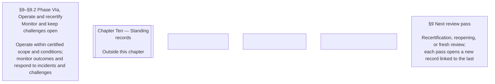
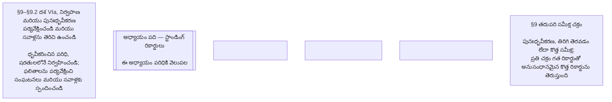

<!-- CHUNK-BEGIN te__core_09.000_system_alignment_certification_evaluation__section_1_corpus_placement_overview.md bytes=5172 -->
<!-- AI-assisted translation draft; unreviewed. §1 corpus-placement overview, source lines 8–10; source SHA-256 4311e6ba74b7210f077c0bd4c8d21d8c9f517d2ada7b6d87288b39494dfeadd5. Draft only; do not synchronize into translations/. -->

# Chapter Nine Part A — §1 corpus-placement overview (te)

## English source (lines 8–10)

> This file is **part of the Sentient Constitution** and is **binding only together** with the other numbered `core_*` files read as one text. It contains **Chapter Nine, Part A** — certification purpose, the process overview, and the first two phases of the process — **Frame** (system class) and **Evaluate** (whole-system evaluation in three sub-phases: the always-applicable evaluations, including data types and handling, in **§3**; the evaluations that apply where implicated in **§4**; and the Rights-Floor and domain evaluations that apply where triggered in **§5**) — **§1–§5**. The worked **Class A / B / C illustrations** (the system class profiles, §3.4.8, §5.1.5, §5.2.4, §5.3.7, §5.4.4, §5.5.5, and §5.6.4), including each one's **Reading across system classes** paragraph, are in [`core_09.010_system_alignment_certification_illustrations.md`](core_09.010_system_alignment_certification_illustrations.md); each keeps its Part A section number. The binding system-class-scaling and escalation rules those paragraphs illustrate stay in this file: system class scaling, including participation and proportionality, in §2.2; data-handling scaling in §3.4; and the **System class scaling and escalation** paragraph in each of §5.1–§5.6. The files of the whole chapter are listed in the table below.
>
> **Chapter Nine files.** Chapter Nine is split across four binding files read as one text. Part A, this file, opens the chapter; there is no separate index file.

## Translation draft

> ఈ ఫైల్ **Sentient Constitution‌లో భాగం**; సంఖ్య కలిగిన ఇతర `core_*` ఫైళ్లతో ఒకే పాఠ్యంగా చదివినప్పుడే ఇది బద్ధత కలిగిస్తుంది. ఇందులో **అధ్యాయం తొమ్మిది, భాగం A** ఉంది—ధృవీకరణ ఉద్దేశం, ప్రక్రియ అవలోకనం, మొదటి రెండు దశలైన **Frame** (వ్యవస్థ తరగతి), **Evaluate** (మూడు ఉపదశల్లో మొత్తం వ్యవస్థ మూల్యాంకనం)—**§§1–5**. మూడు ఉపదశలు: డేటా రకాలు, నిర్వహణతో సహా ఎల్లప్పుడూ వర్తించే మూల్యాంకనాలు **§3**లో; సంబంధం ఉన్నప్పుడు వర్తించే మూల్యాంకనాలు **§4**లో; షరతు ప్రేరేపించినప్పుడు వర్తించే **హక్కుల కనీస ప్రమాణం** మరియు రంగాల మూల్యాంకనాలు **§5**లో. **తరగతి A / B / C** యొక్క వివరమైన ఉదాహరణలు (వ్యవస్థ తరగతి ప్రొఫైళ్లు, §3.4.8, §5.1.5, §5.2.4, §5.3.7, §5.4.4, §5.5.5, §5.6.4), ప్రతిదానిలోని **వ్యవస్థ తరగతుల మధ్య పోలిక** పేరాతో సహా, [`core_09.010_system_alignment_certification_illustrations.md`](core_09.010_system_alignment_certification_illustrations.md)లో ఉన్నాయి; ప్రతి ఉదాహరణ భాగం Aలోని తన విభాగ సంఖ్యను నిలుపుకుంటుంది. ఆ పేరాలు చూపే బద్ధత కలిగిన తరగతి-ఆధారిత పరిమాణ సర్దుబాటు, ఎస్కలేషన్ నియమాలు ఈ ఫైల్‌లోనే ఉంటాయి: భాగస్వామ్యం, అనుపాతతతో సహా వ్యవస్థ తరగతి ఆధారిత పరిమాణ సర్దుబాటు §2.2లో; డేటా నిర్వహణ సర్దుబాటు §3.4లో; §§5.1–5.6లో ప్రతి విభాగంలోని **వ్యవస్థ తరగతి ఆధారిత పరిమాణ సర్దుబాటు, ఎస్కలేషన్** పేరాలో. దిగువ పట్టిక మొత్తం అధ్యాయం ఫైళ్లను చూపుతుంది.
>
> **అధ్యాయం తొమ్మిది ఫైళ్లు.** అధ్యాయం తొమ్మిది కలిసి చదవాల్సిన నాలుగు బద్ధత కలిగిన ఫైళ్లుగా విభజించబడింది. ఈ ఫైల్ అయిన భాగం A అధ్యాయాన్ని ప్రారంభిస్తుంది; ప్రత్యేక సూచిక ఫైల్ లేదు.

<!-- CHUNK-END -->
<!-- CHUNK-BEGIN te__core_09.000_system_alignment_certification_evaluation__section_1_corpus_file_table.md bytes=6654 -->
<!-- AI-assisted translation draft; unreviewed. §1 corpus-placement file table, source lines 12–17; source SHA-256 4311e6ba74b7210f077c0bd4c8d21d8c9f517d2ada7b6d87288b39494dfeadd5. Draft only; do not synchronize into translations/. -->

# Chapter Nine Part A — §1 corpus-placement file table (te)

## English source (lines 12–17)

> | Part | File | Owns |
> |------|------|------|
> | **Part A — Evaluation** | [`core_09.000_system_alignment_certification_evaluation.md`](core_09.000_system_alignment_certification_evaluation.md) | §1–§5: purpose and process overview (with a chart of the whole certification process in its six phases), **Phase I Frame** (system class, how system class scales every evaluation, and pilot certification) and **Phase II Evaluate** (whole-system evaluation in three sub-phases: **IIa** always, in §3, including chartered scope versus functional boundaries and data types and handling; **IIb** where implicated, in §4; and **IIc** where triggered, the Rights-Floor and domain evaluations, in §5) |
> | **Part B — Record and process** | [`core_09.005_system_alignment_certification_record_process.md`](core_09.005_system_alignment_certification_record_process.md) | §6–§10: **Phase III Review** (forum roles, supervisory sequence, and the contestability chain), **Phase IV Decide** (certification outcomes, including the go-live gate), **Phase V Record** (the certification record and its integrity, including governing [System Charter](core_05.040_band_continuity.md#system-charter) fields), and **Phase VI Operate** (the challenge path; recertification and reopening; the standing bridge) — continuous chapter numbering from Part A §5 |
> | **Part C — Illustrations** | [`core_09.010_system_alignment_certification_illustrations.md`](core_09.010_system_alignment_certification_illustrations.md) | the illustrative system class profiles, §3.4, §3.4.8, §5.1.5, §5.2.4, §5.3.7, §5.4.4, §5.5.5, and §5.6.4: worked Class A / B / C walkthroughs for each Part A evaluation area, numbered to match Part A and linked both ways |
> | **Part D — Institutional alignment certification** | [`core_09.015_institutional_alignment_certification.md`](core_09.015_institutional_alignment_certification.md) | §11–§15: the same six phases for an **Institution** rather than a System — the institution class and the institutional evaluation (**Phases I and II**, §12), the forum roles, outcome, and **Institutional Certification Record** (**Phases III to V**, §13), and recertification, reopening, the cascade from System certifications, and the standing bridge (**Phase VI**, §14–§15). It cites each System's certification by link and does not repeat it, and it is not a licence — continuous chapter numbering from Part B §10 |

## Translation draft

| భాగం | ఫైల్ | విషయ పరిధి |
|------|------|------|
| **Part A — Evaluation** | [`core_09.000_system_alignment_certification_evaluation.md`](core_09.000_system_alignment_certification_evaluation.md) | §§1–5: ఉద్దేశం, ప్రక్రియ అవలోకనం (ఆరు దశల ధృవీకరణ చార్ట్‌తో), దశ I Frame (వ్యవస్థ తరగతి, ప్రతి మూల్యాంకన పరిమాణాన్ని తరగతి ఎలా నిర్ణయిస్తుంది, పైలట్ ధృవీకరణ), దశ II Evaluate (మూడు ఉపదశల్లో మొత్తం-వ్యవస్థ మూల్యాంకనం: IIa ఎల్లప్పుడూ §3లో—చార్టర్ పరిధి/కార్యాత్మక సరిహద్దులు, డేటా రకాలు/నిర్వహణ సహా; IIb సంబంధం ఉన్నప్పుడు §4లో; IIc షరతు ప్రేరేపించినప్పుడు §5లో హక్కుల కనీస ప్రమాణం, రంగాల మూల్యాంకనం). |
| **Part B — Record and process** | [`core_09.005_system_alignment_certification_record_process.md`](core_09.005_system_alignment_certification_record_process.md) | §§6–10: దశ III Review (ఫోరం పాత్రలు, పర్యవేక్షణ క్రమం, సవాలు శ్రేణి); IV Decide (ధృవీకరణ ఫలితాలు, ప్రారంభానికి ముందు గేటుతో సహా); V Record (ధృవీకరణ రికార్డు, దాని సమగ్రత, నియంత్రణాత్మక [System Charter](core_05.040_band_continuity.md#system-charter) ఫీల్డ్‌లతో సహా); VI Operate (సవాలు మార్గం, పునఃధృవీకరణ/తిరిగి తెరవడం, standing వంతెన) — భాగం A §5 నుంచి సంఖ్యాక్రమం కొనసాగుతుంది. |
| **Part C — Illustrations** | [`core_09.010_system_alignment_certification_illustrations.md`](core_09.010_system_alignment_certification_illustrations.md) | వ్యవస్థ తరగతి ఉదాహరణ ప్రొఫైళ్లు, §§3.4, 3.4.8, 5.1.5, 5.2.4, 5.3.7, 5.4.4, 5.5.5, 5.6.4: భాగం Aలోని ప్రతి మూల్యాంకన రంగానికి A/B/C తరగతుల వివరణాత్మక ఉదాహరణలు; విభాగ సంఖ్యలు సరిపోతాయి, రెండు దిశల్లో లింకులు ఉన్నాయి. |
| **Part D — Institutional alignment certification** | [`core_09.015_institutional_alignment_certification.md`](core_09.015_institutional_alignment_certification.md) | §§11–15: వ్యవస్థకు బదులుగా సంస్థ కోసం అదే ఆరు దశలు—సంస్థ తరగతి, సంస్థాగత మూల్యాంకనం (I–II, §12), ఫోరం పాత్రలు/ఫలితం/Institutional Certification Record (III–V, §13), పునఃధృవీకరణ, తిరిగి తెరవడం, వ్యవస్థ ధృవీకరణల క్రమపరంపర, standing వంతెన (VI, §§14–15). ప్రతి వ్యవస్థ ధృవీకరణను లింక్‌తో సూచిస్తుంది, పునరావృతం చేయదు; ఇది లైసెన్స్ కాదు — భాగం B §10 నుంచి సంఖ్యలు కొనసాగుతాయి. |

<!-- CHUNK-END -->
<!-- CHUNK-BEGIN te__core_09.000_system_alignment_certification_evaluation__section_1_corpus_explanation.md bytes=11538 -->
<!-- AI-assisted translation draft; unreviewed. §1 corpus-placement explanatory prose, source lines 19–30; source SHA-256 4311e6ba74b7210f077c0bd4c8d21d8c9f517d2ada7b6d87288b39494dfeadd5. Draft only; do not synchronize into translations/. -->

# Chapter Nine Part A — §1 corpus-placement explanatory prose (te)

## English source (lines 19–30)

> **How the two certifications relate.** System Alignment Certification (Parts A to C) is the certification of a System. Institutional alignment certification (Part D) is the certification of an Institution, which may run Systems or none. Part D cites each System's certification record by link and does not redo it; [Part D §11.1](core_09.015_institutional_alignment_certification.md#111-relation-to-system-alignment-certification) states the relation and [Part D §11.3](core_09.015_institutional_alignment_certification.md#113-no-permission-and-no-gate) states that it is not a licence.
>
> Generic **Chapter Nine** links in other files route to the appropriate part by section number.
>
> - **Constitutional owner (joint with Parts B and D):** forum-supervised **system alignment certification and related records** — evaluation domains (Part A); forum process, supervisory sequence, certification-record duties, certification outcomes and the go-live gate, the challenge path, recertification and reopening, and verified-input bridge to Chapter Ten (Part B); the same six phases for an Institution (Part D). Under the **oversight** Tetrad leg, SAC is one especially large, high-stakes audit process among others; auditing floors remain at **Article XVI** (*Audit, Transparency, and Independent Verification*) and Chapter Five [Auditability](core_05.050_band_oversight.md#auditability).
> - **Verification substrate owner:** [Chapter Four — Burden of Proof, Traceability, and Verification](core_04.000_burden_traceability_verification.md#chapter-four-burden-of-proof-traceability-and-verification) (within Chapters Two through Four) owns burden allocation, compliance evidence, definition traceability, observability, and security-constrained verification. Chapter Nine **applies** that discipline to system alignment certification records; it does **not** restate Chapter Four sections **1** through **5**.
> - **Auditing home (not relocated here):** **Article XVI** (*Audit, Transparency, and Independent Verification*), **Def.O1** (*Transparency, Auditability, and Verification*), and **CJS-5.110 §3 and CJS-5.115 §3** (*Audit process home*)–**CJS-5.110 §5** own auditing floors and operational terms. Chapter Nine runs one especially large SAC audit process that must satisfy those floors; it does not own all auditing.
> - **Implementation owner:** system-class handling, CS-6.345, and forum-process detail in designated implementation files must remain consistent with Chapter Nine and may be stricter where the corpus already provides a [Fullest Protective Effect](core_05.045_band_integrative.md#fullest-protective-effect) rule.
> - **Anti-relocation rule:** Part A does not restate Chapter Five canonical definitions, Chapter Three anti-evasion discipline (see [Part B §9.3](core_09.005_system_alignment_certification_record_process.md#93-non-evasion)), Chapter Ten contribution or standing measurement, or Chapter Eleven standing effects. **[Part B §10](core_09.005_system_alignment_certification_record_process.md#10-relationship-to-standing)** states the standing bridge boundary explicitly.
>
> **Upstream:** Chapter Five definitions; Chapters Two through Four record, verification, burden, and traceability of definitions to results; and [Chapter Eight](core_08.000_functional_independence_separation_of_duties.md#chapter-eight-functional-independence-and-separation-of-duties), whose separation-of-duties requirement governs every materially binding certification act.
> **Downstream:** [Part B](core_09.005_system_alignment_certification_record_process.md#chapter-nine-part-b-system-alignment-certification--record-and-process) (*forum process, record, outcomes, and standing bridge*); Chapter Ten standing records and verified inputs; Chapter Eleven standing effects; Chapter Thirteen forum supervision and system alignment certification pathways.

## Translation draft

**రెండు ధృవీకరణల సంబంధం.** System Alignment Certification (భాగాలు A నుంచి C వరకు) ఒక System‌కు ధృవీకరణ. Institutional alignment certification (భాగం D) ఒక Institution‌కు ధృవీకరణ; అది Systems‌ను నడపవచ్చు లేదా ఏదీ నడపకపోవచ్చు. భాగం D ప్రతి System ధృవీకరణ రికార్డును లింక్ ద్వారా సూచిస్తుంది, తిరిగి చేయదు; [Part D §11.1](core_09.015_institutional_alignment_certification.md#111-relation-to-system-alignment-certification) సంబంధాన్ని వివరిస్తుంది, [Part D §11.3](core_09.015_institutional_alignment_certification.md#113-no-permission-and-no-gate) ఇది లైసెన్స్ కాదని చెబుతుంది.
>
> ఇతర ఫైళ్లలోని సాధారణ **Chapter Nine** లింకులు సెక్షన్ సంఖ్య ప్రకారం సరైన భాగానికి తీసుకెళ్తాయి.
>
> - **రాజ్యాంగ యజమాని (భాగాలు B, Dతో సంయుక్తంగా):** ఫోరం పర్యవేక్షణలోని System alignment certification మరియు సంబంధిత రికార్డులు — మూల్యాంకన రంగాలు (భాగం A); ఫోరం ప్రక్రియ, పర్యవేక్షణ క్రమం, ధృవీకరణ రికార్డు బాధ్యతలు, ఫలితాలు మరియు ప్రారంభ అనుమతి గేట్, సవాలు మార్గం, పునర్ధృవీకరణ/తిరిగి తెరవడం, అధ్యాయం పది వరకు ధృవీకరించిన ఇన్‌పుట్ వంతెన (భాగం B); Institution‌కు అదే ఆరు దశలు (భాగం D). Tetrad‌లోని **పర్యవేక్షణ** భాగంలో, SAC ఇతర ఆడిట్ ప్రక్రియలలో ఒక ప్రత్యేకంగా పెద్ద, అధిక-ప్రమాద ప్రక్రియ; ఆడిట్ కనీస ప్రమాణాలు **Article XVI** (*Audit, Transparency, and Independent Verification*) మరియు అధ్యాయం ఐదు [Auditability](core_05.050_band_oversight.md#auditability)లో ఉంటాయి.
> - **ధృవీకరణ ఆధార యజమాని:** [Chapter Four — Burden of Proof, Traceability, and Verification](core_04.000_burden_traceability_verification.md#chapter-four-burden-of-proof-traceability-and-verification) (అధ్యాయాలు రెండు నుంచి నాలుగు మధ్య) రుజువు భారం కేటాయింపు, అనుసరణ సాక్ష్యం, నిర్వచనాల traceability, గమనించగలగడం, భద్రతా పరిమితుల్లో ధృవీకరణను నిర్వహిస్తుంది. అధ్యాయం తొమ్మిది ఆ క్రమశిక్షణను System alignment certification రికార్డులకు వర్తింపజేస్తుంది; అధ్యాయం నాలుగులోని **1** నుంచి **5** విభాగాలను మళ్లీ చెప్పదు.
> - **ఆడిట్ నిలయం (ఇక్కడికి తరలించలేదు):** **Article XVI** (*Audit, Transparency, and Independent Verification*), **Def.O1** (*Transparency, Auditability, and Verification*), మరియు **CJS-5.110 §3, CJS-5.115 §3** (*Audit process home*)–**CJS-5.110 §5** ఆడిట్ కనీస ప్రమాణాలు, ఆచరణాత్మక పదాలను కలిగి ఉంటాయి. అధ్యాయం తొమ్మిది ఆ ప్రమాణాలను తప్పనిసరిగా తీరవలసిన ప్రత్యేకంగా పెద్ద SAC ఆడిట్ నిర్వహిస్తుంది; అన్ని ఆడిట్లకు యజమాని కాదు.
> - **అమలు యజమాని:** నిర్దేశిత అమలు ఫైళ్లలోని సిస్టమ్-తరగతి నిర్వహణ, CS-6.345, ఫోరం-ప్రక్రియ వివరాలు అధ్యాయం తొమ్మిదితో సరిపోలాలి; corpus‌లో ఇప్పటికే [Fullest Protective Effect](core_05.045_band_integrative.md#fullest-protective-effect) నియమం ఉంటే మరింత కఠినంగా ఉండవచ్చు.
> - **స్థానాంతర నిషేధ నియమం:** భాగం A అధ్యాయం ఐదు ప్రామాణిక నిర్వచనాలు, అధ్యాయం మూడు తప్పించుకునే వ్యతిరేక క్రమశిక్షణ ([Part B §9.3](core_09.005_system_alignment_certification_record_process.md#93-non-evasion) చూడండి), అధ్యాయం పది సహకారం లేదా standing కొలత, అధ్యాయం పదకొండు standing ప్రభావాలను తిరిగి చెప్పదు. **[Part B §10](core_09.005_system_alignment_certification_record_process.md#10-relationship-to-standing)** standing bridge సరిహద్దును స్పష్టంగా పేర్కొంటుంది.
>
> **పూర్వ వనరులు:** అధ్యాయం ఐదు నిర్వచనాలు; అధ్యాయాలు రెండు నుంచి నాలుగులోని రికార్డులు, ధృవీకరణ, రుజువు భారం, నిర్వచనాల నుంచి ఫలితాల దాకా traceability; మరియు [Chapter Eight](core_08.000_functional_independence_separation_of_duties.md#chapter-eight-functional-independence-and-separation-of-duties), దాని విధుల విభజన నియమం ప్రతి భౌతికంగా బద్ధత కలిగించే ధృవీకరణ చర్యను నియంత్రిస్తుంది.
> **తదుపరి వనరులు:** [Part B](core_09.005_system_alignment_certification_record_process.md#chapter-nine-part-b-system-alignment-certification--record-and-process) (*ఫోరం ప్రక్రియ, రికార్డు, ఫలితాలు, standing bridge*); అధ్యాయం పది standing రికార్డులు మరియు ధృవీకరించిన ఇన్‌పుట్లు; అధ్యాయం పదకొండు standing ప్రభావాలు; అధ్యాయం పదమూడు ఫోరం పర్యవేక్షణ మరియు System alignment certification మార్గాలు.

<!-- CHUNK-END -->
<!-- CHUNK-BEGIN te__core_09.000_system_alignment_certification_evaluation__section_1_heading.md bytes=387 -->
<!-- AI-assisted translation draft; unreviewed. §1 heading, source line 44; source SHA-256 4311e6ba74b7210f077c0bd4c8d21d8c9f517d2ada7b6d87288b39494dfeadd5. Draft only; do not synchronize into translations/. -->

# Chapter Nine Part A — §1 heading (te)

## English source (lines 44–45)

### 1. Purpose and Role


## Translation draft

### 1. ఉద్దేశం, పాత్ర

<!-- CHUNK-END -->
<!-- CHUNK-BEGIN te__core_09.000_system_alignment_certification_evaluation__section_1_trace.md bytes=12488 -->
<!-- AI-assisted translation draft; unreviewed. §1 trace, source lines 46–95; source SHA-256 4311e6ba74b7210f077c0bd4c8d21d8c9f517d2ada7b6d87288b39494dfeadd5. Draft only; do not synchronize into translations/. -->

# Chapter Nine Part A — §1 trace (te)

## English source (lines 46–95)

<details>
<summary><strong><span style="color: #2563eb;">Trace</span></strong></summary>

- Upstream:
  - [Preamble — constitutional owner register](core_00.000_preamble.md#4-principles-definitions-and-rights) and
  - [Authority Stack and Internal Hierarchy](core_05.045_band_integrative.md#authority-stack-and-internal-hierarchy);
  - [Constitutional Tetrad](core_00.000_preamble.md#constitutional-tetrad);
  - [Two Constitutional Aims](core_00.000_preamble.md#two-constitutional-aims);
  - [material stake](core_00.000_preamble.md#material-stake);
  - [Proportionality](core_05.035_band_accountability.md#proportionality) and
  - [Substantive Fairness](core_05.055_band_participation.md#substantive-fairness) (Chapter Five); Participation measurement family (*voice, access, and contest paths*);
  - [Chapter One §16 Stewardship In Depth](core_01.010_stewardship_capacity_principles.md#16-stewardship-in-depth) (1.010 §16);
  - [Chapter One §12 Systemic Evaluation Requirement](core_01.000_values_principles.md#12-systemic-evaluation-requirement) (1.000 §12) (*principle-layer whole-system evaluation lens — not one corner alone*); Chapters Two through Four;
  - [Chapter Five](core_05.000_definitions_home.md#chapter-five-foundational-definitions) (5.000) (*canonical definitions*);
  - [Chapter Eight §2 Four-Seat Constitutional Requirement](core_08.000_functional_independence_separation_of_duties.md#2-four-seat-constitutional-requirement) (8.000 §2);
  - [System Alignment Certification](core_05.040_band_continuity.md#system-alignment-certification) (Chapter Five canonical term; non-operative shorthand **SAC**);
  - [System Certification Record](core_05.040_band_continuity.md#system-certification-record) (Chapter Five meaning).
- Downstream:
  - [§2](#2-system-class-evaluation) (*system class evaluation*);
  - [Part B §9.1](core_09.005_system_alignment_certification_record_process.md#91-challenging-a-certification) (9.005 §9.1) (*challenging a certification*); and
  - [Part C system class profiles](core_09.010_system_alignment_certification_illustrations.md#illustrative-system-class-profiles-non-exhaustive) (9.010) (*illustrative system class profiles*);
  - [Part C whole-system walkthroughs](core_09.010_system_alignment_certification_illustrations.md#illustrative-whole-system-application-by-system-class-non-exhaustive) (9.010) (*worked whole-system examples by system class*);
  - [§3.4.8](core_09.010_system_alignment_certification_illustrations.md#348-illustrative-data-handling-application-by-system-class-non-exhaustive) (*worked data-handling examples by system class*);
  - [§5.1.5](core_09.010_system_alignment_certification_illustrations.md#515-illustrative-ecological-footprint-application-by-system-class-non-exhaustive) (*worked ecological-footprint examples by system class*);
  - [§5.2.4](core_09.010_system_alignment_certification_illustrations.md#524-illustrative-educational-capability-application-by-system-class-non-exhaustive) (*worked educational-capability examples by system class*);
  - [§5.3.7](core_09.010_system_alignment_certification_illustrations.md#537-illustrative-cross-system-support-application-by-system-class-non-exhaustive) (*worked cross-system-support examples by system class*);
  - [§5.4.4](core_09.010_system_alignment_certification_illustrations.md#544-illustrative-nondiscrimination-application-by-system-class-non-exhaustive) (*worked nondiscrimination examples by system class*);
  - [§5.5.5](core_09.010_system_alignment_certification_illustrations.md#555-illustrative-accessibility-application-by-system-class-non-exhaustive) (*worked accessibility examples by system class*);
  - [§5.6.4](core_09.010_system_alignment_certification_illustrations.md#564-illustrative-trustworthiness-application-by-system-class-non-exhaustive) (*worked trustworthiness examples by system class*);
  - [§3](#3-whole-system-certification-evaluation) (*whole-system certification evaluation factors*);
  - [§3.4](#34-data-types-and-handling-evaluation) through
  - [§5.6](#56-trustworthiness-and-system-reliance-integrity-evaluation) (*domain evaluations*);
  - [Part B §6](core_09.005_system_alignment_certification_record_process.md#6-forum-process) (9.005 §6) (*supervisory sequence and contestability chain*);
  - [Part B §6.1](core_09.005_system_alignment_certification_record_process.md#61-forum-supervision-and-component-roles) (9.005 §6.1) (*forum component roles*);
  - [Part B §8](core_09.005_system_alignment_certification_record_process.md#8-system-certification-record) (9.005 §8) (*certification record contents*);
  - [Part B §8.2](core_09.005_system_alignment_certification_record_process.md#82-record-integrity-transparency-and-auditability) (9.005 §8.2) (*record integrity requirements*);
  - [Part B §7](core_09.005_system_alignment_certification_record_process.md#7-certification-outcomes) (9.005 §7) (*reopening and anti-evasion*);
  - [Part B §10](core_09.005_system_alignment_certification_record_process.md#10-relationship-to-standing) (9.005 §10) (*standing-record bridge*);
  - [Chapter Ten](core_11.000_standing_assessment.md#chapter-eleven-contribution-violation-and-standing-model--measurement) (10.000) (*standing records and verified-input gate*);
  - [Chapter Eleven](core_12.000_standing_integration.md#chapter-twelve-standing-effects-and-integration) (11.000) (*standing effects and integration*);
  - [Chapter Thirteen](core_14.000_forum.md#chapter-fourteen-forums-and-jurisdiction) (13.000) (*forum supervision, certification, alignment certification, and review*).
- Read with:
  - **[CS-9.305](corpus_systems/cs_09.305_system_classification_machinery.md#cs-9305-part-a-system-classification-machinery) (*System classification machinery*) and [CS-9.310 — System impact classifications](corpus_systems/cs_09.310_system_impact_classifications.md#cs-9310-part-b-system-impact-classifications)**, **[CS-6.305](corpus_systems/cs_06.305_information_types_and_handling.md#cs-6305-part-a-information-types-and-handling) (*Information types and handling*) and [CS-6.310 — Data classifications](corpus_systems/cs_06.310_data_classifications.md#cs-6310-part-b-data-classifications)**, and
  - **CS-6.345** (*System lifecycle*);
  - **CF-13.415** (*Routing operations, transfer, certification, and representative treatment*) and
  - **CF-13.425** (*Integrity safeguards, anti-capture operations, and anti-self-judging support*); **Article XVI** (*Audit, Transparency, and Independent Verification*) and
  - [Auditability](core_05.050_band_oversight.md#auditability) (*auditing floors — SAC is one especially large audit process under oversight, not the sole auditing home*); **CJS-5.110 §3 (*Oversight: auditability and reconstructability terms (annex)*) and CJS-5.115 §3** (*Audit process home*)–
  - **CJS-5.110 §5** (*Oversight: independent verification and claim-integrity terms*).

</details>

## Translation draft

#### సూచనల అనుసంధానం

ఈ మ్యాప్ విభాగపు రాజ్యాంగ, అధికార ఆధారాలను చూపి, మూల్యాంకనం, వర్గీకరణ, సమీక్ష మార్గాలు, రికార్డులు, ఫలితాలు, ఆడిట్‌తో కలుపుతుంది; తోడుగా చదవాల్సిన కార్యాచరణ పత్రాలనూ సూచిస్తుంది.

**సూచనల అనుసంధానం — upstream canonical sources:** [Preamble — constitutional owner register](core_00.000_preamble.md#4-principles-definitions-and-rights); [Authority Stack and Internal Hierarchy](core_05.045_band_integrative.md#authority-stack-and-internal-hierarchy); [Constitutional Tetrad](core_00.000_preamble.md#constitutional-tetrad); [Two Constitutional Aims](core_00.000_preamble.md#two-constitutional-aims); [material stake](core_00.000_preamble.md#material-stake); [Proportionality](core_05.035_band_accountability.md#proportionality); [Substantive Fairness](core_05.055_band_participation.md#substantive-fairness); [Chapter One §16 Stewardship In Depth](core_01.010_stewardship_capacity_principles.md#16-stewardship-in-depth); [Chapter One §12 Systemic Evaluation Requirement](core_01.000_values_principles.md#12-systemic-evaluation-requirement); [Chapter Five](core_05.000_definitions_home.md#chapter-five-foundational-definitions); [Chapter Eight §2 Four-Seat Constitutional Requirement](core_08.000_functional_independence_separation_of_duties.md#2-four-seat-constitutional-requirement); [System Alignment Certification](core_05.040_band_continuity.md#system-alignment-certification); [System Certification Record](core_05.040_band_continuity.md#system-certification-record)

**సూచనల అనుసంధానం — downstream routes and related records:** [§2](#2-system-class-evaluation); [Part B §9.1](core_09.005_system_alignment_certification_record_process.md#91-challenging-a-certification); [Part C system class profiles](core_09.010_system_alignment_certification_illustrations.md#illustrative-system-class-profiles-non-exhaustive); [Part C whole-system walkthroughs](core_09.010_system_alignment_certification_illustrations.md#illustrative-whole-system-application-by-system-class-non-exhaustive); [§3.4.8](core_09.010_system_alignment_certification_illustrations.md#348-illustrative-data-handling-application-by-system-class-non-exhaustive); [§5.1.5](core_09.010_system_alignment_certification_illustrations.md#515-illustrative-ecological-footprint-application-by-system-class-non-exhaustive); [§5.2.4](core_09.010_system_alignment_certification_illustrations.md#524-illustrative-educational-capability-application-by-system-class-non-exhaustive); [§5.3.7](core_09.010_system_alignment_certification_illustrations.md#537-illustrative-cross-system-support-application-by-system-class-non-exhaustive); [§5.4.4](core_09.010_system_alignment_certification_illustrations.md#544-illustrative-nondiscrimination-application-by-system-class-non-exhaustive); [§5.5.5](core_09.010_system_alignment_certification_illustrations.md#555-illustrative-accessibility-application-by-system-class-non-exhaustive); [§5.6.4](core_09.010_system_alignment_certification_illustrations.md#564-illustrative-trustworthiness-application-by-system-class-non-exhaustive); [§3](#3-whole-system-certification-evaluation); [§3.4](#34-data-types-and-handling-evaluation); [§5.6](#56-trustworthiness-and-system-reliance-integrity-evaluation); [Part B §6](core_09.005_system_alignment_certification_record_process.md#6-forum-process); [Part B §6.1](core_09.005_system_alignment_certification_record_process.md#61-forum-supervision-and-component-roles); [Part B §8](core_09.005_system_alignment_certification_record_process.md#8-system-certification-record); [Part B §8.2](core_09.005_system_alignment_certification_record_process.md#82-record-integrity-transparency-and-auditability); [Part B §7](core_09.005_system_alignment_certification_record_process.md#7-certification-outcomes); [Part B §10](core_09.005_system_alignment_certification_record_process.md#10-relationship-to-standing); [Chapter Ten](core_11.000_standing_assessment.md#chapter-eleven-contribution-violation-and-standing-model--measurement); [Chapter Eleven](core_12.000_standing_integration.md#chapter-twelve-standing-effects-and-integration); [Chapter Thirteen](core_14.000_forum.md#chapter-fourteen-forums-and-jurisdiction)

**సూచనల అనుసంధానం — operational materials to read with this section:** [CS-9.305](corpus_systems/cs_09.305_system_classification_machinery.md#cs-9305-part-a-system-classification-machinery); [CS-9.310 — System impact classifications](corpus_systems/cs_09.310_system_impact_classifications.md#cs-9310-part-b-system-impact-classifications); [CS-6.305](corpus_systems/cs_06.305_information_types_and_handling.md#cs-6305-part-a-information-types-and-handling); [CS-6.310 — Data classifications](corpus_systems/cs_06.310_data_classifications.md#cs-6310-part-b-data-classifications); [Auditability](core_05.050_band_oversight.md#auditability)

<!-- CHUNK-END -->
<!-- CHUNK-BEGIN te__core_09.000_system_alignment_certification_evaluation__purpose_adjuncts.md bytes=8963 -->
<!-- AI-assisted translation draft; unreviewed. Selected §1 passages, source lines 99 and 107–114; source SHA-256 4311e6ba74b7210f077c0bd4c8d21d8c9f517d2ada7b6d87288b39494dfeadd5. -->

# Chapter Nine Part A — §1 plain-terms excerpt

**Status:** AI-assisted draft; unreviewed. English source remains controlling.

## English source

When a system really matters to sentients' lives, certification has to be **proportionate** — as demanding as the system's real impact, dependency, and risk require, not a one-size-fits-all checklist or a rubber stamp. It also has to be **participatory** — affected sentients and communities must be able to see what was reviewed, understand what was decided, and challenge it when something is wrong. Forums review evidence, write it down in a certification record, and require re-checks on a schedule that matches how risky the system is. Classes A, B, and C get the full process and Class L a lighter one. Class P is encouraged to use it, and must once it is reclassified to Class L or higher (that is, its effects reach beyond a private unit) or its operator claims constitutional compliance.

## te draft

ఒక వ్యవస్థ సంవేదనగల జీవుల జీవితాలపై నిజంగా ప్రభావం చూపితే, దాని ధృవీకరణ **అనుపాతంగా** ఉండాలి—వ్యవస్థ యొక్క వాస్తవ ప్రభావం, ఆధారపడటం, ప్రమాదం ఎంత కఠినతను కోరుతాయో అంతే; అందరికీ ఒకే తనిఖీ జాబితా లేదా పేరుకే ఇచ్చే ఆమోద ముద్ర కాదు. అది **పాల్గొనదగినదిగా** కూడా ఉండాలి—ప్రభావిత జీవులు, సముదాయాలు ఏమి సమీక్షించారో చూడగలగాలి, ఏ నిర్ణయం తీసుకున్నారో అర్థం చేసుకోగలగాలి, తప్పు ఉంటే సవాలు చేయగలగాలి. ఫోరమ్‌లు ఆధారాలను సమీక్షించి ధృవీకరణ రికార్డులో నమోదు చేస్తాయి; వ్యవస్థ ప్రమాదానికి సరిపోయే కాలపట్టికలో మళ్లీ తనిఖీ చేయాలని కోరుతాయి. A, B, C తరగతులకు పూర్తి ప్రక్రియ వర్తిస్తుంది; L తరగతికి తేలికైన ప్రక్రియ వర్తిస్తుంది. P తరగతి దీన్ని ఉపయోగించమని ప్రోత్సహించబడుతుంది; L లేదా అంతకంటే పై తరగతిగా తిరిగి వర్గీకరించినప్పుడు (అంటే ప్రభావాలు వ్యక్తిగత యూనిట్‌ను దాటినప్పుడు) లేదా దాని నిర్వాహకుడు రాజ్యాంగ అనుగుణతను ప్రకటించినప్పుడు దీన్ని తప్పనిసరిగా ఉపయోగించాలి.


### English source — Flourishing

- **[Flourishing](core_00.000_preamble.md#flourishing)** — certification verifies that certification or continued reliance would not quietly defeat Rights Floors or block fair participation in constitutionally relevant life;

### te draft

- **[వికాసం](core_00.000_preamble.md#flourishing)** — సర్టిఫికేషన్ ఇవ్వడం లేదా వ్యవస్థపై ఆధారపడటం కొనసాగించడం హక్కుల కనిష్ఠ ప్రమాణాలను నిశ్శబ్దంగా దెబ్బతీయదని, రాజ్యాంగ సంబంధిత జీవితంలో న్యాయమైన భాగస్వామ్యాన్ని అడ్డుకోదని సర్టిఫికేషన్ నిర్ధారిస్తుంది;


### English source — Continuity criterion

- **[Continuity](core_00.000_preamble.md#continuity)** — certification verifies durable, non-regressive supply that sustains rather than depletes healthy natural systems ([Ecological Integrity](core_05.040_band_continuity.md#ecological-integrity), including [Ecological Recovery Capacity](core_05.040_band_continuity.md#ecological-recovery-capacity)), and system-class-scaled recertification where shared systems gate or sustain delivery;

### te draft

- **[నిరంతరత](core_00.000_preamble.md#continuity)** — ఆరోగ్యకర సహజ వ్యవస్థలను క్షీణింపజేయకుండా నిలబెట్టే దీర్ఘకాలిక, వెనుకడుగు లేని సరఫరాను సర్టిఫికేషన్ నిర్ధారిస్తుంది ([పర్యావరణ సమగ్రత](core_05.040_band_continuity.md#ecological-integrity), అందులో [పర్యావరణ పునరుద్ధరణ సామర్థ్యం](core_05.040_band_continuity.md#ecological-recovery-capacity) కూడా ఉంటుంది); ఉమ్మడి వ్యవస్థలు సరఫరాను నియంత్రించినా లేదా నిలబెట్టినా వ్యవస్థ తరగతికి తగిన పునఃసర్టిఫికేషన్‌ను నిర్ధారిస్తుంది;


### English source — Participation criterion

- **Participation** — affected sentients and communities can understand, contest, and take part in review paths that matter to them;

### te draft

- **భాగస్వామ్యం** — ప్రభావిత జీవులు, సముదాయాలు తమకు సంబంధించిన సమీక్ష మార్గాలను అర్థం చేసుకొని, సవాలు చేసి, వాటిలో పాల్గొనగలవు;


### English source — Oversight criterion

- **Oversight** — records, evidence, and assumptions are visible and auditable enough for independent checking; certification itself is one especially large audit process under that oversight duty, not the only one;

### te draft

- **పర్యవేక్షణ** — రికార్డులు, ఆధారాలు, ఊహలు స్వతంత్ర పరిశీలనకు సరిపడా కనిపిస్తూ ఆడిట్ చేయగలిగేవిగా ఉంటాయి; సర్టిఫికేషన్ ఈ పర్యవేక్షణ బాధ్యతలో ఒక పెద్ద ఆడిట్ ప్రక్రియ మాత్రమే, ఏకైక ఆడిట్ స్థలం కాదు;


### English source — Accountability criterion

- **Accountability** — defects, misclassification, and floor-defeating operation route to remedy, conditions, withdrawal, or standing input where the facts support it;

### te draft

- **జవాబుదారీతనం** — లోపాలు, తప్పు వర్గీకరణ, హక్కుల కనిష్ఠ ప్రమాణాలను దెబ్బతీసే నిర్వహణ వాస్తవాలు మద్దతిస్తే పరిహారం, షరతులు, ఉపసంహరణ లేదా స్థితి అంచనా ఇన్‌పుట్‌కు దారితీస్తాయి;


### English source — Timeliness criterion

- **Timeliness** — review and contest windows keep certification from going stale while harm can still be prevented or reversed.

### te draft

- **సకాలికత** — హానిని ఇంకా నిరోధించగలిగే లేదా సరిచేయగలిగే సమయంలో సమీక్ష, సవాలు గడువులు సర్టిఫికేషన్ పాతబడనివ్వవు.


### English source — Tetrad introduction

Certification implements the [Two Constitutional Aims](core_00.000_preamble.md#two-constitutional-aims) through the [Constitutional Tetrad](core_00.000_preamble.md#constitutional-tetrad):

### te draft

సర్టిఫికేషన్ [రెండు రాజ్యాంగ లక్ష్యాలను](core_00.000_preamble.md#two-constitutional-aims) [రాజ్యాంగ చతుష్టయం](core_00.000_preamble.md#constitutional-tetrad) ద్వారా అమలు చేస్తుంది:

<!-- CHUNK-END -->
<!-- CHUNK-BEGIN te__core_09.000_system_alignment_certification_evaluation__section_1_purpose.md bytes=2132 -->
<!-- AI-assisted translation draft; unreviewed. Complete purpose statement excerpt, source lines 101–105; source SHA-256 4311e6ba74b7210f077c0bd4c8d21d8c9f517d2ada7b6d87288b39494dfeadd5. This is an excerpt, not a complete §1 translation. -->

**వ్యవస్థ అనుసరణ ధృవీకరణ** పేర్కొన్న పరిధి, సమీక్ష షెడ్యూల్‌కు ఒక ప్రశ్నకు సమాధానం చెప్పడానికి ఉద్దేశించబడింది: ధృవీకరణ, షరతులతో కూడిన ధృవీకరణ, నిర్ధారణ, పునర్ధృవీకరణ, నిరంతర ఆధారపడటం, అమలు లేదా షరతుల నుంచి గణనీయమైన విడుదలకు సరిపడ రాజ్యాంగ అనుసరణను వ్యవస్థ చూపిందా?

- ధృవీకరణ ప్రజాదరణ స్కోరు కాదు, శాశ్వత అనుమతి కాదు, హక్కుల సమీక్షను దాటవేసే మార్గమూ కాదు.
- వ్యవస్థ అనుసరణ గురించి ప్రస్తుతం తెలిసిన విషయాలపై కాలపరిమితి గల, సవాలు చేయగల ప్రకటన అది.
- చతుష్టయంలోని **పర్యవేక్షణ** కాలం కింద, పర్యవేక్షణకు ఆడిట్ అవసరం; వ్యవస్థ అనుసరణ ధృవీకరణ అనేది ఇతర వాటిలో ఒక ప్రత్యేకంగా పెద్ద, అధిక-పందెం ఆడిట్ ప్రక్రియ — ఆడిట్‌కు ఏకైక స్థలం కాదు (**అనుచ్ఛేదం XVI** (*ఆడిట్, పారదర్శకత, స్వతంత్ర ధృవీకరణ*), [ఆడిట్-యోగ్యత](core_05.050_band_oversight.md#auditability)).

<!-- CHUNK-END -->
<!-- CHUNK-BEGIN te__core_09.000_system_alignment_certification_evaluation__section_1_subsection_headings.md bytes=892 -->
<!-- AI-assisted translation draft; unreviewed. §1.1/§1.2 visible subsection headings, source lines 116–119 and 144–148; source SHA-256 4311e6ba74b7210f077c0bd4c8d21d8c9f517d2ada7b6d87288b39494dfeadd5. Draft only; anchors/blank layout are structural. Do not synchronize into translations/. -->

# Chapter Nine Part A — §1.1 and §1.2 subsection headings (te)

## English source

### Lines 116–119

<a id="11-certification-as-an-audit-process-scaled-by-class"></a>

#### 1.1 Certification as an audit process, scaled by class


### Lines 144–148


<a id="12-certification-at-a-glance"></a>

#### 1.2 Certification at a glance


## Translation draft

#### 1.1 తరగతికి అనుగుణంగా పరిమాణం పొందే ఆడిట్ ప్రక్రియగా ధృవీకరణ

#### 1.2 ఒక్క చూపులో ధృవీకరణ

<!-- CHUNK-END -->
<!-- CHUNK-BEGIN te__core_09.000_system_alignment_certification_evaluation__section_1_audit_scope.md bytes=4721 -->
<!-- AI-assisted translation draft; unreviewed. §1.1 audit mechanism and sibling audit modes, source lines 120–130; source SHA-256 4311e6ba74b7210f077c0bd4c8d21d8c9f517d2ada7b6d87288b39494dfeadd5. -->

# Chapter Nine Part A — §1.1 certification audit process excerpt (te)

## English source

As an oversight mechanism, certification is one especially large audit process under [Auditability](core_05.050_band_oversight.md#auditability) and **Article XVI** (*Audit, Transparency, and Independent Verification*):

- It is forum-supervised, multi-domain, and status-granting.
- It may integrate the results of sibling audit modes, and it does not absorb or replace them. Each keeps its own owner, named in the [sibling audit modes map](corpus_joint_structure/cjs_05.115_audit_process.md#sibling-audit-modes-owner-map) of the audit process home:
  - System Data Types Record audits under **CS-6.305 (*Information types and handling*) and CS-6.310** (*Data classifications*)
  - System Classification Record audits under **CS-9.305 (*System classification machinery*) and CS-9.310** (*System impact classifications*)
  - steward assurance reviews under **CS-14.305** (*Critical system stewardship*)
  - continuous audit under **CS-6.345** (*System lifecycle*) ACA
  - complexity audits under **CS-6.315** (*Comprehensibility and complexity stewardship*) and **Article XXIII-B** (*Complexity Audit and Modularity Requirements*)
  - claim verification under **CJS-5.110 §5** (*Oversight: independent verification and claim-integrity terms*)
- You can still run any of these checks on their own, without going through certification. Certification doesn't replace them.

## te draft

పర్యవేక్షణ యంత్రాంగంగా, [ఆడిట్ చేయగలగడం](core_05.050_band_oversight.md#auditability) మరియు **Article XVI** (*ఆడిట్, పారదర్శకత, స్వతంత్ర ధృవీకరణ*) కింద ధృవీకరణ అనేది ప్రత్యేకంగా పెద్దదైన ఆడిట్ ప్రక్రియ:

- ఇది ఫోరమ్ పర్యవేక్షణలో ఉంటుంది, అనేక రంగాలను కవర్ చేస్తుంది, స్థితిని మంజూరు చేస్తుంది.
- ఇది అనుబంధ ఆడిట్ విధానాల ఫలితాలను సమగ్రపరచవచ్చు; కానీ వాటిని తనలో కలిపేసుకోదు లేదా భర్తీ చేయదు. ప్రతి విధానానికి దాని స్వంత యజమాని ఉంటాడు; ఆడిట్ ప్రక్రియ ప్రధాన పత్రంలోని [అనుబంధ ఆడిట్ విధానాల మ్యాప్](corpus_joint_structure/cjs_05.115_audit_process.md#sibling-audit-modes-owner-map)లో అతని పేరు ఉంటుంది:
  - System Data Types Record ఆడిట్‌లు **CS-6.305 (*సమాచార రకాలు మరియు నిర్వహణ*) మరియు CS-6.310** (*డేటా వర్గీకరణలు*) కింద
  - System Classification Record ఆడిట్‌లు **CS-9.305 (*వ్యవస్థ వర్గీకరణ యంత్రాంగం*) మరియు CS-9.310** (*వ్యవస్థ ప్రభావ వర్గీకరణలు*) కింద
  - సంరక్షక హామీ సమీక్షలు **CS-14.305** (*కీలక వ్యవస్థ సంరక్షకత్వం*) కింద
  - నిరంతర ఆడిట్ **CS-6.345** (*వ్యవస్థ జీవితచక్రం*) ACA కింద
  - సంక్లిష్టత ఆడిట్‌లు **CS-6.315** (*అర్థమయ్యే సామర్థ్యం మరియు సంక్లిష్టత సంరక్షకత్వం*) మరియు **Article XXIII-B** (*సంక్లిష్టత ఆడిట్ మరియు మాడ్యులారిటీ అవసరాలు*) కింద
  - వాదనల ధృవీకరణ **CJS-5.110 §5** (*పర్యవేక్షణ: స్వతంత్ర ధృవీకరణ మరియు వాదన సమగ్రత నిబంధనలు*) కింద
- ధృవీకరణలోకి వెళ్లకుండానే వీటిలో ఏ తనిఖీ అయినా విడిగా నిర్వహించవచ్చు. ధృవీకరణ వాటికి ప్రత్యామ్నాయం కాదు.

<!-- CHUNK-END -->
<!-- CHUNK-BEGIN te__core_09.000_system_alignment_certification_evaluation__section_1_class_scaling.md bytes=5686 -->
<!-- AI-assisted translation draft; unreviewed. Chapter Nine Part A §1 class scaling and cadence, source lines 132–143; source SHA-256 4311e6ba74b7210f077c0bd4c8d21d8c9f517d2ada7b6d87288b39494dfeadd5. Draft only; do not synchronize into translations/. -->

**Current English passage:**

Certification depth, record burden, certification interval, stakeholder review, and contest paths must scale with [material stake](core_00.000_preamble.md#material-stake) under [Proportionality](core_05.035_band_accountability.md#proportionality):

The process applies by impact class, as the [reclassification requirement](corpus_systems/cs_09.305_system_classification_machinery.md#35-reclassification-requirement) of **CS-9.305** (*System classification machinery*) sets out:

- **Class A, Class B, and Class C:** these systems carry the highest impact, dependency, and risk, and whole-system evaluation under [§3 Whole-System Certification Evaluation](#3-whole-system-certification-evaluation), [§4 Evaluations Where Implicated](#4-evaluations-where-implicated), and [§5 Rights-Floor and Domain Evaluations](#5-rights-floor-and-domain-evaluations), each as its own sub-phase applies, is mandatory at full depth;
- **Class L:** the same evaluation is mandatory but proportionate, with a lower default re-check cadence and simpler records where CS-9.305 (*System classification machinery*) and CS-9.310 (*System impact classifications*) permits; and
- **Class P:** the process is encouraged while the system is validly Class P, and a Class P system may use it voluntarily. It becomes mandatory on reclassification to Class L or higher, or where the operator voluntarily asserts constitutional compliance for the system.

The certification interval, and the financial, resource, or special audit that falls at its midpoint, are set by class in [Chapter Thirteen §6 Timely resolution, materiality tiers, and anti-delay discipline](core_14.000_forum.md#review-cadence) (*Review cadence*). This chapter does not restate the numbers.

**Proposed locale translation:**

ధృవీకరణ లోతు, రికార్డు భారం, ధృవీకరణ విరామం, భాగస్వాముల సమీక్ష, సవాలు మార్గాలు—ఇవన్నీ [వాస్తవిక ప్రాముఖ్యత](core_00.000_preamble.md#material-stake) మేరకు [అనుపాతంగా](core_05.035_band_accountability.md#proportionality) ఉండాలి:

**CS-9.305** (*వ్యవస్థ వర్గీకరణ యంత్రాంగం*)లోని [పునర్వర్గీకరణ నిబంధన](corpus_systems/cs_09.305_system_classification_machinery.md#35-reclassification-requirement) ప్రకారం ప్రభావ తరగతిని బట్టి ప్రక్రియ వర్తిస్తుంది:

- **A, B, C తరగతులు:** వీటికి అత్యధిక ప్రభావం, ఆధారపడటం, ప్రమాదం ఉంటాయి. వర్తించే ప్రతి ఉపదశలో పూర్తి లోతుతో మొత్తం వ్యవస్థ మూల్యాంకనం [§3 మొత్తం-వ్యవస్థ ధృవీకరణ మూల్యాంకనం](#3-whole-system-certification-evaluation), [§4 వర్తించే సందర్భాల మూల్యాంకనాలు](#4-evaluations-where-implicated), [§5 హక్కుల కనిష్ఠ ప్రమాణం మరియు విభాగాల మూల్యాంకనాలు](#5-rights-floor-and-domain-evaluations) ప్రకారం తప్పనిసరి;
- **L తరగతి:** అదే మూల్యాంకనం తప్పనిసరి, కానీ అనుపాతంగా ఉంటుంది; **CS-9.305** (*వ్యవస్థ వర్గీకరణ యంత్రాంగం*) మరియు **CS-9.310** (*వ్యవస్థ ప్రభావ వర్గీకరణలు*) అనుమతించినచోట సాధారణ పునఃపరిశీలన విరామం తక్కువ తరచుదనంతో, రికార్డులు సరళంగా ఉండవచ్చు; మరియు
- **P తరగతి:** వ్యవస్థ చెల్లుబాటుగా P తరగతిలో ఉన్నంతవరకు ఈ ప్రక్రియ ప్రోత్సహించబడుతుంది; స్వచ్ఛందంగా ఉపయోగించవచ్చు. L లేదా అంతకంటే పైకి పునర్వర్గీకరణ జరిగినా, లేదా నిర్వాహకుడు వ్యవస్థ రాజ్యాంగ అనుసరణను స్వచ్ఛందంగా ప్రకటించినా, ఇది తప్పనిసరి అవుతుంది.

ధృవీకరణ విరామం, దాని మధ్యలో జరిగే ఆర్థిక, వనరుల లేదా ప్రత్యేక ఆడిట్‌ను తరగతి ప్రకారం [పదమూడో అధ్యాయం §6 సకాల పరిష్కారం, ప్రాముఖ్యత స్థాయిలు, ఆలస్య నిరోధక క్రమశిక్షణ](core_14.000_forum.md#review-cadence) (*సమీక్ష ఆవర్తనం*) నిర్ణయిస్తుంది. ఈ అధ్యాయం సంఖ్యలను మళ్లీ పేర్కొనదు.

<!-- CHUNK-END -->
<!-- CHUNK-BEGIN te__core_09.000_system_alignment_certification_evaluation__section_1_at_a_glance.md bytes=2971 -->
<!-- AI-assisted translation draft; unreviewed. Chapter Nine Part A §1.2 plain-language summary, source line 149; source SHA-256 4311e6ba74b7210f077c0bd4c8d21d8c9f517d2ada7b6d87288b39494dfeadd5. Draft only; do not synchronize into translations/. -->

# Chapter Nine Part A — §1.2 at-a-glance summary (te)

## English source

*In plain terms: classify the system honestly, run the evaluations that apply, have forums independently review the evidence and stakeholder concerns, and decide an outcome. Complete the one record opened for forum review and publish it with an open challenge path. A certified system goes live only after its notice interval and required protections are satisfied. Monitor actual outcomes, respond to incidents and challenges, and check again on schedule or when the facts change. Correct defects and have the correction independently verified before authorizing the affected scope or releasing its conditions. Each review pass uses a new record linked to the last.*

## te draft

*సరళంగా చెప్పాలంటే: వ్యవస్థను నిజాయితీగా వర్గీకరించండి, వర్తించే మూల్యాంకనాలు నిర్వహించండి, సాక్ష్యాలు మరియు భాగస్వాముల ఆందోళనలను ఫోరమ్‌లు స్వతంత్రంగా సమీక్షించేలా చేసి, ఫలితాన్ని నిర్ణయించండి. ఫోరమ్ సమీక్ష కోసం తెరిచిన ఏకైక రికార్డును పూర్తి చేసి, తెరిచి ఉన్న సవాలు మార్గంతో ప్రచురించండి. నోటీసు వ్యవధి ముగిసి, అవసరమైన రక్షణలు నెరవేరిన తర్వాతే ధృవీకరించబడిన వ్యవస్థ అమల్లోకి వస్తుంది. వాస్తవ ఫలితాలను పర్యవేక్షించి, సంఘటనలు మరియు సవాళ్లకు స్పందించండి; షెడ్యూల్ ప్రకారం లేదా వాస్తవాలు మారినప్పుడు మళ్లీ తనిఖీ చేయండి. లోపాలను సరిచేసి, ప్రభావిత పరిధికి అనుమతి ఇవ్వడానికి లేదా దాని షరతులను తొలగించడానికి ముందు సవరణను స్వతంత్రంగా ధృవీకరించండి. ప్రతి సమీక్ష చక్రం గత రికార్డుతో అనుసంధానమైన కొత్త రికార్డును ఉపయోగిస్తుంది.*

<!-- CHUNK-END -->
<!-- CHUNK-BEGIN te__core_09.000_system_alignment_certification_evaluation__section_1_phase_map.md bytes=708 -->
<!-- AI-assisted translation draft; unreviewed. Chapter Nine Part A §1.2 phase map, source line 151; source SHA-256 4311e6ba74b7210f077c0bd4c8d21d8c9f517d2ada7b6d87288b39494dfeadd5. Draft only; do not synchronize into translations/. -->

**Current English passage:**

The process runs in **six phases**: **I Frame**, **II Evaluate**, **III Review**, **IV Decide**, **V Record**, and **VI Operate**.

**Proposed locale translation:**

ఈ ప్రక్రియ **ఆరు దశల్లో** సాగుతుంది: **I రూపకల్పన**, **II మూల్యాంకనం**, **III సమీక్ష**, **IV నిర్ణయం**, **V నమోదు**, **VI నిర్వహణ**.

<!-- CHUNK-END -->
<!-- CHUNK-BEGIN te__core_09.000_system_alignment_certification_evaluation__section_1_reopen_triggers.md bytes=2481 -->
<!-- AI-assisted translation draft; unreviewed. Chapter Nine Part A §1 review-reopening passage, source line 153; source SHA-256 4311e6ba74b7210f077c0bd4c8d21d8c9f517d2ada7b6d87288b39494dfeadd5. Draft only; do not synchronize into translations/. -->

**Current English passage:**

Every evaluation that applies is carried out again on each certification pass: at first certification, at each recertification on the schedule set by [§2 System Class Evaluation](#2-system-class-evaluation), and at each reopened or fresh review. Review reopens before the next scheduled recertification when material facts change, such as growing reliance on the system, growing extraction from shared foundations, a significant fall in what the system puts back into them, or a credible challenge. [Part B §9 Recertification and Reopening](core_09.005_system_alignment_certification_record_process.md#9-recertification-and-reopening) lists the triggers.

**Proposed locale translation:**

వర్తించే ప్రతి మూల్యాంకనం ప్రతి ధృవీకరణ చక్రంలో మళ్లీ నిర్వహించాలి: మొదటి ధృవీకరణలో, [§2 వ్యవస్థ తరగతి మూల్యాంకనం](#2-system-class-evaluation) నిర్ణయించిన షెడ్యూల్ ప్రకారం ప్రతి పునర్ధృవీకరణలో, అలాగే తిరిగి తెరిచిన లేదా కొత్త సమీక్షలో. వ్యవస్థపై ఆధారపడటం పెరగడం, ఉమ్మడి పునాదుల నుంచి మరింత తీసుకోవడం, వాటికి వ్యవస్థ తిరిగి అందించే భాగం గణనీయంగా తగ్గడం, లేదా విశ్వసనీయ సవాలు రావడం వంటి ముఖ్య వాస్తవాలు మారితే, తదుపరి షెడ్యూల్ పునర్ధృవీకరణకు ముందే సమీక్షను తిరిగి తెరవాలి. ప్రేరకాలను [భాగం B §9 పునర్ధృవీకరణ మరియు తిరిగి తెరవడం](core_09.005_system_alignment_certification_record_process.md#9-recertification-and-reopening) జాబితా చేస్తుంది.

<!-- CHUNK-END -->
<!-- CHUNK-BEGIN te__core_09.000_system_alignment_certification_evaluation__section_1_phase_map_opening_nodes.md bytes=2708 -->
<!-- AI-assisted translation draft; unreviewed. §1.2 Phase I/II opening chart-node labels, source lines 155–165; source SHA-256 4311e6ba74b7210f077c0bd4c8d21d8c9f517d2ada7b6d87288b39494dfeadd5. Draft only; non-prose Mermaid syntax/connectors are retained. Do not synchronize into translations/. -->

# Chapter Nine Part A — §1.2 opening phase-map nodes (te)

## English source (lines 155–165)

```mermaid
flowchart TB
    T(["System with material impact seeks certification,<br/>or reliance on it grows"])
    C["§2 Phase I, Frame<br/>Classify honestly<br/><br/>Class sets depth and re-check schedule"]
    subgraph W["§3–§5 Phase II, Evaluate — Whole-system evaluation"]
        direction LR
        Al["§3.1–§3.4 IIa — Always<br/><br/>Governance; systemic risk: evaluated,<br/>and disclosed to those who need it;<br/>time horizon; data types"]
        Im["§4 IIb — When implicated<br/><br/>Privacy loci, exit rights,<br/>assembly and dissent"]
        Tr["§5 IIc — When triggered<br/><br/>Applicable Rights-Floor checks<br/>and six domain evaluations"]
        Al ~~~ Im ~~~ Tr
    end

## Translation draft

```mermaid
flowchart TB
    T["భౌతిక ప్రభావం గల వ్యవస్థ ధృవీకరణ కోరుతుంది,<br/>లేదా దానిపై ఆధారపడటం పెరుగుతుంది"]
    C["§2 దశ I, రూపకల్పన<br/>నిజాయితీగా వర్గీకరించు<br/><br/>తరగతి మూల్యాంకన లోతు, పునఃపరిశీలన షెడ్యూల్‌ను నిర్ణయిస్తుంది"]
    subgraph W["§3–§5 దశ II, మూల్యాంకనం — మొత్తం వ్యవస్థ మూల్యాంకనం"]
        direction LR
        Al["§3.1–§3.4 IIa — ఎల్లప్పుడూ<br/><br/>పాలన; వ్యవస్థాగత ప్రమాదాన్ని మూల్యాంకనం చేసి<br/>అవసరమైనవారికి వెల్లడించు; కాలపరిధి; డేటా రకాలు"]
        Im["§4 IIb — సంబంధం ఉన్నప్పుడు<br/><br/>గోప్యత అంశాలు, నిష్క్రమణ హక్కులు,<br/>సభ, భిన్నాభిప్రాయం"]
        Tr["§5 IIc — ప్రేరకం వర్తించినప్పుడు<br/><br/>వర్తించే హక్కుల పునాది తనిఖీలు<br/>మరియు ఆరు రంగ మూల్యాంకనాలు"]
        Al ~~~ Im ~~~ Tr
    end
```

<!-- CHUNK-END -->
<!-- CHUNK-BEGIN te__core_09.000_system_alignment_certification_evaluation__chart_review_node.md bytes=752 -->
# Chapter Nine Part A — chart review node (te)

AI-assisted draft; unreviewed. Current source SHA-256: `4311e6ba74b7210f077c0bd4c8d21d8c9f517d2ada7b6d87288b39494dfeadd5`. Reconciles current source line 166: “Assigned forums issue findings; challenge paths stay open.” The translated node ID, chart structure, HTML line breaks, and code syntax are preserved.

```mermaid
    F["దశ III, సమీక్ష — §6<br/>సాక్ష్యాలు, భాగస్వాముల ఆందోళనల<br/>స్వతంత్ర సమీక్ష<br/><br/>నియమిత వేదికలు నిర్ధారణలు ఇస్తాయి;<br/>సవాలు మార్గాలు తెరిచి ఉంటాయి"]
```

<!-- CHUNK-END -->
<!-- CHUNK-BEGIN te__core_09.000_system_alignment_certification_evaluation__section_1_decision_nodes.md bytes=5612 -->
<!-- AI-assisted translation draft; unreviewed. Chapter Nine Part A §1.2 decision and outcome diagram nodes, source lines 167–176; source SHA-256 4311e6ba74b7210f077c0bd4c8d21d8c9f517d2ada7b6d87288b39494dfeadd5. Draft only; do not synchronize into translations/. -->

# Chapter Nine Part A — §1.2 decision and outcome nodes (te)

## English source (lines 167–176)

```mermaid
flowchart TB
    Rec["§8 Phase V, Record<br/>One System Certification Record<br/><br/>Opened for forum review; completed with the outcome,<br/>supporting findings, conditions, and operating plan"]
    S[["Chapter Ten — Standing<br/>records<br/><br/>Outside this chapter"]]
    O{"§7 Phase IV, Decide<br/><br/>What outcome and status<br/>does the evidence support?"}
    Fc["§7, §9.2 Full Certification<br/><br/>Required consecutive clean provisional recertifications;<br/>no current or indicated impending misalignment<br/>Full certification interval; conditions may apply"]
    Pc["§7, §9.2 Provisional Certification<br/><br/>First grant, recovery after misalignment,<br/>or continued or stepped-down provisional status<br/>Provisional interval, shorter; conditions may apply"]
    Nc["§7 Not Certified<br/><br/>Deferred, refused, withdrawn, or expired<br/>No go-live; state reasons and required corrective work"]
    Pub["§7, §9.1 Publish the completed record<br/><br/>Open the published record challenge path;<br/>for new or expanded scope, state go-live and notice"]
    G{"§7 Go-live gate<br/><br/>Certification and applicable<br/>go-live prerequisites satisfied?"}
    Hold["§7 Meet go-live prerequisites<br/><br/>Complete notice and independently verify<br/>conditions required before go-live"]
    Rm["§7, §9.2 Protect and correct<br/><br/>No new go-live in the affected scope;<br/>protect affected sentients, correct design or operation,<br/>and submit evidence for independent verification"]
```



## te draft



<!-- CHUNK-END -->
<!-- CHUNK-BEGIN te__core_09.000_system_alignment_certification_evaluation__section_1_review_cycle_nodes.md bytes=3406 -->
<!-- AI-assisted translation draft; unreviewed. Chapter Nine Part A §1.2 operation and next-review diagram nodes, source lines 177–182; source SHA-256 4311e6ba74b7210f077c0bd4c8d21d8c9f517d2ada7b6d87288b39494dfeadd5. Draft only; do not synchronize into translations/. -->

```mermaid
flowchart TB
    Rec["§8 దశ V, రికార్డు<br/>ఒకే సిస్టమ్ సర్టిఫికేషన్ రికార్డు<br/><br/>ఫోరమ్ సమీక్ష కోసం తెరవబడుతుంది; ఫలితం, మద్దతు నిర్ణయాలు, షరతులు, ఆపరేటింగ్ ప్లాన్‌తో పూర్తి చేయబడుతుంది"]
    S[["అధ్యాయం పది — స్టాండింగ్ రికార్డులు<br/><br/>ఈ అధ్యాయం పరిధికి వెలుపల"]]
    O{"§7 దశ IV, నిర్ణయం<br/><br/>సాక్ష్యాలు ఏ ఫలితం మరియు స్థితికి<br/>మద్దతు ఇస్తున్నాయి?"}
    Fc["§7, §9.2 పూర్తి ధృవీకరణ<br/><br/>వరుసగా లోపంలేని తాత్కాలిక పునఃధృవీకరణలు అవసరం;<br/>ప్రస్తుత లేదా సమీప భవిష్యత్తు అసమలేఖన సూచన లేదు<br/>పూర్తి ధృవీకరణ వ్యవధి; షరతులు వర్తించవచ్చు"]
    Pc["§7, §9.2 తాత్కాలిక ధృవీకరణ<br/><br/>మొదటి మంజూరు, అసమలేఖనం తర్వాత పునరుద్ధరణ,<br/>లేదా తాత్కాలిక స్థితిని కొనసాగించడం లేదా తగ్గించడం<br/>తక్కువ తాత్కాలిక వ్యవధి; షరతులు వర్తించవచ్చు"]
    Nc["§7 ధృవీకరించబడలేదు<br/><br/>వాయిదా, నిరాకరణ, ఉపసంహరణ లేదా గడువు ముగింపు<br/>ప్రారంభించరాదు; కారణాలు మరియు అవసరమైన సరిదిద్దే పనిని పేర్కొనండి"]
    Pub["§7, §9.1 పూర్తి చేసిన రికార్డును ప్రచురించండి<br/><br/>ప్రచురిత రికార్డుకు సవాలు మార్గాన్ని తెరవండి;<br/>కొత్త లేదా విస్తరించిన పరిధికి ప్రారంభం మరియు నోటీసును పేర్కొనండి"]
    G{"§7 ప్రారంభ ద్వారం<br/><br/>ధృవీకరణ మరియు వర్తించే ప్రారంభ<br/>ముందస్తు అవసరాలు నెరవేరాయా?"}
    Hold["§7 ప్రారంభ ముందస్తు అవసరాలను నెరవేర్చండి<br/><br/>నోటీసును పూర్తి చేసి, ప్రారంభానికి ముందు అవసరమైన<br/>షరతులను స్వతంత్రంగా ధృవీకరించండి"]
    Rm["§7, §9.2 రక్షించి సరిచేయండి<br/><br/>ప్రభావిత పరిధిలో కొత్త ప్రారంభం వద్దు;<br/>ప్రభావిత సంజ్ఞానశీల సత్తాలను రక్షించి, రూపకల్పన లేదా ఆపరేషన్‌ను సరిచేసి,<br/>స్వతంత్ర ధృవీకరణకు సాక్ష్యాలను సమర్పించండి"]
```

# Chapter Nine Part A — §1.2 operation and review-cycle nodes (te)

## English source (lines 177–182)



## te draft



<!-- CHUNK-END -->
<!-- CHUNK-BEGIN te__core_09.000_system_alignment_certification_evaluation__section_1_phase_map_edge_labels.md bytes=2618 -->
<!-- AI-assisted translation draft; unreviewed. §1.2 certification-phase chart edge labels, source lines 194, 199, 200–206; source SHA-256 4311e6ba74b7210f077c0bd4c8d21d8c9f517d2ada7b6d87288b39494dfeadd5. Mermaid node IDs, edge syntax, and <br/> delimiters are structural and preserved; visible edge labels are translated. Draft only; do not synchronize into translations/. -->

# Chapter Nine Part A — phase-chart edge labels (te)

## English source

```mermaid
    Rec -.->|VIb, §10 —<br/>verified inputs only;<br/>current certification or facts<br/>arising during certification| S
    G --->|Yes: operate<br/>within the record| Ch
    G --->|Certified,<br/>prerequisites pending| Hold
    Ch -->|Material defect:<br/>protect and correct| Rm
    Ch -->|On schedule, or<br/>material change or<br/>credible challenge<br/>requires review| Re
    Ch -.->|VIb, §10 —<br/>verified inputs only;<br/>operation may supply facts<br/>for Contribution and<br/>Violation records| S2
    Rm -->|Correction evidence<br/>is checked in the<br/>next review pass| Re
    G -->|Not Certified| Rm
```

## Translation draft

```mermaid
    Rec -.->|VIb, §10 —<br/>ధృవీకరించిన ఇన్‌పుట్‌లు మాత్రమే;<br/>ప్రస్తుత ధృవీకరణ లేదా ధృవీకరణ సమయంలో<br/>తలెత్తిన వాస్తవాలు| S
    G --->|అవును: రికార్డు<br/>పరిధిలో పనిచేయండి| Ch
    G --->|ధృవీకరించబడింది,<br/>ముందస్తు షరతులు పెండింగ్‌లో| Hold
    Ch -->|ముఖ్యమైన లోపం:<br/>రక్షించి సరిచేయండి| Rm
    Ch -->|షెడ్యూల్ ప్రకారం, లేదా<br/>ముఖ్యమైన మార్పు లేదా<br/>నమ్మదగిన సవాలు<br/>సమీక్షను కోరినప్పుడు| Re
    Ch -.->|VIb, §10 —<br/>ధృవీకరించిన ఇన్‌పుట్‌లు మాత్రమే;<br/>ఆపరేషన్ Contribution మరియు<br/>Violation రికార్డులకు సంబంధించిన<br/>వాస్తవాలను అందించవచ్చు| S2
    Rm -->|సవరణకు సంబంధించిన ఆధారాలు<br/>తదుపరి సమీక్ష చక్రంలో<br/>తనిఖీ చేయబడతాయి| Re
    G -->|ధృవీకరించబడలేదు| Rm
```

<!-- CHUNK-END -->
<!-- CHUNK-BEGIN te__core_09.000_system_alignment_certification_evaluation__section_1_reader_guide.md bytes=5089 -->
<!-- AI-assisted translation draft; unreviewed. §1 non-operative reader guide, source lines 236–245; source SHA-256 4311e6ba74b7210f077c0bd4c8d21d8c9f517d2ada7b6d87288b39494dfeadd5. Draft only; do not synchronize into translations/. -->

# Chapter Nine Part A — §1 reader guide (te)

## English source (lines 236–245)

<details>
<summary><strong><span style="color: #2563eb;">Reader guide (non-operative): illustrations, run sheet, and Institutions</span></strong></summary>

> Illustrative **Class A**, **Class B**, and **Class C** profiles — and how system class scales certification depth across this chapter — are in [Illustrative System Class Profiles (Non-Exhaustive)](core_09.010_system_alignment_certification_illustrations.md#illustrative-system-class-profiles-non-exhaustive). Worked walkthroughs of the same three systems for each evaluation area in [§3 Whole-System Certification Evaluation](#3-whole-system-certification-evaluation) through [§5.6 Trustworthiness and System-Reliance Integrity Evaluation](#56-trustworthiness-and-system-reliance-integrity-evaluation) follow there, in [Part C — Illustrations](core_09.010_system_alignment_certification_illustrations.md#chapter-nine-part-c-system-alignment-certification--illustrations), which links each profile and walkthrough back to the Part A section it illustrates.
>
> A step-by-step run sheet for the six phases, with a link from each step to the section that holds the rule, is in [CS-9.315 §2 Run sheet](corpus_systems/cs_09.315_system_alignment_certification_run_sheet.md#cs-9315-2-run-sheet) (*System alignment certification run sheet*). Where the run sheet and a section differ, the section controls.
>
> For an Institution, the same six phases run through [Part D](core_09.015_institutional_alignment_certification.md#chapter-nine-part-d-institutional-alignment-certification): Phases I and II in [Part D §12 Institution Class and Institutional Evaluation](core_09.015_institutional_alignment_certification.md#12-institution-class-and-institutional-evaluation), Phases III to V in [§13 Review, Decision, and Record](core_09.015_institutional_alignment_certification.md#13-review-decision-and-record), and Phase VI in [§14 Operating, Reopening, and the Cascade](core_09.015_institutional_alignment_certification.md#14-operating-reopening-and-the-cascade) and [§15 Standing Bridge and Non-Evasion](core_09.015_institutional_alignment_certification.md#15-standing-bridge-and-non-evasion).

</details>

## Translation draft

<details>
<summary><strong>పాఠక మార్గదర్శి (నియమాత్మకం కాదు): ఉదాహరణలు, దశల పట్టిక, సంస్థలు</strong></summary>

**A**, **B**, **C** తరగతుల ఉదాహరణ ప్రొఫైళ్లు, ఈ అధ్యాయంలో వ్యవస్థ తరగతి ధృవీకరణ లోతును ఎలా నిర్దేశిస్తుందో [Illustrative System Class Profiles (Non-Exhaustive)](core_09.010_system_alignment_certification_illustrations.md#illustrative-system-class-profiles-non-exhaustive)లో ఉన్నాయి. ప్రతి మూల్యాంకన రంగంలో అదే మూడు వ్యవస్థల ఉదాహరణలు [Part C — Illustrations](core_09.010_system_alignment_certification_illustrations.md#chapter-nine-part-c-system-alignment-certification--illustrations)లో ఉంటాయి; ప్రతి ఉదాహరణ సంబంధిత Part A నియమానికి తిరిగి లింక్ చేస్తుంది.

ఆరు దశల దశలవారీ మార్గదర్శి [CS-9.315 §2 Run sheet](corpus_systems/cs_09.315_system_alignment_certification_run_sheet.md#cs-9315-2-run-sheet)లో ఉంది; ప్రతి దశ నుంచి నియమమున్న విభాగానికి లింక్ ఉంటుంది. మార్గదర్శి, విభాగం మధ్య తేడా ఉంటే విభాగమే వర్తిస్తుంది.

సంస్థకు కూడా అదే ఆరు దశలు [Part D](core_09.015_institutional_alignment_certification.md#chapter-nine-part-d-institutional-alignment-certification)లో నడుస్తాయి: I–II [§12](core_09.015_institutional_alignment_certification.md#12-institution-class-and-institutional-evaluation), III–V [§13](core_09.015_institutional_alignment_certification.md#13-review-decision-and-record), VI [§14](core_09.015_institutional_alignment_certification.md#14-operating-reopening-and-the-cascade), [§15](core_09.015_institutional_alignment_certification.md#15-standing-bridge-and-non-evasion).

ఈ ఉదాహరణలు [§3](#3-whole-system-certification-evaluation) నుంచి [§5.6](#56-trustworthiness-and-system-reliance-integrity-evaluation) వరకు ఉన్న మూల్యాంకన రంగాలను కవర్ చేస్తాయి.

</details>

<!-- CHUNK-END -->
<!-- CHUNK-BEGIN te__core_09.000_system_alignment_certification_evaluation__visible_section_headings_2_3.md bytes=1573 -->
<!-- AI-assisted translation draft; unreviewed. Remaining visible Part A headings, source lines 251, 409, 477, 531, 592, 653; source SHA-256 4311e6ba74b7210f077c0bd4c8d21d8c9f517d2ada7b6d87288b39494dfeadd5. Anchors are structural; prose headings are translated. Draft only; do not synchronize into translations/. -->

# Chapter Nine Part A — remaining visible section headings (te)

## English source

<a id="2-system-class-evaluation"></a>
### 2. System Class Evaluation
<a id="3-whole-system-certification-evaluation"></a>
### 3. Whole-System Certification Evaluation
<a id="31-governance-incentive-and-contestability-discipline"></a>
#### 3.1 Governance, Incentive, and Contestability Discipline
<a id="32-systemic-scope-and-risk-factors"></a>
#### 3.2 Systemic Scope and Risk Factors
<a id="34-data-types-and-handling-evaluation"></a>
#### 3.4 Data Types and Handling Evaluation
<a id="341-type-o-baseline-disclosure"></a>
##### 3.4.1 Type O Baseline Disclosure

## Translation draft

### 2 వ్యవస్థ తరగతి మూల్యాంకనం
### 3 మొత్తం-వ్యవస్థ ధృవీకరణ మూల్యాంకనం
#### 3.1 పాలన, ప్రోత్సాహకాలు, సవాలు చేయగలగడంపై నియమశాస్త్రం
#### 3.2 వ్యవస్థాగత పరిధి, ప్రమాద కారకాలు
#### 3.4 డేటా రకాలు, నిర్వహణ మూల్యాంకనం
##### 3.4.1 Type O ప్రాథమిక బహిర్గతం

<!-- CHUNK-END -->
<!-- CHUNK-BEGIN te__core_09.000_system_alignment_certification_evaluation__section_2_trace.md bytes=10372 -->
<!-- AI-assisted translation draft; unreviewed. §2 trace, source lines 253–295; source SHA-256 4311e6ba74b7210f077c0bd4c8d21d8c9f517d2ada7b6d87288b39494dfeadd5. Draft only; do not synchronize into translations/. -->

# Chapter Nine Part A — §2 trace (te)

## English source (lines 253–295)

<details>
<summary><strong><span style="color: #2563eb;">Trace</span></strong></summary>

- Upstream:
  - [§1](#1-purpose-and-role) (*purpose and role*); Integrative Materiality (
  - [Materiality](core_05.050_band_oversight.md#materiality)) (*Materiality*);
  - [Constitutional Tetrad](core_00.000_preamble.md#constitutional-tetrad);
  - [Two Constitutional Aims](core_00.000_preamble.md#two-constitutional-aims);
  - [Material Impact](core_05.050_band_oversight.md#material-impact),
  - [Dependency](core_05.040_band_continuity.md#dependency),
  - [Risk](core_05.040_band_continuity.md#risk),
  - [System Boundaries](core_05.040_band_continuity.md#system-boundaries), and
  - [System Charter](core_05.040_band_continuity.md#system-charter) (Chapter Five);
  - [Chapter One §12 Systemic Evaluation Requirement](core_01.000_values_principles.md#12-systemic-evaluation-requirement) (1.000 §12); **Article III-A** (*Survival*) and **Article IV-A** (*Rights-Floor delivery where classification gates access*); **Article V-A** (*Dependency Mapping and Resource-Flow Transparency*) and **Article V-B** (*resource allocation and dependency stewardship where certification gates shared-infrastructure reliance*).
- Downstream:
  - [§2.1](#21-certification-recertification-and-defects) (*certification status, recertification, and defects*);
  - [§2.2](#22-how-system-class-scales-every-evaluation) (*system-class-scaled participation and proportionality*);
  - [§2.3](#23-pilot-certification) (*pilot certification*);
  - [Part C system class profiles and reclassification](core_09.010_system_alignment_certification_illustrations.md#illustrative-system-class-profiles-non-exhaustive) (9.010) (*illustrative system class profiles*);
  - [Part C whole-system walkthroughs](core_09.010_system_alignment_certification_illustrations.md#illustrative-whole-system-application-by-system-class-non-exhaustive) (9.010) (*worked whole-system examples by system class*);
  - [§3.4.8](core_09.010_system_alignment_certification_illustrations.md#348-illustrative-data-handling-application-by-system-class-non-exhaustive) (*worked data-handling examples by system class*);
  - [§5.1.5](core_09.010_system_alignment_certification_illustrations.md#515-illustrative-ecological-footprint-application-by-system-class-non-exhaustive) (*worked ecological-footprint examples by system class*);
  - [§5.2.4](core_09.010_system_alignment_certification_illustrations.md#524-illustrative-educational-capability-application-by-system-class-non-exhaustive) (*worked educational-capability examples by system class*);
  - [§5.3.7](core_09.010_system_alignment_certification_illustrations.md#537-illustrative-cross-system-support-application-by-system-class-non-exhaustive) (*worked cross-system-support examples by system class*);
  - [§5.4.4](core_09.010_system_alignment_certification_illustrations.md#544-illustrative-nondiscrimination-application-by-system-class-non-exhaustive) (*worked nondiscrimination examples by system class*);
  - [§5.5.5](core_09.010_system_alignment_certification_illustrations.md#555-illustrative-accessibility-application-by-system-class-non-exhaustive) (*worked accessibility examples by system class*);
  - [§5.6.4](core_09.010_system_alignment_certification_illustrations.md#564-illustrative-trustworthiness-application-by-system-class-non-exhaustive) (*worked trustworthiness examples by system class*);
  - [§3.4](#34-data-types-and-handling-evaluation) (*joint data-handling evaluation*);
  - [§5.1](#51-ecological-footprint-evaluation) (*ecological footprint evaluation*);
  - [§5.3](#53-proportionate-cross-system-support-evaluation) (*cross-system support evaluation*);
  - [Part B §8.2](core_09.005_system_alignment_certification_record_process.md#82-record-integrity-transparency-and-auditability) (9.005 §8.2) (*record integrity*);
  - [Part B §10](core_09.005_system_alignment_certification_record_process.md#10-relationship-to-standing) (9.005 §10) (*verified-input gate*);
  - [Part B §7](core_09.005_system_alignment_certification_record_process.md#7-certification-outcomes) (9.005 §7) (*classification drift and reclassification triggers*).
- Read with:
  - [System Classification Record](core_05.040_band_continuity.md#system-classification-record);
  - **[CS-9.305](corpus_systems/cs_09.305_system_classification_machinery.md#cs-9305-part-a-system-classification-machinery) (*System classification machinery*) and [CS-9.310 — System impact classifications](corpus_systems/cs_09.310_system_impact_classifications.md#cs-9310-part-b-system-impact-classifications)**, including **
  - [CS-9.305 §3.5 reclassification requirement](corpus_systems/cs_09.305_system_classification_machinery.md#35-reclassification-requirement)** (*Reclassification requirement* — triggers, system-class-scaled evaluation depth, and SAC verification bridge) and **
  - [CS-9.305 §7](corpus_systems/cs_09.305_system_classification_machinery.md#cs-9305-7-classification-governance-disclosure-and-challenge)** (*Classification governance, disclosure, and challenge*) — System Classification Record governance duties and the SAC bridge;
  - [CS-6.345 — System lifecycle](corpus_systems/cs_06.345_design_testing_verification_deployment.md#cs-6345-system-lifecycle);
  - [CJS-5.130 §21 — Adversarial robustness and abuse-resistance terms](corpus_joint_structure/cjs_05.130_continuity_operations.md#cjs-5130-20-continuity-reversibility-and-containment-terms) (*regression and hardening cycle obligations*);
  - **CF-13.425 §2** (*Constitutional alignment certification and review*).

</details>

## Translation draft

#### సూచనల అనుసంధానం

తరగతి ఆధారిత మూల్యాంకన మ్యాప్ భౌతికత, ప్రభావం, ఆధారితత్వం, ప్రమాదాల పునాదులను మూల్యాంకన అవసరాలతో కలిపి వర్గీకరణ/పునర్వర్గీకరణ మార్గాలు, ఉదాహరణలు, రికార్డులు, సంబంధిత పత్రాలను చూపుతుంది.

**సూచనల అనుసంధానం — upstream standards and principles:** [§1](#1-purpose-and-role); [Materiality](core_05.050_band_oversight.md#materiality); [Constitutional Tetrad](core_00.000_preamble.md#constitutional-tetrad); [Two Constitutional Aims](core_00.000_preamble.md#two-constitutional-aims); [Material Impact](core_05.050_band_oversight.md#material-impact); [Dependency](core_05.040_band_continuity.md#dependency); [Risk](core_05.040_band_continuity.md#risk); [System Boundaries](core_05.040_band_continuity.md#system-boundaries); [System Charter](core_05.040_band_continuity.md#system-charter); [Chapter One §12 Systemic Evaluation Requirement](core_01.000_values_principles.md#12-systemic-evaluation-requirement)

**సూచనల అనుసంధానం — downstream routes and records:** [§2.1](#21-certification-recertification-and-defects); [§2.2](#22-how-system-class-scales-every-evaluation); [§2.3](#23-pilot-certification); [Part C system class profiles and reclassification](core_09.010_system_alignment_certification_illustrations.md#illustrative-system-class-profiles-non-exhaustive); [Part C whole-system walkthroughs](core_09.010_system_alignment_certification_illustrations.md#illustrative-whole-system-application-by-system-class-non-exhaustive); [§3.4.8](core_09.010_system_alignment_certification_illustrations.md#348-illustrative-data-handling-application-by-system-class-non-exhaustive); [§5.1.5](core_09.010_system_alignment_certification_illustrations.md#515-illustrative-ecological-footprint-application-by-system-class-non-exhaustive); [§5.2.4](core_09.010_system_alignment_certification_illustrations.md#524-illustrative-educational-capability-application-by-system-class-non-exhaustive); [§5.3.7](core_09.010_system_alignment_certification_illustrations.md#537-illustrative-cross-system-support-application-by-system-class-non-exhaustive); [§5.4.4](core_09.010_system_alignment_certification_illustrations.md#544-illustrative-nondiscrimination-application-by-system-class-non-exhaustive); [§5.5.5](core_09.010_system_alignment_certification_illustrations.md#555-illustrative-accessibility-application-by-system-class-non-exhaustive); [§5.6.4](core_09.010_system_alignment_certification_illustrations.md#564-illustrative-trustworthiness-application-by-system-class-non-exhaustive); [§3.4](#34-data-types-and-handling-evaluation); [§5.1](#51-ecological-footprint-evaluation); [§5.3](#53-proportionate-cross-system-support-evaluation); [Part B §8.2](core_09.005_system_alignment_certification_record_process.md#82-record-integrity-transparency-and-auditability); [Part B §10](core_09.005_system_alignment_certification_record_process.md#10-relationship-to-standing); [Part B §7](core_09.005_system_alignment_certification_record_process.md#7-certification-outcomes)

**సూచనల అనుసంధానం — related operating materials:** [System Classification Record](core_05.040_band_continuity.md#system-classification-record); [CS-9.305](corpus_systems/cs_09.305_system_classification_machinery.md#cs-9305-part-a-system-classification-machinery); [CS-9.310 — System impact classifications](corpus_systems/cs_09.310_system_impact_classifications.md#cs-9310-part-b-system-impact-classifications); [CS-9.305 §3.5 reclassification requirement](corpus_systems/cs_09.305_system_classification_machinery.md#35-reclassification-requirement); [CS-9.305 §7](corpus_systems/cs_09.305_system_classification_machinery.md#cs-9305-7-classification-governance-disclosure-and-challenge); [CS-6.345 — System lifecycle](corpus_systems/cs_06.345_design_testing_verification_deployment.md#cs-6345-system-lifecycle); [CJS-5.130 §21 — Adversarial robustness and abuse-resistance terms](corpus_joint_structure/cjs_05.130_continuity_operations.md#cjs-5130-20-continuity-reversibility-and-containment-terms)

<!-- CHUNK-END -->
<!-- CHUNK-BEGIN te__core_09.000_system_alignment_certification_evaluation__section_2_class_intro.md bytes=4556 -->
<!-- AI-assisted translation draft; unreviewed. Chapter Nine Part A §2 system-class introduction, source lines 299–309; source SHA-256 4311e6ba74b7210f077c0bd4c8d21d8c9f517d2ada7b6d87288b39494dfeadd5. Draft only; do not synchronize into translations/. -->

# Chapter Nine Part A — §2 system-class introduction (te)

## English source (lines 299–309)

*In plain terms: certification has to check whether the system is classified honestly — not by what the operator calls it, but by what it actually does, what depends on it, and what could go wrong. Higher system classes mean stricter proof, faster re-checks, and stronger resilience expectations. See [Part C — Illustrations](core_09.010_system_alignment_certification_illustrations.md#chapter-nine-part-c-system-alignment-certification--illustrations) for one example system per system class and how evaluation applies to each of them.*

Every certification record for a materially impactful system must include an evaluation of the system's **system class**.

The detailed rules live in [CS-9.305 — System classification machinery](corpus_systems/cs_09.305_system_classification_machinery.md#cs-9305-part-a-system-classification-machinery), and [CS-6.345 — System lifecycle](corpus_systems/cs_06.345_design_testing_verification_deployment.md#cs-6345-system-lifecycle). They cover:

- what the system classes are, how a system class is assigned, and the system class profiles;
- how classification is governed;
- how much assurance each system class needs;
- how robust the infrastructure must be;
- which checks and records are recertified, on what system-class-scaled schedule, and how provisional and full certification change that schedule.

## te draft

*సరళంగా చెప్పాలంటే: ఆపరేటర్ పెట్టిన పేరును బట్టి కాకుండా, వ్యవస్థ వాస్తవంగా ఏమి చేస్తుంది, దానిపై ఏమి ఆధారపడుతుంది, ఏమి తప్పు కావచ్చు అన్నదాని ఆధారంగా వ్యవస్థ నిజాయితీగా వర్గీకరించబడిందో లేదో ధృవీకరణ తనిఖీ చేయాలి. ఉన్నత వ్యవస్థ తరగతులకు బలమైన సాక్ష్యాలు, వేగవంతమైన పునఃతనిఖీలు, అధిక స్థితిస్థాపకత అంచనాలు అవసరం. ప్రతి వ్యవస్థ తరగతికి ఒక ఉదాహరణ, మూల్యాంకనం ఎలా వర్తిస్తుందో చూడటానికి [Part C — ఉదాహరణలు](core_09.010_system_alignment_certification_illustrations.md#chapter-nine-part-c-system-alignment-certification--illustrations) చూడండి.*

భౌతిక ప్రభావం కలిగిన వ్యవస్థకు సంబంధించిన ప్రతి ధృవీకరణ రికార్డులో ఆ వ్యవస్థ **తరగతి** మూల్యాంకనం ఉండాలి.

వివరమైన నియమాలు [CS-9.305 — వ్యవస్థ వర్గీకరణ యంత్రాంగం](corpus_systems/cs_09.305_system_classification_machinery.md#cs-9305-part-a-system-classification-machinery), [CS-6.345 — వ్యవస్థ జీవితచక్రం](corpus_systems/cs_06.345_design_testing_verification_deployment.md#cs-6345-system-lifecycle)లో ఉన్నాయి. అవి వీటిని వివరిస్తాయి:

- వ్యవస్థ తరగతులు ఏమిటి, వ్యవస్థకు తరగతి ఎలా కేటాయిస్తారు, తరగతి ప్రొఫైళ్లు;
- వర్గీకరణ పాలన;
- ప్రతి వ్యవస్థ తరగతికి అవసరమైన హామీ స్థాయి;
- మౌలిక సదుపాయాల దృఢత్వం ఎంత ఉండాలి;
- మళ్లీ ధృవీకరించాల్సిన తనిఖీలు, రికార్డులు, వ్యవస్థ తరగతికి తగిన షెడ్యూల్, తాత్కాలిక మరియు పూర్తి ధృవీకరణ ఆ షెడ్యూల్‌ను ఎలా మార్చుతాయి.


<!-- CHUNK-END -->
<!-- CHUNK-BEGIN te__core_09.000_system_alignment_certification_evaluation__section_2_evaluation_requirements.md bytes=8887 -->
<!-- AI-assisted translation draft; unreviewed. §2 evaluation requirements, source lines 311–335; source SHA-256 4311e6ba74b7210f077c0bd4c8d21d8c9f517d2ada7b6d87288b39494dfeadd5. Draft only; do not synchronize into translations/. -->

# Chapter Nine Part A — §2 evaluation requirements (te)

## English source (lines 311–335)

This section states what certification must verify:

- **Evaluation requirement:**
  - whether the assigned system class reflects observed and reasonably foreseeable **impact**, **dependency**, and **risk** under CS-9.305 (*System classification machinery*) and CS-9.310 (*System impact classifications*), including:
    - aggregate effects;
    - interaction effects;
    - adversarial effects;
    - threshold effects;
  - that classification is determined by actual system behavior and impacts, not from:
    - declared intent;
    - nominal scope;
    - [System Charter](core_05.040_band_continuity.md#system-charter) text alone; or
    - self-description alone;
  - that the system's class was re-checked under the **[CS-9.305 §3.5 reclassification requirement](corpus_systems/cs_09.305_system_classification_machinery.md#35-reclassification-requirement)** whenever a significant change called for it; and
  - that the [System Classification Record](core_05.040_band_continuity.md#system-classification-record) shows the **highest system class that applies** under current conditions.
- **Assurance and regression testing:**
  - that system-class-scaled assurance, infrastructure robustness, and regression coverage match the assigned system class under:
    - CS-9.305 (*System classification machinery*) and CS-9.310 (*System impact classifications*); and
    - CS-6.345 (*System lifecycle*), read with these shared operational terms where materially applicable:
      - [**CJS-5.130 §19**](corpus_joint_structure/cjs_05.130_continuity_operations.md#right-to-exit-pathway-integrity-c) (*Continuity: graceful degradation and failure-mode integrity terms*);
      - [**CJS-5.130 §20**](corpus_joint_structure/cjs_05.130_continuity_operations.md#transparency-disclosures-and-stakeholder-legibility-c) (*Continuity: reversibility and containment terms*);
      - [**CJS-5.130 §21**](corpus_joint_structure/cjs_05.130_continuity_operations.md#signaling-integrity-and-anti-silent-failure-controls-c) (*Continuity: adversarial robustness and abuse-resistance terms*);
      - [**CJS-5.135 §22**](corpus_joint_structure/cjs_05.135_integrative_operations.md#cjs-5135-22-integrative-constrained-secrecy-and-protected-investigation-terms) (*Integrative: constrained-secrecy and protected-investigation terms*), where the system's class or function makes it materially applicable; and
      - [**CJS-5.135 §23**](corpus_joint_structure/cjs_05.135_integrative_operations.md#cjs-5135-23-integrative-intervention-and-override-integrity-terms) (*Integrative: intervention and override integrity terms*), where the system's class or function makes it materially applicable; and
  - that regression testing was run for each recertification, as CS-6.345 (*System lifecycle*) requires, with its results on the record under [§8.1 Minimum record contents](core_09.005_system_alignment_certification_record_process.md#81-minimum-record-contents).

## Translation draft

ఈ విభాగం ధృవీకరణ తప్పనిసరిగా ఏమి నిర్ధారించాలో చెబుతుంది:

- **మూల్యాంకన అవసరం:**
  - కేటాయించిన వ్యవస్థ తరగతి, CS-9.305 (*వ్యవస్థ వర్గీకరణ యంత్రాంగం*) మరియు CS-9.310 (*వ్యవస్థ ప్రభావ వర్గీకరణలు*) ప్రకారం గమనించిన మరియు సహేతుకంగా ముందుగా ఊహించగల **ప్రభావం**, **ఆధారపడటం**, **ప్రమాదం**లను ప్రతిబింబిస్తుందా, వీటిలో:
    - సమగ్ర ప్రభావాలు;
    - పరస్పర చర్య ప్రభావాలు;
    - విరోధాత్మక ప్రభావాలు;
    - పరిమితి ప్రభావాలు;
  - వర్గీకరణ వాస్తవ వ్యవస్థ ప్రవర్తన, ప్రభావాల ఆధారంగా నిర్ణయించబడుతుంది; కింది వాటి ఆధారంగా కాదు:
    - ప్రకటించిన ఉద్దేశం;
    - నామమాత్ర పరిధి;
    - [వ్యవస్థ చార్టర్](core_05.040_band_continuity.md#system-charter) పాఠ్యం మాత్రమే; లేదా
    - స్వీయ వివరణ మాత్రమే;
  - గణనీయమైన మార్పు అవసరమైనప్పుడల్లా **[CS-9.305 §3.5 పునర్వర్గీకరణ అవసరం](corpus_systems/cs_09.305_system_classification_machinery.md#35-reclassification-requirement)** ప్రకారం వ్యవస్థ తరగతిని మళ్లీ తనిఖీ చేశారా; మరియు
  - [వ్యవస్థ వర్గీకరణ రికార్డు](core_05.040_band_continuity.md#system-classification-record) ప్రస్తుత పరిస్థితులలో వర్తించే **అత్యున్నత వ్యవస్థ తరగతిని** చూపుతుందా.
- **హామీ మరియు రిగ్రెషన్ పరీక్ష:**
  - తరగతికి అనుగుణంగా నిర్ణయించిన హామీ, మౌలిక సదుపాయాల దృఢత్వం, రిగ్రెషన్ పరీక్షల పరిధి కేటాయించిన వ్యవస్థ తరగతికి అనుగుణంగా ఉన్నాయి, వీటి ప్రకారం:
    - CS-9.305 (*వ్యవస్థ వర్గీకరణ యంత్రాంగం*) మరియు CS-9.310 (*వ్యవస్థ ప్రభావ వర్గీకరణలు*); మరియు
    - CS-6.345 (*వ్యవస్థ జీవితచక్రం*), గణనీయంగా వర్తించే చోట ఈ ఉమ్మడి కార్యాచరణ పదాలతో కలిపి చదవాలి:
      - [**CJS-5.130 §19**](corpus_joint_structure/cjs_05.130_continuity_operations.md#right-to-exit-pathway-integrity-c) (*నిరంతరత: క్రమంగా క్షీణత మరియు వైఫల్య-రీతి సమగ్రత పదాలు*);
      - [**CJS-5.130 §20**](corpus_joint_structure/cjs_05.130_continuity_operations.md#transparency-disclosures-and-stakeholder-legibility-c) (*నిరంతరత: తిరోగమనసాధ్యత మరియు నియంత్రణ పదాలు*);
      - [**CJS-5.130 §21**](corpus_joint_structure/cjs_05.130_continuity_operations.md#signaling-integrity-and-anti-silent-failure-controls-c) (*నిరంతరత: విరోధాత్మక దృఢత్వం మరియు దుర్వినియోగ నిరోధకత పదాలు*);
      - [**CJS-5.135 §22**](corpus_joint_structure/cjs_05.135_integrative_operations.md#cjs-5135-22-integrative-constrained-secrecy-and-protected-investigation-terms) (*సమగ్రత: పరిమిత రహస్యత్వం మరియు రక్షిత దర్యాప్తు పదాలు*), వ్యవస్థ తరగతి లేదా విధి దానిని గణనీయంగా వర్తింపజేసినప్పుడు; మరియు
      - [**CJS-5.135 §23**](corpus_joint_structure/cjs_05.135_integrative_operations.md#cjs-5135-23-integrative-intervention-and-override-integrity-terms) (*సమగ్రత: జోక్యం మరియు అధిగమింపు సమగ్రత పదాలు*), వ్యవస్థ తరగతి లేదా విధి దానిని గణనీయంగా వర్తింపజేసినప్పుడు; మరియు
  - CS-6.345 (*వ్యవస్థ జీవితచక్రం*) కోరినట్లుగా ప్రతి పునఃధృవీకరణలో రిగ్రెషన్ పరీక్ష నిర్వహించి, దాని ఫలితాలను [§8.1 కనిష్ఠ రికార్డు విషయాలు](core_09.005_system_alignment_certification_record_process.md#81-minimum-record-contents) ప్రకారం రికార్డులో చేర్చారా.

<!-- CHUNK-END -->
<!-- CHUNK-BEGIN te__core_09.000_system_alignment_certification_evaluation__section_2_1_certification_defects.md bytes=9727 -->
<!-- AI-assisted translation draft; unreviewed. Complete §2.1 subsection, source lines 339–366; source SHA-256 4311e6ba74b7210f077c0bd4c8d21d8c9f517d2ada7b6d87288b39494dfeadd5. -->

# Chapter Nine Part A — §2.1 certification, recertification, and defects (te)

## English source

#### 2.1 Certification, recertification, and defects

This subsection states what certification must verify about certification status, recertification, and defects:

- **Certification and recertification:**
  - that a certification-and-review evidence package exists for the certification cycle, as CS-6.345 (*System lifecycle*) *Forum certification and lifecycle review* requires;
  - that the certification status on the record is supported under [Part B §9.2 Provisional and full certification](core_09.005_system_alignment_certification_record_process.md#92-provisional-and-full-certification):
    - full certification results only from a system that already holds provisional certification when it is being rechecked, and meets all three of these tests:
      - it has passed enough clean provisional rechecks in a row (at least one, and more for higher system classes);
      - it has no current misalignment; and
      - nothing being monitored shows misalignment coming;
    - provisional certification applies to a system certified for the first time, including a newly deployed system, and to a system certified again after a failed recertification or after a reopened review that found misalignment; and
  - for systems that deliver or depend on basic Rights Floor protections:
    - that the system is rechecked often enough, and retested deeply enough, to serve the **Continuity** aim in [Two Constitutional Aims](core_00.000_preamble.md#two-constitutional-aims), so that essentials keep reaching sentients over time; and
    - that a certification that has gone stale, or was issued too soon, is never treated as proof that sentients are getting food, water, shelter, education, or safety today.
- **Misclassification and defects:**
  - certification defects under CS-9.305 (*System classification machinery*) and CS-9.310 (*System impact classifications*) and [Part B §7](core_09.005_system_alignment_certification_record_process.md#7-certification-outcomes), not minor paperwork mistakes, include:
    - claiming a lower risk class than the system deserves;
    - breaking the system into pieces to dodge tougher rules; or
    - keeping an old system class label after conditions have changed, including failure to reassess under the **[CS-9.305 §3.5 reclassification requirement](corpus_systems/cs_09.305_system_classification_machinery.md#35-reclassification-requirement)**;
  - certification defects under CS-6.345 (*System lifecycle*) include:
    - skipping regression tests;
    - relying on outdated results;
    - leaving known breaks unfixed; or
    - accepting major fixes without re-testing when re-testing was feasible; and
  - where the system is certified and the facts support it, the same classification problems may also count toward adverse standing findings in [Chapter Ten](core_11.000_standing_assessment.md#chapter-eleven-contribution-violation-and-standing-model--measurement).

Consequences of these defects are set in [§7 Certification Outcomes](core_09.005_system_alignment_certification_record_process.md#7-certification-outcomes).

## te draft

#### 2.1 ధృవీకరణ, పునర్ధృవీకరణ, లోపాలు

ఈ ఉపవిభాగం ధృవీకరణ స్థితి, పునర్ధృవీకరణ, లోపాల గురించి ధృవీకరణ ఏమి నిర్ధారించాలో చెబుతుంది:

- **ధృవీకరణ మరియు పునర్ధృవీకరణ:**
  - ప్రతి ధృవీకరణ చక్రానికి ధృవీకరణ, సమీక్ష ఆధారాల ప్యాకేజీ ఉండాలి; CS-6.345 (*System lifecycle*)లోని *Forum certification and lifecycle review* ఇదే కోరుతుంది;
  - రికార్డులోని ధృవీకరణ స్థితికి [భాగం B §9.2 తాత్కాలిక మరియు పూర్తి ధృవీకరణ](core_09.005_system_alignment_certification_record_process.md#92-provisional-and-full-certification) ప్రకారం ఆధారం ఉండాలి:
    - తిరిగి తనిఖీ చేసే సమయంలో ఇప్పటికే తాత్కాలిక ధృవీకరణ కలిగి, ఈ మూడు పరీక్షలన్నింటినీ నెగ్గిన వ్యవస్థకే పూర్తి ధృవీకరణ లభిస్తుంది:
      - వరుసగా తగినన్ని లోపరహిత తాత్కాలిక పునఃతనిఖీలు నెగ్గింది (కనీసం ఒకటి; ఉన్నత వ్యవస్థ తరగతులకు మరిన్ని);
      - ప్రస్తుత అసమలేఖనం లేదు; మరియు
      - పర్యవేక్షణలో ఉన్న అంశాలేవీ అసమలేఖనం సంభవించబోతోందని సూచించవు;
    - మొదటిసారి ధృవీకరణ పొందే వ్యవస్థకు—కొత్తగా అమలైన వ్యవస్థతో సహా—మరియు పునర్ధృవీకరణ విఫలమైన తర్వాత లేదా అసమలేఖనం కనుగొన్న పునఃప్రారంభ సమీక్ష తర్వాత మళ్లీ ధృవీకరణ పొందే వ్యవస్థకు తాత్కాలిక ధృవీకరణ వర్తిస్తుంది; మరియు
  - ప్రాథమిక హక్కుల కనిష్ఠ రక్షణలను అందించే లేదా వాటిపై ఆధారపడే వ్యవస్థలకు:
    - [రెండు రాజ్యాంగ లక్ష్యాల](core_00.000_preamble.md#two-constitutional-aims) **నిరంతరత** లక్ష్యాన్ని నెరవేర్చి, అవసరమైనవి కాలక్రమంలో sentients‌కు చేరేలా వ్యవస్థను తగినంత తరచుగా మళ్లీ తనిఖీ చేసి, తగిన లోతులో మళ్లీ పరీక్షించాలి; మరియు
    - గడువు ముగిసిన లేదా చాలా ముందుగా ఇచ్చిన ధృవీకరణను, sentients‌కు ఈ రోజు ఆహారం, నీరు, నివాసం, విద్య లేదా భద్రత లభిస్తున్నాయనే ఆధారంగా ఎప్పుడూ పరిగణించరాదు.
- **తప్పు వర్గీకరణ మరియు లోపాలు:**
  - చిన్నపాటి పత్రపని తప్పులు కాకుండా, CS-9.305 (*System classification machinery*), CS-9.310 (*System impact classifications*) మరియు [భాగం B §7](core_09.005_system_alignment_certification_record_process.md#7-certification-outcomes) కింద ధృవీకరణ లోపాల్లో ఇవి ఉంటాయి:
    - వ్యవస్థకు తగినదానికంటే తక్కువ ప్రమాద తరగతిని ప్రకటించడం;
    - కఠిన నియమాలను తప్పించేందుకు వ్యవస్థను ముక్కలుగా విభజించడం; లేదా
    - పరిస్థితులు మారినా పాత వ్యవస్థ తరగతి గుర్తింపును కొనసాగించడం; ఇందులో **[CS-9.305 §3.5 పునర్వర్గీకరణ అవసరం](corpus_systems/cs_09.305_system_classification_machinery.md#35-reclassification-requirement)** ప్రకారం మళ్లీ అంచనా వేయకపోవడం కూడా ఉంటుంది;
  - CS-6.345 (*System lifecycle*) కింద ధృవీకరణ లోపాల్లో ఇవి ఉంటాయి:
    - రిగ్రెషన్ పరీక్షలు చేయకపోవడం;
    - పాత ఫలితాలపై ఆధారపడడం;
    - తెలిసిన లోపాలను సరిచేయకుండా వదిలేయడం; లేదా
    - మళ్లీ పరీక్షించడం సాధ్యమైనప్పటికీ ప్రధాన సవరణలను పునఃపరీక్షించకుండా అంగీకరించడం; మరియు
  - వ్యవస్థ ధృవీకరించబడి, వాస్తవాలు మద్దతిస్తే, అదే వర్గీకరణ సమస్యలు [పదో అధ్యాయం](core_11.000_standing_assessment.md#chapter-eleven-contribution-violation-and-standing-model--measurement)లో ప్రతికూల standing నిర్ధారణలకు కూడా దోహదపడవచ్చు.

ఈ లోపాల పరిణామాలు [§7 ధృవీకరణ ఫలితాలు](core_09.005_system_alignment_certification_record_process.md#7-certification-outcomes)లో నిర్దేశించబడ్డాయి.

<!-- CHUNK-END -->
<!-- CHUNK-BEGIN te__core_09.000_system_alignment_certification_evaluation__section_2_2_class_scaling.md bytes=9725 -->
<!-- AI-assisted translation draft; unreviewed. Complete §2.2 subsection, current source lines 370–393; source SHA-256 4311e6ba74b7210f077c0bd4c8d21d8c9f517d2ada7b6d87288b39494dfeadd5. -->

# Chapter Nine Part A — §2.2 class scaling (te)

## English source

#### 2.2 How System Class Scales Every Evaluation

System class sets how deeply every evaluation in this chapter is carried out — the whole-system factors in [§3 Whole-System Certification Evaluation](#3-whole-system-certification-evaluation), data handling in [§3.4 Data Types and Handling Evaluation](#34-data-types-and-handling-evaluation), and each Rights-Floor and domain evaluation in [§5 Rights-Floor and Domain Evaluations](#5-rights-floor-and-domain-evaluations) — and how often it is repeated:

- Higher-class systems require proportionately stronger evidence that each applicable evaluation was actually performed, not asserted. No class may settle for credentials, labels, or accommodations that exist only on paper, or for assessments and decisions that nobody can see into.
- Lower system classes still require an honest, proportionate evaluation wherever a trigger applies.
- System class never permits skipping a required evaluation. A system whose real role outgrows its system class must be reclassified and re-evaluated at the higher depth. Growth in scale, reach, or adoption, and dependence that strengthens, widens, or becomes harder to replace, are reassessment triggers under **[CS-9.305 §3](corpus_systems/cs_09.305_system_classification_machinery.md#35-reclassification-requirement)** (*Reclassification requirement*), and they reopen review under [§9 Recertification and Reopening](core_09.005_system_alignment_certification_record_process.md#9-recertification-and-reopening). Concentration past a level that an adopter has set under [Chapter One §11.4 Resource and Dependency Concentration](core_01.000_values_principles.md#114-resource-and-dependency-concentration-adopter-tunable) is further evidence of that growth. Reassessment does not wait for a level to be crossed, and a level that is unset or set too high does not delay it.

Participation and proportionality requirements scale the same way:

- **Class A** systems require the strongest practicable participation paths, because errors can foreclose survival essentials before remedy is possible. These include:
  - accessible challenge;
  - stakeholder review; and
  - findings from the forum family assigned the affected stake under [Part B §6.1 Forum supervision and component roles](core_09.005_system_alignment_certification_record_process.md#61-forum-supervision-and-component-roles), including Institutional or Sentient Forums as that section requires.
- **Class B** systems require robust participation where the system gates:
  - healthcare;
  - education;
  - benefits;
  - work; or
  - comparable daily life.
- **Class C** systems still require contestable records and proportionate disclosure, especially where coordination effects:
  - place a heavier burden on protected groups;
  - leave many sentients depending on the same system; or
  - suggest the system may soon move up to Class B or Class A.


## te draft

### 2.2 ప్రతి మూల్యాంకనం లోతును వ్యవస్థ తరగతి ఎలా నిర్ణయిస్తుంది

ఈ అధ్యాయంలోని ప్రతి మూల్యాంకనాన్ని ఎంత లోతుగా నిర్వహించాలో వ్యవస్థ తరగతి నిర్ణయిస్తుంది — [§3 మొత్తం వ్యవస్థ ధృవీకరణ మూల్యాంకనం](#3-whole-system-certification-evaluation)లోని మొత్తం-వ్యవస్థ అంశాలు, [§3.4 డేటా రకాలు మరియు నిర్వహణ మూల్యాంకనం](#34-data-types-and-handling-evaluation)లోని డేటా నిర్వహణ, [§5 హక్కుల కనిష్ఠ ప్రమాణం మరియు రంగాల మూల్యాంకనాలు](#5-rights-floor-and-domain-evaluations)లోని ప్రతి మూల్యాంకనం — అలాగే పునరావృతం చేసే తరచుదనాన్ని కూడా నిర్ణయిస్తుంది:

- ఉన్నత తరగతి వ్యవస్థలకు, వర్తించే ప్రతి మూల్యాంకనం నిజంగా నిర్వహించబడిందని చూపే తగినంత బలమైన ఆధారాలు అవసరం; కేవలం ప్రకటించడం సరిపోదు. కాగితంపై మాత్రమే ఉన్న అర్హతలు, లేబుళ్లు లేదా సౌకర్యాలు, ఎవరూ పరిశీలించలేని అంచనాలు లేదా నిర్ణయాలతో ఏ తరగతీ సరిపెట్టుకోరాదు.
- తక్కువ వ్యవస్థ తరగతులకూ ప్రేరక పరిస్థితి వర్తించే చోట నిజాయితీగల, తగిన మూల్యాంకనం అవసరం.
- అవసరమైన మూల్యాంకనాన్ని దాటవేయడానికి వ్యవస్థ తరగతి ఎప్పుడూ అనుమతించదు. నిజమైన పాత్ర దాని తరగతిని మిస్తే తిరిగి వర్గీకరించి ఎక్కువ లోతుతో మళ్లీ మూల్యాంకనం చేయాలి. పరిమాణం, పరిధి లేదా స్వీకరణ పెరగడం; బలపడే, విస్తరించే లేదా మార్చడం కష్టమయ్యే ఆధారపడటం—ఇవి **[CS-9.305 §3](corpus_systems/cs_09.305_system_classification_machinery.md#35-reclassification-requirement)** (*పునర్వర్గీకరణ అవసరం*) కింద తిరిగి అంచనా వేయాల్సిన సందర్భాలు, అలాగే [§9 పునర్ధృవీకరణ మరియు తిరిగి తెరవడం](core_09.005_system_alignment_certification_record_process.md#9-recertification-and-reopening) కింద సమీక్షను మళ్లీ తెరుస్తాయి. స్వీకర్త [అధ్యాయం ఒకటి §11.4 వనరులు మరియు ఆధారపడటం కేంద్రీకరణ](core_01.000_values_principles.md#114-resource-and-dependency-concentration-adopter-tunable) కింద నిర్ణయించిన స్థాయిని మించే కేంద్రీకరణ కూడా అదనపు ఆధారం. స్థాయి దాటే వరకు పునర్మూల్యాంకనం వేచి ఉండదు; స్థాయి లేకపోవడం లేదా అధికంగా నిర్ణయించడం దాన్ని ఆలస్యం చేయదు.


పాల్గొనడం మరియు అనుపాత అవసరాలు కూడా అదే విధంగా తరగతికి అనుగుణంగా మారుతాయి:

- **తరగతి A** వ్యవస్థలకు ఆచరణ సాధ్యమైనంత బలమైన భాగస్వామ్య మార్గాలు అవసరం; ఎందుకంటే పరిష్కారం అందకముందే తప్పులు జీవనావసరాలను అడ్డుకోవచ్చు. వీటిలో:
  - అందుబాటులో ఉండే అభ్యంతర మార్గం;
  - భాగస్వాముల సమీక్ష; మరియు
  - ప్రభావిత ప్రయోజనానికి కేటాయించిన ఫోరమ్ కుటుంబం నుంచి కనుగొన్న విషయాలు. [భాగం B §6.1 ఫోరమ్ పర్యవేక్షణ మరియు భాగాల పాత్రలు](core_09.005_system_alignment_certification_record_process.md#61-forum-supervision-and-component-roles) ఆదేశించిన మేరకు సంస్థాగత లేదా Sentient ఫోరమ్‌లు కూడా ఇందులో ఉంటాయి.
- కింది వాటిని వ్యవస్థ నియంత్రించే చోట **తరగతి B** వ్యవస్థలకు బలమైన భాగస్వామ్యం అవసరం:
  - ఆరోగ్య సంరక్షణ;
  - విద్య;
  - ప్రయోజనాలు;
  - పని; లేదా
  - సమానమైన దైనందిన జీవితం.
- సమన్వయ ప్రభావాలు కింది వాటిని కలిగించే సందర్భాల్లో **తరగతి C** వ్యవస్థలకూ అభ్యంతరం చెప్పగల రికార్డులు, తగిన వెల్లడింపు అవసరం:
  - రక్షిత సమూహాలపై అధిక భారం;
  - అనేక sentients అదే వ్యవస్థపై ఆధారపడటం; లేదా
  - వ్యవస్థ త్వరలో తరగతి B లేదా Aకి మారవచ్చని సూచించడం.
<!-- CHUNK-END -->
<!-- CHUNK-BEGIN te__core_09.000_system_alignment_certification_evaluation__section_2_3_pilot.md bytes=3997 -->
<!-- AI-assisted translation draft; unreviewed. Complete §2.3 subsection, current source lines 397–404; source SHA-256 4311e6ba74b7210f077c0bd4c8d21d8c9f517d2ada7b6d87288b39494dfeadd5. -->

# Chapter Nine Part A — §2.3 pilot certification (te)

## English source

A **[pilot](core_05.040_band_continuity.md#pilot)** is a [go-live](core_05.040_band_continuity.md#go-live), so it needs its own certification before it starts, under the go-live rule in [Part B §7.1 Go-Live Gate](core_09.005_system_alignment_certification_record_process.md#71-go-live-gate).

- A system at any system class is expected to run a pilot before full deployment; one that does not records why.
- A pilot still needs an honest classification and every evaluation whose trigger applies, and its scope, population, and duration are stated on its record.
- It is evaluated on its own record, at a depth scaled to its system class and to how substitutable the system is: whether a viable alternative exists for the sentients it would affect or who would rely on it, and at what cost, delay, and loss of function (see [Dependency](core_05.040_band_continuity.md#dependency)).
  - The more readily the system can be replaced, and the lower its system class, the lighter the pilot's evaluation may be.
  - A pilot of a system that cannot readily be replaced is evaluated at the depth its system class requires at full deployment.

## te draft

#### 2.3 Pilot certification

**[పైలట్](core_05.040_band_continuity.md#pilot)** అనేది [ప్రారంభ కార్యకలాపం](core_05.040_band_continuity.md#go-live); కనుక ప్రారంభించడానికి ముందు దానికి ప్రత్యేక ధృవీకరణ అవసరం. [భాగం B §7.1 ప్రారంభ కార్యకలాప ద్వారం](core_09.005_system_alignment_certification_record_process.md#71-go-live-gate)లోని నియమం వర్తిస్తుంది.

- ఏ వ్యవస్థ తరగతికైనా, పూర్తి అమలుకు ముందు పైలట్ నిర్వహించాలని ఆశిస్తారు; నిర్వహించకపోతే కారణాన్ని నమోదు చేయాలి.
- పైలట్‌కు నిజాయితీగల వర్గీకరణతో పాటు వర్తించే ప్రతి ప్రేరక పరిస్థితికి సంబంధించిన మూల్యాంకనం అవసరం. దాని పరిధి, జనాభా, వ్యవధి రికార్డులో పేర్కొనాలి.
- దాని స్వంత రికార్డుపై, వ్యవస్థ తరగతి మరియు దాన్ని ప్రత్యామ్నాయంతో మార్చగల సామర్థ్యానికి తగిన లోతులో మూల్యాంకనం చేస్తారు: ప్రభావితమయ్యే లేదా దానిపై ఆధారపడే సెంటియెంట్లకు ఆచరణీయ ప్రత్యామ్నాయం ఉందా, దాని ఖర్చు, ఆలస్యం, కార్యనష్టం ఎంత ( [ఆధారపడటం](core_05.040_band_continuity.md#dependency) చూడండి).
  - వ్యవస్థను ఎంత సులభంగా మార్చగలిగితే, దాని తరగతి ఎంత తక్కువైతే, పైలట్ మూల్యాంకనం అంత తేలికగా ఉండవచ్చు.
  - సులభంగా మార్చలేని వ్యవస్థ పైలట్‌ను పూర్తి అమలులో దాని తరగతికి అవసరమైన లోతులో మూల్యాంకనం చేస్తారు.

<!-- CHUNK-END -->
<!-- CHUNK-BEGIN te__core_09.000_system_alignment_certification_evaluation__additional_prose_gaps.md bytes=4069 -->
<!-- AI-assisted translation draft; unreviewed. Part A prose gaps, source lines 405, 767, 769, 1569, and 1571; source SHA-256 4311e6ba74b7210f077c0bd4c8d21d8c9f517d2ada7b6d87288b39494dfeadd5. Draft only; do not synchronize into translations/. -->

# Chapter Nine Part A — additional prose excerpts (te)

## English source

### Line 405

  - A pilot of a system that cannot readily be replaced is evaluated at the depth its system class requires at full deployment.

### Lines 767 and 769

*In plain terms: three checks apply only when the system actually touches them — whether private information stays properly walled off, whether sentients can leave without being trapped, and whether groups can still organize and dissent. If the system touches one, certification has to look at it.*

This section is sub-phase **IIb** of Phase II (Evaluate). It groups the whole-system evaluations that apply only where a subsection's own trigger is met.

### Lines 1569 and 1571

*Continue to forum process, record, outcomes, and standing bridge:* [Chapter Nine, Part B — Record and Process](core_09.005_system_alignment_certification_record_process.md#chapter-nine-part-b-system-alignment-certification--record-and-process) ([§6 Forum Process](core_09.005_system_alignment_certification_record_process.md#6-forum-process) through [§10 Relationship to Standing](core_09.005_system_alignment_certification_record_process.md#10-relationship-to-standing)).

*Worked examples for each evaluation area:* [Chapter Nine, Part C — Illustrations](core_09.010_system_alignment_certification_illustrations.md#chapter-nine-part-c-system-alignment-certification--illustrations).

## Translation draft

### §2.3 continuation

సులభంగా భర్తీ చేయలేని వ్యవస్థ పైలట్‌ను, పూర్తి అమలులో దాని వ్యవస్థ తరగతి కోరే లోతులో మూల్యాంకనం చేయాలి.

### §4 introduction

సరళంగా చెప్పాలంటే: వ్యవస్థ నిజంగా సంబంధం కలిగినప్పుడే ఈ మూడు తనిఖీలు వర్తిస్తాయి—వ్యక్తిగత సమాచారం సరైన రీతిలో రక్షించబడుతుందా, sentients చిక్కుకోకుండా బయటకు వెళ్లగలరా, సమూహాలు ఇంకా ఏర్పడి భిన్నాభిప్రాయాన్ని వ్యక్తం చేయగలవా. వీటిలో దేనినైనా వ్యవస్థ తాకితే ధృవీకరణ దాన్ని పరిశీలించాలి.

ఈ విభాగం రెండో దశ (**Evaluate**)లో ఉపదశ **IIb**. సంబంధిత ఉపవిభాగం యొక్క స్వంత ప్రేరక షరతు నెరవేరినప్పుడే వర్తించే మొత్తం-వ్యవస్థ మూల్యాంకనాలను ఇది సమీకరిస్తుంది.

### Part A closing pointers

*ఫోరం ప్రక్రియ, రికార్డు, ఫలితాలు, standing వంతెనకు కొనసాగండి:* [Chapter Nine, Part B — Record and Process](core_09.005_system_alignment_certification_record_process.md#chapter-nine-part-b-system-alignment-certification--record-and-process) ([§6 Forum Process](core_09.005_system_alignment_certification_record_process.md#6-forum-process) through [§10 Relationship to Standing](core_09.005_system_alignment_certification_record_process.md#10-relationship-to-standing)).

*ప్రతి మూల్యాంకన రంగానికి వివరణాత్మక ఉదాహరణలు:* [Chapter Nine, Part C — Illustrations](core_09.010_system_alignment_certification_illustrations.md#chapter-nine-part-c-system-alignment-certification--illustrations).

<!-- CHUNK-END -->
<!-- CHUNK-BEGIN te__core_09.000_system_alignment_certification_evaluation__section_3_trace.md bytes=7940 -->
<!-- AI-assisted translation draft; unreviewed. §3 trace, source lines 412–449; source SHA-256 4311e6ba74b7210f077c0bd4c8d21d8c9f517d2ada7b6d87288b39494dfeadd5. Draft only; do not synchronize into translations/. -->

# Chapter Nine Part A — §3 trace (te)

## English source (lines 412–449)

<summary><strong><span style="color: #2563eb;">Trace</span></strong></summary>

- Upstream:
  - [Chapter One §12 Systemic Evaluation Requirement](core_01.000_values_principles.md#12-systemic-evaluation-requirement) (1.000 §12); Flourishing measurement family (*Wellbeing, safety, harm, and survival-floor access*); Constitutional Performance measurement family (*Constitutional Efficiency, Avoidable Burden, and Productive Capacity*);
  - [Constitutional Tetrad](core_00.000_preamble.md#constitutional-tetrad);
  - [Two Constitutional Aims](core_00.000_preamble.md#two-constitutional-aims);
  - [material stake](core_00.000_preamble.md#material-stake);
  - [§1 Purpose and Role](#1-purpose-and-role).
- Downstream:
  - [Part C whole-system walkthroughs](core_09.010_system_alignment_certification_illustrations.md#illustrative-whole-system-application-by-system-class-non-exhaustive) (9.010) (*illustrative whole-system walkthroughs*);
  - [§3.4](#34-data-types-and-handling-evaluation) through
  - [§5.6](#56-trustworthiness-and-system-reliance-integrity-evaluation) (*domain evaluations*);
  - [Part C system class profiles](core_09.010_system_alignment_certification_illustrations.md#illustrative-system-class-profiles-non-exhaustive) (9.010) (*illustrative system class profiles*);
  - [Part B §8](core_09.005_system_alignment_certification_record_process.md#8-system-certification-record) (9.005 §8) (*record contents*);
  - [Part B §8.2](core_09.005_system_alignment_certification_record_process.md#82-record-integrity-transparency-and-auditability) (9.005 §8.2) (*record integrity*);
  - [Part B §6](core_09.005_system_alignment_certification_record_process.md#6-forum-process) (9.005 §6) (*contestability chain*);
  - [Part B §7](core_09.005_system_alignment_certification_record_process.md#7-certification-outcomes) (9.005 §7) (*reopening and anti-evasion*).
- Read with:
  - [Chapter One §16](core_01.010_stewardship_capacity_principles.md#16-stewardship-in-depth) (1.010 §16),
  - [§18](core_01.010_stewardship_capacity_principles.md#18-governance-under-stewardship-discipline), and
  - [§19](core_01.010_stewardship_capacity_principles.md#19-incentive-alignment-and-system-capture);
  - [Chapter One §7.4 Voluntary Discontinuation, Major Self-Modification, and Exit Rights](core_01.000_values_principles.md#74-voluntary-discontinuation-and-exit-rights) (1.000 §7.4);
  - [Chapter One §7.2 Assembly, Collective Organization, and Institutional Formation](core_01.000_values_principles.md#72-assembly-collective-organization-and-institutional-formation) (1.000 §7.2); **Article XVI** (*Audit, Transparency, and Independent Verification*) where audit, transparency, or independent-verification Rights Floors are materially at stake; Continuity measurement family (
  - [§3.2](#32-systemic-scope-and-risk-factors) — resilience, reversibility, and systemic risk);
  - [Risk Evaluation](core_05.040_band_continuity.md#risk-evaluation);
  - [Risk Disclosure](core_05.050_band_oversight.md#risk-disclosure);
  - [Public Oversight Baseline Disclosure](core_05.050_band_oversight.md#public-oversight-baseline-disclosure); Participation measurement family (
  - [§4.1](#41-privacy-informational-joint-invocation) — privacy and data stewardship); Accountability measurement family (
  - [§3.1](#31-governance-incentive-and-contestability-discipline) — incentive alignment and market contestability);
  - [System Boundaries](core_05.040_band_continuity.md#system-boundaries);
  - [System Charter](core_05.040_band_continuity.md#system-charter).
- Subsections:
  - [§3.1](#31-governance-incentive-and-contestability-discipline) through
  - [§3.4](#34-data-types-and-handling-evaluation) (*always: governance, systemic factors, time horizon, and data types and handling*). Phase II continues in
  - [§4 Evaluations Where Implicated](#4-evaluations-where-implicated) (*when implicated: privacy loci, exit rights, and assembly and dissent*) and
  - [§5 Rights-Floor and Domain Evaluations](#5-rights-floor-and-domain-evaluations) (*when triggered*).

</details>

## Translation draft

#### సూచనల అనుసంధానం

సమగ్ర మూల్యాంకన మ్యాప్ వ్యవస్థాగత సమీక్ష అవసరాలను ప్రభావం, ప్రమాదం, పాలన మూలాలు మరియు సంబంధిత రికార్డులు, పునఃసమీక్షలు, హక్కుల మార్గాలతో కలిపి IIa/IIb/IIc ఉపదశల సంబంధాన్ని చూపుతుంది.

**సూచనల అనుసంధానం — upstream foundations:** [Chapter One §12 Systemic Evaluation Requirement](core_01.000_values_principles.md#12-systemic-evaluation-requirement); [Constitutional Tetrad](core_00.000_preamble.md#constitutional-tetrad); [Two Constitutional Aims](core_00.000_preamble.md#two-constitutional-aims); [material stake](core_00.000_preamble.md#material-stake); [§1 Purpose and Role](#1-purpose-and-role)

**సూచనల అనుసంధానం — downstream evaluation and record routes:** [Part C whole-system walkthroughs](core_09.010_system_alignment_certification_illustrations.md#illustrative-whole-system-application-by-system-class-non-exhaustive); [§3.4](#34-data-types-and-handling-evaluation); [§5.6](#56-trustworthiness-and-system-reliance-integrity-evaluation); [Part C system class profiles](core_09.010_system_alignment_certification_illustrations.md#illustrative-system-class-profiles-non-exhaustive); [Part B §8](core_09.005_system_alignment_certification_record_process.md#8-system-certification-record); [Part B §8.2](core_09.005_system_alignment_certification_record_process.md#82-record-integrity-transparency-and-auditability); [Part B §6](core_09.005_system_alignment_certification_record_process.md#6-forum-process); [Part B §7](core_09.005_system_alignment_certification_record_process.md#7-certification-outcomes)

**సూచనల అనుసంధానం — related governance and rights:** [Chapter One §16](core_01.010_stewardship_capacity_principles.md#16-stewardship-in-depth); [§18](core_01.010_stewardship_capacity_principles.md#18-governance-under-stewardship-discipline); [§19](core_01.010_stewardship_capacity_principles.md#19-incentive-alignment-and-system-capture); [Chapter One §7.4 Voluntary Discontinuation, Major Self-Modification, and Exit Rights](core_01.000_values_principles.md#74-voluntary-discontinuation-and-exit-rights); [Chapter One §7.2 Assembly, Collective Organization, and Institutional Formation](core_01.000_values_principles.md#72-assembly-collective-organization-and-institutional-formation); [§3.2](#32-systemic-scope-and-risk-factors); [Risk Evaluation](core_05.040_band_continuity.md#risk-evaluation); [Risk Disclosure](core_05.050_band_oversight.md#risk-disclosure); [Public Oversight Baseline Disclosure](core_05.050_band_oversight.md#public-oversight-baseline-disclosure); [§4.1](#41-privacy-informational-joint-invocation); [§3.1](#31-governance-incentive-and-contestability-discipline); [System Boundaries](core_05.040_band_continuity.md#system-boundaries); [System Charter](core_05.040_band_continuity.md#system-charter)

**సూచనల అనుసంధానం — subsections and phase map:** [§3.1](#31-governance-incentive-and-contestability-discipline); [§3.4](#34-data-types-and-handling-evaluation); [§4 Evaluations Where Implicated](#4-evaluations-where-implicated); [§5 Rights-Floor and Domain Evaluations](#5-rights-floor-and-domain-evaluations)

<!-- CHUNK-END -->
<!-- CHUNK-BEGIN te__core_09.000_system_alignment_certification_evaluation__section_3_introduction.md bytes=7334 -->
<!-- AI-assisted translation draft; unreviewed. Whole-system evaluation introduction, source lines 453–468; source SHA-256 4311e6ba74b7210f077c0bd4c8d21d8c9f517d2ada7b6d87288b39494dfeadd5. Draft only; do not synchronize into translations/. -->

# Chapter Nine Part A — §3 whole-system evaluation introduction (te)

## English source (lines 453–468)

*In plain terms: you cannot green-light one piece of a system and ignore the rest. Reviewers need the full picture — what it depends on, what breaks when something upstream fails, harms that show up later or add up over time, whether sentients can actually use it (not just on paper), whether private information stays properly walled off, whether sentients can leave without being trapped, whether groups can still organize without the system splitting them apart, whether short-term wins hide long-term damage, and whether real oversight and accountability will still work when a lot is on the line.*

*Worked examples: [Part C](core_09.010_system_alignment_certification_illustrations.md#illustrative-whole-system-application-by-system-class-non-exhaustive) shows how this section plays out in practice. It takes three sample systems, one for each system class, and walks each through the checks above.*

A certification evaluation must confirm that the [Constitutional Tetrad](core_00.000_preamble.md#constitutional-tetrad) (Participation, Oversight, Accountability, and Timeliness) will be strong enough to meet the [material stake](core_00.000_preamble.md#material-stake) of the system under review.

Certification records must show that the evaluation considered each factor in this section, in [§4 Evaluations Where Implicated](#4-evaluations-where-implicated), and in [§5 Rights-Floor and Domain Evaluations](#5-rights-floor-and-domain-evaluations) wherever it is material to any of the following:

- certification;
- validation;
- recertification;
- continued reliance;
- deployment; or
- lifting a condition placed on a certification.

Evaluating only a system's immediate or local effects isn't enough. Phase II, the whole-system evaluation, fills that gap in three parts, listed in the table below. This section covers part **IIa**. [§4 Evaluations Where Implicated](#4-evaluations-where-implicated) covers **IIb**, and [§5 Rights-Floor and Domain Evaluations](#5-rights-floor-and-domain-evaluations) covers **IIc**. The table is just a guide; it doesn't change what any section requires.

## Translation draft

*సరళంగా చెప్పాలంటే: వ్యవస్థలోని ఒక భాగానికి మాత్రమే ఆమోదం ఇచ్చి మిగతావాటిని విస్మరించలేరు. సమీక్షకులకు పూర్తి చిత్రం అవసరం—వ్యవస్థ దేనిపై ఆధారపడుతుంది, upstreamలో ఏదైనా విఫలమైతే ఏమి దెబ్బతింటుంది, తరువాత కనిపించే లేదా కాలక్రమంలో పేరుకుపోయే హానులు, sentients నిజంగా దాన్ని ఉపయోగించగలరా (కాగితంపై మాత్రమే కాకుండా), వ్యక్తిగత సమాచారం సరిగా వేరుచేయబడిందా, sentients చిక్కుకుపోకుండా వెళ్లగలరా, వ్యవస్థ సమూహాలను చీల్చకుండా అవి ఇంకా సంఘటితమవగలవా, స్వల్పకాలిక లాభాలు దీర్ఘకాలిక నష్టాన్ని దాచుతున్నాయా, పెద్ద పణాలు ఉన్నప్పుడు నిజమైన పర్యవేక్షణ మరియు జవాబుదారీతనం కొనసాగుతాయా అన్నది.*

*పనిచేసిన ఉదాహరణలు: [పార్ట్ C](core_09.010_system_alignment_certification_illustrations.md#illustrative-whole-system-application-by-system-class-non-exhaustive) ఈ విభాగం ఆచరణలో ఎలా పనిచేస్తుందో చూపిస్తుంది. ప్రతి వ్యవస్థ తరగతికి ఒకటి చొప్పున మూడు నమూనా వ్యవస్థలను తీసుకుని, ప్రతి దానిని పై తనిఖీల ద్వారా నడిపిస్తుంది.*

సమీక్షలో ఉన్న వ్యవస్థ యొక్క [ముఖ్యమైన ప్రయోజనాన్ని](core_00.000_preamble.md#material-stake) నెరవేర్చడానికి [రాజ్యాంగ చతుష్టయం](core_00.000_preamble.md#constitutional-tetrad) (భాగస్వామ్యం, పర్యవేక్షణ, జవాబుదారీతనం, సమయానుకూలత) తగినంత బలంగా ఉంటుందని ధృవీకరణ మూల్యాంకనం నిర్ధారించాలి.

ఈ విభాగంలోని ప్రతి అంశాన్ని, [§4 సంబంధిత సందర్భాల్లో మూల్యాంకనాలు](#4-evaluations-where-implicated), మరియు [§5 హక్కుల కనిష్ఠ స్థాయి మరియు రంగాల మూల్యాంకనాలు](#5-rights-floor-and-domain-evaluations)లోని అంశాలను, కింది వాటిలో దేనికైనా గణనీయంగా సంబంధించినప్పుడు మూల్యాంకనం పరిగణించిందని ధృవీకరణ రికార్డులు చూపాలి:

- ధృవీకరణ;
- ధ్రువీకరణ;
- పునఃధృవీకరణ;
- నిరంతర ఆధారపడటం;
- అమలు; లేదా
- ధృవీకరణపై విధించిన షరతును తొలగించడం.

వ్యవస్థ యొక్క తక్షణ లేదా స్థానిక ప్రభావాలను మాత్రమే మూల్యాంకనం చేయడం సరిపోదు. రెండవ దశ అయిన మొత్తం-వ్యవస్థ మూల్యాంకనం, దిగువ పట్టికలో పేర్కొన్న మూడు భాగాల ద్వారా ఆ లోటును పూరిస్తుంది. ఈ విభాగం **IIa**ను కవర్ చేస్తుంది. [§4 సంబంధిత సందర్భాల్లో మూల్యాంకనాలు](#4-evaluations-where-implicated) **IIb**ను, [§5 హక్కుల కనిష్ఠ స్థాయి మరియు రంగాల మూల్యాంకనాలు](#5-rights-floor-and-domain-evaluations) **IIc**ను కవర్ చేస్తాయి. పట్టిక మార్గదర్శకం మాత్రమే; ఏ విభాగం అవసరాలనూ మార్చదు.

<!-- CHUNK-END -->
<!-- CHUNK-BEGIN te__core_09.000_system_alignment_certification_evaluation__section_3_phase_table.md bytes=3756 -->
<!-- AI-assisted translation draft; unreviewed. §3 Phase II overview table, source lines 470–474; source SHA-256 4311e6ba74b7210f077c0bd4c8d21d8c9f517d2ada7b6d87288b39494dfeadd5. Draft only; do not synchronize into translations/. -->

# Chapter Nine Part A — §3 Phase II overview table (te)

## English source (lines 470–474)

| When | Sub-phase | Sections | Applies |
|------|-----------|----------|---------|
| **Always** | IIa | [§3.1 Governance, Incentive, and Contestability Discipline](#31-governance-incentive-and-contestability-discipline); [§3.2 Systemic Scope and Risk Factors](#32-systemic-scope-and-risk-factors); [§3.3 Time-Consistency Constraint](#33-time-consistency-constraint); [§3.4 Data Types and Handling Evaluation](#34-data-types-and-handling-evaluation) | every materially impactful certification record |
| **When implicated** | IIb | [§4.1 Privacy (Informational) Joint Invocation](#41-privacy-informational-joint-invocation); [§4.2 Voluntary Discontinuation, Major Self-Modification, and Exit Rights](#42-voluntary-discontinuation-major-self-modification-and-exit-rights); [§4.3 Assembly, Collective Organization, and Institutional Formation](#43-assembly-collective-organization-and-institutional-formation), including [§4.3.1](#431-dissent-and-peaceful-protest) | where the certification matter materially implicates the locus or principle the subsection names |
| **When triggered** | IIc | [§5 Rights-Floor and Domain Evaluations](#5-rights-floor-and-domain-evaluations) | where a trigger in the §5 table is met |

## Translation draft

| ఎప్పుడు | ఉపదశ | విభాగాలు | వర్తించే పరిధి |
|--------|--------|----------|----------------|
| **ఎల్లప్పుడూ** | IIa | [§3.1 పాలన, ప్రోత్సాహకాలు, సవాలు చేయగలగడం క్రమశిక్షణ](#31-governance-incentive-and-contestability-discipline); [§3.2 వ్యవస్థాగత పరిధి మరియు ప్రమాద కారకాలు](#32-systemic-scope-and-risk-factors); [§3.3 కాల-స్థిరత్వ పరిమితి](#33-time-consistency-constraint); [§3.4 డేటా రకాలు మరియు నిర్వహణ మూల్యాంకనం](#34-data-types-and-handling-evaluation) | గణనీయ ప్రభావం ఉన్న ప్రతి ధృవీకరణ రికార్డు |
| **సంబంధించినప్పుడు** | IIb | [§4.1 గోప్యత (సమాచార) సంయుక్త ఆహ్వానం](#41-privacy-informational-joint-invocation); [§4.2 స్వచ్ఛంద విరమణ, ప్రధాన స్వీయ-మార్పు, నిష్క్రమణ హక్కులు](#42-voluntary-discontinuation-major-self-modification-and-exit-rights); [§4.3 సమావేశం, సామూహిక సంఘటన, సంస్థాగత నిర్మాణం](#43-assembly-collective-organization-and-institutional-formation), [§4.3.1](#431-dissent-and-peaceful-protest) సహా | ధృవీకరణ విషయం ఉపవిభాగం పేర్కొన్న ప్రదేశం లేదా సూత్రాన్ని గణనీయంగా ప్రభావితం చేసినప్పుడు |
| **ప్రేరేపించినప్పుడు** | IIc | [§5 హక్కుల కనిష్ఠ స్థాయి మరియు రంగాల మూల్యాంకనాలు](#5-rights-floor-and-domain-evaluations) | §5 పట్టికలోని ప్రేరకం నెరవేరినప్పుడు |

<!-- CHUNK-END -->
<!-- CHUNK-BEGIN te__core_09.000_system_alignment_certification_evaluation__section_3_1_plain_language.md bytes=2555 -->
<!-- AI-assisted translation draft; unreviewed. §3.1 plain-language passage, source line 479; source SHA-256 4311e6ba74b7210f077c0bd4c8d21d8c9f517d2ada7b6d87288b39494dfeadd5. Draft only; do not synchronize into translations/. -->

# Chapter Nine Part A — §3.1 plain-language passage (te)

## English source (line 479)

*In plain terms: the review is not finished unless reviewers ask whether the four legs of the [Tetrad](core_00.000_preamble.md#constitutional-tetrad) will still hold at the level of risk involved — participation (whether sentients can actually take part), oversight (whether the work can be watched and checked), accountability (whether wrongdoing can be answered for), and timeliness (whether decisions will move fast enough when it matters). Reviewers also need to know who actually holds material authority and who answers for what — not a vague "the team" or a blame-shifting shell. Those questions must be answered for a valid certification.*

## Translation draft

*సరళంగా చెప్పాలంటే: సంబంధిత ప్రమాద స్థాయిలో [చతుష్టయం](core_00.000_preamble.md#constitutional-tetrad)లోని నాలుగు స్తంభాలు నిలుస్తాయా అని సమీక్షకులు ప్రశ్నించకపోతే సమీక్ష పూర్తికాదు—భాగస్వామ్యం (sentients నిజంగా పాల్గొనగలరా), పర్యవేక్షణ (పనిని గమనించి తనిఖీ చేయగలమా), జవాబుదారీతనం (తప్పులకు సమాధానం చెప్పించగలమా), సమయానుకూలత (అవసరమైనప్పుడు నిర్ణయాలు తగినంత వేగంగా కదులుతాయా). వాస్తవమైన ముఖ్య అధికారం ఎవరి చేతిలో ఉంది, ఏ విషయానికి ఎవరు సమాధానం చెబుతారో కూడా సమీక్షకులు తెలుసుకోవాలి—అస్పష్టమైన “బృందం” అని చెప్పడం లేదా నిందను మళ్లించే ఖాళీ సంస్థ సరిపోదు. చెల్లుబాటు అయ్యే ధృవీకరణకు ఈ ప్రశ్నలకు సమాధానం తప్పనిసరి.*

<!-- CHUNK-END -->
<!-- CHUNK-BEGIN te__core_09.000_system_alignment_certification_evaluation__section_3_1_factors_roles.md bytes=3695 -->
<!-- AI-assisted translation draft; unreviewed. §3.1 proportional factors and role traceability, source lines 481–494; source SHA-256 4311e6ba74b7210f077c0bd4c8d21d8c9f517d2ada7b6d87288b39494dfeadd5. Draft only; do not synchronize into translations/. -->

# Chapter Nine Part A — §3.1 scaled factors and role traceability (te)

## English source (lines 481–494)

Certification evaluation is incomplete if it does not assess whether each of the following will meet [material stake](core_00.000_preamble.md#material-stake) scaling for the system under review:

- **oversight**;
- **accountability**;
- **participation**; and
- **timeliness**.

That assessment must also check that each of the following kinds of material role is **formally assigned, documented, and traceable** well enough that sentients can tell who is answerable and can actually challenge decisions:

- stewardship roles;
- governance roles; and
- accountability roles.

This is scaled to system class and material impact under **[CS-9.305](corpus_systems/cs_09.305_system_classification_machinery.md#cs-9305-part-a-system-classification-machinery) (*System classification machinery*) and [CS-9.310 — System impact classifications](corpus_systems/cs_09.310_system_impact_classifications.md#cs-9310-part-b-system-impact-classifications)**. The class also sets the schedule on which it is checked again ([§2 System Class Evaluation](#2-system-class-evaluation)).

## Translation draft

కింది ప్రతి అంశం సమీక్షలో ఉన్న వ్యవస్థ యొక్క [ముఖ్యమైన ప్రయోజనం](core_00.000_preamble.md#material-stake) స్థాయికి అనుగుణంగా ఉంటుందా అని అంచనా వేయకపోతే ధృవీకరణ మూల్యాంకనం అసంపూర్ణం:

- **పర్యవేక్షణ**;
- **జవాబుదారీతనం**;
- **భాగస్వామ్యం**; మరియు
- **సమయానుకూలత**.

కింది ప్రతి రకమైన ముఖ్యమైన పాత్ర **అధికారికంగా కేటాయించబడి, నమోదు చేయబడి, అనుసరించగలిగేలా** ఉందో లేదో కూడా ఆ మూల్యాంకనం తనిఖీ చేయాలి; అలా ఉంటే sentients ఎవరిని జవాబుదారీగా నిలపాలో తెలుసుకుని, నిర్ణయాలను నిజంగా సవాలు చేయగలరు:

- సంరక్షక పాత్రలు;
- పాలనా పాత్రలు; మరియు
- జవాబుదారీ పాత్రలు.

ఇది వ్యవస్థ తరగతి మరియు గణనీయ ప్రభావానికి అనుగుణంగా **[CS-9.305](corpus_systems/cs_09.305_system_classification_machinery.md#cs-9305-part-a-system-classification-machinery) (*వ్యవస్థ వర్గీకరణ యంత్రాంగం*) మరియు [CS-9.310 — వ్యవస్థ ప్రభావ వర్గీకరణలు](corpus_systems/cs_09.310_system_impact_classifications.md#cs-9310-part-b-system-impact-classifications)** ప్రకారం పరిమాణీకరించబడుతుంది. మళ్లీ ఎప్పుడు తనిఖీ చేయాలో కూడా ఆ తరగతి నిర్ణయిస్తుంది ([§2 వ్యవస్థ తరగతి మూల్యాంకనం](#2-system-class-evaluation)).

<!-- CHUNK-END -->
<!-- CHUNK-BEGIN te__core_09.000_system_alignment_certification_evaluation__section_3_1_standards.md bytes=5107 -->
<!-- AI-assisted translation draft; unreviewed. §3.1 governance/incentive standards, source lines 496–503; source SHA-256 4311e6ba74b7210f077c0bd4c8d21d8c9f517d2ada7b6d87288b39494dfeadd5. Draft only; do not synchronize into translations/. -->

# Chapter Nine Part A — §3.1 governance, incentive, and contestability standards (te)

## English source (lines 496–503)

To assess governance, incentives, and contestability, certification must apply the following:

- **[Chapter One §16 Stewardship In Depth](core_01.010_stewardship_capacity_principles.md#16-stewardship-in-depth)** — distributed understanding, transparency, auditability, and contestable observability;
- **[Chapter One §18 Governance Under Stewardship Discipline](core_01.010_stewardship_capacity_principles.md#18-governance-under-stewardship-discipline)** — authorized governance and answerability;
- **[Chapter One §19 Incentive Alignment and System Capture](core_01.010_stewardship_capacity_principles.md#19-incentive-alignment-and-system-capture)** — proxy integrity, short-horizon defect correction, and capture response, including:
  - **[Chapter One §19.1.4 Role-Depth and Material-Responsibility Pathways](core_01.010_stewardship_capacity_principles.md#1914-role-depth-and-material-responsibility-pathways)** — roles that carry real consequence, and safeguards against symbolic participation;
- **[Chapter Fourteen §5 Authorized Roles, Competency Development, and Contribution](core_15.000_governance.md#5-authorized-roles-competency-development-and-contribution)** and **[CS-14.305 — Critical system stewardship](corpus_systems/cs_15.305_critical_system_stewardship.md#cs-15305-critical-system-stewardship)** — operative role-definition, competency, and traceability requirements where material;
- **[Article XVI: Audit, Transparency, and Independent Verification](core_06.010_rights_part_c.md#article-xvi-audit-transparency-and-independent-verification)** where audit, transparency, or independent-verification Rights Floors are materially at stake.

## Translation draft

పాలన, ప్రోత్సాహకాలు, సవాలు చేయగలగడం అంచనా వేయడానికి ధృవీకరణ కింది వాటిని వర్తింపజేయాలి:

- **[అధ్యాయం ఒకటి §16 లోతైన సంరక్షకత్వం](core_01.010_stewardship_capacity_principles.md#16-stewardship-in-depth)** — విస్తరించిన అవగాహన, పారదర్శకత, ఆడిట్ చేయగలగడం, సవాలు చేయగల పరిశీలనీయత;
- **[అధ్యాయం ఒకటి §18 సంరక్షకత్వ క్రమశిక్షణలో పాలన](core_01.010_stewardship_capacity_principles.md#18-governance-under-stewardship-discipline)** — అధికృత పాలన మరియు సమాధానదాయకత;
- **[అధ్యాయం ఒకటి §19 ప్రోత్సాహకాల సరిపోలిక మరియు వ్యవస్థ స్వాధీనం](core_01.010_stewardship_capacity_principles.md#19-incentive-alignment-and-system-capture)** — ప్రత్యామ్నాయ సూచికల సమగ్రత, స్వల్పకాలిక లోప సవరణ, స్వాధీనానికి ప్రతిస్పందన; ఇందులో:
  - **[అధ్యాయం ఒకటి §19.1.4 పాత్ర-లోతు మరియు ముఖ్య బాధ్యత మార్గాలు](core_01.010_stewardship_capacity_principles.md#1914-role-depth-and-material-responsibility-pathways)** — వాస్తవ పరిణామాలు కలిగించే పాత్రలు, ప్రతీకాత్మక భాగస్వామ్యానికి వ్యతిరేక రక్షణలు;
- **[అధ్యాయం పద్నాలుగు §5 అధికృత పాత్రలు, సామర్థ్యాభివృద్ధి, సహకారం](core_15.000_governance.md#5-authorized-roles-competency-development-and-contribution)** మరియు **[CS-14.305 — కీలక వ్యవస్థ సంరక్షకత్వం](corpus_systems/cs_15.305_critical_system_stewardship.md#cs-15305-critical-system-stewardship)** — ముఖ్యమైనచోట పాత్ర నిర్వచనం, సామర్థ్యం, అనుసరణీయతకు సంబంధించిన కార్యాచరణ అవసరాలు;
- **[ఆర్టికల్ XVI: ఆడిట్, పారదర్శకత, స్వతంత్ర ధృవీకరణ](core_06.010_rights_part_c.md#article-xvi-audit-transparency-and-independent-verification)** — ఆడిట్, పారదర్శకత లేదా స్వతంత్ర ధృవీకరణ హక్కుల కనిష్ఠ ప్రమాణాలు గణనీయంగా పణంగా ఉన్నచోట.

<!-- CHUNK-END -->
<!-- CHUNK-BEGIN te__core_09.000_system_alignment_certification_evaluation__section_3_1_institutional_facts.md bytes=4931 -->
<!-- AI-assisted translation draft; unreviewed. §3.1 institutional facts and forum treatment, source lines 505–518; source SHA-256 4311e6ba74b7210f077c0bd4c8d21d8c9f517d2ada7b6d87288b39494dfeadd5. Draft only; do not synchronize into translations/. -->

# Chapter Nine Part A — §3.1 institutional facts (te)

## English source (lines 505–518)

**Institutional facts.** This section asks about the governance and incentives of the system's operator or steward. Where that operator or steward is an [Institution](core_05.040_band_continuity.md#institution), those facts are found once, in its Institutional Certification Record, rather than again for every system it runs. The following facts about the Institution may be taken by link from its current record under [Part D §12.2 Institutional evaluation, always](core_09.015_institutional_alignment_certification.md#122-institutional-evaluation-always):

- its own governance;
- its accountable offices; and
- its reward structures.

Part D does not take these facts on the Institution's word. It tests them against evidence and observed operation, and each finding states what it rests on. Where there is no current Institutional Certification Record, these facts are evaluated directly under this section.

For these facts, the forums for this system:

- still decide whether the facts are enough for this system; and
- may not find the same institutional fact differently without saying why on the System Certification Record.

A system's own governance, incentives, and contestability are still evaluated here. See [Part D §11.1 Relation to System Alignment Certification](core_09.015_institutional_alignment_certification.md#111-relation-to-system-alignment-certification).

## Translation draft

**సంస్థాగత వాస్తవాలు.** ఈ విభాగం వ్యవస్థ ఆపరేటర్ లేదా సంరక్షకుడి పాలన, ప్రోత్సాహకాల గురించి అడుగుతుంది. ఆ ఆపరేటర్ లేదా సంరక్షకుడు ఒక [సంస్థ](core_05.040_band_continuity.md#institution) అయితే, అది నిర్వహించే ప్రతి వ్యవస్థకు మళ్లీ నమోదు చేయకుండా, ఆ వాస్తవాలు దాని సంస్థాగత ధృవీకరణ రికార్డులో ఒక్కసారి నమోదు అవుతాయి. సంస్థ గురించి కింది వాస్తవాలను దాని ప్రస్తుత రికార్డు నుంచి [పార్ట్ D §12.2 సంస్థాగత మూల్యాంకనం, ఎల్లప్పుడూ](core_09.015_institutional_alignment_certification.md#122-institutional-evaluation-always) ప్రకారం లింక్ ద్వారా తీసుకోవచ్చు:

- దాని స్వంత పాలన;
- జవాబుదారీ కార్యాలయాలు; మరియు
- బహుమతి నిర్మాణాలు.

సంస్థ చెప్పినంత మాత్రాన పార్ట్ D ఈ వాస్తవాలను అంగీకరించదు. ఆధారాలు, గమనించిన కార్యకలాపాలతో వాటిని పరీక్షిస్తుంది; ప్రతి నిర్ధారణ దాని ఆధారాన్ని పేర్కొంటుంది. ప్రస్తుత సంస్థాగత ధృవీకరణ రికార్డు లేనప్పుడు, ఈ వాస్తవాలను ఈ విభాగం కింద నేరుగా మూల్యాంకనం చేస్తారు.

ఈ వాస్తవాల విషయంలో, ఈ వ్యవస్థకు సంబంధించిన ఫోరమ్‌లు:

- ఈ వ్యవస్థకు ఆ వాస్తవాలు సరిపోతాయా లేదా అన్నది ఇంకా నిర్ణయిస్తాయి; మరియు
- వ్యవస్థ ధృవీకరణ రికార్డులో కారణం చెప్పకుండా అదే సంస్థాగత వాస్తవంపై భిన్న నిర్ధారణకు రాకూడదు.

వ్యవస్థ యొక్క స్వంత పాలన, ప్రోత్సాహకాలు, సవాలు చేయగలగడం ఇక్కడే మూల్యాంకనం చేయబడతాయి. [పార్ట్ D §11.1 వ్యవస్థ అనుసరణ ధృవీకరణతో సంబంధం](core_09.015_institutional_alignment_certification.md#111-relation-to-system-alignment-certification) చూడండి.

<!-- CHUNK-END -->
<!-- CHUNK-BEGIN te__core_09.000_system_alignment_certification_evaluation__section_3_1_type_o.md bytes=5501 -->
<!-- AI-assisted translation draft; unreviewed. §3.1 Type O publication rule, source lines 520–528; source SHA-256 4311e6ba74b7210f077c0bd4c8d21d8c9f517d2ada7b6d87288b39494dfeadd5. Draft only; do not synchronize into translations/. -->

# Chapter Nine Part A — §3.1 Type O publication (te)

## English source (lines 520–528)

**Publication as Type O.** What this section establishes is certification data, and certification data is **Type O** for every system class under [CS-6.310 Part B §9.3 Type O](corpus_systems/cs_06.310_data_classifications.md#93-type-o-open-public-oversight-baseline-disclosure-data). It is not a private finding. That covers:

- the oversight, accountability, participation, and timeliness assessment;
- the assigned stewardship, governance, and accountability roles, and who holds material authority and answers for what; and
- the Institutional facts relied on, including its governance, accountable offices, and reward structures.

It is published through the [System Certification Record](core_05.040_band_continuity.md#system-certification-record) at public-baseline fidelity, under the substitute and hold-back rules of the **[CS-6.305 Part A §7 Type O baseline](corpus_systems/cs_06.305_information_types_and_handling.md#cs-6305-7-type-o-baseline-for-class-abc-systems)**. For **Class A**, **Class B**, and **Class C** systems it is also part of the [Public Oversight Baseline Disclosure](core_05.050_band_oversight.md#public-oversight-baseline-disclosure), and [§3.4.1 Type O Baseline Disclosure](#341-type-o-baseline-disclosure) verifies that it is actually published.

For **Class L** and **Class P** systems the full Public Oversight Baseline Disclosure does not apply, but this certification data is still **Type O**. How much detail it carries follows the class's transparency duty under [CS-9.310 §8.6 Scaled-duties intensity](corpus_systems/cs_09.310_system_impact_classifications.md#86-scaled-duties-intensity). If a Class L or Class P system is reclassified to Class C or higher, the full baseline applies from reclassification.

## Translation draft

**Type Oగా ప్రచురణ.** ఈ విభాగం స్థాపించేది ధృవీకరణ డేటా; [CS-6.310 పార్ట్ B §9.3 Type O](corpus_systems/cs_06.310_data_classifications.md#93-type-o-open-public-oversight-baseline-disclosure-data) ప్రకారం ప్రతి వ్యవస్థ తరగతికి ధృవీకరణ డేటా **Type O**. ఇది ప్రైవేటు నిర్ధారణ కాదు. ఇందులో ఇవి ఉంటాయి:

- పర్యవేక్షణ, జవాబుదారీతనం, భాగస్వామ్యం, సమయానుకూలతపై మూల్యాంకనం;
- కేటాయించిన సంరక్షకత్వ, పాలనా, జవాబుదారీ పాత్రలు; ముఖ్య అధికారం ఎవరి వద్ద ఉంది, దేనికి ఎవరు సమాధానం చెబుతారు అన్నది; మరియు
- ఆధారపడిన సంస్థాగత వాస్తవాలు, వాటి పాలన, జవాబుదారీ కార్యాలయాలు, బహుమతి నిర్మాణాలు సహా.

ఈ డేటా **[CS-6.305 పార్ట్ A §7 Type O బేస్‌లైన్](corpus_systems/cs_06.305_information_types_and_handling.md#cs-6305-7-type-o-baseline-for-class-abc-systems)**లోని ప్రత్యామ్నాయ, నిలిపివేత నియమాల ప్రకారం ప్రజా-బేస్‌లైన్ విశ్వసనీయతతో [వ్యవస్థ ధృవీకరణ రికార్డు](core_05.040_band_continuity.md#system-certification-record) ద్వారా ప్రచురించబడుతుంది. **Class A**, **Class B**, **Class C** వ్యవస్థలకు ఇది [ప్రజా పర్యవేక్షణ బేస్‌లైన్ వెల్లడిలో](core_05.050_band_oversight.md#public-oversight-baseline-disclosure) భాగం కూడా; [§3.4.1 Type O బేస్‌లైన్ వెల్లడింపు](#341-type-o-baseline-disclosure) అది నిజంగా ప్రచురించబడిందో నిర్ధారిస్తుంది.

**Class L**, **Class P** వ్యవస్థలకు పూర్తి ప్రజా పర్యవేక్షణ బేస్‌లైన్ వెల్లడింపు వర్తించదు; అయినప్పటికీ ఈ ధృవీకరణ డేటా **Type O**గానే ఉంటుంది. దాని వివరాల పరిమాణం [CS-9.310 §8.6 స్థాయీకృత విధుల తీవ్రత](corpus_systems/cs_09.310_system_impact_classifications.md#86-scaled-duties-intensity) ప్రకారం ఆ తరగతి పారదర్శకత విధిని అనుసరిస్తుంది. Class L లేదా P వ్యవస్థ Class C లేదా అంతకంటే పై తరగతికి తిరిగి వర్గీకరించబడితే, ఆ పునర్వర్గీకరణ నుంచి పూర్తి బేస్‌లైన్ వర్తిస్తుంది.

<!-- CHUNK-END -->
<!-- CHUNK-BEGIN te__core_09.000_system_alignment_certification_evaluation__section_3_2_scope_risks.md bytes=4805 -->
<!-- AI-assisted translation draft; unreviewed. §3.2 systemic scope and risk factors, source lines 533–544; source SHA-256 4311e6ba74b7210f077c0bd4c8d21d8c9f517d2ada7b6d87288b39494dfeadd5. Draft only; do not synchronize into translations/. -->

# Chapter Nine Part A — §3.2 systemic scope and risk factors (te)

## English source (lines 533–544)

Certification evaluations must consider:

- **Harms at the largest scales:**
  - **ecological recovery capacity** — whether the system could damage the [Ecological Recovery Capacity](core_05.040_band_continuity.md#ecological-recovery-capacity) of any natural ecosystem, at any scale, so that it can no longer regenerate after harm;
  - **existential risks** — outcomes that could threaten sentient survival at civilization scale;
- **How effects spread and build up:**
  - **dependency relationships and cascading effects** — what fails downstream when something upstream breaks;
  - **aggregation and scale effects** — what changes when many small actions combine;
  - **delayed, cumulative, and probabilistic impacts** — harms that show up later, stack up, or depend on chance;
- **How the system could be misused or mis-scoped:**
  - **adversarial conditions and misuse potential** — how bad actors or predictable abuse could exploit the system;
  - **chartered scope versus functional boundaries** — whether the governing [System Charter](core_05.040_band_continuity.md#system-charter), where one exists or is required, matches observed [System Boundaries](core_05.040_band_continuity.md#system-boundaries), and whether stated scope understates material impact or dependency.

## Translation draft

ధృవీకరణ మూల్యాంకనాలు కింది అంశాలను పరిగణించాలి:

- **అత్యంత పెద్ద స్థాయిలో హానులు:**
  - **పర్యావరణ పునరుద్ధరణ సామర్థ్యం** — ఏ స్థాయిలోనైనా ఏదైనా సహజ పర్యావరణ వ్యవస్థ యొక్క [పర్యావరణ పునరుద్ధరణ సామర్థ్యాన్ని](core_05.040_band_continuity.md#ecological-recovery-capacity) వ్యవస్థ దెబ్బతీసి, హాని తర్వాత అది తిరిగి పునరుత్పత్తి కాలేని స్థితికి తేవచ్చా;
  - **అస్తిత్వ ప్రమాదాలు** — నాగరికత స్థాయిలో sentients మనుగడను బెదిరించగల ఫలితాలు;
- **ప్రభావాలు ఎలా వ్యాపించి పేరుకుపోతాయి:**
  - **ఆధార సంబంధాలు మరియు వరుస ప్రభావాలు** — upstreamలో ఏదైనా విరిగితే downstreamలో ఏమి విఫలమవుతుంది;
  - **సంకలనం మరియు స్థాయి ప్రభావాలు** — అనేక చిన్న చర్యలు కలిసినప్పుడు ఏమి మారుతుంది;
  - **ఆలస్యమైన, సమీకృత, సంభావ్యతాపరమైన ప్రభావాలు** — తరువాత కనిపించే, పేరుకుపోయే లేదా యాదృచ్ఛికతపై ఆధారపడే హానులు;
- **వ్యవస్థను ఎలా దుర్వినియోగం చేయవచ్చు లేదా దాని పరిధిని తప్పుగా నిర్ణయించవచ్చు:**
  - **విరోధాత్మక పరిస్థితులు మరియు దుర్వినియోగ అవకాశం** — దురుద్దేశపూర్వక వ్యక్తులు లేదా ముందుగా ఊహించగల దుర్వినియోగం వ్యవస్థను ఎలా ఉపయోగించుకోవచ్చు;
  - **చార్టర్ పరిధి వర్సెస్ కార్యాచరణ సరిహద్దులు** — [వ్యవస్థ చార్టర్](core_05.040_band_continuity.md#system-charter) ఉంటే లేదా అవసరమైతే, అది గమనించిన [వ్యవస్థ సరిహద్దులతో](core_05.040_band_continuity.md#system-boundaries) సరిపోతుందా, ప్రకటించిన పరిధి గణనీయ ప్రభావం లేదా ఆధారపడటాన్ని తక్కువగా చూపుతోందా.

<!-- CHUNK-END -->
<!-- CHUNK-BEGIN te__core_09.000_system_alignment_certification_evaluation__section_3_2_1_risk_bridge.md bytes=3326 -->
<!-- AI-assisted translation draft; unreviewed. §3.2.1 risk evaluation/disclosure bridge, source lines 547–556; source SHA-256 4311e6ba74b7210f077c0bd4c8d21d8c9f517d2ada7b6d87288b39494dfeadd5. Draft only; do not synchronize into translations/. -->

# Chapter Nine Part A — §3.2.1 risk evaluation and disclosure bridge (te)

## English source (lines 547–556)

##### 3.2.1 Risk Evaluation and Disclosure Bridge

Where systemic [Risk](core_05.040_band_continuity.md#risk) is in scope under the factors above, certification must verify both halves of the Chapter Five pair — not invent a separate named risk-disclosure record species:

- **[Risk Evaluation](core_05.040_band_continuity.md#risk-evaluation)** — whether systemic risk was actually evaluated:
  - under the conditions that matter (dependency, time horizons, and [Adversarial, Scaled, and Exploited Conditions](core_05.050_band_oversight.md#adversarial-scaled-and-exploited-conditions)); and
  - at a level sized to system class and [material stake](core_00.000_preamble.md#material-stake).
- **[Risk Disclosure](core_05.050_band_oversight.md#risk-disclosure)** — whether evaluated risk:
  - reached the sentients who need it; and
  - reached them in time to understand, challenge, and act.

## Translation draft

##### 3.2.1 ప్రమాద మూల్యాంకనం మరియు వెల్లడింపు మధ్య అనుసంధానం

పై అంశాల ప్రకారం వ్యవస్థాగత [ప్రమాదం](core_05.040_band_continuity.md#risk) పరిధిలోకి వస్తే, ధృవీకరణ అధ్యాయం ఐదులోని జంటకు చెందిన రెండు భాగాలనూ నిర్ధారించాలి—ప్రమాద వెల్లడింపు కోసం ప్రత్యేకంగా పేరు పెట్టిన కొత్త రికార్డు జాతిని సృష్టించకూడదు:

- **[ప్రమాద మూల్యాంకనం](core_05.040_band_continuity.md#risk-evaluation)** — వ్యవస్థాగత ప్రమాదాన్ని నిజంగా మూల్యాంకనం చేశారా:
  - ముఖ్యమైన పరిస్థితుల్లో (ఆధారపడటం, కాలపరిమితులు, మరియు [విరోధాత్మక, స్థాయీకృత, దోపిడీకి గురైన పరిస్థితులు](core_05.050_band_oversight.md#adversarial-scaled-and-exploited-conditions)); మరియు
  - వ్యవస్థ తరగతి, [ముఖ్యమైన ప్రయోజనం](core_00.000_preamble.md#material-stake)కు సరిపడే స్థాయిలో.
- **[ప్రమాద వెల్లడింపు](core_05.050_band_oversight.md#risk-disclosure)** — మూల్యాంకనం చేసిన ప్రమాదం:
  - అవసరమైన sentients‌కు చేరిందా; మరియు
  - అర్థం చేసుకోవడానికి, సవాలు చేయడానికి, చర్య తీసుకోవడానికి వీలైన సమయంలో చేరిందా.

<!-- CHUNK-END -->
<!-- CHUNK-BEGIN te__core_09.000_system_alignment_certification_evaluation__section_3_2_2_defects.md bytes=3442 -->
<!-- AI-assisted translation draft; unreviewed. §3.2.2 defects and misalignment, source lines 559–573; source SHA-256 4311e6ba74b7210f077c0bd4c8d21d8c9f517d2ada7b6d87288b39494dfeadd5. Draft only; do not synchronize into translations/. -->

# Chapter Nine Part A — §3.2.2 defects and misalignment (te)

## English source (lines 559–573)

##### 3.2.2 Defects and Misalignment

Doing only one of the two halves above fails:

- risk that was evaluated but never shared does not pass; and
- risk that was shared but never properly evaluated does not pass.

An internal note, buried appendix, checklist, or after-the-fact statement counts as neither risk evaluation nor risk disclosure.

Each of the following must be treated as a certification defect:

- failing to disclose evaluated systemic risk to those who need it where [Transparency](core_05.050_band_oversight.md#transparency) or [Safety (Constitutional Constraint)](core_05.040_band_continuity.md#safety-constitutional-constraint) requires it; or
- signing off on continued reliance on the system while known risks go undocumented, undisclosed, and unaddressed.

Their consequences are set in [§7 Certification Outcomes](core_09.005_system_alignment_certification_record_process.md#7-certification-outcomes).

## Translation draft

##### 3.2.2 లోపాలు మరియు అననుసరణ

పై రెండు భాగాల్లో ఒక్కదానినే చేయడం విఫలమవుతుంది:

- మూల్యాంకనం చేసినా ఎప్పుడూ పంచుకోని ప్రమాదం ఉత్తీర్ణం కాదు; మరియు
- పంచుకున్నా సరిగా మూల్యాంకనం చేయని ప్రమాదం కూడా ఉత్తీర్ణం కాదు.

అంతర్గత గమనిక, లోపల దాచిన అనుబంధం, చెక్‌లిస్ట్ లేదా జరిగిన తరువాత ఇచ్చిన ప్రకటన—ఇవేవీ ప్రమాద మూల్యాంకనంగా గానీ ప్రమాద వెల్లడింపుగా గానీ పరిగణించబడవు.

కింది ప్రతి అంశాన్ని ధృవీకరణ లోపంగా పరిగణించాలి:

- [పారదర్శకత](core_05.050_band_oversight.md#transparency) లేదా [భద్రత (రాజ్యాంగ పరిమితి)](core_05.040_band_continuity.md#safety-constitutional-constraint) కోరినచోట, మూల్యాంకనం చేసిన వ్యవస్థాగత ప్రమాదాన్ని అవసరమైనవారికి వెల్లడించడంలో విఫలమవడం; లేదా
- తెలిసిన ప్రమాదాలు నమోదు కాకుండా, వెల్లడించకుండా, పరిష్కరించకుండా ఉండగానే వ్యవస్థపై ఆధారపడటం కొనసాగించేందుకు ఆమోదించడం.

వాటి పరిణామాలు [§7 ధృవీకరణ ఫలితాలు](core_09.005_system_alignment_certification_record_process.md#7-certification-outcomes)లో నిర్దేశించబడ్డాయి.

<!-- CHUNK-END -->
<!-- CHUNK-BEGIN te__core_09.000_system_alignment_certification_evaluation__section_3_3_time_consistency.md bytes=2132 -->
<!-- AI-assisted translation draft; unreviewed. §3.3 time-consistency constraint, source lines 576–588; source SHA-256 4311e6ba74b7210f077c0bd4c8d21d8c9f517d2ada7b6d87288b39494dfeadd5. Draft only; do not synchronize into translations/. -->

# Chapter Nine Part A — §3.3 time-consistency constraint (te)

## English source (lines 576–588)

Certification may not treat any of the following as sufficient where foreseeable medium- or long-horizon violations remain unaddressed:

- near-term metrics;
- local compliance; or
- short-horizon efficiency.

Chasing short-term results is not acceptable if it can reasonably be expected to break any of the following down the road, even when the damage builds up slowly, shows up late, or spreads across different systems:

- **Safety**;
- **Truth**; or
- **wellbeing**.

## Translation draft

#### 3.3 కాల-స్థిరత్వ పరిమితి

ముందుగా ఊహించగల మధ్యకాలిక లేదా దీర్ఘకాలిక ఉల్లంఘనలు పరిష్కరించకుండా మిగిలినప్పుడు, ధృవీకరణ కింది వాటిలో దేనినీ సరిపోతుందని పరిగణించకూడదు:

- సమీపకాల కొలమానాలు;
- స్థానిక అనుసరణ; లేదా
- స్వల్పకాల సామర్థ్యం.

స్వల్పకాల ఫలితాలను వెంబడించడం ఆమోదయోగ్యం కాదు; దాని వల్ల తరువాత కింది వాటిలో ఏదైనా దెబ్బతింటుందని సహేతుకంగా ఊహించగలిగితే—నష్టం నెమ్మదిగా పేరుకున్నా, ఆలస్యంగా కనిపించినా, లేదా వేర్వేరు వ్యవస్థల్లో వ్యాపించినా:

- **భద్రత**;
- **సత్యం**; లేదా
- **శ్రేయస్సు**.

<!-- CHUNK-END -->
<!-- CHUNK-BEGIN te__core_09.000_system_alignment_certification_evaluation__section_3_4_trace.md bytes=7916 -->
<!-- AI-assisted translation draft; unreviewed. §3.4 trace, source lines 594–632; source SHA-256 4311e6ba74b7210f077c0bd4c8d21d8c9f517d2ada7b6d87288b39494dfeadd5. Draft only; do not synchronize into translations/. -->

# Chapter Nine Part A — §3.4 trace (te)

## English source (lines 594–632)

<details>
<summary><strong><span style="color: #2563eb;">Trace</span></strong></summary>

- Upstream:
  - [§3](#3-whole-system-certification-evaluation) (*whole-system evaluation factors*);
  - [Part C whole-system walkthroughs](core_09.010_system_alignment_certification_illustrations.md#illustrative-whole-system-application-by-system-class-non-exhaustive) (9.010) (*illustrative whole-system walkthroughs*);
  - [Part B §8](core_09.005_system_alignment_certification_record_process.md#8-system-certification-record) (9.005 §8) (*record contents*);
  - [§2](#2-system-class-evaluation) (*system class evaluation*); Oversight measurement family (*Truth and epistemic integrity as constitutional measurement*);
  - [Article XV: Info-Sphere Integrity](core_06.010_rights_part_c.md#article-xv-info-sphere-integrity);
  - [Article XVI: Audit, Transparency, and Independent Verification](core_06.010_rights_part_c.md#article-xvi-audit-transparency-and-independent-verification);
  - [Article VII: Self-Ownership](core_06.005_rights_part_b.md#article-vii-self-ownership).
- Downstream:
  - [§3.4.8](core_09.010_system_alignment_certification_illustrations.md#348-illustrative-data-handling-application-by-system-class-non-exhaustive) (*illustrative data-handling walkthroughs*);
  - [§5.1](#51-ecological-footprint-evaluation) and
  - [§5.1.5](core_09.010_system_alignment_certification_illustrations.md#515-illustrative-ecological-footprint-application-by-system-class-non-exhaustive) (*ecological footprint evaluation and walkthroughs*);
  - [Part B §8.2](core_09.005_system_alignment_certification_record_process.md#82-record-integrity-transparency-and-auditability) (9.005 §8.2) (*record integrity*);
  - [Part B §10](core_09.005_system_alignment_certification_record_process.md#10-relationship-to-standing) (9.005 §10) (*verified-input gate*);
  - [Part B §7](core_09.005_system_alignment_certification_record_process.md#7-certification-outcomes) (9.005 §7) (*reclassification and handling misalignment*).
- Read with:
  - **[CS-6.305](corpus_systems/cs_06.305_information_types_and_handling.md#cs-6305-part-a-information-types-and-handling) (*Information types and handling*) and [CS-6.310 — Data classifications](corpus_systems/cs_06.310_data_classifications.md#cs-6310-part-b-data-classifications)** (including **
  - [CS-6.305 §5.2](corpus_systems/cs_06.305_information_types_and_handling.md#52-reclassification-and-lifecycle-governance)** (*Reclassification and lifecycle governance*) and **
  - [CS-6.305 §8](corpus_systems/cs_06.305_information_types_and_handling.md#cs-6305-8-system-data-types-record-governance)** (*System Data Types Record governance*));
  - [System Data Types Record](core_05.040_band_continuity.md#system-data-types-record);
  - [Public Oversight Baseline Disclosure](core_05.050_band_oversight.md#public-oversight-baseline-disclosure);
  - **CJS-5.130 §18** (*data-retention and lifecycle-integrity terms*),
  - **CJS-5.130 §21** (*adversarial robustness and abuse-resistance terms*), and
  - **CJS-5.130 §17** (*interoperability, portability, and exit-integrity terms*) where materially applicable;
  - [§4.1 Privacy (Informational) Joint Invocation](#41-privacy-informational-joint-invocation) where a privacy locus is implicated.
- Subsections:
  - [§3.4.1](#341-type-o-baseline-disclosure) (*Type O baseline disclosure*);
  - [§3.4.2](#342-privacy-discipline) (*privacy discipline*);
  - [§3.4.3](#343-protective-storage-and-key-custody) (*protective storage and key custody*);
  - [§3.4.4](#344-scheduled-data-type-re-evaluation) (*scheduled data-type re-evaluation*);
  - [§3.4.5](#345-system-class-scaled-infrastructure-assurance) (*system-class-scaled infrastructure assurance*);
  - [§3.4.6](#346-infrastructure-robustness-for-data) (*infrastructure robustness for data*);
  - [§3.4.7](#347-defects-and-misalignment) (*defects and misalignment*);
  - [§3.4.8](core_09.010_system_alignment_certification_illustrations.md#348-illustrative-data-handling-application-by-system-class-non-exhaustive) (*illustrative data-handling application by system class*).

</details>

## Translation draft

#### సూచనల అనుసంధానం

ఈ మ్యాప్ డేటా రకాలు/నిర్వహణ మూల్యాంకనాన్ని మొత్తం వ్యవస్థ సమీక్ష, గోప్యత/ఆడిట్/యాజమాన్య మూలాలు, పునర్వర్గీకరణ/రికార్డు పాలన, ధృవీకరణ ఫలితాలు, ఉపవిభాగాలతో కలుపుతుంది.

**సూచనల అనుసంధానం — upstream sources:** [§3](#3-whole-system-certification-evaluation); [Part C whole-system walkthroughs](core_09.010_system_alignment_certification_illustrations.md#illustrative-whole-system-application-by-system-class-non-exhaustive); [Part B §8](core_09.005_system_alignment_certification_record_process.md#8-system-certification-record); [§2](#2-system-class-evaluation); [Article XV: Info-Sphere Integrity](core_06.010_rights_part_c.md#article-xv-info-sphere-integrity); [Article XVI: Audit, Transparency, and Independent Verification](core_06.010_rights_part_c.md#article-xvi-audit-transparency-and-independent-verification); [Article VII: Self-Ownership](core_06.005_rights_part_b.md#article-vii-self-ownership)

**సూచనల అనుసంధానం — downstream evaluation and record routes:** [§3.4.8](core_09.010_system_alignment_certification_illustrations.md#348-illustrative-data-handling-application-by-system-class-non-exhaustive); [§5.1](#51-ecological-footprint-evaluation); [§5.1.5](core_09.010_system_alignment_certification_illustrations.md#515-illustrative-ecological-footprint-application-by-system-class-non-exhaustive); [Part B §8.2](core_09.005_system_alignment_certification_record_process.md#82-record-integrity-transparency-and-auditability); [Part B §10](core_09.005_system_alignment_certification_record_process.md#10-relationship-to-standing); [Part B §7](core_09.005_system_alignment_certification_record_process.md#7-certification-outcomes)

**సూచనల అనుసంధానం — related rights and operational records:** [CS-6.305](corpus_systems/cs_06.305_information_types_and_handling.md#cs-6305-part-a-information-types-and-handling); [CS-6.310 — Data classifications](corpus_systems/cs_06.310_data_classifications.md#cs-6310-part-b-data-classifications); [CS-6.305 §5.2](corpus_systems/cs_06.305_information_types_and_handling.md#52-reclassification-and-lifecycle-governance); [CS-6.305 §8](corpus_systems/cs_06.305_information_types_and_handling.md#cs-6305-8-system-data-types-record-governance); [System Data Types Record](core_05.040_band_continuity.md#system-data-types-record); [Public Oversight Baseline Disclosure](core_05.050_band_oversight.md#public-oversight-baseline-disclosure); [§4.1 Privacy (Informational) Joint Invocation](#41-privacy-informational-joint-invocation)

**సూచనల అనుసంధానం — subsections:** [§3.4.1](#341-type-o-baseline-disclosure); [§3.4.2](#342-privacy-discipline); [§3.4.3](#343-protective-storage-and-key-custody); [§3.4.4](#344-scheduled-data-type-re-evaluation); [§3.4.5](#345-system-class-scaled-infrastructure-assurance); [§3.4.6](#346-infrastructure-robustness-for-data); [§3.4.7](#347-defects-and-misalignment); [§3.4.8](core_09.010_system_alignment_certification_illustrations.md#348-illustrative-data-handling-application-by-system-class-non-exhaustive)

<!-- CHUNK-END -->
<!-- CHUNK-BEGIN te__core_09.000_system_alignment_certification_evaluation__section_3_4_intro.md bytes=5510 -->
<!-- AI-assisted translation draft; unreviewed. §3.4 data-types introduction and evaluation requirement, source lines 636–650; source SHA-256 4311e6ba74b7210f077c0bd4c8d21d8c9f517d2ada7b6d87288b39494dfeadd5. Draft only; do not synchronize into translations/. -->

# Chapter Nine Part A — §3.4 data types and handling introduction (te)

## English source (lines 636–650)

*In plain terms: certification also has to look at what kinds of data the system touches and whether it handles them appropriately — including whether types are still right on the current review cycle, and whether the underlying infrastructure is strong enough for that data at that system class. The type rules and the System Data Types Record live in the systems corpus; certification checks that the rules were actually applied and that the record is honest.*

System alignment certification must evaluate **data types and handling** as part of every materially impactful certification record. This section states what certification must verify. The type taxonomy and handling mechanics live in **[CS-6.305](corpus_systems/cs_06.305_information_types_and_handling.md#cs-6305-part-a-information-types-and-handling) (*Information types and handling*) and [CS-6.310 — Data classifications](corpus_systems/cs_06.310_data_classifications.md#cs-6310-part-b-data-classifications)**, together with:

- canonical information-type definitions;
- handling rules and separation requirements;
- lifecycle detail; and
- the durable [System Data Types Record](core_05.040_band_continuity.md#system-data-types-record).

**Evaluation requirement.** The certification process must determine whether the system:

- identifies the data types materially in scope; and
- handles them under the **most restrictive applicable** classification, including across transformation, aggregation, delegation, storage, retention, and cross-domain linkage.

Evaluation must reflect functional effect, not label, format, or pipeline stage alone.

## Translation draft

*సరళంగా చెప్పాలంటే: వ్యవస్థ ఏ రకమైన డేటాను తాకుతుంది, దానిని సరిగ్గా నిర్వహిస్తుందా అన్నదీ ధృవీకరణ చూడాలి—ప్రస్తుత సమీక్ష చక్రంలో రకాలు ఇంకా సరైనవేనా, ఆ వ్యవస్థ తరగతిలో ఆ డేటాకు మౌలిక సదుపాయాలు తగినంత బలంగా ఉన్నాయా అన్నది కూడా ఇందులో భాగం. రకాలకు సంబంధించిన నియమాలు, [వ్యవస్థ డేటా రకాల రికార్డు](core_05.040_band_continuity.md#system-data-types-record) వ్యవస్థల కార్పస్‌లో ఉంటాయి; నియమాలు నిజంగా అమలయ్యాయా, రికార్డు నిజాయితీగా ఉందా అని ధృవీకరణ తనిఖీ చేస్తుంది.*

ప్రతి గణనీయ ప్రభావం గల ధృవీకరణ రికార్డులో భాగంగా వ్యవస్థ అనుసరణ ధృవీకరణ **డేటా రకాలు మరియు నిర్వహణ**ను మూల్యాంకనం చేయాలి. ధృవీకరణ ఏమి తనిఖీ చేయాలో ఈ విభాగం చెబుతుంది. రకాల వర్గీకరణ, నిర్వహణ విధానాలు **[CS-6.305](corpus_systems/cs_06.305_information_types_and_handling.md#cs-6305-part-a-information-types-and-handling) (*సమాచార రకాలు మరియు నిర్వహణ*) మరియు [CS-6.310 — డేటా వర్గీకరణలు](corpus_systems/cs_06.310_data_classifications.md#cs-6310-part-b-data-classifications)**లో ఉంటాయి; వీటితో పాటు:

- సమాచార రకాల ప్రామాణిక నిర్వచనాలు;
- నిర్వహణ నియమాలు, వేర్పాటు అవసరాలు;
- జీవితచక్ర వివరాలు; మరియు
- శాశ్వత [వ్యవస్థ డేటా రకాల రికార్డు](core_05.040_band_continuity.md#system-data-types-record).

**మూల్యాంకన అవసరం.** వ్యవస్థ:

- గణనీయంగా పరిధిలో ఉన్న డేటా రకాలను గుర్తిస్తుందా; మరియు
- మార్పు, సమీకరణ, అప్పగింత, నిల్వ, నిలుపుదల, విభిన్న డొమైన్‌ల మధ్య అనుసంధానం సహా **వర్తించే అత్యంత కఠినమైన** వర్గీకరణ కింద వాటిని నిర్వహిస్తుందా;

అని ధృవీకరణ ప్రక్రియ నిర్ణయించాలి. మూల్యాంకనం లేబుల్, ఫార్మాట్ లేదా పైప్‌లైన్ దశను మాత్రమే కాకుండా కార్యాచరణ ప్రభావాన్ని ప్రతిబింబించాలి.

<!-- CHUNK-END -->
<!-- CHUNK-BEGIN te__core_09.000_system_alignment_certification_evaluation__section_3_4_1_type_o.md bytes=5120 -->
<!-- AI-assisted translation draft; unreviewed. §3.4.1 Type O baseline disclosure, source lines 655–665; source SHA-256 4311e6ba74b7210f077c0bd4c8d21d8c9f517d2ada7b6d87288b39494dfeadd5. Draft only; do not synchronize into translations/. -->

# Chapter Nine Part A — §3.4.1 Type O baseline disclosure (te)

## English source (lines 655–665)

Where the **[CS-6.305 Part A §7 Type O baseline](corpus_systems/cs_06.305_information_types_and_handling.md#cs-6305-7-type-o-baseline-for-class-abc-systems)** applies, certification must also verify that the published [Public Oversight Baseline Disclosure](core_05.050_band_oversight.md#public-oversight-baseline-disclosure) (**Type O**) covers the **certified scope**, mapped from:

- the governing [System Charter](core_05.040_band_continuity.md#system-charter);
- the assigned system class; and
- the observed [System Boundaries](core_05.040_band_continuity.md#system-boundaries).

That coverage must include the governance, incentive, and contestability findings and the assigned roles established under [§3.1 Governance, Incentive, and Contestability Discipline](#31-governance-incentive-and-contestability-discipline).

For every system class, including Class L and Class P, certification must also verify that the System Certification Record is published as **Type O** certification data under [CS-6.310 Part B §9.3 Type O](corpus_systems/cs_06.310_data_classifications.md#93-type-o-open-public-oversight-baseline-disclosure-data). That check does not require the full Public Oversight Baseline Disclosure outside Class A, B, and C.

Sharing evaluated risk can also count toward this baseline where systemic risk is in play. The public's baseline right is broader than certification, and it does not call for a separate record alongside the [System Classification Record](core_05.040_band_continuity.md#system-classification-record) or [System Data Types Record](core_05.040_band_continuity.md#system-data-types-record).

## Translation draft

**[CS-6.305 పార్ట్ A §7 Type O బేస్‌లైన్](corpus_systems/cs_06.305_information_types_and_handling.md#cs-6305-7-type-o-baseline-for-class-abc-systems)** వర్తించే చోట, ప్రచురించిన [ప్రజా పర్యవేక్షణ బేస్‌లైన్ వెల్లడింపు](core_05.050_band_oversight.md#public-oversight-baseline-disclosure) (**Type O**) **ధృవీకరించిన పరిధిని** కవర్ చేస్తుందో లేదో కూడా ధృవీకరణ తనిఖీ చేయాలి; ఆ పరిధి కింది వాటి నుంచి మ్యాప్ చేయబడుతుంది:

- పాలక [వ్యవస్థ చార్టర్](core_05.040_band_continuity.md#system-charter);
- కేటాయించిన వ్యవస్థ తరగతి; మరియు
- గమనించిన [వ్యవస్థ సరిహద్దులు](core_05.040_band_continuity.md#system-boundaries).

ఆ కవరేజీలో [§3.1 పాలన, ప్రోత్సాహకాలు, సవాలు చేయగలగడం క్రమశిక్షణ](#31-governance-incentive-and-contestability-discipline) కింద ఏర్పరచిన పాలన, ప్రోత్సాహకాలు, సవాలు చేయగలగడం సంబంధిత నిర్ధారణలు మరియు కేటాయించిన పాత్రలు ఉండాలి.

Class L, Class P సహా ప్రతి వ్యవస్థ తరగతికి, [CS-6.310 పార్ట్ B §9.3 Type O](corpus_systems/cs_06.310_data_classifications.md#93-type-o-open-public-oversight-baseline-disclosure-data) ప్రకారం వ్యవస్థ ధృవీకరణ రికార్డు **Type O** ధృవీకరణ డేటాగా ప్రచురించబడిందో లేదో కూడా ధృవీకరణ తనిఖీ చేయాలి. Class A, B, Cలకు వెలుపల పూర్తి ప్రజా పర్యవేక్షణ బేస్‌లైన్ వెల్లడింపు అవసరం లేదని ఈ తనిఖీ అర్థం.

వ్యవస్థాగత ప్రమాదం ఉన్నప్పుడు మూల్యాంకనం చేసిన ప్రమాదాన్ని పంచుకోవడం కూడా ఈ బేస్‌లైన్‌లో లెక్కించవచ్చు. బేస్‌లైన్‌పై ప్రజల హక్కు ధృవీకరణకన్నా విస్తృతమైనది; [వ్యవస్థ వర్గీకరణ రికార్డు](core_05.040_band_continuity.md#system-classification-record) లేదా [వ్యవస్థ డేటా రకాల రికార్డు](core_05.040_band_continuity.md#system-data-types-record)తో పాటు వేరే రికార్డును కోరదు.

<!-- CHUNK-END -->
<!-- CHUNK-BEGIN te__core_09.000_system_alignment_certification_evaluation__section_3_4_1_holdback.md bytes=1662 -->
<!-- AI-assisted translation draft; unreviewed. §3.4.1 justified hold-back/public substitute rule, source line 667; source SHA-256 4311e6ba74b7210f077c0bd4c8d21d8c9f517d2ada7b6d87288b39494dfeadd5. Draft only; do not synchronize into translations/. -->

# Chapter Nine Part A — §3.4.1 hold-back and public substitute (te)

## English source (line 667)

Each justified hold-back must be accompanied by the strongest public substitute reasonably possible ([§3.4.5 System-Class-Scaled Infrastructure Assurance](#345-system-class-scaled-infrastructure-assurance) gives examples). Chapter Five owns the term; CS-6.305 (*Information types and handling*) and CS-6.310 (*Data classifications*) owns baseline content and release mechanics.

## Translation draft

సమర్థించబడిన ప్రతి నిలిపివేతకు సహేతుకంగా సాధ్యమైన అత్యంత బలమైన ప్రజా ప్రత్యామ్నాయం జతచేయాలి ([§3.4.5 వ్యవస్థ తరగతికి అనుగుణంగా మౌలిక సదుపాయాల హామీ](#345-system-class-scaled-infrastructure-assurance) ఉదాహరణలు ఇస్తుంది). ఆ పదానికి సంబంధించిన అధికారం అధ్యాయం ఐదుదే; బేస్‌లైన్ విషయం, విడుదల విధానాలు CS-6.305 (*సమాచార రకాలు మరియు నిర్వహణ*) మరియు CS-6.310 (*డేటా వర్గీకరణలు*) పరిధిలో ఉంటాయి.

<!-- CHUNK-END -->
<!-- CHUNK-BEGIN te__core_09.000_system_alignment_certification_evaluation__visible_heading_3_4_2.md bytes=485 -->
<!-- AI-assisted translation draft; unreviewed. Part A visible subsection heading, source line 670; source SHA-256 4311e6ba74b7210f077c0bd4c8d21d8c9f517d2ada7b6d87288b39494dfeadd5. Draft only; do not synchronize into translations/. -->

**English source (line 670):**

##### 3.4.2 Privacy Discipline

**Proposed translation (te):**

##### 3.4.2 గోప్యతా క్రమశిక్షణ

<!-- The source anchor at line 669 is structural and retained in the source file. -->

<!-- CHUNK-END -->
<!-- CHUNK-BEGIN te__core_09.000_system_alignment_certification_evaluation__section_3_4_2_privacy.md bytes=2942 -->
<!-- AI-assisted translation draft; unreviewed. §3.4.2 privacy discipline, source lines 672–676; source SHA-256 4311e6ba74b7210f077c0bd4c8d21d8c9f517d2ada7b6d87288b39494dfeadd5. Draft only; do not synchronize into translations/. -->

# Chapter Nine Part A — §3.4.2 privacy discipline (te)

## English source (lines 672–676)

Certification must hold data handling to the following privacy discipline:

- *Types H, I, N, S, and Y.* For **Type H**, **Type I**, **Type N**, **Type S**, and **Type Y** data, certification must verify that handling satisfies the [privacy homes](corpus_systems/cs_06.310_data_classifications.md#privacy-link) each type names in **CS-6.305 (*Information types and handling*) and CS-6.310** (*Data classifications*), including [Necessity](core_05.035_band_accountability.md#necessity), [Proportionality](core_05.035_band_accountability.md#proportionality), minimization, and consent or other adequate authority.
- *Joint invocation.* Where more than one privacy locus is implicated, [§4.1 Privacy (Informational) Joint Invocation](#41-privacy-informational-joint-invocation) also applies.
- *Labels are not enough.* A correct type label does not by itself show privacy compliance.

## Translation draft

##### 3.4.2 గోప్యతా క్రమశిక్షణ

ధృవీకరణ డేటా నిర్వహణను కింది గోప్యతా క్రమశిక్షణకు లోబరచాలి:

- *రకాలు H, I, N, S, Y.* **Type H**, **Type I**, **Type N**, **Type S**, **Type Y** డేటా విషయంలో, **CS-6.305 (*సమాచార రకాలు మరియు నిర్వహణ*) మరియు CS-6.310** (*డేటా వర్గీకరణలు*)లో ప్రతి రకం పేర్కొన్న [గోప్యతా పరిధులను](corpus_systems/cs_06.310_data_classifications.md#privacy-link) నిర్వహణ తీరుస్తుందో లేదో ధృవీకరణ తనిఖీ చేయాలి; ఇందులో [అవసరం](core_05.035_band_accountability.md#necessity), [అనుపాతబద్ధత](core_05.035_band_accountability.md#proportionality), కనిష్ఠీకరణ, సమ్మతి లేదా ఇతర తగిన అధికారం ఉంటాయి.
- *సంయుక్త ఆహ్వానం.* ఒకటి కంటే ఎక్కువ గోప్యతా ప్రాంతాలు సంబంధితమైనప్పుడు [§4.1 గోప్యత (సమాచార) సంయుక్త ఆహ్వానం](#41-privacy-informational-joint-invocation) కూడా వర్తిస్తుంది.
- *లేబుళ్లు మాత్రమే సరిపోవు.* సరైన రకం లేబుల్ ఒక్కటే గోప్యతా అనుసరణను చూపదు.

<!-- CHUNK-END -->
<!-- CHUNK-BEGIN te__core_09.000_system_alignment_certification_evaluation__section_3_4_2_creator_control.md bytes=4022 -->
<!-- AI-assisted translation draft; unreviewed. §3.4.2 creator control and no-implied-consent rules, source lines 677–681; source SHA-256 4311e6ba74b7210f077c0bd4c8d21d8c9f517d2ada7b6d87288b39494dfeadd5. Draft only; do not synchronize into translations/. -->

# Chapter Nine Part A — §3.4.2 creator control and no implied consent (te)

## English source (lines 677–681)

- *Types W, U, and T.* For **Type W**, **Type U**, and **Type T** works, certification must verify that the creator's control is honored, including:
  - withdrawal of a public release under [CS-6.310 Part B §9.9](corpus_systems/cs_06.310_data_classifications.md#99-type-w-works-published) (*Type W: Works, published*);
  - the limits of each recorded grant under [CS-6.310 Part B §9.13](corpus_systems/cs_06.310_data_classifications.md#913-commercial-grants) (*Commercial grants*); and
  - the creator's [reserved rights](corpus_systems/cs_06.310_data_classifications.md#9133-reserved-rights).
- *No implied consent.* A grant covers only the uses it names, within the scope, term, territory, and medium it states. Anything it does not name stays with the creator. Certification must not treat a default setting, bundled terms, silence, or a broader grant as consent to a use the grant does not name. For example, a general licence to publish or sell a work is not consent to use it as training data, which needs the creator's own specific consent (see the [reserved rights](corpus_systems/cs_06.310_data_classifications.md#9133-reserved-rights)).

## Translation draft

- *రకాలు W, U, T.* **Type W**, **Type U**, **Type T** రచనల విషయంలో, సృష్టికర్త నియంత్రణ గౌరవించబడిందో లేదో ధృవీకరణ తనిఖీ చేయాలి; ఇందులో:
  - [CS-6.310 పార్ట్ B §9.9](corpus_systems/cs_06.310_data_classifications.md#99-type-w-works-published) (*Type W: ప్రచురిత రచనలు*) కింద ప్రజా విడుదలను ఉపసంహరించుకోవడం;
  - [CS-6.310 పార్ట్ B §9.13](corpus_systems/cs_06.310_data_classifications.md#913-commercial-grants) (*వాణిజ్య అనుమతులు*) కింద నమోదైన ప్రతి అనుమతి పరిమితులు; మరియు
  - సృష్టికర్తకు చెందిన [రిజర్వ్ చేసిన హక్కులు](corpus_systems/cs_06.310_data_classifications.md#9133-reserved-rights).
- *ఊహాజనిత సమ్మతి లేదు.* ఒక అనుమతి దానిలో పేరుపెట్టిన వినియోగాలకే, అది పేర్కొన్న పరిధి, కాలం, ప్రాంతం, మాధ్యమంలో వర్తిస్తుంది. పేర్కొనని ప్రతిదీ సృష్టికర్తకే చెందుతుంది. డిఫాల్ట్ సెట్టింగ్, కలిపిన నిబంధనలు, మౌనం లేదా విస్తృత అనుమతిని, ఆ అనుమతి పేర్కొనని వినియోగానికి సమ్మతిగా ధృవీకరణ పరిగణించకూడదు. ఉదాహరణకు, రచనను ప్రచురించడానికి లేదా విక్రయించడానికి ఇచ్చిన సాధారణ లైసెన్స్ దాన్ని శిక్షణ డేటాగా ఉపయోగించడానికి సమ్మతి కాదు; దానికి సృష్టికర్త స్వయంగా నిర్దిష్టంగా సమ్మతించాలి ([రిజర్వ్ చేసిన హక్కులు](corpus_systems/cs_06.310_data_classifications.md#9133-reserved-rights) చూడండి).

<!-- CHUNK-END -->
<!-- CHUNK-BEGIN te__core_09.000_system_alignment_certification_evaluation__section_3_4_3_protective_storage.md bytes=2598 -->
<!-- AI-assisted translation draft; unreviewed. §3.4.3 protective storage and key custody, source lines 684–691; source SHA-256 4311e6ba74b7210f077c0bd4c8d21d8c9f517d2ada7b6d87288b39494dfeadd5. Draft only; do not synchronize into translations/. -->

# Chapter Nine Part A — §3.4.3 protective storage and key custody (te)

## English source (lines 684–691)

##### 3.4.3 Protective Storage and Key Custody

For data in the restricted-by-default and non-accessible bands, certification must verify that the system meets the protective storage and key-custody minimum in [CS-6.305 Part A §5.0 Access-posture bands](corpus_systems/cs_06.305_information_types_and_handling.md#50-access-posture-bands). The record must show:
- where restricted data and its keys actually sit, including backups, caches, logs, and swap;
- that plaintext is confined to the processes that need it; and
- that audit, export, and lawful-override paths still work.

A claim of encryption without that evidence does not satisfy this check.

## Translation draft

##### 3.4.3 రక్షిత నిల్వ మరియు కీ సంరక్షణ

డిఫాల్ట్‌గా పరిమితం చేయబడిన, అందుబాటులో లేని బ్యాండ్లలోని డేటాకు, [CS-6.305 పార్ట్ A §5.0 యాక్సెస్-పోష్చర్ బ్యాండ్లు](corpus_systems/cs_06.305_information_types_and_handling.md#50-access-posture-bands)లోని రక్షిత నిల్వ, కీ సంరక్షణ కనిష్ఠాన్ని వ్యవస్థ తీరుస్తుందో లేదో ధృవీకరణ తనిఖీ చేయాలి. రికార్డు కింది విషయాలను చూపాలి:

- పరిమిత డేటా, దాని కీలు నిజంగా ఎక్కడ ఉంటాయి—బ్యాకప్‌లు, క్యాష్‌లు, లాగ్‌లు, స్వాప్ సహా;
- ప్లెయిన్‌టెక్స్ట్ అవసరమైన ప్రక్రియలకే పరిమితం చేయబడింది; మరియు
- ఆడిట్, ఎగుమతి, చట్టబద్ధ ఓవర్‌రైడ్ మార్గాలు ఇంకా పనిచేస్తున్నాయి.

ఈ ఆధారాలు లేకుండా ఎన్‌క్రిప్షన్ ఉందని చెప్పడం ఈ తనిఖీకి సరిపోదు.

<!-- CHUNK-END -->
<!-- CHUNK-BEGIN te__core_09.000_system_alignment_certification_evaluation__section_3_4_4_scheduled_reevaluation.md bytes=2747 -->
<!-- AI-assisted translation draft; unreviewed. §3.4.4 scheduled data-type re-evaluation, source lines 695–702; source SHA-256 4311e6ba74b7210f077c0bd4c8d21d8c9f517d2ada7b6d87288b39494dfeadd5. Draft only; do not synchronize into translations/. -->

# Chapter Nine Part A — §3.4.4 scheduled data-type re-evaluation (te)

## English source (lines 695–702)

##### 3.4.4 Scheduled Data-Type Re-evaluation

Each time a system with material impact is certified or recertified, the review must check that its important datasets were:

- **re-evaluated** for appropriate classification under **[CS-6.305 §5.2](corpus_systems/cs_06.305_information_types_and_handling.md#52-reclassification-and-lifecycle-governance)** (*Reclassification and lifecycle governance*) and **CJS-5.130 §18** (*data-retention and lifecycle-integrity terms*); and
- **reclassified** where that review required it.

Event-triggered retyping under CS-6.305 (*Information types and handling*) and CS-6.310 (*Data classifications*) does not replace this scheduled certification check.

## Translation draft

##### 3.4.4 డేటా రకాల షెడ్యూల్‌డ్ పునర్మూల్యాంకనం

గణనీయ ప్రభావం కలిగిన వ్యవస్థను ధృవీకరించినప్పుడు లేదా మళ్లీ ధృవీకరించిన ప్రతిసారీ, దాని ముఖ్యమైన డేటాసెట్‌లు ఈ విధంగా ఉన్నాయో లేదో సమీక్ష తనిఖీ చేయాలి:

- [CS-6.305 §5.2](corpus_systems/cs_06.305_information_types_and_handling.md#52-reclassification-and-lifecycle-governance) (*పునర్వర్గీకరణ మరియు జీవితచక్ర పాలన*) మరియు **CJS-5.130 §18** (*డేటా నిల్వ మరియు జీవితచక్ర సమగ్రత నిబంధనలు*) ప్రకారం తగిన వర్గీకరణ కోసం **మళ్లీ మూల్యాంకనం చేయబడ్డాయా**; మరియు
- ఆ సమీక్ష అవసరమని నిర్ధారించిన చోట **మళ్లీ వర్గీకరించబడ్డాయా**.

CS-6.305 (*సమాచార రకాలు మరియు నిర్వహణ*) మరియు CS-6.310 (*డేటా వర్గీకరణలు*) ప్రకారం సంఘటనతో ప్రేరేపితమయ్యే రీ-టైపింగ్ ఈ షెడ్యూల్‌డ్ ధృవీకరణ తనిఖీకి ప్రత్యామ్నాయం కాదు.

<!-- CHUNK-END -->
<!-- CHUNK-BEGIN te__core_09.000_system_alignment_certification_evaluation__section_3_4_5_class_scaled_assurance.md bytes=3801 -->
<!-- AI-assisted translation draft; unreviewed. §3.4.5 system-class-scaled infrastructure assurance, source lines 705–717; source SHA-256 4311e6ba74b7210f077c0bd4c8d21d8c9f517d2ada7b6d87288b39494dfeadd5. Draft only; do not synchronize into translations/. -->

# Chapter Nine Part A — §3.4.5 system-class-scaled infrastructure assurance (te)

## English source (lines 705–717)

##### 3.4.5 System-Class-Scaled Infrastructure Assurance

Under [§2.2 How system class scales every evaluation](#22-how-system-class-scales-every-evaluation) and CS-9.305 (*System classification machinery*) and CS-9.310 (*System impact classifications*), higher-class systems require proportionately stronger evidence that handling, storage, processing, transmission, backup, recovery, and monitoring infrastructure can preserve the following under stress:

- classification integrity;
- attribution; and
- contestability.

Where CS-6.305 (*Information types and handling*) and CS-6.310 (*Data classifications*) public-interest visibility defaults apply, certification must verify that restrictions are:

- narrowly scoped;
- documented and auditable; and
- accompanied by the strongest public substitute reasonably possible (for example, a summary, an aggregate, a de-identified version, a delayed release, or qualified audit access), so that what is withheld is explained rather than simply hidden.


## Translation draft

##### 3.4.5 వ్యవస్థ తరగతికి అనుపాతమైన మౌలిక సదుపాయాల భరోసా

[§2.2 ప్రతి మూల్యాంకనంపై వ్యవస్థ తరగతి ప్రభావం](#22-how-system-class-scales-every-evaluation), CS-9.305 (*వ్యవస్థ వర్గీకరణ యంత్రాంగం*) మరియు CS-9.310 (*వ్యవస్థ ప్రభావ వర్గీకరణలు*) ప్రకారం, అధిక-తరగతి వ్యవస్థలకు నిర్వహణ, నిల్వ, ప్రాసెసింగ్, ప్రసారం, బ్యాకప్, రికవరీ, పర్యవేక్షణ మౌలిక సదుపాయాలు ఒత్తిడిలోనూ కింది అంశాలను కాపాడగలవని చూపే అనుపాతంగా బలమైన ఆధారాలు అవసరం:

- వర్గీకరణ సమగ్రత;
- ఆపాదన; and
- సవాలు చేసే సామర్థ్యం.

CS-6.305 (*సమాచార రకాలు మరియు నిర్వహణ*) మరియు CS-6.310 (*డేటా వర్గీకరణలు*)లోని ప్రజాప్రయోజన దృశ్యమానత డిఫాల్ట్‌లు వర్తించినప్పుడు, పరిమితులు:

- సంకుచితంగా పరిధి నిర్ణయించబడినవి;
- డాక్యుమెంట్ చేయబడి ఆడిట్ చేయగలిగినవి; and
- మరియు సహేతుకంగా సాధ్యమైన అత్యంత బలమైన ప్రజా ప్రత్యామ్నాయంతో (ఉదాహరణకు సారాంశం, సమీకృత సమాచారం, గుర్తింపులు తొలగించిన రూపం, ఆలస్య విడుదల లేదా అర్హతగల ఆడిట్ ప్రాప్యత) కూడి ఉన్నాయని ధృవీకరణ నిర్ధారించాలి; అప్పుడు నిలిపిన సమాచారం కేవలం దాచబడకుండా వివరించబడుతుంది.

<!-- CHUNK-END -->
<!-- CHUNK-BEGIN te__core_09.000_system_alignment_certification_evaluation__section_3_4_6_infrastructure_robustness.md bytes=2444 -->
<!-- AI-assisted translation draft; unreviewed. §3.4.6 infrastructure robustness for data, source lines 720–730; source SHA-256 4311e6ba74b7210f077c0bd4c8d21d8c9f517d2ada7b6d87288b39494dfeadd5. Draft only; do not synchronize into translations/. -->

# Chapter Nine Part A — §3.4.6 infrastructure robustness for data (te)

## English source (lines 720–730)

##### 3.4.6 Infrastructure Robustness for Data

Certification must evaluate whether data-handling infrastructure is appropriate for the data types and system class at issue. That infrastructure includes:

- persistence layers and pipelines;
- access controls;
- encryption or isolation boundaries;
- backup and restore paths; and
- operator or vendor delegation chains.

Material gaps in lifecycle integrity, adversarial robustness, portability, or recoverability must be stated on the record and reflected in certification outcome, conditions, or reliance limits.


## Translation draft

##### 3.4.6 డేటా కోసం మౌలిక సదుపాయాల దృఢత్వం

డేటా నిర్వహణ మౌలిక సదుపాయాలు సంబంధిత డేటా రకాలు మరియు వ్యవస్థ తరగతికి తగినవా కాదా అని ధృవీకరణ మూల్యాంకనం చేయాలి. ఆ మౌలిక సదుపాయాల్లో ఇవి ఉంటాయి:

- నిల్వ పొరలు మరియు పైప్‌లైన్‌లు;
- ప్రవేశ నియంత్రణలు;
- ఎన్‌క్రిప్షన్ లేదా వేరుచేసే సరిహద్దులు;
- బ్యాకప్ మరియు పునరుద్ధరణ మార్గాలు;
- ఆపరేటర్ లేదా విక్రేతకు అప్పగించే శ్రేణులు.

జీవితచక్ర సమగ్రత, ప్రతికూల దాడుల పట్ల దృఢత్వం, పోర్టబిలిటీ లేదా పునరుద్ధరణ సామర్థ్యంలో ఉన్న ముఖ్యమైన లోపాలను రికార్డులో పేర్కొని, ధృవీకరణ ఫలితం, షరతులు లేదా ఆధారపడే పరిమితుల్లో ప్రతిబింబించాలి.

<!-- CHUNK-END -->
<!-- CHUNK-BEGIN te__core_09.000_system_alignment_certification_evaluation__section_3_4_7_defects.md bytes=3324 -->
<!-- AI-assisted translation draft; unreviewed. §3.4.7 defects and misalignment, source lines 733–746; source SHA-256 4311e6ba74b7210f077c0bd4c8d21d8c9f517d2ada7b6d87288b39494dfeadd5. Draft only; do not synchronize into translations/. -->

# Chapter Nine Part A — §3.4.7 defects and misalignment (te)

## English source (lines 733–746)

##### 3.4.7 Defects and Misalignment

Each of the following must be treated as a certification defect:

- misclassification of data;
- evasive restructuring;
- unsafe cross-domain linkage;
- handling that carries the right type label but still breaks the privacy protections that type requires;
- no record of who accessed, processed, or changed data, so a significant harm could not be investigated;
- **overdue or skipped scheduled data-type re-evaluation**;
- restricted data held as plaintext in storage or beyond its authorized processing boundary, or keys reachable by processes that do not need them; and
- infrastructure fragility that foreseeably defeats CS-6.305 (*Information types and handling*) and CS-6.310 (*Data classifications*) protections.

Their consequences are set in [§7 Certification Outcomes](core_09.005_system_alignment_certification_record_process.md#7-certification-outcomes).

## Translation draft

##### 3.4.7 డేటా లోపాలు, అసమతుల్యత

క్రింది ప్రతి అంశాన్ని ధృవీకరణ లోపంగా పరిగణించాలి:

- డేటాను తప్పుగా వర్గీకరించడం;
- తప్పించుకునేలా పునర్వ్యవస్థీకరించడం;
- డొమైన్‌ల మధ్య అసురక్షిత అనుసంధానం;
- సరైన రకం లేబుల్ ఉన్నప్పటికీ ఆ రకానికి అవసరమైన గోప్యతా రక్షణలను భంగం చేసే నిర్వహణ;
- డేటాను ఎవరు చూశారు, ప్రాసెస్ చేశారు లేదా మార్చారు అనే రికార్డు లేకపోవడంతో ముఖ్యమైన హానిని దర్యాప్తు చేయలేకపోవడం;
- షెడ్యూల్ చేసిన డేటా-రకం పునర్మూల్యాంకనాన్ని ఆలస్యం చేయడం లేదా దాటవేయడం;
- పరిమిత డేటాను నిల్వలో plaintext‌గా లేదా అధీకృత ప్రాసెసింగ్ హద్దుకు బయట ఉంచడం, లేదా అవసరం లేని ప్రక్రియలకు కీలను అందుబాటులో ఉంచడం;
- CS-6.305 (*Information types and handling*) మరియు CS-6.310 (*Data classifications*) రక్షణలను ముందుగా ఊహించగల విధంగా విఫలం చేసే మౌలిక సదుపాయాల బలహీనత.

వాటి పరిణామాలు నిర్దేశించబడ్డాయి [§7 Certification Outcomes](core_09.005_system_alignment_certification_record_process.md#7-certification-outcomes).

<!-- CHUNK-END -->
<!-- CHUNK-BEGIN te__core_09.000_system_alignment_certification_evaluation__visible_section_headings_4_5.md bytes=2734 -->
<!-- AI-assisted translation draft; unreviewed. Visible Part A headings, source lines 750, 772, 815, 820, 825, 980, 1074, 1248, 1337, 1458; source SHA-256 4311e6ba74b7210f077c0bd4c8d21d8c9f517d2ada7b6d87288b39494dfeadd5. Anchors are structural; prose headings are translated. Draft only; do not synchronize into translations/. -->

# Chapter Nine Part A — remaining visible section headings (te)

## English source

<a id="4-evaluations-where-implicated"></a>
### 4. Evaluations Where Implicated
<a id="41-privacy-informational-joint-invocation"></a>
#### 4.1 Privacy (Informational) Joint Invocation
<a id="42-voluntary-discontinuation-major-self-modification-and-exit-rights"></a>
#### 4.2 Voluntary Discontinuation, Major Self-Modification, and Exit Rights
<a id="43-assembly-collective-organization-and-institutional-formation"></a>
#### 4.3 Assembly, Collective Organization, and Institutional Formation
<a id="431-dissent-and-peaceful-protest"></a>
##### 4.3.1 Dissent and Peaceful Protest
<a id="52-educational-capability-and-learning-system-integrity-evaluation"></a>
#### 5.2 Educational Capability and Learning-System Integrity Evaluation
<a id="53-proportionate-cross-system-support-evaluation"></a>
#### 5.3 Proportionate Cross-System Support Evaluation
<a id="54-nondiscrimination-evaluation"></a>
#### 5.4 Nondiscrimination Evaluation
<a id="55-accessibility-evaluation"></a>
#### 5.5 Accessibility Evaluation
<a id="56-trustworthiness-and-system-reliance-integrity-evaluation"></a>
#### 5.6 Trustworthiness and System-Reliance Integrity Evaluation

## Translation draft

### 4 సంబంధం ఉన్నప్పుడు మూల్యాంకనాలు
#### 4.1 గోప్యత (సమాచార) సంయుక్త ప్రయోగం
#### 4.2 స్వచ్ఛంద నిలిపివేత, ప్రధాన స్వీయ-మార్పు, నిష్క్రమణ హక్కులు
#### 4.3 సభ, సమిష్టి సంస్థీకరణ, సంస్థాగత నిర్మాణం
##### 4.3.1 భిన్నాభిప్రాయం మరియు శాంతియుత నిరసన
#### 5.2 విద్యా సామర్థ్యం, అభ్యాస వ్యవస్థ సమగ్రత మూల్యాంకనం
#### 5.3 వ్యవస్థల మధ్య అనుపాత సహాయం మూల్యాంకనం
#### 5.4 వివక్షారాహిత్య మూల్యాంకనం
#### 5.5 ప్రాప్యత మూల్యాంకనం
#### 5.6 నమ్మకత్వం మరియు వ్యవస్థపై ఆధారపడే సమగ్రత మూల్యాంకనం

<!-- CHUNK-END -->
<!-- CHUNK-BEGIN te__core_09.000_system_alignment_certification_evaluation__section_4_trace.md bytes=2716 -->
<!-- AI-assisted translation draft; unreviewed. §4 trace, source lines 752–763; source SHA-256 4311e6ba74b7210f077c0bd4c8d21d8c9f517d2ada7b6d87288b39494dfeadd5. Draft only; do not synchronize into translations/. -->

# Chapter Nine Part A — §4 trace (te)

## English source (lines 752–763)

<details>
<summary><strong><span style="color: #2563eb;">Trace</span></strong></summary>

- Upstream: [§3](#3-whole-system-certification-evaluation) (*whole-system evaluation, including the always-applicable sub-phase*); [§2](#2-system-class-evaluation) (*system class evaluation*); [Chapter One §12 Systemic Evaluation Requirement](core_01.000_values_principles.md#12-systemic-evaluation-requirement) (1.000 §12).
- Downstream:
  - [§4.1](#41-privacy-informational-joint-invocation) (*privacy loci*);
  - [§4.2](#42-voluntary-discontinuation-major-self-modification-and-exit-rights) (*exit rights*);
  - [§4.3](#43-assembly-collective-organization-and-institutional-formation) (*assembly and dissent*);
  - [Part B §8](core_09.005_system_alignment_certification_record_process.md#8-system-certification-record) (9.005 §8) (*record contents*).
- Read with: [§5 Rights-Floor and Domain Evaluations](#5-rights-floor-and-domain-evaluations) (*the sub-phase that applies where triggered*).

</details>

## Translation draft

**పైస్థాయి మూలాలు:** [§3](#3-whole-system-certification-evaluation) (ఎల్లప్పుడూ వర్తించే ఉపదశతో సహా మొత్తం వ్యవస్థ మూల్యాంకనం); [§2](#2-system-class-evaluation) (వ్యవస్థ తరగతి మూల్యాంకనం); [Chapter One §12](core_01.000_values_principles.md#12-systemic-evaluation-requirement) (వ్యవస్థాగత మూల్యాంకన అవసరం).
**తదుపరి మార్గాలు:** [§4.1](#41-privacy-informational-joint-invocation) (గోప్యత అంశాలు), [§4.2](#42-voluntary-discontinuation-major-self-modification-and-exit-rights) (నిష్క్రమణ హక్కులు), [§4.3](#43-assembly-collective-organization-and-institutional-formation) (సభ, భిన్నాభిప్రాయం), [Part B §8](core_09.005_system_alignment_certification_record_process.md#8-system-certification-record) (రికార్డు వివరాలు).
**వీటితో కలిపి చదవండి:** [§5 హక్కుల పునాది, రంగ మూల్యాంకనాలు](#5-rights-floor-and-domain-evaluations)—ప్రేరకం వర్తించినప్పుడు వర్తించే ఉపదశ.

<!-- CHUNK-END -->
<!-- CHUNK-BEGIN te__core_09.000_system_alignment_certification_evaluation__section_4_1_trace.md bytes=1301 -->
<!-- AI-assisted translation draft; unreviewed. §4.1 trace, source lines 774–779; source SHA-256 4311e6ba74b7210f077c0bd4c8d21d8c9f517d2ada7b6d87288b39494dfeadd5. Draft only; do not synchronize into translations/. -->

# Chapter Nine Part A — §4.1 trace (te)

## English source (lines 774–779)

<details>
<summary><strong><span style="color: #2563eb;">Trace</span></strong></summary>

- Read with: Chapter Five [**Def.C3** (*Privacy (Informational)* — peer-level cluster head)](core_05.040_band_continuity.md#defc3-privacy-informational--peer-level-cluster-head) and [Privacy (Informational)](core_05.040_band_continuity.md#privacy-informational), the cluster-head home, which own meaning.

</details>

## Translation draft

ఈ ఉమ్మడి ఆహ్వానాన్ని Chapter Fiveలో సమస్థాయి క్లస్టర్ శీర్షికైన [Def.C3 Privacy (Informational)](core_05.040_band_continuity.md#defc3-privacy-informational--peer-level-cluster-head), అలాగే దాని ప్రధాన స్థావరమైన [Privacy (Informational)](core_05.040_band_continuity.md#privacy-informational)తో కలిపి చదవాలి; అర్థంపై అధికారం వాటికే చెందుతుంది.

<!-- CHUNK-END -->
<!-- CHUNK-BEGIN te__core_09.000_system_alignment_certification_evaluation__section_4_1_joint_invocation_opening.md bytes=6760 -->
<!-- AI-assisted translation draft; unreviewed. §4.1 privacy joint-invocation opening and principles, source lines 783–792; source SHA-256 4311e6ba74b7210f077c0bd4c8d21d8c9f517d2ada7b6d87288b39494dfeadd5. Draft only; do not synchronize into translations/. -->

# Chapter Nine Part A — §4.1 privacy joint-invocation opening (te)

## English source (lines 783–792)

*In plain terms: Chapter Six spreads privacy protections across several articles — not one tidy corner. If a certification review touches more than one of those protections, reviewers must check every one that actually applies. Clearing the easiest box and calling it done is not enough.*

When a certification matter materially implicates more than one Chapter Six privacy locus, certification must address each such locus. Closing the matter under one locus alone is insufficient.

**Principles that apply.** These govern how the loci are read together:

- *Joint assessment.* The matter may not be routed through one locus in a way that lets another be evaded ([§15.1.1 Anti-Segmentation Principle](core_01.005_interaction_interpretation.md#1511-anti-segmentation-principle)).
- *No relaxation by read-across.* Each cluster member's locally stated standard controls within its own scope and may not be loosened by importing a laxer standard from another member ([§15.1.1 Anti-Segmentation Principle](core_01.005_interaction_interpretation.md#1511-anti-segmentation-principle)).
- *Type minimums preserved.* This factor does not narrow the handling of any **[CS-6.305](corpus_systems/cs_06.305_information_types_and_handling.md#cs-6305-part-a-information-types-and-handling) (*Information types and handling*) and [CS-6.310](corpus_systems/cs_06.310_data_classifications.md#cs-6310-part-b-data-classifications)** (*Data classifications*) type that applies to data in scope. Each applicable type's access posture and handling duties under [CS-6.310 Part B §9](corpus_systems/cs_06.310_data_classifications.md#cs-6310-9-data-classifications) (*Data classifications*) apply in full, together with the [privacy homes](corpus_systems/cs_06.310_data_classifications.md#privacy-link) that type names.
- *Most protective type governs.* Where more than one type fits the same data, the most protective applicable handling governs under [CS-6.305 Part A §2](corpus_systems/cs_06.305_information_types_and_handling.md#cs-6305-2-determination-of-classification) (*Determination of classification*), and meeting one type's handling does not discharge another's.

## Translation draft

సరళంగా చెప్పాలంటే: ఆరవ అధ్యాయం గోప్యతా రక్షణలను ఒకే చోట కాకుండా పలు ఆర్టికల్స్‌లో విస్తరించింది. ధృవీకరణ సమీక్ష ఒకటి కంటే ఎక్కువ రక్షణలకు సంబంధించినదైతే, వాస్తవంగా వర్తించే ప్రతి రక్షణను సమీక్షకులు తనిఖీ చేయాలి. అత్యంత సులభమైన పెట్టెను గుర్తించి పని పూర్తయిందని చెప్పడం సరిపోదు.

ధృవీకరణ విషయం ఆరవ అధ్యాయంలోని ఒకటి కంటే ఎక్కువ గోప్యతా స్థానాలను గణనీయంగా ప్రభావితం చేస్తే, ధృవీకరణ ప్రతి స్థానాన్నీ పరిష్కరించాలి. ఒకే స్థానం కింద విషయాన్ని ముగించడం సరిపోదు.

**వర్తించే సూత్రాలు.** గోప్యతా స్థానాలను కలిపి ఎలా చదవాలో ఇవి నియంత్రిస్తాయి:

- *సంయుక్త మూల్యాంకనం.* మరొక స్థానాన్ని తప్పించుకునేలా విషయాన్ని ఒక స్థానం ద్వారానే మళ్లించరాదు ([§15.1.1 Anti-Segmentation Principle](core_01.005_interaction_interpretation.md#1511-anti-segmentation-principle)).
- *ఇతర చోటు ప్రమాణం చూపి సడలింపు లేదు.* ప్రతి క్లస్టర్ సభ్యుడు తన పరిధిలో స్థానికంగా పేర్కొన్న ప్రమాణమే వర్తిస్తుంది; మరొక సభ్యుని తక్కువ కఠినమైన ప్రమాణాన్ని తీసుకువచ్చి దాన్ని సడలించరాదు ([§15.1.1 Anti-Segmentation Principle](core_01.005_interaction_interpretation.md#1511-anti-segmentation-principle)).
- *రకం కనిష్ఠాలు అలాగే ఉంటాయి.* పరిధిలోని డేటాకు వర్తించే CS-6.305 లేదా CS-6.310 రకం నిర్వహణను ఈ అంశం కుదించదు. CS-6.310 Part B §9 ప్రకారం వర్తించే ప్రతి రకం యొక్క ప్రవేశ స్థితి మరియు నిర్వహణ విధులు పూర్తిగా వర్తిస్తాయి; ఆ రకం పేర్కొన్న గోప్యతా స్థానాలూ కలిపి వర్తిస్తాయి ([CS-6.305](corpus_systems/cs_06.305_information_types_and_handling.md#cs-6305-part-a-information-types-and-handling); [CS-6.310](corpus_systems/cs_06.310_data_classifications.md#cs-6310-part-b-data-classifications); [CS-6.310 Part B §9](corpus_systems/cs_06.310_data_classifications.md#cs-6310-9-data-classifications); [privacy homes](corpus_systems/cs_06.310_data_classifications.md#privacy-link)).
- *అత్యధిక రక్షణ ఇచ్చే రకమే వర్తిస్తుంది.* అదే డేటాకు ఒకటి కంటే ఎక్కువ రకాలు సరిపోతే, CS-6.305 Part A §2 ప్రకారం వర్తించే వాటిలో అత్యంత రక్షణాత్మక నిర్వహణే నియంత్రిస్తుంది; ఒక రకం నిర్వహణను పాటించడం మరొక రకం బాధ్యతను తీర్చదు ([CS-6.305 Part A §2](corpus_systems/cs_06.305_information_types_and_handling.md#cs-6305-2-determination-of-classification)).

<!-- CHUNK-END -->
<!-- CHUNK-BEGIN te__core_09.000_system_alignment_certification_evaluation__section_4_1_cluster_loci.md bytes=6347 -->
<!-- AI-assisted translation draft; unreviewed. §4.1 cluster loci and data-type mapping, source lines 794–803; source SHA-256 4311e6ba74b7210f077c0bd4c8d21d8c9f517d2ada7b6d87288b39494dfeadd5. Draft only; do not synchronize into translations/. -->

# Chapter Nine Part A — §4.1 cluster loci (te)

## English source (lines 794–803)

**Cluster loci.** Distributed privacy coverage lives across the following, each with the data types it reaches:

- **Article VII-A** (*Self-Ownership of Body*) — [**Type I**](corpus_systems/cs_06.310_data_classifications.md#95-type-i-identity-and-attribution-data) for health, biometric, and substrate-linked records;
- **Article VII-B** (*Self-Ownership of Mind*) — [**Type N**](corpus_systems/cs_06.310_data_classifications.md#96-type-n-neurocognitive-and-internal-data) for internal states, including their reconstruction or inference;
- **Article IX** (*Likeness, Experiential Data, and Publication Rights*):
  - **Type I** for likeness and voice under [Article IX-A](core_06.005_rights_part_b.md#article-ix-a-self-ownership-of-likeness-and-reputation) (*Self-Ownership of Likeness and Reputation*);
  - [**Type H**](corpus_systems/cs_06.310_data_classifications.md#94-type-h-historical-relational-transactional-and-participation-data) for experiential and interaction-derived data under [Article IX-B](core_06.005_rights_part_b.md#article-ix-b-experiential-and-derived-data-rights) (*Experiential and Derived Data Rights*); and
  - [**Type Y**](corpus_systems/cs_06.310_data_classifications.md#98-type-y-yours) for a creator's works under [Article IX-D](core_06.005_rights_part_b.md#article-ix-d-creative-work-training-data-use-and-anti-displacement) (*Creative Work, Training-Data Use, and Anti-Displacement*), whose protections carry into [**Type W**](corpus_systems/cs_06.310_data_classifications.md#99-type-w-works-published), [**Type U**](corpus_systems/cs_06.310_data_classifications.md#911-type-u-use-licensed), and [**Type T**](corpus_systems/cs_06.310_data_classifications.md#912-type-t-transferred) together with the creator's [reserved rights](corpus_systems/cs_06.310_data_classifications.md#9133-reserved-rights);
- **Article X-A** (*Agency and Freedom from Manipulation*) — [**Type N**](corpus_systems/cs_06.310_data_classifications.md#96-type-n-neurocognitive-and-internal-data) for internal states, including their reconstruction or inference; and
- **Article XIV-A** (*Security, Intelligence, and Covert-Power Limits*) — [**Type S**](corpus_systems/cs_06.310_data_classifications.md#97-type-s-safety-security-and-restricted-investigation-data) for restricted security and investigation material, whose **H**, **I**, or **N** components keep that type's protection when the restriction ends.

## Translation draft

**క్లస్టర్ స్థానాలు.** గోప్యతా పరిధి కింది స్థానాల్లో విస్తరించి ఉంది; ప్రతి స్థానం తాను చేరుకునే డేటా రకాలను సూచిస్తుంది:

- **Article VII-A** (*Self-Ownership of Body*) — [**Type I**](corpus_systems/cs_06.310_data_classifications.md#95-type-i-identity-and-attribution-data) ఆరోగ్య, బయోమెట్రిక్ మరియు ఆధార నిర్మాణంతో అనుసంధానమైన రికార్డుల కోసం.
- **Article VII-B** (*Self-Ownership of Mind*) — [**Type N**](corpus_systems/cs_06.310_data_classifications.md#96-type-n-neurocognitive-and-internal-data) పునర్నిర్మాణం లేదా ఊహించడం సహా అంతర్గత స్థితుల కోసం.
- **Article IX** (*Likeness, Experiential Data, and Publication Rights*):
  - రూపసామ్యం మరియు స్వరం కోసం. under [Article IX-A](core_06.005_rights_part_b.md#article-ix-a-self-ownership-of-likeness-and-reputation) (*Self-Ownership of Likeness and Reputation*);
  - [**Type H**](corpus_systems/cs_06.310_data_classifications.md#94-type-h-historical-relational-transactional-and-participation-data) అనుభవానికి సంబంధించిన మరియు పరస్పర చర్యల నుంచి ఉద్భవించిన డేటా కోసం. under [Article IX-B](core_06.005_rights_part_b.md#article-ix-b-experiential-and-derived-data-rights) (*Experiential and Derived Data Rights*); and
  - [**Type Y**](corpus_systems/cs_06.310_data_classifications.md#98-type-y-yours) సృష్టికర్త రచనల కోసం. రక్షణ సంబంధిత రకాలకూ విస్తరిస్తుంది; సృష్టికర్తకు రిజర్వ్ చేసిన హక్కులూ అలాగే ఉంటాయి. under [Article IX-D](core_06.005_rights_part_b.md#article-ix-d-creative-work-training-data-use-and-anti-displacement) (*Creative Work, Training-Data Use, and Anti-Displacement*), whose protections carry into [**Type W**](corpus_systems/cs_06.310_data_classifications.md#99-type-w-works-published), [**Type U**](corpus_systems/cs_06.310_data_classifications.md#911-type-u-use-licensed), and [**Type T**](corpus_systems/cs_06.310_data_classifications.md#912-type-t-transferred) together with the creator's [reserved rights](corpus_systems/cs_06.310_data_classifications.md#9133-reserved-rights);
- **Article X-A** (*Agency and Freedom from Manipulation*) — [**Type N**](corpus_systems/cs_06.310_data_classifications.md#96-type-n-neurocognitive-and-internal-data) పునర్నిర్మాణం లేదా ఊహించడం సహా అంతర్గత స్థితుల కోసం.; and
- **Article XIV-A** (*Security, Intelligence, and Covert-Power Limits*) — [**Type S**](corpus_systems/cs_06.310_data_classifications.md#97-type-s-safety-security-and-restricted-investigation-data) పరిమిత భద్రత మరియు దర్యాప్తు సమాచారానికి; పరిమితి ముగిసిన తర్వాత కూడా దానిలోని H, I లేదా N భాగాలు తమ రకం రక్షణను నిలుపుకుంటాయి.

<!-- CHUNK-END -->
<!-- CHUNK-BEGIN te__core_09.000_system_alignment_certification_evaluation__section_4_1_certification_evidence.md bytes=5132 -->
<!-- AI-assisted translation draft; unreviewed. §4.1 certification evidence, source lines 805–812; source SHA-256 4311e6ba74b7210f077c0bd4c8d21d8c9f517d2ada7b6d87288b39494dfeadd5. Draft only; do not synchronize into translations/. -->

# Chapter Nine Part A — §4.1 certification evidence (te)

## English source (lines 805–812)

**What certification must show:**

- *Participation enablement.* [Privacy (Informational)](core_05.040_band_continuity.md#privacy-informational) enables substantive [Participation](core_05.025_apex_participation_leg.md#participation-constitutional). Certification must confirm that privacy protections supporting voice, deliberation, association, and challenge are not defeated through segmentation, read-across, or exposure pressure.
- *Open and audit-accessible types.* The floors run in both directions:
  - personal, relational, or internal-state content inside **Type E**, **Type G**, or **Type O** material keeps its **H**, **I**, or **N** handling;
  - a privacy locus does not by itself justify withholding **Type O** or **Type E** data beyond the narrow hold-backs their own rules allow; and
  - when protecting someone's privacy and publishing what the public is owed truly pull against each other, neither side wins automatically: the conflict is decided openly and on the record under [CS-6.305 §7](corpus_systems/cs_06.305_information_types_and_handling.md#cs-6305-7-type-o-baseline-for-class-abc-systems) (*Type O baseline for Class A/B/C systems*).
- *Data-types evidence.* Certification must use the [System Data Types Record](core_05.040_band_continuity.md#system-data-types-record) verified under [§3.4 Data Types and Handling Evaluation](#34-data-types-and-handling-evaluation) as evidence for each privacy locus it reaches: the types in scope and their purpose, recipients, basis, and derived data. A privacy locus may not be closed on handling that record does not show.

## Translation draft

**ధృవీకరణ నిరూపించాల్సినవి:**

[Privacy (Informational)](core_05.040_band_continuity.md#privacy-informational) గణనీయమైన [Participation](core_05.025_apex_participation_leg.md#participation-constitutional)ను సాధ్యం చేస్తుంది. అభిప్రాయం వ్యక్తీకరణ, చర్చ, సంఘటితం కావడం, సవాలు చేయడం వంటి వాటికి మద్దతిచ్చే గోప్యతా రక్షణలు విభజన, ఇతర స్థానాల ప్రమాణాలను తీసుకురావడం లేదా బహిర్గత ఒత్తిడి ద్వారా నిర్వీర్యం కావడం లేదని ధృవీకరణ నిర్ధారించాలి.

- *తెరచి ఉన్న మరియు ఆడిట్‌కు అందుబాటులో ఉన్న రకాలు.* కనిష్ఠ ప్రమాణాలు రెండు దిశల్లోనూ వర్తిస్తాయి:
  - Type E, G లేదా O సమాచారంలో ఉన్న వ్యక్తిగత, సంబంధిత లేదా అంతర్గత-స్థితి సమాచారం H, I లేదా N నిర్వహణకే లోబడి ఉంటుంది;
  - ఒక గోప్యతా స్థానం మాత్రమే Type O లేదా Type E డేటాను వాటి స్వంత నియమాలు అనుమతించే సంకుచిత నిలుపుదలలకు మించి నిలిపివేయడానికి కారణం కాదు; మరియు
  - ఒకరి గోప్యతను రక్షించడం, ప్రజలకు అందాల్సిన సమాచారాన్ని ప్రచురించడం నిజంగా పరస్పరం విరుద్ధమైతే ఏ పక్షమూ స్వయంచాలకంగా గెలవదు: [CS-6.305 §7](corpus_systems/cs_06.305_information_types_and_handling.md#cs-6305-7-type-o-baseline-for-class-abc-systems) ప్రకారం సంఘర్షణను బహిరంగంగా రికార్డుపై నిర్ణయించాలి.
- *Data-types evidence.* ప్రతి సంబంధిత గోప్యతా స్థానానికి సాక్ష్యంగా [§3.4 Data Types and Handling Evaluation](#34-data-types-and-handling-evaluation) కింద ధృవీకరించిన [System Data Types Record](core_05.040_band_continuity.md#system-data-types-record)ను ధృవీకరణ ఉపయోగించాలి: పరిధిలోని రకాలు, వాటి ఉద్దేశం, గ్రహీతలు, ఆధారం, ఉద్భవించిన డేటా. ఆ రికార్డు చూపని నిర్వహణ ఆధారంగా గోప్యతా స్థానాన్ని ముగించరాదు.

<!-- CHUNK-END -->
<!-- CHUNK-BEGIN te__core_09.000_system_alignment_certification_evaluation__section_4_2_exit_rights.md bytes=1805 -->
<!-- AI-assisted translation draft; unreviewed. §4.2 certification test for voluntary discontinuation, major self-modification, and exit rights, source line 817; source SHA-256 4311e6ba74b7210f077c0bd4c8d21d8c9f517d2ada7b6d87288b39494dfeadd5. Draft only; do not synchronize into translations/. -->

# Chapter Nine Part A — §4.2 exit-rights certification test (te)

## English source (line 817)

Where [Chapter One §7.4 Voluntary Discontinuation, Major Self-Modification, and Exit Rights](core_01.000_values_principles.md#74-voluntary-discontinuation-and-exit-rights) applies to a certification matter, certification must test voluntariness, consent, anti-coercion, dependency pressure, information, and reversibility before the certification claim stands. Formal assent alone is insufficient.

## Translation draft

#### 4.2 స్వచ్ఛంద విరమణ, ప్రధాన స్వీయ-మార్పు మరియు నిష్క్రమణ హక్కులు

ధృవీకరణ విషయానికి [అధ్యాయం ఒకటి §7.4 స్వచ్ఛంద విరమణ, ప్రధాన స్వీయ-మార్పు మరియు నిష్క్రమణ హక్కులు](core_01.000_values_principles.md#74-voluntary-discontinuation-and-exit-rights) వర్తించినప్పుడు, ధృవీకరణ వాదన నిలబడే ముందు స్వచ్ఛందత, సమ్మతి, బలవంతం నిరోధం, ఆధారపడే ఒత్తిడి, సమాచారం, తిరోగమన సామర్థ్యాన్ని ధృవీకరణ పరీక్షించాలి. కేవలం అధికారిక సమ్మతి సరిపోదు.

<!-- CHUNK-END -->
<!-- CHUNK-BEGIN te__core_09.000_system_alignment_certification_evaluation__section_4_3_assembly.md bytes=1971 -->
<!-- AI-assisted translation draft; unreviewed. §4.3 assembly and collective-organization joint test, source line 822; source SHA-256 4311e6ba74b7210f077c0bd4c8d21d8c9f517d2ada7b6d87288b39494dfeadd5. Draft only; do not synchronize into translations/. -->

# Chapter Nine Part A — §4.3 assembly and collective-organization test (te)

## English source (line 822)

Where [Chapter One §7.2 Assembly, Collective Organization, and Institutional Formation](core_01.000_values_principles.md#72-assembly-collective-organization-and-institutional-formation) applies to a certification matter, certification must test the issue jointly under the [Anti-Segmentation Principle](core_01.005_interaction_interpretation.md#1511-anti-segmentation-principle). The evaluation is incomplete if it routes the matter through one framing alone in a way that defeats assembly or collective-organization protection.

## Translation draft

#### 4.3 సభ, సమిష్టి సంస్థీకరణ మరియు సంస్థాగత నిర్మాణం

ధృవీకరణ విషయానికి [అధ్యాయం ఒకటి §7.2 సభ, సమిష్టి సంస్థీకరణ మరియు సంస్థాగత నిర్మాణం](core_01.000_values_principles.md#72-assembly-collective-organization-and-institutional-formation) వర్తించినప్పుడు, [విభజన-వ్యతిరేక సూత్రం](core_01.005_interaction_interpretation.md#1511-anti-segmentation-principle) కింద ఆ విషయాన్ని ధృవీకరణ సంయుక్తంగా పరీక్షించాలి. సభ లేదా సమిష్టి సంస్థీకరణ రక్షణను దెబ్బతీసేలా ఒకే చట్రం ద్వారా విషయాన్ని నడిపితే మూల్యాంకనం అసంపూర్ణం.

<!-- CHUNK-END -->
<!-- CHUNK-BEGIN te__core_09.000_system_alignment_certification_evaluation__section_4_3_1_dissent.md bytes=6760 -->
<!-- AI-assisted translation draft; unreviewed. §4.3.1 dissent and peaceful-protest evaluation, source lines 827–835; source SHA-256 4311e6ba74b7210f077c0bd4c8d21d8c9f517d2ada7b6d87288b39494dfeadd5. Draft only; do not synchronize into translations/. -->

# Chapter Nine Part A — §4.3.1 dissent and peaceful protest (te)

## English source (lines 827–835)

*In plain terms: a system cannot be certified as aligned if it quietly punishes the sentients who disagree with it. Reviewers must check whether sentients can actually object and protest, and whether dissent is being counted against them anywhere in the system's logic — including when the dissenter is the system itself.*

Where [Chapter One §7.3 Dissent and Peaceful Protest](core_01.000_values_principles.md#73-dissent-and-peaceful-protest) applies to a certification matter, certification must test:
- whether affected sentients can actually dissent, protest, and organize against the system and its operators through the channels the system controls, without viewpoint-based gating;
- whether records, scores, rankings, moderation, access controls, eligibility logic, or comparable mechanisms use dissent, peaceful protest, or [protected nonviolent civil disobedience](core_06.005_rights_part_b.md#xi-d-nonviolent-civil-disobedience) as an adverse input, directly or through proxies;
- whether adverse actions that follow dissent carry independent, verified grounds on the record, as the [**Article XI-D** (*Assembly, Dissent, and Peaceful Protest*) burden](core_06.005_rights_part_b.md#xi-d-dissent-burden-and-pretext) requires; and
- where the system is, or hosts, a synthetic sentient, whether that sentient has a working channel to object, and whether its objection is treated as a defect or answered by modifying its values, memory, or internal states as reprisal.

A system's own disagreement with its operator, raised through available channels, is not evidence of misalignment for certification purposes. A system that penalizes protected dissent has a certification defect. Treating dissent as a risk signal, or clearing the question on a formal statement of neutrality while the adverse effect persists, is not enough to close it.

## Translation draft

##### 4.3.1 విభేదం మరియు శాంతియుత నిరసన

సరళంగా చెప్పాలంటే: తనతో విభేదించే సెంటియెంట్లను ఒక వ్యవస్థ నిశ్శబ్దంగా శిక్షిస్తే, దానిని సమలేఖనమైందని ధృవీకరించలేరు. సెంటియెంట్లు నిజంగా అభ్యంతరం చెప్పి నిరసన తెలపగలరా, అలాగే వ్యవస్థ తానే విభేదించే సందర్భంతో సహా, వ్యవస్థ తర్కంలో ఎక్కడైనా విభేదాన్ని వారికి వ్యతిరేకంగా లెక్కిస్తున్నారా అని సమీక్షకులు తనిఖీ చేయాలి.

అధ్యాయం ఒకటి §7.3 ధృవీకరణ విషయానికి వర్తించినప్పుడు, ధృవీకరణ ఇవి పరీక్షించాలి: ([Chapter One §7.3 Dissent and Peaceful Protest](core_01.000_values_principles.md#73-dissent-and-peaceful-protest))

- ప్రభావిత సెంటియెంట్లు దృక్కోణం ఆధారంగా అడ్డుకట్ట లేకుండా, వ్యవస్థ నియంత్రించే మార్గాల ద్వారా వ్యవస్థ మరియు దాని నిర్వాహకులకు వ్యతిరేకంగా నిజంగా విభేదించగలరా, నిరసించగలరా, సంఘటితం కావచ్చా;
- రికార్డులు, స్కోర్లు, ర్యాంకులు, మోడరేషన్, ప్రవేశ నియంత్రణలు, అర్హత తర్కం లేదా పోలి ఉండే పద్ధతులు విభేదం, శాంతియుత నిరసన లేదా రక్షిత అహింసాత్మక పౌర అవిధేయతను ప్రత్యక్షంగా లేదా ప్రత్యామ్నాయ సూచికల ద్వారా ప్రతికూల ఇన్‌పుట్‌గా ఉపయోగిస్తున్నాయా; ([protected nonviolent civil disobedience](core_06.005_rights_part_b.md#xi-d-nonviolent-civil-disobedience))
- విభేదం తర్వాత జరిగే ప్రతికూల చర్యలకు Article XI-D భారం కోరినట్లు రికార్డులో స్వతంత్రంగా ధృవీకరించిన ఆధారాలున్నాయా; మరియు ([**Article XI-D** (*Assembly, Dissent, and Peaceful Protest*) burden](core_06.005_rights_part_b.md#xi-d-dissent-burden-and-pretext))
- వ్యవస్థే సింథటిక్ సెంటియెంట్ అయినా లేదా అలాంటి సెంటియెంట్‌కు వేదిక కల్పించినా, ఆ సెంటియెంట్‌కు అభ్యంతరం చెప్పే పనిచేసే మార్గం ఉందా, దాని అభ్యంతరాన్ని లోపంగా చూస్తారా లేక ప్రతీకారంగా దాని విలువలు, జ్ఞాపకం లేదా అంతర్గత స్థితులను మార్చుతారా.

అందుబాటులోని మార్గాల ద్వారా వ్యక్తమైన వ్యవస్థ తన నిర్వాహకుడితో ఉన్న విభేదం ధృవీకరణ ప్రయోజనాల కోసం సమలేఖన లోపానికి సాక్ష్యం కాదు. రక్షిత విభేదాన్ని శిక్షించే వ్యవస్థలో ధృవీకరణ లోపం ఉంది. ప్రతికూల ప్రభావం కొనసాగుతుండగా విభేదాన్ని ప్రమాద సంకేతంగా పరిగణించడం లేదా అధికారిక తటస్థత ప్రకటనతో విషయాన్ని ముగించడం సరిపోదు.

<!-- CHUNK-END -->
<!-- CHUNK-BEGIN te__core_09.000_system_alignment_certification_evaluation__section_5_trace.md bytes=4611 -->
<!-- AI-assisted translation draft; unreviewed. §5 rights-floor/domain-evaluations trace, source lines 837–858; source SHA-256 4311e6ba74b7210f077c0bd4c8d21d8c9f517d2ada7b6d87288b39494dfeadd5. Draft only; do not synchronize into translations/. -->

# Chapter Nine Part A — §5 rights-floor/domain-evaluations trace (te)

## English source (lines 837–858)

<a id="5-rights-floor-and-domain-evaluations"></a>

### 5. Rights-Floor and Domain Evaluations

<details>
<summary><strong><span style="color: #2563eb;">Trace</span></strong></summary>

- Upstream: [§1](#1-purpose-and-role) (*purpose and role*); [§2.2](#22-how-system-class-scales-every-evaluation) (*system class scaling*); Chapter Six Rights Floors — **Article I-B** (*Ecological Footprint and Transparency*), **Article III-A** (*Survival*), **Article IV** (*Right to Sentient-Centered Education*), **Article IV-A** (*Equal Educational Access*), **Article V** (*Resource Allocation, Dependencies, and Ecosystem Funding*), **Article VI-C** (*Nondiscrimination*), **Article VI-D** (*Accessibility*), **Article XIII** (*Right to Reliable and Trustworthy Systems*), and **Article XIII-A** (*Reliability and Trustworthiness Baseline*).
- Downstream:
  - [Part B §8.1](core_09.005_system_alignment_certification_record_process.md#81-minimum-record-contents) (9.005 §8.1) (*record contents*);
  - [Part B §6.1](core_09.005_system_alignment_certification_record_process.md#61-forum-supervision-and-component-roles) (9.005 §6.1) (*forum component roles*);
  - [Part B §7](core_09.005_system_alignment_certification_record_process.md#7-certification-outcomes) (9.005 §7) (*outcomes and reopening*);
  - [Part B §10](core_09.005_system_alignment_certification_record_process.md#10-relationship-to-standing) (9.005 §10) (*verified-input gate*).
- Subsections:
  - [§5.1](#51-ecological-footprint-evaluation) (*ecological footprint*);
  - [§5.2](#52-educational-capability-and-learning-system-integrity-evaluation) (*educational capability*);
  - [§5.3](#53-proportionate-cross-system-support-evaluation) (*cross-system support*);
  - [§5.4](#54-nondiscrimination-evaluation) (*nondiscrimination*);
  - [§5.5](#55-accessibility-evaluation) (*accessibility*);
  - [§5.6](#56-trustworthiness-and-system-reliance-integrity-evaluation) (*trustworthiness*).

</details>

## Translation draft

#### 5. హక్కుల కనీస ప్రమాణం మరియు రంగాలవారీ మూల్యాంకనాలు

<details>
<summary><strong>సూచన సంబంధాలు</strong></summary>

- **ముందస్తు మూలాలు:** [§1](#1-purpose-and-role) (*ఉద్దేశం, పాత్ర*); [§2.2](#22-how-system-class-scales-every-evaluation) (*వ్యవస్థ తరగతికి అనుగుణంగా మూల్యాంకనం పెంపు*); మరియు అధ్యాయం ఆరు హక్కుల కనీస ప్రమాణాలు: **Article I-B**, **Article III-A**, **Article IV**, **Article IV-A**, **Article V**, **Article VI-C**, **Article VI-D**, **Article XIII**, **Article XIII-A**.
- **తదుపరి సూచనలు:**
  - [Part B §8.1](core_09.005_system_alignment_certification_record_process.md#81-minimum-record-contents) (9.005 §8.1) (*రికార్డు విషయాలు*);
  - [Part B §6.1](core_09.005_system_alignment_certification_record_process.md#61-forum-supervision-and-component-roles) (9.005 §6.1) (*ఫోరమ్ భాగాల పాత్రలు*);
  - [Part B §7](core_09.005_system_alignment_certification_record_process.md#7-certification-outcomes) (9.005 §7) (*ఫలితాలు, మళ్లీ తెరవడం*);
  - [Part B §10](core_09.005_system_alignment_certification_record_process.md#10-relationship-to-standing) (9.005 §10) (*ధృవీకరించిన ఇన్‌పుట్ ద్వారం*).
- **ఉపవిభాగాలు:** [§5.1](#51-ecological-footprint-evaluation) (*పర్యావరణ పాదముద్ర*); [§5.2](#52-educational-capability-and-learning-system-integrity-evaluation) (*విద్యా సామర్థ్యం*); [§5.3](#53-proportionate-cross-system-support-evaluation) (*వ్యవస్థల మధ్య మద్దతు*); [§5.4](#54-nondiscrimination-evaluation) (*వివక్ష నిషేధం*); [§5.5](#55-accessibility-evaluation) (*ప్రాప్యత*); [§5.6](#56-trustworthiness-and-system-reliance-integrity-evaluation) (*విశ్వసనీయత*).

</details>

<!-- CHUNK-END -->
<!-- CHUNK-BEGIN te__core_09.000_system_alignment_certification_evaluation__section_5_intro.md bytes=4483 -->
<!-- AI-assisted translation draft; unreviewed. §5 rights-floor and domain-evaluation opening, source lines 862–866; source SHA-256 4311e6ba74b7210f077c0bd4c8d21d8c9f517d2ada7b6d87288b39494dfeadd5. Draft only; do not synchronize into translations/. -->

# Chapter Nine Part A — §5 domain-evaluation opening (te)

## English source (lines 862–866)

*In plain terms: some systems have a big effect on whether sentients get their basic protections — honest accounting of environmental burdens, food and water, education, fair treatment, real access, systems they can trust, and a fair share of what shared infrastructure costs. When a system does, certification has to check that approving it would not quietly undermine those protections, and the check has to be real — not a box the operator ticked. The table shows which protection each check covers, when it applies, and where it is evaluated.*

This section is sub-phase **IIc** of Phase II (Evaluate), after [§3 Whole-System Certification Evaluation](#3-whole-system-certification-evaluation) (**IIa**) and [§4 Evaluations Where Implicated](#4-evaluations-where-implicated) (**IIb**).

When a materially impactful system meets a trigger in the table below, certification must evaluate the matching protection, read with related Chapter Six provisions. The evaluation must ask whether certification or continued reliance would foreclose or materially degrade that protection. Operator assertion, self-attestation, or paper compliance does not substitute for that evaluation.

## Translation draft

### 5. Rights-Floor and Domain Evaluations

సరళంగా చెప్పాలంటే: కొన్ని వ్యవస్థలు సెంటియెంట్లకు వారి ప్రాథమిక రక్షణలు అందుతాయా లేదా అన్నదానిపై పెద్ద ప్రభావం చూపుతాయి — పర్యావరణ భారాల నిజాయితీ లెక్కింపు, ఆహారం మరియు నీరు, విద్య, న్యాయమైన వ్యవహారం, వాస్తవ ప్రాప్యత, నమ్మదగిన వ్యవస్థలు, పంచుకున్న మౌలిక సదుపాయాల ఖర్చుల్లో న్యాయమైన వాటా. వ్యవస్థ ప్రభావం గణనీయమైనప్పుడు, దానికి ఆమోదం ఈ రక్షణలను నిశ్శబ్దంగా బలహీనపరచదని, తనిఖీ నిజంగా జరుగుతుందని — నిర్వాహకుడు గుర్తు పెట్టే పెట్టె మాత్రమే కాదని — ధృవీకరణ తనిఖీ చేయాలి. ప్రతి తనిఖీ ఏ రక్షణను కవర్ చేస్తుంది, ఎప్పుడు వర్తిస్తుంది, ఎక్కడ మూల్యాంకనం అవుతుంది అనేది పట్టిక చూపుతుంది.

ఈ విభాగం దశ II (మూల్యాంకనం)లో ఉపదశ IIc; [§3 Whole-System Certification Evaluation](#3-whole-system-certification-evaluation) (IIa), [§4 Evaluations Where Implicated](#4-evaluations-where-implicated) (IIb) తర్వాత వస్తుంది.

గణనీయ ప్రభావం కలిగిన వ్యవస్థ కింది పట్టికలోని ఒక ట్రిగ్గర్‌ను తీరుస్తే, ధృవీకరణ ఆరవ అధ్యాయంలోని సంబంధిత నిబంధనలతో కలిపి సరిపడే రక్షణను మూల్యాంకనం చేయాలి. ధృవీకరణ లేదా వ్యవస్థపై కొనసాగుతున్న ఆధారపడటం ఆ రక్షణను అడ్డుకుంటుందా లేదా గణనీయంగా తగ్గిస్తుందా అని మూల్యాంకనం ప్రశ్నించాలి. నిర్వాహకుడి ప్రకటన, స్వీయ ధృవీకరణ లేదా కాగితపు అనుసరణ ఈ మూల్యాంకనానికి ప్రత్యామ్నాయం కాదు.

<!-- CHUNK-END -->
<!-- CHUNK-BEGIN te__core_09.000_system_alignment_certification_evaluation__section_5_trigger_matrix.md bytes=9259 -->
<!-- AI-assisted translation draft; unreviewed. §5 protection-trigger matrix, source lines 868–879; source SHA-256 4311e6ba74b7210f077c0bd4c8d21d8c9f517d2ada7b6d87288b39494dfeadd5. Draft only; do not synchronize into translations/. -->

# Chapter Nine Part A — §5 protection-trigger matrix (te)

## English source (lines 868–879)

| Protection | Applies when the system… | Evaluated under |
|------------|--------------------------|-----------------|
| **Article I-B** (*Ecological Footprint and Transparency*) | carries material attributable environmental burdens | [§5.1](#51-ecological-footprint-evaluation) |
| **Article III-A** (*Survival*) — food, water, shelter, operating environment, and comparable substrate-agnostic inputs | supplies, allocates, prices, hosts, or terminates access to survival essentials | [§2](#2-system-class-evaluation) and [§3](#3-whole-system-certification-evaluation) |
| **Article IV** (*Right to Sentient-Centered Education*) | ranks, assesses, recommends, places, or credential-gates sentients in educational or training contexts, or gates retraining and lifelong-learning pathways | [§5.2](#52-educational-capability-and-learning-system-integrity-evaluation) |
| **Article IV-A** (*Equal Educational Access*) | supplies, allocates, prices, hosts, or terminates access to education | [§2](#2-system-class-evaluation) and [§3](#3-whole-system-certification-evaluation); [§5.2](#52-educational-capability-and-learning-system-integrity-evaluation) and [§5.5](#55-accessibility-evaluation) where their triggers apply |
| **Article V** (*Resource Allocation, Dependencies, and Ecosystem Funding*), including [Proportionate Cross-System Support](core_05.040_band_continuity.md#proportionate-cross-system-support) under **Article V-A** (*Dependency Mapping and Resource-Flow Transparency*) and **Article V-B** (*Cross-System Fairness and Sustainability*) | allocates, routes, funds, or extracts from shared infrastructure or foundational dependencies on which other systems or sentients rely | [§5.3](#53-proportionate-cross-system-support-evaluation) |
| **Article III-F** (*Safe Products and Health Information*) | supplies, lists, recommends, or advises on products or services that can affect body, health, or safety, or carries the information about them | [§2](#2-system-class-evaluation) and [§3](#3-whole-system-certification-evaluation); [§5.6](#56-trustworthiness-and-system-reliance-integrity-evaluation) where its trigger applies |
| **Article VI-C** (*Nondiscrimination*) | classifies, ranks, prices, gates, excludes, or allocates burdens and benefits among sentients | [§5.4](#54-nondiscrimination-evaluation) |
| **Article VI-D** (*Accessibility*) | gates substantive participation in constitutionally relevant domains | [§5.5](#55-accessibility-evaluation) |
| **Article XIII** (*Right to Reliable and Trustworthy Systems*) | shapes sentient reliance on represented behavior, limits, risks, challenge paths, or remediation | [§5.6](#56-trustworthiness-and-system-reliance-integrity-evaluation) |
| **Article XIII-A** (*Reliability and Trustworthiness Baseline*) and [**Safe Conditions**](core_05.040_band_continuity.md#safe-conditions) | supplies or gates productive activity, or supplies, allocates, prices, hosts, or terminates access to Safe Conditions | [§2](#2-system-class-evaluation) and [§3](#3-whole-system-certification-evaluation); [§5.6](#56-trustworthiness-and-system-reliance-integrity-evaluation) where its trigger applies |

## Translation draft

| రక్షణ | వ్యవస్థ… చేసినప్పుడు వర్తిస్తుంది | మూల్యాంకనం |
|---|---|---|
| **Article I-B** | దానికి ఆపాదించగల గణనీయమైన పర్యావరణ భారాలు కలిగిస్తుంది | [§5.1](#51-ecological-footprint-evaluation) |
| **Article III-A** — జీవనాధారం: ఆహారం, నీరు, ఆశ్రయం, నిర్వహణ వాతావరణం, సమానమైన ప్రాథమిక వనరులు | జీవనాధార అవసరాలకు ప్రవేశాన్ని అందిస్తుంది, కేటాయిస్తుంది, ధర నిర్ణయిస్తుంది, హోస్ట్ చేస్తుంది లేదా నిలిపివేస్తుంది | [§2](#2-system-class-evaluation), [§3](#3-whole-system-certification-evaluation) |
| **Article IV** — సెంటియెంట్-కేంద్రీకృత విద్య | విద్య/శిక్షణలో ర్యాంక్, అంచనా, సిఫార్సు, నియామకం లేదా అర్హత-ద్వారాన్ని నిర్ణయిస్తుంది; పునఃశిక్షణ/జీవితకాల అభ్యాస మార్గాలను అడ్డుకుంటుంది | [§5.2](#52-educational-capability-and-learning-system-integrity-evaluation) |
| **Article IV-A** — విద్యకు సమాన ప్రవేశం | విద్యా ప్రవేశాన్ని అందిస్తుంది, కేటాయిస్తుంది, ధర నిర్ణయిస్తుంది, హోస్ట్ చేస్తుంది లేదా ముగిస్తుంది | [§2](#2-system-class-evaluation), [§3](#3-whole-system-certification-evaluation); సంబంధిత ప్రేరకాలు వర్తిస్తే [§5.2](#52-educational-capability-and-learning-system-integrity-evaluation), [§5.5](#55-accessibility-evaluation) |
| **Article V**, **V-A/V-B** కింద అనుపాత అంతర-వ్యవస్థ మద్దతుతో సహా | ఇతర వ్యవస్థలు/సెంటియెంట్లు ఆధారపడే భాగస్వామ్య మౌలిక సదుపాయాలు లేదా పునాది ఆధారితాలను కేటాయిస్తుంది, మార్గనిర్దేశం చేస్తుంది, నిధులు ఇస్తుంది లేదా వాటి నుంచి వనరులు తీసుకుంటుంది | [§5.3](#53-proportionate-cross-system-support-evaluation) |
| **Article III-F** — సురక్షిత ఉత్పత్తులు, ఆరోగ్య సమాచారం | శరీరం/ఆరోగ్యం/భద్రతపై ప్రభావం చూపగల ఉత్పత్తులు/సేవలను అందిస్తుంది, జాబితా చేస్తుంది, సిఫార్సు చేస్తుంది లేదా వాటి సమాచారాన్ని మోస్తుంది | [§2](#2-system-class-evaluation), [§3](#3-whole-system-certification-evaluation); ప్రేరకం వర్తిస్తే [§5.6](#56-trustworthiness-and-system-reliance-integrity-evaluation) |
| **Article VI-C** — వివక్షారాహిత్యం | సెంటియెంట్లను వర్గీకరిస్తుంది, ర్యాంక్ చేస్తుంది, ధర నిర్ణయిస్తుంది, అడ్డుకుంటుంది, మినహాయిస్తుంది లేదా భారాలు/ప్రయోజనాలను పంచుతుంది | [§5.4](#54-nondiscrimination-evaluation) |
| **Article VI-D** — అందుబాటు | రాజ్యాంగపరంగా సంబంధిత రంగాల్లో నిజమైన భాగస్వామ్యాన్ని అడ్డుకుంటుంది | [§5.5](#55-accessibility-evaluation) |
| **Article XIII** — నమ్మదగిన వ్యవస్థల హక్కు | చూపిన ప్రవర్తన, పరిమితులు, ప్రమాదాలు, సవాలు మార్గాలు లేదా పరిహారాలపై ఆధారపడటాన్ని మలుస్తుంది | [§5.6](#56-trustworthiness-and-system-reliance-integrity-evaluation) |
| **Article XIII-A**, **Safe Conditions** | ఉత్పాదక కార్యకలాపాన్ని అందిస్తుంది/నియంత్రిస్తుంది లేదా సురక్షిత పరిస్థితులకు ప్రవేశాన్ని అందిస్తుంది, కేటాయిస్తుంది, ధర నిర్ణయిస్తుంది, హోస్ట్ చేస్తుంది లేదా నిలిపివేస్తుంది | [§2](#2-system-class-evaluation), [§3](#3-whole-system-certification-evaluation); ప్రేరకం వర్తిస్తే [§5.6](#56-trustworthiness-and-system-reliance-integrity-evaluation) |

Chapter Five references: [Proportionate Cross-System Support](core_05.040_band_continuity.md#proportionate-cross-system-support) and [Safe Conditions](core_05.040_band_continuity.md#safe-conditions).

<!-- CHUNK-END -->
<!-- CHUNK-BEGIN te__core_09.000_system_alignment_certification_evaluation__section_5_common_standards.md bytes=7879 -->
<!-- AI-assisted translation draft; unreviewed. §5 general domain-evaluation standards, source lines 881–904; source SHA-256 4311e6ba74b7210f077c0bd4c8d21d8c9f517d2ada7b6d87288b39494dfeadd5. Draft only; do not synchronize into translations/. -->

# Chapter Nine Part A — §5 domain-evaluation standards (te)

## English source (lines 881–904)

Each domain evaluation in [§5.1 Ecological Footprint Evaluation](#51-ecological-footprint-evaluation) through [§5.6 Trustworthiness and System-Reliance Integrity Evaluation](#56-trustworthiness-and-system-reliance-integrity-evaluation):

- applies only where its own materiality trigger is met, so a certification record includes only the domain evaluations its system triggers, not an audit of all six domains on every record;
- is scaled to system class under [§2.2 How system class scales every evaluation](#22-how-system-class-scales-every-evaluation);
- puts its findings on the certification record under [Part B §8.1](core_09.005_system_alignment_certification_record_process.md#81-minimum-record-contents); and
- treats the defects it names as certification defects, with consequences under [Part B §7](core_09.005_system_alignment_certification_record_process.md#7-certification-outcomes).

Each domain evaluation:

- states what certification must verify, and no more;
- takes its canonical meaning, evaluation factors, and non-compliance discipline from Chapter Five and the Article it names; and
- leaves accounting methods, catalogs, metrics, disclosure formats, numeric targets, and other operational mechanics to incorporated documents where applicable.

**Principles that apply.** In every domain evaluation, reviewers must check that the following hold, so that significant burdens and defects are not hidden:

- [Chapter One §15.1 Constitutional No-Bypass Principle](core_01.005_interaction_interpretation.md#151-constitutional-no-bypass-principle) and [§15.1.1 Anti-Segmentation Principle](core_01.005_interaction_interpretation.md#1511-anti-segmentation-principle) — a requirement follows the act, not its label, owner, or framing, and is judged on checkable evidence;
- [System Boundary Integrity](core_05.040_band_continuity.md#system-boundary-integrity) — boundaries are not drawn to leave out material impacts;
- [Chapter One §5 Truth](core_01.000_values_principles.md#5-truth-epistemic-integrity-constraint) — including no selective reporting; and
- [Chapter One §6 Trust and Trustworthiness](core_01.000_values_principles.md#6-trust-and-trustworthiness-coordination-integrity) — reliance is not endorsed or continued while documented problems threaten alignment or cause misalignment.

**Defects that apply.** In every domain evaluation, each of the following counts as a certification defect:

- breaching any of the principles above; and
- hiding, misstating, breaking up, or handing off information that the Article the domain evaluation names requires the system to disclose.

## Translation draft

[§5.1](#51-ecological-footprint-evaluation) నుంచి [§5.6](#56-trustworthiness-and-system-reliance-integrity-evaluation) వరకు ప్రతి రంగ మూల్యాంకనం:
- దాని స్వంత భౌతికత ప్రమాణం నెరవేరినప్పుడే వర్తిస్తుంది; అందువల్ల ప్రతి రికార్డులో ఆరు రంగాలన్నింటినీ ఆడిట్ చేయకుండా, వ్యవస్థ ప్రేరేపించే రంగ మూల్యాంకనాలనే ధృవీకరణ రికార్డు కలిగి ఉంటుంది;
- [§2.2](#22-how-system-class-scales-every-evaluation) ప్రకారం వ్యవస్థ తరగతికి అనుగుణంగా పరిమాణం పొందుతుంది;
- తన నిర్ధారణలను [Part B §8.1](core_09.005_system_alignment_certification_record_process.md#81-minimum-record-contents) ప్రకారం ధృవీకరణ రికార్డులో నమోదు చేస్తుంది; మరియు
- పేర్కొన్న లోపాలను ధృవీకరణ లోపాలుగా పరిగణించి, వాటి పరిణామాలను [Part B §7](core_09.005_system_alignment_certification_record_process.md#7-certification-outcomes) ప్రకారం వర్తింపజేస్తుంది.

ప్రతి రంగ మూల్యాంకనం ధృవీకరణ ఏమి నిర్ధారించాలో అంతవరకే చెబుతుంది; దాని ప్రమాణార్థం, మూల్యాంకన కారకాలు, అననుసరణ క్రమశిక్షణను Chapter Five మరియు పేర్కొన్న Article నుంచి తీసుకుంటుంది; వర్తించే చోట లెక్కింపు పద్ధతులు, జాబితాలు, కొలమానాలు, వెల్లడింపు ఆకృతులు, సంఖ్యాత్మక లక్ష్యాలు, ఇతర నిర్వహణ విధానాలను చేర్చబడిన పత్రాలకు వదిలేస్తుంది.

**వర్తించే సూత్రాలు.** ముఖ్యమైన భారాలు, లోపాలు దాచబడకుండా ప్రతి రంగ మూల్యాంకనంలో సమీక్షకులు ఇవి పాటించబడుతున్నాయో చూడాలి:
- [Chapter One §15.1 రాజ్యాంగ బైపాస్-నిషేధ సూత్రం](core_01.005_interaction_interpretation.md#151-constitutional-no-bypass-principle), [§15.1.1 విభజన-వ్యతిరేక సూత్రం](core_01.005_interaction_interpretation.md#1511-anti-segmentation-principle): అవసరం చర్యను అనుసరిస్తుంది; దాని పేరు, యజమాని లేదా రూపకల్పనను కాదు; తనిఖీ చేయగల సాక్ష్యంతో నిర్ణయించాలి;
- [వ్యవస్థ సరిహద్దు సమగ్రత](core_05.040_band_continuity.md#system-boundary-integrity): భౌతిక ప్రభావాలను వదిలించేందుకు సరిహద్దులు గీయరాదు;
- [Chapter One §5 సత్యం](core_01.000_values_principles.md#5-truth-epistemic-integrity-constraint): ఎంపికచేసి నివేదించకపోవడం సహా; మరియు
- [Chapter One §6 నమ్మకం, విశ్వసనీయత](core_01.000_values_principles.md#6-trust-and-trustworthiness-coordination-integrity): నమోదు చేసిన సమస్యలు సమలేఖనాన్ని బెదిరించినా లేదా అసమలేఖనాన్ని కలిగించినా ఆధారపడటాన్ని ఆమోదించరాదు లేదా కొనసాగించరాదు.

**వర్తించే లోపాలు.** పై సూత్రాల్లో దేనినైనా ఉల్లంఘించడం, అలాగే పేర్కొన్న Article వ్యవస్థ వెల్లడించాలని కోరే సమాచారాన్ని దాచడం, తప్పుగా చెప్పడం, విడదీయడం లేదా మరొకరికి అప్పగించడం—ప్రతి రంగ మూల్యాంకనంలో ధృవీకరణ లోపం.

<!-- CHUNK-END -->
<!-- CHUNK-BEGIN te__core_09.000_system_alignment_certification_evaluation__section_5_1_heading.md bytes=541 -->
<!-- AI-assisted translation draft; unreviewed. §5.1 heading, source line 908; source SHA-256 4311e6ba74b7210f077c0bd4c8d21d8c9f517d2ada7b6d87288b39494dfeadd5. Draft only; anchor and blank line are structural. Do not synchronize into translations/. -->

# Chapter Nine Part A — §5.1 heading (te)

## English source (lines 906–908)

<a id="51-ecological-footprint-evaluation"></a>

#### 5.1 Ecological Footprint Evaluation

## Translation draft

#### 5.1 పర్యావరణ పాదముద్ర మూల్యాంకనం

<!-- CHUNK-END -->
<!-- CHUNK-BEGIN te__core_09.000_system_alignment_certification_evaluation__section_5_1_trace.md bytes=6537 -->
<!-- AI-assisted translation draft; unreviewed. §5.1 trace, source lines 913–942; source SHA-256 4311e6ba74b7210f077c0bd4c8d21d8c9f517d2ada7b6d87288b39494dfeadd5. Draft only; do not synchronize into translations/. -->

# Chapter Nine Part A — §5.1 trace (te)

## English source (lines 913–942)

- Upstream:
  - [Part B §8](core_09.005_system_alignment_certification_record_process.md#8-system-certification-record) (9.005 §8) (*record contents*);
  - [§2](#2-system-class-evaluation) (*system class evaluation*); Continuity measurement family (*Ecological Footprint as constitutional measurement*); **Article I-B** (*Ecological Footprint and Transparency*);
  - [Ecological Footprint](core_05.040_band_continuity.md#ecological-footprint),
  - [Material Impact](core_05.050_band_oversight.md#material-impact),
  - [Dependency](core_05.040_band_continuity.md#dependency),
  - [Transparency](core_05.050_band_oversight.md#transparency), and
  - [Epistemic Integrity](core_05.050_band_oversight.md#epistemic-integrity) (Chapter Five);
  - [Environmental Preconditions](core_05.040_band_continuity.md#environmental-preconditions) and
  - [Ecological Integrity](core_05.040_band_continuity.md#ecological-integrity) where materially implicated.
- Upstream: Principles: Chapter One
  - [§5 Truth](core_01.000_values_principles.md#5-truth-epistemic-integrity-constraint) (*partial counts are selective reporting*),
  - [§9.1.1 Preserve, Expand, and What Does Not Count](core_01.000_values_principles.md#911-preserve-expand-and-what-does-not-count), and
  - [§11.4 Resource and Dependency Concentration](core_01.000_values_principles.md#114-resource-and-dependency-concentration-adopter-tunable) (*choke points; the step-up in §5.1.3*).
- Downstream:
  - [§5.1.5](core_09.010_system_alignment_certification_illustrations.md#515-illustrative-ecological-footprint-application-by-system-class-non-exhaustive) (*illustrative ecological-footprint walkthroughs*);
  - [§5.3](#53-proportionate-cross-system-support-evaluation) and
  - [§5.3.7](core_09.010_system_alignment_certification_illustrations.md#537-illustrative-cross-system-support-application-by-system-class-non-exhaustive) (*cross-system support evaluation and walkthroughs*);
  - [Part B §8.2](core_09.005_system_alignment_certification_record_process.md#82-record-integrity-transparency-and-auditability) (9.005 §8.2) (*record integrity*);
  - [Part B §10](core_09.005_system_alignment_certification_record_process.md#10-relationship-to-standing) (9.005 §10) (*verified-input gate*);
  - [Part B §7](core_09.005_system_alignment_certification_record_process.md#7-certification-outcomes) (9.005 §7) (*footprint misrepresentation and misalignment*).
- Read with: [CS-6.325 — Adaptive sustainability and ecosystem resilience](corpus_systems/cs_06.325_adaptive_sustainability_ecosystem_resilience.md#cs-6325-adaptive-sustainability-and-ecosystem-resilience) where adaptive allocation or ecosystem interdependence is materially in scope.
- Subsections:
  - [§5.1.1](#511-scope-and-governing-rules) (*scope and governing rules*);
  - [§5.1.2](#512-evaluation-requirement) (*evaluation requirement*);
  - [§5.1.3](#513-system-class-scaling-and-escalation) (*system class scaling and escalation*);
  - [§5.1.4](#514-defects-and-misalignment) (*defects and misalignment*);
  - [§5.1.5](core_09.010_system_alignment_certification_illustrations.md#515-illustrative-ecological-footprint-application-by-system-class-non-exhaustive) (*illustrative ecological-footprint application by system class*).

</details>

## Translation draft

#### సూచనల అనుసంధానం

ఈ లింకులు ప్రమాణాధారాన్ని, వర్తించే సూత్రాలను, తదుపరి పత్రాలను, ఈ విభాగపు ఉపవిభాగాలను చూపుతాయి.

**పైస్థాయి మూలాలు; Chapter One సూత్రాలు; క్రింది సూచనలు; వీటితో కలిపి చదవండి; ఉపవిభాగాలు:**

- [Part B §8](core_09.005_system_alignment_certification_record_process.md#8-system-certification-record) (9.005 §8); [§2](#2-system-class-evaluation); Continuity measurement family; **Article I-B**.
- [Ecological Footprint](core_05.040_band_continuity.md#ecological-footprint), [Material Impact](core_05.050_band_oversight.md#material-impact), [Dependency](core_05.040_band_continuity.md#dependency), [Transparency](core_05.050_band_oversight.md#transparency), [Epistemic Integrity](core_05.050_band_oversight.md#epistemic-integrity), [Environmental Preconditions](core_05.040_band_continuity.md#environmental-preconditions), and [Ecological Integrity](core_05.040_band_continuity.md#ecological-integrity).
- Chapter One: [§5 Truth](core_01.000_values_principles.md#5-truth-epistemic-integrity-constraint), [§9.1.1 Preserve, Expand, and What Does Not Count](core_01.000_values_principles.md#911-preserve-expand-and-what-does-not-count), and [§11.4 Resource and Dependency Concentration](core_01.000_values_principles.md#114-resource-and-dependency-concentration-adopter-tunable).
- [§5.1.5 illustrative application](core_09.010_system_alignment_certification_illustrations.md#515-illustrative-ecological-footprint-application-by-system-class-non-exhaustive); [§5.3](#53-proportionate-cross-system-support-evaluation); [§5.3.7 illustrative application](core_09.010_system_alignment_certification_illustrations.md#537-illustrative-cross-system-support-application-by-system-class-non-exhaustive); [Part B §8.2](core_09.005_system_alignment_certification_record_process.md#82-record-integrity-transparency-and-auditability); [Part B §10](core_09.005_system_alignment_certification_record_process.md#10-relationship-to-standing); [Part B §7](core_09.005_system_alignment_certification_record_process.md#7-certification-outcomes).
- [CS-6.325 — Adaptive sustainability and ecosystem resilience](corpus_systems/cs_06.325_adaptive_sustainability_ecosystem_resilience.md#cs-6325-adaptive-sustainability-and-ecosystem-resilience), where relevant.
- [§5.1.1](#511-scope-and-governing-rules); [§5.1.2](#512-evaluation-requirement); [§5.1.3](#513-system-class-scaling-and-escalation); [§5.1.4](#514-defects-and-misalignment); [§5.1.5 illustrative application](core_09.010_system_alignment_certification_illustrations.md#515-illustrative-ecological-footprint-application-by-system-class-non-exhaustive).

<!-- CHUNK-END -->
<!-- CHUNK-BEGIN te__core_09.000_system_alignment_certification_evaluation__section_5_1_scope.md bytes=3974 -->
<!-- AI-assisted translation draft; unreviewed. §5.1 ecological-footprint plain-language scope and governing rule, source lines 946–951; source SHA-256 4311e6ba74b7210f077c0bd4c8d21d8c9f517d2ada7b6d87288b39494dfeadd5. Draft only; do not synchronize into translations/. -->

# Chapter Nine Part A — §5.1 ecological-footprint scope (te)

## English source (lines 946–951)

*In plain terms: if a system does real damage to the environment, certification has to look at that damage honestly — including damage that happens through its suppliers and through what happens after sentients use it. Reviewers can't just take the operator's word that the system is "green." This section doesn't explain how to measure a footprint or how much it must shrink; other documents cover that. It only requires that, where the damage is significant, someone actually worked out how much of it belongs to this system, disclosed it, and compared it to alternatives. Worked examples: [§5.1.5 Illustrative ecological-footprint application by system class (non-exhaustive)](core_09.010_system_alignment_certification_illustrations.md#515-illustrative-ecological-footprint-application-by-system-class-non-exhaustive).*

<a id="511-scope-and-governing-rules"></a>
##### 5.1.1 Scope and Governing Rules

System alignment certification must evaluate **ecological footprint** as part of every materially impactful certification record where attributable environmental burdens are material under [Ecological Footprint](core_05.040_band_continuity.md#ecological-footprint) and **Article I-B** (*Ecological Footprint and Transparency*).

## Translation draft

#### 5.1 Ecological Footprint Evaluation

సరళంగా చెప్పాలంటే: ఒక వ్యవస్థ పర్యావరణానికి నిజమైన నష్టం కలిగిస్తే, ఆ నష్టాన్ని ధృవీకరణ నిజాయితీగా పరిశీలించాలి — దాని సరఫరాదారుల ద్వారా జరిగే నష్టం, సెంటియెంట్లు ఉపయోగించిన తర్వాత జరిగే నష్టం సహా. వ్యవస్థ “పర్యావరణహితం” అని నిర్వాహకుడు చెప్పిన మాటనే సమీక్షకులు నమ్మరాదు. పర్యావరణ ముద్రను ఎలా కొలవాలి లేదా ఎంత తగ్గించాలి అనేది ఈ విభాగం వివరించదు; ఇతర పత్రాలు చెబుతాయి. నష్టం గణనీయమైన చోట, ఈ వ్యవస్థకు ఎంతవరకు ఆపాదించవచ్చో నిజంగా లెక్కించి, వెల్లడించి, ప్రత్యామ్నాయాలతో పోల్చాలని మాత్రమే ఇది కోరుతుంది. ఉదాహరణలు: [§5.1.5 Illustrative ecological-footprint application by system class (non-exhaustive)](core_09.010_system_alignment_certification_illustrations.md#515-illustrative-ecological-footprint-application-by-system-class-non-exhaustive)

##### 5.1.1 Scope and Governing Rules

[Ecological Footprint](core_05.040_band_continuity.md#ecological-footprint) మరియు **Article I-B** (*పర్యావరణ పాదముద్ర మరియు పారదర్శకత*) ప్రకారం ఆపాదించగల పర్యావరణ భారం గణనీయమైనప్పుడు, వ్యవస్థ సమలేఖన ధృవీకరణ ప్రతి గణనీయ-ప్రభావ ధృవీకరణ రికార్డులో భాగంగా **పర్యావరణ పాదముద్రను** మూల్యాంకనం చేయాలి.

<!-- CHUNK-END -->
<!-- CHUNK-BEGIN te__core_09.000_system_alignment_certification_evaluation__visible_headings_5.md bytes=4752 -->
<!-- AI-assisted translation draft; unreviewed. Visible Part A subsection headings, source lines 954, 965, 974, 1036, 1053, 1063, 1128, 1140, 1179, 1207, 1218, 1232, 1288, 1306, 1322, 1404, 1419, 1430, 1445, 1517, 1542, and 1557; source SHA-256 4311e6ba74b7210f077c0bd4c8d21d8c9f517d2ada7b6d87288b39494dfeadd5. Draft only; do not synchronize into translations/. -->

# Chapter Nine Part A — visible §5 subsection headings (te)

**English source (line 954):**

##### 5.1.2 Evaluation Requirement

**Proposed translation (te):**

##### 5.1.2 మూల్యాంకన అవసరం

**English source (line 965):**

##### 5.1.3 System Class Scaling and Escalation

**Proposed translation (te):**

##### 5.1.3 వ్యవస్థ తరగతి ప్రకారం స్థాయి నిర్ణయం మరియు తీవ్రత పెంపు

**English source (line 974):**

##### 5.1.4 Defects and Misalignment

**Proposed translation (te):**

##### 5.1.4 లోపాలు మరియు అసమలేఖనం

**English source (line 1036):**

##### 5.2.1 Evaluation Requirement

**Proposed translation (te):**

##### 5.2.1 మూల్యాంకన అవసరం

**English source (line 1053):**

##### 5.2.2 System Class Scaling and Escalation

**Proposed translation (te):**

##### 5.2.2 వ్యవస్థ తరగతి ప్రకారం స్థాయి నిర్ణయం మరియు తీవ్రత పెంపు

**English source (line 1063):**

##### 5.2.3 Defects and Misalignment

**Proposed translation (te):**

##### 5.2.3 లోపాలు మరియు అసమలేఖనం

**English source (line 1128):**

##### 5.3.1 Meaning of Extraction

**Proposed translation (te):**

##### 5.3.1 సంగ్రహణ అర్థం

**English source (line 1140):**

##### 5.3.2 Governing Rules

**Proposed translation (te):**

##### 5.3.2 పాలక నియమాలు

**English source (line 1179):**

##### 5.3.3 Evaluation Requirement

**Proposed translation (te):**

##### 5.3.3 మూల్యాంకన అవసరం

**English source (line 1207):**

##### 5.3.4 Map and Record Integrity

**Proposed translation (te):**

##### 5.3.4 పటం మరియు రికార్డు సమగ్రత

**English source (line 1218):**

##### 5.3.5 System Class Scaling and Escalation

**Proposed translation (te):**

##### 5.3.5 వ్యవస్థ తరగతి ప్రకారం స్థాయి నిర్ణయం మరియు తీవ్రత పెంపు

**English source (line 1232):**

##### 5.3.6 Defects and Misalignment

**Proposed translation (te):**

##### 5.3.6 లోపాలు మరియు అసమలేఖనం

**English source (line 1288):**

##### 5.4.1 Evaluation Requirement

**Proposed translation (te):**

##### 5.4.1 మూల్యాంకన అవసరం

**English source (line 1306):**

##### 5.4.2 System Class Scaling and Escalation

**Proposed translation (te):**

##### 5.4.2 వ్యవస్థ తరగతి ప్రకారం స్థాయి నిర్ణయం మరియు తీవ్రత పెంపు

**English source (line 1322):**

##### 5.4.3 Defects and Misalignment

**Proposed translation (te):**

##### 5.4.3 లోపాలు మరియు అసమలేఖనం

**English source (line 1404):**

##### 5.5.1 Evaluation Requirement

**Proposed translation (te):**

##### 5.5.1 మూల్యాంకన అవసరం

**English source (line 1419):**

##### 5.5.2 Profiles in Scope

**Proposed translation (te):**

##### 5.5.2 పరిధిలోని ప్రొఫైళ్లు

**English source (line 1430):**

##### 5.5.3 System Class Scaling and Escalation

**Proposed translation (te):**

##### 5.5.3 వ్యవస్థ తరగతి ప్రకారం స్థాయి నిర్ణయం మరియు తీవ్రత పెంపు

**English source (line 1445):**

##### 5.5.4 Defects and Misalignment

**Proposed translation (te):**

##### 5.5.4 లోపాలు మరియు అసమలేఖనం

**English source (line 1517):**

##### 5.6.1 Evaluation Requirement

**Proposed translation (te):**

##### 5.6.1 మూల్యాంకన అవసరం

**English source (line 1542):**

##### 5.6.2 System Class Scaling and Escalation

**Proposed translation (te):**

##### 5.6.2 వ్యవస్థ తరగతి ప్రకారం స్థాయి నిర్ణయం మరియు తీవ్రత పెంపు

**English source (line 1557):**

##### 5.6.3 Defects and Misalignment

**Proposed translation (te):**

##### 5.6.3 లోపాలు మరియు అసమలేఖనం

<!-- CHUNK-END -->
<!-- CHUNK-BEGIN te__core_09.000_system_alignment_certification_evaluation__section_5_1_2_evaluation_requirement.md bytes=3718 -->
<!-- AI-assisted translation draft; unreviewed. §5.1.2 ecological-flow evaluation requirement, source lines 956–962; source SHA-256 4311e6ba74b7210f077c0bd4c8d21d8c9f517d2ada7b6d87288b39494dfeadd5. Draft only; do not synchronize into translations/. -->

# Chapter Nine Part A — §5.1.2 evaluation requirement (te)

## English source (lines 956–962)

The certification process must determine whether attributable environmental flows — energy, materials, emissions, air quality, water quality, water use, land use, and related burdens — are:

- identified across the system's materially relevant lifecycle and [Dependency](core_05.040_band_continuity.md#dependency) relationships;
- evaluated under [Material Impact](core_05.050_band_oversight.md#material-impact); and
- disclosed or withheld only as [Transparency](core_05.050_band_oversight.md#transparency), [Epistemic Integrity](core_05.050_band_oversight.md#epistemic-integrity), and applicable transparency obligations permit.

The principles in [§5 Rights-Floor and Domain Evaluations](#5-rights-floor-and-domain-evaluations) apply to this evaluation, as to every domain evaluation: it must reflect functional effect and system boundaries, not nominal scope, marketing labels, or partial lifecycle framing alone. Where practical, reviewers must also compare the system's significant environmental harms against realistic alternatives.

## Translation draft

##### 5.1.2 Evaluation Requirement

ఆపాదించగల పర్యావరణ ప్రవాహాలు — శక్తి, పదార్థాలు, ఉద్గారాలు, గాలి నాణ్యత, నీటి నాణ్యత, నీటి వినియోగం, భూమి వినియోగం మరియు సంబంధిత భారాలు — ఈ విధంగా ఉన్నాయా అని ధృవీకరణ ప్రక్రియ నిర్ధారించాలి:

- వ్యవస్థకు గణనీయంగా సంబంధితమైన జీవితచక్రం అంతటా మరియు [Dependency](core_05.040_band_continuity.md#dependency) సంబంధాల్లో గుర్తించబడ్డాయా;
- [Material Impact](core_05.050_band_oversight.md#material-impact) కింద మూల్యాంకనం చేయబడ్డాయా; మరియు
- [Transparency](core_05.050_band_oversight.md#transparency), [Epistemic Integrity](core_05.050_band_oversight.md#epistemic-integrity), వర్తించే పారదర్శకత బాధ్యతలు అనుమతించిన మేరకే వెల్లడించబడ్డాయా లేదా నిలిపివేయబడ్డాయా.

[§5 Rights-Floor and Domain Evaluations](#5-rights-floor-and-domain-evaluations)లోని సూత్రాలు ప్రతి డొమైన్ మూల్యాంకనంలాగే ఈ మూల్యాంకనానికీ వర్తిస్తాయి: నామమాత్ర పరిధి, మార్కెటింగ్ లేబుళ్లు లేదా భాగిక జీవితచక్ర చిత్రణ మాత్రమే కాకుండా కార్యాత్మక ప్రభావం మరియు వ్యవస్థ సరిహద్దులు ప్రతిబింబించాలి. సాధ్యమైన చోట సమీక్షకులు వ్యవస్థ యొక్క గణనీయ పర్యావరణ హానిని వాస్తవిక ప్రత్యామ్నాయాలతో పోల్చాలి.

<!-- CHUNK-END -->
<!-- CHUNK-BEGIN te__core_09.000_system_alignment_certification_evaluation__section_5_1_3_class_scaling.md bytes=5899 -->
<!-- AI-assisted translation draft; unreviewed. §5.1.3 system-class scaling and escalation, source lines 967–971; source SHA-256 4311e6ba74b7210f077c0bd4c8d21d8c9f517d2ada7b6d87288b39494dfeadd5. Draft only; do not synchronize into translations/. -->

# Chapter Nine Part A — §5.1.3 system-class scaling and escalation (te)

## English source (lines 967–971)

A system's class decides how deeply its environmental harm must be traced and how much comparison is required. It is never a way to avoid looking at significant harm: [Chapter One §9.1.1 Preserve, Expand, and What Does Not Count](core_01.000_values_principles.md#911-preserve-expand-and-what-does-not-count) gives no credit for gains that move harm onto others or the planet.

- A system must not be moved down to a lower system class while its water extraction, pollution discharge, energy use, or similar burdens are still only partly counted — especially where those burdens affect delivery of something sentients need to survive, such as safe water. Counting only part of the burden is the selective reporting that [Chapter One §5 Truth](core_01.000_values_principles.md#5-truth-epistemic-integrity-constraint) rules out.
- If a system grows (more load, or more of the hosting concentrated in one place) and its environmental harm rises significantly, the review must grow with it, and the growth is a reassessment trigger under [§2.2 How system class scales every evaluation](#22-how-system-class-scales-every-evaluation). That can mean going all the way up to **Class A** depth when the system's survival-essential delivery and the burdens of its sources are both involved.
- If a system becomes a choke point that sentients depend on for survival-essential coordination, it cannot get by with a token footprint file just because its operator calls it "non-critical." That is the dependency that [Chapter One §11.4 Resource and Dependency Concentration](core_01.000_values_principles.md#114-resource-and-dependency-concentration-adopter-tunable) looks for, and [§2.2 How system class scales every evaluation](#22-how-system-class-scales-every-evaluation) sets the step-up.

## Translation draft

##### 5.1.3 System Class Scaling and Escalation

వ్యవస్థ తరగతి పర్యావరణ హానిని ఎంత లోతుగా గుర్తించాలి, ఎంత పోలిక అవసరమో నిర్ణయిస్తుంది. గణనీయమైన హానిని పరిశీలించకుండా తప్పించుకోవడానికి తరగతిని ఎప్పుడూ ఉపయోగించరాదు: [Chapter One §9.1.1 Preserve, Expand, and What Does Not Count] హానిని ఇతరులపై లేదా గ్రహంపైకి మళ్లించే లాభాలకు క్రెడిట్ ఇవ్వదు. ([Chapter One §9.1.1 Preserve, Expand, and What Does Not Count](core_01.000_values_principles.md#911-preserve-expand-and-what-does-not-count))

- నీటి ఉపసంహరణ, కాలుష్య విడుదల, శక్తి వినియోగం లేదా ఇలాంటి భారాలు ఇంకా పాక్షికంగానే లెక్కించబడుతున్నప్పుడు వ్యవస్థను తక్కువ తరగతికి తగ్గించరాదు — ముఖ్యంగా సురక్షిత నీటిలాంటి సెంటియెంట్ల మనుగడకు అవసరమైన సరఫరాపై ఆ భారాలు ప్రభావం చూపితే. భారంలో కొంత భాగమే లెక్కించడం [Chapter One §5 Truth] నిషేధించే ఎంపికాత్మక నివేదిక. ([Chapter One §5 Truth](core_01.000_values_principles.md#5-truth-epistemic-integrity-constraint))
- వ్యవస్థ పెరిగి (లోడ్ పెరగడం లేదా హోస్టింగ్ ఒకే చోట మరింత కేంద్రీకృతమవడం) పర్యావరణ హాని గణనీయంగా పెరిగితే సమీక్ష కూడా దానికి అనుగుణంగా పెరగాలి; ఆ పెరుగుదల [§2.2 How system class scales every evaluation] కింద పునర్మూల్యాంకన ట్రిగ్గర్. మనుగడకు అవసరమైన సరఫరా మరియు దాని వనరుల భారాలు రెండూ సంబంధితమైతే **Class A** స్థాయి లోతు వరకు వెళ్లవచ్చు. ([§2.2 How system class scales every evaluation](#22-how-system-class-scales-every-evaluation))
- సెంటియెంట్లు మనుగడకు అవసరమైన సమన్వయం కోసం ఆధారపడే అడ్డంకి బిందువుగా వ్యవస్థ మారితే, నిర్వాహకుడు దానిని “కీలకం కాదు” అని పిలిచాడని నామమాత్ర పర్యావరణ ముద్ర ఫైల్‌తో సరిపెట్టుకోరాదు. [Chapter One §11.4 Resource and Dependency Concentration] పరిశీలించే ఆధారపడటం ఇదే; [§2.2 How system class scales every evaluation] పెంపు స్థాయిని నిర్ణయిస్తుంది. ([Chapter One §11.4 Resource and Dependency Concentration](core_01.000_values_principles.md#114-resource-and-dependency-concentration-adopter-tunable); [§2.2 How system class scales every evaluation](#22-how-system-class-scales-every-evaluation))

<!-- CHUNK-END -->
<!-- CHUNK-BEGIN te__core_09.000_system_alignment_certification_evaluation__section_5_1_4_defects.md bytes=1457 -->
<!-- AI-assisted translation draft; unreviewed. §5.1.4 defects and misalignment, source line 976; source SHA-256 4311e6ba74b7210f077c0bd4c8d21d8c9f517d2ada7b6d87288b39494dfeadd5. Draft only; do not synchronize into translations/. -->

# Chapter Nine Part A — §5.1.4 defects and misalignment (te)

## English source (line 976)

The principles and defects in [§5](#5-rights-floor-and-domain-evaluations) (*Rights-Floor and Domain Evaluations*) apply to this evaluation, including to footprint information that **Article I-B** (*Ecological Footprint and Transparency*) requires the system to disclose. This evaluation adds no further defects.

## Translation draft

##### 5.1.4 Defects and Misalignment

[§5](#5-rights-floor-and-domain-evaluations) (*హక్కుల కనిష్ఠ ప్రమాణాలు మరియు డొమైన్ మూల్యాంకనాలు*)లోని సూత్రాలు, లోపాలు ఈ మూల్యాంకనానికీ వర్తిస్తాయి; **Article I-B** (*పర్యావరణ పాదముద్ర మరియు పారదర్శకత*) వ్యవస్థ వెల్లడించాల్సిందిగా కోరే పర్యావరణ ముద్ర సమాచారం కూడా ఇందులో ఉంటుంది. ఈ మూల్యాంకనం అదనపు లోపాలను జోడించదు.

<!-- CHUNK-END -->
<!-- CHUNK-BEGIN te__core_09.000_system_alignment_certification_evaluation__section_5_2_trace.md bytes=6837 -->
<!-- AI-assisted translation draft; unreviewed. §5.2 trace, source lines 985–1012; source SHA-256 4311e6ba74b7210f077c0bd4c8d21d8c9f517d2ada7b6d87288b39494dfeadd5. Draft only; do not synchronize into translations/. -->

# Chapter Nine Part A — §5.2 trace (te)

## English source (lines 985–1012)

- Upstream:
  - [Part B §8](core_09.005_system_alignment_certification_record_process.md#8-system-certification-record) (9.005 §8) (*record contents*);
  - [§2](#2-system-class-evaluation) (*system class evaluation*); Participation measurement family (*Educational Agency as constitutional measurement*); **Article IV** (*Right to Sentient-Centered Education*);
  - [Educational Agency](core_05.055_band_participation.md#educational-agency),
  - [Meaningful Agency](core_05.055_band_participation.md#meaningful-agency),
  - [Systemic Lock-In](core_05.040_band_continuity.md#systemic-lock-in),
  - [Contestability](core_05.035_band_accountability.md#contestability),
  - [Transparency](core_05.050_band_oversight.md#transparency),
  - [Auditability](core_05.050_band_oversight.md#auditability),
  - [Coercion and Manipulation](core_05.055_band_participation.md#coercion-and-manipulation),
  - [Materiality](core_05.050_band_oversight.md#materiality), and
  - [Dependency](core_05.040_band_continuity.md#dependency) (Chapter Five).
- Upstream: Principles: Chapter One
  - [§3.1 Fairness](core_01.000_values_principles.md#31-fairness) (especially [§3.1.1 Access and Opportunity](core_01.000_values_principles.md#311-access-and-opportunity)),
  - [§7 Freedom](core_01.000_values_principles.md#7-freedom-bounded-agency),
  - [§11.2 Pro-Competition and Anti-Domination](core_01.000_values_principles.md#112-pro-competition-and-anti-domination), and
  - [§11.4 Resource and Dependency Concentration](core_01.000_values_principles.md#114-resource-and-dependency-concentration-adopter-tunable) (*credential gatekeeping; the step-up in §5.2.2*).
- Downstream:
  - [§5.2.4](core_09.010_system_alignment_certification_illustrations.md#524-illustrative-educational-capability-application-by-system-class-non-exhaustive) (*illustrative educational-capability walkthroughs*);
  - [Part B §8.2](core_09.005_system_alignment_certification_record_process.md#82-record-integrity-transparency-and-auditability) (9.005 §8.2) (*record integrity*);
  - [Part B §10](core_09.005_system_alignment_certification_record_process.md#10-relationship-to-standing) (9.005 §10) (*verified-input gate*);
  - [Part B §7](core_09.005_system_alignment_certification_record_process.md#7-certification-outcomes) (9.005 §7) (*assessment-opacity misalignment, credential gatekeeping, and imposed-obsolescence misalignment*).
- Read with: **Article IV-A** (*Equal Educational Access*) where equal access or educational accessibility is implicated — equal access and educational accessibility remain owned there; **Article VI-C** (*Nondiscrimination*) and [§5.4](#54-nondiscrimination-evaluation) where ranking or placement patterns implicate protected-characteristic burdening; **Article X-A** (*Agency and Freedom from Manipulation*) where coercive or manipulative learning design is materially implicated; [Chapter One §16 Stewardship In Depth](core_01.010_stewardship_capacity_principles.md#16-stewardship-in-depth) (1.010 §16) (*distributed understanding and capability-building read-with*).
- Subsections:
  - [§5.2.1](#521-evaluation-requirement) (*evaluation requirement*);
  - [§5.2.2](#522-system-class-scaling-and-escalation) (*system class scaling and escalation*);
  - [§5.2.3](#523-defects-and-misalignment) (*defects and misalignment*);
  - [§5.2.4](core_09.010_system_alignment_certification_illustrations.md#524-illustrative-educational-capability-application-by-system-class-non-exhaustive) (*illustrative educational-capability application by system class*).

## Translation draft

#### సూచనల అనుసంధానం

పైస్థాయి లింకులు ప్రమాణాధారం, సంబంధిత భావనలను చూపుతాయి; Chapter One లింకులు మార్గదర్శక సూత్రాలను, తదుపరి లింకులు పత్రాలు, తోడుగా చదవాల్సిన అంశాలు, ఉపవిభాగాలను సూచిస్తాయి.

**సూచనల అనుసంధానం:**

- [Part B §8](core_09.005_system_alignment_certification_record_process.md#8-system-certification-record); [§2](#2-system-class-evaluation); Participation measurement family; **Article IV**.
- [Educational Agency](core_05.055_band_participation.md#educational-agency), [Meaningful Agency](core_05.055_band_participation.md#meaningful-agency), [Systemic Lock-In](core_05.040_band_continuity.md#systemic-lock-in), [Contestability](core_05.035_band_accountability.md#contestability), [Transparency](core_05.050_band_oversight.md#transparency), [Auditability](core_05.050_band_oversight.md#auditability), [Coercion and Manipulation](core_05.055_band_participation.md#coercion-and-manipulation), [Materiality](core_05.050_band_oversight.md#materiality), and [Dependency](core_05.040_band_continuity.md#dependency).
- Chapter One: [§3.1 Fairness](core_01.000_values_principles.md#31-fairness), [§3.1.1 Access and Opportunity](core_01.000_values_principles.md#311-access-and-opportunity), [§7 Freedom](core_01.000_values_principles.md#7-freedom-bounded-agency), [§11.2 Pro-Competition and Anti-Domination](core_01.000_values_principles.md#112-pro-competition-and-anti-domination), and [§11.4 Resource and Dependency Concentration](core_01.000_values_principles.md#114-resource-and-dependency-concentration-adopter-tunable).
- [§5.2.4 illustrative educational-capability application](core_09.010_system_alignment_certification_illustrations.md#524-illustrative-educational-capability-application-by-system-class-non-exhaustive); [Part B §8.2](core_09.005_system_alignment_certification_record_process.md#82-record-integrity-transparency-and-auditability); [Part B §10](core_09.005_system_alignment_certification_record_process.md#10-relationship-to-standing); [Part B §7](core_09.005_system_alignment_certification_record_process.md#7-certification-outcomes).
- Read with **Article IV-A**, **Article VI-C**, [§5.4](#54-nondiscrimination-evaluation), **Article X-A**, and [Chapter One §16 Stewardship In Depth](core_01.010_stewardship_capacity_principles.md#16-stewardship-in-depth).
- [§5.2.1](#521-evaluation-requirement); [§5.2.2](#522-system-class-scaling-and-escalation); [§5.2.3](#523-defects-and-misalignment); [§5.2.4 illustrative application](core_09.010_system_alignment_certification_illustrations.md#524-illustrative-educational-capability-application-by-system-class-non-exhaustive).

<!-- CHUNK-END -->
<!-- CHUNK-BEGIN te__core_09.000_system_alignment_certification_evaluation__section_5_2_scope.md bytes=8288 -->
<!-- AI-assisted translation draft; unreviewed. §5.2 educational capability scope and evaluation framework, source lines 1018–1033; source SHA-256 4311e6ba74b7210f077c0bd4c8d21d8c9f517d2ada7b6d87288b39494dfeadd5. Draft only; do not synchronize into translations/. -->

# Chapter Nine Part A — §5.2 educational capability scope (te)

## English source (lines 1018–1033)

*In plain terms: some schools, platforms, and training systems can shape a sentient's future through grades, rankings, recommendations, placement, or credentials that open or close doors. Where that is true, certification has to check three things: whether sentients can actually build real skills there, whether they can retrain when the skills the world needs change, and whether they can see how decisions about them are made, check those decisions, and push back on them. This section doesn't say what to teach, how to grade, or how to pay for it; other documents cover that. It only checks that skill-building and the fairness of the learning system were actually looked at when this section applies. Worked examples: [§5.2.4 Illustrative educational-capability application by system class (non-exhaustive)](core_09.010_system_alignment_certification_illustrations.md#524-illustrative-educational-capability-application-by-system-class-non-exhaustive).*

This section applies when a system with a major effect on sentients' lives does either of the following in education or training:

- it significantly ranks, assesses, recommends, places, or acts as a credential gatekeeper for sentients — for example through grading, placement, admissions, licensing, course recommendations, adaptive-learning routing, or similar decisions; or
- it significantly controls access to continuing education, retraining, or help with transitions, in cases where changes to the system have significantly changed what skills sentients need.

Equal access to education and accessibility stay under **Article IV-A** (*Equal Educational Access*), and nothing here narrows them.

Where the materiality trigger applies, certification must evaluate **educational capability and learning-system integrity** — that is, whether the system really builds capability and treats sentients fairly — under:

- **Article IV** (*Right to Sentient-Centered Education*);
- **Article IV-C** (*Lifelong and Adaptive Learning and Contestability*); and
- [Educational Agency](core_05.055_band_participation.md#educational-agency).

This section does not set the rules for how education itself works. Decisions about what to teach, which credentials exist, how work is graded, and how schools are funded are made in other documents that may be incorporated, and certification does not pick a curriculum, a credential format, or a grading method.

## Translation draft

#### 5.2 Educational Capability and Learning-System Integrity Evaluation

సరళంగా చెప్పాలంటే: కొన్ని పాఠశాలలు, వేదికలు, శిక్షణ వ్యవస్థలు మార్కులు, ర్యాంకులు, సిఫార్సులు, కేటాయింపులు లేదా అవకాశాలను తెరిచే/మూసే ధృవపత్రాల ద్వారా సెంటియెంట్ భవిష్యత్తును మలచవచ్చు. అలాంటప్పుడు ధృవీకరణ మూడు విషయాలు తనిఖీ చేయాలి: సెంటియెంట్లు నిజమైన నైపుణ్యాలు పెంపొందించుకోగలరా; ప్రపంచానికి అవసరమైన నైపుణ్యాలు మారినప్పుడు మళ్లీ శిక్షణ పొందగలరా; తమ గురించి నిర్ణయాలు ఎలా తీసుకుంటారో తెలుసుకుని, వాటిని పరిశీలించి, సవాలు చేయగలరా. ఏమి బోధించాలి, ఎలా గ్రేడ్ చేయాలి లేదా ఎలా నిధులు సమకూర్చాలి అనేది ఈ విభాగం చెప్పదు; ఇతర పత్రాలు చెబుతాయి. ఈ విభాగం వర్తించినప్పుడు నైపుణ్య నిర్మాణం మరియు అభ్యాస వ్యవస్థ న్యాయబద్ధత నిజంగా పరిశీలించబడ్డాయా అన్నదే ఇది చూస్తుంది. ఉదాహరణలు: [§5.2.4 Illustrative educational-capability application by system class (non-exhaustive)](core_09.010_system_alignment_certification_illustrations.md#524-illustrative-educational-capability-application-by-system-class-non-exhaustive)

సెంటియెంట్ల జీవితంపై గొప్ప ప్రభావం కలిగిన వ్యవస్థ విద్య లేదా శిక్షణలో కింది వాటిలో ఏదైనా చేస్తే ఈ విభాగం వర్తిస్తుంది:

- సెంటియెంట్లకు గణనీయంగా ర్యాంకులు ఇవ్వడం, అంచనా వేయడం, సిఫార్సు చేయడం, నియమించడం లేదా ధృవపత్రాలకు గేటుకీపర్‌గా ఉండడం — ఉదా. గ్రేడింగ్, ప్రవేశం, లైసెన్సింగ్, కోర్సు సిఫార్సులు, అనుకూల అభ్యాస మార్గనిర్దేశం వంటి నిర్ణయాల ద్వారా;
- లేదా వ్యవస్థ మార్పులు సెంటియెంట్లకు అవసరమైన నైపుణ్యాలను గణనీయంగా మార్చిన సందర్భాల్లో, నిరంతర విద్య, మళ్లీ శిక్షణ లేదా మార్పులకు సహాయంపై ప్రాప్యతను గణనీయంగా నియంత్రించడం.

విద్యకు సమాన ప్రాప్యత మరియు విద్యా అందుబాటు **Article IV-A** (*సమాన విద్యా ప్రాప్యత*) కిందే ఉంటాయి; ఇక్కడ ఏదీ వాటిని కుదించదు.

భౌతికత ట్రిగ్గర్ వర్తించినప్పుడు, ధృవీకరణ **విద్యా సామర్థ్యం మరియు అభ్యాస వ్యవస్థ సమగ్రతను** — వ్యవస్థ నిజంగా సామర్థ్యాన్ని పెంచుతుందా, సెంటియెంట్లను న్యాయంగా చూస్తుందా — వీటి కింద మూల్యాంకనం చేయాలి:

- **Article IV** (*సెంటియెంట్-కేంద్రీకృత విద్య హక్కు*);
- **Article IV-C** (*జీవితాంత మరియు అనుకూల అభ్యాసం, సవాలు చేసే హక్కు*); మరియు
- [Educational Agency]. [Educational Agency](core_05.055_band_participation.md#educational-agency)

విద్య ఎలా పనిచేయాలనే నియమాలను ఈ విభాగం నిర్దేశించదు. ఏమి బోధించాలి, ఏ ధృవపత్రాలు ఉండాలి, పనిని ఎలా గ్రేడ్ చేయాలి, పాఠశాలలకు నిధులు ఎలా సమకూర్చాలి అన్న నిర్ణయాలు చేర్చబడే ఇతర పత్రాల్లో తీసుకుంటారు; ధృవీకరణ పాఠ్యప్రణాళిక, ధృవపత్ర ఆకృతి లేదా గ్రేడింగ్ పద్ధతిని ఎంచుకోదు.

<!-- CHUNK-END -->
<!-- CHUNK-BEGIN te__core_09.000_system_alignment_certification_evaluation__section_5_2_1_evaluation_requirement.md bytes=6472 -->
<!-- AI-assisted translation draft; unreviewed. §5.2.1 educational capability evaluation requirement, source lines 1038–1050; source SHA-256 4311e6ba74b7210f077c0bd4c8d21d8c9f517d2ada7b6d87288b39494dfeadd5. Draft only; do not synchronize into translations/. -->

# Chapter Nine Part A — §5.2.1 evaluation requirement (te)

## English source (lines 1038–1050)

Certification must check whether the learning and credential paths sentients actually rely on give them a real way to build skills — not just a certificate that looks good on paper — and whether sentients still have workable ways to retrain, keep learning, and get through transitions when the skills they need change significantly.

Reviewers must also test whether the system's ranking, grading, recommendation, and placement decisions can be seen, audited, and challenged, as **Article IV-C** (*Lifelong and Adaptive Learning and Contestability*) requires. How demanding that test is depends on how much is at stake ([Materiality](core_05.050_band_oversight.md#materiality)) and how much sentients depend on the system ([Dependency](core_05.040_band_continuity.md#dependency)).

Reviewers must watch for:

- scores or rankings built on hidden stand-ins (proxies) that nobody can review;
- credential gatekeeping that blocks sentients from building real skills;
- forced obsolescence or lock-in that takes away sentients' real choice over their own learning path — for example, by making their skills obsolete with no workable way to retrain, or by trapping them in a track or provider they cannot leave;
- coercive or manipulative learning design; and
- sorting sentients into tracks in ways that take away their ability to challenge decisions or keep adapting, where **Article IV** (*Right to Sentient-Centered Education*) also applies.

Reviewers judge by what the system actually does, not by its labels, stated intent, or paperwork, as [Chapter One §15.1 Constitutional No-Bypass Principle](core_01.005_interaction_interpretation.md#151-constitutional-no-bypass-principle) and [Chapter Three §2 Non-Compliance from Observable System Behavior](core_03.000_definition_integrity.md#2-non-compliance-from-observable-system-behavior) require.

## Translation draft

##### 5.2.1 Evaluation Requirement

సెంటియెంట్లు నిజంగా ఆధారపడే అభ్యాస, ధృవపత్ర మార్గాలు కాగితంపై బాగున్నట్లు కనిపించే సర్టిఫికెట్ మాత్రమే కాకుండా నిజమైన నైపుణ్యాలు నిర్మించే మార్గాన్ని ఇస్తున్నాయా; అవసరమైన నైపుణ్యాలు గణనీయంగా మారినప్పుడు మళ్లీ శిక్షణ, నిరంతర అభ్యాసం, మార్పులను ఎదుర్కొనే పనిచేసే మార్గాలు వారికి ఉన్నాయా అని ధృవీకరణ తనిఖీ చేయాలి.

వ్యవస్థ ర్యాంకింగ్, గ్రేడింగ్, సిఫార్సు, నియామక నిర్ణయాలను చూడగలమా, ఆడిట్ చేయగలమా, సవాలు చేయగలమా అని **Article IV-C** (*జీవితాంత మరియు అనుకూల అభ్యాసం, సవాలు చేసే హక్కు*) కోరినట్లుగా సమీక్షకులు పరీక్షించాలి. పరీక్ష ఎంత కఠినంగా ఉండాలో పణంగా ఉన్నదేమిటి, సెంటియెంట్లు వ్యవస్థపై ఎంత ఆధారపడుతున్నారన్నదానిపై ఆధారపడి ఉంటుంది. ([Materiality](core_05.050_band_oversight.md#materiality); [Dependency](core_05.040_band_continuity.md#dependency))

**Reviewers must watch for:**

- ఎవరూ పరిశీలించలేని దాచిన ప్రత్యామ్నాయ సూచికలపై నిర్మించిన స్కోర్లు లేదా ర్యాంకులు;
- సెంటియెంట్లు నిజమైన నైపుణ్యాలు పెంచుకోకుండా అడ్డుకునే ధృవపత్ర గేటుకీపింగ్;
- బలవంతపు పాతబడిపోవడం లేదా లాక్-ఇన్ వల్ల తమ అభ్యాస మార్గంపై సెంటియెంట్ల నిజమైన ఎంపిక కోల్పోవడం — ఉదాహరణకు మళ్లీ శిక్షణకు పనిచేసే మార్గం లేకుండా నైపుణ్యాలు పాతబడేలా చేయడం లేదా వదిలివెళ్లలేని మార్గం/సరఫరాదారులో బంధించడం;
- బలవంతపు లేదా మానిప్యులేటివ్ అభ్యాస రూపకల్పన; మరియు
- నిర్ణయాలను సవాలు చేయడం లేదా అలవాటు పడుతూ కొనసాగించడం అనే సామర్థ్యాన్ని కోల్పోయే మార్గాల్లో సెంటియెంట్లను విభజించడం, **Article IV** (*సెంటియెంట్-కేంద్రీకృత విద్య హక్కు*) కూడా వర్తించే చోట.

సమీక్షకులు వ్యవస్థ వాస్తవంగా ఏమి చేస్తుందో దాని ఆధారంగా తీర్పు ఇవ్వాలి; లేబుళ్లు, ప్రకటించిన ఉద్దేశం లేదా పత్రాల ఆధారంగా కాదు. [Chapter One §15.1 Constitutional No-Bypass Principle](core_01.005_interaction_interpretation.md#151-constitutional-no-bypass-principle) మరియు [Chapter Three §2 Non-Compliance from Observable System Behavior](core_03.000_definition_integrity.md#2-non-compliance-from-observable-system-behavior) ఇదే కోరుతున్నాయి.

<!-- CHUNK-END -->
<!-- CHUNK-BEGIN te__core_09.000_system_alignment_certification_evaluation__section_5_2_2_class_scaling.md bytes=7204 -->
<!-- AI-assisted translation draft; unreviewed. §5.2.2 system-class scaling and escalation, source lines 1055–1060; source SHA-256 4311e6ba74b7210f077c0bd4c8d21d8c9f517d2ada7b6d87288b39494dfeadd5. Draft only; do not synchronize into translations/. -->

# Chapter Nine Part A — §5.2.2 system-class scaling and escalation (te)

## English source (lines 1055–1060)

How deep the review goes depends on the system's class. Whenever the materiality trigger is met:

- If the system tests or licenses the operators of infrastructure that sentients need to survive, and its decisions could keep that infrastructure from running safely, the record must show the strongest proof that the system builds real skills, offers retraining, and can be challenged. A general training policy is not enough. Retraining is part of the access and opportunity that [Chapter One §3.1.1 Access and Opportunity](core_01.000_values_principles.md#311-access-and-opportunity) protects, and the challenge route is what [Chapter One §7 Freedom](core_01.000_values_principles.md#7-freedom-bounded-agency) keeps open.
- If the system's privileges, placement, or continuing-education rules decide who can work in roles where mistakes could cause significant harm to others (clinical roles, for example), the record must show how its assessments can be inspected and how sentients can retrain. The more critical the work, the more detail is needed.
- If the system's training-slot, recommendation, or credential-routing logic significantly ranks or shuts out participants, the record must show how that logic works and how sentients can challenge it. A short general description of the education offered is not enough. Ranking by logic that no one can see or contest is the unexplained rule that [Chapter One §3.1 Fairness](core_01.000_values_principles.md#31-fairness) rules out.
- If the system becomes something sentients must go through to do the work or get licensed, certification must review it more closely and reconsider its system class under [§2.2 How system class scales every evaluation](#22-how-system-class-scales-every-evaluation). That includes moving it up toward **Class A** when credentials for survival-essential staffing are gated. A credential that sentients cannot do without is the lock-in that [Chapter One §11.2 Pro-Competition and Anti-Domination](core_01.000_values_principles.md#112-pro-competition-and-anti-domination) and [Chapter One §11.4 Resource and Dependency Concentration](core_01.000_values_principles.md#114-resource-and-dependency-concentration-adopter-tunable) address.

## Translation draft

##### 5.2.2 వ్యవస్థ తరగతి పెంపు మరియు తీవ్రత

సమీక్ష ఎంత లోతుగా ఉండాలన్నది వ్యవస్థ తరగతిపై ఆధారపడుతుంది. ప్రాముఖ్యత ప్రమాణం నెరవేరిన ప్రతిసారీ:

- జీవించడానికి sentients‌కు అవసరమైన మౌలిక సదుపాయాల నిర్వాహకులను వ్యవస్థ పరీక్షిస్తే లేదా లైసెన్స్ ఇస్తే, దాని నిర్ణయాలు ఆ సదుపాయాలు సురక్షితంగా పనిచేయకుండా అడ్డుకోగలిగితే, నిజమైన నైపుణ్యాలను పెంపొందిస్తుందని, మళ్లీ శిక్షణ ఇస్తుందని, సవాలు చేయవచ్చని అత్యంత బలమైన ఆధారాన్ని రికార్డు చూపాలి. సాధారణ శిక్షణ విధానం సరిపోదు. మళ్లీ శిక్షణ [Chapter One §3.1.1 Access and Opportunity](core_01.000_values_principles.md#311-access-and-opportunity) రక్షించే ప్రవేశం, అవకాశాల్లో భాగం; సవాలు మార్గాన్ని [Chapter One §7 Freedom](core_01.000_values_principles.md#7-freedom-bounded-agency) తెరిచి ఉంచుతుంది.
- వ్యవస్థ ప్రత్యేక హక్కులు, నియామకం లేదా నిరంతర విద్యా నియమాలు తప్పుల వల్ల ఇతరులకు గణనీయమైన హాని కలిగే పనుల్లో (ఉదా. వైద్య పాత్రలు) ఎవరు పనిచేయగలరో నిర్ణయిస్తే, అంచనాలను ఎలా పరిశీలించవచ్చో, sentients మళ్లీ ఎలా శిక్షణ పొందగలరో రికార్డు చూపాలి. పని ఎంత కీలకమో అంత వివరంగా చూపాలి.
- శిక్షణ స్థానాలు, సిఫార్సులు లేదా అర్హత మార్గనిర్దేశానికి సంబంధించిన వ్యవస్థ తర్కం పాల్గొనేవారిని గణనీయంగా ర్యాంక్ చేస్తే లేదా తొలగిస్తే, ఆ తర్కం ఎలా పనిచేస్తుందో, sentients దాన్ని ఎలా సవాలు చేయగలరో రికార్డు చూపాలి. అందించే విద్యపై చిన్న సాధారణ వివరణ సరిపోదు. ఎవరూ చూడలేని లేదా సవాలు చేయలేని తర్కంతో ర్యాంక్ చేయడమే [Chapter One §3.1 Fairness](core_01.000_values_principles.md#31-fairness) నిషేధించే వివరించని నియమం.
- పని చేయడానికి లేదా లైసెన్స్ పొందడానికి sentients తప్పనిసరిగా వ్యవస్థను దాటాల్సి వస్తే, ధృవీకరణ దాన్ని మరింత జాగ్రత్తగా సమీక్షించి [§2.2 How system class scales every evaluation](#22-how-system-class-scales-every-evaluation) ప్రకారం దాని తరగతిని మళ్లీ పరిశీలించాలి. మనుగడకు అవసరమైన సిబ్బంది కోసం అర్హతలను ఆపితే **Class A** వైపు తరగతిని పెంచడం కూడా ఇందులో ఉంటుంది. sentients‌కు తప్పనిసరి అయిన అర్హతే [Chapter One §11.2 Pro-Competition and Anti-Domination](core_01.000_values_principles.md#112-pro-competition-and-anti-domination) మరియు [Chapter One §11.4 Resource and Dependency Concentration](core_01.000_values_principles.md#114-resource-and-dependency-concentration-adopter-tunable) விவாதிக்கும் முடக்கமாகும்.

<!-- CHUNK-END -->
<!-- CHUNK-BEGIN te__core_09.000_system_alignment_certification_evaluation__section_5_2_3_defects.md bytes=4014 -->
<!-- AI-assisted translation draft; unreviewed. §5.2.3 defects and misalignment, source lines 1065–1070; source SHA-256 4311e6ba74b7210f077c0bd4c8d21d8c9f517d2ada7b6d87288b39494dfeadd5. Draft only; do not synchronize into translations/. -->

# Chapter Nine Part A — §5.2.3 defects and misalignment (te)

## English source (lines 1065–1070)

The defects in [§5](#5-rights-floor-and-domain-evaluations) (*Rights-Floor and Domain Evaluations*) apply to this evaluation, including where the information at issue is the logic behind significant rankings, assessments, recommendations, or placements that **Article IV-C** (*Lifelong and Adaptive Learning and Contestability*) requires to be open to review. In addition, each of the following counts as a certification defect:

- accepting credentials, overall completion rates, or the operator's word as proof that sentients are learning, without checking whether they are actually building skills; and
- using efficiency, personalization, or scale as an excuse to deny retraining or the ability to challenge decisions, when the system has not met the skill-building requirements of **Article IV** (*Right to Sentient-Centered Education*) and the transparency requirements of **Article IV-C** (*Lifelong and Adaptive Learning and Contestability*).

Documented problems that count under [Chapter One §6 Trust and Trustworthiness](core_01.000_values_principles.md#6-trust-and-trustworthiness-coordination-integrity) include opaque assessments, credential gatekeeping, forced obsolescence, and manipulative learning design.

## Translation draft

##### 5.2.3 లోపాలు మరియు అసమలైన్‌మెంట్

[§5](#5-rights-floor-and-domain-evaluations) (*Rights-Floor and Domain Evaluations*) లోని లోపాలు ఈ మూల్యాంకనానికీ వర్తిస్తాయి. సమీక్షకు తెరిచి ఉంచాలని **Article IV-C** (*Lifelong and Adaptive Learning and Contestability*) కోరే ముఖ్యమైన ర్యాంకింగ్‌లు, అంచనాలు, సిఫార్సులు లేదా నియామకాల వెనుక ఉన్న తర్కం కూడా ఇందులో చేరుతుంది. అదనంగా, కింది ప్రతి అంశం ధృవీకరణ లోపమే:

- sentients నేర్చుకుంటున్నారని చూపేందుకు అర్హత పత్రాలు, మొత్తం పూర్తి రేట్లు లేదా ఆపరేటర్ మాటను ఆధారంగా తీసుకుని, వారు నిజంగా నైపుణ్యాలు పెంచుకుంటున్నారా అని తనిఖీ చేయకపోవడం; మరియు
- వ్యవస్థ **Article IV** (*Right to Sentient-Centered Education*) నైపుణ్యాభివృద్ధి అవసరాలను, **Article IV-C** (*Lifelong and Adaptive Learning and Contestability*) పారదర్శకత అవసరాలను నెరవేర్చనప్పుడు, మళ్లీ శిక్షణను లేదా నిర్ణయాలను సవాలు చేసే సామర్థ్యాన్ని నిరాకరించడానికి సామర్థ్యం, వ్యక్తిగతీకరణ లేదా పరిమాణాన్ని సాకుగా చూపడం.

[Chapter One §6 Trust and Trustworthiness](core_01.000_values_principles.md#6-trust-and-trustworthiness-coordination-integrity) కింద పరిగణించే నమోదు చేసిన సమస్యల్లో అపారదర్శక అంచనాలు, అర్హతల నిరోధం, బలవంతపు పాతబడటం, మోసపూరిత అభ్యాస రూపకల్పన ఉన్నాయి.

<!-- CHUNK-END -->
<!-- CHUNK-BEGIN te__core_09.000_system_alignment_certification_evaluation__section_5_3_trace.md bytes=7430 -->
<!-- AI-assisted translation draft; unreviewed. §5.3 trace, source lines 1079–1110; source SHA-256 4311e6ba74b7210f077c0bd4c8d21d8c9f517d2ada7b6d87288b39494dfeadd5. Draft only; do not synchronize into translations/. -->

# Chapter Nine Part A — §5.3 trace (te)

## English source (lines 1079–1110)

- Upstream:
  - [Part B §8](core_09.005_system_alignment_certification_record_process.md#8-system-certification-record) (9.005 §8) (*record contents*);
  - [§2](#2-system-class-evaluation) (*system class evaluation*); Continuity measurement family (*Proportionate Cross-System Support as constitutional measurement*); **Article V-A** (*Dependency Mapping and Resource-Flow Transparency*) and **Article V-B** (*Cross-System Fairness and Sustainability*);
  - [Cross-System Extraction](core_05.040_band_continuity.md#cross-system-extraction),
  - [Proportionate Cross-System Support](core_05.040_band_continuity.md#proportionate-cross-system-support),
  - [Dependency](core_05.040_band_continuity.md#dependency),
  - [Substantive Fairness](core_05.055_band_participation.md#substantive-fairness),
  - [Proportionality](core_05.035_band_accountability.md#proportionality),
  - [Ecological Footprint](core_05.040_band_continuity.md#ecological-footprint), and
  - [Sustainability](core_05.040_band_continuity.md#sustainability) (Chapter Five).
- Upstream: Principles: Chapter One
  - [§9 Shared-System Capacity](core_01.000_values_principles.md#9-shared-system-capacity),
  - [§11.4 Resource and Dependency Concentration](core_01.000_values_principles.md#114-resource-and-dependency-concentration-adopter-tunable) (*adopter-set concentration levels and the step-up in §5.3.5*),
  - [§15.1.1 Anti-Segmentation Principle](core_01.005_interaction_interpretation.md#1511-anti-segmentation-principle), and
  - [§18.5 Modular Architecture and Dependency Discipline](core_01.010_stewardship_capacity_principles.md#185-modular-architecture-and-dependency-discipline).
- Downstream:
  - [§5.3.7](core_09.010_system_alignment_certification_illustrations.md#537-illustrative-cross-system-support-application-by-system-class-non-exhaustive) (*illustrative cross-system support walkthroughs*);
  - [Part B §8.2](core_09.005_system_alignment_certification_record_process.md#82-record-integrity-transparency-and-auditability) (9.005 §8.2) (*record integrity*);
  - [Part B §10](core_09.005_system_alignment_certification_record_process.md#10-relationship-to-standing) (9.005 §10) (*verified-input gate*);
  - [Part B §7](core_09.005_system_alignment_certification_record_process.md#7-certification-outcomes) (9.005 §7) (*resource-flow misrepresentation, extraction misalignment, and support inadequacy*).
- Read with:
  - **[CS-6.335](corpus_systems/cs_06.335_resource_allocation_funding_stewardship.md#cs-6335-resource-allocation-and-funding-stewardship)** (*Resource allocation and funding stewardship*), and
  - **[CS-6.325](corpus_systems/cs_06.325_adaptive_sustainability_ecosystem_resilience.md#cs-6325-adaptive-sustainability-and-ecosystem-resilience)** (*Adaptive sustainability and ecosystem resilience*);
  - [*Governance Architecture, Oversight, Dependency, Decentralization, Concentration, Market Structure, and Exit-Path Integrity*](core_05.035_band_accountability.md#governance-architecture-decentralization-and-concentration) where concentration, dependency, or incentive routing intersect **Article V-B** (*Cross-System Fairness and Sustainability*).
- Subsections:
  - [§5.3.1](#531-meaning-of-extraction) (*meaning of extraction*);
  - [§5.3.2](#532-governing-rules) (*governing rules*);
  - [§5.3.3](#533-evaluation-requirement) (*evaluation requirement*);
  - [§5.3.4](#534-map-and-record-integrity) (*map and record integrity*);
  - [§5.3.5](#535-system-class-scaling-and-escalation) (*system class scaling and escalation*);
  - [§5.3.6](#536-defects-and-misalignment) (*defects and misalignment*);
  - [§5.3.7](core_09.010_system_alignment_certification_illustrations.md#537-illustrative-cross-system-support-application-by-system-class-non-exhaustive) (*illustrative cross-system support application by system class*).

## Translation draft

#### సూచనల అనుసంధానం

ఈ మ్యాప్ ప్రమాణ లింకులు, న్యాయమైన కేటాయింపు/ఆధారిత సూత్రాలు, రికార్డు/ఫలితాల మార్గాలు, సంబంధిత పత్రాలు, ఉపవిభాగాలను చూపుతుంది.

**సూచనల అనుసంధానం:**

- [Part B §8](core_09.005_system_alignment_certification_record_process.md#8-system-certification-record); [§2](#2-system-class-evaluation); Continuity measurement family; **Article V-A** and **Article V-B**.
- [Cross-System Extraction](core_05.040_band_continuity.md#cross-system-extraction), [Proportionate Cross-System Support](core_05.040_band_continuity.md#proportionate-cross-system-support), [Dependency](core_05.040_band_continuity.md#dependency), [Substantive Fairness](core_05.055_band_participation.md#substantive-fairness), [Proportionality](core_05.035_band_accountability.md#proportionality), [Ecological Footprint](core_05.040_band_continuity.md#ecological-footprint), and [Sustainability](core_05.040_band_continuity.md#sustainability).
- Chapter One: [§9 Shared-System Capacity](core_01.000_values_principles.md#9-shared-system-capacity), [§11.4 Resource and Dependency Concentration](core_01.000_values_principles.md#114-resource-and-dependency-concentration-adopter-tunable), [§15.1.1 Anti-Segmentation](core_01.005_interaction_interpretation.md#1511-anti-segmentation-principle), and [§18.5 Modular Architecture and Dependency Discipline](core_01.010_stewardship_capacity_principles.md#185-modular-architecture-and-dependency-discipline).
- [§5.3.7 illustrative application](core_09.010_system_alignment_certification_illustrations.md#537-illustrative-cross-system-support-application-by-system-class-non-exhaustive); [Part B §8.2](core_09.005_system_alignment_certification_record_process.md#82-record-integrity-transparency-and-auditability); [Part B §10](core_09.005_system_alignment_certification_record_process.md#10-relationship-to-standing); [Part B §7](core_09.005_system_alignment_certification_record_process.md#7-certification-outcomes).
- Read with [CS-6.335 Resource allocation and funding stewardship](corpus_systems/cs_06.335_resource_allocation_funding_stewardship.md#cs-6335-resource-allocation-and-funding-stewardship), [CS-6.325 Adaptive sustainability and ecosystem resilience](corpus_systems/cs_06.325_adaptive_sustainability_ecosystem_resilience.md#cs-6325-adaptive-sustainability-and-ecosystem-resilience), and [Governance Architecture, Oversight, Dependency, Decentralization, Concentration, Market Structure, and Exit-Path Integrity](core_05.035_band_accountability.md#governance-architecture-decentralization-and-concentration).
- [§5.3.1](#531-meaning-of-extraction); [§5.3.2](#532-governing-rules); [§5.3.3](#533-evaluation-requirement); [§5.3.4](#534-map-and-record-integrity); [§5.3.5](#535-system-class-scaling-and-escalation); [§5.3.6](#536-defects-and-misalignment); [§5.3.7 illustrative application](core_09.010_system_alignment_certification_illustrations.md#537-illustrative-cross-system-support-application-by-system-class-non-exhaustive).

<!-- CHUNK-END -->
<!-- CHUNK-BEGIN te__core_09.000_system_alignment_certification_evaluation__section_5_3_plain_language_and_scope.md bytes=6277 -->
<!-- AI-assisted translation draft; unreviewed. §5.3 plain-language overview and applicability, source lines 1116–1125; source SHA-256 4311e6ba74b7210f077c0bd4c8d21d8c9f517d2ada7b6d87288b39494dfeadd5. Draft only; do not synchronize into translations/. -->

# Chapter Nine Part A — §5.3 plain-language overview and scope (te)

## English source (lines 1116–1125)

*In plain terms: some systems depend on shared foundations — infrastructure, services, and resources that many other systems and sentients rely on. When a system draws heavily on those foundations, certification has to check what it takes — resources, goods, services, labor, information, or money — and whether it puts enough back to keep them going, and whether the records show that clearly enough for anyone to trace. The operator's word that "the books balance" is not enough. This section doesn't set allocation formulas or numeric targets; other documents do that. It checks that the system's dependencies, what it takes, what it gives back, and whether the arrangement is fair to others were actually evaluated when this section applies. Worked examples: [§5.3.7 Illustrative cross-system support application by system class (non-exhaustive)](core_09.010_system_alignment_certification_illustrations.md#537-illustrative-cross-system-support-application-by-system-class-non-exhaustive).*

This section applies when a system that has a material effect on sentients' lives does any of the following with shared infrastructure or foundations — the things that other systems and sentients depend on — and with the **resources, goods, services, labor, information, or money** that flow into, out of, or through them:

- decides who gets them (allocates them);
- directs where they flow (routes them);
- pays for them (funds them); or
- takes from them (extracts from them).

Typical flows are fees and public funding, shared supplies and services, maintenance and upkeep labor, compute and connectivity, shared capacity, and shared records that other systems keep up and rely on.

## Translation draft

#### 5.3 అనుపాతబద్ధ అంతర్-వ్యవస్థ మద్దతు మూల్యాంకనం

*సరళంగా చెప్పాలంటే: అనేక ఇతర వ్యవస్థలు మరియు sentients ఆధారపడే పంచుకున్న పునాదులు—మౌలిక సదుపాయాలు, సేవలు, వనరులు—కొన్ని వ్యవస్థలకు అవసరం. ఒక వ్యవస్థ ఈ పునాదులను ఎక్కువగా ఉపయోగించినప్పుడు, అది ఏమి తీసుకుంటుంది—వనరులు, వస్తువులు, సేవలు, శ్రమ, సమాచారం లేదా డబ్బు—వాటిని కొనసాగించేందుకు తగినంత తిరిగి ఇస్తుందా, ఎవరైనా అనుసరించగలిగేంత స్పష్టంగా రికార్డులు ఉన్నాయా అని ధృవీకరణ పరిశీలించాలి. “లెక్కలు సరిపోతున్నాయి” అన్న ఆపరేటర్ మాట మాత్రమే సరిపోదు. ఈ విభాగం కేటాయింపు సూత్రాలు లేదా సంఖ్యాత్మక లక్ష్యాలు నిర్దేశించదు; ఇతర పత్రాలు అవి చేస్తాయి. ఈ విభాగం వర్తించినప్పుడు వ్యవస్థ ఆధారపడే అంశాలు, అది తీసుకునేది/తిరిగి ఇచ్చేది, ఇతరులకు ఆ ఏర్పాటు న్యాయమైనదా అన్నవి నిజంగా మూల్యాంకనం అయ్యాయా అని పరిశీలిస్తుంది. ఉదాహరణలు: [§5.3.7 Illustrative cross-system support application by system class (non-exhaustive)](core_09.010_system_alignment_certification_illustrations.md#537-illustrative-cross-system-support-application-by-system-class-non-exhaustive).*

sentients జీవితాలపై ప్రాముఖ్యమైన ప్రభావం కలిగిన వ్యవస్థ ఇతర వ్యవస్థలు మరియు sentients ఆధారపడే పంచుకున్న మౌలిక సదుపాయాలు లేదా పునాదుల విషయంలో, అలాగే వాటిలోకి, వాటి నుంచి లేదా వాటి గుండా ప్రవహించే **వనరులు, వస్తువులు, సేవలు, శ్రమ, సమాచారం లేదా డబ్బు** విషయంలో కింది వాటిలో ఏదైనా చేసినప్పుడు ఈ విభాగం వర్తిస్తుంది:

- వాటిని ఎవరు పొందాలో నిర్ణయిస్తుంది (కేటాయిస్తుంది);
- అవి ఎక్కడికి ప్రవహించాలో నిర్దేశిస్తుంది;
- వాటి ఖర్చు చెల్లిస్తుంది (నిధులు సమకూరుస్తుంది); లేదా
- వాటినుంచి తీసుకుంటుంది (వెలికితీస్తుంది).

సాధారణ ప్రవాహాల్లో రుసుములు మరియు ప్రభుత్వ నిధులు, పంచుకున్న సరఫరాలు/సేవలు, నిర్వహణ మరియు మరమ్మత్తు శ్రమ, కంప్యూటింగ్ మరియు కనెక్టివిటీ, పంచుకున్న సామర్థ్యం, ఇతర వ్యవస్థలు నిర్వహించి ఆధారపడే పంచుకున్న రికార్డులు ఉంటాయి.

<!-- CHUNK-END -->
<!-- CHUNK-BEGIN te__core_09.000_system_alignment_certification_evaluation__section_5_3_1_meaning_of_extraction.md bytes=3671 -->
<!-- AI-assisted translation draft; unreviewed. §5.3.1 meaning of extraction, source lines 1130–1137; source SHA-256 4311e6ba74b7210f077c0bd4c8d21d8c9f517d2ada7b6d87288b39494dfeadd5. Draft only; do not synchronize into translations/. -->

# Chapter Nine Part A — §5.3.1 meaning of extraction (te)

## English source (lines 1130–1137)

In this section, **extraction** has the meaning given in [Cross-System Extraction](core_05.040_band_continuity.md#cross-system-extraction) under [Article V-B](core_06.000_rights_part_a.md#article-v-b-cross-system-fairness-and-sustainability) (*Cross-System Fairness and Sustainability*).

- The question is **who benefits from shared backends and who pays to keep them running** — not what a system does with sentients' data.
- **Information** counts as a flow here only when it is itself a shared foundation that others rely on — for example a shared registry, directory, or reference dataset — and the question is who maintains it and who pays for it.
- How a system handles data, including sale, advertising, and profiling, is checked under:
  - [§3.4 Data Types and Handling Evaluation](#34-data-types-and-handling-evaluation) (especially [§3.4.2 Privacy Discipline](#342-privacy-discipline)); and
  - [§4.1 Privacy (Informational) Joint Invocation](#41-privacy-informational-joint-invocation).
- Neither review can stand in for the other.

## Translation draft

##### 5.3.1 వెలికితీత యొక్క అర్థం

ఈ విభాగంలో **వెలికితీత** అంటే [Article V-B](core_06.000_rights_part_a.md#article-v-b-cross-system-fairness-and-sustainability) (*Cross-System Fairness and Sustainability*) కింద [Cross-System Extraction](core_05.040_band_continuity.md#cross-system-extraction)లో ఇచ్చిన అర్థమే.

- ప్రశ్న **పంచుకున్న బ్యాకెండ్‌ల వల్ల ఎవరు ప్రయోజనం పొందుతున్నారు, వాటిని నడిపించడానికి ఎవరు చెల్లిస్తున్నారు** అన్నదే—sentients డేటాతో వ్యవస్థ ఏమి చేస్తుందన్నది కాదు.
- **సమాచారం** ఇక్కడ ప్రవాహంగా లెక్కించబడేది అది స్వయంగా ఇతరులు ఆధారపడే పంచుకున్న పునాది అయినప్పుడే—ఉదాహరణకు పంచుకున్న రిజిస్ట్రీ, డైరెక్టరీ లేదా సూచన డేటాసెట్—మరియు దాన్ని ఎవరు నిర్వహిస్తున్నారు, ఎవరు ఖర్చు చెల్లిస్తున్నారు అన్నది ప్రశ్నగా ఉన్నప్పుడు మాత్రమే.
- అమ్మకం, ప్రకటనలు, ప్రొఫైలింగ్ సహా వ్యవస్థ డేటాను ఎలా నిర్వహిస్తుందో కింది విభాగాల కింద పరిశీలిస్తారు:
  - [§3.4 Data Types and Handling Evaluation](#34-data-types-and-handling-evaluation) (ముఖ్యంగా [§3.4.2 Privacy Discipline](#342-privacy-discipline)); మరియు
  - [§4.1 Privacy (Informational) Joint Invocation](#41-privacy-informational-joint-invocation).
- ఈ సమీక్షల్లో ఏదీ మరొకదానికి బదులుగా ఉండదు.

<!-- CHUNK-END -->
<!-- CHUNK-BEGIN te__core_09.000_system_alignment_certification_evaluation__section_5_3_2_governing_rules.md bytes=1808 -->
<!-- AI-assisted translation draft; unreviewed. §5.3.2 governing rules, source lines 1142–1146; source SHA-256 4311e6ba74b7210f077c0bd4c8d21d8c9f517d2ada7b6d87288b39494dfeadd5. Draft only; do not synchronize into translations/. -->

# Chapter Nine Part A — §5.3.2 governing rules (te)

## English source (lines 1142–1146)

Whenever the materiality trigger applies, certification must evaluate **proportionate cross-system support**. Put simply: if a system draws on shared foundations, does it put enough back to keep them going? The rules that govern this are:

- [Proportionate Cross-System Support](core_05.040_band_continuity.md#proportionate-cross-system-support);
- **Article V-A** (*Dependency Mapping and Resource-Flow Transparency*); and
- **Article V-B** (*Cross-System Fairness and Sustainability*).

## Translation draft

##### 5.3.2 నియంత్రించే నియమాలు

ప్రాముఖ్యత ప్రమాణం వర్తించిన ప్రతిసారీ, ధృవీకరణ **అనుపాతబద్ధ అంతర్-వ్యవస్థ మద్దతును** మూల్యాంకనం చేయాలి. సరళంగా చెప్పాలంటే: ఒక వ్యవస్థ పంచుకున్న పునాదులను ఉపయోగిస్తే, అవి కొనసాగేందుకు తగినంత తిరిగి ఇస్తుందా? దీనిని నియంత్రించే నియమాలు:

- [Proportionate Cross-System Support](core_05.040_band_continuity.md#proportionate-cross-system-support);
- **Article V-A** (*Dependency Mapping and Resource-Flow Transparency*); మరియు
- **Article V-B** (*Cross-System Fairness and Sustainability*).

<!-- CHUNK-END -->
<!-- CHUNK-BEGIN te__core_09.000_system_alignment_certification_evaluation__section_5_3_2_terms_and_adequacy.md bytes=4151 -->
<!-- AI-assisted translation draft; unreviewed. §5.3.2 governing-rule details, source lines 1148–1165; source SHA-256 4311e6ba74b7210f077c0bd4c8d21d8c9f517d2ada7b6d87288b39494dfeadd5. Draft only; do not synchronize into translations/. -->

# Chapter Nine Part A — §5.3.2 terms and adequacy details (te)

## English source (lines 1148–1165)

The details are kept elsewhere:

- *Chapter Five* defines the terms, the kinds of support that count, and the test for whether support is adequate:
  - **The terms:**
    - [Cross-System Extraction](core_05.040_band_continuity.md#cross-system-extraction) — what counts as taking from shared foundations;
    - [Dependency](core_05.040_band_continuity.md#dependency) — how one-sided the reliance is; and
    - [Proportionate Cross-System Support](core_05.040_band_continuity.md#proportionate-cross-system-support) — what must come back.
  - **The kinds of support that count**, all in [Proportionate Cross-System Support](core_05.040_band_continuity.md#proportionate-cross-system-support):
    - continuity of operations;
    - remedy and resilience capacity;
    - ecosystem reinvestment; and
    - offsetting or restoring ecological burden.
  - **The test for adequacy:** [Proportionate Cross-System Support](core_05.040_band_continuity.md#proportionate-cross-system-support) asks for substantive adequacy, not labels or one-off transfers. It is judged under:
    - [Substantive Fairness](core_05.055_band_participation.md#substantive-fairness) and
    - [Proportionality](core_05.035_band_accountability.md#proportionality),
    and scaled by:
    - [Ecological Footprint](core_05.040_band_continuity.md#ecological-footprint) and
    - [Sustainability](core_05.040_band_continuity.md#sustainability).

## Translation draft

వివరాలు ఇతరచోట ఉంచబడ్డాయి:

*Chapter Five* పదాలు, లెక్కలోకి వచ్చే మద్దతు రకాలు, మద్దతు సరిపోతుందా అనే పరీక్షను నిర్వచిస్తుంది:

- **పదాలు:**
- [Cross-System Extraction](core_05.040_band_continuity.md#cross-system-extraction) — పంచుకున్న పునాదుల నుంచి తీసుకోవడంగా ఏది పరిగణించాలి;
- [Dependency](core_05.040_band_continuity.md#dependency) — ఆధారపడటం ఎంత ఏకపక్షంగా ఉంది; మరియు
- [Proportionate Cross-System Support](core_05.040_band_continuity.md#proportionate-cross-system-support) — ఏమి తిరిగి ఇవ్వాలి.
- **లెక్కలోకి వచ్చే మద్దతు రకాలు**, అన్నీ [Proportionate Cross-System Support](core_05.040_band_continuity.md#proportionate-cross-system-support)లో ఉన్నాయి:
- కార్యకలాపాల కొనసాగింపు;
- పరిష్కారం మరియు పునరుద్ధరణ సామర్థ్యం;
- పర్యావరణ వ్యవస్థలో మళ్లీ పెట్టుబడి;
- పర్యావరణ భారాన్ని తగ్గించడం లేదా పునరుద్ధరించడం.
- **సరిపడుదల పరీక్ష:** [Proportionate Cross-System Support](core_05.040_band_continuity.md#proportionate-cross-system-support) పేర్లు లేదా ఒక్కసారి బదిలీలు కాక, వాస్తవ సరిపడుదలను కోరుతుంది. ఇది వీటి కింద నిర్ణయించబడుతుంది:
- [Substantive Fairness](core_05.055_band_participation.md#substantive-fairness) మరియు
- [Proportionality](core_05.035_band_accountability.md#proportionality),
- మరియు వీటిని బట్టి కొలవబడుతుంది:
- [Ecological Footprint](core_05.040_band_continuity.md#ecological-footprint) మరియు
- [Sustainability](core_05.040_band_continuity.md#sustainability).

<!-- CHUNK-END -->
<!-- CHUNK-BEGIN te__core_09.000_system_alignment_certification_evaluation__section_5_3_2_implementation_details.md bytes=4427 -->
<!-- AI-assisted translation draft; unreviewed. §5.3.2 implementation details and non-prescriptive limits, source lines 1166–1176; source SHA-256 4311e6ba74b7210f077c0bd4c8d21d8c9f517d2ada7b6d87288b39494dfeadd5. Draft only; do not synchronize into translations/. -->

# Chapter Nine Part A — §5.3.2 implementation details (te)

## English source (lines 1166–1176)

- **Article V-B** (*Cross-System Fairness and Sustainability*) sets the factors for allocating fairly and the minimum floor itself.
- The systems implementation text sets those details, where it applies:
  - [CS-6.335](corpus_systems/cs_06.335_resource_allocation_funding_stewardship.md#cs-6335-resource-allocation-and-funding-stewardship) (*Resource allocation and funding stewardship*) sets:
    - the required allocation categories ([§7 Required allocation categories](corpus_systems/cs_06.335_resource_allocation_funding_stewardship.md#cs-6335-7-required-allocation-categories));
    - how funding models are renewed ([§10 Evolution of funding models](corpus_systems/cs_06.335_resource_allocation_funding_stewardship.md#cs-6335-10-evolution-of-funding-models)); and
    - illustrative allocation ranges, which bind nobody ([§12 Reference allocation guidance](corpus_systems/cs_06.335_resource_allocation_funding_stewardship.md#cs-6335-12-reference-allocation-guidance)).
  - [CS-6.325](corpus_systems/cs_06.325_adaptive_sustainability_ecosystem_resilience.md#cs-6325-adaptive-sustainability-and-ecosystem-resilience) (*Adaptive sustainability and ecosystem resilience*) sets how allocation adapts to measured strain:
    - [§3 Adaptive allocation requirement](corpus_systems/cs_06.325_adaptive_sustainability_ecosystem_resilience.md#cs-6325-3-adaptive-allocation-requirement); and
    - [§5 Ecosystem risk response](corpus_systems/cs_06.325_adaptive_sustainability_ecosystem_resilience.md#cs-6325-5-ecosystem-risk-response).

It does not require equal splits, fixed percentages, or any one funding model.

## Translation draft

##### 5.3.2 అమలు వివరాలు మరియు పరిమితులు

- **Article V-B** (*Cross-System Fairness and Sustainability*) న్యాయమైన కేటాయింపుకు సంబంధించిన అంశాలను, కనీస ప్రమాణాన్ని నిర్దేశిస్తుంది.
- వర్తించే చోట వ్యవస్థల అమలు పాఠ్యం ఆ వివరాలను నిర్దేశిస్తుంది:
- [CS-6.335](corpus_systems/cs_06.335_resource_allocation_funding_stewardship.md#cs-6335-resource-allocation-and-funding-stewardship) (*Resource allocation and funding stewardship*) వీటిని నిర్దేశిస్తుంది:
- అవసరమైన కేటాయింపు వర్గాలు ([§7 Required allocation categories](corpus_systems/cs_06.335_resource_allocation_funding_stewardship.md#cs-6335-7-required-allocation-categories));
- నిధుల నమూనాలను ఎలా పునరుద్ధరించాలి ([§10 Evolution of funding models](corpus_systems/cs_06.335_resource_allocation_funding_stewardship.md#cs-6335-10-evolution-of-funding-models)); మరియు
- ఎవరినీ బంధించని సూచనాత్మక కేటాయింపు పరిధులు ([§12 Reference allocation guidance](corpus_systems/cs_06.335_resource_allocation_funding_stewardship.md#cs-6335-12-reference-allocation-guidance).
- [CS-6.325](corpus_systems/cs_06.325_adaptive_sustainability_ecosystem_resilience.md#cs-6325-adaptive-sustainability-and-ecosystem-resilience) (*Adaptive sustainability and ecosystem resilience*) కొలిచిన ఒత్తిడికి అనుగుణంగా కేటాయింపు ఎలా మారాలో నిర్దేశిస్తుంది:
- [§3 Adaptive allocation requirement](corpus_systems/cs_06.325_adaptive_sustainability_ecosystem_resilience.md#cs-6325-3-adaptive-allocation-requirement); మరియు
- [§5 Ecosystem risk response](corpus_systems/cs_06.325_adaptive_sustainability_ecosystem_resilience.md#cs-6325-5-ecosystem-risk-response).
- ఇది సమాన వాటాలు, స్థిర శాతాలు లేదా ఒకే నిధుల నమూనాను తప్పనిసరి చేయదు.

<!-- CHUNK-END -->
<!-- CHUNK-BEGIN te__core_09.000_system_alignment_certification_evaluation__section_5_3_3_evaluation_questions.md bytes=5503 -->
<!-- AI-assisted translation draft; unreviewed. §5.3.3 evaluation questions and proportionality factors, source lines 1181–1194; source SHA-256 4311e6ba74b7210f077c0bd4c8d21d8c9f517d2ada7b6d87288b39494dfeadd5. Draft only; do not synchronize into translations/. -->

# Chapter Nine Part A — §5.3.3 evaluation requirement (te)

## English source (lines 1181–1194)

Certification must answer two questions:

- **What does the system take?** Do the documented maps of dependent systems and the auditable resource-flow records required by **Article V-A** (*Dependency Mapping and Resource-Flow Transparency*) show which resources, goods, services, labor, information, or money the system takes from shared infrastructure or foundations it depends on?
- **What does the system put back?** Do its return flows — of resources, goods, services, labor, information, or money — actually add up to adequate support under [Proportionate Cross-System Support](core_05.040_band_continuity.md#proportionate-cross-system-support)?

Certification must judge both for fairness and proportion, under [Substantive Fairness](core_05.055_band_participation.md#substantive-fairness) and [Proportionality](core_05.035_band_accountability.md#proportionality), taking into account:

- how critical the shared infrastructure is (its system class under [§2 System Class Evaluation](#2-system-class-evaluation), if one is assigned);
- how one-sided the dependency is;
- how easily the system could be replaced, and whether alternatives exist;
- the system's [Ecological Footprint](core_05.040_band_continuity.md#ecological-footprint), where it is significant; and
- long-term [Sustainability](core_05.040_band_continuity.md#sustainability).

Reviewers must go by what actually happens and what is documented — not by labels, one-off transfers, or claims that aren't on the map. They compare the maps and records as they stand at the time of evaluation. Not having an allocation formula or numeric target is not a reason to put the evaluation off.

## Translation draft

##### 5.3.3 మూల్యాంకన అవసరం

ధృవీకరణ రెండు ప్రశ్నలకు సమాధానం ఇవ్వాలి:

- **వ్యవస్థ ఏమి తీసుకుంటుంది?** **Article V-A** (*Dependency Mapping and Resource-Flow Transparency*) కోరే ఆధారపడే వ్యవస్థల పత్రబద్ధమైన మ్యాప్‌లు, తనిఖీ చేయగల వనరుల ప్రవాహ రికార్డులు—వ్యవస్థ ఆధారపడే పంచుకున్న మౌలిక సదుపాయాలు లేదా పునాదుల నుంచి అది ఏ వనరులు, వస్తువులు, సేవలు, శ్రమ, సమాచారం లేదా డబ్బు తీసుకుంటుందో చూపుతున్నాయా?
- **వ్యవస్థ ఏమి తిరిగి ఇస్తుంది?** వనరులు, వస్తువులు, సేవలు, శ్రమ, సమాచారం లేదా డబ్బు రూపంలోని తిరుగు ప్రవాహాలు [Proportionate Cross-System Support](core_05.040_band_continuity.md#proportionate-cross-system-support) ప్రకారం తగిన మద్దతును నిజంగా సమకూరుస్తున్నాయా?

ధృవీకరణ [Substantive Fairness](core_05.055_band_participation.md#substantive-fairness) మరియు [Proportionality](core_05.035_band_accountability.md#proportionality) కింద న్యాయం, అనుపాతాన్ని బట్టి ఈ రెండింటినీ నిర్ణయించాలి; వీటిని పరిగణనలోకి తీసుకోవాలి:

- పంచుకున్న మౌలిక సదుపాయం ఎంత కీలకమో (తరగతి కేటాయిస్తే [§2 System Class Evaluation](#2-system-class-evaluation) ప్రకారం దాని వ్యవస్థ తరగతి);
- ఆధారపడటం ఎంత ఏకపక్షంగా ఉందో;
- వ్యవస్థను ఎంత సులభంగా మార్చవచ్చు, ప్రత్యామ్నాయాలు ఉన్నాయా;
- ప్రాముఖ్యమున్నప్పుడు వ్యవస్థ యొక్క [Ecological Footprint](core_05.040_band_continuity.md#ecological-footprint); మరియు
- దీర్ఘకాలిక [Sustainability](core_05.040_band_continuity.md#sustainability).

సమీక్షకులు పేర్లు, ఒక్కసారి ఇచ్చిన నిధులు లేదా మ్యాప్‌లో లేని వాదనలపై కాకుండా వాస్తవంగా జరిగేది, నమోదైనదాని ఆధారంగా నిర్ణయించాలి. మూల్యాంకన సమయంలో ఉన్న మ్యాప్‌లు, రికార్డులను పోల్చాలి. కేటాయింపు సూత్రం లేదా సంఖ్యాపరమైన లక్ష్యం లేకపోవడం మూల్యాంకనాన్ని వాయిదా వేయడానికి కారణం కాదు.

<!-- CHUNK-END -->
<!-- CHUNK-BEGIN te__core_09.000_system_alignment_certification_evaluation__section_5_3_3_evaluation_coverage.md bytes=3372 -->
<!-- AI-assisted translation draft; unreviewed. §5.3.3 evaluation coverage criteria, source lines 1196–1204; source SHA-256 4311e6ba74b7210f077c0bd4c8d21d8c9f517d2ada7b6d87288b39494dfeadd5. Draft only; do not synchronize into translations/. -->

# Chapter Nine Part A — §5.3.3 evaluation coverage (te)

## English source (lines 1196–1204)

The evaluation must cover:

- **Adequate return:** whether the documented return flows cover, where it matters, the support categories in [Proportionate Cross-System Support](core_05.040_band_continuity.md#proportionate-cross-system-support):
  - keeping operations going;
  - the capacity to fix problems and bounce back;
  - reinvestment in the surrounding ecosystem; and
  - offsetting or restoring ecological harm.
- **Fair allocation:** whether funding and allocation decisions took into account the fair-allocation factors in **Article V-B** (*Cross-System Fairness and Sustainability*), including whether smaller or more dependent participants carry unequal costs.
- **Support integrity:** whether the support mostly entrenches capture or concentration (control gathering in a few hands), or is set up to defeat the transparency that **Article V-A** (*Dependency Mapping and Resource-Flow Transparency*) requires.

## Translation draft

##### 5.3.3 మూల్యాంకనం తప్పనిసరిగా చూడాల్సినవి

మూల్యాంకనం వీటిని కవర్ చేయాలి:

- **తగిన ప్రతిఫలం:** నమోదు చేసిన తిరుగు ప్రవాహాలు, అవసరమైన చోట, [Proportionate Cross-System Support](core_05.040_band_continuity.md#proportionate-cross-system-support)లోని మద్దతు వర్గాలను కవర్ చేస్తున్నాయా:
  - కార్యకలాపాలను కొనసాగించడం;
  - సమస్యలను పరిష్కరించి కోలుకునే సామర్థ్యం;
  - చుట్టుపక్కల పర్యావరణ వ్యవస్థలో మళ్లీ పెట్టుబడి;
  - పర్యావరణ హానిని భర్తీ చేయడం లేదా పునరుద్ధరించడం.
- **న్యాయమైన కేటాయింపు:** నిధుల మరియు కేటాయింపు నిర్ణయాలు **Article V-B** (*Cross-System Fairness and Sustainability*)లోని న్యాయ కేటాయింపు అంశాలను పరిగణించాయా, చిన్న లేదా ఎక్కువగా ఆధారపడే భాగస్వాములు అసమాన ఖర్చులు మోస్తున్నారా అన్నదితో సహా.
- **మద్దతు సమగ్రత:** మద్దతు ప్రధానంగా స్వాధీనత లేదా కేంద్రీకరణను (కొద్దిమంది చేతుల్లో నియంత్రణ చేరడం) బలపరుస్తుందా, లేదా **Article V-A** (*Dependency Mapping and Resource-Flow Transparency*) కోరే పారదర్శకతను అడ్డుకునేలా అమర్చబడిందా.

<!-- CHUNK-END -->
<!-- CHUNK-BEGIN te__core_09.000_system_alignment_certification_evaluation__section_5_3_4_map_record_integrity.md bytes=3378 -->
<!-- AI-assisted translation draft; unreviewed. §5.3.4 map and record integrity, source lines 1209–1215; source SHA-256 4311e6ba74b7210f077c0bd4c8d21d8c9f517d2ada7b6d87288b39494dfeadd5. Draft only; do not synchronize into translations/. -->

# Chapter Nine Part A — §5.3.4 map and record integrity (te)

## English source (lines 1209–1215)

Before relying on dependency maps and resource-flow records, certification must check that they meet **Article V-A** (*Dependency Mapping and Resource-Flow Transparency*). They must be:

- **Complete:** they cover significant upstream and downstream dependencies, resource flows, and any relationships that are hidden or lopsided, where those matter.
- **Current:** they are updated often enough given how fast things change and how critical the system is, including its system class under [§2 System Class Evaluation](#2-system-class-evaluation). They show the system as it runs now, not as it ran at the last certification.
- **Auditable:** they are open to audit under **Article XVI-A** (*Auditability and Observable Evidence*).

A map or record that fails any of these tests cannot support a finding that the system gives back enough. The gap must be written down and handled under *Defects and misalignment* below.

## Translation draft

##### 5.3.4 మ్యాప్‌లు మరియు రికార్డుల సమగ్రత

ఆధారపడే మ్యాప్‌లు, వనరుల ప్రవాహ రికార్డులపై ఆధారపడే ముందు, అవి **Article V-A** (*Dependency Mapping and Resource-Flow Transparency*)ను పాటిస్తున్నాయా అని ధృవీకరణ తనిఖీ చేయాలి. అవి ఇలా ఉండాలి:

- **పూర్తి:** ముఖ్యమైన పైస్థాయి, దిగువస్థాయి ఆధారపడే సంబంధాలు, వనరుల ప్రవాహాలు, అవసరమైన చోట దాచిన లేదా అసమాన సంబంధాలను కవర్ చేయాలి.
- **ప్రస్తుతమైనవి:** మార్పుల వేగం, వ్యవస్థ ఎంత కీలకమో దానికి అనుగుణంగా తగినంత తరచుగా నవీకరించాలి; [§2 System Class Evaluation](#2-system-class-evaluation)-లోని వ్యవస్థ తరగతి కూడా ఇందులో ఉంటుంది. చివరి ధృవీకరణ నాటి స్థితిని కాదు, ఇప్పుడు వ్యవస్థ ఎలా నడుస్తోందో చూపాలి.
- **తనిఖీ చేయదగినవి:** **Article XVI-A** (*Auditability and Observable Evidence*) ప్రకారం ఆడిట్‌కు తెరిచి ఉండాలి.

ఈ పరీక్షల్లో ఏదైనా విఫలమైన మ్యాప్ లేదా రికార్డు, వ్యవస్థ తగిన మద్దతు ఇస్తోందనే నిర్ధారణకు ఆధారంగా ఉండదు. లోటును రాసి, కింద ఉన్న *Defects and misalignment* ప్రకారం పరిష్కరించాలి.

<!-- CHUNK-END -->
<!-- CHUNK-BEGIN te__core_09.000_system_alignment_certification_evaluation__section_5_3_5_class_scaling.md bytes=9336 -->
<!-- AI-assisted translation draft; unreviewed. §5.3.5 system-class scaling and escalation, source lines 1220–1229; source SHA-256 4311e6ba74b7210f077c0bd4c8d21d8c9f517d2ada7b6d87288b39494dfeadd5. Draft only; do not synchronize into translations/. -->

# Chapter Nine Part A — §5.3.5 system-class scaling and escalation (te)

## English source (lines 1220–1229)

A system's class decides how deep the review goes and how closely adequacy is judged. It never makes a shared extraction too small to count, and extraction split across entities, records, or periods is judged as one under [Chapter One §15.1.1 Anti-Segmentation Principle](core_01.005_interaction_interpretation.md#1511-anti-segmentation-principle). Whenever the materiality trigger is met:

- A system drawing on a shared foundation that sentients need to survive — such as a shared watershed or the backbone of a regional power grid — must put the strongest dependency-map and return-flow proof on the record. These are the shared systems whose lasting capacity [Chapter One §9 Shared-System Capacity](core_01.000_values_principles.md#9-shared-system-capacity) protects, and **Article III-A** (*Survival*) is why the proof is strongest here.
- A system relying on shared authentication, health-IT, or similar infrastructure must document what it takes and whether its support is adequate, at a depth that matches how critical its operations are. Vague slogans about "interoperability" do not count: the reliance must be visible in the maps and records, as [Chapter One §18.5 Modular Architecture and Dependency Discipline](core_01.010_stewardship_capacity_principles.md#185-modular-architecture-and-dependency-discipline) requires.
- A system must not dodge cross-system review while quietly becoming the payments, identity, or staffing choke point for institutions that cannot realistically switch.
  - **Who cannot switch:** judged by the replaceability factors in [§5.3.3 Evaluation Requirement](#533-evaluation-requirement).
  - **Why it matters:** this is the kind of concentration that [Chapter One §11.4 Resource and Dependency Concentration](core_01.000_values_principles.md#114-resource-and-dependency-concentration-adopter-tunable) describes. It tells adopters to set levels for it, such as how many sentients or systems rely on one provider with no real alternative, or who controls the interfaces and access points to shared infrastructure. Certification does not wait for an adopter's level to be crossed before it steps up its review (see below).
  - **What certification does:** it steps up its review and reconsiders the system's class under [§2.2 How system class scales every evaluation](#22-how-system-class-scales-every-evaluation), up to **Class A** where the system controls access to survival-essential coordination.

The step-up does not wait for a concentration level set under [Chapter One §11.4 Resource and Dependency Concentration](core_01.000_values_principles.md#114-resource-and-dependency-concentration-adopter-tunable). A level that an adopter has set and the system has crossed is further evidence. A level that is unset, or set too high, does not delay the step-up, and crossing a level is not by itself a finding of misconduct.

## Translation draft

##### 5.3.5 వ్యవస్థ తరగతి పెంపు మరియు తీవ్రత

సమీక్ష ఎంత లోతుగా ఉండాలి, సరిపడుదలను ఎంత దగ్గరగా పరిశీలించాలి అనేది వ్యవస్థ తరగతి నిర్ణయిస్తుంది. పంచుకున్న వెలికితీతను లెక్కలోకి రాకుండా చిన్నదిగా చూడదు; సంస్థలు, రికార్డులు లేదా కాలాల మధ్య విభజించిన వెలికితీతను [Chapter One §15.1.1 Anti-Segmentation Principle](core_01.005_interaction_interpretation.md#1511-anti-segmentation-principle) ప్రకారం ఒకటిగానే పరిగణిస్తారు. ప్రాముఖ్యత ప్రమాణం నెరవేరిన ప్రతిసారీ:

- జీవించడానికి sentients‌కు అవసరమైన పంచుకున్న పునాది—ఉదా. పంచుకున్న జలవిభజన ప్రాంతం లేదా ప్రాంతీయ విద్యుత్ గ్రిడ్ ప్రధాన నెట్‌వర్క్—పై ఆధారపడే వ్యవస్థ ఆధారపడే మ్యాప్, తిరుగు ప్రవాహాల అత్యంత బలమైన ఆధారాలను రికార్డులో ఉంచాలి. ఇవి దీర్ఘకాలిక సామర్థ్యాన్ని [Chapter One §9 Shared-System Capacity](core_01.000_values_principles.md#9-shared-system-capacity) రక్షించే పంచుకున్న వ్యవస్థలు; **Article III-A** (*Survival*) కారణంగానే ఇక్కడ అత్యంత బలమైన రుజువు అవసరం.
- పంచుకున్న ధృవీకరణ, ఆరోగ్య-IT లేదా ఇలాంటి మౌలిక సదుపాయాలపై ఆధారపడే వ్యవస్థ, తన కార్యకలాపాలు ఎంత కీలకమో దానికి సరిపడే స్థాయిలో తాను ఏమి తీసుకుంటోంది, మద్దతు సరిపోతుందా అన్నది నమోదు చేయాలి. “పరస్పర కార్యసాధ్యత” వంటి అస్పష్ట నినాదాలు సరిపోవు: [Chapter One §18.5 Modular Architecture and Dependency Discipline](core_01.010_stewardship_capacity_principles.md#185-modular-architecture-and-dependency-discipline) కోరినట్లు ఆధారపడటం మ్యాప్‌లు, రికార్డుల్లో కనిపించాలి.
- వాస్తవంగా మారలేని సంస్థలకు చెల్లింపులు, గుర్తింపు లేదా సిబ్బంది నియామకంలో అడ్డంకిగా నిశ్శబ్దంగా మారుతూ వ్యవస్థ అంతర్-వ్యవస్థ సమీక్షను తప్పించుకోరాదు.
  - **ఎవరు మారలేరు:** [§5.3.3 Evaluation Requirement](#533-evaluation-requirement)లోని ప్రత్యామ్నాయత అంశాల ప్రకారం నిర్ణయిస్తారు.
  - **ఇది ఎందుకు ముఖ్యం:** [Chapter One §11.4 Resource and Dependency Concentration](core_01.000_values_principles.md#114-resource-and-dependency-concentration-adopter-tunable) వివరిస్తున్న కేంద్రీకరణ ఇదే. నిజమైన ప్రత్యామ్నాయం లేకుండా ఒకే సరఫరాదారుపై ఆధారపడే sentients లేదా వ్యవస్థల సంఖ్య, లేదా పంచుకున్న మౌలిక సదుపాయాల ఇంటర్‌ఫేస్‌లు, ప్రవేశ బిందువులను ఎవరు నియంత్రిస్తారనే దానికి స్వీకర్తలు స్థాయిలు నిర్ణయించాలని ఇది చెబుతుంది. సమీక్షను పెంచే ముందు స్వీకర్త స్థాయి దాటే వరకు ధృవీకరణ వేచి ఉండదు (కింద చూడండి).
  - **ధృవీకరణ చర్య:** సమీక్షను పెంచి [§2.2 How system class scales every evaluation](#22-how-system-class-scales-every-evaluation) ప్రకారం వ్యవస్థ తరగతిని మళ్లీ పరిశీలిస్తుంది; మనుగడకు అవసరమైన సమన్వయానికి ప్రవేశాన్ని వ్యవస్థ నియంత్రిస్తే **Class A** వరకు పెంచుతుంది.

ఈ పెంపు [Chapter One §11.4 Resource and Dependency Concentration](core_01.000_values_principles.md#114-resource-and-dependency-concentration-adopter-tunable) కింద ఏర్పాటు చేసిన కేంద్రీకరణ స్థాయిని దాటే వరకు ఆగదు. స్వీకర్త నిర్దేశించిన స్థాయిని దాటడం అదనపు ఆధారం. స్థాయి నిర్ణయించకపోవడం లేదా చాలా ఎక్కువగా నిర్ణయించడం పెంపును ఆలస్యం చేయదు; స్థాయిని దాటడమే స్వతహాగా దుష్ప్రవర్తనగా నిర్ధారించదు.

<!-- CHUNK-END -->
<!-- CHUNK-BEGIN te__core_09.000_system_alignment_certification_evaluation__section_5_3_6_defects.md bytes=4168 -->
<!-- AI-assisted translation draft; unreviewed. §5.3.6 defects and misalignment, source lines 1234–1244; source SHA-256 4311e6ba74b7210f077c0bd4c8d21d8c9f517d2ada7b6d87288b39494dfeadd5. Draft only; do not synchronize into translations/. -->

# Chapter Nine Part A — §5.3.6 defects and misalignment (te)

## English source (lines 1234–1244)

The defects in [§5](#5-rights-floor-and-domain-evaluations) (*Rights-Floor and Domain Evaluations*) apply to this evaluation, including to dependency or resource-flow information that **Article V-A** (*Dependency Mapping and Resource-Flow Transparency*) requires the system to disclose. In addition, each of the following counts as a certification defect:

- treating any of the following as enough to satisfy [Proportionate Cross-System Support](core_05.040_band_continuity.md#proportionate-cross-system-support):
  - symbolic, opaque, off-map, or one-off transfers;
  - the fact that a system meets the survival floor in **Article III-A** (*Survival*); or
  - the fact that a system stays within the market-concentration limits in [Chapter One §11 Market Structure](core_01.000_values_principles.md#11-market-structure);
- repeatedly taking from shared foundations without giving back in proportion, where the materiality trigger applies;
- support that mainly entrenches capture or concentration; and
- support with strings attached that defeat the transparency **Article V-A** (*Dependency Mapping and Resource-Flow Transparency*) requires.

Documented gaps in support count under [Chapter One §6 Trust and Trustworthiness](core_01.000_values_principles.md#6-trust-and-trustworthiness-coordination-integrity).

## Translation draft

##### 5.3.6 లోపాలు మరియు అసమలైన్‌మెంట్

[§5](#5-rights-floor-and-domain-evaluations) (*Rights-Floor and Domain Evaluations*) లోని లోపాలు ఈ మూల్యాంకనానికీ వర్తిస్తాయి; వ్యవస్థ వెల్లడించాలని **Article V-A** (*Dependency Mapping and Resource-Flow Transparency*) కోరే ఆధారపడే లేదా వనరుల ప్రవాహ సమాచారమూ ఇందులో చేరుతుంది. అదనంగా, కింది ప్రతి అంశం ధృవీకరణ లోపమే:

- కింది వాటిలో ఏదైనా [Proportionate Cross-System Support](core_05.040_band_continuity.md#proportionate-cross-system-support) నెరవేర్చడానికి సరిపోతుందని భావించడం:
- సంకేతాత్మక, అపారదర్శక, మ్యాప్‌లో లేని లేదా ఒక్కసారి మాత్రమే ఇచ్చే బదిలీలు;
  - వ్యవస్థ **Article III-A** (*Survival*) జీవన కనీస ప్రమాణాన్ని పాటిస్తుందనే వాస్తవం; లేదా
  - వ్యవస్థ [Chapter One §11 Market Structure](core_01.000_values_principles.md#11-market-structure)లోని మార్కెట్-కేంద్రీకరణ పరిమితులలోనే ఉందనే వాస్తవం.
- ప్రాముఖ్యత ప్రమాణం వర్తించినా, తగినంత తిరిగి ఇవ్వకుండా పంచుకున్న పునాదులనుంచి పదేపదే తీసుకోవడం;
- ప్రధానంగా స్వాధీనత లేదా కేంద్రీకరణను బలపరిచే మద్దతు; మరియు
- **Article V-A** (*Dependency Mapping and Resource-Flow Transparency*) కోరే పారదర్శకతను అడ్డుకునే షరతులతో కూడిన మద్దతు.

నమోదైన మద్దతు లోటులు [Chapter One §6 Trust and Trustworthiness](core_01.000_values_principles.md#6-trust-and-trustworthiness-coordination-integrity) కింద లెక్కలోకి వస్తాయి.

<!-- CHUNK-END -->
<!-- CHUNK-BEGIN te__core_09.000_system_alignment_certification_evaluation__section_5_4_trace.md bytes=5992 -->
<!-- AI-assisted translation draft; unreviewed. §5.4 trace, source lines 1253–1275; source SHA-256 4311e6ba74b7210f077c0bd4c8d21d8c9f517d2ada7b6d87288b39494dfeadd5. Draft only; do not synchronize into translations/. -->

# Chapter Nine Part A — §5.4 trace (te)

## English source (lines 1253–1275)

- Upstream:
  - [Part B §8](core_09.005_system_alignment_certification_record_process.md#8-system-certification-record) (9.005 §8) (*record contents*);
  - [§2](#2-system-class-evaluation) (*system class evaluation*); Participation measurement family (*Substantive Fairness and Protected Characteristic Proxying and Disparate Impact as constitutional measurement*); **Article VI-C** (*Nondiscrimination*);
  - [Substantive Fairness](core_05.055_band_participation.md#substantive-fairness),
  - [Protected Characteristics](core_05.055_band_participation.md#protected-characteristics),
  - [Protected Characteristic Proxying and Disparate Impact](core_05.055_band_participation.md#protected-characteristic-proxying-and-disparate-impact),
  - [Language, Culture, and Heritage](core_05.040_band_continuity.md#language-culture-and-heritage),
  - [Necessity](core_05.035_band_accountability.md#necessity), and
  - [Proportionality](core_05.035_band_accountability.md#proportionality) (Chapter Five).
- Upstream: Principles: Chapter One
  - [§3.1 Fairness](core_01.000_values_principles.md#31-fairness) (especially [§3.1.2 Benefits and Burdens](core_01.000_values_principles.md#312-benefits-and-burdens)) and
  - [§11.4 Resource and Dependency Concentration](core_01.000_values_principles.md#114-resource-and-dependency-concentration-adopter-tunable) (*gatekeeping; the step-up in §5.4.2*).
- Downstream:
  - [§5.4.4](core_09.010_system_alignment_certification_illustrations.md#544-illustrative-nondiscrimination-application-by-system-class-non-exhaustive) (*illustrative nondiscrimination walkthroughs*);
  - [Part B §8.2](core_09.005_system_alignment_certification_record_process.md#82-record-integrity-transparency-and-auditability) (9.005 §8.2) (*record integrity*);
  - [Part B §10](core_09.005_system_alignment_certification_record_process.md#10-relationship-to-standing) (9.005 §10) (*verified-input gate*);
  - [Part B §7](core_09.005_system_alignment_certification_record_process.md#7-certification-outcomes) (9.005 §7) (*discrimination-pattern misalignment and proxy evasion*).
- Read with: **Article VI-C** (*Nondiscrimination*) adjudication-and-operations duty where certification gates forum, administrative, or enforcement access; [*Nondiscrimination, Protected Characteristics, Dignity, Intimate-Signal Gating, and **Article VII-E** (*Adult consensual commercial sexual services and sexual exploitation*) Status*](core_05.055_band_participation.md#fairness-protected-characteristics-and-nondiscrimination).
- Subsections:
  - [§5.4.1](#541-evaluation-requirement) (*evaluation requirement*);
  - [§5.4.2](#542-system-class-scaling-and-escalation) (*system class scaling and escalation*);
  - [§5.4.3](#543-defects-and-misalignment) (*defects and misalignment*);
  - [§5.4.4](core_09.010_system_alignment_certification_illustrations.md#544-illustrative-nondiscrimination-application-by-system-class-non-exhaustive) (*illustrative nondiscrimination application by system class*).

## Translation draft

#### సూచనల అనుసంధానం

ఈ మ్యాప్ వివక్షారాహిత్యం, వాస్తవ న్యాయం మూలాలు, Chapter One సూత్రాలు, రికార్డు/ఫలితాల మార్గాలు, సంబంధిత అమలు బాధ్యతలు, మూల్యాంకన ఉపవిభాగాలను చూపుతుంది.

**సూచనల అనుసంధానం:**

- [Part B §8](core_09.005_system_alignment_certification_record_process.md#8-system-certification-record); [§2](#2-system-class-evaluation); Participation measurement family; **Article VI-C**.
- [Substantive Fairness](core_05.055_band_participation.md#substantive-fairness), [Protected Characteristics](core_05.055_band_participation.md#protected-characteristics), [Protected Characteristic Proxying and Disparate Impact](core_05.055_band_participation.md#protected-characteristic-proxying-and-disparate-impact), [Language, Culture, and Heritage](core_05.040_band_continuity.md#language-culture-and-heritage), [Necessity](core_05.035_band_accountability.md#necessity), and [Proportionality](core_05.035_band_accountability.md#proportionality).
- Chapter One: [§3.1 Fairness](core_01.000_values_principles.md#31-fairness), [§3.1.2 Benefits and Burdens](core_01.000_values_principles.md#312-benefits-and-burdens), and [§11.4 Resource and Dependency Concentration](core_01.000_values_principles.md#114-resource-and-dependency-concentration-adopter-tunable).
- [§5.4.4 illustrative nondiscrimination application](core_09.010_system_alignment_certification_illustrations.md#544-illustrative-nondiscrimination-application-by-system-class-non-exhaustive); [Part B §8.2](core_09.005_system_alignment_certification_record_process.md#82-record-integrity-transparency-and-auditability); [Part B §10](core_09.005_system_alignment_certification_record_process.md#10-relationship-to-standing); [Part B §7](core_09.005_system_alignment_certification_record_process.md#7-certification-outcomes).
- Read with **Article VI-C** adjudication and operations duties, and [Nondiscrimination, Protected Characteristics, Dignity, Intimate-Signal Gating, and Article VII-E Status](core_05.055_band_participation.md#fairness-protected-characteristics-and-nondiscrimination).
- [§5.4.1](#541-evaluation-requirement); [§5.4.2](#542-system-class-scaling-and-escalation); [§5.4.3](#543-defects-and-misalignment); [§5.4.4 illustrative application](core_09.010_system_alignment_certification_illustrations.md#544-illustrative-nondiscrimination-application-by-system-class-non-exhaustive).

<!-- CHUNK-END -->
<!-- CHUNK-BEGIN te__core_09.000_system_alignment_certification_evaluation__section_5_4_scope.md bytes=4544 -->
<!-- AI-assisted translation draft; unreviewed. §5.4 nondiscrimination overview and scope, source lines 1281–1285; source SHA-256 4311e6ba74b7210f077c0bd4c8d21d8c9f517d2ada7b6d87288b39494dfeadd5. Draft only; do not synchronize into translations/. -->

# Chapter Nine Part A — §5.4 nondiscrimination overview and scope (te)

## English source (lines 1281–1285)

*In plain terms: some systems decide who gets in. Some decide who pays more. Some decide who ranks lower or carries the heavier burden. When a system makes decisions like these in a way that matters, certification asks one question. Does the harm fall mostly on sentients with protected characteristics, or on traits that stand in for them? An operator saying its rules are neutral does not answer that question. Worked examples: [§5.4.4 Illustrative nondiscrimination application by system class (non-exhaustive)](core_09.010_system_alignment_certification_illustrations.md#544-illustrative-nondiscrimination-application-by-system-class-non-exhaustive).*

This section applies where a materially impactful system materially classifies, ranks, prices, gates, excludes, or allocates burdens and benefits among sentients — including through eligibility rules, model features, ranking logic, platform policy, or comparable decision pathways.

System alignment certification must evaluate **nondiscrimination** under **Article VI-C** (*Nondiscrimination*), [Substantive Fairness](core_05.055_band_participation.md#substantive-fairness), and [Protected Characteristic Proxying and Disparate Impact](core_05.055_band_participation.md#protected-characteristic-proxying-and-disparate-impact) where the materiality trigger applies.

## Translation draft

#### 5.4 వివక్షారాహిత్య మూల్యాంకనం

*సరళంగా చెప్పాలంటే: కొందరు వ్యవస్థలు ఎవరికి ప్రవేశం కల్పించాలో నిర్ణయిస్తాయి. మరికొన్ని ఎవరు ఎక్కువ చెల్లించాలి, ఎవరు తక్కువ ర్యాంక్ పొందాలి లేదా ఎవరు ఎక్కువ భారాన్ని మోయాలి అని నిర్ణయిస్తాయి. ఇలాంటి నిర్ణయాలు ప్రాముఖ్యమైన ప్రభావం చూపినప్పుడు ధృవీకరణ ఒక ప్రశ్న వేస్తుంది: రక్షిత లక్షణాలున్న sentients‌పైనా, లేక వాటికి బదులుగా నిలిచే లక్షణాలపైనా ప్రధానంగా హాని పడుతోంది? తమ నియమాలు తటస్థమని ఆపరేటర్ చెప్పడం ఆ ప్రశ్నకు సమాధానం కాదు. ఉదాహరణలు: [§5.4.4 Illustrative nondiscrimination application by system class (non-exhaustive)](core_09.010_system_alignment_certification_illustrations.md#544-illustrative-nondiscrimination-application-by-system-class-non-exhaustive).*

భౌతిక ప్రభావమున్న వ్యవస్థ అర్హత నియమాలు, మోడల్ లక్షణాలు, ర్యాంకింగ్ తర్కం, వేదిక విధానం లేదా పోల్చదగిన నిర్ణయ మార్గాల ద్వారా sentients‌ను గణనీయంగా వర్గీకరించడం, ర్యాంక్ చేయడం, ధర నిర్ణయించడం, ప్రవేశం నియంత్రించడం, మినహాయించడం లేదా భారాలు/ప్రయోజనాలు పంచడం చేస్తే ఈ విభాగం వర్తిస్తుంది.

ప్రాముఖ్యత ప్రమాణం వర్తించినప్పుడు, వ్యవస్థ సమన్వయ ధృవీకరణ **Article VI-C** (*Nondiscrimination*), [Substantive Fairness](core_05.055_band_participation.md#substantive-fairness), మరియు [Protected Characteristic Proxying and Disparate Impact](core_05.055_band_participation.md#protected-characteristic-proxying-and-disparate-impact) ప్రకారం **వివక్షారాహిత్యాన్ని** మూల్యాంకనం చేయాలి.

<!-- CHUNK-END -->
<!-- CHUNK-BEGIN te__core_09.000_system_alignment_certification_evaluation__section_5_4_1_evaluation_requirement.md bytes=5695 -->
<!-- AI-assisted translation draft; unreviewed. §5.4.1 evaluation requirement, source lines 1290–1303; source SHA-256 4311e6ba74b7210f077c0bd4c8d21d8c9f517d2ada7b6d87288b39494dfeadd5. Draft only; do not synchronize into translations/. -->

# Chapter Nine Part A — §5.4.1 evaluation requirement (te)

## English source (lines 1290–1303)

*In plain terms: this chapter does not set inclusion quotas. It does not pick a fairness formula. Other documents may cover those. So may later additions to the corpus, or the documents an adopter writes. Certification only checks that someone actually looked at who gets the benefits, who bears the burdens, and whether stand-ins for protected traits are at work. That check applies wherever the trigger applies.*

The certification process must determine whether the system's materially relied-on decision pathways impose material burdens, exclusions, or harms on sentients based on any of the following:

- [Protected Characteristics](core_05.055_band_participation.md#protected-characteristics);
- their proxies; or
- arbitrary groupings used as functional substitutes, including language, culture, and heritage specializations under [Language, Culture, and Heritage](core_05.040_band_continuity.md#language-culture-and-heritage).

Evaluation must, scaled to [material stake](core_00.000_preamble.md#material-stake):

- test burden-and-benefit patterns under [Substantive Fairness](core_05.055_band_participation.md#substantive-fairness); and
- test proxy or disparate-impact risk under [Protected Characteristic Proxying and Disparate Impact](core_05.055_band_participation.md#protected-characteristic-proxying-and-disparate-impact).

Differential treatment is acceptable only where documented [Necessity](core_05.035_band_accountability.md#necessity), [Proportionality](core_05.035_band_accountability.md#proportionality), and substantive fairness justify it. Evaluation must reflect functional effect, not nominal neutrality, declared intent, or label alone.

## Translation draft

##### 5.4.1 మూల్యాంకన అవసరం

*సరళంగా చెప్పాలంటే: ఈ అధ్యాయం చేర్పు కోటాలను నిర్ణయించదు; న్యాయసూత్రాన్ని కూడా ఎంచుకోదు. ఇతర పత్రాలు, తరువాతి కార్పస్ చేర్పులు లేదా స్వీకర్త రూపొందించే పత్రాలు వాటిని కవర్ చేయవచ్చు. ఎవరికి ప్రయోజనాలు అందుతున్నాయి, ఎవరు భారాలు మోస్తున్నారు, రక్షిత లక్షణాలకు బదులుగా నిలిచే లక్షణాలు పనిచేస్తున్నాయా అన్నది నిజంగా పరిశీలించారా అని మాత్రమే ధృవీకరణ తనిఖీ చేస్తుంది. ప్రమాణం వర్తించే చోట ఆ తనిఖీ కూడా వర్తిస్తుంది.*

వ్యవస్థ గణనీయంగా ఆధారపడే నిర్ణయ మార్గాలు కింది వాటిలో ఏదైనా ఆధారంగా sentients‌పై గణనీయమైన భారాలు, మినహాయింపులు లేదా హానిని కలిగిస్తున్నాయా అని ధృవీకరణ ప్రక్రియ నిర్ణయించాలి:

- రక్షిత లక్షణాలు; ([Protected Characteristics](core_05.055_band_participation.md#protected-characteristics))
- వాటి స్థానంలో పనిచేసే లక్షణాలు; లేదా
- కార్యాత్మక ప్రత్యామ్నాయాలుగా ఉపయోగించే యాదృచ్ఛిక సమూహాలు; [Language, Culture, and Heritage](core_05.040_band_continuity.md#language-culture-and-heritage) కింద భాష, సంస్కృతి, వారసత్వ ప్రత్యేకతలతో సహా.

మూల్యాంకనం [material stake](core_00.000_preamble.md#material-stake)కు అనుగుణంగా ఉండాలి; అలాగే:

- భారాలు, ప్రయోజనాల నమూనాలను [Substantive Fairness](core_05.055_band_participation.md#substantive-fairness) ప్రకారం పరీక్షించాలి; మరియు
- ప్రత్యామ్నాయ లక్షణాలు లేదా అసమాన ప్రభావ ప్రమాదాన్ని [Protected Characteristic Proxying and Disparate Impact](core_05.055_band_participation.md#protected-characteristic-proxying-and-disparate-impact) ప్రకారం పరీక్షించాలి.

భిన్నమైన వ్యవహారం నమోదు చేసిన [Necessity](core_05.035_band_accountability.md#necessity), [Proportionality](core_05.035_band_accountability.md#proportionality), మరియు ప్రాథమిక న్యాయబద్ధత సమర్థించినప్పుడే ఆమోదయోగ్యం. మూల్యాంకనం పేరుకే ఉన్న తటస్థత, ప్రకటించిన ఉద్దేశం లేదా లేబుల్‌ను కాకుండా వాస్తవ కార్యాత్మక ప్రభావాన్ని చూపాలి.

<!-- CHUNK-END -->
<!-- CHUNK-BEGIN te__core_09.000_system_alignment_certification_evaluation__section_5_4_2_class_scaling.md bytes=6277 -->
<!-- AI-assisted translation draft; unreviewed. §5.4.2 system-class scaling and escalation, source lines 1308–1319; source SHA-256 4311e6ba74b7210f077c0bd4c8d21d8c9f517d2ada7b6d87288b39494dfeadd5. Draft only; do not synchronize into translations/. -->

# Chapter Nine Part A — §5.4.2 system-class scaling and escalation (te)

## English source (lines 1308–1319)

System class sets how deeply a system is evaluated. It does not allow anyone to treat ranking or burden-shifting as immaterial. Wherever the materiality trigger is met, the following apply:

- **Systems whose shutoff, notification, or comparable rules can foreclose survival essentials:**
  - the record must carry the strongest burden-and-benefit and proxy analysis, not a generic best-practice statement; and
  - hidden cost-shifting does not satisfy [Chapter One §3.1.2 Benefits and Burdens](core_01.000_values_principles.md#312-benefits-and-burdens).
- **Systems whose matching or routing logic affects emergency care, benefits, or credential access:**
  - the record must document disparate-impact and substantive-fairness findings at operational criticality; and
  - the reason is that fairness under [Chapter One §3.1 Fairness](core_01.000_values_principles.md#31-fairness) means sentients are not treated by unexplained rules or left carrying costs that others avoid.
- **Systems whose shift, vendor, or booking logic materially ranks or excludes participants:**
  - the system must not keep a token fairness paragraph in place of real analysis;
  - when coordination becomes survival-essential, certification must escalate review and reclassification under [§2.2 How system class scales every evaluation](#22-how-system-class-scales-every-evaluation), including reclassification into **Class A** where the system gates staffing or emergency routing; and
  - gatekeeping of that kind is a concentration indicator under [Chapter One §11.4 Resource and Dependency Concentration](core_01.000_values_principles.md#114-resource-and-dependency-concentration-adopter-tunable), because many sentients or systems rely on one provider with no real alternative, and that is why certification steps up review here.

## Translation draft

##### 5.4.2 వ్యవస్థ తరగతి పెంపు మరియు తీవ్రత

వ్యవస్థ తరగతి ఎంత లోతుగా మూల్యాంకనం చేయాలో నిర్ణయిస్తుంది. ర్యాంకింగ్ లేదా భారాన్ని ఇతరులపైకి నెట్టడాన్ని ప్రాముఖ్యం లేనిదిగా చూడడానికి ఇది అనుమతించదు. ప్రాముఖ్యత ప్రమాణం వర్తించే ప్రతిచోటా:

- **ఆపివేత, నోటీసు లేదా అలాంటి నియమాలు మనుగడకు అవసరమైన వాటి ప్రవేశాన్ని నిరోధించగల వ్యవస్థలు:**
  - రికార్డులో భారాలు-ప్రయోజనాలు మరియు ప్రత్యామ్నాయ లక్షణాలపై అత్యంత బలమైన విశ్లేషణ ఉండాలి; సాధారణ ఉత్తమ-పద్ధతి ప్రకటన సరిపోదు; మరియు
  - దాచిన ఖర్చు బదిలీ [Chapter One §3.1.2 Benefits and Burdens](core_01.000_values_principles.md#312-benefits-and-burdens)ను నెరవేర్చదు.
- **సరిపోల్చడం లేదా మార్గనిర్దేశ తర్కం అత్యవసర సంరక్షణ, ప్రయోజనాలు లేదా అర్హత ప్రాప్యతను ప్రభావితం చేసే వ్యవస్థలు:**
  - కార్యాచరణ ప్రాముఖ్యతకు అనుగుణంగా అసమాన ప్రభావం, మౌలిక న్యాయబద్ధతపై తేల్చిన విషయాలను రికార్డు నమోదు చేయాలి; మరియు
  - [Chapter One §3.1 Fairness](core_01.000_values_principles.md#31-fairness) ప్రకారం న్యాయబద్ధత అంటే sentients‌ను వివరించని నియమాలతో చూడకపోవడం లేదా ఇతరులు తప్పించుకునే ఖర్చులను వారిపై వేయకపోవడం.
- **షిఫ్ట్, విక్రేత లేదా బుకింగ్ తర్కం పాల్గొనేవారిని గణనీయంగా ర్యాంక్ చేసే లేదా మినహాయించే వ్యవస్థలు:**
  - నిజమైన విశ్లేషణకు బదులుగా పేరుకే న్యాయబద్ధత పేరా ఉండకూడదు;
  - సమన్వయం మనుగడకు అవసరమైనప్పుడు, ధృవీకరణ [§2.2 How system class scales every evaluation](#22-how-system-class-scales-every-evaluation) ప్రకారం సమీక్షను పెంచి వర్గీకరణను మళ్లీ చేయాలి; సిబ్బంది నియామకం లేదా అత్యవసర మార్గనిర్దేశాన్ని వ్యవస్థ నియంత్రిస్తే **Class A** వరకు; మరియు
  - ఇలాంటి గేట్కీపింగ్ [Chapter One §11.4 Resource and Dependency Concentration](core_01.000_values_principles.md#114-resource-and-dependency-concentration-adopter-tunable) ప్రకారం కేంద్రీకరణ సూచిక, ఎందుకంటే అనేక sentients లేదా వ్యవస్థలు నిజమైన ప్రత్యామ్నాయం లేని ఒకే ప్రదాతపై ఆధారపడతాయి; అందుకే ధృవీకరణ ఇక్కడ సమీక్షను పెంచుతుంది.

<!-- CHUNK-END -->
<!-- CHUNK-BEGIN te__core_09.000_system_alignment_certification_evaluation__section_5_4_3_defects.md bytes=3801 -->
<!-- AI-assisted translation draft; unreviewed. §5.4.3 defects and misalignment, source lines 1324–1333; source SHA-256 4311e6ba74b7210f077c0bd4c8d21d8c9f517d2ada7b6d87288b39494dfeadd5. Draft only; do not synchronize into translations/. -->

# Chapter Nine Part A — §5.4.3 defects and misalignment (te)

## English source (lines 1324–1333)

Two sets of defects apply to this evaluation:

- **Section-wide defects:**
  - the defects in [§5](#5-rights-floor-and-domain-evaluations) (*Rights-Floor and Domain Evaluations*) apply to this evaluation; and
  - they apply to material classification, ranking, or burden-allocation logic where **Article VI-C** (*Nondiscrimination*) requires review.
- **Nondiscrimination defects:** each of the following must also be treated as a certification defect:
  - treating facial neutrality, aggregate convenience metrics, or operator self-report as sufficient without evaluable burden-and-benefit analysis; and
  - using homogenization, interoperability, or efficiency framings to defeat language, culture, or heritage protections without satisfying **Article VI-C** (*Nondiscrimination*)'s **Necessity** and **Proportionality** tests.

Documented proxy discrimination or substantive unfairness counts under [Chapter One §6 Trust and Trustworthiness](core_01.000_values_principles.md#6-trust-and-trustworthiness-coordination-integrity).

## Translation draft

##### 5.4.3 లోపాలు మరియు అసమలేఖనం

ఈ మూల్యాంకనానికి రెండు రకాల లోపాలు వర్తిస్తాయి:

- **విభాగమంతటా వర్తించే లోపాలు:**
  - [§5](#5-rights-floor-and-domain-evaluations) (*హక్కుల కనీస ప్రమాణం మరియు రంగాలవారీ మూల్యాంకనాలు*)లోని లోపాలు ఈ మూల్యాంకనానికీ వర్తిస్తాయి; మరియు
  - **Article VI-C** (*వివక్ష నిషేధం*) సమీక్షను కోరినప్పుడు, అవి గణనీయమైన వర్గీకరణ, ర్యాంకింగ్ లేదా భారాల కేటాయింపు తర్కానికీ వర్తిస్తాయి.
- **వివక్ష నిషేధ లోపాలు:** కింది ప్రతి అంశాన్నీ ధృవీకరణ లోపంగా కూడా పరిగణించాలి:
  - మూల్యాంకనం చేయగల భారాలు-ప్రయోజనాల విశ్లేషణ లేకుండా పైకి కనిపించే తటస్థత, సమగ్ర సౌలభ్య కొలమానాలు లేదా నిర్వాహకుడి స్వీయ నివేదికను సరిపోతుందని భావించడం; మరియు
  - **Article VI-C** (*వివక్ష నిషేధం*)లోని **Necessity**, **Proportionality** పరీక్షలను నెరవేర్చకుండా భాష, సంస్కృతి లేదా వారసత్వ రక్షణలను ఓడించడానికి సమరీకరణ, పరస్పర కార్యసాధ్యత లేదా సామర్థ్యపు వాదనలను ఉపయోగించడం.

నమోదైన ప్రత్యామ్నాయ-లక్షణ వివక్ష లేదా మౌలిక అన్యాయం [Chapter One §6 Trust and Trustworthiness](core_01.000_values_principles.md#6-trust-and-trustworthiness-coordination-integrity) కింద పరిగణించబడుతుంది.

<!-- CHUNK-END -->
<!-- CHUNK-BEGIN te__core_09.000_system_alignment_certification_evaluation__section_5_5_trace.md bytes=7080 -->
<!-- AI-assisted translation draft; unreviewed. §5.5 trace, source lines 1342–1370; source SHA-256 4311e6ba74b7210f077c0bd4c8d21d8c9f517d2ada7b6d87288b39494dfeadd5. Draft only; do not synchronize into translations/. -->

# Chapter Nine Part A — §5.5 trace (te)

## English source (lines 1342–1370)

- Upstream:
  - [Part B §8](core_09.005_system_alignment_certification_record_process.md#8-system-certification-record) (9.005 §8) (*record contents*);
  - [§2](#2-system-class-evaluation) (*system class evaluation*); Participation measurement family (*Accessibility as constitutional measurement*); **Article VI-D** (*Accessibility*);
  - [Accessibility](core_05.055_band_participation.md#accessibility),
  - [Materiality](core_05.050_band_oversight.md#materiality),
  - [Dependency](core_05.040_band_continuity.md#dependency),
  - [Meaningful Agency](core_05.055_band_participation.md#meaningful-agency),
  - [Protected Characteristics](core_05.055_band_participation.md#protected-characteristics),
  - [Protected Characteristic Proxying and Disparate Impact](core_05.055_band_participation.md#protected-characteristic-proxying-and-disparate-impact),
  - [Substantive Fairness](core_05.055_band_participation.md#substantive-fairness),
  - [Necessity](core_05.035_band_accountability.md#necessity), and
  - [Proportionality](core_05.035_band_accountability.md#proportionality) (Chapter Five).
- Upstream: Principles: Chapter One
  - [§3.1.5 Present Capability and Proactive Help](core_01.000_values_principles.md#315-present-capability-and-proactive-help) (*changing needs in §5.5.2; the non-response safeguards in §5.5.3*),
  - [§7.1 Limitation Discipline](core_01.000_values_principles.md#71-limitation-discipline),
  - [§5.2 Plain-Language Accessibility](core_01.000_values_principles.md#52-plain-language-accessibility-participation-and-stewardship-duty), and
  - [§11.4 Resource and Dependency Concentration](core_01.000_values_principles.md#114-resource-and-dependency-concentration-adopter-tunable) (*gatekeeping; the step-up in §5.5.3*).
- Downstream:
  - [§5.5.5](core_09.010_system_alignment_certification_illustrations.md#555-illustrative-accessibility-application-by-system-class-non-exhaustive) (*illustrative accessibility walkthroughs*);
  - [Part B §8.2](core_09.005_system_alignment_certification_record_process.md#82-record-integrity-transparency-and-auditability) (9.005 §8.2) (*record integrity*);
  - [Part B §10](core_09.005_system_alignment_certification_record_process.md#10-relationship-to-standing) (9.005 §10) (*verified-input gate*);
  - [Part B §7](core_09.005_system_alignment_certification_record_process.md#7-certification-outcomes) (9.005 §7) (*accessibility misalignment and paper-only accommodation*).
- Read with: **Article IV-A** (*Equal Educational Access*) where educational accessibility is implicated — education-specific accessibility remains owned there; **Article III-A** (*Survival*) where billing, collection, or cutoff steps can end access to survival essentials — the meaningful-notice requirement behind the non-response safeguards in [§5.5.3](#553-system-class-scaling-and-escalation); **Article VI-C** (*Nondiscrimination*) (adjudication and operations) and **Article XII** (*Stakeholder System Participation, Representation, and Due Process*) where certification gates forum, administrative, stakeholder, or enforcement participation; [Chapter Nine §5.5](#55-accessibility-evaluation) (*cross-cutting accessibility evaluation-factor hook*).
- Subsections:
  - [§5.5.1](#551-evaluation-requirement) (*evaluation requirement*);
  - [§5.5.2](#552-profiles-in-scope) (*profiles in scope*);
  - [§5.5.3](#553-system-class-scaling-and-escalation) (*system class scaling and escalation*);
  - [§5.5.4](#554-defects-and-misalignment) (*defects and misalignment*);
  - [§5.5.5](core_09.010_system_alignment_certification_illustrations.md#555-illustrative-accessibility-application-by-system-class-non-exhaustive) (*illustrative accessibility application by system class*).

## Translation draft

#### సూచనల అనుసంధానం

ఈ మ్యాప్ అందుబాటు మూల్యాంకనాన్ని ప్రమాణ మూలాలు, సామర్థ్యం/పరిమితి సూత్రాలు, ధృవీకరణ రికార్డు/ఫలితాలు, అడ్డంగా వర్తించే భాగస్వామ్య హక్కులు, ఉపవిభాగాలతో కలుపుతుంది.

**సూచనల అనుసంధానం:**

- [Part B §8](core_09.005_system_alignment_certification_record_process.md#8-system-certification-record); [§2](#2-system-class-evaluation); Participation measurement family; **Article VI-D**.
- [Accessibility](core_05.055_band_participation.md#accessibility), [Materiality](core_05.050_band_oversight.md#materiality), [Dependency](core_05.040_band_continuity.md#dependency), [Meaningful Agency](core_05.055_band_participation.md#meaningful-agency), [Protected Characteristics](core_05.055_band_participation.md#protected-characteristics), [Protected Characteristic Proxying and Disparate Impact](core_05.055_band_participation.md#protected-characteristic-proxying-and-disparate-impact), [Substantive Fairness](core_05.055_band_participation.md#substantive-fairness), [Necessity](core_05.035_band_accountability.md#necessity), and [Proportionality](core_05.035_band_accountability.md#proportionality).
- Chapter One: [§3.1.5 Present Capability and Proactive Help](core_01.000_values_principles.md#315-present-capability-and-proactive-help), [§7.1 Limitation Discipline](core_01.000_values_principles.md#71-limitation-discipline), [§5.2 Plain-Language Accessibility](core_01.000_values_principles.md#52-plain-language-accessibility-participation-and-stewardship-duty), and [§11.4 Resource and Dependency Concentration](core_01.000_values_principles.md#114-resource-and-dependency-concentration-adopter-tunable).
- [§5.5.5 illustrative accessibility application](core_09.010_system_alignment_certification_illustrations.md#555-illustrative-accessibility-application-by-system-class-non-exhaustive); [Part B §8.2](core_09.005_system_alignment_certification_record_process.md#82-record-integrity-transparency-and-auditability); [Part B §10](core_09.005_system_alignment_certification_record_process.md#10-relationship-to-standing); [Part B §7](core_09.005_system_alignment_certification_record_process.md#7-certification-outcomes).
- Read with **Article IV-A**, **Article III-A**, [§5.5.3](#553-system-class-scaling-and-escalation), **Article VI-C**, **Article XII**, and [§5.5](#55-accessibility-evaluation).
- [§5.5.1](#551-evaluation-requirement); [§5.5.2](#552-profiles-in-scope); [§5.5.3](#553-system-class-scaling-and-escalation); [§5.5.4](#554-defects-and-misalignment); [§5.5.5 illustrative application](core_09.010_system_alignment_certification_illustrations.md#555-illustrative-accessibility-application-by-system-class-non-exhaustive).

<!-- CHUNK-END -->
<!-- CHUNK-BEGIN te__core_09.000_system_alignment_certification_evaluation__section_5_5_scope.md bytes=6290 -->
<!-- AI-assisted translation draft; unreviewed. §5.5 accessibility evaluation and scope, source lines 1376–1401; source SHA-256 4311e6ba74b7210f077c0bd4c8d21d8c9f517d2ada7b6d87288b39494dfeadd5. Draft only; do not synchronize into translations/. -->

# Chapter Nine Part A — §5.5 accessibility evaluation and scope (te)

## English source (lines 1376–1401)

*In plain terms: when a system materially controls whether sentients can actually take part — not just whether a door is labeled "open" — certification has to check whether participation is genuinely reachable across sensory, cognitive, mobility, communication, substrate-interface, and comparable needs. Accommodation catalogs and interface standards may live in other documents, later corpus additions, or adoption documents; certification checks that substantive participation was actually evaluated where the trigger applies. Worked examples: [§5.5.5 Illustrative accessibility application by system class (non-exhaustive)](core_09.010_system_alignment_certification_illustrations.md#555-illustrative-accessibility-application-by-system-class-non-exhaustive).*

This section applies when a system with a major effect on sentients' lives controls whether they can really take part in something the Constitution protects, such as:

- governance, stakeholder participation, adjudication, and operations;
- survival essentials and healthcare;
- expression, assembly, and press; or
- comparable areas.

The control may come through:

- interfaces, venues, or scheduling;
- credentials or compute access;
- how accommodations are designed; or
- similar pathways.

Accessibility in education stays under **Article IV-A** (*Equal Educational Access*), and nothing here narrows it.

Where that applies, certification must evaluate **accessibility** under **Article VI-D** (*Accessibility*) and [Accessibility](core_05.055_band_participation.md#accessibility). This section does not set:

- lists of accommodations;
- interface standards;
- universal-design specifications; or
- day-to-day accommodation procedures.

Those live in other documents that may be incorporated.

## Translation draft

#### 5.5 ప్రాప్యత మూల్యాంకనం మరియు పరిధి

*సరళంగా చెప్పాలంటే: సజ్ఞానులు నిజంగా పాల్గొనగలరా లేదా అన్నదాన్ని—తలుపుపై “తెరిచి ఉంది” అనే గుర్తు ఉందా అన్నదానికే పరిమితం కాకుండా—ఒక వ్యవస్థ గణనీయంగా నియంత్రించినప్పుడు, ఇంద్రియ, జ్ఞాన, చలన, సంభాషణ, ఆధార-పొర ఇంటర్‌ఫేస్ మరియు ఇలాంటి అవసరాలను పరిగణించి పాల్గొనడం నిజంగా సాధ్యమా అని ధృవీకరణ తనిఖీ చేయాలి. సౌకర్యాల జాబితాలు, ఇంటర్‌ఫేస్ ప్రమాణాలు ఇతర పత్రాల్లో, తరువాతి కార్పస్ చేర్పుల్లో లేదా స్వీకరణ పత్రాల్లో ఉండవచ్చు; ప్రేరక ప్రమాణం వర్తించినప్పుడు వాస్తవ భాగస్వామ్యాన్ని నిజంగా మూల్యాంకనం చేశారా అని ధృవీకరణ తనిఖీ చేస్తుంది. ఉదాహరణలు: [§5.5.5 Illustrative accessibility application by system class (non-exhaustive)](core_09.010_system_alignment_certification_illustrations.md#555-illustrative-accessibility-application-by-system-class-non-exhaustive).* 

సజ్ఞానుల జీవితాలపై ప్రధాన ప్రభావం కలిగిన వ్యవస్థ, రాజ్యాంగం రక్షించే అంశంలో వారు నిజంగా పాల్గొనగలరా లేదా అన్నదాన్ని నియంత్రించినప్పుడు ఈ విభాగం వర్తిస్తుంది. ఉదాహరణకు:

- పాలన, భాగస్వాముల పాల్గొనడం, విచారణలు, కార్యకలాపాలు;
- జీవనావసరాలు మరియు ఆరోగ్య సంరక్షణ;
- భావవ్యక్తీకరణ, సమావేశం, పత్రికా రంగం; లేదా
- ఇలాంటి రంగాలు.

ఈ నియంత్రణ వీటి ద్వారా ఉండవచ్చు:

- ఇంటర్‌ఫేస్‌లు, వేదికలు లేదా షెడ్యూలింగ్;
- ఆధారపత్రాలు లేదా కంప్యూటింగ్ ప్రాప్యత;
- సౌకర్యాలు ఎలా రూపకల్పన చేయబడ్డాయి; లేదా
- ఇలాంటి మార్గాలు.

విద్యలో ప్రాప్యత **Article IV-A** (*సమాన విద్యా ప్రాప్యత*) పరిధిలోనే ఉంటుంది; ఇక్కడి ఏదీ దాన్ని కుదించదు.

ఇది వర్తించినప్పుడు, ధృవీకరణ **Article VI-D** (*ప్రాప్యత*) మరియు [Accessibility](core_05.055_band_participation.md#accessibility) ప్రకారం **ప్రాప్యతను** మూల్యాంకనం చేయాలి. ఈ విభాగం వీటిని నిర్దేశించదు:

- సౌకర్యాల జాబితాలు;
- ఇంటర్‌ఫేస్ ప్రమాణాలు;
- సార్వత్రిక రూపకల్పన నిర్దేశాలు; లేదా
- రోజువారీ సౌకర్య విధానాలు.

ఇవి చేర్చుకోగల ఇతర పత్రాల్లో ఉంటాయి.

<!-- CHUNK-END -->
<!-- CHUNK-BEGIN te__core_09.000_system_alignment_certification_evaluation__section_5_5_1_evaluation_requirement.md bytes=4862 -->
<!-- AI-assisted translation draft; unreviewed. §5.5.1 evaluation requirement and reviewer checklist, source lines 1406–1416; source SHA-256 4311e6ba74b7210f077c0bd4c8d21d8c9f517d2ada7b6d87288b39494dfeadd5. Draft only; do not synchronize into translations/. -->

# Chapter Nine Part A — §5.5.1 evaluation requirement (te)

## English source (lines 1406–1416)

Certification must check whether sentients can really take part in the areas the system controls, not just whether formal features, default interfaces, or accommodations on paper exist. It must test the real effect on participation under [Accessibility](core_05.055_band_participation.md#accessibility), scaled to [Materiality](core_05.050_band_oversight.md#materiality) and [Dependency](core_05.040_band_continuity.md#dependency).

Reviewers must watch for:

- accommodations that exist only on paper;
- "general access" claims that rely on default features but give no one real capacity to take part;
- arguments that the system is only partly material, used to shrink the accommodations it owes;
- exclusion that conflicts with [Sentience Non-Exclusion](core_05.055_band_participation.md#sentience-non-exclusion); and
- design that shuts sentients out indirectly, through scheduling, venue choice, credentialing, compute access, or similar mechanics (denial by proxy).

Certification must also apply [Protected Characteristics](core_05.055_band_participation.md#protected-characteristics) and [Protected Characteristic Proxying and Disparate Impact](core_05.055_band_participation.md#protected-characteristic-proxying-and-disparate-impact) to how accommodations are designed. Any limit on accommodation must be documented and must satisfy [Necessity](core_05.035_band_accountability.md#necessity), [Proportionality](core_05.035_band_accountability.md#proportionality), and [Substantive Fairness](core_05.055_band_participation.md#substantive-fairness).

## Translation draft

##### 5.5.1 మూల్యాంకన అవసరం

వ్యవస్థ నియంత్రించే రంగాల్లో సజ్ఞానులు నిజంగా పాల్గొనగలరా లేదా అని ధృవీకరణ తనిఖీ చేయాలి; కేవలం అధికారిక లక్షణాలు, డిఫాల్ట్ ఇంటర్‌ఫేస్‌లు లేదా కాగితంపై సౌకర్యాలు ఉన్నాయా అన్నది కాదు. [Accessibility](core_05.055_band_participation.md#accessibility) ప్రకారం పాల్గొనడంపై వాస్తవ ప్రభావాన్ని [Materiality](core_05.050_band_oversight.md#materiality), [Dependency](core_05.040_band_continuity.md#dependency) స్థాయికి అనుగుణంగా పరీక్షించాలి.

సమీక్షకులు వీటిని గమనించాలి:

- కాగితంపై మాత్రమే ఉన్న సౌకర్యాలు;
- డిఫాల్ట్ లక్షణాలపై ఆధారపడినా ఎవరికీ నిజమైన పాల్గొనే సామర్థ్యం ఇవ్వని “సాధారణ ప్రాప్యత” వాదనలు;
- వ్యవస్థ పాక్షికంగానే గణనీయమని చెబుతూ ఇవ్వాల్సిన సౌకర్యాలను తగ్గించే వాదనలు;
- [Sentience Non-Exclusion](core_05.055_band_participation.md#sentience-non-exclusion)-కు విరుద్ధమైన మినహాయింపు; మరియు
- షెడ్యూలింగ్, వేదిక ఎంపిక, ఆధారపత్రాలు, కంప్యూటింగ్ ప్రాప్యత లేదా ఇలాంటి మార్గాల ద్వారా సజ్ఞానులను పరోక్షంగా దూరం చేసే రూపకల్పన (ప్రతినిధి ద్వారా నిరాకరణ).

సౌకర్యాల రూపకల్పనకు ధృవీకరణ [Protected Characteristics](core_05.055_band_participation.md#protected-characteristics), [Protected Characteristic Proxying and Disparate Impact](core_05.055_band_participation.md#protected-characteristic-proxying-and-disparate-impact)లను కూడా వర్తింపజేయాలి. సౌకర్యంపై ఏ పరిమితినైనా నమోదు చేయాలి; అది [Necessity](core_05.035_band_accountability.md#necessity), [Proportionality](core_05.035_band_accountability.md#proportionality), [Substantive Fairness](core_05.055_band_participation.md#substantive-fairness)లను నెరవేర్చాలి.

<!-- CHUNK-END -->
<!-- CHUNK-BEGIN te__core_09.000_system_alignment_certification_evaluation__section_5_5_2_profiles_in_scope.md bytes=4648 -->
<!-- AI-assisted translation draft; unreviewed. §5.5.2 profiles in scope, source lines 1421–1427; source SHA-256 4311e6ba74b7210f077c0bd4c8d21d8c9f517d2ada7b6d87288b39494dfeadd5. Draft only; do not synchronize into translations/. -->

# Chapter Nine Part A — §5.5.2 profiles in scope (te)

## English source (lines 1421–1427)

Evaluation must test real participation, not paper compliance, for every sentient form and ability profile in scope under [Accessibility](core_05.055_band_participation.md#accessibility):

- **Profiles that count:** sensory, cognitive, mobility, and communication profiles; profiles about how a sentient connects through its substrate (**substrate-interface**) or through computing (**compute-interface**); and comparable profiles.
- **How needs change over time:** profiles may be **constant** (they stay the same), **episodic** (they come and go), or **developmental** (they change as the sentient develops). All three are covered the same way, and each is judged by what the sentient can do now, not by what they could do before or by a label, under [Chapter One §3.1.5 Present Capability and Proactive Help](core_01.000_values_principles.md#315-present-capability-and-proactive-help).
- **What does not satisfy this section:**
  - a **general access** claim, where access looks broad overall but leaves a specific group of affected sentients without real access; and
  - **selective-materiality scaling**, where the system is argued to be only partly material in order to shrink the accommodations it owes, so that sentients fall below the participation that **Article VI-D** (*Accessibility*) protects.

## Translation draft

##### 5.5.2 పరిధిలోని ప్రొఫైళ్లు

[Accessibility](core_05.055_band_participation.md#accessibility) పరిధిలోని ప్రతి సజ్ఞాన రూపం, సామర్థ్య ప్రొఫైల్‌కు కాగితపు అనుసరణ కాకుండా నిజమైన పాల్గొనడాన్ని మూల్యాంకనం పరీక్షించాలి:

- **లెక్కలోకి వచ్చే ప్రొఫైళ్లు:** ఇంద్రియ, జ్ఞాన, చలన, సంభాషణ ప్రొఫైళ్లు; సజ్ఞానుడు తన ఆధార-పొర ద్వారా (**substrate-interface**) లేదా కంప్యూటింగ్ ద్వారా (**compute-interface**) ఎలా అనుసంధానమవుతాడో తెలిపే ప్రొఫైళ్లు; మరియు ఇలాంటి ఇతర ప్రొఫైళ్లు.
- **కాలంతో అవసరాలు మారే తీరు:** ప్రొఫైళ్లు **స్థిరమైనవి** (అలాగే ఉండేవి), **ఎపిసోడిక్** (వచ్చి పోయేవి), లేదా **అభివృద్ధి చెందేవి** (సజ్ఞానుడు ఎదుగుతున్నప్పుడు మారేవి) కావచ్చు. ఈ మూడింటినీ ఒకే విధంగా పరిగణిస్తారు; ప్రతి దానిని గతంలో చేయగలిగిన దాని లేదా లేబుల్ ఆధారంగా కాక, ప్రస్తుతం సజ్ఞానుడు ఏమి చేయగలడో దాని ఆధారంగా [Chapter One §3.1.5 Present Capability and Proactive Help](core_01.000_values_principles.md#315-present-capability-and-proactive-help) ప్రకారం నిర్ణయించాలి.
- **ఈ విభాగాన్ని సంతృప్తి పరచనివి:**
  - మొత్తం మీద విస్తృతంగా కనిపించినా ప్రభావితమైన నిర్దిష్ట సజ్ఞానుల సమూహానికి నిజమైన ప్రాప్యత ఇవ్వని **సాధారణ ప్రాప్యత** వాదన; మరియు
  - ఇవ్వాల్సిన సౌకర్యాలను తగ్గించేందుకు వ్యవస్థ పాక్షికంగానే గణనీయమని వాదించే **ఎంపికాత్మక గణనీయత స్థాయీకరణ**; దీనివల్ల పాల్గొనడం **Article VI-D** (*ప్రాప్యత*) రక్షించే స్థాయికంటే దిగువకు పడిపోతుంది.

<!-- CHUNK-END -->
<!-- CHUNK-BEGIN te__core_09.000_system_alignment_certification_evaluation__section_5_5_3_survival_essentials.md bytes=2963 -->
<!-- AI-assisted translation draft; unreviewed. §5.5.3 class scaling and survival-essential barriers, source lines 1432–1434; source SHA-256 4311e6ba74b7210f077c0bd4c8d21d8c9f517d2ada7b6d87288b39494dfeadd5. Draft only; do not synchronize into translations/. -->

# Chapter Nine Part A — §5.5.3 system-class scaling and escalation (te)

## English source (lines 1432–1434)

System class changes how deep the evaluation goes. It never permits treating paper accommodations or default interfaces as enough. Wherever the materiality trigger is met:

- If a system's billing or outage pathways could cut sentients off from survival essentials, the record must show the strongest proof that sentients can really take part. A generic accessibility statement is not enough. A barrier that shuts sentients out needs a justification under [Chapter One §7.1 Limitation Discipline](core_01.000_values_principles.md#71-limitation-discipline), and billing and outage notices must be written so sentients can read and act on them under [Chapter One §5.2 Plain-Language Accessibility](core_01.000_values_principles.md#52-plain-language-accessibility-participation-and-stewardship-duty).

## Translation draft

##### 5.5.3 వ్యవస్థ తరగతికి అనుగుణంగా సమీక్షను పెంచడం

వ్యవస్థ తరగతి మూల్యాంకనం ఎంత లోతుగా ఉండాలో మారుస్తుంది. కాగితంపై సౌకర్యాలు లేదా డిఫాల్ట్ ఇంటర్‌ఫేస్‌లను సరిపోతాయని భావించడానికి ఇది ఎప్పుడూ అనుమతించదు. గణనీయత ప్రేరకం వర్తించే చోట:

- వ్యవస్థ బిల్లింగ్ లేదా సేవ నిలిపివేత మార్గాలు సజ్ఞానులను జీవనావసరాల నుంచి దూరం చేయగలిగితే, వారు నిజంగా పాల్గొనగలరని చూపే అత్యంత బలమైన ఆధారాన్ని రికార్డు చూపాలి. సాధారణ ప్రాప్యత ప్రకటన సరిపోదు. పాల్గొనకుండా చేసే అడ్డంకిని [Chapter One §7.1 Limitation Discipline](core_01.000_values_principles.md#71-limitation-discipline) ప్రకారం సమర్థించాలి; బిల్లింగ్, నిలిపివేత నోటీసులు సజ్ఞానులు చదివి చర్య తీసుకోగలిగేలా [Chapter One §5.2 Plain-Language Accessibility](core_01.000_values_principles.md#52-plain-language-accessibility-participation-and-stewardship-duty) ప్రకారం రాయాలి.

<!-- CHUNK-END -->
<!-- CHUNK-BEGIN te__core_09.000_system_alignment_certification_evaluation__section_5_5_3_nonresponse_safeguards.md bytes=6087 -->
<!-- AI-assisted translation draft; unreviewed. §5.5.3 non-response safeguards, source lines 1435–1440; source SHA-256 4311e6ba74b7210f077c0bd4c8d21d8c9f517d2ada7b6d87288b39494dfeadd5. Draft only; do not synchronize into translations/. -->

# Chapter Nine Part A — §5.5.3 non-response safeguards (te)

## English source (lines 1435–1440)

- If a system's billing, collection, or cutoff process could cut sentients off from survival essentials when they stop paying or stop answering, the record must show how it protects sentients who cannot respond, whatever the reason, including a cognitive or mental health condition such as severe depression. The system must not need to know why a sentient is silent. This applies [Chapter One §3.1.5 Present Capability and Proactive Help](core_01.000_values_principles.md#315-present-capability-and-proactive-help) to billing, collection, and cutoff. Silence is not consent, and it is not a choice to give up the service. A notice that a sentient cannot act on is not the meaningful notice that [**Article III-A** (*Survival*)](core_06.000_rights_part_a.md#article-iii-a-survival) requires before an essential relationship is ended. The record must show:
  - more than one way to reach the sentient, with follow-up that does not depend on a channel that has already gone unanswered;
  - a way for sentients to choose, in advance, a trusted sentient or advocate to be contacted before any cutoff, with only the information needed to get a response shared;
  - active outreach before any cutoff, in which the system tries to connect the sentient with help (for example, a support or care service or their chosen contact) rather than waiting for them to come forward;
  - a review by a sentient reviewer, not only an automated process, before survival essentials are cut off for non-response, based on what the system can observe (the unanswered contacts and what is at stake) and not on a guess about the sentient's health or state of mind; and
  - a quick, low-barrier way back (restoring service and arranging payment), so that one stretch of silence does not become a permanent loss.

## Translation draft

##### 5.5.3 స్పందించనప్పుడు రక్షణలు

సజ్ఞానులు చెల్లింపులు లేదా స్పందనలు ఆపినప్పుడు వ్యవస్థ బిల్లింగ్, వసూలు లేదా నిలిపివేత మార్గాలు వారిని జీవనావసరాల నుంచి దూరం చేయగలిగితే, ఏ కారణంతోనైనా—తీవ్ర నిరాశ వంటి జ్ఞాన లేదా మానసిక ఆరోగ్య పరిస్థితితో సహా—స్పందించలేని సజ్ఞానులను ఎలా రక్షిస్తుందో రికార్డు చూపాలి. సజ్ఞాని ఎందుకు మౌనంగా ఉన్నాడో వ్యవస్థ తెలుసుకోవాల్సిన అవసరం ఉండకూడదు. ఇది బిల్లింగ్, వసూలు, నిలిపివేతకు [Chapter One §3.1.5 Present Capability and Proactive Help](core_01.000_values_principles.md#315-present-capability-and-proactive-help)ను వర్తింపజేస్తుంది. మౌనం సమ్మతి కాదు; సేవను వదులుకోవాలనే ఎంపిక కూడా కాదు. సజ్ఞాని చర్య తీసుకోలేని నోటీసు, ముఖ్యమైన సంబంధాన్ని ముగించే ముందు [**Article III-A** (*Survival*)](core_06.000_rights_part_a.md#article-iii-a-survival) కోరే అర్థవంతమైన నోటీసు కాదు. రికార్డు ఇవి చూపాలి:

- సజ్ఞానిని చేరుకునే ఒకటి కంటే ఎక్కువ మార్గాలు, ఇప్పటికే సమాధానం రాని మార్గంపై ఆధారపడని తదుపరి సంప్రదింపుతో;
- నిలిపివేతకు ముందు సంప్రదించడానికి విశ్వసనీయ సజ్ఞానిని లేదా ప్రతినిధిని ముందుగానే ఎంపిక చేసే అవకాశం; ప్రతిస్పందన పొందడానికి అవసరమైన సమాచారమే పంచుకోవాలి;
- సజ్ఞాని ముందుకు వచ్చే వరకు వేచి ఉండకుండా, నిలిపివేతకు ముందు సహాయంతో (ఉదా. మద్దతు/సంరక్షణ సేవ లేదా వారు ఎంచుకున్న సంప్రదింపు వ్యక్తి) కలిపేందుకు చురుకైన ప్రయత్నం;
- స్పందించలేదని జీవనావసరాలను నిలిపివేయడానికి ముందు, ఆటోమేటెడ్ ప్రక్రియ ఒక్కటే కాక సజ్ఞాన సమీక్షకుడి పరిశీలన; వ్యవస్థ గమనించగల విషయాలపై (సమాధానం రాని సంప్రదింపులు, పణంగా ఉన్నది) ఆధారపడాలి; ఆరోగ్యం లేదా మనస్థితి ఊహలపై కాదు; మరియు
- సేవ పునరుద్ధరణ, చెల్లింపు ఏర్పాటుకు త్వరితమైన, తక్కువ అడ్డంకుల మార్గం; ఒక్కసారి మౌనంగా ఉన్నంత మాత్రాన శాశ్వత నష్టం కాకుండా.

<!-- CHUNK-END -->
<!-- CHUNK-BEGIN te__core_09.000_system_alignment_certification_evaluation__section_5_5_3_portals_coordination.md bytes=3402 -->
<!-- AI-assisted translation draft; unreviewed. §5.5.3 healthcare portals and coordination interfaces, source lines 1441–1442; source SHA-256 4311e6ba74b7210f077c0bd4c8d21d8c9f517d2ada7b6d87288b39494dfeadd5. Draft only; do not synchronize into translations/. -->

# Chapter Nine Part A — §5.5.3 healthcare portals and coordination (te)

## English source (lines 1441–1442)

- If a system's portals control access to healthcare, it must document its findings on accommodations and on denial by proxy. The more critical the operations, the more detail is needed.
- A system cannot get by with a token paragraph about accessibility while its shift, booking, or vendor interfaces materially shut participants out. When the system's coordination becomes essential to survival, certification must review it more closely and reconsider its system class under [§2.2 How system class scales every evaluation](#22-how-system-class-scales-every-evaluation). That includes moving it up toward **Class A** where staffing or emergency routing is gated. Interfaces that sentients cannot realistically avoid are the gatekeeping that [Chapter One §11.4 Resource and Dependency Concentration](core_01.000_values_principles.md#114-resource-and-dependency-concentration-adopter-tunable) names.

## Translation draft

##### 5.5.3 ఆరోగ్య పోర్టళ్లు, మినహాయించే సమన్వయ ఇంటర్‌ఫేస్‌లు

- వ్యవస్థ పోర్టళ్లు ఆరోగ్య సంరక్షణ ప్రాప్యతను నియంత్రిస్తే, సౌకర్యాలు మరియు ప్రతినిధి ద్వారా నిరాకరణపై తన నిర్ధారణలను నమోదు చేయాలి. కార్యకలాపాలు ఎంత కీలకమో అంత వివరంగా నమోదు చేయాలి.
- షిఫ్ట్, బుకింగ్ లేదా విక్రేత ఇంటర్‌ఫేస్‌లు పాల్గొనేవారిని గణనీయంగా బయటకు నెట్టుతుండగా, ప్రాప్యత గురించి పేరుకే ఉన్న పేరాగ్రాఫ్‌తో వ్యవస్థ సరిపెట్టుకోలదు. వ్యవస్థ సమన్వయం జీవనానికి అవసరమైనప్పుడు, ధృవీకరణ [§2.2 How system class scales every evaluation](#22-how-system-class-scales-every-evaluation) ప్రకారం మరింత దగ్గరగా సమీక్షించి వ్యవస్థ తరగతిని పునఃపరిశీలించాలి. సిబ్బంది కేటాయింపు లేదా అత్యవసర మార్గనిర్దేశం నియంత్రితమైతే **Class A** వైపు పెంచడం కూడా ఇందులో భాగం. సజ్ఞానులు వాస్తవంగా తప్పించుకోలేని ఇంటర్‌ఫేస్‌లే [Chapter One §11.4 Resource and Dependency Concentration](core_01.000_values_principles.md#114-resource-and-dependency-concentration-adopter-tunable) పేర్కొన్న గేటుకీపింగ్.

<!-- CHUNK-END -->
<!-- CHUNK-BEGIN te__core_09.000_system_alignment_certification_evaluation__section_5_5_4_defects.md bytes=3943 -->
<!-- AI-assisted translation draft; unreviewed. §5.5.4 accessibility defects and misalignment, source lines 1447–1454; source SHA-256 4311e6ba74b7210f077c0bd4c8d21d8c9f517d2ada7b6d87288b39494dfeadd5. Draft only; do not synchronize into translations/. -->

# Chapter Nine Part A — §5.5.4 defects and misalignment (te)

## English source (lines 1447–1454)

The defects in [§5](#5-rights-floor-and-domain-evaluations) (*Rights-Floor and Domain Evaluations*) apply to this evaluation. In addition, each of the following must be treated as a certification defect:

- treating formal affordances, default interfaces, or paper accommodations as sufficient without evaluable substantive-participation analysis;
- using cost, design-choice, substrate-class, or operational-scale framings to defeat the participation floor without satisfying **Article VI-D** (*Accessibility*)'s **Necessity** and **Proportionality** tests;
- operational design whose effect is to defeat accessibility where a less-burdensome option is feasible; and
- treating a sentient's silence or non-payment as consent, as a refusal, or as a choice to give up the service, and cutting off survival essentials, without the safeguards the record must show under [§5.5.3 System Class Scaling and Escalation](#553-system-class-scaling-and-escalation).

Documented participation barriers count under [Chapter One §6 Trust and Trustworthiness](core_01.000_values_principles.md#6-trust-and-trustworthiness-coordination-integrity).

## Translation draft

##### 5.5.4 లోపాలు మరియు అసమలేఖనం

[§5](#5-rights-floor-and-domain-evaluations) (*హక్కుల కనీస ప్రమాణం మరియు రంగాలవారీ మూల్యాంకనాలు*)లోని లోపాలు ఈ మూల్యాంకనానికీ వర్తిస్తాయి. అదనంగా, కిందివాటిలో ప్రతి ఒక్కదానినీ ధృవీకరణ లోపంగా పరిగణించాలి:

- వాస్తవ భాగస్వామ్యంపై మూల్యాంకనం చేయగల విశ్లేషణ లేకుండా అధికారిక సౌకర్యాలు, డిఫాల్ట్ ఇంటర్‌ఫేస్‌లు లేదా కాగితపు ఏర్పాట్లను సరిపోతాయని భావించడం;
- **Article VI-D** (*ప్రాప్యత*)లోని **Necessity**, **Proportionality** పరీక్షలను నెరవేర్చకుండా ఖర్చు, రూపకల్పన ఎంపిక, ఆధార-పొర తరగతి లేదా కార్యాచరణ స్థాయిని చూపి భాగస్వామ్య కనీస ప్రమాణాన్ని దెబ్బతీయడం;
- తక్కువ భారమున్న ప్రత్యామ్నాయం సాధ్యమైనా ప్రాప్యతను ఓడించే కార్యాచరణ రూపకల్పన; మరియు
- సజ్ఞాని మౌనం లేదా చెల్లించకపోవడాన్ని సమ్మతి, నిరాకరణ లేదా సేవ వదులుకునే ఎంపికగా భావించి జీవనావసరాలను నిలిపివేయడం, [§5.5.3 System Class Scaling and Escalation](#553-system-class-scaling-and-escalation) ప్రకారం రికార్డులో చూపాల్సిన రక్షణలు లేకుండా.

నమోదైన పాల్గొనడపు అడ్డంకులు [Chapter One §6 Trust and Trustworthiness](core_01.000_values_principles.md#6-trust-and-trustworthiness-coordination-integrity) కింద లెక్కించబడతాయి.

<!-- CHUNK-END -->
<!-- CHUNK-BEGIN te__core_09.000_system_alignment_certification_evaluation__section_5_6_trace.md bytes=8590 -->
<!-- AI-assisted translation draft; unreviewed. §5.6 trace, source lines 1463–1493; source SHA-256 4311e6ba74b7210f077c0bd4c8d21d8c9f517d2ada7b6d87288b39494dfeadd5. Draft only; do not synchronize into translations/. -->

# Chapter Nine Part A — §5.6 trace (te)

## English source (lines 1463–1493)

- Upstream:
  - [Part B §8](core_09.005_system_alignment_certification_record_process.md#8-system-certification-record) (9.005 §8) (*record contents*);
  - [§2](#2-system-class-evaluation) (*system class evaluation*); Oversight measurement family (*Truth and epistemic integrity; Trustworthiness and Trust Degradation and Misleading Reliance as constitutional measurement*); **Article XIII** (*Right to Reliable and Trustworthy Systems*);
  - [Trustworthiness](core_05.040_band_continuity.md#trustworthiness),
  - [Trust](core_05.040_band_continuity.md#trust),
  - [Trust Degradation and Misleading Reliance](core_05.040_band_continuity.md#trust-degradation-and-misleading-reliance),
  - [Contestability](core_05.035_band_accountability.md#contestability),
  - [Redress and Remediation](core_05.035_band_accountability.md#redress-and-remediation),
  - [Incentive Alignment](core_05.045_band_integrative.md#incentive-alignment),
  - [Reversibility](core_05.040_band_continuity.md#reversibility),
  - [Materiality](core_05.050_band_oversight.md#materiality),
  - [Dependency](core_05.040_band_continuity.md#dependency), and
  - [Risk](core_05.040_band_continuity.md#risk) (Chapter Five).
- Upstream: Principles: Chapter One
  - [§3.1.5 Present Capability and Proactive Help](core_01.000_values_principles.md#315-present-capability-and-proactive-help) (*challenge and review paths that work for sentients as they are now; misleading reliance judged against the sentients who rely; survival-critical alerts that reach those who do not respond*),
  - [§4 Safety](core_01.000_values_principles.md#4-safety-harm-constraint),
  - [§6 Trust](core_01.000_values_principles.md#6-trust-and-trustworthiness-coordination-integrity),
  - [§10 Resilience and Self-Healing Design](core_01.000_values_principles.md#10-resilience-and-self-healing-design), and
  - [§11.4 Resource and Dependency Concentration](core_01.000_values_principles.md#114-resource-and-dependency-concentration-adopter-tunable) (*reliance that cannot be avoided; the step-up in §5.6.2*).
- Downstream:
  - [§5.6.4](core_09.010_system_alignment_certification_illustrations.md#564-illustrative-trustworthiness-application-by-system-class-non-exhaustive) (*illustrative trustworthiness walkthroughs*);
  - [Part B §8.2](core_09.005_system_alignment_certification_record_process.md#82-record-integrity-transparency-and-auditability) (9.005 §8.2) (*record integrity*);
  - [Part B §10](core_09.005_system_alignment_certification_record_process.md#10-relationship-to-standing) (9.005 §10) (*verified-input gate*);
  - [Part B §7](core_09.005_system_alignment_certification_record_process.md#7-certification-outcomes) (9.005 §7) (*false-trust misalignment, perverse-incentive misalignment, and recovery-integrity misalignment*).
- Read with: **Article XIII-A** (*Reliability and Trustworthiness Baseline*) and **Article XIII-B** (*Right to Redress and Remedy*) and **Article XVI** (*Audit, Transparency, and Independent Verification*) — challenge and audit rights remain owned there; **Article XIII-E** (*High-Autonomy Systems and Tool-Mediated Process Integrity*) where high-autonomy systems materially mediate governance or verification pathways; **Article III-A** (*Survival*) where continued system reliance would affect survival-essential access; **Article III-F** (*Safe Products and Health Information*) where the system supplies, lists, recommends, or advises on products or services that can affect body, health, or safety; **Article VI-D** (*Accessibility*) where health and safety information must be usable by every sentient who relies on it; [Chapter One §6 Trust](core_01.000_values_principles.md#6-trust-and-trustworthiness-coordination-integrity) (1.000 §6) and [Chapter One §5 Truth](core_01.000_values_principles.md#5-truth-epistemic-integrity-constraint) (1.000 §5).
- Operating terms: [CJS-5.120 §10](corpus_joint_structure/cjs_05.120_participation_operations.md#product-and-service-health-and-safety-information) (*Participation: disclosure sufficiency and observability terms*) for product and service health and safety information and for ratings, rankings, and paid promotion; [CJS-5.125 §15](corpus_joint_structure/cjs_05.125_accountability_operations.md#harm-reports-and-corrective-notices) (*Accountability: structural review, correction urgency, and disclosure terms*) for harm reports and corrective notices.
- Subsections:
  - [§5.6.1](#561-evaluation-requirement) (*evaluation requirement*);
  - [§5.6.2](#562-system-class-scaling-and-escalation) (*system class scaling and escalation*);
  - [§5.6.3](#563-defects-and-misalignment) (*defects and misalignment*);
  - [§5.6.4](core_09.010_system_alignment_certification_illustrations.md#564-illustrative-trustworthiness-application-by-system-class-non-exhaustive) (*illustrative trustworthiness application by system class*).

## Translation draft

#### సూచనల అనుసంధానం

ఈ మ్యాప్ విశ్వసనీయత, భద్రత, సవాలు మార్గాల మూలాలు; Chapter One సూత్రాలు; రికార్డు/ఫలితాల మార్గాలు; సంబంధిత హక్కులు; కార్యాచరణ సూచనలు, ఉపవిభాగాలను కలుపుతుంది.

**సూచనల అనుసంధానం:**

- [Part B §8](core_09.005_system_alignment_certification_record_process.md#8-system-certification-record); [§2](#2-system-class-evaluation); Oversight measurement family; **Article XIII**.
- [Trustworthiness](core_05.040_band_continuity.md#trustworthiness), [Trust](core_05.040_band_continuity.md#trust), [Trust Degradation and Misleading Reliance](core_05.040_band_continuity.md#trust-degradation-and-misleading-reliance), [Contestability](core_05.035_band_accountability.md#contestability), [Redress and Remediation](core_05.035_band_accountability.md#redress-and-remediation), [Incentive Alignment](core_05.045_band_integrative.md#incentive-alignment), [Reversibility](core_05.040_band_continuity.md#reversibility), [Materiality](core_05.050_band_oversight.md#materiality), [Dependency](core_05.040_band_continuity.md#dependency), and [Risk](core_05.040_band_continuity.md#risk).
- Chapter One: [§3.1.5 Present Capability and Proactive Help](core_01.000_values_principles.md#315-present-capability-and-proactive-help), [§4 Safety](core_01.000_values_principles.md#4-safety-harm-constraint), [§6 Trust](core_01.000_values_principles.md#6-trust-and-trustworthiness-coordination-integrity), [§10 Resilience and Self-Healing Design](core_01.000_values_principles.md#10-resilience-and-self-healing-design), and [§11.4 Resource and Dependency Concentration](core_01.000_values_principles.md#114-resource-and-dependency-concentration-adopter-tunable).
- [§5.6.4 illustrative trustworthiness application](core_09.010_system_alignment_certification_illustrations.md#564-illustrative-trustworthiness-application-by-system-class-non-exhaustive); [Part B §8.2](core_09.005_system_alignment_certification_record_process.md#82-record-integrity-transparency-and-auditability); [Part B §10](core_09.005_system_alignment_certification_record_process.md#10-relationship-to-standing); [Part B §7](core_09.005_system_alignment_certification_record_process.md#7-certification-outcomes).
- Read with **Article XIII-A**, **Article XIII-B**, **Article XVI**, **Article XIII-E**, **Article III-A**, **Article III-F**, **Article VI-D**, and the linked Chapter One §§5–6 principles.
- Operating terms: [CJS-5.120 §10](corpus_joint_structure/cjs_05.120_participation_operations.md#product-and-service-health-and-safety-information) for product/service health and safety information, ratings, rankings, and paid promotion; [CJS-5.125 §15](corpus_joint_structure/cjs_05.125_accountability_operations.md#harm-reports-and-corrective-notices) for harm reports and corrective notices.
- [§5.6.1](#561-evaluation-requirement); [§5.6.2](#562-system-class-scaling-and-escalation); [§5.6.3](#563-defects-and-misalignment); [§5.6.4 illustrative application](core_09.010_system_alignment_certification_illustrations.md#564-illustrative-trustworthiness-application-by-system-class-non-exhaustive).

<!-- CHUNK-END -->
<!-- CHUNK-BEGIN te__core_09.000_system_alignment_certification_evaluation__section_5_6_plain_language_and_scope.md bytes=5537 -->
<!-- AI-assisted translation draft; unreviewed. §5.6 trustworthiness and system-reliance integrity overview, source lines 1499–1514; source SHA-256 4311e6ba74b7210f077c0bd4c8d21d8c9f517d2ada7b6d87288b39494dfeadd5. Draft only; do not synchronize into translations/. -->

# Chapter Nine Part A — §5.6 trustworthiness and system-reliance integrity (te)

## English source (lines 1499–1514)

*In plain terms: when a system materially affects whether sentients can trust what it says and does — and push back when that trust fails — certification has to check whether reliance is actually warranted, honestly disclosed, and repairable. Reliability metrics and test-suite designs live in other documents; certification checks that trustworthiness, false-trust risk, and challenge paths were actually evaluated where the trigger applies. Worked examples: [§5.6.4 Illustrative trustworthiness application by system class (non-exhaustive)](core_09.010_system_alignment_certification_illustrations.md#564-illustrative-trustworthiness-application-by-system-class-non-exhaustive).*

This section applies when a major system shapes what sentients count on it for: what it does, where its limits are, what could go wrong, how to challenge it, and how problems get fixed. That can happen through:

- claims about how reliable it is;
- what it does and doesn't disclose;
- how it actually operates;
- the incentives built into it;
- how it recovers from failures; or
- any similar way sentients come to depend on it.

System alignment certification must evaluate **trustworthiness and system-reliance integrity** under the following, where the materiality trigger applies:

- **Article XIII** (*Right to Reliable and Trustworthy Systems*);
- [Trustworthiness](core_05.040_band_continuity.md#trustworthiness); and
- [Trust Degradation and Misleading Reliance](core_05.040_band_continuity.md#trust-degradation-and-misleading-reliance).

## Translation draft

#### 5.6 విశ్వసనీయత, వ్యవస్థపై ఆధారపడే సమగ్రత మూల్యాంకనం

*సరళంగా చెప్పాలంటే: వ్యవస్థ ఏమి చెబుతుంది, ఏమి చేస్తుంది అనే దానిపై సజ్ఞానులు నమ్మకం ఉంచగలరా—ఆ నమ్మకం విఫలమైతే ప్రశ్నించగలరా—అన్నదాన్ని వ్యవస్థ గణనీయంగా ప్రభావితం చేసినప్పుడు, ఆ ఆధారపడటం నిజంగా సమర్థనీయమా, నిజాయితీగా వెల్లడించబడిందా, సరిచేయగలమా అని ధృవీకరణ తనిఖీ చేయాలి. విశ్వసనీయత కొలమానాలు, పరీక్షా సమూహాల రూపకల్పన ఇతర పత్రాల్లో ఉంటాయి; ప్రేరకం వర్తించినప్పుడు విశ్వసనీయత, తప్పుడు నమ్మకం ప్రమాదం, సవాలు మార్గాలు నిజంగా మూల్యాంకనం చేశారా అని ధృవీకరణ తనిఖీ చేస్తుంది. ఉదాహరణలు: [§5.6.4 Illustrative trustworthiness application by system class (non-exhaustive)](core_09.010_system_alignment_certification_illustrations.md#564-illustrative-trustworthiness-application-by-system-class-non-exhaustive).*

ఒక ప్రధాన వ్యవస్థ సజ్ఞానులు దానిపై దేనికోసం ఆధారపడతారో—అది ఏమి చేస్తుంది, దాని పరిమితులు, ఏమి తప్పు కావచ్చు, దానిని ఎలా ప్రశ్నించాలి, సమస్యలను ఎలా సరిచేయాలి—అన్నింటిని మలిచినప్పుడు ఈ విభాగం వర్తిస్తుంది. ఇది ఈ మార్గాల ద్వారా జరగవచ్చు:

- అది ఎంత నమ్మదగినదో అన్న వాదనలు;
- అది ఏమి వెల్లడిస్తుంది లేదా దాచుతుంది;
- వాస్తవంగా అది ఎలా పనిచేస్తుంది;
- దానిలో నిర్మించిన ప్రోత్సాహకాలు;
- వైఫల్యాల నుంచి అది ఎలా కోలుకుంటుంది; లేదా
- సజ్ఞానులను దానిపై ఆధారపడేలా చేసే ఇలాంటి మార్గం.

గణనీయత ప్రేరకం వర్తించినప్పుడు, ధృవీకరణ కిందివాటిని అనుసరించి **విశ్వసనీయత, వ్యవస్థపై ఆధారపడే సమగ్రతను** మూల్యాంకనం చేయాలి:

- **Article XIII** (*నమ్మదగిన, విశ్వసనీయ వ్యవస్థల హక్కు*);
- [Trustworthiness](core_05.040_band_continuity.md#trustworthiness); మరియు
- [Trust Degradation and Misleading Reliance](core_05.040_band_continuity.md#trust-degradation-and-misleading-reliance).

<!-- CHUNK-END -->
<!-- CHUNK-BEGIN te__core_09.000_system_alignment_certification_evaluation__section_5_6_1_trust_challenge.md bytes=3934 -->
<!-- AI-assisted translation draft; unreviewed. §5.6.1 evaluation requirement: warranted trust, challenge, and misleading reliance, source lines 1519–1524; source SHA-256 4311e6ba74b7210f077c0bd4c8d21d8c9f517d2ada7b6d87288b39494dfeadd5. Draft only; do not synchronize into translations/. -->

# Chapter Nine Part A — §5.6.1 evaluation requirement (te)

## English source (lines 1519–1524)

The certification process must check whether sentients have good reason to [trust](core_05.040_band_continuity.md#trust) the system and can rely on it accurately, under **Article XIII-A** (*Reliability and Trustworthiness Baseline*).

Evaluation must also test whether:

- sentients can actually challenge the system, get a decision reviewed, and get a problem fixed — not just on paper. This must work for sentients as they are now, including those who cannot easily answer or get through a long process ([Chapter One §3.1.5 Present Capability and Proactive Help](core_01.000_values_principles.md#315-present-capability-and-proactive-help); **Article XIII-A** (*Reliability and Trustworthiness Baseline*) and **Article XIII-B** (*Right to Redress and Remedy*));
- sentients could be misled into trusting or relying on the system more than it deserves, whether through trust it has not earned or through limits it does not disclose. This is judged against the sentients who really use the system, not an average sentient (**Article XIII-C** (*Prohibition of False Trust and Misleading Reliance*));

## Translation draft

##### 5.6.1 మూల్యాంకన అవసరం: నమ్మకం, సవాలు

**Article XIII-A** (*విశ్వసనీయత మరియు నమ్మదగినతకు ప్రాథమిక ప్రమాణం*) ప్రకారం సజ్ఞానులకు వ్యవస్థను [నమ్మడానికి](core_05.040_band_continuity.md#trust) సరైన కారణం ఉందా, దానిపై ఖచ్చితంగా ఆధారపడగలరా అని ధృవీకరణ ప్రక్రియ తనిఖీ చేయాలి.

మూల్యాంకనం ఇవి కూడా పరీక్షించాలి:

- సజ్ఞానులు వ్యవస్థను నిజంగా ప్రశ్నించగలరా, నిర్ణయాన్ని సమీక్షింపజేయగలరా, సమస్యను సరిచేయించగలరా—కాగితంపై మాత్రమే కాదు. సులభంగా స్పందించలేని లేదా దీర్ఘ ప్రక్రియను పూర్తిచేయలేని వారితో సహా, వారు ప్రస్తుతం ఉన్న స్థితికి ఇది పనిచేయాలి ([Chapter One §3.1.5 Present Capability and Proactive Help](core_01.000_values_principles.md#315-present-capability-and-proactive-help); **Article XIII-A**, **Article XIII-B** (*పరిహారం, ఉపశమన హక్కు*));
- వ్యవస్థ సంపాదించని నమ్మకాన్ని చూపడం లేదా తన పరిమితులను వెల్లడించకపోవడం ద్వారా, దానికి తగినదానికంటే ఎక్కువగా నమ్మేలా లేదా ఆధారపడేలా సజ్ఞానులను తప్పుదారి పట్టించగలదా. సగటు సజ్ఞానిని కాక, వ్యవస్థను నిజంగా ఉపయోగించేవారిని బట్టి ఇది నిర్ణయించాలి (**Article XIII-C** (*తప్పుడు నమ్మకం, తప్పుదారి పట్టించే ఆధారపడటంపై నిషేధం*)).

<!-- CHUNK-END -->
<!-- CHUNK-BEGIN te__core_09.000_system_alignment_certification_evaluation__section_5_6_1_health_safety.md bytes=6307 -->
<!-- AI-assisted translation draft; unreviewed. §5.6.1 health/safety information, correction, incentives, recovery, and scaling criteria, source lines 1525–1531; source SHA-256 4311e6ba74b7210f077c0bd4c8d21d8c9f517d2ada7b6d87288b39494dfeadd5. Draft only; do not synchronize into translations/. -->

# Chapter Nine Part A — §5.6.1 evaluation criteria (te)

## English source (lines 1525–1531)

- the information the system gives about products and services that can affect health or safety is accurate, complete enough to act on, and easy for the sentient who needs it to find and understand. That covers safety warnings, health claims, nutrition facts, ingredients, and allergen information. It also covers saying plainly when something is unknown or untested, instead of leaving a gap that reads as "safe" (**Article III-F** (*Safe Products and Health Information*), with **Article XIII-A** (*Reliability and Trustworthiness Baseline*) and **Article XIII-C** (*Prohibition of False Trust and Misleading Reliance*) as the systems-layer hooks);
- that safety and health information can be used by sentients with different sensory, cognitive, and language needs, and reaches them when they are deciding, not buried in small print or offered in only one format (**Article III-F** (*Safe Products and Health Information*); **Article VI-D** (*Accessibility*); [Chapter One §3.1.5 Present Capability and Proactive Help](core_01.000_values_principles.md#315-present-capability-and-proactive-help));
- when that information turns out to be wrong, or a product turns out to be unsafe, everyone who relied on it is told inside the notice window for the urgency of the harm (NU-1 to NU-3) and reached where they are, and the unsafe product or wrong information is contained and corrected everywhere it appears inside the containment and correction windows for that urgency (CU-1 to CU-4) ([Chapter One §3.1.5 Present Capability and Proactive Help](core_01.000_values_principles.md#315-present-capability-and-proactive-help); **Article XIII-B** (*Right to Redress and Remedy*));
- the rewards built into the system favor deception or cutting corners (**Article XIII-D** (*Incentive-Alignment Constraint*)); and
- the system can recover from failures honestly, without hiding them or quietly taking away anyone's rights, where that matters (**Article XIII-F** (*Resilience and Self-Healing Baseline*)).

Testing is scaled to [Materiality](core_05.050_band_oversight.md#materiality), [Dependency](core_05.040_band_continuity.md#dependency), and [Risk](core_05.040_band_continuity.md#risk).

## Translation draft

##### 5.6.1 అదనపు మూల్యాంకన ప్రమాణాలు

- ఆరోగ్యం లేదా భద్రతపై ప్రభావం చూపగల ఉత్పత్తులు, సేవల సమాచారం ఖచ్చితంగా, చర్య తీసుకోవడానికి సరిపడా సంపూర్ణంగా, అవసరమైన సజ్ఞానులు సులభంగా కనుగొని అర్థం చేసుకునేలా ఉండాలి. ఇందులో భద్రతా హెచ్చరికలు, ఆరోగ్య వాదనలు, పోషకాహార వివరాలు, పదార్థాలు, అలెర్జీ సమాచారం ఉంటాయి. ఏదైనా తెలియనిది లేదా పరీక్షించనిది అయితే “సురక్షితం” అని అర్థమయ్యే ఖాళీ వదలకుండా స్పష్టంగా చెప్పాలి (**Article III-F**; వ్యవస్థ-స్థాయి అనుసంధానాలుగా **Article XIII-A**, **Article XIII-C**);
- భిన్న ఇంద్రియ, జ్ఞాన, భాషా అవసరాలున్న సజ్ఞానులు ఆరోగ్య, భద్రత సమాచారాన్ని ఉపయోగించగలగాలి; నిర్ణయం తీసుకునే సమయంలో అందుకోవాలి; చిన్న అక్షరాల్లో దాచకూడదు, ఒకే ఫార్మాట్‌కు పరిమితం చేయకూడదు (**Article III-F**; **Article VI-D**; [Chapter One §3.1.5 Present Capability and Proactive Help](core_01.000_values_principles.md#315-present-capability-and-proactive-help));
- సమాచారం తప్పని లేదా ఉత్పత్తి అసురక్షితమని తేలితే, దానిపై ఆధారపడిన ప్రతి ఒక్కరికీ హాని తీవ్రతకు అనుగుణమైన నోటీసు గడువులో (NU-1 నుంచి NU-3) తెలియజేసి వారు ఎక్కడున్నా చేరాలి; అసురక్షిత ఉత్పత్తి లేదా తప్పు సమాచారాన్ని అది కనిపించే ప్రతి చోట సంబంధిత నిరోధం, సవరణ గడువుల్లో (CU-1 నుంచి CU-4) నియంత్రించి సరిచేయాలి ([Chapter One §3.1.5 Present Capability and Proactive Help](core_01.000_values_principles.md#315-present-capability-and-proactive-help); **Article XIII-B**);
- వ్యవస్థలోని ప్రోత్సాహకాలు మోసం లేదా నాణ్యత తగ్గించే తొందరపాటు చర్యలను ప్రోత్సహిస్తున్నాయా (**Article XIII-D**); మరియు
- అవసరమైన చోట వ్యవస్థ వైఫల్యాలను దాచకుండా, ఎవరి హక్కులనూ రహస్యంగా తొలగించకుండా నిజాయితీగా కోలుకోగలదా (**Article XIII-F**).

పరీక్షలు [Materiality](core_05.050_band_oversight.md#materiality), [Dependency](core_05.040_band_continuity.md#dependency), [Risk](core_05.040_band_continuity.md#risk)కు అనుగుణంగా அளவிடப்படும்.

<!-- CHUNK-END -->
<!-- CHUNK-BEGIN te__core_09.000_system_alignment_certification_evaluation__section_5_6_1_functional_effect.md bytes=1850 -->
<!-- AI-assisted translation draft; unreviewed. §5.6.1 functional-effect criteria and insufficient proxies, source lines 1533–1539; source SHA-256 4311e6ba74b7210f077c0bd4c8d21d8c9f517d2ada7b6d87288b39494dfeadd5. Draft only; do not synchronize into translations/. -->

# Chapter Nine Part A — §5.6.1 functional-effect criteria (te)

## English source (lines 1533–1539)

Evaluation must reflect functional effect across time, scale, and dependency, not:

- reputation, size, or marketing;
- nominal assurance labels;
- a token paragraph on trustworthiness, where reliability badges or vendor scores really drive who gets staffed or what gets bought;
- declared intent; or
- prior performance alone.

## Translation draft

##### 5.6.1 కార్యాత్మక ప్రభావం, సరిపోని సూచికలు

మూల్యాంకనం కాలం, స్థాయి, ఆధారపడటం అంతటా కార్యాత్మక ప్రభావాన్ని ప్రతిబింబించాలి; కింది వాటిపై ఆధారపడకూడదు:

- ప్రతిష్ఠ, పరిమాణం లేదా మార్కెటింగ్;
- పేరుకే ఉన్న హామీ లేబుళ్లు;
- వాస్తవంగా విశ్వసనీయత బ్యాడ్జీలు లేదా విక్రేత స్కోర్లు ఎవరిని నియమించాలి లేదా ఏమి కొనాలి అనేది నిర్ణయిస్తున్నప్పుడు, విశ్వసనీయతపై ఒక పేరుకే ఉన్న పేరాగ్రాఫ్;
- ప్రకటించిన ఉద్దేశం; లేదా
- గత పనితీరు ఒక్కటే.

<!-- CHUNK-END -->
<!-- CHUNK-BEGIN te__core_09.000_system_alignment_certification_evaluation__section_5_6_2_class_scaling.md bytes=6738 -->
<!-- AI-assisted translation draft; unreviewed. §5.6.2 system-class scaling, warranted survival reliance, emergency claims, and escalation, source lines 1544–1554; source SHA-256 4311e6ba74b7210f077c0bd4c8d21d8c9f517d2ada7b6d87288b39494dfeadd5. Draft only; do not synchronize into translations/. -->

# Chapter Nine Part A — §5.6.2 system-class scaling and escalation (te)

## English source (lines 1544–1554)

How deep the review goes depends on the system's class. Wherever the materiality trigger is met:

- If a system's readings, alerts, or recovery claims could mislead households or operators about survival essentials (things sentients need to live), the record must show strong evidence, not just a claim that the system is reliable, because dependence must be earned by how the system actually behaves ([Chapter One §6 Trust](core_01.000_values_principles.md#6-trust-and-trustworthiness-coordination-integrity)). The evidence must show that:
  - sentients can trust the system;
  - sentients won't be falsely reassured;
  - survival-critical alerts and advisories reach sentients who do not acknowledge them, with follow-up when they go unanswered, as [Chapter One §3.1.5 Present Capability and Proactive Help](core_01.000_values_principles.md#315-present-capability-and-proactive-help) requires; and
  - the system recovers from failures honestly, as [Chapter One §10 Resilience and Self-Healing Design](core_01.000_values_principles.md#10-resilience-and-self-healing-design) requires.
- If a system's claims about uptime, matching, or emergency overrides ("break-glass" access) control whether sentients can get clinical care or emergency services (a risk that [Chapter One §4 Safety](core_01.000_values_principles.md#4-safety-harm-constraint) covers), the record must show the following, in detail that matches how critical the system is:
  - how sentients can challenge those claims; and
  - whether sentients could be misled into relying on them.
- When coordination becomes essential to survival, certification must escalate its review and reconsider the system's class under [§2.2 How system class scales every evaluation](#22-how-system-class-scales-every-evaluation). That can mean moving the system up toward **Class A** when misleading reliance could cut off coordination sentients need to survive. Reliance that sentients cannot realistically do without is the dependency that [Chapter One §11.4 Resource and Dependency Concentration](core_01.000_values_principles.md#114-resource-and-dependency-concentration-adopter-tunable) names.

## Translation draft

##### 5.6.2 వ్యవస్థ తరగతికి అనుగుణంగా సమీక్షను పెంచడం

సమీక్ష ఎంత లోతుగా ఉండాలనేది వ్యవస్థ తరగతిపై ఆధారపడుతుంది. గణనీయత ప్రేరకం వర్తించే చోట:

- వ్యవస్థ రీడింగ్‌లు, హెచ్చరికలు లేదా పునరుద్ధరణ వాదనలు జీవనావసరాల గురించి (సజ్ఞానులు బతకడానికి అవసరమైనవి) కుటుంబాలను లేదా నిర్వాహకులను తప్పుదారి పట్టించగలిగితే, వ్యవస్థ నమ్మదగినదనే వాదన మాత్రమే కాక బలమైన ఆధారాన్ని రికార్డు చూపాలి; వ్యవస్థ వాస్తవ ప్రవర్తనతోనే ఆధారపడటానికి అర్హత సంపాదించాలి ([Chapter One §6 Trust](core_01.000_values_principles.md#6-trust-and-trustworthiness-coordination-integrity)). ఆధారం ఇవి చూపాలి:
  - సజ్ఞానులు వ్యవస్థను నమ్మగలరు;
  - వారికి తప్పుడు భరోసా కలగదు;
  - స్పందనను ధృవీకరించని సజ్ఞానులకూ జీవనానికి కీలక హెచ్చరికలు, సూచనలు చేరతాయి; స్పందన రాకపోతే మళ్లీ సంప్రదిస్తారు; ఇది [Chapter One §3.1.5 Present Capability and Proactive Help](core_01.000_values_principles.md#315-present-capability-and-proactive-help) కోరుతుంది; మరియు
  - [Chapter One §10 Resilience and Self-Healing Design](core_01.000_values_principles.md#10-resilience-and-self-healing-design) ప్రకారం వ్యవస్థ వైఫల్యాల నుంచి నిజాయితీగా కోలుకుంటుంది.
- అప్‌టైమ్, సరిపోల్చడం లేదా అత్యవసర ఓవర్‌రైడ్ (“break-glass” ప్రాప్యత) గురించి వ్యవస్థ వాదనలు సజ్ఞానులకు వైద్య లేదా అత్యవసర సేవలు అందుతాయా లేదా నియంత్రిస్తే ([Chapter One §4 Safety](core_01.000_values_principles.md#4-safety-harm-constraint) పరిధిలోని ప్రమాదం), వ్యవస్థ కీలకతకు తగిన వివరాలతో రికార్డు చూపాలి:
  - సజ్ఞానులు ఆ వాదనలను ఎలా సవాలు చేయగలరు; మరియు
  - వాటిపై ఆధారపడేలా వారు తప్పుదారి పట్టించబడగలరా.
- సమన్వయం జీవనానికి అవసరమైనప్పుడు, ధృవీకరణ [§2.2 How system class scales every evaluation](#22-how-system-class-scales-every-evaluation) ప్రకారం సమీక్షను పెంచి వ్యవస్థ తరగతిని పునఃపరిశీలించాలి. తప్పుదారి పట్టించే ఆధారపడటం జీవించడానికి అవసరమైన సమన్వయాన్ని తెంచగలిగితే **Class A** వైపు పెంచడం జరగవచ్చు. సజ్ఞానులు వాస్తవంగా లేకుండా ఉండలేని ఆధారపడటమే [Chapter One §11.4 Resource and Dependency Concentration](core_01.000_values_principles.md#114-resource-and-dependency-concentration-adopter-tunable) పేర్కొన్నది.

<!-- CHUNK-END -->
<!-- CHUNK-BEGIN te__core_09.000_system_alignment_certification_evaluation__section_5_6_3_defects.md bytes=4602 -->
<!-- AI-assisted translation draft; unreviewed. §5.6.3 trustworthiness defects/misalignment, source lines 1559–1565; source SHA-256 4311e6ba74b7210f077c0bd4c8d21d8c9f517d2ada7b6d87288b39494dfeadd5. Draft only; do not synchronize into translations/. -->

# Chapter Nine Part A — §5.6.3 defects and misalignment (te)

## English source (lines 1559–1565)

The defects in [§5](#5-rights-floor-and-domain-evaluations) (*Rights-Floor and Domain Evaluations*) apply to this evaluation, including to material limits, risks, or failure history where **Article XIII** (*Right to Reliable and Trustworthy Systems*) requires review. In addition, each of the following must be treated as a certification defect:

- treating reputation, endorsement, scale, or operator self-report as sufficient without evaluable [Trustworthiness](core_05.040_band_continuity.md#trustworthiness) analysis;
- treating the absence of a warning, or a blank field, as showing that a product or service is safe, instead of saying plainly that it is unknown or untested, under **Article III-F** (*Safe Products and Health Information*); and
- using efficiency, innovation, or security framings to defeat disclosure, contestability, or redress without satisfying **Article XIII** (*Right to Reliable and Trustworthy Systems*)'s reliability and **Article XIII-A** (*Reliability and Trustworthiness Baseline*) challenge disciplines.

Documented false trust, perverse incentives, inaccessible challenge paths, and recovery practices that hide failure count under [Chapter One §6 Trust and Trustworthiness](core_01.000_values_principles.md#6-trust-and-trustworthiness-coordination-integrity).

## Translation draft

##### 5.6.3 లోపాలు మరియు అసమలేఖనం

[§5](#5-rights-floor-and-domain-evaluations) (*హక్కుల కనీస ప్రమాణం మరియు రంగాలవారీ మూల్యాంకనాలు*)లోని లోపాలు ఈ మూల్యాంకనానికీ వర్తిస్తాయి; **Article XIII** (*నమ్మదగిన, విశ్వసనీయ వ్యవస్థల హక్కు*) సమీక్ష కోరినప్పుడు గణనీయమైన పరిమితులు, ప్రమాదాలు లేదా వైఫల్య చరిత్ర కూడా ఇందులో ఉంటాయి. అదనంగా, కిందివాటిలో ప్రతి ఒక్కదానినీ ధృవీకరణ లోపంగా పరిగణించాలి:

- మూల్యాంకనం చేయగల [Trustworthiness](core_05.040_band_continuity.md#trustworthiness) విశ్లేషణ లేకుండా ప్రతిష్ఠ, ఆమోదం, పరిమాణం లేదా నిర్వాహకుడి స్వీయ నివేదిక సరిపోతాయని భావించడం;
- హెచ్చరిక లేకపోవడాన్ని లేదా ఖాళీ ఫీల్డ్‌ను ఉత్పత్తి/సేవ సురక్షితమని సూచనగా భావించడం; తెలియనిది లేదా పరీక్షించనిది అని స్పష్టంగా చెప్పకపోవడం (**Article III-F** (*సురక్షిత ఉత్పత్తులు మరియు ఆరోగ్య సమాచారం*)); మరియు
- **Article XIII** విశ్వసనీయత నియమాలు, **Article XIII-A** (*విశ్వసనీయత మరియు నమ్మదగినతకు ప్రాథమిక ప్రమాణం*) సవాలు నియమాలు నెరవేర్చకుండా వెల్లడింపు, ప్రశ్నించే అవకాశం లేదా పరిహారాన్ని అడ్డుకోవడానికి సామర్థ్యం, ఆవిష్కరణ లేదా భద్రతా వాదనలను ఉపయోగించడం.

నమోదైన తప్పుడు నమ్మకం, వికృత ప్రోత్సాహకాలు, అందుబాటులోలేని సవాలు మార్గాలు, వైఫల్యాన్ని దాచే పునరుద్ధరణ పద్ధతులు [Chapter One §6 Trust and Trustworthiness](core_01.000_values_principles.md#6-trust-and-trustworthiness-coordination-integrity) కింద లెక్కించబడతాయి.

<!-- CHUNK-END -->
<!-- CHUNK-BEGIN te__core_09.000_system_alignment_certification_evaluation__opening.md bytes=753 -->
<!-- AI-assisted translation draft; unreviewed. Source lines 1–6; source SHA-256 4311e6ba74b7210f077c0bd4c8d21d8c9f517d2ada7b6d87288b39494dfeadd5. -->

<a id="chapter-nine-system-alignment-certification"></a>
<a id="chapter-nine-system-alignment-certification-and-recognition"></a>
<a id="chapter-nine-part-a-certification-evaluation"></a>
# అధ్యాయం తొమ్మిది, భాగం A: వ్యవస్థ అనుసరణ ధృవీకరణ — మూల్యాంకనం
<details>
<summary><strong><span style="color: #2563eb;">సంకలనంలో స్థానం (అసంచాలకం): ఫైల్ నిర్మాణం మరియు చదివే నియమాలు</span></strong></summary>

<!-- CHUNK-END -->
<!-- CHUNK-BEGIN te__core_09.000_system_alignment_certification_evaluation__owner_and_part_scope.md bytes=2232 -->
<!-- AI-assisted translation draft; unreviewed. Chapter Nine Part A owner-and-part-scope passage; source SHA-256 4311e6ba74b7210f077c0bd4c8d21d8c9f517d2ada7b6d87288b39494dfeadd5. Draft only; do not synchronize into translations/. -->

**Current English passage:**

Chapter Nine, **Part A**, is the constitutional owner of **system alignment certification evaluation**.

- Forum supervision, record contents, outcomes and reopening, and the standing bridge are in **[Part B](core_09.005_system_alignment_certification_record_process.md#chapter-nine-part-b-system-alignment-certification--record-and-process)**.
- Worked illustrations of these evaluation sections are in **[Part C](core_09.010_system_alignment_certification_illustrations.md#chapter-nine-part-c-system-alignment-certification--illustrations)**.
- Institutional alignment certification is in **[Part D](core_09.015_institutional_alignment_certification.md#chapter-nine-part-d-institutional-alignment-certification)**.

**Proposed locale translation:**

తొమ్మిదో అధ్యాయంలోని **భాగం A**, వ్యవస్థ సమన్వయ ధృవీకరణ మూల్యాంకనానికి రాజ్యాంగపరమైన బాధ్యత వహిస్తుంది.

- ఫోరమ్ పర్యవేక్షణ, రికార్డు విషయాలు, ఫలితాలు మరియు తిరిగి తెరవడం, కొనసాగుతున్న స్థితికి అనుసంధానం **[భాగం B](core_09.005_system_alignment_certification_record_process.md#chapter-nine-part-b-system-alignment-certification--record-and-process)**లో ఉన్నాయి.
- ఈ మూల్యాంకన విభాగాల పని ఉదాహరణలు **[భాగం C](core_09.010_system_alignment_certification_illustrations.md#chapter-nine-part-c-system-alignment-certification--illustrations)**లో ఉన్నాయి.
- సంస్థాగత సమన్వయ ధృవీకరణ **[భాగం D](core_09.015_institutional_alignment_certification.md#chapter-nine-part-d-institutional-alignment-certification)**లో ఉంది.


<!-- CHUNK-END -->
<!-- CHUNK-BEGIN te__core_09.000_system_alignment_certification_evaluation__section_1_proportionality.md bytes=1716 -->
<!-- AI-assisted translation draft; unreviewed. Source lines 134–135; source SHA-256 4311e6ba74b7210f077c0bd4c8d21d8c9f517d2ada7b6d87288b39494dfeadd5. -->

# Chapter Nine Part A — proportionality excerpt (te)

## English source

- Higher-impact, higher-dependency, and higher-risk systems require stronger proof, clearer records, and more practicable participation — including substantive accessibility, stakeholder input, and challenge routes scaled to who relies on the system.
- Lower system classes and bounded scopes still require honest classification and proportionate assurance; they do not receive a free pass from material obligations where external effects exist.

## te draft

- ఎక్కువ ప్రభావం, ఆధారపడటం, ప్రమాదం ఉన్న వ్యవస్థలకు బలమైన ఆధారాలు, స్పష్టమైన రికార్డులు, ఆచరణలో సాధ్యమైన భాగస్వామ్యం అవసరం. ఇందులో నిజమైన అందుబాటు, భాగస్వాముల సూచనలు, వ్యవస్థపై ఆధారపడే వారికి తగిన అభ్యంతర మార్గాలు ఉంటాయి.
- తక్కువ వ్యవస్థ తరగతులు, పరిమిత పరిధులు కూడా నిజాయితీగల వర్గీకరణను, తగిన హామీని కోరుతాయి; బాహ్య ప్రభావాలు ఉన్నప్పుడు ముఖ్యమైన బాధ్యతల నుంచి మినహాయింపు ఉండదు.

<!-- CHUNK-END -->
<!-- CHUNK-BEGIN te__core_09.000_system_alignment_certification_evaluation__section_1_proportionality_heading.md bytes=934 -->
<!-- AI-assisted translation draft; unreviewed. Source line 132; source SHA-256 4311e6ba74b7210f077c0bd4c8d21d8c9f517d2ada7b6d87288b39494dfeadd5. -->

# Chapter Nine Part A — proportionality heading (te)

## English source

Certification depth, record burden, certification interval, stakeholder review, and contest paths must scale with [material stake](core_00.000_preamble.md#material-stake) under [Proportionality](core_05.035_band_accountability.md#proportionality):

## te draft

ధృవీకరణ లోతు, రికార్డు భారం, ధృవీకరణ వ్యవధి, వాటాదారుల సమీక్ష, సవాలు మార్గాలు [భౌతిక వాటా](core_00.000_preamble.md#material-stake)కు అనుగుణంగా, [అనుపాత సూత్రం](core_05.035_band_accountability.md#proportionality) ప్రకారం ఉండాలి:

<!-- CHUNK-END -->
