<!-- AI-assisted translation draft; unreviewed. Complete current-source Chapter Nine Part B, lines 1–775; source SHA-256 c35fb170bf1d5c5feb22099772a0262ae5e7cf22c15f407d9a9103cfa0e5213f. Draft only; do not synchronize into translations/. -->

# తొమ్మిదవ అధ్యాయం, భాగం B: వ్యవస్థ సమన్వయ ధృవీకరణ — ఫోరం ప్రక్రియ మరియు ఫలితాలు

<strong>కార్పస్‌లో స్థానం (కార్యనిర్వాహకమైనది కాదు): ఫైల్ నిర్మాణం మరియు పఠన నియమాలు</strong>

> ఈ ఫైల్ **సెంటియెంట్ రాజ్యాంగంలో భాగం** మరియు ఇతర సంఖ్యాక్రమ `core_*` ఫైళ్లను ఒకే పాఠ్యంగా చదివినప్పుడే వాటితో కలిపి **బాధ్యతను కలిగిస్తుంది**. ఇందులో **తొమ్మిదవ అధ్యాయం, భాగం B** — **ఫోరం ప్రక్రియ** (భాగాల పాత్రలు, పర్యవేక్షణ క్రమం, మరియు సవాలు గొలుసు), అలాగే ప్రత్యక్ష-ప్రారంభ ద్వారంతో కూడిన ధృవీకరణ **ఫలితాలు** (**§6–§7**, భాగం A §§1–5 నుంచి కొనసాగింపు) ఉన్నాయి. **భాగం A** — ఉద్దేశ్యం, చట్రం (వ్యవస్థ తరగతి), మరియు మూల్యాంకన అవసరాలు — [`core_09.000_system_alignment_certification_evaluation.md`](core_09.000_system_alignment_certification_evaluation.md)లో ఉన్నాయి. **భాగం C** — ధృవీకరణ **రికార్డు** మరియు దాని సమగ్రత, పునర్ధృవీకరణ మరియు పునఃప్రారంభంతో కూడిన **సవాలు మార్గం**, అలాగే **స్థితి అనుసంధానం** (**§8–§10**) — [`core_09.010_system_alignment_certification_record_recertification.md`](core_09.010_system_alignment_certification_record_recertification.md)లో ఉంది.
>
> - **రాజ్యాంగపరమైన యజమాని (భాగాలు A, Cతో సంయుక్తంగా):** ఫోరం పర్యవేక్షణలో వ్యవస్థ సమన్వయ ధృవీకరణ మరియు సంబంధిత రికార్డులు. **పర్యవేక్షణ** టెట్రాడ్ కాలు కింద, SAC అనేది ఇతర వాటిలో ఒక ప్రత్యేకంగా పెద్ద, అధిక-ప్రమాద తనిఖీ ప్రక్రియ; తనిఖీ కనీస ప్రమాణాలు **Article XVI** (*తనిఖీ, పారదర్శకత మరియు స్వతంత్ర ధృవీకరణ*) మరియు ఐదవ అధ్యాయం [తనిఖీ చేయగలగడం](core_05.050_band_oversight.md#auditability)లోనే ఉంటాయి.
> - **మూల్యాంకన ఇన్‌పుట్‌లు:** [భాగం A §2](core_09.000_system_alignment_certification_evaluation.md#2-system-class-evaluation) నుంచి [§5](core_09.000_system_alignment_certification_evaluation.md#5-rights-floor-and-domain-evaluations) వరకు ఫోరమ్‌లు సమీక్షించే, ఫలితం ఆధారపడే మూల్యాంకన అవుట్‌పుట్‌లను అందిస్తాయి.
> - **స్థాన మార్పిడి నిరోధక నియమం:** భాగం B, భాగం A మూల్యాంకన విధానాలను, ఐదవ అధ్యాయం ప్రామాణిక నిర్వచనాలను, పదవ అధ్యాయం స్థితి కొలతను, లేదా పదకొండవ అధ్యాయం స్థితి ప్రభావాలను మళ్లీ పేర్కొనదు. స్థితి అనుసంధాన సరిహద్దు [భాగం C §10](core_09.010_system_alignment_certification_record_recertification.md#10-relationship-to-standing)లో ఉంది. భాగం B, తనిఖీ యాజమాన్యాన్ని **Article XVI** (*తనిఖీ, పారదర్శకత మరియు స్వతంత్ర ధృవీకరణ*) / **Def.O1** / **CJS-5.110 §3 మరియు CJS-5.115 §3** (*తనిఖీ ప్రక్రియ స్థానం*)–**CJS-5.110 §5** నుంచి కూడా మార్చదు.
>
> **ముందస్తు ఆధారం:** [భాగం A](core_09.000_system_alignment_certification_evaluation.md#chapter-nine-part-a-system-alignment-certification--evaluation); [ఎనిమిదవ అధ్యాయం](core_08.000_functional_independence_separation_of_duties.md#chapter-eight-functional-independence-and-separation-of-duties) కార్యాచరణ స్వతంత్రత మరియు విధుల విభజన; పదమూడవ అధ్యాయం ఫోరం పర్యవేక్షణ; రెండవ నుంచి నాలుగవ అధ్యాయాల ధృవీకరణ క్రమశిక్షణ.
> **తదుపరి ఆధారాలు:** [భాగం C](core_09.010_system_alignment_certification_record_recertification.md#chapter-nine-part-c-system-alignment-certification--record-recertification-and-standing); పదవ అధ్యాయం స్థితి రికార్డులు, ధృవీకరించిన ఇన్‌పుట్‌లు; పదకొండవ అధ్యాయం స్థితి ప్రభావాలు.

<strong>ట్రేస్</strong>

- ముందస్తు ఆధారాలు:
  - [భాగం A §1](core_09.000_system_alignment_certification_evaluation.md#1-purpose-and-role) (9.000 §1) (*ధృవీకరణ ఉద్దేశ్యం మరియు ప్రక్రియ అవలోకనం*);
  - [భాగం A §2](core_09.000_system_alignment_certification_evaluation.md#2-system-class-evaluation) (9.000 §2) నుంచి
  - [§5](core_09.000_system_alignment_certification_evaluation.md#5-rights-floor-and-domain-evaluations) (*రికార్డు కోసం మూల్యాంకన ఫలితాలు*);
  - [ఎనిమిదవ అధ్యాయం §2 నాలుగు-స్థానాల రాజ్యాంగ అవసరం](core_08.000_functional_independence_separation_of_duties.md#2-four-seat-constitutional-requirement) (8.000 §2);
  - [రాజ్యాంగ టెట్రాడ్](core_00.000_preamble.md#constitutional-tetrad);
  - [రెండు రాజ్యాంగ లక్ష్యాలు](core_00.000_preamble.md#two-constitutional-aims).
- తదుపరి ఆధారాలు:
  - [§6](#6-forum-process) మరియు
  - [§7](#7-certification-outcomes);
  - [భాగం C §8](core_09.010_system_alignment_certification_record_recertification.md#8-system-certification-record) నుంచి
  - [§10](core_09.010_system_alignment_certification_record_recertification.md#10-relationship-to-standing) (*రికార్డు, పునర్ధృవీకరణ, స్థితి అనుసంధానం*);
  - [పదవ అధ్యాయం](core_11.000_standing_assessment.md#chapter-eleven-contribution-violation-and-standing-model--measurement) (10.000);
  - [పదమూడవ అధ్యాయం](core_14.000_forum.md#chapter-fourteen-forums-and-jurisdiction) (13.000).
- వీటితో పాటు చదవండి: **[CF-13.415](corpus_forum/cf_14.415_routing_operations_transfer_certification_representative_treatment.md#cf-14415-routing-operations-transfer-certification-and-representative-treatment)** (*కార్యకలాపాల రూటింగ్, బదిలీ, ధృవీకరణ, ప్రతినిధి వ్యవహారం*) మరియు **[CF-13.425](corpus_forum/cf_14.425_integrity_safeguards_anti_capture_anti_self_judging.md#cf-14425-integrity-safeguards-anti-capture-operations-and-anti-self-judging-support)** (*సమగ్రత రక్షణలు, ఆధీనపరచడాన్ని నిరోధించే చర్యలు, స్వీయ-తీర్పు నిరోధానికి మద్దతు*).

 

తొమ్మిదవ అధ్యాయం, **భాగం B**, వ్యవస్థ సమన్వయ ధృవీకరణలో ఈ భాగాలకు రాజ్యాంగపరమైన యజమాని:

- **దశ III, సమీక్ష:** **ఫోరం పర్యవేక్షిత ప్రక్రియ** ([§6 ఫోరం ప్రక్రియ](#6-forum-process)); మరియు
- **దశ IV, నిర్ణయం:** **ఫలితాలు** ([§7 ధృవీకరణ ఫలితాలు](#7-certification-outcomes)).

**భాగం C**, **దశ V, రికార్డు** మరియు **దశ VI, నిర్వహణ**తో కొనసాగుతుంది (పునర్ధృవీకరణ, పునఃప్రారంభం, స్థితి అనుసంధానం): [భాగం C §8 వ్యవస్థ ధృవీకరణ రికార్డు](core_09.010_system_alignment_certification_record_recertification.md#8-system-certification-record), [§9 పునర్ధృవీకరణ మరియు పునఃప్రారంభం](core_09.010_system_alignment_certification_record_recertification.md#9-recertification-and-reopening), [§10 స్థితితో సంబంధం](core_09.010_system_alignment_certification_record_recertification.md#10-relationship-to-standing).

మూల్యాంకన అవసరాలు **[భాగం A](core_09.000_system_alignment_certification_evaluation.md#chapter-nine-part-a-system-alignment-certification--evaluation)**లో ఉన్నాయి (**దశ I, చట్రం**, మరియు **దశ II, మూల్యాంకనం**); అది [§5 హక్కుల కనీస ప్రమాణం మరియు రంగాల మూల్యాంకనాలు](core_09.000_system_alignment_certification_evaluation.md#5-rights-floor-and-domain-evaluations) వద్ద ముగుస్తుంది. ఈ భాగం అధ్యాయాన్ని **§6** (*ఫోరం ప్రక్రియ*) వద్ద కొనసాగిస్తుంది; భాగం C దానిని **§8** (*వ్యవస్థ ధృవీకరణ రికార్డు*) వద్ద కొనసాగిస్తుంది. [భాగం A §1.2 ధృవీకరణ ఒక చూపులో](core_09.000_system_alignment_certification_evaluation.md#12-certification-at-a-glance) మొత్తం ప్రక్రియను చూపుతుంది.

*సరళంగా చెప్పాలంటే: వ్యవస్థను ఎలా **చట్రబద్ధం** చేయాలి, ఎలా **మూల్యాంకనం** చేయాలి అనేది భాగం A వివరిస్తుంది. తరువాత ఏమి జరుగుతుందో భాగం B వివరిస్తుంది. ఫోరమ్‌లు నిర్ధారణలను సమీక్షించి **ఫలితానికి** వస్తాయి; వ్యవస్థ ధృవీకరించబడే వరకు ఏదీ ప్రత్యక్ష కార్యకలాపం ప్రారంభించదు. నిర్ణయం తరువాత జరిగే **రికార్డు**, **సవాలు** మార్గం, ధృవీకరణను ప్రస్తుతంగా ఉంచడం, **స్థితి**తో అనుసంధానం—వాటిని భాగం C వివరిస్తుంది.*

ఈ భాగం కింద ధృవీకరణ:

- [§6 ఫోరం ప్రక్రియ](#6-forum-process) కింద ఫోరమ్‌ల పర్యవేక్షణలో ఉండి సవాలుకు తెరిచి ఉంటుంది; ప్రచురిత రికార్డుపై సవాలు మార్గం [భాగం C §9.1 ధృవీకరణను సవాలు చేయడం](core_09.010_system_alignment_certification_record_recertification.md#91-challenging-a-certification) కింద తెరుచుకుంటుంది; మరియు
- [§7 ధృవీకరణ ఫలితాలు](#7-certification-outcomes) కింద పేర్కొన్న ఫలితంతో ముగుస్తుంది; ధృవీకరణకు ముందు ఏ వ్యవస్థా ప్రత్యక్ష నిర్వహణ ప్రారంభించదు.

ఫలితం [భాగం C §8 వ్యవస్థ ధృవీకరణ రికార్డు](core_09.010_system_alignment_certification_record_recertification.md#8-system-certification-record) ప్రకారం పరిమితమైన ఒకే **వ్యవస్థ ధృవీకరణ రికార్డు**లో నమోదు అవుతుంది; [భాగం C §9 పునర్ధృవీకరణ మరియు పునఃప్రారంభం](core_09.010_system_alignment_certification_record_recertification.md#9-recertification-and-reopening) కింద ప్రస్తుతంగా ఉంచబడుతుంది; పదవ అధ్యాయానికి ధృవీకరించిన ఇన్‌పుట్‌లను [భాగం C §10 స్థితితో సంబంధం](core_09.010_system_alignment_certification_record_recertification.md#10-relationship-to-standing) ద్వారానే అందించవచ్చు.

క్రింది చార్ట్, [భాగం A §1.2 ధృవీకరణ ఒక చూపులో](core_09.000_system_alignment_certification_evaluation.md#12-certification-at-a-glance)లోని ప్రక్రియ చార్ట్‌లో భాగం B, భాగం C భాగాన్ని చూపుతుంది: **దశ III సమీక్ష** నుంచి **దశ VI నిర్వహణ** వరకు ([§6 ఫోరం ప్రక్రియ](#6-forum-process) నుంచి [భాగం C §10 స్థితితో సంబంధం](core_09.010_system_alignment_certification_record_recertification.md#10-relationship-to-standing) వరకు). సమీక్ష, నిర్ణయ నోడ్‌లకు భాగం B బాధ్యత వహిస్తుంది ([§6 ఫోరం ప్రక్రియ](#6-forum-process), [§7 ధృవీకరణ ఫలితాలు](#7-certification-outcomes)). రికార్డు, పునర్ధృవీకరణ, స్థితి అనుసంధాన నోడ్‌లకు భాగం C బాధ్యత వహిస్తుంది ([§8 వ్యవస్థ ధృవీకరణ రికార్డు](core_09.010_system_alignment_certification_record_recertification.md#8-system-certification-record) నుంచి [§10 స్థితితో సంబంధం](core_09.010_system_alignment_certification_record_recertification.md#10-relationship-to-standing) వరకు). చార్ట్ భాగం Aలోని చట్రం, మూల్యాంకన పని నుంచి ప్రారంభమవుతుంది; ప్రతి కొత్త సమీక్ష చక్రం A కనెక్టర్ ద్వారా తిరిగి అక్కడికి చేరుతుంది.

```mermaid
flowchart TB
    PA["§2–§5 భాగం A — దశలు I–II<br/><br/>వ్యవస్థ వర్గీకరించబడి మూల్యాంకనం చేయబడింది;<br/>మూల్యాంకన నిర్ధారణలు ముందుకు పంపబడ్డాయి"]
    F["§6 దశ III, సమీక్ష<br/>సాక్ష్యాలు మరియు వాటాదారుల ఆందోళనలపై<br/>స్వతంత్ర సమీక్ష<br/><br/>నియమిత ఫోరమ్‌లు నిర్ధారణలు జారీ చేస్తాయి;<br/>సవాలు మార్గాలు తెరిచే ఉంటాయి"]
    Rec["§8 దశ V, రికార్డు<br/>ఒక వ్యవస్థ ధృవీకరణ రికార్డు<br/><br/>ఫోరం సమీక్ష కోసం తెరవబడుతుంది; ఫలితం,<br/>మద్దతు నిర్ధారణలు, షరతులు, నిర్వహణ ప్రణాళికతో పూర్తవుతుంది"]
    S[["పదవ అధ్యాయం — స్థితి<br/>రికార్డులు<br/><br/>ఈ అధ్యాయం వెలుపల"]]
    O{"§7 దశ IV, నిర్ణయం<br/><br/>సాక్ష్యాలు ఏ ఫలితాన్ని, స్థితిని<br/>సమర్థిస్తున్నాయి?"}
    Fc["§7, §9.2 పూర్తి ధృవీకరణ<br/><br/>వరుసగా నిర్దోషమైన తాత్కాలిక పునర్ధృవీకరణలు అవసరం;<br/>ప్రస్తుత లేదా రాబోతోందని సూచించిన అసమతుల్యత ఉండరాదు<br/>పూర్తి ధృవీకరణ వ్యవధి; షరతులు ఉండవచ్చు"]
    Pc["§7, §9.2 తాత్కాలిక ధృవీకరణ<br/><br/>మొదటి మంజూరు, అసమతుల్యత తర్వాత పునరుద్ధరణ,<br/>లేదా తాత్కాలిక స్థితి కొనసాగింపు/తగ్గింపు<br/>తక్కువ తాత్కాలిక వ్యవధి; షరతులు ఉండవచ్చు"]
    Nc["§7 ధృవీకరించబడలేదు<br/><br/>వాయిదా, నిరాకరణ, ఉపసంహరణ లేదా గడువు ముగింపు<br/>ప్రత్యక్ష నిర్వహణ లేదు; కారణాలు, అవసరమైన సవరణ పని పేర్కొనాలి"]
    Pub["§7, §9.1 పూర్తయిన రికార్డును ప్రచురించండి<br/><br/>ప్రచురిత రికార్డు సవాలు మార్గం తెరవండి;<br/>కొత్త లేదా విస్తరించిన పరిధికి ప్రత్యక్ష ప్రారంభం, నోటీసు పేర్కొనండి"]
    G{"§7 ప్రత్యక్ష-ప్రారంభ ద్వారం<br/><br/>ధృవీకరణ, వర్తించే ప్రత్యక్ష-ప్రారంభ<br/>ముందస్తు అవసరాలు తీరాయా?"}
    Hold["§7 ప్రత్యక్ష-ప్రారంభ ముందస్తు అవసరాలు తీర్చండి<br/><br/>నోటీసు పూర్తి చేసి, ప్రత్యక్ష ప్రారంభానికి ముందు అవసరమైన<br/>షరతులను స్వతంత్రంగా ధృవీకరించండి"]
    Rm["§7 రక్షించి సరిచేయండి<br/><br/>ప్రభావిత పరిధిలో కొత్త ప్రత్యక్ష ప్రారంభం లేదు;<br/>ప్రభావిత sentients‌ను రక్షించి, రూపకల్పన లేదా నిర్వహణను సరిచేసి,<br/>స్వతంత్ర ధృవీకరణకు సాక్ష్యాలు సమర్పించండి"]
    Ch["§9–§9.2 దశ VIa, నిర్వహణ మరియు పునర్ధృవీకరణ<br/>పర్యవేక్షించి, సవాళ్లను తెరిచి ఉంచండి<br/><br/>ధృవీకరించిన పరిధి, షరతుల్లో నిర్వహించండి;<br/>ఫలితాలు గమనించి, ఘటనలు, సవాళ్లకు స్పందించండి"]
    S2[["పదవ అధ్యాయం — స్థితి<br/>రికార్డులు<br/><br/>ఈ అధ్యాయం వెలుపల"]]
    Re["§9 తదుపరి సమీక్ష చక్రం<br/><br/>పునర్ధృవీకరణ, తిరిగి తెరవడం లేదా కొత్త సమీక్ష;<br/>ప్రతి చక్రం గత రికార్డుతో అనుసంధానమైన కొత్త రికార్డును తెరుస్తుంది"]
    Sp["&nbsp;&nbsp;&nbsp;&nbsp;&nbsp;&nbsp;&nbsp;&nbsp;&nbsp;&nbsp;&nbsp;&nbsp;&nbsp;&nbsp;&nbsp;&nbsp;&nbsp;&nbsp;&nbsp;&nbsp;&nbsp;&nbsp;&nbsp;&nbsp;&nbsp;&nbsp;&nbsp;&nbsp;&nbsp;&nbsp;&nbsp;&nbsp;&nbsp;"]
    SpL["&nbsp;&nbsp;&nbsp;&nbsp;&nbsp;&nbsp;&nbsp;&nbsp;&nbsp;&nbsp;&nbsp;&nbsp;&nbsp;&nbsp;&nbsp;&nbsp;&nbsp;&nbsp;&nbsp;&nbsp;&nbsp;&nbsp;&nbsp;&nbsp;&nbsp;&nbsp;&nbsp;&nbsp;&nbsp;&nbsp;&nbsp;&nbsp;&nbsp;&nbsp;&nbsp;"]
    SpA["&nbsp;&nbsp;&nbsp;&nbsp;&nbsp;&nbsp;&nbsp;&nbsp;&nbsp;&nbsp;&nbsp;&nbsp;&nbsp;&nbsp;&nbsp;&nbsp;&nbsp;&nbsp;&nbsp;&nbsp;&nbsp;&nbsp;&nbsp;&nbsp;&nbsp;&nbsp;&nbsp;&nbsp;&nbsp;&nbsp;&nbsp;&nbsp;&nbsp;&nbsp;&nbsp;&nbsp;&nbsp;&nbsp;&nbsp;&nbsp;&nbsp;&nbsp;&nbsp;&nbsp;&nbsp;"]
    A1((A)) --> PA
    PA --> F
    F --> O
    O --> Fc
    O --> Pc
    O --> Nc
    Fc --> Rec
    Pc --> Rec
    Nc --> Rec
    Rec -.->|VIb, §10 —<br/>ధృవీకరించిన ఇన్‌పుట్‌లు మాత్రమే;<br/>ప్రస్తుత ధృవీకరణ లేదా ధృవీకరణలో<br/>ఉద్భవించిన వాస్తవాలు| S
    Rec --> Pub
    Rec ~~~ Sp
    Pub --> G
    G ~~~ SpL
    G -->|ధృవీకరించబడలేదు| Rm
    G --->|అవును: రికార్డులోని<br/>పరిధిలో నిర్వహించండి| Ch
    G --->|ధృవీకరించబడింది,<br/>ముందస్తు అవసరాలు పెండింగ్| Hold
    Hold --> G
    Ch -->|గణనీయ లోపం:<br/>రక్షించి సరిచేయండి| Rm
    Ch -->|షెడ్యూల్ ప్రకారం, లేదా<br/>గణనీయ మార్పు లేదా<br/>విశ్వసనీయ సవాలుకు<br/>సమీక్ష అవసరమైనప్పుడు| Re
    Ch -.->|VIb, §10 —<br/>ధృవీకరించిన ఇన్‌పుట్‌లు మాత్రమే;<br/>నిర్వహణ వల్ల సహకారం,<br/>ఉల్లంఘన రికార్డులకు<br/>వాస్తవాలు అందవచ్చు| S2
    Rm -->|సవరణ సాక్ష్యాలు<br/>తదుపరి సమీక్ష<br/>చక్రంలో తనిఖీ చేయబడతాయి| Re
    S2 ~~~~ SpA
    SpA ~~~ Re
    Re --> A2((A))
    style Sp fill:none,stroke:none,color:#111111
    style SpL fill:none,stroke:none,color:#111111
    style SpA fill:none,stroke:none,color:#111111
    style PA fill:none,stroke:#16a34a,color:#ffffff
    style Ch fill:none,stroke:#16a34a,color:#ffffff
    style F fill:none,stroke:#ea580c,color:#ffffff
    style Rec fill:none,stroke:#2563eb,color:#ffffff
    style S fill:none,stroke:#db2777,color:#ffffff
    style S2 fill:none,stroke:#db2777,color:#ffffff
    style O fill:none,stroke:#ea580c,color:#ffffff
    style Fc fill:none,stroke:#9333ea,color:#ffffff
    style Pc fill:none,stroke:#9333ea,color:#ffffff
    style Nc fill:none,stroke:#9333ea,color:#ffffff
    style G fill:none,stroke:#ea580c,color:#ffffff
    style Pub fill:none,stroke:#2563eb,color:#ffffff
    style Rm fill:none,stroke:#9333ea,color:#ffffff
    style Hold fill:none,stroke:#16a34a,color:#ffffff
    style Re fill:none,stroke:#16a34a,color:#ffffff
    style A1 fill:none,stroke:#64748b,color:#ffffff
    style A2 fill:none,stroke:#64748b,color:#ffffff
```

### 6. వేదిక ప్రక్రియ

<strong>ట్రేస్</strong>

- పైప్రవాహం:
  - [భాగం A §3 మొత్తం-వ్యవస్థ ధృవీకరణ మూల్యాంకనం](core_09.000_system_alignment_certification_evaluation.md#3-whole-system-certification-evaluation) (9.000 §3),
  - [§4 ప్రభావితమైన చోట్ల మూల్యాంకనాలు](core_09.000_system_alignment_certification_evaluation.md#4-evaluations-where-implicated), మరియు
  - [§5 హక్కుల-కనిష్ఠం మరియు రంగాల మూల్యాంకనాలు](core_09.000_system_alignment_certification_evaluation.md#5-rights-floor-and-domain-evaluations) (*వేదికలు పరిశీలించే మూల్యాంకన నిర్ధారణలు*);
  - [అధ్యాయం ఎనిమిది §2 నాలుగు-స్థానాల రాజ్యాంగ అవసరం](core_08.000_functional_independence_separation_of_duties.md#2-four-seat-constitutional-requirement) (8.000 §2), మరియు
  - [§9 తదుపరి ప్రక్రియలతో సంబంధం](core_08.000_functional_independence_separation_of_duties.md#9-relationship-to-later-processes) (*నాలుగు స్థానాలు, ధృవీకరణ వాటిని ఎలా ఉపయోగిస్తుందో తెలిపే బాధ్యత; ఇది
  - [§6.1.1](#611-four-seats-in-a-certification)*లో వర్తిస్తుంది);
  - [చార్టర్ పాత్రల మ్యాప్](core_05.040_band_continuity.md#charter-role-map) (*ధృవీకరణ కోసం స్థానాలు ఎక్కడ ఏర్పాటు చేయబడ్డాయో*);
  - [అధ్యాయం పదమూడు §4](core_14.000_forum.md#4-forum-family-definitions--accountability-through-adjudication) (13.000 §4) (*వేదిక కుటుంబాలు, సమగ్రత-నేతృత్వంలోని సమన్వయ ధృవీకరణ, భాగాల రిఫరల్, మరియు ధృవీకరణ*);
  - [అధ్యాయం పదమూడు §3](core_14.000_forum.md#3-transfer-consolidation-and-coordination--continuity-and-anti-capture) (13.000 §3) (*సమగ్రత-నేతృత్వంలోని సమన్వయం మరియు స్వయంన్యాయనిర్ణయ నిరోధం*); సమయపాలన కొలత కుటుంబం (*సకాల పరిష్కారం మరియు ఆలస్య-వ్యతిరేక క్రమశిక్షణ*);
  - [రాజ్యాంగ చతుష్టయం](core_00.000_preamble.md#constitutional-tetrad) — **భాగస్వామ్యం**, **పర్యవేక్షణ**, **జవాబుదారీతనం**, మరియు **సమయపాలన**;
  - [సవాలు చేయగల స్థితి](core_05.035_band_accountability.md#contestability).
- దిగువప్రవాహం:
  - [§7](#7-certification-outcomes) (*ఫలితాలు మరియు ప్రత్యక్ష-ప్రారంభ ద్వారం*);
  - [భాగం C §8](core_09.010_system_alignment_certification_record_recertification.md#8-system-certification-record) (*రికార్డు విషయాలు మరియు సమగ్రత*);
  - [భాగం C §9](core_09.010_system_alignment_certification_record_recertification.md#9-recertification-and-reopening) (*పునఃధృవీకరణ, తిరిగి తెరవడం, మరియు సవాలు మార్గం*);
  - [భాగం C §10](core_09.010_system_alignment_certification_record_recertification.md#10-relationship-to-standing) (*ధృవీకరించిన-ఇన్‌పుట్ ద్వారం*);
  - [అధ్యాయం పదమూడు §5](core_14.000_forum.md#5-escalation-and-certification) (13.000 §5) (*కుటుంబాల మధ్య ఉన్నతస్థాయి సమీక్ష మరియు రాజ్యాంగ ధృవీకరణ*).
- వీటితో చదవండి:
  - అధ్యాయం పదమూడు §1 కింద [వివాదాల క్రమీకరణ](core_14.000_forum.md#dispute-sequencing);
  - [ప్రస్తావన §3.3](core_00.000_preamble.md#33-governance-layers);
  - **CF-13.415** (*కార్యకలాపాల రూటింగ్, బదిలీ, ధృవీకరణ, మరియు ప్రతినిధి చికిత్స*),
  - **CF-13.425** (*సమగ్రత రక్షణలు, స్వాధీన-వ్యతిరేక కార్యకలాపాలు, మరియు స్వీయ-తీర్పు వ్యతిరేక మద్దతు*), మరియు
  - **CF-13.440** (*సాంకేతిక నిపుణుల వేదికలు మరియు ప్రత్యేక ఛాంబర్లు*);
  - [అనుచ్ఛేదం XIII-A](core_06.010_rights_part_c.md#article-xiii-a-reliability-and-trustworthiness-baseline) (*విశ్వసనీయత మరియు నమ్మదగినతకు ప్రాథమిక ప్రమాణం*) మరియు
  - [అనుచ్ఛేదం XIII-B](core_06.010_rights_part_c.md#article-xiii-b-right-to-redress-and-remedy) (*పరిహారం మరియు ఉపశమన హక్కు*).
- ఉపవిభాగాలు:
  - [§6.1](#61-forum-supervision-and-component-roles) (*వేదిక భాగాల పాత్రలు*, ఇందులో
  - [§6.1.1 ధృవీకరణలో నాలుగు స్థానాలు](#611-four-seats-in-a-certification) మరియు
  - [§6.1.2 సాంకేతిక వేదికలు](#612-technical-forums) నుండి
  - [§6.1.7 రాజ్యాంగ మరియు ఇతర సాధారణ వేదిక కుటుంబాలు](#617-constitutional-and-other-regular-forum-families) వరకు, ప్రతి వేదిక కుటుంబానికి ఒక్కటి);
  - [§6.2](#62-supervisory-sequence) (*పర్యవేక్షణ క్రమం*, ఇందులో
  - [§6.2.1 ముందుగా సవాలు మార్గం](#621-challenge-path-first),
  - [§6.2.2 సాధారణ క్రమం](#622-default-sequence),
  - [§6.2.3 అత్యవసర రక్షణ](#623-urgent-protection), మరియు
  - [§6.2.4 సమీక్ష సమయంలో భాగస్వామ్యం](#624-participation-during-review));
  - [§6.3](#63-contestability-chain) (*సవాలు చేయగల మార్గాల గొలుసు*);
  - [§6.4](#64-anti-bypass) (*దాటవేత నిరోధం*); వీటితో చదవండి
  - [భాగం C §9.1](core_09.010_system_alignment_certification_record_recertification.md#91-challenging-a-certification) (*ధృవీకరణను సవాలు చేయడం*) మరియు
  - [భాగం C §9.1.1](core_09.010_system_alignment_certification_record_recertification.md#911-contestability-paths) (*సవాలు మార్గాలు*).

 

*సరళంగా చెప్పాలంటే: ధృవీకరణ అనేది వేర్వేరు మూలల నుంచి వచ్చిన అభిప్రాయాల గుట్ట కాదు. మూల్యాంకన పనులు సమాంతరంగా సాగవచ్చు; కానీ ఇక్కడి నుంచి రికార్డు క్రమంగా కదులుతుంది: ముందుగా సమీక్ష, ఆపై నిర్ణయం, తరువాత ప్రచురిత రికార్డు. ప్రతి రకమైన వేదిక సమీక్షలో తనకు కేటాయించిన భాగాన్ని నిర్వహిస్తుంది; ఒక ప్రధాన వేదిక ఆ భాగాలను సమన్వయం చేస్తుంది. ప్రభావిత పక్షాలు అంతర్గత అధికార యంత్రాంగంలో దారి తప్పకుండా లేదా వేదికల మధ్య తిప్పబడకుండా, వివాదం ఉన్న స్థాయిలోనే సవాలు చేయవచ్చు.*

ఈ విభాగం **దశ III, సమీక్ష**. ఇది రాజ్యాంగ **పర్యవేక్షణ క్రమాన్ని** (ధృవీకరణ రికార్డును వేదికలు పర్యవేక్షించే క్రమం) మరియు **సవాలు చేయగల మార్గాల గొలుసును** (వివాదం తలెత్తిన స్థలానికి సరిపడే సవాలు మార్గాలు) నిర్దేశిస్తుంది.

భౌతికంగా ప్రభావం చూపే వ్యవస్థలకు, ధృవీకరణపై వేదిక చర్య తీసుకునే ప్రతిచోటా అధ్యాయం పదమూడు ప్రకారం వేదిక-పర్యవేక్షిత ప్రక్రియ అవసరం. ఆ పని ఈ దశల్లో జరుగుతుంది:

- **దశ III, సమీక్ష** (ఈ విభాగం): ప్రతి చక్రంలో సాక్ష్యాలు మరియు వాటాదారుల ఆందోళనల స్వతంత్ర సమీక్ష;
- **దశ IV, నిర్ణయించు** ([§7 ధృవీకరణ ఫలితాలు](#7-certification-outcomes)): ఫలితం. అది అధికారిక రాజ్యాంగ సమన్వయ **ధృవీకరణ** (తాత్కాలికం లేదా పూర్తి, షరతులతో లేదా లేకుండా), వాయిదా, **ధృవీకరణ నిరాకరణ**, **ఉపసంహరణ**, లేదా షరతుల నుంచి విడుదల కావచ్చు;
- **దశ V, రికార్డు** ([భాగం C §8 వ్యవస్థ ధృవీకరణ రికార్డు](core_09.010_system_alignment_certification_record_recertification.md#8-system-certification-record)): ఒకే వ్యవస్థ ధృవీకరణ రికార్డును పూర్తి చేసి ప్రచురించడం; మరియు
- **దశ VIa, నిర్వహణ మరియు పునఃధృవీకరణ** ([భాగం C §9 పునఃధృవీకరణ మరియు తిరిగి తెరవడం](core_09.010_system_alignment_certification_record_recertification.md#9-recertification-and-reopening)): **పునఃధృవీకరణ**, ఉన్న వ్యవస్థకు **ధృవీకరణ**, తిరిగి తెరిచిన లేదా కొత్త సమీక్ష. ప్రతి ఒక్కటి దశ Iకి తిరిగి వెళ్లే కొత్త చక్రాన్ని ప్రారంభిస్తుంది.

కాలపరిమితి ముగియడం వల్ల ధృవీకరణ ముగుస్తుంది. దీనికి వేదిక చర్య అవసరం లేదు; అయినప్పటికీ [భాగం C §8 వ్యవస్థ ధృవీకరణ రికార్డు](core_09.010_system_alignment_certification_record_recertification.md#8-system-certification-record) ప్రకారం అది రికార్డులో పేర్కొనాలి.

[రాజ్యాంగ చతుష్టయం](core_00.000_preamble.md#constitutional-tetrad) ప్రకారం:

- పర్యవేక్షణ క్రమం వేదిక కుటుంబాలన్నింటిలో **పర్యవేక్షణ** మరియు **జవాబుదారీతనాన్ని** అమలులో పెడుతుంది; మరియు
- సవాలు మార్గాల గొలుసు **భాగస్వామ్యం** మరియు **సమయపాలనను** అమలులో పెడుతుంది; తద్వారా జీవనాధార అవసరాలు, విద్య, లేదా భద్రతను నియంత్రించే వ్యవస్థలపై ఆధారపడటం తిరుగులేనిదిగా మారకముందే ప్రభావిత sentients ధృవీకరణను సవాలు చేయగలరు.

వివరమైన వేదిక ప్రక్రియ **వేదికలు మరియు అధికార పరిధి** యజమాని-స్థాయిలోనే ఉంటుంది ([అధ్యాయం పదమూడు](core_14.000_forum.md#chapter-fourteen-forums-and-jurisdiction)). కార్యాచరణ వివరాలు **[CS-9.315](corpus_systems/cs_09.315_system_alignment_certification_run_sheet.md#cs-9315-system-alignment-certification-run-sheet)** (*వ్యవస్థ సమన్వయ ధృవీకరణ రన్ షీట్*) మరియు అది సూచించే వ్యవస్థ నియమాల కిందకు మళ్లించబడతాయి; ఇది [ప్రస్తావన — రాజ్యాంగ యజమాని రిజిస్టర్](core_00.000_preamble.md#4-principles-definitions-and-rights) మరియు [అధికార స్థాయి మరియు అంతర్గత క్రమం](core_05.045_band_integrative.md#owner-non-relocation) ప్రకారం.

#### 6.1 వేదిక పర్యవేక్షణ మరియు భాగాల పాత్రలు

*సరళంగా చెప్పాలంటే: ఒక వ్యవస్థ రాజ్యాంగ అనుసరణను సాధించిందని ధృవీకరించాలంటే సాక్ష్యాలు మరియు వాటాదారుల ఆందోళనలను స్వతంత్రంగా పరిశీలించాలి. వివిధ రకాల వేదికలు ఆ పనిలో తమకు కేటాయించిన భాగాన్ని నిర్వహిస్తాయి. ప్రభావిత sentients ఫలితం ప్రచురించే ముందు భాగాల మరియు సమగ్రత-సవాలు మార్గాల ద్వారా సాక్ష్యాలను జోడించి సమీక్షను సవాలు చేయవచ్చు. సాంకేతిక సమీక్ష లేదా సమగ్రత సమన్వయం కూడా సహా ఏ ఒక్క ప్రత్యేకత మొత్తం ప్రక్రియను ఒంటరిగా నిర్వహించలేను.*

ఈ విభాగం వ్యవస్థ సమన్వయ ధృవీకరణలో ప్రతి వేదిక కుటుంబానికి దాని **భాగ పాత్రను** కేటాయిస్తుంది. ఇందులో ధృవీకరణ, ధ్రువీకరణ, లేదా పునఃధృవీకరణలో ప్రతి దశ వస్తుంది; ఉపసంహరణ లేదా ధృవీకరణ నిరాకరణతో ముగిసే దశ కూడా ఇందులో భాగమే. సంబంధిత రికార్డులు [భాగం C §8 వ్యవస్థ ధృవీకరణ రికార్డు](core_09.010_system_alignment_certification_record_recertification.md#8-system-certification-record) కింద ఉంటాయి. ఈ పాత్రలు [§6.2 పర్యవేక్షణ క్రమానికి](#62-supervisory-sequence) ఆధారం. వేదికల పూర్తి నిర్వచనాలు, రూటింగ్ వివరాలు [అధ్యాయం పదమూడు](core_14.000_forum.md#chapter-fourteen-forums-and-jurisdiction), [CF-13.405](corpus_forum/cf_14.405_forum_formation_chamber_structure.md#cf-14405-forum-formation-forum-structure-mapping-and-chamber-structure) (*వేదిక ఏర్పాటు, వేదిక-నిర్మాణ మ్యాపింగ్ మరియు ఛాంబర్ నిర్మాణం*) మరియు [CF-13.415](corpus_forum/cf_14.415_routing_operations_transfer_certification_representative_treatment.md#cf-14415-routing-operations-transfer-certification-and-representative-treatment) (*కార్యకలాపాల రూటింగ్, బదిలీ, ధృవీకరణ మరియు ప్రతినిధి పద్ధతి*)లో ఉన్నాయి. ఇక్కడ ప్రతి కుటుంబానికి ధృవీకరణ రికార్డును తయారు చేయడం, పర్యవేక్షించడం లేదా సవాలు చేయడంలో పరిమితమైన పాత్ర మాత్రమే ఉంటుంది; ఇతర కుటుంబానికి చెందిన పనిని ఏ కుటుంబమూ తన పరిధిలోకి తీసుకోదు.

##### 6.1.1 ధృవీకరణలో నాలుగు స్థానాలు

ఈ ఉపవిభాగం [అధ్యాయం ఎనిమిది §2 నాలుగు-స్థానాల రాజ్యాంగ అవసరాన్ని](core_08.000_functional_independence_separation_of_duties.md#2-four-seat-constitutional-requirement) అధ్యాయం తొమ్మిది ఎలా వర్తింపజేస్తుందో వివరిస్తుంది. [అధ్యాయం ఎనిమిది §9 తదుపరి ప్రక్రియలతో సంబంధం](core_08.000_functional_independence_separation_of_duties.md#9-relationship-to-later-processes) ప్రకారం ప్రతి తదుపరి ప్రక్రియ నాలుగు స్థానాలన్నింటినీ ఎలా కేటాయించి ఉపయోగిస్తుందో చెప్పాలి; ధృవీకరణకు ఆ ప్రకటన ఈ ఉపవిభాగం. ధృవీకరణ ఒక [వాస్తవికంగా బంధించే చర్య](core_05.035_band_accountability.md#materially-binding-act), కాబట్టి ప్రతి దశలో అధ్యాయం ఎనిమిది నిర్వచించిన నాలుగు స్థానాలు, అదే అధ్యాయం ఇచ్చిన పేర్లతో ఉంటాయి. ఈ ఉపవిభాగం కొత్త స్థానాన్ని జోడించదు; అధ్యాయం ఎనిమిది నియమాలను సడలించదు. ఈ అధ్యాయంలోని ఇతర నియమాలు మరింత కఠినంగా ఉండవచ్చు; తక్కువ కఠినంగా మాత్రం కాదు.

ధృవీకరణ చర్యలో స్థానాలు ఇలా ఉంటాయి:

- **[ప్రారంభించే స్థానం](core_05.035_band_accountability.md#initiating-seat):** ధృవీకరణ కోరే వ్యవస్థ నిర్వాహకుడు, సంరక్షకుడు, విక్రేత లేదా ఇతర ప్రతిపాదకుడు. అది అభ్యర్థిస్తుంది, నిర్వహిస్తుంది లేదా అనుసరణ ఉందని వాదిస్తుంది.
- **[ధృవీకరించే-లేదా-అధికారమిచ్చే స్థానం](core_05.035_band_accountability.md#verify-or-authorize-seat):** పాలక ప్రమాణానికి అనుగుణంగా సాక్ష్యాలు, అధికారాన్ని తనిఖీ చేసి, తన పరిధిలో నిర్ధారణను జారీ చేసే వేదిక లేదా పరిమిత భాగ-అధికారం.
- **[రికార్డు స్థానం](core_05.035_band_accountability.md#record-seat):** సమన్వయ వ్యవస్థ ధృవీకరణ రికార్డును తెరిచి, నమోదు చేసి, సవరించి, భద్రపరచి, ప్రచురించే కార్యాలయం. ఆ రికార్డు ధృవీకరణ చర్యకు చర్య-రికార్డు (చూడండి [భాగం C §8.1 కనిష్ఠ రికార్డు విషయాలు](core_09.010_system_alignment_certification_record_recertification.md#81-minimum-record-contents)).
- **[సవాలు స్థానం](core_05.035_band_accountability.md#contest-seat):** ప్రచురిత రికార్డు-సవాలు మార్గం, అలాగే సవాలు చేయబడిన చర్యపై సమర్థ సమీక్ష లేదా ప్రత్యామ్నాయ వేదిక (చూడండి [భాగం C §9.1.1 సవాలు మార్గాలు](core_09.010_system_alignment_certification_record_recertification.md#911-contestability-paths)).

**స్థానాల ఏర్పాటు:**

- వ్యవస్థ యొక్క [చార్టర్ పాత్రల మ్యాప్](core_05.040_band_continuity.md#charter-role-map) ధృవీకరణ కోసం ప్రారంభించే, రికార్డు, సవాలు స్థానాలను ఏర్పాటు చేస్తుంది. ప్రతి దానికి అర్హ కార్యాలయాలు, ప్రస్తుతం ఆ స్థానాన్ని చేపట్టేందుకు అధికారం పొందిన సంరక్షకులు, ప్రత్యామ్నాయ వ్యక్తిని పేర్కొంటుంది.
- మ్యాప్‌లో పేర్కొన్న రికార్డు, సవాలు స్థానాలు నిర్వాహకుడు మరియు ప్రతిపాదకుడి [వాస్తవిక నియంత్రణ రేఖ](core_05.035_band_accountability.md#material-control-line) వెలుపల ఉంటాయి.
- ధృవీకరించే-లేదా-అధికారమిచ్చే స్థానాన్ని మ్యాప్ ఏర్పాటు చేయదు. [§6.2 పర్యవేక్షణ క్రమం](#62-supervisory-sequence), అధ్యాయం పదమూడు ప్రకారం ప్రధాన వేదిక, భాగాధికారాలు నియమించబడతాయి; అందువల్ల నిర్వాహకుడు తన స్వంత ధృవీకరణ అధికారాన్ని ఎంచుకోలేడు.
- ప్రతి దశలో అమల్లో ఉన్న చార్టర్ పాత్రల మ్యాప్ సంచికను వ్యవస్థ ధృవీకరణ రికార్డు పేర్కొంటుంది (చూడండి [భాగం C §8.1 కనిష్ఠ రికార్డు విషయాలు](core_09.010_system_alignment_certification_record_recertification.md#81-minimum-record-contents)).
- మ్యాప్ ఏర్పాటు చేయని స్థానం సరిచేసి లాగ్‌లో నమోదు చేయాల్సిన వ్యవస్థ చార్టర్ లోపం; ఆ దశ [అధ్యాయం ఎనిమిది §5 ప్రచురిత స్థాపన, ఖాళీ స్థానం మరియు ప్రత్యామ్నాయం](core_08.000_functional_independence_separation_of_duties.md#5-published-placement-vacancy-and-substitution) ప్రకారం ముందుకు సాగుతుంది.

**నిర్వాహకుడికి వెలుపల.** ధృవీకరణలో ధృవీకరించే-లేదా-అధికారమిచ్చే స్థానాన్ని చేపట్టే ప్రతి ఒక్కరూ నిర్వాహకుడు, ప్రతిపాదకుడి [వాస్తవిక నియంత్రణ రేఖ](core_05.035_band_accountability.md#material-control-line) వెలుపల ఉండాలి; ఫలితం నిర్ణయించే ఎలాంటి ఆసక్తీ వారికి ఉండకూడదు. ప్రత్యేకంగా:

- నిర్వాహకుడు, సంరక్షకుడు, విక్రేత లేదా ఇతర ప్రతిపాదకుడు తనను తనిఖీ చేసే వేదిక లేదా భాగాధికారాన్ని ఎంచుకోలేడు, నియమించలేడు, తాను నియంత్రించే మార్గం ద్వారా నిధులు ఇవ్వలేడు, తొలగించలేడు.
- దాని కోసం పనిచేసే, దాని యాజమాన్యంలో ఉండే లేదా దానికి జవాబుదారీగా ఉండే ఎవరూ దాని ధృవీకరణ స్థానాన్ని చేపట్టలేరు.
- ఈ ప్రమాణాన్ని అందుకోలేని sentient ఆ దశ నుంచి తప్పుకోవాలి (అధ్యాయం పదమూడు ప్రకారం తప్పుకోవడం).
- ఈ ప్రమాణానికి విరుద్ధమైన నియామకం చెల్లదు; చార్టర్ పాత్రల మ్యాప్ ఏం చెప్పినా ఇదే వర్తిస్తుంది ([అధ్యాయం ఎనిమిది §3 స్వతంత్రత, ప్రయోజన సంఘర్షణ మరియు నియంత్రణ రేఖలు](core_08.000_functional_independence_separation_of_duties.md#3-independence-conflict-and-control-lines)).

వేర్వేరు చర్యల్లో ఒక వేదిక కుటుంబం వేర్వేరు స్థానాలను చేపట్టవచ్చు. అయితే ఒకే చర్యలో [అధ్యాయం ఎనిమిది §2 నాలుగు-స్థానాల రాజ్యాంగ అవసరం](core_08.000_functional_independence_separation_of_duties.md#2-four-seat-constitutional-requirement) నిషేధించిన స్థానాలను కుటుంబపు పేరుతో కలపరాదు.

**ప్రధాన వేదిక మరియు రికార్డు-ధారకుడు:**

- ఫలితానికి ధృవీకరించే-లేదా-అధికారమిచ్చే స్థానాన్ని ప్రధాన వేదిక చేపడుతుంది; భాగ నిర్ధారణ ఇచ్చే ప్రతి వేదిక లేదా అధికారం ఆ నిర్ధారణకు ఆ స్థానాన్ని చేపడుతుంది.
- ప్రధాన వేదిక క్రమాన్ని నిర్దేశిస్తుంది, కానీ అదే చర్యలో రికార్డు స్థానాన్ని చేపట్టదు.
- చార్టర్ పాత్రల మ్యాప్‌లో పేర్కొన్న రికార్డు-ధారకుడు రికార్డును తెరిచి, సవరించి, భద్రపరచి, ప్రచురిస్తాడు. నిర్ణయించే వేదికలు నిర్ణయించినదాన్ని నమోదు చేస్తాడు; తానే ఏదీ నిర్ణయించడు.
- అధ్యాయం పదమూడు పేర్కొన్న “ఒక సమన్వయ రికార్డు” బాధ్యత రికార్డును సమన్వయపరచే ప్రధాన వేదిక బాధ్యత; దాన్ని తన వద్ద ఉంచుకోవడం కాదు.

##### 6.1.2 సాంకేతిక వేదికలు

**సాంకేతిక భాగం:**

- తమ చట్టబద్ధ పరిధిలో సాంకేతిక స్పెసిఫికేషన్లు, కొలత పద్ధతులు, పరీక్షా ప్రోటోకాళ్లు, నిపుణుల సాక్ష్య ప్రమాణాలు, అనిశ్చితి తగ్గింపు పద్ధతులు మరియు సాంకేతిక సమృద్ధి నిర్ధారణలను నిర్వహించి వర్తింపజేయాలి;
- ధృవీకరణ రికార్డు కోసం **భాగ నిర్ధారణలు** అందించాలి. [§2 వ్యవస్థ-తరగతి మూల్యాంకనం](core_09.000_system_alignment_certification_evaluation.md#2-system-class-evaluation), [§3.4 డేటా రకాలు మరియు నిర్వహణ మూల్యాంకనం](core_09.000_system_alignment_certification_evaluation.md#34-data-types-and-handling-evaluation) ప్రకారం వ్యవస్థ తరగతికి అనుగుణమైన హామీ, డేటా-నిర్వహణ మౌలిక సదుపాయాల నిర్ధారణలు వీటిలో ఉంటాయి;
- [అధ్యాయం పదమూడు §4.2 సాంకేతిక వేదికల పరిధులు](core_14.000_forum.md#42-technical-forum-domains) అనుమతించిన మేరకు ధృవీకరణ రికార్డు కోసం ప్రధాన వేదిక తనిఖీకి పంపిన సాంకేతిక ప్రశ్నలకు సమాధానం ఇవ్వాలి;
- వ్యవస్థ శరీరం, ఆరోగ్యం లేదా భద్రతపై ప్రభావం చూపగల ఉత్పత్తులు లేదా సేవలను అందించినా, జాబితా చేసినా, సిఫారసు చేసినా లేదా సలహా ఇచ్చినా ఆరోగ్య, భద్రతా సమాచారంపై భాగ నిర్ధారణలు ఇవ్వాలి. **అనుచ్ఛేదం III-F** (*సురక్షిత ఉత్పత్తులు మరియు ఆరోగ్య సమాచారం*) కింద [§5.6 విశ్వసనీయత మరియు వ్యవస్థ-ఆధార సమగ్రత మూల్యాంకనం](core_09.000_system_alignment_certification_evaluation.md#56-trustworthiness-and-system-reliance-integrity-evaluation) దీనిని పరీక్షిస్తుంది. హెచ్చరికలు, ఆరోగ్య దావాలు, పోషకాహార సమాచారం, పదార్థాలు, అలర్జెన్ సమాచారం సరైనవా, సాక్ష్యాలతో మద్దతు పొందాయా, తాజాగా ఉన్నాయా; తెలియనిది లేదా పరీక్షించనిది ఏమిటో స్పష్టంగా చెబుతున్నాయా అనేది సాంకేతిక నిర్ధారణ; మరియు
- [సెంటియెన్స్ స్థితి నిర్ణయాధికరణ](core_05.055_band_participation.md#sentience-status-adjudication) భాగ పాత్రను చేపట్టాలి (సూచికల మూల్యాంకనం, నిపుణుల సాక్ష్యం మరియు పరిమిత అనిశ్చితి):
  - హక్కులు, స్థితి లేదా రక్షణ ప్రయోజనాల కోసం ఎవరిని **సెంటియెంట్**గా లెక్కించాలనే దానిపై ధృవీకరణ గణనీయమైన ప్రభావం చూపినప్పుడు ఇది వర్తిస్తుంది; [అనుచ్ఛేదం VI-B](core_06.005_rights_part_b.md#article-vi-b-sentience-status-adjudication-floor) (*సెంటియెన్స్-స్థితి నిర్ణయాధికరణ కనిష్ఠ ప్రమాణం*)కు అనుగుణంగా.
  - [అధ్యాయం పదమూడు §4.2 సాంకేతిక వేదికల పరిధులు](core_14.000_forum.md#42-technical-forum-domains), [అధ్యాయం పదమూడు §5 ఎస్కలేషన్ మరియు ధృవీకరణ](core_14.000_forum.md#5-escalation-and-certification) (*సెంటియెన్స్ స్థితి నిర్ణయాధికరణ* సూచన) ప్రకారం సాంకేతిక వేదికలు సాధారణ ప్రధాన వేదికగా ఉంటాయి.
  - అధ్యాయం పదమూడు కోరిన చోట, ఆ సూచన ప్రకారం విషయం సమగ్రత, సంస్థాగత లేదా రాజ్యాంగ ప్రత్యేక మార్గాలకు పంపాలి.

##### 6.1.3 సమగ్రత వేదికలు

**డిఫాల్ట్ ప్రధాన సమన్వయం:**

- అధ్యాయం పదమూడు వేరే ప్రధాన ప్రయోజనాన్ని కేటాయించకపోతే, అధికారిక రాజ్యాంగ వ్యవస్థ-సమన్వయ ధృవీకరణ మరియు నిరంతర సమన్వయ ధ్రువీకరణకు నాయకత్వం వహించాలి;
- సాంకేతిక వేదిక ప్రమాణాలు విషయపరంగా వర్తించే చోట వాటిని ఉపయోగించాలి; మరియు
- [§6.2 పర్యవేక్షణ క్రమం](#62-supervisory-sequence) ప్రకారం ఇతర వేదిక కుటుంబాలకు చెందిన భాగ ప్రశ్నలను సూచించాలి, ధృవీకరించాలి లేదా [స్టే](core_05.035_band_accountability.md#stay) (తాత్కాలిక విరామం) విధించాలి.

##### 6.1.4 పర్యావరణ వేదికలు

**పర్యావరణ వ్యవస్థ ముఖ్యం అయినప్పుడు పర్యావరణ సమన్వయం:**

- గణనీయమైన పర్యావరణ ప్రభావం, పర్యావరణ పూర్వషరతులపై ఆధారపడటం, జీవితచక్ర భారం, పునరుద్ధరణ బాధ్యత లేదా సహేతుకంగా ముందుగా ఊహించగల పర్యావరణ ప్రమాదం ఉన్న చోట పర్యావరణ-సమన్వయ భాగ పాత్రను చేపట్టాలి; మరియు
- ఆపాదించగల పర్యావరణ భారం గణనీయమైనప్పుడు [§5.1 పర్యావరణ పాదముద్ర మూల్యాంకనం](core_09.000_system_alignment_certification_evaluation.md#51-ecological-footprint-evaluation) ప్రకారం [పర్యావరణ పాదముద్ర](core_05.040_band_continuity.md#ecological-footprint) ఆపాదన, వెల్లడింపు, పోలికను చేర్చాలి.

##### 6.1.5 సెంటియెంట్ వేదికలు

వ్యవస్థ ఒక సమాజం తనను తాను పాలించుకునే విధానాన్ని గణనీయంగా ప్రభావితం చేసినప్పుడు సెంటియెంట్ వేదికలు:

- వ్యవస్థ నిర్ణయాలు సమాజం ప్రచురించిన ప్రక్రియలను అనుసరిస్తున్నాయా, ప్రభావిత సభ్యులు తమ వాదన వినిపించి సవాలు చేయగలరా, వర్తించే భాగం A పరీక్షలను నెరవేరుస్తున్నాయా అనే **సమాజ-పాలన నిర్ధారణలను** అందించాలి ([§4.3 సభ, సామూహిక సంస్థీకరణ మరియు సంస్థాగత ఏర్పాటు](core_09.000_system_alignment_certification_evaluation.md#43-assembly-collective-organization-and-institutional-formation), [§5.3 అనుపాత అంతర్-వ్యవస్థ మద్దతు మూల్యాంకనం](core_09.000_system_alignment_certification_evaluation.md#53-proportionate-cross-system-support-evaluation), [§5.4 వివక్ష-నిషేధ మూల్యాంకనం](core_09.000_system_alignment_certification_evaluation.md#54-nondiscrimination-evaluation)). వ్యవస్థను ఎవరు నిర్వహిస్తున్నా, సభ్యత్వం, మినహాయింపు, మోడరేషన్, భాగస్వామ్య సమాజ ప్రక్రియకు ప్రాప్యత, భాగస్వామ్య ఇన్‌పుట్లు, కామన్స్ వినియోగం ఇందులో ఉంటాయి ([అధ్యాయం పదమూడు §4.1 సెంటియెంట్ వేదికలు](core_14.000_forum.md#41-sentient-forums) ఈ అంశాలను వివరిస్తుంది);
- మినహాయింపు, భాగస్వామ్య సమాజ ప్రక్రియకు ప్రాప్యత లేదా కామన్స్ వినియోగం వంటి సమాజ-స్థాయి ప్రయోజనాల కోసం హక్కుల కనిష్ఠ ప్రమాణపు భాగాన్ని చేపట్టాలి. విస్తృత హక్కుల-కనిష్ఠ ప్రశ్నలు [§6.1.6 సంస్థాగత వేదికలు](#616-institutional-forums) ప్రకారం సంస్థాగత వేదికల పరిధిలో ఉంటాయి. ఏ కుటుంబమూ ఆ భాగాన్ని చేపట్టకపోతే, ఇతర భాగ నిర్ధారణలను ఉపయోగించి సమగ్రత ప్రధాన వేదిక హక్కుల కనిష్ఠాలను వర్తింపజేస్తుంది;
- వారి హక్కుల-కనిష్ఠ నిర్ధారణలు విభేదించినప్పుడు సంస్థాగత వేదికకు తలవంచాలి; ఆ దశలో సంస్థాగత వేదికకే తుది నిర్ణయం ఉంటుంది. [§6.2 పర్యవేక్షణ క్రమం](#62-supervisory-sequence) ప్రకారం రెండు నిర్ధారణలూ రికార్డులో ఉంటాయి; [§6.3 సవాలు గొలుసు](#63-contestability-chain) ప్రకారం ఆ విభేదాన్ని సవాలు చేయవచ్చు;
- సమాజ-పాలన నిర్ధారణకే పరిమితమైన సవాళ్లను స్వీకరించాలి ([§6.3 సవాలు గొలుసు](#63-contestability-chain)లోని భాగ-వేదిక మార్గం); అలాగే సమీక్ష సమయంలో ప్రభావిత సభ్యుల నుంచి సమాజ-స్థాయి సాక్ష్యాలు, ఆందోళనలను స్వీకరించాలి; ఇది [§6.2 పర్యవేక్షణ క్రమం](#62-supervisory-sequence) ప్రకారం కేటాయించిన వేదికల భాగస్వామ్య బాధ్యతలో భాగం; మరియు
- ఒక దశలో సమాజ సభ్యులకు నష్టం జరిగినట్లు తేలిన తరువాత, సెంటియెంట్ల మధ్య పరిహారం, పునరుద్ధరణను పరిగణించాలి; [అధ్యాయం పదమూడు §4.1 సెంటియెంట్ వేదికలు](core_14.000_forum.md#41-sentient-forums) ప్రకారం. ఇది దశ తరువాత జరిగి, రెండో మెరిట్స్ ట్రాక్‌ను సృష్టించదు.

##### 6.1.6 సంస్థాగత వేదికలు

సంస్థ ప్రమేయం ఉన్నప్పుడు సంస్థాగత వేదికలు:

- ధృవీకరణలో తలెత్తినప్పుడు, సంస్థకు ఏమి చేయడానికి అనుమతి మరియు బాధ్యత ఉంది, ఏ పర్యవేక్షణ పరిధిలో ఉంది, ఎలా వర్గీకరించబడింది, విధులను నెరవేరుస్తోందా అనే అంశాలపై భాగ నిర్ధారణలను అందించాలి; మరియు
- ధృవీకరణ రాజ్యాంగం రక్షించే కనిష్ఠ ప్రమాణాలను నిలుపుతుందా లేదా ఓడిస్తుందా అని నిర్ణయించాలి. ఆ కనిష్ఠ ప్రమాణాలు గణనీయంగా సంబంధించి, క్రింది వాటిలో ఏదైనా నిజమైనప్పుడు ఇది వర్తిస్తుంది: సంస్థ అవసరమైన పక్షం; నిర్వాహకుడు లేదా సంరక్షకుడు సంస్థాగతమైనది; లేదా సంస్థాగత ఆదేశం లేదా పర్యవేక్షిత అనుసరణ ప్రధాన ప్రయోజనం. కనిష్ఠ ప్రమాణాలు [భాగం A §5 హక్కుల-కనిష్ఠం మరియు రంగ మూల్యాంకనాలు](core_09.000_system_alignment_certification_evaluation.md#5-rights-floor-and-domain-evaluations) పట్టికలోని అధ్యాయం ఆరు హక్కుల కనిష్ఠాలు. ప్రేరక ప్రమాణం వర్తించే చోట ఆ పట్టికలోని సరిపోలే రంగ విభాగం ప్రకారం మూల్యాంకనమూ నిర్ణయంలో ఉంటుంది. అవి:
  - **అనుచ్ఛేదం III-A** (*మనుగడ*);
  - **అనుచ్ఛేదం IV-A** (*సమాన విద్యా ప్రాప్యత*);
  - **అనుచ్ఛేదం IV** (*సెంటియెంట్-కేంద్రీకృత విద్య హక్కు*);
  - **అనుచ్ఛేదం V** (*వనరుల కేటాయింపు, ఆధారపడటం మరియు పర్యావరణవ్యవస్థ నిధులు*);
  - **అనుచ్ఛేదం VI-C** (*వివక్ష నిషేధం*);
  - **అనుచ్ఛేదం VI-D** (*ప్రాప్యత సౌలభ్యం*);
  - **అనుచ్ఛేదం XIII** (*విశ్వసనీయమైన మరియు నమ్మదగిన వ్యవస్థల హక్కు*); మరియు
  - **అనుచ్ఛేదం XIII-A** (*విశ్వసనీయత మరియు నమ్మదగినత ప్రాథమిక ప్రమాణం*), [**సురక్షిత పరిస్థితులతో**](core_05.040_band_continuity.md#safe-conditions).

##### 6.1.7 రాజ్యాంగ మరియు ఇతర సాధారణ వేదిక కుటుంబాలు

**రాజ్యాంగ, మిగిలిన ప్రయోజనాలు:**

- అధ్యాయం పదమూడు కేటాయించిన ప్రశ్నలను చేపట్టాలి: రాజ్యాంగ పాఠ్యం చెల్లుతుందా, దాని అర్థం ఏమిటి, మరియు తరగతి-వ్యాప్త పరిష్కారం పాలనను పునర్వ్యవస్థీకరించాలా; అలాగే పైన పేర్కొనని కుటుంబానికి అధ్యాయం పదమూడు ప్రధాన ప్రయోజనంగా కేటాయించే ఇతర ప్రశ్నలను కూడా;
- [అధ్యాయం పదమూడు §5 ఎస్కలేషన్ మరియు ధృవీకరణ](core_14.000_forum.md#5-escalation-and-certification) ప్రకారం ప్రధాన వేదిక పంపిన రాజ్యాంగ ప్రశ్నలకు సమాధానం ఇవ్వాలి: చెల్లుబాటు ప్రశ్న, పాలన పునర్వ్యవస్థీకరణకు సంబంధించిన నిర్మాణ ప్రశ్న, లేదా రాజ్యాంగ అంశంపై దిగువ ప్యానెల్ల మధ్య విభేదం. సమాధానం వచ్చే వరకు ఆ అంశం తుది పరిష్కారం పొందిందని ప్రధాన వేదిక భావించరాదు ([§6.2 పర్యవేక్షణ క్రమం](#62-supervisory-sequence), దశ 5); మరియు
- సాంకేతిక నైపుణ్యం, సమగ్రత సమన్వయం ఆ ప్రశ్నలను స్వాధీనం చేసుకోరాదు.

#### 6.2 పర్యవేక్షణ క్రమం

*సరళంగా చెప్పాలంటే: **స్టే** అంటే తాత్కాలిక విరామం. సరైన వేదిక సమీక్ష పూర్తిచేసే వరకు అది తుది ఆమోదం, ఆధారపడటం లేదా తదుపరి సమీక్ష దశను నిలిపివేస్తుంది. స్టే అనేది తుది అవును లేదా కాదు కాదు.*

##### 6.2.1 ముందుగా సవాలు మార్గం

ధృవీకరణ రికార్డుపై ఏ వేదికైనా ఆమోదం తెలిపే ముందు, ఆ రికార్డు [భాగం C §9.1 ధృవీకరణను సవాలు చేయడం](core_09.010_system_alignment_certification_record_recertification.md#91-challenging-a-certification) ప్రకారం [ప్రచురిత రికార్డు-సవాలు మార్గాన్ని](core_09.010_system_alignment_certification_record_recertification.md#911-contestability-paths) పేర్కొనాలి. అంటే సవాళ్లు ఎవరికి చేరాలి, ఎలా దాఖలు చేయాలి, గడువులు ఏమిటో చెప్పాలి. ఫలితం ప్రచురించినప్పుడు మార్గం తెరుచుకుంటుంది. వ్యవస్థ ఇప్పటికే పనిచేస్తుంటే, మార్గం అప్పటికే తెరిచి ఉంటుంది (చూడండి [భాగం C §9.1.1 సవాలు మార్గాలు](core_09.010_system_alignment_certification_record_recertification.md#911-contestability-paths)). ఈ మార్గాన్ని పేర్కొనని రికార్డుకు ఆమోదం ఇవ్వలేరు. వాటాదారులు ఉన్న వ్యవస్థకు తెరిచి, సవాలు చేయగల మార్గం లేనప్పుడు ధృవీకరణను కొనసాగించలేరు; భాగ నిర్ధారణలు ఏం చెప్పినా ఇదే వర్తిస్తుంది.

##### 6.2.2 సాధారణ క్రమం

**పర్యవేక్షణ క్రమం** అంటే ధృవీకరణ రికార్డుపై వేదికలు పర్యవేక్షణ చేసే దశలవారీ క్రమం. ప్రధాన ప్రయోజనాలు, స్వీయ-తీర్పు-నిరోధ రక్షణ లేదా ధృవీకరణ రూటింగ్ వర్తించినప్పుడు అధ్యాయం పదమూడు వేరొక చట్టబద్ధ క్రమాన్ని కోరవచ్చు. లేకపోతే సాధారణ క్రమం:

1. **ప్రధాన సమన్వయం:** ప్రతి అధికారిక రాజ్యాంగ సమన్వయ ధృవీకరణ, ధ్రువీకరణ లేదా పునఃధృవీకరణ దశకు, ఉపసంహరణ లేదా ధృవీకరణ నిరాకరణతో ముగిసే దశతో సహా, **సమగ్రత** వేదిక నాయకత్వం వహిస్తుంది. ఆ దశకు ఒకే సమన్వయ ధృవీకరణ రికార్డును తెరవాలని రికార్డు-స్థాన బాధ్యుడికి ఆదేశిస్తుంది (చూడండి [§6.1 వేదిక పర్యవేక్షణ మరియు భాగాల పాత్రలు](#61-forum-supervision-and-component-roles)); రికార్డును నిర్వహించేది రికార్డు-స్థాన బాధ్యుడే. ఇక్కడ తెరిచిన రికార్డు దశ Vలో పూర్తవుతుంది (దశ 6 చూడండి). ప్రధాన ప్రయోజనం కోసం అధ్యాయం పదమూడు వేరొక చట్టబద్ధ ప్రధాన వేదికను కేటాయిస్తే ఇది మినహాయింపు.
2. **భాగ నిర్ధారణలు:** సాంకేతిక, పర్యావరణ, సంస్థాగత, sentient, రాజ్యాంగ మరియు ఇతర కేటాయించిన వేదిక కుటుంబాలు తమ చట్టబద్ధ అధికార పరిధిలో పరిమిత భాగ నిర్ధారణలు రూపొందిస్తాయి:
   - **సాంకేతిక వేదికలు** స్పెసిఫికేషన్లు, పద్ధతులు, పరీక్షలు, సాంకేతిక సమృద్ధి నిర్ధారణలు అందిస్తాయి. [§6.1 వేదిక పర్యవేక్షణ మరియు భాగాల పాత్రలు](#61-forum-supervision-and-component-roles) ఆ వాటాను కేటాయించిన చోట [సెంటియెన్స్ స్థితి నిర్ణయాధికరణ](core_05.055_band_participation.md#sentience-status-adjudication) భాగ నిర్ధారణలూ ఇందులో ఉంటాయి;
   - **పర్యావరణ వేదికలు** గణనీయమైన పర్యావరణ ప్రభావం ఉన్న చోట అవసరమైన పర్యావరణ-సమన్వయ భాగ నిర్ధారణలను అందిస్తాయి. ఆపాదించగల పర్యావరణ భారం గణనీయమైన చోట [§5.1 పర్యావరణ పాదముద్ర మూల్యాంకనం](core_09.000_system_alignment_certification_evaluation.md#51-ecological-footprint-evaluation) ప్రకారం [పర్యావరణ పాదముద్ర](core_05.040_band_continuity.md#ecological-footprint) మూల్యాంకనం ఇందులో ఉంటుంది;
   - **సంస్థాగత వేదికలు** [§6.1 వేదిక పర్యవేక్షణ మరియు భాగాల పాత్రలు](#61-forum-supervision-and-component-roles) ఆ వాటాలను కేటాయించిన చోట అవసరమైన సంస్థాగత ఆదేశం, హక్కుల-కనిష్ఠ భాగ నిర్ధారణలు అందిస్తాయి;
   - వ్యవస్థ సమాజం తనను తాను పాలించుకునే విధానాన్ని గణనీయంగా ప్రభావితం చేస్తే **సెంటియెంట్ వేదికలు** సమాజ-పాలన నిర్ధారణలు, అలాగే సమాజ స్థాయి వాటాల కోసం హక్కుల-కనిష్ఠ భాగ నిర్ధారణ అందిస్తాయి. రెండు నిర్ధారణలు విభేదించినప్పుడు సంస్థాగత వేదికకు తుది నిర్ణయాధికారం ఉంటుంది ([§6.1.5 సెంటియెంట్ వేదికలు](#615-sentient-forums)); మరియు
   - **రాజ్యాంగ** మరియు ఇతర కేటాయించిన వేదిక కుటుంబాలు అధ్యాయం పదమూడు తమకు అప్పగించిన వాటాలపై భాగ నిర్ధారణలు అందిస్తాయి.
3. **రెఫరల్, ధృవీకరణ, స్టే:** ప్రధాన వేదిక మరొక వేదిక కుటుంబానికి ప్రధానంగా చెందిన ఏ భాగ ప్రశ్ననైనా రిఫర్ చేయాలి, ధృవీకరించాలి లేదా [స్టే](core_05.035_band_accountability.md#stay) విధించాలి. అనుమతికి ఆధారమైన అవసరమైన భాగ పని పూర్తయ్యే వరకు, ప్రభావిత పరిధికి ప్రధాన వేదిక అనుమతి ఇవ్వకూడదు; అలాగే ఆ పరిధి షరతులను తొలగించకూడదు లేదా గణనీయంగా సడలించకూడదు. అవసరమైన భాగ పనిలో ఇవి ఉంటాయి:
   - భాగ వేదిక ఇవ్వవలసిన ప్రతి నిర్ధారణ;
   - ఫలితాన్ని ప్రభావితం చేయగల ప్రతి గణనీయమైన అభ్యంతరంపై నిర్ణయం;
   - అనుమతికి ముందు తప్పనిసరిగా నెరవేర్చాల్సిన ప్రతి షరతు నెరవేరిందని ధృవీకరణ; మరియు
   - అనుమతి సమాధానంపై ఆధారపడితే, మరో వేదికకు పంపిన ప్రశ్నకు (ధృవీకరించిన ప్రశ్నకు) సమాధానం.

   ఈ విధానాన్ని దాటవేయకుండా, ప్రక్రియ నిలిచిపోకుండా రెండు నియమాలు కాపాడతాయి:
   - **పరిమిత నిర్వహణకు పూర్తయిన నిర్ధారణ అవసరం:** నిర్దిష్ట పరిమితులలో, పేర్కొన్న కొనసాగింపు షరతులు లేదా దిద్దుబాటు పనితో నిర్వహణకు మద్దతిచ్చే పూర్తయిన నిర్ధారణను భాగాధికారం జారీ చేయవచ్చు (చూడండి [§7.1 ప్రత్యక్ష-ప్రారంభ ద్వారం](#71-go-live-gate)). అనుమతించిన పరిధి వర్తించే హక్కుల కనిష్ఠాలను ఎందుకు ఇంకా కాపాడుతుందో, ఇంకా ఏమి ధృవీకరించాల్సి ఉందో ఆ నిర్ధారణ చెప్పాలి.
   - **నిశ్శబ్దం ఆమోదం కాదు:** సమాధానం లేని అభ్యంతరం, గైర్హాజరైన నిర్ధారణ లేదా భాగం నిశ్శబ్దం ఎప్పుడూ అనుమతిగా పరిగణించబడవు.
4. **నిర్ణయం కోసం సమన్వయం:** ప్రధాన వేదిక నిర్ణయం కోసం భాగ నిర్ధారణలను సమన్వయం చేస్తుంది. దశ 1లో తెరిచిన ఒకే ధృవీకరణ రికార్డులో రికార్డు-స్థాన బాధ్యుడు వాటిని నమోదు చేస్తాడు. నిర్ణయం సమయంలో ఉన్న పరిస్థితిని బట్టి, ప్రతి భాగ నిర్ధారణను ఏ వేదిక లేదా అధికారం ఇచ్చింది, ఆ నిర్ధారణ ఏమి చెబుతుంది, పరిష్కారం కాని ప్రతి అంశం, ప్రతి షరతు, ఆధారపడటంపై ప్రతి పరిమితి ఏవో రికార్డు పేర్కొంటుంది.
5. **రాజ్యాంగ నిర్ణయం:** రాజ్యాంగ అర్థం, చెల్లుబాటు లేదా తరగతి-వ్యాప్త నిర్మాణ పరిష్కారం గణనీయమైన అంశమైతే, దానిపై తుది నిర్ణయానికి వచ్చినట్లు పరిగణించే ముందు ప్రధాన వేదిక అధ్యాయం పదమూడు ప్రకారం ప్రశ్నను ధృవీకరించాలి లేదా ఉన్నతస్థాయికి పంపాలి.
6. **దశ IV, Vలకు అప్పగింత:** ప్రధాన వేదిక [§7 ధృవీకరణ ఫలితాలు](#7-certification-outcomes) ప్రకారం ఫలితాన్ని ప్రకటిస్తుంది (దశ IV, నిర్ణయం). అనంతరం రికార్డు-స్థాన బాధ్యుడు ఫలితాన్ని, దానికి చేరేటప్పుడు లేవనెత్తిన ఆందోళనలను నమోదు చేసి [భాగం C §8 వ్యవస్థ ధృవీకరణ రికార్డు](core_09.010_system_alignment_certification_record_recertification.md#8-system-certification-record) ప్రకారం రికార్డును పూర్తి చేస్తాడు (దశ V, రికార్డు). నిర్ణయం కోసం రెండో రికార్డు తెరవరు.

##### 6.2.3 అత్యవసర రక్షణ

అత్యవసర రక్షణ ఈ క్రమం పూర్తయ్యే వరకు ఆగదు. క్రమం పూర్తయ్యే ముందే, ఉపసంహరణపై నిర్ణయం కంటే ముందే కూడా స్టే, తాత్కాలిక రక్షణ లేదా ఆధారపడటంపై పరిమితి విధించవచ్చు. ఈ చర్యలపై ఈ విభాగాలు వర్తిస్తాయి:

- [§7 ధృవీకరణ ఫలితాలు](#7-certification-outcomes);
- [§6.3 సవాలు మార్గాల గొలుసు](#63-contestability-chain);
- అధ్యాయం పదమూడు [తాత్కాలిక రక్షణ](core_14.000_forum.md#interim-protection); మరియు
- అధ్యాయం పదమూడు [§6.1 అత్యవసర చర్యలు మరియు కొనసాగింపు భారం](core_14.000_forum.md#61-emergency-measures-and-continuation-burden).

క్రమం కొనసాగుతుంది; చర్యను రికార్డులో నమోదు చేయాలి.

##### 6.2.4 సమీక్షలో భాగస్వామ్యం

మూల్యాంకనం, వేదిక సమీక్ష సమయంలో ప్రభావిత sentients సాక్ష్యాలు, ఆందోళనలు సమర్పించేందుకు కేటాయించిన వేదికలు ఆచరణ సాధ్యమైన, అందుబాటులోని మార్గాలు కల్పించాలి; వ్యవస్థ తరగతి, గణనీయమైన ప్రభావం ప్రకారం వాటిని మలచాలి.

- అమలుకు ముందే సహా వాస్తవమైన, సహేతుకంగా ముందుచూపగల ప్రభావాలు, ఆధారపడటం ద్వారా ప్రభావిత sentients‌ను మూల్యాంకనం గుర్తిస్తుంది. ఇంకా పనిచేయని వ్యవస్థ వల్ల ఎవరూ ప్రభావితం కావడం లేదని నిరూపించబడదు.
- [§6.3 సవాలు చేయగల మార్గాల గొలుసు](#63-contestability-chain) కింద భాగ, ప్రధాన-సమగ్రత, ఉన్నతస్థాయి మార్గాలు సమీక్ష అంతటా అందుబాటులో ఉంటాయి.
- ఫలితంతో పాటు సాధారణ ప్రచురిత రికార్డు-సవాలు మార్గాన్ని తెరవడం ఈ భాగస్వామ్య, సమీక్ష మార్గాలను వాయిదా వేయదు.

సమీక్షలో వచ్చిన ప్రతి సమర్పణను **సమీక్ష సమర్పణల లాగ్** అనే ఒకే లాగ్‌లో నమోదు చేయాలి; సిస్టమ్ ధృవీకరణ రికార్డులో భాగంగా రికార్డు-స్థాన బాధ్యుడు దాన్ని ఉంచుతాడు. లాగ్ ఇలా పనిచేస్తుంది:

- **సమర్పణ ఎక్కడికి పంపాలి:** రికార్డు-స్థాన బాధ్యుడికి లేదా కేటాయించిన ఏ వేదికకైనా. సమర్పణ అందుకున్న వేదిక దాన్ని వ్యవస్థ తరగతికి సరిపోయే Tier స్వీకరణ లక్ష్య గడువులో రికార్డు-స్థాన బాధ్యుడికి పంపుతుంది ([CF-13.445 §3.1](corpus_forum/cf_14.445_performance_backlog_publication_accessibility.md#cf-14445-31-stage-targets-and-outer-bounds) (*దశ లక్ష్యాలు మరియు బాహ్య పరిమితులు*)).
- **రికార్డు-స్థాన బాధ్యుడు ఏమి చేస్తాడు:** తేదీ, మూలం, సమర్పణ వర్తించే వేదికతో సహా దాన్ని లాగ్‌లో నమోదు చేస్తాడు. అందిందని సమర్పణదారునికి తెలియజేసి, ఆ వేదికకు పంపి, తర్వాత ఆ వేదిక దానిపై తీసుకున్న చర్యను నమోదు చేస్తాడు.
- **వడపోత నిషేధం:** సమర్పణ ప్రాసంగికత లేదా బరువును రికార్డు-స్థాన బాధ్యుడు నిర్ణయించడు; దాన్ని తిరస్కరించలేడు, తొలగించలేడు లేదా ఆలస్యం చేయలేడు.
- **పేరు వెల్లడించని, గోప్య సమర్పణలు:** సమర్పణదారు అజ్ఞాతంగా లేదా గోప్యంగా ఉండాలని కోరవచ్చు. ప్రధాన వేదిక నిర్ణయించే వరకు సమర్పణదారి గుర్తింపు, దాన్ని వెల్లడించే విషయం ఏదైనా, నిర్వాహకుడితో సహా అందరి నుంచి దాచబడుతుంది. [రక్షిత నివేదన (విజిల్‌బ్లోయింగ్)](core_05.035_band_accountability.md#protected-reporting-whistleblowing) నివేదించిన వ్యక్తిని రక్షించే విధంగా గోప్యత సముచితమని ప్రధాన వేదిక నిర్ణయిస్తే, గుర్తింపు దాచబడుతూనే ఉంటుంది; సమర్పణ లాగ్‌లో చేరి పంపబడుతుంది. గోప్యత సముచితం కాదని నిర్ణయిస్తే, ఏదైనా వెల్లడించే ముందు సమర్పణదారునికి చెబుతుంది; సమర్పణదారు దాన్ని ఉపసంహరించుకోవచ్చు. సమర్పణదారుపై ప్రతీకారం లేదా సమర్పణకు ఆటంకం కలిగించడం [రక్షిత నివేదనపై ప్రతీకారం మరియు ప్రవేశానికి ఆటంకం](core_05.035_band_accountability.md#protected-reporting-retaliation-and-access-interference).
- **లాగ్‌ను ఎవరు చూడవచ్చు:** ఎవరైనా. లాగ్ రికార్డుతో పాటు ప్రచురితమవుతుంది; [భాగం C §8.2 రికార్డు పారదర్శకత మరియు ఆడిటబిలిటీ](core_09.010_system_alignment_certification_record_recertification.md#82-transparency-and-auditability-of-the-record)లోని వెల్లడింపు నియమాలు వర్తిస్తాయి. అందువల్ల భద్రత లేదా రక్షణ దృష్ట్యా సమర్థించబడిన పరిమితి మాత్రమే ఒక ఎంట్రీని చూడకుండా ఉంచవచ్చు.

#### 6.3 సవాలు చేయగల మార్గాల గొలుసు

**సవాలు చేయగల మార్గాల గొలుసు** అంటే ప్రభావిత పక్షాలు ధృవీకరణ రికార్డును ఎలా సవాలు చేయగలరో తెలిపే విధానం.

- **రెండు దిశలు:** ఇది పర్యవేక్షణ క్రమాన్ని ప్రతిబింబిస్తుంది: పర్యవేక్షణ పై నుంచి రికార్డును తనిఖీ చేస్తుంది; సవాళ్లు ప్రభావిత పక్షాలు కింది నుంచి అభ్యంతరం చెప్పేందుకు వీలిస్తాయి.
- **సరైన స్థాయి:** వివాదం నిజంగా ఉన్న స్థాయికే సవాలు వెళ్లాలి.
- **సాధారణ మొదటి అడుగు:** అధ్యాయం పదమూడు §1 కింద [వివాదాల క్రమీకరణ](core_14.000_forum.md#dispute-sequencing) (*ప్రయోజనం మరియు పాత్ర — భాగస్వామ్య నిర్మాణం*) సాధారణ మొదటి అడుగు, వివాదం వినే అధికారిక సంస్థ అయిన వేదిక ఎప్పుడు బాధ్యత తీసుకుంటుందో వివరిస్తుంది.
- **అత్యవసర నిష్క్రమణ మార్గాలు:** అవసరమైనప్పుడు అధ్యాయం పదమూడు విస్తృత సాధనాలు అందుబాటులో ఉంటాయి: బదిలీ, ధృవీకరణ, ప్రత్యామ్నాయ రూటింగ్, ఒక వేదిక కుటుంబం నుంచి మరొకదానికి ఎస్కలేషన్. వీటితో ప్రారంభించవద్దు. పై సాధారణ మొదటి అడుగుతో ప్రారంభించి, అది వివాదాన్ని పరిష్కరించలేనప్పుడు మాత్రమే వీటిని ఉపయోగించాలి.

రికార్డు కోసం [భాగం C §9.1.1 సవాలు మార్గాలు](core_09.010_system_alignment_certification_record_recertification.md#911-contestability-paths) నాలుగు మార్గాలను పేర్కొంటుంది:

1. **ప్రచురిత రికార్డు-సవాలు మార్గం:** ప్రభావిత పక్షాలు ధృవీకరణ రికార్డు విషయం, పరిధి, వర్గీకరణ ఊహలు, సాక్ష్యంపై ఆధారపడటం, ఫలితం, ఆధారపడే పరిమితులు లేదా పర్యవేక్షణ సమగ్రతను సవాలు చేయవచ్చు. [భాగం C §9.1 ధృవీకరణను సవాలు చేయడం](core_09.010_system_alignment_certification_record_recertification.md#91-challenging-a-certification) చూడండి. ఇంకా పనిచేయని వ్యవస్థలో, ఫలితంతో పాటు ఈ మార్గం తెరుచుకుంటుంది (చూడండి [భాగం C §9.1.1 సవాలు మార్గాలు](core_09.010_system_alignment_certification_record_recertification.md#911-contestability-paths)).
2. **భాగ-వేదిక మార్గం:** ఒక్క భాగ నిర్ధారణకే పరిమితమైన సవాలు, ఆ భాగంపై అధికార పరిధి ఉన్న వేదిక కుటుంబానికి వెళుతుంది. సకాల సమీక్ష పెండింగ్‌లో ఉన్నప్పుడు ప్రధాన వేదిక సవాలు చేయబడిన భాగంపై ఆధారపడటాన్ని [స్టే](core_05.035_band_accountability.md#stay) చేయవచ్చు.
3. **ప్రధాన-సమగ్రత మార్గం:** ప్రధాన వేదిక ప్రక్రియను ఎలా నిర్వహించిందనే సవాలు [అధ్యాయం పదమూడు](core_14.000_forum.md#chapter-fourteen-forums-and-jurisdiction) సమగ్రత, స్వీయ-తీర్పు-నిరోధ నియమాల కిందకు వస్తుంది. ఇందులో:
   - స్వాధీనం;
   - దాచిన సమాచారం;
   - స్వీయ సమీక్ష;
   - దుర్వినియోగ దశల క్రమం;
   - ధృవీకరణను చాలా ముందుగానే పూర్తయిందని పిలవడం; మరియు
   - ప్రధాన వేదిక సమగ్రతకు సంబంధించిన ఇతర సమస్యలు.

   సవాలు ప్రధాన వేదిక స్వంత పక్షపాతం, స్వాధీనం, సంఘర్షణ లేదా ప్రక్రియ దుర్వినియోగం గురించి అయితే, అధ్యాయం పదమూడు ప్రత్యామ్నాయ రూటింగ్ నియమాలు వర్తిస్తాయి. అవి సవాలును స్వతంత్ర ప్రత్యామ్నాయ వేదిక కుటుంబానికి లేదా బాహ్య సమీక్ష మార్గానికి పంపగలవు; తద్వారా అదే ప్రధాన వేదిక ఒక్కటే సమీక్షించే పరిస్థితి ఉండదు.
4. **ఎస్కలేషన్ మార్గం:** ప్రాథమిక ప్రయోజనాలు, రాజ్యాంగ చెల్లుబాటు, నిర్మాణాత్మక పరిహారం, కుటుంబాల మధ్య ప్రతిష్ఠంభన లేదా స్వీయ-తీర్పు నిరోధ రక్షణ అవసరమైనప్పుడు, అధ్యాయం పదమూడు ప్రకారం బదిలీ, ధృవీకరణ, ప్రత్యామ్నాయ రూటింగ్, కుటుంబాల మధ్య ఎస్కలేషన్ ద్వారా సవాలు రూటింగ్ కొనసాగుతుంది.

**మార్గాలు పరస్పరం ఎలా సరిపోతాయి:**

- **మార్గం 1తో ప్రారంభించండి:** ప్రచురిత రికార్డు-సవాలు మార్గాన్ని ముందుగా ఉపయోగించండి.
- **మార్గం 1 సరిపోనప్పుడు:** ఆ మార్గంపై ఇంకా వివాదం ఉంటే, అది లేకపోతే, స్వాధీనం అయితే లేదా అవసరమైన పరిహారం ఇవ్వలేకపోతే, అధ్యాయం పదమూడు ప్రాథమిక ప్రయోజనం ఆధారంగా సవాలును రూట్ చేస్తుంది.
- **సరిపోయే మార్గాన్ని ఎంచుకోండి:** మార్గాలు 2–4 నిర్దిష్ట సమస్యలకు సరిపోతాయి; సమీక్ష కొనసాగుతున్నంతకాలం తెరిచి ఉంటాయి.
- **ఆలస్యం ప్రమాదకరమైనప్పుడు నేరుగా వెళ్లండి:** వేచి ఉండటం హక్కులు, సాక్ష్యం, స్వతంత్రత లేదా ఆచరణలో పరిష్కరించే సామర్థ్యాన్ని గణనీయంగా ప్రమాదంలో పెడితే, [భాగం C §9.1.1 సవాలు మార్గాలు](core_09.010_system_alignment_certification_record_recertification.md#911-contestability-paths) ప్రకారం నేరుగా వేదిక మార్గానికి వెళ్లవచ్చు.

**సవాలు సమయంలో ఆధారపడటంపై పరిమితులు.** గణనీయమైన, సకాల సవాలు ధృవీకరణ రికార్డుపై ఆధారపడటాన్ని అవసరమైన మేరకు పరిమితం చేయవచ్చు లేదా నిలిపివేయవచ్చు:

- ముందుగా ఊహించగల హానిని నివారించేందుకు;
- సాక్ష్యాలను కాపాడేందుకు; లేదా
- సవాలు చేయబడిన నిర్ధారణపై తిరుగులేని ఆధారపడటాన్ని నివారించేందుకు.

[అనుచ్ఛేదం XXVI-C](core_06.020_rights_part_e.md#article-xxvi-c-timely-resolution-and-anti-delay-floor) (*సకాల పరిష్కారం మరియు ఆలస్య-వ్యతిరేక కనిష్ఠ ప్రమాణం*) ప్రకారం **త్వరిత సమీక్ష వ్యవధి** ([అధ్యాయం పదమూడు §6 సకాల పరిష్కారం, ప్రాముఖ్యత స్థాయిలు, మరియు ఆలస్య-వ్యతిరేక క్రమశిక్షణ](core_14.000_forum.md#prompt-review) (*త్వరిత సమీక్ష*))లో సమీక్ష ప్రారంభమవుతుంది.

#### 6.4 దాటవేత నిరోధం

క్రింది విధాలుగా పర్యవేక్షణ క్రమాన్ని లేదా సవాలు-యోగ్యత గొలుసును నిర్వీర్యం చేయరాదు:

- ఒక ధృవీకరణను దాచిన ఉప-రికార్డులుగా విభజించడం;
- సవాళ్లను స్వాధీనం చేసుకున్న అంతర్గత సంస్థలకే మళ్లించడం;
- సవాలును అత్యల్ప పరిపాలనా స్థాయిలోనే ముగియనివ్వడం; లేదా
- అవసరమైన భాగ నిర్ధారణ చట్టబద్ధంగా ఎప్పుడూ జారీ కానప్పుడు భాగం మౌనాన్ని తుది ఆమోదంగా పరిగణించడం.

వేదిక-పర్యవేక్షిత సవాలు అవసరమైనప్పుడు, అంతర్గత నిర్వాహక సమీక్ష, విక్రేత ధృవీకరణ లేదా సాంకేతిక ఆమోదం దానికి ప్రత్యామ్నాయం కాలేవు. ప్రభావిత పక్షాలకు [వివాదాల క్రమీకరణ](core_14.000_forum.md#dispute-sequencing), పేరుపెట్టిన [సవాలు మార్గాల](core_09.010_system_alignment_certification_record_recertification.md#911-contestability-paths) కింద నిజమైన వేదిక మార్గం అందుబాటులో ఉండాలి.

### 7. ధృవీకరణ ఫలితాలు

<strong>ట్రేస్</strong>

- పైప్రవాహం:
  - [§6](#6-forum-process) (*వేదిక ప్రక్రియ మరియు విశ్వసనీయ సవాలు*);
  - [భాగం A §2](core_09.000_system_alignment_certification_evaluation.md#2-system-class-evaluation) (9.000 §2) నుండి
  - [§5](core_09.000_system_alignment_certification_evaluation.md#5-rights-floor-and-domain-evaluations) వరకు (*మూల్యాంకనంలో గుర్తించిన తప్పు వర్గీకరణ, అనుసరణ లోపం మరియు లోపాలు*);
  - [రెండు రాజ్యాంగ లక్ష్యాలు](core_00.000_preamble.md#two-constitutional-aims);
  - [అధ్యాయం మూడు §1](core_03.000_definition_integrity.md#1-definition-integrity-and-anti-evasion-constraints) (3.000 §1), మరియు
  - [§2](core_03.000_definition_integrity.md#2-non-compliance-from-observable-system-behavior) (*నిర్వచన సమగ్రత మరియు తప్పించుకోవడం*);
  - [అధ్యాయం మూడు §2.1 సాధారణ తప్పించుకునే నమూనాలు](core_03.000_definition_integrity.md#21-common-evasion-patterns) (3.000 §2.1) (*పరిధి, సరిహద్దు తప్పించుకోవడం*);
  - [వ్యవస్థ చార్టర్](core_05.040_band_continuity.md#system-charter) (*వ్యవస్థ చార్టర్-ప్రవర్తన అసమన్వయం మరియు ఆలస్యమైన సమీక్ష*).
- దిగువప్రవాహం:
  - [భాగం C §8](core_09.010_system_alignment_certification_record_recertification.md#8-system-certification-record) (*ఫలితం రికార్డులో పేర్కొంటారు*);
  - [భాగం C §9.1](core_09.010_system_alignment_certification_record_recertification.md#91-challenging-a-certification) (*ఫలితంతో సవాలు మార్గం తెరుచుకుంటుంది*);
  - [భాగం C §9](core_09.010_system_alignment_certification_record_recertification.md#9-recertification-and-reopening) (*పునఃధృవీకరణ మరియు తిరిగి తెరవడం*);
  - [భాగం C §10](core_09.010_system_alignment_certification_record_recertification.md#10-relationship-to-standing) (*ప్రతికూల నిర్ధారణలకు వాస్తవాలు మద్దతిస్తే ధృవీకరించిన ఇన్‌పుట్ ద్వారం*);
  - [అధ్యాయం పదమూడు](core_14.000_forum.md#chapter-fourteen-forums-and-jurisdiction) (13.000) (*వేదిక పర్యవేక్షణ*);
  - [అధ్యాయం పది](core_11.000_standing_assessment.md#chapter-eleven-contribution-violation-and-standing-model--measurement) (10.000).
- వీటితో చదవండి: షెడ్యూల్ చేసిన డేటా-రకం పునఃమూల్యాంకనం కోసం **[CS-6.305 §5](corpus_systems/cs_06.305_information_types_and_handling.md#52-reclassification-and-lifecycle-governance)** (*పునర్వర్గీకరణ మరియు జీవితచక్ర పాలన*); వ్యవస్థ-తరగతి పునఃపరిశీలన ట్రిగర్లు, SAC ధృవీకరణ కోసం **[CS-9.305 §3](corpus_systems/cs_09.305_system_classification_machinery.md#35-reclassification-requirement)** (*పునర్వర్గీకరణ అవసరం*) కూడా చదవండి.
- ఉపవిభాగాలు:
  - [§7.1](#71-go-live-gate) (*ప్రత్యక్ష ప్రారంభ ద్వారం*, ఇందులో
  - [§7.1.1 ఇప్పటికే పనిచేస్తున్న వ్యవస్థలు](#711-systems-already-operating), మరియు
  - [§7.1.2 పైలట్లు](#712-pilots));
  - [§7.2](#72-certification-defects-and-correction) (*ధృవీకరణ లోపాలు మరియు దిద్దుబాటు*);
  - [§7.3](#73-remediation-readiness-willingness-and-capacity-to-correct) (*పరిహార సన్నద్ధత: దిద్దుబాటు చేయాలనే సంకల్పం మరియు సామర్థ్యం*, ఇందులో
  - [§7.3.1 సంకల్పం](#731-willingness),
  - [§7.3.2 సామర్థ్యం](#732-capacity),
  - [§7.3.3 రుజువు దశ](#733-proof-step),
  - [§7.3.4 నిర్ధారణలు](#734-findings), మరియు
  - [§7.3.5 ప్రతి నిర్వాహకునికీ ఒకే నిబంధనలు](#735-same-terms-for-every-operator));
  - [§7.4](#74-denial-and-revocation) (*నిరాకరణ మరియు ఉపసంహరణ*, ఇందులో
  - [§7.4.1 నిరాకరణ, ఉపసంహరణ అంటే ఏమిటి](#741-what-denial-and-revocation-are),
  - [§7.4.2 నిరాకరణ లేదా ఉపసంహరణ ఎప్పుడు అవసరం](#742-when-denial-or-revocation-is-required),
  - [§7.4.3 ముందుగా రక్షణ](#743-protection-first),
  - [§7.4.4 ప్రక్రియ](#744-process),
  - [§7.4.5 ప్రభావం](#745-effect), మరియు
  - [§7.4.6 శాశ్వత నిషేధం కాదు](#746-not-a-permanent-bar)).

 

*సరళంగా చెప్పాలంటే: ప్రతి ధృవీకరణ సమీక్ష సాక్ష్యాలు, ప్రక్రియలో లేవనెత్తిన ఆందోళనల మద్దతుతో స్పష్టమైన ఫలితంతో ముగుస్తుంది. వ్యవస్థ ధృవీకరించబడే వరకు, ప్రచురిత ఫలితాన్ని ప్రభావిత sentients ఆచరణలో సవాలు చేసే అవకాశం పొందే వరకు, ప్రత్యక్ష ప్రారంభానికి ముందు అవసరమైన రక్షణలను తనిఖీ చేసే వరకు ఏదీ ప్రత్యక్షంగా ప్రారంభం కాదు.*

ఈ విభాగం [§6 వేదిక ప్రక్రియ](#6-forum-process) (**దశ III, సమీక్ష**) తర్వాత వచ్చే **దశ IV, నిర్ణయించు**. వేదికలు చేరే ఫలితాన్ని ఇది వివరిస్తుంది. [§7.1 ప్రత్యక్ష-ప్రారంభ ద్వారం](#71-go-live-gate) ప్రత్యక్ష ప్రారంభ ద్వారాన్ని పేర్కొంటుంది; లోపం కనిపిస్తే తరువాత ఏమి జరుగుతుందో [§7.2 ధృవీకరణ లోపాలు మరియు దిద్దుబాటు](#72-certification-defects-and-correction) వివరిస్తుంది.

ధృవీకరణ నిర్ణయం, దానిని చేరే క్రమంలో లేవనెత్తిన ఆందోళనలతో పాటు [భాగం C §8.1 కనిష్ఠ రికార్డు విషయాలు](core_09.010_system_alignment_certification_record_recertification.md#81-minimum-record-contents) ప్రకారం రికార్డులో పేర్కొనాలి. ఫలితం వీటిలో ఒకటి:

- తాత్కాలిక ధృవీకరణ;
- పూర్తి ధృవీకరణ;
- షరతులతో కూడిన ధృవీకరణ;
- వాయిదా వేసిన ధృవీకరణ;
- ధృవీకరణ నిరాకరణ;
- ఉపసంహరణ;
- గడువు ముగియడం; లేదా
- షరతుల నుంచి విడుదల.

తాత్కాలిక లేదా పూర్తి ధృవీకరణ రెండూ లేని వ్యవస్థ **ధృవీకరించబడనిది**. ఈ సందర్భాల్లో ఇదే వర్తిస్తుంది:

- ధృవీకరణ వాయిదా పడింది;
- తిరస్కరించబడింది;
- ఉపసంహరించబడింది; లేదా
- గడువు ముగిసింది.

తాత్కాలిక, పూర్తి ధృవీకరణలు ధృవీకరణకు చెందిన రెండు **స్థితులు**. వ్యవస్థ ప్రతిదాన్ని ఎలా పొందుతుంది, నిలుపుకుంటుంది, కోల్పోతుంది అనేది [భాగం C §9.2 తాత్కాలిక మరియు పూర్తి ధృవీకరణ](core_09.010_system_alignment_certification_record_recertification.md#92-provisional-and-full-certification) వివరిస్తుంది. షరతులతో కూడిన ధృవీకరణలోని షరతులు ఈ రెండు స్థితుల్లో దేనికైనా జత కావచ్చు.

#### 7.1 ప్రత్యక్ష-ప్రారంభ ద్వారం

*సరళంగా చెప్పాలంటే: ప్రత్యక్ష ప్రారంభం అనేది అనుమతి; ప్రత్యేక పని దశ కాదు. వ్యవస్థ ధృవీకరించబడినప్పుడు, నోటీసు వ్యవధి ముగిసినప్పుడు, ప్రత్యక్ష ప్రారంభానికి ముందు అవసరమైన షరతులు స్వతంత్రంగా తనిఖీ చేయబడినప్పుడు అనుమతి లభిస్తుంది. నిర్వహణకు ముందు ఏం చేయాలి, నిర్వహణ సమయంలో ఏ పరిస్థితులు కొనసాగాలి, పరిమిత పరిధిలో తరువాత ఏ సరిదిద్దే పని జరగవచ్చో షరతులు చెబుతాయి.*

**ధృవీకరణకు ముందు [ప్రత్యక్ష ప్రారంభం](core_05.040_band_continuity.md#go-live) లేదు.** sentients‌పై గణనీయ ప్రభావం చూపే లేదా sentients గణనీయంగా ఆధారపడే వ్యవస్థ కింది అన్ని షరతులు తీరేవరకు ప్రత్యక్షంగా ప్రారంభం కాదు:

- **ధృవీకరించబడింది:** దాని వ్యవస్థ ధృవీకరణ రికార్డులో షరతులతో లేదా లేకుండా తాత్కాలిక లేదా పూర్తి ధృవీకరణ ఉంటుంది;
- **ప్రచురణ, సవాలు మార్గం తెరిచి ఉంది:** పూర్తయిన ఫలితం అందుబాటులో ఉండే విధంగా ప్రచురితమైంది; [భాగం C §9.1 ధృవీకరణను సవాలు చేయడం](core_09.010_system_alignment_certification_record_recertification.md#91-challenging-a-certification) కింద ప్రచురిత రికార్డు-సవాలు మార్గం తెరిచి ఉంది. ఫలితం తర్వాతే ప్రత్యక్ష ప్రారంభం జరుగుతుంది. కాబట్టి ఫలితం ప్రచురించినప్పుడు మార్గం తెరవాలి; వ్యవస్థ ప్రారంభానికి ముందు సవాలు దాఖలు చేసి ఆధారపడటాన్ని స్టే చేయడానికి సమయం ఉండాలి;
- **నోటీసు వ్యవధి ముగిసింది:** కింద వివరించినట్లుగా రికార్డులో నిర్ణయించిన నోటీసు వ్యవధి పూర్తయింది;
- **షరతులు ధృవీకరించబడ్డాయి:** ప్రత్యక్ష ప్రారంభానికి ముందు అవసరమైన ప్రతి షరతూ స్వతంత్రంగా ధృవీకరించబడింది; మరియు
- **స్టే లేదా పరిమితి అడ్డంకి లేదు:** వర్తించే స్టే లేదా ఆధారపడే పరిమితి నెరవేరింది.

తాత్కాలిక లేదా పూర్తి ధృవీకరణ లేని, అలాగే వాయిదా పడిన లేదా నిరాకరించిన ధృవీకరణతో సహా, ధృవీకరించని వ్యవస్థ ప్రత్యక్షంగా ప్రారంభం కాలేదు.

**ప్రచురణ మరియు సవాలు అవకాశం.** మొదటి ప్రత్యక్ష ప్రారంభానికి ముందు లేదా గణనీయ విస్తరణకు ముందు నిర్ణయించే వేదిక రికార్డులో రెండు విషయాలను నిర్ణయించాలి:

- అనుమతించదగిన తొలి ప్రత్యక్ష-ప్రారంభ సమయం; మరియు
- పూర్తయిన ఫలితం అందుబాటులో ఉండేలా ప్రచురించిన సమయం నుంచి ఆ సమయం వరకు నోటీసు వ్యవధి.

నోటీసు వ్యవధికి ఈ నియమాలు వర్తిస్తాయి:

- వ్యవస్థ తరగతి, గణనీయ ప్రభావం, ఆధారపడటానికి అనుగుణంగా వ్యవధి ఉండాలి. ప్రభావిత sentients ఫలితాన్ని అర్థం చేసుకోవడానికి, సవాలు దాఖలు చేయడానికి, ఆధారపడటం తిరుగులేనిదయ్యే ముందు మధ్యంతర రక్షణ కోరడానికి సహేతుకంగా అవసరమైన సమయాన్ని కూడా పరిగణించాలి.
- వ్యవధికి కారణాలను వేదిక పేర్కొనాలి. **తక్షణ సమీక్ష విండో**లో సవాలును స్వీకరించే అధికారం, ఆధారపడటాన్ని స్టే లేదా పరిమితం చేయగల అధికారం ఏవో గుర్తించాలి ([అధ్యాయం పదమూడు §6 సకాల పరిష్కారం, ప్రాముఖ్యత స్థాయిలు మరియు ఆలస్య-వ్యతిరేక క్రమశిక్షణ](core_14.000_forum.md#prompt-review) (*తక్షణ సమీక్ష*)). [§6.3 సవాలు మార్గాల గొలుసు](#63-contestability-chain) కింద వర్తించే Tier గడువులనూ పేర్కొనాలి.
- సవాలు దాఖలు చేయడం వల్ల ఆటోమేటిక్ స్టే ఏర్పడదు. వర్తించే వేదిక ప్రక్రియ ప్రకారం మధ్యంతర రక్షణ నిర్ణయిస్తారు.
- నోటీసు వ్యవధి [అనుచ్ఛేదం XXVI-C](core_06.020_rights_part_e.md#article-xxvi-c-timely-resolution-and-anti-delay-floor) (*సకాల పరిష్కారం మరియు ఆలస్య-వ్యతిరేక కనిష్ఠ ప్రమాణం*) కింద సవాలు-స్పందన లేదా సమీక్ష గడువులను పొడిగించదు.

**షరతులు మరియు పరిమిత అనుమతి.** షరతులతో కూడిన ధృవీకరణ మూడు రకాల అవసరాలను వేరు చేసి చూపాలి:

- **ప్రత్యక్ష ప్రారంభానికి ముందరి షరతులు:** ప్రభావిత పరిధి పనిచేయడానికి ముందు స్వతంత్రంగా ధృవీకరించాల్సిన నిర్ధారణలు, సరిదిద్దే చర్యలు, రక్షణలు;
- **కొనసాగాల్సిన నిర్వహణ షరతులు:** అనుమతించిన నిర్వహణ అంతటా అమలులో ఉండాల్సిన పరిమితులు, రక్షణలు; పర్యవేక్షణ, ఉల్లంఘనకు ప్రతిస్పందన కూడా పేర్కొనాలి; మరియు
- **అనుమతి తర్వాత సరిదిద్దే పని:** వ్యవస్థ పనిచేస్తున్నప్పుడు కొనసాగగల పని, అయితే రక్షణలు ధృవీకరించిన స్పష్టంగా పరిమిత పరిధిలో మాత్రమే. సరిదిద్దే పని పెండింగ్‌లో ఉన్నప్పుడు ఆ పరిధి వర్తించే హక్కుల కనిష్ఠాలను ఎలా కాపాడుతుందో నియమిత భాగాధికారం పేర్కొనాలి.

ప్రతి షరతు లేదా సరిదిద్దే పనికి రికార్డు వీటిని పేర్కొనాలి:

- బాధ్యతగల యజమాని;
- పూర్తి గడువు లేదా కొనసాగింపు కాలక్రమం;
- అవసరమైన సాక్ష్యం;
- స్వతంత్ర ధృవీకరణ అధికారం; మరియు
- పూర్తి చేయకపోవడం లేదా ఉల్లంఘన వల్ల కలిగే పరిణామం.

అనుమతించిన పరిధి హక్కుల కనిష్ఠాన్ని కాపాడటానికి అవసరమైన రక్షణను ఏ షరతూ వాయిదా వేయలేదు. షరతును విడుదల చేయాలంటే దానికి మద్దతిచ్చే సాక్ష్యాన్ని [అధ్యాయం ఎనిమిది](core_08.000_functional_independence_separation_of_duties.md#2-four-seat-constitutional-requirement), [§6.2 పర్యవేక్షణ క్రమం](#62-supervisory-sequence) ప్రకారం స్వతంత్రంగా ధృవీకరించాలి.

##### 7.1.1 ఇప్పటికే పనిచేస్తున్న వ్యవస్థలు

ఒక సంస్థ ఈ రాజ్యాంగాన్ని స్వీకరించినప్పుడు వ్యవస్థ ఇప్పటికే నడుస్తూ ఉంటే, ప్రచురిత గ్రేస్ వ్యవధి ముగిసేలోపు “ప్రత్యక్ష ప్రారంభానికి ముందు ధృవీకరణ” నియమాన్ని అది ఉల్లంఘించినట్లు కాదు.

- [అనుచ్ఛేదం XXVIII-A](core_06.020_rights_part_e.md#xxviii-a-existing-instantiations-adoption-transition-window) (*దశలవారీ స్వీకరణ మరియు హక్కుల-కనిష్ఠ కొనసాగింపు*) వ్యవస్థ తరగతిని బట్టి, దాన్ని ఈ అధ్యాయ పరిధిలోకి తెచ్చే స్వీకరణ-మార్పిడి వ్యవధిని నిర్ణయిస్తుంది.
- ఆ అనుచ్ఛేదంలోని నియంత్రణ బాధ్యతలు అమలులోకి వచ్చిన తేదీ నుంచే వర్తిస్తాయి. గ్రేస్ కాలం ధృవీకరణ పొందడం వంటి నిర్మాణ పనిని మాత్రమే వాయిదా వేస్తుంది. “చేయరాదు” నియమాలను లేదా sentient అయి ఉండగల వ్యవస్థను తొలగించడం, నాశనం చేయడంపై నిషేధాన్ని వాయిదా వేయదు.
- ఈ మినహాయింపు స్వీకరణ-మార్పిడి కాలానికే వర్తిస్తుంది.
- కొత్త వ్యవస్థకు లేదా పనిచేస్తున్న వ్యవస్థ గణనీయ విస్తరణకు గ్రేస్ కాలం ఉండదు. ఇతర కొత్త వ్యవస్థలలాగే, ప్రత్యక్ష ప్రారంభానికి ముందు అది ధృవీకరించబడాలి (పై ప్రత్యక్ష-ప్రారంభ ద్వారం).
- వ్యవస్థ స్వీకరణ-మార్పిడి వ్యవధి ముగిసినా తాత్కాలిక లేదా పూర్తి ధృవీకరణ లేకపోతే గడువు తప్పినట్లే. [అనుచ్ఛేదం XXVIII-B](core_06.020_rights_part_e.md#article-xxviii-b-adoption-transition-authority-limits-and-reauthorization) (*స్వీకరణ-మార్పిడి అధికారం పరిమితులు మరియు పునఃఅధికారం*) ప్రకారం పత్రబద్ధమైన పునఃఅధికారం లేకపోతే, అది స్వీకరణ-మార్పిడి మైలురాయి వైఫల్యం; అప్పుడు [అధ్యాయం పది](core_11.000_standing_assessment.md#chapter-eleven-contribution-violation-and-standing-model--measurement)లోని సాధారణ అనుసరణ, ఉల్లంఘన మార్గం తెరుచుకుంటుంది. ఆ లోటు కొనసాగుతోందని కొత్త సాధారణ స్థితిగా మారదు.

##### 7.1.2 పైలట్లు

ప్రత్యక్ష-ప్రారంభ నియమం పూర్తి స్థాయి అమలుకు వర్తించినట్లే [పైలట్‌కు](core_05.040_band_continuity.md#pilot) వర్తిస్తుంది. [భాగం A §2.3 పైలట్ ధృవీకరణ](core_09.000_system_alignment_certification_evaluation.md#23-pilot-certification) కింద పైలట్‌కు దాని స్వంత రికార్డుతో, తగిన స్థాయిలో ధృవీకరణ ఇస్తారు. ఆ రికార్డులో పేర్కొన్న పరిధి, జనాభా, కాలవ్యవధికే దాని ధృవీకరణ వర్తిస్తుంది. పూర్తి అమలుకు దాని స్వంత ధృవీకరణ అవసరం; పైలట్ రికార్డును ఆధారంగా తీసుకోవచ్చు.

#### 7.2 ధృవీకరణ లోపాలు మరియు సవరణ

*సరళంగా చెప్పాలంటే: లోపాలు షరతులు, వాయిదా, నిరాకరణ, ఉపసంహరణ లేదా కొత్త సమీక్షకు దారితీయవచ్చు. అధికారం లేదా షరతుల నుంచి విడుదలకు ఆధారంగా ఉపయోగించే ముందు సవరణను స్వతంత్రంగా ధృవీకరించాలి. ఆపరేటర్ సరిచేయడానికి సిద్ధంగా ఉన్నారా, సరిచేయగల సామర్థ్యం ఉందా అన్నదే ఫోరం వీటిలో దేనిని ఎంచుకోవాలో నిర్ణయిస్తుంది ([§7.3 పరిష్కార సిద్ధత: సరిచేయాలనే సంకల్పం మరియు సామర్థ్యం](#73-remediation-readiness-willingness-and-capacity-to-correct), [§7.4 నిరాకరణ మరియు రద్దు](#74-denial-and-revocation)).*

ఏ పార్ట్ A మూల్యాంకనంలోనైనా గుర్తించిన ధృవీకరణ లోపాలు చిన్నపాటి పత్రపని పొరపాట్లు కావు. వాటిలో ఇవి ఉన్నాయి:

- [§2 వ్యవస్థ తరగతి మూల్యాంకనం](core_09.000_system_alignment_certification_evaluation.md#2-system-class-evaluation) కింద తప్పు వర్గీకరణ;
- [§3.2.2 లోపాలు మరియు అసమతుల్యత](core_09.000_system_alignment_certification_evaluation.md#322-defects-and-misalignment) కింద ప్రమాద మూల్యాంకన, ప్రమాద వెల్లడి లోపాలు;
- [§3.4 డేటా రకాలు మరియు నిర్వహణ మూల్యాంకనం](core_09.000_system_alignment_certification_evaluation.md#34-data-types-and-handling-evaluation) కింద డేటా నిర్వహణ లోపాలు; మరియు
- [§5.1 పర్యావరణ పాదముద్ర మూల్యాంకనం](core_09.000_system_alignment_certification_evaluation.md#51-ecological-footprint-evaluation) నుంచి [§5.6 విశ్వసనీయత మరియు వ్యవస్థపై ఆధారపడే సమగ్రత మూల్యాంకనం](core_09.000_system_alignment_certification_evaluation.md#56-trustworthiness-and-system-reliance-integrity-evaluation) వరకు పేర్కొన్న రంగ-నిర్దిష్ట లోపాలు.

అటువంటి లోపం కనుగొనబడితే, ఫోరమ్‌లు ఇవి చేయవచ్చు:

- షరతులకు లోబడి ధృవీకరించడం;
- ధృవీకరణను వాయిదా వేయడం;
- ధృవీకరణను నిరాకరించడం;
- ధృవీకరణను ఉపసంహరించడం;
- ధృవీకరణ వ్యవధిని మార్చడం; లేదా
- [పార్ట్ C §9 పునర్ధృవీకరణ మరియు పునఃప్రారంభం](core_09.010_system_alignment_certification_record_recertification.md#9-recertification-and-reopening) కింద సమీక్షను తిరిగి తెరవడం లేదా కొత్త సమీక్షకు ఆదేశించడం.

వీటిలో దేనిని ఫోరం ఎంచుకుంటుందో ఆపరేటర్ లేదా స్టీవర్డ్ లోపాన్ని సరిచేయడానికి సిద్ధంగా ఉన్నారా, చేయగలరా అన్నదానిపై ఆధారపడి ఉంటుంది. [§7.3 పరిష్కార సిద్ధత: సరిచేయాలనే సంకల్పం మరియు సామర్థ్యం](#73-remediation-readiness-willingness-and-capacity-to-correct) ఆ పరీక్షను చెబుతుంది; [§7.4 నిరాకరణ మరియు రద్దు](#74-denial-and-revocation) నిరాకరణ లేదా ఉపసంహరణ ఎప్పుడు అవసరమో చెబుతుంది.

**రక్షణ, సవరణ మరియు ధృవీకరణ.** లోపం గుర్తించినప్పుడు ఫోరం ఇవి పేర్కొనాలి:

- ప్రభావిత పరిధి;
- మధ్యంతర రక్షణ మరియు ఆధారపడటానికి పరిమితులు; మరియు
- అవసరమైన సరిదిద్దే పని.

ఇది [పార్ట్ C §9.2 తాత్కాలిక మరియు పూర్తి ధృవీకరణ](core_09.010_system_alignment_certification_record_recertification.md#92-provisional-and-full-certification) లోని కారణ నిర్ధారణను మరియు స్థాయి కాలవ్యవధులను ఉపయోగిస్తుంది.

ఆపరేటర్ లేదా స్టీవర్డ్ సవరణకు సంబంధించిన ఆధారాలను అందిస్తారు. ఆ పరిధికి అధికారం ఇవ్వడానికి లేదా దాని షరతుల నుంచి విడుదల చేయడానికి మద్దతుగా ఉపయోగించే ముందు, కేటాయించిన అధికారం వాటిని స్వతంత్రంగా ధృవీకరిస్తుంది. సవరణ తప్పనిసరిగా:

- లోపాన్నీ, గుర్తించిన దాని కారణాన్నీ పరిష్కరించాలి; మరియు
- ప్రభావిత రక్షణలు నిలకడగా ఉన్నాయని చూపాలి; [CS-6.345 §10 పునర్ధృవీకరణ, రిగ్రెషన్ పరీక్ష మరియు ధృవీకరణ లోపాలు](corpus_systems/cs_06.345_design_testing_verification_deployment.md#cs-6345-10-recertification-regression-testing-and-certification-defects) కోరిన చోట రిగ్రెషన్ నిర్ధారణను కూడా చూపాలి.

సరిచేస్తామని ఇచ్చే హామీ లేదా పని పూర్తయిందని ఆపరేటర్ ప్రకటించడం మాత్రమే సరిపోదు. గుర్తించిన నిర్దిష్ట సమస్యను ప్రతి సవరణ నేరుగా పరిష్కరిస్తుందని నిరూపించే ధృవీకరించిన ఆధారాలను ఆపరేటర్ సమర్పించాలి. ఆపరేటర్ పని చేశారని లేదా వ్యవస్థ ఇప్పుడు నడుస్తోందని చూపే ఆధారం, గుర్తించిన సమస్య నిజంగా పరిష్కరించబడిందని చూపకపోతే సరిపోదు.

ధృవీకరించబడని వ్యవస్థ కొత్త కార్యకలాపాన్ని ప్రారంభించలేరు. ఈలోగా పనిచేస్తున్న వ్యవస్థపై ఆధారపడటం కొనసాగితే, అది వర్తించే ఫోరం ప్రక్రియ కింద మరియు [పార్ట్ C §9.2 తాత్కాలిక మరియు పూర్తి ధృవీకరణ](core_09.010_system_alignment_certification_record_recertification.md#92-provisional-and-full-certification) లోని మనుగడకు అత్యవసరమైన రక్షణ కింద విడిగా నిర్ణయించబడుతుంది.

#### 7.3 పరిష్కార సిద్ధత: సరిచేయాలనే సంకల్పం మరియు సామర్థ్యం

*సరళంగా చెప్పాలంటే: ఏదైనా అసమతుల్యత ఉందని సమీక్ష గుర్తించినప్పుడు, ఆపరేటర్ దాన్ని సరిచేస్తారా, సరిచేయగలరా అనేదే తదుపరి ప్రశ్న. హామీ సమాధానం కాదు. విషయం తెలియజేసినప్పటి నుంచి ఆపరేటర్ నిజంగా ఏమి చేశారో, సమస్యకు కారణమైన దాన్ని మారుస్తున్నారో లేదో, పని చేయడానికి అధికారం, నైపుణ్యం, డబ్బు, సమయం ఉన్నాయో లేదో ఫోరమ్‌లు పరిశీలిస్తాయి. నిజాయితీగల సమాధానం “లేదు” అయితే, ఫలితం నిరాకరణ లేదా ఉపసంహరణ. షరతుల జాబితాను మరింత పొడిగించడం కాదు.*

ఇదే **పరిష్కార సిద్ధత తనిఖీ**. దశ III భాగాల నిర్ధారణలు వచ్చిన తర్వాత, నిర్ణయించే దశ IVలో ఇది జరుగుతుంది. ఏ మూల్యాంకనం, పునర్ధృవీకరణ, తిరిగి తెరిచిన లేదా కొత్త సమీక్షలోనైనా అసమతుల్యత లేదా ధృవీకరణ లోపం కనిపించినప్పుడు ఇది నిర్వహించబడుతుంది; [పార్ట్ C §9.2 తాత్కాలిక మరియు పూర్తి ధృవీకరణ](core_09.010_system_alignment_certification_record_recertification.md#92-provisional-and-full-certification) ప్రకారం కారణం కనుగొన్న తర్వాత లేదా “ఇంకా నిర్ణయించలేదు”గా గుర్తించిన తర్వాత మాత్రమే. ఇది ఒక ప్రశ్న అడుగుతుంది: **స్థాయి కాలవ్యవధిలో దీనిని సరిచేయడానికి ఆపరేటర్ లేదా స్టీవర్డ్ సిద్ధంగా ఉన్నారా, సామర్థ్యం కలిగి ఉన్నారా?** ఇది ప్రవర్తన, ఆధారాల నుంచి సమాధానమిస్తుంది; ప్రకటించిన ఉద్దేశం నుంచి ఎన్నడూ కాదు.

ఎవరు ఏమి చేస్తారు:

- **ఆపరేటర్ లేదా స్టీవర్డ్:** ప్రతిపాదకుడు. ఆధారాలు అందిస్తారు. తమ సిద్ధతను తామే నిర్ణయించరు ([§6.1.1 ధృవీకరణలో నాలుగు స్థానాలు](#611-four-seats-in-a-certification)).
- **ప్రధాన ఫోరం:** నిర్ధారణను నిర్ణయిస్తుంది.
- **సాంకేతిక ఫోరమ్‌లు:** సామర్థ్య ఆధారాలను కలిగి ఉంటాయి.
- **సంస్థాగత ఫోరమ్‌లు:** కారణం అక్కడ ఉన్నప్పుడు పాలన, ప్రోత్సాహక ఆధారాలను కలిగి ఉంటాయి. ఒక సంస్థ విషయంలో, [పార్ట్ E §13.5 సంస్థకు పరిష్కార సిద్ధత, నిరాకరణ, ఉపసంహరణ](core_09.020_institutional_alignment_certification.md#135-remediation-readiness-denial-and-revocation-for-an-institution) తెలిపిన విధంగా తనిఖీ జరుగుతుంది.
- **ప్రభావిత sentients:** [§6.2 పర్యవేక్షణ క్రమం](#62-supervisory-sequence)లోని మార్గం ద్వారా ఆధారాలు సమర్పించవచ్చు.

##### 7.3.1 సంకల్పం

రికార్డు ఆధారంగా ఫోరం ఇవి నిర్ధారిస్తుంది:

- **నోటీసు తర్వాతి ప్రవర్తన:** [పార్ట్ C §9.2 తాత్కాలిక మరియు పూర్తి ధృవీకరణ](core_09.010_system_alignment_certification_record_recertification.md#92-provisional-and-full-certification)లోని వ్యవధుల్లో ఆపరేటర్ హానిని ఆపారా లేదా నియంత్రించారా, మధ్యంతర రక్షణ ఏర్పాటు చేశారా, ఆధారాలను భద్రపరిచారా, ప్రభావిత sentients‌కు తెలిపారా; లేక ఆలస్యం చేశారా, సమస్యను తక్కువ చేసి చూపారా లేదా దాచారా.
- **సరిచేతకు, కారణానికి మధ్య సరిపోలిక:** ప్రతిపాదిత సవరణ కారణ నిర్ధారణను పరిష్కరిస్తుందా, లేక లక్షణం, కొలమానం లేదా సరిచేసినట్లు కనిపించే రూపాన్ని మాత్రమే లక్ష్యంగా చేసుకుంటుందా ([ప్రాక్సీ వ్యత్యాసం](core_05.050_band_oversight.md#proxy-divergence)).
- **ప్రోత్సాహకాలు:** అసమతుల్యతకు కారణమైన బహుమతి నిర్మాణం మారుతోందా, లేక ఇంకా దానికే ప్రతిఫలం ఇస్తోందా. ఆపరేటర్ స్వంత నిర్మాణం ప్రోత్సహించే దానికి ఖర్చయ్యే సవరణ, ఆ నిర్మాణాన్ని అలాగే వదిలేస్తే విశ్వసనీయమైనది కాదు ([రెండు ప్రాథమిక ప్రశ్నలు](core_00.000_preamble.md#two-fundamental-questions)).
- **చరిత్ర:** ఈ వ్యవస్థపై లేదా ఉమ్మడి నియంత్రణలోని ఇతర వ్యవస్థలపై గత నిర్ధారణలు సరిచేసి ధృవీకరించబడ్డాయా, లేక మళ్లీ వచ్చాయా.
- **సహకారం:** ఆపరేటర్ స్వతంత్ర ధృవీకరణను అంగీకరిస్తారా, అడిగినప్పుడు రికార్డులు అందిస్తారా, సవాలు మార్గాన్ని తెరిచి ఉంచుతారా, సమస్యను నివేదించిన ఎవరైనా శిక్షించబడ్డారా.

సద్భావంతో చేసే వివాదం సంకల్పలేమి కాదు. ప్రచురిత మార్గం ద్వారా నిర్ధారణను సవాలు చేస్తూ, ఆ సమయంలో మధ్యంతర రక్షణను కొనసాగించే ఆపరేటర్‌కు రక్షణ ఉంటుంది ([§6.3 సవాలు చేయగల గొలుసు](#63-contestability-chain)).

##### 7.3.2 సామర్థ్యం

ఫోరం ఇవి నిర్ధారిస్తుంది:

- **అధికారం:** సవరణకు బాధ్యులుగా పేరుపొందిన యజమానులు కారణాన్ని నియంత్రిస్తున్నారా; అది రూపకల్పన, డేటా, నిధులు, అమలు లేదా పాలనా నిర్ణయం ఏదైనా కావచ్చు. కారణాన్ని మార్చలేని యజమాని ప్రణాళికగా పరిగణించబడరు.
- **నైపుణ్యం:** అర్హులైన sentients అవసరమైన సహాయకులతో పనిని చేపడుతున్నారా, తద్వారా సవరణ ఒక్కరి మీద ఆధారపడకుండా ఉంటుందా ([చాప్టర్ వన్ §17.6 బదిలీ చేయగల నైపుణ్యం](core_01.010_stewardship_capacity_principles.md#176-portable-competence); **CI-14.205 §1** (*భాగస్వామ్య సిబ్బంది, సామర్థ్య అవసరం*)).
- **వనరులు:** పనికి నిధులు, షెడ్యూల్ ఉన్నాయా; దాని ఖర్చు ప్రభావిత sentients‌పై మోపబడలేదా ([చాప్టర్ ఎలెవన్ §9.1 పరిష్కార సామర్థ్యం, నిధులు](core_12.000_standing_integration.md#91-remediation-capacity-and-funding); **CI-11.205** (*పరిహార వ్యవస్థలు, సంస్థాగత పరిహార సామర్థ్యం*)).
- **ఆధారపడే అంశాలు:** కారణం విక్రేత, పైస్థాయి వ్యవస్థ లేదా మాతృసంస్థ వంటి మూడో పక్షం వద్ద ఉంటే, దాన్ని ఎవరైనా బలవంతం చేయగలరా లేదా భర్తీ చేయగలరా, ఎప్పటిలోగా.
- **ధృవీకరించగలగడం:** స్వతంత్ర ధృవీకరణ అధికారం ఇచ్చిన ప్రవేశం, సమయంతో పరిష్కారాన్ని పరీక్షించగలదా. ఎవరూ ధృవీకరించలేని సవరణ సామర్థ్యం కాదు.
- **సమయం:** ప్రణాళిక [పార్ట్ C §9.2 తాత్కాలిక మరియు పూర్తి ధృవీకరణ](core_09.010_system_alignment_certification_record_recertification.md#92-provisional-and-full-certification)లోని స్థాయి కాలవ్యవధికి సరిపోతుందా.

##### 7.3.3 రుజువు దశ

సిద్ధతను **రుజువు దశ** చూపుతుంది: [పార్ట్ C §9.2 తాత్కాలిక మరియు పూర్తి ధృవీకరణ](core_09.010_system_alignment_certification_record_recertification.md#92-provisional-and-full-certification)లోని స్థాయి ఆధారంగా ఫోరం నిర్ణయించిన వ్యవధిలో పూర్తిచేసి, స్వతంత్రంగా ధృవీకరించిన తొలి సవరణ భాగం లేదా మధ్యంతర రక్షణ. ప్రణాళికకు ఎంతవరకు ప్రాముఖ్యత ఇవ్వవచ్చో వ్యవస్థ తరగతిపై ఆధారపడి ఉంటుంది:

- **తరగతి A, తరగతి B వ్యవస్థలు:** ప్రణాళిక ఒక్కటిపైనే సిద్ధంగా ఉందనే నిర్ధారణ ఆధారపడదు.
- **తరగతి C, తరగతి L వ్యవస్థలు:** తొలి ధృవీకరించగల దశ తమ గడువులో వచ్చే తేదీతో కూడిన ప్రణాళికను ఫోరం అంగీకరించవచ్చు.

##### 7.3.4 నిర్ధారణలు

ఫోరం వీటిలో ఒకదాన్ని పేర్కొంటుంది:

- **సిద్ధం:** సంకల్పం, సామర్థ్యం రెండూ ఉన్నాయి. [§7.1 ప్రత్యక్ష-ప్రారంభ ద్వారం](#71-go-live-gate) తెలిపిన విధంగా షరతులు, పరిమిత అధికారం కొనసాగుతాయి.
- **మద్దతుతో సిద్ధం:** సంకల్పం ఉంది, కానీ బయటి మద్దతుతో పూడ్చగల ఒక సామర్థ్య లోటు ఉంది. షరతుల్లో ఆ మద్దతు, ఎవరు ఇస్తారు, ఎప్పటిలోగా అనేవి పేర్కొంటారు.
- **సంకల్పం ఉంది, సామర్థ్యం లేదు:** సంకల్పం ఉన్నా, కారణం ఆపరేటర్ నియంత్రణకు బయట ఉండటం లేదా సాధనాలు లేకపోవడం వల్ల, నిర్ణీత గడువులో లేదా అసలు సవరణ సాధ్యం కాదు. ఇది దుష్ప్రవర్తన కాదు; ఉల్లంఘనకు ఇన్‌పుట్ ఇవ్వదు. [§7.4 నిరాకరణ మరియు రద్దు](#74-denial-and-revocation) దశకు చేరకముందే పరిధి తగ్గింపు, సామర్థ్యం ఉన్న స్టీవర్డ్‌కు అప్పగింత లేదా క్రమంగా తగ్గింపును ఫోరం పరిశీలిస్తుంది.
- **సామర్థ్యం ఉంది, సంకల్పం లేదు:** సామర్థ్యం ఉన్నా, తిరస్కరిస్తుంది, ఆలస్యం చేస్తుంది లేదా సవరణకు అడ్డుపడుతుంది.
- **సంకల్పమూ సామర్థ్యమూ లేవు:** ఆపరేటర్‌కు చేయాలనే సంకల్పం లేదు, చేయగల సామర్థ్యమూ లేదు.
- **ఇంకా నిరూపితం కాలేదు:** ఆధారాలు ఇంకా నిర్ణయం చేయవు. తరగతి ఆధారంగా నిర్ణయించిన పరిమిత కాలానికి ఫోరం ఒక్కసారి వాయిదా వేయవచ్చు; మధ్యంతర రక్షణ అమలులో ఉంటుంది. ఆ తర్వాత విషయం [§7.4 నిరాకరణ మరియు రద్దు](#74-denial-and-revocation)కు తిరిగి వెళ్తుంది.

సిద్ధంగా లేదా మద్దతుతో సిద్ధంగా లేదని తనిఖీ గుర్తించిన ప్రణాళికపై షరతులతో కూడిన ధృవీకరణ ఆధారపడకూడదు.

##### 7.3.5 ప్రతి ఆపరేటర్‌కూ ఒకే నిబంధనలు

సిద్ధత తనిఖీ అవసరమైన సవరణను కొలుస్తుంది. ఆపరేటర్ పరిమాణం, వయస్సు లేదా సంపదను కొలవదు. కాబట్టి:

- **చిన్న, కొత్త లేదా పోటీ ఆపరేటర్లు:** సిద్ధంగా ఉండి మద్దతు పొందగల ఆపరేటర్‌ను తిరస్కరించడానికి ఈ తనిఖీని ఉపయోగించకూడదు ([ఆర్టికల్ XI-E](core_06.005_rights_part_b.md#article-xi-e-institutional-formation-and-business-creation) (*సంస్థాగత నిర్మాణం మరియు వ్యాపార సృష్టి*)).
- **ప్రస్తుత సంస్థలు:** వాటికీ అదే నిబంధనలు వర్తిస్తాయి.

#### 7.4 నిరాకరణ మరియు ఉపసంహరణ

*సరళంగా చెప్పాలంటే: నిరాకరణ, ఉపసంహరణలు నిజమైన ఫలితాలు; బెదిరింపులు కావు. ఒక వ్యవస్థకు ఇంకా ధృవీకరణ లేనప్పుడు దాని ఆపరేటర్ సమస్యను సరిచేయడానికి ఇష్టపడకపోయినా లేదా చేయలేకపోయినా, ధృవీకరణ నిరాకరించబడుతుంది. ఒక వ్యవస్థ ధృవీకరణ పొందినప్పుడు దాని ఆపరేటర్ సమస్యను సరిచేయడానికి ఇష్టపడకపోయినా లేదా చేయలేకపోయినా, ధృవీకరణ వెనక్కి తీసుకోబడుతుంది. రెండు సందర్భాల్లోనూ ప్రభావిత sentients‌కు తెలియజేస్తారు, ఆధారపడటాన్ని పరిమితం చేస్తారు, ప్రత్యామ్నాయం అందుబాటులోకి రాకముందే మనుగడకు అవసరమైన వాటి నుంచి ఎవరినీ దూరం చేయరు.*

##### 7.4.1 నిరాకరణ మరియు ఉపసంహరణ అంటే ఏమిటి

**నిరాకరణ** ([ధృవీకరణ నిరాకరణ](core_05.040_band_continuity.md#certification-denial)) అనేది ధృవీకరణ లేని ఫలితం ([§7 ధృవీకరణ ఫలితాలు](#7-certification-outcomes)); ధృవీకరణను నిరాకరించడం ద్వారా ఇది చేరుతుంది. **ఉపసంహరణ** ([ధృవీకరణ ఉపసంహరణ](core_05.040_band_continuity.md#certification-revocation)) అనేది వెనక్కి తీసుకునే ఫలితం; ఇప్పటికే పొందిన ధృవీకరణను వెనక్కి తీసుకోవడం ద్వారా చేరుతుంది. ఇవి [§7 ధృవీకరణ ఫలితాలు](#7-certification-outcomes)లో ఇప్పటికే జాబితా చేసిన ఫలితాలకు సూటి పేర్లు.

##### 7.4.2 నిరాకరణ లేదా ఉపసంహరణ ఎప్పుడు తప్పనిసరి

మొదటి ధృవీకరణ, కొత్త సమీక్ష లేదా ఎలాంటి స్థితి లేని వ్యవస్థపై పరిశీలనలో, ఈ సందర్భాల్లో **నిరాకరణ తప్పనిసరి**:

1. ఆపరేటర్ చేయగలరు కానీ ఇష్టపడటం లేదని, లేదా ఇష్టమూ సామర్థ్యమూ లేవని తనిఖీ గుర్తిస్తే;
2. ఆపరేటర్ ఇష్టపడుతున్నా చేయలేరని తనిఖీ గుర్తించి, తరగతి అనుమతించే అతి పొడవైన వ్యవధిలో పరిధి తగ్గింపు, మద్దతు లేదా అప్పగింత ద్వారా అంతరాన్ని పూడ్చలేకపోతే; లేదా
3. [§7.3 పరిష్కార సిద్ధత: సరిచేయాలనే సంకల్పం మరియు సామర్థ్యం](#73-remediation-readiness-willingness-and-capacity-to-correct) కింద ఇచ్చిన ఏకైక వాయిదా ముగిసినా, నిర్ధారణ ఇంకా చూపబడకపోతే.

ధృవీకరణ కలిగిన వ్యవస్థకు, పునర్ధృవీకరణ లేదా తిరిగి తెరిచిన సమీక్షలో, ఈ సందర్భాల్లో **ఉపసంహరణ తప్పనిసరి**:

1. నోటీసు, సమాధానం చెప్పే అవకాశం ఇచ్చిన తర్వాత ఆపరేటర్ చేయగలరు కానీ ఇష్టపడటం లేదని, లేదా ఇష్టమూ సామర్థ్యమూ లేవని తనిఖీ గుర్తిస్తే;
2. ఒక షరతు గడువు నెరవేర్చకుండా రెండుసార్లు దాటినా, లేదా కొనసాగుతున్న షరతు గణనీయంగా ఉల్లంఘించబడినా, తన నియంత్రణకు వెలుపలి కారణం ధృవీకరించబడిందని ఆపరేటర్ చూపలేకపోతే;
3. సిద్ధత, సవరణ లేదా షరతు నుంచి విడుదల కోసం ఇచ్చిన ఆధారం అబద్ధమని, కల్పితమని లేదా దాచబడిందని తేలితే;
4. అసమతుల్యత ప్రస్తుతంగా ఉండగా, ఫోరం కోరిన ఆధార దశను దాని గడువులో పూర్తి చేయకపోతే; లేదా
5. ఆపరేటర్ ఇష్టపడుతున్నా చేయలేరని తనిఖీ గుర్తించి, మధ్యంతర రక్షణ అమలైన తర్వాత ఫోరం పెట్టిన గడువులో అంతరాన్ని పూడ్చలేకపోతే.

షరతులకు లోబడి ధృవీకరించడం లేదా ధృవీకరణను కొనసాగించడం ద్వారా ఈ పరిస్థితుల్లో దేనినీ ఫోరం తీర్చలేరు.

##### 7.4.3 ముందుగా రక్షణ

నిరాకరణ, ఉపసంహరణలు ధృవీకరణ స్థితిపై ప్రభావం చూపుతాయి. అవి స్వతహాగా వ్యవస్థను నిలిపివేయవు.

- **వీటిలో ఏదైనా అమలులోకి రాకముందు:** ఫోరం మధ్యంతర రక్షణ, ఆధారపడటానికి పరిమితులను పేర్కొంటుంది ([§7.2 ధృవీకరణ లోపాలు మరియు సవరణ](#72-certification-defects-and-correction), *రక్షణ, సవరణ మరియు ధృవీకరణ*).
- **అంతరాయం వల్ల ప్రత్యామ్నాయాలు ఏర్పడకముందే మనుగడకు అవసరమైనవి నిలిచిపోయే తరగతి A వ్యవస్థ:** స్థితి వెంటనే మారుతుంది. [పార్ట్ C §9.2 తాత్కాలిక మరియు పూర్తి ధృవీకరణ](core_09.010_system_alignment_certification_record_recertification.md#92-provisional-and-full-certification) (*తరగతి A ఆధారపడటం*) కింద విడిగా అనుమతించిన మధ్యంతర ఆధారపడటుగా మాత్రమే నిర్వహణ కొనసాగుతుంది; ప్రత్యామ్నాయాలు లేదా సామర్థ్యం గల స్టీవర్డ్ కోసం తేదీతో కూడిన ప్రణాళిక ఉండాలి.

##### 7.4.4 ప్రక్రియ

నిరాకరణ లేదా ఉపసంహరణకు ముందు ఆపరేటర్‌కు ఇవి ఇవ్వాలి:

- నిర్ధారణ, ఆధారాల నోటీసు;
- సమాధానం ఇవ్వడానికి లేదా ఆధార దశను చూపడానికి పేర్కొన్న చిన్న వ్యవధి ([పార్ట్ C §9.2 తాత్కాలిక మరియు పూర్తి ధృవీకరణ](core_09.010_system_alignment_certification_record_recertification.md#92-provisional-and-full-certification)లోని స్థాయి ఆధారంగా నిర్ణయించాలి); మరియు
- [సవాలు చేయగల గొలుసు](#63-contestability-chain) ద్వారా నిర్ధారణను సవాలు చేసే అవకాశం; ఇది ధృవీకరణ రికార్డును ప్రశ్నించడానికి మార్గం.

నిర్ణయం తన కారణాలను రికార్డులో పేర్కొంటుంది; అందులో సంకల్పం, సామర్థ్యంపై నిర్ధారణలూ ఉంటాయి ([పార్ట్ C §8.1 కనీస రికార్డు విషయాలు](core_09.010_system_alignment_certification_record_recertification.md#81-minimum-record-contents)). అత్యవసర రక్షణ వీటిలో దేనికోసం వేచి ఉండదు ([§6.2 పర్యవేక్షణ క్రమం](#62-supervisory-sequence)).

##### 7.4.5 ప్రభావం

నిరాకరణ లేదా ఉపసంహరణ వల్ల కలిగే ప్రభావాలు:

- **స్థితి:** వ్యవస్థ ధృవీకరించబడలేదు. అది ప్రత్యక్షంగా ప్రారంభించలేరు, గణనీయంగా విస్తరించలేరు, ధృవీకరించబడిందని చెప్పలేరు.
- **నోటీసు:** వ్యవస్థపై ఆధారపడే వారికీ, దాన్ని నిర్వహించే లేదా బాధ్యత వహించే ప్రతి సంస్థకీ తెలియజేస్తారు.
- **నిర్వహణ:** ఆధారపడటం కొనసాగించవచ్చా అనేది [పార్ట్ C §9.2 తాత్కాలిక మరియు పూర్తి ధృవీకరణ](core_09.010_system_alignment_certification_record_recertification.md#92-provisional-and-full-certification)లోని మనుగడకు అత్యవసరమైన రక్షణ కింద విడిగా నిర్ణయించబడుతుంది.
- **సంస్థ:** ఒక సంస్థ ప్రస్తావించే ధృవీకరణ ఉపసంహరించబడితే, [పార్ట్ E §14.3 వ్యవస్థ ధృవీకరణల నుంచి వరుస ప్రభావం](core_09.020_institutional_alignment_certification.md#143-cascade-from-system-certifications)లోని వరుస ప్రభావం కోసం అది ఉపసంహరించిన ధృవీకరణ అవుతుంది.
- **స్థాన హోదా:** నిరాకరణ లేదా ఉపసంహరణ స్వయంగా ఎవరి స్థాన హోదానూ మార్చదు. దాన్ని [చాప్టర్ టెన్](core_11.000_standing_assessment.md#chapter-eleven-contribution-violation-and-standing-model--measurement), [చాప్టర్ ఎలెవన్](core_12.000_standing_integration.md#chapter-twelve-standing-effects-and-integration) మాత్రమే నిర్ణయిస్తాయి. దాని వెనుక ఉన్న వాస్తవాలు ఉల్లంఘన స్థాన రికార్డుకు ఆధారంగా మారవచ్చు; కానీ [పార్ట్ C §10 స్థాన హోదాతో సంబంధం](core_09.010_system_alignment_certification_record_recertification.md#10-relationship-to-standing), దాని ధృవీకరించిన-ఇన్‌పుట్ ద్వారం ద్వారానే:
  - దాచిపెట్టడం, మోసపూరిత ఆధారం, గణనీయ షరతు ఉల్లంఘన లేదా ధృవీకరించిన పరిధికి వెలుపల నిర్వహణ కోసం ఉపసంహరణ ఆ ఇన్‌పుట్‌ను అందించవచ్చు.
  - ఇష్టముంది కానీ సామర్థ్యం లేదనే నిర్ధారణ ఏ ఇన్‌పుట్‌నూ అందించదు.
  - ఎప్పుడూ ధృవీకరణ పొందని వ్యవస్థ నిరాకరణ ఈ అధ్యాయం ద్వారా ఏ ఇన్‌పుట్‌నూ అందించదు.

##### 7.4.6 శాశ్వత నిషేధం కాదు

నిరాకరించబడిన లేదా ఉపసంహరించబడిన ఆపరేటర్ మళ్లీ దరఖాస్తు చేయవచ్చు.

- **కొత్త దరఖాస్తు చూపాల్సింది:** ఏమి మారింది.
  - ఆధార దశ ఇప్పటికే పూర్తై ధృవీకరించబడిన కొత్త సిద్ధత ప్రదర్శన; మరియు
  - కారణం పాలన లేదా ప్రోత్సాహక నిర్మాణంలో ఉంటే, మారిన నిర్మాణం వాస్తవంగా అమలులో ఉండటం.
- **కొత్తది కానిది:** అదే ఆపరేటర్, నియంత్రణ లేదా వ్యవస్థను కొనసాగించే వారసత్వ, పేరు మార్చిన, విడగొట్టిన లేదా బదిలీ చేసిన వాహనం ([పార్ట్ C §9.3 ఎగవేత నిరోధం](core_09.010_system_alignment_certification_record_recertification.md#93-non-evasion); [చాప్టర్ మూడు §2.1 సాధாரண ఎగవేత నమూనాలు](core_03.000_definition_integrity.md#21-common-evasion-patterns)).
- **కావాల్సిన నిరీక్షణ వ్యవధులు:** ఒక ఫోరం తన సొంత ప్రయోజనం కోసం నిరీక్షణ వ్యవధి పెట్టకూడదు.

---

**మునుపటి ఫైల్:** [core_09.000_system_alignment_certification_evaluation.md](core_09.000_system_alignment_certification_evaluation.md#chapter-nine-part-a-certification-evaluation)

**తదుపరి ఫైల్:** [core_09.010_system_alignment_certification_record_recertification.md](core_09.010_system_alignment_certification_record_recertification.md#chapter-nine-part-c-certification-record-recertification-and-standing)
