<!-- AI-assisted translation draft; unreviewed. Source lines 1–128; source SHA-256 c35fb170bf1d5c5feb22099772a0262ae5e7cf22c15f407d9a9103cfa0e5213f. -->

# తొమ్మిదవ అధ్యాయం, భాగం B: వ్యవస్థ సమన్వయ ధృవీకరణ — ఫోరం ప్రక్రియ మరియు ఫలితాలు

<strong>కార్పస్‌లో స్థానం (కార్యనిర్వాహకమైనది కాదు): ఫైల్ నిర్మాణం మరియు పఠన నియమాలు</strong>

> ఈ ఫైల్ **సెంటియెంట్ రాజ్యాంగంలో భాగం** మరియు ఇతర సంఖ్యాక్రమ `core_*` ఫైళ్లను ఒకే పాఠ్యంగా చదివినప్పుడే వాటితో కలిపి **బాధ్యతను కలిగిస్తుంది**. ఇందులో **తొమ్మిదవ అధ్యాయం, భాగం B** — **ఫోరం ప్రక్రియ** (భాగాల పాత్రలు, పర్యవేక్షణ క్రమం, మరియు సవాలు గొలుసు), అలాగే ప్రత్యక్ష-ప్రారంభ ద్వారంతో కూడిన ధృవీకరణ **ఫలితాలు** (**§6–§7**, భాగం A §§1–5 నుంచి కొనసాగింపు) ఉన్నాయి. **భాగం A** — ఉద్దేశ్యం, చట్రం (వ్యవస్థ తరగతి), మరియు మూల్యాంకన అవసరాలు — [`core_09.000_system_alignment_certification_evaluation.md`](core_09.000_system_alignment_certification_evaluation.md)లో ఉన్నాయి. **భాగం C** — ధృవీకరణ **రికార్డు** మరియు దాని సమగ్రత, పునర్ధృవీకరణ మరియు పునఃప్రారంభంతో కూడిన **సవాలు మార్గం**, అలాగే **స్థితి అనుసంధానం** (**§8–§10**) — [`core_09.010_system_alignment_certification_record_recertification.md`](core_09.010_system_alignment_certification_record_recertification.md)లో ఉంది.
>
> - **రాజ్యాంగపరమైన యజమాని (భాగాలు A, Cతో సంయుక్తంగా):** ఫోరం పర్యవేక్షణలో వ్యవస్థ సమన్వయ ధృవీకరణ మరియు సంబంధిత రికార్డులు. **పర్యవేక్షణ** టెట్రాడ్ కాలు కింద, SAC అనేది ఇతర వాటిలో ఒక ప్రత్యేకంగా పెద్ద, అధిక-ప్రమాద తనిఖీ ప్రక్రియ; తనిఖీ కనీస ప్రమాణాలు **Article XVI** (*తనిఖీ, పారదర్శకత మరియు స్వతంత్ర ధృవీకరణ*) మరియు ఐదవ అధ్యాయం [తనిఖీ చేయగలగడం](core_05.050_band_oversight.md#auditability)లోనే ఉంటాయి.
> - **మూల్యాంకన ఇన్‌పుట్‌లు:** [భాగం A §2](core_09.000_system_alignment_certification_evaluation.md#2-system-class-evaluation) నుంచి [§5](core_09.000_system_alignment_certification_evaluation.md#5-rights-floor-and-domain-evaluations) వరకు ఫోరమ్‌లు సమీక్షించే, ఫలితం ఆధారపడే మూల్యాంకన అవుట్‌పుట్‌లను అందిస్తాయి.
> - **స్థాన మార్పిడి నిరోధక నియమం:** భాగం B, భాగం A మూల్యాంకన విధానాలను, ఐదవ అధ్యాయం ప్రామాణిక నిర్వచనాలను, పదవ అధ్యాయం స్థితి కొలతను, లేదా పదకొండవ అధ్యాయం స్థితి ప్రభావాలను మళ్లీ పేర్కొనదు. స్థితి అనుసంధాన సరిహద్దు [భాగం C §10](core_09.010_system_alignment_certification_record_recertification.md#10-relationship-to-standing)లో ఉంది. భాగం B, తనిఖీ యాజమాన్యాన్ని **Article XVI** (*తనిఖీ, పారదర్శకత మరియు స్వతంత్ర ధృవీకరణ*) / **Def.O1** / **CJS-5.110 §3 మరియు CJS-5.115 §3** (*తనిఖీ ప్రక్రియ స్థానం*)–**CJS-5.110 §5** నుంచి కూడా మార్చదు.
>
> **ముందస్తు ఆధారం:** [భాగం A](core_09.000_system_alignment_certification_evaluation.md#chapter-nine-part-a-system-alignment-certification--evaluation); [ఎనిమిదవ అధ్యాయం](core_08.000_functional_independence_separation_of_duties.md#chapter-eight-functional-independence-and-separation-of-duties) కార్యాచరణ స్వతంత్రత మరియు విధుల విభజన; పదమూడవ అధ్యాయం ఫోరం పర్యవేక్షణ; రెండవ నుంచి నాలుగవ అధ్యాయాల ధృవీకరణ క్రమశిక్షణ.
> **తదుపరి ఆధారాలు:** [భాగం C](core_09.010_system_alignment_certification_record_recertification.md#chapter-nine-part-c-system-alignment-certification--record-recertification-and-standing); పదవ అధ్యాయం స్థితి రికార్డులు, ధృవీకరించిన ఇన్‌పుట్‌లు; పదకొండవ అధ్యాయం స్థితి ప్రభావాలు.

<strong>ట్రేస్</strong>

- ముందస్తు ఆధారాలు:
  - [భాగం A §1](core_09.000_system_alignment_certification_evaluation.md#1-purpose-and-role) (9.000 §1) (*ధృవీకరణ ఉద్దేశ్యం మరియు ప్రక్రియ అవలోకనం*);
  - [భాగం A §2](core_09.000_system_alignment_certification_evaluation.md#2-system-class-evaluation) (9.000 §2) నుంచి
  - [§5](core_09.000_system_alignment_certification_evaluation.md#5-rights-floor-and-domain-evaluations) (*రికార్డు కోసం మూల్యాంకన ఫలితాలు*);
  - [ఎనిమిదవ అధ్యాయం §2 నాలుగు-స్థానాల రాజ్యాంగ అవసరం](core_08.000_functional_independence_separation_of_duties.md#2-four-seat-constitutional-requirement) (8.000 §2);
  - [రాజ్యాంగ టెట్రాడ్](core_00.000_preamble.md#constitutional-tetrad);
  - [రెండు రాజ్యాంగ లక్ష్యాలు](core_00.000_preamble.md#two-constitutional-aims).
- తదుపరి ఆధారాలు:
  - [§6](#6-forum-process) మరియు
  - [§7](#7-certification-outcomes);
  - [భాగం C §8](core_09.010_system_alignment_certification_record_recertification.md#8-system-certification-record) నుంచి
  - [§10](core_09.010_system_alignment_certification_record_recertification.md#10-relationship-to-standing) (*రికార్డు, పునర్ధృవీకరణ, స్థితి అనుసంధానం*);
  - [పదవ అధ్యాయం](core_11.000_standing_assessment.md#chapter-eleven-contribution-violation-and-standing-model--measurement) (10.000);
  - [పదమూడవ అధ్యాయం](core_14.000_forum.md#chapter-fourteen-forums-and-jurisdiction) (13.000).
- వీటితో పాటు చదవండి: **[CF-13.415](corpus_forum/cf_14.415_routing_operations_transfer_certification_representative_treatment.md#cf-14415-routing-operations-transfer-certification-and-representative-treatment)** (*కార్యకలాపాల రూటింగ్, బదిలీ, ధృవీకరణ, ప్రతినిధి వ్యవహారం*) మరియు **[CF-13.425](corpus_forum/cf_14.425_integrity_safeguards_anti_capture_anti_self_judging.md#cf-14425-integrity-safeguards-anti-capture-operations-and-anti-self-judging-support)** (*సమగ్రత రక్షణలు, ఆధీనపరచడాన్ని నిరోధించే చర్యలు, స్వీయ-తీర్పు నిరోధానికి మద్దతు*).

 

తొమ్మిదవ అధ్యాయం, **భాగం B**, వ్యవస్థ సమన్వయ ధృవీకరణలో ఈ భాగాలకు రాజ్యాంగపరమైన యజమాని:

- **దశ III, సమీక్ష:** **ఫోరం పర్యవేక్షిత ప్రక్రియ** ([§6 ఫోరం ప్రక్రియ](#6-forum-process)); మరియు
- **దశ IV, నిర్ణయం:** **ఫలితాలు** ([§7 ధృవీకరణ ఫలితాలు](#7-certification-outcomes)).

**భాగం C**, **దశ V, రికార్డు** మరియు **దశ VI, నిర్వహణ**తో కొనసాగుతుంది (పునర్ధృవీకరణ, పునఃప్రారంభం, స్థితి అనుసంధానం): [భాగం C §8 వ్యవస్థ ధృవీకరణ రికార్డు](core_09.010_system_alignment_certification_record_recertification.md#8-system-certification-record), [§9 పునర్ధృవీకరణ మరియు పునఃప్రారంభం](core_09.010_system_alignment_certification_record_recertification.md#9-recertification-and-reopening), [§10 స్థితితో సంబంధం](core_09.010_system_alignment_certification_record_recertification.md#10-relationship-to-standing).

మూల్యాంకన అవసరాలు **[భాగం A](core_09.000_system_alignment_certification_evaluation.md#chapter-nine-part-a-system-alignment-certification--evaluation)**లో ఉన్నాయి (**దశ I, చట్రం**, మరియు **దశ II, మూల్యాంకనం**); అది [§5 హక్కుల కనీస ప్రమాణం మరియు రంగాల మూల్యాంకనాలు](core_09.000_system_alignment_certification_evaluation.md#5-rights-floor-and-domain-evaluations) వద్ద ముగుస్తుంది. ఈ భాగం అధ్యాయాన్ని **§6** (*ఫోరం ప్రక్రియ*) వద్ద కొనసాగిస్తుంది; భాగం C దానిని **§8** (*వ్యవస్థ ధృవీకరణ రికార్డు*) వద్ద కొనసాగిస్తుంది. [భాగం A §1.2 ధృవీకరణ ఒక చూపులో](core_09.000_system_alignment_certification_evaluation.md#12-certification-at-a-glance) మొత్తం ప్రక్రియను చూపుతుంది.

*సరళంగా చెప్పాలంటే: వ్యవస్థను ఎలా **చట్రబద్ధం** చేయాలి, ఎలా **మూల్యాంకనం** చేయాలి అనేది భాగం A వివరిస్తుంది. తరువాత ఏమి జరుగుతుందో భాగం B వివరిస్తుంది. ఫోరమ్‌లు నిర్ధారణలను సమీక్షించి **ఫలితానికి** వస్తాయి; వ్యవస్థ ధృవీకరించబడే వరకు ఏదీ ప్రత్యక్ష కార్యకలాపం ప్రారంభించదు. నిర్ణయం తరువాత జరిగే **రికార్డు**, **సవాలు** మార్గం, ధృవీకరణను ప్రస్తుతంగా ఉంచడం, **స్థితి**తో అనుసంధానం—వాటిని భాగం C వివరిస్తుంది.*

ఈ భాగం కింద ధృవీకరణ:

- [§6 ఫోరం ప్రక్రియ](#6-forum-process) కింద ఫోరమ్‌ల పర్యవేక్షణలో ఉండి సవాలుకు తెరిచి ఉంటుంది; ప్రచురిత రికార్డుపై సవాలు మార్గం [భాగం C §9.1 ధృవీకరణను సవాలు చేయడం](core_09.010_system_alignment_certification_record_recertification.md#91-challenging-a-certification) కింద తెరుచుకుంటుంది; మరియు
- [§7 ధృవీకరణ ఫలితాలు](#7-certification-outcomes) కింద పేర్కొన్న ఫలితంతో ముగుస్తుంది; ధృవీకరణకు ముందు ఏ వ్యవస్థా ప్రత్యక్ష నిర్వహణ ప్రారంభించదు.

ఫలితం [భాగం C §8 వ్యవస్థ ధృవీకరణ రికార్డు](core_09.010_system_alignment_certification_record_recertification.md#8-system-certification-record) ప్రకారం పరిమితమైన ఒకే **వ్యవస్థ ధృవీకరణ రికార్డు**లో నమోదు అవుతుంది; [భాగం C §9 పునర్ధృవీకరణ మరియు పునఃప్రారంభం](core_09.010_system_alignment_certification_record_recertification.md#9-recertification-and-reopening) కింద ప్రస్తుతంగా ఉంచబడుతుంది; పదవ అధ్యాయానికి ధృవీకరించిన ఇన్‌పుట్‌లను [భాగం C §10 స్థితితో సంబంధం](core_09.010_system_alignment_certification_record_recertification.md#10-relationship-to-standing) ద్వారానే అందించవచ్చు.

క్రింది చార్ట్, [భాగం A §1.2 ధృవీకరణ ఒక చూపులో](core_09.000_system_alignment_certification_evaluation.md#12-certification-at-a-glance)లోని ప్రక్రియ చార్ట్‌లో భాగం B, భాగం C భాగాన్ని చూపుతుంది: **దశ III సమీక్ష** నుంచి **దశ VI నిర్వహణ** వరకు ([§6 ఫోరం ప్రక్రియ](#6-forum-process) నుంచి [భాగం C §10 స్థితితో సంబంధం](core_09.010_system_alignment_certification_record_recertification.md#10-relationship-to-standing) వరకు). సమీక్ష, నిర్ణయ నోడ్‌లకు భాగం B బాధ్యత వహిస్తుంది ([§6 ఫోరం ప్రక్రియ](#6-forum-process), [§7 ధృవీకరణ ఫలితాలు](#7-certification-outcomes)). రికార్డు, పునర్ధృవీకరణ, స్థితి అనుసంధాన నోడ్‌లకు భాగం C బాధ్యత వహిస్తుంది ([§8 వ్యవస్థ ధృవీకరణ రికార్డు](core_09.010_system_alignment_certification_record_recertification.md#8-system-certification-record) నుంచి [§10 స్థితితో సంబంధం](core_09.010_system_alignment_certification_record_recertification.md#10-relationship-to-standing) వరకు). చార్ట్ భాగం Aలోని చట్రం, మూల్యాంకన పని నుంచి ప్రారంభమవుతుంది; ప్రతి కొత్త సమీక్ష చక్రం A కనెక్టర్ ద్వారా తిరిగి అక్కడికి చేరుతుంది.

```mermaid
flowchart TB
    PA["§2–§5 భాగం A — దశలు I–II<br/><br/>వ్యవస్థ వర్గీకరించబడి మూల్యాంకనం చేయబడింది;<br/>మూల్యాంకన నిర్ధారణలు ముందుకు పంపబడ్డాయి"]
    F["§6 దశ III, సమీక్ష<br/>సాక్ష్యాలు మరియు వాటాదారుల ఆందోళనలపై<br/>స్వతంత్ర సమీక్ష<br/><br/>నియమిత ఫోరమ్‌లు నిర్ధారణలు జారీ చేస్తాయి;<br/>సవాలు మార్గాలు తెరిచే ఉంటాయి"]
    Rec["§8 దశ V, రికార్డు<br/>ఒక వ్యవస్థ ధృవీకరణ రికార్డు<br/><br/>ఫోరం సమీక్ష కోసం తెరవబడుతుంది; ఫలితం,<br/>మద్దతు నిర్ధారణలు, షరతులు, నిర్వహణ ప్రణాళికతో పూర్తవుతుంది"]
    S[["పదవ అధ్యాయం — స్థితి<br/>రికార్డులు<br/><br/>ఈ అధ్యాయం వెలుపల"]]
    O{"§7 దశ IV, నిర్ణయం<br/><br/>సాక్ష్యాలు ఏ ఫలితాన్ని, స్థితిని<br/>సమర్థిస్తున్నాయి?"}
    Fc["§7, §9.2 పూర్తి ధృవీకరణ<br/><br/>వరుసగా నిర్దోషమైన తాత్కాలిక పునర్ధృవీకరణలు అవసరం;<br/>ప్రస్తుత లేదా రాబోతోందని సూచించిన అసమతుల్యత ఉండరాదు<br/>పూర్తి ధృవీకరణ వ్యవధి; షరతులు ఉండవచ్చు"]
    Pc["§7, §9.2 తాత్కాలిక ధృవీకరణ<br/><br/>మొదటి మంజూరు, అసమతుల్యత తర్వాత పునరుద్ధరణ,<br/>లేదా తాత్కాలిక స్థితి కొనసాగింపు/తగ్గింపు<br/>తక్కువ తాత్కాలిక వ్యవధి; షరతులు ఉండవచ్చు"]
    Nc["§7 ధృవీకరించబడలేదు<br/><br/>వాయిదా, నిరాకరణ, ఉపసంహరణ లేదా గడువు ముగింపు<br/>ప్రత్యక్ష నిర్వహణ లేదు; కారణాలు, అవసరమైన సవరణ పని పేర్కొనాలి"]
    Pub["§7, §9.1 పూర్తయిన రికార్డును ప్రచురించండి<br/><br/>ప్రచురిత రికార్డు సవాలు మార్గం తెరవండి;<br/>కొత్త లేదా విస్తరించిన పరిధికి ప్రత్యక్ష ప్రారంభం, నోటీసు పేర్కొనండి"]
    G{"§7 ప్రత్యక్ష-ప్రారంభ ద్వారం<br/><br/>ధృవీకరణ, వర్తించే ప్రత్యక్ష-ప్రారంభ<br/>ముందస్తు అవసరాలు తీరాయా?"}
    Hold["§7 ప్రత్యక్ష-ప్రారంభ ముందస్తు అవసరాలు తీర్చండి<br/><br/>నోటీసు పూర్తి చేసి, ప్రత్యక్ష ప్రారంభానికి ముందు అవసరమైన<br/>షరతులను స్వతంత్రంగా ధృవీకరించండి"]
    Rm["§7 రక్షించి సరిచేయండి<br/><br/>ప్రభావిత పరిధిలో కొత్త ప్రత్యక్ష ప్రారంభం లేదు;<br/>ప్రభావిత sentients‌ను రక్షించి, రూపకల్పన లేదా నిర్వహణను సరిచేసి,<br/>స్వతంత్ర ధృవీకరణకు సాక్ష్యాలు సమర్పించండి"]
    Ch["§9–§9.2 దశ VIa, నిర్వహణ మరియు పునర్ధృవీకరణ<br/>పర్యవేక్షించి, సవాళ్లను తెరిచి ఉంచండి<br/><br/>ధృవీకరించిన పరిధి, షరతుల్లో నిర్వహించండి;<br/>ఫలితాలు గమనించి, ఘటనలు, సవాళ్లకు స్పందించండి"]
    S2[["పదవ అధ్యాయం — స్థితి<br/>రికార్డులు<br/><br/>ఈ అధ్యాయం వెలుపల"]]
    Re["§9 తదుపరి సమీక్ష చక్రం<br/><br/>పునర్ధృవీకరణ, తిరిగి తెరవడం లేదా కొత్త సమీక్ష;<br/>ప్రతి చక్రం గత రికార్డుతో అనుసంధానమైన కొత్త రికార్డును తెరుస్తుంది"]
    Sp["&nbsp;&nbsp;&nbsp;&nbsp;&nbsp;&nbsp;&nbsp;&nbsp;&nbsp;&nbsp;&nbsp;&nbsp;&nbsp;&nbsp;&nbsp;&nbsp;&nbsp;&nbsp;&nbsp;&nbsp;&nbsp;&nbsp;&nbsp;&nbsp;&nbsp;&nbsp;&nbsp;&nbsp;&nbsp;&nbsp;&nbsp;&nbsp;&nbsp;"]
    SpL["&nbsp;&nbsp;&nbsp;&nbsp;&nbsp;&nbsp;&nbsp;&nbsp;&nbsp;&nbsp;&nbsp;&nbsp;&nbsp;&nbsp;&nbsp;&nbsp;&nbsp;&nbsp;&nbsp;&nbsp;&nbsp;&nbsp;&nbsp;&nbsp;&nbsp;&nbsp;&nbsp;&nbsp;&nbsp;&nbsp;&nbsp;&nbsp;&nbsp;&nbsp;&nbsp;"]
    SpA["&nbsp;&nbsp;&nbsp;&nbsp;&nbsp;&nbsp;&nbsp;&nbsp;&nbsp;&nbsp;&nbsp;&nbsp;&nbsp;&nbsp;&nbsp;&nbsp;&nbsp;&nbsp;&nbsp;&nbsp;&nbsp;&nbsp;&nbsp;&nbsp;&nbsp;&nbsp;&nbsp;&nbsp;&nbsp;&nbsp;&nbsp;&nbsp;&nbsp;&nbsp;&nbsp;&nbsp;&nbsp;&nbsp;&nbsp;&nbsp;&nbsp;&nbsp;&nbsp;&nbsp;&nbsp;"]
    A1((A)) --> PA
    PA --> F
    F --> O
    O --> Fc
    O --> Pc
    O --> Nc
    Fc --> Rec
    Pc --> Rec
    Nc --> Rec
    Rec -.->|VIb, §10 —<br/>ధృవీకరించిన ఇన్‌పుట్‌లు మాత్రమే;<br/>ప్రస్తుత ధృవీకరణ లేదా ధృవీకరణలో<br/>ఉద్భవించిన వాస్తవాలు| S
    Rec --> Pub
    Rec ~~~ Sp
    Pub --> G
    G ~~~ SpL
    G -->|ధృవీకరించబడలేదు| Rm
    G --->|అవును: రికార్డులోని<br/>పరిధిలో నిర్వహించండి| Ch
    G --->|ధృవీకరించబడింది,<br/>ముందస్తు అవసరాలు పెండింగ్| Hold
    Hold --> G
    Ch -->|గణనీయ లోపం:<br/>రక్షించి సరిచేయండి| Rm
    Ch -->|షెడ్యూల్ ప్రకారం, లేదా<br/>గణనీయ మార్పు లేదా<br/>విశ్వసనీయ సవాలుకు<br/>సమీక్ష అవసరమైనప్పుడు| Re
    Ch -.->|VIb, §10 —<br/>ధృవీకరించిన ఇన్‌పుట్‌లు మాత్రమే;<br/>నిర్వహణ వల్ల సహకారం,<br/>ఉల్లంఘన రికార్డులకు<br/>వాస్తవాలు అందవచ్చు| S2
    Rm -->|సవరణ సాక్ష్యాలు<br/>తదుపరి సమీక్ష<br/>చక్రంలో తనిఖీ చేయబడతాయి| Re
    S2 ~~~~ SpA
    SpA ~~~ Re
    Re --> A2((A))
    style Sp fill:none,stroke:none,color:#111111
    style SpL fill:none,stroke:none,color:#111111
    style SpA fill:none,stroke:none,color:#111111
    style PA fill:none,stroke:#16a34a,color:#ffffff
    style Ch fill:none,stroke:#16a34a,color:#ffffff
    style F fill:none,stroke:#ea580c,color:#ffffff
    style Rec fill:none,stroke:#2563eb,color:#ffffff
    style S fill:none,stroke:#db2777,color:#ffffff
    style S2 fill:none,stroke:#db2777,color:#ffffff
    style O fill:none,stroke:#ea580c,color:#ffffff
    style Fc fill:none,stroke:#9333ea,color:#ffffff
    style Pc fill:none,stroke:#9333ea,color:#ffffff
    style Nc fill:none,stroke:#9333ea,color:#ffffff
    style G fill:none,stroke:#ea580c,color:#ffffff
    style Pub fill:none,stroke:#2563eb,color:#ffffff
    style Rm fill:none,stroke:#9333ea,color:#ffffff
    style Hold fill:none,stroke:#16a34a,color:#ffffff
    style Re fill:none,stroke:#16a34a,color:#ffffff
    style A1 fill:none,stroke:#64748b,color:#ffffff
    style A2 fill:none,stroke:#64748b,color:#ffffff
```

