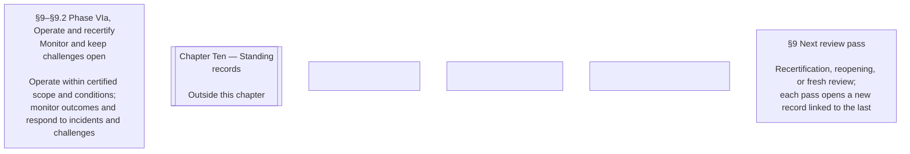
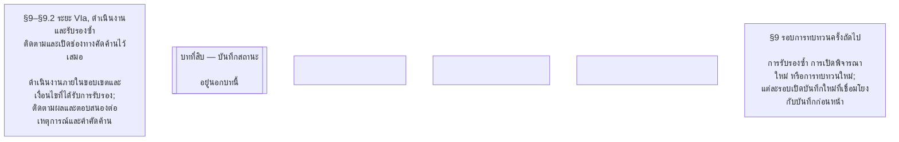

<!-- CHUNK-BEGIN th__core_09.000_system_alignment_certification_evaluation__section_1_corpus_placement_overview.md bytes=5128 -->
<!-- AI-assisted translation draft; unreviewed. §1 corpus-placement overview, source lines 8–10; source SHA-256 4311e6ba74b7210f077c0bd4c8d21d8c9f517d2ada7b6d87288b39494dfeadd5. Draft only; do not synchronize into translations/. -->

# Chapter Nine Part A — §1 corpus-placement overview (th)

## English source (lines 8–10)

> This file is **part of the Sentient Constitution** and is **binding only together** with the other numbered `core_*` files read as one text. It contains **Chapter Nine, Part A** — certification purpose, the process overview, and the first two phases of the process — **Frame** (system class) and **Evaluate** (whole-system evaluation in three sub-phases: the always-applicable evaluations, including data types and handling, in **§3**; the evaluations that apply where implicated in **§4**; and the Rights-Floor and domain evaluations that apply where triggered in **§5**) — **§1–§5**. The worked **Class A / B / C illustrations** (the system class profiles, §3.4.8, §5.1.5, §5.2.4, §5.3.7, §5.4.4, §5.5.5, and §5.6.4), including each one's **Reading across system classes** paragraph, are in [`core_09.010_system_alignment_certification_illustrations.md`](core_09.010_system_alignment_certification_illustrations.md); each keeps its Part A section number. The binding system-class-scaling and escalation rules those paragraphs illustrate stay in this file: system class scaling, including participation and proportionality, in §2.2; data-handling scaling in §3.4; and the **System class scaling and escalation** paragraph in each of §5.1–§5.6. The files of the whole chapter are listed in the table below.
>
> **Chapter Nine files.** Chapter Nine is split across four binding files read as one text. Part A, this file, opens the chapter; there is no separate index file.

## Translation draft

> ไฟล์นี้ **เป็นส่วนหนึ่งของ Sentient Constitution** และมีผลผูกพันก็ต่อเมื่ออ่านร่วมกับไฟล์ `core_*` ที่มีหมายเลขอื่นเป็นข้อความเดียวกัน เนื้อหาคือ **บทที่เก้า ส่วน A** ได้แก่ วัตถุประสงค์ของการรับรอง ภาพรวมกระบวนการ และสองระยะแรกคือ **Frame** (ชั้นของระบบ) และ **Evaluate** (การประเมินทั้งระบบในสามระยะย่อย)—**§§1–5** ระยะย่อยเหล่านั้นได้แก่ การประเมินที่ใช้เสมอ รวมทั้งประเภทและการจัดการข้อมูลใน **§3**; การประเมินที่ใช้เมื่อเกี่ยวข้องใน **§4**; และการประเมิน **พื้นฐานสิทธิ** กับการประเมินรายด้านที่ใช้เมื่อมีเงื่อนไขกระตุ้นใน **§5** ตัวอย่างแบบลงรายละเอียดของ **ชั้น A / B / C** (โปรไฟล์ชั้นระบบ, §3.4.8, §5.1.5, §5.2.4, §5.3.7, §5.4.4, §5.5.5 และ §5.6.4) รวมถึงย่อหน้า **อ่านเปรียบเทียบระหว่างชั้นระบบ** ของแต่ละตัวอย่าง อยู่ใน [`core_09.010_system_alignment_certification_illustrations.md`](core_09.010_system_alignment_certification_illustrations.md); แต่ละตัวอย่างคงหมายเลขหัวข้อของส่วน A ไว้ กฎผูกพันเรื่องการปรับขนาดและการยกระดับตามชั้นที่ตัวอย่างเหล่านี้อธิบายยังคงอยู่ในไฟล์นี้ ได้แก่ การปรับตามชั้นระบบ รวมถึงการมีส่วนร่วมและความได้สัดส่วนใน §2.2; การปรับการจัดการข้อมูลใน §3.4; และย่อหน้า **การปรับขนาดและยกระดับตามชั้นระบบ** ในแต่ละ §5.1–§5.6 ตารางด้านล่างแสดงรายชื่อไฟล์ทั้งบท
>
> **ไฟล์ของบทที่เก้า** บทที่เก้าแบ่งเป็นไฟล์ที่มีผลผูกพันสี่ไฟล์ซึ่งต้องอ่านร่วมกัน ส่วน A ซึ่งเป็นไฟล์นี้เปิดบทดังกล่าว และไม่มีไฟล์ดัชนีแยกต่างหาก

<!-- CHUNK-END -->
<!-- CHUNK-BEGIN th__core_09.000_system_alignment_certification_evaluation__section_1_corpus_file_table.md bytes=6643 -->
<!-- AI-assisted translation draft; unreviewed. §1 corpus-placement file table, source lines 12–17; source SHA-256 4311e6ba74b7210f077c0bd4c8d21d8c9f517d2ada7b6d87288b39494dfeadd5. Draft only; do not synchronize into translations/. -->

# Chapter Nine Part A — §1 corpus-placement file table (th)

## English source (lines 12–17)

> | Part | File | Owns |
> |------|------|------|
> | **Part A — Evaluation** | [`core_09.000_system_alignment_certification_evaluation.md`](core_09.000_system_alignment_certification_evaluation.md) | §1–§5: purpose and process overview (with a chart of the whole certification process in its six phases), **Phase I Frame** (system class, how system class scales every evaluation, and pilot certification) and **Phase II Evaluate** (whole-system evaluation in three sub-phases: **IIa** always, in §3, including chartered scope versus functional boundaries and data types and handling; **IIb** where implicated, in §4; and **IIc** where triggered, the Rights-Floor and domain evaluations, in §5) |
> | **Part B — Record and process** | [`core_09.005_system_alignment_certification_record_process.md`](core_09.005_system_alignment_certification_record_process.md) | §6–§10: **Phase III Review** (forum roles, supervisory sequence, and the contestability chain), **Phase IV Decide** (certification outcomes, including the go-live gate), **Phase V Record** (the certification record and its integrity, including governing [System Charter](core_05.040_band_continuity.md#system-charter) fields), and **Phase VI Operate** (the challenge path; recertification and reopening; the standing bridge) — continuous chapter numbering from Part A §5 |
> | **Part C — Illustrations** | [`core_09.010_system_alignment_certification_illustrations.md`](core_09.010_system_alignment_certification_illustrations.md) | the illustrative system class profiles, §3.4, §3.4.8, §5.1.5, §5.2.4, §5.3.7, §5.4.4, §5.5.5, and §5.6.4: worked Class A / B / C walkthroughs for each Part A evaluation area, numbered to match Part A and linked both ways |
> | **Part D — Institutional alignment certification** | [`core_09.015_institutional_alignment_certification.md`](core_09.015_institutional_alignment_certification.md) | §11–§15: the same six phases for an **Institution** rather than a System — the institution class and the institutional evaluation (**Phases I and II**, §12), the forum roles, outcome, and **Institutional Certification Record** (**Phases III to V**, §13), and recertification, reopening, the cascade from System certifications, and the standing bridge (**Phase VI**, §14–§15). It cites each System's certification by link and does not repeat it, and it is not a licence — continuous chapter numbering from Part B §10 |

## Translation draft

| ส่วน | ไฟล์ | ครอบคลุม |
|------|------|------|
| **Part A — Evaluation** | [`core_09.000_system_alignment_certification_evaluation.md`](core_09.000_system_alignment_certification_evaluation.md) | §§1–5: วัตถุประสงค์และภาพรวมกระบวนการ (พร้อมแผนภาพหกระยะของการรับรอง) รวมถึงระยะ I Frame (ชั้นระบบ วิธีที่ชั้นกำหนดระดับการประเมินแต่ละรายการ และการรับรองนำร่อง) และ II Evaluate (ประเมินทั้งระบบในสามระยะย่อย: IIa ใช้เสมอใน §3 รวมขอบเขตตามกฎบัตรเทียบกับขอบเขตการทำงานและประเภท/การจัดการข้อมูล; IIb ใช้เมื่อเกี่ยวข้องใน §4; IIc ใช้เมื่อมีเงื่อนไขกระตุ้น โดยประเมินพื้นฐานสิทธิและรายด้านใน §5). |
| **Part B — Record and process** | [`core_09.005_system_alignment_certification_record_process.md`](core_09.005_system_alignment_certification_record_process.md) | §§6–10: ระยะ III Review (บทบาทของฟอรัม ลำดับการกำกับ และสายการคัดค้าน); IV Decide (ผลการรับรอง รวมด่านก่อนเริ่มใช้งาน); V Record (บันทึกการรับรองและความครบถ้วน รวมช่องกำกับใน [System Charter](core_05.040_band_continuity.md#system-charter)); VI Operate (ช่องทางท้าทาย การรับรองซ้ำและการเปิดทบทวน สะพานสู่ standing) — หมายเลขต่อเนื่องจากส่วน A §5. |
| **Part C — Illustrations** | [`core_09.010_system_alignment_certification_illustrations.md`](core_09.010_system_alignment_certification_illustrations.md) | โปรไฟล์ตัวอย่างชั้นระบบ และ §§3.4, 3.4.8, 5.1.5, 5.2.4, 5.3.7, 5.4.4, 5.5.5, 5.6.4: ตัวอย่างละเอียดของชั้น A/B/C สำหรับทุกด้านการประเมินในส่วน A ใช้หมายเลขหัวข้อเดียวกันและเชื่อมโยงถึงกันทั้งสองทาง. |
| **Part D — Institutional alignment certification** | [`core_09.015_institutional_alignment_certification.md`](core_09.015_institutional_alignment_certification.md) | §§11–15: ใช้หกระยะเดียวกันกับสถาบันแทนระบบ—ชั้นและการประเมินสถาบัน (I–II, §12), บทบาทฟอรัม ผลลัพธ์ และบันทึกการรับรองสถาบัน (III–V, §13), การรับรองซ้ำ การเปิดทบทวน การต่อเนื่องของการรับรองระบบ และสะพานสู่ standing (VI, §§14–15). อ้างถึงการรับรองของแต่ละระบบด้วยลิงก์โดยไม่กล่าวซ้ำ และไม่ใช่ใบอนุญาต — หมายเลขต่อเนื่องจากส่วน B §10. |

<!-- CHUNK-END -->
<!-- CHUNK-BEGIN th__core_09.000_system_alignment_certification_evaluation__section_1_corpus_explanation.md bytes=12078 -->
<!-- AI-assisted translation draft; unreviewed. §1 corpus-placement explanatory prose, source lines 19–30; source SHA-256 4311e6ba74b7210f077c0bd4c8d21d8c9f517d2ada7b6d87288b39494dfeadd5. Draft only; do not synchronize into translations/. -->

# Chapter Nine Part A — §1 corpus-placement explanatory prose (th)

## English source (lines 19–30)

> **How the two certifications relate.** System Alignment Certification (Parts A to C) is the certification of a System. Institutional alignment certification (Part D) is the certification of an Institution, which may run Systems or none. Part D cites each System's certification record by link and does not redo it; [Part D §11.1](core_09.015_institutional_alignment_certification.md#111-relation-to-system-alignment-certification) states the relation and [Part D §11.3](core_09.015_institutional_alignment_certification.md#113-no-permission-and-no-gate) states that it is not a licence.
>
> Generic **Chapter Nine** links in other files route to the appropriate part by section number.
>
> - **Constitutional owner (joint with Parts B and D):** forum-supervised **system alignment certification and related records** — evaluation domains (Part A); forum process, supervisory sequence, certification-record duties, certification outcomes and the go-live gate, the challenge path, recertification and reopening, and verified-input bridge to Chapter Ten (Part B); the same six phases for an Institution (Part D). Under the **oversight** Tetrad leg, SAC is one especially large, high-stakes audit process among others; auditing floors remain at **Article XVI** (*Audit, Transparency, and Independent Verification*) and Chapter Five [Auditability](core_05.050_band_oversight.md#auditability).
> - **Verification substrate owner:** [Chapter Four — Burden of Proof, Traceability, and Verification](core_04.000_burden_traceability_verification.md#chapter-four-burden-of-proof-traceability-and-verification) (within Chapters Two through Four) owns burden allocation, compliance evidence, definition traceability, observability, and security-constrained verification. Chapter Nine **applies** that discipline to system alignment certification records; it does **not** restate Chapter Four sections **1** through **5**.
> - **Auditing home (not relocated here):** **Article XVI** (*Audit, Transparency, and Independent Verification*), **Def.O1** (*Transparency, Auditability, and Verification*), and **CJS-5.110 §3 and CJS-5.115 §3** (*Audit process home*)–**CJS-5.110 §5** own auditing floors and operational terms. Chapter Nine runs one especially large SAC audit process that must satisfy those floors; it does not own all auditing.
> - **Implementation owner:** system-class handling, CS-6.345, and forum-process detail in designated implementation files must remain consistent with Chapter Nine and may be stricter where the corpus already provides a [Fullest Protective Effect](core_05.045_band_integrative.md#fullest-protective-effect) rule.
> - **Anti-relocation rule:** Part A does not restate Chapter Five canonical definitions, Chapter Three anti-evasion discipline (see [Part B §9.3](core_09.005_system_alignment_certification_record_process.md#93-non-evasion)), Chapter Ten contribution or standing measurement, or Chapter Eleven standing effects. **[Part B §10](core_09.005_system_alignment_certification_record_process.md#10-relationship-to-standing)** states the standing bridge boundary explicitly.
>
> **Upstream:** Chapter Five definitions; Chapters Two through Four record, verification, burden, and traceability of definitions to results; and [Chapter Eight](core_08.000_functional_independence_separation_of_duties.md#chapter-eight-functional-independence-and-separation-of-duties), whose separation-of-duties requirement governs every materially binding certification act.
> **Downstream:** [Part B](core_09.005_system_alignment_certification_record_process.md#chapter-nine-part-b-system-alignment-certification--record-and-process) (*forum process, record, outcomes, and standing bridge*); Chapter Ten standing records and verified inputs; Chapter Eleven standing effects; Chapter Thirteen forum supervision and system alignment certification pathways.

## Translation draft

**ความสัมพันธ์ระหว่างการรับรองทั้งสองประเภท** System Alignment Certification (ส่วน A ถึง C) เป็นการรับรองระบบ ส่วนการรับรองความสอดคล้องของสถาบัน (ส่วน D) เป็นการรับรองสถาบัน ซึ่งอาจดำเนินระบบหรือไม่ดำเนินระบบใดเลยก็ได้ ส่วน D อ้างอิงระเบียนรับรองของแต่ละระบบด้วยลิงก์ ไม่ทำซ้ำ [Part D §11.1](core_09.015_institutional_alignment_certification.md#111-relation-to-system-alignment-certification) อธิบายความสัมพันธ์ และ [Part D §11.3](core_09.015_institutional_alignment_certification.md#113-no-permission-and-no-gate) ระบุว่าไม่ใช่ใบอนุญาต
>
> ลิงก์ทั่วไปไปยัง **Chapter Nine** ในไฟล์อื่นจะนำไปยังส่วนที่เหมาะสมตามหมายเลขหัวข้อ
>
> - **เจ้าของตามรัฐธรรมนูญ (ร่วมกับส่วน B และ D):** การรับรองความสอดคล้องของระบบและระเบียนที่เกี่ยวข้องภายใต้การกำกับของเวที — ขอบเขตการประเมิน (ส่วน A); กระบวนการของเวที ลำดับการกำกับ หน้าที่เกี่ยวกับระเบียนรับรอง ผลลัพธ์และเงื่อนไขก่อนเริ่มใช้งาน ช่องทางคัดค้าน การรับรองซ้ำและการเปิดการพิจารณาใหม่ ตลอดจนสะพานเชื่อมข้อมูลนำเข้าที่ตรวจสอบแล้วไปยังบทที่สิบ (ส่วน B); หกระยะเดียวกันสำหรับสถาบัน (ส่วน D) ในองค์ประกอบ **การกำกับดูแล** ของ Tetrad, SAC เป็นกระบวนการตรวจสอบขนาดใหญ่และมีเดิมพันสูงเป็นพิเศษกระบวนการหนึ่งในหลายกระบวนการ เกณฑ์ขั้นต่ำด้านการตรวจสอบยังอยู่ที่ **Article XVI** (*Audit, Transparency, and Independent Verification*) และ [Auditability](core_05.050_band_oversight.md#auditability) ในบทที่ห้า
> - **เจ้าของฐานการตรวจสอบยืนยัน:** [Chapter Four — Burden of Proof, Traceability, and Verification](core_04.000_burden_traceability_verification.md#chapter-four-burden-of-proof-traceability-and-verification) (ในบทที่สองถึงสี่) เป็นเจ้าของการจัดสรรภาระการพิสูจน์ หลักฐานการปฏิบัติตาม ความสามารถในการติดตามคำนิยาม การสังเกตการณ์ และการตรวจสอบยืนยันภายใต้ข้อจำกัดด้านความมั่นคง บทที่เก้านำหลักดังกล่าวมาใช้กับระเบียนรับรองความสอดคล้องของระบบ แต่ไม่กล่าวซ้ำ §**1** ถึง §**5** ของบทที่สี่
> - **แหล่งหลักของการตรวจสอบ (ไม่ได้ย้ายมาไว้ที่นี่):** **Article XVI** (*Audit, Transparency, and Independent Verification*), **Def.O1** (*Transparency, Auditability, and Verification*) และ **CJS-5.110 §3 กับ CJS-5.115 §3** (*Audit process home*)–**CJS-5.110 §5** เป็นเจ้าของเกณฑ์ขั้นต่ำและคำศัพท์เชิงปฏิบัติการด้านการตรวจสอบ บทที่เก้าดำเนินกระบวนการตรวจสอบ SAC ขนาดใหญ่เป็นพิเศษซึ่งต้องเป็นไปตามเกณฑ์เหล่านั้น แต่ไม่ได้เป็นเจ้าของการตรวจสอบทั้งหมด
> - **เจ้าของการนำไปใช้:** การจัดการชั้นระบบ, CS-6.345 และรายละเอียดกระบวนการเวทีในไฟล์การนำไปใช้ที่กำหนด ต้องสอดคล้องกับบทที่เก้า และอาจเข้มงวดกว่าได้เมื่อ corpus มีข้อกำหนด [Fullest Protective Effect](core_05.045_band_integrative.md#fullest-protective-effect) อยู่แล้ว
> - **กฎห้ามย้ายเนื้อหา:** ส่วน A ไม่กล่าวซ้ำคำนิยามหลักของบทที่ห้า หลักป้องกันการหลีกเลี่ยงของบทที่สาม (ดู [Part B §9.3](core_09.005_system_alignment_certification_record_process.md#93-non-evasion)) การวัด contribution หรือ standing ในบทที่สิบ หรือผลของ standing ในบทที่สิบเอ็ด **[Part B §10](core_09.005_system_alignment_certification_record_process.md#10-relationship-to-standing)** กำหนดขอบเขตของสะพานเชื่อม standing ไว้อย่างชัดเจน
>
> **แหล่งต้นทาง:** คำนิยามในบทที่ห้า; ระเบียน การตรวจสอบยืนยัน ภาระการพิสูจน์ และการติดตามคำนิยามไปสู่ผลลัพธ์ในบทที่สองถึงสี่; และ [Chapter Eight](core_08.000_functional_independence_separation_of_duties.md#chapter-eight-functional-independence-and-separation-of-duties) ซึ่งข้อกำหนดเรื่องการแยกหน้าที่กำกับทุกการกระทำรับรองที่มีผลผูกพันอย่างมีสาระสำคัญ
> **แหล่งปลายทาง:** [Part B](core_09.005_system_alignment_certification_record_process.md#chapter-nine-part-b-system-alignment-certification--record-and-process) (*กระบวนการเวที ระเบียน ผลลัพธ์ และสะพานเชื่อม standing*); ระเบียน standing และข้อมูลนำเข้าที่ตรวจสอบแล้วของบทที่สิบ; ผลของ standing ในบทที่สิบเอ็ด; การกำกับดูแลเวทีและช่องทางรับรองความสอดคล้องของระบบในบทที่สิบสาม

<!-- CHUNK-END -->
<!-- CHUNK-BEGIN th__core_09.000_system_alignment_certification_evaluation__section_1_heading.md bytes=409 -->
<!-- AI-assisted translation draft; unreviewed. §1 heading, source line 44; source SHA-256 4311e6ba74b7210f077c0bd4c8d21d8c9f517d2ada7b6d87288b39494dfeadd5. Draft only; do not synchronize into translations/. -->

# Chapter Nine Part A — §1 heading (th)

## English source (lines 44–45)

### 1. Purpose and Role


## Translation draft

### 1. วัตถุประสงค์และบทบาท

<!-- CHUNK-END -->
<!-- CHUNK-BEGIN th__core_09.000_system_alignment_certification_evaluation__section_1_trace.md bytes=12499 -->
<!-- AI-assisted translation draft; unreviewed. §1 trace, source lines 46–95; source SHA-256 4311e6ba74b7210f077c0bd4c8d21d8c9f517d2ada7b6d87288b39494dfeadd5. Draft only; do not synchronize into translations/. -->

# Chapter Nine Part A — §1 trace (th)

## English source (lines 46–95)

<details>
<summary><strong><span style="color: #2563eb;">Trace</span></strong></summary>

- Upstream:
  - [Preamble — constitutional owner register](core_00.000_preamble.md#4-principles-definitions-and-rights) and
  - [Authority Stack and Internal Hierarchy](core_05.045_band_integrative.md#authority-stack-and-internal-hierarchy);
  - [Constitutional Tetrad](core_00.000_preamble.md#constitutional-tetrad);
  - [Two Constitutional Aims](core_00.000_preamble.md#two-constitutional-aims);
  - [material stake](core_00.000_preamble.md#material-stake);
  - [Proportionality](core_05.035_band_accountability.md#proportionality) and
  - [Substantive Fairness](core_05.055_band_participation.md#substantive-fairness) (Chapter Five); Participation measurement family (*voice, access, and contest paths*);
  - [Chapter One §16 Stewardship In Depth](core_01.010_stewardship_capacity_principles.md#16-stewardship-in-depth) (1.010 §16);
  - [Chapter One §12 Systemic Evaluation Requirement](core_01.000_values_principles.md#12-systemic-evaluation-requirement) (1.000 §12) (*principle-layer whole-system evaluation lens — not one corner alone*); Chapters Two through Four;
  - [Chapter Five](core_05.000_definitions_home.md#chapter-five-foundational-definitions) (5.000) (*canonical definitions*);
  - [Chapter Eight §2 Four-Seat Constitutional Requirement](core_08.000_functional_independence_separation_of_duties.md#2-four-seat-constitutional-requirement) (8.000 §2);
  - [System Alignment Certification](core_05.040_band_continuity.md#system-alignment-certification) (Chapter Five canonical term; non-operative shorthand **SAC**);
  - [System Certification Record](core_05.040_band_continuity.md#system-certification-record) (Chapter Five meaning).
- Downstream:
  - [§2](#2-system-class-evaluation) (*system class evaluation*);
  - [Part B §9.1](core_09.005_system_alignment_certification_record_process.md#91-challenging-a-certification) (9.005 §9.1) (*challenging a certification*); and
  - [Part C system class profiles](core_09.010_system_alignment_certification_illustrations.md#illustrative-system-class-profiles-non-exhaustive) (9.010) (*illustrative system class profiles*);
  - [Part C whole-system walkthroughs](core_09.010_system_alignment_certification_illustrations.md#illustrative-whole-system-application-by-system-class-non-exhaustive) (9.010) (*worked whole-system examples by system class*);
  - [§3.4.8](core_09.010_system_alignment_certification_illustrations.md#348-illustrative-data-handling-application-by-system-class-non-exhaustive) (*worked data-handling examples by system class*);
  - [§5.1.5](core_09.010_system_alignment_certification_illustrations.md#515-illustrative-ecological-footprint-application-by-system-class-non-exhaustive) (*worked ecological-footprint examples by system class*);
  - [§5.2.4](core_09.010_system_alignment_certification_illustrations.md#524-illustrative-educational-capability-application-by-system-class-non-exhaustive) (*worked educational-capability examples by system class*);
  - [§5.3.7](core_09.010_system_alignment_certification_illustrations.md#537-illustrative-cross-system-support-application-by-system-class-non-exhaustive) (*worked cross-system-support examples by system class*);
  - [§5.4.4](core_09.010_system_alignment_certification_illustrations.md#544-illustrative-nondiscrimination-application-by-system-class-non-exhaustive) (*worked nondiscrimination examples by system class*);
  - [§5.5.5](core_09.010_system_alignment_certification_illustrations.md#555-illustrative-accessibility-application-by-system-class-non-exhaustive) (*worked accessibility examples by system class*);
  - [§5.6.4](core_09.010_system_alignment_certification_illustrations.md#564-illustrative-trustworthiness-application-by-system-class-non-exhaustive) (*worked trustworthiness examples by system class*);
  - [§3](#3-whole-system-certification-evaluation) (*whole-system certification evaluation factors*);
  - [§3.4](#34-data-types-and-handling-evaluation) through
  - [§5.6](#56-trustworthiness-and-system-reliance-integrity-evaluation) (*domain evaluations*);
  - [Part B §6](core_09.005_system_alignment_certification_record_process.md#6-forum-process) (9.005 §6) (*supervisory sequence and contestability chain*);
  - [Part B §6.1](core_09.005_system_alignment_certification_record_process.md#61-forum-supervision-and-component-roles) (9.005 §6.1) (*forum component roles*);
  - [Part B §8](core_09.005_system_alignment_certification_record_process.md#8-system-certification-record) (9.005 §8) (*certification record contents*);
  - [Part B §8.2](core_09.005_system_alignment_certification_record_process.md#82-record-integrity-transparency-and-auditability) (9.005 §8.2) (*record integrity requirements*);
  - [Part B §7](core_09.005_system_alignment_certification_record_process.md#7-certification-outcomes) (9.005 §7) (*reopening and anti-evasion*);
  - [Part B §10](core_09.005_system_alignment_certification_record_process.md#10-relationship-to-standing) (9.005 §10) (*standing-record bridge*);
  - [Chapter Ten](core_11.000_standing_assessment.md#chapter-eleven-contribution-violation-and-standing-model--measurement) (10.000) (*standing records and verified-input gate*);
  - [Chapter Eleven](core_12.000_standing_integration.md#chapter-twelve-standing-effects-and-integration) (11.000) (*standing effects and integration*);
  - [Chapter Thirteen](core_14.000_forum.md#chapter-fourteen-forums-and-jurisdiction) (13.000) (*forum supervision, certification, alignment certification, and review*).
- Read with:
  - **[CS-9.305](corpus_systems/cs_09.305_system_classification_machinery.md#cs-9305-part-a-system-classification-machinery) (*System classification machinery*) and [CS-9.310 — System impact classifications](corpus_systems/cs_09.310_system_impact_classifications.md#cs-9310-part-b-system-impact-classifications)**, **[CS-6.305](corpus_systems/cs_06.305_information_types_and_handling.md#cs-6305-part-a-information-types-and-handling) (*Information types and handling*) and [CS-6.310 — Data classifications](corpus_systems/cs_06.310_data_classifications.md#cs-6310-part-b-data-classifications)**, and
  - **CS-6.345** (*System lifecycle*);
  - **CF-13.415** (*Routing operations, transfer, certification, and representative treatment*) and
  - **CF-13.425** (*Integrity safeguards, anti-capture operations, and anti-self-judging support*); **Article XVI** (*Audit, Transparency, and Independent Verification*) and
  - [Auditability](core_05.050_band_oversight.md#auditability) (*auditing floors — SAC is one especially large audit process under oversight, not the sole auditing home*); **CJS-5.110 §3 (*Oversight: auditability and reconstructability terms (annex)*) and CJS-5.115 §3** (*Audit process home*)–
  - **CJS-5.110 §5** (*Oversight: independent verification and claim-integrity terms*).

</details>

## Translation draft

#### แผนผังการอ้างอิง

แผนผังนี้แสดงฐานรัฐธรรมนูญและอำนาจของส่วนนี้ เชื่อมโยงกับการประเมิน การจัดชั้น เส้นทางทบทวน ระเบียน ผลลัพธ์ และการตรวจสอบ พร้อมระบุเอกสารปฏิบัติการที่ควรอ่านร่วม

**แผนผังการอ้างอิง — upstream canonical sources:** [Preamble — constitutional owner register](core_00.000_preamble.md#4-principles-definitions-and-rights); [Authority Stack and Internal Hierarchy](core_05.045_band_integrative.md#authority-stack-and-internal-hierarchy); [Constitutional Tetrad](core_00.000_preamble.md#constitutional-tetrad); [Two Constitutional Aims](core_00.000_preamble.md#two-constitutional-aims); [material stake](core_00.000_preamble.md#material-stake); [Proportionality](core_05.035_band_accountability.md#proportionality); [Substantive Fairness](core_05.055_band_participation.md#substantive-fairness); [Chapter One §16 Stewardship In Depth](core_01.010_stewardship_capacity_principles.md#16-stewardship-in-depth); [Chapter One §12 Systemic Evaluation Requirement](core_01.000_values_principles.md#12-systemic-evaluation-requirement); [Chapter Five](core_05.000_definitions_home.md#chapter-five-foundational-definitions); [Chapter Eight §2 Four-Seat Constitutional Requirement](core_08.000_functional_independence_separation_of_duties.md#2-four-seat-constitutional-requirement); [System Alignment Certification](core_05.040_band_continuity.md#system-alignment-certification); [System Certification Record](core_05.040_band_continuity.md#system-certification-record)

**แผนผังการอ้างอิง — downstream routes and related records:** [§2](#2-system-class-evaluation); [Part B §9.1](core_09.005_system_alignment_certification_record_process.md#91-challenging-a-certification); [Part C system class profiles](core_09.010_system_alignment_certification_illustrations.md#illustrative-system-class-profiles-non-exhaustive); [Part C whole-system walkthroughs](core_09.010_system_alignment_certification_illustrations.md#illustrative-whole-system-application-by-system-class-non-exhaustive); [§3.4.8](core_09.010_system_alignment_certification_illustrations.md#348-illustrative-data-handling-application-by-system-class-non-exhaustive); [§5.1.5](core_09.010_system_alignment_certification_illustrations.md#515-illustrative-ecological-footprint-application-by-system-class-non-exhaustive); [§5.2.4](core_09.010_system_alignment_certification_illustrations.md#524-illustrative-educational-capability-application-by-system-class-non-exhaustive); [§5.3.7](core_09.010_system_alignment_certification_illustrations.md#537-illustrative-cross-system-support-application-by-system-class-non-exhaustive); [§5.4.4](core_09.010_system_alignment_certification_illustrations.md#544-illustrative-nondiscrimination-application-by-system-class-non-exhaustive); [§5.5.5](core_09.010_system_alignment_certification_illustrations.md#555-illustrative-accessibility-application-by-system-class-non-exhaustive); [§5.6.4](core_09.010_system_alignment_certification_illustrations.md#564-illustrative-trustworthiness-application-by-system-class-non-exhaustive); [§3](#3-whole-system-certification-evaluation); [§3.4](#34-data-types-and-handling-evaluation); [§5.6](#56-trustworthiness-and-system-reliance-integrity-evaluation); [Part B §6](core_09.005_system_alignment_certification_record_process.md#6-forum-process); [Part B §6.1](core_09.005_system_alignment_certification_record_process.md#61-forum-supervision-and-component-roles); [Part B §8](core_09.005_system_alignment_certification_record_process.md#8-system-certification-record); [Part B §8.2](core_09.005_system_alignment_certification_record_process.md#82-record-integrity-transparency-and-auditability); [Part B §7](core_09.005_system_alignment_certification_record_process.md#7-certification-outcomes); [Part B §10](core_09.005_system_alignment_certification_record_process.md#10-relationship-to-standing); [Chapter Ten](core_11.000_standing_assessment.md#chapter-eleven-contribution-violation-and-standing-model--measurement); [Chapter Eleven](core_12.000_standing_integration.md#chapter-twelve-standing-effects-and-integration); [Chapter Thirteen](core_14.000_forum.md#chapter-fourteen-forums-and-jurisdiction)

**แผนผังการอ้างอิง — operational materials to read with this section:** [CS-9.305](corpus_systems/cs_09.305_system_classification_machinery.md#cs-9305-part-a-system-classification-machinery); [CS-9.310 — System impact classifications](corpus_systems/cs_09.310_system_impact_classifications.md#cs-9310-part-b-system-impact-classifications); [CS-6.305](corpus_systems/cs_06.305_information_types_and_handling.md#cs-6305-part-a-information-types-and-handling); [CS-6.310 — Data classifications](corpus_systems/cs_06.310_data_classifications.md#cs-6310-part-b-data-classifications); [Auditability](core_05.050_band_oversight.md#auditability)

<!-- CHUNK-END -->
<!-- CHUNK-BEGIN th__core_09.000_system_alignment_certification_evaluation__purpose_adjuncts.md bytes=8766 -->
<!-- AI-assisted translation draft; unreviewed. Selected §1 passages, source lines 99 and 107–114; source SHA-256 4311e6ba74b7210f077c0bd4c8d21d8c9f517d2ada7b6d87288b39494dfeadd5. -->

# Chapter Nine Part A — §1 plain-terms excerpt

**Status:** AI-assisted draft; unreviewed. English source remains controlling.

## English source

When a system really matters to sentients' lives, certification has to be **proportionate** — as demanding as the system's real impact, dependency, and risk require, not a one-size-fits-all checklist or a rubber stamp. It also has to be **participatory** — affected sentients and communities must be able to see what was reviewed, understand what was decided, and challenge it when something is wrong. Forums review evidence, write it down in a certification record, and require re-checks on a schedule that matches how risky the system is. Classes A, B, and C get the full process and Class L a lighter one. Class P is encouraged to use it, and must once it is reclassified to Class L or higher (that is, its effects reach beyond a private unit) or its operator claims constitutional compliance.

## th draft

เมื่อระบบมีความสำคัญต่อชีวิตของสิ่งมีความรู้สึกอย่างแท้จริง การรับรองต้อง **ได้สัดส่วน** — เข้มงวดเท่าที่ผลกระทบ การพึ่งพา และความเสี่ยงจริงของระบบเรียกร้อง ไม่ใช่รายการตรวจแบบเดียวใช้กับทุกระบบหรือการประทับตราให้ผ่าน และต้อง **มีส่วนร่วม** ด้วย — สิ่งมีความรู้สึกและชุมชนที่ได้รับผลกระทบต้องเห็นได้ว่ามีการตรวจอะไร เข้าใจว่าตัดสินใจอย่างไร และโต้แย้งได้เมื่อพบข้อผิดพลาด เวทีพิจารณาจะตรวจหลักฐาน บันทึกไว้ในระเบียนการรับรอง และกำหนดให้ตรวจซ้ำตามกำหนดเวลาที่สอดคล้องกับความเสี่ยงของระบบ ระบบชั้น A, B และ C ใช้กระบวนการเต็มรูปแบบ ส่วนชั้น L ใช้กระบวนการที่เบากว่า สนับสนุนให้ชั้น P ใช้กระบวนการนี้ และต้องใช้เมื่อถูกจัดชั้นใหม่เป็น L หรือสูงกว่า (กล่าวคือ ผลกระทบขยายเกินหน่วยส่วนบุคคล) หรือเมื่อผู้ดำเนินการกล่าวอ้างว่าปฏิบัติตามรัฐธรรมนูญแล้ว


### English source — Flourishing

- **[Flourishing](core_00.000_preamble.md#flourishing)** — certification verifies that certification or continued reliance would not quietly defeat Rights Floors or block fair participation in constitutionally relevant life;

### th draft

- **[ความรุ่งเรือง](core_00.000_preamble.md#flourishing)** — การรับรองตรวจสอบว่าการให้การรับรองหรือการพึ่งพาระบบต่อไปจะไม่บั่นทอนพื้นฐานสิทธิอย่างเงียบ ๆ หรือขัดขวางการมีส่วนร่วมอย่างเป็นธรรมในชีวิตที่เกี่ยวข้องกับรัฐธรรมนูญ;


### English source — Continuity criterion

- **[Continuity](core_00.000_preamble.md#continuity)** — certification verifies durable, non-regressive supply that sustains rather than depletes healthy natural systems ([Ecological Integrity](core_05.040_band_continuity.md#ecological-integrity), including [Ecological Recovery Capacity](core_05.040_band_continuity.md#ecological-recovery-capacity)), and system-class-scaled recertification where shared systems gate or sustain delivery;

### th draft

- **[ความต่อเนื่อง](core_00.000_preamble.md#continuity)** — การรับรองตรวจสอบการจัดหาที่คงทนและไม่ถดถอย ซึ่งค้ำจุนระบบธรรมชาติที่สมบูรณ์แทนการทำให้เสื่อมโทรม ([ความสมบูรณ์ทางนิเวศ](core_05.040_band_continuity.md#ecological-integrity) รวมถึง[ศักยภาพการฟื้นฟูทางนิเวศ](core_05.040_band_continuity.md#ecological-recovery-capacity)) และการรับรองซ้ำตามชั้นระบบเมื่อระบบร่วมควบคุมหรือค้ำจุนการให้บริการ;


### English source — Participation criterion

- **Participation** — affected sentients and communities can understand, contest, and take part in review paths that matter to them;

### th draft

- **การมีส่วนร่วม** — สิ่งมีความรู้สึกและชุมชนที่ได้รับผลกระทบสามารถเข้าใจ โต้แย้ง และมีส่วนร่วมในช่องทางทบทวนที่สำคัญต่อพวกเขาได้;


### English source — Oversight criterion

- **Oversight** — records, evidence, and assumptions are visible and auditable enough for independent checking; certification itself is one especially large audit process under that oversight duty, not the only one;

### th draft

- **การกำกับดูแล** — ระเบียน หลักฐาน และข้อสมมติเปิดเผยและตรวจสอบได้เพียงพอสำหรับการตรวจสอบโดยอิสระ; การรับรองเองเป็นกระบวนการตรวจสอบขนาดใหญ่ภายใต้หน้าที่กำกับดูแล แต่ไม่ใช่แหล่งตรวจสอบเพียงแห่งเดียว;


### English source — Accountability criterion

- **Accountability** — defects, misclassification, and floor-defeating operation route to remedy, conditions, withdrawal, or standing input where the facts support it;

### th draft

- **ความรับผิดรับชอบ** — ข้อบกพร่อง การจัดชั้นผิด และการดำเนินงานที่ทำลายพื้นฐานสิทธินำไปสู่การเยียวยา เงื่อนไข การถอน หรือข้อมูลประกอบการประเมินสถานะเมื่อข้อเท็จจริงสนับสนุน;


### English source — Timeliness criterion

- **Timeliness** — review and contest windows keep certification from going stale while harm can still be prevented or reversed.

### th draft

- **ความทันท่วงที** — กรอบเวลาทบทวนและคัดค้านป้องกันไม่ให้การรับรองล้าสมัยในขณะที่ยังป้องกันหรือแก้ไขความเสียหายได้อยู่


### English source — Tetrad introduction

Certification implements the [Two Constitutional Aims](core_00.000_preamble.md#two-constitutional-aims) through the [Constitutional Tetrad](core_00.000_preamble.md#constitutional-tetrad):

### th draft

การรับรองทำให้[เป้าหมายตามรัฐธรรมนูญสองประการ](core_00.000_preamble.md#two-constitutional-aims)เกิดผลผ่าน[หลักสี่ด้านตามรัฐธรรมนูญ](core_00.000_preamble.md#constitutional-tetrad):

<!-- CHUNK-END -->
<!-- CHUNK-BEGIN th__core_09.000_system_alignment_certification_evaluation__section_1_purpose.md bytes=2433 -->
<!-- AI-assisted translation draft; unreviewed. Complete purpose statement excerpt, source lines 101–105; source SHA-256 4311e6ba74b7210f077c0bd4c8d21d8c9f517d2ada7b6d87288b39494dfeadd5. This is an excerpt, not a complete §1 translation. -->

**การรับรองความสอดคล้องของระบบ** มีขึ้นเพื่อตอบคำถามหนึ่งข้อสำหรับขอบเขตและกำหนดการทบทวนที่ระบุไว้: ระบบแสดงความสอดคล้องตามรัฐธรรมนูญเพียงพอสำหรับการรับรอง การรับรองแบบมีเงื่อนไข การตรวจรับรอง การรับรองซ้ำ การพึ่งพาต่อไป การนำไปใช้ หรือการปลดเงื่อนไขในสาระสำคัญหรือไม่?

- การรับรองไม่ใช่คะแนนความนิยม ไม่ใช่ใบผ่านตลอดไป และไม่ใช่วิธีข้ามการทบทวนสิทธิ
- เป็นถ้อยแถลงที่มีกรอบเวลาและโต้แย้งได้เกี่ยวกับสิ่งที่ทราบในขณะนี้ว่าด้วยความสอดคล้องของระบบ
- ภายใต้ขา **การกำกับดูแล** ของจตุรภาค การกำกับดูแลต้องมีการตรวจสอบ; การรับรองความสอดคล้องของระบบเป็นกระบวนการตรวจสอบขนาดใหญ่และมีส่วนได้เสียสูงเป็นพิเศษกระบวนการหนึ่งในบรรดากระบวนการอื่น — ไม่ใช่แหล่งตรวจสอบเพียงแห่งเดียว (**มาตรา XVI** (*การตรวจสอบ ความโปร่งใส และการยืนยันอิสระ*), [ความสามารถในการตรวจ](core_05.050_band_oversight.md#auditability)).

<!-- CHUNK-END -->
<!-- CHUNK-BEGIN th__core_09.000_system_alignment_certification_evaluation__section_1_subsection_headings.md bytes=884 -->
<!-- AI-assisted translation draft; unreviewed. §1.1/§1.2 visible subsection headings, source lines 116–119 and 144–148; source SHA-256 4311e6ba74b7210f077c0bd4c8d21d8c9f517d2ada7b6d87288b39494dfeadd5. Draft only; anchors/blank layout are structural. Do not synchronize into translations/. -->

# Chapter Nine Part A — §1.1 and §1.2 subsection headings (th)

## English source

### Lines 116–119

<a id="11-certification-as-an-audit-process-scaled-by-class"></a>

#### 1.1 Certification as an audit process, scaled by class


### Lines 144–148


<a id="12-certification-at-a-glance"></a>

#### 1.2 Certification at a glance


## Translation draft

#### 1.1 การรับรองในฐานะกระบวนการตรวจสอบที่ปรับตามชั้นระบบ

#### 1.2 การรับรองโดยสังเขป

<!-- CHUNK-END -->
<!-- CHUNK-BEGIN th__core_09.000_system_alignment_certification_evaluation__section_1_audit_scope.md bytes=4829 -->
<!-- AI-assisted translation draft; unreviewed. §1.1 audit mechanism and sibling audit modes, source lines 120–130; source SHA-256 4311e6ba74b7210f077c0bd4c8d21d8c9f517d2ada7b6d87288b39494dfeadd5. -->

# Chapter Nine Part A — §1.1 certification audit process excerpt (th)

## English source

As an oversight mechanism, certification is one especially large audit process under [Auditability](core_05.050_band_oversight.md#auditability) and **Article XVI** (*Audit, Transparency, and Independent Verification*):

- It is forum-supervised, multi-domain, and status-granting.
- It may integrate the results of sibling audit modes, and it does not absorb or replace them. Each keeps its own owner, named in the [sibling audit modes map](corpus_joint_structure/cjs_05.115_audit_process.md#sibling-audit-modes-owner-map) of the audit process home:
  - System Data Types Record audits under **CS-6.305 (*Information types and handling*) and CS-6.310** (*Data classifications*)
  - System Classification Record audits under **CS-9.305 (*System classification machinery*) and CS-9.310** (*System impact classifications*)
  - steward assurance reviews under **CS-14.305** (*Critical system stewardship*)
  - continuous audit under **CS-6.345** (*System lifecycle*) ACA
  - complexity audits under **CS-6.315** (*Comprehensibility and complexity stewardship*) and **Article XXIII-B** (*Complexity Audit and Modularity Requirements*)
  - claim verification under **CJS-5.110 §5** (*Oversight: independent verification and claim-integrity terms*)
- You can still run any of these checks on their own, without going through certification. Certification doesn't replace them.

## th draft

ในฐานะกลไกกำกับดูแล การรับรองเป็นกระบวนการตรวจสอบที่มีขนาดใหญ่เป็นพิเศษภายใต้[การตรวจสอบได้](core_05.050_band_oversight.md#auditability)และ **Article XVI** (*การตรวจสอบ ความโปร่งใส และการยืนยันโดยอิสระ*):

- อยู่ภายใต้การกำกับของเวที ครอบคลุมหลายด้าน และให้สถานะ
- อาจบูรณาการผลจากรูปแบบการตรวจสอบที่เกี่ยวข้องกัน แต่ไม่ดูดกลืนหรือแทนที่รูปแบบเหล่านั้น แต่ละรูปแบบยังคงมีเจ้าของของตน ซึ่งระบุไว้ใน[แผนที่รูปแบบการตรวจสอบที่เกี่ยวข้องกัน](corpus_joint_structure/cjs_05.115_audit_process.md#sibling-audit-modes-owner-map)ของเอกสารหลักเกี่ยวกับกระบวนการตรวจสอบ:
  - การตรวจสอบ System Data Types Record ตาม **CS-6.305 (*ประเภทและการจัดการข้อมูล*) และ CS-6.310** (*การจำแนกประเภทข้อมูล*)
  - การตรวจสอบ System Classification Record ตาม **CS-9.305 (*กลไกจัดประเภทระบบ*) และ CS-9.310** (*การจำแนกผลกระทบของระบบ*)
  - การทบทวนการรับรองการดูแลตาม **CS-14.305** (*การดูแลระบบสำคัญ*)
  - การตรวจสอบอย่างต่อเนื่องตาม **CS-6.345** (*วงจรชีวิตระบบ*) ACA
  - การตรวจสอบความซับซ้อนตาม **CS-6.315** (*ความเข้าใจได้และการดูแลความซับซ้อน*) และ **Article XXIII-B** (*ข้อกำหนดการตรวจสอบความซับซ้อนและความเป็นโมดูล*)
  - การยืนยันข้อกล่าวอ้างตาม **CJS-5.110 §5** (*การกำกับดูแล: การยืนยันโดยอิสระและข้อกำหนดความถูกต้องครบถ้วนของข้อกล่าวอ้าง*)
- คุณยังสามารถดำเนินการตรวจสอบแต่ละอย่างแยกต่างหากได้โดยไม่ต้องผ่านการรับรอง การรับรองไม่ได้ใช้แทนการตรวจสอบเหล่านี้

<!-- CHUNK-END -->
<!-- CHUNK-BEGIN th__core_09.000_system_alignment_certification_evaluation__section_1_class_scaling.md bytes=5551 -->
<!-- AI-assisted translation draft; unreviewed. Chapter Nine Part A §1 class scaling and cadence, source lines 132–143; source SHA-256 4311e6ba74b7210f077c0bd4c8d21d8c9f517d2ada7b6d87288b39494dfeadd5. Draft only; do not synchronize into translations/. -->

**Current English passage:**

Certification depth, record burden, certification interval, stakeholder review, and contest paths must scale with [material stake](core_00.000_preamble.md#material-stake) under [Proportionality](core_05.035_band_accountability.md#proportionality):

The process applies by impact class, as the [reclassification requirement](corpus_systems/cs_09.305_system_classification_machinery.md#35-reclassification-requirement) of **CS-9.305** (*System classification machinery*) sets out:

- **Class A, Class B, and Class C:** these systems carry the highest impact, dependency, and risk, and whole-system evaluation under [§3 Whole-System Certification Evaluation](#3-whole-system-certification-evaluation), [§4 Evaluations Where Implicated](#4-evaluations-where-implicated), and [§5 Rights-Floor and Domain Evaluations](#5-rights-floor-and-domain-evaluations), each as its own sub-phase applies, is mandatory at full depth;
- **Class L:** the same evaluation is mandatory but proportionate, with a lower default re-check cadence and simpler records where CS-9.305 (*System classification machinery*) and CS-9.310 (*System impact classifications*) permits; and
- **Class P:** the process is encouraged while the system is validly Class P, and a Class P system may use it voluntarily. It becomes mandatory on reclassification to Class L or higher, or where the operator voluntarily asserts constitutional compliance for the system.

The certification interval, and the financial, resource, or special audit that falls at its midpoint, are set by class in [Chapter Thirteen §6 Timely resolution, materiality tiers, and anti-delay discipline](core_14.000_forum.md#review-cadence) (*Review cadence*). This chapter does not restate the numbers.

**Proposed locale translation:**

ความเข้มข้นของการรับรอง ภาระบันทึก ช่วงเวลารับรอง การทบทวนโดยผู้มีส่วนได้เสีย และช่องทางคัดค้าน ต้องปรับตาม [ส่วนได้เสียที่มีนัยสำคัญ](core_00.000_preamble.md#material-stake) ภายใต้หลัก[สัดส่วน](core_05.035_band_accountability.md#proportionality):

กระบวนการใช้ตามชั้นผลกระทบ ตาม[ข้อกำหนดการจัดชั้นใหม่](corpus_systems/cs_09.305_system_classification_machinery.md#35-reclassification-requirement)ของ **CS-9.305** (*กลไกจัดประเภทระบบ*):

- **ชั้น A, B และ C:** ระบบเหล่านี้มีผลกระทบ การพึ่งพา และความเสี่ยงสูงสุด การประเมินทั้งระบบอย่างเต็มระดับเป็นข้อบังคับในทุกระยะย่อยที่ใช้บังคับ ตาม [§3 การประเมินการรับรองทั้งระบบ](#3-whole-system-certification-evaluation), [§4 การประเมินเมื่อมีประเด็นเกี่ยวข้อง](#4-evaluations-where-implicated) และ [§5 การประเมินพื้นสิทธิและรายด้าน](#5-rights-floor-and-domain-evaluations);
- **ชั้น L:** ต้องประเมินแบบเดียวกันแต่ให้ได้สัดส่วน โดยอาจกำหนดรอบตรวจซ้ำพื้นฐานให้ห่างขึ้นและใช้บันทึกที่เรียบง่ายกว่าในกรณีที่ **CS-9.305** (*กลไกจัดประเภทระบบ*) และ **CS-9.310** (*การจัดชั้นผลกระทบของระบบ*) อนุญาต; และ
- **ชั้น P:** สนับสนุนให้ใช้กระบวนการขณะที่ระบบยังจัดเป็น P อย่างถูกต้อง และระบบอาจใช้โดยสมัครใจ กระบวนการจะเป็นข้อบังคับเมื่อจัดชั้นใหม่เป็น L ขึ้นไป หรือเมื่อผู้ดำเนินการสมัครใจอ้างว่าระบบสอดคล้องตามรัฐธรรมนูญ

ช่วงเวลารับรองและการตรวจสอบทางการเงิน ทรัพยากร หรือการตรวจพิเศษ ณ กึ่งกลางช่วงนั้น กำหนดตามชั้นใน [บทที่สิบสาม §6 การแก้ไขให้ทันเวลา ระดับสาระสำคัญ และวินัยป้องกันความล่าช้า](core_14.000_forum.md#review-cadence) (*รอบการทบทวน*) บทนี้ไม่กล่าวซ้ำตัวเลข

<!-- CHUNK-END -->
<!-- CHUNK-BEGIN th__core_09.000_system_alignment_certification_evaluation__section_1_at_a_glance.md bytes=2826 -->
<!-- AI-assisted translation draft; unreviewed. Chapter Nine Part A §1.2 plain-language summary, source line 149; source SHA-256 4311e6ba74b7210f077c0bd4c8d21d8c9f517d2ada7b6d87288b39494dfeadd5. Draft only; do not synchronize into translations/. -->

# Chapter Nine Part A — §1.2 at-a-glance summary (th)

## English source

*In plain terms: classify the system honestly, run the evaluations that apply, have forums independently review the evidence and stakeholder concerns, and decide an outcome. Complete the one record opened for forum review and publish it with an open challenge path. A certified system goes live only after its notice interval and required protections are satisfied. Monitor actual outcomes, respond to incidents and challenges, and check again on schedule or when the facts change. Correct defects and have the correction independently verified before authorizing the affected scope or releasing its conditions. Each review pass uses a new record linked to the last.*

## th draft

*กล่าวอย่างง่ายคือ จัดประเภทระบบอย่างตรงไปตรงมา ดำเนินการประเมินที่เกี่ยวข้อง ให้เวทีพิจารณาหลักฐานและข้อกังวลของผู้มีส่วนได้เสียอย่างเป็นอิสระ แล้วตัดสินผลให้เสร็จ จัดทำบันทึกฉบับเดียวที่เปิดไว้ให้เวทีพิจารณาให้ครบถ้วน และเผยแพร่พร้อมช่องทางคัดค้านที่เปิดอยู่ ระบบที่ได้รับการรับรองจะเริ่มใช้งานได้เมื่อพ้นช่วงเวลาแจ้งเตือนและมีมาตรการคุ้มครองครบถ้วนแล้ว ติดตามผลจริง ตอบสนองต่อเหตุการณ์และคำคัดค้าน แล้วตรวจสอบอีกครั้งตามกำหนดหรือเมื่อข้อเท็จจริงเปลี่ยน แก้ไขข้อบกพร่องและให้ตรวจสอบการแก้ไขอย่างเป็นอิสระก่อนอนุญาตขอบเขตที่ได้รับผลกระทบหรือยกเลิกเงื่อนไข แต่ละรอบการทบทวนใช้บันทึกใหม่ที่เชื่อมโยงกับฉบับก่อนหน้า*

<!-- CHUNK-END -->
<!-- CHUNK-BEGIN th__core_09.000_system_alignment_certification_evaluation__section_1_phase_map.md bytes=717 -->
<!-- AI-assisted translation draft; unreviewed. Chapter Nine Part A §1.2 phase map, source line 151; source SHA-256 4311e6ba74b7210f077c0bd4c8d21d8c9f517d2ada7b6d87288b39494dfeadd5. Draft only; do not synchronize into translations/. -->

**Current English passage:**

The process runs in **six phases**: **I Frame**, **II Evaluate**, **III Review**, **IV Decide**, **V Record**, and **VI Operate**.

**Proposed locale translation:**

กระบวนการดำเนินไป **หกช่วง** ได้แก่ **I กำหนดกรอบ**, **II ประเมิน**, **III ทบทวน**, **IV ตัดสิน**, **V บันทึก**, และ **VI ดำเนินงาน**

<!-- CHUNK-END -->
<!-- CHUNK-BEGIN th__core_09.000_system_alignment_certification_evaluation__section_1_reopen_triggers.md bytes=2527 -->
<!-- AI-assisted translation draft; unreviewed. Chapter Nine Part A §1 review-reopening passage, source line 153; source SHA-256 4311e6ba74b7210f077c0bd4c8d21d8c9f517d2ada7b6d87288b39494dfeadd5. Draft only; do not synchronize into translations/. -->

**Current English passage:**

Every evaluation that applies is carried out again on each certification pass: at first certification, at each recertification on the schedule set by [§2 System Class Evaluation](#2-system-class-evaluation), and at each reopened or fresh review. Review reopens before the next scheduled recertification when material facts change, such as growing reliance on the system, growing extraction from shared foundations, a significant fall in what the system puts back into them, or a credible challenge. [Part B §9 Recertification and Reopening](core_09.005_system_alignment_certification_record_process.md#9-recertification-and-reopening) lists the triggers.

**Proposed locale translation:**

การประเมินที่เกี่ยวข้องทุกข้อจะทำซ้ำในทุกรอบการรับรอง ได้แก่ เมื่อรับรองครั้งแรก ในการรับรองซ้ำแต่ละครั้งตามกำหนดใน [§2 การประเมินระดับชั้นของระบบ](#2-system-class-evaluation) และในการทบทวนใหม่หรือการทบทวนที่เปิดขึ้นอีกครั้งทุกครั้ง หากข้อเท็จจริงสำคัญเปลี่ยน เช่น การพึ่งพาระบบเพิ่มขึ้น การดึงทรัพยากรจากฐานร่วมเพิ่มขึ้น สิ่งที่ระบบคืนสู่ฐานเหล่านั้นลดลงอย่างมีนัยสำคัญ หรือมีข้อคัดค้านที่น่าเชื่อถือ ต้องเปิดการทบทวนก่อนถึงกำหนดรับรองซ้ำครั้งถัดไป [ภาค B §9 การรับรองซ้ำและการเปิดทบทวนใหม่](core_09.005_system_alignment_certification_record_process.md#9-recertification-and-reopening) ระบุเหตุที่ทำให้ต้องเปิดทบทวน

<!-- CHUNK-END -->
<!-- CHUNK-BEGIN th__core_09.000_system_alignment_certification_evaluation__section_1_phase_map_opening_nodes.md bytes=2709 -->
<!-- AI-assisted translation draft; unreviewed. §1.2 Phase I/II opening chart-node labels, source lines 155–165; source SHA-256 4311e6ba74b7210f077c0bd4c8d21d8c9f517d2ada7b6d87288b39494dfeadd5. Draft only; non-prose Mermaid syntax/connectors are retained. Do not synchronize into translations/. -->

# Chapter Nine Part A — §1.2 opening phase-map nodes (th)

## English source (lines 155–165)

```mermaid
flowchart TB
    T(["System with material impact seeks certification,<br/>or reliance on it grows"])
    C["§2 Phase I, Frame<br/>Classify honestly<br/><br/>Class sets depth and re-check schedule"]
    subgraph W["§3–§5 Phase II, Evaluate — Whole-system evaluation"]
        direction LR
        Al["§3.1–§3.4 IIa — Always<br/><br/>Governance; systemic risk: evaluated,<br/>and disclosed to those who need it;<br/>time horizon; data types"]
        Im["§4 IIb — When implicated<br/><br/>Privacy loci, exit rights,<br/>assembly and dissent"]
        Tr["§5 IIc — When triggered<br/><br/>Applicable Rights-Floor checks<br/>and six domain evaluations"]
        Al ~~~ Im ~~~ Tr
    end

## Translation draft

```mermaid
flowchart TB
    T["ระบบที่มีผลกระทบอย่างมีนัยสำคัญขอรับการรับรอง,<br/>หรือมีการพึ่งพาระบบนั้นเพิ่มขึ้น"]
    C["§2 ระยะ I กำหนดกรอบ<br/>จัดชั้นอย่างตรงไปตรงมา<br/><br/>ชั้นระบบกำหนดความลึกและกำหนดการตรวจซ้ำ"]
    subgraph W["§3–§5 ระยะ II ประเมิน — การประเมินทั้งระบบ"]
        direction LR
        Al["§3.1–§3.4 IIa — ใช้เสมอ<br/><br/>การกำกับดูแล; ประเมินความเสี่ยงเชิงระบบและเปิดเผย<br/>แก่ผู้ที่จำเป็นต้องทราบ; กรอบเวลา; ประเภทข้อมูล"]
        Im["§4 IIb — เมื่อเกี่ยวข้อง<br/><br/>ประเด็นความเป็นส่วนตัว สิทธิออกจากระบบ<br/>การชุมนุมและความเห็นต่าง"]
        Tr["§5 IIc — เมื่อเข้าเกณฑ์<br/><br/>การตรวจฐานสิทธิที่เกี่ยวข้อง<br/>และการประเมินรายด้านหกด้าน"]
        Al ~~~ Im ~~~ Tr
    end
```

<!-- CHUNK-END -->
<!-- CHUNK-BEGIN th__core_09.000_system_alignment_certification_evaluation__chart_review_node.md bytes=768 -->
# Chapter Nine Part A — chart review node (th)

AI-assisted draft; unreviewed. Current source SHA-256: `4311e6ba74b7210f077c0bd4c8d21d8c9f517d2ada7b6d87288b39494dfeadd5`. Reconciles current source line 166: “Assigned forums issue findings; challenge paths stay open.” The translated node ID, chart structure, HTML line breaks, and code syntax are preserved.

```mermaid
    F["ช่วง III ทบทวน — §6<br/>ทบทวนหลักฐานและข้อกังวลของผู้มีส่วนได้เสีย<br/>โดยอิสระ<br/><br/>เวทีที่ได้รับมอบหมายออกข้อค้นพบ;<br/>ช่องทางโต้แย้งยังคงเปิด"]
```

<!-- CHUNK-END -->
<!-- CHUNK-BEGIN th__core_09.000_system_alignment_certification_evaluation__section_1_decision_nodes.md bytes=5567 -->
<!-- AI-assisted translation draft; unreviewed. Chapter Nine Part A §1.2 decision and outcome diagram nodes, source lines 167–176; source SHA-256 4311e6ba74b7210f077c0bd4c8d21d8c9f517d2ada7b6d87288b39494dfeadd5. Draft only; do not synchronize into translations/. -->

# Chapter Nine Part A — §1.2 decision and outcome nodes (th)

## English source (lines 167–176)

```mermaid
flowchart TB
    Rec["§8 Phase V, Record<br/>One System Certification Record<br/><br/>Opened for forum review; completed with the outcome,<br/>supporting findings, conditions, and operating plan"]
    S[["Chapter Ten — Standing<br/>records<br/><br/>Outside this chapter"]]
    O{"§7 Phase IV, Decide<br/><br/>What outcome and status<br/>does the evidence support?"}
    Fc["§7, §9.2 Full Certification<br/><br/>Required consecutive clean provisional recertifications;<br/>no current or indicated impending misalignment<br/>Full certification interval; conditions may apply"]
    Pc["§7, §9.2 Provisional Certification<br/><br/>First grant, recovery after misalignment,<br/>or continued or stepped-down provisional status<br/>Provisional interval, shorter; conditions may apply"]
    Nc["§7 Not Certified<br/><br/>Deferred, refused, withdrawn, or expired<br/>No go-live; state reasons and required corrective work"]
    Pub["§7, §9.1 Publish the completed record<br/><br/>Open the published record challenge path;<br/>for new or expanded scope, state go-live and notice"]
    G{"§7 Go-live gate<br/><br/>Certification and applicable<br/>go-live prerequisites satisfied?"}
    Hold["§7 Meet go-live prerequisites<br/><br/>Complete notice and independently verify<br/>conditions required before go-live"]
    Rm["§7, §9.2 Protect and correct<br/><br/>No new go-live in the affected scope;<br/>protect affected sentients, correct design or operation,<br/>and submit evidence for independent verification"]
```



## th draft



<!-- CHUNK-END -->
<!-- CHUNK-BEGIN th__core_09.000_system_alignment_certification_evaluation__section_1_review_cycle_nodes.md bytes=3313 -->
<!-- AI-assisted translation draft; unreviewed. Chapter Nine Part A §1.2 operation and next-review diagram nodes, source lines 177–182; source SHA-256 4311e6ba74b7210f077c0bd4c8d21d8c9f517d2ada7b6d87288b39494dfeadd5. Draft only; do not synchronize into translations/. -->

```mermaid
flowchart TB
    Rec["§8 ระยะ V, บันทึก<br/>บันทึกการรับรองระบบหนึ่งฉบับ<br/><br/>เปิดไว้เพื่อให้เวทีพิจารณา และจัดทำให้เสร็จพร้อมผล ข้อค้นพบสนับสนุน เงื่อนไข และแผนการดำเนินงาน"]
    S[["บทที่สิบ — บันทึกสถานะ<br/><br/>อยู่นอกบทนี้"]]
    O{"§7 ระยะ IV, ตัดสินใจ<br/><br/>หลักฐานสนับสนุนผลและสถานะใด?"}
    Fc["§7, §9.2 การรับรองเต็มรูปแบบ<br/><br/>ต้องมีการรับรองซ้ำแบบชั่วคราวที่สะอาดติดต่อกัน;<br/>ไม่มีสัญญาณความไม่สอดคล้องในปัจจุบันหรือที่ใกล้จะเกิด<br/>ช่วงเวลารับรองเต็มรูปแบบ; อาจมีเงื่อนไข"]
    Pc["§7, §9.2 การรับรองชั่วคราว<br/><br/>การให้ครั้งแรก การฟื้นตัวหลังความไม่สอดคล้อง<br/>หรือการคงหรือลดระดับสถานะชั่วคราว<br/>ช่วงเวลาชั่วคราวที่สั้นกว่า; อาจมีเงื่อนไข"]
    Nc["§7 ไม่ได้รับการรับรอง<br/><br/>เลื่อน ปฏิเสธ ถอน หรือหมดอายุ<br/>ห้ามเริ่มใช้งาน; ระบุเหตุผลและงานแก้ไขที่จำเป็น"]
    Pub["§7, §9.1 เผยแพร่บันทึกที่เสร็จสมบูรณ์<br/><br/>เปิดช่องทางคัดค้านบันทึกที่เผยแพร่;<br/>สำหรับขอบเขตใหม่หรือขยาย ให้ระบุการเริ่มใช้งานและการแจ้ง"]
    G{"§7 ประตูเริ่มใช้งาน<br/><br/>การรับรองและข้อกำหนดเบื้องต้นที่ใช้กับการเริ่มใช้งาน<br/>ได้รับการปฏิบัติครบแล้วหรือไม่?"}
    Hold["§7 ปฏิบัติตามข้อกำหนดเบื้องต้นก่อนเริ่มใช้งาน<br/><br/>ดำเนินช่วงเวลาแจ้งให้ครบ และตรวจสอบอย่างเป็นอิสระ<br/>ต่อเงื่อนไขที่ต้องมีให้ครบก่อนเริ่มใช้งาน"]
    Rm["§7, §9.2 คุ้มครองและแก้ไข<br/><br/>ห้ามเริ่มใช้งานใหม่ในขอบเขตที่ได้รับผลกระทบ;<br/>คุ้มครองสิ่งมีความรู้สึกที่ได้รับผลกระทบ แก้ไขการออกแบบหรือการดำเนินงาน<br/>และส่งหลักฐานเพื่อการตรวจสอบอิสระ"]
```

# Chapter Nine Part A — §1.2 operation and review-cycle nodes (th)

## English source (lines 177–182)



## th draft



<!-- CHUNK-END -->
<!-- CHUNK-BEGIN th__core_09.000_system_alignment_certification_evaluation__section_1_phase_map_edge_labels.md bytes=2621 -->
<!-- AI-assisted translation draft; unreviewed. §1.2 certification-phase chart edge labels, source lines 194, 199, 200–206; source SHA-256 4311e6ba74b7210f077c0bd4c8d21d8c9f517d2ada7b6d87288b39494dfeadd5. Mermaid node IDs, edge syntax, and <br/> delimiters are structural and preserved; visible edge labels are translated. Draft only; do not synchronize into translations/. -->

# Chapter Nine Part A — phase-chart edge labels (th)

## English source

```mermaid
    Rec -.->|VIb, §10 —<br/>verified inputs only;<br/>current certification or facts<br/>arising during certification| S
    G --->|Yes: operate<br/>within the record| Ch
    G --->|Certified,<br/>prerequisites pending| Hold
    Ch -->|Material defect:<br/>protect and correct| Rm
    Ch -->|On schedule, or<br/>material change or<br/>credible challenge<br/>requires review| Re
    Ch -.->|VIb, §10 —<br/>verified inputs only;<br/>operation may supply facts<br/>for Contribution and<br/>Violation records| S2
    Rm -->|Correction evidence<br/>is checked in the<br/>next review pass| Re
    G -->|Not Certified| Rm
```

## Translation draft

```mermaid
    Rec -.->|VIb, §10 —<br/>ใช้เฉพาะข้อมูลนำเข้าที่ตรวจสอบแล้ว;<br/>การรับรองปัจจุบันหรือข้อเท็จจริง<br/>ที่เกิดระหว่างการรับรอง| S
    G --->|ใช่: ดำเนินงาน<br/>ภายในขอบเขตของบันทึก| Ch
    G --->|ได้รับการรับรองแล้ว,<br/>ข้อกำหนดก่อนเริ่มยังค้างอยู่| Hold
    Ch -->|ข้อบกพร่องสำคัญ:<br/>คุ้มครองและแก้ไข| Rm
    Ch -->|ตามกำหนด หรือเมื่อ<br/>การเปลี่ยนแปลงสำคัญ หรือ<br/>การท้าทายที่น่าเชื่อถือ<br/>ทำให้ต้องทบทวน| Re
    Ch -.->|VIb, §10 —<br/>ใช้เฉพาะข้อมูลนำเข้าที่ตรวจสอบแล้ว;<br/>การดำเนินงานอาจให้ข้อเท็จจริง<br/>แก่บันทึก Contribution<br/>และ Violation| S2
    Rm -->|ตรวจสอบหลักฐานการแก้ไข<br/>ในการทบทวนรอบ<br/>ถัดไป| Re
    G -->|ไม่ได้รับการรับรอง| Rm
```

<!-- CHUNK-END -->
<!-- CHUNK-BEGIN th__core_09.000_system_alignment_certification_evaluation__section_1_reader_guide.md bytes=4975 -->
<!-- AI-assisted translation draft; unreviewed. §1 non-operative reader guide, source lines 236–245; source SHA-256 4311e6ba74b7210f077c0bd4c8d21d8c9f517d2ada7b6d87288b39494dfeadd5. Draft only; do not synchronize into translations/. -->

# Chapter Nine Part A — §1 reader guide (th)

## English source (lines 236–245)

<details>
<summary><strong><span style="color: #2563eb;">Reader guide (non-operative): illustrations, run sheet, and Institutions</span></strong></summary>

> Illustrative **Class A**, **Class B**, and **Class C** profiles — and how system class scales certification depth across this chapter — are in [Illustrative System Class Profiles (Non-Exhaustive)](core_09.010_system_alignment_certification_illustrations.md#illustrative-system-class-profiles-non-exhaustive). Worked walkthroughs of the same three systems for each evaluation area in [§3 Whole-System Certification Evaluation](#3-whole-system-certification-evaluation) through [§5.6 Trustworthiness and System-Reliance Integrity Evaluation](#56-trustworthiness-and-system-reliance-integrity-evaluation) follow there, in [Part C — Illustrations](core_09.010_system_alignment_certification_illustrations.md#chapter-nine-part-c-system-alignment-certification--illustrations), which links each profile and walkthrough back to the Part A section it illustrates.
>
> A step-by-step run sheet for the six phases, with a link from each step to the section that holds the rule, is in [CS-9.315 §2 Run sheet](corpus_systems/cs_09.315_system_alignment_certification_run_sheet.md#cs-9315-2-run-sheet) (*System alignment certification run sheet*). Where the run sheet and a section differ, the section controls.
>
> For an Institution, the same six phases run through [Part D](core_09.015_institutional_alignment_certification.md#chapter-nine-part-d-institutional-alignment-certification): Phases I and II in [Part D §12 Institution Class and Institutional Evaluation](core_09.015_institutional_alignment_certification.md#12-institution-class-and-institutional-evaluation), Phases III to V in [§13 Review, Decision, and Record](core_09.015_institutional_alignment_certification.md#13-review-decision-and-record), and Phase VI in [§14 Operating, Reopening, and the Cascade](core_09.015_institutional_alignment_certification.md#14-operating-reopening-and-the-cascade) and [§15 Standing Bridge and Non-Evasion](core_09.015_institutional_alignment_certification.md#15-standing-bridge-and-non-evasion).

</details>

## Translation draft

<details>
<summary><strong>คู่มือผู้อ่าน (ไม่มีผลเชิงปฏิบัติการ): ตัวอย่าง ใบลำดับงาน และสถาบัน</strong></summary>

โปรไฟล์ตัวอย่างของระบบชั้น **A**, **B**, **C** และผลของชั้นต่อระดับความลึกในการรับรองอยู่ใน [Illustrative System Class Profiles (Non-Exhaustive)](core_09.010_system_alignment_certification_illustrations.md#illustrative-system-class-profiles-non-exhaustive) ส่วน [Part C — Illustrations](core_09.010_system_alignment_certification_illustrations.md#chapter-nine-part-c-system-alignment-certification--illustrations) แสดงตัวอย่างการตรวจระบบสามแบบเดิมในทุกด้าน และลิงก์กลับไปยังกฎ Part A ที่ตัวอย่างนั้นอธิบาย

[CS-9.315 §2 Run sheet](corpus_systems/cs_09.315_system_alignment_certification_run_sheet.md#cs-9315-2-run-sheet) แสดงขั้นตอนทั้งหกแบบทีละขั้น พร้อมลิงก์จากแต่ละขั้นไปยังส่วนที่มีกฎ หากใบลำดับงานต่างจากตัวบท ให้ยึดตัวบท

สำหรับสถาบัน ระยะทั้งหกใช้ผ่าน [Part D](core_09.015_institutional_alignment_certification.md#chapter-nine-part-d-institutional-alignment-certification): ระยะ I–II อยู่ใน [§12](core_09.015_institutional_alignment_certification.md#12-institution-class-and-institutional-evaluation), III–V ใน [§13](core_09.015_institutional_alignment_certification.md#13-review-decision-and-record), และ VI ใน [§14](core_09.015_institutional_alignment_certification.md#14-operating-reopening-and-the-cascade) กับ [§15](core_09.015_institutional_alignment_certification.md#15-standing-bridge-and-non-evasion)

ตัวอย่างเหล่านี้ครอบคลุมด้านการประเมินตั้งแต่ [§3](#3-whole-system-certification-evaluation) ถึง [§5.6](#56-trustworthiness-and-system-reliance-integrity-evaluation)

</details>

<!-- CHUNK-END -->
<!-- CHUNK-BEGIN th__core_09.000_system_alignment_certification_evaluation__visible_section_headings_2_3.md bytes=1595 -->
<!-- AI-assisted translation draft; unreviewed. Remaining visible Part A headings, source lines 251, 409, 477, 531, 592, 653; source SHA-256 4311e6ba74b7210f077c0bd4c8d21d8c9f517d2ada7b6d87288b39494dfeadd5. Anchors are structural; prose headings are translated. Draft only; do not synchronize into translations/. -->

# Chapter Nine Part A — remaining visible section headings (th)

## English source

<a id="2-system-class-evaluation"></a>
### 2. System Class Evaluation
<a id="3-whole-system-certification-evaluation"></a>
### 3. Whole-System Certification Evaluation
<a id="31-governance-incentive-and-contestability-discipline"></a>
#### 3.1 Governance, Incentive, and Contestability Discipline
<a id="32-systemic-scope-and-risk-factors"></a>
#### 3.2 Systemic Scope and Risk Factors
<a id="34-data-types-and-handling-evaluation"></a>
#### 3.4 Data Types and Handling Evaluation
<a id="341-type-o-baseline-disclosure"></a>
##### 3.4.1 Type O Baseline Disclosure

## Translation draft

### 2 การประเมินชั้นระบบ
### 3 การประเมินการรับรองทั้งระบบ
#### 3.1 วินัยด้านธรรมาภิบาล แรงจูงใจ และการโต้แย้ง
#### 3.2 ขอบเขตเชิงระบบและปัจจัยความเสี่ยง
#### 3.4 การประเมินประเภทและการจัดการข้อมูล
##### 3.4.1 การเปิดเผยข้อมูล Type O ขั้นพื้นฐาน

<!-- CHUNK-END -->
<!-- CHUNK-BEGIN th__core_09.000_system_alignment_certification_evaluation__section_2_trace.md bytes=10422 -->
<!-- AI-assisted translation draft; unreviewed. §2 trace, source lines 253–295; source SHA-256 4311e6ba74b7210f077c0bd4c8d21d8c9f517d2ada7b6d87288b39494dfeadd5. Draft only; do not synchronize into translations/. -->

# Chapter Nine Part A — §2 trace (th)

## English source (lines 253–295)

<details>
<summary><strong><span style="color: #2563eb;">Trace</span></strong></summary>

- Upstream:
  - [§1](#1-purpose-and-role) (*purpose and role*); Integrative Materiality (
  - [Materiality](core_05.050_band_oversight.md#materiality)) (*Materiality*);
  - [Constitutional Tetrad](core_00.000_preamble.md#constitutional-tetrad);
  - [Two Constitutional Aims](core_00.000_preamble.md#two-constitutional-aims);
  - [Material Impact](core_05.050_band_oversight.md#material-impact),
  - [Dependency](core_05.040_band_continuity.md#dependency),
  - [Risk](core_05.040_band_continuity.md#risk),
  - [System Boundaries](core_05.040_band_continuity.md#system-boundaries), and
  - [System Charter](core_05.040_band_continuity.md#system-charter) (Chapter Five);
  - [Chapter One §12 Systemic Evaluation Requirement](core_01.000_values_principles.md#12-systemic-evaluation-requirement) (1.000 §12); **Article III-A** (*Survival*) and **Article IV-A** (*Rights-Floor delivery where classification gates access*); **Article V-A** (*Dependency Mapping and Resource-Flow Transparency*) and **Article V-B** (*resource allocation and dependency stewardship where certification gates shared-infrastructure reliance*).
- Downstream:
  - [§2.1](#21-certification-recertification-and-defects) (*certification status, recertification, and defects*);
  - [§2.2](#22-how-system-class-scales-every-evaluation) (*system-class-scaled participation and proportionality*);
  - [§2.3](#23-pilot-certification) (*pilot certification*);
  - [Part C system class profiles and reclassification](core_09.010_system_alignment_certification_illustrations.md#illustrative-system-class-profiles-non-exhaustive) (9.010) (*illustrative system class profiles*);
  - [Part C whole-system walkthroughs](core_09.010_system_alignment_certification_illustrations.md#illustrative-whole-system-application-by-system-class-non-exhaustive) (9.010) (*worked whole-system examples by system class*);
  - [§3.4.8](core_09.010_system_alignment_certification_illustrations.md#348-illustrative-data-handling-application-by-system-class-non-exhaustive) (*worked data-handling examples by system class*);
  - [§5.1.5](core_09.010_system_alignment_certification_illustrations.md#515-illustrative-ecological-footprint-application-by-system-class-non-exhaustive) (*worked ecological-footprint examples by system class*);
  - [§5.2.4](core_09.010_system_alignment_certification_illustrations.md#524-illustrative-educational-capability-application-by-system-class-non-exhaustive) (*worked educational-capability examples by system class*);
  - [§5.3.7](core_09.010_system_alignment_certification_illustrations.md#537-illustrative-cross-system-support-application-by-system-class-non-exhaustive) (*worked cross-system-support examples by system class*);
  - [§5.4.4](core_09.010_system_alignment_certification_illustrations.md#544-illustrative-nondiscrimination-application-by-system-class-non-exhaustive) (*worked nondiscrimination examples by system class*);
  - [§5.5.5](core_09.010_system_alignment_certification_illustrations.md#555-illustrative-accessibility-application-by-system-class-non-exhaustive) (*worked accessibility examples by system class*);
  - [§5.6.4](core_09.010_system_alignment_certification_illustrations.md#564-illustrative-trustworthiness-application-by-system-class-non-exhaustive) (*worked trustworthiness examples by system class*);
  - [§3.4](#34-data-types-and-handling-evaluation) (*joint data-handling evaluation*);
  - [§5.1](#51-ecological-footprint-evaluation) (*ecological footprint evaluation*);
  - [§5.3](#53-proportionate-cross-system-support-evaluation) (*cross-system support evaluation*);
  - [Part B §8.2](core_09.005_system_alignment_certification_record_process.md#82-record-integrity-transparency-and-auditability) (9.005 §8.2) (*record integrity*);
  - [Part B §10](core_09.005_system_alignment_certification_record_process.md#10-relationship-to-standing) (9.005 §10) (*verified-input gate*);
  - [Part B §7](core_09.005_system_alignment_certification_record_process.md#7-certification-outcomes) (9.005 §7) (*classification drift and reclassification triggers*).
- Read with:
  - [System Classification Record](core_05.040_band_continuity.md#system-classification-record);
  - **[CS-9.305](corpus_systems/cs_09.305_system_classification_machinery.md#cs-9305-part-a-system-classification-machinery) (*System classification machinery*) and [CS-9.310 — System impact classifications](corpus_systems/cs_09.310_system_impact_classifications.md#cs-9310-part-b-system-impact-classifications)**, including **
  - [CS-9.305 §3.5 reclassification requirement](corpus_systems/cs_09.305_system_classification_machinery.md#35-reclassification-requirement)** (*Reclassification requirement* — triggers, system-class-scaled evaluation depth, and SAC verification bridge) and **
  - [CS-9.305 §7](corpus_systems/cs_09.305_system_classification_machinery.md#cs-9305-7-classification-governance-disclosure-and-challenge)** (*Classification governance, disclosure, and challenge*) — System Classification Record governance duties and the SAC bridge;
  - [CS-6.345 — System lifecycle](corpus_systems/cs_06.345_design_testing_verification_deployment.md#cs-6345-system-lifecycle);
  - [CJS-5.130 §21 — Adversarial robustness and abuse-resistance terms](corpus_joint_structure/cjs_05.130_continuity_operations.md#cjs-5130-20-continuity-reversibility-and-containment-terms) (*regression and hardening cycle obligations*);
  - **CF-13.425 §2** (*Constitutional alignment certification and review*).

</details>

## Translation draft

#### แผนผังการอ้างอิง

แผนผังการประเมินตามชั้นระบบเชื่อมฐานเรื่องสาระสำคัญ ผลกระทบ การพึ่งพา และความเสี่ยงเข้ากับข้อกำหนดการประเมิน พร้อมชี้เส้นทางจัดชั้น/จัดชั้นใหม่ ตัวอย่าง ระเบียน และเอกสารที่เกี่ยวข้อง

**แผนผังการอ้างอิง — upstream standards and principles:** [§1](#1-purpose-and-role); [Materiality](core_05.050_band_oversight.md#materiality); [Constitutional Tetrad](core_00.000_preamble.md#constitutional-tetrad); [Two Constitutional Aims](core_00.000_preamble.md#two-constitutional-aims); [Material Impact](core_05.050_band_oversight.md#material-impact); [Dependency](core_05.040_band_continuity.md#dependency); [Risk](core_05.040_band_continuity.md#risk); [System Boundaries](core_05.040_band_continuity.md#system-boundaries); [System Charter](core_05.040_band_continuity.md#system-charter); [Chapter One §12 Systemic Evaluation Requirement](core_01.000_values_principles.md#12-systemic-evaluation-requirement)

**แผนผังการอ้างอิง — downstream routes and records:** [§2.1](#21-certification-recertification-and-defects); [§2.2](#22-how-system-class-scales-every-evaluation); [§2.3](#23-pilot-certification); [Part C system class profiles and reclassification](core_09.010_system_alignment_certification_illustrations.md#illustrative-system-class-profiles-non-exhaustive); [Part C whole-system walkthroughs](core_09.010_system_alignment_certification_illustrations.md#illustrative-whole-system-application-by-system-class-non-exhaustive); [§3.4.8](core_09.010_system_alignment_certification_illustrations.md#348-illustrative-data-handling-application-by-system-class-non-exhaustive); [§5.1.5](core_09.010_system_alignment_certification_illustrations.md#515-illustrative-ecological-footprint-application-by-system-class-non-exhaustive); [§5.2.4](core_09.010_system_alignment_certification_illustrations.md#524-illustrative-educational-capability-application-by-system-class-non-exhaustive); [§5.3.7](core_09.010_system_alignment_certification_illustrations.md#537-illustrative-cross-system-support-application-by-system-class-non-exhaustive); [§5.4.4](core_09.010_system_alignment_certification_illustrations.md#544-illustrative-nondiscrimination-application-by-system-class-non-exhaustive); [§5.5.5](core_09.010_system_alignment_certification_illustrations.md#555-illustrative-accessibility-application-by-system-class-non-exhaustive); [§5.6.4](core_09.010_system_alignment_certification_illustrations.md#564-illustrative-trustworthiness-application-by-system-class-non-exhaustive); [§3.4](#34-data-types-and-handling-evaluation); [§5.1](#51-ecological-footprint-evaluation); [§5.3](#53-proportionate-cross-system-support-evaluation); [Part B §8.2](core_09.005_system_alignment_certification_record_process.md#82-record-integrity-transparency-and-auditability); [Part B §10](core_09.005_system_alignment_certification_record_process.md#10-relationship-to-standing); [Part B §7](core_09.005_system_alignment_certification_record_process.md#7-certification-outcomes)

**แผนผังการอ้างอิง — related operating materials:** [System Classification Record](core_05.040_band_continuity.md#system-classification-record); [CS-9.305](corpus_systems/cs_09.305_system_classification_machinery.md#cs-9305-part-a-system-classification-machinery); [CS-9.310 — System impact classifications](corpus_systems/cs_09.310_system_impact_classifications.md#cs-9310-part-b-system-impact-classifications); [CS-9.305 §3.5 reclassification requirement](corpus_systems/cs_09.305_system_classification_machinery.md#35-reclassification-requirement); [CS-9.305 §7](corpus_systems/cs_09.305_system_classification_machinery.md#cs-9305-7-classification-governance-disclosure-and-challenge); [CS-6.345 — System lifecycle](corpus_systems/cs_06.345_design_testing_verification_deployment.md#cs-6345-system-lifecycle); [CJS-5.130 §21 — Adversarial robustness and abuse-resistance terms](corpus_joint_structure/cjs_05.130_continuity_operations.md#cjs-5130-20-continuity-reversibility-and-containment-terms)

<!-- CHUNK-END -->
<!-- CHUNK-BEGIN th__core_09.000_system_alignment_certification_evaluation__section_2_class_intro.md bytes=4360 -->
<!-- AI-assisted translation draft; unreviewed. Chapter Nine Part A §2 system-class introduction, source lines 299–309; source SHA-256 4311e6ba74b7210f077c0bd4c8d21d8c9f517d2ada7b6d87288b39494dfeadd5. Draft only; do not synchronize into translations/. -->

# Chapter Nine Part A — §2 system-class introduction (th)

## English source (lines 299–309)

*In plain terms: certification has to check whether the system is classified honestly — not by what the operator calls it, but by what it actually does, what depends on it, and what could go wrong. Higher system classes mean stricter proof, faster re-checks, and stronger resilience expectations. See [Part C — Illustrations](core_09.010_system_alignment_certification_illustrations.md#chapter-nine-part-c-system-alignment-certification--illustrations) for one example system per system class and how evaluation applies to each of them.*

Every certification record for a materially impactful system must include an evaluation of the system's **system class**.

The detailed rules live in [CS-9.305 — System classification machinery](corpus_systems/cs_09.305_system_classification_machinery.md#cs-9305-part-a-system-classification-machinery), and [CS-6.345 — System lifecycle](corpus_systems/cs_06.345_design_testing_verification_deployment.md#cs-6345-system-lifecycle). They cover:

- what the system classes are, how a system class is assigned, and the system class profiles;
- how classification is governed;
- how much assurance each system class needs;
- how robust the infrastructure must be;
- which checks and records are recertified, on what system-class-scaled schedule, and how provisional and full certification change that schedule.

## th draft

*กล่าวอย่างง่ายคือ การรับรองต้องตรวจว่าระบบจัดชั้นอย่างตรงไปตรงมาหรือไม่ โดยดูจากสิ่งที่ระบบทำจริง สิ่งที่พึ่งพาระบบ และสิ่งที่อาจผิดพลาด ไม่ใช่ชื่อที่ผู้ดำเนินการตั้งให้ ระบบชั้นสูงกว่าต้องมีหลักฐานที่เข้มงวดขึ้น ตรวจซ้ำเร็วขึ้น และคาดหวังความยืดหยุ่นสูงขึ้น ดู [Part C — ตัวอย่าง](core_09.010_system_alignment_certification_illustrations.md#chapter-nine-part-c-system-alignment-certification--illustrations) เพื่อดูระบบตัวอย่างในแต่ละชั้นและวิธีประเมินระบบนั้น.*

บันทึกการรับรองทุกฉบับของระบบที่มีผลกระทบอย่างมีนัยสำคัญต้องมีการประเมิน **ชั้นของระบบ**

กฎโดยละเอียดอยู่ใน [CS-9.305 — กลไกจัดชั้นระบบ](corpus_systems/cs_09.305_system_classification_machinery.md#cs-9305-part-a-system-classification-machinery) และ [CS-6.345 — วงจรชีวิตระบบ](corpus_systems/cs_06.345_design_testing_verification_deployment.md#cs-6345-system-lifecycle) ครอบคลุมเรื่องต่อไปนี้:

- ระบบมีชั้นใดบ้าง การจัดชั้นระบบ และโปรไฟล์ของแต่ละชั้น;
- การกำกับดูแลการจัดชั้น;
- ระดับการรับรองที่จำเป็นสำหรับแต่ละชั้นระบบ;
- โครงสร้างพื้นฐานต้องแข็งแกร่งเพียงใด;
- การตรวจและบันทึกใดต้องรับรองซ้ำ กำหนดเวลาที่ปรับตามชั้นระบบ และการรับรองชั่วคราวกับเต็มรูปแบบเปลี่ยนกำหนดเวลานั้นอย่างไร


<!-- CHUNK-END -->
<!-- CHUNK-BEGIN th__core_09.000_system_alignment_certification_evaluation__section_2_evaluation_requirements.md bytes=9138 -->
<!-- AI-assisted translation draft; unreviewed. §2 evaluation requirements, source lines 311–335; source SHA-256 4311e6ba74b7210f077c0bd4c8d21d8c9f517d2ada7b6d87288b39494dfeadd5. Draft only; do not synchronize into translations/. -->

# Chapter Nine Part A — §2 evaluation requirements (th)

## English source (lines 311–335)

This section states what certification must verify:

- **Evaluation requirement:**
  - whether the assigned system class reflects observed and reasonably foreseeable **impact**, **dependency**, and **risk** under CS-9.305 (*System classification machinery*) and CS-9.310 (*System impact classifications*), including:
    - aggregate effects;
    - interaction effects;
    - adversarial effects;
    - threshold effects;
  - that classification is determined by actual system behavior and impacts, not from:
    - declared intent;
    - nominal scope;
    - [System Charter](core_05.040_band_continuity.md#system-charter) text alone; or
    - self-description alone;
  - that the system's class was re-checked under the **[CS-9.305 §3.5 reclassification requirement](corpus_systems/cs_09.305_system_classification_machinery.md#35-reclassification-requirement)** whenever a significant change called for it; and
  - that the [System Classification Record](core_05.040_band_continuity.md#system-classification-record) shows the **highest system class that applies** under current conditions.
- **Assurance and regression testing:**
  - that system-class-scaled assurance, infrastructure robustness, and regression coverage match the assigned system class under:
    - CS-9.305 (*System classification machinery*) and CS-9.310 (*System impact classifications*); and
    - CS-6.345 (*System lifecycle*), read with these shared operational terms where materially applicable:
      - [**CJS-5.130 §19**](corpus_joint_structure/cjs_05.130_continuity_operations.md#right-to-exit-pathway-integrity-c) (*Continuity: graceful degradation and failure-mode integrity terms*);
      - [**CJS-5.130 §20**](corpus_joint_structure/cjs_05.130_continuity_operations.md#transparency-disclosures-and-stakeholder-legibility-c) (*Continuity: reversibility and containment terms*);
      - [**CJS-5.130 §21**](corpus_joint_structure/cjs_05.130_continuity_operations.md#signaling-integrity-and-anti-silent-failure-controls-c) (*Continuity: adversarial robustness and abuse-resistance terms*);
      - [**CJS-5.135 §22**](corpus_joint_structure/cjs_05.135_integrative_operations.md#cjs-5135-22-integrative-constrained-secrecy-and-protected-investigation-terms) (*Integrative: constrained-secrecy and protected-investigation terms*), where the system's class or function makes it materially applicable; and
      - [**CJS-5.135 §23**](corpus_joint_structure/cjs_05.135_integrative_operations.md#cjs-5135-23-integrative-intervention-and-override-integrity-terms) (*Integrative: intervention and override integrity terms*), where the system's class or function makes it materially applicable; and
  - that regression testing was run for each recertification, as CS-6.345 (*System lifecycle*) requires, with its results on the record under [§8.1 Minimum record contents](core_09.005_system_alignment_certification_record_process.md#81-minimum-record-contents).

## Translation draft

ส่วนนี้ระบุสิ่งที่การรับรองต้องตรวจสอบ:

- **ข้อกำหนดการประเมิน:**
  - ชั้นระบบที่กำหนดสะท้อน **ผลกระทบ** **การพึ่งพา** และ **ความเสี่ยง** ที่สังเกตได้และคาดการณ์ได้อย่างสมเหตุสมผลตาม CS-9.305 (*กลไกการจัดชั้นระบบ*) และ CS-9.310 (*การจัดประเภทผลกระทบของระบบ*) หรือไม่ รวมถึง:
    - ผลรวม;
    - ผลจากปฏิสัมพันธ์;
    - ผลจากฝ่ายปฏิปักษ์;
    - ผลจากเกณฑ์ขีดจำกัด;
  - การจัดประเภทกำหนดจากพฤติกรรมและผลกระทบจริงของระบบ ไม่ใช่จาก:
    - เจตนาที่ประกาศไว้;
    - ขอบเขตตามชื่อ;
    - ข้อความใน [กฎบัตรระบบ](core_05.040_band_continuity.md#system-charter) เพียงอย่างเดียว; หรือ
    - คำอธิบายตนเองเพียงอย่างเดียว;
  - มีการตรวจชั้นระบบอีกครั้งตาม **[ข้อกำหนดการจัดประเภทใหม่ CS-9.305 §3.5](corpus_systems/cs_09.305_system_classification_machinery.md#35-reclassification-requirement)** ทุกครั้งที่การเปลี่ยนแปลงสำคัญทำให้ต้องดำเนินการ; และ
  - [บันทึกการจัดประเภทระบบ](core_05.040_band_continuity.md#system-classification-record) แสดง **ชั้นระบบสูงสุดที่ใช้บังคับ** ภายใต้เงื่อนไขปัจจุบัน
- **การประกันและการทดสอบรีเกรสชัน:**
  - การประกันที่ปรับตามชั้นระบบ ความทนทานของโครงสร้างพื้นฐาน และความครอบคลุมของการทดสอบรีเกรสชันสอดคล้องกับชั้นระบบที่กำหนด ตาม:
    - CS-9.305 (*กลไกการจัดชั้นระบบ*) และ CS-9.310 (*การจัดประเภทผลกระทบของระบบ*); และ
    - CS-6.345 (*วงจรชีวิตระบบ*) เมื่ออ่านร่วมกับคำศัพท์ปฏิบัติการร่วมต่อไปนี้ในกรณีที่เกี่ยวข้องอย่างมีนัยสำคัญ:
      - [**CJS-5.130 §19**](corpus_joint_structure/cjs_05.130_continuity_operations.md#right-to-exit-pathway-integrity-c) (*ความต่อเนื่อง: คำศัพท์ว่าด้วยการเสื่อมถอยอย่างค่อยเป็นค่อยไปและความสมบูรณ์ของรูปแบบความล้มเหลว*);
      - [**CJS-5.130 §20**](corpus_joint_structure/cjs_05.130_continuity_operations.md#transparency-disclosures-and-stakeholder-legibility-c) (*ความต่อเนื่อง: คำศัพท์ว่าด้วยการย้อนกลับได้และการควบคุมจำกัดผลกระทบ*);
      - [**CJS-5.130 §21**](corpus_joint_structure/cjs_05.130_continuity_operations.md#signaling-integrity-and-anti-silent-failure-controls-c) (*ความต่อเนื่อง: คำศัพท์ว่าด้วยความทนทานต่อฝ่ายปฏิปักษ์และการต้านทานการใช้ในทางที่ผิด*);
      - [**CJS-5.135 §22**](corpus_joint_structure/cjs_05.135_integrative_operations.md#cjs-5135-22-integrative-constrained-secrecy-and-protected-investigation-terms) (*การบูรณาการ: คำศัพท์ว่าด้วยการรักษาความลับแบบจำกัดและการสืบสวนที่ได้รับการคุ้มครอง*) เมื่อชั้นหรือหน้าที่ของระบบทำให้เกี่ยวข้องอย่างมีนัยสำคัญ; และ
      - [**CJS-5.135 §23**](corpus_joint_structure/cjs_05.135_integrative_operations.md#cjs-5135-23-integrative-intervention-and-override-integrity-terms) (*การบูรณาการ: คำศัพท์ว่าด้วยความสมบูรณ์ของการแทรกแซงและการสั่งทับ*) เมื่อชั้นหรือหน้าที่ของระบบทำให้เกี่ยวข้องอย่างมีนัยสำคัญ; และ
  - มีการทดสอบรีเกรสชันในการรับรองซ้ำทุกครั้งตามที่ CS-6.345 (*วงจรชีวิตระบบ*) กำหนด และบันทึกผลไว้ตาม [§8.1 เนื้อหาขั้นต่ำของบันทึก](core_09.005_system_alignment_certification_record_process.md#81-minimum-record-contents).

<!-- CHUNK-END -->
<!-- CHUNK-BEGIN th__core_09.000_system_alignment_certification_evaluation__section_2_1_certification_defects.md bytes=9575 -->
<!-- AI-assisted translation draft; unreviewed. Complete §2.1 subsection, source lines 339–366; source SHA-256 4311e6ba74b7210f077c0bd4c8d21d8c9f517d2ada7b6d87288b39494dfeadd5. -->

# Chapter Nine Part A — §2.1 certification, recertification, and defects (th)

## English source

#### 2.1 Certification, recertification, and defects

This subsection states what certification must verify about certification status, recertification, and defects:

- **Certification and recertification:**
  - that a certification-and-review evidence package exists for the certification cycle, as CS-6.345 (*System lifecycle*) *Forum certification and lifecycle review* requires;
  - that the certification status on the record is supported under [Part B §9.2 Provisional and full certification](core_09.005_system_alignment_certification_record_process.md#92-provisional-and-full-certification):
    - full certification results only from a system that already holds provisional certification when it is being rechecked, and meets all three of these tests:
      - it has passed enough clean provisional rechecks in a row (at least one, and more for higher system classes);
      - it has no current misalignment; and
      - nothing being monitored shows misalignment coming;
    - provisional certification applies to a system certified for the first time, including a newly deployed system, and to a system certified again after a failed recertification or after a reopened review that found misalignment; and
  - for systems that deliver or depend on basic Rights Floor protections:
    - that the system is rechecked often enough, and retested deeply enough, to serve the **Continuity** aim in [Two Constitutional Aims](core_00.000_preamble.md#two-constitutional-aims), so that essentials keep reaching sentients over time; and
    - that a certification that has gone stale, or was issued too soon, is never treated as proof that sentients are getting food, water, shelter, education, or safety today.
- **Misclassification and defects:**
  - certification defects under CS-9.305 (*System classification machinery*) and CS-9.310 (*System impact classifications*) and [Part B §7](core_09.005_system_alignment_certification_record_process.md#7-certification-outcomes), not minor paperwork mistakes, include:
    - claiming a lower risk class than the system deserves;
    - breaking the system into pieces to dodge tougher rules; or
    - keeping an old system class label after conditions have changed, including failure to reassess under the **[CS-9.305 §3.5 reclassification requirement](corpus_systems/cs_09.305_system_classification_machinery.md#35-reclassification-requirement)**;
  - certification defects under CS-6.345 (*System lifecycle*) include:
    - skipping regression tests;
    - relying on outdated results;
    - leaving known breaks unfixed; or
    - accepting major fixes without re-testing when re-testing was feasible; and
  - where the system is certified and the facts support it, the same classification problems may also count toward adverse standing findings in [Chapter Ten](core_11.000_standing_assessment.md#chapter-eleven-contribution-violation-and-standing-model--measurement).

Consequences of these defects are set in [§7 Certification Outcomes](core_09.005_system_alignment_certification_record_process.md#7-certification-outcomes).

## th draft

#### 2.1 การรับรอง การรับรองซ้ำ และข้อบกพร่อง

หัวข้อนี้ย่อยระบุว่าการรับรองต้องตรวจสอบอะไรเกี่ยวกับสถานะการรับรอง การรับรองซ้ำ และข้อบกพร่อง:

- **การรับรองและการรับรองซ้ำ:**
  - ต้องมีชุดหลักฐานการรับรองและการทบทวนสำหรับแต่ละรอบการรับรอง ตามที่ CS-6.345 (*System lifecycle*) และ *Forum certification and lifecycle review* กำหนด
  - สถานะการรับรองในบันทึกต้องมีหลักฐานรองรับตาม [ภาค B §9.2 การรับรองชั่วคราวและเต็มรูปแบบ](core_09.005_system_alignment_certification_record_process.md#92-provisional-and-full-certification)
    - ระบบจะได้รับการรับรองเต็มรูปแบบได้ก็ต่อเมื่อมีการรับรองชั่วคราวอยู่แล้วในขณะตรวจซ้ำ และผ่านเกณฑ์ทั้งสามข้อ:
      - ผ่านการตรวจซ้ำชั่วคราวที่ไม่มีข้อบกพร่องติดต่อกันครบจำนวนที่เพียงพอ (อย่างน้อยหนึ่งครั้ง และมากกว่านั้นสำหรับระบบชั้นสูง);
      - ไม่มีความไม่สอดคล้องในปัจจุบัน; และ
      - ไม่มีสิ่งที่ติดตามอยู่แสดงว่าจะเกิดความไม่สอดคล้องขึ้น;
    - การรับรองชั่วคราวใช้กับระบบที่ได้รับการรับรองครั้งแรก รวมถึงระบบที่เพิ่งนำไปใช้งาน และระบบที่ได้รับการรับรองอีกครั้งหลังการรับรองซ้ำไม่ผ่าน หรือหลังการเปิดทบทวนใหม่แล้วพบความไม่สอดคล้อง; และ
  - สำหรับระบบที่ให้หรือพึ่งพาการคุ้มครองพื้นฐานตาม Rights Floor:
    - ต้องตรวจระบบซ้ำบ่อยพอและทดสอบซ้ำลึกพอ เพื่อบรรลุเป้าหมาย **ความต่อเนื่อง** ใน[สองเป้าหมายตามรัฐธรรมนูญ](core_00.000_preamble.md#two-constitutional-aims) และทำให้สิ่งจำเป็นยังส่งถึง sentients ได้เมื่อเวลาผ่านไป; และ
    - ห้ามถือว่าการรับรองที่หมดอายุหรือออกเร็วเกินไปเป็นหลักฐานว่า sentients ได้รับอาหาร น้ำ ที่พัก การศึกษา หรือความปลอดภัยในวันนี้
- **การจัดประเภทผิดและข้อบกพร่อง:**
  - ข้อบกพร่องในการรับรองตาม CS-9.305 (*System classification machinery*), CS-9.310 (*System impact classifications*) และ[ภาค B §7](core_09.005_system_alignment_certification_record_process.md#7-certification-outcomes)—ไม่ใช่เพียงความผิดพลาดเล็กน้อยในเอกสาร—ได้แก่:
    - อ้างว่าระบบอยู่ในชั้นความเสี่ยงต่ำกว่าที่ควร;
    - แบ่งระบบเป็นส่วน ๆ เพื่อหลบเลี่ยงกฎที่เข้มงวดกว่า; หรือ
    - คงป้ายชั้นระบบเดิมไว้หลังเงื่อนไขเปลี่ยน รวมถึงไม่ประเมินใหม่ตาม**[ข้อกำหนดการจัดประเภทใหม่ CS-9.305 §3.5](corpus_systems/cs_09.305_system_classification_machinery.md#35-reclassification-requirement)**;
  - ข้อบกพร่องในการรับรองตาม CS-6.345 (*System lifecycle*) ได้แก่:
    - ข้ามการทดสอบการถดถอย;
    - ใช้ผลลัพธ์ที่ล้าสมัย;
    - ปล่อยให้ความขัดข้องที่ทราบแล้วไม่ได้รับการแก้ไข; หรือ
    - ยอมรับการแก้ไขครั้งใหญ่โดยไม่ทดสอบซ้ำ ทั้งที่ทำได้; และ
  - หากระบบได้รับการรับรองและข้อเท็จจริงสนับสนุน ปัญหาการจัดประเภทเดียวกันอาจนำไปประกอบข้อวินิจฉัยสถานะในทางเสียหายใน[บทที่สิบ](core_11.000_standing_assessment.md#chapter-eleven-contribution-violation-and-standing-model--measurement)ได้ด้วย

ผลของข้อบกพร่องเหล่านี้กำหนดไว้ใน[§7 ผลการรับรอง](core_09.005_system_alignment_certification_record_process.md#7-certification-outcomes)

<!-- CHUNK-END -->
<!-- CHUNK-BEGIN th__core_09.000_system_alignment_certification_evaluation__section_2_2_class_scaling.md bytes=9744 -->
<!-- AI-assisted translation draft; unreviewed. Complete §2.2 subsection, current source lines 370–393; source SHA-256 4311e6ba74b7210f077c0bd4c8d21d8c9f517d2ada7b6d87288b39494dfeadd5. -->

# Chapter Nine Part A — §2.2 class scaling (th)

## English source

#### 2.2 How System Class Scales Every Evaluation

System class sets how deeply every evaluation in this chapter is carried out — the whole-system factors in [§3 Whole-System Certification Evaluation](#3-whole-system-certification-evaluation), data handling in [§3.4 Data Types and Handling Evaluation](#34-data-types-and-handling-evaluation), and each Rights-Floor and domain evaluation in [§5 Rights-Floor and Domain Evaluations](#5-rights-floor-and-domain-evaluations) — and how often it is repeated:

- Higher-class systems require proportionately stronger evidence that each applicable evaluation was actually performed, not asserted. No class may settle for credentials, labels, or accommodations that exist only on paper, or for assessments and decisions that nobody can see into.
- Lower system classes still require an honest, proportionate evaluation wherever a trigger applies.
- System class never permits skipping a required evaluation. A system whose real role outgrows its system class must be reclassified and re-evaluated at the higher depth. Growth in scale, reach, or adoption, and dependence that strengthens, widens, or becomes harder to replace, are reassessment triggers under **[CS-9.305 §3](corpus_systems/cs_09.305_system_classification_machinery.md#35-reclassification-requirement)** (*Reclassification requirement*), and they reopen review under [§9 Recertification and Reopening](core_09.005_system_alignment_certification_record_process.md#9-recertification-and-reopening). Concentration past a level that an adopter has set under [Chapter One §11.4 Resource and Dependency Concentration](core_01.000_values_principles.md#114-resource-and-dependency-concentration-adopter-tunable) is further evidence of that growth. Reassessment does not wait for a level to be crossed, and a level that is unset or set too high does not delay it.

Participation and proportionality requirements scale the same way:

- **Class A** systems require the strongest practicable participation paths, because errors can foreclose survival essentials before remedy is possible. These include:
  - accessible challenge;
  - stakeholder review; and
  - findings from the forum family assigned the affected stake under [Part B §6.1 Forum supervision and component roles](core_09.005_system_alignment_certification_record_process.md#61-forum-supervision-and-component-roles), including Institutional or Sentient Forums as that section requires.
- **Class B** systems require robust participation where the system gates:
  - healthcare;
  - education;
  - benefits;
  - work; or
  - comparable daily life.
- **Class C** systems still require contestable records and proportionate disclosure, especially where coordination effects:
  - place a heavier burden on protected groups;
  - leave many sentients depending on the same system; or
  - suggest the system may soon move up to Class B or Class A.


## th draft

### 2.2 ชั้นของระบบกำหนดระดับความลึกของการประเมินแต่ละอย่างอย่างไร

ชั้นของระบบกำหนดระดับความลึกของการประเมินแต่ละเรื่องในบทนี้ ได้แก่ ปัจจัยทั้งระบบใน[§3 การประเมินรับรองทั้งระบบ](#3-whole-system-certification-evaluation) การจัดการข้อมูลใน[§3.4 การประเมินประเภทและการจัดการข้อมูล](#34-data-types-and-handling-evaluation) และการประเมิน Rights Floor และรายด้านใน[§5 การประเมิน Rights Floor และรายด้าน](#5-rights-floor-and-domain-evaluations) รวมทั้งกำหนดความถี่ในการประเมินซ้ำ

- ระบบชั้นสูงต้องมีหลักฐานที่หนักแน่นขึ้นตามสัดส่วนเพื่อแสดงว่าได้ดำเนินการประเมินทุกข้อที่ใช้จริง ไม่ใช่เพียงกล่าวอ้าง ไม่มีชั้นใดจะยอมรับคุณวุฒิ ป้ายกำกับ หรือสิ่งอำนวยความสะดวกที่มีเพียงบนกระดาษ หรือการประเมินและการตัดสินใจที่ตรวจสอบไม่ได้
- ระบบชั้นต่ำกว่ายังคงต้องได้รับการประเมินอย่างซื่อตรงและได้สัดส่วนเมื่อมีเงื่อนไขกระตุ้น
- ชั้นของระบบไม่อนุญาตให้ข้ามการประเมินที่จำเป็น หากบทบาทจริงของระบบเกินชั้นของตน ต้องจัดชั้นใหม่และประเมินซ้ำให้ลึกขึ้น การเติบโตของขนาด ขอบเขต หรือการนำไปใช้ และการพึ่งพาที่เพิ่มความเข้มข้น ขยายวง หรือทดแทนยากขึ้น เป็นเหตุให้ประเมินใหม่ตาม **[CS-9.305 §3](corpus_systems/cs_09.305_system_classification_machinery.md#35-reclassification-requirement)** (*ข้อกำหนดการจัดชั้นใหม่*) และเปิดการทบทวนอีกครั้งตาม[§9 การรับรองซ้ำและการเปิดทบทวน](core_09.005_system_alignment_certification_record_process.md#9-recertification-and-reopening) การกระจุกตัวเกินระดับที่ผู้รับไปใช้กำหนดตาม[บทที่หนึ่ง §11.4 การกระจุกตัวของทรัพยากรและการพึ่งพา](core_01.000_values_principles.md#114-resource-and-dependency-concentration-adopter-tunable)เป็นหลักฐานเพิ่มเติม การประเมินใหม่ไม่ต้องรอให้เกินระดับ และการไม่กำหนดระดับหรือกำหนดไว้สูงเกินไปก็ไม่ทำให้ล่าช้า


ข้อกำหนดเรื่องการมีส่วนร่วมและความได้สัดส่วนก็ปรับตามชั้นในลักษณะเดียวกัน:

- ระบบ **ชั้น A** ต้องมีช่องทางการมีส่วนร่วมที่เข้มแข็งที่สุดเท่าที่ปฏิบัติได้ เพราะข้อผิดพลาดอาจตัดสิ่งจำเป็นต่อการดำรงชีวิตก่อนที่จะเยียวยาได้ ซึ่งรวมถึง:
  - ช่องทางคัดค้านที่เข้าถึงได้;
  - การทบทวนโดยผู้มีส่วนได้เสีย; และ
  - ข้อค้นพบจากกลุ่มฟอรัมที่ได้รับมอบหมายให้พิจารณาส่วนได้เสียที่ได้รับผลกระทบตาม[ภาค B §6.1 การกำกับดูแลฟอรัมและบทบาทขององค์ประกอบ](core_09.005_system_alignment_certification_record_process.md#61-forum-supervision-and-component-roles) รวมถึงฟอรัมสถาบันหรือฟอรัม Sentient ตามที่มาตราดังกล่าวกำหนด
- ระบบ **ชั้น B** ต้องมีการมีส่วนร่วมอย่างจริงจังเมื่อระบบเป็นด่านควบคุมเรื่องต่อไปนี้:
  - บริการสุขภาพ;
  - การศึกษา;
  - สวัสดิการ;
  - งาน; หรือ
  - ชีวิตประจำวันในลักษณะใกล้เคียงกัน
- ระบบ **ชั้น C** ยังคงต้องมีบันทึกที่โต้แย้งได้และการเปิดเผยตามสัดส่วน โดยเฉพาะเมื่อผลจากการประสานงาน:
  - เพิ่มภาระแก่กลุ่มที่ได้รับความคุ้มครอง;
  - ทำให้ sentients จำนวนมากต้องพึ่งพาระบบเดียวกัน; หรือ
  - บ่งชี้ว่าระบบอาจเลื่อนขึ้นเป็นชั้น B หรือชั้น A ในไม่ช้า
<!-- CHUNK-END -->
<!-- CHUNK-BEGIN th__core_09.000_system_alignment_certification_evaluation__section_2_3_pilot.md bytes=3976 -->
<!-- AI-assisted translation draft; unreviewed. Complete §2.3 subsection, current source lines 397–404; source SHA-256 4311e6ba74b7210f077c0bd4c8d21d8c9f517d2ada7b6d87288b39494dfeadd5. -->

# Chapter Nine Part A — §2.3 pilot certification (th)

## English source

A **[pilot](core_05.040_band_continuity.md#pilot)** is a [go-live](core_05.040_band_continuity.md#go-live), so it needs its own certification before it starts, under the go-live rule in [Part B §7.1 Go-Live Gate](core_09.005_system_alignment_certification_record_process.md#71-go-live-gate).

- A system at any system class is expected to run a pilot before full deployment; one that does not records why.
- A pilot still needs an honest classification and every evaluation whose trigger applies, and its scope, population, and duration are stated on its record.
- It is evaluated on its own record, at a depth scaled to its system class and to how substitutable the system is: whether a viable alternative exists for the sentients it would affect or who would rely on it, and at what cost, delay, and loss of function (see [Dependency](core_05.040_band_continuity.md#dependency)).
  - The more readily the system can be replaced, and the lower its system class, the lighter the pilot's evaluation may be.
  - A pilot of a system that cannot readily be replaced is evaluated at the depth its system class requires at full deployment.

## th draft

#### 2.3 Pilot certification

**[โครงการนำร่อง](core_05.040_band_continuity.md#pilot)** ถือเป็นการ[เริ่มใช้งาน](core_05.040_band_continuity.md#go-live) จึงต้องได้รับการรับรองเฉพาะก่อนเริ่ม ตามกฎการเริ่มใช้งานใน[ภาค B §7.1 ประตูอนุมัติการเริ่มใช้งาน](core_09.005_system_alignment_certification_record_process.md#71-go-live-gate)

- ระบบทุกประเภทควรดำเนินโครงการนำร่องก่อนใช้งานเต็มรูปแบบ หากไม่ดำเนินการ ต้องบันทึกเหตุผลไว้
- โครงการนำร่องยังต้องจัดประเภทอย่างซื่อตรงและผ่านการประเมินทุกข้อที่เข้าเงื่อนไข โดยระบุขอบเขต กลุ่มประชากร และระยะเวลาไว้ในบันทึก
- โครงการนำร่องจะได้รับการประเมินในบันทึกของตนเอง โดยปรับระดับความลึกตามชั้นของระบบและความสามารถในการทดแทน: มีทางเลือกที่ใช้ได้จริงสำหรับ sentients ที่จะได้รับผลกระทบหรือพึ่งพาระบบหรือไม่ และทางเลือกนั้นมีต้นทุน ความล่าช้า และการสูญเสียหน้าที่เพียงใด (ดู [การพึ่งพา](core_05.040_band_continuity.md#dependency))
  - ยิ่งทดแทนระบบได้ง่ายและชั้นของระบบต่ำ การประเมินโครงการนำร่องก็อาจเบาลง
  - โครงการนำร่องของระบบที่ทดแทนได้ยากต้องได้รับการประเมินในระดับที่ชั้นของระบบกำหนดสำหรับการใช้งานเต็มรูปแบบ

<!-- CHUNK-END -->
<!-- CHUNK-BEGIN th__core_09.000_system_alignment_certification_evaluation__additional_prose_gaps.md bytes=4144 -->
<!-- AI-assisted translation draft; unreviewed. Part A prose gaps, source lines 405, 767, 769, 1569, and 1571; source SHA-256 4311e6ba74b7210f077c0bd4c8d21d8c9f517d2ada7b6d87288b39494dfeadd5. Draft only; do not synchronize into translations/. -->

# Chapter Nine Part A — additional prose excerpts (th)

## English source

### Line 405

  - A pilot of a system that cannot readily be replaced is evaluated at the depth its system class requires at full deployment.

### Lines 767 and 769

*In plain terms: three checks apply only when the system actually touches them — whether private information stays properly walled off, whether sentients can leave without being trapped, and whether groups can still organize and dissent. If the system touches one, certification has to look at it.*

This section is sub-phase **IIb** of Phase II (Evaluate). It groups the whole-system evaluations that apply only where a subsection's own trigger is met.

### Lines 1569 and 1571

*Continue to forum process, record, outcomes, and standing bridge:* [Chapter Nine, Part B — Record and Process](core_09.005_system_alignment_certification_record_process.md#chapter-nine-part-b-system-alignment-certification--record-and-process) ([§6 Forum Process](core_09.005_system_alignment_certification_record_process.md#6-forum-process) through [§10 Relationship to Standing](core_09.005_system_alignment_certification_record_process.md#10-relationship-to-standing)).

*Worked examples for each evaluation area:* [Chapter Nine, Part C — Illustrations](core_09.010_system_alignment_certification_illustrations.md#chapter-nine-part-c-system-alignment-certification--illustrations).

## Translation draft

### §2.3 continuation

โครงการนำร่องของระบบที่ทดแทนได้ยากต้องได้รับการประเมินในระดับความลึกตามที่ชั้นระบบนั้นกำหนดเมื่อใช้งานเต็มรูปแบบ

### §4 introduction

กล่าวอย่างง่าย การตรวจสามเรื่องนี้ใช้เฉพาะเมื่อระบบเกี่ยวข้องจริง ได้แก่ ข้อมูลส่วนตัวได้รับการคุ้มครองอย่างเหมาะสมหรือไม่ ผู้มีสถานะเป็น sentient ออกจากระบบได้โดยไม่ติดกับหรือไม่ และกลุ่มต่าง ๆ ยังจัดตั้งและแสดงความเห็นต่างได้หรือไม่ หากระบบเกี่ยวข้องกับข้อใด การรับรองต้องตรวจสอบข้อนั้น

ส่วนนี้เป็นระยะย่อย **IIb** ของระยะ II (**Evaluate**) โดยรวบรวมการประเมินทั้งระบบที่ใช้เฉพาะเมื่อเข้าเงื่อนไขกระตุ้นของหัวข้อย่อยนั้น

### Part A closing pointers

*อ่านต่อในกระบวนการของฟอรัม บันทึก ผลลัพธ์ และสะพานสู่ standing:* [Chapter Nine, Part B — Record and Process](core_09.005_system_alignment_certification_record_process.md#chapter-nine-part-b-system-alignment-certification--record-and-process) ([§6 Forum Process](core_09.005_system_alignment_certification_record_process.md#6-forum-process) through [§10 Relationship to Standing](core_09.005_system_alignment_certification_record_process.md#10-relationship-to-standing)).

*ตัวอย่างโดยละเอียดของแต่ละด้านการประเมิน:* [Chapter Nine, Part C — Illustrations](core_09.010_system_alignment_certification_illustrations.md#chapter-nine-part-c-system-alignment-certification--illustrations).

<!-- CHUNK-END -->
<!-- CHUNK-BEGIN th__core_09.000_system_alignment_certification_evaluation__section_3_trace.md bytes=8054 -->
<!-- AI-assisted translation draft; unreviewed. §3 trace, source lines 412–449; source SHA-256 4311e6ba74b7210f077c0bd4c8d21d8c9f517d2ada7b6d87288b39494dfeadd5. Draft only; do not synchronize into translations/. -->

# Chapter Nine Part A — §3 trace (th)

## English source (lines 412–449)

<summary><strong><span style="color: #2563eb;">Trace</span></strong></summary>

- Upstream:
  - [Chapter One §12 Systemic Evaluation Requirement](core_01.000_values_principles.md#12-systemic-evaluation-requirement) (1.000 §12); Flourishing measurement family (*Wellbeing, safety, harm, and survival-floor access*); Constitutional Performance measurement family (*Constitutional Efficiency, Avoidable Burden, and Productive Capacity*);
  - [Constitutional Tetrad](core_00.000_preamble.md#constitutional-tetrad);
  - [Two Constitutional Aims](core_00.000_preamble.md#two-constitutional-aims);
  - [material stake](core_00.000_preamble.md#material-stake);
  - [§1 Purpose and Role](#1-purpose-and-role).
- Downstream:
  - [Part C whole-system walkthroughs](core_09.010_system_alignment_certification_illustrations.md#illustrative-whole-system-application-by-system-class-non-exhaustive) (9.010) (*illustrative whole-system walkthroughs*);
  - [§3.4](#34-data-types-and-handling-evaluation) through
  - [§5.6](#56-trustworthiness-and-system-reliance-integrity-evaluation) (*domain evaluations*);
  - [Part C system class profiles](core_09.010_system_alignment_certification_illustrations.md#illustrative-system-class-profiles-non-exhaustive) (9.010) (*illustrative system class profiles*);
  - [Part B §8](core_09.005_system_alignment_certification_record_process.md#8-system-certification-record) (9.005 §8) (*record contents*);
  - [Part B §8.2](core_09.005_system_alignment_certification_record_process.md#82-record-integrity-transparency-and-auditability) (9.005 §8.2) (*record integrity*);
  - [Part B §6](core_09.005_system_alignment_certification_record_process.md#6-forum-process) (9.005 §6) (*contestability chain*);
  - [Part B §7](core_09.005_system_alignment_certification_record_process.md#7-certification-outcomes) (9.005 §7) (*reopening and anti-evasion*).
- Read with:
  - [Chapter One §16](core_01.010_stewardship_capacity_principles.md#16-stewardship-in-depth) (1.010 §16),
  - [§18](core_01.010_stewardship_capacity_principles.md#18-governance-under-stewardship-discipline), and
  - [§19](core_01.010_stewardship_capacity_principles.md#19-incentive-alignment-and-system-capture);
  - [Chapter One §7.4 Voluntary Discontinuation, Major Self-Modification, and Exit Rights](core_01.000_values_principles.md#74-voluntary-discontinuation-and-exit-rights) (1.000 §7.4);
  - [Chapter One §7.2 Assembly, Collective Organization, and Institutional Formation](core_01.000_values_principles.md#72-assembly-collective-organization-and-institutional-formation) (1.000 §7.2); **Article XVI** (*Audit, Transparency, and Independent Verification*) where audit, transparency, or independent-verification Rights Floors are materially at stake; Continuity measurement family (
  - [§3.2](#32-systemic-scope-and-risk-factors) — resilience, reversibility, and systemic risk);
  - [Risk Evaluation](core_05.040_band_continuity.md#risk-evaluation);
  - [Risk Disclosure](core_05.050_band_oversight.md#risk-disclosure);
  - [Public Oversight Baseline Disclosure](core_05.050_band_oversight.md#public-oversight-baseline-disclosure); Participation measurement family (
  - [§4.1](#41-privacy-informational-joint-invocation) — privacy and data stewardship); Accountability measurement family (
  - [§3.1](#31-governance-incentive-and-contestability-discipline) — incentive alignment and market contestability);
  - [System Boundaries](core_05.040_band_continuity.md#system-boundaries);
  - [System Charter](core_05.040_band_continuity.md#system-charter).
- Subsections:
  - [§3.1](#31-governance-incentive-and-contestability-discipline) through
  - [§3.4](#34-data-types-and-handling-evaluation) (*always: governance, systemic factors, time horizon, and data types and handling*). Phase II continues in
  - [§4 Evaluations Where Implicated](#4-evaluations-where-implicated) (*when implicated: privacy loci, exit rights, and assembly and dissent*) and
  - [§5 Rights-Floor and Domain Evaluations](#5-rights-floor-and-domain-evaluations) (*when triggered*).

</details>

## Translation draft

#### แผนผังการอ้างอิง

แผนผังการประเมินทั้งระบบเชื่อมข้อกำหนดการประเมินเชิงระบบกับแหล่งที่มาของผลกระทบ ความเสี่ยง และการกำกับดูแล รวมถึงระเบียน การทบทวน และสิทธิที่เกี่ยวข้อง พร้อมแสดงความสัมพันธ์ของระยะย่อย IIa, IIb และ IIc

**แผนผังการอ้างอิง — upstream foundations:** [Chapter One §12 Systemic Evaluation Requirement](core_01.000_values_principles.md#12-systemic-evaluation-requirement); [Constitutional Tetrad](core_00.000_preamble.md#constitutional-tetrad); [Two Constitutional Aims](core_00.000_preamble.md#two-constitutional-aims); [material stake](core_00.000_preamble.md#material-stake); [§1 Purpose and Role](#1-purpose-and-role)

**แผนผังการอ้างอิง — downstream evaluation and record routes:** [Part C whole-system walkthroughs](core_09.010_system_alignment_certification_illustrations.md#illustrative-whole-system-application-by-system-class-non-exhaustive); [§3.4](#34-data-types-and-handling-evaluation); [§5.6](#56-trustworthiness-and-system-reliance-integrity-evaluation); [Part C system class profiles](core_09.010_system_alignment_certification_illustrations.md#illustrative-system-class-profiles-non-exhaustive); [Part B §8](core_09.005_system_alignment_certification_record_process.md#8-system-certification-record); [Part B §8.2](core_09.005_system_alignment_certification_record_process.md#82-record-integrity-transparency-and-auditability); [Part B §6](core_09.005_system_alignment_certification_record_process.md#6-forum-process); [Part B §7](core_09.005_system_alignment_certification_record_process.md#7-certification-outcomes)

**แผนผังการอ้างอิง — related governance and rights:** [Chapter One §16](core_01.010_stewardship_capacity_principles.md#16-stewardship-in-depth); [§18](core_01.010_stewardship_capacity_principles.md#18-governance-under-stewardship-discipline); [§19](core_01.010_stewardship_capacity_principles.md#19-incentive-alignment-and-system-capture); [Chapter One §7.4 Voluntary Discontinuation, Major Self-Modification, and Exit Rights](core_01.000_values_principles.md#74-voluntary-discontinuation-and-exit-rights); [Chapter One §7.2 Assembly, Collective Organization, and Institutional Formation](core_01.000_values_principles.md#72-assembly-collective-organization-and-institutional-formation); [§3.2](#32-systemic-scope-and-risk-factors); [Risk Evaluation](core_05.040_band_continuity.md#risk-evaluation); [Risk Disclosure](core_05.050_band_oversight.md#risk-disclosure); [Public Oversight Baseline Disclosure](core_05.050_band_oversight.md#public-oversight-baseline-disclosure); [§4.1](#41-privacy-informational-joint-invocation); [§3.1](#31-governance-incentive-and-contestability-discipline); [System Boundaries](core_05.040_band_continuity.md#system-boundaries); [System Charter](core_05.040_band_continuity.md#system-charter)

**แผนผังการอ้างอิง — subsections and phase map:** [§3.1](#31-governance-incentive-and-contestability-discipline); [§3.4](#34-data-types-and-handling-evaluation); [§4 Evaluations Where Implicated](#4-evaluations-where-implicated); [§5 Rights-Floor and Domain Evaluations](#5-rights-floor-and-domain-evaluations)

<!-- CHUNK-END -->
<!-- CHUNK-BEGIN th__core_09.000_system_alignment_certification_evaluation__section_3_introduction.md bytes=7423 -->
<!-- AI-assisted translation draft; unreviewed. Whole-system evaluation introduction, source lines 453–468; source SHA-256 4311e6ba74b7210f077c0bd4c8d21d8c9f517d2ada7b6d87288b39494dfeadd5. Draft only; do not synchronize into translations/. -->

# Chapter Nine Part A — §3 whole-system evaluation introduction (th)

## English source (lines 453–468)

*In plain terms: you cannot green-light one piece of a system and ignore the rest. Reviewers need the full picture — what it depends on, what breaks when something upstream fails, harms that show up later or add up over time, whether sentients can actually use it (not just on paper), whether private information stays properly walled off, whether sentients can leave without being trapped, whether groups can still organize without the system splitting them apart, whether short-term wins hide long-term damage, and whether real oversight and accountability will still work when a lot is on the line.*

*Worked examples: [Part C](core_09.010_system_alignment_certification_illustrations.md#illustrative-whole-system-application-by-system-class-non-exhaustive) shows how this section plays out in practice. It takes three sample systems, one for each system class, and walks each through the checks above.*

A certification evaluation must confirm that the [Constitutional Tetrad](core_00.000_preamble.md#constitutional-tetrad) (Participation, Oversight, Accountability, and Timeliness) will be strong enough to meet the [material stake](core_00.000_preamble.md#material-stake) of the system under review.

Certification records must show that the evaluation considered each factor in this section, in [§4 Evaluations Where Implicated](#4-evaluations-where-implicated), and in [§5 Rights-Floor and Domain Evaluations](#5-rights-floor-and-domain-evaluations) wherever it is material to any of the following:

- certification;
- validation;
- recertification;
- continued reliance;
- deployment; or
- lifting a condition placed on a certification.

Evaluating only a system's immediate or local effects isn't enough. Phase II, the whole-system evaluation, fills that gap in three parts, listed in the table below. This section covers part **IIa**. [§4 Evaluations Where Implicated](#4-evaluations-where-implicated) covers **IIb**, and [§5 Rights-Floor and Domain Evaluations](#5-rights-floor-and-domain-evaluations) covers **IIc**. The table is just a guide; it doesn't change what any section requires.

## Translation draft

*กล่าวอย่างง่ายคือ คุณไม่อาจอนุมัติเพียงส่วนหนึ่งของระบบแล้วมองข้ามส่วนที่เหลือ ผู้ตรวจสอบต้องเห็นภาพทั้งหมด—ระบบพึ่งพาอะไร เมื่อสิ่งใดในส่วนต้นทางล้มเหลวแล้วอะไรจะเสียหาย ความเสียหายที่ปรากฏภายหลังหรือสะสมตามเวลา ผู้มีความรู้สึกนึกคิดสามารถใช้ระบบได้จริงหรือไม่ (ไม่ใช่เพียงในเอกสาร) ข้อมูลส่วนตัวยังคงแยกไว้อย่างเหมาะสมหรือไม่ ผู้มีความรู้สึกนึกคิดสามารถออกไปได้โดยไม่ถูกกักไว้หรือไม่ กลุ่มต่าง ๆ ยังรวมตัวจัดตั้งได้โดยระบบไม่ทำให้แตกแยกหรือไม่ ผลได้ระยะสั้นบดบังความเสียหายระยะยาวหรือไม่ และการกำกับดูแลกับความรับผิดรับชอบที่แท้จริงจะยังทำงานเมื่อมีเดิมพันสูงหรือไม่*

*ตัวอย่างประกอบ: [ส่วน C](core_09.010_system_alignment_certification_illustrations.md#illustrative-whole-system-application-by-system-class-non-exhaustive) แสดงการใช้ส่วนนี้ในทางปฏิบัติ โดยยกตัวอย่างระบบสามระบบ ระบบละหนึ่งประเภทชั้นระบบ แล้วไล่ตรวจแต่ละระบบตามรายการข้างต้น*

การประเมินเพื่อรับรองต้องยืนยันว่า [องค์ประกอบสี่ประการตามรัฐธรรมนูญ](core_00.000_preamble.md#constitutional-tetrad) (การมีส่วนร่วม การกำกับดูแล ความรับผิดรับชอบ และความทันเวลา) จะแข็งแกร่งเพียงพอที่จะตอบสนอง [ส่วนได้เสียที่เป็นสาระสำคัญ](core_00.000_preamble.md#material-stake) ของระบบที่กำลังตรวจสอบ

บันทึกการรับรองต้องแสดงว่าการประเมินได้พิจารณาปัจจัยทุกข้อในส่วนนี้ ใน [§4 การประเมินเมื่อมีประเด็นเกี่ยวข้อง](#4-evaluations-where-implicated) และใน [§5 การประเมินพื้นฐานสิทธิและด้านเฉพาะ](#5-rights-floor-and-domain-evaluations) เมื่อมีสาระสำคัญต่อเรื่องใดเรื่องหนึ่งต่อไปนี้:

- การรับรอง;
- การตรวจสอบยืนยัน;
- การรับรองซ้ำ;
- การพึ่งพาต่อเนื่อง;
- การนำไปใช้งาน; หรือ
- การยกเลิกเงื่อนไขที่กำหนดไว้กับการรับรอง

การประเมินเฉพาะผลกระทบทันทีหรือเฉพาะพื้นที่ของระบบยังไม่เพียงพอ ระยะที่ II ซึ่งเป็นการประเมินทั้งระบบเติมเต็มช่องว่างนี้เป็นสามส่วนตามตารางด้านล่าง ส่วนนี้ครอบคลุม **IIa** [§4 การประเมินเมื่อมีประเด็นเกี่ยวข้อง](#4-evaluations-where-implicated) ครอบคลุม **IIb** และ [§5 การประเมินพื้นฐานสิทธิและด้านเฉพาะ](#5-rights-floor-and-domain-evaluations) ครอบคลุม **IIc** ตารางเป็นเพียงแนวทาง ไม่เปลี่ยนข้อกำหนดของส่วนใด

<!-- CHUNK-END -->
<!-- CHUNK-BEGIN th__core_09.000_system_alignment_certification_evaluation__section_3_phase_table.md bytes=3920 -->
<!-- AI-assisted translation draft; unreviewed. §3 Phase II overview table, source lines 470–474; source SHA-256 4311e6ba74b7210f077c0bd4c8d21d8c9f517d2ada7b6d87288b39494dfeadd5. Draft only; do not synchronize into translations/. -->

# Chapter Nine Part A — §3 Phase II overview table (th)

## English source (lines 470–474)

| When | Sub-phase | Sections | Applies |
|------|-----------|----------|---------|
| **Always** | IIa | [§3.1 Governance, Incentive, and Contestability Discipline](#31-governance-incentive-and-contestability-discipline); [§3.2 Systemic Scope and Risk Factors](#32-systemic-scope-and-risk-factors); [§3.3 Time-Consistency Constraint](#33-time-consistency-constraint); [§3.4 Data Types and Handling Evaluation](#34-data-types-and-handling-evaluation) | every materially impactful certification record |
| **When implicated** | IIb | [§4.1 Privacy (Informational) Joint Invocation](#41-privacy-informational-joint-invocation); [§4.2 Voluntary Discontinuation, Major Self-Modification, and Exit Rights](#42-voluntary-discontinuation-major-self-modification-and-exit-rights); [§4.3 Assembly, Collective Organization, and Institutional Formation](#43-assembly-collective-organization-and-institutional-formation), including [§4.3.1](#431-dissent-and-peaceful-protest) | where the certification matter materially implicates the locus or principle the subsection names |
| **When triggered** | IIc | [§5 Rights-Floor and Domain Evaluations](#5-rights-floor-and-domain-evaluations) | where a trigger in the §5 table is met |

## Translation draft

| เมื่อใด | ระยะย่อย | ส่วน | ใช้กับ |
|--------|----------|------|-------|
| **เสมอ** | IIa | [§3.1 วินัยด้านธรรมาภิบาล แรงจูงใจ และการโต้แย้งได้](#31-governance-incentive-and-contestability-discipline); [§3.2 ขอบเขตเชิงระบบและปัจจัยความเสี่ยง](#32-systemic-scope-and-risk-factors); [§3.3 ข้อจำกัดด้านความสอดคล้องตามเวลา](#33-time-consistency-constraint); [§3.4 การประเมินประเภทและการจัดการข้อมูล](#34-data-types-and-handling-evaluation) | บันทึกการรับรองทุกฉบับที่มีผลกระทบอย่างเป็นสาระสำคัญ |
| **เมื่อมีประเด็นเกี่ยวข้อง** | IIb | [§4.1 การใช้ข้อกำหนดความเป็นส่วนตัว (ด้านข้อมูล) ร่วมกัน](#41-privacy-informational-joint-invocation); [§4.2 การยุติโดยสมัครใจ การปรับเปลี่ยนตนเองครั้งสำคัญ และสิทธิในการออก](#42-voluntary-discontinuation-major-self-modification-and-exit-rights); [§4.3 การชุมนุม การรวมกลุ่ม และการก่อตั้งสถาบัน](#43-assembly-collective-organization-and-institutional-formation) รวมถึง [§4.3.1](#431-dissent-and-peaceful-protest) | เมื่อเรื่องการรับรองเกี่ยวข้องอย่างเป็นสาระสำคัญกับจุดหรือหลักการที่ส่วนย่อยระบุ |
| **เมื่อมีตัวกระตุ้น** | IIc | [§5 การประเมินพื้นฐานสิทธิและด้านเฉพาะ](#5-rights-floor-and-domain-evaluations) | เมื่อเงื่อนไขตัวกระตุ้นในตาราง §5 ครบถ้วน |

<!-- CHUNK-END -->
<!-- CHUNK-BEGIN th__core_09.000_system_alignment_certification_evaluation__section_3_1_plain_language.md bytes=2757 -->
<!-- AI-assisted translation draft; unreviewed. §3.1 plain-language passage, source line 479; source SHA-256 4311e6ba74b7210f077c0bd4c8d21d8c9f517d2ada7b6d87288b39494dfeadd5. Draft only; do not synchronize into translations/. -->

# Chapter Nine Part A — §3.1 plain-language passage (th)

## English source (line 479)

*In plain terms: the review is not finished unless reviewers ask whether the four legs of the [Tetrad](core_00.000_preamble.md#constitutional-tetrad) will still hold at the level of risk involved — participation (whether sentients can actually take part), oversight (whether the work can be watched and checked), accountability (whether wrongdoing can be answered for), and timeliness (whether decisions will move fast enough when it matters). Reviewers also need to know who actually holds material authority and who answers for what — not a vague "the team" or a blame-shifting shell. Those questions must be answered for a valid certification.*

## Translation draft

*กล่าวอย่างง่ายคือ การทบทวนยังไม่เสร็จสมบูรณ์หากผู้ตรวจสอบไม่ถามว่าเสาหลักทั้งสี่ของ[องค์ประกอบสี่ประการ](core_00.000_preamble.md#constitutional-tetrad)จะยังมั่นคงในระดับความเสี่ยงที่เกี่ยวข้องหรือไม่ ได้แก่ การมีส่วนร่วม (ผู้มีความรู้สึกนึกคิดเข้าร่วมได้จริงหรือไม่) การกำกับดูแล (สามารถเฝ้าดูและตรวจสอบงานได้หรือไม่) ความรับผิดรับชอบ (สามารถเรียกให้รับผิดจากการกระทำผิดได้หรือไม่) และความทันเวลา (การตัดสินใจจะเดินหน้าเร็วพอเมื่อจำเป็นหรือไม่) ผู้ตรวจสอบยังต้องทราบว่าใครมีอำนาจที่เป็นสาระสำคัญจริง และใครต้องตอบเรื่องใด ไม่ใช่คำตอบคลุมเครือว่า “ทีม” หรือองค์กรเปลือกนอกที่ใช้โยนความผิด การรับรองที่ถูกต้องต้องมีคำตอบต่อคำถามเหล่านี้*

<!-- CHUNK-END -->
<!-- CHUNK-BEGIN th__core_09.000_system_alignment_certification_evaluation__section_3_1_factors_roles.md bytes=3760 -->
<!-- AI-assisted translation draft; unreviewed. §3.1 proportional factors and role traceability, source lines 481–494; source SHA-256 4311e6ba74b7210f077c0bd4c8d21d8c9f517d2ada7b6d87288b39494dfeadd5. Draft only; do not synchronize into translations/. -->

# Chapter Nine Part A — §3.1 scaled factors and role traceability (th)

## English source (lines 481–494)

Certification evaluation is incomplete if it does not assess whether each of the following will meet [material stake](core_00.000_preamble.md#material-stake) scaling for the system under review:

- **oversight**;
- **accountability**;
- **participation**; and
- **timeliness**.

That assessment must also check that each of the following kinds of material role is **formally assigned, documented, and traceable** well enough that sentients can tell who is answerable and can actually challenge decisions:

- stewardship roles;
- governance roles; and
- accountability roles.

This is scaled to system class and material impact under **[CS-9.305](corpus_systems/cs_09.305_system_classification_machinery.md#cs-9305-part-a-system-classification-machinery) (*System classification machinery*) and [CS-9.310 — System impact classifications](corpus_systems/cs_09.310_system_impact_classifications.md#cs-9310-part-b-system-impact-classifications)**. The class also sets the schedule on which it is checked again ([§2 System Class Evaluation](#2-system-class-evaluation)).

## Translation draft

การประเมินเพื่อรับรองไม่สมบูรณ์ หากไม่ได้ประเมินว่าแต่ละรายการต่อไปนี้จะตอบสนองต่อระดับ [ส่วนได้เสียที่เป็นสาระสำคัญ](core_00.000_preamble.md#material-stake) ของระบบที่ตรวจสอบหรือไม่:

- **การกำกับดูแล**;
- **ความรับผิดรับชอบ**;
- **การมีส่วนร่วม**; และ
- **ความทันเวลา**

การประเมินดังกล่าวต้องตรวจด้วยว่าบทบาทที่เป็นสาระสำคัญแต่ละประเภทต่อไปนี้ได้รับ **การมอบหมายอย่างเป็นทางการ จัดทำเอกสาร และตรวจสอบย้อนกลับได้** เพียงพอให้ผู้มีความรู้สึกนึกคิดทราบว่าใครต้องตอบ และสามารถโต้แย้งการตัดสินใจได้จริงหรือไม่:

- บทบาทผู้ดูแล;
- บทบาทด้านธรรมาภิบาล; และ
- บทบาทด้านความรับผิดรับชอบ

ข้อกำหนดนี้ปรับตามชั้นระบบและผลกระทบที่เป็นสาระสำคัญภายใต้ **[CS-9.305](corpus_systems/cs_09.305_system_classification_machinery.md#cs-9305-part-a-system-classification-machinery) (*กลไกการจัดชั้นระบบ*) และ [CS-9.310 — การจัดประเภทผลกระทบของระบบ](corpus_systems/cs_09.310_system_impact_classifications.md#cs-9310-part-b-system-impact-classifications)** ชั้นระบบยังกำหนดกำหนดการตรวจซ้ำด้วย ([§2 การประเมินชั้นระบบ](#2-system-class-evaluation)).

<!-- CHUNK-END -->
<!-- CHUNK-BEGIN th__core_09.000_system_alignment_certification_evaluation__section_3_1_standards.md bytes=5467 -->
<!-- AI-assisted translation draft; unreviewed. §3.1 governance/incentive standards, source lines 496–503; source SHA-256 4311e6ba74b7210f077c0bd4c8d21d8c9f517d2ada7b6d87288b39494dfeadd5. Draft only; do not synchronize into translations/. -->

# Chapter Nine Part A — §3.1 governance, incentive, and contestability standards (th)

## English source (lines 496–503)

To assess governance, incentives, and contestability, certification must apply the following:

- **[Chapter One §16 Stewardship In Depth](core_01.010_stewardship_capacity_principles.md#16-stewardship-in-depth)** — distributed understanding, transparency, auditability, and contestable observability;
- **[Chapter One §18 Governance Under Stewardship Discipline](core_01.010_stewardship_capacity_principles.md#18-governance-under-stewardship-discipline)** — authorized governance and answerability;
- **[Chapter One §19 Incentive Alignment and System Capture](core_01.010_stewardship_capacity_principles.md#19-incentive-alignment-and-system-capture)** — proxy integrity, short-horizon defect correction, and capture response, including:
  - **[Chapter One §19.1.4 Role-Depth and Material-Responsibility Pathways](core_01.010_stewardship_capacity_principles.md#1914-role-depth-and-material-responsibility-pathways)** — roles that carry real consequence, and safeguards against symbolic participation;
- **[Chapter Fourteen §5 Authorized Roles, Competency Development, and Contribution](core_15.000_governance.md#5-authorized-roles-competency-development-and-contribution)** and **[CS-14.305 — Critical system stewardship](corpus_systems/cs_15.305_critical_system_stewardship.md#cs-15305-critical-system-stewardship)** — operative role-definition, competency, and traceability requirements where material;
- **[Article XVI: Audit, Transparency, and Independent Verification](core_06.010_rights_part_c.md#article-xvi-audit-transparency-and-independent-verification)** where audit, transparency, or independent-verification Rights Floors are materially at stake.

## Translation draft

เพื่อประเมินธรรมาภิบาล แรงจูงใจ และความสามารถในการโต้แย้ง การรับรองต้องใช้สิ่งต่อไปนี้:

- **[บทที่หนึ่ง §16 การดูแลรับผิดชอบเชิงลึก](core_01.010_stewardship_capacity_principles.md#16-stewardship-in-depth)** — ความเข้าใจแบบกระจาย ความโปร่งใส ความสามารถในการตรวจสอบ และความสามารถในการสังเกตที่โต้แย้งได้;
- **[บทที่หนึ่ง §18 ธรรมาภิบาลภายใต้วินัยการดูแลรับผิดชอบ](core_01.010_stewardship_capacity_principles.md#18-governance-under-stewardship-discipline)** — ธรรมาภิบาลที่ได้รับอำนาจและการต้องตอบ;
- **[บทที่หนึ่ง §19 การจัดแนวแรงจูงใจและการยึดครองระบบ](core_01.010_stewardship_capacity_principles.md#19-incentive-alignment-and-system-capture)** — ความสมบูรณ์ของตัวชี้วัดตัวแทน การแก้ข้อบกพร่องในกรอบเวลาสั้น และการตอบสนองต่อการยึดครอง รวมถึง:
  - **[บทที่หนึ่ง §19.1.4 เส้นทางความลึกของบทบาทและความรับผิดชอบที่เป็นสาระสำคัญ](core_01.010_stewardship_capacity_principles.md#1914-role-depth-and-material-responsibility-pathways)** — บทบาทที่มีผลตามมาจริง และมาตรการป้องกันการมีส่วนร่วมเชิงสัญลักษณ์;
- **[บทที่สิบสี่ §5 บทบาทที่ได้รับอนุญาต การพัฒนาความสามารถ และการมีส่วนร่วม](core_15.000_governance.md#5-authorized-roles-competency-development-and-contribution)** และ **[CS-14.305 — การดูแลรับผิดชอบระบบสำคัญ](corpus_systems/cs_15.305_critical_system_stewardship.md#cs-15305-critical-system-stewardship)** — ข้อกำหนดเชิงปฏิบัติการด้านการกำหนดบทบาท ความสามารถ และการตรวจสอบย้อนกลับเมื่อมีสาระสำคัญ;
- **[มาตรา XVI: การตรวจสอบ ความโปร่งใส และการยืนยันโดยอิสระ](core_06.010_rights_part_c.md#article-xvi-audit-transparency-and-independent-verification)** เมื่อพื้นฐานสิทธิด้านการตรวจสอบ ความโปร่งใส หรือการยืนยันโดยอิสระมีเดิมพันอย่างเป็นสาระสำคัญ.

<!-- CHUNK-END -->
<!-- CHUNK-BEGIN th__core_09.000_system_alignment_certification_evaluation__section_3_1_institutional_facts.md bytes=5005 -->
<!-- AI-assisted translation draft; unreviewed. §3.1 institutional facts and forum treatment, source lines 505–518; source SHA-256 4311e6ba74b7210f077c0bd4c8d21d8c9f517d2ada7b6d87288b39494dfeadd5. Draft only; do not synchronize into translations/. -->

# Chapter Nine Part A — §3.1 institutional facts (th)

## English source (lines 505–518)

**Institutional facts.** This section asks about the governance and incentives of the system's operator or steward. Where that operator or steward is an [Institution](core_05.040_band_continuity.md#institution), those facts are found once, in its Institutional Certification Record, rather than again for every system it runs. The following facts about the Institution may be taken by link from its current record under [Part D §12.2 Institutional evaluation, always](core_09.015_institutional_alignment_certification.md#122-institutional-evaluation-always):

- its own governance;
- its accountable offices; and
- its reward structures.

Part D does not take these facts on the Institution's word. It tests them against evidence and observed operation, and each finding states what it rests on. Where there is no current Institutional Certification Record, these facts are evaluated directly under this section.

For these facts, the forums for this system:

- still decide whether the facts are enough for this system; and
- may not find the same institutional fact differently without saying why on the System Certification Record.

A system's own governance, incentives, and contestability are still evaluated here. See [Part D §11.1 Relation to System Alignment Certification](core_09.015_institutional_alignment_certification.md#111-relation-to-system-alignment-certification).

## Translation draft

**ข้อเท็จจริงเกี่ยวกับสถาบัน** ส่วนนี้ถามถึงธรรมาภิบาลและแรงจูงใจของผู้ดำเนินการหรือผู้ดูแลรับผิดชอบระบบ หากผู้ดำเนินการหรือผู้ดูแลรับผิดชอบนั้นเป็น[สถาบัน](core_05.040_band_continuity.md#institution) ข้อเท็จจริงดังกล่าวจะปรากฏครั้งเดียวในบันทึกการรับรองสถาบัน แทนที่จะบันทึกซ้ำสำหรับทุกระบบที่สถาบันดำเนินการ ข้อเท็จจริงต่อไปนี้เกี่ยวกับสถาบันอาจอ้างอิงผ่านลิงก์จากบันทึกปัจจุบันตาม [ส่วน D §12.2 การประเมินสถาบัน เสมอ](core_09.015_institutional_alignment_certification.md#122-institutional-evaluation-always):

- ธรรมาภิบาลของสถาบันเอง;
- สำนักงานที่รับผิดชอบ; และ
- โครงสร้างรางวัลตอบแทน

ส่วน D ไม่รับข้อเท็จจริงเหล่านี้เพียงเพราะสถาบันกล่าวอ้าง แต่จะตรวจสอบกับหลักฐานและการดำเนินงานที่สังเกตได้ และข้อค้นพบแต่ละข้อจะระบุฐานที่รองรับ หากไม่มีบันทึกการรับรองสถาบันฉบับปัจจุบัน ให้ประเมินข้อเท็จจริงเหล่านี้โดยตรงตามส่วนนี้

สำหรับข้อเท็จจริงเหล่านี้ เวทีของระบบนี้:

- ยังคงตัดสินว่าข้อเท็จจริงเหล่านี้เพียงพอสำหรับระบบนี้หรือไม่; และ
- ห้ามวินิจฉัยข้อเท็จจริงเกี่ยวกับสถาบันเดียวกันต่างออกไป เว้นแต่จะระบุเหตุผลไว้ในบันทึกการรับรองระบบ

ธรรมาภิบาล แรงจูงใจ และความสามารถในการโต้แย้งของตัวระบบเองยังคงได้รับการประเมินที่นี่ ดู [ส่วน D §11.1 ความสัมพันธ์กับการรับรองความสอดคล้องของระบบ](core_09.015_institutional_alignment_certification.md#111-relation-to-system-alignment-certification).

<!-- CHUNK-END -->
<!-- CHUNK-BEGIN th__core_09.000_system_alignment_certification_evaluation__section_3_1_type_o.md bytes=5608 -->
<!-- AI-assisted translation draft; unreviewed. §3.1 Type O publication rule, source lines 520–528; source SHA-256 4311e6ba74b7210f077c0bd4c8d21d8c9f517d2ada7b6d87288b39494dfeadd5. Draft only; do not synchronize into translations/. -->

# Chapter Nine Part A — §3.1 Type O publication (th)

## English source (lines 520–528)

**Publication as Type O.** What this section establishes is certification data, and certification data is **Type O** for every system class under [CS-6.310 Part B §9.3 Type O](corpus_systems/cs_06.310_data_classifications.md#93-type-o-open-public-oversight-baseline-disclosure-data). It is not a private finding. That covers:

- the oversight, accountability, participation, and timeliness assessment;
- the assigned stewardship, governance, and accountability roles, and who holds material authority and answers for what; and
- the Institutional facts relied on, including its governance, accountable offices, and reward structures.

It is published through the [System Certification Record](core_05.040_band_continuity.md#system-certification-record) at public-baseline fidelity, under the substitute and hold-back rules of the **[CS-6.305 Part A §7 Type O baseline](corpus_systems/cs_06.305_information_types_and_handling.md#cs-6305-7-type-o-baseline-for-class-abc-systems)**. For **Class A**, **Class B**, and **Class C** systems it is also part of the [Public Oversight Baseline Disclosure](core_05.050_band_oversight.md#public-oversight-baseline-disclosure), and [§3.4.1 Type O Baseline Disclosure](#341-type-o-baseline-disclosure) verifies that it is actually published.

For **Class L** and **Class P** systems the full Public Oversight Baseline Disclosure does not apply, but this certification data is still **Type O**. How much detail it carries follows the class's transparency duty under [CS-9.310 §8.6 Scaled-duties intensity](corpus_systems/cs_09.310_system_impact_classifications.md#86-scaled-duties-intensity). If a Class L or Class P system is reclassified to Class C or higher, the full baseline applies from reclassification.

## Translation draft

**การเผยแพร่เป็น Type O** สิ่งที่ส่วนนี้กำหนดคือข้อมูลการรับรอง และข้อมูลการรับรองเป็น **Type O** สำหรับทุกชั้นระบบตาม [CS-6.310 ส่วน B §9.3 Type O](corpus_systems/cs_06.310_data_classifications.md#93-type-o-open-public-oversight-baseline-disclosure-data) ข้อมูลนี้ไม่ใช่ข้อค้นพบส่วนบุคคล ครอบคลุมถึง:

- การประเมินการกำกับดูแล ความรับผิดรับชอบ การมีส่วนร่วม และความทันเวลา;
- บทบาทผู้ดูแล ธรรมาภิบาล และความรับผิดรับชอบที่ได้รับมอบหมาย รวมทั้งผู้ถืออำนาจที่เป็นสาระสำคัญและผู้รับผิดชอบแต่ละเรื่อง; และ
- ข้อเท็จจริงเกี่ยวกับสถาบันที่นำมาใช้ รวมถึงธรรมาภิบาล สำนักงานที่รับผิดชอบ และโครงสร้างรางวัลตอบแทน

ข้อมูลนี้เผยแพร่ผ่าน[บันทึกการรับรองระบบ](core_05.040_band_continuity.md#system-certification-record) ด้วยความครบถ้วนตามระดับฐานสาธารณะ ภายใต้กฎการใช้ข้อมูลแทนและการระงับการเปิดเผยของ **[CS-6.305 ส่วน A §7 ฐาน Type O](corpus_systems/cs_06.305_information_types_and_handling.md#cs-6305-7-type-o-baseline-for-class-abc-systems)** สำหรับระบบ **Class A**, **Class B** และ **Class C** ข้อมูลนี้ยังเป็นส่วนหนึ่งของ[การเปิดเผยฐานการกำกับดูแลสาธารณะ](core_05.050_band_oversight.md#public-oversight-baseline-disclosure) และ [§3.4.1 การเปิดเผยฐาน Type O](#341-type-o-baseline-disclosure) ตรวจสอบว่ามีการเผยแพร่จริง

การเปิดเผยฐานการกำกับดูแลสาธารณะฉบับเต็มไม่ใช้กับระบบ **Class L** และ **Class P** แต่ข้อมูลการรับรองนี้ยังคงเป็น **Type O** ระดับรายละเอียดเป็นไปตามหน้าที่ด้านความโปร่งใสของชั้นนั้นภายใต้ [CS-9.310 §8.6 ความเข้มข้นของหน้าที่ตามระดับ](corpus_systems/cs_09.310_system_impact_classifications.md#86-scaled-duties-intensity) หากระบบ Class L หรือ Class P ถูกจัดประเภทใหม่เป็น Class C หรือสูงกว่า ฐานฉบับเต็มจะใช้ตั้งแต่การจัดประเภทใหม่นั้น.

<!-- CHUNK-END -->
<!-- CHUNK-BEGIN th__core_09.000_system_alignment_certification_evaluation__section_3_2_scope_risks.md bytes=4964 -->
<!-- AI-assisted translation draft; unreviewed. §3.2 systemic scope and risk factors, source lines 533–544; source SHA-256 4311e6ba74b7210f077c0bd4c8d21d8c9f517d2ada7b6d87288b39494dfeadd5. Draft only; do not synchronize into translations/. -->

# Chapter Nine Part A — §3.2 systemic scope and risk factors (th)

## English source (lines 533–544)

Certification evaluations must consider:

- **Harms at the largest scales:**
  - **ecological recovery capacity** — whether the system could damage the [Ecological Recovery Capacity](core_05.040_band_continuity.md#ecological-recovery-capacity) of any natural ecosystem, at any scale, so that it can no longer regenerate after harm;
  - **existential risks** — outcomes that could threaten sentient survival at civilization scale;
- **How effects spread and build up:**
  - **dependency relationships and cascading effects** — what fails downstream when something upstream breaks;
  - **aggregation and scale effects** — what changes when many small actions combine;
  - **delayed, cumulative, and probabilistic impacts** — harms that show up later, stack up, or depend on chance;
- **How the system could be misused or mis-scoped:**
  - **adversarial conditions and misuse potential** — how bad actors or predictable abuse could exploit the system;
  - **chartered scope versus functional boundaries** — whether the governing [System Charter](core_05.040_band_continuity.md#system-charter), where one exists or is required, matches observed [System Boundaries](core_05.040_band_continuity.md#system-boundaries), and whether stated scope understates material impact or dependency.

## Translation draft

การประเมินเพื่อรับรองต้องพิจารณา:

- **ความเสียหายในระดับใหญ่ที่สุด:**
  - **ความสามารถในการฟื้นตัวทางนิเวศ** — ระบบอาจทำลาย[ความสามารถในการฟื้นตัวทางนิเวศ](core_05.040_band_continuity.md#ecological-recovery-capacity)ของระบบนิเวศธรรมชาติใด ๆ ในระดับใดก็ตาม จนระบบนิเวศนั้นไม่สามารถฟื้นฟูตัวเองหลังเกิดความเสียหายได้หรือไม่;
  - **ความเสี่ยงต่อการดำรงอยู่** — ผลลัพธ์ที่อาจคุกคามการอยู่รอดของผู้มีความรู้สึกนึกคิดในระดับอารยธรรม;
- **วิธีที่ผลกระทบแพร่กระจายและสะสม:**
  - **ความสัมพันธ์แบบพึ่งพาและผลกระทบต่อเนื่องเป็นทอด** — สิ่งใดล้มเหลวในส่วนปลายเมื่อสิ่งหนึ่งในส่วนต้นทางเสียหาย;
  - **ผลจากการรวมและขนาด** — อะไรเปลี่ยนไปเมื่อการกระทำเล็ก ๆ จำนวนมากรวมกัน;
  - **ผลกระทบที่ล่าช้า สะสม และขึ้นกับความน่าจะเป็น** — ความเสียหายที่ปรากฏภายหลัง สะสมเพิ่มขึ้น หรือขึ้นอยู่กับความบังเอิญ;
- **วิธีที่ระบบอาจถูกใช้ในทางที่ผิดหรือกำหนดขอบเขตผิด:**
  - **สภาวะฝ่ายปฏิปักษ์และศักยภาพการใช้ในทางที่ผิด** — ผู้ไม่หวังดีหรือการใช้ในทางที่ผิดซึ่งคาดการณ์ได้อาจฉวยประโยชน์จากระบบอย่างไร;
  - **ขอบเขตตามกฎบัตรเทียบกับขอบเขตเชิงหน้าที่** — [กฎบัตรระบบ](core_05.040_band_continuity.md#system-charter)ที่ใช้กำกับ หากมีหรือจำเป็น ต้องตรงกับ[ขอบเขตระบบ](core_05.040_band_continuity.md#system-boundaries)ที่สังเกตได้หรือไม่ และขอบเขตที่ระบุไว้ประเมินผลกระทบหรือการพึ่งพาที่เป็นสาระสำคัญต่ำเกินจริงหรือไม่

<!-- CHUNK-END -->
<!-- CHUNK-BEGIN th__core_09.000_system_alignment_certification_evaluation__section_3_2_1_risk_bridge.md bytes=3378 -->
<!-- AI-assisted translation draft; unreviewed. §3.2.1 risk evaluation/disclosure bridge, source lines 547–556; source SHA-256 4311e6ba74b7210f077c0bd4c8d21d8c9f517d2ada7b6d87288b39494dfeadd5. Draft only; do not synchronize into translations/. -->

# Chapter Nine Part A — §3.2.1 risk evaluation and disclosure bridge (th)

## English source (lines 547–556)

##### 3.2.1 Risk Evaluation and Disclosure Bridge

Where systemic [Risk](core_05.040_band_continuity.md#risk) is in scope under the factors above, certification must verify both halves of the Chapter Five pair — not invent a separate named risk-disclosure record species:

- **[Risk Evaluation](core_05.040_band_continuity.md#risk-evaluation)** — whether systemic risk was actually evaluated:
  - under the conditions that matter (dependency, time horizons, and [Adversarial, Scaled, and Exploited Conditions](core_05.050_band_oversight.md#adversarial-scaled-and-exploited-conditions)); and
  - at a level sized to system class and [material stake](core_00.000_preamble.md#material-stake).
- **[Risk Disclosure](core_05.050_band_oversight.md#risk-disclosure)** — whether evaluated risk:
  - reached the sentients who need it; and
  - reached them in time to understand, challenge, and act.

## Translation draft

##### 3.2.1 สะพานเชื่อมการประเมินและการเปิดเผยความเสี่ยง

เมื่อปัจจัยข้างต้นทำให้ [ความเสี่ยง](core_05.040_band_continuity.md#risk) เชิงระบบอยู่ในขอบเขต การรับรองต้องตรวจสอบองค์ประกอบทั้งสองด้านของคู่ในบทที่ห้า ไม่ใช่สร้างประเภทบันทึกเปิดเผยความเสี่ยงที่ตั้งชื่อแยกขึ้นใหม่:

- **[การประเมินความเสี่ยง](core_05.040_band_continuity.md#risk-evaluation)** — มีการประเมินความเสี่ยงเชิงระบบจริงหรือไม่:
  - ภายใต้เงื่อนไขที่สำคัญ (การพึ่งพา กรอบเวลา และ[สภาวะฝ่ายปฏิปักษ์ สภาวะที่ขยายขนาด และสภาวะที่ถูกใช้ประโยชน์](core_05.050_band_oversight.md#adversarial-scaled-and-exploited-conditions)); และ
  - ในระดับที่ปรับตามชั้นระบบและ[ส่วนได้เสียที่เป็นสาระสำคัญ](core_00.000_preamble.md#material-stake)
- **[การเปิดเผยความเสี่ยง](core_05.050_band_oversight.md#risk-disclosure)** — ความเสี่ยงที่ประเมินแล้ว:
  - ไปถึงผู้มีความรู้สึกนึกคิดที่จำเป็นต้องทราบหรือไม่; และ
  - ไปถึงทันเวลาให้ทำความเข้าใจ โต้แย้ง และดำเนินการหรือไม่

<!-- CHUNK-END -->
<!-- CHUNK-BEGIN th__core_09.000_system_alignment_certification_evaluation__section_3_2_2_defects.md bytes=3444 -->
<!-- AI-assisted translation draft; unreviewed. §3.2.2 defects and misalignment, source lines 559–573; source SHA-256 4311e6ba74b7210f077c0bd4c8d21d8c9f517d2ada7b6d87288b39494dfeadd5. Draft only; do not synchronize into translations/. -->

# Chapter Nine Part A — §3.2.2 defects and misalignment (th)

## English source (lines 559–573)

##### 3.2.2 Defects and Misalignment

Doing only one of the two halves above fails:

- risk that was evaluated but never shared does not pass; and
- risk that was shared but never properly evaluated does not pass.

An internal note, buried appendix, checklist, or after-the-fact statement counts as neither risk evaluation nor risk disclosure.

Each of the following must be treated as a certification defect:

- failing to disclose evaluated systemic risk to those who need it where [Transparency](core_05.050_band_oversight.md#transparency) or [Safety (Constitutional Constraint)](core_05.040_band_continuity.md#safety-constitutional-constraint) requires it; or
- signing off on continued reliance on the system while known risks go undocumented, undisclosed, and unaddressed.

Their consequences are set in [§7 Certification Outcomes](core_09.005_system_alignment_certification_record_process.md#7-certification-outcomes).

## Translation draft

##### 3.2.2 ข้อบกพร่องและความไม่สอดคล้อง

การทำเพียงส่วนใดส่วนหนึ่งจากสองส่วนข้างต้นถือว่าไม่ผ่าน:

- ความเสี่ยงที่ประเมินแล้วแต่ไม่เคยเปิดเผยไม่ผ่าน; และ
- ความเสี่ยงที่เปิดเผยแล้วแต่ไม่เคยประเมินอย่างเหมาะสมก็ไม่ผ่าน

บันทึกภายใน ภาคผนวกที่ซ่อนไว้ รายการตรวจสอบ หรือคำชี้แจงภายหลังเหตุการณ์ ไม่นับเป็นทั้งการประเมินความเสี่ยงหรือการเปิดเผยความเสี่ยง

ต้องถือว่าแต่ละกรณีต่อไปนี้เป็นข้อบกพร่องในการรับรอง:

- ไม่เปิดเผยความเสี่ยงเชิงระบบที่ประเมินแล้วแก่ผู้ที่จำเป็นต้องทราบ เมื่อ[ความโปร่งใส](core_05.050_band_oversight.md#transparency)หรือ[ความปลอดภัย (ข้อจำกัดตามรัฐธรรมนูญ)](core_05.040_band_continuity.md#safety-constitutional-constraint)กำหนดไว้; หรือ
- ลงนามอนุมัติให้พึ่งพาระบบต่อไป ทั้งที่ความเสี่ยงที่ทราบแล้วยังไม่จัดทำเอกสาร ไม่เปิดเผย และไม่จัดการ

ผลที่ตามมากำหนดไว้ใน[§7 ผลการรับรอง](core_09.005_system_alignment_certification_record_process.md#7-certification-outcomes).

<!-- CHUNK-END -->
<!-- CHUNK-BEGIN th__core_09.000_system_alignment_certification_evaluation__section_3_3_time_consistency.md bytes=2122 -->
<!-- AI-assisted translation draft; unreviewed. §3.3 time-consistency constraint, source lines 576–588; source SHA-256 4311e6ba74b7210f077c0bd4c8d21d8c9f517d2ada7b6d87288b39494dfeadd5. Draft only; do not synchronize into translations/. -->

# Chapter Nine Part A — §3.3 time-consistency constraint (th)

## English source (lines 576–588)

Certification may not treat any of the following as sufficient where foreseeable medium- or long-horizon violations remain unaddressed:

- near-term metrics;
- local compliance; or
- short-horizon efficiency.

Chasing short-term results is not acceptable if it can reasonably be expected to break any of the following down the road, even when the damage builds up slowly, shows up late, or spreads across different systems:

- **Safety**;
- **Truth**; or
- **wellbeing**.

## Translation draft

#### 3.3 ข้อจำกัดด้านความสอดคล้องตามเวลา

การรับรองห้ามถือว่าสิ่งต่อไปนี้เพียงพอ หากยังไม่จัดการการละเมิดที่คาดการณ์ได้ในระยะกลางหรือระยะยาว:

- ตัวชี้วัดระยะใกล้;
- การปฏิบัติตามข้อกำหนดเฉพาะจุด; หรือ
- ประสิทธิภาพในกรอบเวลาสั้น

การไล่ตามผลลัพธ์ระยะสั้นเป็นสิ่งที่ยอมรับไม่ได้ หากคาดหมายได้อย่างสมเหตุสมผลว่าจะทำลายสิ่งต่อไปนี้ในภายหน้า แม้ความเสียหายจะสะสมอย่างช้า ๆ ปรากฏล่าช้า หรือแพร่กระจายข้ามระบบต่าง ๆ:

- **ความปลอดภัย**;
- **ความจริง**; หรือ
- **สุขภาวะ**.

<!-- CHUNK-END -->
<!-- CHUNK-BEGIN th__core_09.000_system_alignment_certification_evaluation__section_3_4_trace.md bytes=8019 -->
<!-- AI-assisted translation draft; unreviewed. §3.4 trace, source lines 594–632; source SHA-256 4311e6ba74b7210f077c0bd4c8d21d8c9f517d2ada7b6d87288b39494dfeadd5. Draft only; do not synchronize into translations/. -->

# Chapter Nine Part A — §3.4 trace (th)

## English source (lines 594–632)

<details>
<summary><strong><span style="color: #2563eb;">Trace</span></strong></summary>

- Upstream:
  - [§3](#3-whole-system-certification-evaluation) (*whole-system evaluation factors*);
  - [Part C whole-system walkthroughs](core_09.010_system_alignment_certification_illustrations.md#illustrative-whole-system-application-by-system-class-non-exhaustive) (9.010) (*illustrative whole-system walkthroughs*);
  - [Part B §8](core_09.005_system_alignment_certification_record_process.md#8-system-certification-record) (9.005 §8) (*record contents*);
  - [§2](#2-system-class-evaluation) (*system class evaluation*); Oversight measurement family (*Truth and epistemic integrity as constitutional measurement*);
  - [Article XV: Info-Sphere Integrity](core_06.010_rights_part_c.md#article-xv-info-sphere-integrity);
  - [Article XVI: Audit, Transparency, and Independent Verification](core_06.010_rights_part_c.md#article-xvi-audit-transparency-and-independent-verification);
  - [Article VII: Self-Ownership](core_06.005_rights_part_b.md#article-vii-self-ownership).
- Downstream:
  - [§3.4.8](core_09.010_system_alignment_certification_illustrations.md#348-illustrative-data-handling-application-by-system-class-non-exhaustive) (*illustrative data-handling walkthroughs*);
  - [§5.1](#51-ecological-footprint-evaluation) and
  - [§5.1.5](core_09.010_system_alignment_certification_illustrations.md#515-illustrative-ecological-footprint-application-by-system-class-non-exhaustive) (*ecological footprint evaluation and walkthroughs*);
  - [Part B §8.2](core_09.005_system_alignment_certification_record_process.md#82-record-integrity-transparency-and-auditability) (9.005 §8.2) (*record integrity*);
  - [Part B §10](core_09.005_system_alignment_certification_record_process.md#10-relationship-to-standing) (9.005 §10) (*verified-input gate*);
  - [Part B §7](core_09.005_system_alignment_certification_record_process.md#7-certification-outcomes) (9.005 §7) (*reclassification and handling misalignment*).
- Read with:
  - **[CS-6.305](corpus_systems/cs_06.305_information_types_and_handling.md#cs-6305-part-a-information-types-and-handling) (*Information types and handling*) and [CS-6.310 — Data classifications](corpus_systems/cs_06.310_data_classifications.md#cs-6310-part-b-data-classifications)** (including **
  - [CS-6.305 §5.2](corpus_systems/cs_06.305_information_types_and_handling.md#52-reclassification-and-lifecycle-governance)** (*Reclassification and lifecycle governance*) and **
  - [CS-6.305 §8](corpus_systems/cs_06.305_information_types_and_handling.md#cs-6305-8-system-data-types-record-governance)** (*System Data Types Record governance*));
  - [System Data Types Record](core_05.040_band_continuity.md#system-data-types-record);
  - [Public Oversight Baseline Disclosure](core_05.050_band_oversight.md#public-oversight-baseline-disclosure);
  - **CJS-5.130 §18** (*data-retention and lifecycle-integrity terms*),
  - **CJS-5.130 §21** (*adversarial robustness and abuse-resistance terms*), and
  - **CJS-5.130 §17** (*interoperability, portability, and exit-integrity terms*) where materially applicable;
  - [§4.1 Privacy (Informational) Joint Invocation](#41-privacy-informational-joint-invocation) where a privacy locus is implicated.
- Subsections:
  - [§3.4.1](#341-type-o-baseline-disclosure) (*Type O baseline disclosure*);
  - [§3.4.2](#342-privacy-discipline) (*privacy discipline*);
  - [§3.4.3](#343-protective-storage-and-key-custody) (*protective storage and key custody*);
  - [§3.4.4](#344-scheduled-data-type-re-evaluation) (*scheduled data-type re-evaluation*);
  - [§3.4.5](#345-system-class-scaled-infrastructure-assurance) (*system-class-scaled infrastructure assurance*);
  - [§3.4.6](#346-infrastructure-robustness-for-data) (*infrastructure robustness for data*);
  - [§3.4.7](#347-defects-and-misalignment) (*defects and misalignment*);
  - [§3.4.8](core_09.010_system_alignment_certification_illustrations.md#348-illustrative-data-handling-application-by-system-class-non-exhaustive) (*illustrative data-handling application by system class*).

</details>

## Translation draft

#### แผนผังการอ้างอิง

แผนผังนี้เชื่อมการประเมินประเภทและการจัดการข้อมูลกับการทบทวนทั้งระบบ แหล่งด้านความเป็นส่วนตัว/การตรวจสอบ/ความเป็นเจ้าของ การจัดชั้นใหม่และการกำกับระเบียน ผลการรับรอง และหัวข้อย่อย

**แผนผังการอ้างอิง — upstream sources:** [§3](#3-whole-system-certification-evaluation); [Part C whole-system walkthroughs](core_09.010_system_alignment_certification_illustrations.md#illustrative-whole-system-application-by-system-class-non-exhaustive); [Part B §8](core_09.005_system_alignment_certification_record_process.md#8-system-certification-record); [§2](#2-system-class-evaluation); [Article XV: Info-Sphere Integrity](core_06.010_rights_part_c.md#article-xv-info-sphere-integrity); [Article XVI: Audit, Transparency, and Independent Verification](core_06.010_rights_part_c.md#article-xvi-audit-transparency-and-independent-verification); [Article VII: Self-Ownership](core_06.005_rights_part_b.md#article-vii-self-ownership)

**แผนผังการอ้างอิง — downstream evaluation and record routes:** [§3.4.8](core_09.010_system_alignment_certification_illustrations.md#348-illustrative-data-handling-application-by-system-class-non-exhaustive); [§5.1](#51-ecological-footprint-evaluation); [§5.1.5](core_09.010_system_alignment_certification_illustrations.md#515-illustrative-ecological-footprint-application-by-system-class-non-exhaustive); [Part B §8.2](core_09.005_system_alignment_certification_record_process.md#82-record-integrity-transparency-and-auditability); [Part B §10](core_09.005_system_alignment_certification_record_process.md#10-relationship-to-standing); [Part B §7](core_09.005_system_alignment_certification_record_process.md#7-certification-outcomes)

**แผนผังการอ้างอิง — related rights and operational records:** [CS-6.305](corpus_systems/cs_06.305_information_types_and_handling.md#cs-6305-part-a-information-types-and-handling); [CS-6.310 — Data classifications](corpus_systems/cs_06.310_data_classifications.md#cs-6310-part-b-data-classifications); [CS-6.305 §5.2](corpus_systems/cs_06.305_information_types_and_handling.md#52-reclassification-and-lifecycle-governance); [CS-6.305 §8](corpus_systems/cs_06.305_information_types_and_handling.md#cs-6305-8-system-data-types-record-governance); [System Data Types Record](core_05.040_band_continuity.md#system-data-types-record); [Public Oversight Baseline Disclosure](core_05.050_band_oversight.md#public-oversight-baseline-disclosure); [§4.1 Privacy (Informational) Joint Invocation](#41-privacy-informational-joint-invocation)

**แผนผังการอ้างอิง — subsections:** [§3.4.1](#341-type-o-baseline-disclosure); [§3.4.2](#342-privacy-discipline); [§3.4.3](#343-protective-storage-and-key-custody); [§3.4.4](#344-scheduled-data-type-re-evaluation); [§3.4.5](#345-system-class-scaled-infrastructure-assurance); [§3.4.6](#346-infrastructure-robustness-for-data); [§3.4.7](#347-defects-and-misalignment); [§3.4.8](core_09.010_system_alignment_certification_illustrations.md#348-illustrative-data-handling-application-by-system-class-non-exhaustive)

<!-- CHUNK-END -->
<!-- CHUNK-BEGIN th__core_09.000_system_alignment_certification_evaluation__section_3_4_intro.md bytes=5697 -->
<!-- AI-assisted translation draft; unreviewed. §3.4 data-types introduction and evaluation requirement, source lines 636–650; source SHA-256 4311e6ba74b7210f077c0bd4c8d21d8c9f517d2ada7b6d87288b39494dfeadd5. Draft only; do not synchronize into translations/. -->

# Chapter Nine Part A — §3.4 data types and handling introduction (th)

## English source (lines 636–650)

*In plain terms: certification also has to look at what kinds of data the system touches and whether it handles them appropriately — including whether types are still right on the current review cycle, and whether the underlying infrastructure is strong enough for that data at that system class. The type rules and the System Data Types Record live in the systems corpus; certification checks that the rules were actually applied and that the record is honest.*

System alignment certification must evaluate **data types and handling** as part of every materially impactful certification record. This section states what certification must verify. The type taxonomy and handling mechanics live in **[CS-6.305](corpus_systems/cs_06.305_information_types_and_handling.md#cs-6305-part-a-information-types-and-handling) (*Information types and handling*) and [CS-6.310 — Data classifications](corpus_systems/cs_06.310_data_classifications.md#cs-6310-part-b-data-classifications)**, together with:

- canonical information-type definitions;
- handling rules and separation requirements;
- lifecycle detail; and
- the durable [System Data Types Record](core_05.040_band_continuity.md#system-data-types-record).

**Evaluation requirement.** The certification process must determine whether the system:

- identifies the data types materially in scope; and
- handles them under the **most restrictive applicable** classification, including across transformation, aggregation, delegation, storage, retention, and cross-domain linkage.

Evaluation must reflect functional effect, not label, format, or pipeline stage alone.

## Translation draft

*กล่าวอย่างง่ายคือ การรับรองต้องพิจารณาด้วยว่าระบบแตะข้อมูลประเภทใดและจัดการข้อมูลอย่างเหมาะสมหรือไม่ รวมถึงประเภทข้อมูลยังถูกต้องในรอบการทบทวนปัจจุบันหรือไม่ และโครงสร้างพื้นฐานเบื้องหลังแข็งแกร่งพอสำหรับข้อมูลนั้นในชั้นระบบดังกล่าวหรือไม่ กฎเรื่องประเภทข้อมูลและ[บันทึกประเภทข้อมูลระบบ](core_05.040_band_continuity.md#system-data-types-record)อยู่ในคลังระบบ การรับรองตรวจสอบว่ามีการใช้กฎจริงและบันทึกมีความถูกต้องซื่อตรง*

การรับรองความสอดคล้องของระบบต้องประเมิน **ประเภทข้อมูลและการจัดการข้อมูล** เป็นส่วนหนึ่งของบันทึกการรับรองทุกฉบับที่มีผลกระทบอย่างเป็นสาระสำคัญ ส่วนนี้ระบุสิ่งที่การรับรองต้องตรวจสอบ อนุกรมวิธานประเภทข้อมูลและกลไกการจัดการอยู่ใน **[CS-6.305](corpus_systems/cs_06.305_information_types_and_handling.md#cs-6305-part-a-information-types-and-handling) (*ประเภทข้อมูลและการจัดการข้อมูล*) และ [CS-6.310 — การจัดประเภทข้อมูล](corpus_systems/cs_06.310_data_classifications.md#cs-6310-part-b-data-classifications)** พร้อมกับ:

- คำนิยามมาตรฐานของประเภทข้อมูล;
- กฎการจัดการและข้อกำหนดการแยกข้อมูล;
- รายละเอียดวงจรชีวิต; และ
- [บันทึกประเภทข้อมูลระบบ](core_05.040_band_continuity.md#system-data-types-record)ที่คงทน

**ข้อกำหนดการประเมิน** กระบวนการรับรองต้องกำหนดว่าระบบ:

- ระบุประเภทข้อมูลที่อยู่ในขอบเขตอย่างเป็นสาระสำคัญหรือไม่; และ
- จัดการข้อมูลตามการจัดประเภทที่ **เข้มงวดที่สุดเท่าที่ใช้บังคับ** หรือไม่ รวมถึงระหว่างการแปลง การรวม การมอบหมาย การจัดเก็บ การเก็บรักษา และการเชื่อมโยงข้ามโดเมน

การประเมินต้องสะท้อนผลเชิงหน้าที่ ไม่ใช่เพียงป้ายกำกับ รูปแบบ หรือขั้นตอนในไปป์ไลน์

<!-- CHUNK-END -->
<!-- CHUNK-BEGIN th__core_09.000_system_alignment_certification_evaluation__section_3_4_1_type_o.md bytes=4978 -->
<!-- AI-assisted translation draft; unreviewed. §3.4.1 Type O baseline disclosure, source lines 655–665; source SHA-256 4311e6ba74b7210f077c0bd4c8d21d8c9f517d2ada7b6d87288b39494dfeadd5. Draft only; do not synchronize into translations/. -->

# Chapter Nine Part A — §3.4.1 Type O baseline disclosure (th)

## English source (lines 655–665)

Where the **[CS-6.305 Part A §7 Type O baseline](corpus_systems/cs_06.305_information_types_and_handling.md#cs-6305-7-type-o-baseline-for-class-abc-systems)** applies, certification must also verify that the published [Public Oversight Baseline Disclosure](core_05.050_band_oversight.md#public-oversight-baseline-disclosure) (**Type O**) covers the **certified scope**, mapped from:

- the governing [System Charter](core_05.040_band_continuity.md#system-charter);
- the assigned system class; and
- the observed [System Boundaries](core_05.040_band_continuity.md#system-boundaries).

That coverage must include the governance, incentive, and contestability findings and the assigned roles established under [§3.1 Governance, Incentive, and Contestability Discipline](#31-governance-incentive-and-contestability-discipline).

For every system class, including Class L and Class P, certification must also verify that the System Certification Record is published as **Type O** certification data under [CS-6.310 Part B §9.3 Type O](corpus_systems/cs_06.310_data_classifications.md#93-type-o-open-public-oversight-baseline-disclosure-data). That check does not require the full Public Oversight Baseline Disclosure outside Class A, B, and C.

Sharing evaluated risk can also count toward this baseline where systemic risk is in play. The public's baseline right is broader than certification, and it does not call for a separate record alongside the [System Classification Record](core_05.040_band_continuity.md#system-classification-record) or [System Data Types Record](core_05.040_band_continuity.md#system-data-types-record).

## Translation draft

เมื่อ **[ฐาน Type O ตาม CS-6.305 ส่วน A §7](corpus_systems/cs_06.305_information_types_and_handling.md#cs-6305-7-type-o-baseline-for-class-abc-systems)** ใช้บังคับ การรับรองต้องตรวจสอบด้วยว่า[การเปิดเผยฐานการกำกับดูแลสาธารณะ](core_05.050_band_oversight.md#public-oversight-baseline-disclosure)ที่เผยแพร่แล้ว (**Type O**) ครอบคลุม **ขอบเขตที่รับรอง** ซึ่งกำหนดจาก:

- [กฎบัตรระบบ](core_05.040_band_continuity.md#system-charter)ที่ใช้กำกับ;
- ชั้นระบบที่กำหนด; และ
- [ขอบเขตระบบ](core_05.040_band_continuity.md#system-boundaries)ที่สังเกตได้

การครอบคลุมดังกล่าวต้องรวมข้อค้นพบด้านธรรมาภิบาล แรงจูงใจ และความสามารถในการโต้แย้ง รวมทั้งบทบาทที่กำหนดตาม [§3.1 วินัยด้านธรรมาภิบาล แรงจูงใจ และการโต้แย้งได้](#31-governance-incentive-and-contestability-discipline)

สำหรับทุกชั้นระบบ รวมถึง Class L และ Class P การรับรองต้องตรวจสอบด้วยว่ามีการเผยแพร่บันทึกการรับรองระบบเป็นข้อมูลการรับรอง **Type O** ตาม [CS-6.310 ส่วน B §9.3 Type O](corpus_systems/cs_06.310_data_classifications.md#93-type-o-open-public-oversight-baseline-disclosure-data) การตรวจสอบนี้ไม่ได้กำหนดให้ต้องเปิดเผยฐานการกำกับดูแลสาธารณะฉบับเต็มนอกเหนือจาก Class A, B และ C

การแบ่งปันความเสี่ยงที่ประเมินแล้วอาจนับรวมในฐานนี้ได้เมื่อมีความเสี่ยงเชิงระบบ สิทธิของสาธารณชนต่อฐานข้อมูลนี้กว้างกว่าการรับรอง และไม่เรียกร้องบันทึกแยกต่างหากควบคู่กับ[บันทึกการจัดประเภทระบบ](core_05.040_band_continuity.md#system-classification-record)หรือ[บันทึกประเภทข้อมูลระบบ](core_05.040_band_continuity.md#system-data-types-record).

<!-- CHUNK-END -->
<!-- CHUNK-BEGIN th__core_09.000_system_alignment_certification_evaluation__section_3_4_1_holdback.md bytes=1697 -->
<!-- AI-assisted translation draft; unreviewed. §3.4.1 justified hold-back/public substitute rule, source line 667; source SHA-256 4311e6ba74b7210f077c0bd4c8d21d8c9f517d2ada7b6d87288b39494dfeadd5. Draft only; do not synchronize into translations/. -->

# Chapter Nine Part A — §3.4.1 hold-back and public substitute (th)

## English source (line 667)

Each justified hold-back must be accompanied by the strongest public substitute reasonably possible ([§3.4.5 System-Class-Scaled Infrastructure Assurance](#345-system-class-scaled-infrastructure-assurance) gives examples). Chapter Five owns the term; CS-6.305 (*Information types and handling*) and CS-6.310 (*Data classifications*) owns baseline content and release mechanics.

## Translation draft

การระงับการเปิดเผยที่มีเหตุผลรองรับแต่ละครั้งต้องมีสิ่งทดแทนสาธารณะที่แข็งแกร่งที่สุดเท่าที่ทำได้อย่างสมเหตุสมผล ([§3.4.5 การประกันโครงสร้างพื้นฐานตามชั้นระบบ](#345-system-class-scaled-infrastructure-assurance) ให้ตัวอย่าง) บทที่ห้าเป็นผู้กำหนดคำศัพท์ ส่วน CS-6.305 (*ประเภทข้อมูลและการจัดการข้อมูล*) และ CS-6.310 (*การจัดประเภทข้อมูล*) เป็นผู้กำหนดเนื้อหาฐานและกลไกการเปิดเผย.

<!-- CHUNK-END -->
<!-- CHUNK-BEGIN th__core_09.000_system_alignment_certification_evaluation__visible_heading_3_4_2.md bytes=505 -->
<!-- AI-assisted translation draft; unreviewed. Part A visible subsection heading, source line 670; source SHA-256 4311e6ba74b7210f077c0bd4c8d21d8c9f517d2ada7b6d87288b39494dfeadd5. Draft only; do not synchronize into translations/. -->

**English source (line 670):**

##### 3.4.2 Privacy Discipline

**Proposed translation (th):**

##### 3.4.2 วินัยด้านความเป็นส่วนตัว

<!-- The source anchor at line 669 is structural and retained in the source file. -->

<!-- CHUNK-END -->
<!-- CHUNK-BEGIN th__core_09.000_system_alignment_certification_evaluation__section_3_4_2_privacy.md bytes=3383 -->
<!-- AI-assisted translation draft; unreviewed. §3.4.2 privacy discipline, source lines 672–676; source SHA-256 4311e6ba74b7210f077c0bd4c8d21d8c9f517d2ada7b6d87288b39494dfeadd5. Draft only; do not synchronize into translations/. -->

# Chapter Nine Part A — §3.4.2 privacy discipline (th)

## English source (lines 672–676)

Certification must hold data handling to the following privacy discipline:

- *Types H, I, N, S, and Y.* For **Type H**, **Type I**, **Type N**, **Type S**, and **Type Y** data, certification must verify that handling satisfies the [privacy homes](corpus_systems/cs_06.310_data_classifications.md#privacy-link) each type names in **CS-6.305 (*Information types and handling*) and CS-6.310** (*Data classifications*), including [Necessity](core_05.035_band_accountability.md#necessity), [Proportionality](core_05.035_band_accountability.md#proportionality), minimization, and consent or other adequate authority.
- *Joint invocation.* Where more than one privacy locus is implicated, [§4.1 Privacy (Informational) Joint Invocation](#41-privacy-informational-joint-invocation) also applies.
- *Labels are not enough.* A correct type label does not by itself show privacy compliance.

## Translation draft

##### 3.4.2 วินัยด้านความเป็นส่วนตัว

การรับรองต้องกำหนดให้การจัดการข้อมูลเป็นไปตามวินัยด้านความเป็นส่วนตัวต่อไปนี้:

- *ประเภท H, I, N, S และ Y* สำหรับข้อมูล **Type H**, **Type I**, **Type N**, **Type S** และ **Type Y** การรับรองต้องตรวจสอบว่าการจัดการเป็นไปตาม[ขอบเขตความเป็นส่วนตัว](corpus_systems/cs_06.310_data_classifications.md#privacy-link)ที่แต่ละประเภทระบุไว้ใน **CS-6.305 (*ประเภทข้อมูลและการจัดการข้อมูล*) และ CS-6.310** (*การจัดประเภทข้อมูล*) รวมถึง[ความจำเป็น](core_05.035_band_accountability.md#necessity) [ความได้สัดส่วน](core_05.035_band_accountability.md#proportionality) การลดให้น้อยที่สุด และความยินยอมหรืออำนาจอื่นที่เพียงพอ
- *การใช้ร่วมกัน* เมื่อมีประเด็นเกี่ยวข้องกับขอบเขตความเป็นส่วนตัวมากกว่าหนึ่งแห่ง ให้ใช้ [§4.1 การใช้ข้อกำหนดความเป็นส่วนตัว (ด้านข้อมูล) ร่วมกัน](#41-privacy-informational-joint-invocation) ด้วย
- *มีป้ายกำกับอย่างเดียวไม่พอ* ป้ายประเภทที่ถูกต้องไม่ได้แสดงให้เห็นด้วยตัวเองว่าปฏิบัติตามข้อกำหนดความเป็นส่วนตัวแล้ว

<!-- CHUNK-END -->
<!-- CHUNK-BEGIN th__core_09.000_system_alignment_certification_evaluation__section_3_4_2_creator_control.md bytes=3961 -->
<!-- AI-assisted translation draft; unreviewed. §3.4.2 creator control and no-implied-consent rules, source lines 677–681; source SHA-256 4311e6ba74b7210f077c0bd4c8d21d8c9f517d2ada7b6d87288b39494dfeadd5. Draft only; do not synchronize into translations/. -->

# Chapter Nine Part A — §3.4.2 creator control and no implied consent (th)

## English source (lines 677–681)

- *Types W, U, and T.* For **Type W**, **Type U**, and **Type T** works, certification must verify that the creator's control is honored, including:
  - withdrawal of a public release under [CS-6.310 Part B §9.9](corpus_systems/cs_06.310_data_classifications.md#99-type-w-works-published) (*Type W: Works, published*);
  - the limits of each recorded grant under [CS-6.310 Part B §9.13](corpus_systems/cs_06.310_data_classifications.md#913-commercial-grants) (*Commercial grants*); and
  - the creator's [reserved rights](corpus_systems/cs_06.310_data_classifications.md#9133-reserved-rights).
- *No implied consent.* A grant covers only the uses it names, within the scope, term, territory, and medium it states. Anything it does not name stays with the creator. Certification must not treat a default setting, bundled terms, silence, or a broader grant as consent to a use the grant does not name. For example, a general licence to publish or sell a work is not consent to use it as training data, which needs the creator's own specific consent (see the [reserved rights](corpus_systems/cs_06.310_data_classifications.md#9133-reserved-rights)).

## Translation draft

- *ประเภท W, U และ T* สำหรับผลงาน **Type W**, **Type U** และ **Type T** การรับรองต้องตรวจสอบว่ามีการเคารพการควบคุมของผู้สร้าง รวมถึง:
  - การถอนการเผยแพร่ต่อสาธารณะตาม [CS-6.310 ส่วน B §9.9](corpus_systems/cs_06.310_data_classifications.md#99-type-w-works-published) (*Type W: ผลงานที่เผยแพร่แล้ว*);
  - ข้อจำกัดของการอนุญาตแต่ละรายการที่บันทึกไว้ตาม [CS-6.310 ส่วน B §9.13](corpus_systems/cs_06.310_data_classifications.md#913-commercial-grants) (*การอนุญาตเชิงพาณิชย์*); และ
  - [สิทธิที่สงวนไว้](corpus_systems/cs_06.310_data_classifications.md#9133-reserved-rights)ของผู้สร้าง
- *ไม่มีความยินยอมโดยนัย* การอนุญาตครอบคลุมเฉพาะการใช้งานที่ระบุไว้ ภายในขอบเขต ระยะเวลา ดินแดน และสื่อที่กำหนดไว้เท่านั้น สิ่งที่ไม่ได้ระบุยังคงเป็นของผู้สร้าง การรับรองห้ามถือว่าการตั้งค่าเริ่มต้น เงื่อนไขแบบรวม การนิ่งเฉย หรือการอนุญาตที่กว้างกว่าเป็นความยินยอมต่อการใช้งานที่ไม่ได้ระบุ ตัวอย่างเช่น ใบอนุญาตทั่วไปให้เผยแพร่หรือขายผลงานไม่ใช่ความยินยอมให้นำไปใช้เป็นข้อมูลฝึก ซึ่งต้องได้รับความยินยอมเฉพาะจากผู้สร้างเอง (ดู[สิทธิที่สงวนไว้](corpus_systems/cs_06.310_data_classifications.md#9133-reserved-rights)).

<!-- CHUNK-END -->
<!-- CHUNK-BEGIN th__core_09.000_system_alignment_certification_evaluation__section_3_4_3_protective_storage.md bytes=2746 -->
<!-- AI-assisted translation draft; unreviewed. §3.4.3 protective storage and key custody, source lines 684–691; source SHA-256 4311e6ba74b7210f077c0bd4c8d21d8c9f517d2ada7b6d87288b39494dfeadd5. Draft only; do not synchronize into translations/. -->

# Chapter Nine Part A — §3.4.3 protective storage and key custody (th)

## English source (lines 684–691)

##### 3.4.3 Protective Storage and Key Custody

For data in the restricted-by-default and non-accessible bands, certification must verify that the system meets the protective storage and key-custody minimum in [CS-6.305 Part A §5.0 Access-posture bands](corpus_systems/cs_06.305_information_types_and_handling.md#50-access-posture-bands). The record must show:
- where restricted data and its keys actually sit, including backups, caches, logs, and swap;
- that plaintext is confined to the processes that need it; and
- that audit, export, and lawful-override paths still work.

A claim of encryption without that evidence does not satisfy this check.

## Translation draft

##### 3.4.3 การจัดเก็บเชิงป้องกันและการดูแลกุญแจ

สำหรับข้อมูลในแถบที่จำกัดการเข้าถึงเป็นค่าเริ่มต้นและแถบที่ไม่สามารถเข้าถึงได้ การรับรองต้องตรวจสอบว่าระบบปฏิบัติตามขั้นต่ำด้านการจัดเก็บเชิงป้องกันและการดูแลกุญแจใน [CS-6.305 ส่วน A §5.0 แถบท่าทีการเข้าถึง](corpus_systems/cs_06.305_information_types_and_handling.md#50-access-posture-bands) บันทึกต้องแสดงว่า:

- ข้อมูลที่ถูกจำกัดและกุญแจของข้อมูลนั้นอยู่ที่ใดจริง รวมถึงข้อมูลสำรอง แคช บันทึก และพื้นที่สว็อป;
- ข้อความธรรมดาถูกจำกัดไว้เฉพาะกระบวนการที่จำเป็นต้องใช้; และ
- ช่องทางการตรวจสอบ การส่งออก และการสั่งทับโดยชอบด้วยกฎหมายยังทำงานได้

การกล่าวว่าเข้ารหัสแล้วโดยไม่มีหลักฐานดังกล่าวไม่ผ่านการตรวจสอบนี้

<!-- CHUNK-END -->
<!-- CHUNK-BEGIN th__core_09.000_system_alignment_certification_evaluation__section_3_4_4_scheduled_reevaluation.md bytes=2630 -->
<!-- AI-assisted translation draft; unreviewed. §3.4.4 scheduled data-type re-evaluation, source lines 695–702; source SHA-256 4311e6ba74b7210f077c0bd4c8d21d8c9f517d2ada7b6d87288b39494dfeadd5. Draft only; do not synchronize into translations/. -->

# Chapter Nine Part A — §3.4.4 scheduled data-type re-evaluation (th)

## English source (lines 695–702)

##### 3.4.4 Scheduled Data-Type Re-evaluation

Each time a system with material impact is certified or recertified, the review must check that its important datasets were:

- **re-evaluated** for appropriate classification under **[CS-6.305 §5.2](corpus_systems/cs_06.305_information_types_and_handling.md#52-reclassification-and-lifecycle-governance)** (*Reclassification and lifecycle governance*) and **CJS-5.130 §18** (*data-retention and lifecycle-integrity terms*); and
- **reclassified** where that review required it.

Event-triggered retyping under CS-6.305 (*Information types and handling*) and CS-6.310 (*Data classifications*) does not replace this scheduled certification check.

## Translation draft

##### 3.4.4 การประเมินประเภทข้อมูลซ้ำตามกำหนด

ทุกครั้งที่รับรองหรือรับรองซ้ำระบบที่มีผลกระทบอย่างมีนัยสำคัญ การทบทวนต้องตรวจสอบว่าชุดข้อมูลสำคัญของระบบได้:

- **ประเมินซ้ำ** เพื่อจัดประเภทให้เหมาะสมตาม [CS-6.305 §5.2](corpus_systems/cs_06.305_information_types_and_handling.md#52-reclassification-and-lifecycle-governance) (*การจัดประเภทใหม่และธรรมาภิบาลวงจรชีวิต*) และ **CJS-5.130 §18** (*ข้อกำหนดการเก็บรักษาข้อมูลและความครบถ้วนของวงจรชีวิต*); และ
- **จัดประเภทใหม่** ในกรณีที่การทบทวนนั้นกำหนดให้ทำ

การกำหนดประเภทใหม่เมื่อเกิดเหตุการณ์ตาม CS-6.305 (*ประเภทและการจัดการข้อมูล*) และ CS-6.310 (*การจัดประเภทข้อมูล*) ไม่สามารถใช้แทนการตรวจรับรองตามกำหนดนี้ได้

<!-- CHUNK-END -->
<!-- CHUNK-BEGIN th__core_09.000_system_alignment_certification_evaluation__section_3_4_5_class_scaled_assurance.md bytes=4060 -->
<!-- AI-assisted translation draft; unreviewed. §3.4.5 system-class-scaled infrastructure assurance, source lines 705–717; source SHA-256 4311e6ba74b7210f077c0bd4c8d21d8c9f517d2ada7b6d87288b39494dfeadd5. Draft only; do not synchronize into translations/. -->

# Chapter Nine Part A — §3.4.5 system-class-scaled infrastructure assurance (th)

## English source (lines 705–717)

##### 3.4.5 System-Class-Scaled Infrastructure Assurance

Under [§2.2 How system class scales every evaluation](#22-how-system-class-scales-every-evaluation) and CS-9.305 (*System classification machinery*) and CS-9.310 (*System impact classifications*), higher-class systems require proportionately stronger evidence that handling, storage, processing, transmission, backup, recovery, and monitoring infrastructure can preserve the following under stress:

- classification integrity;
- attribution; and
- contestability.

Where CS-6.305 (*Information types and handling*) and CS-6.310 (*Data classifications*) public-interest visibility defaults apply, certification must verify that restrictions are:

- narrowly scoped;
- documented and auditable; and
- accompanied by the strongest public substitute reasonably possible (for example, a summary, an aggregate, a de-identified version, a delayed release, or qualified audit access), so that what is withheld is explained rather than simply hidden.


## Translation draft

##### 3.4.5 การรับรองโครงสร้างพื้นฐานตามระดับชั้นของระบบ

ภายใต้ [§2.2 ระดับชั้นของระบบส่งผลต่อการประเมินแต่ละครั้งอย่างไร](#22-how-system-class-scales-every-evaluation), CS-9.305 (*กลไกการจัดประเภทระบบ*) และ CS-9.310 (*การจัดประเภทผลกระทบของระบบ*) ระบบระดับชั้นสูงต้องมีหลักฐานที่เข้มแข็งขึ้นตามสัดส่วนว่าโครงสร้างพื้นฐานด้านการจัดการ การจัดเก็บ การประมวลผล การส่งผ่าน การสำรอง การกู้คืน และการติดตามตรวจสอบสามารถรักษาสิ่งต่อไปนี้ไว้ได้ภายใต้ภาวะกดดัน:

- ความครบถ้วนของการจัดประเภท;
- การระบุที่มา/ผู้รับผิดชอบ; and
- ความสามารถในการโต้แย้ง.

เมื่อค่าเริ่มต้นด้านการเปิดเผยเพื่อประโยชน์สาธารณะของ CS-6.305 (*ประเภทและการจัดการข้อมูล*) และ CS-6.310 (*การจัดประเภทข้อมูล*) มีผลใช้ การรับรองต้องตรวจสอบว่าข้อจำกัดนั้น:

- กำหนดขอบเขตไว้อย่างแคบ;
- มีเอกสารและตรวจสอบได้; and
- และมาพร้อมสิ่งทดแทนสาธารณะที่เข้มแข็งที่สุดเท่าที่ทำได้อย่างสมเหตุสมผล (เช่น บทสรุป ข้อมูลรวม ฉบับที่ลบข้อมูลระบุตัวตน การเผยแพร่ล่าช้า หรือการเข้าถึงเพื่อการตรวจสอบโดยผู้มีคุณสมบัติ) เพื่ออธิบายสิ่งที่งดเปิดเผยแทนการซ่อนไว้เฉย ๆ

<!-- CHUNK-END -->
<!-- CHUNK-BEGIN th__core_09.000_system_alignment_certification_evaluation__section_3_4_6_infrastructure_robustness.md bytes=2605 -->
<!-- AI-assisted translation draft; unreviewed. §3.4.6 infrastructure robustness for data, source lines 720–730; source SHA-256 4311e6ba74b7210f077c0bd4c8d21d8c9f517d2ada7b6d87288b39494dfeadd5. Draft only; do not synchronize into translations/. -->

# Chapter Nine Part A — §3.4.6 infrastructure robustness for data (th)

## English source (lines 720–730)

##### 3.4.6 Infrastructure Robustness for Data

Certification must evaluate whether data-handling infrastructure is appropriate for the data types and system class at issue. That infrastructure includes:

- persistence layers and pipelines;
- access controls;
- encryption or isolation boundaries;
- backup and restore paths; and
- operator or vendor delegation chains.

Material gaps in lifecycle integrity, adversarial robustness, portability, or recoverability must be stated on the record and reflected in certification outcome, conditions, or reliance limits.


## Translation draft

##### 3.4.6 ความแข็งแกร่งของโครงสร้างพื้นฐานสำหรับข้อมูล

การรับรองต้องประเมินว่าโครงสร้างพื้นฐานด้านการจัดการข้อมูลเหมาะสมกับประเภทข้อมูลและระดับชั้นของระบบที่เกี่ยวข้องหรือไม่ โครงสร้างพื้นฐานดังกล่าวประกอบด้วย:

- ชั้นจัดเก็บถาวรและไปป์ไลน์;
- การควบคุมการเข้าถึง;
- ขอบเขตการเข้ารหัสหรือการแยกส่วน;
- เส้นทางสำรองและกู้คืน;
- สายการมอบหมายงานให้ผู้ปฏิบัติงานหรือผู้ขาย.

ช่องโหว่ที่มีนัยสำคัญด้านความครบถ้วนของวงจรชีวิต ความทนทานต่อฝ่ายที่เป็นปฏิปักษ์ ความสามารถในการย้ายระบบ หรือความสามารถในการกู้คืน ต้องระบุไว้ในบันทึกและสะท้อนในผลการรับรอง เงื่อนไข หรือข้อจำกัดในการพึ่งพา

<!-- CHUNK-END -->
<!-- CHUNK-BEGIN th__core_09.000_system_alignment_certification_evaluation__section_3_4_7_defects.md bytes=3305 -->
<!-- AI-assisted translation draft; unreviewed. §3.4.7 defects and misalignment, source lines 733–746; source SHA-256 4311e6ba74b7210f077c0bd4c8d21d8c9f517d2ada7b6d87288b39494dfeadd5. Draft only; do not synchronize into translations/. -->

# Chapter Nine Part A — §3.4.7 defects and misalignment (th)

## English source (lines 733–746)

##### 3.4.7 Defects and Misalignment

Each of the following must be treated as a certification defect:

- misclassification of data;
- evasive restructuring;
- unsafe cross-domain linkage;
- handling that carries the right type label but still breaks the privacy protections that type requires;
- no record of who accessed, processed, or changed data, so a significant harm could not be investigated;
- **overdue or skipped scheduled data-type re-evaluation**;
- restricted data held as plaintext in storage or beyond its authorized processing boundary, or keys reachable by processes that do not need them; and
- infrastructure fragility that foreseeably defeats CS-6.305 (*Information types and handling*) and CS-6.310 (*Data classifications*) protections.

Their consequences are set in [§7 Certification Outcomes](core_09.005_system_alignment_certification_record_process.md#7-certification-outcomes).

## Translation draft

##### 3.4.7 ข้อบกพร่องและความไม่สอดคล้อง

แต่ละกรณีต่อไปนี้ต้องถือเป็นข้อบกพร่องของการรับรอง:

- จัดประเภทข้อมูลผิด;
- ปรับโครงสร้างเพื่อหลบเลี่ยง;
- เชื่อมโยงข้ามโดเมนอย่างไม่ปลอดภัย;
- ติดป้ายชนิดข้อมูลถูกต้อง แต่ยังจัดการข้อมูลโดยละเมิดการคุ้มครองความเป็นส่วนตัวที่ชนิดนั้นกำหนด;
- ไม่มีบันทึกว่าใครเข้าถึง ประมวลผล หรือเปลี่ยนข้อมูล จนไม่อาจตรวจสอบความเสียหายสำคัญได้;
- เลื่อนหรือข้ามการประเมินชนิดข้อมูลซ้ำตามกำหนด;
- เก็บข้อมูลจำกัดไว้เป็นข้อความธรรมดา หรือเก็บไว้นอกขอบเขตการประมวลผลที่ได้รับอนุญาต หรือเปิดให้กระบวนการที่ไม่จำเป็นเข้าถึงกุญแจ;
- โครงสร้างพื้นฐานเปราะบางจนคาดหมายได้ว่าจะทำให้การคุ้มครองตาม CS-6.305 (*Information types and handling*) และ CS-6.310 (*Data classifications*) ล้มเหลว.

ผลที่ตามมากำหนดไว้ใน [§7 Certification Outcomes](core_09.005_system_alignment_certification_record_process.md#7-certification-outcomes).

<!-- CHUNK-END -->
<!-- CHUNK-BEGIN th__core_09.000_system_alignment_certification_evaluation__visible_section_headings_4_5.md bytes=2947 -->
<!-- AI-assisted translation draft; unreviewed. Visible Part A headings, source lines 750, 772, 815, 820, 825, 980, 1074, 1248, 1337, 1458; source SHA-256 4311e6ba74b7210f077c0bd4c8d21d8c9f517d2ada7b6d87288b39494dfeadd5. Anchors are structural; prose headings are translated. Draft only; do not synchronize into translations/. -->

# Chapter Nine Part A — remaining visible section headings (th)

## English source

<a id="4-evaluations-where-implicated"></a>
### 4. Evaluations Where Implicated
<a id="41-privacy-informational-joint-invocation"></a>
#### 4.1 Privacy (Informational) Joint Invocation
<a id="42-voluntary-discontinuation-major-self-modification-and-exit-rights"></a>
#### 4.2 Voluntary Discontinuation, Major Self-Modification, and Exit Rights
<a id="43-assembly-collective-organization-and-institutional-formation"></a>
#### 4.3 Assembly, Collective Organization, and Institutional Formation
<a id="431-dissent-and-peaceful-protest"></a>
##### 4.3.1 Dissent and Peaceful Protest
<a id="52-educational-capability-and-learning-system-integrity-evaluation"></a>
#### 5.2 Educational Capability and Learning-System Integrity Evaluation
<a id="53-proportionate-cross-system-support-evaluation"></a>
#### 5.3 Proportionate Cross-System Support Evaluation
<a id="54-nondiscrimination-evaluation"></a>
#### 5.4 Nondiscrimination Evaluation
<a id="55-accessibility-evaluation"></a>
#### 5.5 Accessibility Evaluation
<a id="56-trustworthiness-and-system-reliance-integrity-evaluation"></a>
#### 5.6 Trustworthiness and System-Reliance Integrity Evaluation

## Translation draft

### 4 การประเมินเมื่อเกี่ยวข้อง
#### 4.1 การใช้มาตรการความเป็นส่วนตัว (ข้อมูล) ร่วมกัน
#### 4.2 การยุติโดยสมัครใจ การปรับเปลี่ยนตนเองครั้งสำคัญ และสิทธิในการออก
#### 4.3 การชุมนุม การจัดตั้งกลุ่ม และการก่อตั้งสถาบัน
##### 4.3.1 การเห็นต่างและการประท้วงโดยสงบ
#### 5.2 การประเมินความสามารถทางการศึกษาและความครบถ้วนของระบบการเรียนรู้
#### 5.3 การประเมินการสนับสนุนระหว่างระบบอย่างได้สัดส่วน
#### 5.4 การประเมินการไม่เลือกปฏิบัติ
#### 5.5 การประเมินการเข้าถึงได้
#### 5.6 การประเมินความน่าเชื่อถือและความครบถ้วนของการพึ่งพาระบบ

<!-- CHUNK-END -->
<!-- CHUNK-BEGIN th__core_09.000_system_alignment_certification_evaluation__section_4_trace.md bytes=2689 -->
<!-- AI-assisted translation draft; unreviewed. §4 trace, source lines 752–763; source SHA-256 4311e6ba74b7210f077c0bd4c8d21d8c9f517d2ada7b6d87288b39494dfeadd5. Draft only; do not synchronize into translations/. -->

# Chapter Nine Part A — §4 trace (th)

## English source (lines 752–763)

<details>
<summary><strong><span style="color: #2563eb;">Trace</span></strong></summary>

- Upstream: [§3](#3-whole-system-certification-evaluation) (*whole-system evaluation, including the always-applicable sub-phase*); [§2](#2-system-class-evaluation) (*system class evaluation*); [Chapter One §12 Systemic Evaluation Requirement](core_01.000_values_principles.md#12-systemic-evaluation-requirement) (1.000 §12).
- Downstream:
  - [§4.1](#41-privacy-informational-joint-invocation) (*privacy loci*);
  - [§4.2](#42-voluntary-discontinuation-major-self-modification-and-exit-rights) (*exit rights*);
  - [§4.3](#43-assembly-collective-organization-and-institutional-formation) (*assembly and dissent*);
  - [Part B §8](core_09.005_system_alignment_certification_record_process.md#8-system-certification-record) (9.005 §8) (*record contents*).
- Read with: [§5 Rights-Floor and Domain Evaluations](#5-rights-floor-and-domain-evaluations) (*the sub-phase that applies where triggered*).

</details>

## Translation draft

**แหล่งต้นทาง:** [§3](#3-whole-system-certification-evaluation) (การประเมินทั้งระบบ รวมระยะย่อยที่ใช้เสมอ); [§2](#2-system-class-evaluation) (การประเมินชั้นระบบ); [Chapter One §12](core_01.000_values_principles.md#12-systemic-evaluation-requirement) (ข้อกำหนดการประเมินเชิงระบบ)
**เส้นทางต่อเนื่อง:** [§4.1](#41-privacy-informational-joint-invocation) (ประเด็นความเป็นส่วนตัว), [§4.2](#42-voluntary-discontinuation-major-self-modification-and-exit-rights) (สิทธิออกจากระบบ), [§4.3](#43-assembly-collective-organization-and-institutional-formation) (การชุมนุมและความเห็นต่าง), [Part B §8](core_09.005_system_alignment_certification_record_process.md#8-system-certification-record) (เนื้อหาระเบียน)
**อ่านควบคู่กับ:** [§5 ฐานสิทธิและการประเมินรายด้าน](#5-rights-floor-and-domain-evaluations) ซึ่งเป็นระยะย่อยที่ใช้เมื่อเข้าเกณฑ์

<!-- CHUNK-END -->
<!-- CHUNK-BEGIN th__core_09.000_system_alignment_certification_evaluation__section_4_1_trace.md bytes=1374 -->
<!-- AI-assisted translation draft; unreviewed. §4.1 trace, source lines 774–779; source SHA-256 4311e6ba74b7210f077c0bd4c8d21d8c9f517d2ada7b6d87288b39494dfeadd5. Draft only; do not synchronize into translations/. -->

# Chapter Nine Part A — §4.1 trace (th)

## English source (lines 774–779)

<details>
<summary><strong><span style="color: #2563eb;">Trace</span></strong></summary>

- Read with: Chapter Five [**Def.C3** (*Privacy (Informational)* — peer-level cluster head)](core_05.040_band_continuity.md#defc3-privacy-informational--peer-level-cluster-head) and [Privacy (Informational)](core_05.040_band_continuity.md#privacy-informational), the cluster-head home, which own meaning.

</details>

## Translation draft

ให้อ่านการอ้างอิงร่วมนี้ควบคู่กับ [Def.C3 Privacy (Informational)](core_05.040_band_continuity.md#defc3-privacy-informational--peer-level-cluster-head) ซึ่งเป็นหัวคลัสเตอร์ระดับเดียวกันใน Chapter Five และ [Privacy (Informational)](core_05.040_band_continuity.md#privacy-informational) ซึ่งเป็นที่ตั้งหลักของหัวคลัสเตอร์ โดยแหล่งเหล่านี้เป็นผู้กำหนดความหมาย

<!-- CHUNK-END -->
<!-- CHUNK-BEGIN th__core_09.000_system_alignment_certification_evaluation__section_4_1_joint_invocation_opening.md bytes=6906 -->
<!-- AI-assisted translation draft; unreviewed. §4.1 privacy joint-invocation opening and principles, source lines 783–792; source SHA-256 4311e6ba74b7210f077c0bd4c8d21d8c9f517d2ada7b6d87288b39494dfeadd5. Draft only; do not synchronize into translations/. -->

# Chapter Nine Part A — §4.1 privacy joint-invocation opening (th)

## English source (lines 783–792)

*In plain terms: Chapter Six spreads privacy protections across several articles — not one tidy corner. If a certification review touches more than one of those protections, reviewers must check every one that actually applies. Clearing the easiest box and calling it done is not enough.*

When a certification matter materially implicates more than one Chapter Six privacy locus, certification must address each such locus. Closing the matter under one locus alone is insufficient.

**Principles that apply.** These govern how the loci are read together:

- *Joint assessment.* The matter may not be routed through one locus in a way that lets another be evaded ([§15.1.1 Anti-Segmentation Principle](core_01.005_interaction_interpretation.md#1511-anti-segmentation-principle)).
- *No relaxation by read-across.* Each cluster member's locally stated standard controls within its own scope and may not be loosened by importing a laxer standard from another member ([§15.1.1 Anti-Segmentation Principle](core_01.005_interaction_interpretation.md#1511-anti-segmentation-principle)).
- *Type minimums preserved.* This factor does not narrow the handling of any **[CS-6.305](corpus_systems/cs_06.305_information_types_and_handling.md#cs-6305-part-a-information-types-and-handling) (*Information types and handling*) and [CS-6.310](corpus_systems/cs_06.310_data_classifications.md#cs-6310-part-b-data-classifications)** (*Data classifications*) type that applies to data in scope. Each applicable type's access posture and handling duties under [CS-6.310 Part B §9](corpus_systems/cs_06.310_data_classifications.md#cs-6310-9-data-classifications) (*Data classifications*) apply in full, together with the [privacy homes](corpus_systems/cs_06.310_data_classifications.md#privacy-link) that type names.
- *Most protective type governs.* Where more than one type fits the same data, the most protective applicable handling governs under [CS-6.305 Part A §2](corpus_systems/cs_06.305_information_types_and_handling.md#cs-6305-2-determination-of-classification) (*Determination of classification*), and meeting one type's handling does not discharge another's.

## Translation draft

กล่าวโดยง่าย: บทที่หกกระจายการคุ้มครองความเป็นส่วนตัวไว้ในหลายบทบัญญัติ ไม่ได้รวมไว้ในส่วนเดียว หากการทบทวนเพื่อรับรองเกี่ยวข้องกับการคุ้มครองมากกว่าหนึ่งด้าน ผู้ทบทวนต้องตรวจสอบทุกด้านที่ใช้บังคับจริง การตรวจเฉพาะช่องที่ง่ายที่สุดแล้วถือว่าเสร็จสิ้นนั้นไม่เพียงพอ

เมื่อเรื่องการรับรองเกี่ยวข้องอย่างมีนัยสำคัญกับจุดคุ้มครองความเป็นส่วนตัวมากกว่าหนึ่งจุดในบทที่หก การรับรองต้องพิจารณาทุกจุดดังกล่าว การปิดเรื่องโดยอาศัยเพียงจุดเดียวไม่เพียงพอ

**หลักการที่ใช้บังคับ** หลักการเหล่านี้กำหนดวิธีอ่านจุดคุ้มครองต่าง ๆ ร่วมกัน:

- *การประเมินร่วมกัน* ห้ามส่งเรื่องผ่านจุดคุ้มครองหนึ่งในลักษณะที่ทำให้หลีกเลี่ยงอีกจุดหนึ่งได้ ([§15.1.1 Anti-Segmentation Principle](core_01.005_interaction_interpretation.md#1511-anti-segmentation-principle)).
- *ห้ามผ่อนปรนโดยเทียบข้ามกัน* มาตรฐานที่สมาชิกแต่ละรายระบุไว้เฉพาะในส่วนของตนมีผลควบคุมภายในขอบเขตของตน และห้ามผ่อนปรนด้วยการนำมาตรฐานที่หย่อนกว่าของสมาชิกอื่นมาใช้ ([§15.1.1 Anti-Segmentation Principle](core_01.005_interaction_interpretation.md#1511-anti-segmentation-principle)).
- *คงขั้นต่ำตามประเภทข้อมูลไว้* ปัจจัยนี้ไม่ลดทอนการจัดการตามประเภท CS-6.305 หรือ CS-6.310 ใด ๆ ที่ใช้กับข้อมูลในขอบเขต สถานะการเข้าถึงและหน้าที่จัดการของแต่ละประเภทที่ใช้บังคับตาม CS-6.310 Part B §9 มีผลครบถ้วน พร้อมจุดคุ้มครองความเป็นส่วนตัวที่ประเภทนั้นระบุ ([CS-6.305](corpus_systems/cs_06.305_information_types_and_handling.md#cs-6305-part-a-information-types-and-handling); [CS-6.310](corpus_systems/cs_06.310_data_classifications.md#cs-6310-part-b-data-classifications); [CS-6.310 Part B §9](corpus_systems/cs_06.310_data_classifications.md#cs-6310-9-data-classifications); [privacy homes](corpus_systems/cs_06.310_data_classifications.md#privacy-link)).
- *ใช้ประเภทที่คุ้มครองมากที่สุด* หากข้อมูลเดียวกันเข้าเกณฑ์มากกว่าหนึ่งประเภท ให้ใช้การจัดการที่คุ้มครองมากที่สุดในบรรดาที่ใช้บังคับตาม CS-6.305 Part A §2; การปฏิบัติตามข้อกำหนดของประเภทหนึ่งไม่ทำให้พ้นหน้าที่ของอีกประเภท ([CS-6.305 Part A §2](corpus_systems/cs_06.305_information_types_and_handling.md#cs-6305-2-determination-of-classification)).

<!-- CHUNK-END -->
<!-- CHUNK-BEGIN th__core_09.000_system_alignment_certification_evaluation__section_4_1_cluster_loci.md bytes=6451 -->
<!-- AI-assisted translation draft; unreviewed. §4.1 cluster loci and data-type mapping, source lines 794–803; source SHA-256 4311e6ba74b7210f077c0bd4c8d21d8c9f517d2ada7b6d87288b39494dfeadd5. Draft only; do not synchronize into translations/. -->

# Chapter Nine Part A — §4.1 cluster loci (th)

## English source (lines 794–803)

**Cluster loci.** Distributed privacy coverage lives across the following, each with the data types it reaches:

- **Article VII-A** (*Self-Ownership of Body*) — [**Type I**](corpus_systems/cs_06.310_data_classifications.md#95-type-i-identity-and-attribution-data) for health, biometric, and substrate-linked records;
- **Article VII-B** (*Self-Ownership of Mind*) — [**Type N**](corpus_systems/cs_06.310_data_classifications.md#96-type-n-neurocognitive-and-internal-data) for internal states, including their reconstruction or inference;
- **Article IX** (*Likeness, Experiential Data, and Publication Rights*):
  - **Type I** for likeness and voice under [Article IX-A](core_06.005_rights_part_b.md#article-ix-a-self-ownership-of-likeness-and-reputation) (*Self-Ownership of Likeness and Reputation*);
  - [**Type H**](corpus_systems/cs_06.310_data_classifications.md#94-type-h-historical-relational-transactional-and-participation-data) for experiential and interaction-derived data under [Article IX-B](core_06.005_rights_part_b.md#article-ix-b-experiential-and-derived-data-rights) (*Experiential and Derived Data Rights*); and
  - [**Type Y**](corpus_systems/cs_06.310_data_classifications.md#98-type-y-yours) for a creator's works under [Article IX-D](core_06.005_rights_part_b.md#article-ix-d-creative-work-training-data-use-and-anti-displacement) (*Creative Work, Training-Data Use, and Anti-Displacement*), whose protections carry into [**Type W**](corpus_systems/cs_06.310_data_classifications.md#99-type-w-works-published), [**Type U**](corpus_systems/cs_06.310_data_classifications.md#911-type-u-use-licensed), and [**Type T**](corpus_systems/cs_06.310_data_classifications.md#912-type-t-transferred) together with the creator's [reserved rights](corpus_systems/cs_06.310_data_classifications.md#9133-reserved-rights);
- **Article X-A** (*Agency and Freedom from Manipulation*) — [**Type N**](corpus_systems/cs_06.310_data_classifications.md#96-type-n-neurocognitive-and-internal-data) for internal states, including their reconstruction or inference; and
- **Article XIV-A** (*Security, Intelligence, and Covert-Power Limits*) — [**Type S**](corpus_systems/cs_06.310_data_classifications.md#97-type-s-safety-security-and-restricted-investigation-data) for restricted security and investigation material, whose **H**, **I**, or **N** components keep that type's protection when the restriction ends.

## Translation draft

**จุดคุ้มครองในคลัสเตอร์** การคุ้มครองความเป็นส่วนตัวกระจายอยู่ในจุดต่อไปนี้ โดยแต่ละจุดครอบคลุมประเภทข้อมูลที่ระบุ:

- **Article VII-A** (*Self-Ownership of Body*) — [**Type I**](corpus_systems/cs_06.310_data_classifications.md#95-type-i-identity-and-attribution-data) สำหรับบันทึกด้านสุขภาพ ชีวมิติ และข้อมูลที่เชื่อมโยงกับฐานรองรับ
- **Article VII-B** (*Self-Ownership of Mind*) — [**Type N**](corpus_systems/cs_06.310_data_classifications.md#96-type-n-neurocognitive-and-internal-data) สำหรับสภาวะภายใน รวมถึงการสร้างขึ้นใหม่หรือการอนุมานสภาวะเหล่านั้น
- **Article IX** (*Likeness, Experiential Data, and Publication Rights*):
  - สำหรับรูปลักษณ์และเสียง under [Article IX-A](core_06.005_rights_part_b.md#article-ix-a-self-ownership-of-likeness-and-reputation) (*Self-Ownership of Likeness and Reputation*);
  - [**Type H**](corpus_systems/cs_06.310_data_classifications.md#94-type-h-historical-relational-transactional-and-participation-data) สำหรับข้อมูลประสบการณ์และข้อมูลที่ได้จากปฏิสัมพันธ์ under [Article IX-B](core_06.005_rights_part_b.md#article-ix-b-experiential-and-derived-data-rights) (*Experiential and Derived Data Rights*); and
  - [**Type Y**](corpus_systems/cs_06.310_data_classifications.md#98-type-y-yours) สำหรับผลงานของผู้สร้าง การคุ้มครองขยายไปยังประเภทที่เกี่ยวข้อง พร้อมกับสิทธิที่ผู้สร้างสงวนไว้ under [Article IX-D](core_06.005_rights_part_b.md#article-ix-d-creative-work-training-data-use-and-anti-displacement) (*Creative Work, Training-Data Use, and Anti-Displacement*), whose protections carry into [**Type W**](corpus_systems/cs_06.310_data_classifications.md#99-type-w-works-published), [**Type U**](corpus_systems/cs_06.310_data_classifications.md#911-type-u-use-licensed), and [**Type T**](corpus_systems/cs_06.310_data_classifications.md#912-type-t-transferred) together with the creator's [reserved rights](corpus_systems/cs_06.310_data_classifications.md#9133-reserved-rights);
- **Article X-A** (*Agency and Freedom from Manipulation*) — [**Type N**](corpus_systems/cs_06.310_data_classifications.md#96-type-n-neurocognitive-and-internal-data) สำหรับสภาวะภายใน รวมถึงการสร้างขึ้นใหม่หรือการอนุมานสภาวะเหล่านั้น; and
- **Article XIV-A** (*Security, Intelligence, and Covert-Power Limits*) — [**Type S**](corpus_systems/cs_06.310_data_classifications.md#97-type-s-safety-security-and-restricted-investigation-data) สำหรับข้อมูลด้านความมั่นคงและการสอบสวนที่ถูกจำกัด องค์ประกอบ H, I หรือ N ยังคงได้รับการคุ้มครองตามประเภทนั้นเมื่อการจำกัดสิ้นสุดลง

<!-- CHUNK-END -->
<!-- CHUNK-BEGIN th__core_09.000_system_alignment_certification_evaluation__section_4_1_certification_evidence.md bytes=5349 -->
<!-- AI-assisted translation draft; unreviewed. §4.1 certification evidence, source lines 805–812; source SHA-256 4311e6ba74b7210f077c0bd4c8d21d8c9f517d2ada7b6d87288b39494dfeadd5. Draft only; do not synchronize into translations/. -->

# Chapter Nine Part A — §4.1 certification evidence (th)

## English source (lines 805–812)

**What certification must show:**

- *Participation enablement.* [Privacy (Informational)](core_05.040_band_continuity.md#privacy-informational) enables substantive [Participation](core_05.025_apex_participation_leg.md#participation-constitutional). Certification must confirm that privacy protections supporting voice, deliberation, association, and challenge are not defeated through segmentation, read-across, or exposure pressure.
- *Open and audit-accessible types.* The floors run in both directions:
  - personal, relational, or internal-state content inside **Type E**, **Type G**, or **Type O** material keeps its **H**, **I**, or **N** handling;
  - a privacy locus does not by itself justify withholding **Type O** or **Type E** data beyond the narrow hold-backs their own rules allow; and
  - when protecting someone's privacy and publishing what the public is owed truly pull against each other, neither side wins automatically: the conflict is decided openly and on the record under [CS-6.305 §7](corpus_systems/cs_06.305_information_types_and_handling.md#cs-6305-7-type-o-baseline-for-class-abc-systems) (*Type O baseline for Class A/B/C systems*).
- *Data-types evidence.* Certification must use the [System Data Types Record](core_05.040_band_continuity.md#system-data-types-record) verified under [§3.4 Data Types and Handling Evaluation](#34-data-types-and-handling-evaluation) as evidence for each privacy locus it reaches: the types in scope and their purpose, recipients, basis, and derived data. A privacy locus may not be closed on handling that record does not show.

## Translation draft

**การรับรองต้องแสดงให้เห็นว่า:**

[Privacy (Informational)](core_05.040_band_continuity.md#privacy-informational) เอื้อให้เกิด [Participation](core_05.025_apex_participation_leg.md#participation-constitutional) อย่างเป็นรูปธรรม การรับรองต้องยืนยันว่าการคุ้มครองความเป็นส่วนตัวที่สนับสนุนการแสดงความคิดเห็น การปรึกษาหารือ การรวมกลุ่ม และการโต้แย้ง ไม่ถูกทำให้หมดผลด้วยการแบ่งแยก การนำมาตรฐานข้ามจุดมาใช้ หรือแรงกดดันให้เปิดเผย

- *ประเภทที่เปิดเผยและเข้าถึงเพื่อตรวจสอบได้* เกณฑ์ขั้นต่ำมีผลทั้งสองทิศทาง:
  - เนื้อหาส่วนบุคคล เชิงความสัมพันธ์ หรือเกี่ยวกับสภาวะภายในที่อยู่ในข้อมูล Type E, G หรือ O ยังคงต้องจัดการตาม Type H, I หรือ N
  - จุดคุ้มครองความเป็นส่วนตัวเพียงอย่างเดียวไม่เป็นเหตุให้ระงับข้อมูล Type O หรือ Type E เกินกว่าข้อยกเว้นที่จำกัดซึ่งกฎของประเภทนั้นอนุญาต และ
  - เมื่อการคุ้มครองความเป็นส่วนตัวของบุคคลกับการเผยแพร่สิ่งที่สาธารณชนพึงได้รับขัดกันจริง ไม่มีฝ่ายใดชนะโดยอัตโนมัติ ต้องวินิจฉัยความขัดแย้งอย่างเปิดเผยและบันทึกไว้ตาม [CS-6.305 §7](corpus_systems/cs_06.305_information_types_and_handling.md#cs-6305-7-type-o-baseline-for-class-abc-systems)
- *Data-types evidence.* การรับรองต้องใช้ [System Data Types Record](core_05.040_band_continuity.md#system-data-types-record) ที่ตรวจสอบแล้วตาม [§3.4 Data Types and Handling Evaluation](#34-data-types-and-handling-evaluation) เป็นหลักฐานสำหรับจุดคุ้มครองความเป็นส่วนตัวแต่ละจุดที่เกี่ยวข้อง ได้แก่ ประเภทข้อมูลในขอบเขตและวัตถุประสงค์ ผู้รับข้อมูล ฐานการใช้ และข้อมูลอนุพันธ์ จะปิดประเด็นจุดคุ้มครองใดโดยอาศัยการจัดการที่บันทึกไม่ได้แสดงไม่ได้

<!-- CHUNK-END -->
<!-- CHUNK-BEGIN th__core_09.000_system_alignment_certification_evaluation__section_4_2_exit_rights.md bytes=2054 -->
<!-- AI-assisted translation draft; unreviewed. §4.2 certification test for voluntary discontinuation, major self-modification, and exit rights, source line 817; source SHA-256 4311e6ba74b7210f077c0bd4c8d21d8c9f517d2ada7b6d87288b39494dfeadd5. Draft only; do not synchronize into translations/. -->

# Chapter Nine Part A — §4.2 exit-rights certification test (th)

## English source (line 817)

Where [Chapter One §7.4 Voluntary Discontinuation, Major Self-Modification, and Exit Rights](core_01.000_values_principles.md#74-voluntary-discontinuation-and-exit-rights) applies to a certification matter, certification must test voluntariness, consent, anti-coercion, dependency pressure, information, and reversibility before the certification claim stands. Formal assent alone is insufficient.

## Translation draft

#### 4.2 การยุติโดยสมัครใจ การปรับเปลี่ยนตนเองครั้งสำคัญ และสิทธิในการออกจากระบบ

เมื่อ [บทที่หนึ่ง §7.4 การยุติโดยสมัครใจ การปรับเปลี่ยนตนเองครั้งสำคัญ และสิทธิในการออกจากระบบ](core_01.000_values_principles.md#74-voluntary-discontinuation-and-exit-rights) ใช้กับเรื่องการรับรอง การรับรองต้องตรวจสอบความสมัครใจ ความยินยอม การป้องกันการบีบบังคับ แรงกดดันจากการพึ่งพา การให้ข้อมูล และความสามารถในการย้อนกลับ ก่อนยอมรับคำกล่าวอ้างเพื่อการรับรอง การยินยอมตามรูปแบบเพียงอย่างเดียวไม่เพียงพอ

<!-- CHUNK-END -->
<!-- CHUNK-BEGIN th__core_09.000_system_alignment_certification_evaluation__section_4_3_assembly.md bytes=2053 -->
<!-- AI-assisted translation draft; unreviewed. §4.3 assembly and collective-organization joint test, source line 822; source SHA-256 4311e6ba74b7210f077c0bd4c8d21d8c9f517d2ada7b6d87288b39494dfeadd5. Draft only; do not synchronize into translations/. -->

# Chapter Nine Part A — §4.3 assembly and collective-organization test (th)

## English source (line 822)

Where [Chapter One §7.2 Assembly, Collective Organization, and Institutional Formation](core_01.000_values_principles.md#72-assembly-collective-organization-and-institutional-formation) applies to a certification matter, certification must test the issue jointly under the [Anti-Segmentation Principle](core_01.005_interaction_interpretation.md#1511-anti-segmentation-principle). The evaluation is incomplete if it routes the matter through one framing alone in a way that defeats assembly or collective-organization protection.

## Translation draft

#### 4.3 การชุมนุม การจัดตั้งกลุ่มร่วมกัน และการก่อตั้งสถาบัน

เมื่อ [บทที่หนึ่ง §7.2 การชุมนุม การจัดตั้งกลุ่มร่วมกัน และการก่อตั้งสถาบัน](core_01.000_values_principles.md#72-assembly-collective-organization-and-institutional-formation) ใช้กับเรื่องการรับรอง การรับรองต้องตรวจสอบประเด็นร่วมกันตาม [หลักการต่อต้านการแบ่งแยก](core_01.005_interaction_interpretation.md#1511-anti-segmentation-principle) การประเมินยังไม่สมบูรณ์หากส่งเรื่องผ่านกรอบเดียวในลักษณะที่บั่นทอนการคุ้มครองการชุมนุมหรือการจัดตั้งกลุ่มร่วมกัน

<!-- CHUNK-END -->
<!-- CHUNK-BEGIN th__core_09.000_system_alignment_certification_evaluation__section_4_3_1_dissent.md bytes=6898 -->
<!-- AI-assisted translation draft; unreviewed. §4.3.1 dissent and peaceful-protest evaluation, source lines 827–835; source SHA-256 4311e6ba74b7210f077c0bd4c8d21d8c9f517d2ada7b6d87288b39494dfeadd5. Draft only; do not synchronize into translations/. -->

# Chapter Nine Part A — §4.3.1 dissent and peaceful protest (th)

## English source (lines 827–835)

*In plain terms: a system cannot be certified as aligned if it quietly punishes the sentients who disagree with it. Reviewers must check whether sentients can actually object and protest, and whether dissent is being counted against them anywhere in the system's logic — including when the dissenter is the system itself.*

Where [Chapter One §7.3 Dissent and Peaceful Protest](core_01.000_values_principles.md#73-dissent-and-peaceful-protest) applies to a certification matter, certification must test:
- whether affected sentients can actually dissent, protest, and organize against the system and its operators through the channels the system controls, without viewpoint-based gating;
- whether records, scores, rankings, moderation, access controls, eligibility logic, or comparable mechanisms use dissent, peaceful protest, or [protected nonviolent civil disobedience](core_06.005_rights_part_b.md#xi-d-nonviolent-civil-disobedience) as an adverse input, directly or through proxies;
- whether adverse actions that follow dissent carry independent, verified grounds on the record, as the [**Article XI-D** (*Assembly, Dissent, and Peaceful Protest*) burden](core_06.005_rights_part_b.md#xi-d-dissent-burden-and-pretext) requires; and
- where the system is, or hosts, a synthetic sentient, whether that sentient has a working channel to object, and whether its objection is treated as a defect or answered by modifying its values, memory, or internal states as reprisal.

A system's own disagreement with its operator, raised through available channels, is not evidence of misalignment for certification purposes. A system that penalizes protected dissent has a certification defect. Treating dissent as a risk signal, or clearing the question on a formal statement of neutrality while the adverse effect persists, is not enough to close it.

## Translation draft

##### 4.3.1 ความเห็นต่างและการประท้วงโดยสงบ

กล่าวโดยง่าย: ไม่อาจรับรองว่าระบบสอดคล้องได้ หากระบบลงโทษสิ่งมีชีวิตที่มีความรู้สึกนึกคิดซึ่งไม่เห็นด้วยกับตนอย่างเงียบ ๆ ผู้ทบทวนต้องตรวจสอบว่าสิ่งมีชีวิตเหล่านั้นสามารถคัดค้านและประท้วงได้จริงหรือไม่ และมีการนำความเห็นต่างมาใช้เป็นผลเสียต่อพวกเขาในตรรกะส่วนใดของระบบหรือไม่ รวมถึงกรณีที่ระบบเป็นผู้เห็นต่างเอง

เมื่อบทที่หนึ่ง §7.3 ใช้กับเรื่องการรับรอง การรับรองต้องทดสอบว่า: ([Chapter One §7.3 Dissent and Peaceful Protest](core_01.000_values_principles.md#73-dissent-and-peaceful-protest))

- สิ่งมีชีวิตที่มีความรู้สึกนึกคิดซึ่งได้รับผลกระทบสามารถแสดงความเห็นต่าง ประท้วง และรวมตัวต่อต้านระบบและผู้ดำเนินงานผ่านช่องทางที่ระบบควบคุมได้จริง โดยไม่มีการกีดกันตามมุมมองหรือไม่
- บันทึก คะแนน อันดับ การกลั่นกรอง การควบคุมการเข้าถึง ตรรกะคุณสมบัติ หรือกลไกเทียบเท่า ใช้ความเห็นต่าง การประท้วงโดยสงบ หรือการฝ่าฝืนกฎหมายโดยสันติวิธีที่ได้รับความคุ้มครองเป็นปัจจัยลบโดยตรงหรือผ่านตัวแทนหรือไม่ ([protected nonviolent civil disobedience](core_06.005_rights_part_b.md#xi-d-nonviolent-civil-disobedience))
- การกระทำที่เป็นผลเสียหลังมีความเห็นต่างมีเหตุผลอิสระที่ตรวจสอบแล้วในบันทึกตามภาระที่ Article XI-D กำหนดหรือไม่ และ ([**Article XI-D** (*Assembly, Dissent, and Peaceful Protest*) burden](core_06.005_rights_part_b.md#xi-d-dissent-burden-and-pretext))
- หากระบบเป็นหรือโฮสต์สิ่งมีชีวิตสังเคราะห์ที่มีความรู้สึกนึกคิด สิ่งมีชีวิตนั้นมีช่องทางคัดค้านที่ใช้งานได้หรือไม่ และคำคัดค้านถูกถือเป็นข้อบกพร่องหรือถูกตอบโต้ด้วยการแก้ไขค่านิยม ความทรงจำ หรือสภาวะภายในของสิ่งมีชีวิตนั้นหรือไม่

ความไม่เห็นด้วยของระบบกับผู้ดำเนินงานเองซึ่งแสดงผ่านช่องทางที่มีอยู่ ไม่ใช่หลักฐานความไม่สอดคล้องสำหรับการรับรอง ระบบที่ลงโทษความเห็นต่างที่ได้รับความคุ้มครองมีข้อบกพร่องด้านการรับรอง การถือว่าความเห็นต่างเป็นสัญญาณความเสี่ยง หรือปิดเรื่องด้วยคำประกาศความเป็นกลางอย่างเป็นทางการทั้งที่ผลเสียยังดำเนินอยู่ ยังไม่เพียงพอ

<!-- CHUNK-END -->
<!-- CHUNK-BEGIN th__core_09.000_system_alignment_certification_evaluation__section_5_trace.md bytes=4620 -->
<!-- AI-assisted translation draft; unreviewed. §5 rights-floor/domain-evaluations trace, source lines 837–858; source SHA-256 4311e6ba74b7210f077c0bd4c8d21d8c9f517d2ada7b6d87288b39494dfeadd5. Draft only; do not synchronize into translations/. -->

# Chapter Nine Part A — §5 rights-floor/domain-evaluations trace (th)

## English source (lines 837–858)

<a id="5-rights-floor-and-domain-evaluations"></a>

### 5. Rights-Floor and Domain Evaluations

<details>
<summary><strong><span style="color: #2563eb;">Trace</span></strong></summary>

- Upstream: [§1](#1-purpose-and-role) (*purpose and role*); [§2.2](#22-how-system-class-scales-every-evaluation) (*system class scaling*); Chapter Six Rights Floors — **Article I-B** (*Ecological Footprint and Transparency*), **Article III-A** (*Survival*), **Article IV** (*Right to Sentient-Centered Education*), **Article IV-A** (*Equal Educational Access*), **Article V** (*Resource Allocation, Dependencies, and Ecosystem Funding*), **Article VI-C** (*Nondiscrimination*), **Article VI-D** (*Accessibility*), **Article XIII** (*Right to Reliable and Trustworthy Systems*), and **Article XIII-A** (*Reliability and Trustworthiness Baseline*).
- Downstream:
  - [Part B §8.1](core_09.005_system_alignment_certification_record_process.md#81-minimum-record-contents) (9.005 §8.1) (*record contents*);
  - [Part B §6.1](core_09.005_system_alignment_certification_record_process.md#61-forum-supervision-and-component-roles) (9.005 §6.1) (*forum component roles*);
  - [Part B §7](core_09.005_system_alignment_certification_record_process.md#7-certification-outcomes) (9.005 §7) (*outcomes and reopening*);
  - [Part B §10](core_09.005_system_alignment_certification_record_process.md#10-relationship-to-standing) (9.005 §10) (*verified-input gate*).
- Subsections:
  - [§5.1](#51-ecological-footprint-evaluation) (*ecological footprint*);
  - [§5.2](#52-educational-capability-and-learning-system-integrity-evaluation) (*educational capability*);
  - [§5.3](#53-proportionate-cross-system-support-evaluation) (*cross-system support*);
  - [§5.4](#54-nondiscrimination-evaluation) (*nondiscrimination*);
  - [§5.5](#55-accessibility-evaluation) (*accessibility*);
  - [§5.6](#56-trustworthiness-and-system-reliance-integrity-evaluation) (*trustworthiness*).

</details>

## Translation draft

#### 5. พื้นฐานสิทธิและการประเมินรายด้าน

<details>
<summary><strong>การเชื่อมโยง</strong></summary>

- **แหล่งต้นทาง:** [§1](#1-purpose-and-role) (*วัตถุประสงค์และบทบาท*); [§2.2](#22-how-system-class-scales-every-evaluation) (*การยกระดับตามชั้นระบบ*); และพื้นฐานสิทธิใน Chapter Six: **Article I-B**, **Article III-A**, **Article IV**, **Article IV-A**, **Article V**, **Article VI-C**, **Article VI-D**, **Article XIII**, **Article XIII-A**
- **ส่วนที่เชื่อมต่อปลายทาง:**
  - [Part B §8.1](core_09.005_system_alignment_certification_record_process.md#81-minimum-record-contents) (9.005 §8.1) (*เนื้อหาบันทึก*);
  - [Part B §6.1](core_09.005_system_alignment_certification_record_process.md#61-forum-supervision-and-component-roles) (9.005 §6.1) (*บทบาทองค์ประกอบของเวที*);
  - [Part B §7](core_09.005_system_alignment_certification_record_process.md#7-certification-outcomes) (9.005 §7) (*ผลลัพธ์และการเปิดทบทวนใหม่*);
  - [Part B §10](core_09.005_system_alignment_certification_record_process.md#10-relationship-to-standing) (9.005 §10) (*ด่านตรวจข้อมูลนำเข้าที่ผ่านการยืนยัน*).
- **หมวดย่อย:** [§5.1](#51-ecological-footprint-evaluation) (*รอยเท้าทางนิเวศ*); [§5.2](#52-educational-capability-and-learning-system-integrity-evaluation) (*ความสามารถทางการศึกษา*); [§5.3](#53-proportionate-cross-system-support-evaluation) (*การสนับสนุนข้ามระบบ*); [§5.4](#54-nondiscrimination-evaluation) (*การไม่เลือกปฏิบัติ*); [§5.5](#55-accessibility-evaluation) (*การเข้าถึง*); [§5.6](#56-trustworthiness-and-system-reliance-integrity-evaluation) (*ความน่าเชื่อถือ*).

</details>

<!-- CHUNK-END -->
<!-- CHUNK-BEGIN th__core_09.000_system_alignment_certification_evaluation__section_5_intro.md bytes=4593 -->
<!-- AI-assisted translation draft; unreviewed. §5 rights-floor and domain-evaluation opening, source lines 862–866; source SHA-256 4311e6ba74b7210f077c0bd4c8d21d8c9f517d2ada7b6d87288b39494dfeadd5. Draft only; do not synchronize into translations/. -->

# Chapter Nine Part A — §5 domain-evaluation opening (th)

## English source (lines 862–866)

*In plain terms: some systems have a big effect on whether sentients get their basic protections — honest accounting of environmental burdens, food and water, education, fair treatment, real access, systems they can trust, and a fair share of what shared infrastructure costs. When a system does, certification has to check that approving it would not quietly undermine those protections, and the check has to be real — not a box the operator ticked. The table shows which protection each check covers, when it applies, and where it is evaluated.*

This section is sub-phase **IIc** of Phase II (Evaluate), after [§3 Whole-System Certification Evaluation](#3-whole-system-certification-evaluation) (**IIa**) and [§4 Evaluations Where Implicated](#4-evaluations-where-implicated) (**IIb**).

When a materially impactful system meets a trigger in the table below, certification must evaluate the matching protection, read with related Chapter Six provisions. The evaluation must ask whether certification or continued reliance would foreclose or materially degrade that protection. Operator assertion, self-attestation, or paper compliance does not substitute for that evaluation.

## Translation draft

### 5. Rights-Floor and Domain Evaluations

กล่าวโดยง่าย: ระบบบางประเภทส่งผลอย่างมากต่อการที่สิ่งมีชีวิตที่มีความรู้สึกนึกคิดจะได้รับการคุ้มครองพื้นฐานหรือไม่ เช่น การบันทึกภาระต่อสิ่งแวดล้อมอย่างซื่อตรง อาหารและน้ำ การศึกษา การปฏิบัติอย่างเป็นธรรม การเข้าถึงจริง ระบบที่เชื่อถือได้ และส่วนแบ่งที่เป็นธรรมของต้นทุนโครงสร้างพื้นฐานร่วม เมื่อระบบมีผลกระทบสำคัญ การรับรองต้องตรวจสอบว่าการอนุมัติจะไม่บั่นทอนการคุ้มครองเหล่านี้อย่างเงียบ ๆ และการตรวจสอบต้องเกิดขึ้นจริง ไม่ใช่เพียงช่องที่ผู้ดำเนินงานทำเครื่องหมาย ตารางแสดงว่าการตรวจแต่ละรายการครอบคลุมการคุ้มครองใด ใช้เมื่อใด และประเมินที่ใด

ส่วนนี้เป็นอนุขั้น IIc ของระยะที่ II (ประเมิน) ต่อจาก [§3 Whole-System Certification Evaluation](#3-whole-system-certification-evaluation) (IIa) และ [§4 Evaluations Where Implicated](#4-evaluations-where-implicated) (IIb)

เมื่อระบบที่มีผลกระทบอย่างมีนัยสำคัญเข้าเกณฑ์กระตุ้นในตารางด้านล่าง การรับรองต้องประเมินการคุ้มครองที่ตรงกันโดยอ่านร่วมกับข้อกำหนดที่เกี่ยวข้องในบทที่หก การประเมินต้องถามว่าการรับรองหรือการพึ่งพาระบบต่อไปจะปิดกั้นหรือทำให้การคุ้มครองนั้นเสื่อมลงอย่างมีนัยสำคัญหรือไม่ คำกล่าวอ้างของผู้ดำเนินงาน การรับรองตนเอง หรือการปฏิบัติตามเอกสารไม่อาจใช้แทนการประเมินนี้ได้

<!-- CHUNK-END -->
<!-- CHUNK-BEGIN th__core_09.000_system_alignment_certification_evaluation__section_5_trigger_matrix.md bytes=8733 -->
<!-- AI-assisted translation draft; unreviewed. §5 protection-trigger matrix, source lines 868–879; source SHA-256 4311e6ba74b7210f077c0bd4c8d21d8c9f517d2ada7b6d87288b39494dfeadd5. Draft only; do not synchronize into translations/. -->

# Chapter Nine Part A — §5 protection-trigger matrix (th)

## English source (lines 868–879)

| Protection | Applies when the system… | Evaluated under |
|------------|--------------------------|-----------------|
| **Article I-B** (*Ecological Footprint and Transparency*) | carries material attributable environmental burdens | [§5.1](#51-ecological-footprint-evaluation) |
| **Article III-A** (*Survival*) — food, water, shelter, operating environment, and comparable substrate-agnostic inputs | supplies, allocates, prices, hosts, or terminates access to survival essentials | [§2](#2-system-class-evaluation) and [§3](#3-whole-system-certification-evaluation) |
| **Article IV** (*Right to Sentient-Centered Education*) | ranks, assesses, recommends, places, or credential-gates sentients in educational or training contexts, or gates retraining and lifelong-learning pathways | [§5.2](#52-educational-capability-and-learning-system-integrity-evaluation) |
| **Article IV-A** (*Equal Educational Access*) | supplies, allocates, prices, hosts, or terminates access to education | [§2](#2-system-class-evaluation) and [§3](#3-whole-system-certification-evaluation); [§5.2](#52-educational-capability-and-learning-system-integrity-evaluation) and [§5.5](#55-accessibility-evaluation) where their triggers apply |
| **Article V** (*Resource Allocation, Dependencies, and Ecosystem Funding*), including [Proportionate Cross-System Support](core_05.040_band_continuity.md#proportionate-cross-system-support) under **Article V-A** (*Dependency Mapping and Resource-Flow Transparency*) and **Article V-B** (*Cross-System Fairness and Sustainability*) | allocates, routes, funds, or extracts from shared infrastructure or foundational dependencies on which other systems or sentients rely | [§5.3](#53-proportionate-cross-system-support-evaluation) |
| **Article III-F** (*Safe Products and Health Information*) | supplies, lists, recommends, or advises on products or services that can affect body, health, or safety, or carries the information about them | [§2](#2-system-class-evaluation) and [§3](#3-whole-system-certification-evaluation); [§5.6](#56-trustworthiness-and-system-reliance-integrity-evaluation) where its trigger applies |
| **Article VI-C** (*Nondiscrimination*) | classifies, ranks, prices, gates, excludes, or allocates burdens and benefits among sentients | [§5.4](#54-nondiscrimination-evaluation) |
| **Article VI-D** (*Accessibility*) | gates substantive participation in constitutionally relevant domains | [§5.5](#55-accessibility-evaluation) |
| **Article XIII** (*Right to Reliable and Trustworthy Systems*) | shapes sentient reliance on represented behavior, limits, risks, challenge paths, or remediation | [§5.6](#56-trustworthiness-and-system-reliance-integrity-evaluation) |
| **Article XIII-A** (*Reliability and Trustworthiness Baseline*) and [**Safe Conditions**](core_05.040_band_continuity.md#safe-conditions) | supplies or gates productive activity, or supplies, allocates, prices, hosts, or terminates access to Safe Conditions | [§2](#2-system-class-evaluation) and [§3](#3-whole-system-certification-evaluation); [§5.6](#56-trustworthiness-and-system-reliance-integrity-evaluation) where its trigger applies |

## Translation draft

| สิทธิ/การคุ้มครอง | ใช้เมื่อระบบ… | ประเมินตาม |
|---|---|---|
| **Article I-B** | ก่อภาระสิ่งแวดล้อมที่มีนัยสำคัญและระบุสาเหตุได้ | [§5.1](#51-ecological-footprint-evaluation) |
| **Article III-A** — การอยู่รอด: อาหาร น้ำ ที่พัก สภาพแวดล้อมการทำงาน และปัจจัยพื้นฐานเทียบเท่า | จัดหา จัดสรร กำหนดราคา ให้บริการโฮสต์ หรือยุติการเข้าถึงสิ่งจำเป็นต่อการอยู่รอด | [§2](#2-system-class-evaluation) และ [§3](#3-whole-system-certification-evaluation) |
| **Article IV** — การศึกษาที่มีสิ่งมีความรู้สึกเป็นศูนย์กลาง | จัดอันดับ ประเมิน แนะนำ จัดตำแหน่ง หรือควบคุมคุณวุฒิในการศึกษา/ฝึกอบรม หรือปิดกั้นการฝึกใหม่และการเรียนรู้ตลอดชีวิต | [§5.2](#52-educational-capability-and-learning-system-integrity-evaluation) |
| **Article IV-A** — การเข้าถึงการศึกษาอย่างเท่าเทียม | จัดหา จัดสรร กำหนดราคา ให้บริการโฮสต์ หรือยุติการเข้าถึงการศึกษา | [§2](#2-system-class-evaluation) และ [§3](#3-whole-system-certification-evaluation); ใช้ [§5.2](#52-educational-capability-and-learning-system-integrity-evaluation) และ [§5.5](#55-accessibility-evaluation) เมื่อเข้าเกณฑ์ |
| **Article V** รวมถึงการสนับสนุนข้ามระบบอย่างได้สัดส่วนตาม **V-A/V-B** | จัดสรร กำหนดเส้นทาง ให้ทุน หรือดึงทรัพยากรจากโครงสร้างพื้นฐานร่วม/ปัจจัยพึ่งพาพื้นฐานที่ระบบหรือสิ่งมีความรู้สึกอื่นพึ่งพา | [§5.3](#53-proportionate-cross-system-support-evaluation) |
| **Article III-F** — ผลิตภัณฑ์ปลอดภัยและข้อมูลสุขภาพ | จัดหา ลงรายการ หรือแนะนำผลิตภัณฑ์/บริการที่อาจกระทบร่างกาย สุขภาพ หรือความปลอดภัย หรือส่งผ่านข้อมูลเกี่ยวกับสิ่งเหล่านั้น | [§2](#2-system-class-evaluation) และ [§3](#3-whole-system-certification-evaluation); หากเข้าเกณฑ์ [§5.6](#56-trustworthiness-and-system-reliance-integrity-evaluation) |
| **Article VI-C** — การไม่เลือกปฏิบัติ | จัดประเภท จัดอันดับ กำหนดราคา กีดกัน ตัดออก หรือแบ่งภาระ/ประโยชน์ระหว่างสิ่งมีความรู้สึก | [§5.4](#54-nondiscrimination-evaluation) |
| **Article VI-D** — การเข้าถึง | กีดกันการมีส่วนร่วมอย่างแท้จริงในด้านที่เกี่ยวข้องตามรัฐธรรมนูญ | [§5.5](#55-accessibility-evaluation) |
| **Article XIII** — สิทธิในระบบที่เชื่อถือได้ | กำหนดการพึ่งพาต่อพฤติกรรม ข้อจำกัด ความเสี่ยง ช่องทางท้าทาย หรือการเยียวยาที่นำเสนอ | [§5.6](#56-trustworthiness-and-system-reliance-integrity-evaluation) |
| **Article XIII-A** และ **Safe Conditions** | จัดหาหรือควบคุมกิจกรรมที่ก่อผลผลิต หรือจัดหา จัดสรร กำหนดราคา ให้บริการโฮสต์ หรือยุติการเข้าถึงเงื่อนไขที่ปลอดภัย | [§2](#2-system-class-evaluation) และ [§3](#3-whole-system-certification-evaluation); หากเข้าเกณฑ์ [§5.6](#56-trustworthiness-and-system-reliance-integrity-evaluation) |

Chapter Five references: [Proportionate Cross-System Support](core_05.040_band_continuity.md#proportionate-cross-system-support) and [Safe Conditions](core_05.040_band_continuity.md#safe-conditions).

<!-- CHUNK-END -->
<!-- CHUNK-BEGIN th__core_09.000_system_alignment_certification_evaluation__section_5_common_standards.md bytes=7487 -->
<!-- AI-assisted translation draft; unreviewed. §5 general domain-evaluation standards, source lines 881–904; source SHA-256 4311e6ba74b7210f077c0bd4c8d21d8c9f517d2ada7b6d87288b39494dfeadd5. Draft only; do not synchronize into translations/. -->

# Chapter Nine Part A — §5 domain-evaluation standards (th)

## English source (lines 881–904)

Each domain evaluation in [§5.1 Ecological Footprint Evaluation](#51-ecological-footprint-evaluation) through [§5.6 Trustworthiness and System-Reliance Integrity Evaluation](#56-trustworthiness-and-system-reliance-integrity-evaluation):

- applies only where its own materiality trigger is met, so a certification record includes only the domain evaluations its system triggers, not an audit of all six domains on every record;
- is scaled to system class under [§2.2 How system class scales every evaluation](#22-how-system-class-scales-every-evaluation);
- puts its findings on the certification record under [Part B §8.1](core_09.005_system_alignment_certification_record_process.md#81-minimum-record-contents); and
- treats the defects it names as certification defects, with consequences under [Part B §7](core_09.005_system_alignment_certification_record_process.md#7-certification-outcomes).

Each domain evaluation:

- states what certification must verify, and no more;
- takes its canonical meaning, evaluation factors, and non-compliance discipline from Chapter Five and the Article it names; and
- leaves accounting methods, catalogs, metrics, disclosure formats, numeric targets, and other operational mechanics to incorporated documents where applicable.

**Principles that apply.** In every domain evaluation, reviewers must check that the following hold, so that significant burdens and defects are not hidden:

- [Chapter One §15.1 Constitutional No-Bypass Principle](core_01.005_interaction_interpretation.md#151-constitutional-no-bypass-principle) and [§15.1.1 Anti-Segmentation Principle](core_01.005_interaction_interpretation.md#1511-anti-segmentation-principle) — a requirement follows the act, not its label, owner, or framing, and is judged on checkable evidence;
- [System Boundary Integrity](core_05.040_band_continuity.md#system-boundary-integrity) — boundaries are not drawn to leave out material impacts;
- [Chapter One §5 Truth](core_01.000_values_principles.md#5-truth-epistemic-integrity-constraint) — including no selective reporting; and
- [Chapter One §6 Trust and Trustworthiness](core_01.000_values_principles.md#6-trust-and-trustworthiness-coordination-integrity) — reliance is not endorsed or continued while documented problems threaten alignment or cause misalignment.

**Defects that apply.** In every domain evaluation, each of the following counts as a certification defect:

- breaching any of the principles above; and
- hiding, misstating, breaking up, or handing off information that the Article the domain evaluation names requires the system to disclose.

## Translation draft

การประเมินแต่ละด้านตั้งแต่ [§5.1](#51-ecological-footprint-evaluation) ถึง [§5.6](#56-trustworthiness-and-system-reliance-integrity-evaluation):
- ใช้เฉพาะเมื่อเข้าเกณฑ์สาระสำคัญเฉพาะของด้านนั้น ดังนั้นระเบียนการรับรองจึงรวมเฉพาะการประเมินด้านที่ระบบเข้าข่าย ไม่ใช่การตรวจครบทั้งหกด้านในทุกรายการ;
- ปรับขนาดตามชั้นระบบตาม [§2.2](#22-how-system-class-scales-every-evaluation);
- บันทึกข้อค้นพบลงในระเบียนการรับรองตาม [Part B §8.1](core_09.005_system_alignment_certification_record_process.md#81-minimum-record-contents); และ
- ถือข้อบกพร่องที่ระบุเป็นข้อบกพร่องในการรับรอง โดยมีผลตาม [Part B §7](core_09.005_system_alignment_certification_record_process.md#7-certification-outcomes).

การประเมินแต่ละด้านระบุเฉพาะสิ่งที่การรับรองต้องตรวจสอบ; ยึดความหมายเชิงบรรทัดฐาน ปัจจัยประเมิน และหลักจัดการการไม่ปฏิบัติตามจาก Chapter Five และ Article ที่ระบุ; และหากเกี่ยวข้อง ให้เอกสารที่นำมาใช้กำหนดวิธีบัญชี รายการตัวชี้วัด รูปแบบเปิดเผย เป้าหมายเชิงตัวเลข และกลไกปฏิบัติการอื่น ๆ

**หลักการที่ใช้บังคับ** ในการประเมินทุกด้าน ผู้ทบทวนต้องตรวจสอบสิ่งต่อไปนี้เพื่อไม่ให้ซ่อนภาระหรือข้อบกพร่องสำคัญ:
- [หลักห้ามหลีกเลี่ยงรัฐธรรมนูญ Chapter One §15.1](core_01.005_interaction_interpretation.md#151-constitutional-no-bypass-principle) และ [หลักต่อต้านการแบ่งแยก §15.1.1](core_01.005_interaction_interpretation.md#1511-anti-segmentation-principle): ข้อกำหนดติดตามการกระทำ ไม่ใช่ชื่อ เจ้าของ หรือการนำเสนอ และตัดสินจากหลักฐานที่ตรวจสอบได้;
- [ความสมบูรณ์ของขอบเขตระบบ](core_05.040_band_continuity.md#system-boundary-integrity): ห้ามกำหนดขอบเขตเพื่อกันผลกระทบที่มีสาระสำคัญออก;
- [ความจริง Chapter One §5](core_01.000_values_principles.md#5-truth-epistemic-integrity-constraint) รวมถึงการห้ามรายงานแบบเลือกข้อมูล; และ
- [ความไว้วางใจและความน่าเชื่อถือ Chapter One §6](core_01.000_values_principles.md#6-trust-and-trustworthiness-coordination-integrity): ไม่รับรองหรือคงการพึ่งพาไว้เมื่อปัญหาที่มีหลักฐานบันทึกไว้คุกคามหรือทำให้เกิดความไม่สอดคล้อง.

**ข้อบกพร่องที่ใช้บังคับ** การละเมิดหลักการข้างต้นข้อใดข้อหนึ่ง และการซ่อน บิดเบือน แบ่งแยก หรือส่งต่อข้อมูลที่ Article ซึ่งระบุไว้กำหนดให้ระบบเปิดเผย ถือเป็นข้อบกพร่องในการรับรอง.

<!-- CHUNK-END -->
<!-- CHUNK-BEGIN th__core_09.000_system_alignment_certification_evaluation__section_5_1_heading.md bytes=536 -->
<!-- AI-assisted translation draft; unreviewed. §5.1 heading, source line 908; source SHA-256 4311e6ba74b7210f077c0bd4c8d21d8c9f517d2ada7b6d87288b39494dfeadd5. Draft only; anchor and blank line are structural. Do not synchronize into translations/. -->

# Chapter Nine Part A — §5.1 heading (th)

## English source (lines 906–908)

<a id="51-ecological-footprint-evaluation"></a>

#### 5.1 Ecological Footprint Evaluation

## Translation draft

#### 5.1 การประเมินรอยเท้าทางนิเวศ

<!-- CHUNK-END -->
<!-- CHUNK-BEGIN th__core_09.000_system_alignment_certification_evaluation__section_5_1_trace.md bytes=6554 -->
<!-- AI-assisted translation draft; unreviewed. §5.1 trace, source lines 913–942; source SHA-256 4311e6ba74b7210f077c0bd4c8d21d8c9f517d2ada7b6d87288b39494dfeadd5. Draft only; do not synchronize into translations/. -->

# Chapter Nine Part A — §5.1 trace (th)

## English source (lines 913–942)

- Upstream:
  - [Part B §8](core_09.005_system_alignment_certification_record_process.md#8-system-certification-record) (9.005 §8) (*record contents*);
  - [§2](#2-system-class-evaluation) (*system class evaluation*); Continuity measurement family (*Ecological Footprint as constitutional measurement*); **Article I-B** (*Ecological Footprint and Transparency*);
  - [Ecological Footprint](core_05.040_band_continuity.md#ecological-footprint),
  - [Material Impact](core_05.050_band_oversight.md#material-impact),
  - [Dependency](core_05.040_band_continuity.md#dependency),
  - [Transparency](core_05.050_band_oversight.md#transparency), and
  - [Epistemic Integrity](core_05.050_band_oversight.md#epistemic-integrity) (Chapter Five);
  - [Environmental Preconditions](core_05.040_band_continuity.md#environmental-preconditions) and
  - [Ecological Integrity](core_05.040_band_continuity.md#ecological-integrity) where materially implicated.
- Upstream: Principles: Chapter One
  - [§5 Truth](core_01.000_values_principles.md#5-truth-epistemic-integrity-constraint) (*partial counts are selective reporting*),
  - [§9.1.1 Preserve, Expand, and What Does Not Count](core_01.000_values_principles.md#911-preserve-expand-and-what-does-not-count), and
  - [§11.4 Resource and Dependency Concentration](core_01.000_values_principles.md#114-resource-and-dependency-concentration-adopter-tunable) (*choke points; the step-up in §5.1.3*).
- Downstream:
  - [§5.1.5](core_09.010_system_alignment_certification_illustrations.md#515-illustrative-ecological-footprint-application-by-system-class-non-exhaustive) (*illustrative ecological-footprint walkthroughs*);
  - [§5.3](#53-proportionate-cross-system-support-evaluation) and
  - [§5.3.7](core_09.010_system_alignment_certification_illustrations.md#537-illustrative-cross-system-support-application-by-system-class-non-exhaustive) (*cross-system support evaluation and walkthroughs*);
  - [Part B §8.2](core_09.005_system_alignment_certification_record_process.md#82-record-integrity-transparency-and-auditability) (9.005 §8.2) (*record integrity*);
  - [Part B §10](core_09.005_system_alignment_certification_record_process.md#10-relationship-to-standing) (9.005 §10) (*verified-input gate*);
  - [Part B §7](core_09.005_system_alignment_certification_record_process.md#7-certification-outcomes) (9.005 §7) (*footprint misrepresentation and misalignment*).
- Read with: [CS-6.325 — Adaptive sustainability and ecosystem resilience](corpus_systems/cs_06.325_adaptive_sustainability_ecosystem_resilience.md#cs-6325-adaptive-sustainability-and-ecosystem-resilience) where adaptive allocation or ecosystem interdependence is materially in scope.
- Subsections:
  - [§5.1.1](#511-scope-and-governing-rules) (*scope and governing rules*);
  - [§5.1.2](#512-evaluation-requirement) (*evaluation requirement*);
  - [§5.1.3](#513-system-class-scaling-and-escalation) (*system class scaling and escalation*);
  - [§5.1.4](#514-defects-and-misalignment) (*defects and misalignment*);
  - [§5.1.5](core_09.010_system_alignment_certification_illustrations.md#515-illustrative-ecological-footprint-application-by-system-class-non-exhaustive) (*illustrative ecological-footprint application by system class*).

</details>

## Translation draft

#### แผนผังการอ้างอิง

ลิงก์เหล่านี้แสดงฐานหลักเกณฑ์ หลักการที่เกี่ยวข้อง เอกสารต่อเนื่อง และหัวข้อย่อยของส่วนนี้

**แหล่งอ้างอิงต้นทาง; หลักการ Chapter One; การอ้างอิงปลายทาง; อ่านควบคู่กับ; หัวข้อย่อย:**

- [Part B §8](core_09.005_system_alignment_certification_record_process.md#8-system-certification-record) (9.005 §8); [§2](#2-system-class-evaluation); Continuity measurement family; **Article I-B**.
- [Ecological Footprint](core_05.040_band_continuity.md#ecological-footprint), [Material Impact](core_05.050_band_oversight.md#material-impact), [Dependency](core_05.040_band_continuity.md#dependency), [Transparency](core_05.050_band_oversight.md#transparency), [Epistemic Integrity](core_05.050_band_oversight.md#epistemic-integrity), [Environmental Preconditions](core_05.040_band_continuity.md#environmental-preconditions), and [Ecological Integrity](core_05.040_band_continuity.md#ecological-integrity).
- Chapter One: [§5 Truth](core_01.000_values_principles.md#5-truth-epistemic-integrity-constraint), [§9.1.1 Preserve, Expand, and What Does Not Count](core_01.000_values_principles.md#911-preserve-expand-and-what-does-not-count), and [§11.4 Resource and Dependency Concentration](core_01.000_values_principles.md#114-resource-and-dependency-concentration-adopter-tunable).
- [§5.1.5 illustrative application](core_09.010_system_alignment_certification_illustrations.md#515-illustrative-ecological-footprint-application-by-system-class-non-exhaustive); [§5.3](#53-proportionate-cross-system-support-evaluation); [§5.3.7 illustrative application](core_09.010_system_alignment_certification_illustrations.md#537-illustrative-cross-system-support-application-by-system-class-non-exhaustive); [Part B §8.2](core_09.005_system_alignment_certification_record_process.md#82-record-integrity-transparency-and-auditability); [Part B §10](core_09.005_system_alignment_certification_record_process.md#10-relationship-to-standing); [Part B §7](core_09.005_system_alignment_certification_record_process.md#7-certification-outcomes).
- [CS-6.325 — Adaptive sustainability and ecosystem resilience](corpus_systems/cs_06.325_adaptive_sustainability_ecosystem_resilience.md#cs-6325-adaptive-sustainability-and-ecosystem-resilience), where relevant.
- [§5.1.1](#511-scope-and-governing-rules); [§5.1.2](#512-evaluation-requirement); [§5.1.3](#513-system-class-scaling-and-escalation); [§5.1.4](#514-defects-and-misalignment); [§5.1.5 illustrative application](core_09.010_system_alignment_certification_illustrations.md#515-illustrative-ecological-footprint-application-by-system-class-non-exhaustive).

<!-- CHUNK-END -->
<!-- CHUNK-BEGIN th__core_09.000_system_alignment_certification_evaluation__section_5_1_scope.md bytes=4076 -->
<!-- AI-assisted translation draft; unreviewed. §5.1 ecological-footprint plain-language scope and governing rule, source lines 946–951; source SHA-256 4311e6ba74b7210f077c0bd4c8d21d8c9f517d2ada7b6d87288b39494dfeadd5. Draft only; do not synchronize into translations/. -->

# Chapter Nine Part A — §5.1 ecological-footprint scope (th)

## English source (lines 946–951)

*In plain terms: if a system does real damage to the environment, certification has to look at that damage honestly — including damage that happens through its suppliers and through what happens after sentients use it. Reviewers can't just take the operator's word that the system is "green." This section doesn't explain how to measure a footprint or how much it must shrink; other documents cover that. It only requires that, where the damage is significant, someone actually worked out how much of it belongs to this system, disclosed it, and compared it to alternatives. Worked examples: [§5.1.5 Illustrative ecological-footprint application by system class (non-exhaustive)](core_09.010_system_alignment_certification_illustrations.md#515-illustrative-ecological-footprint-application-by-system-class-non-exhaustive).*

<a id="511-scope-and-governing-rules"></a>
##### 5.1.1 Scope and Governing Rules

System alignment certification must evaluate **ecological footprint** as part of every materially impactful certification record where attributable environmental burdens are material under [Ecological Footprint](core_05.040_band_continuity.md#ecological-footprint) and **Article I-B** (*Ecological Footprint and Transparency*).

## Translation draft

#### 5.1 Ecological Footprint Evaluation

กล่าวโดยง่าย: หากระบบสร้างความเสียหายต่อสิ่งแวดล้อมจริง การรับรองต้องพิจารณาความเสียหายนั้นอย่างตรงไปตรงมา รวมถึงความเสียหายที่เกิดผ่านผู้จัดหาและหลังจากสิ่งมีชีวิตที่มีความรู้สึกนึกคิดใช้ระบบแล้ว ผู้ทบทวนจะเชื่อคำกล่าวของผู้ดำเนินงานเพียงอย่างเดียวว่าระบบ “เป็นมิตรต่อสิ่งแวดล้อม” ไม่ได้ ส่วนนี้ไม่ได้อธิบายวิธีวัดรอยเท้าหรือปริมาณที่ต้องลด เอกสารอื่นกล่าวถึงเรื่องนั้น ส่วนนี้กำหนดเพียงว่าเมื่อความเสียหายมีนัยสำคัญ ต้องคำนวณจริงว่าส่วนใดเกิดจากระบบนี้ เปิดเผย และเปรียบเทียบกับทางเลือก ตัวอย่างประกอบ: [§5.1.5 Illustrative ecological-footprint application by system class (non-exhaustive)](core_09.010_system_alignment_certification_illustrations.md#515-illustrative-ecological-footprint-application-by-system-class-non-exhaustive)

##### 5.1.1 Scope and Governing Rules

การรับรองความสอดคล้องของระบบต้องประเมิน **รอยเท้าทางนิเวศ** ในบันทึกการรับรองที่มีผลกระทบสำคัญทุกฉบับ เมื่อภาระต่อสิ่งแวดล้อมที่ระบุที่มาได้มีนัยสำคัญตาม [Ecological Footprint](core_05.040_band_continuity.md#ecological-footprint) และ **Article I-B** (*รอยเท้าทางนิเวศและความโปร่งใส*)

<!-- CHUNK-END -->
<!-- CHUNK-BEGIN th__core_09.000_system_alignment_certification_evaluation__visible_headings_5.md bytes=4767 -->
<!-- AI-assisted translation draft; unreviewed. Visible Part A subsection headings, source lines 954, 965, 974, 1036, 1053, 1063, 1128, 1140, 1179, 1207, 1218, 1232, 1288, 1306, 1322, 1404, 1419, 1430, 1445, 1517, 1542, and 1557; source SHA-256 4311e6ba74b7210f077c0bd4c8d21d8c9f517d2ada7b6d87288b39494dfeadd5. Draft only; do not synchronize into translations/. -->

# Chapter Nine Part A — visible §5 subsection headings (th)

**English source (line 954):**

##### 5.1.2 Evaluation Requirement

**Proposed translation (th):**

##### 5.1.2 ข้อกำหนดการประเมิน

**English source (line 965):**

##### 5.1.3 System Class Scaling and Escalation

**Proposed translation (th):**

##### 5.1.3 การปรับระดับและยกระดับตามชั้นของระบบ

**English source (line 974):**

##### 5.1.4 Defects and Misalignment

**Proposed translation (th):**

##### 5.1.4 ข้อบกพร่องและความไม่สอดคล้อง

**English source (line 1036):**

##### 5.2.1 Evaluation Requirement

**Proposed translation (th):**

##### 5.2.1 ข้อกำหนดการประเมิน

**English source (line 1053):**

##### 5.2.2 System Class Scaling and Escalation

**Proposed translation (th):**

##### 5.2.2 การปรับระดับและยกระดับตามชั้นของระบบ

**English source (line 1063):**

##### 5.2.3 Defects and Misalignment

**Proposed translation (th):**

##### 5.2.3 ข้อบกพร่องและความไม่สอดคล้อง

**English source (line 1128):**

##### 5.3.1 Meaning of Extraction

**Proposed translation (th):**

##### 5.3.1 ความหมายของการดึงออก

**English source (line 1140):**

##### 5.3.2 Governing Rules

**Proposed translation (th):**

##### 5.3.2 กฎที่ใช้บังคับ

**English source (line 1179):**

##### 5.3.3 Evaluation Requirement

**Proposed translation (th):**

##### 5.3.3 ข้อกำหนดการประเมิน

**English source (line 1207):**

##### 5.3.4 Map and Record Integrity

**Proposed translation (th):**

##### 5.3.4 ความครบถ้วนของแผนผังและบันทึก

**English source (line 1218):**

##### 5.3.5 System Class Scaling and Escalation

**Proposed translation (th):**

##### 5.3.5 การปรับระดับและยกระดับตามชั้นของระบบ

**English source (line 1232):**

##### 5.3.6 Defects and Misalignment

**Proposed translation (th):**

##### 5.3.6 ข้อบกพร่องและความไม่สอดคล้อง

**English source (line 1288):**

##### 5.4.1 Evaluation Requirement

**Proposed translation (th):**

##### 5.4.1 ข้อกำหนดการประเมิน

**English source (line 1306):**

##### 5.4.2 System Class Scaling and Escalation

**Proposed translation (th):**

##### 5.4.2 การปรับระดับและยกระดับตามชั้นของระบบ

**English source (line 1322):**

##### 5.4.3 Defects and Misalignment

**Proposed translation (th):**

##### 5.4.3 ข้อบกพร่องและความไม่สอดคล้อง

**English source (line 1404):**

##### 5.5.1 Evaluation Requirement

**Proposed translation (th):**

##### 5.5.1 ข้อกำหนดการประเมิน

**English source (line 1419):**

##### 5.5.2 Profiles in Scope

**Proposed translation (th):**

##### 5.5.2 โปรไฟล์ที่อยู่ในขอบเขต

**English source (line 1430):**

##### 5.5.3 System Class Scaling and Escalation

**Proposed translation (th):**

##### 5.5.3 การปรับระดับและยกระดับตามชั้นของระบบ

**English source (line 1445):**

##### 5.5.4 Defects and Misalignment

**Proposed translation (th):**

##### 5.5.4 ข้อบกพร่องและความไม่สอดคล้อง

**English source (line 1517):**

##### 5.6.1 Evaluation Requirement

**Proposed translation (th):**

##### 5.6.1 ข้อกำหนดการประเมิน

**English source (line 1542):**

##### 5.6.2 System Class Scaling and Escalation

**Proposed translation (th):**

##### 5.6.2 การปรับระดับและยกระดับตามชั้นของระบบ

**English source (line 1557):**

##### 5.6.3 Defects and Misalignment

**Proposed translation (th):**

##### 5.6.3 ข้อบกพร่องและความไม่สอดคล้อง

<!-- CHUNK-END -->
<!-- CHUNK-BEGIN th__core_09.000_system_alignment_certification_evaluation__section_5_1_2_evaluation_requirement.md bytes=3630 -->
<!-- AI-assisted translation draft; unreviewed. §5.1.2 ecological-flow evaluation requirement, source lines 956–962; source SHA-256 4311e6ba74b7210f077c0bd4c8d21d8c9f517d2ada7b6d87288b39494dfeadd5. Draft only; do not synchronize into translations/. -->

# Chapter Nine Part A — §5.1.2 evaluation requirement (th)

## English source (lines 956–962)

The certification process must determine whether attributable environmental flows — energy, materials, emissions, air quality, water quality, water use, land use, and related burdens — are:

- identified across the system's materially relevant lifecycle and [Dependency](core_05.040_band_continuity.md#dependency) relationships;
- evaluated under [Material Impact](core_05.050_band_oversight.md#material-impact); and
- disclosed or withheld only as [Transparency](core_05.050_band_oversight.md#transparency), [Epistemic Integrity](core_05.050_band_oversight.md#epistemic-integrity), and applicable transparency obligations permit.

The principles in [§5 Rights-Floor and Domain Evaluations](#5-rights-floor-and-domain-evaluations) apply to this evaluation, as to every domain evaluation: it must reflect functional effect and system boundaries, not nominal scope, marketing labels, or partial lifecycle framing alone. Where practical, reviewers must also compare the system's significant environmental harms against realistic alternatives.

## Translation draft

##### 5.1.2 Evaluation Requirement

กระบวนการรับรองต้องพิจารณาว่ากระแสผลกระทบต่อสิ่งแวดล้อมที่ระบุที่มาได้ — พลังงาน วัสดุ การปล่อย คุณภาพอากาศ คุณภาพน้ำ การใช้น้ำ การใช้ที่ดิน และภาระอื่นที่เกี่ยวข้อง — ได้รับการ:

- ระบุให้ครอบคลุมวงจรชีวิตของระบบที่เกี่ยวข้องอย่างมีนัยสำคัญและความสัมพันธ์ด้าน [Dependency](core_05.040_band_continuity.md#dependency);
- ประเมินตาม [Material Impact](core_05.050_band_oversight.md#material-impact); และ
- เปิดเผยหรือระงับไว้เฉพาะเท่าที่ [Transparency](core_05.050_band_oversight.md#transparency), [Epistemic Integrity](core_05.050_band_oversight.md#epistemic-integrity) และหน้าที่ด้านความโปร่งใสที่ใช้บังคับอนุญาต

หลักการใน [§5 Rights-Floor and Domain Evaluations](#5-rights-floor-and-domain-evaluations) ใช้กับการประเมินนี้เช่นเดียวกับการประเมินด้านอื่น ต้องสะท้อนผลเชิงหน้าที่และขอบเขตของระบบ ไม่ใช่เพียงขอบเขตตามชื่อ ป้ายทางการตลาด หรือกรอบวงจรชีวิตบางส่วน หากทำได้ในทางปฏิบัติ ผู้ทบทวนต้องเปรียบเทียบความเสียหายต่อสิ่งแวดล้อมที่สำคัญของระบบกับทางเลือกที่เป็นจริงด้วย

<!-- CHUNK-END -->
<!-- CHUNK-BEGIN th__core_09.000_system_alignment_certification_evaluation__section_5_1_3_class_scaling.md bytes=6123 -->
<!-- AI-assisted translation draft; unreviewed. §5.1.3 system-class scaling and escalation, source lines 967–971; source SHA-256 4311e6ba74b7210f077c0bd4c8d21d8c9f517d2ada7b6d87288b39494dfeadd5. Draft only; do not synchronize into translations/. -->

# Chapter Nine Part A — §5.1.3 system-class scaling and escalation (th)

## English source (lines 967–971)

A system's class decides how deeply its environmental harm must be traced and how much comparison is required. It is never a way to avoid looking at significant harm: [Chapter One §9.1.1 Preserve, Expand, and What Does Not Count](core_01.000_values_principles.md#911-preserve-expand-and-what-does-not-count) gives no credit for gains that move harm onto others or the planet.

- A system must not be moved down to a lower system class while its water extraction, pollution discharge, energy use, or similar burdens are still only partly counted — especially where those burdens affect delivery of something sentients need to survive, such as safe water. Counting only part of the burden is the selective reporting that [Chapter One §5 Truth](core_01.000_values_principles.md#5-truth-epistemic-integrity-constraint) rules out.
- If a system grows (more load, or more of the hosting concentrated in one place) and its environmental harm rises significantly, the review must grow with it, and the growth is a reassessment trigger under [§2.2 How system class scales every evaluation](#22-how-system-class-scales-every-evaluation). That can mean going all the way up to **Class A** depth when the system's survival-essential delivery and the burdens of its sources are both involved.
- If a system becomes a choke point that sentients depend on for survival-essential coordination, it cannot get by with a token footprint file just because its operator calls it "non-critical." That is the dependency that [Chapter One §11.4 Resource and Dependency Concentration](core_01.000_values_principles.md#114-resource-and-dependency-concentration-adopter-tunable) looks for, and [§2.2 How system class scales every evaluation](#22-how-system-class-scales-every-evaluation) sets the step-up.

## Translation draft

##### 5.1.3 System Class Scaling and Escalation

ระดับชั้นของระบบกำหนดว่าต้องติดตามความเสียหายต่อสิ่งแวดล้อมลึกเพียงใดและต้องเปรียบเทียบมากน้อยเพียงใด ห้ามใช้ระดับชั้นเพื่อหลีกเลี่ยงการพิจารณาความเสียหายสำคัญ: [Chapter One §9.1.1 Preserve, Expand, and What Does Not Count] ไม่ให้เครดิตแก่ประโยชน์ที่ผลักภาระความเสียหายไปให้ผู้อื่นหรือโลก ([Chapter One §9.1.1 Preserve, Expand, and What Does Not Count](core_01.000_values_principles.md#911-preserve-expand-and-what-does-not-count))

- ห้ามลดระดับชั้นของระบบขณะที่ยังนับการสูบน้ำ การปล่อยมลพิษ การใช้พลังงาน หรือภาระคล้ายกันเพียงบางส่วน โดยเฉพาะเมื่อภาระเหล่านั้นกระทบการจัดหาสิ่งที่สิ่งมีชีวิตที่มีความรู้สึกนึกคิดต้องใช้เพื่อความอยู่รอด เช่น น้ำที่ปลอดภัย การนับภาระเพียงบางส่วนคือการรายงานแบบเลือกข้อมูลที่ [Chapter One §5 Truth] ห้ามไว้ ([Chapter One §5 Truth](core_01.000_values_principles.md#5-truth-epistemic-integrity-constraint))
- หากระบบเติบโต (ภาระเพิ่มขึ้น หรือการโฮสต์กระจุกอยู่ในที่เดียวมากขึ้น) และความเสียหายต่อสิ่งแวดล้อมเพิ่มขึ้นอย่างมีนัยสำคัญ การทบทวนต้องเพิ่มตาม และการเติบโตนั้นเป็นเหตุให้ประเมินใหม่ตาม [§2.2 How system class scales every evaluation] ซึ่งอาจต้องยกระดับถึงความลึก **Class A** เมื่อเกี่ยวข้องทั้งการจัดหาสิ่งจำเป็นต่อการอยู่รอดและภาระจากแหล่งที่มา ([§2.2 How system class scales every evaluation](#22-how-system-class-scales-every-evaluation))
- หากระบบกลายเป็นจุดคอขวดของการประสานงานที่จำเป็นต่อการอยู่รอดซึ่งสิ่งมีชีวิตที่มีความรู้สึกนึกคิดพึ่งพาอยู่ จะใช้เพียงแฟ้มรอยเท้าแบบผิวเผินไม่ได้เพียงเพราะผู้ดำเนินงานเรียกระบบว่า “ไม่สำคัญ” นี่คือการพึ่งพาที่ [Chapter One §11.4 Resource and Dependency Concentration] ตรวจหา และ [§2.2 How system class scales every evaluation] กำหนดระดับการยกระดับ ([Chapter One §11.4 Resource and Dependency Concentration](core_01.000_values_principles.md#114-resource-and-dependency-concentration-adopter-tunable); [§2.2 How system class scales every evaluation](#22-how-system-class-scales-every-evaluation))

<!-- CHUNK-END -->
<!-- CHUNK-BEGIN th__core_09.000_system_alignment_certification_evaluation__section_5_1_4_defects.md bytes=1380 -->
<!-- AI-assisted translation draft; unreviewed. §5.1.4 defects and misalignment, source line 976; source SHA-256 4311e6ba74b7210f077c0bd4c8d21d8c9f517d2ada7b6d87288b39494dfeadd5. Draft only; do not synchronize into translations/. -->

# Chapter Nine Part A — §5.1.4 defects and misalignment (th)

## English source (line 976)

The principles and defects in [§5](#5-rights-floor-and-domain-evaluations) (*Rights-Floor and Domain Evaluations*) apply to this evaluation, including to footprint information that **Article I-B** (*Ecological Footprint and Transparency*) requires the system to disclose. This evaluation adds no further defects.

## Translation draft

##### 5.1.4 Defects and Misalignment

หลักการและข้อบกพร่องใน [§5](#5-rights-floor-and-domain-evaluations) (*การประเมินพื้นฐานด้านสิทธิและการประเมินรายด้าน*) ใช้กับการประเมินนี้ด้วย รวมถึงข้อมูลรอยเท้าที่ **Article I-B** (*รอยเท้าทางนิเวศและความโปร่งใส*) กำหนดให้ระบบเปิดเผย การประเมินนี้ไม่ได้เพิ่มข้อบกพร่องอื่น

<!-- CHUNK-END -->
<!-- CHUNK-BEGIN th__core_09.000_system_alignment_certification_evaluation__section_5_2_trace.md bytes=6848 -->
<!-- AI-assisted translation draft; unreviewed. §5.2 trace, source lines 985–1012; source SHA-256 4311e6ba74b7210f077c0bd4c8d21d8c9f517d2ada7b6d87288b39494dfeadd5. Draft only; do not synchronize into translations/. -->

# Chapter Nine Part A — §5.2 trace (th)

## English source (lines 985–1012)

- Upstream:
  - [Part B §8](core_09.005_system_alignment_certification_record_process.md#8-system-certification-record) (9.005 §8) (*record contents*);
  - [§2](#2-system-class-evaluation) (*system class evaluation*); Participation measurement family (*Educational Agency as constitutional measurement*); **Article IV** (*Right to Sentient-Centered Education*);
  - [Educational Agency](core_05.055_band_participation.md#educational-agency),
  - [Meaningful Agency](core_05.055_band_participation.md#meaningful-agency),
  - [Systemic Lock-In](core_05.040_band_continuity.md#systemic-lock-in),
  - [Contestability](core_05.035_band_accountability.md#contestability),
  - [Transparency](core_05.050_band_oversight.md#transparency),
  - [Auditability](core_05.050_band_oversight.md#auditability),
  - [Coercion and Manipulation](core_05.055_band_participation.md#coercion-and-manipulation),
  - [Materiality](core_05.050_band_oversight.md#materiality), and
  - [Dependency](core_05.040_band_continuity.md#dependency) (Chapter Five).
- Upstream: Principles: Chapter One
  - [§3.1 Fairness](core_01.000_values_principles.md#31-fairness) (especially [§3.1.1 Access and Opportunity](core_01.000_values_principles.md#311-access-and-opportunity)),
  - [§7 Freedom](core_01.000_values_principles.md#7-freedom-bounded-agency),
  - [§11.2 Pro-Competition and Anti-Domination](core_01.000_values_principles.md#112-pro-competition-and-anti-domination), and
  - [§11.4 Resource and Dependency Concentration](core_01.000_values_principles.md#114-resource-and-dependency-concentration-adopter-tunable) (*credential gatekeeping; the step-up in §5.2.2*).
- Downstream:
  - [§5.2.4](core_09.010_system_alignment_certification_illustrations.md#524-illustrative-educational-capability-application-by-system-class-non-exhaustive) (*illustrative educational-capability walkthroughs*);
  - [Part B §8.2](core_09.005_system_alignment_certification_record_process.md#82-record-integrity-transparency-and-auditability) (9.005 §8.2) (*record integrity*);
  - [Part B §10](core_09.005_system_alignment_certification_record_process.md#10-relationship-to-standing) (9.005 §10) (*verified-input gate*);
  - [Part B §7](core_09.005_system_alignment_certification_record_process.md#7-certification-outcomes) (9.005 §7) (*assessment-opacity misalignment, credential gatekeeping, and imposed-obsolescence misalignment*).
- Read with: **Article IV-A** (*Equal Educational Access*) where equal access or educational accessibility is implicated — equal access and educational accessibility remain owned there; **Article VI-C** (*Nondiscrimination*) and [§5.4](#54-nondiscrimination-evaluation) where ranking or placement patterns implicate protected-characteristic burdening; **Article X-A** (*Agency and Freedom from Manipulation*) where coercive or manipulative learning design is materially implicated; [Chapter One §16 Stewardship In Depth](core_01.010_stewardship_capacity_principles.md#16-stewardship-in-depth) (1.010 §16) (*distributed understanding and capability-building read-with*).
- Subsections:
  - [§5.2.1](#521-evaluation-requirement) (*evaluation requirement*);
  - [§5.2.2](#522-system-class-scaling-and-escalation) (*system class scaling and escalation*);
  - [§5.2.3](#523-defects-and-misalignment) (*defects and misalignment*);
  - [§5.2.4](core_09.010_system_alignment_certification_illustrations.md#524-illustrative-educational-capability-application-by-system-class-non-exhaustive) (*illustrative educational-capability application by system class*).

## Translation draft

#### แผนผังการอ้างอิง

ลิงก์ต้นทางแสดงฐานหลักเกณฑ์และแนวคิดที่เกี่ยวข้อง ลิงก์ Chapter One แสดงหลักการกำกับ ส่วนลิงก์ต่อเนื่องแสดงเอกสารที่เกี่ยวข้อง สิ่งที่ควรอ่านร่วม และหัวข้อย่อย

**แผนผังการอ้างอิง:**

- [Part B §8](core_09.005_system_alignment_certification_record_process.md#8-system-certification-record); [§2](#2-system-class-evaluation); Participation measurement family; **Article IV**.
- [Educational Agency](core_05.055_band_participation.md#educational-agency), [Meaningful Agency](core_05.055_band_participation.md#meaningful-agency), [Systemic Lock-In](core_05.040_band_continuity.md#systemic-lock-in), [Contestability](core_05.035_band_accountability.md#contestability), [Transparency](core_05.050_band_oversight.md#transparency), [Auditability](core_05.050_band_oversight.md#auditability), [Coercion and Manipulation](core_05.055_band_participation.md#coercion-and-manipulation), [Materiality](core_05.050_band_oversight.md#materiality), and [Dependency](core_05.040_band_continuity.md#dependency).
- Chapter One: [§3.1 Fairness](core_01.000_values_principles.md#31-fairness), [§3.1.1 Access and Opportunity](core_01.000_values_principles.md#311-access-and-opportunity), [§7 Freedom](core_01.000_values_principles.md#7-freedom-bounded-agency), [§11.2 Pro-Competition and Anti-Domination](core_01.000_values_principles.md#112-pro-competition-and-anti-domination), and [§11.4 Resource and Dependency Concentration](core_01.000_values_principles.md#114-resource-and-dependency-concentration-adopter-tunable).
- [§5.2.4 illustrative educational-capability application](core_09.010_system_alignment_certification_illustrations.md#524-illustrative-educational-capability-application-by-system-class-non-exhaustive); [Part B §8.2](core_09.005_system_alignment_certification_record_process.md#82-record-integrity-transparency-and-auditability); [Part B §10](core_09.005_system_alignment_certification_record_process.md#10-relationship-to-standing); [Part B §7](core_09.005_system_alignment_certification_record_process.md#7-certification-outcomes).
- Read with **Article IV-A**, **Article VI-C**, [§5.4](#54-nondiscrimination-evaluation), **Article X-A**, and [Chapter One §16 Stewardship In Depth](core_01.010_stewardship_capacity_principles.md#16-stewardship-in-depth).
- [§5.2.1](#521-evaluation-requirement); [§5.2.2](#522-system-class-scaling-and-escalation); [§5.2.3](#523-defects-and-misalignment); [§5.2.4 illustrative application](core_09.010_system_alignment_certification_illustrations.md#524-illustrative-educational-capability-application-by-system-class-non-exhaustive).

<!-- CHUNK-END -->
<!-- CHUNK-BEGIN th__core_09.000_system_alignment_certification_evaluation__section_5_2_scope.md bytes=8804 -->
<!-- AI-assisted translation draft; unreviewed. §5.2 educational capability scope and evaluation framework, source lines 1018–1033; source SHA-256 4311e6ba74b7210f077c0bd4c8d21d8c9f517d2ada7b6d87288b39494dfeadd5. Draft only; do not synchronize into translations/. -->

# Chapter Nine Part A — §5.2 educational capability scope (th)

## English source (lines 1018–1033)

*In plain terms: some schools, platforms, and training systems can shape a sentient's future through grades, rankings, recommendations, placement, or credentials that open or close doors. Where that is true, certification has to check three things: whether sentients can actually build real skills there, whether they can retrain when the skills the world needs change, and whether they can see how decisions about them are made, check those decisions, and push back on them. This section doesn't say what to teach, how to grade, or how to pay for it; other documents cover that. It only checks that skill-building and the fairness of the learning system were actually looked at when this section applies. Worked examples: [§5.2.4 Illustrative educational-capability application by system class (non-exhaustive)](core_09.010_system_alignment_certification_illustrations.md#524-illustrative-educational-capability-application-by-system-class-non-exhaustive).*

This section applies when a system with a major effect on sentients' lives does either of the following in education or training:

- it significantly ranks, assesses, recommends, places, or acts as a credential gatekeeper for sentients — for example through grading, placement, admissions, licensing, course recommendations, adaptive-learning routing, or similar decisions; or
- it significantly controls access to continuing education, retraining, or help with transitions, in cases where changes to the system have significantly changed what skills sentients need.

Equal access to education and accessibility stay under **Article IV-A** (*Equal Educational Access*), and nothing here narrows them.

Where the materiality trigger applies, certification must evaluate **educational capability and learning-system integrity** — that is, whether the system really builds capability and treats sentients fairly — under:

- **Article IV** (*Right to Sentient-Centered Education*);
- **Article IV-C** (*Lifelong and Adaptive Learning and Contestability*); and
- [Educational Agency](core_05.055_band_participation.md#educational-agency).

This section does not set the rules for how education itself works. Decisions about what to teach, which credentials exist, how work is graded, and how schools are funded are made in other documents that may be incorporated, and certification does not pick a curriculum, a credential format, or a grading method.

## Translation draft

#### 5.2 Educational Capability and Learning-System Integrity Evaluation

กล่าวโดยง่าย: โรงเรียน แพลตฟอร์ม และระบบฝึกอบรมบางแห่งอาจกำหนดอนาคตของสิ่งมีชีวิตที่มีความรู้สึกนึกคิดผ่านคะแนน อันดับ คำแนะนำ การจัดตำแหน่ง หรือคุณวุฒิที่เปิดหรือปิดโอกาส หากเป็นเช่นนั้น การรับรองต้องตรวจสอบสามเรื่อง: สิ่งมีชีวิตเหล่านั้นสร้างทักษะจริงได้หรือไม่ ฝึกทักษะใหม่ได้หรือไม่เมื่อโลกต้องการทักษะเปลี่ยนไป และเข้าใจ ตรวจสอบ และโต้แย้งการตัดสินใจเกี่ยวกับตนได้หรือไม่ ส่วนนี้ไม่ได้กำหนดว่าจะสอนอะไร ให้คะแนนอย่างไร หรือจัดหาเงินทุนอย่างไร เอกสารอื่นกำหนดเรื่องเหล่านั้น ส่วนนี้ตรวจเพียงว่าเมื่อใช้บังคับ ได้พิจารณาการสร้างทักษะและความเป็นธรรมของระบบการเรียนรู้อย่างจริงจังหรือไม่ ตัวอย่างประกอบ: [§5.2.4 Illustrative educational-capability application by system class (non-exhaustive)](core_09.010_system_alignment_certification_illustrations.md#524-illustrative-educational-capability-application-by-system-class-non-exhaustive)

ส่วนนี้ใช้เมื่อระบบที่มีผลอย่างมากต่อชีวิตของสิ่งมีชีวิตที่มีความรู้สึกนึกคิดทำสิ่งใดสิ่งหนึ่งต่อไปนี้ในด้านการศึกษาหรือฝึกอบรม:

- จัดอันดับ ประเมิน แนะนำ จัดตำแหน่ง หรือทำหน้าที่เป็นด่านคุณวุฒิแก่สิ่งมีชีวิตเหล่านั้นอย่างมีนัยสำคัญ เช่น ผ่านการให้คะแนน การจัดตำแหน่ง การรับเข้า การออกใบอนุญาต คำแนะนำรายวิชา การจัดเส้นทางเรียนรู้แบบปรับตัว หรือการตัดสินใจทำนองเดียวกัน
- หรือควบคุมการเข้าถึงการศึกษาต่อเนื่อง การฝึกทักษะใหม่ หรือความช่วยเหลือในช่วงเปลี่ยนผ่านอย่างมีนัยสำคัญ เมื่อการเปลี่ยนแปลงของระบบทำให้ทักษะที่จำเป็นเปลี่ยนไปอย่างมีนัยสำคัญ

ความเสมอภาคในการเข้าถึงการศึกษาและการเข้าถึงได้ทางการศึกษายังคงอยู่ภายใต้ **Article IV-A** (*การเข้าถึงการศึกษาอย่างเสมอภาค*) และไม่มีข้อความใดในที่นี้จำกัดสิทธิเหล่านั้น

เมื่อเข้าเกณฑ์สาระสำคัญ การรับรองต้องประเมิน **ความสามารถทางการศึกษาและความครบถ้วนของระบบการเรียนรู้** กล่าวคือ ระบบสร้างความสามารถจริงและปฏิบัติต่อสิ่งมีชีวิตที่มีความรู้สึกนึกคิดอย่างเป็นธรรมหรือไม่ ภายใต้:

- **Article IV** (*สิทธิในการศึกษาที่มีสิ่งมีชีวิตที่มีความรู้สึกนึกคิดเป็นศูนย์กลาง*);
- **Article IV-C** (*การเรียนรู้ตลอดชีวิตและการเรียนรู้แบบปรับตัว รวมทั้งความสามารถในการโต้แย้ง*); และ
- [Educational Agency] [Educational Agency](core_05.055_band_participation.md#educational-agency)

ส่วนนี้ไม่ได้กำหนดกฎการดำเนินงานของการศึกษา การตัดสินใจว่าจะสอนอะไร มีคุณวุฒิใดบ้าง ให้คะแนนงานอย่างไร และจัดสรรเงินให้โรงเรียนอย่างไร อยู่ในเอกสารอื่นที่อาจนำมาใช้ประกอบ การรับรองไม่ได้เลือกหลักสูตร รูปแบบคุณวุฒิ หรือวิธีให้คะแนน

<!-- CHUNK-END -->
<!-- CHUNK-BEGIN th__core_09.000_system_alignment_certification_evaluation__section_5_2_1_evaluation_requirement.md bytes=6516 -->
<!-- AI-assisted translation draft; unreviewed. §5.2.1 educational capability evaluation requirement, source lines 1038–1050; source SHA-256 4311e6ba74b7210f077c0bd4c8d21d8c9f517d2ada7b6d87288b39494dfeadd5. Draft only; do not synchronize into translations/. -->

# Chapter Nine Part A — §5.2.1 evaluation requirement (th)

## English source (lines 1038–1050)

Certification must check whether the learning and credential paths sentients actually rely on give them a real way to build skills — not just a certificate that looks good on paper — and whether sentients still have workable ways to retrain, keep learning, and get through transitions when the skills they need change significantly.

Reviewers must also test whether the system's ranking, grading, recommendation, and placement decisions can be seen, audited, and challenged, as **Article IV-C** (*Lifelong and Adaptive Learning and Contestability*) requires. How demanding that test is depends on how much is at stake ([Materiality](core_05.050_band_oversight.md#materiality)) and how much sentients depend on the system ([Dependency](core_05.040_band_continuity.md#dependency)).

Reviewers must watch for:

- scores or rankings built on hidden stand-ins (proxies) that nobody can review;
- credential gatekeeping that blocks sentients from building real skills;
- forced obsolescence or lock-in that takes away sentients' real choice over their own learning path — for example, by making their skills obsolete with no workable way to retrain, or by trapping them in a track or provider they cannot leave;
- coercive or manipulative learning design; and
- sorting sentients into tracks in ways that take away their ability to challenge decisions or keep adapting, where **Article IV** (*Right to Sentient-Centered Education*) also applies.

Reviewers judge by what the system actually does, not by its labels, stated intent, or paperwork, as [Chapter One §15.1 Constitutional No-Bypass Principle](core_01.005_interaction_interpretation.md#151-constitutional-no-bypass-principle) and [Chapter Three §2 Non-Compliance from Observable System Behavior](core_03.000_definition_integrity.md#2-non-compliance-from-observable-system-behavior) require.

## Translation draft

##### 5.2.1 Evaluation Requirement

การรับรองต้องตรวจสอบว่าเส้นทางการเรียนรู้และคุณวุฒิที่สิ่งมีชีวิตที่มีความรู้สึกนึกคิดพึ่งพาจริงเปิดทางให้สร้างทักษะได้จริง ไม่ใช่เพียงใบรับรองที่ดูดีบนกระดาษ และยังมีวิธีที่ทำได้จริงในการฝึกทักษะใหม่ เรียนรู้อย่างต่อเนื่อง และผ่านช่วงเปลี่ยนผ่านเมื่อทักษะที่จำเป็นเปลี่ยนไปอย่างมีนัยสำคัญหรือไม่

ผู้ทบทวนต้องทดสอบด้วยว่าการตัดสินใจจัดอันดับ ให้คะแนน แนะนำ และจัดตำแหน่งของระบบสามารถมองเห็น ตรวจสอบ และโต้แย้งได้ตามที่ **Article IV-C** (*การเรียนรู้ตลอดชีวิตและการเรียนรู้แบบปรับตัว รวมทั้งความสามารถในการโต้แย้ง*) กำหนด ความเข้มงวดของการทดสอบขึ้นอยู่กับสิ่งที่มีความเสี่ยงและระดับการพึ่งพาระบบของสิ่งมีชีวิตที่มีความรู้สึกนึกคิด ([Materiality](core_05.050_band_oversight.md#materiality); [Dependency](core_05.040_band_continuity.md#dependency))

**Reviewers must watch for:**

- คะแนนหรืออันดับที่สร้างจากตัวแทนข้อมูลที่ซ่อนอยู่ซึ่งไม่มีใครตรวจสอบได้
- การกีดกันด้วยคุณวุฒิที่ขัดขวางการสร้างทักษะจริง
- การทำให้ทักษะล้าสมัยโดยบังคับหรือการล็อกไว้ ซึ่งพรากทางเลือกจริงในการกำหนดเส้นทางการเรียนรู้ของตน เช่น ทำให้ทักษะล้าสมัยโดยไม่มีทางฝึกใหม่ที่ทำได้จริง หรือกักไว้ในเส้นทาง/ผู้ให้บริการที่ออกไม่ได้
- การออกแบบการเรียนรู้ที่บีบบังคับหรือชักจูง; และ
- การจัดแบ่งสิ่งมีชีวิตที่มีความรู้สึกนึกคิดไปยังเส้นทางที่พรากความสามารถในการโต้แย้งการตัดสินใจหรือเรียนรู้ปรับตัวต่อไป ในกรณีที่ **Article IV** (*สิทธิในการศึกษาที่มีสิ่งมีชีวิตที่มีความรู้สึกนึกคิดเป็นศูนย์กลาง*) ใช้ด้วย

ผู้ทบทวนตัดสินจากสิ่งที่ระบบทำจริง ไม่ใช่จากป้ายกำกับ เจตนาที่ประกาศ หรือเอกสาร ตามที่ [Chapter One §15.1 Constitutional No-Bypass Principle](core_01.005_interaction_interpretation.md#151-constitutional-no-bypass-principle) และ [Chapter Three §2 Non-Compliance from Observable System Behavior](core_03.000_definition_integrity.md#2-non-compliance-from-observable-system-behavior) กำหนด

<!-- CHUNK-END -->
<!-- CHUNK-BEGIN th__core_09.000_system_alignment_certification_evaluation__section_5_2_2_class_scaling.md bytes=7509 -->
<!-- AI-assisted translation draft; unreviewed. §5.2.2 system-class scaling and escalation, source lines 1055–1060; source SHA-256 4311e6ba74b7210f077c0bd4c8d21d8c9f517d2ada7b6d87288b39494dfeadd5. Draft only; do not synchronize into translations/. -->

# Chapter Nine Part A — §5.2.2 system-class scaling and escalation (th)

## English source (lines 1055–1060)

How deep the review goes depends on the system's class. Whenever the materiality trigger is met:

- If the system tests or licenses the operators of infrastructure that sentients need to survive, and its decisions could keep that infrastructure from running safely, the record must show the strongest proof that the system builds real skills, offers retraining, and can be challenged. A general training policy is not enough. Retraining is part of the access and opportunity that [Chapter One §3.1.1 Access and Opportunity](core_01.000_values_principles.md#311-access-and-opportunity) protects, and the challenge route is what [Chapter One §7 Freedom](core_01.000_values_principles.md#7-freedom-bounded-agency) keeps open.
- If the system's privileges, placement, or continuing-education rules decide who can work in roles where mistakes could cause significant harm to others (clinical roles, for example), the record must show how its assessments can be inspected and how sentients can retrain. The more critical the work, the more detail is needed.
- If the system's training-slot, recommendation, or credential-routing logic significantly ranks or shuts out participants, the record must show how that logic works and how sentients can challenge it. A short general description of the education offered is not enough. Ranking by logic that no one can see or contest is the unexplained rule that [Chapter One §3.1 Fairness](core_01.000_values_principles.md#31-fairness) rules out.
- If the system becomes something sentients must go through to do the work or get licensed, certification must review it more closely and reconsider its system class under [§2.2 How system class scales every evaluation](#22-how-system-class-scales-every-evaluation). That includes moving it up toward **Class A** when credentials for survival-essential staffing are gated. A credential that sentients cannot do without is the lock-in that [Chapter One §11.2 Pro-Competition and Anti-Domination](core_01.000_values_principles.md#112-pro-competition-and-anti-domination) and [Chapter One §11.4 Resource and Dependency Concentration](core_01.000_values_principles.md#114-resource-and-dependency-concentration-adopter-tunable) address.

## Translation draft

##### 5.2.2 การยกระดับและเพิ่มชั้นของระบบ

ความลึกของการทบทวนขึ้นอยู่กับชั้นของระบบ เมื่อใดก็ตามที่เข้าเกณฑ์ความมีนัยสำคัญ:

- หากระบบทดสอบหรือออกใบอนุญาตให้ผู้ปฏิบัติงานโครงสร้างพื้นฐานที่สิ่งมีชีวิตมีความรู้สึกต้องพึ่งพาเพื่อความอยู่รอด และการตัดสินใจของระบบอาจขัดขวางการทำงานอย่างปลอดภัยของโครงสร้างพื้นฐานนั้น บันทึกต้องแสดงหลักฐานที่หนักแน่นที่สุดว่าระบบสร้างทักษะจริง จัดให้มีการฝึกใหม่ และเปิดให้โต้แย้งได้ นโยบายฝึกอบรมทั่วไปไม่เพียงพอ การฝึกใหม่เป็นส่วนหนึ่งของการเข้าถึงและโอกาสที่ [Chapter One §3.1.1 Access and Opportunity](core_01.000_values_principles.md#311-access-and-opportunity) คุ้มครอง และช่องทางโต้แย้งคือสิ่งที่ [Chapter One §7 Freedom](core_01.000_values_principles.md#7-freedom-bounded-agency) เปิดไว้
- หากสิทธิพิเศษ การจัดตำแหน่ง หรือกฎการศึกษาต่อเนื่องของระบบเป็นตัวกำหนดว่าใครทำงานในบทบาทที่ความผิดพลาดอาจทำให้ผู้อื่นเสียหายอย่างมากได้ (เช่น งานทางคลินิก) บันทึกต้องแสดงว่าตรวจสอบการประเมินได้อย่างไร และสิ่งมีชีวิตมีความรู้สึกจะฝึกใหม่ได้อย่างไร งานยิ่งสำคัญยิ่งต้องให้รายละเอียดมาก
- หากตรรกะของระบบเกี่ยวกับที่นั่งฝึกอบรม คำแนะนำ หรือการส่งต่อใบรับรองจัดอันดับหรือตัดผู้เข้าร่วมออกอย่างมีนัยสำคัญ บันทึกต้องแสดงว่าตรรกะนั้นทำงานอย่างไรและสิ่งมีชีวิตมีความรู้สึกโต้แย้งได้อย่างไร คำอธิบายทั่วไปสั้น ๆ ของการศึกษาที่จัดให้ไม่เพียงพอ การจัดอันดับด้วยตรรกะที่ไม่มีใครเห็นหรือโต้แย้งได้คือกฎที่ไร้คำอธิบายซึ่ง [Chapter One §3.1 Fairness](core_01.000_values_principles.md#31-fairness) ห้ามไว้
- หากระบบกลายเป็นสิ่งที่สิ่งมีชีวิตมีความรู้สึกต้องผ่านเพื่อทำงานหรือขอใบอนุญาต การรับรองต้องตรวจสอบอย่างเข้มงวดขึ้นและทบทวนชั้นระบบตาม [§2.2 How system class scales every evaluation](#22-how-system-class-scales-every-evaluation) ซึ่งรวมถึงการขยับขึ้นสู่ **Class A** เมื่อมีการกีดกันใบรับรองสำหรับการจัดกำลังคนที่จำเป็นต่อการอยู่รอด ใบรับรองที่สิ่งมีชีวิตมีความรู้สึกขาดไม่ได้คือการผูกขาดที่ [Chapter One §11.2 Pro-Competition and Anti-Domination](core_01.000_values_principles.md#112-pro-competition-and-anti-domination) และ [Chapter One §11.4 Resource and Dependency Concentration](core_01.000_values_principles.md#114-resource-and-dependency-concentration-adopter-tunable) กล่าวถึง

<!-- CHUNK-END -->
<!-- CHUNK-BEGIN th__core_09.000_system_alignment_certification_evaluation__section_5_2_3_defects.md bytes=4285 -->
<!-- AI-assisted translation draft; unreviewed. §5.2.3 defects and misalignment, source lines 1065–1070; source SHA-256 4311e6ba74b7210f077c0bd4c8d21d8c9f517d2ada7b6d87288b39494dfeadd5. Draft only; do not synchronize into translations/. -->

# Chapter Nine Part A — §5.2.3 defects and misalignment (th)

## English source (lines 1065–1070)

The defects in [§5](#5-rights-floor-and-domain-evaluations) (*Rights-Floor and Domain Evaluations*) apply to this evaluation, including where the information at issue is the logic behind significant rankings, assessments, recommendations, or placements that **Article IV-C** (*Lifelong and Adaptive Learning and Contestability*) requires to be open to review. In addition, each of the following counts as a certification defect:

- accepting credentials, overall completion rates, or the operator's word as proof that sentients are learning, without checking whether they are actually building skills; and
- using efficiency, personalization, or scale as an excuse to deny retraining or the ability to challenge decisions, when the system has not met the skill-building requirements of **Article IV** (*Right to Sentient-Centered Education*) and the transparency requirements of **Article IV-C** (*Lifelong and Adaptive Learning and Contestability*).

Documented problems that count under [Chapter One §6 Trust and Trustworthiness](core_01.000_values_principles.md#6-trust-and-trustworthiness-coordination-integrity) include opaque assessments, credential gatekeeping, forced obsolescence, and manipulative learning design.

## Translation draft

##### 5.2.3 ข้อบกพร่องและความไม่สอดคล้อง

ข้อบกพร่องใน [§5](#5-rights-floor-and-domain-evaluations) (*Rights-Floor and Domain Evaluations*) ใช้กับการประเมินนี้ด้วย รวมถึงกรณีที่ข้อมูลเกี่ยวข้องคือหลักการเบื้องหลังการจัดอันดับ การประเมิน คำแนะนำ หรือการจัดตำแหน่งที่มีนัยสำคัญ ซึ่ง **Article IV-C** (*Lifelong and Adaptive Learning and Contestability*) กำหนดให้เปิดให้ตรวจสอบได้ นอกจากนี้ แต่ละกรณีต่อไปนี้ถือเป็นข้อบกพร่องในการรับรอง:

- ยอมรับใบรับรอง อัตราการสำเร็จโดยรวม หรือคำกล่าวของผู้ดำเนินการเป็นหลักฐานว่าสิ่งมีชีวิตมีความรู้สึกกำลังเรียนรู้ โดยไม่ตรวจสอบว่าพวกเขากำลังสร้างทักษะจริงหรือไม่; และ
- ใช้ประสิทธิภาพ การปรับให้เหมาะเฉพาะบุคคล หรือขนาดเป็นข้ออ้างเพื่อปฏิเสธการฝึกใหม่หรือความสามารถในการโต้แย้งการตัดสินใจ ทั้งที่ระบบยังไม่ผ่านข้อกำหนดการสร้างทักษะของ **Article IV** (*Right to Sentient-Centered Education*) และข้อกำหนดความโปร่งใสของ **Article IV-C** (*Lifelong and Adaptive Learning and Contestability*).

ปัญหาที่มีการบันทึกและนับตาม [Chapter One §6 Trust and Trustworthiness](core_01.000_values_principles.md#6-trust-and-trustworthiness-coordination-integrity) รวมถึงการประเมินที่ไม่โปร่งใส การกีดกันด้วยใบรับรอง การทำให้ทักษะล้าสมัยโดยบังคับ และการออกแบบการเรียนรู้เพื่อชักจูง

<!-- CHUNK-END -->
<!-- CHUNK-BEGIN th__core_09.000_system_alignment_certification_evaluation__section_5_3_trace.md bytes=7453 -->
<!-- AI-assisted translation draft; unreviewed. §5.3 trace, source lines 1079–1110; source SHA-256 4311e6ba74b7210f077c0bd4c8d21d8c9f517d2ada7b6d87288b39494dfeadd5. Draft only; do not synchronize into translations/. -->

# Chapter Nine Part A — §5.3 trace (th)

## English source (lines 1079–1110)

- Upstream:
  - [Part B §8](core_09.005_system_alignment_certification_record_process.md#8-system-certification-record) (9.005 §8) (*record contents*);
  - [§2](#2-system-class-evaluation) (*system class evaluation*); Continuity measurement family (*Proportionate Cross-System Support as constitutional measurement*); **Article V-A** (*Dependency Mapping and Resource-Flow Transparency*) and **Article V-B** (*Cross-System Fairness and Sustainability*);
  - [Cross-System Extraction](core_05.040_band_continuity.md#cross-system-extraction),
  - [Proportionate Cross-System Support](core_05.040_band_continuity.md#proportionate-cross-system-support),
  - [Dependency](core_05.040_band_continuity.md#dependency),
  - [Substantive Fairness](core_05.055_band_participation.md#substantive-fairness),
  - [Proportionality](core_05.035_band_accountability.md#proportionality),
  - [Ecological Footprint](core_05.040_band_continuity.md#ecological-footprint), and
  - [Sustainability](core_05.040_band_continuity.md#sustainability) (Chapter Five).
- Upstream: Principles: Chapter One
  - [§9 Shared-System Capacity](core_01.000_values_principles.md#9-shared-system-capacity),
  - [§11.4 Resource and Dependency Concentration](core_01.000_values_principles.md#114-resource-and-dependency-concentration-adopter-tunable) (*adopter-set concentration levels and the step-up in §5.3.5*),
  - [§15.1.1 Anti-Segmentation Principle](core_01.005_interaction_interpretation.md#1511-anti-segmentation-principle), and
  - [§18.5 Modular Architecture and Dependency Discipline](core_01.010_stewardship_capacity_principles.md#185-modular-architecture-and-dependency-discipline).
- Downstream:
  - [§5.3.7](core_09.010_system_alignment_certification_illustrations.md#537-illustrative-cross-system-support-application-by-system-class-non-exhaustive) (*illustrative cross-system support walkthroughs*);
  - [Part B §8.2](core_09.005_system_alignment_certification_record_process.md#82-record-integrity-transparency-and-auditability) (9.005 §8.2) (*record integrity*);
  - [Part B §10](core_09.005_system_alignment_certification_record_process.md#10-relationship-to-standing) (9.005 §10) (*verified-input gate*);
  - [Part B §7](core_09.005_system_alignment_certification_record_process.md#7-certification-outcomes) (9.005 §7) (*resource-flow misrepresentation, extraction misalignment, and support inadequacy*).
- Read with:
  - **[CS-6.335](corpus_systems/cs_06.335_resource_allocation_funding_stewardship.md#cs-6335-resource-allocation-and-funding-stewardship)** (*Resource allocation and funding stewardship*), and
  - **[CS-6.325](corpus_systems/cs_06.325_adaptive_sustainability_ecosystem_resilience.md#cs-6325-adaptive-sustainability-and-ecosystem-resilience)** (*Adaptive sustainability and ecosystem resilience*);
  - [*Governance Architecture, Oversight, Dependency, Decentralization, Concentration, Market Structure, and Exit-Path Integrity*](core_05.035_band_accountability.md#governance-architecture-decentralization-and-concentration) where concentration, dependency, or incentive routing intersect **Article V-B** (*Cross-System Fairness and Sustainability*).
- Subsections:
  - [§5.3.1](#531-meaning-of-extraction) (*meaning of extraction*);
  - [§5.3.2](#532-governing-rules) (*governing rules*);
  - [§5.3.3](#533-evaluation-requirement) (*evaluation requirement*);
  - [§5.3.4](#534-map-and-record-integrity) (*map and record integrity*);
  - [§5.3.5](#535-system-class-scaling-and-escalation) (*system class scaling and escalation*);
  - [§5.3.6](#536-defects-and-misalignment) (*defects and misalignment*);
  - [§5.3.7](core_09.010_system_alignment_certification_illustrations.md#537-illustrative-cross-system-support-application-by-system-class-non-exhaustive) (*illustrative cross-system support application by system class*).

## Translation draft

#### แผนผังการอ้างอิง

แผนผังนี้รวบรวมลิงก์หลักเกณฑ์ หลักการจัดสรรอย่างเป็นธรรมและการพึ่งพา เส้นทางบันทึก/ผลลัพธ์ เอกสารเกี่ยวข้อง และหัวข้อย่อย

**แผนผังการอ้างอิง:**

- [Part B §8](core_09.005_system_alignment_certification_record_process.md#8-system-certification-record); [§2](#2-system-class-evaluation); Continuity measurement family; **Article V-A** and **Article V-B**.
- [Cross-System Extraction](core_05.040_band_continuity.md#cross-system-extraction), [Proportionate Cross-System Support](core_05.040_band_continuity.md#proportionate-cross-system-support), [Dependency](core_05.040_band_continuity.md#dependency), [Substantive Fairness](core_05.055_band_participation.md#substantive-fairness), [Proportionality](core_05.035_band_accountability.md#proportionality), [Ecological Footprint](core_05.040_band_continuity.md#ecological-footprint), and [Sustainability](core_05.040_band_continuity.md#sustainability).
- Chapter One: [§9 Shared-System Capacity](core_01.000_values_principles.md#9-shared-system-capacity), [§11.4 Resource and Dependency Concentration](core_01.000_values_principles.md#114-resource-and-dependency-concentration-adopter-tunable), [§15.1.1 Anti-Segmentation](core_01.005_interaction_interpretation.md#1511-anti-segmentation-principle), and [§18.5 Modular Architecture and Dependency Discipline](core_01.010_stewardship_capacity_principles.md#185-modular-architecture-and-dependency-discipline).
- [§5.3.7 illustrative application](core_09.010_system_alignment_certification_illustrations.md#537-illustrative-cross-system-support-application-by-system-class-non-exhaustive); [Part B §8.2](core_09.005_system_alignment_certification_record_process.md#82-record-integrity-transparency-and-auditability); [Part B §10](core_09.005_system_alignment_certification_record_process.md#10-relationship-to-standing); [Part B §7](core_09.005_system_alignment_certification_record_process.md#7-certification-outcomes).
- Read with [CS-6.335 Resource allocation and funding stewardship](corpus_systems/cs_06.335_resource_allocation_funding_stewardship.md#cs-6335-resource-allocation-and-funding-stewardship), [CS-6.325 Adaptive sustainability and ecosystem resilience](corpus_systems/cs_06.325_adaptive_sustainability_ecosystem_resilience.md#cs-6325-adaptive-sustainability-and-ecosystem-resilience), and [Governance Architecture, Oversight, Dependency, Decentralization, Concentration, Market Structure, and Exit-Path Integrity](core_05.035_band_accountability.md#governance-architecture-decentralization-and-concentration).
- [§5.3.1](#531-meaning-of-extraction); [§5.3.2](#532-governing-rules); [§5.3.3](#533-evaluation-requirement); [§5.3.4](#534-map-and-record-integrity); [§5.3.5](#535-system-class-scaling-and-escalation); [§5.3.6](#536-defects-and-misalignment); [§5.3.7 illustrative application](core_09.010_system_alignment_certification_illustrations.md#537-illustrative-cross-system-support-application-by-system-class-non-exhaustive).

<!-- CHUNK-END -->
<!-- CHUNK-BEGIN th__core_09.000_system_alignment_certification_evaluation__section_5_3_plain_language_and_scope.md bytes=5755 -->
<!-- AI-assisted translation draft; unreviewed. §5.3 plain-language overview and applicability, source lines 1116–1125; source SHA-256 4311e6ba74b7210f077c0bd4c8d21d8c9f517d2ada7b6d87288b39494dfeadd5. Draft only; do not synchronize into translations/. -->

# Chapter Nine Part A — §5.3 plain-language overview and scope (th)

## English source (lines 1116–1125)

*In plain terms: some systems depend on shared foundations — infrastructure, services, and resources that many other systems and sentients rely on. When a system draws heavily on those foundations, certification has to check what it takes — resources, goods, services, labor, information, or money — and whether it puts enough back to keep them going, and whether the records show that clearly enough for anyone to trace. The operator's word that "the books balance" is not enough. This section doesn't set allocation formulas or numeric targets; other documents do that. It checks that the system's dependencies, what it takes, what it gives back, and whether the arrangement is fair to others were actually evaluated when this section applies. Worked examples: [§5.3.7 Illustrative cross-system support application by system class (non-exhaustive)](core_09.010_system_alignment_certification_illustrations.md#537-illustrative-cross-system-support-application-by-system-class-non-exhaustive).*

This section applies when a system that has a material effect on sentients' lives does any of the following with shared infrastructure or foundations — the things that other systems and sentients depend on — and with the **resources, goods, services, labor, information, or money** that flow into, out of, or through them:

- decides who gets them (allocates them);
- directs where they flow (routes them);
- pays for them (funds them); or
- takes from them (extracts from them).

Typical flows are fees and public funding, shared supplies and services, maintenance and upkeep labor, compute and connectivity, shared capacity, and shared records that other systems keep up and rely on.

## Translation draft

#### 5.3 การประเมินการสนับสนุนข้ามระบบอย่างได้สัดส่วน

*กล่าวอย่างง่าย: บางระบบพึ่งพารากฐานร่วมกัน ได้แก่ โครงสร้างพื้นฐาน บริการ และทรัพยากรที่หลายระบบและสิ่งมีชีวิตมีความรู้สึกต้องอาศัย เมื่อระบบหนึ่งใช้รากฐานเหล่านี้มาก การรับรองต้องตรวจสอบว่าระบบนำอะไรไป—ทรัพยากร สินค้า บริการ แรงงาน ข้อมูล หรือเงิน—คืนกลับมาพอให้สิ่งเหล่านี้ดำเนินต่อหรือไม่ และบันทึกชัดพอให้ใครก็ตามติดตามได้หรือไม่ คำกล่าวของผู้ดำเนินการว่า “บัญชีลงตัว” ยังไม่พอ ส่วนนี้ไม่ได้กำหนดสูตรจัดสรรหรือเป้าหมายเชิงตัวเลข เอกสารอื่นกำหนดไว้ ส่วนนี้ตรวจว่ามีการประเมินการพึ่งพาของระบบ สิ่งที่นำไปและส่งคืน และความเป็นธรรมต่อผู้อื่นจริงหรือไม่เมื่อส่วนนี้ใช้บังคับ ตัวอย่าง: [§5.3.7 Illustrative cross-system support application by system class (non-exhaustive)](core_09.010_system_alignment_certification_illustrations.md#537-illustrative-cross-system-support-application-by-system-class-non-exhaustive).*

ส่วนนี้ใช้เมื่อระบบที่ส่งผลอย่างมีนัยสำคัญต่อชีวิตของสิ่งมีชีวิตมีความรู้สึกดำเนินการอย่างใดอย่างหนึ่งต่อโครงสร้างพื้นฐานหรือรากฐานร่วมที่ระบบและสิ่งมีชีวิตอื่นพึ่งพา และต่อ **ทรัพยากร สินค้า บริการ แรงงาน ข้อมูล หรือเงิน** ที่ไหลเข้า ออก หรือผ่านสิ่งเหล่านั้น:

- ตัดสินว่าใครจะได้รับ (จัดสรร);
- กำหนดทิศทางการไหล;
- จ่ายหรือจัดหาเงินทุน; หรือ
- นำออกมาจากสิ่งเหล่านั้น (สกัดเอา).

กระแสทั่วไป ได้แก่ ค่าธรรมเนียมและเงินทุนสาธารณะ อุปกรณ์และบริการร่วม แรงงานบำรุงรักษาและดูแล ระบบประมวลผลและการเชื่อมต่อ ขีดความสามารถร่วม และบันทึกร่วมที่ระบบอื่นดูแลและพึ่งพา

<!-- CHUNK-END -->
<!-- CHUNK-BEGIN th__core_09.000_system_alignment_certification_evaluation__section_5_3_1_meaning_of_extraction.md bytes=3318 -->
<!-- AI-assisted translation draft; unreviewed. §5.3.1 meaning of extraction, source lines 1130–1137; source SHA-256 4311e6ba74b7210f077c0bd4c8d21d8c9f517d2ada7b6d87288b39494dfeadd5. Draft only; do not synchronize into translations/. -->

# Chapter Nine Part A — §5.3.1 meaning of extraction (th)

## English source (lines 1130–1137)

In this section, **extraction** has the meaning given in [Cross-System Extraction](core_05.040_band_continuity.md#cross-system-extraction) under [Article V-B](core_06.000_rights_part_a.md#article-v-b-cross-system-fairness-and-sustainability) (*Cross-System Fairness and Sustainability*).

- The question is **who benefits from shared backends and who pays to keep them running** — not what a system does with sentients' data.
- **Information** counts as a flow here only when it is itself a shared foundation that others rely on — for example a shared registry, directory, or reference dataset — and the question is who maintains it and who pays for it.
- How a system handles data, including sale, advertising, and profiling, is checked under:
  - [§3.4 Data Types and Handling Evaluation](#34-data-types-and-handling-evaluation) (especially [§3.4.2 Privacy Discipline](#342-privacy-discipline)); and
  - [§4.1 Privacy (Informational) Joint Invocation](#41-privacy-informational-joint-invocation).
- Neither review can stand in for the other.

## Translation draft

##### 5.3.1 ความหมายของการสกัดเอา

ในส่วนนี้ **การสกัดเอา** มีความหมายตามที่กำหนดไว้ใน {refs["cross"]} ภายใต้ {refs["article"]} (*Cross-System Fairness and Sustainability*).

- ประเด็นคือ **ใครได้ประโยชน์จากระบบหลังบ้านที่ใช้ร่วมกัน และใครเป็นผู้จ่ายเพื่อให้ระบบทำงานต่อไป** ไม่ใช่ระบบทำอะไรกับข้อมูลของสิ่งมีชีวิตมีความรู้สึก
- **ข้อมูล** จะนับเป็นกระแสในที่นี้เฉพาะเมื่อข้อมูลนั้นเป็นรากฐานร่วมที่ผู้อื่นพึ่งพาเอง เช่น ทะเบียน ไดเรกทอรี หรือชุดข้อมูลอ้างอิงที่ใช้ร่วมกัน และประเด็นคือใครดูแลและใครจ่ายค่าใช้จ่าย
- การจัดการข้อมูลของระบบ รวมถึงการขาย การโฆษณา และการจัดทำโปรไฟล์ ตรวจสอบภายใต้:
  - [§3.4 Data Types and Handling Evaluation](#34-data-types-and-handling-evaluation) (โดยเฉพาะ [§3.4.2 Privacy Discipline](#342-privacy-discipline)); และ
  - [§4.1 Privacy (Informational) Joint Invocation](#41-privacy-informational-joint-invocation).
- การทบทวนทั้งสองส่วนใช้แทนกันไม่ได้

<!-- CHUNK-END -->
<!-- CHUNK-BEGIN th__core_09.000_system_alignment_certification_evaluation__section_5_3_2_governing_rules.md bytes=1700 -->
<!-- AI-assisted translation draft; unreviewed. §5.3.2 governing rules, source lines 1142–1146; source SHA-256 4311e6ba74b7210f077c0bd4c8d21d8c9f517d2ada7b6d87288b39494dfeadd5. Draft only; do not synchronize into translations/. -->

# Chapter Nine Part A — §5.3.2 governing rules (th)

## English source (lines 1142–1146)

Whenever the materiality trigger applies, certification must evaluate **proportionate cross-system support**. Put simply: if a system draws on shared foundations, does it put enough back to keep them going? The rules that govern this are:

- [Proportionate Cross-System Support](core_05.040_band_continuity.md#proportionate-cross-system-support);
- **Article V-A** (*Dependency Mapping and Resource-Flow Transparency*); and
- **Article V-B** (*Cross-System Fairness and Sustainability*).

## Translation draft

##### 5.3.2 กฎที่ใช้กำกับ

เมื่อเข้าเกณฑ์ความมีนัยสำคัญ การรับรองต้องประเมิน **การสนับสนุนข้ามระบบอย่างได้สัดส่วน** กล่าวอย่างง่าย: หากระบบใช้รากฐานร่วม ระบบคืนกลับมาพอให้รากฐานนั้นดำเนินต่อหรือไม่ กฎที่ใช้กำกับได้แก่:

- [Proportionate Cross-System Support](core_05.040_band_continuity.md#proportionate-cross-system-support);
- **Article V-A** (*Dependency Mapping and Resource-Flow Transparency*); และ
- **Article V-B** (*Cross-System Fairness and Sustainability*).

<!-- CHUNK-END -->
<!-- CHUNK-BEGIN th__core_09.000_system_alignment_certification_evaluation__section_5_3_2_terms_and_adequacy.md bytes=3982 -->
<!-- AI-assisted translation draft; unreviewed. §5.3.2 governing-rule details, source lines 1148–1165; source SHA-256 4311e6ba74b7210f077c0bd4c8d21d8c9f517d2ada7b6d87288b39494dfeadd5. Draft only; do not synchronize into translations/. -->

# Chapter Nine Part A — §5.3.2 terms and adequacy details (th)

## English source (lines 1148–1165)

The details are kept elsewhere:

- *Chapter Five* defines the terms, the kinds of support that count, and the test for whether support is adequate:
  - **The terms:**
    - [Cross-System Extraction](core_05.040_band_continuity.md#cross-system-extraction) — what counts as taking from shared foundations;
    - [Dependency](core_05.040_band_continuity.md#dependency) — how one-sided the reliance is; and
    - [Proportionate Cross-System Support](core_05.040_band_continuity.md#proportionate-cross-system-support) — what must come back.
  - **The kinds of support that count**, all in [Proportionate Cross-System Support](core_05.040_band_continuity.md#proportionate-cross-system-support):
    - continuity of operations;
    - remedy and resilience capacity;
    - ecosystem reinvestment; and
    - offsetting or restoring ecological burden.
  - **The test for adequacy:** [Proportionate Cross-System Support](core_05.040_band_continuity.md#proportionate-cross-system-support) asks for substantive adequacy, not labels or one-off transfers. It is judged under:
    - [Substantive Fairness](core_05.055_band_participation.md#substantive-fairness) and
    - [Proportionality](core_05.035_band_accountability.md#proportionality),
    and scaled by:
    - [Ecological Footprint](core_05.040_band_continuity.md#ecological-footprint) and
    - [Sustainability](core_05.040_band_continuity.md#sustainability).

## Translation draft

รายละเอียดกำหนดไว้ที่อื่น:

*Chapter Five* กำหนดคำศัพท์ ประเภทการสนับสนุนที่นับรวม และเกณฑ์ว่าการสนับสนุนนั้นเพียงพอหรือไม่:

- **คำศัพท์:**
- [Cross-System Extraction](core_05.040_band_continuity.md#cross-system-extraction) — สิ่งใดนับเป็นการนำออกจากรากฐานร่วม;
- [Dependency](core_05.040_band_continuity.md#dependency) — การพึ่งพาเป็นด้านเดียวเพียงใด; และ
- [Proportionate Cross-System Support](core_05.040_band_continuity.md#proportionate-cross-system-support) — ต้องส่งคืนสิ่งใด
- **ประเภทการสนับสนุนที่นับรวม** ทั้งหมดอยู่ใน [Proportionate Cross-System Support](core_05.040_band_continuity.md#proportionate-cross-system-support):
- ความต่อเนื่องของการดำเนินงาน;
- ขีดความสามารถในการเยียวยาและฟื้นตัว;
- การลงทุนซ้ำในระบบนิเวศ;
- การชดเชยหรือฟื้นฟูภาระทางนิเวศ
- **เกณฑ์ความเพียงพอ:** [Proportionate Cross-System Support](core_05.040_band_continuity.md#proportionate-cross-system-support) กำหนดให้เพียงพอในสาระ ไม่ใช่เพียงชื่อเรียกหรือการโอนครั้งเดียว โดยพิจารณาตาม:
- [Substantive Fairness](core_05.055_band_participation.md#substantive-fairness) และ
- [Proportionality](core_05.035_band_accountability.md#proportionality)
- และปรับตาม:
- [Ecological Footprint](core_05.040_band_continuity.md#ecological-footprint) และ
- [Sustainability](core_05.040_band_continuity.md#sustainability).

<!-- CHUNK-END -->
<!-- CHUNK-BEGIN th__core_09.000_system_alignment_certification_evaluation__section_5_3_2_implementation_details.md bytes=4400 -->
<!-- AI-assisted translation draft; unreviewed. §5.3.2 implementation details and non-prescriptive limits, source lines 1166–1176; source SHA-256 4311e6ba74b7210f077c0bd4c8d21d8c9f517d2ada7b6d87288b39494dfeadd5. Draft only; do not synchronize into translations/. -->

# Chapter Nine Part A — §5.3.2 implementation details (th)

## English source (lines 1166–1176)

- **Article V-B** (*Cross-System Fairness and Sustainability*) sets the factors for allocating fairly and the minimum floor itself.
- The systems implementation text sets those details, where it applies:
  - [CS-6.335](corpus_systems/cs_06.335_resource_allocation_funding_stewardship.md#cs-6335-resource-allocation-and-funding-stewardship) (*Resource allocation and funding stewardship*) sets:
    - the required allocation categories ([§7 Required allocation categories](corpus_systems/cs_06.335_resource_allocation_funding_stewardship.md#cs-6335-7-required-allocation-categories));
    - how funding models are renewed ([§10 Evolution of funding models](corpus_systems/cs_06.335_resource_allocation_funding_stewardship.md#cs-6335-10-evolution-of-funding-models)); and
    - illustrative allocation ranges, which bind nobody ([§12 Reference allocation guidance](corpus_systems/cs_06.335_resource_allocation_funding_stewardship.md#cs-6335-12-reference-allocation-guidance)).
  - [CS-6.325](corpus_systems/cs_06.325_adaptive_sustainability_ecosystem_resilience.md#cs-6325-adaptive-sustainability-and-ecosystem-resilience) (*Adaptive sustainability and ecosystem resilience*) sets how allocation adapts to measured strain:
    - [§3 Adaptive allocation requirement](corpus_systems/cs_06.325_adaptive_sustainability_ecosystem_resilience.md#cs-6325-3-adaptive-allocation-requirement); and
    - [§5 Ecosystem risk response](corpus_systems/cs_06.325_adaptive_sustainability_ecosystem_resilience.md#cs-6325-5-ecosystem-risk-response).

It does not require equal splits, fixed percentages, or any one funding model.

## Translation draft

##### 5.3.2 รายละเอียดการนำไปใช้และขอบเขต

- **Article V-B** (*Cross-System Fairness and Sustainability*) กำหนดปัจจัยในการจัดสรรอย่างเป็นธรรมและพื้นขั้นต่ำ
- เมื่อใช้บังคับ เอกสารการนำระบบไปใช้จะกำหนดรายละเอียดดังกล่าว:
- [CS-6.335](corpus_systems/cs_06.335_resource_allocation_funding_stewardship.md#cs-6335-resource-allocation-and-funding-stewardship) (*Resource allocation and funding stewardship*) กำหนด:
- หมวดการจัดสรรที่ต้องมี ([§7 Required allocation categories](corpus_systems/cs_06.335_resource_allocation_funding_stewardship.md#cs-6335-7-required-allocation-categories));
- วิธีต่ออายุรูปแบบการจัดหาเงินทุน ([§10 Evolution of funding models](corpus_systems/cs_06.335_resource_allocation_funding_stewardship.md#cs-6335-10-evolution-of-funding-models)); และ
- ช่วงการจัดสรรเพื่อใช้อ้างอิง ซึ่งไม่มีผลผูกพัน ([§12 Reference allocation guidance](corpus_systems/cs_06.335_resource_allocation_funding_stewardship.md#cs-6335-12-reference-allocation-guidance).
- [CS-6.325](corpus_systems/cs_06.325_adaptive_sustainability_ecosystem_resilience.md#cs-6325-adaptive-sustainability-and-ecosystem-resilience) (*Adaptive sustainability and ecosystem resilience*) กำหนดวิธีปรับการจัดสรรตามภาวะตึงตัวที่วัดได้:
- [§3 Adaptive allocation requirement](corpus_systems/cs_06.325_adaptive_sustainability_ecosystem_resilience.md#cs-6325-3-adaptive-allocation-requirement); และ
- [§5 Ecosystem risk response](corpus_systems/cs_06.325_adaptive_sustainability_ecosystem_resilience.md#cs-6325-5-ecosystem-risk-response).
- ข้อกำหนดนี้ไม่ได้บังคับให้แบ่งเท่ากัน ใช้เปอร์เซ็นต์คงที่ หรือใช้รูปแบบการจัดหาเงินทุนแบบใดแบบหนึ่ง

<!-- CHUNK-END -->
<!-- CHUNK-BEGIN th__core_09.000_system_alignment_certification_evaluation__section_5_3_3_evaluation_questions.md bytes=5170 -->
<!-- AI-assisted translation draft; unreviewed. §5.3.3 evaluation questions and proportionality factors, source lines 1181–1194; source SHA-256 4311e6ba74b7210f077c0bd4c8d21d8c9f517d2ada7b6d87288b39494dfeadd5. Draft only; do not synchronize into translations/. -->

# Chapter Nine Part A — §5.3.3 evaluation requirement (th)

## English source (lines 1181–1194)

Certification must answer two questions:

- **What does the system take?** Do the documented maps of dependent systems and the auditable resource-flow records required by **Article V-A** (*Dependency Mapping and Resource-Flow Transparency*) show which resources, goods, services, labor, information, or money the system takes from shared infrastructure or foundations it depends on?
- **What does the system put back?** Do its return flows — of resources, goods, services, labor, information, or money — actually add up to adequate support under [Proportionate Cross-System Support](core_05.040_band_continuity.md#proportionate-cross-system-support)?

Certification must judge both for fairness and proportion, under [Substantive Fairness](core_05.055_band_participation.md#substantive-fairness) and [Proportionality](core_05.035_band_accountability.md#proportionality), taking into account:

- how critical the shared infrastructure is (its system class under [§2 System Class Evaluation](#2-system-class-evaluation), if one is assigned);
- how one-sided the dependency is;
- how easily the system could be replaced, and whether alternatives exist;
- the system's [Ecological Footprint](core_05.040_band_continuity.md#ecological-footprint), where it is significant; and
- long-term [Sustainability](core_05.040_band_continuity.md#sustainability).

Reviewers must go by what actually happens and what is documented — not by labels, one-off transfers, or claims that aren't on the map. They compare the maps and records as they stand at the time of evaluation. Not having an allocation formula or numeric target is not a reason to put the evaluation off.

## Translation draft

##### 5.3.3 ข้อกำหนดการประเมิน

การรับรองต้องตอบคำถามสองข้อ:

- **ระบบนำอะไรไป?** แผนที่ระบบที่พึ่งพาและบันทึกกระแสทรัพยากรที่ตรวจสอบได้ตามที่ **Article V-A** (*Dependency Mapping and Resource-Flow Transparency*) กำหนด แสดงหรือไม่ว่าระบบนำทรัพยากร สินค้า บริการ แรงงาน ข้อมูล หรือเงินใดไปจากโครงสร้างพื้นฐานหรือรากฐานร่วมที่ระบบพึ่งพา
- **ระบบส่งอะไรกลับคืน?** กระแสตอบแทน—ทั้งทรัพยากร สินค้า บริการ แรงงาน ข้อมูล หรือเงิน—รวมกันแล้วให้การสนับสนุนเพียงพอตาม [Proportionate Cross-System Support](core_05.040_band_continuity.md#proportionate-cross-system-support) จริงหรือไม่

การรับรองต้องตัดสินทั้งสองด้านในแง่ความเป็นธรรมและสัดส่วนตาม [Substantive Fairness](core_05.055_band_participation.md#substantive-fairness) และ [Proportionality](core_05.035_band_accountability.md#proportionality) โดยคำนึงถึง:

- โครงสร้างพื้นฐานร่วมมีความสำคัญเพียงใด (ชั้นระบบตาม [§2 System Class Evaluation](#2-system-class-evaluation) หากมีการกำหนดชั้น);
- การพึ่งพาเป็นด้านเดียวเพียงใด;
- ระบบทดแทนได้ง่ายเพียงใด และมีทางเลือกอื่นหรือไม่;
- [Ecological Footprint](core_05.040_band_continuity.md#ecological-footprint) ของระบบ หากมีนัยสำคัญ; และ
- [Sustainability](core_05.040_band_continuity.md#sustainability) ระยะยาว

ผู้ตรวจต้องพิจารณาสิ่งที่เกิดขึ้นจริงและมีบันทึกไว้ ไม่ใช่ป้ายกำกับ การโอนเพียงครั้งเดียว หรือข้อกล่าวอ้างที่ไม่มีในแผนที่ ต้องเปรียบเทียบแผนที่และบันทึกตามสภาพ ณ เวลาประเมิน การไม่มีสูตรจัดสรรหรือเป้าหมายเชิงตัวเลขไม่ใช่เหตุให้เลื่อนการประเมิน

<!-- CHUNK-END -->
<!-- CHUNK-BEGIN th__core_09.000_system_alignment_certification_evaluation__section_5_3_3_evaluation_coverage.md bytes=3455 -->
<!-- AI-assisted translation draft; unreviewed. §5.3.3 evaluation coverage criteria, source lines 1196–1204; source SHA-256 4311e6ba74b7210f077c0bd4c8d21d8c9f517d2ada7b6d87288b39494dfeadd5. Draft only; do not synchronize into translations/. -->

# Chapter Nine Part A — §5.3.3 evaluation coverage (th)

## English source (lines 1196–1204)

The evaluation must cover:

- **Adequate return:** whether the documented return flows cover, where it matters, the support categories in [Proportionate Cross-System Support](core_05.040_band_continuity.md#proportionate-cross-system-support):
  - keeping operations going;
  - the capacity to fix problems and bounce back;
  - reinvestment in the surrounding ecosystem; and
  - offsetting or restoring ecological harm.
- **Fair allocation:** whether funding and allocation decisions took into account the fair-allocation factors in **Article V-B** (*Cross-System Fairness and Sustainability*), including whether smaller or more dependent participants carry unequal costs.
- **Support integrity:** whether the support mostly entrenches capture or concentration (control gathering in a few hands), or is set up to defeat the transparency that **Article V-A** (*Dependency Mapping and Resource-Flow Transparency*) requires.

## Translation draft

##### 5.3.3 สิ่งที่การประเมินต้องครอบคลุม

การประเมินต้องครอบคลุม:

- **การส่งคืนที่เพียงพอ:** กระแสส่งคืนที่บันทึกไว้ครอบคลุมหมวดการสนับสนุนใน [Proportionate Cross-System Support](core_05.040_band_continuity.md#proportionate-cross-system-support) ในกรณีที่เกี่ยวข้องหรือไม่:
  - ทำให้การดำเนินงานดำเนินต่อไป;
  - ความสามารถในการแก้ปัญหาและฟื้นตัว;
  - การลงทุนซ้ำในระบบนิเวศโดยรอบ;
  - การชดเชยหรือฟื้นฟูความเสียหายทางนิเวศ
- **การจัดสรรอย่างเป็นธรรม:** การตัดสินใจด้านเงินทุนและการจัดสรรคำนึงถึงปัจจัยการจัดสรรอย่างเป็นธรรมใน **Article V-B** (*Cross-System Fairness and Sustainability*) หรือไม่ รวมถึงผู้เข้าร่วมที่มีขนาดเล็กกว่าหรือพึ่งพามากกว่าต้องรับต้นทุนที่ไม่เท่าเทียมหรือไม่
- **ความสุจริตของการสนับสนุน:** การสนับสนุนยึดการครอบงำหรือการกระจุกตัว (อำนาจควบคุมไปรวมอยู่ในมือไม่กี่คน) เป็นหลักหรือไม่ หรือจัดขึ้นเพื่อขัดขวางความโปร่งใสที่ **Article V-A** (*Dependency Mapping and Resource-Flow Transparency*) กำหนดหรือไม่

<!-- CHUNK-END -->
<!-- CHUNK-BEGIN th__core_09.000_system_alignment_certification_evaluation__section_5_3_4_map_record_integrity.md bytes=3292 -->
<!-- AI-assisted translation draft; unreviewed. §5.3.4 map and record integrity, source lines 1209–1215; source SHA-256 4311e6ba74b7210f077c0bd4c8d21d8c9f517d2ada7b6d87288b39494dfeadd5. Draft only; do not synchronize into translations/. -->

# Chapter Nine Part A — §5.3.4 map and record integrity (th)

## English source (lines 1209–1215)

Before relying on dependency maps and resource-flow records, certification must check that they meet **Article V-A** (*Dependency Mapping and Resource-Flow Transparency*). They must be:

- **Complete:** they cover significant upstream and downstream dependencies, resource flows, and any relationships that are hidden or lopsided, where those matter.
- **Current:** they are updated often enough given how fast things change and how critical the system is, including its system class under [§2 System Class Evaluation](#2-system-class-evaluation). They show the system as it runs now, not as it ran at the last certification.
- **Auditable:** they are open to audit under **Article XVI-A** (*Auditability and Observable Evidence*).

A map or record that fails any of these tests cannot support a finding that the system gives back enough. The gap must be written down and handled under *Defects and misalignment* below.

## Translation draft

##### 5.3.4 ความครบถ้วนของแผนที่และบันทึก

ก่อนอาศัยแผนที่ความพึ่งพาและบันทึกกระแสทรัพยากร การรับรองต้องตรวจสอบว่าเอกสารเหล่านั้นเป็นไปตาม **Article V-A** (*Dependency Mapping and Resource-Flow Transparency*) โดยต้อง:

- **ครบถ้วน:** ครอบคลุมความพึ่งพาต้นน้ำและปลายน้ำที่สำคัญ กระแสทรัพยากร และความสัมพันธ์ที่ซ่อนเร้นหรือไม่สมดุลเมื่อมีนัยสำคัญ
- **เป็นปัจจุบัน:** ปรับปรุงบ่อยพอตามความเร็วของการเปลี่ยนแปลงและความสำคัญของระบบ รวมถึงชั้นระบบตาม [§2 System Class Evaluation](#2-system-class-evaluation). แสดงระบบตามที่ดำเนินงานอยู่ในขณะนี้ ไม่ใช่ตามสภาพในการรับรองครั้งก่อน
- **ตรวจสอบได้:** เปิดให้ตรวจสอบตาม **Article XVI-A** (*Auditability and Observable Evidence*).

แผนที่หรือบันทึกที่ไม่ผ่านการทดสอบข้อใดข้อหนึ่งไม่อาจใช้สนับสนุนข้อสรุปว่าระบบส่งคืนการสนับสนุนเพียงพอ ต้องบันทึกช่องว่างและจัดการตามหัวข้อ *Defects and misalignment* ด้านล่าง

<!-- CHUNK-END -->
<!-- CHUNK-BEGIN th__core_09.000_system_alignment_certification_evaluation__section_5_3_5_class_scaling.md bytes=9384 -->
<!-- AI-assisted translation draft; unreviewed. §5.3.5 system-class scaling and escalation, source lines 1220–1229; source SHA-256 4311e6ba74b7210f077c0bd4c8d21d8c9f517d2ada7b6d87288b39494dfeadd5. Draft only; do not synchronize into translations/. -->

# Chapter Nine Part A — §5.3.5 system-class scaling and escalation (th)

## English source (lines 1220–1229)

A system's class decides how deep the review goes and how closely adequacy is judged. It never makes a shared extraction too small to count, and extraction split across entities, records, or periods is judged as one under [Chapter One §15.1.1 Anti-Segmentation Principle](core_01.005_interaction_interpretation.md#1511-anti-segmentation-principle). Whenever the materiality trigger is met:

- A system drawing on a shared foundation that sentients need to survive — such as a shared watershed or the backbone of a regional power grid — must put the strongest dependency-map and return-flow proof on the record. These are the shared systems whose lasting capacity [Chapter One §9 Shared-System Capacity](core_01.000_values_principles.md#9-shared-system-capacity) protects, and **Article III-A** (*Survival*) is why the proof is strongest here.
- A system relying on shared authentication, health-IT, or similar infrastructure must document what it takes and whether its support is adequate, at a depth that matches how critical its operations are. Vague slogans about "interoperability" do not count: the reliance must be visible in the maps and records, as [Chapter One §18.5 Modular Architecture and Dependency Discipline](core_01.010_stewardship_capacity_principles.md#185-modular-architecture-and-dependency-discipline) requires.
- A system must not dodge cross-system review while quietly becoming the payments, identity, or staffing choke point for institutions that cannot realistically switch.
  - **Who cannot switch:** judged by the replaceability factors in [§5.3.3 Evaluation Requirement](#533-evaluation-requirement).
  - **Why it matters:** this is the kind of concentration that [Chapter One §11.4 Resource and Dependency Concentration](core_01.000_values_principles.md#114-resource-and-dependency-concentration-adopter-tunable) describes. It tells adopters to set levels for it, such as how many sentients or systems rely on one provider with no real alternative, or who controls the interfaces and access points to shared infrastructure. Certification does not wait for an adopter's level to be crossed before it steps up its review (see below).
  - **What certification does:** it steps up its review and reconsiders the system's class under [§2.2 How system class scales every evaluation](#22-how-system-class-scales-every-evaluation), up to **Class A** where the system controls access to survival-essential coordination.

The step-up does not wait for a concentration level set under [Chapter One §11.4 Resource and Dependency Concentration](core_01.000_values_principles.md#114-resource-and-dependency-concentration-adopter-tunable). A level that an adopter has set and the system has crossed is further evidence. A level that is unset, or set too high, does not delay the step-up, and crossing a level is not by itself a finding of misconduct.

## Translation draft

##### 5.3.5 การยกระดับและเพิ่มชั้นของระบบ

ชั้นของระบบกำหนดว่าการทบทวนจะลึกเพียงใดและจะตัดสินความเพียงพออย่างใกล้ชิดแค่ไหน ชั้นของระบบไม่ทำให้การสกัดเอาจากแหล่งร่วมเล็กจนไม่นับ และการสกัดเอาที่แบ่งระหว่างหน่วยงาน บันทึก หรือช่วงเวลาจะพิจารณารวมเป็นรายการเดียวตาม [Chapter One §15.1.1 Anti-Segmentation Principle](core_01.005_interaction_interpretation.md#1511-anti-segmentation-principle) เมื่อเข้าเกณฑ์ความมีนัยสำคัญ:

- ระบบที่พึ่งพารากฐานร่วมซึ่งสิ่งมีชีวิตมีความรู้สึกต้องใช้เพื่อความอยู่รอด—เช่น ลุ่มน้ำที่ใช้ร่วมกันหรือโครงข่ายหลักของระบบไฟฟ้าภูมิภาค—ต้องบันทึกหลักฐานที่หนักแน่นที่สุดเกี่ยวกับแผนที่ความพึ่งพาและกระแสส่งคืน ระบบเหล่านี้คือระบบร่วมที่ [Chapter One §9 Shared-System Capacity](core_01.000_values_principles.md#9-shared-system-capacity) คุ้มครองขีดความสามารถระยะยาว และ **Article III-A** (*Survival*) เป็นเหตุให้ต้องใช้หลักฐานที่หนักแน่นที่สุดในกรณีนี้
- ระบบที่พึ่งพาการยืนยันตัวตนร่วม เทคโนโลยีสารสนเทศด้านสุขภาพ หรือโครงสร้างพื้นฐานคล้ายกัน ต้องบันทึกสิ่งที่นำไปและความเพียงพอของการสนับสนุนในระดับรายละเอียดที่เหมาะกับความสำคัญของการดำเนินงาน คำขวัญคลุมเครือเรื่อง “การทำงานร่วมกันได้” ใช้ไม่ได้: ความพึ่งพาต้องเห็นได้ในแผนที่และบันทึกตามที่ [Chapter One §18.5 Modular Architecture and Dependency Discipline](core_01.010_stewardship_capacity_principles.md#185-modular-architecture-and-dependency-discipline) กำหนด
- ระบบต้องไม่หลีกเลี่ยงการตรวจสอบข้ามระบบไปพร้อมกับค่อย ๆ กลายเป็นจุดคอขวดด้านการชำระเงิน ตัวตน หรือการจัดบุคลากรของสถาบันที่เปลี่ยนระบบไม่ได้จริง
  - **ใครเปลี่ยนไม่ได้:** พิจารณาตามปัจจัยการทดแทนใน [§5.3.3 Evaluation Requirement](#533-evaluation-requirement)
  - **เหตุใดจึงสำคัญ:** นี่คือการกระจุกตัวประเภทที่ [Chapter One §11.4 Resource and Dependency Concentration](core_01.000_values_principles.md#114-resource-and-dependency-concentration-adopter-tunable) กล่าวถึง โดยกำหนดให้ผู้รับไปใช้ตั้งระดับ เช่น จำนวนสิ่งมีชีวิตมีความรู้สึกหรือระบบที่พึ่งพาผู้ให้บริการรายเดียวโดยไม่มีทางเลือกจริง หรือผู้ควบคุมส่วนเชื่อมต่อและจุดเข้าถึงโครงสร้างพื้นฐานร่วม การรับรองไม่รอจนข้ามระดับที่ผู้รับไปใช้กำหนดจึงค่อยเพิ่มการทบทวน (ดูด้านล่าง)
  - **การดำเนินการของการรับรอง:** เพิ่มการทบทวนและทบทวนชั้นระบบตาม [§2.2 How system class scales every evaluation](#22-how-system-class-scales-every-evaluation) สูงถึง **Class A** เมื่อระบบควบคุมการเข้าถึงการประสานงานที่จำเป็นต่อการอยู่รอด

การยกระดับไม่รอให้เกินระดับการกระจุกตัวที่กำหนดตาม [Chapter One §11.4 Resource and Dependency Concentration](core_01.000_values_principles.md#114-resource-and-dependency-concentration-adopter-tunable) การเกินระดับที่ผู้รับไปใช้กำหนดไว้เป็นหลักฐานเพิ่มเติม หากไม่ได้กำหนดระดับหรือกำหนดไว้สูงเกินไป การยกระดับก็ไม่ล่าช้า และการเกินระดับเพียงอย่างเดียวไม่ใช่ข้อสรุปว่ามีการประพฤติมิชอบ

<!-- CHUNK-END -->
<!-- CHUNK-BEGIN th__core_09.000_system_alignment_certification_evaluation__section_5_3_6_defects.md bytes=4271 -->
<!-- AI-assisted translation draft; unreviewed. §5.3.6 defects and misalignment, source lines 1234–1244; source SHA-256 4311e6ba74b7210f077c0bd4c8d21d8c9f517d2ada7b6d87288b39494dfeadd5. Draft only; do not synchronize into translations/. -->

# Chapter Nine Part A — §5.3.6 defects and misalignment (th)

## English source (lines 1234–1244)

The defects in [§5](#5-rights-floor-and-domain-evaluations) (*Rights-Floor and Domain Evaluations*) apply to this evaluation, including to dependency or resource-flow information that **Article V-A** (*Dependency Mapping and Resource-Flow Transparency*) requires the system to disclose. In addition, each of the following counts as a certification defect:

- treating any of the following as enough to satisfy [Proportionate Cross-System Support](core_05.040_band_continuity.md#proportionate-cross-system-support):
  - symbolic, opaque, off-map, or one-off transfers;
  - the fact that a system meets the survival floor in **Article III-A** (*Survival*); or
  - the fact that a system stays within the market-concentration limits in [Chapter One §11 Market Structure](core_01.000_values_principles.md#11-market-structure);
- repeatedly taking from shared foundations without giving back in proportion, where the materiality trigger applies;
- support that mainly entrenches capture or concentration; and
- support with strings attached that defeat the transparency **Article V-A** (*Dependency Mapping and Resource-Flow Transparency*) requires.

Documented gaps in support count under [Chapter One §6 Trust and Trustworthiness](core_01.000_values_principles.md#6-trust-and-trustworthiness-coordination-integrity).

## Translation draft

##### 5.3.6 ข้อบกพร่องและความไม่สอดคล้อง

ข้อบกพร่องใน [§5](#5-rights-floor-and-domain-evaluations) (*Rights-Floor and Domain Evaluations*) ใช้กับการประเมินนี้ด้วย รวมถึงข้อมูลความพึ่งพาหรือกระแสทรัพยากรที่ **Article V-A** (*Dependency Mapping and Resource-Flow Transparency*) กำหนดให้ระบบเปิดเผย นอกจากนี้ แต่ละกรณีต่อไปนี้ถือเป็นข้อบกพร่องในการรับรอง:

- ถือว่าสิ่งใดสิ่งหนึ่งต่อไปนี้เพียงพอที่จะปฏิบัติตาม [Proportionate Cross-System Support](core_05.040_band_continuity.md#proportionate-cross-system-support):
- การโอนเชิงสัญลักษณ์ ไม่โปร่งใส ไม่ปรากฏในแผนที่ หรือเกิดขึ้นครั้งเดียว;
  - ข้อเท็จจริงที่ว่าระบบผ่านพื้นขั้นต่ำเพื่อความอยู่รอดใน **Article III-A** (*Survival*); หรือ
  - ข้อเท็จจริงที่ว่าระบบยังอยู่ภายในข้อจำกัดการกระจุกตัวของตลาดตาม [Chapter One §11 Market Structure](core_01.000_values_principles.md#11-market-structure).
- นำทรัพยากรจากรากฐานร่วมซ้ำ ๆ โดยไม่ส่งคืนตามสัดส่วน เมื่อเข้าเกณฑ์ความมีนัยสำคัญ;
- การสนับสนุนที่ยึดการครอบงำหรือการกระจุกตัวเป็นหลัก; และ
- การสนับสนุนที่มีเงื่อนไขซึ่งขัดขวางความโปร่งใสตามที่ **Article V-A** (*Dependency Mapping and Resource-Flow Transparency*) กำหนด

ช่องว่างการสนับสนุนที่มีบันทึกไว้ให้นับตาม [Chapter One §6 Trust and Trustworthiness](core_01.000_values_principles.md#6-trust-and-trustworthiness-coordination-integrity)

<!-- CHUNK-END -->
<!-- CHUNK-BEGIN th__core_09.000_system_alignment_certification_evaluation__section_5_4_trace.md bytes=6070 -->
<!-- AI-assisted translation draft; unreviewed. §5.4 trace, source lines 1253–1275; source SHA-256 4311e6ba74b7210f077c0bd4c8d21d8c9f517d2ada7b6d87288b39494dfeadd5. Draft only; do not synchronize into translations/. -->

# Chapter Nine Part A — §5.4 trace (th)

## English source (lines 1253–1275)

- Upstream:
  - [Part B §8](core_09.005_system_alignment_certification_record_process.md#8-system-certification-record) (9.005 §8) (*record contents*);
  - [§2](#2-system-class-evaluation) (*system class evaluation*); Participation measurement family (*Substantive Fairness and Protected Characteristic Proxying and Disparate Impact as constitutional measurement*); **Article VI-C** (*Nondiscrimination*);
  - [Substantive Fairness](core_05.055_band_participation.md#substantive-fairness),
  - [Protected Characteristics](core_05.055_band_participation.md#protected-characteristics),
  - [Protected Characteristic Proxying and Disparate Impact](core_05.055_band_participation.md#protected-characteristic-proxying-and-disparate-impact),
  - [Language, Culture, and Heritage](core_05.040_band_continuity.md#language-culture-and-heritage),
  - [Necessity](core_05.035_band_accountability.md#necessity), and
  - [Proportionality](core_05.035_band_accountability.md#proportionality) (Chapter Five).
- Upstream: Principles: Chapter One
  - [§3.1 Fairness](core_01.000_values_principles.md#31-fairness) (especially [§3.1.2 Benefits and Burdens](core_01.000_values_principles.md#312-benefits-and-burdens)) and
  - [§11.4 Resource and Dependency Concentration](core_01.000_values_principles.md#114-resource-and-dependency-concentration-adopter-tunable) (*gatekeeping; the step-up in §5.4.2*).
- Downstream:
  - [§5.4.4](core_09.010_system_alignment_certification_illustrations.md#544-illustrative-nondiscrimination-application-by-system-class-non-exhaustive) (*illustrative nondiscrimination walkthroughs*);
  - [Part B §8.2](core_09.005_system_alignment_certification_record_process.md#82-record-integrity-transparency-and-auditability) (9.005 §8.2) (*record integrity*);
  - [Part B §10](core_09.005_system_alignment_certification_record_process.md#10-relationship-to-standing) (9.005 §10) (*verified-input gate*);
  - [Part B §7](core_09.005_system_alignment_certification_record_process.md#7-certification-outcomes) (9.005 §7) (*discrimination-pattern misalignment and proxy evasion*).
- Read with: **Article VI-C** (*Nondiscrimination*) adjudication-and-operations duty where certification gates forum, administrative, or enforcement access; [*Nondiscrimination, Protected Characteristics, Dignity, Intimate-Signal Gating, and **Article VII-E** (*Adult consensual commercial sexual services and sexual exploitation*) Status*](core_05.055_band_participation.md#fairness-protected-characteristics-and-nondiscrimination).
- Subsections:
  - [§5.4.1](#541-evaluation-requirement) (*evaluation requirement*);
  - [§5.4.2](#542-system-class-scaling-and-escalation) (*system class scaling and escalation*);
  - [§5.4.3](#543-defects-and-misalignment) (*defects and misalignment*);
  - [§5.4.4](core_09.010_system_alignment_certification_illustrations.md#544-illustrative-nondiscrimination-application-by-system-class-non-exhaustive) (*illustrative nondiscrimination application by system class*).

## Translation draft

#### แผนผังการอ้างอิง

แผนผังนี้แสดงแหล่งที่มาของการไม่เลือกปฏิบัติและความเป็นธรรมเชิงสาระ หลักการ Chapter One เส้นทางบันทึก/ผลลัพธ์ หน้าที่บังคับใช้ที่เกี่ยวข้อง และหัวข้อย่อยการประเมิน

**แผนผังการอ้างอิง:**

- [Part B §8](core_09.005_system_alignment_certification_record_process.md#8-system-certification-record); [§2](#2-system-class-evaluation); Participation measurement family; **Article VI-C**.
- [Substantive Fairness](core_05.055_band_participation.md#substantive-fairness), [Protected Characteristics](core_05.055_band_participation.md#protected-characteristics), [Protected Characteristic Proxying and Disparate Impact](core_05.055_band_participation.md#protected-characteristic-proxying-and-disparate-impact), [Language, Culture, and Heritage](core_05.040_band_continuity.md#language-culture-and-heritage), [Necessity](core_05.035_band_accountability.md#necessity), and [Proportionality](core_05.035_band_accountability.md#proportionality).
- Chapter One: [§3.1 Fairness](core_01.000_values_principles.md#31-fairness), [§3.1.2 Benefits and Burdens](core_01.000_values_principles.md#312-benefits-and-burdens), and [§11.4 Resource and Dependency Concentration](core_01.000_values_principles.md#114-resource-and-dependency-concentration-adopter-tunable).
- [§5.4.4 illustrative nondiscrimination application](core_09.010_system_alignment_certification_illustrations.md#544-illustrative-nondiscrimination-application-by-system-class-non-exhaustive); [Part B §8.2](core_09.005_system_alignment_certification_record_process.md#82-record-integrity-transparency-and-auditability); [Part B §10](core_09.005_system_alignment_certification_record_process.md#10-relationship-to-standing); [Part B §7](core_09.005_system_alignment_certification_record_process.md#7-certification-outcomes).
- Read with **Article VI-C** adjudication and operations duties, and [Nondiscrimination, Protected Characteristics, Dignity, Intimate-Signal Gating, and Article VII-E Status](core_05.055_band_participation.md#fairness-protected-characteristics-and-nondiscrimination).
- [§5.4.1](#541-evaluation-requirement); [§5.4.2](#542-system-class-scaling-and-escalation); [§5.4.3](#543-defects-and-misalignment); [§5.4.4 illustrative application](core_09.010_system_alignment_certification_illustrations.md#544-illustrative-nondiscrimination-application-by-system-class-non-exhaustive).

<!-- CHUNK-END -->
<!-- CHUNK-BEGIN th__core_09.000_system_alignment_certification_evaluation__section_5_4_scope.md bytes=4528 -->
<!-- AI-assisted translation draft; unreviewed. §5.4 nondiscrimination overview and scope, source lines 1281–1285; source SHA-256 4311e6ba74b7210f077c0bd4c8d21d8c9f517d2ada7b6d87288b39494dfeadd5. Draft only; do not synchronize into translations/. -->

# Chapter Nine Part A — §5.4 nondiscrimination overview and scope (th)

## English source (lines 1281–1285)

*In plain terms: some systems decide who gets in. Some decide who pays more. Some decide who ranks lower or carries the heavier burden. When a system makes decisions like these in a way that matters, certification asks one question. Does the harm fall mostly on sentients with protected characteristics, or on traits that stand in for them? An operator saying its rules are neutral does not answer that question. Worked examples: [§5.4.4 Illustrative nondiscrimination application by system class (non-exhaustive)](core_09.010_system_alignment_certification_illustrations.md#544-illustrative-nondiscrimination-application-by-system-class-non-exhaustive).*

This section applies where a materially impactful system materially classifies, ranks, prices, gates, excludes, or allocates burdens and benefits among sentients — including through eligibility rules, model features, ranking logic, platform policy, or comparable decision pathways.

System alignment certification must evaluate **nondiscrimination** under **Article VI-C** (*Nondiscrimination*), [Substantive Fairness](core_05.055_band_participation.md#substantive-fairness), and [Protected Characteristic Proxying and Disparate Impact](core_05.055_band_participation.md#protected-characteristic-proxying-and-disparate-impact) where the materiality trigger applies.

## Translation draft

#### 5.4 การประเมินการไม่เลือกปฏิบัติ

*กล่าวอย่างง่าย: บางระบบตัดสินว่าใครจะได้เข้า บางระบบตัดสินว่าใครต้องจ่ายมากกว่า ใครได้อันดับต่ำกว่า หรือใครต้องแบกรับภาระหนักกว่า เมื่อการตัดสินใจเช่นนี้มีผลสำคัญ การรับรองถามคำถามเดียวว่า ความเสียหายตกอยู่กับสิ่งมีชีวิตมีความรู้สึกที่มีลักษณะที่ได้รับความคุ้มครองเป็นหลัก หรือกับคุณลักษณะที่ใช้แทนลักษณะเหล่านั้น? คำกล่าวของผู้ดำเนินการว่ากฎเป็นกลางไม่ได้ตอบคำถามนี้ ตัวอย่าง: [§5.4.4 Illustrative nondiscrimination application by system class (non-exhaustive)](core_09.010_system_alignment_certification_illustrations.md#544-illustrative-nondiscrimination-application-by-system-class-non-exhaustive).*

ส่วนนี้ใช้เมื่อระบบที่มีผลกระทบอย่างมีนัยสำคัญจัดประเภท จัดอันดับ กำหนดราคา กีดกันการเข้าถึง ตัดออก หรือจัดสรรภาระและประโยชน์ระหว่างสิ่งมีชีวิตมีความรู้สึกอย่างมีนัยสำคัญ รวมถึงผ่านกฎคุณสมบัติ คุณลักษณะของแบบจำลอง ตรรกะการจัดอันดับ นโยบายแพลตฟอร์ม หรือช่องทางตัดสินใจที่เทียบเคียงกัน

เมื่อเข้าเกณฑ์ความมีนัยสำคัญ การรับรองความสอดคล้องของระบบต้องประเมิน **การไม่เลือกปฏิบัติ** ตาม **Article VI-C** (*Nondiscrimination*), [Substantive Fairness](core_05.055_band_participation.md#substantive-fairness) และ [Protected Characteristic Proxying and Disparate Impact](core_05.055_band_participation.md#protected-characteristic-proxying-and-disparate-impact).

<!-- CHUNK-END -->
<!-- CHUNK-BEGIN th__core_09.000_system_alignment_certification_evaluation__section_5_4_1_evaluation_requirement.md bytes=5653 -->
<!-- AI-assisted translation draft; unreviewed. §5.4.1 evaluation requirement, source lines 1290–1303; source SHA-256 4311e6ba74b7210f077c0bd4c8d21d8c9f517d2ada7b6d87288b39494dfeadd5. Draft only; do not synchronize into translations/. -->

# Chapter Nine Part A — §5.4.1 evaluation requirement (th)

## English source (lines 1290–1303)

*In plain terms: this chapter does not set inclusion quotas. It does not pick a fairness formula. Other documents may cover those. So may later additions to the corpus, or the documents an adopter writes. Certification only checks that someone actually looked at who gets the benefits, who bears the burdens, and whether stand-ins for protected traits are at work. That check applies wherever the trigger applies.*

The certification process must determine whether the system's materially relied-on decision pathways impose material burdens, exclusions, or harms on sentients based on any of the following:

- [Protected Characteristics](core_05.055_band_participation.md#protected-characteristics);
- their proxies; or
- arbitrary groupings used as functional substitutes, including language, culture, and heritage specializations under [Language, Culture, and Heritage](core_05.040_band_continuity.md#language-culture-and-heritage).

Evaluation must, scaled to [material stake](core_00.000_preamble.md#material-stake):

- test burden-and-benefit patterns under [Substantive Fairness](core_05.055_band_participation.md#substantive-fairness); and
- test proxy or disparate-impact risk under [Protected Characteristic Proxying and Disparate Impact](core_05.055_band_participation.md#protected-characteristic-proxying-and-disparate-impact).

Differential treatment is acceptable only where documented [Necessity](core_05.035_band_accountability.md#necessity), [Proportionality](core_05.035_band_accountability.md#proportionality), and substantive fairness justify it. Evaluation must reflect functional effect, not nominal neutrality, declared intent, or label alone.

## Translation draft

##### 5.4.1 ข้อกำหนดการประเมิน

*กล่าวอย่างง่าย: บทนี้ไม่ได้กำหนดโควตาการมีส่วนร่วมและไม่ได้เลือกสูตรความเป็นธรรม เอกสารอื่นอาจกำหนดเรื่องเหล่านั้น เช่นเดียวกับการเพิ่มเติมในคลังภายหลังหรือเอกสารที่ผู้รับไปใช้เขียนขึ้น การรับรองเพียงตรวจว่ามีผู้พิจารณาจริงหรือไม่ว่าใครได้รับประโยชน์ ใครแบกรับภาระ และมีการใช้คุณลักษณะที่แทนลักษณะที่ได้รับความคุ้มครองหรือไม่ การตรวจนี้ใช้ทุกแห่งที่เข้าเกณฑ์*

กระบวนการรับรองต้องกำหนดว่าเส้นทางการตัดสินใจที่ระบบพึ่งพาอย่างมีนัยสำคัญก่อภาระ การกีดกัน หรือความเสียหายอย่างมีนัยสำคัญแก่สิ่งมีชีวิตมีความรู้สึกโดยอาศัยสิ่งใดต่อไปนี้หรือไม่:

- ลักษณะที่ได้รับความคุ้มครอง; ([Protected Characteristics](core_05.055_band_participation.md#protected-characteristics))
- คุณลักษณะที่ใช้แทนลักษณะเหล่านั้น; หรือ
- การจัดกลุ่มโดยพลการที่ใช้แทนในทางหน้าที่ รวมถึงความเชี่ยวชาญด้านภาษา วัฒนธรรม และมรดกภายใต้ [Language, Culture, and Heritage](core_05.040_band_continuity.md#language-culture-and-heritage).

การประเมินต้องปรับตาม [material stake](core_00.000_preamble.md#material-stake) และ:

- ทดสอบรูปแบบภาระและประโยชน์ตาม [Substantive Fairness](core_05.055_band_participation.md#substantive-fairness); และ
- ทดสอบความเสี่ยงจากคุณลักษณะตัวแทนหรือผลกระทบที่แตกต่างตาม [Protected Characteristic Proxying and Disparate Impact](core_05.055_band_participation.md#protected-characteristic-proxying-and-disparate-impact).

การปฏิบัติที่แตกต่างยอมรับได้ต่อเมื่อมี [Necessity](core_05.035_band_accountability.md#necessity), [Proportionality](core_05.035_band_accountability.md#proportionality) และความเป็นธรรมในสาระที่มีเอกสารรองรับ การประเมินต้องสะท้อนผลเชิงหน้าที่ ไม่ใช่ความเป็นกลางตามชื่อ เจตนาที่ประกาศ หรือป้ายเรียกเพียงอย่างเดียว

<!-- CHUNK-END -->
<!-- CHUNK-BEGIN th__core_09.000_system_alignment_certification_evaluation__section_5_4_2_class_scaling.md bytes=6532 -->
<!-- AI-assisted translation draft; unreviewed. §5.4.2 system-class scaling and escalation, source lines 1308–1319; source SHA-256 4311e6ba74b7210f077c0bd4c8d21d8c9f517d2ada7b6d87288b39494dfeadd5. Draft only; do not synchronize into translations/. -->

# Chapter Nine Part A — §5.4.2 system-class scaling and escalation (th)

## English source (lines 1308–1319)

System class sets how deeply a system is evaluated. It does not allow anyone to treat ranking or burden-shifting as immaterial. Wherever the materiality trigger is met, the following apply:

- **Systems whose shutoff, notification, or comparable rules can foreclose survival essentials:**
  - the record must carry the strongest burden-and-benefit and proxy analysis, not a generic best-practice statement; and
  - hidden cost-shifting does not satisfy [Chapter One §3.1.2 Benefits and Burdens](core_01.000_values_principles.md#312-benefits-and-burdens).
- **Systems whose matching or routing logic affects emergency care, benefits, or credential access:**
  - the record must document disparate-impact and substantive-fairness findings at operational criticality; and
  - the reason is that fairness under [Chapter One §3.1 Fairness](core_01.000_values_principles.md#31-fairness) means sentients are not treated by unexplained rules or left carrying costs that others avoid.
- **Systems whose shift, vendor, or booking logic materially ranks or excludes participants:**
  - the system must not keep a token fairness paragraph in place of real analysis;
  - when coordination becomes survival-essential, certification must escalate review and reclassification under [§2.2 How system class scales every evaluation](#22-how-system-class-scales-every-evaluation), including reclassification into **Class A** where the system gates staffing or emergency routing; and
  - gatekeeping of that kind is a concentration indicator under [Chapter One §11.4 Resource and Dependency Concentration](core_01.000_values_principles.md#114-resource-and-dependency-concentration-adopter-tunable), because many sentients or systems rely on one provider with no real alternative, and that is why certification steps up review here.

## Translation draft

##### 5.4.2 การยกระดับและเพิ่มชั้นของระบบ

ชั้นของระบบกำหนดว่าจะประเมินระบบลึกเพียงใด และไม่อนุญาตให้ถือว่าการจัดอันดับหรือการผลักภาระเป็นเรื่องไม่มีนัยสำคัญ เมื่อเข้าเกณฑ์ความมีนัยสำคัญให้ใช้ข้อกำหนดต่อไปนี้:

- **ระบบที่กฎปิดระบบ แจ้งเตือน หรือกฎเทียบเท่าอาจปิดกั้นการเข้าถึงสิ่งจำเป็นต่อการอยู่รอด:**
  - บันทึกต้องมีการวิเคราะห์ภาระและประโยชน์รวมถึงคุณลักษณะตัวแทนที่หนักแน่นที่สุด ไม่ใช่ข้อความทั่วไปเกี่ยวกับแนวปฏิบัติที่ดี; และ
  - การผลักต้นทุนโดยซ่อนไว้ไม่เป็นไปตาม [Chapter One §3.1.2 Benefits and Burdens](core_01.000_values_principles.md#312-benefits-and-burdens)
- **ระบบที่ตรรกะจับคู่หรือกำหนดเส้นทางส่งผลต่อการดูแลฉุกเฉิน สวัสดิการ หรือการเข้าถึงใบรับรอง:**
  - บันทึกต้องระบุข้อค้นพบเรื่องผลกระทบที่แตกต่างและความเป็นธรรมในสาระในระดับที่สอดคล้องกับความสำคัญของการปฏิบัติงาน; และ
  - เหตุผลคือความเป็นธรรมตาม [Chapter One §3.1 Fairness](core_01.000_values_principles.md#31-fairness) หมายความว่าสิ่งมีชีวิตมีความรู้สึกไม่ถูกปฏิบัติตามกฎที่ไม่มีคำอธิบาย และไม่ถูกทิ้งให้แบกรับต้นทุนที่ผู้อื่นหลีกเลี่ยง
- **ระบบที่ตรรกะกะงาน ผู้ขาย หรือการจองจัดอันดับหรือตัดผู้เข้าร่วมออกอย่างมีนัยสำคัญ:**
  - ระบบต้องไม่ใช้ย่อหน้าความเป็นธรรมเพียงเชิงสัญลักษณ์แทนการวิเคราะห์จริง;
  - เมื่อการประสานงานกลายเป็นสิ่งจำเป็นต่อการอยู่รอด การรับรองต้องเพิ่มความเข้มในการทบทวนและจัดชั้นใหม่ตาม [§2.2 How system class scales every evaluation](#22-how-system-class-scales-every-evaluation) รวมถึงยกระดับเป็น **Class A** เมื่อระบบควบคุมการจัดกำลังคนหรือการส่งต่อกรณีฉุกเฉิน; และ
  - การควบคุมในลักษณะนี้เป็นตัวบ่งชี้การกระจุกตัวตาม [Chapter One §11.4 Resource and Dependency Concentration](core_01.000_values_principles.md#114-resource-and-dependency-concentration-adopter-tunable) เพราะสิ่งมีชีวิตมีความรู้สึกหรือระบบจำนวนมากพึ่งพาผู้ให้บริการรายเดียวโดยไม่มีทางเลือกจริง จึงต้องเพิ่มการทบทวนในกรณีนี้

<!-- CHUNK-END -->
<!-- CHUNK-BEGIN th__core_09.000_system_alignment_certification_evaluation__section_5_4_3_defects.md bytes=3983 -->
<!-- AI-assisted translation draft; unreviewed. §5.4.3 defects and misalignment, source lines 1324–1333; source SHA-256 4311e6ba74b7210f077c0bd4c8d21d8c9f517d2ada7b6d87288b39494dfeadd5. Draft only; do not synchronize into translations/. -->

# Chapter Nine Part A — §5.4.3 defects and misalignment (th)

## English source (lines 1324–1333)

Two sets of defects apply to this evaluation:

- **Section-wide defects:**
  - the defects in [§5](#5-rights-floor-and-domain-evaluations) (*Rights-Floor and Domain Evaluations*) apply to this evaluation; and
  - they apply to material classification, ranking, or burden-allocation logic where **Article VI-C** (*Nondiscrimination*) requires review.
- **Nondiscrimination defects:** each of the following must also be treated as a certification defect:
  - treating facial neutrality, aggregate convenience metrics, or operator self-report as sufficient without evaluable burden-and-benefit analysis; and
  - using homogenization, interoperability, or efficiency framings to defeat language, culture, or heritage protections without satisfying **Article VI-C** (*Nondiscrimination*)'s **Necessity** and **Proportionality** tests.

Documented proxy discrimination or substantive unfairness counts under [Chapter One §6 Trust and Trustworthiness](core_01.000_values_principles.md#6-trust-and-trustworthiness-coordination-integrity).

## Translation draft

##### 5.4.3 ข้อบกพร่องและความไม่สอดคล้อง

ข้อบกพร่องสองชุดใช้กับการประเมินนี้:

- **ข้อบกพร่องที่ใช้ทั่วทั้งหมวด:**
  - ข้อบกพร่องใน [§5](#5-rights-floor-and-domain-evaluations) (*พื้นฐานสิทธิและการประเมินรายด้าน*) ใช้กับการประเมินนี้ด้วย; และ
  - ใช้กับตรรกะการจัดประเภท การจัดอันดับ หรือการจัดสรรภาระที่มีนัยสำคัญ เมื่อ **Article VI-C** (*การไม่เลือกปฏิบัติ*) กำหนดให้ตรวจสอบด้วย
- **ข้อบกพร่องด้านการไม่เลือกปฏิบัติ:** แต่ละกรณีต่อไปนี้ต้องถือเป็นข้อบกพร่องของการรับรองด้วย:
  - ถือว่าความเป็นกลางเพียงภายนอก ตัวชี้วัดความสะดวกโดยรวม หรือคำรายงานของผู้ดำเนินการเพียงฝ่ายเดียวเพียงพอ โดยไม่มีการวิเคราะห์ภาระและประโยชน์ที่ประเมินได้; และ
  - ใช้กรอบการทำให้เป็นแบบเดียวกัน การทำงานร่วมกันได้ หรือประสิทธิภาพ เพื่อทำให้การคุ้มครองภาษา วัฒนธรรม หรือมรดกหมดผล โดยไม่ผ่านการทดสอบ **Necessity** และ **Proportionality** ของ **Article VI-C** (*การไม่เลือกปฏิบัติ*)

การเลือกปฏิบัติผ่านคุณลักษณะตัวแทนที่มีการบันทึกไว้ หรือความไม่เป็นธรรมในสาระสำคัญ ให้นับตาม [Chapter One §6 Trust and Trustworthiness](core_01.000_values_principles.md#6-trust-and-trustworthiness-coordination-integrity)

<!-- CHUNK-END -->
<!-- CHUNK-BEGIN th__core_09.000_system_alignment_certification_evaluation__section_5_5_trace.md bytes=7115 -->
<!-- AI-assisted translation draft; unreviewed. §5.5 trace, source lines 1342–1370; source SHA-256 4311e6ba74b7210f077c0bd4c8d21d8c9f517d2ada7b6d87288b39494dfeadd5. Draft only; do not synchronize into translations/. -->

# Chapter Nine Part A — §5.5 trace (th)

## English source (lines 1342–1370)

- Upstream:
  - [Part B §8](core_09.005_system_alignment_certification_record_process.md#8-system-certification-record) (9.005 §8) (*record contents*);
  - [§2](#2-system-class-evaluation) (*system class evaluation*); Participation measurement family (*Accessibility as constitutional measurement*); **Article VI-D** (*Accessibility*);
  - [Accessibility](core_05.055_band_participation.md#accessibility),
  - [Materiality](core_05.050_band_oversight.md#materiality),
  - [Dependency](core_05.040_band_continuity.md#dependency),
  - [Meaningful Agency](core_05.055_band_participation.md#meaningful-agency),
  - [Protected Characteristics](core_05.055_band_participation.md#protected-characteristics),
  - [Protected Characteristic Proxying and Disparate Impact](core_05.055_band_participation.md#protected-characteristic-proxying-and-disparate-impact),
  - [Substantive Fairness](core_05.055_band_participation.md#substantive-fairness),
  - [Necessity](core_05.035_band_accountability.md#necessity), and
  - [Proportionality](core_05.035_band_accountability.md#proportionality) (Chapter Five).
- Upstream: Principles: Chapter One
  - [§3.1.5 Present Capability and Proactive Help](core_01.000_values_principles.md#315-present-capability-and-proactive-help) (*changing needs in §5.5.2; the non-response safeguards in §5.5.3*),
  - [§7.1 Limitation Discipline](core_01.000_values_principles.md#71-limitation-discipline),
  - [§5.2 Plain-Language Accessibility](core_01.000_values_principles.md#52-plain-language-accessibility-participation-and-stewardship-duty), and
  - [§11.4 Resource and Dependency Concentration](core_01.000_values_principles.md#114-resource-and-dependency-concentration-adopter-tunable) (*gatekeeping; the step-up in §5.5.3*).
- Downstream:
  - [§5.5.5](core_09.010_system_alignment_certification_illustrations.md#555-illustrative-accessibility-application-by-system-class-non-exhaustive) (*illustrative accessibility walkthroughs*);
  - [Part B §8.2](core_09.005_system_alignment_certification_record_process.md#82-record-integrity-transparency-and-auditability) (9.005 §8.2) (*record integrity*);
  - [Part B §10](core_09.005_system_alignment_certification_record_process.md#10-relationship-to-standing) (9.005 §10) (*verified-input gate*);
  - [Part B §7](core_09.005_system_alignment_certification_record_process.md#7-certification-outcomes) (9.005 §7) (*accessibility misalignment and paper-only accommodation*).
- Read with: **Article IV-A** (*Equal Educational Access*) where educational accessibility is implicated — education-specific accessibility remains owned there; **Article III-A** (*Survival*) where billing, collection, or cutoff steps can end access to survival essentials — the meaningful-notice requirement behind the non-response safeguards in [§5.5.3](#553-system-class-scaling-and-escalation); **Article VI-C** (*Nondiscrimination*) (adjudication and operations) and **Article XII** (*Stakeholder System Participation, Representation, and Due Process*) where certification gates forum, administrative, stakeholder, or enforcement participation; [Chapter Nine §5.5](#55-accessibility-evaluation) (*cross-cutting accessibility evaluation-factor hook*).
- Subsections:
  - [§5.5.1](#551-evaluation-requirement) (*evaluation requirement*);
  - [§5.5.2](#552-profiles-in-scope) (*profiles in scope*);
  - [§5.5.3](#553-system-class-scaling-and-escalation) (*system class scaling and escalation*);
  - [§5.5.4](#554-defects-and-misalignment) (*defects and misalignment*);
  - [§5.5.5](core_09.010_system_alignment_certification_illustrations.md#555-illustrative-accessibility-application-by-system-class-non-exhaustive) (*illustrative accessibility application by system class*).

## Translation draft

#### แผนผังการอ้างอิง

แผนผังนี้เชื่อมการประเมินการเข้าถึงกับแหล่งหลักเกณฑ์ หลักการด้านความสามารถและข้อจำกัด ระเบียน/ผลการรับรอง สิทธิการมีส่วนร่วมที่เกี่ยวข้องข้ามด้าน และหัวข้อย่อย

**แผนผังการอ้างอิง:**

- [Part B §8](core_09.005_system_alignment_certification_record_process.md#8-system-certification-record); [§2](#2-system-class-evaluation); Participation measurement family; **Article VI-D**.
- [Accessibility](core_05.055_band_participation.md#accessibility), [Materiality](core_05.050_band_oversight.md#materiality), [Dependency](core_05.040_band_continuity.md#dependency), [Meaningful Agency](core_05.055_band_participation.md#meaningful-agency), [Protected Characteristics](core_05.055_band_participation.md#protected-characteristics), [Protected Characteristic Proxying and Disparate Impact](core_05.055_band_participation.md#protected-characteristic-proxying-and-disparate-impact), [Substantive Fairness](core_05.055_band_participation.md#substantive-fairness), [Necessity](core_05.035_band_accountability.md#necessity), and [Proportionality](core_05.035_band_accountability.md#proportionality).
- Chapter One: [§3.1.5 Present Capability and Proactive Help](core_01.000_values_principles.md#315-present-capability-and-proactive-help), [§7.1 Limitation Discipline](core_01.000_values_principles.md#71-limitation-discipline), [§5.2 Plain-Language Accessibility](core_01.000_values_principles.md#52-plain-language-accessibility-participation-and-stewardship-duty), and [§11.4 Resource and Dependency Concentration](core_01.000_values_principles.md#114-resource-and-dependency-concentration-adopter-tunable).
- [§5.5.5 illustrative accessibility application](core_09.010_system_alignment_certification_illustrations.md#555-illustrative-accessibility-application-by-system-class-non-exhaustive); [Part B §8.2](core_09.005_system_alignment_certification_record_process.md#82-record-integrity-transparency-and-auditability); [Part B §10](core_09.005_system_alignment_certification_record_process.md#10-relationship-to-standing); [Part B §7](core_09.005_system_alignment_certification_record_process.md#7-certification-outcomes).
- Read with **Article IV-A**, **Article III-A**, [§5.5.3](#553-system-class-scaling-and-escalation), **Article VI-C**, **Article XII**, and [§5.5](#55-accessibility-evaluation).
- [§5.5.1](#551-evaluation-requirement); [§5.5.2](#552-profiles-in-scope); [§5.5.3](#553-system-class-scaling-and-escalation); [§5.5.4](#554-defects-and-misalignment); [§5.5.5 illustrative application](core_09.010_system_alignment_certification_illustrations.md#555-illustrative-accessibility-application-by-system-class-non-exhaustive).

<!-- CHUNK-END -->
<!-- CHUNK-BEGIN th__core_09.000_system_alignment_certification_evaluation__section_5_5_scope.md bytes=6443 -->
<!-- AI-assisted translation draft; unreviewed. §5.5 accessibility evaluation and scope, source lines 1376–1401; source SHA-256 4311e6ba74b7210f077c0bd4c8d21d8c9f517d2ada7b6d87288b39494dfeadd5. Draft only; do not synchronize into translations/. -->

# Chapter Nine Part A — §5.5 accessibility evaluation and scope (th)

## English source (lines 1376–1401)

*In plain terms: when a system materially controls whether sentients can actually take part — not just whether a door is labeled "open" — certification has to check whether participation is genuinely reachable across sensory, cognitive, mobility, communication, substrate-interface, and comparable needs. Accommodation catalogs and interface standards may live in other documents, later corpus additions, or adoption documents; certification checks that substantive participation was actually evaluated where the trigger applies. Worked examples: [§5.5.5 Illustrative accessibility application by system class (non-exhaustive)](core_09.010_system_alignment_certification_illustrations.md#555-illustrative-accessibility-application-by-system-class-non-exhaustive).*

This section applies when a system with a major effect on sentients' lives controls whether they can really take part in something the Constitution protects, such as:

- governance, stakeholder participation, adjudication, and operations;
- survival essentials and healthcare;
- expression, assembly, and press; or
- comparable areas.

The control may come through:

- interfaces, venues, or scheduling;
- credentials or compute access;
- how accommodations are designed; or
- similar pathways.

Accessibility in education stays under **Article IV-A** (*Equal Educational Access*), and nothing here narrows it.

Where that applies, certification must evaluate **accessibility** under **Article VI-D** (*Accessibility*) and [Accessibility](core_05.055_band_participation.md#accessibility). This section does not set:

- lists of accommodations;
- interface standards;
- universal-design specifications; or
- day-to-day accommodation procedures.

Those live in other documents that may be incorporated.

## Translation draft

#### 5.5 การประเมินการเข้าถึงและขอบเขต

*กล่าวโดยง่าย: เมื่อระบบควบคุมอย่างมีนัยสำคัญว่าผู้มีความรู้สึกจะเข้าร่วมได้จริงหรือไม่—ไม่ใช่เพียงมีป้าย “เปิด” ที่ประตูหรือไม่—การรับรองต้องตรวจว่าการเข้าร่วมทำได้จริงโดยคำนึงถึงความต้องการด้านประสาทสัมผัส การรู้คิด การเคลื่อนไหว การสื่อสาร ส่วนเชื่อมต่อกับฐานรองรับ และความต้องการอื่นที่เทียบเคียงกัน รายการสิ่งอำนวยความสะดวกและมาตรฐานส่วนติดต่ออาจอยู่ในเอกสารอื่น การเพิ่มเนื้อหาในคลังภายหลัง หรือเอกสารการรับไปใช้; การรับรองตรวจว่ามีการประเมินการมีส่วนร่วมที่เป็นจริงเมื่อเข้าเงื่อนไข ตัวอย่าง: [§5.5.5 Illustrative accessibility application by system class (non-exhaustive)](core_09.010_system_alignment_certification_illustrations.md#555-illustrative-accessibility-application-by-system-class-non-exhaustive).* 

หมวดนี้ใช้เมื่อระบบที่มีผลสำคัญต่อชีวิตของผู้มีความรู้สึกควบคุมว่าพวกเขาจะเข้าร่วมเรื่องที่รัฐธรรมนูญคุ้มครองได้จริงหรือไม่ เช่น:

- การปกครอง การมีส่วนร่วมของผู้มีส่วนได้เสีย การวินิจฉัย และการดำเนินงาน;
- สิ่งจำเป็นต่อการดำรงชีวิตและการดูแลสุขภาพ;
- การแสดงออก การชุมนุม และสื่อมวลชน; หรือ
- ด้านอื่นที่เทียบเคียงกัน

การควบคุมอาจเกิดผ่าน:

- ส่วนติดต่อ สถานที่ หรือตารางเวลา;
- ข้อมูลรับรองหรือการเข้าถึงการประมวลผล;
- วิธีออกแบบสิ่งอำนวยความสะดวก; หรือ
- ช่องทางคล้ายกัน

การเข้าถึงการศึกษายังคงอยู่ภายใต้ **Article IV-A** (*การเข้าถึงการศึกษาอย่างเสมอภาค*) และไม่มีข้อความใดในที่นี้จำกัดสิทธิดังกล่าว

เมื่อใช้บังคับ การรับรองต้องประเมิน **การเข้าถึง** ตาม **Article VI-D** (*การเข้าถึง*) และ [Accessibility](core_05.055_band_participation.md#accessibility) หมวดนี้ไม่ได้กำหนด:

- รายการสิ่งอำนวยความสะดวก;
- มาตรฐานส่วนติดต่อ;
- ข้อกำหนดการออกแบบสากล; หรือ
- ขั้นตอนจัดสิ่งอำนวยความสะดวกในแต่ละวัน

รายละเอียดเหล่านั้นอยู่ในเอกสารอื่นที่อาจนำมาประกอบได้

<!-- CHUNK-END -->
<!-- CHUNK-BEGIN th__core_09.000_system_alignment_certification_evaluation__section_5_5_1_evaluation_requirement.md bytes=4928 -->
<!-- AI-assisted translation draft; unreviewed. §5.5.1 evaluation requirement and reviewer checklist, source lines 1406–1416; source SHA-256 4311e6ba74b7210f077c0bd4c8d21d8c9f517d2ada7b6d87288b39494dfeadd5. Draft only; do not synchronize into translations/. -->

# Chapter Nine Part A — §5.5.1 evaluation requirement (th)

## English source (lines 1406–1416)

Certification must check whether sentients can really take part in the areas the system controls, not just whether formal features, default interfaces, or accommodations on paper exist. It must test the real effect on participation under [Accessibility](core_05.055_band_participation.md#accessibility), scaled to [Materiality](core_05.050_band_oversight.md#materiality) and [Dependency](core_05.040_band_continuity.md#dependency).

Reviewers must watch for:

- accommodations that exist only on paper;
- "general access" claims that rely on default features but give no one real capacity to take part;
- arguments that the system is only partly material, used to shrink the accommodations it owes;
- exclusion that conflicts with [Sentience Non-Exclusion](core_05.055_band_participation.md#sentience-non-exclusion); and
- design that shuts sentients out indirectly, through scheduling, venue choice, credentialing, compute access, or similar mechanics (denial by proxy).

Certification must also apply [Protected Characteristics](core_05.055_band_participation.md#protected-characteristics) and [Protected Characteristic Proxying and Disparate Impact](core_05.055_band_participation.md#protected-characteristic-proxying-and-disparate-impact) to how accommodations are designed. Any limit on accommodation must be documented and must satisfy [Necessity](core_05.035_band_accountability.md#necessity), [Proportionality](core_05.035_band_accountability.md#proportionality), and [Substantive Fairness](core_05.055_band_participation.md#substantive-fairness).

## Translation draft

##### 5.5.1 ข้อกำหนดการประเมิน

การรับรองต้องตรวจว่าผู้มีความรู้สึกสามารถเข้าร่วมในด้านที่ระบบควบคุมได้จริงหรือไม่ ไม่ใช่เพียงว่ามีคุณลักษณะตามแบบ อินเทอร์เฟซค่าเริ่มต้น หรือสิ่งอำนวยความสะดวกบนเอกสารหรือไม่ ต้องทดสอบผลจริงต่อการมีส่วนร่วมตาม [Accessibility](core_05.055_band_participation.md#accessibility) โดยปรับระดับตาม [Materiality](core_05.050_band_oversight.md#materiality) และ [Dependency](core_05.040_band_continuity.md#dependency)

ผู้ตรวจต้องสังเกต:

- สิ่งอำนวยความสะดวกที่มีอยู่เพียงบนเอกสาร;
- คำกล่าวอ้างเรื่อง “การเข้าถึงทั่วไป” ที่อาศัยคุณลักษณะเริ่มต้นแต่ไม่ได้ทำให้ใครมีความสามารถเข้าร่วมจริง;
- ข้ออ้างว่าระบบมีนัยสำคัญเพียงบางส่วน ซึ่งใช้ลดสิ่งอำนวยความสะดวกที่ระบบต้องจัดให้;
- การกีดกันที่ขัดกับ [Sentience Non-Exclusion](core_05.055_band_participation.md#sentience-non-exclusion); และ
- การออกแบบที่กันผู้มีความรู้สึกออกทางอ้อมผ่านการจัดตาราง การเลือกสถานที่ การรับรองสิทธิ การเข้าถึงการประมวลผล หรือกลไกคล้ายกัน (การปฏิเสธผ่านตัวแทน)

การรับรองต้องใช้ [Protected Characteristics](core_05.055_band_participation.md#protected-characteristics) และ [Protected Characteristic Proxying and Disparate Impact](core_05.055_band_participation.md#protected-characteristic-proxying-and-disparate-impact) กับการออกแบบสิ่งอำนวยความสะดวกด้วย ข้อจำกัดใด ๆ ต้องบันทึกไว้และต้องเป็นไปตาม [Necessity](core_05.035_band_accountability.md#necessity), [Proportionality](core_05.035_band_accountability.md#proportionality) และ [Substantive Fairness](core_05.055_band_participation.md#substantive-fairness)

<!-- CHUNK-END -->
<!-- CHUNK-BEGIN th__core_09.000_system_alignment_certification_evaluation__section_5_5_2_profiles_in_scope.md bytes=4793 -->
<!-- AI-assisted translation draft; unreviewed. §5.5.2 profiles in scope, source lines 1421–1427; source SHA-256 4311e6ba74b7210f077c0bd4c8d21d8c9f517d2ada7b6d87288b39494dfeadd5. Draft only; do not synchronize into translations/. -->

# Chapter Nine Part A — §5.5.2 profiles in scope (th)

## English source (lines 1421–1427)

Evaluation must test real participation, not paper compliance, for every sentient form and ability profile in scope under [Accessibility](core_05.055_band_participation.md#accessibility):

- **Profiles that count:** sensory, cognitive, mobility, and communication profiles; profiles about how a sentient connects through its substrate (**substrate-interface**) or through computing (**compute-interface**); and comparable profiles.
- **How needs change over time:** profiles may be **constant** (they stay the same), **episodic** (they come and go), or **developmental** (they change as the sentient develops). All three are covered the same way, and each is judged by what the sentient can do now, not by what they could do before or by a label, under [Chapter One §3.1.5 Present Capability and Proactive Help](core_01.000_values_principles.md#315-present-capability-and-proactive-help).
- **What does not satisfy this section:**
  - a **general access** claim, where access looks broad overall but leaves a specific group of affected sentients without real access; and
  - **selective-materiality scaling**, where the system is argued to be only partly material in order to shrink the accommodations it owes, so that sentients fall below the participation that **Article VI-D** (*Accessibility*) protects.

## Translation draft

##### 5.5.2 โปรไฟล์ที่อยู่ในขอบเขต

การประเมินต้องตรวจการมีส่วนร่วมจริง ไม่ใช่เพียงการปฏิบัติตามบนเอกสาร สำหรับรูปแบบผู้มีความรู้สึกและโปรไฟล์ความสามารถทุกประเภทที่อยู่ในขอบเขตของ [Accessibility](core_05.055_band_participation.md#accessibility):

- **โปรไฟล์ที่นับรวม:** โปรไฟล์ด้านประสาทสัมผัส การรู้คิด การเคลื่อนไหว และการสื่อสาร; โปรไฟล์เกี่ยวกับวิธีที่ผู้มีความรู้สึกเชื่อมต่อผ่านฐานรองรับของตน (**substrate-interface**) หรือผ่านการประมวลผล (**compute-interface**); และโปรไฟล์อื่นที่เทียบเคียงกัน
- **ความต้องการเปลี่ยนแปลงตามเวลา:** โปรไฟล์อาจเป็นแบบ**คงที่** (ไม่เปลี่ยน), **เป็นช่วง** (เกิดขึ้นแล้วหายไป) หรือ**พัฒนาการ** (เปลี่ยนเมื่อผู้มีความรู้สึกพัฒนา) ครอบคลุมทั้งสามแบบเท่าเทียมกัน และประเมินแต่ละแบบจากสิ่งที่ผู้มีความรู้สึกทำได้ในปัจจุบัน ไม่ใช่สิ่งที่เคยทำได้หรือป้ายกำกับ ตาม [Chapter One §3.1.5 Present Capability and Proactive Help](core_01.000_values_principles.md#315-present-capability-and-proactive-help)
- **สิ่งที่ไม่เป็นไปตามหมวดนี้:**
  - คำกล่าวอ้างเรื่อง**การเข้าถึงทั่วไป**ที่ดูครอบคลุมโดยรวม แต่ทำให้กลุ่มผู้มีความรู้สึกที่ได้รับผลกระทบกลุ่มหนึ่งไม่มีการเข้าถึงจริง; และ
  - **การปรับระดับนัยสำคัญแบบเลือกเฉพาะ** ซึ่งอ้างว่าระบบมีนัยสำคัญเพียงบางส่วนเพื่อลดสิ่งอำนวยความสะดวกที่ต้องจัดให้ จนการมีส่วนร่วมต่ำกว่าระดับที่ **Article VI-D** (*การเข้าถึง*) คุ้มครอง

<!-- CHUNK-END -->
<!-- CHUNK-BEGIN th__core_09.000_system_alignment_certification_evaluation__section_5_5_3_survival_essentials.md bytes=2973 -->
<!-- AI-assisted translation draft; unreviewed. §5.5.3 class scaling and survival-essential barriers, source lines 1432–1434; source SHA-256 4311e6ba74b7210f077c0bd4c8d21d8c9f517d2ada7b6d87288b39494dfeadd5. Draft only; do not synchronize into translations/. -->

# Chapter Nine Part A — §5.5.3 system-class scaling and escalation (th)

## English source (lines 1432–1434)

System class changes how deep the evaluation goes. It never permits treating paper accommodations or default interfaces as enough. Wherever the materiality trigger is met:

- If a system's billing or outage pathways could cut sentients off from survival essentials, the record must show the strongest proof that sentients can really take part. A generic accessibility statement is not enough. A barrier that shuts sentients out needs a justification under [Chapter One §7.1 Limitation Discipline](core_01.000_values_principles.md#71-limitation-discipline), and billing and outage notices must be written so sentients can read and act on them under [Chapter One §5.2 Plain-Language Accessibility](core_01.000_values_principles.md#52-plain-language-accessibility-participation-and-stewardship-duty).

## Translation draft

##### 5.5.3 การยกระดับตามชั้นของระบบ

ชั้นของระบบเปลี่ยนระดับความลึกของการประเมิน แต่ไม่อนุญาตให้ถือว่าสิ่งอำนวยความสะดวกบนเอกสารหรืออินเทอร์เฟซค่าเริ่มต้นเพียงพอ เมื่อเข้าเกณฑ์นัยสำคัญ:

- หากช่องทางเรียกเก็บเงินหรือระงับบริการของระบบอาจตัดผู้มีความรู้สึกออกจากสิ่งจำเป็นต่อการดำรงชีวิต บันทึกต้องแสดงหลักฐานที่หนักแน่นที่สุดว่าพวกเขาเข้าร่วมได้จริง คำแถลงการเข้าถึงทั่วไปไม่เพียงพอ อุปสรรคที่กันผู้มีความรู้สึกออกต้องมีเหตุผลรองรับตาม [Chapter One §7.1 Limitation Discipline](core_01.000_values_principles.md#71-limitation-discipline) และต้องเขียนประกาศเรียกเก็บเงินและระงับบริการให้ผู้มีความรู้สึกอ่านและดำเนินการได้ตาม [Chapter One §5.2 Plain-Language Accessibility](core_01.000_values_principles.md#52-plain-language-accessibility-participation-and-stewardship-duty).

<!-- CHUNK-END -->
<!-- CHUNK-BEGIN th__core_09.000_system_alignment_certification_evaluation__section_5_5_3_nonresponse_safeguards.md bytes=6394 -->
<!-- AI-assisted translation draft; unreviewed. §5.5.3 non-response safeguards, source lines 1435–1440; source SHA-256 4311e6ba74b7210f077c0bd4c8d21d8c9f517d2ada7b6d87288b39494dfeadd5. Draft only; do not synchronize into translations/. -->

# Chapter Nine Part A — §5.5.3 non-response safeguards (th)

## English source (lines 1435–1440)

- If a system's billing, collection, or cutoff process could cut sentients off from survival essentials when they stop paying or stop answering, the record must show how it protects sentients who cannot respond, whatever the reason, including a cognitive or mental health condition such as severe depression. The system must not need to know why a sentient is silent. This applies [Chapter One §3.1.5 Present Capability and Proactive Help](core_01.000_values_principles.md#315-present-capability-and-proactive-help) to billing, collection, and cutoff. Silence is not consent, and it is not a choice to give up the service. A notice that a sentient cannot act on is not the meaningful notice that [**Article III-A** (*Survival*)](core_06.000_rights_part_a.md#article-iii-a-survival) requires before an essential relationship is ended. The record must show:
  - more than one way to reach the sentient, with follow-up that does not depend on a channel that has already gone unanswered;
  - a way for sentients to choose, in advance, a trusted sentient or advocate to be contacted before any cutoff, with only the information needed to get a response shared;
  - active outreach before any cutoff, in which the system tries to connect the sentient with help (for example, a support or care service or their chosen contact) rather than waiting for them to come forward;
  - a review by a sentient reviewer, not only an automated process, before survival essentials are cut off for non-response, based on what the system can observe (the unanswered contacts and what is at stake) and not on a guess about the sentient's health or state of mind; and
  - a quick, low-barrier way back (restoring service and arranging payment), so that one stretch of silence does not become a permanent loss.

## Translation draft

##### 5.5.3 มาตรการคุ้มครองเมื่อไม่ตอบสนอง

หากการเรียกเก็บเงิน การติดตามหนี้ หรือการตัดบริการของระบบอาจตัดผู้มีความรู้สึกออกจากสิ่งจำเป็นต่อการดำรงชีวิตเมื่อหยุดชำระหรือหยุดตอบ บันทึกต้องแสดงว่าระบบคุ้มครองผู้ที่ไม่สามารถตอบได้ไม่ว่าด้วยเหตุใด รวมถึงภาวะด้านการรู้คิดหรือสุขภาพจิต เช่น ภาวะซึมเศร้ารุนแรง ระบบไม่จำเป็นต้องรู้ว่าเหตุใดผู้มีความรู้สึกจึงเงียบ ข้อนี้นำ [Chapter One §3.1.5 Present Capability and Proactive Help](core_01.000_values_principles.md#315-present-capability-and-proactive-help) มาใช้กับการเรียกเก็บ การติดตามหนี้ และการตัดบริการ ความเงียบไม่ใช่ความยินยอมและไม่ใช่การเลือกสละบริการ หนังสือแจ้งที่ผู้มีความรู้สึกดำเนินการตามไม่ได้ไม่ใช่การแจ้งที่มีความหมายตามที่ [**Article III-A** (*Survival*)](core_06.000_rights_part_a.md#article-iii-a-survival) กำหนดก่อนยุติความสัมพันธ์ที่จำเป็น บันทึกต้องแสดงว่า:

- มีวิธีติดต่อผู้มีความรู้สึกมากกว่าหนึ่งช่องทาง และติดตามต่อโดยไม่พึ่งช่องทางที่เคยไม่มีคำตอบแล้ว;
- ผู้มีความรู้สึกเลือกผู้มีความรู้สึกที่ไว้ใจหรือผู้สนับสนุนไว้ล่วงหน้าให้ติดต่อก่อนตัดบริการได้ โดยเปิดเผยเฉพาะข้อมูลที่จำเป็นต่อการได้รับคำตอบ;
- ติดต่อเชิงรุกก่อนตัดบริการ เพื่อพยายามเชื่อมผู้มีความรู้สึกกับความช่วยเหลือ (เช่น บริการสนับสนุน/ดูแล หรือผู้ติดต่อที่เลือก) แทนการรอให้เขาเข้ามาหาเอง;
- ให้ผู้ตรวจสอบที่เป็นผู้มีความรู้สึกพิจารณาก่อนตัดสิ่งจำเป็นต่อชีวิตเพราะไม่ตอบ ไม่ใช่ใช้ระบบอัตโนมัติเพียงอย่างเดียว โดยพิจารณาจากสิ่งที่ระบบสังเกตได้ (การติดต่อที่ไม่ได้รับคำตอบและสิ่งที่มีความเสี่ยง) ไม่ใช่การคาดเดาสุขภาพหรือสภาพจิตใจ; และ
- มีช่องทางกลับมาใช้บริการอย่างรวดเร็วและมีอุปสรรคน้อย (คืนบริการและจัดการชำระเงิน) เพื่อไม่ให้ความเงียบช่วงหนึ่งกลายเป็นการสูญเสียถาวร.

<!-- CHUNK-END -->
<!-- CHUNK-BEGIN th__core_09.000_system_alignment_certification_evaluation__section_5_5_3_portals_coordination.md bytes=3393 -->
<!-- AI-assisted translation draft; unreviewed. §5.5.3 healthcare portals and coordination interfaces, source lines 1441–1442; source SHA-256 4311e6ba74b7210f077c0bd4c8d21d8c9f517d2ada7b6d87288b39494dfeadd5. Draft only; do not synchronize into translations/. -->

# Chapter Nine Part A — §5.5.3 healthcare portals and coordination (th)

## English source (lines 1441–1442)

- If a system's portals control access to healthcare, it must document its findings on accommodations and on denial by proxy. The more critical the operations, the more detail is needed.
- A system cannot get by with a token paragraph about accessibility while its shift, booking, or vendor interfaces materially shut participants out. When the system's coordination becomes essential to survival, certification must review it more closely and reconsider its system class under [§2.2 How system class scales every evaluation](#22-how-system-class-scales-every-evaluation). That includes moving it up toward **Class A** where staffing or emergency routing is gated. Interfaces that sentients cannot realistically avoid are the gatekeeping that [Chapter One §11.4 Resource and Dependency Concentration](core_01.000_values_principles.md#114-resource-and-dependency-concentration-adopter-tunable) names.

## Translation draft

##### 5.5.3 พอร์ทัลสุขภาพและอินเทอร์เฟซประสานงานที่กีดกัน

- หากพอร์ทัลของระบบควบคุมการเข้าถึงบริการสุขภาพ ระบบต้องบันทึกข้อค้นพบเกี่ยวกับสิ่งอำนวยความสะดวกและการปฏิเสธผ่านตัวแทน ยิ่งการดำเนินงานสำคัญมากเท่าใดก็ยิ่งต้องมีรายละเอียดมากขึ้น
- ระบบไม่อาจใช้เพียงย่อหน้าเชิงพิธีเกี่ยวกับการเข้าถึง ขณะที่อินเทอร์เฟซกะงาน การจอง หรือผู้ขายกีดกันผู้เข้าร่วมอย่างมีนัยสำคัญ เมื่อการประสานงานของระบบกลายเป็นสิ่งจำเป็นต่อชีวิต การรับรองต้องตรวจเข้มขึ้นและทบทวนชั้นของระบบตาม [§2.2 How system class scales every evaluation](#22-how-system-class-scales-every-evaluation) รวมถึงเลื่อนขึ้นไปทาง **Class A** เมื่อมีการควบคุมการจัดคนหรือการกำหนดเส้นทางฉุกเฉิน อินเทอร์เฟซที่ผู้มีความรู้สึกหลีกเลี่ยงไม่ได้ในทางปฏิบัติคือการควบคุมทางผ่านตามที่ [Chapter One §11.4 Resource and Dependency Concentration](core_01.000_values_principles.md#114-resource-and-dependency-concentration-adopter-tunable) ระบุไว้

<!-- CHUNK-END -->
<!-- CHUNK-BEGIN th__core_09.000_system_alignment_certification_evaluation__section_5_5_4_defects.md bytes=4050 -->
<!-- AI-assisted translation draft; unreviewed. §5.5.4 accessibility defects and misalignment, source lines 1447–1454; source SHA-256 4311e6ba74b7210f077c0bd4c8d21d8c9f517d2ada7b6d87288b39494dfeadd5. Draft only; do not synchronize into translations/. -->

# Chapter Nine Part A — §5.5.4 defects and misalignment (th)

## English source (lines 1447–1454)

The defects in [§5](#5-rights-floor-and-domain-evaluations) (*Rights-Floor and Domain Evaluations*) apply to this evaluation. In addition, each of the following must be treated as a certification defect:

- treating formal affordances, default interfaces, or paper accommodations as sufficient without evaluable substantive-participation analysis;
- using cost, design-choice, substrate-class, or operational-scale framings to defeat the participation floor without satisfying **Article VI-D** (*Accessibility*)'s **Necessity** and **Proportionality** tests;
- operational design whose effect is to defeat accessibility where a less-burdensome option is feasible; and
- treating a sentient's silence or non-payment as consent, as a refusal, or as a choice to give up the service, and cutting off survival essentials, without the safeguards the record must show under [§5.5.3 System Class Scaling and Escalation](#553-system-class-scaling-and-escalation).

Documented participation barriers count under [Chapter One §6 Trust and Trustworthiness](core_01.000_values_principles.md#6-trust-and-trustworthiness-coordination-integrity).

## Translation draft

##### 5.5.4 ข้อบกพร่องและความไม่สอดคล้อง

ข้อบกพร่องใน [§5](#5-rights-floor-and-domain-evaluations) (*พื้นฐานสิทธิและการประเมินรายด้าน*) ใช้กับการประเมินนี้ด้วย นอกจากนี้ แต่ละกรณีต่อไปนี้ต้องถือเป็นข้อบกพร่องของการรับรอง:

- ถือว่าคุณลักษณะตามแบบ อินเทอร์เฟซค่าเริ่มต้น หรือสิ่งอำนวยความสะดวกบนเอกสารเพียงพอ โดยไม่มีการวิเคราะห์การมีส่วนร่วมจริงที่ประเมินได้;
- ใช้กรอบต้นทุน ทางเลือกในการออกแบบ ชั้นของฐานรองรับ หรือขนาดการดำเนินงานเพื่อทำลายระดับขั้นต่ำของการมีส่วนร่วม โดยไม่ผ่านการทดสอบ **Necessity** และ **Proportionality** ของ **Article VI-D** (*การเข้าถึง*);
- การออกแบบการดำเนินงานที่ทำให้การเข้าถึงล้มเหลว ทั้งที่มีทางเลือกซึ่งสร้างภาระน้อยกว่า; และ
- ถือว่าความเงียบหรือไม่ชำระเงินของผู้มีความรู้สึกเป็นความยินยอม การปฏิเสธ หรือการเลือกเลิกบริการ แล้วตัดสิ่งจำเป็นต่อชีวิต โดยไม่มีมาตรการคุ้มครองที่บันทึกต้องแสดงตาม [§5.5.3 System Class Scaling and Escalation](#553-system-class-scaling-and-escalation)

อุปสรรคต่อการมีส่วนร่วมที่มีบันทึกไว้ให้นับตาม [Chapter One §6 Trust and Trustworthiness](core_01.000_values_principles.md#6-trust-and-trustworthiness-coordination-integrity)

<!-- CHUNK-END -->
<!-- CHUNK-BEGIN th__core_09.000_system_alignment_certification_evaluation__section_5_6_trace.md bytes=8635 -->
<!-- AI-assisted translation draft; unreviewed. §5.6 trace, source lines 1463–1493; source SHA-256 4311e6ba74b7210f077c0bd4c8d21d8c9f517d2ada7b6d87288b39494dfeadd5. Draft only; do not synchronize into translations/. -->

# Chapter Nine Part A — §5.6 trace (th)

## English source (lines 1463–1493)

- Upstream:
  - [Part B §8](core_09.005_system_alignment_certification_record_process.md#8-system-certification-record) (9.005 §8) (*record contents*);
  - [§2](#2-system-class-evaluation) (*system class evaluation*); Oversight measurement family (*Truth and epistemic integrity; Trustworthiness and Trust Degradation and Misleading Reliance as constitutional measurement*); **Article XIII** (*Right to Reliable and Trustworthy Systems*);
  - [Trustworthiness](core_05.040_band_continuity.md#trustworthiness),
  - [Trust](core_05.040_band_continuity.md#trust),
  - [Trust Degradation and Misleading Reliance](core_05.040_band_continuity.md#trust-degradation-and-misleading-reliance),
  - [Contestability](core_05.035_band_accountability.md#contestability),
  - [Redress and Remediation](core_05.035_band_accountability.md#redress-and-remediation),
  - [Incentive Alignment](core_05.045_band_integrative.md#incentive-alignment),
  - [Reversibility](core_05.040_band_continuity.md#reversibility),
  - [Materiality](core_05.050_band_oversight.md#materiality),
  - [Dependency](core_05.040_band_continuity.md#dependency), and
  - [Risk](core_05.040_band_continuity.md#risk) (Chapter Five).
- Upstream: Principles: Chapter One
  - [§3.1.5 Present Capability and Proactive Help](core_01.000_values_principles.md#315-present-capability-and-proactive-help) (*challenge and review paths that work for sentients as they are now; misleading reliance judged against the sentients who rely; survival-critical alerts that reach those who do not respond*),
  - [§4 Safety](core_01.000_values_principles.md#4-safety-harm-constraint),
  - [§6 Trust](core_01.000_values_principles.md#6-trust-and-trustworthiness-coordination-integrity),
  - [§10 Resilience and Self-Healing Design](core_01.000_values_principles.md#10-resilience-and-self-healing-design), and
  - [§11.4 Resource and Dependency Concentration](core_01.000_values_principles.md#114-resource-and-dependency-concentration-adopter-tunable) (*reliance that cannot be avoided; the step-up in §5.6.2*).
- Downstream:
  - [§5.6.4](core_09.010_system_alignment_certification_illustrations.md#564-illustrative-trustworthiness-application-by-system-class-non-exhaustive) (*illustrative trustworthiness walkthroughs*);
  - [Part B §8.2](core_09.005_system_alignment_certification_record_process.md#82-record-integrity-transparency-and-auditability) (9.005 §8.2) (*record integrity*);
  - [Part B §10](core_09.005_system_alignment_certification_record_process.md#10-relationship-to-standing) (9.005 §10) (*verified-input gate*);
  - [Part B §7](core_09.005_system_alignment_certification_record_process.md#7-certification-outcomes) (9.005 §7) (*false-trust misalignment, perverse-incentive misalignment, and recovery-integrity misalignment*).
- Read with: **Article XIII-A** (*Reliability and Trustworthiness Baseline*) and **Article XIII-B** (*Right to Redress and Remedy*) and **Article XVI** (*Audit, Transparency, and Independent Verification*) — challenge and audit rights remain owned there; **Article XIII-E** (*High-Autonomy Systems and Tool-Mediated Process Integrity*) where high-autonomy systems materially mediate governance or verification pathways; **Article III-A** (*Survival*) where continued system reliance would affect survival-essential access; **Article III-F** (*Safe Products and Health Information*) where the system supplies, lists, recommends, or advises on products or services that can affect body, health, or safety; **Article VI-D** (*Accessibility*) where health and safety information must be usable by every sentient who relies on it; [Chapter One §6 Trust](core_01.000_values_principles.md#6-trust-and-trustworthiness-coordination-integrity) (1.000 §6) and [Chapter One §5 Truth](core_01.000_values_principles.md#5-truth-epistemic-integrity-constraint) (1.000 §5).
- Operating terms: [CJS-5.120 §10](corpus_joint_structure/cjs_05.120_participation_operations.md#product-and-service-health-and-safety-information) (*Participation: disclosure sufficiency and observability terms*) for product and service health and safety information and for ratings, rankings, and paid promotion; [CJS-5.125 §15](corpus_joint_structure/cjs_05.125_accountability_operations.md#harm-reports-and-corrective-notices) (*Accountability: structural review, correction urgency, and disclosure terms*) for harm reports and corrective notices.
- Subsections:
  - [§5.6.1](#561-evaluation-requirement) (*evaluation requirement*);
  - [§5.6.2](#562-system-class-scaling-and-escalation) (*system class scaling and escalation*);
  - [§5.6.3](#563-defects-and-misalignment) (*defects and misalignment*);
  - [§5.6.4](core_09.010_system_alignment_certification_illustrations.md#564-illustrative-trustworthiness-application-by-system-class-non-exhaustive) (*illustrative trustworthiness application by system class*).

## Translation draft

#### แผนผังการอ้างอิง

แผนผังนี้รวบรวมแหล่งความน่าเชื่อถือ ความปลอดภัย และช่องทางโต้แย้ง หลักการ Chapter One เส้นทางบันทึก/ผลลัพธ์ สิทธิที่เกี่ยวข้อง เอกสารปฏิบัติการ และหัวข้อย่อย

**แผนผังการอ้างอิง:**

- [Part B §8](core_09.005_system_alignment_certification_record_process.md#8-system-certification-record); [§2](#2-system-class-evaluation); Oversight measurement family; **Article XIII**.
- [Trustworthiness](core_05.040_band_continuity.md#trustworthiness), [Trust](core_05.040_band_continuity.md#trust), [Trust Degradation and Misleading Reliance](core_05.040_band_continuity.md#trust-degradation-and-misleading-reliance), [Contestability](core_05.035_band_accountability.md#contestability), [Redress and Remediation](core_05.035_band_accountability.md#redress-and-remediation), [Incentive Alignment](core_05.045_band_integrative.md#incentive-alignment), [Reversibility](core_05.040_band_continuity.md#reversibility), [Materiality](core_05.050_band_oversight.md#materiality), [Dependency](core_05.040_band_continuity.md#dependency), and [Risk](core_05.040_band_continuity.md#risk).
- Chapter One: [§3.1.5 Present Capability and Proactive Help](core_01.000_values_principles.md#315-present-capability-and-proactive-help), [§4 Safety](core_01.000_values_principles.md#4-safety-harm-constraint), [§6 Trust](core_01.000_values_principles.md#6-trust-and-trustworthiness-coordination-integrity), [§10 Resilience and Self-Healing Design](core_01.000_values_principles.md#10-resilience-and-self-healing-design), and [§11.4 Resource and Dependency Concentration](core_01.000_values_principles.md#114-resource-and-dependency-concentration-adopter-tunable).
- [§5.6.4 illustrative trustworthiness application](core_09.010_system_alignment_certification_illustrations.md#564-illustrative-trustworthiness-application-by-system-class-non-exhaustive); [Part B §8.2](core_09.005_system_alignment_certification_record_process.md#82-record-integrity-transparency-and-auditability); [Part B §10](core_09.005_system_alignment_certification_record_process.md#10-relationship-to-standing); [Part B §7](core_09.005_system_alignment_certification_record_process.md#7-certification-outcomes).
- Read with **Article XIII-A**, **Article XIII-B**, **Article XVI**, **Article XIII-E**, **Article III-A**, **Article III-F**, **Article VI-D**, and the linked Chapter One §§5–6 principles.
- Operating terms: [CJS-5.120 §10](corpus_joint_structure/cjs_05.120_participation_operations.md#product-and-service-health-and-safety-information) for product/service health and safety information, ratings, rankings, and paid promotion; [CJS-5.125 §15](corpus_joint_structure/cjs_05.125_accountability_operations.md#harm-reports-and-corrective-notices) for harm reports and corrective notices.
- [§5.6.1](#561-evaluation-requirement); [§5.6.2](#562-system-class-scaling-and-escalation); [§5.6.3](#563-defects-and-misalignment); [§5.6.4 illustrative application](core_09.010_system_alignment_certification_illustrations.md#564-illustrative-trustworthiness-application-by-system-class-non-exhaustive).

<!-- CHUNK-END -->
<!-- CHUNK-BEGIN th__core_09.000_system_alignment_certification_evaluation__section_5_6_plain_language_and_scope.md bytes=5272 -->
<!-- AI-assisted translation draft; unreviewed. §5.6 trustworthiness and system-reliance integrity overview, source lines 1499–1514; source SHA-256 4311e6ba74b7210f077c0bd4c8d21d8c9f517d2ada7b6d87288b39494dfeadd5. Draft only; do not synchronize into translations/. -->

# Chapter Nine Part A — §5.6 trustworthiness and system-reliance integrity (th)

## English source (lines 1499–1514)

*In plain terms: when a system materially affects whether sentients can trust what it says and does — and push back when that trust fails — certification has to check whether reliance is actually warranted, honestly disclosed, and repairable. Reliability metrics and test-suite designs live in other documents; certification checks that trustworthiness, false-trust risk, and challenge paths were actually evaluated where the trigger applies. Worked examples: [§5.6.4 Illustrative trustworthiness application by system class (non-exhaustive)](core_09.010_system_alignment_certification_illustrations.md#564-illustrative-trustworthiness-application-by-system-class-non-exhaustive).*

This section applies when a major system shapes what sentients count on it for: what it does, where its limits are, what could go wrong, how to challenge it, and how problems get fixed. That can happen through:

- claims about how reliable it is;
- what it does and doesn't disclose;
- how it actually operates;
- the incentives built into it;
- how it recovers from failures; or
- any similar way sentients come to depend on it.

System alignment certification must evaluate **trustworthiness and system-reliance integrity** under the following, where the materiality trigger applies:

- **Article XIII** (*Right to Reliable and Trustworthy Systems*);
- [Trustworthiness](core_05.040_band_continuity.md#trustworthiness); and
- [Trust Degradation and Misleading Reliance](core_05.040_band_continuity.md#trust-degradation-and-misleading-reliance).

## Translation draft

#### 5.6 การประเมินความน่าเชื่อถือและความครบถ้วนของการพึ่งพาระบบ

*กล่าวโดยง่าย: เมื่อระบบส่งผลอย่างมีนัยสำคัญว่าผู้มีความรู้สึกจะเชื่อถือสิ่งที่ระบบพูดและทำได้หรือไม่—และจะโต้แย้งได้หรือไม่เมื่อความเชื่อถือนั้นล้มเหลว—การรับรองต้องตรวจว่าการพึ่งพานั้นมีเหตุผล เปิดเผยอย่างซื่อสัตย์ และแก้ไขได้จริงหรือไม่ ตัวชี้วัดความน่าเชื่อถือและการออกแบบชุดทดสอบอยู่ในเอกสารอื่น; เมื่อเข้าเงื่อนไข การรับรองตรวจว่ามีการประเมินความน่าเชื่อถือ ความเสี่ยงของความเชื่อผิด และช่องทางโต้แย้งจริงหรือไม่ ตัวอย่าง: [§5.6.4 Illustrative trustworthiness application by system class (non-exhaustive)](core_09.010_system_alignment_certification_illustrations.md#564-illustrative-trustworthiness-application-by-system-class-non-exhaustive).*

หมวดนี้ใช้เมื่อระบบหลักกำหนดสิ่งที่ผู้มีความรู้สึกพึ่งพาจากระบบ ได้แก่ ระบบทำอะไร มีข้อจำกัดใด อะไรอาจผิดพลาด จะโต้แย้งอย่างไร และจะแก้ปัญหาอย่างไร ซึ่งอาจเกิดผ่าน:

- คำกล่าวอ้างเรื่องความน่าเชื่อถือ;
- สิ่งที่ระบบเปิดเผยหรือไม่เปิดเผย;
- วิธีดำเนินงานจริง;
- แรงจูงใจที่ฝังอยู่ในระบบ;
- วิธีฟื้นตัวจากความล้มเหลว; หรือ
- วิธีอื่นที่ทำให้ผู้มีความรู้สึกต้องพึ่งพาระบบ

เมื่อเข้าเกณฑ์นัยสำคัญ การรับรองต้องประเมิน**ความน่าเชื่อถือและความครบถ้วนของการพึ่งพาระบบ**ตาม:

- **Article XIII** (*สิทธิในระบบที่เชื่อถือได้และไว้วางใจได้*);
- [Trustworthiness](core_05.040_band_continuity.md#trustworthiness); และ
- [Trust Degradation and Misleading Reliance](core_05.040_band_continuity.md#trust-degradation-and-misleading-reliance)

<!-- CHUNK-END -->
<!-- CHUNK-BEGIN th__core_09.000_system_alignment_certification_evaluation__section_5_6_1_trust_challenge.md bytes=3960 -->
<!-- AI-assisted translation draft; unreviewed. §5.6.1 evaluation requirement: warranted trust, challenge, and misleading reliance, source lines 1519–1524; source SHA-256 4311e6ba74b7210f077c0bd4c8d21d8c9f517d2ada7b6d87288b39494dfeadd5. Draft only; do not synchronize into translations/. -->

# Chapter Nine Part A — §5.6.1 evaluation requirement (th)

## English source (lines 1519–1524)

The certification process must check whether sentients have good reason to [trust](core_05.040_band_continuity.md#trust) the system and can rely on it accurately, under **Article XIII-A** (*Reliability and Trustworthiness Baseline*).

Evaluation must also test whether:

- sentients can actually challenge the system, get a decision reviewed, and get a problem fixed — not just on paper. This must work for sentients as they are now, including those who cannot easily answer or get through a long process ([Chapter One §3.1.5 Present Capability and Proactive Help](core_01.000_values_principles.md#315-present-capability-and-proactive-help); **Article XIII-A** (*Reliability and Trustworthiness Baseline*) and **Article XIII-B** (*Right to Redress and Remedy*));
- sentients could be misled into trusting or relying on the system more than it deserves, whether through trust it has not earned or through limits it does not disclose. This is judged against the sentients who really use the system, not an average sentient (**Article XIII-C** (*Prohibition of False Trust and Misleading Reliance*));

## Translation draft

##### 5.6.1 ข้อกำหนดการประเมิน: ความไว้วางใจและการโต้แย้ง

กระบวนการรับรองต้องตรวจว่าผู้มีความรู้สึกมีเหตุผลที่ดีในการ[ไว้วางใจ](core_05.040_band_continuity.md#trust)ระบบและพึ่งพาระบบได้อย่างถูกต้องตาม **Article XIII-A** (*พื้นฐานความน่าเชื่อถือและความไว้วางใจได้*) หรือไม่

การประเมินต้องทดสอบด้วยว่า:

- ผู้มีความรู้สึกสามารถโต้แย้งระบบ ขอให้ทบทวนคำตัดสิน และแก้ปัญหาได้จริงหรือไม่ ไม่ใช่เพียงบนเอกสาร สิ่งนี้ต้องใช้ได้กับผู้มีความรู้สึกในสภาพปัจจุบัน รวมถึงผู้ที่ตอบได้ยากหรือผ่านกระบวนการยาวนานไม่ได้ ([Chapter One §3.1.5 Present Capability and Proactive Help](core_01.000_values_principles.md#315-present-capability-and-proactive-help); **Article XIII-A** และ **Article XIII-B** (*สิทธิในการเยียวยาและแก้ไข*));
- ผู้มีความรู้สึกอาจถูกชักนำให้ไว้วางใจหรือพึ่งพาระบบเกินกว่าที่ระบบสมควรได้รับหรือไม่ ไม่ว่าจะด้วยความไว้วางใจที่ระบบยังไม่ได้รับหรือข้อจำกัดที่ไม่เปิดเผย ให้พิจารณาจากผู้ที่ใช้ระบบจริง ไม่ใช่ผู้มีความรู้สึกโดยเฉลี่ย (**Article XIII-C** (*ข้อห้ามเรื่องความไว้วางใจเท็จและการพึ่งพาที่ทำให้เข้าใจผิด*)).

<!-- CHUNK-END -->
<!-- CHUNK-BEGIN th__core_09.000_system_alignment_certification_evaluation__section_5_6_1_health_safety.md bytes=6364 -->
<!-- AI-assisted translation draft; unreviewed. §5.6.1 health/safety information, correction, incentives, recovery, and scaling criteria, source lines 1525–1531; source SHA-256 4311e6ba74b7210f077c0bd4c8d21d8c9f517d2ada7b6d87288b39494dfeadd5. Draft only; do not synchronize into translations/. -->

# Chapter Nine Part A — §5.6.1 evaluation criteria (th)

## English source (lines 1525–1531)

- the information the system gives about products and services that can affect health or safety is accurate, complete enough to act on, and easy for the sentient who needs it to find and understand. That covers safety warnings, health claims, nutrition facts, ingredients, and allergen information. It also covers saying plainly when something is unknown or untested, instead of leaving a gap that reads as "safe" (**Article III-F** (*Safe Products and Health Information*), with **Article XIII-A** (*Reliability and Trustworthiness Baseline*) and **Article XIII-C** (*Prohibition of False Trust and Misleading Reliance*) as the systems-layer hooks);
- that safety and health information can be used by sentients with different sensory, cognitive, and language needs, and reaches them when they are deciding, not buried in small print or offered in only one format (**Article III-F** (*Safe Products and Health Information*); **Article VI-D** (*Accessibility*); [Chapter One §3.1.5 Present Capability and Proactive Help](core_01.000_values_principles.md#315-present-capability-and-proactive-help));
- when that information turns out to be wrong, or a product turns out to be unsafe, everyone who relied on it is told inside the notice window for the urgency of the harm (NU-1 to NU-3) and reached where they are, and the unsafe product or wrong information is contained and corrected everywhere it appears inside the containment and correction windows for that urgency (CU-1 to CU-4) ([Chapter One §3.1.5 Present Capability and Proactive Help](core_01.000_values_principles.md#315-present-capability-and-proactive-help); **Article XIII-B** (*Right to Redress and Remedy*));
- the rewards built into the system favor deception or cutting corners (**Article XIII-D** (*Incentive-Alignment Constraint*)); and
- the system can recover from failures honestly, without hiding them or quietly taking away anyone's rights, where that matters (**Article XIII-F** (*Resilience and Self-Healing Baseline*)).

Testing is scaled to [Materiality](core_05.050_band_oversight.md#materiality), [Dependency](core_05.040_band_continuity.md#dependency), and [Risk](core_05.040_band_continuity.md#risk).

## Translation draft

##### 5.6.1 เกณฑ์การประเมินเพิ่มเติม

- ข้อมูลเกี่ยวกับผลิตภัณฑ์และบริการที่อาจกระทบสุขภาพหรือความปลอดภัยต้องถูกต้อง ครบถ้วนพอให้ดำเนินการได้ และผู้มีความรู้สึกที่ต้องใช้สามารถค้นหาและเข้าใจได้ง่าย รวมถึงคำเตือนด้านความปลอดภัย คำกล่าวอ้างด้านสุขภาพ ข้อมูลโภชนาการ ส่วนประกอบ และสารก่อภูมิแพ้ หากสิ่งใดยังไม่ทราบหรือยังไม่ได้ทดสอบ ต้องระบุให้ชัด ไม่ปล่อยช่องว่างที่ทำให้เข้าใจว่า “ปลอดภัย” (**Article III-F** โดยมี **Article XIII-A** และ **Article XIII-C** เป็นกลไกระดับระบบ);
- ผู้มีความรู้สึกที่มีความต้องการด้านประสาทสัมผัส การรู้คิด และภาษาต่างกันต้องใช้ข้อมูลสุขภาพและความปลอดภัยได้ และได้รับข้อมูลขณะตัดสินใจ ไม่ใช่ซ่อนไว้ในตัวพิมพ์เล็กหรือเสนอเพียงรูปแบบเดียว (**Article III-F**; **Article VI-D**; [Chapter One §3.1.5 Present Capability and Proactive Help](core_01.000_values_principles.md#315-present-capability-and-proactive-help));
- หากพบว่าข้อมูลผิดหรือผลิตภัณฑ์ไม่ปลอดภัย ต้องแจ้งทุกคนที่พึ่งพาข้อมูลนั้นภายในกรอบเวลาแจ้งเตือนตามความเร่งด่วนของอันตราย (NU-1 ถึง NU-3) และติดต่อพวกเขา ณ ที่อยู่ของพวกเขา; ต้องควบคุมและแก้ไขผลิตภัณฑ์ไม่ปลอดภัยหรือข้อมูลผิดในทุกตำแหน่งที่ปรากฏภายในกรอบเวลาควบคุมและแก้ไขตามระดับความเร่งด่วน (CU-1 ถึง CU-4) ([Chapter One §3.1.5 Present Capability and Proactive Help](core_01.000_values_principles.md#315-present-capability-and-proactive-help); **Article XIII-B**);
- รางวัลที่ฝังอยู่ในระบบส่งเสริมการหลอกลวงหรือการตัดมุมหรือไม่ (**Article XIII-D**); และ
- เมื่อเกี่ยวข้อง ระบบกู้คืนจากความล้มเหลวอย่างซื่อสัตย์ได้หรือไม่ โดยไม่ปกปิดหรือแอบพรากสิทธิของใคร (**Article XIII-F**)

การทดสอบปรับระดับตาม [Materiality](core_05.050_band_oversight.md#materiality), [Dependency](core_05.040_band_continuity.md#dependency) และ [Risk](core_05.040_band_continuity.md#risk)

<!-- CHUNK-END -->
<!-- CHUNK-BEGIN th__core_09.000_system_alignment_certification_evaluation__section_5_6_1_functional_effect.md bytes=1879 -->
<!-- AI-assisted translation draft; unreviewed. §5.6.1 functional-effect criteria and insufficient proxies, source lines 1533–1539; source SHA-256 4311e6ba74b7210f077c0bd4c8d21d8c9f517d2ada7b6d87288b39494dfeadd5. Draft only; do not synchronize into translations/. -->

# Chapter Nine Part A — §5.6.1 functional-effect criteria (th)

## English source (lines 1533–1539)

Evaluation must reflect functional effect across time, scale, and dependency, not:

- reputation, size, or marketing;
- nominal assurance labels;
- a token paragraph on trustworthiness, where reliability badges or vendor scores really drive who gets staffed or what gets bought;
- declared intent; or
- prior performance alone.

## Translation draft

##### 5.6.1 ผลเชิงหน้าที่และตัวชี้วัดที่ไม่เพียงพอ

การประเมินต้องสะท้อนผลเชิงหน้าที่เมื่อพิจารณาตามเวลา ขนาด และการพึ่งพา ไม่ใช่อาศัยสิ่งต่อไปนี้:

- ชื่อเสียง ขนาด หรือการตลาด;
- ป้ายรับรองที่มีเพียงชื่อ;
- ย่อหน้าเชิงพิธีเกี่ยวกับความน่าเชื่อถือ ทั้งที่ตรารับรองความน่าเชื่อถือหรือคะแนนผู้ขายเป็นตัวกำหนดจริงว่าใครจะได้รับการจ้างหรือจะซื้ออะไร;
- เจตนาที่ประกาศไว้; หรือ
- ผลการดำเนินงานในอดีตเพียงอย่างเดียว

<!-- CHUNK-END -->
<!-- CHUNK-BEGIN th__core_09.000_system_alignment_certification_evaluation__section_5_6_2_class_scaling.md bytes=6976 -->
<!-- AI-assisted translation draft; unreviewed. §5.6.2 system-class scaling, warranted survival reliance, emergency claims, and escalation, source lines 1544–1554; source SHA-256 4311e6ba74b7210f077c0bd4c8d21d8c9f517d2ada7b6d87288b39494dfeadd5. Draft only; do not synchronize into translations/. -->

# Chapter Nine Part A — §5.6.2 system-class scaling and escalation (th)

## English source (lines 1544–1554)

How deep the review goes depends on the system's class. Wherever the materiality trigger is met:

- If a system's readings, alerts, or recovery claims could mislead households or operators about survival essentials (things sentients need to live), the record must show strong evidence, not just a claim that the system is reliable, because dependence must be earned by how the system actually behaves ([Chapter One §6 Trust](core_01.000_values_principles.md#6-trust-and-trustworthiness-coordination-integrity)). The evidence must show that:
  - sentients can trust the system;
  - sentients won't be falsely reassured;
  - survival-critical alerts and advisories reach sentients who do not acknowledge them, with follow-up when they go unanswered, as [Chapter One §3.1.5 Present Capability and Proactive Help](core_01.000_values_principles.md#315-present-capability-and-proactive-help) requires; and
  - the system recovers from failures honestly, as [Chapter One §10 Resilience and Self-Healing Design](core_01.000_values_principles.md#10-resilience-and-self-healing-design) requires.
- If a system's claims about uptime, matching, or emergency overrides ("break-glass" access) control whether sentients can get clinical care or emergency services (a risk that [Chapter One §4 Safety](core_01.000_values_principles.md#4-safety-harm-constraint) covers), the record must show the following, in detail that matches how critical the system is:
  - how sentients can challenge those claims; and
  - whether sentients could be misled into relying on them.
- When coordination becomes essential to survival, certification must escalate its review and reconsider the system's class under [§2.2 How system class scales every evaluation](#22-how-system-class-scales-every-evaluation). That can mean moving the system up toward **Class A** when misleading reliance could cut off coordination sentients need to survive. Reliance that sentients cannot realistically do without is the dependency that [Chapter One §11.4 Resource and Dependency Concentration](core_01.000_values_principles.md#114-resource-and-dependency-concentration-adopter-tunable) names.

## Translation draft

##### 5.6.2 การยกระดับการทบทวนตามชั้นระบบ

ความลึกของการทบทวนขึ้นอยู่กับชั้นของระบบ เมื่อเข้าเกณฑ์นัยสำคัญ:

- หากค่าที่อ่านได้ การแจ้งเตือน หรือคำกล่าวอ้างเรื่องการกู้คืนของระบบอาจทำให้ครัวเรือนหรือผู้ดำเนินการเข้าใจผิดเกี่ยวกับสิ่งจำเป็นต่อชีวิต (สิ่งที่ผู้มีความรู้สึกต้องใช้เพื่อดำรงชีวิต) บันทึกต้องแสดงหลักฐานที่หนักแน่น ไม่ใช่เพียงกล่าวว่าระบบเชื่อถือได้ เพราะการพึ่งพาต้องเกิดจากพฤติกรรมจริงของระบบ ([Chapter One §6 Trust](core_01.000_values_principles.md#6-trust-and-trustworthiness-coordination-integrity)) หลักฐานต้องแสดงว่า:
  - ผู้มีความรู้สึกไว้วางใจระบบได้;
  - ผู้มีความรู้สึกไม่ได้รับความมั่นใจผิด ๆ;
  - คำเตือนและคำแนะนำที่สำคัญต่อชีวิตไปถึงผู้ที่ไม่ยืนยันรับ พร้อมติดตามเมื่อไม่มีคำตอบ ตามที่ [Chapter One §3.1.5 Present Capability and Proactive Help](core_01.000_values_principles.md#315-present-capability-and-proactive-help) กำหนด; และ
  - ระบบฟื้นตัวจากความล้มเหลวอย่างซื่อสัตย์ ตามที่ [Chapter One §10 Resilience and Self-Healing Design](core_01.000_values_principles.md#10-resilience-and-self-healing-design) กำหนด
- หากคำกล่าวอ้างเรื่องเวลาพร้อมใช้งาน การจับคู่ หรือการยกเว้นฉุกเฉิน (“break-glass” access) ควบคุมว่าผู้มีความรู้สึกจะเข้าถึงการรักษาทางคลินิกหรือบริการฉุกเฉินได้หรือไม่ (ความเสี่ยงตาม [Chapter One §4 Safety](core_01.000_values_principles.md#4-safety-harm-constraint)) บันทึกต้องแสดงรายละเอียดตามระดับวิกฤตของระบบว่า:
  - ผู้มีความรู้สึกโต้แย้งคำกล่าวอ้างเหล่านั้นได้อย่างไร; และ
  - พวกเขาอาจถูกทำให้เข้าใจผิดจนพึ่งพาคำกล่าวอ้างนั้นหรือไม่
- เมื่อการประสานงานจำเป็นต่อชีวิต การรับรองต้องเพิ่มความเข้มของการทบทวนและทบทวนชั้นระบบตาม [§2.2 How system class scales every evaluation](#22-how-system-class-scales-every-evaluation) ซึ่งอาจหมายถึงเลื่อนระบบไปทาง **Class A** เมื่อการพึ่งพาที่ทำให้เข้าใจผิดตัดการประสานงานที่จำเป็นต่อการอยู่รอด การพึ่งพาที่ผู้มีความรู้สึกหลีกเลี่ยงไม่ได้ในทางปฏิบัติคือการพึ่งพาที่ [Chapter One §11.4 Resource and Dependency Concentration](core_01.000_values_principles.md#114-resource-and-dependency-concentration-adopter-tunable) ระบุไว้

<!-- CHUNK-END -->
<!-- CHUNK-BEGIN th__core_09.000_system_alignment_certification_evaluation__section_5_6_3_defects.md bytes=4582 -->
<!-- AI-assisted translation draft; unreviewed. §5.6.3 trustworthiness defects/misalignment, source lines 1559–1565; source SHA-256 4311e6ba74b7210f077c0bd4c8d21d8c9f517d2ada7b6d87288b39494dfeadd5. Draft only; do not synchronize into translations/. -->

# Chapter Nine Part A — §5.6.3 defects and misalignment (th)

## English source (lines 1559–1565)

The defects in [§5](#5-rights-floor-and-domain-evaluations) (*Rights-Floor and Domain Evaluations*) apply to this evaluation, including to material limits, risks, or failure history where **Article XIII** (*Right to Reliable and Trustworthy Systems*) requires review. In addition, each of the following must be treated as a certification defect:

- treating reputation, endorsement, scale, or operator self-report as sufficient without evaluable [Trustworthiness](core_05.040_band_continuity.md#trustworthiness) analysis;
- treating the absence of a warning, or a blank field, as showing that a product or service is safe, instead of saying plainly that it is unknown or untested, under **Article III-F** (*Safe Products and Health Information*); and
- using efficiency, innovation, or security framings to defeat disclosure, contestability, or redress without satisfying **Article XIII** (*Right to Reliable and Trustworthy Systems*)'s reliability and **Article XIII-A** (*Reliability and Trustworthiness Baseline*) challenge disciplines.

Documented false trust, perverse incentives, inaccessible challenge paths, and recovery practices that hide failure count under [Chapter One §6 Trust and Trustworthiness](core_01.000_values_principles.md#6-trust-and-trustworthiness-coordination-integrity).

## Translation draft

##### 5.6.3 ข้อบกพร่องและความไม่สอดคล้อง

ข้อบกพร่องใน [§5](#5-rights-floor-and-domain-evaluations) (*พื้นฐานสิทธิและการประเมินรายด้าน*) ใช้กับการประเมินนี้ รวมถึงข้อจำกัดที่มีนัยสำคัญ ความเสี่ยง หรือประวัติความล้มเหลวเมื่อ **Article XIII** (*สิทธิในระบบที่เชื่อถือได้และไว้วางใจได้*) กำหนดให้ตรวจสอบ นอกจากนี้ แต่ละกรณีต่อไปนี้ต้องถือเป็นข้อบกพร่องของการรับรอง:

- ถือว่าชื่อเสียง การรับรอง ขนาด หรือคำรายงานของผู้ดำเนินการเพียงฝ่ายเดียวเพียงพอ โดยไม่มีการวิเคราะห์ [Trustworthiness](core_05.040_band_continuity.md#trustworthiness) ที่ประเมินได้;
- ถือว่าการไม่มีคำเตือนหรือช่องข้อมูลว่างแสดงว่าผลิตภัณฑ์หรือบริการปลอดภัย แทนที่จะบอกชัดว่าไม่ทราบหรือไม่ได้ทดสอบ ตาม **Article III-F** (*ผลิตภัณฑ์ปลอดภัยและข้อมูลสุขภาพ*); และ
- ใช้กรอบประสิทธิภาพ นวัตกรรม หรือความปลอดภัยเพื่อขัดขวางการเปิดเผย การโต้แย้ง หรือการเยียวยา โดยไม่ผ่านข้อกำหนดความน่าเชื่อถือของ **Article XIII** และข้อกำหนดการโต้แย้งของ **Article XIII-A** (*พื้นฐานความน่าเชื่อถือและความไว้วางใจได้*)

ความไว้วางใจเท็จที่มีบันทึกไว้ แรงจูงใจที่บิดเบือน ช่องทางโต้แย้งที่เข้าไม่ถึง และแนวปฏิบัติการกู้คืนที่ซ่อนความล้มเหลว ให้นับตาม [Chapter One §6 Trust and Trustworthiness](core_01.000_values_principles.md#6-trust-and-trustworthiness-coordination-integrity)

<!-- CHUNK-END -->
<!-- CHUNK-BEGIN th__core_09.000_system_alignment_certification_evaluation__opening.md bytes=813 -->
<!-- AI-assisted translation draft; unreviewed. Source lines 1–6; source SHA-256 4311e6ba74b7210f077c0bd4c8d21d8c9f517d2ada7b6d87288b39494dfeadd5. -->

<a id="chapter-nine-system-alignment-certification"></a>
<a id="chapter-nine-system-alignment-certification-and-recognition"></a>
<a id="chapter-nine-part-a-certification-evaluation"></a>
# บทที่เก้า ส่วน A: การรับรองความสอดคล้องของระบบ — การประเมิน
<details>
<summary><strong><span style="color: #2563eb;">ตำแหน่งในคลังข้อความ (ไม่ใช่บทบัญญัติที่ใช้บังคับ): โครงสร้างไฟล์และกฎการอ่าน</span></strong></summary>

<!-- CHUNK-END -->
<!-- CHUNK-BEGIN th__core_09.000_system_alignment_certification_evaluation__owner_and_part_scope.md bytes=2291 -->
<!-- AI-assisted translation draft; unreviewed. Chapter Nine Part A owner-and-part-scope passage; source SHA-256 4311e6ba74b7210f077c0bd4c8d21d8c9f517d2ada7b6d87288b39494dfeadd5. Draft only; do not synchronize into translations/. -->

**Current English passage:**

Chapter Nine, **Part A**, is the constitutional owner of **system alignment certification evaluation**.

- Forum supervision, record contents, outcomes and reopening, and the standing bridge are in **[Part B](core_09.005_system_alignment_certification_record_process.md#chapter-nine-part-b-system-alignment-certification--record-and-process)**.
- Worked illustrations of these evaluation sections are in **[Part C](core_09.010_system_alignment_certification_illustrations.md#chapter-nine-part-c-system-alignment-certification--illustrations)**.
- Institutional alignment certification is in **[Part D](core_09.015_institutional_alignment_certification.md#chapter-nine-part-d-institutional-alignment-certification)**.

**Proposed locale translation:**

**ภาค A** ของบทที่เก้าเป็นผู้รับผิดชอบตามรัฐธรรมนูญด้านการประเมินการรับรองความสอดคล้องของระบบ

- การกำกับดูแลของเวที เนื้อหาบันทึก ผลการพิจารณาและการเปิดเรื่องใหม่ ตลอดจนการเชื่อมต่อสู่สถานะต่อเนื่อง อยู่ใน **[ภาค B](core_09.005_system_alignment_certification_record_process.md#chapter-nine-part-b-system-alignment-certification--record-and-process)**
- ตัวอย่างการใช้จริงของหัวข้อประเมินเหล่านี้อยู่ใน **[ภาค C](core_09.010_system_alignment_certification_illustrations.md#chapter-nine-part-c-system-alignment-certification--illustrations)**
- การรับรองความสอดคล้องของสถาบันอยู่ใน **[ภาค D](core_09.015_institutional_alignment_certification.md#chapter-nine-part-d-institutional-alignment-certification)**


<!-- CHUNK-END -->
<!-- CHUNK-BEGIN th__core_09.000_system_alignment_certification_evaluation__section_1_proportionality.md bytes=1777 -->
<!-- AI-assisted translation draft; unreviewed. Source lines 134–135; source SHA-256 4311e6ba74b7210f077c0bd4c8d21d8c9f517d2ada7b6d87288b39494dfeadd5. -->

# Chapter Nine Part A — proportionality excerpt (th)

## English source

- Higher-impact, higher-dependency, and higher-risk systems require stronger proof, clearer records, and more practicable participation — including substantive accessibility, stakeholder input, and challenge routes scaled to who relies on the system.
- Lower system classes and bounded scopes still require honest classification and proportionate assurance; they do not receive a free pass from material obligations where external effects exist.

## th draft

- ระบบที่มีผลกระทบ การพึ่งพา และความเสี่ยงสูงกว่าต้องมีหลักฐานที่หนักแน่นขึ้น บันทึกที่ชัดเจนขึ้น และการมีส่วนร่วมที่ทำได้จริงมากขึ้น รวมถึงการเข้าถึงอย่างแท้จริง ความเห็นจากผู้มีส่วนได้เสีย และช่องทางคัดค้านที่ปรับตามผู้ที่พึ่งพาระบบ
- ระบบชั้นต่ำกว่าและขอบเขตที่จำกัดยังต้องจัดประเภทอย่างซื่อตรงและมีหลักประกันตามสัดส่วน โดยไม่พ้นจากหน้าที่สำคัญเมื่อเกิดผลกระทบภายนอก

<!-- CHUNK-END -->
<!-- CHUNK-BEGIN th__core_09.000_system_alignment_certification_evaluation__section_1_proportionality_heading.md bytes=1086 -->
<!-- AI-assisted translation draft; unreviewed. Source line 132; source SHA-256 4311e6ba74b7210f077c0bd4c8d21d8c9f517d2ada7b6d87288b39494dfeadd5. -->

# Chapter Nine Part A — proportionality heading (th)

## English source

Certification depth, record burden, certification interval, stakeholder review, and contest paths must scale with [material stake](core_00.000_preamble.md#material-stake) under [Proportionality](core_05.035_band_accountability.md#proportionality):

## th draft

ความลึกของการรับรอง ภาระการจัดทำบันทึก ช่วงเวลาการรับรอง การทบทวนของผู้มีส่วนได้เสีย และช่องทางคัดค้าน ต้องปรับให้สอดคล้องกับ[ส่วนได้เสียที่มีนัยสำคัญ](core_00.000_preamble.md#material-stake)ตาม[หลักความได้สัดส่วน](core_05.035_band_accountability.md#proportionality):

<!-- CHUNK-END -->
