<!-- AI-assisted translation draft; unreviewed. Source lines 1–128; source SHA-256 c35fb170bf1d5c5feb22099772a0262ae5e7cf22c15f407d9a9103cfa0e5213f. -->

# บทที่เก้า ส่วน B: การรับรองความสอดคล้องของระบบ — กระบวนการและผลลัพธ์ของที่ประชุม

<strong>ตำแหน่งในคลังเอกสาร (ไม่มีผลบังคับ): โครงสร้างไฟล์และกฎการอ่าน</strong>

> ไฟล์นี้ **เป็นส่วนหนึ่งของรัฐธรรมนูญแห่งผู้มีสภาวะรับรู้** และ **มีผลผูกพันเมื่ออ่านร่วมกันเท่านั้น** กับไฟล์ `core_*` ที่มีหมายเลขอื่น ๆ โดยถือเป็นข้อความเดียวกัน ไฟล์นี้ประกอบด้วย **บทที่เก้า ส่วน B** — **กระบวนการของที่ประชุม** (บทบาทขององค์ประกอบ ลำดับการกำกับดูแล และสายโซ่การโต้แย้ง) และ **ผลลัพธ์** ของการรับรองพร้อมด่านก่อนเริ่มใช้งานจริง (**§6–§7** ซึ่งต่อเนื่องจากส่วน A §§1–5) **ส่วน A** — วัตถุประสงค์ กรอบ (ชั้นของระบบ) และข้อกำหนดการประเมิน — อยู่ใน [`core_09.000_system_alignment_certification_evaluation.md`](core_09.000_system_alignment_certification_evaluation.md) **ส่วน C** — **บันทึก**การรับรองและความครบถ้วนของบันทึก เส้นทาง**ท้าทาย**พร้อมการรับรองใหม่และการเปิดพิจารณาอีกครั้ง และสะพานเชื่อม**สถานะความเป็นสมาชิก** (**§8–§10**) — อยู่ใน [`core_09.010_system_alignment_certification_record_recertification.md`](core_09.010_system_alignment_certification_record_recertification.md)
>
> - **เจ้าของตามรัฐธรรมนูญ (ร่วมกับส่วน A และ C):** การรับรองความสอดคล้องของระบบและบันทึกที่เกี่ยวข้องภายใต้การกำกับดูแลของที่ประชุม ในขา **การกำกับดูแล**ของเตตระ SAC เป็นหนึ่งในกระบวนการตรวจสอบที่มีขนาดใหญ่และมีเดิมพันสูงเป็นพิเศษ พื้นฐานขั้นต่ำของการตรวจสอบยังคงอยู่ที่ **Article XVI** (*การตรวจสอบ ความโปร่งใส และการตรวจยืนยันอย่างเป็นอิสระ*) และบทที่ห้า [ความสามารถในการตรวจสอบ](core_05.050_band_oversight.md#auditability)
> - **ข้อมูลนำเข้าการประเมิน:** [ส่วน A §2](core_09.000_system_alignment_certification_evaluation.md#2-system-class-evaluation) ถึง [§5](core_09.000_system_alignment_certification_evaluation.md#5-rights-floor-and-domain-evaluations) ให้ผลการประเมินที่ที่ประชุมทบทวนและใช้เป็นฐานของผลลัพธ์
> - **กฎห้ามย้ายที่ตั้งความรับผิดชอบ:** ส่วน B ไม่กล่าวซ้ำถึงกลไกการประเมินของส่วน A คำนิยามมาตรฐานของบทที่ห้า การวัดสถานะความเป็นสมาชิกในบทที่สิบ หรือผลด้านสถานะความเป็นสมาชิกในบทที่สิบเอ็ด ขอบเขตสะพานเชื่อมสถานะระบุไว้ใน [ส่วน C §10](core_09.010_system_alignment_certification_record_recertification.md#10-relationship-to-standing) ส่วน B ยังไม่ย้ายความเป็นเจ้าของการตรวจสอบจาก **Article XVI** (*การตรวจสอบ ความโปร่งใส และการตรวจยืนยันอย่างเป็นอิสระ*) / **Def.O1** / **CJS-5.110 §3 และ CJS-5.115 §3** (*ที่ตั้งหลักของกระบวนการตรวจสอบ*)–**CJS-5.110 §5**
>
> **ต้นทาง:** [ส่วน A](core_09.000_system_alignment_certification_evaluation.md#chapter-nine-part-a-system-alignment-certification--evaluation); [บทที่แปด](core_08.000_functional_independence_separation_of_duties.md#chapter-eight-functional-independence-and-separation-of-duties) ความเป็นอิสระเชิงหน้าที่และการแบ่งแยกหน้าที่; การกำกับดูแลของที่ประชุมในบทที่สิบสาม; วินัยการตรวจยืนยันในบทที่สองถึงสี่
> **ปลายทาง:** [ส่วน C](core_09.010_system_alignment_certification_record_recertification.md#chapter-nine-part-c-system-alignment-certification--record-recertification-and-standing); บันทึกสถานะความเป็นสมาชิกและข้อมูลนำเข้าที่ตรวจยืนยันแล้วในบทที่สิบ; ผลด้านสถานะความเป็นสมาชิกในบทที่สิบเอ็ด

<strong>การติดตามที่มา</strong>

- ต้นทาง:
  - [ส่วน A §1](core_09.000_system_alignment_certification_evaluation.md#1-purpose-and-role) (9.000 §1) (*วัตถุประสงค์การรับรองและภาพรวมกระบวนการ*);
  - [ส่วน A §2](core_09.000_system_alignment_certification_evaluation.md#2-system-class-evaluation) (9.000 §2) ถึง
  - [§5](core_09.000_system_alignment_certification_evaluation.md#5-rights-floor-and-domain-evaluations) (*ผลการประเมินสำหรับบันทึก*);
  - [บทที่แปด §2 ข้อกำหนดตามรัฐธรรมนูญเรื่องสี่ที่นั่ง](core_08.000_functional_independence_separation_of_duties.md#2-four-seat-constitutional-requirement) (8.000 §2);
  - [เตตระตามรัฐธรรมนูญ](core_00.000_preamble.md#constitutional-tetrad);
  - [เป้าหมายตามรัฐธรรมนูญสองประการ](core_00.000_preamble.md#two-constitutional-aims)
- ปลายทาง:
  - [§6](#6-forum-process) และ
  - [§7](#7-certification-outcomes);
  - [ส่วน C §8](core_09.010_system_alignment_certification_record_recertification.md#8-system-certification-record) ถึง
  - [§10](core_09.010_system_alignment_certification_record_recertification.md#10-relationship-to-standing) (*บันทึก การรับรองใหม่ และสะพานเชื่อมสถานะความเป็นสมาชิก*);
  - [บทที่สิบ](core_11.000_standing_assessment.md#chapter-eleven-contribution-violation-and-standing-model--measurement) (10.000);
  - [บทที่สิบสาม](core_14.000_forum.md#chapter-fourteen-forums-and-jurisdiction) (13.000)
- อ่านร่วมกับ: **[CF-13.415](corpus_forum/cf_14.415_routing_operations_transfer_certification_representative_treatment.md#cf-14415-routing-operations-transfer-certification-and-representative-treatment)** (*การกำหนดเส้นทางการดำเนินงาน การโอน การรับรอง และการปฏิบัติต่อผู้แทน*) และ **[CF-13.425](corpus_forum/cf_14.425_integrity_safeguards_anti_capture_anti_self_judging.md#cf-14425-integrity-safeguards-anti-capture-operations-and-anti-self-judging-support)** (*มาตรการคุ้มครองความครบถ้วน การต่อต้านการครอบงำ และการสนับสนุนเพื่อต่อต้านการตัดสินตนเอง*)

 

บทที่เก้า **ส่วน B** เป็นเจ้าของตามรัฐธรรมนูญในส่วนต่อไปนี้ของการรับรองความสอดคล้องของระบบ:

- **ระยะที่ III การทบทวน:** **กระบวนการภายใต้การกำกับดูแลของที่ประชุม** ([§6 กระบวนการของที่ประชุม](#6-forum-process)); และ
- **ระยะที่ IV การตัดสินใจ:** **ผลลัพธ์** ([§7 ผลลัพธ์การรับรอง](#7-certification-outcomes))

**ส่วน C** ดำเนินต่อด้วย **ระยะที่ V บันทึก** และ **ระยะที่ VI ดำเนินงาน** (การรับรองใหม่และการเปิดพิจารณาอีกครั้ง รวมถึงสะพานเชื่อมสถานะความเป็นสมาชิก): [ส่วน C §8 บันทึกการรับรองระบบ](core_09.010_system_alignment_certification_record_recertification.md#8-system-certification-record), [§9 การรับรองใหม่และการเปิดพิจารณาอีกครั้ง](core_09.010_system_alignment_certification_record_recertification.md#9-recertification-and-reopening) และ [§10 ความสัมพันธ์กับสถานะความเป็นสมาชิก](core_09.010_system_alignment_certification_record_recertification.md#10-relationship-to-standing)

ข้อกำหนดการประเมินอยู่ใน **[ส่วน A](core_09.000_system_alignment_certification_evaluation.md#chapter-nine-part-a-system-alignment-certification--evaluation)** (**ระยะที่ I กำหนดกรอบ** และ **ระยะที่ II ประเมิน**) ซึ่งสิ้นสุดที่ [§5 การประเมินพื้นฐานสิทธิและด้านต่าง ๆ](core_09.000_system_alignment_certification_evaluation.md#5-rights-floor-and-domain-evaluations) ส่วนนี้ดำเนินบทต่อที่ **§6** (*กระบวนการของที่ประชุม*) และส่วน C ดำเนินต่อที่ **§8** (*บันทึกการรับรองระบบ*) [ส่วน A §1.2 ภาพรวมการรับรอง](core_09.000_system_alignment_certification_evaluation.md#12-certification-at-a-glance) แสดงกระบวนการทั้งหมด

*กล่าวอย่างง่าย: ส่วน A อธิบายวิธี **กำหนดกรอบ** และ **ประเมิน** ระบบ ส่วน B อธิบายสิ่งที่เกิดขึ้นถัดไป ที่ประชุมทบทวนข้อค้นพบและได้ **ผลลัพธ์** และไม่มีสิ่งใดเริ่มใช้งานจริงจนกว่าระบบจะได้รับการรับรอง ส่วน C ครอบคลุมสิ่งที่เกิดหลังการตัดสินใจ ได้แก่ **บันทึก** เส้นทาง**ท้าทาย** การรักษาการรับรองให้เป็นปัจจุบัน และความเชื่อมโยงกับ**สถานะความเป็นสมาชิก**.*

การรับรองตามส่วนนี้:

- อยู่ภายใต้การกำกับดูแลของที่ประชุมและเปิดให้ท้าทายตาม [§6 กระบวนการของที่ประชุม](#6-forum-process) และเส้นทางท้าทายบันทึกที่เผยแพร่จะเปิดตาม [ส่วน C §9.1 การท้าทายการรับรอง](core_09.010_system_alignment_certification_record_recertification.md#91-challenging-a-certification); และ
- จบลงด้วยผลลัพธ์ที่ระบุไว้ตาม [§7 ผลลัพธ์การรับรอง](#7-certification-outcomes) และไม่มีระบบใดเริ่มใช้งานจริงก่อนรับการรับรอง

ผลลัพธ์จะบันทึกไว้ใน **บันทึกการรับรองระบบ** ฉบับเดียวที่มีขอบเขตชัดเจนตาม [ส่วน C §8 บันทึกการรับรองระบบ](core_09.010_system_alignment_certification_record_recertification.md#8-system-certification-record) ปรับให้เป็นปัจจุบันตาม [ส่วน C §9 การรับรองใหม่และการเปิดพิจารณาอีกครั้ง](core_09.010_system_alignment_certification_record_recertification.md#9-recertification-and-reopening) และอาจเป็นข้อมูลนำเข้าที่ตรวจยืนยันแล้วสำหรับบทที่สิบได้ผ่าน [ส่วน C §10 ความสัมพันธ์กับสถานะความเป็นสมาชิก](core_09.010_system_alignment_certification_record_recertification.md#10-relationship-to-standing) เท่านั้น

แผนภาพด้านล่างเป็นส่วนของกระบวนการในส่วน B และ C จากแผนภาพกระบวนการใน [ส่วน A §1.2 ภาพรวมการรับรอง](core_09.000_system_alignment_certification_evaluation.md#12-certification-at-a-glance): ตั้งแต่ **ระยะที่ III การทบทวน** ถึง **ระยะที่ VI การดำเนินงาน** ([§6 กระบวนการของที่ประชุม](#6-forum-process) ถึง [ส่วน C §10 ความสัมพันธ์กับสถานะความเป็นสมาชิก](core_09.010_system_alignment_certification_record_recertification.md#10-relationship-to-standing)) ส่วน B เป็นเจ้าของโหนดการทบทวนและการตัดสินใจ ([§6 กระบวนการของที่ประชุม](#6-forum-process) และ [§7 ผลลัพธ์การรับรอง](#7-certification-outcomes)) ส่วน C เป็นเจ้าของโหนดบันทึก การรับรองใหม่ และสะพานเชื่อมสถานะ ([§8 บันทึกการรับรองระบบ](core_09.010_system_alignment_certification_record_recertification.md#8-system-certification-record) ถึง [§10 ความสัมพันธ์กับสถานะความเป็นสมาชิก](core_09.010_system_alignment_certification_record_recertification.md#10-relationship-to-standing)) แผนภาพเริ่มจากงานกำหนดกรอบและประเมินในส่วน A และการทบทวนแต่ละรอบใหม่จะย้อนกลับไปที่นั่นผ่านตัวเชื่อม A

```mermaid
flowchart TB
    PA["§2–§5 ส่วน A — ระยะ I–II<br/><br/>จัดชั้นและประเมินระบบแล้ว;<br/>ส่งต่อข้อค้นพบจากการประเมิน"]
    F["§6 ระยะ III การทบทวน<br/>ทบทวนหลักฐานและข้อกังวลของผู้มีส่วนได้เสีย<br/>อย่างเป็นอิสระ<br/><br/>ที่ประชุมที่ได้รับมอบหมายออกข้อค้นพบ;<br/>ช่องทางท้าทายยังเปิดอยู่"]
    Rec["§8 ระยะ V บันทึก<br/>บันทึกการรับรองระบบหนึ่งฉบับ<br/><br/>เปิดให้ที่ประชุมทบทวน; จัดทำให้สมบูรณ์พร้อมผลลัพธ์,<br/>ข้อค้นพบสนับสนุน เงื่อนไข และแผนดำเนินงาน"]
    S[["บทที่สิบ — บันทึก<br/>สถานะความเป็นสมาชิก<br/><br/>อยู่นอกบทนี้"]]
    O{"§7 ระยะ IV การตัดสินใจ<br/><br/>หลักฐานสนับสนุนผลลัพธ์<br/>และสถานะใด?"}
    Fc["§7, §9.2 การรับรองเต็มรูปแบบ<br/><br/>ต้องมีการรับรองชั่วคราวใหม่ที่สะอาดต่อเนื่องกันตามจำนวน;<br/>ไม่มีความไม่สอดคล้องในปัจจุบันหรือที่บ่งชี้ว่าจะเกิดขึ้น<br/>ช่วงเวลารับรองเต็มรูปแบบ; อาจมีเงื่อนไข"]
    Pc["§7, §9.2 การรับรองชั่วคราว<br/><br/>การให้ครั้งแรก การฟื้นตัวหลังความไม่สอดคล้อง,<br/>หรือคงสถานะชั่วคราวหรือลดระดับลง<br/>ช่วงเวลาชั่วคราวสั้นกว่า; อาจมีเงื่อนไข"]
    Nc["§7 ไม่ได้รับการรับรอง<br/><br/>เลื่อน ปฏิเสธ ถอน หรือหมดอายุ<br/>ห้ามเริ่มใช้งานจริง; ระบุเหตุผลและงานแก้ไขที่จำเป็น"]
    Pub["§7, §9.1 เผยแพร่บันทึกที่จัดทำเสร็จแล้ว<br/><br/>เปิดเส้นทางท้าทายบันทึกที่เผยแพร่;<br/>สำหรับขอบเขตใหม่หรือขยาย ให้ระบุการเริ่มใช้งานจริงและการแจ้ง"]
    G{"§7 ด่านก่อนเริ่มใช้งานจริง<br/><br/>ผ่านการรับรองและข้อกำหนดเบื้องต้น<br/>ที่เกี่ยวข้องแล้วหรือไม่?"}
    Hold["§7 ปฏิบัติตามข้อกำหนดก่อนเริ่มใช้งานจริง<br/><br/>ดำเนินการแจ้งให้ครบและตรวจยืนยันเงื่อนไข<br/>ที่ต้องทำก่อนเริ่มใช้งานจริงอย่างเป็นอิสระ"]
    Rm["§7 คุ้มครองและแก้ไข<br/><br/>ห้ามเริ่มใช้งานจริงใหม่ในขอบเขตที่ได้รับผลกระทบ;<br/>คุ้มครองผู้มีสภาวะรับรู้ที่ได้รับผลกระทบ แก้ไขการออกแบบหรือการดำเนินงาน,<br/>และส่งหลักฐานให้ตรวจยืนยันอย่างเป็นอิสระ"]
    Ch["§9–§9.2 ระยะ VIa ดำเนินงานและรับรองใหม่<br/>ติดตามและเปิดช่องทางท้าทายไว้<br/><br/>ดำเนินงานภายในขอบเขตและเงื่อนไขที่รับรอง;<br/>ติดตามผลลัพธ์และตอบสนองต่อเหตุการณ์และการท้าทาย"]
    S2[["บทที่สิบ — บันทึก<br/>สถานะความเป็นสมาชิก<br/><br/>อยู่นอกบทนี้"]]
    Re["§9 รอบทบทวนถัดไป<br/><br/>รับรองใหม่ เปิดพิจารณาอีกครั้ง หรือทบทวนใหม่;<br/>แต่ละรอบเปิดบันทึกใหม่ที่เชื่อมโยงกับฉบับก่อน"]
    Sp["&nbsp;&nbsp;&nbsp;&nbsp;&nbsp;&nbsp;&nbsp;&nbsp;&nbsp;&nbsp;&nbsp;&nbsp;&nbsp;&nbsp;&nbsp;&nbsp;&nbsp;&nbsp;&nbsp;&nbsp;&nbsp;&nbsp;&nbsp;&nbsp;&nbsp;&nbsp;&nbsp;&nbsp;&nbsp;&nbsp;&nbsp;&nbsp;&nbsp;"]
    SpL["&nbsp;&nbsp;&nbsp;&nbsp;&nbsp;&nbsp;&nbsp;&nbsp;&nbsp;&nbsp;&nbsp;&nbsp;&nbsp;&nbsp;&nbsp;&nbsp;&nbsp;&nbsp;&nbsp;&nbsp;&nbsp;&nbsp;&nbsp;&nbsp;&nbsp;&nbsp;&nbsp;&nbsp;&nbsp;&nbsp;&nbsp;&nbsp;&nbsp;&nbsp;&nbsp;"]
    SpA["&nbsp;&nbsp;&nbsp;&nbsp;&nbsp;&nbsp;&nbsp;&nbsp;&nbsp;&nbsp;&nbsp;&nbsp;&nbsp;&nbsp;&nbsp;&nbsp;&nbsp;&nbsp;&nbsp;&nbsp;&nbsp;&nbsp;&nbsp;&nbsp;&nbsp;&nbsp;&nbsp;&nbsp;&nbsp;&nbsp;&nbsp;&nbsp;&nbsp;&nbsp;&nbsp;&nbsp;&nbsp;&nbsp;&nbsp;&nbsp;&nbsp;&nbsp;&nbsp;&nbsp;&nbsp;"]
    A1((A)) --> PA
    PA --> F
    F --> O
    O --> Fc
    O --> Pc
    O --> Nc
    Fc --> Rec
    Pc --> Rec
    Nc --> Rec
    Rec -.->|VIb, §10 —<br/>ข้อมูลนำเข้าที่ตรวจยืนยันแล้วเท่านั้น;<br/>การรับรองปัจจุบันหรือข้อเท็จจริง<br/>ที่เกิดขึ้นระหว่างการรับรอง| S
    Rec --> Pub
    Rec ~~~ Sp
    Pub --> G
    G ~~~ SpL
    G -->|ไม่ได้รับการรับรอง| Rm
    G --->|ใช่: ดำเนินงาน<br/>ภายในขอบเขตบันทึก| Ch
    G --->|รับรองแล้ว,<br/>แต่ข้อกำหนดเบื้องต้นยังค้าง| Hold
    Hold --> G
    Ch -->|ข้อบกพร่องสำคัญ:<br/>คุ้มครองและแก้ไข| Rm
    Ch -->|ตามกำหนด หรือ<br/>มีการเปลี่ยนแปลงสำคัญหรือ<br/>การท้าทายที่น่าเชื่อถือ<br/>ซึ่งต้องทบทวน| Re
    Ch -.->|VIb, §10 —<br/>ข้อมูลนำเข้าที่ตรวจยืนยันแล้วเท่านั้น;<br/>การดำเนินงานอาจให้ข้อเท็จจริง<br/>สำหรับบันทึกการมีส่วนร่วมและ<br/>การละเมิด| S2
    Rm -->|ตรวจหลักฐานการแก้ไข<br/>ในรอบทบทวนถัดไป| Re
    S2 ~~~~ SpA
    SpA ~~~ Re
    Re --> A2((A))
    style Sp fill:none,stroke:none,color:#111111
    style SpL fill:none,stroke:none,color:#111111
    style SpA fill:none,stroke:none,color:#111111
    style PA fill:none,stroke:#16a34a,color:#ffffff
    style Ch fill:none,stroke:#16a34a,color:#ffffff
    style F fill:none,stroke:#ea580c,color:#ffffff
    style Rec fill:none,stroke:#2563eb,color:#ffffff
    style S fill:none,stroke:#db2777,color:#ffffff
    style S2 fill:none,stroke:#db2777,color:#ffffff
    style O fill:none,stroke:#ea580c,color:#ffffff
    style Fc fill:none,stroke:#9333ea,color:#ffffff
    style Pc fill:none,stroke:#9333ea,color:#ffffff
    style Nc fill:none,stroke:#9333ea,color:#ffffff
    style G fill:none,stroke:#ea580c,color:#ffffff
    style Pub fill:none,stroke:#2563eb,color:#ffffff
    style Rm fill:none,stroke:#9333ea,color:#ffffff
    style Hold fill:none,stroke:#16a34a,color:#ffffff
    style Re fill:none,stroke:#16a34a,color:#ffffff
    style A1 fill:none,stroke:#64748b,color:#ffffff
    style A2 fill:none,stroke:#64748b,color:#ffffff
```

