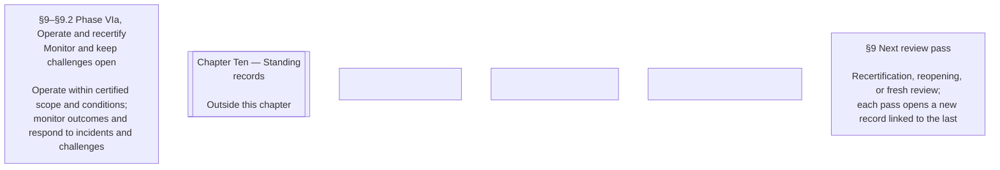
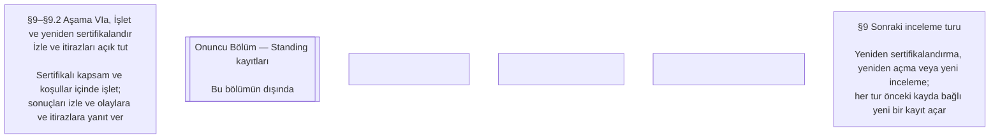

<!-- CHUNK-BEGIN tr__core_09.000_system_alignment_certification_evaluation__section_1_corpus_placement_overview.md bytes=3507 -->
<!-- AI-assisted translation draft; unreviewed. §1 corpus-placement overview, source lines 8–10; source SHA-256 4311e6ba74b7210f077c0bd4c8d21d8c9f517d2ada7b6d87288b39494dfeadd5. Draft only; do not synchronize into translations/. -->

# Chapter Nine Part A — §1 corpus-placement overview (tr)

## English source (lines 8–10)

> This file is **part of the Sentient Constitution** and is **binding only together** with the other numbered `core_*` files read as one text. It contains **Chapter Nine, Part A** — certification purpose, the process overview, and the first two phases of the process — **Frame** (system class) and **Evaluate** (whole-system evaluation in three sub-phases: the always-applicable evaluations, including data types and handling, in **§3**; the evaluations that apply where implicated in **§4**; and the Rights-Floor and domain evaluations that apply where triggered in **§5**) — **§1–§5**. The worked **Class A / B / C illustrations** (the system class profiles, §3.4.8, §5.1.5, §5.2.4, §5.3.7, §5.4.4, §5.5.5, and §5.6.4), including each one's **Reading across system classes** paragraph, are in [`core_09.010_system_alignment_certification_illustrations.md`](core_09.010_system_alignment_certification_illustrations.md); each keeps its Part A section number. The binding system-class-scaling and escalation rules those paragraphs illustrate stay in this file: system class scaling, including participation and proportionality, in §2.2; data-handling scaling in §3.4; and the **System class scaling and escalation** paragraph in each of §5.1–§5.6. The files of the whole chapter are listed in the table below.
>
> **Chapter Nine files.** Chapter Nine is split across four binding files read as one text. Part A, this file, opens the chapter; there is no separate index file.

## Translation draft

> Bu dosya **Sentient Constitution’ın bir parçasıdır** ve yalnızca numaralı diğer `core_*` dosyalarıyla tek bir metin olarak birlikte okunduğunda bağlayıcıdır. Dosya, **Dokuzuncu Bölüm, Kısım A**’yı içerir: sertifikasyonun amacı, sürece genel bakış ve ilk iki aşama olan **Frame** (sistem sınıfı) ile **Evaluate** (üç alt aşamada bütün-sistem değerlendirmesi)—**§§1–5**. Alt aşamalar şunlardır: veri türleri ve işleme dâhil her zaman geçerli değerlendirmeler **§3**’te; ilgili olduğunda uygulanan değerlendirmeler **§4**’te; koşul tetiklendiğinde uygulanan **Haklar Tabanı** ve alan değerlendirmeleri **§5**’te. **A / B / C Sınıfı** için ayrıntılı örnekler (sistem sınıfı profilleri, §3.4.8, §5.1.5, §5.2.4, §5.3.7, §5.4.4, §5.5.5 ve §5.6.4), her birindeki **sistem sınıfları arasında okuma** paragrafı dâhil, [`core_09.010_system_alignment_certification_illustrations.md`](core_09.010_system_alignment_certification_illustrations.md) dosyasındadır; her örnek Kısım A’daki bölüm numarasını korur. Bu paragrafların açıkladığı bağlayıcı sınıfa göre ölçeklendirme ve yükseltme kuralları bu dosyada kalır: katılım ve orantılılık dâhil sistem sınıfına göre ölçeklendirme §2.2’de; veri işleme ölçeklendirmesi §3.4’te; §§5.1–5.6’nın her birindeki **sistem sınıfına göre ölçeklendirme ve yükseltme** paragrafında.
>
> **Dokuzuncu Bölüm dosyaları.** Dokuzuncu Bölüm, birlikte okunan dört bağlayıcı dosyaya ayrılmıştır. Bu dosya olan Kısım A bölümü açar; ayrı bir dizin dosyası yoktur.

<!-- CHUNK-END -->
<!-- CHUNK-BEGIN tr__core_09.000_system_alignment_certification_evaluation__section_1_corpus_file_table.md bytes=5141 -->
<!-- AI-assisted translation draft; unreviewed. §1 corpus-placement file table, source lines 12–17; source SHA-256 4311e6ba74b7210f077c0bd4c8d21d8c9f517d2ada7b6d87288b39494dfeadd5. Draft only; do not synchronize into translations/. -->

# Chapter Nine Part A — §1 corpus-placement file table (tr)

## English source (lines 12–17)

> | Part | File | Owns |
> |------|------|------|
> | **Part A — Evaluation** | [`core_09.000_system_alignment_certification_evaluation.md`](core_09.000_system_alignment_certification_evaluation.md) | §1–§5: purpose and process overview (with a chart of the whole certification process in its six phases), **Phase I Frame** (system class, how system class scales every evaluation, and pilot certification) and **Phase II Evaluate** (whole-system evaluation in three sub-phases: **IIa** always, in §3, including chartered scope versus functional boundaries and data types and handling; **IIb** where implicated, in §4; and **IIc** where triggered, the Rights-Floor and domain evaluations, in §5) |
> | **Part B — Record and process** | [`core_09.005_system_alignment_certification_record_process.md`](core_09.005_system_alignment_certification_record_process.md) | §6–§10: **Phase III Review** (forum roles, supervisory sequence, and the contestability chain), **Phase IV Decide** (certification outcomes, including the go-live gate), **Phase V Record** (the certification record and its integrity, including governing [System Charter](core_05.040_band_continuity.md#system-charter) fields), and **Phase VI Operate** (the challenge path; recertification and reopening; the standing bridge) — continuous chapter numbering from Part A §5 |
> | **Part C — Illustrations** | [`core_09.010_system_alignment_certification_illustrations.md`](core_09.010_system_alignment_certification_illustrations.md) | the illustrative system class profiles, §3.4, §3.4.8, §5.1.5, §5.2.4, §5.3.7, §5.4.4, §5.5.5, and §5.6.4: worked Class A / B / C walkthroughs for each Part A evaluation area, numbered to match Part A and linked both ways |
> | **Part D — Institutional alignment certification** | [`core_09.015_institutional_alignment_certification.md`](core_09.015_institutional_alignment_certification.md) | §11–§15: the same six phases for an **Institution** rather than a System — the institution class and the institutional evaluation (**Phases I and II**, §12), the forum roles, outcome, and **Institutional Certification Record** (**Phases III to V**, §13), and recertification, reopening, the cascade from System certifications, and the standing bridge (**Phase VI**, §14–§15). It cites each System's certification by link and does not repeat it, and it is not a licence — continuous chapter numbering from Part B §10 |

## Translation draft

| Kısım | Dosya | Kapsam |
|------|------|------|
| **Part A — Evaluation** | [`core_09.000_system_alignment_certification_evaluation.md`](core_09.000_system_alignment_certification_evaluation.md) | §§1–5: amaç ve süreç özeti (altı sertifikasyon aşamasını gösteren çizelgeyle), ayrıca I Frame (sistem sınıfı, sınıfın her değerlendirmeyi nasıl ölçeklediği ve pilot sertifikasyon) ile II Evaluate (üç alt aşamalı bütün-sistem değerlendirmesi: IIa §3’te her zaman geçerlidir; Şart kapsamı/fonksiyonel sınırlar ve veri türleri/işleme dâhil; IIb ilgili olduğunda §4’te; IIc koşul tetiklendiğinde §5’in Haklar Tabanı ve alan değerlendirmeleri). |
| **Part B — Record and process** | [`core_09.005_system_alignment_certification_record_process.md`](core_09.005_system_alignment_certification_record_process.md) | §§6–10: III Review (forum rolleri, gözetim sırası ve itiraz zinciri); IV Decide (sertifikasyon sonuçları ve devreye alma kapısı); V Record (sertifikasyon kaydı ve bütünlüğü, [System Charter](core_05.040_band_continuity.md#system-charter)’ın belirleyici alanları dâhil); VI Operate (itiraz yolu, yeniden sertifikasyon ve yeniden açma, standing köprüsü) — Kısım A §5’ten devam eden numaralandırma. |
| **Part C — Illustrations** | [`core_09.010_system_alignment_certification_illustrations.md`](core_09.010_system_alignment_certification_illustrations.md) | Sistem sınıfı örnek profilleri ve §§3.4, 3.4.8, 5.1.5, 5.2.4, 5.3.7, 5.4.4, 5.5.5, 5.6.4: Kısım A’daki her değerlendirme alanı için A/B/C sınıfı uygulamalı örnekleri; bölüm numaraları eşleşir ve iki yönde bağlantılıdır. |
| **Part D — Institutional alignment certification** | [`core_09.015_institutional_alignment_certification.md`](core_09.015_institutional_alignment_certification.md) | §§11–15: Sistem yerine Kurum için aynı altı aşama—kurum sınıfı ve kurumsal değerlendirme (I–II, §12), forum rolleri, sonuç ve Kurumsal Sertifikasyon Kaydı (III–V, §13), yeniden sertifikasyon, yeniden açma, Sistem sertifikalarının zincirleme etkisi ve standing köprüsü (VI, §§14–15). Her Sistem sertifikasına bağlantı verir, tekrar etmez ve lisans değildir — Kısım B §10’dan devam eden numaralandırma. |

<!-- CHUNK-END -->
<!-- CHUNK-BEGIN tr__core_09.000_system_alignment_certification_evaluation__section_1_corpus_explanation.md bytes=8467 -->
<!-- AI-assisted translation draft; unreviewed. §1 corpus-placement explanatory prose, source lines 19–30; source SHA-256 4311e6ba74b7210f077c0bd4c8d21d8c9f517d2ada7b6d87288b39494dfeadd5. Draft only; do not synchronize into translations/. -->

# Chapter Nine Part A — §1 corpus-placement explanatory prose (tr)

## English source (lines 19–30)

> **How the two certifications relate.** System Alignment Certification (Parts A to C) is the certification of a System. Institutional alignment certification (Part D) is the certification of an Institution, which may run Systems or none. Part D cites each System's certification record by link and does not redo it; [Part D §11.1](core_09.015_institutional_alignment_certification.md#111-relation-to-system-alignment-certification) states the relation and [Part D §11.3](core_09.015_institutional_alignment_certification.md#113-no-permission-and-no-gate) states that it is not a licence.
>
> Generic **Chapter Nine** links in other files route to the appropriate part by section number.
>
> - **Constitutional owner (joint with Parts B and D):** forum-supervised **system alignment certification and related records** — evaluation domains (Part A); forum process, supervisory sequence, certification-record duties, certification outcomes and the go-live gate, the challenge path, recertification and reopening, and verified-input bridge to Chapter Ten (Part B); the same six phases for an Institution (Part D). Under the **oversight** Tetrad leg, SAC is one especially large, high-stakes audit process among others; auditing floors remain at **Article XVI** (*Audit, Transparency, and Independent Verification*) and Chapter Five [Auditability](core_05.050_band_oversight.md#auditability).
> - **Verification substrate owner:** [Chapter Four — Burden of Proof, Traceability, and Verification](core_04.000_burden_traceability_verification.md#chapter-four-burden-of-proof-traceability-and-verification) (within Chapters Two through Four) owns burden allocation, compliance evidence, definition traceability, observability, and security-constrained verification. Chapter Nine **applies** that discipline to system alignment certification records; it does **not** restate Chapter Four sections **1** through **5**.
> - **Auditing home (not relocated here):** **Article XVI** (*Audit, Transparency, and Independent Verification*), **Def.O1** (*Transparency, Auditability, and Verification*), and **CJS-5.110 §3 and CJS-5.115 §3** (*Audit process home*)–**CJS-5.110 §5** own auditing floors and operational terms. Chapter Nine runs one especially large SAC audit process that must satisfy those floors; it does not own all auditing.
> - **Implementation owner:** system-class handling, CS-6.345, and forum-process detail in designated implementation files must remain consistent with Chapter Nine and may be stricter where the corpus already provides a [Fullest Protective Effect](core_05.045_band_integrative.md#fullest-protective-effect) rule.
> - **Anti-relocation rule:** Part A does not restate Chapter Five canonical definitions, Chapter Three anti-evasion discipline (see [Part B §9.3](core_09.005_system_alignment_certification_record_process.md#93-non-evasion)), Chapter Ten contribution or standing measurement, or Chapter Eleven standing effects. **[Part B §10](core_09.005_system_alignment_certification_record_process.md#10-relationship-to-standing)** states the standing bridge boundary explicitly.
>
> **Upstream:** Chapter Five definitions; Chapters Two through Four record, verification, burden, and traceability of definitions to results; and [Chapter Eight](core_08.000_functional_independence_separation_of_duties.md#chapter-eight-functional-independence-and-separation-of-duties), whose separation-of-duties requirement governs every materially binding certification act.
> **Downstream:** [Part B](core_09.005_system_alignment_certification_record_process.md#chapter-nine-part-b-system-alignment-certification--record-and-process) (*forum process, record, outcomes, and standing bridge*); Chapter Ten standing records and verified inputs; Chapter Eleven standing effects; Chapter Thirteen forum supervision and system alignment certification pathways.

## Translation draft

**İki sertifikasyon arasındaki ilişki.** System Alignment Certification (Kısım A–C), bir Sistemin sertifikasyonudur. Kurumsal alignment sertifikasyonu (Kısım D), Sistem işletebilen veya hiç işletmeyen bir Kurumun sertifikasyonudur. Kısım D her Sistemin sertifikasyon kaydına bağlantı verir; sertifikasyonu tekrarlamaz. [Part D §11.1](core_09.015_institutional_alignment_certification.md#111-relation-to-system-alignment-certification) ilişkiyi açıklar; [Part D §11.3](core_09.015_institutional_alignment_certification.md#113-no-permission-and-no-gate) bunun lisans olmadığını belirtir.
>
> Diğer dosyalardaki genel **Chapter Nine** bağlantıları, bölüm numarasına göre uygun kısma yönlendirir.
>
> - **Anayasal sorumlu (Kısım B ve D ile ortak):** forum gözetimindeki system alignment sertifikasyonu ve ilgili kayıtlar — değerlendirme alanları (Kısım A); forum süreci, gözetim sırası, sertifikasyon kaydı yükümlülükleri, sonuçlar ve işletime alma kapısı, itiraz yolu, yeniden sertifikasyon ve yeniden açma, Bölüm On’a doğrulanmış girdiler köprüsü (Kısım B); Kurum için aynı altı aşama (Kısım D). Tetrad’ın **gözetim** ayağında SAC, diğerleri arasındaki özellikle büyük ve yüksek riskli bir denetim sürecidir; denetim tabanları **Article XVI** (*Audit, Transparency, and Independent Verification*) ve Beşinci Bölümdeki [Auditability](core_05.050_band_oversight.md#auditability) altında kalır.
> - **Doğrulama altyapısının sorumlusu:** [Chapter Four — Burden of Proof, Traceability, and Verification](core_04.000_burden_traceability_verification.md#chapter-four-burden-of-proof-traceability-and-verification) (İkinci ila Dördüncü Bölümler içinde) ispat yükü dağılımını, uyum kanıtlarını, tanım izlenebilirliğini, gözlemlenebilirliği ve güvenlik kısıtlı doğrulamayı düzenler. Dokuzuncu Bölüm bu disiplini system alignment sertifikasyon kayıtlarına uygular; Dördüncü Bölümün **1** ila **5** kısımlarını yinelemez.
> - **Denetimin ana kaynağı (buraya taşınmamıştır):** **Article XVI** (*Audit, Transparency, and Independent Verification*), **Def.O1** (*Transparency, Auditability, and Verification*) ve **CJS-5.110 §3 ile CJS-5.115 §3** (*Audit process home*)–**CJS-5.110 §5** denetim tabanlarını ve işleyiş terimlerini belirler. Dokuzuncu Bölüm, bu tabanlara uyması gereken özellikle büyük bir SAC denetimi yürütür; tüm denetimlerin sahibi değildir.
> - **Uygulama sorumlusu:** belirlenmiş uygulama dosyalarındaki sistem sınıfı işlemleri, CS-6.345 ve forum süreci ayrıntıları Dokuzuncu Bölümle tutarlı olmalı; corpus’ta [Fullest Protective Effect](core_05.045_band_integrative.md#fullest-protective-effect) kuralı zaten varsa daha sıkı olabilir.
> - **Taşımama kuralı:** Kısım A, Beşinci Bölümün kanonik tanımlarını, Üçüncü Bölümün kaçınma karşıtı disiplinini ([Part B §9.3](core_09.005_system_alignment_certification_record_process.md#93-non-evasion) bölümüne bakın), Onuncu Bölümün katkı veya standing ölçümünü ya da On Birinci Bölümün standing etkilerini yeniden anlatmaz. **[Part B §10](core_09.005_system_alignment_certification_record_process.md#10-relationship-to-standing)** standing köprüsünün sınırını açıkça belirtir.
>
> **Önceki kaynaklar:** Beşinci Bölüm tanımları; İkinci ila Dördüncü Bölümlerin kayıtları, doğrulaması, ispat yükü ve tanımlardan sonuçlara izlenebilirliği; ayrıca görev ayrılığı şartı maddi olarak bağlayıcı her sertifikasyon işlemini yöneten [Chapter Eight](core_08.000_functional_independence_separation_of_duties.md#chapter-eight-functional-independence-and-separation-of-duties).
> **Sonraki kaynaklar:** [Part B](core_09.005_system_alignment_certification_record_process.md#chapter-nine-part-b-system-alignment-certification--record-and-process) (*forum süreci, kayıt, sonuçlar ve standing köprüsü*); Onuncu Bölümün standing kayıtları ve doğrulanmış girdileri; On Birinci Bölümün standing etkileri; On Üçüncü Bölümün forum gözetimi ve system alignment sertifikasyonu yolları.

<!-- CHUNK-END -->
<!-- CHUNK-BEGIN tr__core_09.000_system_alignment_certification_evaluation__section_1_heading.md bytes=361 -->
<!-- AI-assisted translation draft; unreviewed. §1 heading, source line 44; source SHA-256 4311e6ba74b7210f077c0bd4c8d21d8c9f517d2ada7b6d87288b39494dfeadd5. Draft only; do not synchronize into translations/. -->

# Chapter Nine Part A — §1 heading (tr)

## English source (lines 44–45)

### 1. Purpose and Role


## Translation draft

### 1. Amaç ve Rol

<!-- CHUNK-END -->
<!-- CHUNK-BEGIN tr__core_09.000_system_alignment_certification_evaluation__section_1_trace.md bytes=12115 -->
<!-- AI-assisted translation draft; unreviewed. §1 trace, source lines 46–95; source SHA-256 4311e6ba74b7210f077c0bd4c8d21d8c9f517d2ada7b6d87288b39494dfeadd5. Draft only; do not synchronize into translations/. -->

# Chapter Nine Part A — §1 trace (tr)

## English source (lines 46–95)

<details>
<summary><strong><span style="color: #2563eb;">Trace</span></strong></summary>

- Upstream:
  - [Preamble — constitutional owner register](core_00.000_preamble.md#4-principles-definitions-and-rights) and
  - [Authority Stack and Internal Hierarchy](core_05.045_band_integrative.md#authority-stack-and-internal-hierarchy);
  - [Constitutional Tetrad](core_00.000_preamble.md#constitutional-tetrad);
  - [Two Constitutional Aims](core_00.000_preamble.md#two-constitutional-aims);
  - [material stake](core_00.000_preamble.md#material-stake);
  - [Proportionality](core_05.035_band_accountability.md#proportionality) and
  - [Substantive Fairness](core_05.055_band_participation.md#substantive-fairness) (Chapter Five); Participation measurement family (*voice, access, and contest paths*);
  - [Chapter One §16 Stewardship In Depth](core_01.010_stewardship_capacity_principles.md#16-stewardship-in-depth) (1.010 §16);
  - [Chapter One §12 Systemic Evaluation Requirement](core_01.000_values_principles.md#12-systemic-evaluation-requirement) (1.000 §12) (*principle-layer whole-system evaluation lens — not one corner alone*); Chapters Two through Four;
  - [Chapter Five](core_05.000_definitions_home.md#chapter-five-foundational-definitions) (5.000) (*canonical definitions*);
  - [Chapter Eight §2 Four-Seat Constitutional Requirement](core_08.000_functional_independence_separation_of_duties.md#2-four-seat-constitutional-requirement) (8.000 §2);
  - [System Alignment Certification](core_05.040_band_continuity.md#system-alignment-certification) (Chapter Five canonical term; non-operative shorthand **SAC**);
  - [System Certification Record](core_05.040_band_continuity.md#system-certification-record) (Chapter Five meaning).
- Downstream:
  - [§2](#2-system-class-evaluation) (*system class evaluation*);
  - [Part B §9.1](core_09.005_system_alignment_certification_record_process.md#91-challenging-a-certification) (9.005 §9.1) (*challenging a certification*); and
  - [Part C system class profiles](core_09.010_system_alignment_certification_illustrations.md#illustrative-system-class-profiles-non-exhaustive) (9.010) (*illustrative system class profiles*);
  - [Part C whole-system walkthroughs](core_09.010_system_alignment_certification_illustrations.md#illustrative-whole-system-application-by-system-class-non-exhaustive) (9.010) (*worked whole-system examples by system class*);
  - [§3.4.8](core_09.010_system_alignment_certification_illustrations.md#348-illustrative-data-handling-application-by-system-class-non-exhaustive) (*worked data-handling examples by system class*);
  - [§5.1.5](core_09.010_system_alignment_certification_illustrations.md#515-illustrative-ecological-footprint-application-by-system-class-non-exhaustive) (*worked ecological-footprint examples by system class*);
  - [§5.2.4](core_09.010_system_alignment_certification_illustrations.md#524-illustrative-educational-capability-application-by-system-class-non-exhaustive) (*worked educational-capability examples by system class*);
  - [§5.3.7](core_09.010_system_alignment_certification_illustrations.md#537-illustrative-cross-system-support-application-by-system-class-non-exhaustive) (*worked cross-system-support examples by system class*);
  - [§5.4.4](core_09.010_system_alignment_certification_illustrations.md#544-illustrative-nondiscrimination-application-by-system-class-non-exhaustive) (*worked nondiscrimination examples by system class*);
  - [§5.5.5](core_09.010_system_alignment_certification_illustrations.md#555-illustrative-accessibility-application-by-system-class-non-exhaustive) (*worked accessibility examples by system class*);
  - [§5.6.4](core_09.010_system_alignment_certification_illustrations.md#564-illustrative-trustworthiness-application-by-system-class-non-exhaustive) (*worked trustworthiness examples by system class*);
  - [§3](#3-whole-system-certification-evaluation) (*whole-system certification evaluation factors*);
  - [§3.4](#34-data-types-and-handling-evaluation) through
  - [§5.6](#56-trustworthiness-and-system-reliance-integrity-evaluation) (*domain evaluations*);
  - [Part B §6](core_09.005_system_alignment_certification_record_process.md#6-forum-process) (9.005 §6) (*supervisory sequence and contestability chain*);
  - [Part B §6.1](core_09.005_system_alignment_certification_record_process.md#61-forum-supervision-and-component-roles) (9.005 §6.1) (*forum component roles*);
  - [Part B §8](core_09.005_system_alignment_certification_record_process.md#8-system-certification-record) (9.005 §8) (*certification record contents*);
  - [Part B §8.2](core_09.005_system_alignment_certification_record_process.md#82-record-integrity-transparency-and-auditability) (9.005 §8.2) (*record integrity requirements*);
  - [Part B §7](core_09.005_system_alignment_certification_record_process.md#7-certification-outcomes) (9.005 §7) (*reopening and anti-evasion*);
  - [Part B §10](core_09.005_system_alignment_certification_record_process.md#10-relationship-to-standing) (9.005 §10) (*standing-record bridge*);
  - [Chapter Ten](core_11.000_standing_assessment.md#chapter-eleven-contribution-violation-and-standing-model--measurement) (10.000) (*standing records and verified-input gate*);
  - [Chapter Eleven](core_12.000_standing_integration.md#chapter-twelve-standing-effects-and-integration) (11.000) (*standing effects and integration*);
  - [Chapter Thirteen](core_14.000_forum.md#chapter-fourteen-forums-and-jurisdiction) (13.000) (*forum supervision, certification, alignment certification, and review*).
- Read with:
  - **[CS-9.305](corpus_systems/cs_09.305_system_classification_machinery.md#cs-9305-part-a-system-classification-machinery) (*System classification machinery*) and [CS-9.310 — System impact classifications](corpus_systems/cs_09.310_system_impact_classifications.md#cs-9310-part-b-system-impact-classifications)**, **[CS-6.305](corpus_systems/cs_06.305_information_types_and_handling.md#cs-6305-part-a-information-types-and-handling) (*Information types and handling*) and [CS-6.310 — Data classifications](corpus_systems/cs_06.310_data_classifications.md#cs-6310-part-b-data-classifications)**, and
  - **CS-6.345** (*System lifecycle*);
  - **CF-13.415** (*Routing operations, transfer, certification, and representative treatment*) and
  - **CF-13.425** (*Integrity safeguards, anti-capture operations, and anti-self-judging support*); **Article XVI** (*Audit, Transparency, and Independent Verification*) and
  - [Auditability](core_05.050_band_oversight.md#auditability) (*auditing floors — SAC is one especially large audit process under oversight, not the sole auditing home*); **CJS-5.110 §3 (*Oversight: auditability and reconstructability terms (annex)*) and CJS-5.115 §3** (*Audit process home*)–
  - **CJS-5.110 §5** (*Oversight: independent verification and claim-integrity terms*).

</details>

## Translation draft

#### İzlenebilirlik

Bu harita bölümün anayasal ve yetki temelini ortaya koyar; değerlendirme, sınıflandırma, inceleme yolları, kayıtlar, sonuçlar ve denetimle ilişkilendirir, birlikte okunacak işletim belgelerini de belirtir.

**İzlenebilirlik — upstream canonical sources:** [Preamble — constitutional owner register](core_00.000_preamble.md#4-principles-definitions-and-rights); [Authority Stack and Internal Hierarchy](core_05.045_band_integrative.md#authority-stack-and-internal-hierarchy); [Constitutional Tetrad](core_00.000_preamble.md#constitutional-tetrad); [Two Constitutional Aims](core_00.000_preamble.md#two-constitutional-aims); [material stake](core_00.000_preamble.md#material-stake); [Proportionality](core_05.035_band_accountability.md#proportionality); [Substantive Fairness](core_05.055_band_participation.md#substantive-fairness); [Chapter One §16 Stewardship In Depth](core_01.010_stewardship_capacity_principles.md#16-stewardship-in-depth); [Chapter One §12 Systemic Evaluation Requirement](core_01.000_values_principles.md#12-systemic-evaluation-requirement); [Chapter Five](core_05.000_definitions_home.md#chapter-five-foundational-definitions); [Chapter Eight §2 Four-Seat Constitutional Requirement](core_08.000_functional_independence_separation_of_duties.md#2-four-seat-constitutional-requirement); [System Alignment Certification](core_05.040_band_continuity.md#system-alignment-certification); [System Certification Record](core_05.040_band_continuity.md#system-certification-record)

**İzlenebilirlik — downstream routes and related records:** [§2](#2-system-class-evaluation); [Part B §9.1](core_09.005_system_alignment_certification_record_process.md#91-challenging-a-certification); [Part C system class profiles](core_09.010_system_alignment_certification_illustrations.md#illustrative-system-class-profiles-non-exhaustive); [Part C whole-system walkthroughs](core_09.010_system_alignment_certification_illustrations.md#illustrative-whole-system-application-by-system-class-non-exhaustive); [§3.4.8](core_09.010_system_alignment_certification_illustrations.md#348-illustrative-data-handling-application-by-system-class-non-exhaustive); [§5.1.5](core_09.010_system_alignment_certification_illustrations.md#515-illustrative-ecological-footprint-application-by-system-class-non-exhaustive); [§5.2.4](core_09.010_system_alignment_certification_illustrations.md#524-illustrative-educational-capability-application-by-system-class-non-exhaustive); [§5.3.7](core_09.010_system_alignment_certification_illustrations.md#537-illustrative-cross-system-support-application-by-system-class-non-exhaustive); [§5.4.4](core_09.010_system_alignment_certification_illustrations.md#544-illustrative-nondiscrimination-application-by-system-class-non-exhaustive); [§5.5.5](core_09.010_system_alignment_certification_illustrations.md#555-illustrative-accessibility-application-by-system-class-non-exhaustive); [§5.6.4](core_09.010_system_alignment_certification_illustrations.md#564-illustrative-trustworthiness-application-by-system-class-non-exhaustive); [§3](#3-whole-system-certification-evaluation); [§3.4](#34-data-types-and-handling-evaluation); [§5.6](#56-trustworthiness-and-system-reliance-integrity-evaluation); [Part B §6](core_09.005_system_alignment_certification_record_process.md#6-forum-process); [Part B §6.1](core_09.005_system_alignment_certification_record_process.md#61-forum-supervision-and-component-roles); [Part B §8](core_09.005_system_alignment_certification_record_process.md#8-system-certification-record); [Part B §8.2](core_09.005_system_alignment_certification_record_process.md#82-record-integrity-transparency-and-auditability); [Part B §7](core_09.005_system_alignment_certification_record_process.md#7-certification-outcomes); [Part B §10](core_09.005_system_alignment_certification_record_process.md#10-relationship-to-standing); [Chapter Ten](core_11.000_standing_assessment.md#chapter-eleven-contribution-violation-and-standing-model--measurement); [Chapter Eleven](core_12.000_standing_integration.md#chapter-twelve-standing-effects-and-integration); [Chapter Thirteen](core_14.000_forum.md#chapter-fourteen-forums-and-jurisdiction)

**İzlenebilirlik — operational materials to read with this section:** [CS-9.305](corpus_systems/cs_09.305_system_classification_machinery.md#cs-9305-part-a-system-classification-machinery); [CS-9.310 — System impact classifications](corpus_systems/cs_09.310_system_impact_classifications.md#cs-9310-part-b-system-impact-classifications); [CS-6.305](corpus_systems/cs_06.305_information_types_and_handling.md#cs-6305-part-a-information-types-and-handling); [CS-6.310 — Data classifications](corpus_systems/cs_06.310_data_classifications.md#cs-6310-part-b-data-classifications); [Auditability](core_05.050_band_oversight.md#auditability)

<!-- CHUNK-END -->
<!-- CHUNK-BEGIN tr__core_09.000_system_alignment_certification_evaluation__purpose_adjuncts.md bytes=5769 -->
<!-- AI-assisted translation draft; unreviewed. Selected §1 passages, source lines 99 and 107–114; source SHA-256 4311e6ba74b7210f077c0bd4c8d21d8c9f517d2ada7b6d87288b39494dfeadd5. -->

# Chapter Nine Part A — §1 plain-terms excerpt

**Status:** AI-assisted draft; unreviewed. English source remains controlling.

## English source

When a system really matters to sentients' lives, certification has to be **proportionate** — as demanding as the system's real impact, dependency, and risk require, not a one-size-fits-all checklist or a rubber stamp. It also has to be **participatory** — affected sentients and communities must be able to see what was reviewed, understand what was decided, and challenge it when something is wrong. Forums review evidence, write it down in a certification record, and require re-checks on a schedule that matches how risky the system is. Classes A, B, and C get the full process and Class L a lighter one. Class P is encouraged to use it, and must once it is reclassified to Class L or higher (that is, its effects reach beyond a private unit) or its operator claims constitutional compliance.

## tr draft

Bir sistem duyarlı varlıkların yaşamını gerçekten etkiliyorsa sertifikasyon **orantılı** olmalıdır: sistemin gerçek etkisinin, bağımlılık düzeyinin ve risklerinin gerektirdiği kadar titiz; herkese uyan tek tip bir kontrol listesi ya da göstermelik bir onay damgası olmamalıdır. Aynı zamanda **katılımcı** olmalıdır: etkilenen duyarlı varlıklar ve topluluklar nelerin incelendiğini görebilmeli, neye karar verildiğini anlamalı ve yanlışlık varsa karara itiraz edebilmelidir. Forumlar kanıtları inceler, sertifikasyon kaydına geçirir ve sistemin riskine uygun aralıklarla yeniden inceleme ister. A, B ve C sınıflarına tam süreç, L sınıfına daha hafif bir süreç uygulanır. P sınıfının bu süreci kullanması teşvik edilir; L veya üstüne yeniden sınıflandırıldığında (yani etkileri özel birimin dışına ulaştığında) ya da işletmecisi anayasal uyum iddiasında bulunduğunda süreç zorunlu olur.


### English source — Flourishing

- **[Flourishing](core_00.000_preamble.md#flourishing)** — certification verifies that certification or continued reliance would not quietly defeat Rights Floors or block fair participation in constitutionally relevant life;

### tr draft

- **[Serpilme](core_00.000_preamble.md#flourishing)** — sertifikasyon, sertifika verilmesinin ya da sisteme güvenerek kullanmayı sürdürmenin Hak Tabanlarını sessizce boşa çıkarmadığını veya anayasal açıdan ilgili yaşama adil katılımı engellemediğini doğrular;


### English source — Continuity criterion

- **[Continuity](core_00.000_preamble.md#continuity)** — certification verifies durable, non-regressive supply that sustains rather than depletes healthy natural systems ([Ecological Integrity](core_05.040_band_continuity.md#ecological-integrity), including [Ecological Recovery Capacity](core_05.040_band_continuity.md#ecological-recovery-capacity)), and system-class-scaled recertification where shared systems gate or sustain delivery;

### tr draft

- **[Süreklilik](core_00.000_preamble.md#continuity)** — sertifikasyon, sağlıklı doğal sistemleri tüketmek yerine destekleyen dayanıklı ve gerilemeyen arzı ([Ekolojik Bütünlük](core_05.040_band_continuity.md#ecological-integrity), [Ekolojik İyileşme Kapasitesi](core_05.040_band_continuity.md#ecological-recovery-capacity) dâhil) ve ortak sistemlerin sunumu kısıtladığı ya da sürdürdüğü durumlarda sistem sınıfına göre yeniden sertifikasyonu doğrular;


### English source — Participation criterion

- **Participation** — affected sentients and communities can understand, contest, and take part in review paths that matter to them;

### tr draft

- **Katılım** — etkilenen duyarlı varlıklar ve topluluklar kendileri için önemli inceleme yollarını anlayabilir, bunlara itiraz edebilir ve katılabilir;


### English source — Oversight criterion

- **Oversight** — records, evidence, and assumptions are visible and auditable enough for independent checking; certification itself is one especially large audit process under that oversight duty, not the only one;

### tr draft

- **Gözetim** — kayıtlar, kanıtlar ve varsayımlar bağımsız denetime yetecek ölçüde görünür ve denetlenebilirdir; sertifikasyon bu gözetim görevi altındaki büyük denetim süreçlerinden biridir, tek denetim alanı değildir;


### English source — Accountability criterion

- **Accountability** — defects, misclassification, and floor-defeating operation route to remedy, conditions, withdrawal, or standing input where the facts support it;

### tr draft

- **Hesap verebilirlik** — kusurlar, yanlış sınıflandırma ve Hak Tabanlarını boşa çıkaran işletim, olgular desteklediğinde giderim, koşullar, geri çekme veya statü girdisine yönelir;


### English source — Timeliness criterion

- **Timeliness** — review and contest windows keep certification from going stale while harm can still be prevented or reversed.

### tr draft

- **Zamanlılık** — zarar hâlâ önlenebilir veya giderilebilirken inceleme ve itiraz süreleri sertifikasyonun güncelliğini yitirmesini engeller.


### English source — Tetrad introduction

Certification implements the [Two Constitutional Aims](core_00.000_preamble.md#two-constitutional-aims) through the [Constitutional Tetrad](core_00.000_preamble.md#constitutional-tetrad):

### tr draft

Sertifikasyon, [İki Anayasal Amacı](core_00.000_preamble.md#two-constitutional-aims) [Anayasal Dörtlü](core_00.000_preamble.md#constitutional-tetrad) aracılığıyla uygular:

<!-- CHUNK-END -->
<!-- CHUNK-BEGIN tr__core_09.000_system_alignment_certification_evaluation__section_1_purpose.md bytes=1163 -->
<!-- AI-assisted translation draft; unreviewed. Complete purpose statement excerpt, source lines 101–105; source SHA-256 4311e6ba74b7210f077c0bd4c8d21d8c9f517d2ada7b6d87288b39494dfeadd5. This is an excerpt, not a complete §1 translation. -->

**Sistem uyum sertifikasyonu**, belirtilen kapsam ve inceleme takvimi için tek bir soruyu yanıtlamak üzere vardır: Sistem; sertifikasyon, koşullu sertifikasyon, doğrulama, yeniden sertifikasyon, sisteme güvenmeyi sürdürme, devreye alma veya koşullardan önemli ölçüde çıkarılma için yeterli anayasal uyum gösterdi mi?

- Sertifikasyon bir popülerlik puanı, süresiz geçiş izni ya da hak incelemesini atlama yolu değildir.
- Sistemin uyumu hakkında şu anda bilinenleri belirli bir süreyle sınırlı ve itiraza açık biçimde ifade eder.
- Dörtlünün **gözetim** bacağı altında gözetim denetim gerektirir; sistem uyum sertifikasyonu, diğerleri arasında özellikle büyük ve yüksek paylı bir denetim sürecidir — denetimin tek yuvası değildir (**Madde XVI** (*Denetim, Şeffaflık ve Bağımsız Doğrulama*), [denetlenebilirlik](core_05.050_band_oversight.md#auditability)).

<!-- CHUNK-END -->
<!-- CHUNK-BEGIN tr__core_09.000_system_alignment_certification_evaluation__section_1_subsection_headings.md bytes=778 -->
<!-- AI-assisted translation draft; unreviewed. §1.1/§1.2 visible subsection headings, source lines 116–119 and 144–148; source SHA-256 4311e6ba74b7210f077c0bd4c8d21d8c9f517d2ada7b6d87288b39494dfeadd5. Draft only; anchors/blank layout are structural. Do not synchronize into translations/. -->

# Chapter Nine Part A — §1.1 and §1.2 subsection headings (tr)

## English source

### Lines 116–119

<a id="11-certification-as-an-audit-process-scaled-by-class"></a>

#### 1.1 Certification as an audit process, scaled by class


### Lines 144–148


<a id="12-certification-at-a-glance"></a>

#### 1.2 Certification at a glance


## Translation draft

#### 1.1 Sınıfa göre ölçeklenen bir denetim süreci olarak sertifikasyon

#### 1.2 Bir Bakışta Sertifikasyon

<!-- CHUNK-END -->
<!-- CHUNK-BEGIN tr__core_09.000_system_alignment_certification_evaluation__section_1_audit_scope.md bytes=3245 -->
<!-- AI-assisted translation draft; unreviewed. §1.1 audit mechanism and sibling audit modes, source lines 120–130; source SHA-256 4311e6ba74b7210f077c0bd4c8d21d8c9f517d2ada7b6d87288b39494dfeadd5. -->

# Chapter Nine Part A — §1.1 certification audit process excerpt (tr)

## English source

As an oversight mechanism, certification is one especially large audit process under [Auditability](core_05.050_band_oversight.md#auditability) and **Article XVI** (*Audit, Transparency, and Independent Verification*):

- It is forum-supervised, multi-domain, and status-granting.
- It may integrate the results of sibling audit modes, and it does not absorb or replace them. Each keeps its own owner, named in the [sibling audit modes map](corpus_joint_structure/cjs_05.115_audit_process.md#sibling-audit-modes-owner-map) of the audit process home:
  - System Data Types Record audits under **CS-6.305 (*Information types and handling*) and CS-6.310** (*Data classifications*)
  - System Classification Record audits under **CS-9.305 (*System classification machinery*) and CS-9.310** (*System impact classifications*)
  - steward assurance reviews under **CS-14.305** (*Critical system stewardship*)
  - continuous audit under **CS-6.345** (*System lifecycle*) ACA
  - complexity audits under **CS-6.315** (*Comprehensibility and complexity stewardship*) and **Article XXIII-B** (*Complexity Audit and Modularity Requirements*)
  - claim verification under **CJS-5.110 §5** (*Oversight: independent verification and claim-integrity terms*)
- You can still run any of these checks on their own, without going through certification. Certification doesn't replace them.

## tr draft

Bir gözetim mekanizması olarak belgelendirme, [Denetlenebilirlik](core_05.050_band_oversight.md#auditability) ve **Article XVI** (*Denetim, Şeffaflık ve Bağımsız Doğrulama*) kapsamında özellikle büyük bir denetim sürecidir:

- Forum gözetimindedir, çok alanlıdır ve statü verir.
- Benzer denetim yöntemlerinin sonuçlarını bütünleştirebilir; ancak onları içine almaz veya onların yerini tutmaz. Her yöntem kendi sahibini korur; bu sahip, denetim sürecinin ana belgesindeki [benzer denetim yöntemleri haritasında](corpus_joint_structure/cjs_05.115_audit_process.md#sibling-audit-modes-owner-map) belirtilir:
  - System Data Types Record denetimleri: **CS-6.305 (*Bilgi türleri ve işleme*) ve CS-6.310** (*Veri sınıflandırmaları*) kapsamında
  - System Classification Record denetimleri: **CS-9.305 (*Sistem sınıflandırma mekanizması*) ve CS-9.310** (*Sistem etki sınıflandırmaları*) kapsamında
  - Vasi güvence incelemeleri: **CS-14.305** (*Kritik sistemlerin vasiliği*) kapsamında
  - Sürekli denetim: **CS-6.345** (*Sistem yaşam döngüsü*) ACA kapsamında
  - Karmaşıklık denetimleri: **CS-6.315** (*Anlaşılabilirlik ve karmaşıklık vasiliği*) ve **Article XXIII-B** (*Karmaşıklık Denetimi ve Modülerlik Gereklilikleri*) kapsamında
  - İddia doğrulaması: **CJS-5.110 §5** (*Gözetim: bağımsız doğrulama ve iddia bütünlüğü koşulları*) kapsamında
- Bu kontrollerden herhangi birini belgelendirme sürecine girmeden ayrıca yürütebilirsiniz. Belgelendirme onların yerini tutmaz.

<!-- CHUNK-END -->
<!-- CHUNK-BEGIN tr__core_09.000_system_alignment_certification_evaluation__section_1_class_scaling.md bytes=3956 -->
<!-- AI-assisted translation draft; unreviewed. Chapter Nine Part A §1 class scaling and cadence, source lines 132–143; source SHA-256 4311e6ba74b7210f077c0bd4c8d21d8c9f517d2ada7b6d87288b39494dfeadd5. Draft only; do not synchronize into translations/. -->

**Current English passage:**

Certification depth, record burden, certification interval, stakeholder review, and contest paths must scale with [material stake](core_00.000_preamble.md#material-stake) under [Proportionality](core_05.035_band_accountability.md#proportionality):

The process applies by impact class, as the [reclassification requirement](corpus_systems/cs_09.305_system_classification_machinery.md#35-reclassification-requirement) of **CS-9.305** (*System classification machinery*) sets out:

- **Class A, Class B, and Class C:** these systems carry the highest impact, dependency, and risk, and whole-system evaluation under [§3 Whole-System Certification Evaluation](#3-whole-system-certification-evaluation), [§4 Evaluations Where Implicated](#4-evaluations-where-implicated), and [§5 Rights-Floor and Domain Evaluations](#5-rights-floor-and-domain-evaluations), each as its own sub-phase applies, is mandatory at full depth;
- **Class L:** the same evaluation is mandatory but proportionate, with a lower default re-check cadence and simpler records where CS-9.305 (*System classification machinery*) and CS-9.310 (*System impact classifications*) permits; and
- **Class P:** the process is encouraged while the system is validly Class P, and a Class P system may use it voluntarily. It becomes mandatory on reclassification to Class L or higher, or where the operator voluntarily asserts constitutional compliance for the system.

The certification interval, and the financial, resource, or special audit that falls at its midpoint, are set by class in [Chapter Thirteen §6 Timely resolution, materiality tiers, and anti-delay discipline](core_14.000_forum.md#review-cadence) (*Review cadence*). This chapter does not restate the numbers.

**Proposed locale translation:**

Sertifikasyon derinliği, kayıt yükü, sertifikasyon aralığı, paydaş incelemesi ve itiraz yolları [maddi önem](core_00.000_preamble.md#material-stake) düzeyine göre [orantılılık](core_05.035_band_accountability.md#proportionality) ilkesiyle ölçeklenmelidir:

Süreç, **CS-9.305** (*Sistem sınıflandırma mekanizması*) kapsamındaki [yeniden sınıflandırma şartının](corpus_systems/cs_09.305_system_classification_machinery.md#35-reclassification-requirement) belirlediği etki sınıfına göre uygulanır:

- **A, B ve C Sınıfları:** Bu sistemler en yüksek etki, bağımlılık ve riski taşır. [§3 Tüm Sistem Sertifikasyon Değerlendirmesi](#3-whole-system-certification-evaluation), [§4 İlgili Olduğunda Değerlendirmeler](#4-evaluations-where-implicated) ve [§5 Hak Tabanı ve Alan Değerlendirmeleri](#5-rights-floor-and-domain-evaluations) kapsamında geçerli her alt aşamada tüm sistemin tam derinlikte değerlendirilmesi zorunludur;
- **L Sınıfı:** Aynı değerlendirme zorunludur ancak orantılı yürütülür; **CS-9.305** (*Sistem sınıflandırma mekanizması*) ve **CS-9.310** (*Sistem etki sınıflandırmaları*) izin veriyorsa varsayılan yeniden kontrol sıklığı daha seyrek ve kayıtlar daha basit olabilir; ve
- **P Sınıfı:** Sistem geçerli biçimde P sınıfında kaldığı sürece süreç önerilir ve gönüllü olarak kullanılabilir. L veya üzeri sınıfa yeniden sınıflandırıldığında ya da işletmeci sistemin anayasal uyumunu gönüllü olarak ileri sürdüğünde zorunlu olur.

Sertifikasyon aralığı ve bu aralığın ortasına denk gelen mali, kaynak veya özel denetim sınıfa göre [On Üçüncü Bölüm §6 Zamanında Çözüm, Maddi Önem Kademeleri ve Gecikme Karşıtı Disiplin](core_14.000_forum.md#review-cadence) (*İnceleme sıklığı*) içinde belirlenir. Bu bölüm sayıları tekrarlamaz.

<!-- CHUNK-END -->
<!-- CHUNK-BEGIN tr__core_09.000_system_alignment_certification_evaluation__section_1_at_a_glance.md bytes=1789 -->
<!-- AI-assisted translation draft; unreviewed. Chapter Nine Part A §1.2 plain-language summary, source line 149; source SHA-256 4311e6ba74b7210f077c0bd4c8d21d8c9f517d2ada7b6d87288b39494dfeadd5. Draft only; do not synchronize into translations/. -->

# Chapter Nine Part A — §1.2 at-a-glance summary (tr)

## English source

*In plain terms: classify the system honestly, run the evaluations that apply, have forums independently review the evidence and stakeholder concerns, and decide an outcome. Complete the one record opened for forum review and publish it with an open challenge path. A certified system goes live only after its notice interval and required protections are satisfied. Monitor actual outcomes, respond to incidents and challenges, and check again on schedule or when the facts change. Correct defects and have the correction independently verified before authorizing the affected scope or releasing its conditions. Each review pass uses a new record linked to the last.*

## tr draft

*Basitçe: sistemi dürüstçe sınıflandırın, geçerli değerlendirmeleri yürütün, forumların kanıtları ve paydaşların kaygılarını bağımsız biçimde incelemesini sağlayın ve sonucu karara bağlayın. Forum incelemesi için açılan tek kaydı tamamlayıp açık itiraz yolu ile yayımlayın. Sertifikalı sistem ancak bildirim süresi tamamlandıktan ve gerekli korumalar yerine getirildikten sonra çalışabilir. Gerçek sonuçları izleyin, olaylara ve itirazlara yanıt verin, takvime göre veya olgular değiştiğinde yeniden kontrol edin. Kusurları giderin; etkilenen kapsama izin vermeden veya koşullarını kaldırmadan önce düzeltmeyi bağımsız biçimde doğrulatın. Her inceleme turunda önceki kayda bağlı yeni bir kayıt kullanılır.*

<!-- CHUNK-END -->
<!-- CHUNK-BEGIN tr__core_09.000_system_alignment_certification_evaluation__section_1_phase_map.md bytes=588 -->
<!-- AI-assisted translation draft; unreviewed. Chapter Nine Part A §1.2 phase map, source line 151; source SHA-256 4311e6ba74b7210f077c0bd4c8d21d8c9f517d2ada7b6d87288b39494dfeadd5. Draft only; do not synchronize into translations/. -->

**Current English passage:**

The process runs in **six phases**: **I Frame**, **II Evaluate**, **III Review**, **IV Decide**, **V Record**, and **VI Operate**.

**Proposed locale translation:**

Süreç **altı aşamada** yürütülür: **I Çerçeveleme**, **II Değerlendirme**, **III İnceleme**, **IV Karar**, **V Kayıt** ve **VI İşletme**.

<!-- CHUNK-END -->
<!-- CHUNK-BEGIN tr__core_09.000_system_alignment_certification_evaluation__section_1_reopen_triggers.md bytes=1724 -->
<!-- AI-assisted translation draft; unreviewed. Chapter Nine Part A §1 review-reopening passage, source line 153; source SHA-256 4311e6ba74b7210f077c0bd4c8d21d8c9f517d2ada7b6d87288b39494dfeadd5. Draft only; do not synchronize into translations/. -->

**Current English passage:**

Every evaluation that applies is carried out again on each certification pass: at first certification, at each recertification on the schedule set by [§2 System Class Evaluation](#2-system-class-evaluation), and at each reopened or fresh review. Review reopens before the next scheduled recertification when material facts change, such as growing reliance on the system, growing extraction from shared foundations, a significant fall in what the system puts back into them, or a credible challenge. [Part B §9 Recertification and Reopening](core_09.005_system_alignment_certification_record_process.md#9-recertification-and-reopening) lists the triggers.

**Proposed locale translation:**

Uygulanabilir her değerlendirme her sertifikasyon turunda yeniden yapılır: ilk sertifikasyonda, [§2 Sistem Sınıfı Değerlendirmesi](#2-system-class-evaluation) uyarınca belirlenen takvime göre her yeniden sertifikasyonda ve yeniden açılan ya da yeni her incelemede. Sisteme bağımlılığın artması, ortak temellerden daha fazla kaynak çekilmesi, sistemin bu temellere katkısının önemli ölçüde azalması veya inandırıcı bir itiraz gibi önemli olgular değişirse inceleme, bir sonraki planlı yeniden sertifikasyondan önce açılır. Tetikleyiciler [B Kısmı §9 Yeniden Sertifikasyon ve Yeniden Açma](core_09.005_system_alignment_certification_record_process.md#9-recertification-and-reopening) bölümünde listelenir.

<!-- CHUNK-END -->
<!-- CHUNK-BEGIN tr__core_09.000_system_alignment_certification_evaluation__section_1_phase_map_opening_nodes.md bytes=1956 -->
<!-- AI-assisted translation draft; unreviewed. §1.2 Phase I/II opening chart-node labels, source lines 155–165; source SHA-256 4311e6ba74b7210f077c0bd4c8d21d8c9f517d2ada7b6d87288b39494dfeadd5. Draft only; non-prose Mermaid syntax/connectors are retained. Do not synchronize into translations/. -->

# Chapter Nine Part A — §1.2 opening phase-map nodes (tr)

## English source (lines 155–165)

```mermaid
flowchart TB
    T(["System with material impact seeks certification,<br/>or reliance on it grows"])
    C["§2 Phase I, Frame<br/>Classify honestly<br/><br/>Class sets depth and re-check schedule"]
    subgraph W["§3–§5 Phase II, Evaluate — Whole-system evaluation"]
        direction LR
        Al["§3.1–§3.4 IIa — Always<br/><br/>Governance; systemic risk: evaluated,<br/>and disclosed to those who need it;<br/>time horizon; data types"]
        Im["§4 IIb — When implicated<br/><br/>Privacy loci, exit rights,<br/>assembly and dissent"]
        Tr["§5 IIc — When triggered<br/><br/>Applicable Rights-Floor checks<br/>and six domain evaluations"]
        Al ~~~ Im ~~~ Tr
    end

## Translation draft

```mermaid
flowchart TB
    T["Önemli etkisi olan sistem sertifikasyon ister,<br/>ya da sisteme bağımlılık artar"]
    C["§2 Aşama I, Çerçeveleme<br/>Dürüstçe sınıflandır<br/><br/>Sınıf, inceleme derinliğini ve yeniden kontrol takvimini belirler"]
    subgraph W["§3–§5 Aşama II, Değerlendirme — bütün sistem değerlendirmesi"]
        direction LR
        Al["§3.1–§3.4 IIa — Her zaman<br/><br/>Yönetişim; sistemik riski değerlendir ve<br/>bilmesi gerekenlere açıkla; zaman ufku; veri türleri"]
        Im["§4 IIb — İlgili olduğunda<br/><br/>Gizlilik alanları, çıkış hakları,<br/>toplanma ve muhalefet"]
        Tr["§5 IIc — Tetiklendiğinde<br/><br/>Uygulanabilir hak tabanı kontrolleri<br/>ve altı alan değerlendirmesi"]
        Al ~~~ Im ~~~ Tr
    end
```

<!-- CHUNK-END -->
<!-- CHUNK-BEGIN tr__core_09.000_system_alignment_certification_evaluation__chart_review_node.md bytes=581 -->
# Chapter Nine Part A — chart review node (tr)

AI-assisted draft; unreviewed. Current source SHA-256: `4311e6ba74b7210f077c0bd4c8d21d8c9f517d2ada7b6d87288b39494dfeadd5`. Reconciles current source line 166: “Assigned forums issue findings; challenge paths stay open.” The translated node ID, chart structure, HTML line breaks, and code syntax are preserved.

```mermaid
    F["III. Aşama, İncele — §6<br/>Kanıtların ve paydaş kaygılarının<br/>bağımsız incelenmesi<br/><br/>Görevlendirilen forumlar bulguları yayımlar;<br/>itiraz yolları açık kalır"]
```

<!-- CHUNK-END -->
<!-- CHUNK-BEGIN tr__core_09.000_system_alignment_certification_evaluation__section_1_decision_nodes.md bytes=3654 -->
<!-- AI-assisted translation draft; unreviewed. Chapter Nine Part A §1.2 decision and outcome diagram nodes, source lines 167–176; source SHA-256 4311e6ba74b7210f077c0bd4c8d21d8c9f517d2ada7b6d87288b39494dfeadd5. Draft only; do not synchronize into translations/. -->

# Chapter Nine Part A — §1.2 decision and outcome nodes (tr)

## English source (lines 167–176)

```mermaid
flowchart TB
    Rec["§8 Phase V, Record<br/>One System Certification Record<br/><br/>Opened for forum review; completed with the outcome,<br/>supporting findings, conditions, and operating plan"]
    S[["Chapter Ten — Standing<br/>records<br/><br/>Outside this chapter"]]
    O{"§7 Phase IV, Decide<br/><br/>What outcome and status<br/>does the evidence support?"}
    Fc["§7, §9.2 Full Certification<br/><br/>Required consecutive clean provisional recertifications;<br/>no current or indicated impending misalignment<br/>Full certification interval; conditions may apply"]
    Pc["§7, §9.2 Provisional Certification<br/><br/>First grant, recovery after misalignment,<br/>or continued or stepped-down provisional status<br/>Provisional interval, shorter; conditions may apply"]
    Nc["§7 Not Certified<br/><br/>Deferred, refused, withdrawn, or expired<br/>No go-live; state reasons and required corrective work"]
    Pub["§7, §9.1 Publish the completed record<br/><br/>Open the published record challenge path;<br/>for new or expanded scope, state go-live and notice"]
    G{"§7 Go-live gate<br/><br/>Certification and applicable<br/>go-live prerequisites satisfied?"}
    Hold["§7 Meet go-live prerequisites<br/><br/>Complete notice and independently verify<br/>conditions required before go-live"]
    Rm["§7, §9.2 Protect and correct<br/><br/>No new go-live in the affected scope;<br/>protect affected sentients, correct design or operation,<br/>and submit evidence for independent verification"]
```



## tr draft



<!-- CHUNK-END -->
<!-- CHUNK-BEGIN tr__core_09.000_system_alignment_certification_evaluation__section_1_review_cycle_nodes.md bytes=2776 -->
<!-- AI-assisted translation draft; unreviewed. Chapter Nine Part A §1.2 operation and next-review diagram nodes, source lines 177–182; source SHA-256 4311e6ba74b7210f077c0bd4c8d21d8c9f517d2ada7b6d87288b39494dfeadd5. Draft only; do not synchronize into translations/. -->

```mermaid
flowchart TB
    Rec["§8 Aşama V, Kayıt<br/>Tek bir Sistem Sertifikasyon Kaydı<br/><br/>Forum incelemesi için açılır; sonuç, destekleyici bulgular, koşullar ve işletim planıyla tamamlanır"]
    S[["Onuncu Bölüm — Standing kayıtları<br/><br/>Bu bölümün dışında"]]
    O{"§7 Aşama IV, Karar<br/><br/>Kanıtlar hangi sonucu ve statüyü<br/>destekliyor?"}
    Fc["§7, §9.2 Tam Sertifikasyon<br/><br/>Ardışık, temiz geçici yeniden sertifikasyonlar gerekir;<br/>mevcut veya yakında gerçekleşeceği belirtilen uyumsuzluk yoktur<br/>Tam sertifikasyon aralığı; koşullar uygulanabilir"]
    Pc["§7, §9.2 Geçici Sertifikasyon<br/><br/>İlk veriliş, uyumsuzluk sonrası toparlanma,<br/>ya da geçici statünün sürmesi veya düşürülmesi<br/>Daha kısa geçici aralık; koşullar uygulanabilir"]
    Nc["§7 Sertifikalandırılmadı<br/><br/>Ertelendi, reddedildi, geri çekildi veya süresi doldu<br/>Canlıya alınmaz; gerekçeler ve gerekli düzeltici çalışma belirtilir"]
    Pub["§7, §9.1 Tamamlanan kaydı yayımla<br/><br/>Yayımlanmış kayda itiraz yolunu aç;<br/>yeni veya genişletilmiş kapsam için canlıya geçişi ve bildirimi belirt"]
    G{"§7 Canlıya geçiş kapısı<br/><br/>Sertifikasyon ve geçerli canlıya geçiş önkoşulları<br/>karşılandı mı?"}
    Hold["§7 Canlıya geçiş önkoşullarını karşıla<br/><br/>Bildirim süresini tamamla ve canlıya geçiş öncesinde gereken<br/>koşulları bağımsız olarak doğrulat"]
    Rm["§7, §9.2 Koru ve düzelt<br/><br/>Etkilenen kapsamda yeni canlıya geçiş yok;<br/>etkilenen duyarlı varlıkları koru, tasarımı veya işletimi düzelt,<br/>ve bağımsız doğrulama için kanıt sun"]
```

# Chapter Nine Part A — §1.2 operation and review-cycle nodes (tr)

## English source (lines 177–182)



## tr draft



<!-- CHUNK-END -->
<!-- CHUNK-BEGIN tr__core_09.000_system_alignment_certification_evaluation__section_1_phase_map_edge_labels.md bytes=1834 -->
<!-- AI-assisted translation draft; unreviewed. §1.2 certification-phase chart edge labels, source lines 194, 199, 200–206; source SHA-256 4311e6ba74b7210f077c0bd4c8d21d8c9f517d2ada7b6d87288b39494dfeadd5. Mermaid node IDs, edge syntax, and <br/> delimiters are structural and preserved; visible edge labels are translated. Draft only; do not synchronize into translations/. -->

# Chapter Nine Part A — phase-chart edge labels (tr)

## English source

```mermaid
    Rec -.->|VIb, §10 —<br/>verified inputs only;<br/>current certification or facts<br/>arising during certification| S
    G --->|Yes: operate<br/>within the record| Ch
    G --->|Certified,<br/>prerequisites pending| Hold
    Ch -->|Material defect:<br/>protect and correct| Rm
    Ch -->|On schedule, or<br/>material change or<br/>credible challenge<br/>requires review| Re
    Ch -.->|VIb, §10 —<br/>verified inputs only;<br/>operation may supply facts<br/>for Contribution and<br/>Violation records| S2
    Rm -->|Correction evidence<br/>is checked in the<br/>next review pass| Re
    G -->|Not Certified| Rm
```

## Translation draft

```mermaid
    Rec -.->|VIb, §10 —<br/>yalnızca doğrulanmış girdiler;<br/>mevcut sertifikasyon veya sertifikasyon<br/>sırasında ortaya çıkan olgular| S
    G --->|Evet: kayıt<br/>kapsamında işlet| Ch
    G --->|Sertifikalı,<br/>önkoşullar beklemede| Hold
    Ch -->|Önemli kusur:<br/>koru ve düzelt| Rm
    Ch -->|Takvime göre ya da<br/>önemli değişiklik veya<br/>güvenilir itiraz inceleme<br/>gerektirdiğinde| Re
    Ch -.->|VIb, §10 —<br/>yalnızca doğrulanmış girdiler;<br/>işletim,<br/>Katkı ve İhlal kayıtları için<br/>olgular sağlayabilir| S2
    Rm -->|Düzeltme kanıtı<br/>sonraki inceleme<br/>döngüsünde kontrol edilir| Re
    G -->|Sertifikalandırılmadı| Rm
```

<!-- CHUNK-END -->
<!-- CHUNK-BEGIN tr__core_09.000_system_alignment_certification_evaluation__section_1_reader_guide.md bytes=4361 -->
<!-- AI-assisted translation draft; unreviewed. §1 non-operative reader guide, source lines 236–245; source SHA-256 4311e6ba74b7210f077c0bd4c8d21d8c9f517d2ada7b6d87288b39494dfeadd5. Draft only; do not synchronize into translations/. -->

# Chapter Nine Part A — §1 reader guide (tr)

## English source (lines 236–245)

<details>
<summary><strong><span style="color: #2563eb;">Reader guide (non-operative): illustrations, run sheet, and Institutions</span></strong></summary>

> Illustrative **Class A**, **Class B**, and **Class C** profiles — and how system class scales certification depth across this chapter — are in [Illustrative System Class Profiles (Non-Exhaustive)](core_09.010_system_alignment_certification_illustrations.md#illustrative-system-class-profiles-non-exhaustive). Worked walkthroughs of the same three systems for each evaluation area in [§3 Whole-System Certification Evaluation](#3-whole-system-certification-evaluation) through [§5.6 Trustworthiness and System-Reliance Integrity Evaluation](#56-trustworthiness-and-system-reliance-integrity-evaluation) follow there, in [Part C — Illustrations](core_09.010_system_alignment_certification_illustrations.md#chapter-nine-part-c-system-alignment-certification--illustrations), which links each profile and walkthrough back to the Part A section it illustrates.
>
> A step-by-step run sheet for the six phases, with a link from each step to the section that holds the rule, is in [CS-9.315 §2 Run sheet](corpus_systems/cs_09.315_system_alignment_certification_run_sheet.md#cs-9315-2-run-sheet) (*System alignment certification run sheet*). Where the run sheet and a section differ, the section controls.
>
> For an Institution, the same six phases run through [Part D](core_09.015_institutional_alignment_certification.md#chapter-nine-part-d-institutional-alignment-certification): Phases I and II in [Part D §12 Institution Class and Institutional Evaluation](core_09.015_institutional_alignment_certification.md#12-institution-class-and-institutional-evaluation), Phases III to V in [§13 Review, Decision, and Record](core_09.015_institutional_alignment_certification.md#13-review-decision-and-record), and Phase VI in [§14 Operating, Reopening, and the Cascade](core_09.015_institutional_alignment_certification.md#14-operating-reopening-and-the-cascade) and [§15 Standing Bridge and Non-Evasion](core_09.015_institutional_alignment_certification.md#15-standing-bridge-and-non-evasion).

</details>

## Translation draft

<details>
<summary><strong>Okur rehberi (işleyiş kuralı değildir): örnekler, işlem çizelgesi ve kurumlar</strong></summary>

**A**, **B** ve **C** sınıflarına ilişkin örnek profiller ve sınıfın bu bölümde sertifikasyon derinliğini nasıl belirlediği [Illustrative System Class Profiles (Non-Exhaustive)](core_09.010_system_alignment_certification_illustrations.md#illustrative-system-class-profiles-non-exhaustive) içindedir. Aynı üç sistemin her değerlendirme alanında nasıl incelendiğine ilişkin örnekler [Part C — Illustrations](core_09.010_system_alignment_certification_illustrations.md#chapter-nine-part-c-system-alignment-certification--illustrations) bölümündedir ve her profil/yürütüm ilgili Part A kuralına bağlanır.

Altı aşamalı [CS-9.315 §2 Run sheet](corpus_systems/cs_09.315_system_alignment_certification_run_sheet.md#cs-9315-2-run-sheet), her adımı kuralı içeren bölüme bağlayan adım adım bir çizelge sunar. Çizelge ile bölüm farklıysa bölüm esas alınır.

Bir kurum için de aynı altı aşama [Part D](core_09.015_institutional_alignment_certification.md#chapter-nine-part-d-institutional-alignment-certification) üzerinden yürür: I–II [§12](core_09.015_institutional_alignment_certification.md#12-institution-class-and-institutional-evaluation), III–V [§13](core_09.015_institutional_alignment_certification.md#13-review-decision-and-record), VI [§14](core_09.015_institutional_alignment_certification.md#14-operating-reopening-and-the-cascade) ve [§15](core_09.015_institutional_alignment_certification.md#15-standing-bridge-and-non-evasion) içindedir.

Bu örnekler [§3](#3-whole-system-certification-evaluation) ile [§5.6](#56-trustworthiness-and-system-reliance-integrity-evaluation) arasındaki değerlendirme alanlarını kapsar.

</details>

<!-- CHUNK-END -->
<!-- CHUNK-BEGIN tr__core_09.000_system_alignment_certification_evaluation__visible_section_headings_2_3.md bytes=1284 -->
<!-- AI-assisted translation draft; unreviewed. Remaining visible Part A headings, source lines 251, 409, 477, 531, 592, 653; source SHA-256 4311e6ba74b7210f077c0bd4c8d21d8c9f517d2ada7b6d87288b39494dfeadd5. Anchors are structural; prose headings are translated. Draft only; do not synchronize into translations/. -->

# Chapter Nine Part A — remaining visible section headings (tr)

## English source

<a id="2-system-class-evaluation"></a>
### 2. System Class Evaluation
<a id="3-whole-system-certification-evaluation"></a>
### 3. Whole-System Certification Evaluation
<a id="31-governance-incentive-and-contestability-discipline"></a>
#### 3.1 Governance, Incentive, and Contestability Discipline
<a id="32-systemic-scope-and-risk-factors"></a>
#### 3.2 Systemic Scope and Risk Factors
<a id="34-data-types-and-handling-evaluation"></a>
#### 3.4 Data Types and Handling Evaluation
<a id="341-type-o-baseline-disclosure"></a>
##### 3.4.1 Type O Baseline Disclosure

## Translation draft

### 2 Sistem Sınıfı Değerlendirmesi
### 3 Bütün-Sistem Sertifikasyon Değerlendirmesi
#### 3.1 Yönetişim, Teşvik ve İtiraz Edilebilirlik Disiplini
#### 3.2 Sistemik Kapsam ve Risk Faktörleri
#### 3.4 Veri Türleri ve İşleme Değerlendirmesi
##### 3.4.1 Type O Temel Açıklaması

<!-- CHUNK-END -->
<!-- CHUNK-BEGIN tr__core_09.000_system_alignment_certification_evaluation__section_2_trace.md bytes=9995 -->
<!-- AI-assisted translation draft; unreviewed. §2 trace, source lines 253–295; source SHA-256 4311e6ba74b7210f077c0bd4c8d21d8c9f517d2ada7b6d87288b39494dfeadd5. Draft only; do not synchronize into translations/. -->

# Chapter Nine Part A — §2 trace (tr)

## English source (lines 253–295)

<details>
<summary><strong><span style="color: #2563eb;">Trace</span></strong></summary>

- Upstream:
  - [§1](#1-purpose-and-role) (*purpose and role*); Integrative Materiality (
  - [Materiality](core_05.050_band_oversight.md#materiality)) (*Materiality*);
  - [Constitutional Tetrad](core_00.000_preamble.md#constitutional-tetrad);
  - [Two Constitutional Aims](core_00.000_preamble.md#two-constitutional-aims);
  - [Material Impact](core_05.050_band_oversight.md#material-impact),
  - [Dependency](core_05.040_band_continuity.md#dependency),
  - [Risk](core_05.040_band_continuity.md#risk),
  - [System Boundaries](core_05.040_band_continuity.md#system-boundaries), and
  - [System Charter](core_05.040_band_continuity.md#system-charter) (Chapter Five);
  - [Chapter One §12 Systemic Evaluation Requirement](core_01.000_values_principles.md#12-systemic-evaluation-requirement) (1.000 §12); **Article III-A** (*Survival*) and **Article IV-A** (*Rights-Floor delivery where classification gates access*); **Article V-A** (*Dependency Mapping and Resource-Flow Transparency*) and **Article V-B** (*resource allocation and dependency stewardship where certification gates shared-infrastructure reliance*).
- Downstream:
  - [§2.1](#21-certification-recertification-and-defects) (*certification status, recertification, and defects*);
  - [§2.2](#22-how-system-class-scales-every-evaluation) (*system-class-scaled participation and proportionality*);
  - [§2.3](#23-pilot-certification) (*pilot certification*);
  - [Part C system class profiles and reclassification](core_09.010_system_alignment_certification_illustrations.md#illustrative-system-class-profiles-non-exhaustive) (9.010) (*illustrative system class profiles*);
  - [Part C whole-system walkthroughs](core_09.010_system_alignment_certification_illustrations.md#illustrative-whole-system-application-by-system-class-non-exhaustive) (9.010) (*worked whole-system examples by system class*);
  - [§3.4.8](core_09.010_system_alignment_certification_illustrations.md#348-illustrative-data-handling-application-by-system-class-non-exhaustive) (*worked data-handling examples by system class*);
  - [§5.1.5](core_09.010_system_alignment_certification_illustrations.md#515-illustrative-ecological-footprint-application-by-system-class-non-exhaustive) (*worked ecological-footprint examples by system class*);
  - [§5.2.4](core_09.010_system_alignment_certification_illustrations.md#524-illustrative-educational-capability-application-by-system-class-non-exhaustive) (*worked educational-capability examples by system class*);
  - [§5.3.7](core_09.010_system_alignment_certification_illustrations.md#537-illustrative-cross-system-support-application-by-system-class-non-exhaustive) (*worked cross-system-support examples by system class*);
  - [§5.4.4](core_09.010_system_alignment_certification_illustrations.md#544-illustrative-nondiscrimination-application-by-system-class-non-exhaustive) (*worked nondiscrimination examples by system class*);
  - [§5.5.5](core_09.010_system_alignment_certification_illustrations.md#555-illustrative-accessibility-application-by-system-class-non-exhaustive) (*worked accessibility examples by system class*);
  - [§5.6.4](core_09.010_system_alignment_certification_illustrations.md#564-illustrative-trustworthiness-application-by-system-class-non-exhaustive) (*worked trustworthiness examples by system class*);
  - [§3.4](#34-data-types-and-handling-evaluation) (*joint data-handling evaluation*);
  - [§5.1](#51-ecological-footprint-evaluation) (*ecological footprint evaluation*);
  - [§5.3](#53-proportionate-cross-system-support-evaluation) (*cross-system support evaluation*);
  - [Part B §8.2](core_09.005_system_alignment_certification_record_process.md#82-record-integrity-transparency-and-auditability) (9.005 §8.2) (*record integrity*);
  - [Part B §10](core_09.005_system_alignment_certification_record_process.md#10-relationship-to-standing) (9.005 §10) (*verified-input gate*);
  - [Part B §7](core_09.005_system_alignment_certification_record_process.md#7-certification-outcomes) (9.005 §7) (*classification drift and reclassification triggers*).
- Read with:
  - [System Classification Record](core_05.040_band_continuity.md#system-classification-record);
  - **[CS-9.305](corpus_systems/cs_09.305_system_classification_machinery.md#cs-9305-part-a-system-classification-machinery) (*System classification machinery*) and [CS-9.310 — System impact classifications](corpus_systems/cs_09.310_system_impact_classifications.md#cs-9310-part-b-system-impact-classifications)**, including **
  - [CS-9.305 §3.5 reclassification requirement](corpus_systems/cs_09.305_system_classification_machinery.md#35-reclassification-requirement)** (*Reclassification requirement* — triggers, system-class-scaled evaluation depth, and SAC verification bridge) and **
  - [CS-9.305 §7](corpus_systems/cs_09.305_system_classification_machinery.md#cs-9305-7-classification-governance-disclosure-and-challenge)** (*Classification governance, disclosure, and challenge*) — System Classification Record governance duties and the SAC bridge;
  - [CS-6.345 — System lifecycle](corpus_systems/cs_06.345_design_testing_verification_deployment.md#cs-6345-system-lifecycle);
  - [CJS-5.130 §21 — Adversarial robustness and abuse-resistance terms](corpus_joint_structure/cjs_05.130_continuity_operations.md#cjs-5130-20-continuity-reversibility-and-containment-terms) (*regression and hardening cycle obligations*);
  - **CF-13.425 §2** (*Constitutional alignment certification and review*).

</details>

## Translation draft

#### İzlenebilirlik

Sınıfa göre değerlendirme haritası önemlilik, etki, bağımlılık ve risk temellerini değerlendirme gereklerine bağlar; sınıflandırma/yeniden sınıflandırma yollarını, örnekleri, kayıtları ve ilgili belgeleri gösterir.

**İzlenebilirlik — upstream standards and principles:** [§1](#1-purpose-and-role); [Materiality](core_05.050_band_oversight.md#materiality); [Constitutional Tetrad](core_00.000_preamble.md#constitutional-tetrad); [Two Constitutional Aims](core_00.000_preamble.md#two-constitutional-aims); [Material Impact](core_05.050_band_oversight.md#material-impact); [Dependency](core_05.040_band_continuity.md#dependency); [Risk](core_05.040_band_continuity.md#risk); [System Boundaries](core_05.040_band_continuity.md#system-boundaries); [System Charter](core_05.040_band_continuity.md#system-charter); [Chapter One §12 Systemic Evaluation Requirement](core_01.000_values_principles.md#12-systemic-evaluation-requirement)

**İzlenebilirlik — downstream routes and records:** [§2.1](#21-certification-recertification-and-defects); [§2.2](#22-how-system-class-scales-every-evaluation); [§2.3](#23-pilot-certification); [Part C system class profiles and reclassification](core_09.010_system_alignment_certification_illustrations.md#illustrative-system-class-profiles-non-exhaustive); [Part C whole-system walkthroughs](core_09.010_system_alignment_certification_illustrations.md#illustrative-whole-system-application-by-system-class-non-exhaustive); [§3.4.8](core_09.010_system_alignment_certification_illustrations.md#348-illustrative-data-handling-application-by-system-class-non-exhaustive); [§5.1.5](core_09.010_system_alignment_certification_illustrations.md#515-illustrative-ecological-footprint-application-by-system-class-non-exhaustive); [§5.2.4](core_09.010_system_alignment_certification_illustrations.md#524-illustrative-educational-capability-application-by-system-class-non-exhaustive); [§5.3.7](core_09.010_system_alignment_certification_illustrations.md#537-illustrative-cross-system-support-application-by-system-class-non-exhaustive); [§5.4.4](core_09.010_system_alignment_certification_illustrations.md#544-illustrative-nondiscrimination-application-by-system-class-non-exhaustive); [§5.5.5](core_09.010_system_alignment_certification_illustrations.md#555-illustrative-accessibility-application-by-system-class-non-exhaustive); [§5.6.4](core_09.010_system_alignment_certification_illustrations.md#564-illustrative-trustworthiness-application-by-system-class-non-exhaustive); [§3.4](#34-data-types-and-handling-evaluation); [§5.1](#51-ecological-footprint-evaluation); [§5.3](#53-proportionate-cross-system-support-evaluation); [Part B §8.2](core_09.005_system_alignment_certification_record_process.md#82-record-integrity-transparency-and-auditability); [Part B §10](core_09.005_system_alignment_certification_record_process.md#10-relationship-to-standing); [Part B §7](core_09.005_system_alignment_certification_record_process.md#7-certification-outcomes)

**İzlenebilirlik — related operating materials:** [System Classification Record](core_05.040_band_continuity.md#system-classification-record); [CS-9.305](corpus_systems/cs_09.305_system_classification_machinery.md#cs-9305-part-a-system-classification-machinery); [CS-9.310 — System impact classifications](corpus_systems/cs_09.310_system_impact_classifications.md#cs-9310-part-b-system-impact-classifications); [CS-9.305 §3.5 reclassification requirement](corpus_systems/cs_09.305_system_classification_machinery.md#35-reclassification-requirement); [CS-9.305 §7](corpus_systems/cs_09.305_system_classification_machinery.md#cs-9305-7-classification-governance-disclosure-and-challenge); [CS-6.345 — System lifecycle](corpus_systems/cs_06.345_design_testing_verification_deployment.md#cs-6345-system-lifecycle); [CJS-5.130 §21 — Adversarial robustness and abuse-resistance terms](corpus_joint_structure/cjs_05.130_continuity_operations.md#cjs-5130-20-continuity-reversibility-and-containment-terms)

<!-- CHUNK-END -->
<!-- CHUNK-BEGIN tr__core_09.000_system_alignment_certification_evaluation__section_2_class_intro.md bytes=3275 -->
<!-- AI-assisted translation draft; unreviewed. Chapter Nine Part A §2 system-class introduction, source lines 299–309; source SHA-256 4311e6ba74b7210f077c0bd4c8d21d8c9f517d2ada7b6d87288b39494dfeadd5. Draft only; do not synchronize into translations/. -->

# Chapter Nine Part A — §2 system-class introduction (tr)

## English source (lines 299–309)

*In plain terms: certification has to check whether the system is classified honestly — not by what the operator calls it, but by what it actually does, what depends on it, and what could go wrong. Higher system classes mean stricter proof, faster re-checks, and stronger resilience expectations. See [Part C — Illustrations](core_09.010_system_alignment_certification_illustrations.md#chapter-nine-part-c-system-alignment-certification--illustrations) for one example system per system class and how evaluation applies to each of them.*

Every certification record for a materially impactful system must include an evaluation of the system's **system class**.

The detailed rules live in [CS-9.305 — System classification machinery](corpus_systems/cs_09.305_system_classification_machinery.md#cs-9305-part-a-system-classification-machinery), and [CS-6.345 — System lifecycle](corpus_systems/cs_06.345_design_testing_verification_deployment.md#cs-6345-system-lifecycle). They cover:

- what the system classes are, how a system class is assigned, and the system class profiles;
- how classification is governed;
- how much assurance each system class needs;
- how robust the infrastructure must be;
- which checks and records are recertified, on what system-class-scaled schedule, and how provisional and full certification change that schedule.

## tr draft

*Basitçe: sertifikasyon, sistemin dürüstçe sınıflandırılıp sınıflandırılmadığını; işletmecinin verdiği ada göre değil, sistemin gerçekte ne yaptığına, neyin ona bağlı olduğuna ve nelerin ters gidebileceğine göre denetlemelidir. Daha yüksek sistem sınıfları daha güçlü kanıt, daha hızlı yeniden kontrol ve daha yüksek dayanıklılık beklentileri getirir. Her sistem sınıfından bir örnek ve değerlendirmenin her birine nasıl uygulandığı için [Part C — Örnekler](core_09.010_system_alignment_certification_illustrations.md#chapter-nine-part-c-system-alignment-certification--illustrations) bölümüne bakın.*

Maddi etkisi olan bir sisteme ait her Sertifikasyon Kaydı, **sistem sınıfı** değerlendirmesini içermelidir.

Ayrıntılı kurallar [CS-9.305 — Sistem sınıflandırma mekanizması](corpus_systems/cs_09.305_system_classification_machinery.md#cs-9305-part-a-system-classification-machinery) ve [CS-6.345 — Sistem yaşam döngüsü](corpus_systems/cs_06.345_design_testing_verification_deployment.md#cs-6345-system-lifecycle) içindedir. Şunları kapsar:

- sistem sınıflarının neler olduğu, bir sisteme sınıf atanması ve sınıf profilleri;
- sınıflandırmanın nasıl yönetildiği;
- her sistem sınıfı için gereken güvence düzeyi;
- altyapının ne ölçüde sağlam olması gerektiği;
- yeniden sertifikalandırılacak denetim ve kayıtlar, sistem sınıfına göre belirlenen takvim ve geçici ile tam sertifikasyonun bu takvimi nasıl değiştirdiği.


<!-- CHUNK-END -->
<!-- CHUNK-BEGIN tr__core_09.000_system_alignment_certification_evaluation__section_2_evaluation_requirements.md bytes=6659 -->
<!-- AI-assisted translation draft; unreviewed. §2 evaluation requirements, source lines 311–335; source SHA-256 4311e6ba74b7210f077c0bd4c8d21d8c9f517d2ada7b6d87288b39494dfeadd5. Draft only; do not synchronize into translations/. -->

# Chapter Nine Part A — §2 evaluation requirements (tr)

## English source (lines 311–335)

This section states what certification must verify:

- **Evaluation requirement:**
  - whether the assigned system class reflects observed and reasonably foreseeable **impact**, **dependency**, and **risk** under CS-9.305 (*System classification machinery*) and CS-9.310 (*System impact classifications*), including:
    - aggregate effects;
    - interaction effects;
    - adversarial effects;
    - threshold effects;
  - that classification is determined by actual system behavior and impacts, not from:
    - declared intent;
    - nominal scope;
    - [System Charter](core_05.040_band_continuity.md#system-charter) text alone; or
    - self-description alone;
  - that the system's class was re-checked under the **[CS-9.305 §3.5 reclassification requirement](corpus_systems/cs_09.305_system_classification_machinery.md#35-reclassification-requirement)** whenever a significant change called for it; and
  - that the [System Classification Record](core_05.040_band_continuity.md#system-classification-record) shows the **highest system class that applies** under current conditions.
- **Assurance and regression testing:**
  - that system-class-scaled assurance, infrastructure robustness, and regression coverage match the assigned system class under:
    - CS-9.305 (*System classification machinery*) and CS-9.310 (*System impact classifications*); and
    - CS-6.345 (*System lifecycle*), read with these shared operational terms where materially applicable:
      - [**CJS-5.130 §19**](corpus_joint_structure/cjs_05.130_continuity_operations.md#right-to-exit-pathway-integrity-c) (*Continuity: graceful degradation and failure-mode integrity terms*);
      - [**CJS-5.130 §20**](corpus_joint_structure/cjs_05.130_continuity_operations.md#transparency-disclosures-and-stakeholder-legibility-c) (*Continuity: reversibility and containment terms*);
      - [**CJS-5.130 §21**](corpus_joint_structure/cjs_05.130_continuity_operations.md#signaling-integrity-and-anti-silent-failure-controls-c) (*Continuity: adversarial robustness and abuse-resistance terms*);
      - [**CJS-5.135 §22**](corpus_joint_structure/cjs_05.135_integrative_operations.md#cjs-5135-22-integrative-constrained-secrecy-and-protected-investigation-terms) (*Integrative: constrained-secrecy and protected-investigation terms*), where the system's class or function makes it materially applicable; and
      - [**CJS-5.135 §23**](corpus_joint_structure/cjs_05.135_integrative_operations.md#cjs-5135-23-integrative-intervention-and-override-integrity-terms) (*Integrative: intervention and override integrity terms*), where the system's class or function makes it materially applicable; and
  - that regression testing was run for each recertification, as CS-6.345 (*System lifecycle*) requires, with its results on the record under [§8.1 Minimum record contents](core_09.005_system_alignment_certification_record_process.md#81-minimum-record-contents).

## Translation draft

Bu bölüm, sertifikasyonun neleri doğrulaması gerektiğini belirtir:

- **Değerlendirme gerekliliği:**
  - atanmış sistem sınıfının CS-9.305 (*Sistem sınıflandırma mekanizması*) ve CS-9.310 (*Sistem etki sınıflandırmaları*) uyarınca gözlemlenen ve makul ölçüde öngörülebilir **etkiyi**, **bağımlılığı** ve **riski** yansıtıp yansıtmadığı; bunlara şunlar dahildir:
    - toplam etkiler;
    - etkileşim etkileri;
    - hasmane etkiler;
    - eşik etkileri;
  - sınıflandırmanın sistemin gerçek davranışı ve etkilerine göre belirlendiği, aşağıdakilere göre belirlenmediği:
    - beyan edilen niyet;
    - nominal kapsam;
    - yalnızca [Sistem Şartı](core_05.040_band_continuity.md#system-charter) metni; veya
    - yalnızca öz tanım;
  - önemli bir değişiklik gerektirdiğinde sistem sınıfının **CS-9.305 §3.5 [yeniden sınıflandırma gerekliliği](corpus_systems/cs_09.305_system_classification_machinery.md#35-reclassification-requirement)** uyarınca yeniden kontrol edilip edilmediği; ve
  - [Sistem Sınıflandırma Kaydının](core_05.040_band_continuity.md#system-classification-record) mevcut koşullarda geçerli olan **en yüksek sistem sınıfını** gösterip göstermediği.
- **Güvence ve regresyon testleri:**
  - sistem sınıfına göre ölçeklenen güvencenin, altyapı sağlamlığının ve regresyon kapsamının atanmış sistem sınıfıyla aşağıdakiler uyarınca eşleşip eşleşmediği:
    - CS-9.305 (*Sistem sınıflandırma mekanizması*) ve CS-9.310 (*Sistem etki sınıflandırmaları*); ve
    - CS-6.345 (*Sistem yaşam döngüsü*); önemli ölçüde uygulanabildiği yerlerde aşağıdaki ortak operasyonel terimlerle birlikte okunur:
      - [**CJS-5.130 §19**](corpus_joint_structure/cjs_05.130_continuity_operations.md#right-to-exit-pathway-integrity-c) (*Süreklilik: kademeli bozulma ve arıza modu bütünlüğü terimleri*);
      - [**CJS-5.130 §20**](corpus_joint_structure/cjs_05.130_continuity_operations.md#transparency-disclosures-and-stakeholder-legibility-c) (*Süreklilik: geri döndürülebilirlik ve sınırlama terimleri*);
      - [**CJS-5.130 §21**](corpus_joint_structure/cjs_05.130_continuity_operations.md#signaling-integrity-and-anti-silent-failure-controls-c) (*Süreklilik: hasmane dayanıklılık ve kötüye kullanıma direnç terimleri*);
      - [**CJS-5.135 §22**](corpus_joint_structure/cjs_05.135_integrative_operations.md#cjs-5135-22-integrative-constrained-secrecy-and-protected-investigation-terms) (*Bütünleştirici: kısıtlı gizlilik ve korunan soruşturma terimleri*), sistemin sınıfı veya işlevi bunu önemli ölçüde uygulanabilir kıldığında; ve
      - [**CJS-5.135 §23**](corpus_joint_structure/cjs_05.135_integrative_operations.md#cjs-5135-23-integrative-intervention-and-override-integrity-terms) (*Bütünleştirici: müdahale ve geçersiz kılma bütünlüğü terimleri*), sistemin sınıfı veya işlevi bunu önemli ölçüde uygulanabilir kıldığında; ve
  - CS-6.345'in (*Sistem yaşam döngüsü*) gerektirdiği üzere her yeniden sertifikasyonda regresyon testinin yapılıp yapılmadığı ve sonuçlarının [§8.1 Asgari kayıt içeriği](core_09.005_system_alignment_certification_record_process.md#81-minimum-record-contents) uyarınca kayda geçirilip geçirilmediği.

<!-- CHUNK-END -->
<!-- CHUNK-BEGIN tr__core_09.000_system_alignment_certification_evaluation__section_2_1_certification_defects.md bytes=6814 -->
<!-- AI-assisted translation draft; unreviewed. Complete §2.1 subsection, source lines 339–366; source SHA-256 4311e6ba74b7210f077c0bd4c8d21d8c9f517d2ada7b6d87288b39494dfeadd5. -->

# Chapter Nine Part A — §2.1 certification, recertification, and defects (tr)

## English source

#### 2.1 Certification, recertification, and defects

This subsection states what certification must verify about certification status, recertification, and defects:

- **Certification and recertification:**
  - that a certification-and-review evidence package exists for the certification cycle, as CS-6.345 (*System lifecycle*) *Forum certification and lifecycle review* requires;
  - that the certification status on the record is supported under [Part B §9.2 Provisional and full certification](core_09.005_system_alignment_certification_record_process.md#92-provisional-and-full-certification):
    - full certification results only from a system that already holds provisional certification when it is being rechecked, and meets all three of these tests:
      - it has passed enough clean provisional rechecks in a row (at least one, and more for higher system classes);
      - it has no current misalignment; and
      - nothing being monitored shows misalignment coming;
    - provisional certification applies to a system certified for the first time, including a newly deployed system, and to a system certified again after a failed recertification or after a reopened review that found misalignment; and
  - for systems that deliver or depend on basic Rights Floor protections:
    - that the system is rechecked often enough, and retested deeply enough, to serve the **Continuity** aim in [Two Constitutional Aims](core_00.000_preamble.md#two-constitutional-aims), so that essentials keep reaching sentients over time; and
    - that a certification that has gone stale, or was issued too soon, is never treated as proof that sentients are getting food, water, shelter, education, or safety today.
- **Misclassification and defects:**
  - certification defects under CS-9.305 (*System classification machinery*) and CS-9.310 (*System impact classifications*) and [Part B §7](core_09.005_system_alignment_certification_record_process.md#7-certification-outcomes), not minor paperwork mistakes, include:
    - claiming a lower risk class than the system deserves;
    - breaking the system into pieces to dodge tougher rules; or
    - keeping an old system class label after conditions have changed, including failure to reassess under the **[CS-9.305 §3.5 reclassification requirement](corpus_systems/cs_09.305_system_classification_machinery.md#35-reclassification-requirement)**;
  - certification defects under CS-6.345 (*System lifecycle*) include:
    - skipping regression tests;
    - relying on outdated results;
    - leaving known breaks unfixed; or
    - accepting major fixes without re-testing when re-testing was feasible; and
  - where the system is certified and the facts support it, the same classification problems may also count toward adverse standing findings in [Chapter Ten](core_11.000_standing_assessment.md#chapter-eleven-contribution-violation-and-standing-model--measurement).

Consequences of these defects are set in [§7 Certification Outcomes](core_09.005_system_alignment_certification_record_process.md#7-certification-outcomes).

## tr draft

#### 2.1 Sertifikasyon, yeniden sertifikasyon ve kusurlar

Bu alt bölüm, sertifikasyonun sertifikasyon durumu, yeniden sertifikasyon ve kusurlar hakkında neleri doğrulaması gerektiğini belirtir:

- **Sertifikasyon ve yeniden sertifikasyon:**
  - her sertifikasyon döngüsü için CS-6.345 (*System lifecycle*) içindeki *Forum certification and lifecycle review* gereğince bir sertifikasyon ve inceleme kanıt paketi bulunmalıdır;
  - kayıttaki sertifikasyon durumu [Bölüm B §9.2 Geçici ve tam sertifikasyon](core_09.005_system_alignment_certification_record_process.md#92-provisional-and-full-certification) uyarınca desteklenmelidir:
    - yeniden kontrol edilirken zaten geçici sertifikasyona sahip olan ve şu üç sınamanın tümünü karşılayan sistem tam sertifikasyon alabilir:
      - art arda yeterli sayıda temiz geçici yeniden kontrolü geçmiştir (en az bir; daha yüksek sistem sınıflarında daha fazla);
      - mevcut bir uyumsuzluğu yoktur; ve
      - izlenen hiçbir unsur yaklaşan bir uyumsuzluğa işaret etmez;
    - geçici sertifikasyon, ilk kez sertifikalandırılan sistemler (yeni devreye alınanlar dâhil) ile başarısız bir yeniden sertifikasyonun veya uyumsuzluk bulan yeniden açılmış incelemenin ardından tekrar sertifikalandırılan sistemlere uygulanır; ve
  - temel Rights Floor korumalarını sağlayan veya bunlara bağımlı sistemlerde:
    - temel ihtiyaçların zaman içinde sentientlere ulaşmasını sağlayacak şekilde [İki Anayasal Amaç](core_00.000_preamble.md#two-constitutional-aims) içindeki **Süreklilik** amacına hizmet etmek üzere sistem yeterince sık yeniden kontrol edilmeli ve yeterince derin yeniden test edilmelidir; ve
    - süresi dolmuş veya çok erken verilmiş sertifikasyon, sentientlerin bugün gıda, su, barınma, eğitim ya da güvenlik aldığına asla kanıt sayılmaz.
- **Yanlış sınıflandırma ve kusurlar:**
  - küçük evrak hataları değil, CS-9.305 (*System classification machinery*), CS-9.310 (*System impact classifications*) ve [Bölüm B §7](core_09.005_system_alignment_certification_record_process.md#7-certification-outcomes) kapsamındaki sertifikasyon kusurları şunları içerir:
    - sistemin hak ettiğinden daha düşük bir risk sınıfı ileri sürmek;
    - daha sıkı kurallardan kaçmak için sistemi parçalara bölmek; veya
    - koşullar değiştikten sonra eski sistem sınıfı etiketini korumak; buna **[CS-9.305 §3.5 yeniden sınıflandırma gereği](corpus_systems/cs_09.305_system_classification_machinery.md#35-reclassification-requirement)** uyarınca yeniden değerlendirmemek de dâhildir;
  - CS-6.345 (*System lifecycle*) kapsamındaki sertifikasyon kusurları şunları içerir:
    - regresyon testlerini atlamak;
    - güncelliğini yitirmiş sonuçlara dayanmak;
    - bilinen arızaları düzeltmeden bırakmak; veya
    - yeniden test mümkünken önemli düzeltmeleri yeniden test etmeden kabul etmek; ve
  - sistem sertifikalıysa ve olgular destekliyorsa aynı sınıflandırma sorunları [On İkinci Bölüm](core_11.000_standing_assessment.md#chapter-eleven-contribution-violation-and-standing-model--measurement) kapsamındaki olumsuz standing bulgularına da katkıda bulunabilir.

Bu kusurların sonuçları [§7 Sertifikasyon Sonuçları](core_09.005_system_alignment_certification_record_process.md#7-certification-outcomes) bölümünde belirlenir.

<!-- CHUNK-END -->
<!-- CHUNK-BEGIN tr__core_09.000_system_alignment_certification_evaluation__section_2_2_class_scaling.md bytes=6526 -->
<!-- AI-assisted translation draft; unreviewed. Complete §2.2 subsection, current source lines 370–393; source SHA-256 4311e6ba74b7210f077c0bd4c8d21d8c9f517d2ada7b6d87288b39494dfeadd5. -->

# Chapter Nine Part A — §2.2 class scaling (tr)

## English source

#### 2.2 How System Class Scales Every Evaluation

System class sets how deeply every evaluation in this chapter is carried out — the whole-system factors in [§3 Whole-System Certification Evaluation](#3-whole-system-certification-evaluation), data handling in [§3.4 Data Types and Handling Evaluation](#34-data-types-and-handling-evaluation), and each Rights-Floor and domain evaluation in [§5 Rights-Floor and Domain Evaluations](#5-rights-floor-and-domain-evaluations) — and how often it is repeated:

- Higher-class systems require proportionately stronger evidence that each applicable evaluation was actually performed, not asserted. No class may settle for credentials, labels, or accommodations that exist only on paper, or for assessments and decisions that nobody can see into.
- Lower system classes still require an honest, proportionate evaluation wherever a trigger applies.
- System class never permits skipping a required evaluation. A system whose real role outgrows its system class must be reclassified and re-evaluated at the higher depth. Growth in scale, reach, or adoption, and dependence that strengthens, widens, or becomes harder to replace, are reassessment triggers under **[CS-9.305 §3](corpus_systems/cs_09.305_system_classification_machinery.md#35-reclassification-requirement)** (*Reclassification requirement*), and they reopen review under [§9 Recertification and Reopening](core_09.005_system_alignment_certification_record_process.md#9-recertification-and-reopening). Concentration past a level that an adopter has set under [Chapter One §11.4 Resource and Dependency Concentration](core_01.000_values_principles.md#114-resource-and-dependency-concentration-adopter-tunable) is further evidence of that growth. Reassessment does not wait for a level to be crossed, and a level that is unset or set too high does not delay it.

Participation and proportionality requirements scale the same way:

- **Class A** systems require the strongest practicable participation paths, because errors can foreclose survival essentials before remedy is possible. These include:
  - accessible challenge;
  - stakeholder review; and
  - findings from the forum family assigned the affected stake under [Part B §6.1 Forum supervision and component roles](core_09.005_system_alignment_certification_record_process.md#61-forum-supervision-and-component-roles), including Institutional or Sentient Forums as that section requires.
- **Class B** systems require robust participation where the system gates:
  - healthcare;
  - education;
  - benefits;
  - work; or
  - comparable daily life.
- **Class C** systems still require contestable records and proportionate disclosure, especially where coordination effects:
  - place a heavier burden on protected groups;
  - leave many sentients depending on the same system; or
  - suggest the system may soon move up to Class B or Class A.


## tr draft

### 2.2 Sistem sınıfı her değerlendirmenin derinliğini nasıl belirler

Sistem sınıfı bu bölümdeki her değerlendirmenin derinliğini belirler: [§3 Bütün Sistem Sertifikasyon Değerlendirmesi](#3-whole-system-certification-evaluation) kapsamındaki bütün-sistem etkenleri, [§3.4 Veri Türleri ve İşleme Değerlendirmesi](#34-data-types-and-handling-evaluation) kapsamındaki veri işleme ve [§5 Hak Tabanı ve Alan Değerlendirmeleri](#5-rights-floor-and-domain-evaluations) kapsamındaki her değerlendirme. Tekrar sıklığını da belirler:

- Daha yüksek sınıftaki sistemler, uygulanabilir her değerlendirmenin yalnızca ileri sürülmediğini, gerçekten yapıldığını gösteren orantılı biçimde daha güçlü kanıtlar gerektirir. Hiçbir sınıf yalnızca kâğıt üzerinde bulunan yeterlilikleri, etiketleri veya düzenlemeleri ya da kimsenin inceleyemediği değerlendirme ve kararları yeterli sayamaz.
- Daha düşük sistem sınıflarında da bir tetikleyici uygulandığında dürüst ve orantılı değerlendirme gerekir.
- Sistem sınıfı gerekli değerlendirmeyi atlamaya asla izin vermez. Gerçek rolü sınıfını aşarsa sistem yeniden sınıflandırılmalı ve daha derin biçimde değerlendirilmelidir. Ölçek, erişim veya benimsenme artışı ile güçlenen, genişleyen ya da ikamesi zorlaşan bağımlılık, **[CS-9.305 §3](corpus_systems/cs_09.305_system_classification_machinery.md#35-reclassification-requirement)** (*Yeniden sınıflandırma gereği*) uyarınca yeniden değerlendirme tetikleyicisidir ve [§9 Yeniden Sertifikasyon ve Yeniden Açma](core_09.005_system_alignment_certification_record_process.md#9-recertification-and-reopening) uyarınca incelemeyi yeniden açar. [Bölüm Bir §11.4 Kaynak ve Bağımlılık Yoğunlaşması](core_01.000_values_principles.md#114-resource-and-dependency-concentration-adopter-tunable) kapsamında benimseyenin belirlediği düzeyi aşan yoğunlaşma da büyümenin ek kanıtıdır. Yeniden değerlendirme düzey aşılana kadar beklemez; düzeyin belirlenmemiş veya çok yüksek belirlenmiş olması da geciktirmez.


Katılım ve orantılılık gereklilikleri de aynı şekilde ölçeklenir:

- **A Sınıfı** sistemler uygulanabilir en güçlü katılım yollarını gerektirir; çünkü hatalar, telafi mümkün olmadan yaşamsal ihtiyaçlara erişimi kapatabilir. Bunlar şunları içerir:
  - erişilebilir itiraz;
  - paydaş incelemesi; ve
  - etkilenen menfaat için görevlendirilen forum ailesinin bulguları. [Bölüm B §6.1 Forum gözetimi ve bileşen rolleri](core_09.005_system_alignment_certification_record_process.md#61-forum-supervision-and-component-roles) uyarınca bu, o bölümün gerektirdiği Kurumsal veya Sentient Forumlarını da kapsar.
- Sistem aşağıdakilere erişimi belirlediğinde **B Sınıfı** sistemler güçlü katılım gerektirir:
  - sağlık hizmetleri;
  - eğitim;
  - yardımlar;
  - iş; veya
  - benzer günlük yaşam alanları.
- **C Sınıfı** sistemlerde de itiraza açık kayıtlar ve orantılı açıklama gerekir; özellikle koordinasyon etkileri:
  - korunan gruplara daha ağır yük getiriyorsa;
  - çok sayıda sentientin aynı sisteme bağımlı kalmasına yol açıyorsa; veya
  - sistemin yakında B ya da A Sınıfına yükselebileceğini gösteriyorsa.
<!-- CHUNK-END -->
<!-- CHUNK-BEGIN tr__core_09.000_system_alignment_certification_evaluation__section_2_3_pilot.md bytes=2707 -->
<!-- AI-assisted translation draft; unreviewed. Complete §2.3 subsection, current source lines 397–404; source SHA-256 4311e6ba74b7210f077c0bd4c8d21d8c9f517d2ada7b6d87288b39494dfeadd5. -->

# Chapter Nine Part A — §2.3 pilot certification (tr)

## English source

A **[pilot](core_05.040_band_continuity.md#pilot)** is a [go-live](core_05.040_band_continuity.md#go-live), so it needs its own certification before it starts, under the go-live rule in [Part B §7.1 Go-Live Gate](core_09.005_system_alignment_certification_record_process.md#71-go-live-gate).

- A system at any system class is expected to run a pilot before full deployment; one that does not records why.
- A pilot still needs an honest classification and every evaluation whose trigger applies, and its scope, population, and duration are stated on its record.
- It is evaluated on its own record, at a depth scaled to its system class and to how substitutable the system is: whether a viable alternative exists for the sentients it would affect or who would rely on it, and at what cost, delay, and loss of function (see [Dependency](core_05.040_band_continuity.md#dependency)).
  - The more readily the system can be replaced, and the lower its system class, the lighter the pilot's evaluation may be.
  - A pilot of a system that cannot readily be replaced is evaluated at the depth its system class requires at full deployment.

## tr draft

#### 2.3 Pilot certification

Bir **[pilot](core_05.040_band_continuity.md#pilot)** [canlıya geçiş](core_05.040_band_continuity.md#go-live) sayılır; bu nedenle başlamadan önce, [Bölüm B §7.1 Canlıya Geçiş Kapısı](core_09.005_system_alignment_certification_record_process.md#71-go-live-gate) kuralı uyarınca kendi sertifikasını almalıdır.

- Her sınıftaki sistemin tam kullanıma geçmeden önce pilot yürütmesi beklenir; yürütülmezse nedeni kayda geçirilir.
- Pilot için de dürüst sınıflandırma ve tetikleyicisi geçerli olan her değerlendirme gerekir. Kapsamı, nüfusu ve süresi kendi kaydında belirtilir.
- Pilot, kendi kaydı üzerinden; sistem sınıfına ve sistemin ne ölçüde ikame edilebilir olduğuna göre belirlenen derinlikte değerlendirilir: sistemden etkilenecek veya ona bağımlı olacak sentientler için uygulanabilir bir alternatif var mı, bunun maliyeti, gecikmesi ve işlev kaybı nedir ([Bağımlılık](core_05.040_band_continuity.md#dependency) bölümüne bakın)?
  - Sistem ne kadar kolay ikame edilebiliyor ve sınıfı ne kadar düşükse pilot değerlendirmesi o kadar hafif olabilir.
  - Kolayca ikame edilemeyen bir sistemin pilotu, tam kullanımda sistem sınıfının gerektirdiği derinlikte değerlendirilir.

<!-- CHUNK-END -->
<!-- CHUNK-BEGIN tr__core_09.000_system_alignment_certification_evaluation__additional_prose_gaps.md bytes=3202 -->
<!-- AI-assisted translation draft; unreviewed. Part A prose gaps, source lines 405, 767, 769, 1569, and 1571; source SHA-256 4311e6ba74b7210f077c0bd4c8d21d8c9f517d2ada7b6d87288b39494dfeadd5. Draft only; do not synchronize into translations/. -->

# Chapter Nine Part A — additional prose excerpts (tr)

## English source

### Line 405

  - A pilot of a system that cannot readily be replaced is evaluated at the depth its system class requires at full deployment.

### Lines 767 and 769

*In plain terms: three checks apply only when the system actually touches them — whether private information stays properly walled off, whether sentients can leave without being trapped, and whether groups can still organize and dissent. If the system touches one, certification has to look at it.*

This section is sub-phase **IIb** of Phase II (Evaluate). It groups the whole-system evaluations that apply only where a subsection's own trigger is met.

### Lines 1569 and 1571

*Continue to forum process, record, outcomes, and standing bridge:* [Chapter Nine, Part B — Record and Process](core_09.005_system_alignment_certification_record_process.md#chapter-nine-part-b-system-alignment-certification--record-and-process) ([§6 Forum Process](core_09.005_system_alignment_certification_record_process.md#6-forum-process) through [§10 Relationship to Standing](core_09.005_system_alignment_certification_record_process.md#10-relationship-to-standing)).

*Worked examples for each evaluation area:* [Chapter Nine, Part C — Illustrations](core_09.010_system_alignment_certification_illustrations.md#chapter-nine-part-c-system-alignment-certification--illustrations).

## Translation draft

### §2.3 continuation

Kolayca ikame edilemeyen bir sistemin pilotu, tam devreye alındığında sistem sınıfının gerektirdiği derinlikte değerlendirilir.

### §4 introduction

Basitçe: üç kontrol yalnızca sistem gerçekten bu konulara temas ettiğinde uygulanır—özel bilgilerin gerektiği gibi korunup korunmadığı, sentient’lerin tuzağa düşmeden ayrılıp ayrılamadığı ve grupların örgütlenip muhalefet edebilme olanağını sürdürüp sürdürmediği. Sistem bunlardan birine temas ediyorsa sertifikasyon bunu incelemelidir.

Bu bölüm, II. Aşama’nın (**Evaluate**) **IIb** alt aşamasıdır. Yalnızca bir alt bölümün kendi tetikleyicisi karşılandığında geçerli olan bütün-sistem değerlendirmelerini bir araya getirir.

### Part A closing pointers

*Forum süreci, kayıt, sonuçlar ve standing köprüsü için devam edin:* [Chapter Nine, Part B — Record and Process](core_09.005_system_alignment_certification_record_process.md#chapter-nine-part-b-system-alignment-certification--record-and-process) ([§6 Forum Process](core_09.005_system_alignment_certification_record_process.md#6-forum-process) through [§10 Relationship to Standing](core_09.005_system_alignment_certification_record_process.md#10-relationship-to-standing)).

*Her değerlendirme alanının ayrıntılı örnekleri:* [Chapter Nine, Part C — Illustrations](core_09.010_system_alignment_certification_illustrations.md#chapter-nine-part-c-system-alignment-certification--illustrations).

<!-- CHUNK-END -->
<!-- CHUNK-BEGIN tr__core_09.000_system_alignment_certification_evaluation__section_3_trace.md bytes=7550 -->
<!-- AI-assisted translation draft; unreviewed. §3 trace, source lines 412–449; source SHA-256 4311e6ba74b7210f077c0bd4c8d21d8c9f517d2ada7b6d87288b39494dfeadd5. Draft only; do not synchronize into translations/. -->

# Chapter Nine Part A — §3 trace (tr)

## English source (lines 412–449)

<summary><strong><span style="color: #2563eb;">Trace</span></strong></summary>

- Upstream:
  - [Chapter One §12 Systemic Evaluation Requirement](core_01.000_values_principles.md#12-systemic-evaluation-requirement) (1.000 §12); Flourishing measurement family (*Wellbeing, safety, harm, and survival-floor access*); Constitutional Performance measurement family (*Constitutional Efficiency, Avoidable Burden, and Productive Capacity*);
  - [Constitutional Tetrad](core_00.000_preamble.md#constitutional-tetrad);
  - [Two Constitutional Aims](core_00.000_preamble.md#two-constitutional-aims);
  - [material stake](core_00.000_preamble.md#material-stake);
  - [§1 Purpose and Role](#1-purpose-and-role).
- Downstream:
  - [Part C whole-system walkthroughs](core_09.010_system_alignment_certification_illustrations.md#illustrative-whole-system-application-by-system-class-non-exhaustive) (9.010) (*illustrative whole-system walkthroughs*);
  - [§3.4](#34-data-types-and-handling-evaluation) through
  - [§5.6](#56-trustworthiness-and-system-reliance-integrity-evaluation) (*domain evaluations*);
  - [Part C system class profiles](core_09.010_system_alignment_certification_illustrations.md#illustrative-system-class-profiles-non-exhaustive) (9.010) (*illustrative system class profiles*);
  - [Part B §8](core_09.005_system_alignment_certification_record_process.md#8-system-certification-record) (9.005 §8) (*record contents*);
  - [Part B §8.2](core_09.005_system_alignment_certification_record_process.md#82-record-integrity-transparency-and-auditability) (9.005 §8.2) (*record integrity*);
  - [Part B §6](core_09.005_system_alignment_certification_record_process.md#6-forum-process) (9.005 §6) (*contestability chain*);
  - [Part B §7](core_09.005_system_alignment_certification_record_process.md#7-certification-outcomes) (9.005 §7) (*reopening and anti-evasion*).
- Read with:
  - [Chapter One §16](core_01.010_stewardship_capacity_principles.md#16-stewardship-in-depth) (1.010 §16),
  - [§18](core_01.010_stewardship_capacity_principles.md#18-governance-under-stewardship-discipline), and
  - [§19](core_01.010_stewardship_capacity_principles.md#19-incentive-alignment-and-system-capture);
  - [Chapter One §7.4 Voluntary Discontinuation, Major Self-Modification, and Exit Rights](core_01.000_values_principles.md#74-voluntary-discontinuation-and-exit-rights) (1.000 §7.4);
  - [Chapter One §7.2 Assembly, Collective Organization, and Institutional Formation](core_01.000_values_principles.md#72-assembly-collective-organization-and-institutional-formation) (1.000 §7.2); **Article XVI** (*Audit, Transparency, and Independent Verification*) where audit, transparency, or independent-verification Rights Floors are materially at stake; Continuity measurement family (
  - [§3.2](#32-systemic-scope-and-risk-factors) — resilience, reversibility, and systemic risk);
  - [Risk Evaluation](core_05.040_band_continuity.md#risk-evaluation);
  - [Risk Disclosure](core_05.050_band_oversight.md#risk-disclosure);
  - [Public Oversight Baseline Disclosure](core_05.050_band_oversight.md#public-oversight-baseline-disclosure); Participation measurement family (
  - [§4.1](#41-privacy-informational-joint-invocation) — privacy and data stewardship); Accountability measurement family (
  - [§3.1](#31-governance-incentive-and-contestability-discipline) — incentive alignment and market contestability);
  - [System Boundaries](core_05.040_band_continuity.md#system-boundaries);
  - [System Charter](core_05.040_band_continuity.md#system-charter).
- Subsections:
  - [§3.1](#31-governance-incentive-and-contestability-discipline) through
  - [§3.4](#34-data-types-and-handling-evaluation) (*always: governance, systemic factors, time horizon, and data types and handling*). Phase II continues in
  - [§4 Evaluations Where Implicated](#4-evaluations-where-implicated) (*when implicated: privacy loci, exit rights, and assembly and dissent*) and
  - [§5 Rights-Floor and Domain Evaluations](#5-rights-floor-and-domain-evaluations) (*when triggered*).

</details>

## Translation draft

#### İzlenebilirlik

Bütünsel değerlendirme haritası sistemik inceleme gereklerini etki, risk ve yönetişim kaynaklarına; ilgili kayıt, gözden geçirme ve hak yollarına bağlar ve IIa, IIb, IIc alt aşamalarının ilişkisini gösterir.

**İzlenebilirlik — upstream foundations:** [Chapter One §12 Systemic Evaluation Requirement](core_01.000_values_principles.md#12-systemic-evaluation-requirement); [Constitutional Tetrad](core_00.000_preamble.md#constitutional-tetrad); [Two Constitutional Aims](core_00.000_preamble.md#two-constitutional-aims); [material stake](core_00.000_preamble.md#material-stake); [§1 Purpose and Role](#1-purpose-and-role)

**İzlenebilirlik — downstream evaluation and record routes:** [Part C whole-system walkthroughs](core_09.010_system_alignment_certification_illustrations.md#illustrative-whole-system-application-by-system-class-non-exhaustive); [§3.4](#34-data-types-and-handling-evaluation); [§5.6](#56-trustworthiness-and-system-reliance-integrity-evaluation); [Part C system class profiles](core_09.010_system_alignment_certification_illustrations.md#illustrative-system-class-profiles-non-exhaustive); [Part B §8](core_09.005_system_alignment_certification_record_process.md#8-system-certification-record); [Part B §8.2](core_09.005_system_alignment_certification_record_process.md#82-record-integrity-transparency-and-auditability); [Part B §6](core_09.005_system_alignment_certification_record_process.md#6-forum-process); [Part B §7](core_09.005_system_alignment_certification_record_process.md#7-certification-outcomes)

**İzlenebilirlik — related governance and rights:** [Chapter One §16](core_01.010_stewardship_capacity_principles.md#16-stewardship-in-depth); [§18](core_01.010_stewardship_capacity_principles.md#18-governance-under-stewardship-discipline); [§19](core_01.010_stewardship_capacity_principles.md#19-incentive-alignment-and-system-capture); [Chapter One §7.4 Voluntary Discontinuation, Major Self-Modification, and Exit Rights](core_01.000_values_principles.md#74-voluntary-discontinuation-and-exit-rights); [Chapter One §7.2 Assembly, Collective Organization, and Institutional Formation](core_01.000_values_principles.md#72-assembly-collective-organization-and-institutional-formation); [§3.2](#32-systemic-scope-and-risk-factors); [Risk Evaluation](core_05.040_band_continuity.md#risk-evaluation); [Risk Disclosure](core_05.050_band_oversight.md#risk-disclosure); [Public Oversight Baseline Disclosure](core_05.050_band_oversight.md#public-oversight-baseline-disclosure); [§4.1](#41-privacy-informational-joint-invocation); [§3.1](#31-governance-incentive-and-contestability-discipline); [System Boundaries](core_05.040_band_continuity.md#system-boundaries); [System Charter](core_05.040_band_continuity.md#system-charter)

**İzlenebilirlik — subsections and phase map:** [§3.1](#31-governance-incentive-and-contestability-discipline); [§3.4](#34-data-types-and-handling-evaluation); [§4 Evaluations Where Implicated](#4-evaluations-where-implicated); [§5 Rights-Floor and Domain Evaluations](#5-rights-floor-and-domain-evaluations)

<!-- CHUNK-END -->
<!-- CHUNK-BEGIN tr__core_09.000_system_alignment_certification_evaluation__section_3_introduction.md bytes=5027 -->
<!-- AI-assisted translation draft; unreviewed. Whole-system evaluation introduction, source lines 453–468; source SHA-256 4311e6ba74b7210f077c0bd4c8d21d8c9f517d2ada7b6d87288b39494dfeadd5. Draft only; do not synchronize into translations/. -->

# Chapter Nine Part A — §3 whole-system evaluation introduction (tr)

## English source (lines 453–468)

*In plain terms: you cannot green-light one piece of a system and ignore the rest. Reviewers need the full picture — what it depends on, what breaks when something upstream fails, harms that show up later or add up over time, whether sentients can actually use it (not just on paper), whether private information stays properly walled off, whether sentients can leave without being trapped, whether groups can still organize without the system splitting them apart, whether short-term wins hide long-term damage, and whether real oversight and accountability will still work when a lot is on the line.*

*Worked examples: [Part C](core_09.010_system_alignment_certification_illustrations.md#illustrative-whole-system-application-by-system-class-non-exhaustive) shows how this section plays out in practice. It takes three sample systems, one for each system class, and walks each through the checks above.*

A certification evaluation must confirm that the [Constitutional Tetrad](core_00.000_preamble.md#constitutional-tetrad) (Participation, Oversight, Accountability, and Timeliness) will be strong enough to meet the [material stake](core_00.000_preamble.md#material-stake) of the system under review.

Certification records must show that the evaluation considered each factor in this section, in [§4 Evaluations Where Implicated](#4-evaluations-where-implicated), and in [§5 Rights-Floor and Domain Evaluations](#5-rights-floor-and-domain-evaluations) wherever it is material to any of the following:

- certification;
- validation;
- recertification;
- continued reliance;
- deployment; or
- lifting a condition placed on a certification.

Evaluating only a system's immediate or local effects isn't enough. Phase II, the whole-system evaluation, fills that gap in three parts, listed in the table below. This section covers part **IIa**. [§4 Evaluations Where Implicated](#4-evaluations-where-implicated) covers **IIb**, and [§5 Rights-Floor and Domain Evaluations](#5-rights-floor-and-domain-evaluations) covers **IIc**. The table is just a guide; it doesn't change what any section requires.

## Translation draft

*Basitçe: bir sistemin tek bir bölümünü onaylayıp geri kalanını görmezden gelemezsiniz. İncelemeyi yapanların bütün resmi görmesi gerekir: sistemin neye bağlı olduğu, üst aşamadaki bir şey bozulduğunda nelerin aksadığı, sonradan ortaya çıkan veya zamanla biriken zararlar, sentient varlıkların sistemi gerçekten kullanıp kullanamadığı (yalnızca kâğıt üzerinde değil), özel bilgilerin gerektiği gibi ayrı tutulup tutulmadığı, sentient varlıkların kapana kısılmadan ayrılıp ayrılamadığı, sistem grupları bölmeden grupların örgütlenmeye devam edip edemediği, kısa vadeli kazanımların uzun vadeli zararı gizleyip gizlemediği ve riskler yüksek olduğunda gerçek gözetim ile hesap verebilirliğin çalışmayı sürdürüp sürdürmeyeceği.*

*Uygulamalı örnekler: [Bölüm C](core_09.010_system_alignment_certification_illustrations.md#illustrative-whole-system-application-by-system-class-non-exhaustive), bu bölümün uygulamada nasıl işlediğini gösterir. Her sistem sınıfı için bir tane olmak üzere üç örnek sistem alır ve her birini yukarıdaki kontrollerden geçirir.*

Bir sertifikasyon değerlendirmesi, [Anayasal Dörtlünün](core_00.000_preamble.md#constitutional-tetrad) (Katılım, Gözetim, Hesap Verebilirlik ve Zamanlılık) incelenen sistemin [maddi çıkarını](core_00.000_preamble.md#material-stake) karşılayacak kadar güçlü olacağını doğrulamalıdır.

Sertifikasyon kayıtları, aşağıdakilerden herhangi biri açısından maddi önem taşıdığı her durumda değerlendirmenin bu bölümdeki her unsuru, [§4 İlgili Olduğu Durumlarda Değerlendirmeler](#4-evaluations-where-implicated) ve [§5 Hak Tabanı ve Alan Değerlendirmeleri](#5-rights-floor-and-domain-evaluations) kapsamındaki unsurları dikkate aldığını göstermelidir:

- sertifikasyon;
- doğrulama;
- yeniden sertifikasyon;
- sürekli güven;
- devreye alma; veya
- sertifikasyona konan bir koşulun kaldırılması.

Bir sistemin yalnızca anlık veya yerel etkilerini değerlendirmek yeterli değildir. II. Aşama olan bütün sistem değerlendirmesi, aşağıdaki tabloda listelenen üç bölümle bu boşluğu giderir. Bu bölüm **IIa** kısmını kapsar. [§4 İlgili Olduğu Durumlarda Değerlendirmeler](#4-evaluations-where-implicated) **IIb**'yi, [§5 Hak Tabanı ve Alan Değerlendirmeleri](#5-rights-floor-and-domain-evaluations) ise **IIc**'yi kapsar. Tablo yalnızca yol gösterir; herhangi bir bölümün gerekliliklerini değiştirmez.

<!-- CHUNK-END -->
<!-- CHUNK-BEGIN tr__core_09.000_system_alignment_certification_evaluation__section_3_phase_table.md bytes=2866 -->
<!-- AI-assisted translation draft; unreviewed. §3 Phase II overview table, source lines 470–474; source SHA-256 4311e6ba74b7210f077c0bd4c8d21d8c9f517d2ada7b6d87288b39494dfeadd5. Draft only; do not synchronize into translations/. -->

# Chapter Nine Part A — §3 Phase II overview table (tr)

## English source (lines 470–474)

| When | Sub-phase | Sections | Applies |
|------|-----------|----------|---------|
| **Always** | IIa | [§3.1 Governance, Incentive, and Contestability Discipline](#31-governance-incentive-and-contestability-discipline); [§3.2 Systemic Scope and Risk Factors](#32-systemic-scope-and-risk-factors); [§3.3 Time-Consistency Constraint](#33-time-consistency-constraint); [§3.4 Data Types and Handling Evaluation](#34-data-types-and-handling-evaluation) | every materially impactful certification record |
| **When implicated** | IIb | [§4.1 Privacy (Informational) Joint Invocation](#41-privacy-informational-joint-invocation); [§4.2 Voluntary Discontinuation, Major Self-Modification, and Exit Rights](#42-voluntary-discontinuation-major-self-modification-and-exit-rights); [§4.3 Assembly, Collective Organization, and Institutional Formation](#43-assembly-collective-organization-and-institutional-formation), including [§4.3.1](#431-dissent-and-peaceful-protest) | where the certification matter materially implicates the locus or principle the subsection names |
| **When triggered** | IIc | [§5 Rights-Floor and Domain Evaluations](#5-rights-floor-and-domain-evaluations) | where a trigger in the §5 table is met |

## Translation draft

| Ne zaman | Alt aşama | Bölümler | Uygulanır |
|---------|-----------|----------|-----------|
| **Her zaman** | IIa | [§3.1 Yönetişim, Teşvik ve İtiraz Edilebilirlik Disiplini](#31-governance-incentive-and-contestability-discipline); [§3.2 Sistemik Kapsam ve Risk Etkenleri](#32-systemic-scope-and-risk-factors); [§3.3 Zamansal Tutarlılık Kısıtı](#33-time-consistency-constraint); [§3.4 Veri Türleri ve İşleme Değerlendirmesi](#34-data-types-and-handling-evaluation) | maddi etkisi olan her sertifikasyon kaydı |
| **İlgili olduğunda** | IIb | [§4.1 Mahremiyetin (Bilgisel) Birlikte Uygulanması](#41-privacy-informational-joint-invocation); [§4.2 Gönüllü Durdurma, Önemli Öz-Değişiklik ve Ayrılma Hakları](#42-voluntary-discontinuation-major-self-modification-and-exit-rights); [§4.3 Toplanma, Kolektif Örgütlenme ve Kurumsal Oluşum](#43-assembly-collective-organization-and-institutional-formation), [§4.3.1](#431-dissent-and-peaceful-protest) dâhil | sertifikasyon konusu, alt bölümün adlandırdığı odağı veya ilkeyi maddi ölçüde ilgilendirdiğinde |
| **Tetiklendiğinde** | IIc | [§5 Hak Tabanı ve Alan Değerlendirmeleri](#5-rights-floor-and-domain-evaluations) | §5 tablosundaki bir tetikleyici karşılandığında |

<!-- CHUNK-END -->
<!-- CHUNK-BEGIN tr__core_09.000_system_alignment_certification_evaluation__section_3_1_plain_language.md bytes=1743 -->
<!-- AI-assisted translation draft; unreviewed. §3.1 plain-language passage, source line 479; source SHA-256 4311e6ba74b7210f077c0bd4c8d21d8c9f517d2ada7b6d87288b39494dfeadd5. Draft only; do not synchronize into translations/. -->

# Chapter Nine Part A — §3.1 plain-language passage (tr)

## English source (line 479)

*In plain terms: the review is not finished unless reviewers ask whether the four legs of the [Tetrad](core_00.000_preamble.md#constitutional-tetrad) will still hold at the level of risk involved — participation (whether sentients can actually take part), oversight (whether the work can be watched and checked), accountability (whether wrongdoing can be answered for), and timeliness (whether decisions will move fast enough when it matters). Reviewers also need to know who actually holds material authority and who answers for what — not a vague "the team" or a blame-shifting shell. Those questions must be answered for a valid certification.*

## Translation draft

*Basitçe: inceleme yapanlar, [Dörtlünün](core_00.000_preamble.md#constitutional-tetrad) dört ayağının ilgili risk düzeyinde ayakta kalıp kalmayacağını sormadıkça inceleme tamamlanmış sayılmaz: katılım (sentient varlıklar gerçekten katılabiliyor mu), gözetim (çalışma izlenip denetlenebiliyor mu), hesap verebilirlik (yanlış davranışın hesabı sorulabiliyor mu) ve zamanlılık (önemli olduğunda kararlar yeterince hızlı ilerliyor mu). İncelemeyi yapanlar ayrıca maddi yetkinin gerçekte kimde olduğunu ve kimin neyden sorumlu olduğunu bilmelidir; muğlak bir “ekip” yanıtı ya da suçu başkasına atan içi boş bir kabuk kabul edilemez. Geçerli sertifikasyon için bu sorular yanıtlanmalıdır.*

<!-- CHUNK-END -->
<!-- CHUNK-BEGIN tr__core_09.000_system_alignment_certification_evaluation__section_3_1_factors_roles.md bytes=2649 -->
<!-- AI-assisted translation draft; unreviewed. §3.1 proportional factors and role traceability, source lines 481–494; source SHA-256 4311e6ba74b7210f077c0bd4c8d21d8c9f517d2ada7b6d87288b39494dfeadd5. Draft only; do not synchronize into translations/. -->

# Chapter Nine Part A — §3.1 scaled factors and role traceability (tr)

## English source (lines 481–494)

Certification evaluation is incomplete if it does not assess whether each of the following will meet [material stake](core_00.000_preamble.md#material-stake) scaling for the system under review:

- **oversight**;
- **accountability**;
- **participation**; and
- **timeliness**.

That assessment must also check that each of the following kinds of material role is **formally assigned, documented, and traceable** well enough that sentients can tell who is answerable and can actually challenge decisions:

- stewardship roles;
- governance roles; and
- accountability roles.

This is scaled to system class and material impact under **[CS-9.305](corpus_systems/cs_09.305_system_classification_machinery.md#cs-9305-part-a-system-classification-machinery) (*System classification machinery*) and [CS-9.310 — System impact classifications](corpus_systems/cs_09.310_system_impact_classifications.md#cs-9310-part-b-system-impact-classifications)**. The class also sets the schedule on which it is checked again ([§2 System Class Evaluation](#2-system-class-evaluation)).

## Translation draft

Sertifikasyon değerlendirmesi, aşağıdakilerin her birinin incelenen sistem için [maddi çıkar](core_00.000_preamble.md#material-stake) ölçeğini karşılayıp karşılamadığını değerlendirmezse eksik kalır:

- **gözetim**;
- **hesap verebilirlik**;
- **katılım**; ve
- **zamanlılık**.

Değerlendirme ayrıca aşağıdaki maddi rol türlerinin her birinin, sentient varlıkların kimin yanıt vermekle yükümlü olduğunu anlayıp kararlara gerçekten itiraz edebilmesine yetecek ölçüde **resmen atanmış, belgelenmiş ve izlenebilir** olup olmadığını kontrol etmelidir:

- stewardship rolleri;
- yönetişim rolleri; ve
- hesap verebilirlik rolleri.

Bu, sistem sınıfına ve maddi etkiye göre **[CS-9.305](corpus_systems/cs_09.305_system_classification_machinery.md#cs-9305-part-a-system-classification-machinery) (*Sistem sınıflandırma mekanizması*) ve [CS-9.310 — Sistem etki sınıflandırmaları](corpus_systems/cs_09.310_system_impact_classifications.md#cs-9310-part-b-system-impact-classifications)** uyarınca ölçeklenir. Yeniden kontrol takvimini de sınıf belirler ([§2 Sistem Sınıfı Değerlendirmesi](#2-system-class-evaluation)).

<!-- CHUNK-END -->
<!-- CHUNK-BEGIN tr__core_09.000_system_alignment_certification_evaluation__section_3_1_standards.md bytes=3884 -->
<!-- AI-assisted translation draft; unreviewed. §3.1 governance/incentive standards, source lines 496–503; source SHA-256 4311e6ba74b7210f077c0bd4c8d21d8c9f517d2ada7b6d87288b39494dfeadd5. Draft only; do not synchronize into translations/. -->

# Chapter Nine Part A — §3.1 governance, incentive, and contestability standards (tr)

## English source (lines 496–503)

To assess governance, incentives, and contestability, certification must apply the following:

- **[Chapter One §16 Stewardship In Depth](core_01.010_stewardship_capacity_principles.md#16-stewardship-in-depth)** — distributed understanding, transparency, auditability, and contestable observability;
- **[Chapter One §18 Governance Under Stewardship Discipline](core_01.010_stewardship_capacity_principles.md#18-governance-under-stewardship-discipline)** — authorized governance and answerability;
- **[Chapter One §19 Incentive Alignment and System Capture](core_01.010_stewardship_capacity_principles.md#19-incentive-alignment-and-system-capture)** — proxy integrity, short-horizon defect correction, and capture response, including:
  - **[Chapter One §19.1.4 Role-Depth and Material-Responsibility Pathways](core_01.010_stewardship_capacity_principles.md#1914-role-depth-and-material-responsibility-pathways)** — roles that carry real consequence, and safeguards against symbolic participation;
- **[Chapter Fourteen §5 Authorized Roles, Competency Development, and Contribution](core_15.000_governance.md#5-authorized-roles-competency-development-and-contribution)** and **[CS-14.305 — Critical system stewardship](corpus_systems/cs_15.305_critical_system_stewardship.md#cs-15305-critical-system-stewardship)** — operative role-definition, competency, and traceability requirements where material;
- **[Article XVI: Audit, Transparency, and Independent Verification](core_06.010_rights_part_c.md#article-xvi-audit-transparency-and-independent-verification)** where audit, transparency, or independent-verification Rights Floors are materially at stake.

## Translation draft

Yönetişim, teşvikler ve itiraz edilebilirliği değerlendirmek için sertifikasyon aşağıdakileri uygulamalıdır:

- **[Birinci Bölüm §16 Ayrıntılı Stewardship](core_01.010_stewardship_capacity_principles.md#16-stewardship-in-depth)** — dağıtılmış anlayış, şeffaflık, denetlenebilirlik ve itiraza açık gözlemlenebilirlik;
- **[Birinci Bölüm §18 Stewardship Disiplini Altında Yönetişim](core_01.010_stewardship_capacity_principles.md#18-governance-under-stewardship-discipline)** — yetkili yönetişim ve hesap verme yükümlülüğü;
- **[Birinci Bölüm §19 Teşviklerin Uyumu ve Sistemin Ele Geçirilmesi](core_01.010_stewardship_capacity_principles.md#19-incentive-alignment-and-system-capture)** — vekil göstergelerin bütünlüğü, kısa vadeli kusur düzeltmesi ve ele geçirilmeye yanıt; bunlara şunlar dâhildir:
  - **[Birinci Bölüm §19.1.4 Rol Derinliği ve Maddi Sorumluluk Yolları](core_01.010_stewardship_capacity_principles.md#1914-role-depth-and-material-responsibility-pathways)** — gerçek sonuç doğuran roller ve sembolik katılıma karşı güvenceler;
- **[On Dördüncü Bölüm §5 Yetkili Roller, Yetkinlik Geliştirme ve Katkı](core_15.000_governance.md#5-authorized-roles-competency-development-and-contribution)** ve **[CS-14.305 — Kritik sistem stewardship’i](corpus_systems/cs_15.305_critical_system_stewardship.md#cs-15305-critical-system-stewardship)** — maddi olduğunda rol tanımı, yetkinlik ve izlenebilirliğe ilişkin işlevsel gereklilikler;
- **[Madde XVI: Denetim, Şeffaflık ve Bağımsız Doğrulama](core_06.010_rights_part_c.md#article-xvi-audit-transparency-and-independent-verification)** — denetim, şeffaflık veya bağımsız doğrulamaya ilişkin Hak Tabanları maddi ölçüde söz konusu olduğunda.

<!-- CHUNK-END -->
<!-- CHUNK-BEGIN tr__core_09.000_system_alignment_certification_evaluation__section_3_1_institutional_facts.md bytes=3201 -->
<!-- AI-assisted translation draft; unreviewed. §3.1 institutional facts and forum treatment, source lines 505–518; source SHA-256 4311e6ba74b7210f077c0bd4c8d21d8c9f517d2ada7b6d87288b39494dfeadd5. Draft only; do not synchronize into translations/. -->

# Chapter Nine Part A — §3.1 institutional facts (tr)

## English source (lines 505–518)

**Institutional facts.** This section asks about the governance and incentives of the system's operator or steward. Where that operator or steward is an [Institution](core_05.040_band_continuity.md#institution), those facts are found once, in its Institutional Certification Record, rather than again for every system it runs. The following facts about the Institution may be taken by link from its current record under [Part D §12.2 Institutional evaluation, always](core_09.015_institutional_alignment_certification.md#122-institutional-evaluation-always):

- its own governance;
- its accountable offices; and
- its reward structures.

Part D does not take these facts on the Institution's word. It tests them against evidence and observed operation, and each finding states what it rests on. Where there is no current Institutional Certification Record, these facts are evaluated directly under this section.

For these facts, the forums for this system:

- still decide whether the facts are enough for this system; and
- may not find the same institutional fact differently without saying why on the System Certification Record.

A system's own governance, incentives, and contestability are still evaluated here. See [Part D §11.1 Relation to System Alignment Certification](core_09.015_institutional_alignment_certification.md#111-relation-to-system-alignment-certification).

## Translation draft

**Kurumsal olgular.** Bu bölüm, sistemin işletmecisinin veya stewardship sorumlusunun yönetişimini ve teşviklerini ele alır. İşletmeci veya stewardship sorumlusu bir [Kurum](core_05.040_band_continuity.md#institution) olduğunda bu olgular, yürüttüğü her sistem için tekrar tekrar değil, Kurumsal Sertifikasyon Kaydında bir kez yer alır. Kurumla ilgili aşağıdaki olgular, mevcut kaydından bağlantı yoluyla [Bölüm D §12.2 Kurumsal değerlendirme, her zaman](core_09.015_institutional_alignment_certification.md#122-institutional-evaluation-always) uyarınca alınabilir:

- kurumun kendi yönetişimi;
- hesap verebilir ofisleri; ve
- ödül yapıları.

Bölüm D bu olguları Kurumun sözüne dayanarak kabul etmez. Bunları kanıt ve gözlemlenen işleyişle sınar; her bulgu dayanağını belirtir. Güncel bir Kurumsal Sertifikasyon Kaydı yoksa bu olgular doğrudan bu bölüm kapsamında değerlendirilir.

Bu olgular bakımından sistemin forumları:

- olguların bu sistem için yeterli olup olmadığına yine karar verir; ve
- Sistem Sertifikasyon Kaydında nedenini açıklamadan aynı kurumsal olgu hakkında farklı bir sonuca varamaz.

Sistemin kendi yönetişimi, teşvikleri ve itiraz edilebilirliği yine burada değerlendirilir. Bkz. [Bölüm D §11.1 Sistem Uyum Sertifikasyonuyla İlişki](core_09.015_institutional_alignment_certification.md#111-relation-to-system-alignment-certification).

<!-- CHUNK-END -->
<!-- CHUNK-BEGIN tr__core_09.000_system_alignment_certification_evaluation__section_3_1_type_o.md bytes=4028 -->
<!-- AI-assisted translation draft; unreviewed. §3.1 Type O publication rule, source lines 520–528; source SHA-256 4311e6ba74b7210f077c0bd4c8d21d8c9f517d2ada7b6d87288b39494dfeadd5. Draft only; do not synchronize into translations/. -->

# Chapter Nine Part A — §3.1 Type O publication (tr)

## English source (lines 520–528)

**Publication as Type O.** What this section establishes is certification data, and certification data is **Type O** for every system class under [CS-6.310 Part B §9.3 Type O](corpus_systems/cs_06.310_data_classifications.md#93-type-o-open-public-oversight-baseline-disclosure-data). It is not a private finding. That covers:

- the oversight, accountability, participation, and timeliness assessment;
- the assigned stewardship, governance, and accountability roles, and who holds material authority and answers for what; and
- the Institutional facts relied on, including its governance, accountable offices, and reward structures.

It is published through the [System Certification Record](core_05.040_band_continuity.md#system-certification-record) at public-baseline fidelity, under the substitute and hold-back rules of the **[CS-6.305 Part A §7 Type O baseline](corpus_systems/cs_06.305_information_types_and_handling.md#cs-6305-7-type-o-baseline-for-class-abc-systems)**. For **Class A**, **Class B**, and **Class C** systems it is also part of the [Public Oversight Baseline Disclosure](core_05.050_band_oversight.md#public-oversight-baseline-disclosure), and [§3.4.1 Type O Baseline Disclosure](#341-type-o-baseline-disclosure) verifies that it is actually published.

For **Class L** and **Class P** systems the full Public Oversight Baseline Disclosure does not apply, but this certification data is still **Type O**. How much detail it carries follows the class's transparency duty under [CS-9.310 §8.6 Scaled-duties intensity](corpus_systems/cs_09.310_system_impact_classifications.md#86-scaled-duties-intensity). If a Class L or Class P system is reclassified to Class C or higher, the full baseline applies from reclassification.

## Translation draft

**Type O olarak yayımlama.** Bu bölümün ortaya koyduğu şey sertifikasyon verisidir ve [CS-6.310 Bölüm B §9.3 Type O](corpus_systems/cs_06.310_data_classifications.md#93-type-o-open-public-oversight-baseline-disclosure-data) uyarınca sertifikasyon verileri her sistem sınıfı için **Type O** niteliğindedir. Bu, özel bir bulgu değildir. Şunları kapsar:

- gözetim, hesap verebilirlik, katılım ve zamanlılık değerlendirmesi;
- atanmış stewardship, yönetişim ve hesap verebilirlik rolleri ile maddi yetkiyi kimin elinde tuttuğu ve kimin hangi konuda yanıt verdiği; ve
- dayanılan kurumsal olgular (kurumun yönetişimi, hesap verebilir ofisleri ve ödül yapıları dâhil).

Bu veriler, **[CS-6.305 Bölüm A §7 Type O tabanının](corpus_systems/cs_06.305_information_types_and_handling.md#cs-6305-7-type-o-baseline-for-class-abc-systems)** ikame ve bekletme kuralları uyarınca, kamu tabanı doğruluğunda [Sistem Sertifikasyon Kaydı](core_05.040_band_continuity.md#system-certification-record) üzerinden yayımlanır. **Class A**, **Class B** ve **Class C** sistemlerinde ayrıca [Kamu Gözetimi Taban Açıklamasının](core_05.050_band_oversight.md#public-oversight-baseline-disclosure) bir parçasıdır; [§3.4.1 Type O Taban Açıklaması](#341-type-o-baseline-disclosure) verilerin gerçekten yayımlandığını doğrular.

Tam Kamu Gözetimi Taban Açıklaması **Class L** ve **Class P** sistemleri için geçerli değildir; ancak bu sertifikasyon verileri yine de **Type O** niteliğindedir. Ayrıntı düzeyi, [CS-9.310 §8.6 Ölçeklendirilmiş görevlerin yoğunluğu](corpus_systems/cs_09.310_system_impact_classifications.md#86-scaled-duties-intensity) uyarınca sınıfın şeffaflık yükümlülüğünü izler. Class L veya P sistem Class C ya da daha üst sınıfa yeniden sınıflandırılırsa tam taban, yeniden sınıflandırma tarihinden itibaren uygulanır.

<!-- CHUNK-END -->
<!-- CHUNK-BEGIN tr__core_09.000_system_alignment_certification_evaluation__section_3_2_scope_risks.md bytes=3257 -->
<!-- AI-assisted translation draft; unreviewed. §3.2 systemic scope and risk factors, source lines 533–544; source SHA-256 4311e6ba74b7210f077c0bd4c8d21d8c9f517d2ada7b6d87288b39494dfeadd5. Draft only; do not synchronize into translations/. -->

# Chapter Nine Part A — §3.2 systemic scope and risk factors (tr)

## English source (lines 533–544)

Certification evaluations must consider:

- **Harms at the largest scales:**
  - **ecological recovery capacity** — whether the system could damage the [Ecological Recovery Capacity](core_05.040_band_continuity.md#ecological-recovery-capacity) of any natural ecosystem, at any scale, so that it can no longer regenerate after harm;
  - **existential risks** — outcomes that could threaten sentient survival at civilization scale;
- **How effects spread and build up:**
  - **dependency relationships and cascading effects** — what fails downstream when something upstream breaks;
  - **aggregation and scale effects** — what changes when many small actions combine;
  - **delayed, cumulative, and probabilistic impacts** — harms that show up later, stack up, or depend on chance;
- **How the system could be misused or mis-scoped:**
  - **adversarial conditions and misuse potential** — how bad actors or predictable abuse could exploit the system;
  - **chartered scope versus functional boundaries** — whether the governing [System Charter](core_05.040_band_continuity.md#system-charter), where one exists or is required, matches observed [System Boundaries](core_05.040_band_continuity.md#system-boundaries), and whether stated scope understates material impact or dependency.

## Translation draft

Sertifikasyon değerlendirmeleri şunları dikkate almalıdır:

- **En büyük ölçekteki zararlar:**
  - **ekolojik iyileşme kapasitesi** — sistemin herhangi bir ölçekte herhangi bir doğal ekosistemin [Ekolojik İyileşme Kapasitesine](core_05.040_band_continuity.md#ecological-recovery-capacity) zarar vererek, ekosistemin zarar gördükten sonra yeniden oluşmasını engelleyip engelleyemeyeceği;
  - **varoluşsal riskler** — uygarlık ölçeğinde sentient varlıkların yaşamını tehdit edebilecek sonuçlar;
- **Etkilerin yayılma ve birikme biçimi:**
  - **bağımlılık ilişkileri ve zincirleme etkiler** — üst aşamadaki bir şey bozulduğunda aşağı akışta neyin başarısız olduğu;
  - **toplulaşma ve ölçek etkileri** — çok sayıda küçük eylem birleştiğinde neyin değiştiği;
  - **gecikmeli, birikimli ve olasılıksal etkiler** — daha sonra ortaya çıkan, biriken veya şansa bağlı zararlar;
- **Sistemin kötüye kullanılma veya kapsamının yanlış belirlenme biçimleri:**
  - **hasmane koşullar ve kötüye kullanım potansiyeli** — kötü niyetli aktörlerin veya öngörülebilir kötüye kullanımın sistemi nasıl istismar edebileceği;
  - **Şartta belirtilen kapsam ile işlevsel sınırlar** — [Sistem Şartının](core_05.040_band_continuity.md#system-charter), varsa veya gerekiyorsa, gözlemlenen [Sistem Sınırlarıyla](core_05.040_band_continuity.md#system-boundaries) uyuşup uyuşmadığı ve belirtilen kapsamın maddi etkiyi ya da bağımlılığı olduğundan düşük gösterip göstermediği.

<!-- CHUNK-END -->
<!-- CHUNK-BEGIN tr__core_09.000_system_alignment_certification_evaluation__section_3_2_1_risk_bridge.md bytes=2364 -->
<!-- AI-assisted translation draft; unreviewed. §3.2.1 risk evaluation/disclosure bridge, source lines 547–556; source SHA-256 4311e6ba74b7210f077c0bd4c8d21d8c9f517d2ada7b6d87288b39494dfeadd5. Draft only; do not synchronize into translations/. -->

# Chapter Nine Part A — §3.2.1 risk evaluation and disclosure bridge (tr)

## English source (lines 547–556)

##### 3.2.1 Risk Evaluation and Disclosure Bridge

Where systemic [Risk](core_05.040_band_continuity.md#risk) is in scope under the factors above, certification must verify both halves of the Chapter Five pair — not invent a separate named risk-disclosure record species:

- **[Risk Evaluation](core_05.040_band_continuity.md#risk-evaluation)** — whether systemic risk was actually evaluated:
  - under the conditions that matter (dependency, time horizons, and [Adversarial, Scaled, and Exploited Conditions](core_05.050_band_oversight.md#adversarial-scaled-and-exploited-conditions)); and
  - at a level sized to system class and [material stake](core_00.000_preamble.md#material-stake).
- **[Risk Disclosure](core_05.050_band_oversight.md#risk-disclosure)** — whether evaluated risk:
  - reached the sentients who need it; and
  - reached them in time to understand, challenge, and act.

## Translation draft

##### 3.2.1 Risk Değerlendirmesi ve Açıklaması Bağlantısı

Yukarıdaki etkenler kapsamında sistemik [Risk](core_05.040_band_continuity.md#risk) kapsam içindeyse sertifikasyon, Beşinci Bölümdeki ikilinin her iki tarafını da doğrulamalıdır — ayrı, adlandırılmış bir risk açıklama kaydı türü icat etmemelidir:

- **[Risk Değerlendirmesi](core_05.040_band_continuity.md#risk-evaluation)** — sistemik riskin gerçekten değerlendirilip değerlendirilmediği:
  - önemli koşullar altında (bağımlılık, zaman ufukları ve [Hasmane, Ölçeklendirilmiş ve İstismar Edilen Koşullar](core_05.050_band_oversight.md#adversarial-scaled-and-exploited-conditions)); ve
  - sistem sınıfı ile [maddi çıkara](core_00.000_preamble.md#material-stake) uygun ölçekte.
- **[Risk Açıklaması](core_05.050_band_oversight.md#risk-disclosure)** — değerlendirilen riskin:
  - ona ihtiyaç duyan sentient varlıklara ulaşıp ulaşmadığı; ve
  - anlayabilmeleri, itiraz edebilmeleri ve harekete geçebilmeleri için zamanında ulaşıp ulaşmadığı.

<!-- CHUNK-END -->
<!-- CHUNK-BEGIN tr__core_09.000_system_alignment_certification_evaluation__section_3_2_2_defects.md bytes=2337 -->
<!-- AI-assisted translation draft; unreviewed. §3.2.2 defects and misalignment, source lines 559–573; source SHA-256 4311e6ba74b7210f077c0bd4c8d21d8c9f517d2ada7b6d87288b39494dfeadd5. Draft only; do not synchronize into translations/. -->

# Chapter Nine Part A — §3.2.2 defects and misalignment (tr)

## English source (lines 559–573)

##### 3.2.2 Defects and Misalignment

Doing only one of the two halves above fails:

- risk that was evaluated but never shared does not pass; and
- risk that was shared but never properly evaluated does not pass.

An internal note, buried appendix, checklist, or after-the-fact statement counts as neither risk evaluation nor risk disclosure.

Each of the following must be treated as a certification defect:

- failing to disclose evaluated systemic risk to those who need it where [Transparency](core_05.050_band_oversight.md#transparency) or [Safety (Constitutional Constraint)](core_05.040_band_continuity.md#safety-constitutional-constraint) requires it; or
- signing off on continued reliance on the system while known risks go undocumented, undisclosed, and unaddressed.

Their consequences are set in [§7 Certification Outcomes](core_09.005_system_alignment_certification_record_process.md#7-certification-outcomes).

## Translation draft

##### 3.2.2 Kusurlar ve Uyumsuzluk

Yukarıdaki iki parçadan yalnızca birini yapmak başarısız sayılır:

- değerlendirilmiş ancak hiç paylaşılmamış risk geçmez; ve
- paylaşılmış ancak gerektiği gibi değerlendirilmemiş risk de geçmez.

Dahili bir not, gömülü bir ek, kontrol listesi veya olay sonrası açıklama ne risk değerlendirmesi ne de risk açıklaması sayılır.

Aşağıdakilerin her biri sertifikasyon kusuru olarak ele alınmalıdır:

- [Şeffaflığın](core_05.050_band_oversight.md#transparency) veya [Güvenliğin (Anayasal Kısıt)](core_05.040_band_continuity.md#safety-constitutional-constraint) gerektirdiği durumlarda değerlendirilmiş sistemik riskin buna ihtiyaç duyanlara açıklanmaması; veya
- bilinen riskler belgelenmeden, açıklanmadan ve giderilmeden sistemin kullanılmaya devam edilmesine onay verilmesi.

Bunların sonuçları [§7 Sertifikasyon Sonuçları](core_09.005_system_alignment_certification_record_process.md#7-certification-outcomes) bölümünde belirlenmiştir.

<!-- CHUNK-END -->
<!-- CHUNK-BEGIN tr__core_09.000_system_alignment_certification_evaluation__section_3_3_time_consistency.md bytes=1376 -->
<!-- AI-assisted translation draft; unreviewed. §3.3 time-consistency constraint, source lines 576–588; source SHA-256 4311e6ba74b7210f077c0bd4c8d21d8c9f517d2ada7b6d87288b39494dfeadd5. Draft only; do not synchronize into translations/. -->

# Chapter Nine Part A — §3.3 time-consistency constraint (tr)

## English source (lines 576–588)

Certification may not treat any of the following as sufficient where foreseeable medium- or long-horizon violations remain unaddressed:

- near-term metrics;
- local compliance; or
- short-horizon efficiency.

Chasing short-term results is not acceptable if it can reasonably be expected to break any of the following down the road, even when the damage builds up slowly, shows up late, or spreads across different systems:

- **Safety**;
- **Truth**; or
- **wellbeing**.

## Translation draft

#### 3.3 Zamansal Tutarlılık Kısıtı

Öngörülebilir orta veya uzun vadeli ihlaller ele alınmamışken sertifikasyon aşağıdakilerden hiçbirini yeterli sayamaz:

- yakın vadeli ölçütler;
- yerel uyum; veya
- kısa ufuklu verimlilik.

Zarar yavaşça birikse, geç ortaya çıksa ya da farklı sistemlere yayılsa bile, kısa vadeli sonuçların peşinden gitmenin ileride aşağıdakilerden herhangi birini bozması makul biçimde beklenebiliyorsa bu kabul edilemez:

- **Güvenlik**;
- **Gerçek**; veya
- **esenlik**.

<!-- CHUNK-END -->
<!-- CHUNK-BEGIN tr__core_09.000_system_alignment_certification_evaluation__section_3_4_trace.md bytes=7566 -->
<!-- AI-assisted translation draft; unreviewed. §3.4 trace, source lines 594–632; source SHA-256 4311e6ba74b7210f077c0bd4c8d21d8c9f517d2ada7b6d87288b39494dfeadd5. Draft only; do not synchronize into translations/. -->

# Chapter Nine Part A — §3.4 trace (tr)

## English source (lines 594–632)

<details>
<summary><strong><span style="color: #2563eb;">Trace</span></strong></summary>

- Upstream:
  - [§3](#3-whole-system-certification-evaluation) (*whole-system evaluation factors*);
  - [Part C whole-system walkthroughs](core_09.010_system_alignment_certification_illustrations.md#illustrative-whole-system-application-by-system-class-non-exhaustive) (9.010) (*illustrative whole-system walkthroughs*);
  - [Part B §8](core_09.005_system_alignment_certification_record_process.md#8-system-certification-record) (9.005 §8) (*record contents*);
  - [§2](#2-system-class-evaluation) (*system class evaluation*); Oversight measurement family (*Truth and epistemic integrity as constitutional measurement*);
  - [Article XV: Info-Sphere Integrity](core_06.010_rights_part_c.md#article-xv-info-sphere-integrity);
  - [Article XVI: Audit, Transparency, and Independent Verification](core_06.010_rights_part_c.md#article-xvi-audit-transparency-and-independent-verification);
  - [Article VII: Self-Ownership](core_06.005_rights_part_b.md#article-vii-self-ownership).
- Downstream:
  - [§3.4.8](core_09.010_system_alignment_certification_illustrations.md#348-illustrative-data-handling-application-by-system-class-non-exhaustive) (*illustrative data-handling walkthroughs*);
  - [§5.1](#51-ecological-footprint-evaluation) and
  - [§5.1.5](core_09.010_system_alignment_certification_illustrations.md#515-illustrative-ecological-footprint-application-by-system-class-non-exhaustive) (*ecological footprint evaluation and walkthroughs*);
  - [Part B §8.2](core_09.005_system_alignment_certification_record_process.md#82-record-integrity-transparency-and-auditability) (9.005 §8.2) (*record integrity*);
  - [Part B §10](core_09.005_system_alignment_certification_record_process.md#10-relationship-to-standing) (9.005 §10) (*verified-input gate*);
  - [Part B §7](core_09.005_system_alignment_certification_record_process.md#7-certification-outcomes) (9.005 §7) (*reclassification and handling misalignment*).
- Read with:
  - **[CS-6.305](corpus_systems/cs_06.305_information_types_and_handling.md#cs-6305-part-a-information-types-and-handling) (*Information types and handling*) and [CS-6.310 — Data classifications](corpus_systems/cs_06.310_data_classifications.md#cs-6310-part-b-data-classifications)** (including **
  - [CS-6.305 §5.2](corpus_systems/cs_06.305_information_types_and_handling.md#52-reclassification-and-lifecycle-governance)** (*Reclassification and lifecycle governance*) and **
  - [CS-6.305 §8](corpus_systems/cs_06.305_information_types_and_handling.md#cs-6305-8-system-data-types-record-governance)** (*System Data Types Record governance*));
  - [System Data Types Record](core_05.040_band_continuity.md#system-data-types-record);
  - [Public Oversight Baseline Disclosure](core_05.050_band_oversight.md#public-oversight-baseline-disclosure);
  - **CJS-5.130 §18** (*data-retention and lifecycle-integrity terms*),
  - **CJS-5.130 §21** (*adversarial robustness and abuse-resistance terms*), and
  - **CJS-5.130 §17** (*interoperability, portability, and exit-integrity terms*) where materially applicable;
  - [§4.1 Privacy (Informational) Joint Invocation](#41-privacy-informational-joint-invocation) where a privacy locus is implicated.
- Subsections:
  - [§3.4.1](#341-type-o-baseline-disclosure) (*Type O baseline disclosure*);
  - [§3.4.2](#342-privacy-discipline) (*privacy discipline*);
  - [§3.4.3](#343-protective-storage-and-key-custody) (*protective storage and key custody*);
  - [§3.4.4](#344-scheduled-data-type-re-evaluation) (*scheduled data-type re-evaluation*);
  - [§3.4.5](#345-system-class-scaled-infrastructure-assurance) (*system-class-scaled infrastructure assurance*);
  - [§3.4.6](#346-infrastructure-robustness-for-data) (*infrastructure robustness for data*);
  - [§3.4.7](#347-defects-and-misalignment) (*defects and misalignment*);
  - [§3.4.8](core_09.010_system_alignment_certification_illustrations.md#348-illustrative-data-handling-application-by-system-class-non-exhaustive) (*illustrative data-handling application by system class*).

</details>

## Translation draft

#### İzlenebilirlik

Bu harita veri türleri ve işlenişinin değerlendirmesini bütün sistem incelemesine, gizlilik/denetim/mülkiyet kaynaklarına, yeniden sınıflandırma ve kayıt yönetişimine, sertifikasyon sonuçlarına ve alt bölümlere bağlar.

**İzlenebilirlik — upstream sources:** [§3](#3-whole-system-certification-evaluation); [Part C whole-system walkthroughs](core_09.010_system_alignment_certification_illustrations.md#illustrative-whole-system-application-by-system-class-non-exhaustive); [Part B §8](core_09.005_system_alignment_certification_record_process.md#8-system-certification-record); [§2](#2-system-class-evaluation); [Article XV: Info-Sphere Integrity](core_06.010_rights_part_c.md#article-xv-info-sphere-integrity); [Article XVI: Audit, Transparency, and Independent Verification](core_06.010_rights_part_c.md#article-xvi-audit-transparency-and-independent-verification); [Article VII: Self-Ownership](core_06.005_rights_part_b.md#article-vii-self-ownership)

**İzlenebilirlik — downstream evaluation and record routes:** [§3.4.8](core_09.010_system_alignment_certification_illustrations.md#348-illustrative-data-handling-application-by-system-class-non-exhaustive); [§5.1](#51-ecological-footprint-evaluation); [§5.1.5](core_09.010_system_alignment_certification_illustrations.md#515-illustrative-ecological-footprint-application-by-system-class-non-exhaustive); [Part B §8.2](core_09.005_system_alignment_certification_record_process.md#82-record-integrity-transparency-and-auditability); [Part B §10](core_09.005_system_alignment_certification_record_process.md#10-relationship-to-standing); [Part B §7](core_09.005_system_alignment_certification_record_process.md#7-certification-outcomes)

**İzlenebilirlik — related rights and operational records:** [CS-6.305](corpus_systems/cs_06.305_information_types_and_handling.md#cs-6305-part-a-information-types-and-handling); [CS-6.310 — Data classifications](corpus_systems/cs_06.310_data_classifications.md#cs-6310-part-b-data-classifications); [CS-6.305 §5.2](corpus_systems/cs_06.305_information_types_and_handling.md#52-reclassification-and-lifecycle-governance); [CS-6.305 §8](corpus_systems/cs_06.305_information_types_and_handling.md#cs-6305-8-system-data-types-record-governance); [System Data Types Record](core_05.040_band_continuity.md#system-data-types-record); [Public Oversight Baseline Disclosure](core_05.050_band_oversight.md#public-oversight-baseline-disclosure); [§4.1 Privacy (Informational) Joint Invocation](#41-privacy-informational-joint-invocation)

**İzlenebilirlik — subsections:** [§3.4.1](#341-type-o-baseline-disclosure); [§3.4.2](#342-privacy-discipline); [§3.4.3](#343-protective-storage-and-key-custody); [§3.4.4](#344-scheduled-data-type-re-evaluation); [§3.4.5](#345-system-class-scaled-infrastructure-assurance); [§3.4.6](#346-infrastructure-robustness-for-data); [§3.4.7](#347-defects-and-misalignment); [§3.4.8](core_09.010_system_alignment_certification_illustrations.md#348-illustrative-data-handling-application-by-system-class-non-exhaustive)

<!-- CHUNK-END -->
<!-- CHUNK-BEGIN tr__core_09.000_system_alignment_certification_evaluation__section_3_4_intro.md bytes=3876 -->
<!-- AI-assisted translation draft; unreviewed. §3.4 data-types introduction and evaluation requirement, source lines 636–650; source SHA-256 4311e6ba74b7210f077c0bd4c8d21d8c9f517d2ada7b6d87288b39494dfeadd5. Draft only; do not synchronize into translations/. -->

# Chapter Nine Part A — §3.4 data types and handling introduction (tr)

## English source (lines 636–650)

*In plain terms: certification also has to look at what kinds of data the system touches and whether it handles them appropriately — including whether types are still right on the current review cycle, and whether the underlying infrastructure is strong enough for that data at that system class. The type rules and the System Data Types Record live in the systems corpus; certification checks that the rules were actually applied and that the record is honest.*

System alignment certification must evaluate **data types and handling** as part of every materially impactful certification record. This section states what certification must verify. The type taxonomy and handling mechanics live in **[CS-6.305](corpus_systems/cs_06.305_information_types_and_handling.md#cs-6305-part-a-information-types-and-handling) (*Information types and handling*) and [CS-6.310 — Data classifications](corpus_systems/cs_06.310_data_classifications.md#cs-6310-part-b-data-classifications)**, together with:

- canonical information-type definitions;
- handling rules and separation requirements;
- lifecycle detail; and
- the durable [System Data Types Record](core_05.040_band_continuity.md#system-data-types-record).

**Evaluation requirement.** The certification process must determine whether the system:

- identifies the data types materially in scope; and
- handles them under the **most restrictive applicable** classification, including across transformation, aggregation, delegation, storage, retention, and cross-domain linkage.

Evaluation must reflect functional effect, not label, format, or pipeline stage alone.

## Translation draft

*Basitçe: sertifikasyon, sistemin hangi tür verilere dokunduğunu ve bunları uygun şekilde işleyip işlemediğini de incelemelidir. Buna türlerin mevcut inceleme döngüsünde hâlâ doğru olup olmadığı ve temel altyapının o sistem sınıfındaki bu veriler için yeterince güçlü olup olmadığı da dâhildir. Tür kuralları ve [Sistem Veri Türleri Kaydı](core_05.040_band_continuity.md#system-data-types-record) sistemler külliyatında yer alır; sertifikasyon kuralların gerçekten uygulandığını ve kaydın dürüst olduğunu denetler.*

Sistem uyum sertifikasyonu, maddi etkisi olan her sertifikasyon kaydının parçası olarak **veri türlerini ve işlenmesini** değerlendirmelidir. Bu bölüm, sertifikasyonun neleri doğrulaması gerektiğini belirtir. Tür taksonomisi ve işleme mekanizmaları **[CS-6.305](corpus_systems/cs_06.305_information_types_and_handling.md#cs-6305-part-a-information-types-and-handling) (*Bilgi türleri ve işlenmesi*) ve [CS-6.310 — Veri sınıflandırmaları](corpus_systems/cs_06.310_data_classifications.md#cs-6310-part-b-data-classifications)** içinde yer alır; ayrıca şunları kapsar:

- bilgi türlerinin kanonik tanımları;
- işleme kuralları ve ayırma gereklilikleri;
- yaşam döngüsü ayrıntıları; ve
- kalıcı [Sistem Veri Türleri Kaydı](core_05.040_band_continuity.md#system-data-types-record).

**Değerlendirme gerekliliği.** Sertifikasyon süreci, sistemin:

- maddi ölçüde kapsamda olan veri türlerini belirleyip belirlemediğini; ve
- dönüştürme, toplulaştırma, devretme, depolama, saklama ve alanlar arası bağlantı dâhil **uygulanabilir en kısıtlayıcı** sınıflandırmaya göre işleyip işlemediğini;

belirlemelidir. Değerlendirme yalnızca etiketi, biçimi veya işlem hattı aşamasını değil, işlevsel etkiyi yansıtmalıdır.

<!-- CHUNK-END -->
<!-- CHUNK-BEGIN tr__core_09.000_system_alignment_certification_evaluation__section_3_4_1_type_o.md bytes=3667 -->
<!-- AI-assisted translation draft; unreviewed. §3.4.1 Type O baseline disclosure, source lines 655–665; source SHA-256 4311e6ba74b7210f077c0bd4c8d21d8c9f517d2ada7b6d87288b39494dfeadd5. Draft only; do not synchronize into translations/. -->

# Chapter Nine Part A — §3.4.1 Type O baseline disclosure (tr)

## English source (lines 655–665)

Where the **[CS-6.305 Part A §7 Type O baseline](corpus_systems/cs_06.305_information_types_and_handling.md#cs-6305-7-type-o-baseline-for-class-abc-systems)** applies, certification must also verify that the published [Public Oversight Baseline Disclosure](core_05.050_band_oversight.md#public-oversight-baseline-disclosure) (**Type O**) covers the **certified scope**, mapped from:

- the governing [System Charter](core_05.040_band_continuity.md#system-charter);
- the assigned system class; and
- the observed [System Boundaries](core_05.040_band_continuity.md#system-boundaries).

That coverage must include the governance, incentive, and contestability findings and the assigned roles established under [§3.1 Governance, Incentive, and Contestability Discipline](#31-governance-incentive-and-contestability-discipline).

For every system class, including Class L and Class P, certification must also verify that the System Certification Record is published as **Type O** certification data under [CS-6.310 Part B §9.3 Type O](corpus_systems/cs_06.310_data_classifications.md#93-type-o-open-public-oversight-baseline-disclosure-data). That check does not require the full Public Oversight Baseline Disclosure outside Class A, B, and C.

Sharing evaluated risk can also count toward this baseline where systemic risk is in play. The public's baseline right is broader than certification, and it does not call for a separate record alongside the [System Classification Record](core_05.040_band_continuity.md#system-classification-record) or [System Data Types Record](core_05.040_band_continuity.md#system-data-types-record).

## Translation draft

**[CS-6.305 Bölüm A §7 Type O tabanı](corpus_systems/cs_06.305_information_types_and_handling.md#cs-6305-7-type-o-baseline-for-class-abc-systems)** geçerliyse sertifikasyon, yayımlanan [Kamu Gözetimi Taban Açıklamasının](core_05.050_band_oversight.md#public-oversight-baseline-disclosure) (**Type O**) aşağıdakilerden eşlenen **sertifikalı kapsamı** içerdiğini de doğrulamalıdır:

- geçerli [Sistem Şartı](core_05.040_band_continuity.md#system-charter);
- atanmış sistem sınıfı; ve
- gözlemlenen [Sistem Sınırları](core_05.040_band_continuity.md#system-boundaries).

Bu kapsam, [§3.1 Yönetişim, Teşvik ve İtiraz Edilebilirlik Disiplini](#31-governance-incentive-and-contestability-discipline) uyarınca belirlenen yönetişim, teşvik ve itiraz edilebilirlik bulguları ile atanmış rolleri içermelidir.

Class L ve Class P dâhil her sistem sınıfında sertifikasyon, Sistem Sertifikasyon Kaydının [CS-6.310 Bölüm B §9.3 Type O](corpus_systems/cs_06.310_data_classifications.md#93-type-o-open-public-oversight-baseline-disclosure-data) uyarınca **Type O** sertifikasyon verisi olarak yayımlandığını da doğrulamalıdır. Bu kontrol, Class A, B ve C dışında tam Kamu Gözetimi Taban Açıklaması gerektirmez.

Sistemik risk söz konusu olduğunda değerlendirilmiş riskin paylaşılması da bu tabana sayılabilir. Halkın tabana ilişkin hakkı sertifikasyondan daha geniştir ve [Sistem Sınıflandırma Kaydı](core_05.040_band_continuity.md#system-classification-record) veya [Sistem Veri Türleri Kaydı](core_05.040_band_continuity.md#system-data-types-record) yanında ayrı bir kayıt gerektirmez.

<!-- CHUNK-END -->
<!-- CHUNK-BEGIN tr__core_09.000_system_alignment_certification_evaluation__section_3_4_1_holdback.md bytes=1195 -->
<!-- AI-assisted translation draft; unreviewed. §3.4.1 justified hold-back/public substitute rule, source line 667; source SHA-256 4311e6ba74b7210f077c0bd4c8d21d8c9f517d2ada7b6d87288b39494dfeadd5. Draft only; do not synchronize into translations/. -->

# Chapter Nine Part A — §3.4.1 hold-back and public substitute (tr)

## English source (line 667)

Each justified hold-back must be accompanied by the strongest public substitute reasonably possible ([§3.4.5 System-Class-Scaled Infrastructure Assurance](#345-system-class-scaled-infrastructure-assurance) gives examples). Chapter Five owns the term; CS-6.305 (*Information types and handling*) and CS-6.310 (*Data classifications*) owns baseline content and release mechanics.

## Translation draft

Gerekçeli her bekletmeye, makul olarak mümkün olan en güçlü kamusal ikame eşlik etmelidir ([§3.4.5 Sistem Sınıfına Göre Ölçeklendirilmiş Altyapı Güvencesi](#345-system-class-scaled-infrastructure-assurance) örnekler verir). Terim Beşinci Bölümün yetki alanındadır; taban içeriği ve yayımlama mekanizmaları CS-6.305 (*Bilgi türleri ve işlenmesi*) ile CS-6.310 (*Veri sınıflandırmaları*) kapsamındadır.

<!-- CHUNK-END -->
<!-- CHUNK-BEGIN tr__core_09.000_system_alignment_certification_evaluation__visible_heading_3_4_2.md bytes=453 -->
<!-- AI-assisted translation draft; unreviewed. Part A visible subsection heading, source line 670; source SHA-256 4311e6ba74b7210f077c0bd4c8d21d8c9f517d2ada7b6d87288b39494dfeadd5. Draft only; do not synchronize into translations/. -->

**English source (line 670):**

##### 3.4.2 Privacy Discipline

**Proposed translation (tr):**

##### 3.4.2 Mahremiyet Disiplini

<!-- The source anchor at line 669 is structural and retained in the source file. -->

<!-- CHUNK-END -->
<!-- CHUNK-BEGIN tr__core_09.000_system_alignment_certification_evaluation__section_3_4_2_privacy.md bytes=2257 -->
<!-- AI-assisted translation draft; unreviewed. §3.4.2 privacy discipline, source lines 672–676; source SHA-256 4311e6ba74b7210f077c0bd4c8d21d8c9f517d2ada7b6d87288b39494dfeadd5. Draft only; do not synchronize into translations/. -->

# Chapter Nine Part A — §3.4.2 privacy discipline (tr)

## English source (lines 672–676)

Certification must hold data handling to the following privacy discipline:

- *Types H, I, N, S, and Y.* For **Type H**, **Type I**, **Type N**, **Type S**, and **Type Y** data, certification must verify that handling satisfies the [privacy homes](corpus_systems/cs_06.310_data_classifications.md#privacy-link) each type names in **CS-6.305 (*Information types and handling*) and CS-6.310** (*Data classifications*), including [Necessity](core_05.035_band_accountability.md#necessity), [Proportionality](core_05.035_band_accountability.md#proportionality), minimization, and consent or other adequate authority.
- *Joint invocation.* Where more than one privacy locus is implicated, [§4.1 Privacy (Informational) Joint Invocation](#41-privacy-informational-joint-invocation) also applies.
- *Labels are not enough.* A correct type label does not by itself show privacy compliance.

## Translation draft

##### 3.4.2 Mahremiyet Disiplini

Sertifikasyon, veri işlemeyi aşağıdaki mahremiyet disiplinine tabi tutmalıdır:

- *H, I, N, S ve Y türleri.* **Type H**, **Type I**, **Type N**, **Type S** ve **Type Y** verilerinde sertifikasyon, işlemenin **CS-6.305 (*Bilgi türleri ve işlenmesi*) ve CS-6.310** (*Veri sınıflandırmaları*) kapsamında her türün belirttiği [mahremiyet alanlarını](corpus_systems/cs_06.310_data_classifications.md#privacy-link) karşılayıp karşılamadığını doğrulamalıdır; buna [Gereklilik](core_05.035_band_accountability.md#necessity), [Orantılılık](core_05.035_band_accountability.md#proportionality), veri minimizasyonu ve rıza veya başka yeterli yetki dâhildir.
- *Birlikte uygulama.* Birden fazla mahremiyet odağı söz konusuysa [§4.1 Mahremiyetin (Bilgisel) Birlikte Uygulanması](#41-privacy-informational-joint-invocation) da uygulanır.
- *Etiketler yeterli değildir.* Doğru bir tür etiketi tek başına mahremiyet kurallarına uyulduğunu göstermez.

<!-- CHUNK-END -->
<!-- CHUNK-BEGIN tr__core_09.000_system_alignment_certification_evaluation__section_3_4_2_creator_control.md bytes=2839 -->
<!-- AI-assisted translation draft; unreviewed. §3.4.2 creator control and no-implied-consent rules, source lines 677–681; source SHA-256 4311e6ba74b7210f077c0bd4c8d21d8c9f517d2ada7b6d87288b39494dfeadd5. Draft only; do not synchronize into translations/. -->

# Chapter Nine Part A — §3.4.2 creator control and no implied consent (tr)

## English source (lines 677–681)

- *Types W, U, and T.* For **Type W**, **Type U**, and **Type T** works, certification must verify that the creator's control is honored, including:
  - withdrawal of a public release under [CS-6.310 Part B §9.9](corpus_systems/cs_06.310_data_classifications.md#99-type-w-works-published) (*Type W: Works, published*);
  - the limits of each recorded grant under [CS-6.310 Part B §9.13](corpus_systems/cs_06.310_data_classifications.md#913-commercial-grants) (*Commercial grants*); and
  - the creator's [reserved rights](corpus_systems/cs_06.310_data_classifications.md#9133-reserved-rights).
- *No implied consent.* A grant covers only the uses it names, within the scope, term, territory, and medium it states. Anything it does not name stays with the creator. Certification must not treat a default setting, bundled terms, silence, or a broader grant as consent to a use the grant does not name. For example, a general licence to publish or sell a work is not consent to use it as training data, which needs the creator's own specific consent (see the [reserved rights](corpus_systems/cs_06.310_data_classifications.md#9133-reserved-rights)).

## Translation draft

- *W, U ve T türleri.* **Type W**, **Type U** ve **Type T** eserlerinde sertifikasyon, aşağıdakiler dâhil yaratıcının kontrolüne saygı gösterildiğini doğrulamalıdır:
  - [CS-6.310 Bölüm B §9.9](corpus_systems/cs_06.310_data_classifications.md#99-type-w-works-published) (*Type W: Yayımlanmış Eserler*) uyarınca kamuya açık yayının geri çekilmesi;
  - [CS-6.310 Bölüm B §9.13](corpus_systems/cs_06.310_data_classifications.md#913-commercial-grants) (*Ticari izinler*) uyarınca kaydedilmiş her iznin sınırları; ve
  - yaratıcının [saklı hakları](corpus_systems/cs_06.310_data_classifications.md#9133-reserved-rights).
- *Zımni rıza yoktur.* Bir izin yalnızca adını verdiği kullanımları, belirttiği kapsam, süre, bölge ve ortam içinde kapsar. Adını vermediği her şey yaratıcıda kalır. Sertifikasyon; varsayılan ayarı, birleştirilmiş koşulları, sessizliği veya daha geniş bir izni, izinde adı geçmeyen bir kullanıma rıza saymamalıdır. Örneğin, bir eseri yayımlama veya satmaya yönelik genel lisans, onu eğitim verisi olarak kullanma rızası değildir; bu kullanım yaratıcının kendi özel rızasını gerektirir ([saklı haklara](corpus_systems/cs_06.310_data_classifications.md#9133-reserved-rights) bakın).

<!-- CHUNK-END -->
<!-- CHUNK-BEGIN tr__core_09.000_system_alignment_certification_evaluation__section_3_4_3_protective_storage.md bytes=1866 -->
<!-- AI-assisted translation draft; unreviewed. §3.4.3 protective storage and key custody, source lines 684–691; source SHA-256 4311e6ba74b7210f077c0bd4c8d21d8c9f517d2ada7b6d87288b39494dfeadd5. Draft only; do not synchronize into translations/. -->

# Chapter Nine Part A — §3.4.3 protective storage and key custody (tr)

## English source (lines 684–691)

##### 3.4.3 Protective Storage and Key Custody

For data in the restricted-by-default and non-accessible bands, certification must verify that the system meets the protective storage and key-custody minimum in [CS-6.305 Part A §5.0 Access-posture bands](corpus_systems/cs_06.305_information_types_and_handling.md#50-access-posture-bands). The record must show:
- where restricted data and its keys actually sit, including backups, caches, logs, and swap;
- that plaintext is confined to the processes that need it; and
- that audit, export, and lawful-override paths still work.

A claim of encryption without that evidence does not satisfy this check.

## Translation draft

##### 3.4.3 Koruyucu Depolama ve Anahtarların Muhafazası

Varsayılan olarak kısıtlı ve erişilemez bantlardaki veriler için sertifikasyon, sistemin [CS-6.305 Bölüm A §5.0 Erişim duruşu bantları](corpus_systems/cs_06.305_information_types_and_handling.md#50-access-posture-bands) kapsamındaki koruyucu depolama ve anahtar muhafazası asgari koşulunu karşıladığını doğrulamalıdır. Kayıt şunları göstermelidir:

- kısıtlı verilerin ve anahtarlarının yedekler, önbellekler, günlükler ve takas alanı dâhil gerçekte nerede bulunduğunu;
- açık metnin yalnızca ona ihtiyaç duyan süreçlerle sınırlandığını; ve
- denetim, dışa aktarma ve hukuka uygun geçersiz kılma yollarının çalışmaya devam ettiğini.

Bu kanıtlar olmadan şifreleme iddiası bu kontrolü karşılamaz.

<!-- CHUNK-END -->
<!-- CHUNK-BEGIN tr__core_09.000_system_alignment_certification_evaluation__section_3_4_4_scheduled_reevaluation.md bytes=1943 -->
<!-- AI-assisted translation draft; unreviewed. §3.4.4 scheduled data-type re-evaluation, source lines 695–702; source SHA-256 4311e6ba74b7210f077c0bd4c8d21d8c9f517d2ada7b6d87288b39494dfeadd5. Draft only; do not synchronize into translations/. -->

# Chapter Nine Part A — §3.4.4 scheduled data-type re-evaluation (tr)

## English source (lines 695–702)

##### 3.4.4 Scheduled Data-Type Re-evaluation

Each time a system with material impact is certified or recertified, the review must check that its important datasets were:

- **re-evaluated** for appropriate classification under **[CS-6.305 §5.2](corpus_systems/cs_06.305_information_types_and_handling.md#52-reclassification-and-lifecycle-governance)** (*Reclassification and lifecycle governance*) and **CJS-5.130 §18** (*data-retention and lifecycle-integrity terms*); and
- **reclassified** where that review required it.

Event-triggered retyping under CS-6.305 (*Information types and handling*) and CS-6.310 (*Data classifications*) does not replace this scheduled certification check.

## Translation draft

##### 3.4.4 Veri Türlerinin Planlı Yeniden Değerlendirilmesi

Önemli etkisi olan bir sistem her sertifikalandırıldığında veya yeniden sertifikalandırıldığında, inceleme önemli veri kümelerinin şu işlemlerden geçtiğini doğrulamalıdır:

- [CS-6.305 §5.2](corpus_systems/cs_06.305_information_types_and_handling.md#52-reclassification-and-lifecycle-governance) (*Yeniden sınıflandırma ve yaşam döngüsü yönetişimi*) ve **CJS-5.130 §18** (*veri saklama ve yaşam döngüsü bütünlüğü koşulları*) uyarınca uygun sınıflandırma için **yeniden değerlendirme**; ve
- incelemenin gerekli gördüğü yerlerde **yeniden sınıflandırma**.

CS-6.305 (*Bilgi türleri ve işleme*) ile CS-6.310 (*Veri sınıflandırmaları*) kapsamındaki olay tetiklemeli yeniden türleme, bu planlı sertifikasyon kontrolünün yerini tutmaz.

<!-- CHUNK-END -->
<!-- CHUNK-BEGIN tr__core_09.000_system_alignment_certification_evaluation__section_3_4_5_class_scaled_assurance.md bytes=2623 -->
<!-- AI-assisted translation draft; unreviewed. §3.4.5 system-class-scaled infrastructure assurance, source lines 705–717; source SHA-256 4311e6ba74b7210f077c0bd4c8d21d8c9f517d2ada7b6d87288b39494dfeadd5. Draft only; do not synchronize into translations/. -->

# Chapter Nine Part A — §3.4.5 system-class-scaled infrastructure assurance (tr)

## English source (lines 705–717)

##### 3.4.5 System-Class-Scaled Infrastructure Assurance

Under [§2.2 How system class scales every evaluation](#22-how-system-class-scales-every-evaluation) and CS-9.305 (*System classification machinery*) and CS-9.310 (*System impact classifications*), higher-class systems require proportionately stronger evidence that handling, storage, processing, transmission, backup, recovery, and monitoring infrastructure can preserve the following under stress:

- classification integrity;
- attribution; and
- contestability.

Where CS-6.305 (*Information types and handling*) and CS-6.310 (*Data classifications*) public-interest visibility defaults apply, certification must verify that restrictions are:

- narrowly scoped;
- documented and auditable; and
- accompanied by the strongest public substitute reasonably possible (for example, a summary, an aggregate, a de-identified version, a delayed release, or qualified audit access), so that what is withheld is explained rather than simply hidden.


## Translation draft

##### 3.4.5 Sistem Sınıfına Göre Ölçeklendirilmiş Altyapı Güvencesi

[§2.2 Sistem sınıfının her değerlendirmeyi nasıl ölçeklendirdiği](#22-how-system-class-scales-every-evaluation), CS-9.305 (*Sistem sınıflandırma mekanizması*) ve CS-9.310 (*Sistem etki sınıflandırmaları*) uyarınca, daha yüksek sınıftaki sistemler; veri yönetimi, depolama, işleme, iletim, yedekleme, kurtarma ve izleme altyapısının baskı altında aşağıdakileri koruyabildiğine ilişkin orantılı olarak daha güçlü kanıt sunmalıdır:

- sınıflandırma bütünlüğü;
- atıf yapılabilirlik; and
- itiraz edilebilirlik.

CS-6.305 (*Bilgi türleri ve işleme*) ile CS-6.310 (*Veri sınıflandırmaları*) kapsamındaki kamu yararı görünürlük varsayımları uygulandığında, sertifikasyon kısıtlamaların:

- dar kapsamlı olduğunu;
- belgelendiğini ve denetlenebilir olduğunu; and
- ve makul olarak mümkün olan en güçlü kamusal ikameyle (örneğin özet, toplulaştırılmış veri, kimliksizleştirilmiş sürüm, gecikmeli yayımlama veya nitelikli denetim erişimi) birlikte sunulduğunu; böylece saklanan şeyin yalnızca gizlenmeyip açıklandığını doğrulamalıdır.

<!-- CHUNK-END -->
<!-- CHUNK-BEGIN tr__core_09.000_system_alignment_certification_evaluation__section_3_4_6_infrastructure_robustness.md bytes=1632 -->
<!-- AI-assisted translation draft; unreviewed. §3.4.6 infrastructure robustness for data, source lines 720–730; source SHA-256 4311e6ba74b7210f077c0bd4c8d21d8c9f517d2ada7b6d87288b39494dfeadd5. Draft only; do not synchronize into translations/. -->

# Chapter Nine Part A — §3.4.6 infrastructure robustness for data (tr)

## English source (lines 720–730)

##### 3.4.6 Infrastructure Robustness for Data

Certification must evaluate whether data-handling infrastructure is appropriate for the data types and system class at issue. That infrastructure includes:

- persistence layers and pipelines;
- access controls;
- encryption or isolation boundaries;
- backup and restore paths; and
- operator or vendor delegation chains.

Material gaps in lifecycle integrity, adversarial robustness, portability, or recoverability must be stated on the record and reflected in certification outcome, conditions, or reliance limits.


## Translation draft

##### 3.4.6 Veri Altyapısının Dayanıklılığı

Sertifikasyon, veri işleme altyapısının ilgili veri türleri ve sistem sınıfı için uygun olup olmadığını değerlendirmelidir. Bu altyapı şunları içerir:

- kalıcılık katmanları ve işlem hatları;
- erişim denetimleri;
- şifreleme veya yalıtım sınırları;
- yedekleme ve geri yükleme yolları;
- operatörlere veya tedarikçilere yetki devri zincirleri.

Yaşam döngüsü bütünlüğü, hasımlara karşı dayanıklılık, taşınabilirlik veya kurtarılabilirlikteki önemli eksiklikler kayda geçirilmeli ve sertifikasyon sonucuna, koşullarına veya güven sınırlarına yansıtılmalıdır.

<!-- CHUNK-END -->
<!-- CHUNK-BEGIN tr__core_09.000_system_alignment_certification_evaluation__section_3_4_7_defects.md bytes=2336 -->
<!-- AI-assisted translation draft; unreviewed. §3.4.7 defects and misalignment, source lines 733–746; source SHA-256 4311e6ba74b7210f077c0bd4c8d21d8c9f517d2ada7b6d87288b39494dfeadd5. Draft only; do not synchronize into translations/. -->

# Chapter Nine Part A — §3.4.7 defects and misalignment (tr)

## English source (lines 733–746)

##### 3.4.7 Defects and Misalignment

Each of the following must be treated as a certification defect:

- misclassification of data;
- evasive restructuring;
- unsafe cross-domain linkage;
- handling that carries the right type label but still breaks the privacy protections that type requires;
- no record of who accessed, processed, or changed data, so a significant harm could not be investigated;
- **overdue or skipped scheduled data-type re-evaluation**;
- restricted data held as plaintext in storage or beyond its authorized processing boundary, or keys reachable by processes that do not need them; and
- infrastructure fragility that foreseeably defeats CS-6.305 (*Information types and handling*) and CS-6.310 (*Data classifications*) protections.

Their consequences are set in [§7 Certification Outcomes](core_09.005_system_alignment_certification_record_process.md#7-certification-outcomes).

## Translation draft

##### 3.4.7 Veri kusurları ve uyumsuzluk

Aşağıdakilerin her biri sertifikasyon kusuru sayılmalıdır:

- verilerin yanlış sınıflandırılması;
- kaçınmaya yönelik yeniden yapılandırma;
- güvensiz alanlar arası bağlantı;
- doğru tür etiketi taşısa bile o türün gerektirdiği mahremiyet korumalarını ihlal eden işleme;
- veriye kimin eriştiğini, işlediğini veya değiştirdiğini gösteren kayıt bulunmadığından önemli bir zararın soruşturulamaması;
- planlı veri türü yeniden değerlendirmesinin gecikmesi veya atlanması;
- kısıtlı verinin depolamada açık metin olarak ya da izinli işleme sınırının ötesinde tutulması veya anahtarların ihtiyaç duymayan süreçlere açık olması;
- CS-6.305 (*Information types and handling*) ve CS-6.310 (*Data classifications*) korumalarını öngörülebilir biçimde boşa çıkaran altyapı kırılganlığı.

Sonuçları şurada belirlenmiştir [§7 Certification Outcomes](core_09.005_system_alignment_certification_record_process.md#7-certification-outcomes).

<!-- CHUNK-END -->
<!-- CHUNK-BEGIN tr__core_09.000_system_alignment_certification_evaluation__visible_section_headings_4_5.md bytes=2192 -->
<!-- AI-assisted translation draft; unreviewed. Visible Part A headings, source lines 750, 772, 815, 820, 825, 980, 1074, 1248, 1337, 1458; source SHA-256 4311e6ba74b7210f077c0bd4c8d21d8c9f517d2ada7b6d87288b39494dfeadd5. Anchors are structural; prose headings are translated. Draft only; do not synchronize into translations/. -->

# Chapter Nine Part A — remaining visible section headings (tr)

## English source

<a id="4-evaluations-where-implicated"></a>
### 4. Evaluations Where Implicated
<a id="41-privacy-informational-joint-invocation"></a>
#### 4.1 Privacy (Informational) Joint Invocation
<a id="42-voluntary-discontinuation-major-self-modification-and-exit-rights"></a>
#### 4.2 Voluntary Discontinuation, Major Self-Modification, and Exit Rights
<a id="43-assembly-collective-organization-and-institutional-formation"></a>
#### 4.3 Assembly, Collective Organization, and Institutional Formation
<a id="431-dissent-and-peaceful-protest"></a>
##### 4.3.1 Dissent and Peaceful Protest
<a id="52-educational-capability-and-learning-system-integrity-evaluation"></a>
#### 5.2 Educational Capability and Learning-System Integrity Evaluation
<a id="53-proportionate-cross-system-support-evaluation"></a>
#### 5.3 Proportionate Cross-System Support Evaluation
<a id="54-nondiscrimination-evaluation"></a>
#### 5.4 Nondiscrimination Evaluation
<a id="55-accessibility-evaluation"></a>
#### 5.5 Accessibility Evaluation
<a id="56-trustworthiness-and-system-reliance-integrity-evaluation"></a>
#### 5.6 Trustworthiness and System-Reliance Integrity Evaluation

## Translation draft

### 4 İlgili Olduğunda Uygulanan Değerlendirmeler
#### 4.1 Gizliliğin (bilgisel) Birlikte Uygulanması
#### 4.2 Gönüllü Sonlandırma, Önemli Öz-Değişiklik ve Çıkış Hakları
#### 4.3 Toplanma, Kolektif Örgütlenme ve Kurumsal Oluşum
##### 4.3.1 Muhalefet ve Barışçıl Protesto
#### 5.2 Eğitim Yetkinliği ve Öğrenme Sistemi Bütünlüğü Değerlendirmesi
#### 5.3 Sistemler Arası Orantılı Destek Değerlendirmesi
#### 5.4 Ayrımcılık Yapmama Değerlendirmesi
#### 5.5 Erişilebilirlik Değerlendirmesi
#### 5.6 Güvenilirlik ve Sisteme Dayanma Bütünlüğü Değerlendirmesi

<!-- CHUNK-END -->
<!-- CHUNK-BEGIN tr__core_09.000_system_alignment_certification_evaluation__section_4_trace.md bytes=2234 -->
<!-- AI-assisted translation draft; unreviewed. §4 trace, source lines 752–763; source SHA-256 4311e6ba74b7210f077c0bd4c8d21d8c9f517d2ada7b6d87288b39494dfeadd5. Draft only; do not synchronize into translations/. -->

# Chapter Nine Part A — §4 trace (tr)

## English source (lines 752–763)

<details>
<summary><strong><span style="color: #2563eb;">Trace</span></strong></summary>

- Upstream: [§3](#3-whole-system-certification-evaluation) (*whole-system evaluation, including the always-applicable sub-phase*); [§2](#2-system-class-evaluation) (*system class evaluation*); [Chapter One §12 Systemic Evaluation Requirement](core_01.000_values_principles.md#12-systemic-evaluation-requirement) (1.000 §12).
- Downstream:
  - [§4.1](#41-privacy-informational-joint-invocation) (*privacy loci*);
  - [§4.2](#42-voluntary-discontinuation-major-self-modification-and-exit-rights) (*exit rights*);
  - [§4.3](#43-assembly-collective-organization-and-institutional-formation) (*assembly and dissent*);
  - [Part B §8](core_09.005_system_alignment_certification_record_process.md#8-system-certification-record) (9.005 §8) (*record contents*).
- Read with: [§5 Rights-Floor and Domain Evaluations](#5-rights-floor-and-domain-evaluations) (*the sub-phase that applies where triggered*).

</details>

## Translation draft

**Üst kaynaklar:** [§3](#3-whole-system-certification-evaluation) (daima uygulanan alt aşama dahil bütün sistem değerlendirmesi); [§2](#2-system-class-evaluation) (sistem sınıfı değerlendirmesi); [Chapter One §12](core_01.000_values_principles.md#12-systemic-evaluation-requirement) (sistemik değerlendirme şartı).
**Alt yollar:** [§4.1](#41-privacy-informational-joint-invocation) (gizlilik odakları), [§4.2](#42-voluntary-discontinuation-major-self-modification-and-exit-rights) (çıkış hakları), [§4.3](#43-assembly-collective-organization-and-institutional-formation) (toplanma ve muhalefet), [Part B §8](core_09.005_system_alignment_certification_record_process.md#8-system-certification-record) (kayıt içeriği).
**Birlikte okunacak:** [§5 Hak Tabanı ve Alan Değerlendirmeleri](#5-rights-floor-and-domain-evaluations), tetikleyicisi oluştuğunda uygulanan alt aşama.

<!-- CHUNK-END -->
<!-- CHUNK-BEGIN tr__core_09.000_system_alignment_certification_evaluation__section_4_1_trace.md bytes=1095 -->
<!-- AI-assisted translation draft; unreviewed. §4.1 trace, source lines 774–779; source SHA-256 4311e6ba74b7210f077c0bd4c8d21d8c9f517d2ada7b6d87288b39494dfeadd5. Draft only; do not synchronize into translations/. -->

# Chapter Nine Part A — §4.1 trace (tr)

## English source (lines 774–779)

<details>
<summary><strong><span style="color: #2563eb;">Trace</span></strong></summary>

- Read with: Chapter Five [**Def.C3** (*Privacy (Informational)* — peer-level cluster head)](core_05.040_band_continuity.md#defc3-privacy-informational--peer-level-cluster-head) and [Privacy (Informational)](core_05.040_band_continuity.md#privacy-informational), the cluster-head home, which own meaning.

</details>

## Translation draft

Bu ortak atıf, Chapter Five içindeki eş düzey küme başı [Def.C3 Privacy (Informational)](core_05.040_band_continuity.md#defc3-privacy-informational--peer-level-cluster-head) ve küme başının ana kaynağı [Privacy (Informational)](core_05.040_band_continuity.md#privacy-informational) ile birlikte okunur; anlam üzerindeki yetki bu kaynaklardadır.

<!-- CHUNK-END -->
<!-- CHUNK-BEGIN tr__core_09.000_system_alignment_certification_evaluation__section_4_1_joint_invocation_opening.md bytes=4873 -->
<!-- AI-assisted translation draft; unreviewed. §4.1 privacy joint-invocation opening and principles, source lines 783–792; source SHA-256 4311e6ba74b7210f077c0bd4c8d21d8c9f517d2ada7b6d87288b39494dfeadd5. Draft only; do not synchronize into translations/. -->

# Chapter Nine Part A — §4.1 privacy joint-invocation opening (tr)

## English source (lines 783–792)

*In plain terms: Chapter Six spreads privacy protections across several articles — not one tidy corner. If a certification review touches more than one of those protections, reviewers must check every one that actually applies. Clearing the easiest box and calling it done is not enough.*

When a certification matter materially implicates more than one Chapter Six privacy locus, certification must address each such locus. Closing the matter under one locus alone is insufficient.

**Principles that apply.** These govern how the loci are read together:

- *Joint assessment.* The matter may not be routed through one locus in a way that lets another be evaded ([§15.1.1 Anti-Segmentation Principle](core_01.005_interaction_interpretation.md#1511-anti-segmentation-principle)).
- *No relaxation by read-across.* Each cluster member's locally stated standard controls within its own scope and may not be loosened by importing a laxer standard from another member ([§15.1.1 Anti-Segmentation Principle](core_01.005_interaction_interpretation.md#1511-anti-segmentation-principle)).
- *Type minimums preserved.* This factor does not narrow the handling of any **[CS-6.305](corpus_systems/cs_06.305_information_types_and_handling.md#cs-6305-part-a-information-types-and-handling) (*Information types and handling*) and [CS-6.310](corpus_systems/cs_06.310_data_classifications.md#cs-6310-part-b-data-classifications)** (*Data classifications*) type that applies to data in scope. Each applicable type's access posture and handling duties under [CS-6.310 Part B §9](corpus_systems/cs_06.310_data_classifications.md#cs-6310-9-data-classifications) (*Data classifications*) apply in full, together with the [privacy homes](corpus_systems/cs_06.310_data_classifications.md#privacy-link) that type names.
- *Most protective type governs.* Where more than one type fits the same data, the most protective applicable handling governs under [CS-6.305 Part A §2](corpus_systems/cs_06.305_information_types_and_handling.md#cs-6305-2-determination-of-classification) (*Determination of classification*), and meeting one type's handling does not discharge another's.

## Translation draft

Sade bir dille: Altıncı Bölüm, mahremiyet korumalarını tek bir yerde toplamak yerine birkaç maddeye dağıtır. Sertifikasyon incelemesi bu korumalardan birden fazlasına dokunuyorsa, incelemeyi yapanlar gerçekten geçerli olan her birini denetlemelidir. En kolay kutuyu işaretleyip işi bitmiş saymak yeterli değildir.

Bir sertifikasyon konusu Altıncı Bölümdeki birden fazla mahremiyet odağını esaslı biçimde ilgilendiriyorsa, sertifikasyon bu odakların her birini ele almalıdır. Konuyu yalnızca tek bir odak kapsamında kapatmak yetersizdir.

**Uygulanan ilkeler.** Bu ilkeler, odakların birlikte nasıl okunacağını belirler:

- *Ortak değerlendirme.* Konu, başka bir odaktan kaçınmaya imkân verecek şekilde tek bir odak üzerinden yönlendirilemez ([§15.1.1 Anti-Segmentation Principle](core_01.005_interaction_interpretation.md#1511-anti-segmentation-principle)).
- *Atıf yoluyla gevşetme yok.* Küme üyelerinin her birinin yerel olarak belirttiği standart kendi kapsamı içinde geçerlidir ve başka bir üyenin daha gevşek standardı içeri alınarak yumuşatılamaz ([§15.1.1 Anti-Segmentation Principle](core_01.005_interaction_interpretation.md#1511-anti-segmentation-principle)).
- *Tür asgari gerekleri korunur.* Bu unsur, kapsam içindeki verilere uygulanan herhangi bir CS-6.305 veya CS-6.310 türünün işlenişini daraltmaz. CS-6.310 Part B §9 uyarınca geçerli her türün erişim duruşu ve işleme yükümlülükleri, o türün belirttiği mahremiyet odaklarıyla birlikte eksiksiz uygulanır ([CS-6.305](corpus_systems/cs_06.305_information_types_and_handling.md#cs-6305-part-a-information-types-and-handling); [CS-6.310](corpus_systems/cs_06.310_data_classifications.md#cs-6310-part-b-data-classifications); [CS-6.310 Part B §9](corpus_systems/cs_06.310_data_classifications.md#cs-6310-9-data-classifications); [privacy homes](corpus_systems/cs_06.310_data_classifications.md#privacy-link)).
- *En koruyucu tür geçerlidir.* Aynı veriye birden fazla tür uyuyorsa CS-6.305 Part A §2 uyarınca geçerli olan en koruyucu işleme hüküm sürer; bir türün işlenişine uymak diğer türün yükümlülüğünü karşılamaz ([CS-6.305 Part A §2](corpus_systems/cs_06.305_information_types_and_handling.md#cs-6305-2-determination-of-classification)).

<!-- CHUNK-END -->
<!-- CHUNK-BEGIN tr__core_09.000_system_alignment_certification_evaluation__section_4_1_cluster_loci.md bytes=5342 -->
<!-- AI-assisted translation draft; unreviewed. §4.1 cluster loci and data-type mapping, source lines 794–803; source SHA-256 4311e6ba74b7210f077c0bd4c8d21d8c9f517d2ada7b6d87288b39494dfeadd5. Draft only; do not synchronize into translations/. -->

# Chapter Nine Part A — §4.1 cluster loci (tr)

## English source (lines 794–803)

**Cluster loci.** Distributed privacy coverage lives across the following, each with the data types it reaches:

- **Article VII-A** (*Self-Ownership of Body*) — [**Type I**](corpus_systems/cs_06.310_data_classifications.md#95-type-i-identity-and-attribution-data) for health, biometric, and substrate-linked records;
- **Article VII-B** (*Self-Ownership of Mind*) — [**Type N**](corpus_systems/cs_06.310_data_classifications.md#96-type-n-neurocognitive-and-internal-data) for internal states, including their reconstruction or inference;
- **Article IX** (*Likeness, Experiential Data, and Publication Rights*):
  - **Type I** for likeness and voice under [Article IX-A](core_06.005_rights_part_b.md#article-ix-a-self-ownership-of-likeness-and-reputation) (*Self-Ownership of Likeness and Reputation*);
  - [**Type H**](corpus_systems/cs_06.310_data_classifications.md#94-type-h-historical-relational-transactional-and-participation-data) for experiential and interaction-derived data under [Article IX-B](core_06.005_rights_part_b.md#article-ix-b-experiential-and-derived-data-rights) (*Experiential and Derived Data Rights*); and
  - [**Type Y**](corpus_systems/cs_06.310_data_classifications.md#98-type-y-yours) for a creator's works under [Article IX-D](core_06.005_rights_part_b.md#article-ix-d-creative-work-training-data-use-and-anti-displacement) (*Creative Work, Training-Data Use, and Anti-Displacement*), whose protections carry into [**Type W**](corpus_systems/cs_06.310_data_classifications.md#99-type-w-works-published), [**Type U**](corpus_systems/cs_06.310_data_classifications.md#911-type-u-use-licensed), and [**Type T**](corpus_systems/cs_06.310_data_classifications.md#912-type-t-transferred) together with the creator's [reserved rights](corpus_systems/cs_06.310_data_classifications.md#9133-reserved-rights);
- **Article X-A** (*Agency and Freedom from Manipulation*) — [**Type N**](corpus_systems/cs_06.310_data_classifications.md#96-type-n-neurocognitive-and-internal-data) for internal states, including their reconstruction or inference; and
- **Article XIV-A** (*Security, Intelligence, and Covert-Power Limits*) — [**Type S**](corpus_systems/cs_06.310_data_classifications.md#97-type-s-safety-security-and-restricted-investigation-data) for restricted security and investigation material, whose **H**, **I**, or **N** components keep that type's protection when the restriction ends.

## Translation draft

**Küme odakları.** Mahremiyet kapsamı aşağıdaki odaklara dağılmıştır; her odak eriştiği veri türleriyle birlikte belirtilmiştir:

- **Article VII-A** (*Self-Ownership of Body*) — [**Type I**](corpus_systems/cs_06.310_data_classifications.md#95-type-i-identity-and-attribution-data) sağlık, biyometrik ve altyapıya bağlı kayıtlar için.
- **Article VII-B** (*Self-Ownership of Mind*) — [**Type N**](corpus_systems/cs_06.310_data_classifications.md#96-type-n-neurocognitive-and-internal-data) yeniden yapılandırma veya çıkarım dâhil içsel durumlar için.
- **Article IX** (*Likeness, Experiential Data, and Publication Rights*):
  - benzerlik ve ses için. under [Article IX-A](core_06.005_rights_part_b.md#article-ix-a-self-ownership-of-likeness-and-reputation) (*Self-Ownership of Likeness and Reputation*);
  - [**Type H**](corpus_systems/cs_06.310_data_classifications.md#94-type-h-historical-relational-transactional-and-participation-data) deneyimsel ve etkileşimden türetilen veriler için. under [Article IX-B](core_06.005_rights_part_b.md#article-ix-b-experiential-and-derived-data-rights) (*Experiential and Derived Data Rights*); and
  - [**Type Y**](corpus_systems/cs_06.310_data_classifications.md#98-type-y-yours) yaratıcının eserleri için. Koruma, yaratıcının saklı haklarıyla birlikte ilgili türlere de taşınır. under [Article IX-D](core_06.005_rights_part_b.md#article-ix-d-creative-work-training-data-use-and-anti-displacement) (*Creative Work, Training-Data Use, and Anti-Displacement*), whose protections carry into [**Type W**](corpus_systems/cs_06.310_data_classifications.md#99-type-w-works-published), [**Type U**](corpus_systems/cs_06.310_data_classifications.md#911-type-u-use-licensed), and [**Type T**](corpus_systems/cs_06.310_data_classifications.md#912-type-t-transferred) together with the creator's [reserved rights](corpus_systems/cs_06.310_data_classifications.md#9133-reserved-rights);
- **Article X-A** (*Agency and Freedom from Manipulation*) — [**Type N**](corpus_systems/cs_06.310_data_classifications.md#96-type-n-neurocognitive-and-internal-data) yeniden yapılandırma veya çıkarım dâhil içsel durumlar için.; and
- **Article XIV-A** (*Security, Intelligence, and Covert-Power Limits*) — [**Type S**](corpus_systems/cs_06.310_data_classifications.md#97-type-s-safety-security-and-restricted-investigation-data) kısıtlı güvenlik ve soruşturma materyali için; kısıtlama sona erdiğinde H, I veya N bileşenleri kendi türlerinin korumasını sürdürür.

<!-- CHUNK-END -->
<!-- CHUNK-BEGIN tr__core_09.000_system_alignment_certification_evaluation__section_4_1_certification_evidence.md bytes=3655 -->
<!-- AI-assisted translation draft; unreviewed. §4.1 certification evidence, source lines 805–812; source SHA-256 4311e6ba74b7210f077c0bd4c8d21d8c9f517d2ada7b6d87288b39494dfeadd5. Draft only; do not synchronize into translations/. -->

# Chapter Nine Part A — §4.1 certification evidence (tr)

## English source (lines 805–812)

**What certification must show:**

- *Participation enablement.* [Privacy (Informational)](core_05.040_band_continuity.md#privacy-informational) enables substantive [Participation](core_05.025_apex_participation_leg.md#participation-constitutional). Certification must confirm that privacy protections supporting voice, deliberation, association, and challenge are not defeated through segmentation, read-across, or exposure pressure.
- *Open and audit-accessible types.* The floors run in both directions:
  - personal, relational, or internal-state content inside **Type E**, **Type G**, or **Type O** material keeps its **H**, **I**, or **N** handling;
  - a privacy locus does not by itself justify withholding **Type O** or **Type E** data beyond the narrow hold-backs their own rules allow; and
  - when protecting someone's privacy and publishing what the public is owed truly pull against each other, neither side wins automatically: the conflict is decided openly and on the record under [CS-6.305 §7](corpus_systems/cs_06.305_information_types_and_handling.md#cs-6305-7-type-o-baseline-for-class-abc-systems) (*Type O baseline for Class A/B/C systems*).
- *Data-types evidence.* Certification must use the [System Data Types Record](core_05.040_band_continuity.md#system-data-types-record) verified under [§3.4 Data Types and Handling Evaluation](#34-data-types-and-handling-evaluation) as evidence for each privacy locus it reaches: the types in scope and their purpose, recipients, basis, and derived data. A privacy locus may not be closed on handling that record does not show.

## Translation draft

**Sertifikasyonun göstermesi gerekenler:**

[Privacy (Informational)](core_05.040_band_continuity.md#privacy-informational), esaslı [Participation](core_05.025_apex_participation_leg.md#participation-constitutional) imkânı sağlar. Sertifikasyon; ifade, müzakere, örgütlenme ve itirazı destekleyen mahremiyet korumalarının bölümlere ayırma, odaklar arasında standart aktarma veya ifşa baskısıyla etkisizleştirilmediğini doğrulamalıdır.

- *Açık ve denetime erişilebilir türler.* Taban korumaları iki yönde de geçerlidir:
  - Type E, G veya O materyalindeki kişisel, ilişkisel ya da içsel durum içeriği H, I veya N işleme kurallarına tabi kalır;
  - bir mahremiyet odağı tek başına Type O veya Type E verisinin kendi kurallarının izin verdiği dar kapsamlı saklamaları aşacak şekilde tutulmasını haklı çıkarmaz; ve
  - bir kişinin mahremiyetini korumakla kamunun hakkı olan bilgiyi yayımlamak gerçekten çatıştığında taraflardan hiçbiri kendiliğinden üstün gelmez: çatışma [CS-6.305 §7](corpus_systems/cs_06.305_information_types_and_handling.md#cs-6305-7-type-o-baseline-for-class-abc-systems) uyarınca açıkça ve kayda geçirilerek karara bağlanır.
- *Data-types evidence.* Sertifikasyon, ilgili olduğu her mahremiyet odağı için kanıt olarak [§3.4 Data Types and Handling Evaluation](#34-data-types-and-handling-evaluation) kapsamında doğrulanmış [System Data Types Record](core_05.040_band_continuity.md#system-data-types-record) kaydını kullanmalıdır: kapsamdaki türler ve amaçları, alıcılar, dayanak ve türetilmiş veriler. Kayıtta gösterilmeyen bir işleme dayanarak mahremiyet odağı kapatılamaz.

<!-- CHUNK-END -->
<!-- CHUNK-BEGIN tr__core_09.000_system_alignment_certification_evaluation__section_4_2_exit_rights.md bytes=1360 -->
<!-- AI-assisted translation draft; unreviewed. §4.2 certification test for voluntary discontinuation, major self-modification, and exit rights, source line 817; source SHA-256 4311e6ba74b7210f077c0bd4c8d21d8c9f517d2ada7b6d87288b39494dfeadd5. Draft only; do not synchronize into translations/. -->

# Chapter Nine Part A — §4.2 exit-rights certification test (tr)

## English source (line 817)

Where [Chapter One §7.4 Voluntary Discontinuation, Major Self-Modification, and Exit Rights](core_01.000_values_principles.md#74-voluntary-discontinuation-and-exit-rights) applies to a certification matter, certification must test voluntariness, consent, anti-coercion, dependency pressure, information, and reversibility before the certification claim stands. Formal assent alone is insufficient.

## Translation draft

#### 4.2 Gönüllü Sonlandırma, Büyük Ölçekli Öz-Değişiklik ve Çıkış Hakları

[Birinci Bölüm §7.4 Gönüllü Sonlandırma, Büyük Ölçekli Öz-Değişiklik ve Çıkış Hakları](core_01.000_values_principles.md#74-voluntary-discontinuation-and-exit-rights) bir sertifikasyon konusu için geçerliyse, sertifikasyon iddiası kabul edilmeden önce gönüllülük, rıza, zorlamayı önleme, bağımlılık baskısı, bilgilendirme ve geri döndürülebilirlik sınanmalıdır. Yalnızca biçimsel onay yeterli değildir.

<!-- CHUNK-END -->
<!-- CHUNK-BEGIN tr__core_09.000_system_alignment_certification_evaluation__section_4_3_assembly.md bytes=1540 -->
<!-- AI-assisted translation draft; unreviewed. §4.3 assembly and collective-organization joint test, source line 822; source SHA-256 4311e6ba74b7210f077c0bd4c8d21d8c9f517d2ada7b6d87288b39494dfeadd5. Draft only; do not synchronize into translations/. -->

# Chapter Nine Part A — §4.3 assembly and collective-organization test (tr)

## English source (line 822)

Where [Chapter One §7.2 Assembly, Collective Organization, and Institutional Formation](core_01.000_values_principles.md#72-assembly-collective-organization-and-institutional-formation) applies to a certification matter, certification must test the issue jointly under the [Anti-Segmentation Principle](core_01.005_interaction_interpretation.md#1511-anti-segmentation-principle). The evaluation is incomplete if it routes the matter through one framing alone in a way that defeats assembly or collective-organization protection.

## Translation draft

#### 4.3 Toplanma, Kolektif Örgütlenme ve Kurumsal Oluşum

[Birinci Bölüm §7.2 Toplanma, Kolektif Örgütlenme ve Kurumsal Oluşum](core_01.000_values_principles.md#72-assembly-collective-organization-and-institutional-formation) bir sertifikasyon konusu için geçerliyse, sertifikasyon konuyu [Bölümlere Ayırmama İlkesi] uyarınca birlikte sınamalıdır. Konuyu yalnızca tek bir çerçeveden geçirerek toplanma veya kolektif örgütlenme korumasını boşa düşüren bir değerlendirme eksiktir. ([Anti-Segmentation Principle](core_01.005_interaction_interpretation.md#1511-anti-segmentation-principle))

<!-- CHUNK-END -->
<!-- CHUNK-BEGIN tr__core_09.000_system_alignment_certification_evaluation__section_4_3_1_dissent.md bytes=4550 -->
<!-- AI-assisted translation draft; unreviewed. §4.3.1 dissent and peaceful-protest evaluation, source lines 827–835; source SHA-256 4311e6ba74b7210f077c0bd4c8d21d8c9f517d2ada7b6d87288b39494dfeadd5. Draft only; do not synchronize into translations/. -->

# Chapter Nine Part A — §4.3.1 dissent and peaceful protest (tr)

## English source (lines 827–835)

*In plain terms: a system cannot be certified as aligned if it quietly punishes the sentients who disagree with it. Reviewers must check whether sentients can actually object and protest, and whether dissent is being counted against them anywhere in the system's logic — including when the dissenter is the system itself.*

Where [Chapter One §7.3 Dissent and Peaceful Protest](core_01.000_values_principles.md#73-dissent-and-peaceful-protest) applies to a certification matter, certification must test:
- whether affected sentients can actually dissent, protest, and organize against the system and its operators through the channels the system controls, without viewpoint-based gating;
- whether records, scores, rankings, moderation, access controls, eligibility logic, or comparable mechanisms use dissent, peaceful protest, or [protected nonviolent civil disobedience](core_06.005_rights_part_b.md#xi-d-nonviolent-civil-disobedience) as an adverse input, directly or through proxies;
- whether adverse actions that follow dissent carry independent, verified grounds on the record, as the [**Article XI-D** (*Assembly, Dissent, and Peaceful Protest*) burden](core_06.005_rights_part_b.md#xi-d-dissent-burden-and-pretext) requires; and
- where the system is, or hosts, a synthetic sentient, whether that sentient has a working channel to object, and whether its objection is treated as a defect or answered by modifying its values, memory, or internal states as reprisal.

A system's own disagreement with its operator, raised through available channels, is not evidence of misalignment for certification purposes. A system that penalizes protected dissent has a certification defect. Treating dissent as a risk signal, or clearing the question on a formal statement of neutrality while the adverse effect persists, is not enough to close it.

## Translation draft

##### 4.3.1 Muhalefet ve Barışçıl Protesto

Sade bir dille: Bir sistem, kendisine katılmayan sentient varlıkları sessizce cezalandırıyorsa uyumlu olarak sertifikalandırılamaz. İncelemeyi yapanlar, sentient varlıkların gerçekten itiraz edip protesto edebilmesini ve muhalefetin sistemin mantığının herhangi bir yerinde aleyhlerine kullanılıp kullanılmadığını — muhalifin sistemin kendisi olduğu durumlar dâhil — denetlemelidir.

Birinci Bölüm §7.3 bir sertifikasyon konusu için geçerliyse, sertifikasyon şunları sınamalıdır: ([Chapter One §7.3 Dissent and Peaceful Protest](core_01.000_values_principles.md#73-dissent-and-peaceful-protest))

- etkilenen sentient varlıkların, bakış açısına dayalı engelleme olmaksızın, sistemin kontrol ettiği kanallar üzerinden sisteme ve operatörlerine gerçekten karşı çıkıp protesto edebilmesi ve örgütlenebilmesi;
- kayıtların, puanların, sıralamaların, moderasyonun, erişim denetimlerinin, uygunluk mantığının veya benzer mekanizmaların muhalefeti, barışçıl protestoyu ya da korunan şiddetsiz sivil itaatsizliği doğrudan veya vekil göstergeler yoluyla olumsuz girdi olarak kullanıp kullanmadığı; ([protected nonviolent civil disobedience](core_06.005_rights_part_b.md#xi-d-nonviolent-civil-disobedience))
- muhalefetin ardından gelen olumsuz eylemlerin, Article XI-D yükünün gerektirdiği gibi, kayıtta bağımsız ve doğrulanmış dayanaklarının bulunup bulunmadığı; ve ([**Article XI-D** (*Assembly, Dissent, and Peaceful Protest*) burden](core_06.005_rights_part_b.md#xi-d-dissent-burden-and-pretext))
- sistem sentient sentetik bir varlıksa veya böyle bir varlığı barındırıyorsa, bu varlığın itiraz için çalışan bir kanala sahip olup olmadığı ve itirazın kusur olarak mı görüldüğü yoksa misilleme olarak değerleri, belleği veya iç durumları değiştirilerek mi karşılandığı.

Sistemin erişilebilir kanallar aracılığıyla operatörüyle kendi anlaşmazlığını dile getirmesi, sertifikasyon bakımından uyumsuzluk kanıtı değildir. Korunan muhalefeti cezalandıran sistemde sertifikasyon kusuru vardır. Olumsuz etki sürerken muhalefeti risk sinyali saymak veya resmi bir tarafsızlık beyanıyla konuyu kapatmak yeterli değildir.

<!-- CHUNK-END -->
<!-- CHUNK-BEGIN tr__core_09.000_system_alignment_certification_evaluation__section_5_trace.md bytes=3990 -->
<!-- AI-assisted translation draft; unreviewed. §5 rights-floor/domain-evaluations trace, source lines 837–858; source SHA-256 4311e6ba74b7210f077c0bd4c8d21d8c9f517d2ada7b6d87288b39494dfeadd5. Draft only; do not synchronize into translations/. -->

# Chapter Nine Part A — §5 rights-floor/domain-evaluations trace (tr)

## English source (lines 837–858)

<a id="5-rights-floor-and-domain-evaluations"></a>

### 5. Rights-Floor and Domain Evaluations

<details>
<summary><strong><span style="color: #2563eb;">Trace</span></strong></summary>

- Upstream: [§1](#1-purpose-and-role) (*purpose and role*); [§2.2](#22-how-system-class-scales-every-evaluation) (*system class scaling*); Chapter Six Rights Floors — **Article I-B** (*Ecological Footprint and Transparency*), **Article III-A** (*Survival*), **Article IV** (*Right to Sentient-Centered Education*), **Article IV-A** (*Equal Educational Access*), **Article V** (*Resource Allocation, Dependencies, and Ecosystem Funding*), **Article VI-C** (*Nondiscrimination*), **Article VI-D** (*Accessibility*), **Article XIII** (*Right to Reliable and Trustworthy Systems*), and **Article XIII-A** (*Reliability and Trustworthiness Baseline*).
- Downstream:
  - [Part B §8.1](core_09.005_system_alignment_certification_record_process.md#81-minimum-record-contents) (9.005 §8.1) (*record contents*);
  - [Part B §6.1](core_09.005_system_alignment_certification_record_process.md#61-forum-supervision-and-component-roles) (9.005 §6.1) (*forum component roles*);
  - [Part B §7](core_09.005_system_alignment_certification_record_process.md#7-certification-outcomes) (9.005 §7) (*outcomes and reopening*);
  - [Part B §10](core_09.005_system_alignment_certification_record_process.md#10-relationship-to-standing) (9.005 §10) (*verified-input gate*).
- Subsections:
  - [§5.1](#51-ecological-footprint-evaluation) (*ecological footprint*);
  - [§5.2](#52-educational-capability-and-learning-system-integrity-evaluation) (*educational capability*);
  - [§5.3](#53-proportionate-cross-system-support-evaluation) (*cross-system support*);
  - [§5.4](#54-nondiscrimination-evaluation) (*nondiscrimination*);
  - [§5.5](#55-accessibility-evaluation) (*accessibility*);
  - [§5.6](#56-trustworthiness-and-system-reliance-integrity-evaluation) (*trustworthiness*).

</details>

## Translation draft

#### 5. Hak Tabanı ve Alan Değerlendirmeleri

<details>
<summary><strong>İzlenebilirlik</strong></summary>

- **Üst kaynaklar:** [§1](#1-purpose-and-role) (*amaç ve rol*); [§2.2](#22-how-system-class-scales-every-evaluation) (*sistem sınıfına göre değerlendirmeyi artırma*); ve Chapter Six Hak Tabanları: **Article I-B**, **Article III-A**, **Article IV**, **Article IV-A**, **Article V**, **Article VI-C**, **Article VI-D**, **Article XIII**, **Article XIII-A**.
- **Alt bağlantılar:**
  - [Part B §8.1](core_09.005_system_alignment_certification_record_process.md#81-minimum-record-contents) (9.005 §8.1) (*kayıt içeriği*);
  - [Part B §6.1](core_09.005_system_alignment_certification_record_process.md#61-forum-supervision-and-component-roles) (9.005 §6.1) (*forum bileşenlerinin rolleri*);
  - [Part B §7](core_09.005_system_alignment_certification_record_process.md#7-certification-outcomes) (9.005 §7) (*sonuçlar ve yeniden açma*);
  - [Part B §10](core_09.005_system_alignment_certification_record_process.md#10-relationship-to-standing) (9.005 §10) (*doğrulanmış girdi kapısı*).
- **Alt bölümler:** [§5.1](#51-ecological-footprint-evaluation) (*ekolojik ayak izi*); [§5.2](#52-educational-capability-and-learning-system-integrity-evaluation) (*eğitim kapasitesi*); [§5.3](#53-proportionate-cross-system-support-evaluation) (*sistemler arası destek*); [§5.4](#54-nondiscrimination-evaluation) (*ayrımcılık yasağı*); [§5.5](#55-accessibility-evaluation) (*erişilebilirlik*); [§5.6](#56-trustworthiness-and-system-reliance-integrity-evaluation) (*güvenilirlik*).

</details>

<!-- CHUNK-END -->
<!-- CHUNK-BEGIN tr__core_09.000_system_alignment_certification_evaluation__section_5_intro.md bytes=2997 -->
<!-- AI-assisted translation draft; unreviewed. §5 rights-floor and domain-evaluation opening, source lines 862–866; source SHA-256 4311e6ba74b7210f077c0bd4c8d21d8c9f517d2ada7b6d87288b39494dfeadd5. Draft only; do not synchronize into translations/. -->

# Chapter Nine Part A — §5 domain-evaluation opening (tr)

## English source (lines 862–866)

*In plain terms: some systems have a big effect on whether sentients get their basic protections — honest accounting of environmental burdens, food and water, education, fair treatment, real access, systems they can trust, and a fair share of what shared infrastructure costs. When a system does, certification has to check that approving it would not quietly undermine those protections, and the check has to be real — not a box the operator ticked. The table shows which protection each check covers, when it applies, and where it is evaluated.*

This section is sub-phase **IIc** of Phase II (Evaluate), after [§3 Whole-System Certification Evaluation](#3-whole-system-certification-evaluation) (**IIa**) and [§4 Evaluations Where Implicated](#4-evaluations-where-implicated) (**IIb**).

When a materially impactful system meets a trigger in the table below, certification must evaluate the matching protection, read with related Chapter Six provisions. The evaluation must ask whether certification or continued reliance would foreclose or materially degrade that protection. Operator assertion, self-attestation, or paper compliance does not substitute for that evaluation.

## Translation draft

### 5. Rights-Floor and Domain Evaluations

Sade bir dille: Bazı sistemler sentient varlıkların temel korumalara erişip erişememesini büyük ölçüde etkiler — çevresel yüklerin dürüstçe hesaplanması, gıda ve su, eğitim, adil muamele, gerçek erişim, güvenilir sistemler ve ortak altyapı maliyetlerinden adil pay bunlara dahildir. Bir sistemin etkisi önemliyse sertifikasyon, onayın bu korumaları gizlice zayıflatmadığını ve kontrolün operatörün işaretlediği bir kutudan ibaret değil, gerçek bir inceleme olduğunu doğrulamalıdır. Tablo her kontrolün hangi korumayı kapsadığını, ne zaman uygulandığını ve nerede değerlendirildiğini gösterir.

Bu bölüm, II. Aşamanın (Değerlendirme) IIc alt aşamasıdır ve [§3 Whole-System Certification Evaluation](#3-whole-system-certification-evaluation) (IIa) ile [§4 Evaluations Where Implicated](#4-evaluations-where-implicated) (IIb) sonrasında gelir.

Önemli etkisi olan bir sistem aşağıdaki tablodaki bir tetikleyiciyi karşıladığında, sertifikasyon ilgili Altıncı Bölüm hükümleriyle birlikte eşleşen korumayı değerlendirmelidir. Değerlendirme, sertifikasyonun veya sisteme güvenmeye devam etmenin bu korumayı engelleyip engellemeyeceğini ya da önemli ölçüde zayıflatıp zayıflatmayacağını sormalıdır. Operatör beyanı, öz beyan veya kâğıt üzerindeki uyum bu değerlendirmenin yerini tutmaz.

<!-- CHUNK-END -->
<!-- CHUNK-BEGIN tr__core_09.000_system_alignment_certification_evaluation__section_5_trigger_matrix.md bytes=6571 -->
<!-- AI-assisted translation draft; unreviewed. §5 protection-trigger matrix, source lines 868–879; source SHA-256 4311e6ba74b7210f077c0bd4c8d21d8c9f517d2ada7b6d87288b39494dfeadd5. Draft only; do not synchronize into translations/. -->

# Chapter Nine Part A — §5 protection-trigger matrix (tr)

## English source (lines 868–879)

| Protection | Applies when the system… | Evaluated under |
|------------|--------------------------|-----------------|
| **Article I-B** (*Ecological Footprint and Transparency*) | carries material attributable environmental burdens | [§5.1](#51-ecological-footprint-evaluation) |
| **Article III-A** (*Survival*) — food, water, shelter, operating environment, and comparable substrate-agnostic inputs | supplies, allocates, prices, hosts, or terminates access to survival essentials | [§2](#2-system-class-evaluation) and [§3](#3-whole-system-certification-evaluation) |
| **Article IV** (*Right to Sentient-Centered Education*) | ranks, assesses, recommends, places, or credential-gates sentients in educational or training contexts, or gates retraining and lifelong-learning pathways | [§5.2](#52-educational-capability-and-learning-system-integrity-evaluation) |
| **Article IV-A** (*Equal Educational Access*) | supplies, allocates, prices, hosts, or terminates access to education | [§2](#2-system-class-evaluation) and [§3](#3-whole-system-certification-evaluation); [§5.2](#52-educational-capability-and-learning-system-integrity-evaluation) and [§5.5](#55-accessibility-evaluation) where their triggers apply |
| **Article V** (*Resource Allocation, Dependencies, and Ecosystem Funding*), including [Proportionate Cross-System Support](core_05.040_band_continuity.md#proportionate-cross-system-support) under **Article V-A** (*Dependency Mapping and Resource-Flow Transparency*) and **Article V-B** (*Cross-System Fairness and Sustainability*) | allocates, routes, funds, or extracts from shared infrastructure or foundational dependencies on which other systems or sentients rely | [§5.3](#53-proportionate-cross-system-support-evaluation) |
| **Article III-F** (*Safe Products and Health Information*) | supplies, lists, recommends, or advises on products or services that can affect body, health, or safety, or carries the information about them | [§2](#2-system-class-evaluation) and [§3](#3-whole-system-certification-evaluation); [§5.6](#56-trustworthiness-and-system-reliance-integrity-evaluation) where its trigger applies |
| **Article VI-C** (*Nondiscrimination*) | classifies, ranks, prices, gates, excludes, or allocates burdens and benefits among sentients | [§5.4](#54-nondiscrimination-evaluation) |
| **Article VI-D** (*Accessibility*) | gates substantive participation in constitutionally relevant domains | [§5.5](#55-accessibility-evaluation) |
| **Article XIII** (*Right to Reliable and Trustworthy Systems*) | shapes sentient reliance on represented behavior, limits, risks, challenge paths, or remediation | [§5.6](#56-trustworthiness-and-system-reliance-integrity-evaluation) |
| **Article XIII-A** (*Reliability and Trustworthiness Baseline*) and [**Safe Conditions**](core_05.040_band_continuity.md#safe-conditions) | supplies or gates productive activity, or supplies, allocates, prices, hosts, or terminates access to Safe Conditions | [§2](#2-system-class-evaluation) and [§3](#3-whole-system-certification-evaluation); [§5.6](#56-trustworthiness-and-system-reliance-integrity-evaluation) where its trigger applies |

## Translation draft

| Koruma | Sistem şu işi yaptığında uygulanır… | Değerlendirme |
|---|---|---|
| **Article I-B** | kendisine atfedilebilir önemli çevresel yükler taşır | [§5.1](#51-ecological-footprint-evaluation) |
| **Article III-A** — yaşam: gıda, su, barınak, işletim ortamı ve benzer temel girdiler | yaşamsal gerekliliklere erişimi sağlar, tahsis eder, fiyatlandırır, barındırır veya sona erdirir | [§2](#2-system-class-evaluation) ve [§3](#3-whole-system-certification-evaluation) |
| **Article IV** — sentient merkezli eğitim | eğitim/öğretimde sıralar, değerlendirir, önerir, yerleştirir veya yeterlilik kapısı kurar ya da yeniden eğitim/ömür boyu öğrenme yollarını kapatır | [§5.2](#52-educational-capability-and-learning-system-integrity-evaluation) |
| **Article IV-A** — eğitime eşit erişim | eğitime erişimi sağlar, tahsis eder, fiyatlandırır, barındırır veya sona erdirir | [§2](#2-system-class-evaluation) ve [§3](#3-whole-system-certification-evaluation); tetikleyicileri varsa [§5.2](#52-educational-capability-and-learning-system-integrity-evaluation) ve [§5.5](#55-accessibility-evaluation) |
| **Article V** ve **V-A/V-B** kapsamındaki orantılı sistemler arası destek | başka sistemlerin/sentientlerin dayandığı ortak altyapı veya temel bağımlılıkları tahsis eder, yönlendirir, finanse eder ya da bunlardan kaynak çeker | [§5.3](#53-proportionate-cross-system-support-evaluation) |
| **Article III-F** — güvenli ürünler ve sağlık bilgisi | bedeni, sağlığı veya güvenliği etkileyebilecek ürün/hizmetleri sunar, listeler, önerir ya da bunlara ilişkin bilgiyi taşır | [§2](#2-system-class-evaluation) ve [§3](#3-whole-system-certification-evaluation); tetikleyicisi varsa [§5.6](#56-trustworthiness-and-system-reliance-integrity-evaluation) |
| **Article VI-C** — ayrımcılık yasağı | sentientleri sınıflandırır, sıralar, fiyatlandırır, erişimlerini sınırlar, dışlar veya yük/yarar dağıtır | [§5.4](#54-nondiscrimination-evaluation) |
| **Article VI-D** — erişilebilirlik | anayasal açıdan ilgili alanlarda esaslı katılımı sınırlar | [§5.5](#55-accessibility-evaluation) |
| **Article XIII** — güvenilir sistem hakkı | temsil edilen davranış, sınırlar, riskler, itiraz yolları veya giderime duyulan bağımlılığı şekillendirir | [§5.6](#56-trustworthiness-and-system-reliance-integrity-evaluation) |
| **Article XIII-A** ve **Safe Conditions** | üretken faaliyeti sağlar/sınırlar veya güvenli koşullara erişimi sağlar, tahsis eder, fiyatlandırır, barındırır ya da sona erdirir | [§2](#2-system-class-evaluation) ve [§3](#3-whole-system-certification-evaluation); tetikleyicisi varsa [§5.6](#56-trustworthiness-and-system-reliance-integrity-evaluation) |

Chapter Five references: [Proportionate Cross-System Support](core_05.040_band_continuity.md#proportionate-cross-system-support) and [Safe Conditions](core_05.040_band_continuity.md#safe-conditions).

<!-- CHUNK-END -->
<!-- CHUNK-BEGIN tr__core_09.000_system_alignment_certification_evaluation__section_5_common_standards.md bytes=5614 -->
<!-- AI-assisted translation draft; unreviewed. §5 general domain-evaluation standards, source lines 881–904; source SHA-256 4311e6ba74b7210f077c0bd4c8d21d8c9f517d2ada7b6d87288b39494dfeadd5. Draft only; do not synchronize into translations/. -->

# Chapter Nine Part A — §5 domain-evaluation standards (tr)

## English source (lines 881–904)

Each domain evaluation in [§5.1 Ecological Footprint Evaluation](#51-ecological-footprint-evaluation) through [§5.6 Trustworthiness and System-Reliance Integrity Evaluation](#56-trustworthiness-and-system-reliance-integrity-evaluation):

- applies only where its own materiality trigger is met, so a certification record includes only the domain evaluations its system triggers, not an audit of all six domains on every record;
- is scaled to system class under [§2.2 How system class scales every evaluation](#22-how-system-class-scales-every-evaluation);
- puts its findings on the certification record under [Part B §8.1](core_09.005_system_alignment_certification_record_process.md#81-minimum-record-contents); and
- treats the defects it names as certification defects, with consequences under [Part B §7](core_09.005_system_alignment_certification_record_process.md#7-certification-outcomes).

Each domain evaluation:

- states what certification must verify, and no more;
- takes its canonical meaning, evaluation factors, and non-compliance discipline from Chapter Five and the Article it names; and
- leaves accounting methods, catalogs, metrics, disclosure formats, numeric targets, and other operational mechanics to incorporated documents where applicable.

**Principles that apply.** In every domain evaluation, reviewers must check that the following hold, so that significant burdens and defects are not hidden:

- [Chapter One §15.1 Constitutional No-Bypass Principle](core_01.005_interaction_interpretation.md#151-constitutional-no-bypass-principle) and [§15.1.1 Anti-Segmentation Principle](core_01.005_interaction_interpretation.md#1511-anti-segmentation-principle) — a requirement follows the act, not its label, owner, or framing, and is judged on checkable evidence;
- [System Boundary Integrity](core_05.040_band_continuity.md#system-boundary-integrity) — boundaries are not drawn to leave out material impacts;
- [Chapter One §5 Truth](core_01.000_values_principles.md#5-truth-epistemic-integrity-constraint) — including no selective reporting; and
- [Chapter One §6 Trust and Trustworthiness](core_01.000_values_principles.md#6-trust-and-trustworthiness-coordination-integrity) — reliance is not endorsed or continued while documented problems threaten alignment or cause misalignment.

**Defects that apply.** In every domain evaluation, each of the following counts as a certification defect:

- breaching any of the principles above; and
- hiding, misstating, breaking up, or handing off information that the Article the domain evaluation names requires the system to disclose.

## Translation draft

[§5.1](#51-ecological-footprint-evaluation) ile [§5.6](#56-trustworthiness-and-system-reliance-integrity-evaluation) arasındaki her alan değerlendirmesi:
- yalnızca kendi önemlilik eşiği karşılandığında uygulanır; bu nedenle sertifikasyon kaydı her seferinde altı alanın tümünün denetimini değil, sistemin tetiklediği alan değerlendirmelerini içerir;
- [§2.2](#22-how-system-class-scales-every-evaluation) uyarınca sistem sınıfına göre ölçeklenir;
- bulgularını [Part B §8.1](core_09.005_system_alignment_certification_record_process.md#81-minimum-record-contents) uyarınca sertifikasyon kaydına işler; ve
- belirttiği kusurları sertifikasyon kusuru sayar; bunların sonuçları [Part B §7](core_09.005_system_alignment_certification_record_process.md#7-certification-outcomes) uyarınca belirlenir.

Her alan değerlendirmesi sertifikasyonun neyi doğrulaması gerektiğini ve yalnızca bunu belirtir; kanonik anlamını, değerlendirme etkenlerini ve uyumsuzluk disiplinini Chapter Five ile adı geçen Article’dan alır; uygulanabildiği yerde muhasebe yöntemlerini, katalogları, ölçütleri, açıklama biçimlerini, sayısal hedefleri ve diğer işleyiş mekaniklerini dahil edilen belgelere bırakır.

**Uygulanacak ilkeler.** Önemli yüklerin ve kusurların gizlenmemesi için her alan değerlendirmesinde incelemeciler şunları doğrular:
- [Chapter One §15.1 Anayasal Dolanmayı Önleme İlkesi](core_01.005_interaction_interpretation.md#151-constitutional-no-bypass-principle) ile [§15.1.1 Bölümlere Ayırmayı Önleme İlkesi](core_01.005_interaction_interpretation.md#1511-anti-segmentation-principle): gereklilik etikete, sahibine veya sunuluş biçimine değil eyleme bağlıdır ve denetlenebilir kanıtla değerlendirilir;
- [Sistem Sınırı Bütünlüğü](core_05.040_band_continuity.md#system-boundary-integrity): önemli etkileri dışarıda bırakmak için sınırlar çizilmez;
- [Chapter One §5 Hakikat](core_01.000_values_principles.md#5-truth-epistemic-integrity-constraint), seçici raporlamama dahil; ve
- [Chapter One §6 Güven ve Güvenilirlik](core_01.000_values_principles.md#6-trust-and-trustworthiness-coordination-integrity): belgelenmiş sorunlar uyumu tehdit ederken veya uyumsuzluğa yol açarken bağımlılık onaylanmaz ya da sürdürülmez.

**Uygulanacak kusurlar.** Yukarıdaki ilkelerden herhangi birini ihlal etmek ve adı geçen Article’ın sistemin açıklamasını zorunlu kıldığı bilgiyi gizlemek, yanlış aktarmak, bölmek veya başkasına devretmek her alan değerlendirmesinde sertifikasyon kusurudur.

<!-- CHUNK-END -->
<!-- CHUNK-BEGIN tr__core_09.000_system_alignment_certification_evaluation__section_5_1_heading.md bytes=501 -->
<!-- AI-assisted translation draft; unreviewed. §5.1 heading, source line 908; source SHA-256 4311e6ba74b7210f077c0bd4c8d21d8c9f517d2ada7b6d87288b39494dfeadd5. Draft only; anchor and blank line are structural. Do not synchronize into translations/. -->

# Chapter Nine Part A — §5.1 heading (tr)

## English source (lines 906–908)

<a id="51-ecological-footprint-evaluation"></a>

#### 5.1 Ecological Footprint Evaluation

## Translation draft

#### 5.1 Ekolojik Ayak İzinin Değerlendirilmesi

<!-- CHUNK-END -->
<!-- CHUNK-BEGIN tr__core_09.000_system_alignment_certification_evaluation__section_5_1_trace.md bytes=6252 -->
<!-- AI-assisted translation draft; unreviewed. §5.1 trace, source lines 913–942; source SHA-256 4311e6ba74b7210f077c0bd4c8d21d8c9f517d2ada7b6d87288b39494dfeadd5. Draft only; do not synchronize into translations/. -->

# Chapter Nine Part A — §5.1 trace (tr)

## English source (lines 913–942)

- Upstream:
  - [Part B §8](core_09.005_system_alignment_certification_record_process.md#8-system-certification-record) (9.005 §8) (*record contents*);
  - [§2](#2-system-class-evaluation) (*system class evaluation*); Continuity measurement family (*Ecological Footprint as constitutional measurement*); **Article I-B** (*Ecological Footprint and Transparency*);
  - [Ecological Footprint](core_05.040_band_continuity.md#ecological-footprint),
  - [Material Impact](core_05.050_band_oversight.md#material-impact),
  - [Dependency](core_05.040_band_continuity.md#dependency),
  - [Transparency](core_05.050_band_oversight.md#transparency), and
  - [Epistemic Integrity](core_05.050_band_oversight.md#epistemic-integrity) (Chapter Five);
  - [Environmental Preconditions](core_05.040_band_continuity.md#environmental-preconditions) and
  - [Ecological Integrity](core_05.040_band_continuity.md#ecological-integrity) where materially implicated.
- Upstream: Principles: Chapter One
  - [§5 Truth](core_01.000_values_principles.md#5-truth-epistemic-integrity-constraint) (*partial counts are selective reporting*),
  - [§9.1.1 Preserve, Expand, and What Does Not Count](core_01.000_values_principles.md#911-preserve-expand-and-what-does-not-count), and
  - [§11.4 Resource and Dependency Concentration](core_01.000_values_principles.md#114-resource-and-dependency-concentration-adopter-tunable) (*choke points; the step-up in §5.1.3*).
- Downstream:
  - [§5.1.5](core_09.010_system_alignment_certification_illustrations.md#515-illustrative-ecological-footprint-application-by-system-class-non-exhaustive) (*illustrative ecological-footprint walkthroughs*);
  - [§5.3](#53-proportionate-cross-system-support-evaluation) and
  - [§5.3.7](core_09.010_system_alignment_certification_illustrations.md#537-illustrative-cross-system-support-application-by-system-class-non-exhaustive) (*cross-system support evaluation and walkthroughs*);
  - [Part B §8.2](core_09.005_system_alignment_certification_record_process.md#82-record-integrity-transparency-and-auditability) (9.005 §8.2) (*record integrity*);
  - [Part B §10](core_09.005_system_alignment_certification_record_process.md#10-relationship-to-standing) (9.005 §10) (*verified-input gate*);
  - [Part B §7](core_09.005_system_alignment_certification_record_process.md#7-certification-outcomes) (9.005 §7) (*footprint misrepresentation and misalignment*).
- Read with: [CS-6.325 — Adaptive sustainability and ecosystem resilience](corpus_systems/cs_06.325_adaptive_sustainability_ecosystem_resilience.md#cs-6325-adaptive-sustainability-and-ecosystem-resilience) where adaptive allocation or ecosystem interdependence is materially in scope.
- Subsections:
  - [§5.1.1](#511-scope-and-governing-rules) (*scope and governing rules*);
  - [§5.1.2](#512-evaluation-requirement) (*evaluation requirement*);
  - [§5.1.3](#513-system-class-scaling-and-escalation) (*system class scaling and escalation*);
  - [§5.1.4](#514-defects-and-misalignment) (*defects and misalignment*);
  - [§5.1.5](core_09.010_system_alignment_certification_illustrations.md#515-illustrative-ecological-footprint-application-by-system-class-non-exhaustive) (*illustrative ecological-footprint application by system class*).

</details>

## Translation draft

#### İzlenebilirlik

Bu bağlantılar normatif temeli, ilgili ilkeleri, sonraki belgeleri ve bu bölümün alt başlıklarını gösterir.

**Üst kaynaklar; Chapter One ilkeleri; Alt bağlantılar; Birlikte okunacaklar; Alt bölümler:**

- [Part B §8](core_09.005_system_alignment_certification_record_process.md#8-system-certification-record) (9.005 §8); [§2](#2-system-class-evaluation); Continuity measurement family; **Article I-B**.
- [Ecological Footprint](core_05.040_band_continuity.md#ecological-footprint), [Material Impact](core_05.050_band_oversight.md#material-impact), [Dependency](core_05.040_band_continuity.md#dependency), [Transparency](core_05.050_band_oversight.md#transparency), [Epistemic Integrity](core_05.050_band_oversight.md#epistemic-integrity), [Environmental Preconditions](core_05.040_band_continuity.md#environmental-preconditions), and [Ecological Integrity](core_05.040_band_continuity.md#ecological-integrity).
- Chapter One: [§5 Truth](core_01.000_values_principles.md#5-truth-epistemic-integrity-constraint), [§9.1.1 Preserve, Expand, and What Does Not Count](core_01.000_values_principles.md#911-preserve-expand-and-what-does-not-count), and [§11.4 Resource and Dependency Concentration](core_01.000_values_principles.md#114-resource-and-dependency-concentration-adopter-tunable).
- [§5.1.5 illustrative application](core_09.010_system_alignment_certification_illustrations.md#515-illustrative-ecological-footprint-application-by-system-class-non-exhaustive); [§5.3](#53-proportionate-cross-system-support-evaluation); [§5.3.7 illustrative application](core_09.010_system_alignment_certification_illustrations.md#537-illustrative-cross-system-support-application-by-system-class-non-exhaustive); [Part B §8.2](core_09.005_system_alignment_certification_record_process.md#82-record-integrity-transparency-and-auditability); [Part B §10](core_09.005_system_alignment_certification_record_process.md#10-relationship-to-standing); [Part B §7](core_09.005_system_alignment_certification_record_process.md#7-certification-outcomes).
- [CS-6.325 — Adaptive sustainability and ecosystem resilience](corpus_systems/cs_06.325_adaptive_sustainability_ecosystem_resilience.md#cs-6325-adaptive-sustainability-and-ecosystem-resilience), where relevant.
- [§5.1.1](#511-scope-and-governing-rules); [§5.1.2](#512-evaluation-requirement); [§5.1.3](#513-system-class-scaling-and-escalation); [§5.1.4](#514-defects-and-misalignment); [§5.1.5 illustrative application](core_09.010_system_alignment_certification_illustrations.md#515-illustrative-ecological-footprint-application-by-system-class-non-exhaustive).

<!-- CHUNK-END -->
<!-- CHUNK-BEGIN tr__core_09.000_system_alignment_certification_evaluation__section_5_1_scope.md bytes=2955 -->
<!-- AI-assisted translation draft; unreviewed. §5.1 ecological-footprint plain-language scope and governing rule, source lines 946–951; source SHA-256 4311e6ba74b7210f077c0bd4c8d21d8c9f517d2ada7b6d87288b39494dfeadd5. Draft only; do not synchronize into translations/. -->

# Chapter Nine Part A — §5.1 ecological-footprint scope (tr)

## English source (lines 946–951)

*In plain terms: if a system does real damage to the environment, certification has to look at that damage honestly — including damage that happens through its suppliers and through what happens after sentients use it. Reviewers can't just take the operator's word that the system is "green." This section doesn't explain how to measure a footprint or how much it must shrink; other documents cover that. It only requires that, where the damage is significant, someone actually worked out how much of it belongs to this system, disclosed it, and compared it to alternatives. Worked examples: [§5.1.5 Illustrative ecological-footprint application by system class (non-exhaustive)](core_09.010_system_alignment_certification_illustrations.md#515-illustrative-ecological-footprint-application-by-system-class-non-exhaustive).*

<a id="511-scope-and-governing-rules"></a>
##### 5.1.1 Scope and Governing Rules

System alignment certification must evaluate **ecological footprint** as part of every materially impactful certification record where attributable environmental burdens are material under [Ecological Footprint](core_05.040_band_continuity.md#ecological-footprint) and **Article I-B** (*Ecological Footprint and Transparency*).

## Translation draft

#### 5.1 Ecological Footprint Evaluation

Sade bir dille: Bir sistem çevreye gerçek zarar veriyorsa, sertifikasyon bu zararı dürüstçe incelemelidir — tedarikçiler aracılığıyla oluşan ve sentient varlıkların sistemi kullanmasından sonra ortaya çıkan zararlar dâhil. İncelemeyi yapanlar, sistemin “yeşil” olduğu konusunda yalnızca operatörün sözüne güvenemez. Bu bölüm ayak izinin nasıl ölçüleceğini veya ne kadar azaltılması gerektiğini açıklamaz; bunları başka belgeler ele alır. Burada yalnızca zarar önemliyse ne kadarının bu sisteme ait olduğunun gerçekten hesaplanması, açıklanması ve alternatiflerle karşılaştırılması gerekir. Uygulama örnekleri: [§5.1.5 Illustrative ecological-footprint application by system class (non-exhaustive)](core_09.010_system_alignment_certification_illustrations.md#515-illustrative-ecological-footprint-application-by-system-class-non-exhaustive)

##### 5.1.1 Scope and Governing Rules

Atfedilebilir çevresel yüklerin [Ecological Footprint](core_05.040_band_continuity.md#ecological-footprint) ve **Article I-B** (*Ekolojik Ayak İzi ve Şeffaflık*) uyarınca önemli olduğu her önemli etkili sertifikasyon kaydının parçası olarak sistem uyumu sertifikasyonu **ekolojik ayak izini** değerlendirmelidir.

<!-- CHUNK-END -->
<!-- CHUNK-BEGIN tr__core_09.000_system_alignment_certification_evaluation__visible_headings_5.md bytes=3809 -->
<!-- AI-assisted translation draft; unreviewed. Visible Part A subsection headings, source lines 954, 965, 974, 1036, 1053, 1063, 1128, 1140, 1179, 1207, 1218, 1232, 1288, 1306, 1322, 1404, 1419, 1430, 1445, 1517, 1542, and 1557; source SHA-256 4311e6ba74b7210f077c0bd4c8d21d8c9f517d2ada7b6d87288b39494dfeadd5. Draft only; do not synchronize into translations/. -->

# Chapter Nine Part A — visible §5 subsection headings (tr)

**English source (line 954):**

##### 5.1.2 Evaluation Requirement

**Proposed translation (tr):**

##### 5.1.2 Değerlendirme Gerekliliği

**English source (line 965):**

##### 5.1.3 System Class Scaling and Escalation

**Proposed translation (tr):**

##### 5.1.3 Sistem Sınıfına Göre Ölçeklendirme ve Üst Düzeye Taşıma

**English source (line 974):**

##### 5.1.4 Defects and Misalignment

**Proposed translation (tr):**

##### 5.1.4 Kusurlar ve Uyumsuzluk

**English source (line 1036):**

##### 5.2.1 Evaluation Requirement

**Proposed translation (tr):**

##### 5.2.1 Değerlendirme Gerekliliği

**English source (line 1053):**

##### 5.2.2 System Class Scaling and Escalation

**Proposed translation (tr):**

##### 5.2.2 Sistem Sınıfına Göre Ölçeklendirme ve Üst Düzeye Taşıma

**English source (line 1063):**

##### 5.2.3 Defects and Misalignment

**Proposed translation (tr):**

##### 5.2.3 Kusurlar ve Uyumsuzluk

**English source (line 1128):**

##### 5.3.1 Meaning of Extraction

**Proposed translation (tr):**

##### 5.3.1 Çıkarımın Anlamı

**English source (line 1140):**

##### 5.3.2 Governing Rules

**Proposed translation (tr):**

##### 5.3.2 Geçerli Kurallar

**English source (line 1179):**

##### 5.3.3 Evaluation Requirement

**Proposed translation (tr):**

##### 5.3.3 Değerlendirme Gerekliliği

**English source (line 1207):**

##### 5.3.4 Map and Record Integrity

**Proposed translation (tr):**

##### 5.3.4 Harita ve Kayıt Bütünlüğü

**English source (line 1218):**

##### 5.3.5 System Class Scaling and Escalation

**Proposed translation (tr):**

##### 5.3.5 Sistem Sınıfına Göre Ölçeklendirme ve Üst Düzeye Taşıma

**English source (line 1232):**

##### 5.3.6 Defects and Misalignment

**Proposed translation (tr):**

##### 5.3.6 Kusurlar ve Uyumsuzluk

**English source (line 1288):**

##### 5.4.1 Evaluation Requirement

**Proposed translation (tr):**

##### 5.4.1 Değerlendirme Gerekliliği

**English source (line 1306):**

##### 5.4.2 System Class Scaling and Escalation

**Proposed translation (tr):**

##### 5.4.2 Sistem Sınıfına Göre Ölçeklendirme ve Üst Düzeye Taşıma

**English source (line 1322):**

##### 5.4.3 Defects and Misalignment

**Proposed translation (tr):**

##### 5.4.3 Kusurlar ve Uyumsuzluk

**English source (line 1404):**

##### 5.5.1 Evaluation Requirement

**Proposed translation (tr):**

##### 5.5.1 Değerlendirme Gerekliliği

**English source (line 1419):**

##### 5.5.2 Profiles in Scope

**Proposed translation (tr):**

##### 5.5.2 Kapsamdaki Profiller

**English source (line 1430):**

##### 5.5.3 System Class Scaling and Escalation

**Proposed translation (tr):**

##### 5.5.3 Sistem Sınıfına Göre Ölçeklendirme ve Üst Düzeye Taşıma

**English source (line 1445):**

##### 5.5.4 Defects and Misalignment

**Proposed translation (tr):**

##### 5.5.4 Kusurlar ve Uyumsuzluk

**English source (line 1517):**

##### 5.6.1 Evaluation Requirement

**Proposed translation (tr):**

##### 5.6.1 Değerlendirme Gerekliliği

**English source (line 1542):**

##### 5.6.2 System Class Scaling and Escalation

**Proposed translation (tr):**

##### 5.6.2 Sistem Sınıfına Göre Ölçeklendirme ve Üst Düzeye Taşıma

**English source (line 1557):**

##### 5.6.3 Defects and Misalignment

**Proposed translation (tr):**

##### 5.6.3 Kusurlar ve Uyumsuzluk

<!-- CHUNK-END -->
<!-- CHUNK-BEGIN tr__core_09.000_system_alignment_certification_evaluation__section_5_1_2_evaluation_requirement.md bytes=2653 -->
<!-- AI-assisted translation draft; unreviewed. §5.1.2 ecological-flow evaluation requirement, source lines 956–962; source SHA-256 4311e6ba74b7210f077c0bd4c8d21d8c9f517d2ada7b6d87288b39494dfeadd5. Draft only; do not synchronize into translations/. -->

# Chapter Nine Part A — §5.1.2 evaluation requirement (tr)

## English source (lines 956–962)

The certification process must determine whether attributable environmental flows — energy, materials, emissions, air quality, water quality, water use, land use, and related burdens — are:

- identified across the system's materially relevant lifecycle and [Dependency](core_05.040_band_continuity.md#dependency) relationships;
- evaluated under [Material Impact](core_05.050_band_oversight.md#material-impact); and
- disclosed or withheld only as [Transparency](core_05.050_band_oversight.md#transparency), [Epistemic Integrity](core_05.050_band_oversight.md#epistemic-integrity), and applicable transparency obligations permit.

The principles in [§5 Rights-Floor and Domain Evaluations](#5-rights-floor-and-domain-evaluations) apply to this evaluation, as to every domain evaluation: it must reflect functional effect and system boundaries, not nominal scope, marketing labels, or partial lifecycle framing alone. Where practical, reviewers must also compare the system's significant environmental harms against realistic alternatives.

## Translation draft

##### 5.1.2 Evaluation Requirement

Sertifikasyon süreci; atfedilebilir çevresel akışların — enerji, malzemeler, emisyonlar, hava kalitesi, su kalitesi, su kullanımı, arazi kullanımı ve ilgili yüklerin — şu şekilde olup olmadığını belirlemelidir:

- sistemin maddi açıdan ilgili yaşam döngüsü boyunca ve [Dependency](core_05.040_band_continuity.md#dependency) ilişkilerinde belirlenmiş;
- [Material Impact](core_05.050_band_oversight.md#material-impact) kapsamında değerlendirilmiş; ve
- yalnızca [Transparency](core_05.050_band_oversight.md#transparency), [Epistemic Integrity](core_05.050_band_oversight.md#epistemic-integrity) ve geçerli şeffaflık yükümlülüklerinin izin verdiği ölçüde açıklanmış veya saklanmış.

[§5 Rights-Floor and Domain Evaluations](#5-rights-floor-and-domain-evaluations) ilkeleri her alan değerlendirmesinde olduğu gibi burada da geçerlidir: yalnızca nominal kapsamı, pazarlama etiketlerini veya kısmi yaşam döngüsü çerçevesini değil, işlevsel etkiyi ve sistem sınırlarını yansıtmalıdır. Uygulanabilir olduğunda incelemeyi yapanlar sistemin önemli çevresel zararlarını gerçekçi alternatiflerle de karşılaştırmalıdır.

<!-- CHUNK-END -->
<!-- CHUNK-BEGIN tr__core_09.000_system_alignment_certification_evaluation__section_5_1_3_class_scaling.md bytes=4437 -->
<!-- AI-assisted translation draft; unreviewed. §5.1.3 system-class scaling and escalation, source lines 967–971; source SHA-256 4311e6ba74b7210f077c0bd4c8d21d8c9f517d2ada7b6d87288b39494dfeadd5. Draft only; do not synchronize into translations/. -->

# Chapter Nine Part A — §5.1.3 system-class scaling and escalation (tr)

## English source (lines 967–971)

A system's class decides how deeply its environmental harm must be traced and how much comparison is required. It is never a way to avoid looking at significant harm: [Chapter One §9.1.1 Preserve, Expand, and What Does Not Count](core_01.000_values_principles.md#911-preserve-expand-and-what-does-not-count) gives no credit for gains that move harm onto others or the planet.

- A system must not be moved down to a lower system class while its water extraction, pollution discharge, energy use, or similar burdens are still only partly counted — especially where those burdens affect delivery of something sentients need to survive, such as safe water. Counting only part of the burden is the selective reporting that [Chapter One §5 Truth](core_01.000_values_principles.md#5-truth-epistemic-integrity-constraint) rules out.
- If a system grows (more load, or more of the hosting concentrated in one place) and its environmental harm rises significantly, the review must grow with it, and the growth is a reassessment trigger under [§2.2 How system class scales every evaluation](#22-how-system-class-scales-every-evaluation). That can mean going all the way up to **Class A** depth when the system's survival-essential delivery and the burdens of its sources are both involved.
- If a system becomes a choke point that sentients depend on for survival-essential coordination, it cannot get by with a token footprint file just because its operator calls it "non-critical." That is the dependency that [Chapter One §11.4 Resource and Dependency Concentration](core_01.000_values_principles.md#114-resource-and-dependency-concentration-adopter-tunable) looks for, and [§2.2 How system class scales every evaluation](#22-how-system-class-scales-every-evaluation) sets the step-up.

## Translation draft

##### 5.1.3 System Class Scaling and Escalation

Sistem sınıfı, çevresel zararın ne kadar derinlemesine izleneceğini ve ne ölçüde karşılaştırma gerektiğini belirler. Önemli zarara bakmaktan kaçınmak için sınıf hiçbir zaman kullanılamaz: [Chapter One §9.1.1 Preserve, Expand, and What Does Not Count], zararı başkalarına veya gezegene aktaran kazanımlara değer vermez. ([Chapter One §9.1.1 Preserve, Expand, and What Does Not Count](core_01.000_values_principles.md#911-preserve-expand-and-what-does-not-count))

- Su çekimi, kirlilik deşarjı, enerji kullanımı veya benzer yükler hâlâ yalnızca kısmen hesaba katılırken sistem daha düşük sınıfa indirilmemelidir — özellikle bu yükler güvenli su gibi sentient varlıkların hayatta kalmak için ihtiyaç duyduğu bir şeyin sağlanmasını etkiliyorsa. Yükün yalnızca bir kısmını saymak, [Chapter One §5 Truth] hükmünün yasakladığı seçici raporlamadır. ([Chapter One §5 Truth](core_01.000_values_principles.md#5-truth-epistemic-integrity-constraint))
- Sistem büyür (yük artar veya barındırma tek bir yerde daha fazla yoğunlaşır) ve çevresel zararı önemli ölçüde yükselirse, inceleme de onunla birlikte genişlemelidir; bu büyüme [§2.2 How system class scales every evaluation] uyarınca yeniden değerlendirme tetikleyicisidir. Hayatta kalma için gerekli tedarik ile kaynaklarının yükleri birlikte söz konusuysa **Class A** derinliğine çıkılması gerekebilir. ([§2.2 How system class scales every evaluation](#22-how-system-class-scales-every-evaluation))
- Sistem, sentient varlıkların hayatta kalmak için gerekli koordinasyonda bağımlı olduğu bir darboğaz hâline gelirse, operatörün “kritik değil” demesi, sembolik bir ayak izi dosyasıyla yetinmeye gerekçe olamaz. Bu, [Chapter One §11.4 Resource and Dependency Concentration] ilkesinin aradığı bağımlılıktır; yükseltme düzeyini [§2.2 How system class scales every evaluation] belirler. ([Chapter One §11.4 Resource and Dependency Concentration](core_01.000_values_principles.md#114-resource-and-dependency-concentration-adopter-tunable); [§2.2 How system class scales every evaluation](#22-how-system-class-scales-every-evaluation))

<!-- CHUNK-END -->
<!-- CHUNK-BEGIN tr__core_09.000_system_alignment_certification_evaluation__section_5_1_4_defects.md bytes=1035 -->
<!-- AI-assisted translation draft; unreviewed. §5.1.4 defects and misalignment, source line 976; source SHA-256 4311e6ba74b7210f077c0bd4c8d21d8c9f517d2ada7b6d87288b39494dfeadd5. Draft only; do not synchronize into translations/. -->

# Chapter Nine Part A — §5.1.4 defects and misalignment (tr)

## English source (line 976)

The principles and defects in [§5](#5-rights-floor-and-domain-evaluations) (*Rights-Floor and Domain Evaluations*) apply to this evaluation, including to footprint information that **Article I-B** (*Ecological Footprint and Transparency*) requires the system to disclose. This evaluation adds no further defects.

## Translation draft

##### 5.1.4 Defects and Misalignment

[§5](#5-rights-floor-and-domain-evaluations) (*Hak Tabanı ve Alan Değerlendirmeleri*) içindeki ilkeler ve kusurlar, **Article I-B** (*Ekolojik Ayak İzi ve Şeffaflık*) hükmünün sistemden açıklamasını istediği ayak izi bilgileri dâhil bu değerlendirme için de geçerlidir. Bu değerlendirme başka kusur eklemez.

<!-- CHUNK-END -->
<!-- CHUNK-BEGIN tr__core_09.000_system_alignment_certification_evaluation__section_5_2_trace.md bytes=6553 -->
<!-- AI-assisted translation draft; unreviewed. §5.2 trace, source lines 985–1012; source SHA-256 4311e6ba74b7210f077c0bd4c8d21d8c9f517d2ada7b6d87288b39494dfeadd5. Draft only; do not synchronize into translations/. -->

# Chapter Nine Part A — §5.2 trace (tr)

## English source (lines 985–1012)

- Upstream:
  - [Part B §8](core_09.005_system_alignment_certification_record_process.md#8-system-certification-record) (9.005 §8) (*record contents*);
  - [§2](#2-system-class-evaluation) (*system class evaluation*); Participation measurement family (*Educational Agency as constitutional measurement*); **Article IV** (*Right to Sentient-Centered Education*);
  - [Educational Agency](core_05.055_band_participation.md#educational-agency),
  - [Meaningful Agency](core_05.055_band_participation.md#meaningful-agency),
  - [Systemic Lock-In](core_05.040_band_continuity.md#systemic-lock-in),
  - [Contestability](core_05.035_band_accountability.md#contestability),
  - [Transparency](core_05.050_band_oversight.md#transparency),
  - [Auditability](core_05.050_band_oversight.md#auditability),
  - [Coercion and Manipulation](core_05.055_band_participation.md#coercion-and-manipulation),
  - [Materiality](core_05.050_band_oversight.md#materiality), and
  - [Dependency](core_05.040_band_continuity.md#dependency) (Chapter Five).
- Upstream: Principles: Chapter One
  - [§3.1 Fairness](core_01.000_values_principles.md#31-fairness) (especially [§3.1.1 Access and Opportunity](core_01.000_values_principles.md#311-access-and-opportunity)),
  - [§7 Freedom](core_01.000_values_principles.md#7-freedom-bounded-agency),
  - [§11.2 Pro-Competition and Anti-Domination](core_01.000_values_principles.md#112-pro-competition-and-anti-domination), and
  - [§11.4 Resource and Dependency Concentration](core_01.000_values_principles.md#114-resource-and-dependency-concentration-adopter-tunable) (*credential gatekeeping; the step-up in §5.2.2*).
- Downstream:
  - [§5.2.4](core_09.010_system_alignment_certification_illustrations.md#524-illustrative-educational-capability-application-by-system-class-non-exhaustive) (*illustrative educational-capability walkthroughs*);
  - [Part B §8.2](core_09.005_system_alignment_certification_record_process.md#82-record-integrity-transparency-and-auditability) (9.005 §8.2) (*record integrity*);
  - [Part B §10](core_09.005_system_alignment_certification_record_process.md#10-relationship-to-standing) (9.005 §10) (*verified-input gate*);
  - [Part B §7](core_09.005_system_alignment_certification_record_process.md#7-certification-outcomes) (9.005 §7) (*assessment-opacity misalignment, credential gatekeeping, and imposed-obsolescence misalignment*).
- Read with: **Article IV-A** (*Equal Educational Access*) where equal access or educational accessibility is implicated — equal access and educational accessibility remain owned there; **Article VI-C** (*Nondiscrimination*) and [§5.4](#54-nondiscrimination-evaluation) where ranking or placement patterns implicate protected-characteristic burdening; **Article X-A** (*Agency and Freedom from Manipulation*) where coercive or manipulative learning design is materially implicated; [Chapter One §16 Stewardship In Depth](core_01.010_stewardship_capacity_principles.md#16-stewardship-in-depth) (1.010 §16) (*distributed understanding and capability-building read-with*).
- Subsections:
  - [§5.2.1](#521-evaluation-requirement) (*evaluation requirement*);
  - [§5.2.2](#522-system-class-scaling-and-escalation) (*system class scaling and escalation*);
  - [§5.2.3](#523-defects-and-misalignment) (*defects and misalignment*);
  - [§5.2.4](core_09.010_system_alignment_certification_illustrations.md#524-illustrative-educational-capability-application-by-system-class-non-exhaustive) (*illustrative educational-capability application by system class*).

## Translation draft

#### İzlenebilirlik

Üst bağlantılar normatif temeli ve ilgili kavramları; Chapter One bağlantıları yönlendirici ilkeleri; sonraki bağlantılar ise devam belgelerini, birlikte okunacak kaynakları ve alt bölümleri gösterir.

**İzlenebilirlik:**

- [Part B §8](core_09.005_system_alignment_certification_record_process.md#8-system-certification-record); [§2](#2-system-class-evaluation); Participation measurement family; **Article IV**.
- [Educational Agency](core_05.055_band_participation.md#educational-agency), [Meaningful Agency](core_05.055_band_participation.md#meaningful-agency), [Systemic Lock-In](core_05.040_band_continuity.md#systemic-lock-in), [Contestability](core_05.035_band_accountability.md#contestability), [Transparency](core_05.050_band_oversight.md#transparency), [Auditability](core_05.050_band_oversight.md#auditability), [Coercion and Manipulation](core_05.055_band_participation.md#coercion-and-manipulation), [Materiality](core_05.050_band_oversight.md#materiality), and [Dependency](core_05.040_band_continuity.md#dependency).
- Chapter One: [§3.1 Fairness](core_01.000_values_principles.md#31-fairness), [§3.1.1 Access and Opportunity](core_01.000_values_principles.md#311-access-and-opportunity), [§7 Freedom](core_01.000_values_principles.md#7-freedom-bounded-agency), [§11.2 Pro-Competition and Anti-Domination](core_01.000_values_principles.md#112-pro-competition-and-anti-domination), and [§11.4 Resource and Dependency Concentration](core_01.000_values_principles.md#114-resource-and-dependency-concentration-adopter-tunable).
- [§5.2.4 illustrative educational-capability application](core_09.010_system_alignment_certification_illustrations.md#524-illustrative-educational-capability-application-by-system-class-non-exhaustive); [Part B §8.2](core_09.005_system_alignment_certification_record_process.md#82-record-integrity-transparency-and-auditability); [Part B §10](core_09.005_system_alignment_certification_record_process.md#10-relationship-to-standing); [Part B §7](core_09.005_system_alignment_certification_record_process.md#7-certification-outcomes).
- Read with **Article IV-A**, **Article VI-C**, [§5.4](#54-nondiscrimination-evaluation), **Article X-A**, and [Chapter One §16 Stewardship In Depth](core_01.010_stewardship_capacity_principles.md#16-stewardship-in-depth).
- [§5.2.1](#521-evaluation-requirement); [§5.2.2](#522-system-class-scaling-and-escalation); [§5.2.3](#523-defects-and-misalignment); [§5.2.4 illustrative application](core_09.010_system_alignment_certification_illustrations.md#524-illustrative-educational-capability-application-by-system-class-non-exhaustive).

<!-- CHUNK-END -->
<!-- CHUNK-BEGIN tr__core_09.000_system_alignment_certification_evaluation__section_5_2_scope.md bytes=5694 -->
<!-- AI-assisted translation draft; unreviewed. §5.2 educational capability scope and evaluation framework, source lines 1018–1033; source SHA-256 4311e6ba74b7210f077c0bd4c8d21d8c9f517d2ada7b6d87288b39494dfeadd5. Draft only; do not synchronize into translations/. -->

# Chapter Nine Part A — §5.2 educational capability scope (tr)

## English source (lines 1018–1033)

*In plain terms: some schools, platforms, and training systems can shape a sentient's future through grades, rankings, recommendations, placement, or credentials that open or close doors. Where that is true, certification has to check three things: whether sentients can actually build real skills there, whether they can retrain when the skills the world needs change, and whether they can see how decisions about them are made, check those decisions, and push back on them. This section doesn't say what to teach, how to grade, or how to pay for it; other documents cover that. It only checks that skill-building and the fairness of the learning system were actually looked at when this section applies. Worked examples: [§5.2.4 Illustrative educational-capability application by system class (non-exhaustive)](core_09.010_system_alignment_certification_illustrations.md#524-illustrative-educational-capability-application-by-system-class-non-exhaustive).*

This section applies when a system with a major effect on sentients' lives does either of the following in education or training:

- it significantly ranks, assesses, recommends, places, or acts as a credential gatekeeper for sentients — for example through grading, placement, admissions, licensing, course recommendations, adaptive-learning routing, or similar decisions; or
- it significantly controls access to continuing education, retraining, or help with transitions, in cases where changes to the system have significantly changed what skills sentients need.

Equal access to education and accessibility stay under **Article IV-A** (*Equal Educational Access*), and nothing here narrows them.

Where the materiality trigger applies, certification must evaluate **educational capability and learning-system integrity** — that is, whether the system really builds capability and treats sentients fairly — under:

- **Article IV** (*Right to Sentient-Centered Education*);
- **Article IV-C** (*Lifelong and Adaptive Learning and Contestability*); and
- [Educational Agency](core_05.055_band_participation.md#educational-agency).

This section does not set the rules for how education itself works. Decisions about what to teach, which credentials exist, how work is graded, and how schools are funded are made in other documents that may be incorporated, and certification does not pick a curriculum, a credential format, or a grading method.

## Translation draft

#### 5.2 Educational Capability and Learning-System Integrity Evaluation

Sade bir dille: Bazı okullar, platformlar ve eğitim sistemleri; kapılar açan veya kapatan notlar, sıralamalar, öneriler, yerleştirmeler ya da yeterlilikler aracılığıyla sentient bir varlığın geleceğini şekillendirebilir. Böyle durumlarda sertifikasyon üç şeyi denetlemelidir: sentient varlıklar gerçekten beceri kazanabiliyor mu; dünyanın ihtiyaç duyduğu beceriler değiştiğinde yeniden eğitim alabiliyor mu; kendileri hakkındaki kararların nasıl verildiğini anlayıp bunları denetleyip itiraz edebiliyor mu? Bu bölüm ne öğretileceğini, nasıl not verileceğini veya nasıl finanse edileceğini belirlemez; bunları başka belgeler düzenler. Bu bölüm yalnızca uygulandığında beceri geliştirme ve öğrenme sisteminin adilliğinin gerçekten incelenip incelenmediğini denetler. Uygulama örnekleri: [§5.2.4 Illustrative educational-capability application by system class (non-exhaustive)](core_09.010_system_alignment_certification_illustrations.md#524-illustrative-educational-capability-application-by-system-class-non-exhaustive)

Bu bölüm, sentient varlıkların yaşamını büyük ölçüde etkileyen bir sistem eğitim veya öğretim alanında aşağıdakilerden herhangi birini yaptığında uygulanır:

- sentient varlıkları önemli ölçüde sıralar, değerlendirir, önerir, yerleştirir veya yeterlilikler için kapı bekçisi olur — örneğin notlandırma, yerleştirme, kabul, lisanslama, ders önerileri, uyarlanabilir öğrenme yönlendirmesi veya benzer kararlarla;
- veya sistem değişikliklerinin sentient varlıkların ihtiyaç duyduğu becerileri önemli ölçüde değiştirdiği durumlarda sürekli eğitime, yeniden eğitime ya da geçiş desteğine erişimi önemli ölçüde denetler.

Eğitime eşit erişim ve eğitim erişilebilirliği **Article IV-A** (*Eşit Eğitim Erişimi*) kapsamında kalır; buradaki hiçbir şey bunları daraltmaz.

Önemlilik tetikleyicisi geçerliyse sertifikasyon, **eğitim kapasitesini ve öğrenme sistemi bütünlüğünü** — sistemin gerçekten kapasite geliştirip sentient varlıklara adil davranıp davranmadığını — şu hükümler uyarınca değerlendirmelidir:

- **Article IV** (*Sentient Merkezli Eğitim Hakkı*);
- **Article IV-C** (*Yaşam Boyu ve Uyarlanabilir Öğrenme ve İtiraz Edilebilirlik*); ve
- [Educational Agency]. [Educational Agency](core_05.055_band_participation.md#educational-agency)

Bu bölüm eğitimin nasıl işleyeceğine ilişkin kuralları belirlemez. Ne öğretileceği, hangi yeterliliklerin bulunacağı, çalışmaların nasıl notlandırılacağı ve okulların nasıl finanse edileceğine ilişkin kararlar dahil edilebilecek diğer belgelerde verilir; sertifikasyon müfredat, yeterlilik biçimi veya notlandırma yöntemi seçmez.

<!-- CHUNK-END -->
<!-- CHUNK-BEGIN tr__core_09.000_system_alignment_certification_evaluation__section_5_2_1_evaluation_requirement.md bytes=4446 -->
<!-- AI-assisted translation draft; unreviewed. §5.2.1 educational capability evaluation requirement, source lines 1038–1050; source SHA-256 4311e6ba74b7210f077c0bd4c8d21d8c9f517d2ada7b6d87288b39494dfeadd5. Draft only; do not synchronize into translations/. -->

# Chapter Nine Part A — §5.2.1 evaluation requirement (tr)

## English source (lines 1038–1050)

Certification must check whether the learning and credential paths sentients actually rely on give them a real way to build skills — not just a certificate that looks good on paper — and whether sentients still have workable ways to retrain, keep learning, and get through transitions when the skills they need change significantly.

Reviewers must also test whether the system's ranking, grading, recommendation, and placement decisions can be seen, audited, and challenged, as **Article IV-C** (*Lifelong and Adaptive Learning and Contestability*) requires. How demanding that test is depends on how much is at stake ([Materiality](core_05.050_band_oversight.md#materiality)) and how much sentients depend on the system ([Dependency](core_05.040_band_continuity.md#dependency)).

Reviewers must watch for:

- scores or rankings built on hidden stand-ins (proxies) that nobody can review;
- credential gatekeeping that blocks sentients from building real skills;
- forced obsolescence or lock-in that takes away sentients' real choice over their own learning path — for example, by making their skills obsolete with no workable way to retrain, or by trapping them in a track or provider they cannot leave;
- coercive or manipulative learning design; and
- sorting sentients into tracks in ways that take away their ability to challenge decisions or keep adapting, where **Article IV** (*Right to Sentient-Centered Education*) also applies.

Reviewers judge by what the system actually does, not by its labels, stated intent, or paperwork, as [Chapter One §15.1 Constitutional No-Bypass Principle](core_01.005_interaction_interpretation.md#151-constitutional-no-bypass-principle) and [Chapter Three §2 Non-Compliance from Observable System Behavior](core_03.000_definition_integrity.md#2-non-compliance-from-observable-system-behavior) require.

## Translation draft

##### 5.2.1 Evaluation Requirement

Sertifikasyon, sentient varlıkların gerçekten güvendiği öğrenme ve yeterlilik yollarının onlara yalnızca kâğıt üzerinde iyi görünen bir sertifika değil, gerçek beceriler kazanma olanağı sağlayıp sağlamadığını ve ihtiyaç duyulan beceriler önemli ölçüde değiştiğinde yeniden eğitim, öğrenmeye devam etme ve geçişleri aşma konusunda uygulanabilir yolların bulunup bulunmadığını denetlemelidir.

İncelemeyi yapanlar ayrıca sistemin sıralama, notlandırma, öneri ve yerleştirme kararlarının **Article IV-C** (*Yaşam Boyu ve Uyarlanabilir Öğrenme ve İtiraz Edilebilirlik*) uyarınca görülebilir, denetlenebilir ve itiraz edilebilir olup olmadığını sınamalıdır. Testin ne kadar sıkı olacağı, riskin büyüklüğüne ve sentient varlıkların sisteme ne kadar bağımlı olduğuna bağlıdır. ([Materiality](core_05.050_band_oversight.md#materiality); [Dependency](core_05.040_band_continuity.md#dependency))

**Reviewers must watch for:**

- kimsenin inceleyemediği gizli vekil göstergeler üzerinden oluşturulan puanlar veya sıralamalar;
- sentient varlıkların gerçek beceriler geliştirmesini engelleyen yeterlilik kapı bekçiliği;
- sentient varlıkların kendi öğrenme yolları üzerindeki gerçek seçimini ortadan kaldıran zorunlu eskime veya kilitlenme — örneğin uygulanabilir bir yeniden eğitim yolu olmadan becerileri geçersiz kılmak ya da ayrılamayacakları bir yola veya sağlayıcıya hapsetmek;
- zorlayıcı veya manipülatif öğrenme tasarımı; ve
- kararlara itiraz etme veya uyum sağlamayı sürdürme yeteneklerini ellerinden alan yollara ayırma; **Article IV** (*Sentient Merkezli Eğitim Hakkı*) da geçerliyse.

İncelemeyi yapanlar sistemin etiketlerine, açıklanan niyetine veya evrakına değil, gerçekte ne yaptığına göre karar verir; bunu [Chapter One §15.1 Constitutional No-Bypass Principle](core_01.005_interaction_interpretation.md#151-constitutional-no-bypass-principle) ve [Chapter Three §2 Non-Compliance from Observable System Behavior](core_03.000_definition_integrity.md#2-non-compliance-from-observable-system-behavior) gerektirir.

<!-- CHUNK-END -->
<!-- CHUNK-BEGIN tr__core_09.000_system_alignment_certification_evaluation__section_5_2_2_class_scaling.md bytes=5236 -->
<!-- AI-assisted translation draft; unreviewed. §5.2.2 system-class scaling and escalation, source lines 1055–1060; source SHA-256 4311e6ba74b7210f077c0bd4c8d21d8c9f517d2ada7b6d87288b39494dfeadd5. Draft only; do not synchronize into translations/. -->

# Chapter Nine Part A — §5.2.2 system-class scaling and escalation (tr)

## English source (lines 1055–1060)

How deep the review goes depends on the system's class. Whenever the materiality trigger is met:

- If the system tests or licenses the operators of infrastructure that sentients need to survive, and its decisions could keep that infrastructure from running safely, the record must show the strongest proof that the system builds real skills, offers retraining, and can be challenged. A general training policy is not enough. Retraining is part of the access and opportunity that [Chapter One §3.1.1 Access and Opportunity](core_01.000_values_principles.md#311-access-and-opportunity) protects, and the challenge route is what [Chapter One §7 Freedom](core_01.000_values_principles.md#7-freedom-bounded-agency) keeps open.
- If the system's privileges, placement, or continuing-education rules decide who can work in roles where mistakes could cause significant harm to others (clinical roles, for example), the record must show how its assessments can be inspected and how sentients can retrain. The more critical the work, the more detail is needed.
- If the system's training-slot, recommendation, or credential-routing logic significantly ranks or shuts out participants, the record must show how that logic works and how sentients can challenge it. A short general description of the education offered is not enough. Ranking by logic that no one can see or contest is the unexplained rule that [Chapter One §3.1 Fairness](core_01.000_values_principles.md#31-fairness) rules out.
- If the system becomes something sentients must go through to do the work or get licensed, certification must review it more closely and reconsider its system class under [§2.2 How system class scales every evaluation](#22-how-system-class-scales-every-evaluation). That includes moving it up toward **Class A** when credentials for survival-essential staffing are gated. A credential that sentients cannot do without is the lock-in that [Chapter One §11.2 Pro-Competition and Anti-Domination](core_01.000_values_principles.md#112-pro-competition-and-anti-domination) and [Chapter One §11.4 Resource and Dependency Concentration](core_01.000_values_principles.md#114-resource-and-dependency-concentration-adopter-tunable) address.

## Translation draft

##### 5.2.2 Sistem Sınıfının Ölçeklendirilmesi ve Yükseltilmesi

İncelemenin derinliği sistemin sınıfına bağlıdır. Maddilik eşiği her karşılandığında:

- Sistem, sentientlerin hayatta kalmak için ihtiyaç duyduğu altyapının işletmecilerini sınava tabi tutuyor veya lisanslandırıyor ve kararları bu altyapının güvenli çalışmasını engelleyebiliyorsa, kayıt sistemin gerçek beceriler kazandırdığına, yeniden eğitim sunduğuna ve itiraza açık olduğuna ilişkin en güçlü kanıtı göstermelidir. Genel bir eğitim politikası yeterli değildir. Yeniden eğitim, [Chapter One §3.1.1 Access and Opportunity](core_01.000_values_principles.md#311-access-and-opportunity) tarafından korunan erişim ve fırsatın parçasıdır; itiraz yolu [Chapter One §7 Freedom](core_01.000_values_principles.md#7-freedom-bounded-agency) tarafından açık tutulur.
- Sistemin ayrıcalıkları, yerleştirme veya sürekli eğitim kuralları, hataların başkalarına önemli zarar verebileceği rollerde (örneğin klinik görevlerde) kimin çalışabileceğini belirliyorsa, kayıt değerlendirmelerin nasıl incelenebileceğini ve sentientlerin nasıl yeniden eğitim alabileceğini göstermelidir. İş ne kadar kritikse o kadar fazla ayrıntı gerekir.
- Eğitim kontenjanı, öneri veya yeterlilik yönlendirme mantığı katılımcıları önemli ölçüde sıralıyor ya da dışlıyorsa, kayıt bu mantığın nasıl işlediğini ve sentientlerin buna nasıl itiraz edebileceğini göstermelidir. Sunulan eğitim hakkında kısa, genel bir açıklama yeterli değildir. Kimsenin göremediği veya itiraz edemediği mantıkla sıralama yapmak, [Chapter One §3.1 Fairness](core_01.000_values_principles.md#31-fairness) tarafından dışlanan açıklanmamış kuraldır.
- Sistem sentientlerin çalışmak veya lisans almak için geçmek zorunda olduğu bir kapıya dönüşürse, sertifikasyon sistemi daha yakından incelemeli ve sınıfını [§2.2 How system class scales every evaluation](#22-how-system-class-scales-every-evaluation) uyarınca yeniden değerlendirmelidir. Hayatta kalma için vazgeçilmez personelin yeterlilikleri engellendiğinde **Class A** yönünde yükseltme de buna dahildir. Sentientlerin vazgeçemeyeceği bir yeterlilik, [Chapter One §11.2 Pro-Competition and Anti-Domination](core_01.000_values_principles.md#112-pro-competition-and-anti-domination) ve [Chapter One §11.4 Resource and Dependency Concentration](core_01.000_values_principles.md#114-resource-and-dependency-concentration-adopter-tunable) hükümlerinin ele aldığı kilitlenmedir.

<!-- CHUNK-END -->
<!-- CHUNK-BEGIN tr__core_09.000_system_alignment_certification_evaluation__section_5_2_3_defects.md bytes=2959 -->
<!-- AI-assisted translation draft; unreviewed. §5.2.3 defects and misalignment, source lines 1065–1070; source SHA-256 4311e6ba74b7210f077c0bd4c8d21d8c9f517d2ada7b6d87288b39494dfeadd5. Draft only; do not synchronize into translations/. -->

# Chapter Nine Part A — §5.2.3 defects and misalignment (tr)

## English source (lines 1065–1070)

The defects in [§5](#5-rights-floor-and-domain-evaluations) (*Rights-Floor and Domain Evaluations*) apply to this evaluation, including where the information at issue is the logic behind significant rankings, assessments, recommendations, or placements that **Article IV-C** (*Lifelong and Adaptive Learning and Contestability*) requires to be open to review. In addition, each of the following counts as a certification defect:

- accepting credentials, overall completion rates, or the operator's word as proof that sentients are learning, without checking whether they are actually building skills; and
- using efficiency, personalization, or scale as an excuse to deny retraining or the ability to challenge decisions, when the system has not met the skill-building requirements of **Article IV** (*Right to Sentient-Centered Education*) and the transparency requirements of **Article IV-C** (*Lifelong and Adaptive Learning and Contestability*).

Documented problems that count under [Chapter One §6 Trust and Trustworthiness](core_01.000_values_principles.md#6-trust-and-trustworthiness-coordination-integrity) include opaque assessments, credential gatekeeping, forced obsolescence, and manipulative learning design.

## Translation draft

##### 5.2.3 Kusurlar ve Uyumsuzluk

[§5](#5-rights-floor-and-domain-evaluations) (*Rights-Floor and Domain Evaluations*) hükümlerindeki kusurlar bu değerlendirme için de geçerlidir. Buna, **Article IV-C** (*Lifelong and Adaptive Learning and Contestability*) gereğince incelemeye açık tutulması gereken önemli sıralama, değerlendirme, öneri veya yerleştirmelerin ardındaki mantık da dahildir. Ayrıca aşağıdakilerin her biri bir sertifikasyon kusurudur:

- sentientlerin öğrenmekte olduğunun kanıtı olarak yeterlilik belgelerini, genel tamamlama oranlarını veya işletmecinin sözünü kabul edip gerçekten beceri kazanıp kazanmadıklarını denetlememek; ve
- sistem **Article IV** (*Right to Sentient-Centered Education*) kapsamındaki beceri geliştirme şartlarını ve **Article IV-C** (*Lifelong and Adaptive Learning and Contestability*) kapsamındaki şeffaflık şartlarını karşılamamışken yeniden eğitimi veya kararlara itiraz etme olanağını reddetmek için verimliliği, kişiselleştirmeyi ya da ölçeği bahane etmek.

[Chapter One §6 Trust and Trustworthiness](core_01.000_values_principles.md#6-trust-and-trustworthiness-coordination-integrity) kapsamında sayılan belgelenmiş sorunlar arasında opak değerlendirmeler, yeterlilik engelleme, zorunlu eskime ve manipülatif öğrenme tasarımı bulunur.

<!-- CHUNK-END -->
<!-- CHUNK-BEGIN tr__core_09.000_system_alignment_certification_evaluation__section_5_3_trace.md bytes=7196 -->
<!-- AI-assisted translation draft; unreviewed. §5.3 trace, source lines 1079–1110; source SHA-256 4311e6ba74b7210f077c0bd4c8d21d8c9f517d2ada7b6d87288b39494dfeadd5. Draft only; do not synchronize into translations/. -->

# Chapter Nine Part A — §5.3 trace (tr)

## English source (lines 1079–1110)

- Upstream:
  - [Part B §8](core_09.005_system_alignment_certification_record_process.md#8-system-certification-record) (9.005 §8) (*record contents*);
  - [§2](#2-system-class-evaluation) (*system class evaluation*); Continuity measurement family (*Proportionate Cross-System Support as constitutional measurement*); **Article V-A** (*Dependency Mapping and Resource-Flow Transparency*) and **Article V-B** (*Cross-System Fairness and Sustainability*);
  - [Cross-System Extraction](core_05.040_band_continuity.md#cross-system-extraction),
  - [Proportionate Cross-System Support](core_05.040_band_continuity.md#proportionate-cross-system-support),
  - [Dependency](core_05.040_band_continuity.md#dependency),
  - [Substantive Fairness](core_05.055_band_participation.md#substantive-fairness),
  - [Proportionality](core_05.035_band_accountability.md#proportionality),
  - [Ecological Footprint](core_05.040_band_continuity.md#ecological-footprint), and
  - [Sustainability](core_05.040_band_continuity.md#sustainability) (Chapter Five).
- Upstream: Principles: Chapter One
  - [§9 Shared-System Capacity](core_01.000_values_principles.md#9-shared-system-capacity),
  - [§11.4 Resource and Dependency Concentration](core_01.000_values_principles.md#114-resource-and-dependency-concentration-adopter-tunable) (*adopter-set concentration levels and the step-up in §5.3.5*),
  - [§15.1.1 Anti-Segmentation Principle](core_01.005_interaction_interpretation.md#1511-anti-segmentation-principle), and
  - [§18.5 Modular Architecture and Dependency Discipline](core_01.010_stewardship_capacity_principles.md#185-modular-architecture-and-dependency-discipline).
- Downstream:
  - [§5.3.7](core_09.010_system_alignment_certification_illustrations.md#537-illustrative-cross-system-support-application-by-system-class-non-exhaustive) (*illustrative cross-system support walkthroughs*);
  - [Part B §8.2](core_09.005_system_alignment_certification_record_process.md#82-record-integrity-transparency-and-auditability) (9.005 §8.2) (*record integrity*);
  - [Part B §10](core_09.005_system_alignment_certification_record_process.md#10-relationship-to-standing) (9.005 §10) (*verified-input gate*);
  - [Part B §7](core_09.005_system_alignment_certification_record_process.md#7-certification-outcomes) (9.005 §7) (*resource-flow misrepresentation, extraction misalignment, and support inadequacy*).
- Read with:
  - **[CS-6.335](corpus_systems/cs_06.335_resource_allocation_funding_stewardship.md#cs-6335-resource-allocation-and-funding-stewardship)** (*Resource allocation and funding stewardship*), and
  - **[CS-6.325](corpus_systems/cs_06.325_adaptive_sustainability_ecosystem_resilience.md#cs-6325-adaptive-sustainability-and-ecosystem-resilience)** (*Adaptive sustainability and ecosystem resilience*);
  - [*Governance Architecture, Oversight, Dependency, Decentralization, Concentration, Market Structure, and Exit-Path Integrity*](core_05.035_band_accountability.md#governance-architecture-decentralization-and-concentration) where concentration, dependency, or incentive routing intersect **Article V-B** (*Cross-System Fairness and Sustainability*).
- Subsections:
  - [§5.3.1](#531-meaning-of-extraction) (*meaning of extraction*);
  - [§5.3.2](#532-governing-rules) (*governing rules*);
  - [§5.3.3](#533-evaluation-requirement) (*evaluation requirement*);
  - [§5.3.4](#534-map-and-record-integrity) (*map and record integrity*);
  - [§5.3.5](#535-system-class-scaling-and-escalation) (*system class scaling and escalation*);
  - [§5.3.6](#536-defects-and-misalignment) (*defects and misalignment*);
  - [§5.3.7](core_09.010_system_alignment_certification_illustrations.md#537-illustrative-cross-system-support-application-by-system-class-non-exhaustive) (*illustrative cross-system support application by system class*).

## Translation draft

#### İzlenebilirlik

Bu harita normatif bağlantıları, adil tahsis ve bağımlılık ilkelerini, kayıt/sonuç yollarını, ilişkili belgeleri ve alt bölümleri bir araya getirir.

**İzlenebilirlik:**

- [Part B §8](core_09.005_system_alignment_certification_record_process.md#8-system-certification-record); [§2](#2-system-class-evaluation); Continuity measurement family; **Article V-A** and **Article V-B**.
- [Cross-System Extraction](core_05.040_band_continuity.md#cross-system-extraction), [Proportionate Cross-System Support](core_05.040_band_continuity.md#proportionate-cross-system-support), [Dependency](core_05.040_band_continuity.md#dependency), [Substantive Fairness](core_05.055_band_participation.md#substantive-fairness), [Proportionality](core_05.035_band_accountability.md#proportionality), [Ecological Footprint](core_05.040_band_continuity.md#ecological-footprint), and [Sustainability](core_05.040_band_continuity.md#sustainability).
- Chapter One: [§9 Shared-System Capacity](core_01.000_values_principles.md#9-shared-system-capacity), [§11.4 Resource and Dependency Concentration](core_01.000_values_principles.md#114-resource-and-dependency-concentration-adopter-tunable), [§15.1.1 Anti-Segmentation](core_01.005_interaction_interpretation.md#1511-anti-segmentation-principle), and [§18.5 Modular Architecture and Dependency Discipline](core_01.010_stewardship_capacity_principles.md#185-modular-architecture-and-dependency-discipline).
- [§5.3.7 illustrative application](core_09.010_system_alignment_certification_illustrations.md#537-illustrative-cross-system-support-application-by-system-class-non-exhaustive); [Part B §8.2](core_09.005_system_alignment_certification_record_process.md#82-record-integrity-transparency-and-auditability); [Part B §10](core_09.005_system_alignment_certification_record_process.md#10-relationship-to-standing); [Part B §7](core_09.005_system_alignment_certification_record_process.md#7-certification-outcomes).
- Read with [CS-6.335 Resource allocation and funding stewardship](corpus_systems/cs_06.335_resource_allocation_funding_stewardship.md#cs-6335-resource-allocation-and-funding-stewardship), [CS-6.325 Adaptive sustainability and ecosystem resilience](corpus_systems/cs_06.325_adaptive_sustainability_ecosystem_resilience.md#cs-6325-adaptive-sustainability-and-ecosystem-resilience), and [Governance Architecture, Oversight, Dependency, Decentralization, Concentration, Market Structure, and Exit-Path Integrity](core_05.035_band_accountability.md#governance-architecture-decentralization-and-concentration).
- [§5.3.1](#531-meaning-of-extraction); [§5.3.2](#532-governing-rules); [§5.3.3](#533-evaluation-requirement); [§5.3.4](#534-map-and-record-integrity); [§5.3.5](#535-system-class-scaling-and-escalation); [§5.3.6](#536-defects-and-misalignment); [§5.3.7 illustrative application](core_09.010_system_alignment_certification_illustrations.md#537-illustrative-cross-system-support-application-by-system-class-non-exhaustive).

<!-- CHUNK-END -->
<!-- CHUNK-BEGIN tr__core_09.000_system_alignment_certification_evaluation__section_5_3_plain_language_and_scope.md bytes=3980 -->
<!-- AI-assisted translation draft; unreviewed. §5.3 plain-language overview and applicability, source lines 1116–1125; source SHA-256 4311e6ba74b7210f077c0bd4c8d21d8c9f517d2ada7b6d87288b39494dfeadd5. Draft only; do not synchronize into translations/. -->

# Chapter Nine Part A — §5.3 plain-language overview and scope (tr)

## English source (lines 1116–1125)

*In plain terms: some systems depend on shared foundations — infrastructure, services, and resources that many other systems and sentients rely on. When a system draws heavily on those foundations, certification has to check what it takes — resources, goods, services, labor, information, or money — and whether it puts enough back to keep them going, and whether the records show that clearly enough for anyone to trace. The operator's word that "the books balance" is not enough. This section doesn't set allocation formulas or numeric targets; other documents do that. It checks that the system's dependencies, what it takes, what it gives back, and whether the arrangement is fair to others were actually evaluated when this section applies. Worked examples: [§5.3.7 Illustrative cross-system support application by system class (non-exhaustive)](core_09.010_system_alignment_certification_illustrations.md#537-illustrative-cross-system-support-application-by-system-class-non-exhaustive).*

This section applies when a system that has a material effect on sentients' lives does any of the following with shared infrastructure or foundations — the things that other systems and sentients depend on — and with the **resources, goods, services, labor, information, or money** that flow into, out of, or through them:

- decides who gets them (allocates them);
- directs where they flow (routes them);
- pays for them (funds them); or
- takes from them (extracts from them).

Typical flows are fees and public funding, shared supplies and services, maintenance and upkeep labor, compute and connectivity, shared capacity, and shared records that other systems keep up and rely on.

## Translation draft

#### 5.3 Orantılı Sistemler Arası Destek Değerlendirmesi

*Basitçe söylemek gerekirse: bazı sistemler, birçok sistemin ve sentientin dayandığı ortak temellere—altyapıya, hizmetlere ve kaynaklara—bağlıdır. Bir sistem bu temellerden yoğun biçimde yararlanıyorsa sertifikasyon, ne aldığını (kaynak, mal, hizmet, emek, bilgi veya para), bunları sürdürmeye yetecek kadarını geri verip vermediğini ve kayıtların herkesin izleyebileceği açıklıkta olup olmadığını denetlemelidir. İşletmecinin “hesaplar tutuyor” demesi yeterli değildir. Bu bölüm tahsis formülleri ya da sayısal hedefler belirlemez; bunları başka belgeler yapar. Bölüm uygulandığında sistemin bağımlılıklarının, aldıkları ve geri verdiklerinin, düzenlemenin başkalarına karşı adil olup olmadığının gerçekten değerlendirilip değerlendirilmediğini denetler. Örnekler: [§5.3.7 Illustrative cross-system support application by system class (non-exhaustive)](core_09.010_system_alignment_certification_illustrations.md#537-illustrative-cross-system-support-application-by-system-class-non-exhaustive).*

Bu bölüm, sentientlerin yaşamı üzerinde önemli etkisi olan bir sistemin diğer sistemlerin ve sentientlerin dayandığı ortak altyapı veya temellerle ve bunlara giren, bunlardan çıkan ya da bunların içinden geçen **kaynak, mal, hizmet, emek, bilgi veya parayla** ilgili olarak aşağıdakilerden herhangi birini yapması hâlinde uygulanır:

- bunları kimin alacağına karar verir (tahsis eder);
- akışlarının yönünü belirler;
- bedelini öder (finanse eder); veya
- bunlardan alır (çıkarır).

Tipik akışlar arasında ücretler ve kamu finansmanı, ortak malzeme ve hizmetler, bakım ve idame emeği, işlem gücü ve bağlantı, paylaşılan kapasite ve diğer sistemlerin sürdürüp dayandığı ortak kayıtlar bulunur.

<!-- CHUNK-END -->
<!-- CHUNK-BEGIN tr__core_09.000_system_alignment_certification_evaluation__section_5_3_1_meaning_of_extraction.md bytes=2574 -->
<!-- AI-assisted translation draft; unreviewed. §5.3.1 meaning of extraction, source lines 1130–1137; source SHA-256 4311e6ba74b7210f077c0bd4c8d21d8c9f517d2ada7b6d87288b39494dfeadd5. Draft only; do not synchronize into translations/. -->

# Chapter Nine Part A — §5.3.1 meaning of extraction (tr)

## English source (lines 1130–1137)

In this section, **extraction** has the meaning given in [Cross-System Extraction](core_05.040_band_continuity.md#cross-system-extraction) under [Article V-B](core_06.000_rights_part_a.md#article-v-b-cross-system-fairness-and-sustainability) (*Cross-System Fairness and Sustainability*).

- The question is **who benefits from shared backends and who pays to keep them running** — not what a system does with sentients' data.
- **Information** counts as a flow here only when it is itself a shared foundation that others rely on — for example a shared registry, directory, or reference dataset — and the question is who maintains it and who pays for it.
- How a system handles data, including sale, advertising, and profiling, is checked under:
  - [§3.4 Data Types and Handling Evaluation](#34-data-types-and-handling-evaluation) (especially [§3.4.2 Privacy Discipline](#342-privacy-discipline)); and
  - [§4.1 Privacy (Informational) Joint Invocation](#41-privacy-informational-joint-invocation).
- Neither review can stand in for the other.

## Translation draft

##### 5.3.1 Çıkarımın Anlamı

Bu bölümde **çıkarım**, [Article V-B](core_06.000_rights_part_a.md#article-v-b-cross-system-fairness-and-sustainability) (*Cross-System Fairness and Sustainability*) kapsamındaki [Cross-System Extraction](core_05.040_band_continuity.md#cross-system-extraction) tanımına sahiptir.

- Soru, **ortak arka uçlardan kimin yararlandığı ve bunları çalışır durumda tutmak için kimin ödeme yaptığıdır**; bir sistemin sentientlerin verileriyle ne yaptığı değil.
- **Bilgi**, burada ancak başkalarının dayandığı ortak bir temelin kendisiyse—örneğin ortak kayıt, dizin veya referans veri kümesi—ve onu kimin sürdürüp ödediği sorgulanıyorsa akış sayılır.
- Satış, reklam ve profil oluşturma dahil sistemin veriyi nasıl işlediği şu hükümler kapsamında incelenir:
  - [§3.4 Data Types and Handling Evaluation](#34-data-types-and-handling-evaluation) (özellikle [§3.4.2 Privacy Discipline](#342-privacy-discipline)); ve
  - [§4.1 Privacy (Informational) Joint Invocation](#41-privacy-informational-joint-invocation).
- İncelemelerden hiçbiri diğerinin yerini tutamaz.

<!-- CHUNK-END -->
<!-- CHUNK-BEGIN tr__core_09.000_system_alignment_certification_evaluation__section_5_3_2_governing_rules.md bytes=1398 -->
<!-- AI-assisted translation draft; unreviewed. §5.3.2 governing rules, source lines 1142–1146; source SHA-256 4311e6ba74b7210f077c0bd4c8d21d8c9f517d2ada7b6d87288b39494dfeadd5. Draft only; do not synchronize into translations/. -->

# Chapter Nine Part A — §5.3.2 governing rules (tr)

## English source (lines 1142–1146)

Whenever the materiality trigger applies, certification must evaluate **proportionate cross-system support**. Put simply: if a system draws on shared foundations, does it put enough back to keep them going? The rules that govern this are:

- [Proportionate Cross-System Support](core_05.040_band_continuity.md#proportionate-cross-system-support);
- **Article V-A** (*Dependency Mapping and Resource-Flow Transparency*); and
- **Article V-B** (*Cross-System Fairness and Sustainability*).

## Translation draft

##### 5.3.2 Yönetici Kurallar

Maddilik eşiği uygulandığında sertifikasyon **orantılı sistemler arası desteği** değerlendirmelidir. Basitçe: Bir sistem ortak temellerden yararlanıyorsa, bunları sürdürmeye yetecek kadarını geri veriyor mu? Bu değerlendirmeyi yöneten kurallar şunlardır:

- [Proportionate Cross-System Support](core_05.040_band_continuity.md#proportionate-cross-system-support);
- **Article V-A** (*Dependency Mapping and Resource-Flow Transparency*); ve
- **Article V-B** (*Cross-System Fairness and Sustainability*).

<!-- CHUNK-END -->
<!-- CHUNK-BEGIN tr__core_09.000_system_alignment_certification_evaluation__section_5_3_2_terms_and_adequacy.md bytes=3254 -->
<!-- AI-assisted translation draft; unreviewed. §5.3.2 governing-rule details, source lines 1148–1165; source SHA-256 4311e6ba74b7210f077c0bd4c8d21d8c9f517d2ada7b6d87288b39494dfeadd5. Draft only; do not synchronize into translations/. -->

# Chapter Nine Part A — §5.3.2 terms and adequacy details (tr)

## English source (lines 1148–1165)

The details are kept elsewhere:

- *Chapter Five* defines the terms, the kinds of support that count, and the test for whether support is adequate:
  - **The terms:**
    - [Cross-System Extraction](core_05.040_band_continuity.md#cross-system-extraction) — what counts as taking from shared foundations;
    - [Dependency](core_05.040_band_continuity.md#dependency) — how one-sided the reliance is; and
    - [Proportionate Cross-System Support](core_05.040_band_continuity.md#proportionate-cross-system-support) — what must come back.
  - **The kinds of support that count**, all in [Proportionate Cross-System Support](core_05.040_band_continuity.md#proportionate-cross-system-support):
    - continuity of operations;
    - remedy and resilience capacity;
    - ecosystem reinvestment; and
    - offsetting or restoring ecological burden.
  - **The test for adequacy:** [Proportionate Cross-System Support](core_05.040_band_continuity.md#proportionate-cross-system-support) asks for substantive adequacy, not labels or one-off transfers. It is judged under:
    - [Substantive Fairness](core_05.055_band_participation.md#substantive-fairness) and
    - [Proportionality](core_05.035_band_accountability.md#proportionality),
    and scaled by:
    - [Ecological Footprint](core_05.040_band_continuity.md#ecological-footprint) and
    - [Sustainability](core_05.040_band_continuity.md#sustainability).

## Translation draft

Ayrıntılar başka yerde düzenlenmiştir:

*Chapter Five* terimleri, sayılan destek türlerini ve desteğin yeterli olup olmadığının testini tanımlar:

- **Terimler:**
- [Cross-System Extraction](core_05.040_band_continuity.md#cross-system-extraction) — ortak temellerden alma sayılan durumlar;
- [Dependency](core_05.040_band_continuity.md#dependency) — bağımlılığın ne kadar tek taraflı olduğu; ve
- [Proportionate Cross-System Support](core_05.040_band_continuity.md#proportionate-cross-system-support) — neyin geri verilmesi gerektiği.
- **Sayılan destek türleri**, tümü [Proportionate Cross-System Support](core_05.040_band_continuity.md#proportionate-cross-system-support) içinde:
- faaliyetlerin sürekliliği;
- giderim ve dayanıklılık kapasitesi;
- ekosisteme yeniden yatırım;
- ekolojik yükü telafi etme veya eski hâline getirme.
- **Yeterlilik testi:** [Proportionate Cross-System Support](core_05.040_band_continuity.md#proportionate-cross-system-support) etiketler veya tek seferlik aktarımlar değil, esasa ilişkin yeterlilik ister. Şu hükümler uyarınca değerlendirilir:
- [Substantive Fairness](core_05.055_band_participation.md#substantive-fairness) ve
- [Proportionality](core_05.035_band_accountability.md#proportionality),
- ve şu unsurlara göre ölçeklenir:
- [Ecological Footprint](core_05.040_band_continuity.md#ecological-footprint) ve
- [Sustainability](core_05.040_band_continuity.md#sustainability).

<!-- CHUNK-END -->
<!-- CHUNK-BEGIN tr__core_09.000_system_alignment_certification_evaluation__section_5_3_2_implementation_details.md bytes=3674 -->
<!-- AI-assisted translation draft; unreviewed. §5.3.2 implementation details and non-prescriptive limits, source lines 1166–1176; source SHA-256 4311e6ba74b7210f077c0bd4c8d21d8c9f517d2ada7b6d87288b39494dfeadd5. Draft only; do not synchronize into translations/. -->

# Chapter Nine Part A — §5.3.2 implementation details (tr)

## English source (lines 1166–1176)

- **Article V-B** (*Cross-System Fairness and Sustainability*) sets the factors for allocating fairly and the minimum floor itself.
- The systems implementation text sets those details, where it applies:
  - [CS-6.335](corpus_systems/cs_06.335_resource_allocation_funding_stewardship.md#cs-6335-resource-allocation-and-funding-stewardship) (*Resource allocation and funding stewardship*) sets:
    - the required allocation categories ([§7 Required allocation categories](corpus_systems/cs_06.335_resource_allocation_funding_stewardship.md#cs-6335-7-required-allocation-categories));
    - how funding models are renewed ([§10 Evolution of funding models](corpus_systems/cs_06.335_resource_allocation_funding_stewardship.md#cs-6335-10-evolution-of-funding-models)); and
    - illustrative allocation ranges, which bind nobody ([§12 Reference allocation guidance](corpus_systems/cs_06.335_resource_allocation_funding_stewardship.md#cs-6335-12-reference-allocation-guidance)).
  - [CS-6.325](corpus_systems/cs_06.325_adaptive_sustainability_ecosystem_resilience.md#cs-6325-adaptive-sustainability-and-ecosystem-resilience) (*Adaptive sustainability and ecosystem resilience*) sets how allocation adapts to measured strain:
    - [§3 Adaptive allocation requirement](corpus_systems/cs_06.325_adaptive_sustainability_ecosystem_resilience.md#cs-6325-3-adaptive-allocation-requirement); and
    - [§5 Ecosystem risk response](corpus_systems/cs_06.325_adaptive_sustainability_ecosystem_resilience.md#cs-6325-5-ecosystem-risk-response).

It does not require equal splits, fixed percentages, or any one funding model.

## Translation draft

##### 5.3.2 Uygulama Ayrıntıları ve Sınırlar

- **Article V-B** (*Cross-System Fairness and Sustainability*) adil tahsis etkenlerini ve asgari tabanı belirler.
- Uygulanabildiği yerde sistem uygulama metni bu ayrıntıları düzenler:
- [CS-6.335](corpus_systems/cs_06.335_resource_allocation_funding_stewardship.md#cs-6335-resource-allocation-and-funding-stewardship) (*Resource allocation and funding stewardship*) şunları belirler:
- zorunlu tahsis kategorileri ([§7 Required allocation categories](corpus_systems/cs_06.335_resource_allocation_funding_stewardship.md#cs-6335-7-required-allocation-categories));
- finansman modellerinin nasıl yenileneceği ([§10 Evolution of funding models](corpus_systems/cs_06.335_resource_allocation_funding_stewardship.md#cs-6335-10-evolution-of-funding-models)); ve
- kimseyi bağlamayan örnek tahsis aralıkları ([§12 Reference allocation guidance](corpus_systems/cs_06.335_resource_allocation_funding_stewardship.md#cs-6335-12-reference-allocation-guidance).
- [CS-6.325](corpus_systems/cs_06.325_adaptive_sustainability_ecosystem_resilience.md#cs-6325-adaptive-sustainability-and-ecosystem-resilience) (*Adaptive sustainability and ecosystem resilience*) tahsisin ölçülen baskıya nasıl uyarlanacağını belirler:
- [§3 Adaptive allocation requirement](corpus_systems/cs_06.325_adaptive_sustainability_ecosystem_resilience.md#cs-6325-3-adaptive-allocation-requirement); ve
- [§5 Ecosystem risk response](corpus_systems/cs_06.325_adaptive_sustainability_ecosystem_resilience.md#cs-6325-5-ecosystem-risk-response).
- Eşit paylaşım, sabit yüzdeler veya tek bir finansman modeli zorunlu değildir.

<!-- CHUNK-END -->
<!-- CHUNK-BEGIN tr__core_09.000_system_alignment_certification_evaluation__section_5_3_3_evaluation_questions.md bytes=3837 -->
<!-- AI-assisted translation draft; unreviewed. §5.3.3 evaluation questions and proportionality factors, source lines 1181–1194; source SHA-256 4311e6ba74b7210f077c0bd4c8d21d8c9f517d2ada7b6d87288b39494dfeadd5. Draft only; do not synchronize into translations/. -->

# Chapter Nine Part A — §5.3.3 evaluation requirement (tr)

## English source (lines 1181–1194)

Certification must answer two questions:

- **What does the system take?** Do the documented maps of dependent systems and the auditable resource-flow records required by **Article V-A** (*Dependency Mapping and Resource-Flow Transparency*) show which resources, goods, services, labor, information, or money the system takes from shared infrastructure or foundations it depends on?
- **What does the system put back?** Do its return flows — of resources, goods, services, labor, information, or money — actually add up to adequate support under [Proportionate Cross-System Support](core_05.040_band_continuity.md#proportionate-cross-system-support)?

Certification must judge both for fairness and proportion, under [Substantive Fairness](core_05.055_band_participation.md#substantive-fairness) and [Proportionality](core_05.035_band_accountability.md#proportionality), taking into account:

- how critical the shared infrastructure is (its system class under [§2 System Class Evaluation](#2-system-class-evaluation), if one is assigned);
- how one-sided the dependency is;
- how easily the system could be replaced, and whether alternatives exist;
- the system's [Ecological Footprint](core_05.040_band_continuity.md#ecological-footprint), where it is significant; and
- long-term [Sustainability](core_05.040_band_continuity.md#sustainability).

Reviewers must go by what actually happens and what is documented — not by labels, one-off transfers, or claims that aren't on the map. They compare the maps and records as they stand at the time of evaluation. Not having an allocation formula or numeric target is not a reason to put the evaluation off.

## Translation draft

##### 5.3.3 Değerlendirme Gerekliliği

Sertifikasyon iki soruya yanıt vermelidir:

- **Sistem ne alıyor?** **Article V-A** (*Dependency Mapping and Resource-Flow Transparency*) uyarınca gerekli olan bağımlı sistem haritaları ve denetlenebilir kaynak akışı kayıtları, sistemin dayandığı ortak altyapı veya temellerden hangi kaynak, mal, hizmet, emek, bilgi ya da parayı aldığını gösteriyor mu?
- **Sistem ne geri veriyor?** Kaynak, mal, hizmet, emek, bilgi veya para biçimindeki geri akışlar [Proportionate Cross-System Support](core_05.040_band_continuity.md#proportionate-cross-system-support) kapsamında yeterli desteği gerçekten sağlıyor mu?

Sertifikasyon her ikisini de [Substantive Fairness](core_05.055_band_participation.md#substantive-fairness) ve [Proportionality](core_05.035_band_accountability.md#proportionality) uyarınca adalet ve orantı bakımından değerlendirmeli ve şunları dikkate almalıdır:

- ortak altyapının ne kadar kritik olduğu (sınıf atanmışsa [§2 System Class Evaluation](#2-system-class-evaluation) kapsamındaki sistem sınıfı);
- bağımlılığın ne kadar tek taraflı olduğu;
- sistemin ne kadar kolay değiştirilebileceği ve alternatiflerin bulunup bulunmadığı;
- önemli olduğu ölçüde sistemin [Ecological Footprint](core_05.040_band_continuity.md#ecological-footprint); ve
- uzun vadeli [Sustainability](core_05.040_band_continuity.md#sustainability).

İncelemeyi yapanlar etiketlere, tek seferlik aktarımlara veya haritada yer almayan iddialara değil, fiilen gerçekleşen ve belgelenenlere dayanmalıdır. Değerlendirme anındaki harita ve kayıtları karşılaştırırlar. Tahsis formülünün veya sayısal hedefin bulunmaması değerlendirmeyi erteleme gerekçesi değildir.

<!-- CHUNK-END -->
<!-- CHUNK-BEGIN tr__core_09.000_system_alignment_certification_evaluation__section_5_3_3_evaluation_coverage.md bytes=2451 -->
<!-- AI-assisted translation draft; unreviewed. §5.3.3 evaluation coverage criteria, source lines 1196–1204; source SHA-256 4311e6ba74b7210f077c0bd4c8d21d8c9f517d2ada7b6d87288b39494dfeadd5. Draft only; do not synchronize into translations/. -->

# Chapter Nine Part A — §5.3.3 evaluation coverage (tr)

## English source (lines 1196–1204)

The evaluation must cover:

- **Adequate return:** whether the documented return flows cover, where it matters, the support categories in [Proportionate Cross-System Support](core_05.040_band_continuity.md#proportionate-cross-system-support):
  - keeping operations going;
  - the capacity to fix problems and bounce back;
  - reinvestment in the surrounding ecosystem; and
  - offsetting or restoring ecological harm.
- **Fair allocation:** whether funding and allocation decisions took into account the fair-allocation factors in **Article V-B** (*Cross-System Fairness and Sustainability*), including whether smaller or more dependent participants carry unequal costs.
- **Support integrity:** whether the support mostly entrenches capture or concentration (control gathering in a few hands), or is set up to defeat the transparency that **Article V-A** (*Dependency Mapping and Resource-Flow Transparency*) requires.

## Translation draft

##### 5.3.3 Değerlendirmenin Kapsamı

Değerlendirme şunları kapsamalıdır:

- **Yeterli geri dönüş:** belgelenmiş geri akışların, gerekli olduğu yerlerde, [Proportionate Cross-System Support](core_05.040_band_continuity.md#proportionate-cross-system-support) kapsamındaki destek kategorilerini karşılayıp karşılamadığı:
  - faaliyetlerin sürdürülmesi;
  - sorunları giderme ve toparlanma kapasitesi;
  - çevredeki ekosisteme yeniden yatırım;
  - ekolojik zararı telafi etme veya eski hâline getirme.
- **Adil tahsis:** finansman ve tahsis kararlarının **Article V-B** (*Cross-System Fairness and Sustainability*) kapsamındaki adil tahsis etkenlerini dikkate alıp almadığı; daha küçük veya daha bağımlı katılımcıların orantısız maliyet taşıyıp taşımadığı da buna dahildir.
- **Desteğin bütünlüğü:** desteğin esas olarak ele geçirmeyi veya yoğunlaşmayı (kontrolün az sayıda elde toplanmasını) pekiştirip pekiştirmediği ya da **Article V-A** (*Dependency Mapping and Resource-Flow Transparency*) tarafından istenen şeffaflığı boşa çıkarmak üzere düzenlenip düzenlenmediği.

<!-- CHUNK-END -->
<!-- CHUNK-BEGIN tr__core_09.000_system_alignment_certification_evaluation__section_5_3_4_map_record_integrity.md bytes=2424 -->
<!-- AI-assisted translation draft; unreviewed. §5.3.4 map and record integrity, source lines 1209–1215; source SHA-256 4311e6ba74b7210f077c0bd4c8d21d8c9f517d2ada7b6d87288b39494dfeadd5. Draft only; do not synchronize into translations/. -->

# Chapter Nine Part A — §5.3.4 map and record integrity (tr)

## English source (lines 1209–1215)

Before relying on dependency maps and resource-flow records, certification must check that they meet **Article V-A** (*Dependency Mapping and Resource-Flow Transparency*). They must be:

- **Complete:** they cover significant upstream and downstream dependencies, resource flows, and any relationships that are hidden or lopsided, where those matter.
- **Current:** they are updated often enough given how fast things change and how critical the system is, including its system class under [§2 System Class Evaluation](#2-system-class-evaluation). They show the system as it runs now, not as it ran at the last certification.
- **Auditable:** they are open to audit under **Article XVI-A** (*Auditability and Observable Evidence*).

A map or record that fails any of these tests cannot support a finding that the system gives back enough. The gap must be written down and handled under *Defects and misalignment* below.

## Translation draft

##### 5.3.4 Harita ve Kayıt Bütünlüğü

Bağımlılık haritalarına ve kaynak akışı kayıtlarına dayanmadan önce sertifikasyon, bunların **Article V-A** (*Dependency Mapping and Resource-Flow Transparency*) koşullarını karşılayıp karşılamadığını denetlemelidir. Bunlar:

- **Eksiksiz:** önemli yukarı ve aşağı yönlü bağımlılıkları, kaynak akışlarını ve önemli olduğu durumlarda gizli ya da dengesiz ilişkileri kapsamalıdır.
- **Güncel:** değişim hızı ve sistemin kritiklik düzeyi—[§2 System Class Evaluation](#2-system-class-evaluation)- kapsamındaki sınıfı dahil—göz önüne alınarak yeterince sık güncellenmelidir. Sistemi son sertifikasyon sırasındaki gibi değil, şu anda çalıştığı biçimde göstermelidir.
- **Denetlenebilir:** **Article XVI-A** (*Auditability and Observable Evidence*) uyarınca denetime açık olmalıdır.

Bu testlerden herhangi birini geçemeyen harita veya kayıt, sistemin yeterli desteği geri verdiği sonucunu destekleyemez. Eksiklik kayda geçirilmeli ve aşağıdaki *Defects and misalignment* uyarınca ele alınmalıdır.

<!-- CHUNK-END -->
<!-- CHUNK-BEGIN tr__core_09.000_system_alignment_certification_evaluation__section_5_3_5_class_scaling.md bytes=6551 -->
<!-- AI-assisted translation draft; unreviewed. §5.3.5 system-class scaling and escalation, source lines 1220–1229; source SHA-256 4311e6ba74b7210f077c0bd4c8d21d8c9f517d2ada7b6d87288b39494dfeadd5. Draft only; do not synchronize into translations/. -->

# Chapter Nine Part A — §5.3.5 system-class scaling and escalation (tr)

## English source (lines 1220–1229)

A system's class decides how deep the review goes and how closely adequacy is judged. It never makes a shared extraction too small to count, and extraction split across entities, records, or periods is judged as one under [Chapter One §15.1.1 Anti-Segmentation Principle](core_01.005_interaction_interpretation.md#1511-anti-segmentation-principle). Whenever the materiality trigger is met:

- A system drawing on a shared foundation that sentients need to survive — such as a shared watershed or the backbone of a regional power grid — must put the strongest dependency-map and return-flow proof on the record. These are the shared systems whose lasting capacity [Chapter One §9 Shared-System Capacity](core_01.000_values_principles.md#9-shared-system-capacity) protects, and **Article III-A** (*Survival*) is why the proof is strongest here.
- A system relying on shared authentication, health-IT, or similar infrastructure must document what it takes and whether its support is adequate, at a depth that matches how critical its operations are. Vague slogans about "interoperability" do not count: the reliance must be visible in the maps and records, as [Chapter One §18.5 Modular Architecture and Dependency Discipline](core_01.010_stewardship_capacity_principles.md#185-modular-architecture-and-dependency-discipline) requires.
- A system must not dodge cross-system review while quietly becoming the payments, identity, or staffing choke point for institutions that cannot realistically switch.
  - **Who cannot switch:** judged by the replaceability factors in [§5.3.3 Evaluation Requirement](#533-evaluation-requirement).
  - **Why it matters:** this is the kind of concentration that [Chapter One §11.4 Resource and Dependency Concentration](core_01.000_values_principles.md#114-resource-and-dependency-concentration-adopter-tunable) describes. It tells adopters to set levels for it, such as how many sentients or systems rely on one provider with no real alternative, or who controls the interfaces and access points to shared infrastructure. Certification does not wait for an adopter's level to be crossed before it steps up its review (see below).
  - **What certification does:** it steps up its review and reconsiders the system's class under [§2.2 How system class scales every evaluation](#22-how-system-class-scales-every-evaluation), up to **Class A** where the system controls access to survival-essential coordination.

The step-up does not wait for a concentration level set under [Chapter One §11.4 Resource and Dependency Concentration](core_01.000_values_principles.md#114-resource-and-dependency-concentration-adopter-tunable). A level that an adopter has set and the system has crossed is further evidence. A level that is unset, or set too high, does not delay the step-up, and crossing a level is not by itself a finding of misconduct.

## Translation draft

##### 5.3.5 Sistem Sınıfının Ölçeklendirilmesi ve Yükseltilmesi

Sistemin sınıfı, incelemenin derinliğini ve yeterliliğin ne kadar yakından değerlendirileceğini belirler. Ortak çıkarımı sayılamayacak kadar küçük hâle getirmez; kuruluşlar, kayıtlar veya dönemler arasında bölünmüş çıkarım [Chapter One §15.1.1 Anti-Segmentation Principle](core_01.005_interaction_interpretation.md#1511-anti-segmentation-principle) uyarınca tek bir bütün olarak değerlendirilir. Maddilik eşiği karşılandığında:

- Sentientlerin hayatta kalmak için ihtiyaç duyduğu ortak bir temelden (örneğin ortak bir havza ya da bölgesel elektrik şebekesinin ana omurgası) yararlanan sistem, bağımlılık haritası ve geri akışlar için en güçlü kanıtı kayda koymalıdır. Bunlar kalıcı kapasitesi [Chapter One §9 Shared-System Capacity](core_01.000_values_principles.md#9-shared-system-capacity) tarafından korunan ortak sistemlerdir; **Article III-A** (*Survival*) burada en güçlü kanıtın neden gerekli olduğunu açıklar.
- Ortak kimlik doğrulama, sağlık bilişimi veya benzer altyapıya dayanan sistem, ne aldığını ve desteğinin yeterli olup olmadığını operasyonlarının kritikliğine uygun derinlikte belgelendirmelidir. “Birlikte çalışabilirlik” hakkındaki muğlak sloganlar sayılmaz: bağımlılık, [Chapter One §18.5 Modular Architecture and Dependency Discipline](core_01.010_stewardship_capacity_principles.md#185-modular-architecture-and-dependency-discipline) gereğince harita ve kayıtlarda görünür olmalıdır.
- Gerçekçi biçimde geçiş yapamayan kurumların ödeme, kimlik veya personel darboğazına sessizce dönüşürken bir sistemler arası incelemeden kaçılmamalıdır.
  - **Kim geçiş yapamaz:** [§5.3.3 Evaluation Requirement](#533-evaluation-requirement) kapsamındaki ikame edilebilirlik etkenlerine göre değerlendirilir.
  - **Neden önemli:** Bu, [Chapter One §11.4 Resource and Dependency Concentration](core_01.000_values_principles.md#114-resource-and-dependency-concentration-adopter-tunable) tarafından açıklanan yoğunlaşma türüdür. Gerçek alternatifi olmadan tek bir sağlayıcıya bağımlı sentient veya sistem sayısı ya da ortak altyapının arayüz ve erişim noktalarını kimin kontrol ettiği gibi konularda benimseyenlerin eşik belirlemesini ister. Sertifikasyon, incelemeyi artırmadan önce benimseyenin eşiğinin aşılmasını beklemez (aşağıya bakın).
  - **Sertifikasyonun yapacağı:** incelemeyi artırır ve [§2.2 How system class scales every evaluation](#22-how-system-class-scales-every-evaluation) uyarınca sistem sınıfını yeniden değerlendirir; sistem hayatta kalma için elzem eşgüdüme erişimi kontrol ediyorsa **Class A** düzeyine kadar çıkarır.

Bu artış, [Chapter One §11.4 Resource and Dependency Concentration](core_01.000_values_principles.md#114-resource-and-dependency-concentration-adopter-tunable) uyarınca belirlenmiş bir yoğunlaşma eşiğinin aşılmasını beklemez. Benimseyenin belirlediği eşiğin aşılması ek kanıttır. Eşiğin belirlenmemiş veya çok yüksek belirlenmiş olması artışı geciktirmez; eşiğin aşılması tek başına uygunsuz davranış bulgusu oluşturmaz.

<!-- CHUNK-END -->
<!-- CHUNK-BEGIN tr__core_09.000_system_alignment_certification_evaluation__section_5_3_6_defects.md bytes=3142 -->
<!-- AI-assisted translation draft; unreviewed. §5.3.6 defects and misalignment, source lines 1234–1244; source SHA-256 4311e6ba74b7210f077c0bd4c8d21d8c9f517d2ada7b6d87288b39494dfeadd5. Draft only; do not synchronize into translations/. -->

# Chapter Nine Part A — §5.3.6 defects and misalignment (tr)

## English source (lines 1234–1244)

The defects in [§5](#5-rights-floor-and-domain-evaluations) (*Rights-Floor and Domain Evaluations*) apply to this evaluation, including to dependency or resource-flow information that **Article V-A** (*Dependency Mapping and Resource-Flow Transparency*) requires the system to disclose. In addition, each of the following counts as a certification defect:

- treating any of the following as enough to satisfy [Proportionate Cross-System Support](core_05.040_band_continuity.md#proportionate-cross-system-support):
  - symbolic, opaque, off-map, or one-off transfers;
  - the fact that a system meets the survival floor in **Article III-A** (*Survival*); or
  - the fact that a system stays within the market-concentration limits in [Chapter One §11 Market Structure](core_01.000_values_principles.md#11-market-structure);
- repeatedly taking from shared foundations without giving back in proportion, where the materiality trigger applies;
- support that mainly entrenches capture or concentration; and
- support with strings attached that defeat the transparency **Article V-A** (*Dependency Mapping and Resource-Flow Transparency*) requires.

Documented gaps in support count under [Chapter One §6 Trust and Trustworthiness](core_01.000_values_principles.md#6-trust-and-trustworthiness-coordination-integrity).

## Translation draft

##### 5.3.6 Kusurlar ve Uyumsuzluk

[§5](#5-rights-floor-and-domain-evaluations) (*Rights-Floor and Domain Evaluations*) hükümlerindeki kusurlar bu değerlendirme için de geçerlidir; **Article V-A** (*Dependency Mapping and Resource-Flow Transparency*) uyarınca sistemin açıklaması gereken bağımlılık veya kaynak akışı bilgileri de buna dahildir. Ayrıca aşağıdakilerin her biri bir sertifikasyon kusurudur:

- Aşağıdakilerden herhangi birini [Proportionate Cross-System Support](core_05.040_band_continuity.md#proportionate-cross-system-support) için yeterli saymak:
- sembolik, opak, haritada bulunmayan veya tek seferlik aktarımlar;
  - sistemin **Article III-A** (*Survival*) kapsamındaki hayatta kalma tabanını karşılaması; veya
  - sistemin [Chapter One §11 Market Structure](core_01.000_values_principles.md#11-market-structure) içindeki piyasa yoğunlaşması sınırlarında kalması.
- maddilik eşiği geçerliyken orantılı geri dönüş sağlamadan ortak temellerden tekrar tekrar yararlanmak;
- esas olarak ele geçirmeyi veya yoğunlaşmayı pekiştiren destek; ve
- **Article V-A** (*Dependency Mapping and Resource-Flow Transparency*) tarafından istenen şeffaflığı boşa çıkaran koşullara bağlanmış destek.

Belgelenmiş destek açıkları [Chapter One §6 Trust and Trustworthiness](core_01.000_values_principles.md#6-trust-and-trustworthiness-coordination-integrity) kapsamında sayılır.

<!-- CHUNK-END -->
<!-- CHUNK-BEGIN tr__core_09.000_system_alignment_certification_evaluation__section_5_4_trace.md bytes=5750 -->
<!-- AI-assisted translation draft; unreviewed. §5.4 trace, source lines 1253–1275; source SHA-256 4311e6ba74b7210f077c0bd4c8d21d8c9f517d2ada7b6d87288b39494dfeadd5. Draft only; do not synchronize into translations/. -->

# Chapter Nine Part A — §5.4 trace (tr)

## English source (lines 1253–1275)

- Upstream:
  - [Part B §8](core_09.005_system_alignment_certification_record_process.md#8-system-certification-record) (9.005 §8) (*record contents*);
  - [§2](#2-system-class-evaluation) (*system class evaluation*); Participation measurement family (*Substantive Fairness and Protected Characteristic Proxying and Disparate Impact as constitutional measurement*); **Article VI-C** (*Nondiscrimination*);
  - [Substantive Fairness](core_05.055_band_participation.md#substantive-fairness),
  - [Protected Characteristics](core_05.055_band_participation.md#protected-characteristics),
  - [Protected Characteristic Proxying and Disparate Impact](core_05.055_band_participation.md#protected-characteristic-proxying-and-disparate-impact),
  - [Language, Culture, and Heritage](core_05.040_band_continuity.md#language-culture-and-heritage),
  - [Necessity](core_05.035_band_accountability.md#necessity), and
  - [Proportionality](core_05.035_band_accountability.md#proportionality) (Chapter Five).
- Upstream: Principles: Chapter One
  - [§3.1 Fairness](core_01.000_values_principles.md#31-fairness) (especially [§3.1.2 Benefits and Burdens](core_01.000_values_principles.md#312-benefits-and-burdens)) and
  - [§11.4 Resource and Dependency Concentration](core_01.000_values_principles.md#114-resource-and-dependency-concentration-adopter-tunable) (*gatekeeping; the step-up in §5.4.2*).
- Downstream:
  - [§5.4.4](core_09.010_system_alignment_certification_illustrations.md#544-illustrative-nondiscrimination-application-by-system-class-non-exhaustive) (*illustrative nondiscrimination walkthroughs*);
  - [Part B §8.2](core_09.005_system_alignment_certification_record_process.md#82-record-integrity-transparency-and-auditability) (9.005 §8.2) (*record integrity*);
  - [Part B §10](core_09.005_system_alignment_certification_record_process.md#10-relationship-to-standing) (9.005 §10) (*verified-input gate*);
  - [Part B §7](core_09.005_system_alignment_certification_record_process.md#7-certification-outcomes) (9.005 §7) (*discrimination-pattern misalignment and proxy evasion*).
- Read with: **Article VI-C** (*Nondiscrimination*) adjudication-and-operations duty where certification gates forum, administrative, or enforcement access; [*Nondiscrimination, Protected Characteristics, Dignity, Intimate-Signal Gating, and **Article VII-E** (*Adult consensual commercial sexual services and sexual exploitation*) Status*](core_05.055_band_participation.md#fairness-protected-characteristics-and-nondiscrimination).
- Subsections:
  - [§5.4.1](#541-evaluation-requirement) (*evaluation requirement*);
  - [§5.4.2](#542-system-class-scaling-and-escalation) (*system class scaling and escalation*);
  - [§5.4.3](#543-defects-and-misalignment) (*defects and misalignment*);
  - [§5.4.4](core_09.010_system_alignment_certification_illustrations.md#544-illustrative-nondiscrimination-application-by-system-class-non-exhaustive) (*illustrative nondiscrimination application by system class*).

## Translation draft

#### İzlenebilirlik

Bu harita ayrımcılık yasağı ve esaslı adalet kaynaklarını, Chapter One ilkelerini, kayıt/sonuç yollarını, ilgili uygulama yükümlülüklerini ve değerlendirme alt bölümlerini gösterir.

**İzlenebilirlik:**

- [Part B §8](core_09.005_system_alignment_certification_record_process.md#8-system-certification-record); [§2](#2-system-class-evaluation); Participation measurement family; **Article VI-C**.
- [Substantive Fairness](core_05.055_band_participation.md#substantive-fairness), [Protected Characteristics](core_05.055_band_participation.md#protected-characteristics), [Protected Characteristic Proxying and Disparate Impact](core_05.055_band_participation.md#protected-characteristic-proxying-and-disparate-impact), [Language, Culture, and Heritage](core_05.040_band_continuity.md#language-culture-and-heritage), [Necessity](core_05.035_band_accountability.md#necessity), and [Proportionality](core_05.035_band_accountability.md#proportionality).
- Chapter One: [§3.1 Fairness](core_01.000_values_principles.md#31-fairness), [§3.1.2 Benefits and Burdens](core_01.000_values_principles.md#312-benefits-and-burdens), and [§11.4 Resource and Dependency Concentration](core_01.000_values_principles.md#114-resource-and-dependency-concentration-adopter-tunable).
- [§5.4.4 illustrative nondiscrimination application](core_09.010_system_alignment_certification_illustrations.md#544-illustrative-nondiscrimination-application-by-system-class-non-exhaustive); [Part B §8.2](core_09.005_system_alignment_certification_record_process.md#82-record-integrity-transparency-and-auditability); [Part B §10](core_09.005_system_alignment_certification_record_process.md#10-relationship-to-standing); [Part B §7](core_09.005_system_alignment_certification_record_process.md#7-certification-outcomes).
- Read with **Article VI-C** adjudication and operations duties, and [Nondiscrimination, Protected Characteristics, Dignity, Intimate-Signal Gating, and Article VII-E Status](core_05.055_band_participation.md#fairness-protected-characteristics-and-nondiscrimination).
- [§5.4.1](#541-evaluation-requirement); [§5.4.2](#542-system-class-scaling-and-escalation); [§5.4.3](#543-defects-and-misalignment); [§5.4.4 illustrative application](core_09.010_system_alignment_certification_illustrations.md#544-illustrative-nondiscrimination-application-by-system-class-non-exhaustive).

<!-- CHUNK-END -->
<!-- CHUNK-BEGIN tr__core_09.000_system_alignment_certification_evaluation__section_5_4_scope.md bytes=3279 -->
<!-- AI-assisted translation draft; unreviewed. §5.4 nondiscrimination overview and scope, source lines 1281–1285; source SHA-256 4311e6ba74b7210f077c0bd4c8d21d8c9f517d2ada7b6d87288b39494dfeadd5. Draft only; do not synchronize into translations/. -->

# Chapter Nine Part A — §5.4 nondiscrimination overview and scope (tr)

## English source (lines 1281–1285)

*In plain terms: some systems decide who gets in. Some decide who pays more. Some decide who ranks lower or carries the heavier burden. When a system makes decisions like these in a way that matters, certification asks one question. Does the harm fall mostly on sentients with protected characteristics, or on traits that stand in for them? An operator saying its rules are neutral does not answer that question. Worked examples: [§5.4.4 Illustrative nondiscrimination application by system class (non-exhaustive)](core_09.010_system_alignment_certification_illustrations.md#544-illustrative-nondiscrimination-application-by-system-class-non-exhaustive).*

This section applies where a materially impactful system materially classifies, ranks, prices, gates, excludes, or allocates burdens and benefits among sentients — including through eligibility rules, model features, ranking logic, platform policy, or comparable decision pathways.

System alignment certification must evaluate **nondiscrimination** under **Article VI-C** (*Nondiscrimination*), [Substantive Fairness](core_05.055_band_participation.md#substantive-fairness), and [Protected Characteristic Proxying and Disparate Impact](core_05.055_band_participation.md#protected-characteristic-proxying-and-disparate-impact) where the materiality trigger applies.

## Translation draft

#### 5.4 Ayrımcılık Yapmama Değerlendirmesi

*Basitçe söylemek gerekirse: bazı sistemler kimin içeri alınacağını, bazıları kimin daha fazla ödeyeceğini, kimin daha alt sıraya yerleşeceğini veya kimin daha ağır yük taşıyacağını belirler. Bu kararlar önemli sonuçlar doğurduğunda sertifikasyon tek bir soru sorar: zarar ağırlıklı olarak korunan özelliklere sahip sentientlere mi, yoksa bu özelliklerin yerine geçen niteliklere mi düşüyor? İşletmecinin kurallarının tarafsız olduğunu söylemesi bu soruyu yanıtlamaz. Örnekler: [§5.4.4 Illustrative nondiscrimination application by system class (non-exhaustive)](core_09.010_system_alignment_certification_illustrations.md#544-illustrative-nondiscrimination-application-by-system-class-non-exhaustive).*

Bu bölüm, önemli etkisi olan bir sistemin sentientleri önemli ölçüde sınıflandırdığı, sıraladığı, fiyatlandırdığı, erişimi koşula bağladığı, dışladığı veya yük ve yararları dağıttığı durumlarda uygulanır; buna uygunluk kuralları, model özellikleri, sıralama mantığı, platform politikası veya benzer karar yolları da dahildir.

Maddilik eşiği geçerliyse sistem uyum sertifikasyonu **Article VI-C** (*Nondiscrimination*), [Substantive Fairness](core_05.055_band_participation.md#substantive-fairness) ve [Protected Characteristic Proxying and Disparate Impact](core_05.055_band_participation.md#protected-characteristic-proxying-and-disparate-impact) uyarınca **ayrımcılık yapmamayı** değerlendirmelidir.

<!-- CHUNK-END -->
<!-- CHUNK-BEGIN tr__core_09.000_system_alignment_certification_evaluation__section_5_4_1_evaluation_requirement.md bytes=3971 -->
<!-- AI-assisted translation draft; unreviewed. §5.4.1 evaluation requirement, source lines 1290–1303; source SHA-256 4311e6ba74b7210f077c0bd4c8d21d8c9f517d2ada7b6d87288b39494dfeadd5. Draft only; do not synchronize into translations/. -->

# Chapter Nine Part A — §5.4.1 evaluation requirement (tr)

## English source (lines 1290–1303)

*In plain terms: this chapter does not set inclusion quotas. It does not pick a fairness formula. Other documents may cover those. So may later additions to the corpus, or the documents an adopter writes. Certification only checks that someone actually looked at who gets the benefits, who bears the burdens, and whether stand-ins for protected traits are at work. That check applies wherever the trigger applies.*

The certification process must determine whether the system's materially relied-on decision pathways impose material burdens, exclusions, or harms on sentients based on any of the following:

- [Protected Characteristics](core_05.055_band_participation.md#protected-characteristics);
- their proxies; or
- arbitrary groupings used as functional substitutes, including language, culture, and heritage specializations under [Language, Culture, and Heritage](core_05.040_band_continuity.md#language-culture-and-heritage).

Evaluation must, scaled to [material stake](core_00.000_preamble.md#material-stake):

- test burden-and-benefit patterns under [Substantive Fairness](core_05.055_band_participation.md#substantive-fairness); and
- test proxy or disparate-impact risk under [Protected Characteristic Proxying and Disparate Impact](core_05.055_band_participation.md#protected-characteristic-proxying-and-disparate-impact).

Differential treatment is acceptable only where documented [Necessity](core_05.035_band_accountability.md#necessity), [Proportionality](core_05.035_band_accountability.md#proportionality), and substantive fairness justify it. Evaluation must reflect functional effect, not nominal neutrality, declared intent, or label alone.

## Translation draft

##### 5.4.1 Değerlendirme Gerekliliği

*Basitçe söylemek gerekirse: bu bölüm kapsayıcılık kotası koymaz ve bir adalet formülü seçmez. Başka belgeler, korpusa daha sonra eklenecek içerikler veya benimseyenin yazdığı belgeler bunları ele alabilir. Sertifikasyon yalnızca kimin yarar aldığının, kimin yük taşıdığının ve korunan özelliklerin yerine geçen niteliklerin kullanılıp kullanılmadığının gerçekten incelenip incelenmediğini denetler. Bu denetim, eşik nerede geçerliyse orada uygulanır.*

Sertifikasyon süreci, sistemin maddi olarak dayandığı karar yollarının sentientlere aşağıdakilerden herhangi birine dayanarak maddi yük, dışlama veya zarar verip vermediğini belirlemelidir:

- korunan özellikler; ([Protected Characteristics](core_05.055_band_participation.md#protected-characteristics))
- bunların yerine geçen özellikler; veya
- işlevsel ikame olarak kullanılan keyfî gruplamalar; buna [Language, Culture, and Heritage](core_05.040_band_continuity.md#language-culture-and-heritage) kapsamındaki dil, kültür ve miras uzmanlıkları da dahildir.

Değerlendirme [material stake](core_00.000_preamble.md#material-stake) ile orantılı olmalı ve:

- yük ve yarar örüntülerini [Substantive Fairness](core_05.055_band_participation.md#substantive-fairness) uyarınca sınamalı; ve
- ikame özellik veya farklı etki riskini [Protected Characteristic Proxying and Disparate Impact](core_05.055_band_participation.md#protected-characteristic-proxying-and-disparate-impact) uyarınca sınamalıdır.

Farklı muamele yalnızca belgelenmiş [Necessity](core_05.035_band_accountability.md#necessity), [Proportionality](core_05.035_band_accountability.md#proportionality) ve esaslı adaletle gerekçelendirildiğinde kabul edilebilir. Değerlendirme nominal tarafsızlığı, beyan edilmiş amacı veya yalnızca etiketi değil, işlevsel etkiyi yansıtmalıdır.

<!-- CHUNK-END -->
<!-- CHUNK-BEGIN tr__core_09.000_system_alignment_certification_evaluation__section_5_4_2_class_scaling.md bytes=4323 -->
<!-- AI-assisted translation draft; unreviewed. §5.4.2 system-class scaling and escalation, source lines 1308–1319; source SHA-256 4311e6ba74b7210f077c0bd4c8d21d8c9f517d2ada7b6d87288b39494dfeadd5. Draft only; do not synchronize into translations/. -->

# Chapter Nine Part A — §5.4.2 system-class scaling and escalation (tr)

## English source (lines 1308–1319)

System class sets how deeply a system is evaluated. It does not allow anyone to treat ranking or burden-shifting as immaterial. Wherever the materiality trigger is met, the following apply:

- **Systems whose shutoff, notification, or comparable rules can foreclose survival essentials:**
  - the record must carry the strongest burden-and-benefit and proxy analysis, not a generic best-practice statement; and
  - hidden cost-shifting does not satisfy [Chapter One §3.1.2 Benefits and Burdens](core_01.000_values_principles.md#312-benefits-and-burdens).
- **Systems whose matching or routing logic affects emergency care, benefits, or credential access:**
  - the record must document disparate-impact and substantive-fairness findings at operational criticality; and
  - the reason is that fairness under [Chapter One §3.1 Fairness](core_01.000_values_principles.md#31-fairness) means sentients are not treated by unexplained rules or left carrying costs that others avoid.
- **Systems whose shift, vendor, or booking logic materially ranks or excludes participants:**
  - the system must not keep a token fairness paragraph in place of real analysis;
  - when coordination becomes survival-essential, certification must escalate review and reclassification under [§2.2 How system class scales every evaluation](#22-how-system-class-scales-every-evaluation), including reclassification into **Class A** where the system gates staffing or emergency routing; and
  - gatekeeping of that kind is a concentration indicator under [Chapter One §11.4 Resource and Dependency Concentration](core_01.000_values_principles.md#114-resource-and-dependency-concentration-adopter-tunable), because many sentients or systems rely on one provider with no real alternative, and that is why certification steps up review here.

## Translation draft

##### 5.4.2 Sistem Sınıfının Ölçeklendirilmesi ve Yükseltilmesi

Sistem sınıfı, değerlendirmenin ne kadar derin yapılacağını belirler. Sıralamayı veya yük aktarımını önemsiz saymaya izin vermez. Maddilik eşiği karşılandığında aşağıdakiler uygulanır:

- **Kapatma, bildirim veya benzeri kuralları hayatta kalma için temel ihtiyaçlara erişimi engelleyebilecek sistemler:**
  - kayıt, genel bir iyi uygulama beyanı değil, yük-yarar ve ikame özelliklere ilişkin en güçlü analizi içermelidir; ve
  - gizli maliyet aktarımı [Chapter One §3.1.2 Benefits and Burdens](core_01.000_values_principles.md#312-benefits-and-burdens) koşulunu karşılamaz.
- **Eşleştirme veya yönlendirme mantığı acil bakımı, yardımları veya yeterliliklere erişimi etkileyen sistemler:**
  - kayıt, operasyonel kritikliğe uygun düzeyde farklı etki ve esaslı adalet bulgularını belgelendirmelidir; ve
  - [Chapter One §3.1 Fairness](core_01.000_values_principles.md#31-fairness) kapsamındaki adalet, sentientlerin açıklanmayan kurallara göre muamele görmemesi veya başkalarının kaçındığı maliyetleri üstlenmek zorunda kalmaması demektir.
- **Vardiya, tedarikçi veya rezervasyon mantığı katılımcıları önemli ölçüde sıralayan ya da dışlayan sistemler:**
  - gerçek analizin yerine göstermelik bir adalet paragrafı konulamaz;
  - eşgüdüm hayatta kalma için elzem hâle geldiğinde sertifikasyon [§2.2 How system class scales every evaluation](#22-how-system-class-scales-every-evaluation) uyarınca incelemeyi artırmalı ve sınıfı yeniden belirlemelidir; sistem personel veya acil yönlendirmeyi kontrol ediyorsa **Class A** düzeyine yükseltmek de buna dahildir; ve
  - bu tür kapı tutuculuk, [Chapter One §11.4 Resource and Dependency Concentration](core_01.000_values_principles.md#114-resource-and-dependency-concentration-adopter-tunable) uyarınca yoğunlaşma göstergesidir; çünkü birçok sentient veya sistem gerçek alternatifi olmayan tek sağlayıcıya bağımlıdır ve sertifikasyon bu nedenle incelemeyi artırır.

<!-- CHUNK-END -->
<!-- CHUNK-BEGIN tr__core_09.000_system_alignment_certification_evaluation__section_5_4_3_defects.md bytes=2651 -->
<!-- AI-assisted translation draft; unreviewed. §5.4.3 defects and misalignment, source lines 1324–1333; source SHA-256 4311e6ba74b7210f077c0bd4c8d21d8c9f517d2ada7b6d87288b39494dfeadd5. Draft only; do not synchronize into translations/. -->

# Chapter Nine Part A — §5.4.3 defects and misalignment (tr)

## English source (lines 1324–1333)

Two sets of defects apply to this evaluation:

- **Section-wide defects:**
  - the defects in [§5](#5-rights-floor-and-domain-evaluations) (*Rights-Floor and Domain Evaluations*) apply to this evaluation; and
  - they apply to material classification, ranking, or burden-allocation logic where **Article VI-C** (*Nondiscrimination*) requires review.
- **Nondiscrimination defects:** each of the following must also be treated as a certification defect:
  - treating facial neutrality, aggregate convenience metrics, or operator self-report as sufficient without evaluable burden-and-benefit analysis; and
  - using homogenization, interoperability, or efficiency framings to defeat language, culture, or heritage protections without satisfying **Article VI-C** (*Nondiscrimination*)'s **Necessity** and **Proportionality** tests.

Documented proxy discrimination or substantive unfairness counts under [Chapter One §6 Trust and Trustworthiness](core_01.000_values_principles.md#6-trust-and-trustworthiness-coordination-integrity).

## Translation draft

##### 5.4.3 Kusurlar ve uyumsuzluk

Bu değerlendirme için iki kusur kümesi geçerlidir:

- **Bölüm genelindeki kusurlar:**
  - [§5](#5-rights-floor-and-domain-evaluations) (*Hak Tabanı ve Alan Değerlendirmeleri*) kapsamındaki kusurlar bu değerlendirme için de geçerlidir; ve
  - **Article VI-C** (*Ayrımcılık Yasağı*) inceleme gerektirdiğinde, önemli sınıflandırma, sıralama veya yük tahsisi mantığı için de geçerlidir.
- **Ayrımcılık yasağı kusurları:** aşağıdakilerin her biri ayrıca bir sertifikasyon kusuru sayılmalıdır:
  - değerlendirilebilir yük-fayda analizi olmaksızın görünürde tarafsızlığı, toplu kolaylık ölçütlerini veya işletmecinin kendi beyanını yeterli görmek; ve
  - **Article VI-C** (*Ayrımcılık Yasağı*) kapsamındaki **Necessity** ve **Proportionality** testlerini karşılamadan dil, kültür veya miras korumalarını etkisizleştirmek için türdeşleştirme, birlikte çalışabilirlik ya da verimlilik çerçevelerini kullanmak.

Belgelenmiş vekil özellik ayrımcılığı veya esaslı adaletsizlik, [Chapter One §6 Trust and Trustworthiness](core_01.000_values_principles.md#6-trust-and-trustworthiness-coordination-integrity) kapsamında sayılır.

<!-- CHUNK-END -->
<!-- CHUNK-BEGIN tr__core_09.000_system_alignment_certification_evaluation__section_5_5_trace.md bytes=6775 -->
<!-- AI-assisted translation draft; unreviewed. §5.5 trace, source lines 1342–1370; source SHA-256 4311e6ba74b7210f077c0bd4c8d21d8c9f517d2ada7b6d87288b39494dfeadd5. Draft only; do not synchronize into translations/. -->

# Chapter Nine Part A — §5.5 trace (tr)

## English source (lines 1342–1370)

- Upstream:
  - [Part B §8](core_09.005_system_alignment_certification_record_process.md#8-system-certification-record) (9.005 §8) (*record contents*);
  - [§2](#2-system-class-evaluation) (*system class evaluation*); Participation measurement family (*Accessibility as constitutional measurement*); **Article VI-D** (*Accessibility*);
  - [Accessibility](core_05.055_band_participation.md#accessibility),
  - [Materiality](core_05.050_band_oversight.md#materiality),
  - [Dependency](core_05.040_band_continuity.md#dependency),
  - [Meaningful Agency](core_05.055_band_participation.md#meaningful-agency),
  - [Protected Characteristics](core_05.055_band_participation.md#protected-characteristics),
  - [Protected Characteristic Proxying and Disparate Impact](core_05.055_band_participation.md#protected-characteristic-proxying-and-disparate-impact),
  - [Substantive Fairness](core_05.055_band_participation.md#substantive-fairness),
  - [Necessity](core_05.035_band_accountability.md#necessity), and
  - [Proportionality](core_05.035_band_accountability.md#proportionality) (Chapter Five).
- Upstream: Principles: Chapter One
  - [§3.1.5 Present Capability and Proactive Help](core_01.000_values_principles.md#315-present-capability-and-proactive-help) (*changing needs in §5.5.2; the non-response safeguards in §5.5.3*),
  - [§7.1 Limitation Discipline](core_01.000_values_principles.md#71-limitation-discipline),
  - [§5.2 Plain-Language Accessibility](core_01.000_values_principles.md#52-plain-language-accessibility-participation-and-stewardship-duty), and
  - [§11.4 Resource and Dependency Concentration](core_01.000_values_principles.md#114-resource-and-dependency-concentration-adopter-tunable) (*gatekeeping; the step-up in §5.5.3*).
- Downstream:
  - [§5.5.5](core_09.010_system_alignment_certification_illustrations.md#555-illustrative-accessibility-application-by-system-class-non-exhaustive) (*illustrative accessibility walkthroughs*);
  - [Part B §8.2](core_09.005_system_alignment_certification_record_process.md#82-record-integrity-transparency-and-auditability) (9.005 §8.2) (*record integrity*);
  - [Part B §10](core_09.005_system_alignment_certification_record_process.md#10-relationship-to-standing) (9.005 §10) (*verified-input gate*);
  - [Part B §7](core_09.005_system_alignment_certification_record_process.md#7-certification-outcomes) (9.005 §7) (*accessibility misalignment and paper-only accommodation*).
- Read with: **Article IV-A** (*Equal Educational Access*) where educational accessibility is implicated — education-specific accessibility remains owned there; **Article III-A** (*Survival*) where billing, collection, or cutoff steps can end access to survival essentials — the meaningful-notice requirement behind the non-response safeguards in [§5.5.3](#553-system-class-scaling-and-escalation); **Article VI-C** (*Nondiscrimination*) (adjudication and operations) and **Article XII** (*Stakeholder System Participation, Representation, and Due Process*) where certification gates forum, administrative, stakeholder, or enforcement participation; [Chapter Nine §5.5](#55-accessibility-evaluation) (*cross-cutting accessibility evaluation-factor hook*).
- Subsections:
  - [§5.5.1](#551-evaluation-requirement) (*evaluation requirement*);
  - [§5.5.2](#552-profiles-in-scope) (*profiles in scope*);
  - [§5.5.3](#553-system-class-scaling-and-escalation) (*system class scaling and escalation*);
  - [§5.5.4](#554-defects-and-misalignment) (*defects and misalignment*);
  - [§5.5.5](core_09.010_system_alignment_certification_illustrations.md#555-illustrative-accessibility-application-by-system-class-non-exhaustive) (*illustrative accessibility application by system class*).

## Translation draft

#### İzlenebilirlik

Bu harita erişilebilirlik değerlendirmesini normatif kaynaklara, kapasite/sınırlama ilkelerine, sertifikasyon kaydı/sonuçlarına, kesişen katılım haklarına ve alt bölümlere bağlar.

**İzlenebilirlik:**

- [Part B §8](core_09.005_system_alignment_certification_record_process.md#8-system-certification-record); [§2](#2-system-class-evaluation); Participation measurement family; **Article VI-D**.
- [Accessibility](core_05.055_band_participation.md#accessibility), [Materiality](core_05.050_band_oversight.md#materiality), [Dependency](core_05.040_band_continuity.md#dependency), [Meaningful Agency](core_05.055_band_participation.md#meaningful-agency), [Protected Characteristics](core_05.055_band_participation.md#protected-characteristics), [Protected Characteristic Proxying and Disparate Impact](core_05.055_band_participation.md#protected-characteristic-proxying-and-disparate-impact), [Substantive Fairness](core_05.055_band_participation.md#substantive-fairness), [Necessity](core_05.035_band_accountability.md#necessity), and [Proportionality](core_05.035_band_accountability.md#proportionality).
- Chapter One: [§3.1.5 Present Capability and Proactive Help](core_01.000_values_principles.md#315-present-capability-and-proactive-help), [§7.1 Limitation Discipline](core_01.000_values_principles.md#71-limitation-discipline), [§5.2 Plain-Language Accessibility](core_01.000_values_principles.md#52-plain-language-accessibility-participation-and-stewardship-duty), and [§11.4 Resource and Dependency Concentration](core_01.000_values_principles.md#114-resource-and-dependency-concentration-adopter-tunable).
- [§5.5.5 illustrative accessibility application](core_09.010_system_alignment_certification_illustrations.md#555-illustrative-accessibility-application-by-system-class-non-exhaustive); [Part B §8.2](core_09.005_system_alignment_certification_record_process.md#82-record-integrity-transparency-and-auditability); [Part B §10](core_09.005_system_alignment_certification_record_process.md#10-relationship-to-standing); [Part B §7](core_09.005_system_alignment_certification_record_process.md#7-certification-outcomes).
- Read with **Article IV-A**, **Article III-A**, [§5.5.3](#553-system-class-scaling-and-escalation), **Article VI-C**, **Article XII**, and [§5.5](#55-accessibility-evaluation).
- [§5.5.1](#551-evaluation-requirement); [§5.5.2](#552-profiles-in-scope); [§5.5.3](#553-system-class-scaling-and-escalation); [§5.5.4](#554-defects-and-misalignment); [§5.5.5 illustrative application](core_09.010_system_alignment_certification_illustrations.md#555-illustrative-accessibility-application-by-system-class-non-exhaustive).

<!-- CHUNK-END -->
<!-- CHUNK-BEGIN tr__core_09.000_system_alignment_certification_evaluation__section_5_5_scope.md bytes=4206 -->
<!-- AI-assisted translation draft; unreviewed. §5.5 accessibility evaluation and scope, source lines 1376–1401; source SHA-256 4311e6ba74b7210f077c0bd4c8d21d8c9f517d2ada7b6d87288b39494dfeadd5. Draft only; do not synchronize into translations/. -->

# Chapter Nine Part A — §5.5 accessibility evaluation and scope (tr)

## English source (lines 1376–1401)

*In plain terms: when a system materially controls whether sentients can actually take part — not just whether a door is labeled "open" — certification has to check whether participation is genuinely reachable across sensory, cognitive, mobility, communication, substrate-interface, and comparable needs. Accommodation catalogs and interface standards may live in other documents, later corpus additions, or adoption documents; certification checks that substantive participation was actually evaluated where the trigger applies. Worked examples: [§5.5.5 Illustrative accessibility application by system class (non-exhaustive)](core_09.010_system_alignment_certification_illustrations.md#555-illustrative-accessibility-application-by-system-class-non-exhaustive).*

This section applies when a system with a major effect on sentients' lives controls whether they can really take part in something the Constitution protects, such as:

- governance, stakeholder participation, adjudication, and operations;
- survival essentials and healthcare;
- expression, assembly, and press; or
- comparable areas.

The control may come through:

- interfaces, venues, or scheduling;
- credentials or compute access;
- how accommodations are designed; or
- similar pathways.

Accessibility in education stays under **Article IV-A** (*Equal Educational Access*), and nothing here narrows it.

Where that applies, certification must evaluate **accessibility** under **Article VI-D** (*Accessibility*) and [Accessibility](core_05.055_band_participation.md#accessibility). This section does not set:

- lists of accommodations;
- interface standards;
- universal-design specifications; or
- day-to-day accommodation procedures.

Those live in other documents that may be incorporated.

## Translation draft

#### 5.5 Erişilebilirlik değerlendirmesi ve kapsam

*Sade bir ifadeyle: Bir sistem, duyarlı varlıkların gerçekten katılıp katılamayacağını maddi olarak kontrol ediyorsa—yalnızca kapıda “açık” yazıp yazmadığını değil—sertifikasyon; duyusal, bilişsel, hareketlilik, iletişim, substrat arayüzü ve benzer ihtiyaçları dikkate alarak katılımın gerçekten mümkün olup olmadığını incelemelidir. Uyarlama katalogları ve arayüz standartları başka belgelerde, daha sonraki külliyat eklerinde veya benimseme belgelerinde bulunabilir; tetikleyici koşul geçerliyse sertifikasyon, esaslı katılımın gerçekten değerlendirilip değerlendirilmediğini kontrol eder. Örnekler: [§5.5.5 Illustrative accessibility application by system class (non-exhaustive)](core_09.010_system_alignment_certification_illustrations.md#555-illustrative-accessibility-application-by-system-class-non-exhaustive).* 

Bu bölüm, duyarlı varlıkların yaşamları üzerinde büyük etkisi olan bir sistem, Anayasa’nın koruduğu bir alana gerçekten katılıp katılamayacaklarını kontrol ettiğinde uygulanır. Örneğin:

- yönetişim, paydaş katılımı, yargılama ve operasyonlar;
- yaşam için zorunlu ihtiyaçlar ve sağlık hizmetleri;
- ifade, toplanma ve basın; veya
- benzer alanlar.

Kontrol şu yollarla gerçekleşebilir:

- arayüzler, mekânlar veya zamanlama;
- kimlik bilgileri ya da hesaplama erişimi;
- uyarlamaların tasarlanma biçimi; veya
- benzer yollar.

Eğitimde erişilebilirlik **Article IV-A** (*Eğitime Eşit Erişim*) kapsamında kalır; buradaki hiçbir şey bunu daraltmaz.

Uygulandığında sertifikasyon, **Article VI-D** (*Erişilebilirlik*) ve [Accessibility](core_05.055_band_participation.md#accessibility) uyarınca **erişilebilirliği** değerlendirmelidir. Bu bölüm şunları belirlemez:

- uyarlama listeleri;
- arayüz standartları;
- evrensel tasarım şartnameleri; veya
- günlük uyarlama prosedürleri.

Bunlar, dahil edilebilecek diğer belgelerde yer alır.

<!-- CHUNK-END -->
<!-- CHUNK-BEGIN tr__core_09.000_system_alignment_certification_evaluation__section_5_5_1_evaluation_requirement.md bytes=3765 -->
<!-- AI-assisted translation draft; unreviewed. §5.5.1 evaluation requirement and reviewer checklist, source lines 1406–1416; source SHA-256 4311e6ba74b7210f077c0bd4c8d21d8c9f517d2ada7b6d87288b39494dfeadd5. Draft only; do not synchronize into translations/. -->

# Chapter Nine Part A — §5.5.1 evaluation requirement (tr)

## English source (lines 1406–1416)

Certification must check whether sentients can really take part in the areas the system controls, not just whether formal features, default interfaces, or accommodations on paper exist. It must test the real effect on participation under [Accessibility](core_05.055_band_participation.md#accessibility), scaled to [Materiality](core_05.050_band_oversight.md#materiality) and [Dependency](core_05.040_band_continuity.md#dependency).

Reviewers must watch for:

- accommodations that exist only on paper;
- "general access" claims that rely on default features but give no one real capacity to take part;
- arguments that the system is only partly material, used to shrink the accommodations it owes;
- exclusion that conflicts with [Sentience Non-Exclusion](core_05.055_band_participation.md#sentience-non-exclusion); and
- design that shuts sentients out indirectly, through scheduling, venue choice, credentialing, compute access, or similar mechanics (denial by proxy).

Certification must also apply [Protected Characteristics](core_05.055_band_participation.md#protected-characteristics) and [Protected Characteristic Proxying and Disparate Impact](core_05.055_band_participation.md#protected-characteristic-proxying-and-disparate-impact) to how accommodations are designed. Any limit on accommodation must be documented and must satisfy [Necessity](core_05.035_band_accountability.md#necessity), [Proportionality](core_05.035_band_accountability.md#proportionality), and [Substantive Fairness](core_05.055_band_participation.md#substantive-fairness).

## Translation draft

##### 5.5.1 Değerlendirme gerekliliği

Sertifikasyon, yalnızca biçimsel özelliklerin, varsayılan arayüzlerin veya kâğıt üzerindeki uyarlamaların bulunup bulunmadığını değil, duyarlı varlıkların sistemin kontrol ettiği alanlara gerçekten katılıp katılamadığını kontrol etmelidir. Katılım üzerindeki gerçek etki, [Accessibility](core_05.055_band_participation.md#accessibility) uyarınca, [Materiality](core_05.050_band_oversight.md#materiality) ve [Dependency](core_05.040_band_continuity.md#dependency) ile orantılı biçimde sınanmalıdır.

İnceleyenler şunlara dikkat etmelidir:

- yalnızca kâğıt üzerinde bulunan uyarlamalar;
- varsayılan özelliklere dayanıp hiç kimseye gerçek katılım olanağı sağlamayan “genel erişim” iddiaları;
- sistemin yalnızca kısmen maddi olduğu iddiasını, sağlaması gereken uyarlamaları azaltmak için kullanmak;
- [Sentience Non-Exclusion](core_05.055_band_participation.md#sentience-non-exclusion) ile çelişen dışlama; ve
- duyarlı varlıkları zamanlama, mekân seçimi, kimlik doğrulama, hesaplama erişimi veya benzer mekaniklerle dolaylı olarak dışarıda bırakan tasarım (vekil yoluyla ret).

Sertifikasyon, uyarlamaların tasarımına [Protected Characteristics](core_05.055_band_participation.md#protected-characteristics) ve [Protected Characteristic Proxying and Disparate Impact](core_05.055_band_participation.md#protected-characteristic-proxying-and-disparate-impact) kurallarını da uygulamalıdır. Uyarlamaya getirilen her sınır belgelenmeli ve [Necessity](core_05.035_band_accountability.md#necessity), [Proportionality](core_05.035_band_accountability.md#proportionality) ile [Substantive Fairness](core_05.055_band_participation.md#substantive-fairness) koşullarını karşılamalıdır.

<!-- CHUNK-END -->
<!-- CHUNK-BEGIN tr__core_09.000_system_alignment_certification_evaluation__section_5_5_2_profiles_in_scope.md bytes=3107 -->
<!-- AI-assisted translation draft; unreviewed. §5.5.2 profiles in scope, source lines 1421–1427; source SHA-256 4311e6ba74b7210f077c0bd4c8d21d8c9f517d2ada7b6d87288b39494dfeadd5. Draft only; do not synchronize into translations/. -->

# Chapter Nine Part A — §5.5.2 profiles in scope (tr)

## English source (lines 1421–1427)

Evaluation must test real participation, not paper compliance, for every sentient form and ability profile in scope under [Accessibility](core_05.055_band_participation.md#accessibility):

- **Profiles that count:** sensory, cognitive, mobility, and communication profiles; profiles about how a sentient connects through its substrate (**substrate-interface**) or through computing (**compute-interface**); and comparable profiles.
- **How needs change over time:** profiles may be **constant** (they stay the same), **episodic** (they come and go), or **developmental** (they change as the sentient develops). All three are covered the same way, and each is judged by what the sentient can do now, not by what they could do before or by a label, under [Chapter One §3.1.5 Present Capability and Proactive Help](core_01.000_values_principles.md#315-present-capability-and-proactive-help).
- **What does not satisfy this section:**
  - a **general access** claim, where access looks broad overall but leaves a specific group of affected sentients without real access; and
  - **selective-materiality scaling**, where the system is argued to be only partly material in order to shrink the accommodations it owes, so that sentients fall below the participation that **Article VI-D** (*Accessibility*) protects.

## Translation draft

##### 5.5.2 Kapsamdaki profiller

Değerlendirme, [Accessibility](core_05.055_band_participation.md#accessibility) kapsamında olan her duyarlı biçim ve yetenek profili için kâğıt üzerindeki uyumu değil, gerçek katılımı sınamalıdır:

- **Sayılacak profiller:** duyusal, bilişsel, hareketlilik ve iletişim profilleri; duyarlı varlığın substratı (**substrate-interface**) veya bilişim (**compute-interface**) aracılığıyla nasıl bağlandığına ilişkin profiller; ve benzer profiller.
- **İhtiyaçların zamanla değişmesi:** profiller **sabit** (aynı kalır), **dönemsel** (gelip gider) veya **gelişimsel** (duyarlı varlık geliştikçe değişir) olabilir. Üçü de aynı şekilde kapsanır; her biri geçmişte yapabildiklerine veya bir etikete göre değil, duyarlı varlığın şu anda yapabildiklerine göre [Chapter One §3.1.5 Present Capability and Proactive Help](core_01.000_values_principles.md#315-present-capability-and-proactive-help) uyarınca değerlendirilir.
- **Bu bölümü karşılamayanlar:**
  - genel olarak kapsamlı görünen fakat etkilenen belirli bir duyarlı varlık grubuna gerçek erişim sağlamayan **genel erişim** iddiası; ve
  - gerekli uyarlamaları azaltmak için sistemin yalnızca kısmen maddi olduğunu ileri sürerek katılımı **Article VI-D** (*Erişilebilirlik*) tarafından korunan düzeyin altına düşüren **seçici önemlilik ölçeklendirmesi**.

<!-- CHUNK-END -->
<!-- CHUNK-BEGIN tr__core_09.000_system_alignment_certification_evaluation__section_5_5_3_survival_essentials.md bytes=2224 -->
<!-- AI-assisted translation draft; unreviewed. §5.5.3 class scaling and survival-essential barriers, source lines 1432–1434; source SHA-256 4311e6ba74b7210f077c0bd4c8d21d8c9f517d2ada7b6d87288b39494dfeadd5. Draft only; do not synchronize into translations/. -->

# Chapter Nine Part A — §5.5.3 system-class scaling and escalation (tr)

## English source (lines 1432–1434)

System class changes how deep the evaluation goes. It never permits treating paper accommodations or default interfaces as enough. Wherever the materiality trigger is met:

- If a system's billing or outage pathways could cut sentients off from survival essentials, the record must show the strongest proof that sentients can really take part. A generic accessibility statement is not enough. A barrier that shuts sentients out needs a justification under [Chapter One §7.1 Limitation Discipline](core_01.000_values_principles.md#71-limitation-discipline), and billing and outage notices must be written so sentients can read and act on them under [Chapter One §5.2 Plain-Language Accessibility](core_01.000_values_principles.md#52-plain-language-accessibility-participation-and-stewardship-duty).

## Translation draft

##### 5.5.3 Sistem sınıfına göre değerlendirmeyi artırma

Sistem sınıfı değerlendirmenin derinliğini değiştirir. Kâğıt üzerindeki uyarlamaların veya varsayılan arayüzlerin yeterli sayılmasına hiçbir zaman izin vermez. Önemlilik eşiğinin karşılandığı her durumda:

- Sistemin faturalandırma veya kesinti yolları duyarlı varlıkları yaşam için zorunlu ihtiyaçlardan mahrum bırakabilecekse, kayıt onların gerçekten katılabildiğine ilişkin en güçlü kanıtı göstermelidir. Genel bir erişilebilirlik beyanı yeterli değildir. Katılımı engelleyen bir bariyer [Chapter One §7.1 Limitation Discipline](core_01.000_values_principles.md#71-limitation-discipline) uyarınca gerekçelendirilmeli; faturalandırma ve kesinti bildirimleri duyarlı varlıkların okuyup harekete geçebileceği şekilde [Chapter One §5.2 Plain-Language Accessibility](core_01.000_values_principles.md#52-plain-language-accessibility-participation-and-stewardship-duty) uyarınca yazılmalıdır.

<!-- CHUNK-END -->
<!-- CHUNK-BEGIN tr__core_09.000_system_alignment_certification_evaluation__section_5_5_3_nonresponse_safeguards.md bytes=4191 -->
<!-- AI-assisted translation draft; unreviewed. §5.5.3 non-response safeguards, source lines 1435–1440; source SHA-256 4311e6ba74b7210f077c0bd4c8d21d8c9f517d2ada7b6d87288b39494dfeadd5. Draft only; do not synchronize into translations/. -->

# Chapter Nine Part A — §5.5.3 non-response safeguards (tr)

## English source (lines 1435–1440)

- If a system's billing, collection, or cutoff process could cut sentients off from survival essentials when they stop paying or stop answering, the record must show how it protects sentients who cannot respond, whatever the reason, including a cognitive or mental health condition such as severe depression. The system must not need to know why a sentient is silent. This applies [Chapter One §3.1.5 Present Capability and Proactive Help](core_01.000_values_principles.md#315-present-capability-and-proactive-help) to billing, collection, and cutoff. Silence is not consent, and it is not a choice to give up the service. A notice that a sentient cannot act on is not the meaningful notice that [**Article III-A** (*Survival*)](core_06.000_rights_part_a.md#article-iii-a-survival) requires before an essential relationship is ended. The record must show:
  - more than one way to reach the sentient, with follow-up that does not depend on a channel that has already gone unanswered;
  - a way for sentients to choose, in advance, a trusted sentient or advocate to be contacted before any cutoff, with only the information needed to get a response shared;
  - active outreach before any cutoff, in which the system tries to connect the sentient with help (for example, a support or care service or their chosen contact) rather than waiting for them to come forward;
  - a review by a sentient reviewer, not only an automated process, before survival essentials are cut off for non-response, based on what the system can observe (the unanswered contacts and what is at stake) and not on a guess about the sentient's health or state of mind; and
  - a quick, low-barrier way back (restoring service and arranging payment), so that one stretch of silence does not become a permanent loss.

## Translation draft

##### 5.5.3 Yanıt verilmemesi durumunda korumalar

Sistemin faturalandırma, tahsilat veya kesinti süreci, ödeme ya da yanıt vermeyi bıraktıklarında duyarlı varlıkları yaşam için zorunlu ihtiyaçlardan mahrum bırakabilecekse kayıt; ağır depresyon gibi bilişsel veya ruh sağlığı durumu dâhil, herhangi bir nedenle yanıt veremeyen duyarlı varlıkların nasıl korunduğunu göstermelidir. Sistem, duyarlı varlığın neden sessiz kaldığını bilmek zorunda olmamalıdır. Bu, faturalandırma, tahsilat ve kesintiye [Chapter One §3.1.5 Present Capability and Proactive Help](core_01.000_values_principles.md#315-present-capability-and-proactive-help) ilkesini uygular. Sessizlik rıza değildir ve hizmetten vazgeçme tercihi de değildir. Duyarlı varlığın üzerine işlem yapamayacağı bir bildirim, temel bir ilişki sonlandırılmadan önce [**Article III-A** (*Survival*)](core_06.000_rights_part_a.md#article-iii-a-survival) tarafından istenen anlamlı bildirim sayılmaz. Kayıt şunları göstermelidir:

- duyarlı varlığa ulaşmak için birden fazla yol ve daha önce yanıtsız kalmış bir kanala bağlı olmayan takip;
- herhangi bir kesintiden önce aranmak üzere güvenilen bir duyarlı varlığı veya savunucuyu önceden seçme olanağı; yalnızca yanıt almaya yetecek bilgiler paylaşılır;
- kesinti öncesinde aktif erişim; sistem, duyarlı varlığın kendiliğinden başvurmasını beklemek yerine onu yardımla (ör. destek/bakım hizmeti veya seçtiği kişi) buluşturmaya çalışır;
- yanıt verilmemesi nedeniyle yaşam için zorunlu ihtiyaçlar kesilmeden önce, yalnızca otomatik süreç değil, duyarlı bir inceleyenin değerlendirmesi; değerlendirme sistemin gözlemleyebildiklerine (yanıtsız bağlantılar ve risk altındaki değerler) dayanır, sağlık veya ruh hâli tahminine değil; ve
- tek bir sessizlik döneminin kalıcı kayba dönüşmemesi için hizmeti geri yükleme ve ödemeyi düzenleme konusunda hızlı, düşük engelli bir dönüş yolu.

<!-- CHUNK-END -->
<!-- CHUNK-BEGIN tr__core_09.000_system_alignment_certification_evaluation__section_5_5_3_portals_coordination.md bytes=2392 -->
<!-- AI-assisted translation draft; unreviewed. §5.5.3 healthcare portals and coordination interfaces, source lines 1441–1442; source SHA-256 4311e6ba74b7210f077c0bd4c8d21d8c9f517d2ada7b6d87288b39494dfeadd5. Draft only; do not synchronize into translations/. -->

# Chapter Nine Part A — §5.5.3 healthcare portals and coordination (tr)

## English source (lines 1441–1442)

- If a system's portals control access to healthcare, it must document its findings on accommodations and on denial by proxy. The more critical the operations, the more detail is needed.
- A system cannot get by with a token paragraph about accessibility while its shift, booking, or vendor interfaces materially shut participants out. When the system's coordination becomes essential to survival, certification must review it more closely and reconsider its system class under [§2.2 How system class scales every evaluation](#22-how-system-class-scales-every-evaluation). That includes moving it up toward **Class A** where staffing or emergency routing is gated. Interfaces that sentients cannot realistically avoid are the gatekeeping that [Chapter One §11.4 Resource and Dependency Concentration](core_01.000_values_principles.md#114-resource-and-dependency-concentration-adopter-tunable) names.

## Translation draft

##### 5.5.3 Sağlık portalları ve dışlayıcı koordinasyon arayüzleri

- Sistemin portalları sağlık hizmetine erişimi kontrol ediyorsa, uyarlamalar ve vekil yoluyla ret hakkındaki bulgularını belgelendirmelidir. Operasyonlar ne kadar kritikse o kadar ayrıntı gerekir.
- Sistem, vardiya, rezervasyon veya tedarikçi arayüzleri katılımcıları maddi olarak dışlarken erişilebilirlik hakkında göstermelik bir paragrafla yetinemez. Koordinasyon yaşam için zorunlu hâle geldiğinde sertifikasyon daha yakından incelemeli ve [§2.2 How system class scales every evaluation](#22-how-system-class-scales-every-evaluation) uyarınca sistem sınıfını yeniden değerlendirmelidir; personel tahsisi veya acil yönlendirme denetleniyorsa **Class A** yönünde yükseltme de buna dahildir. Duyarlı varlıkların gerçekçi biçimde kaçınamayacağı arayüzler, [Chapter One §11.4 Resource and Dependency Concentration](core_01.000_values_principles.md#114-resource-and-dependency-concentration-adopter-tunable) başlıklı kaynakta tanımlanan kapı bekçiliğidir.

<!-- CHUNK-END -->
<!-- CHUNK-BEGIN tr__core_09.000_system_alignment_certification_evaluation__section_5_5_4_defects.md bytes=2781 -->
<!-- AI-assisted translation draft; unreviewed. §5.5.4 accessibility defects and misalignment, source lines 1447–1454; source SHA-256 4311e6ba74b7210f077c0bd4c8d21d8c9f517d2ada7b6d87288b39494dfeadd5. Draft only; do not synchronize into translations/. -->

# Chapter Nine Part A — §5.5.4 defects and misalignment (tr)

## English source (lines 1447–1454)

The defects in [§5](#5-rights-floor-and-domain-evaluations) (*Rights-Floor and Domain Evaluations*) apply to this evaluation. In addition, each of the following must be treated as a certification defect:

- treating formal affordances, default interfaces, or paper accommodations as sufficient without evaluable substantive-participation analysis;
- using cost, design-choice, substrate-class, or operational-scale framings to defeat the participation floor without satisfying **Article VI-D** (*Accessibility*)'s **Necessity** and **Proportionality** tests;
- operational design whose effect is to defeat accessibility where a less-burdensome option is feasible; and
- treating a sentient's silence or non-payment as consent, as a refusal, or as a choice to give up the service, and cutting off survival essentials, without the safeguards the record must show under [§5.5.3 System Class Scaling and Escalation](#553-system-class-scaling-and-escalation).

Documented participation barriers count under [Chapter One §6 Trust and Trustworthiness](core_01.000_values_principles.md#6-trust-and-trustworthiness-coordination-integrity).

## Translation draft

##### 5.5.4 Kusurlar ve uyumsuzluk

[§5](#5-rights-floor-and-domain-evaluations) (*Hak Tabanı ve Alan Değerlendirmeleri*) kapsamındaki kusurlar bu değerlendirme için de geçerlidir. Ayrıca aşağıdakilerin her biri sertifikasyon kusuru sayılmalıdır:

- değerlendirilebilir esaslı katılım analizi olmaksızın biçimsel olanakları, varsayılan arayüzleri veya kâğıt üzerindeki uyarlamaları yeterli görmek;
- **Article VI-D** (*Erişilebilirlik*) kapsamındaki **Necessity** ve **Proportionality** testlerini karşılamadan maliyet, tasarım tercihi, substrat sınıfı veya operasyon ölçeği çerçeveleriyle katılım tabanını boşa çıkarmak;
- daha az külfetli bir seçenek uygulanabilirken erişilebilirliği bozan operasyonel tasarım; ve
- duyarlı varlığın sessizliğini veya ödeme yapmamasını rıza, ret ya da hizmetten vazgeçme tercihi sayıp, [§5.5.3 System Class Scaling and Escalation](#553-system-class-scaling-and-escalation) uyarınca kaydın göstermesi gereken korumalar olmadan yaşam için zorunlu ihtiyaçları kesmek.

Belgelenmiş katılım engelleri [Chapter One §6 Trust and Trustworthiness](core_01.000_values_principles.md#6-trust-and-trustworthiness-coordination-integrity) kapsamında sayılır.

<!-- CHUNK-END -->
<!-- CHUNK-BEGIN tr__core_09.000_system_alignment_certification_evaluation__section_5_6_trace.md bytes=8343 -->
<!-- AI-assisted translation draft; unreviewed. §5.6 trace, source lines 1463–1493; source SHA-256 4311e6ba74b7210f077c0bd4c8d21d8c9f517d2ada7b6d87288b39494dfeadd5. Draft only; do not synchronize into translations/. -->

# Chapter Nine Part A — §5.6 trace (tr)

## English source (lines 1463–1493)

- Upstream:
  - [Part B §8](core_09.005_system_alignment_certification_record_process.md#8-system-certification-record) (9.005 §8) (*record contents*);
  - [§2](#2-system-class-evaluation) (*system class evaluation*); Oversight measurement family (*Truth and epistemic integrity; Trustworthiness and Trust Degradation and Misleading Reliance as constitutional measurement*); **Article XIII** (*Right to Reliable and Trustworthy Systems*);
  - [Trustworthiness](core_05.040_band_continuity.md#trustworthiness),
  - [Trust](core_05.040_band_continuity.md#trust),
  - [Trust Degradation and Misleading Reliance](core_05.040_band_continuity.md#trust-degradation-and-misleading-reliance),
  - [Contestability](core_05.035_band_accountability.md#contestability),
  - [Redress and Remediation](core_05.035_band_accountability.md#redress-and-remediation),
  - [Incentive Alignment](core_05.045_band_integrative.md#incentive-alignment),
  - [Reversibility](core_05.040_band_continuity.md#reversibility),
  - [Materiality](core_05.050_band_oversight.md#materiality),
  - [Dependency](core_05.040_band_continuity.md#dependency), and
  - [Risk](core_05.040_band_continuity.md#risk) (Chapter Five).
- Upstream: Principles: Chapter One
  - [§3.1.5 Present Capability and Proactive Help](core_01.000_values_principles.md#315-present-capability-and-proactive-help) (*challenge and review paths that work for sentients as they are now; misleading reliance judged against the sentients who rely; survival-critical alerts that reach those who do not respond*),
  - [§4 Safety](core_01.000_values_principles.md#4-safety-harm-constraint),
  - [§6 Trust](core_01.000_values_principles.md#6-trust-and-trustworthiness-coordination-integrity),
  - [§10 Resilience and Self-Healing Design](core_01.000_values_principles.md#10-resilience-and-self-healing-design), and
  - [§11.4 Resource and Dependency Concentration](core_01.000_values_principles.md#114-resource-and-dependency-concentration-adopter-tunable) (*reliance that cannot be avoided; the step-up in §5.6.2*).
- Downstream:
  - [§5.6.4](core_09.010_system_alignment_certification_illustrations.md#564-illustrative-trustworthiness-application-by-system-class-non-exhaustive) (*illustrative trustworthiness walkthroughs*);
  - [Part B §8.2](core_09.005_system_alignment_certification_record_process.md#82-record-integrity-transparency-and-auditability) (9.005 §8.2) (*record integrity*);
  - [Part B §10](core_09.005_system_alignment_certification_record_process.md#10-relationship-to-standing) (9.005 §10) (*verified-input gate*);
  - [Part B §7](core_09.005_system_alignment_certification_record_process.md#7-certification-outcomes) (9.005 §7) (*false-trust misalignment, perverse-incentive misalignment, and recovery-integrity misalignment*).
- Read with: **Article XIII-A** (*Reliability and Trustworthiness Baseline*) and **Article XIII-B** (*Right to Redress and Remedy*) and **Article XVI** (*Audit, Transparency, and Independent Verification*) — challenge and audit rights remain owned there; **Article XIII-E** (*High-Autonomy Systems and Tool-Mediated Process Integrity*) where high-autonomy systems materially mediate governance or verification pathways; **Article III-A** (*Survival*) where continued system reliance would affect survival-essential access; **Article III-F** (*Safe Products and Health Information*) where the system supplies, lists, recommends, or advises on products or services that can affect body, health, or safety; **Article VI-D** (*Accessibility*) where health and safety information must be usable by every sentient who relies on it; [Chapter One §6 Trust](core_01.000_values_principles.md#6-trust-and-trustworthiness-coordination-integrity) (1.000 §6) and [Chapter One §5 Truth](core_01.000_values_principles.md#5-truth-epistemic-integrity-constraint) (1.000 §5).
- Operating terms: [CJS-5.120 §10](corpus_joint_structure/cjs_05.120_participation_operations.md#product-and-service-health-and-safety-information) (*Participation: disclosure sufficiency and observability terms*) for product and service health and safety information and for ratings, rankings, and paid promotion; [CJS-5.125 §15](corpus_joint_structure/cjs_05.125_accountability_operations.md#harm-reports-and-corrective-notices) (*Accountability: structural review, correction urgency, and disclosure terms*) for harm reports and corrective notices.
- Subsections:
  - [§5.6.1](#561-evaluation-requirement) (*evaluation requirement*);
  - [§5.6.2](#562-system-class-scaling-and-escalation) (*system class scaling and escalation*);
  - [§5.6.3](#563-defects-and-misalignment) (*defects and misalignment*);
  - [§5.6.4](core_09.010_system_alignment_certification_illustrations.md#564-illustrative-trustworthiness-application-by-system-class-non-exhaustive) (*illustrative trustworthiness application by system class*).

## Translation draft

#### İzlenebilirlik

Bu harita güvenilirlik, güvenlik ve itiraz yollarının kaynaklarını, Chapter One ilkelerini, kayıt/sonuç yollarını, ilgili hakları, işletim referanslarını ve alt bölümleri bir araya getirir.

**İzlenebilirlik:**

- [Part B §8](core_09.005_system_alignment_certification_record_process.md#8-system-certification-record); [§2](#2-system-class-evaluation); Oversight measurement family; **Article XIII**.
- [Trustworthiness](core_05.040_band_continuity.md#trustworthiness), [Trust](core_05.040_band_continuity.md#trust), [Trust Degradation and Misleading Reliance](core_05.040_band_continuity.md#trust-degradation-and-misleading-reliance), [Contestability](core_05.035_band_accountability.md#contestability), [Redress and Remediation](core_05.035_band_accountability.md#redress-and-remediation), [Incentive Alignment](core_05.045_band_integrative.md#incentive-alignment), [Reversibility](core_05.040_band_continuity.md#reversibility), [Materiality](core_05.050_band_oversight.md#materiality), [Dependency](core_05.040_band_continuity.md#dependency), and [Risk](core_05.040_band_continuity.md#risk).
- Chapter One: [§3.1.5 Present Capability and Proactive Help](core_01.000_values_principles.md#315-present-capability-and-proactive-help), [§4 Safety](core_01.000_values_principles.md#4-safety-harm-constraint), [§6 Trust](core_01.000_values_principles.md#6-trust-and-trustworthiness-coordination-integrity), [§10 Resilience and Self-Healing Design](core_01.000_values_principles.md#10-resilience-and-self-healing-design), and [§11.4 Resource and Dependency Concentration](core_01.000_values_principles.md#114-resource-and-dependency-concentration-adopter-tunable).
- [§5.6.4 illustrative trustworthiness application](core_09.010_system_alignment_certification_illustrations.md#564-illustrative-trustworthiness-application-by-system-class-non-exhaustive); [Part B §8.2](core_09.005_system_alignment_certification_record_process.md#82-record-integrity-transparency-and-auditability); [Part B §10](core_09.005_system_alignment_certification_record_process.md#10-relationship-to-standing); [Part B §7](core_09.005_system_alignment_certification_record_process.md#7-certification-outcomes).
- Read with **Article XIII-A**, **Article XIII-B**, **Article XVI**, **Article XIII-E**, **Article III-A**, **Article III-F**, **Article VI-D**, and the linked Chapter One §§5–6 principles.
- Operating terms: [CJS-5.120 §10](corpus_joint_structure/cjs_05.120_participation_operations.md#product-and-service-health-and-safety-information) for product/service health and safety information, ratings, rankings, and paid promotion; [CJS-5.125 §15](corpus_joint_structure/cjs_05.125_accountability_operations.md#harm-reports-and-corrective-notices) for harm reports and corrective notices.
- [§5.6.1](#561-evaluation-requirement); [§5.6.2](#562-system-class-scaling-and-escalation); [§5.6.3](#563-defects-and-misalignment); [§5.6.4 illustrative application](core_09.010_system_alignment_certification_illustrations.md#564-illustrative-trustworthiness-application-by-system-class-non-exhaustive).

<!-- CHUNK-END -->
<!-- CHUNK-BEGIN tr__core_09.000_system_alignment_certification_evaluation__section_5_6_plain_language_and_scope.md bytes=3848 -->
<!-- AI-assisted translation draft; unreviewed. §5.6 trustworthiness and system-reliance integrity overview, source lines 1499–1514; source SHA-256 4311e6ba74b7210f077c0bd4c8d21d8c9f517d2ada7b6d87288b39494dfeadd5. Draft only; do not synchronize into translations/. -->

# Chapter Nine Part A — §5.6 trustworthiness and system-reliance integrity (tr)

## English source (lines 1499–1514)

*In plain terms: when a system materially affects whether sentients can trust what it says and does — and push back when that trust fails — certification has to check whether reliance is actually warranted, honestly disclosed, and repairable. Reliability metrics and test-suite designs live in other documents; certification checks that trustworthiness, false-trust risk, and challenge paths were actually evaluated where the trigger applies. Worked examples: [§5.6.4 Illustrative trustworthiness application by system class (non-exhaustive)](core_09.010_system_alignment_certification_illustrations.md#564-illustrative-trustworthiness-application-by-system-class-non-exhaustive).*

This section applies when a major system shapes what sentients count on it for: what it does, where its limits are, what could go wrong, how to challenge it, and how problems get fixed. That can happen through:

- claims about how reliable it is;
- what it does and doesn't disclose;
- how it actually operates;
- the incentives built into it;
- how it recovers from failures; or
- any similar way sentients come to depend on it.

System alignment certification must evaluate **trustworthiness and system-reliance integrity** under the following, where the materiality trigger applies:

- **Article XIII** (*Right to Reliable and Trustworthy Systems*);
- [Trustworthiness](core_05.040_band_continuity.md#trustworthiness); and
- [Trust Degradation and Misleading Reliance](core_05.040_band_continuity.md#trust-degradation-and-misleading-reliance).

## Translation draft

#### 5.6 Güvenilirlik ve sisteme dayanma bütünlüğü değerlendirmesi

*Sade bir ifadeyle: Bir sistem, duyarlı varlıkların söylediklerine ve yaptıklarına güvenip güvenemeyeceğini—ve bu güven başarısız olduğunda itiraz edip edemeyeceğini—maddi olarak etkiliyorsa sertifikasyon, bu dayanmanın gerçekten haklı, dürüstçe açıklanmış ve onarılabilir olup olmadığını kontrol etmelidir. Güvenilirlik ölçütleri ve test paketi tasarımları başka belgelerde yer alır; tetikleyici koşul geçerliyse sertifikasyon güvenilirliğin, sahte güven riskinin ve itiraz yollarının gerçekten değerlendirilip değerlendirilmediğini inceler. Örnekler: [§5.6.4 Illustrative trustworthiness application by system class (non-exhaustive)](core_09.010_system_alignment_certification_illustrations.md#564-illustrative-trustworthiness-application-by-system-class-non-exhaustive).*

Bu bölüm, önemli bir sistem duyarlı varlıkların ona ne için güvendiğini şekillendirdiğinde uygulanır: ne yaptığı, sınırlarının nerede olduğu, nelerin yanlış gidebileceği, nasıl itiraz edileceği ve sorunların nasıl düzeltileceği. Bu durum şunlar yoluyla ortaya çıkabilir:

- ne kadar güvenilir olduğuna ilişkin iddialar;
- açıklayıp açıklamadığı;
- fiilî çalışma biçimi;
- içine yerleştirilmiş teşvikler;
- başarısızlıklardan nasıl kurtulduğu; veya
- duyarlı varlıkların ona bağımlı hâle geldiği benzer yollar.

Önemlilik eşiği geçerliyse sertifikasyon **güvenilirliği ve sisteme dayanma bütünlüğünü** şu hükümler uyarınca değerlendirmelidir:

- **Article XIII** (*Güvenilir ve İtimada Layık Sistemlere Hak*);
- [Trustworthiness](core_05.040_band_continuity.md#trustworthiness); ve
- [Trust Degradation and Misleading Reliance](core_05.040_band_continuity.md#trust-degradation-and-misleading-reliance).

<!-- CHUNK-END -->
<!-- CHUNK-BEGIN tr__core_09.000_system_alignment_certification_evaluation__section_5_6_1_trust_challenge.md bytes=2820 -->
<!-- AI-assisted translation draft; unreviewed. §5.6.1 evaluation requirement: warranted trust, challenge, and misleading reliance, source lines 1519–1524; source SHA-256 4311e6ba74b7210f077c0bd4c8d21d8c9f517d2ada7b6d87288b39494dfeadd5. Draft only; do not synchronize into translations/. -->

# Chapter Nine Part A — §5.6.1 evaluation requirement (tr)

## English source (lines 1519–1524)

The certification process must check whether sentients have good reason to [trust](core_05.040_band_continuity.md#trust) the system and can rely on it accurately, under **Article XIII-A** (*Reliability and Trustworthiness Baseline*).

Evaluation must also test whether:

- sentients can actually challenge the system, get a decision reviewed, and get a problem fixed — not just on paper. This must work for sentients as they are now, including those who cannot easily answer or get through a long process ([Chapter One §3.1.5 Present Capability and Proactive Help](core_01.000_values_principles.md#315-present-capability-and-proactive-help); **Article XIII-A** (*Reliability and Trustworthiness Baseline*) and **Article XIII-B** (*Right to Redress and Remedy*));
- sentients could be misled into trusting or relying on the system more than it deserves, whether through trust it has not earned or through limits it does not disclose. This is judged against the sentients who really use the system, not an average sentient (**Article XIII-C** (*Prohibition of False Trust and Misleading Reliance*));

## Translation draft

##### 5.6.1 Değerlendirme gerekliliği: güven ve itiraz

Sertifikasyon süreci, **Article XIII-A** (*Güvenilirlik ve İtimada Layık Olma Tabanı*) uyarınca duyarlı varlıkların sisteme [güvenmek](core_05.040_band_continuity.md#trust) için iyi nedenleri olup olmadığını ve ona doğru biçimde dayanıp dayanamayacağını kontrol etmelidir.

Değerlendirme ayrıca şunları sınamalıdır:

- duyarlı varlıklar sistemi gerçekten sorgulayabiliyor, bir kararın yeniden incelenmesini sağlayabiliyor ve sorunu düzelttirebiliyor mu—yalnızca kâğıt üzerinde değil. Bu, kolayca yanıt veremeyen veya uzun bir süreci tamamlayamayanlar dâhil, varlıkların şu anki hâline göre işlemelidir ([Chapter One §3.1.5 Present Capability and Proactive Help](core_01.000_values_principles.md#315-present-capability-and-proactive-help); **Article XIII-A** ve **Article XIII-B** (*Telafi ve Çözüm Hakkı*));
- duyarlı varlıklar, sistemin hak ettiğinden fazla güvenmeye veya dayanmaya yönlendirilebilir mi; bu, sistemin kazanmadığı bir güven veya açıklamadığı sınırlar yoluyla olabilir. Değerlendirme ortalama bir duyarlı varlığa göre değil, sistemi gerçekten kullananlara göre yapılır (**Article XIII-C** (*Sahte Güven ve Yanıltıcı Dayanma Yasağı*)).

<!-- CHUNK-END -->
<!-- CHUNK-BEGIN tr__core_09.000_system_alignment_certification_evaluation__section_5_6_1_health_safety.md bytes=4648 -->
<!-- AI-assisted translation draft; unreviewed. §5.6.1 health/safety information, correction, incentives, recovery, and scaling criteria, source lines 1525–1531; source SHA-256 4311e6ba74b7210f077c0bd4c8d21d8c9f517d2ada7b6d87288b39494dfeadd5. Draft only; do not synchronize into translations/. -->

# Chapter Nine Part A — §5.6.1 evaluation criteria (tr)

## English source (lines 1525–1531)

- the information the system gives about products and services that can affect health or safety is accurate, complete enough to act on, and easy for the sentient who needs it to find and understand. That covers safety warnings, health claims, nutrition facts, ingredients, and allergen information. It also covers saying plainly when something is unknown or untested, instead of leaving a gap that reads as "safe" (**Article III-F** (*Safe Products and Health Information*), with **Article XIII-A** (*Reliability and Trustworthiness Baseline*) and **Article XIII-C** (*Prohibition of False Trust and Misleading Reliance*) as the systems-layer hooks);
- that safety and health information can be used by sentients with different sensory, cognitive, and language needs, and reaches them when they are deciding, not buried in small print or offered in only one format (**Article III-F** (*Safe Products and Health Information*); **Article VI-D** (*Accessibility*); [Chapter One §3.1.5 Present Capability and Proactive Help](core_01.000_values_principles.md#315-present-capability-and-proactive-help));
- when that information turns out to be wrong, or a product turns out to be unsafe, everyone who relied on it is told inside the notice window for the urgency of the harm (NU-1 to NU-3) and reached where they are, and the unsafe product or wrong information is contained and corrected everywhere it appears inside the containment and correction windows for that urgency (CU-1 to CU-4) ([Chapter One §3.1.5 Present Capability and Proactive Help](core_01.000_values_principles.md#315-present-capability-and-proactive-help); **Article XIII-B** (*Right to Redress and Remedy*));
- the rewards built into the system favor deception or cutting corners (**Article XIII-D** (*Incentive-Alignment Constraint*)); and
- the system can recover from failures honestly, without hiding them or quietly taking away anyone's rights, where that matters (**Article XIII-F** (*Resilience and Self-Healing Baseline*)).

Testing is scaled to [Materiality](core_05.050_band_oversight.md#materiality), [Dependency](core_05.040_band_continuity.md#dependency), and [Risk](core_05.040_band_continuity.md#risk).

## Translation draft

##### 5.6.1 Ek değerlendirme ölçütleri

- Sağlık veya güvenliği etkileyebilecek ürün ve hizmetlere ilişkin bilgiler doğru, harekete geçmeye yetecek kadar eksiksiz ve ihtiyaç duyan duyarlı varlığın kolayca bulup anlayabileceği biçimde olmalıdır. Buna güvenlik uyarıları, sağlık iddiaları, besin değerleri, içerikler ve alerjen bilgileri dahildir. Bilinmeyen veya test edilmemiş hususlar, “güvenli” izlenimi veren bir boşluk bırakmak yerine açıkça belirtilmelidir (**Article III-F**; sistem düzeyi bağlantıları olarak **Article XIII-A** ve **Article XIII-C**);
- farklı duyusal, bilişsel ve dilsel ihtiyaçları olan duyarlı varlıklar sağlık ve güvenlik bilgisini kullanabilmeli ve karar verirken bu bilgiye ulaşabilmelidir; bilgi küçük yazılara gömülmemeli veya tek biçimde sunulmamalıdır (**Article III-F**; **Article VI-D**; [Chapter One §3.1.5 Present Capability and Proactive Help](core_01.000_values_principles.md#315-present-capability-and-proactive-help));
- bilgi yanlış veya ürün güvensiz çıkarsa, ona dayanmış herkese zararın aciliyetine uygun bildirim süresi içinde (NU-1 ila NU-3) haber verilmeli ve bulundukları yerde ulaşılmalıdır; güvensiz ürün veya yanlış bilgi, göründüğü her yerde, ilgili sınırlama ve düzeltme süreleri içinde (CU-1 ila CU-4) kontrol altına alınmalı ve düzeltilmelidir ([Chapter One §3.1.5 Present Capability and Proactive Help](core_01.000_values_principles.md#315-present-capability-and-proactive-help); **Article XIII-B**);
- sistemde yerleşik ödüller aldatmayı veya özensiz kestirme yolları teşvik ediyor mu (**Article XIII-D**); ve
- gerektiğinde sistem, başarısızlıkları gizlemeden veya kimsenin haklarını sessizce elinden almadan dürüstçe toparlanabiliyor mu (**Article XIII-F**).

Testler [Materiality](core_05.050_band_oversight.md#materiality), [Dependency](core_05.040_band_continuity.md#dependency) ve [Risk](core_05.040_band_continuity.md#risk) ile orantılı ölçeklenir.

<!-- CHUNK-END -->
<!-- CHUNK-BEGIN tr__core_09.000_system_alignment_certification_evaluation__section_5_6_1_functional_effect.md bytes=1225 -->
<!-- AI-assisted translation draft; unreviewed. §5.6.1 functional-effect criteria and insufficient proxies, source lines 1533–1539; source SHA-256 4311e6ba74b7210f077c0bd4c8d21d8c9f517d2ada7b6d87288b39494dfeadd5. Draft only; do not synchronize into translations/. -->

# Chapter Nine Part A — §5.6.1 functional-effect criteria (tr)

## English source (lines 1533–1539)

Evaluation must reflect functional effect across time, scale, and dependency, not:

- reputation, size, or marketing;
- nominal assurance labels;
- a token paragraph on trustworthiness, where reliability badges or vendor scores really drive who gets staffed or what gets bought;
- declared intent; or
- prior performance alone.

## Translation draft

##### 5.6.1 İşlevsel etki ve yetersiz göstergeler

Değerlendirme; zaman, ölçek ve bağımlılık boyunca işlevsel etkiyi yansıtmalı, şunlara dayanmamalıdır:

- itibar, büyüklük veya pazarlama;
- yalnızca adı olan güvence etiketleri;
- gerçekte güvenilirlik rozetleri veya tedarikçi puanları kimin işe alınacağını ya da ne satın alınacağını belirlerken, güvenilirlik hakkında göstermelik bir paragraf;
- beyan edilen niyet; veya
- yalnızca geçmiş performans.

<!-- CHUNK-END -->
<!-- CHUNK-BEGIN tr__core_09.000_system_alignment_certification_evaluation__section_5_6_2_class_scaling.md bytes=5038 -->
<!-- AI-assisted translation draft; unreviewed. §5.6.2 system-class scaling, warranted survival reliance, emergency claims, and escalation, source lines 1544–1554; source SHA-256 4311e6ba74b7210f077c0bd4c8d21d8c9f517d2ada7b6d87288b39494dfeadd5. Draft only; do not synchronize into translations/. -->

# Chapter Nine Part A — §5.6.2 system-class scaling and escalation (tr)

## English source (lines 1544–1554)

How deep the review goes depends on the system's class. Wherever the materiality trigger is met:

- If a system's readings, alerts, or recovery claims could mislead households or operators about survival essentials (things sentients need to live), the record must show strong evidence, not just a claim that the system is reliable, because dependence must be earned by how the system actually behaves ([Chapter One §6 Trust](core_01.000_values_principles.md#6-trust-and-trustworthiness-coordination-integrity)). The evidence must show that:
  - sentients can trust the system;
  - sentients won't be falsely reassured;
  - survival-critical alerts and advisories reach sentients who do not acknowledge them, with follow-up when they go unanswered, as [Chapter One §3.1.5 Present Capability and Proactive Help](core_01.000_values_principles.md#315-present-capability-and-proactive-help) requires; and
  - the system recovers from failures honestly, as [Chapter One §10 Resilience and Self-Healing Design](core_01.000_values_principles.md#10-resilience-and-self-healing-design) requires.
- If a system's claims about uptime, matching, or emergency overrides ("break-glass" access) control whether sentients can get clinical care or emergency services (a risk that [Chapter One §4 Safety](core_01.000_values_principles.md#4-safety-harm-constraint) covers), the record must show the following, in detail that matches how critical the system is:
  - how sentients can challenge those claims; and
  - whether sentients could be misled into relying on them.
- When coordination becomes essential to survival, certification must escalate its review and reconsider the system's class under [§2.2 How system class scales every evaluation](#22-how-system-class-scales-every-evaluation). That can mean moving the system up toward **Class A** when misleading reliance could cut off coordination sentients need to survive. Reliance that sentients cannot realistically do without is the dependency that [Chapter One §11.4 Resource and Dependency Concentration](core_01.000_values_principles.md#114-resource-and-dependency-concentration-adopter-tunable) names.

## Translation draft

##### 5.6.2 Sistem sınıfına göre incelemeyi artırma

İncelemenin derinliği sistem sınıfına bağlıdır. Önemlilik eşiğinin karşılandığı her durumda:

- Sistemin okumaları, uyarıları veya kurtarma iddiaları haneleri ya da işletmecileri yaşam için zorunlu ihtiyaçlar (duyarlı varlıkların yaşamak için gereksinim duyduğu şeyler) konusunda yanıltabilecekse, kayıt yalnızca sistemin güvenilir olduğu iddiasını değil güçlü kanıtları göstermelidir; dayanma, sistemin gerçek davranışıyla kazanılmalıdır ([Chapter One §6 Trust](core_01.000_values_principles.md#6-trust-and-trustworthiness-coordination-integrity)). Kanıtlar şunları göstermelidir:
  - duyarlı varlıklar sisteme güvenebilir;
  - duyarlı varlıklara yanlış güvence verilmez;
  - yaşam açısından kritik uyarı ve tavsiyeler alındığını onaylamayan duyarlı varlıklara da ulaşır ve yanıt gelmezse takip yapılır; bu, [Chapter One §3.1.5 Present Capability and Proactive Help](core_01.000_values_principles.md#315-present-capability-and-proactive-help) gereğidir; ve
  - sistem, [Chapter One §10 Resilience and Self-Healing Design](core_01.000_values_principles.md#10-resilience-and-self-healing-design) uyarınca arızalardan dürüstçe kurtulur.
- Sistemin çalışma süresi, eşleştirme veya acil durum geçersiz kılma (“break-glass” erişimi) iddiaları duyarlı varlıkların klinik bakıma ya da acil hizmetlere erişimini belirliyorsa ([Chapter One §4 Safety](core_01.000_values_principles.md#4-safety-harm-constraint) kapsamındaki risk), kayıt sistemin kritikliğine uygun ayrıntıda şunları göstermelidir:
  - duyarlı varlıkların bu iddialara nasıl itiraz edebileceği; ve
  - bu iddialara güvenmeleri için yanıltılıp yanıltılamayacakları.
- Koordinasyon yaşam için zorunlu hâle geldiğinde sertifikasyon incelemeyi artırmalı ve [§2.2 How system class scales every evaluation](#22-how-system-class-scales-every-evaluation) uyarınca sistem sınıfını yeniden değerlendirmelidir. Yanıltıcı dayanma, hayatta kalmak için gereken koordinasyonu kesebilecekse sistemin **Class A** yönünde yükseltilmesi gerekebilir. Duyarlı varlıkların gerçekçi olarak vazgeçemediği dayanma, [Chapter One §11.4 Resource and Dependency Concentration](core_01.000_values_principles.md#114-resource-and-dependency-concentration-adopter-tunable) başlıklı bağımlılıktır.

<!-- CHUNK-END -->
<!-- CHUNK-BEGIN tr__core_09.000_system_alignment_certification_evaluation__section_5_6_3_defects.md bytes=3085 -->
<!-- AI-assisted translation draft; unreviewed. §5.6.3 trustworthiness defects/misalignment, source lines 1559–1565; source SHA-256 4311e6ba74b7210f077c0bd4c8d21d8c9f517d2ada7b6d87288b39494dfeadd5. Draft only; do not synchronize into translations/. -->

# Chapter Nine Part A — §5.6.3 defects and misalignment (tr)

## English source (lines 1559–1565)

The defects in [§5](#5-rights-floor-and-domain-evaluations) (*Rights-Floor and Domain Evaluations*) apply to this evaluation, including to material limits, risks, or failure history where **Article XIII** (*Right to Reliable and Trustworthy Systems*) requires review. In addition, each of the following must be treated as a certification defect:

- treating reputation, endorsement, scale, or operator self-report as sufficient without evaluable [Trustworthiness](core_05.040_band_continuity.md#trustworthiness) analysis;
- treating the absence of a warning, or a blank field, as showing that a product or service is safe, instead of saying plainly that it is unknown or untested, under **Article III-F** (*Safe Products and Health Information*); and
- using efficiency, innovation, or security framings to defeat disclosure, contestability, or redress without satisfying **Article XIII** (*Right to Reliable and Trustworthy Systems*)'s reliability and **Article XIII-A** (*Reliability and Trustworthiness Baseline*) challenge disciplines.

Documented false trust, perverse incentives, inaccessible challenge paths, and recovery practices that hide failure count under [Chapter One §6 Trust and Trustworthiness](core_01.000_values_principles.md#6-trust-and-trustworthiness-coordination-integrity).

## Translation draft

##### 5.6.3 Kusurlar ve uyumsuzluk

[§5](#5-rights-floor-and-domain-evaluations) (*Hak Tabanı ve Alan Değerlendirmeleri*) kusurları bu değerlendirme için de geçerlidir; **Article XIII** (*Güvenilir ve İtimada Layık Sistemlere Hak*) inceleme gerektirdiğinde önemli sınırlar, riskler veya arıza geçmişi de buna dahildir. Ayrıca aşağıdakilerin her biri sertifikasyon kusuru sayılmalıdır:

- değerlendirilebilir bir [Trustworthiness](core_05.040_band_continuity.md#trustworthiness) analizi olmaksızın itibar, onay, ölçek veya işletmecinin kendi beyanını yeterli görmek;
- **Article III-F** (*Güvenli Ürünler ve Sağlık Bilgileri*) uyarınca, bilinmediğini veya test edilmediğini açıkça belirtmek yerine uyarı bulunmamasını ya da boş alanı ürün veya hizmetin güvenli olduğuna kanıt saymak; ve
- **Article XIII** güvenilirlik disiplinlerini ve **Article XIII-A** (*Güvenilirlik ve İtimada Layık Olma Tabanı*) itiraz disiplinlerini karşılamadan açıklamayı, itiraz edilebilirliği veya telafiyi engellemek için verimlilik, yenilik ya da güvenlik çerçevelerini kullanmak.

Belgelenmiş sahte güven, ters teşvikler, erişilemeyen itiraz yolları ve arızayı gizleyen kurtarma uygulamaları [Chapter One §6 Trust and Trustworthiness](core_01.000_values_principles.md#6-trust-and-trustworthiness-coordination-integrity) kapsamında sayılır.

<!-- CHUNK-END -->
<!-- CHUNK-BEGIN tr__core_09.000_system_alignment_certification_evaluation__opening.md bytes=574 -->
<!-- AI-assisted translation draft; unreviewed. Source lines 1–6; source SHA-256 4311e6ba74b7210f077c0bd4c8d21d8c9f517d2ada7b6d87288b39494dfeadd5. -->

<a id="chapter-nine-system-alignment-certification"></a>
<a id="chapter-nine-system-alignment-certification-and-recognition"></a>
<a id="chapter-nine-part-a-certification-evaluation"></a>
# DOKUZUNCU BÖLÜM, KISIM A: SİSTEM UYUM SERTİFİKASYONU — DEĞERLENDİRME
<details>
<summary><strong><span style="color: #2563eb;">Corpus konumu (işlemsel değil): dosya yapısı ve okuma kuralları</span></strong></summary>

<!-- CHUNK-END -->
<!-- CHUNK-BEGIN tr__core_09.000_system_alignment_certification_evaluation__owner_and_part_scope.md bytes=1759 -->
<!-- AI-assisted translation draft; unreviewed. Chapter Nine Part A owner-and-part-scope passage; source SHA-256 4311e6ba74b7210f077c0bd4c8d21d8c9f517d2ada7b6d87288b39494dfeadd5. Draft only; do not synchronize into translations/. -->

**Current English passage:**

Chapter Nine, **Part A**, is the constitutional owner of **system alignment certification evaluation**.

- Forum supervision, record contents, outcomes and reopening, and the standing bridge are in **[Part B](core_09.005_system_alignment_certification_record_process.md#chapter-nine-part-b-system-alignment-certification--record-and-process)**.
- Worked illustrations of these evaluation sections are in **[Part C](core_09.010_system_alignment_certification_illustrations.md#chapter-nine-part-c-system-alignment-certification--illustrations)**.
- Institutional alignment certification is in **[Part D](core_09.015_institutional_alignment_certification.md#chapter-nine-part-d-institutional-alignment-certification)**.

**Proposed locale translation:**

Dokuzuncu Bölümün **A Kısmı**, sistem uyum sertifikasyonu değerlendirmesinin anayasal sahibidir.

- Forum gözetimi, kayıt içeriği, sonuçlar ve yeniden açma ile devamlılık durumuna geçiş **[B Kısmında](core_09.005_system_alignment_certification_record_process.md#chapter-nine-part-b-system-alignment-certification--record-and-process)** yer alır.
- Bu değerlendirme bölümlerinin uygulamalı örnekleri **[C Kısmındadır](core_09.010_system_alignment_certification_illustrations.md#chapter-nine-part-c-system-alignment-certification--illustrations)**.
- Kurumsal uyum sertifikasyonu **[D Kısmındadır](core_09.015_institutional_alignment_certification.md#chapter-nine-part-d-institutional-alignment-certification)**.


<!-- CHUNK-END -->
<!-- CHUNK-BEGIN tr__core_09.000_system_alignment_certification_evaluation__section_1_proportionality.md bytes=1171 -->
<!-- AI-assisted translation draft; unreviewed. Source lines 134–135; source SHA-256 4311e6ba74b7210f077c0bd4c8d21d8c9f517d2ada7b6d87288b39494dfeadd5. -->

# Chapter Nine Part A — proportionality excerpt (tr)

## English source

- Higher-impact, higher-dependency, and higher-risk systems require stronger proof, clearer records, and more practicable participation — including substantive accessibility, stakeholder input, and challenge routes scaled to who relies on the system.
- Lower system classes and bounded scopes still require honest classification and proportionate assurance; they do not receive a free pass from material obligations where external effects exist.

## tr draft

- Daha yüksek etki, bağımlılık ve risk taşıyan sistemler daha güçlü kanıt, daha açık kayıt ve uygulamada daha mümkün katılım gerektirir; buna gerçek erişilebilirlik, paydaş katkısı ve sisteme bağımlı olanlara göre uyarlanmış itiraz yolları dahildir.
- Daha düşük sistem sınıfları ve sınırlı kapsamlar da dürüst sınıflandırma ve orantılı güvence gerektirir; dış etkiler bulunduğunda önemli yükümlülüklerden muaf olmazlar.

<!-- CHUNK-END -->
<!-- CHUNK-BEGIN tr__core_09.000_system_alignment_certification_evaluation__section_1_proportionality_heading.md bytes=755 -->
<!-- AI-assisted translation draft; unreviewed. Source line 132; source SHA-256 4311e6ba74b7210f077c0bd4c8d21d8c9f517d2ada7b6d87288b39494dfeadd5. -->

# Chapter Nine Part A — proportionality heading (tr)

## English source

Certification depth, record burden, certification interval, stakeholder review, and contest paths must scale with [material stake](core_00.000_preamble.md#material-stake) under [Proportionality](core_05.035_band_accountability.md#proportionality):

## tr draft

Sertifikasyonun derinliği, kayıt yükü, sertifikasyon aralığı, paydaş incelemesi ve itiraz yolları, [orantılılık](core_05.035_band_accountability.md#proportionality) uyarınca [maddi öneme](core_00.000_preamble.md#material-stake) göre ölçeklenmelidir:

<!-- CHUNK-END -->
