<!-- AI-assisted translation draft; unreviewed. Complete current-source Chapter Nine Part B, lines 1–775; source SHA-256 c35fb170bf1d5c5feb22099772a0262ae5e7cf22c15f407d9a9103cfa0e5213f. Draft only; do not synchronize into translations/. -->

# DOKUZUNCU BÖLÜM, KISIM B: SİSTEM UYUM SERTİFİKASYONU — FORUM SÜRECİ VE SONUÇLAR

<strong>Derlem içindeki yeri (işletimsel değildir): dosya yapısı ve okuma kuralları</strong>

> Bu dosya **Sentient Anayasası'nın bir parçasıdır** ve numaralı diğer `core_*` dosyaları tek bir metin olarak birlikte okunduğunda **birlikte bağlayıcılık taşır**. **Dokuzuncu Bölüm, Kısım B**'yi içerir: **forum süreci** (bileşen rolleri, gözetim sırası ve itiraz edilebilirlik zinciri) ile canlıya geçiş kapısı içeren sertifikasyon **sonuçları** (**§6–§7**, Kısım A §§1–5'ten devam eder). **Kısım A** — amaç, çerçeve (sistem sınıfı) ve değerlendirme gereklilikleri — [`core_09.000_system_alignment_certification_evaluation.md`](core_09.000_system_alignment_certification_evaluation.md) içindedir. **Kısım C** — sertifikasyon **kaydı** ve bütünlüğü, yeniden sertifikasyon ve yeniden açmayı içeren **itiraz yolu** ve **statü bağlantısı** (**§8–§10**) — [`core_09.010_system_alignment_certification_record_recertification.md`](core_09.010_system_alignment_certification_record_recertification.md) içindedir.
>
> - **Anayasal sorumlu (Kısım A ve C ile ortak):** forum gözetimindeki sistem uyum sertifikasyonu ve ilgili kayıtlar. Dörtlü'nün **gözetim** ayağında SAC, diğer denetim süreçleri arasında özellikle büyük ve yüksek riskli bir denetim sürecidir; denetim tabanları **Article XVI** (*Denetim, Şeffaflık ve Bağımsız Doğrulama*) ve Beşinci Bölüm [Denetlenebilirlik](core_05.050_band_oversight.md#auditability) içinde kalır.
> - **Değerlendirme girdileri:** [Kısım A §2](core_09.000_system_alignment_certification_evaluation.md#2-system-class-evaluation) ile [§5](core_09.000_system_alignment_certification_evaluation.md#5-rights-floor-and-domain-evaluations) arasındaki hükümler, forumların incelediği ve sonucun dayandığı değerlendirme çıktılarını sağlar.
> - **Sorumluluğu başka yere taşımama kuralı:** Kısım B, Kısım A değerlendirme mekaniklerini, Beşinci Bölümün kanonik tanımlarını, Onuncu Bölümün statü ölçümünü veya On Birinci Bölümün statü etkilerini tekrarlamaz. Statü bağlantısının sınırı [Kısım C §10](core_09.010_system_alignment_certification_record_recertification.md#10-relationship-to-standing) içinde belirtilir. Kısım B, denetim sahipliğini **Article XVI** (*Denetim, Şeffaflık ve Bağımsız Doğrulama*) / **Def.O1** / **CJS-5.110 §3 ve CJS-5.115 §3** (*Denetim sürecinin yeri*)–**CJS-5.110 §5**'ten başka yere de taşımaz.
>
> **Ön dayanaklar:** [Kısım A](core_09.000_system_alignment_certification_evaluation.md#chapter-nine-part-a-system-alignment-certification--evaluation); [Sekizinci Bölüm](core_08.000_functional_independence_separation_of_duties.md#chapter-eight-functional-independence-and-separation-of-duties) işlevsel bağımsızlık ve görev ayrımı; On Üçüncü Bölüm forum gözetimi; İkinci ila Dördüncü Bölümlerin doğrulama disiplini.
> **Sonraki dayanaklar:** [Kısım C](core_09.010_system_alignment_certification_record_recertification.md#chapter-nine-part-c-system-alignment-certification--record-recertification-and-standing); Onuncu Bölüm statü kayıtları ve doğrulanmış girdiler; On Birinci Bölüm statü etkileri.

<strong>İz</strong>

- Ön dayanaklar:
  - [Kısım A §1](core_09.000_system_alignment_certification_evaluation.md#1-purpose-and-role) (9.000 §1) (*sertifikasyonun amacı ve süreç özeti*);
  - [Kısım A §2](core_09.000_system_alignment_certification_evaluation.md#2-system-class-evaluation) (9.000 §2) ile
  - [§5](core_09.000_system_alignment_certification_evaluation.md#5-rights-floor-and-domain-evaluations) (*kayıt için değerlendirme çıktıları*);
  - [Sekizinci Bölüm §2 Dört Koltuklu Anayasal Gereklilik](core_08.000_functional_independence_separation_of_duties.md#2-four-seat-constitutional-requirement) (8.000 §2);
  - [Anayasal Dörtlü](core_00.000_preamble.md#constitutional-tetrad);
  - [İki Anayasal Amaç](core_00.000_preamble.md#two-constitutional-aims).
- Sonraki dayanaklar:
  - [§6](#6-forum-process) ve
  - [§7](#7-certification-outcomes);
  - [Kısım C §8](core_09.010_system_alignment_certification_record_recertification.md#8-system-certification-record) ile
  - [§10](core_09.010_system_alignment_certification_record_recertification.md#10-relationship-to-standing) (*kayıt, yeniden sertifikasyon ve statü bağlantısı*);
  - [Onuncu Bölüm](core_11.000_standing_assessment.md#chapter-eleven-contribution-violation-and-standing-model--measurement) (10.000);
  - [On Üçüncü Bölüm](core_14.000_forum.md#chapter-fourteen-forums-and-jurisdiction) (13.000).
- Şunlarla birlikte okuyun: **[CF-13.415](corpus_forum/cf_14.415_routing_operations_transfer_certification_representative_treatment.md#cf-14415-routing-operations-transfer-certification-and-representative-treatment)** (*operasyon yönlendirme, devir, sertifikasyon ve temsilci muamelesi*) ve **[CF-13.425](corpus_forum/cf_14.425_integrity_safeguards_anti_capture_anti_self_judging.md#cf-14425-integrity-safeguards-anti-capture-operations-and-anti-self-judging-support)** (*bütünlük güvenceleri, ele geçirmeyi önleme operasyonları ve kendi kendini yargılamayı önleme desteği*).

 

Dokuzuncu Bölüm, **Kısım B**, sistem uyum sertifikasyonunun şu bölümlerinden sorumludur:

- **Aşama III, İnceleme:** **forum gözetimli süreç** ([§6 Forum Süreci](#6-forum-process)); ve
- **Aşama IV, Karar:** **sonuçlar** ([§7 Sertifikasyon Sonuçları](#7-certification-outcomes)).

**Kısım C**, **Aşama V, Kayıt** ve **Aşama VI, İşletim** ile devam eder (yeniden sertifikasyon ve yeniden açma ile statü bağlantısı): [Kısım C §8 Sistem Sertifikasyon Kaydı](core_09.010_system_alignment_certification_record_recertification.md#8-system-certification-record), [§9 Yeniden Sertifikasyon ve Yeniden Açma](core_09.010_system_alignment_certification_record_recertification.md#9-recertification-and-reopening) ve [§10 Statüyle İlişki](core_09.010_system_alignment_certification_record_recertification.md#10-relationship-to-standing).

Değerlendirme gereklilikleri **[Kısım A](core_09.000_system_alignment_certification_evaluation.md#chapter-nine-part-a-system-alignment-certification--evaluation)** içindedir (**Aşama I, Çerçeveleme** ve **Aşama II, Değerlendirme**); [§5 Hak Tabanı ve Alan Değerlendirmeleri](core_09.000_system_alignment_certification_evaluation.md#5-rights-floor-and-domain-evaluations) ile sona erer. Bu Kısım bölümü **§6**'da (*Forum Süreci*), Kısım C ise **§8**'de (*Sistem Sertifikasyon Kaydı*) sürdürür. [Kısım A §1.2 Bir Bakışta Sertifikasyon](core_09.000_system_alignment_certification_evaluation.md#12-certification-at-a-glance) sürecin tamamını gösterir.

*Basitçe: Kısım A bir sistemin nasıl **çerçeveleneceğini** ve **değerlendirileceğini** açıklar. Kısım B bundan sonra ne olduğunu açıklar. Forumlar bulguları inceler ve bir **sonuca** ulaşır; sistem sertifikalandırılana kadar hiçbir şey canlıya geçmez. Kısım C karar sonrasını kapsar: **kayıt**, **itiraz** yolu, sertifikasyonu güncel tutma ve **statü** ile bağlantı.*

Bu Kısım kapsamındaki sertifikasyon:

- forumlarca gözetilir ve [§6 Forum Süreci](#6-forum-process) uyarınca itiraza açıktır; yayımlanmış kayıt itiraz yolu [Kısım C §9.1 Sertifikasyona İtiraz](core_09.010_system_alignment_certification_record_recertification.md#91-challenging-a-certification) uyarınca açılır; ve
- [§7 Sertifikasyon Sonuçları](#7-certification-outcomes) uyarınca belirtilen bir sonuçla biter; hiçbir sistem sertifikalandırılmadan canlıya geçmez.

Sonuç, [Kısım C §8 Sistem Sertifikasyon Kaydı](core_09.010_system_alignment_certification_record_recertification.md#8-system-certification-record) uyarınca sınırları belirli tek bir **Sistem Sertifikasyon Kaydı**na işlenir, [Kısım C §9 Yeniden Sertifikasyon ve Yeniden Açma](core_09.010_system_alignment_certification_record_recertification.md#9-recertification-and-reopening) uyarınca güncel tutulur ve Onuncu Bölüme doğrulanmış girdileri yalnızca [Kısım C §10 Statüyle İlişki](core_09.010_system_alignment_certification_record_recertification.md#10-relationship-to-standing) aracılığıyla sağlayabilir.

Aşağıdaki çizelge, [Kısım A §1.2 Bir Bakışta Sertifikasyon](core_09.000_system_alignment_certification_evaluation.md#12-certification-at-a-glance) süreç çizelgesindeki Kısım B ve Kısım C bölümüdür: **Aşama III İnceleme** ile **Aşama VI İşletim** arası ([§6 Forum Süreci](#6-forum-process) ile [Kısım C §10 Statüyle İlişki](core_09.010_system_alignment_certification_record_recertification.md#10-relationship-to-standing) arası). İnceleme ve karar düğümlerinin sorumlusu Kısım B'dir ([§6 Forum Süreci](#6-forum-process) ve [§7 Sertifikasyon Sonuçları](#7-certification-outcomes)). Kayıt, yeniden sertifikasyon ve statü bağlantısı düğümlerinin sorumlusu Kısım C'dir ([§8 Sistem Sertifikasyon Kaydı](core_09.010_system_alignment_certification_record_recertification.md#8-system-certification-record) ile [§10 Statüyle İlişki](core_09.010_system_alignment_certification_record_recertification.md#10-relationship-to-standing) arası). Çizelge Kısım A'daki çerçeveleme ve değerlendirme işinden başlar; her yeni inceleme turu A bağlayıcısı üzerinden oraya döner.

```mermaid
flowchart TB
    PA["§2–§5 Kısım A — Aşamalar I–II<br/><br/>Sistem sınıflandırıldı ve değerlendirildi;<br/>değerlendirme bulguları aktarıldı"]
    F["§6 Aşama III, İnceleme<br/>Kanıtların ve paydaş kaygılarının<br/>bağımsız incelenmesi<br/><br/>Atanmış forumlar bulguları yayımlar;<br/>itiraz yolları açık kalır"]
    Rec["§8 Aşama V, Kayıt<br/>Tek bir Sistem Sertifikasyon Kaydı<br/><br/>Forum incelemesine açılır; sonuç, destekleyici bulgular,<br/>koşullar ve işletim planıyla tamamlanır"]
    S[["Onuncu Bölüm — Statü<br/>kayıtları<br/><br/>Bu bölümün dışında"]]
    O{"§7 Aşama IV, Karar<br/><br/>Kanıtlar hangi sonucu ve<br/>statüyü destekliyor?"}
    Fc["§7, §9.2 Tam Sertifikasyon<br/><br/>Arka arkaya temiz geçici yeniden sertifikasyonlar gerekir;<br/>mevcut veya yaklaşan uyumsuzluk belirtisi yok<br/>Tam sertifikasyon aralığı; koşullar uygulanabilir"]
    Pc["§7, §9.2 Geçici Sertifikasyon<br/><br/>İlk ihsan, uyumsuzluktan sonra toparlanma,<br/>veya geçici statünün sürmesi ya da düşürülmesi<br/>Daha kısa geçici aralık; koşullar uygulanabilir"]
    Nc["§7 Sertifikalandırılmadı<br/><br/>Ertelendi, reddedildi, geri çekildi veya süresi doldu<br/>Canlıya geçiş yok; gerekçeleri ve gerekli düzeltici işi belirtin"]
    Pub["§7, §9.1 Tamamlanmış kaydı yayımla<br/><br/>Yayımlanmış kayıt için itiraz yolunu aç;<br/>yeni veya genişletilmiş kapsamda canlıya geçişi ve bildirimi belirt"]
    G{"§7 Canlıya Geçiş Kapısı<br/><br/>Sertifikasyon ve geçerli canlıya geçiş<br/>ön koşulları karşılandı mı?"}
    Hold["§7 Canlıya geçiş ön koşullarını karşıla<br/><br/>Bildirimi tamamla ve canlıya geçişten önce gerekli<br/>koşulları bağımsız doğrula"]
    Rm["§7 Koru ve düzelt<br/><br/>Etkilenen kapsamda yeni canlıya geçiş yok;<br/>etkilenen sentientleri koru, tasarımı veya işletimi düzelt,<br/>bağımsız doğrulama için kanıt sun"]
    Ch["§9–§9.2 Aşama VIa, İşletim ve Yeniden Sertifikasyon<br/>İzle ve itirazları açık tut<br/><br/>Sertifikalı kapsam ve koşullar içinde işlet;<br/>sonuçları izle, olaylara ve itirazlara yanıt ver"]
    S2[["Onuncu Bölüm — Statü<br/>kayıtları<br/><br/>Bu bölümün dışında"]]
    Re["§9 Sonraki inceleme turu<br/><br/>Yeniden sertifikasyon, yeniden açma veya yeni inceleme;<br/>her tur öncekiyle bağlantılı yeni kayıt açar"]
    Sp["&nbsp;&nbsp;&nbsp;&nbsp;&nbsp;&nbsp;&nbsp;&nbsp;&nbsp;&nbsp;&nbsp;&nbsp;&nbsp;&nbsp;&nbsp;&nbsp;&nbsp;&nbsp;&nbsp;&nbsp;&nbsp;&nbsp;&nbsp;&nbsp;&nbsp;&nbsp;&nbsp;&nbsp;&nbsp;&nbsp;&nbsp;&nbsp;&nbsp;"]
    SpL["&nbsp;&nbsp;&nbsp;&nbsp;&nbsp;&nbsp;&nbsp;&nbsp;&nbsp;&nbsp;&nbsp;&nbsp;&nbsp;&nbsp;&nbsp;&nbsp;&nbsp;&nbsp;&nbsp;&nbsp;&nbsp;&nbsp;&nbsp;&nbsp;&nbsp;&nbsp;&nbsp;&nbsp;&nbsp;&nbsp;&nbsp;&nbsp;&nbsp;&nbsp;&nbsp;"]
    SpA["&nbsp;&nbsp;&nbsp;&nbsp;&nbsp;&nbsp;&nbsp;&nbsp;&nbsp;&nbsp;&nbsp;&nbsp;&nbsp;&nbsp;&nbsp;&nbsp;&nbsp;&nbsp;&nbsp;&nbsp;&nbsp;&nbsp;&nbsp;&nbsp;&nbsp;&nbsp;&nbsp;&nbsp;&nbsp;&nbsp;&nbsp;&nbsp;&nbsp;&nbsp;&nbsp;&nbsp;&nbsp;&nbsp;&nbsp;&nbsp;&nbsp;&nbsp;&nbsp;&nbsp;&nbsp;"]
    A1((A)) --> PA
    PA --> F
    F --> O
    O --> Fc
    O --> Pc
    O --> Nc
    Fc --> Rec
    Pc --> Rec
    Nc --> Rec
    Rec -.->|VIb, §10 —<br/>yalnızca doğrulanmış girdiler;<br/>mevcut sertifikasyon veya<br/>sertifikasyon sırasında doğan olgular| S
    Rec --> Pub
    Rec ~~~ Sp
    Pub --> G
    G ~~~ SpL
    G -->|Sertifikalandırılmadı| Rm
    G --->|Evet: kayıt kapsamı<br/>içinde işlet| Ch
    G --->|Sertifikalı,<br/>ön koşullar beklemede| Hold
    Hold --> G
    Ch -->|Esaslı kusur:<br/>koru ve düzelt| Rm
    Ch -->|Takvimde, ya da<br/>esaslı değişiklik veya<br/>güvenilir itiraz<br/>inceleme gerektiriyor| Re
    Ch -.->|VIb, §10 —<br/>yalnızca doğrulanmış girdiler;<br/>işletim Katkı ve İhlal<br/>kayıtlarına olgu<br/>sağlayabilir| S2
    Rm -->|Düzeltme kanıtı<br/>sonraki inceleme<br/>turunda denetlenir| Re
    S2 ~~~~ SpA
    SpA ~~~ Re
    Re --> A2((A))
    style Sp fill:none,stroke:none,color:#111111
    style SpL fill:none,stroke:none,color:#111111
    style SpA fill:none,stroke:none,color:#111111
    style PA fill:none,stroke:#16a34a,color:#ffffff
    style Ch fill:none,stroke:#16a34a,color:#ffffff
    style F fill:none,stroke:#ea580c,color:#ffffff
    style Rec fill:none,stroke:#2563eb,color:#ffffff
    style S fill:none,stroke:#db2777,color:#ffffff
    style S2 fill:none,stroke:#db2777,color:#ffffff
    style O fill:none,stroke:#ea580c,color:#ffffff
    style Fc fill:none,stroke:#9333ea,color:#ffffff
    style Pc fill:none,stroke:#9333ea,color:#ffffff
    style Nc fill:none,stroke:#9333ea,color:#ffffff
    style G fill:none,stroke:#ea580c,color:#ffffff
    style Pub fill:none,stroke:#2563eb,color:#ffffff
    style Rm fill:none,stroke:#9333ea,color:#ffffff
    style Hold fill:none,stroke:#16a34a,color:#ffffff
    style Re fill:none,stroke:#16a34a,color:#ffffff
    style A1 fill:none,stroke:#64748b,color:#ffffff
    style A2 fill:none,stroke:#64748b,color:#ffffff
```

### 6. Forum Süreci

<strong>İz</strong>

- Üst akış:
  - [A Kısmı §3 Bütün Sistem Sertifikasyon Değerlendirmesi](core_09.000_system_alignment_certification_evaluation.md#3-whole-system-certification-evaluation) (9.000 §3),
  - [§4 İlgili Olduğu Durumlarda Değerlendirmeler](core_09.000_system_alignment_certification_evaluation.md#4-evaluations-where-implicated) ve
  - [§5 Haklar Tabanı ve Alan Değerlendirmeleri](core_09.000_system_alignment_certification_evaluation.md#5-rights-floor-and-domain-evaluations) (*forumların incelediği değerlendirme bulguları*);
  - [Sekizinci Bölüm §2 Dört Koltuklu Anayasal Gereklilik](core_08.000_functional_independence_separation_of_duties.md#2-four-seat-constitutional-requirement) (8.000 §2) ve
  - [§9 Sonraki Süreçlerle İlişki](core_08.000_functional_independence_separation_of_duties.md#9-relationship-to-later-processes) (*dört koltuk ve sertifikasyonun bunları nasıl kullandığını belirtme yükümlülüğü; bu yükümlülük
  - [§6.1.1](#611-four-seats-in-a-certification)* içinde uygulanır);
  - [Tüzük Rol Haritası](core_05.040_band_continuity.md#charter-role-map) (*sertifikasyon koltuklarının yerleştirildiği yerler*);
  - [On Üçüncü Bölüm §4](core_14.000_forum.md#4-forum-family-definitions--accountability-through-adjudication) (13.000 §4) (*forum aileleri, Integrity liderliğindeki uyum sertifikasyonu, bileşen yönlendirmesi ve doğrulama*);
  - [On Üçüncü Bölüm §3](core_14.000_forum.md#3-transfer-consolidation-and-coordination--continuity-and-anti-capture) (13.000 §3) (*Integrity liderliğindeki uyum koordinasyonu ve kendi kendini yargılamayı önleme*); Zamanlılık ölçüm ailesi (*Zamanında Çözüm ve gecikme karşıtı disiplin*);
  - [Anayasal Dörtlü](core_00.000_preamble.md#constitutional-tetrad) — **katılım**, **gözetim**, **hesap verebilirlik** ve **zamanlılık**;
  - [İtiraz edilebilirlik](core_05.035_band_accountability.md#contestability).
- Alt akış:
  - [§7](#7-certification-outcomes) (*sonuçlar ve canlıya geçiş kapısı*);
  - [C Kısmı §8](core_09.010_system_alignment_certification_record_recertification.md#8-system-certification-record) (*kayıt içeriği ve bütünlüğü*);
  - [C Kısmı §9](core_09.010_system_alignment_certification_record_recertification.md#9-recertification-and-reopening) (*yeniden sertifikasyon, yeniden açma ve itiraz yolu*);
  - [C Kısmı §10](core_09.010_system_alignment_certification_record_recertification.md#10-relationship-to-standing) (*doğrulanmış girdi kapısı*);
  - [On Üçüncü Bölüm §5](core_14.000_forum.md#5-escalation-and-certification) (13.000 §5) (*aileler arası üst düzeye taşıma ve anayasal sertifikasyon*).
- Şunlarla birlikte okuyun:
  - On Üçüncü Bölüm §1 kapsamındaki [Uyuşmazlık Sıralaması](core_14.000_forum.md#dispute-sequencing);
  - [Önsöz §3.3](core_00.000_preamble.md#33-governance-layers);
  - **CF-13.415** (*Operasyonları yönlendirme, aktarma, sertifikasyon ve temsilî muamele*),
  - **CF-13.425** (*Integrity güvenceleri, ele geçirmeyi önleme operasyonları ve kendi kendini yargılamayı önleme desteği*) ve
  - **CF-13.440** (*Teknik uzman forumları ve uzman daireleri*);
  - [Madde XIII-A](core_06.010_rights_part_c.md#article-xiii-a-reliability-and-trustworthiness-baseline) (*Güvenilirlik ve itimat edilebilirlik tabanı*) ve
  - [Madde XIII-B](core_06.010_rights_part_c.md#article-xiii-b-right-to-redress-and-remedy) (*Telafi ve giderim hakkı*).
- Alt bölümler:
  - [§6.1](#61-forum-supervision-and-component-roles) (*forum bileşenlerinin rolleri*; bunlara
  - [§6.1.1 Sertifikasyondaki dört koltuk](#611-four-seats-in-a-certification) ve
  - [§6.1.2 Teknik Forumlar](#612-technical-forums) ile
  - [§6.1.7 Anayasal ve diğer olağan forum aileleri](#617-constitutional-and-other-regular-forum-families) arasındaki, her forum ailesi için bir alt bölüm dahildir);
  - [§6.2](#62-supervisory-sequence) (*gözetim sırası*; bunlara
  - [§6.2.1 Önce itiraz yolu](#621-challenge-path-first),
  - [§6.2.2 Varsayılan sıra](#622-default-sequence),
  - [§6.2.3 Acil koruma](#623-urgent-protection) ve
  - [§6.2.4 İnceleme sırasında katılım](#624-participation-during-review) dahildir);
  - [§6.3](#63-contestability-chain) (*itiraz edilebilirlik zinciri*);
  - [§6.4](#64-anti-bypass) (*atlatmayı önleme*); şunlarla birlikte okuyun:
  - [C Kısmı §9.1](core_09.010_system_alignment_certification_record_recertification.md#91-challenging-a-certification) (*sertifikasyona itiraz*) ve
  - [C Kısmı §9.1.1](core_09.010_system_alignment_certification_record_recertification.md#911-contestability-paths) (*itiraz edilebilirlik yolları*).

 

*Basitçe: sertifikasyon, farklı köşelerden gelen görüş yığınından ibaret değildir. Değerlendirme çalışmaları paralel ilerleyebilir, ancak buradan sonra kayıt sırayla ilerler: inceleme, ardından karar, sonra yayımlanan kayıt. Her forum türü incelemenin belirli bir bölümünü yürütür; bir lider forum bu bölümleri bir araya getirir. Etkilenen taraflar, iç bürokraside kaybolmadan veya forumlar arasında gidip gelmeye zorlanmadan, uyuşmazlığın bulunduğu düzeyde itiraz edebilir.*

Bu bölüm **Aşama III, İnceleme**dir. Anayasal **gözetim sırasını** (forumların sertifikasyon kaydını hangi sırayla gözettiğini) ve **itiraz edilebilirlik zincirini** (itiraz yollarının uyuşmazlığın ortaya çıktığı yere göre eşleştirilmesini) belirler.

Önemli maddi etkileri olan sistemlerde, bir forumun sertifikasyon hakkında işlem yaptığı her yerde On Üçüncü Bölüm uyarınca forum gözetimli süreç gerekir. Bu çalışma şu aşamalardan oluşur:

- **Aşama III, İnceleme** (bu bölüm): her turda kanıtların ve paydaş kaygılarının bağımsız incelemesi;
- **Aşama IV, Karar Verme** ([§7 Sertifikasyon Sonuçları](#7-certification-outcomes)): sonuç. Bu; resmî anayasal uyum **sertifikasyonu** (geçici veya tam, koşullu ya da koşulsuz), erteleme, **sertifikasyon verilmemesi**, **geri çekme** veya koşulların kaldırılması olabilir;
- **Aşama V, Kayıt** ([C Kısmı §8 Sistem Sertifikasyon Kaydı](core_09.010_system_alignment_certification_record_recertification.md#8-system-certification-record)): tek Sistem Sertifikasyon Kaydının tamamlanması ve yayımlanması; ve
- **Aşama VIa, İşletme ve yeniden sertifikasyon** ([C Kısmı §9 Yeniden Sertifikasyon ve Yeniden Açma](core_09.010_system_alignment_certification_record_recertification.md#9-recertification-and-reopening)): **yeniden sertifikasyon**, mevcut bir sistemin **doğrulanması** ve yeniden açılmış veya yeni bir inceleme. Her biri Aşama I'e dönen yeni bir tur başlatır.

Sertifikasyonun süresi dolduğunda sertifikasyon zamanın geçmesiyle sona erer. Forum işlemi gerekmez; yine de [C Kısmı §8 Sistem Sertifikasyon Kaydı](core_09.010_system_alignment_certification_record_recertification.md#8-system-certification-record) uyarınca kayıt üzerinde belirtilir.

[Anayasal Dörtlü](core_00.000_preamble.md#constitutional-tetrad) kapsamında:

- gözetim sırası, forum aileleri boyunca **gözetimi** ve **hesap verebilirliği** uygulamaya koyar; ve
- itiraz edilebilirlik zinciri **katılımı** ve **zamanlılığı** uygular; böylece etkilenen duyarlı varlıklar, hayatta kalmak için gerekli kaynakları, eğitimi veya güvenliği belirleyen sistemlere bağımlılık geri döndürülemez hâle gelmeden sertifikasyona itiraz edebilir.

Ayrıntılı forum süreci **Forumlar ve yargı yetkisi** sahibi katmanında kalır ([On Üçüncü Bölüm](core_14.000_forum.md#chapter-fourteen-forums-and-jurisdiction)). Operasyonel ayrıntılar, [Önsöz — anayasal sahiplik sicili](core_00.000_preamble.md#4-principles-definitions-and-rights) ve [Yetki Katmanı ve İç Hiyerarşi](core_05.045_band_integrative.md#owner-non-relocation) uyarınca **[CS-9.315](corpus_systems/cs_09.315_system_alignment_certification_run_sheet.md#cs-9315-system-alignment-certification-run-sheet)** (*Sistem uyum sertifikasyonu uygulama çizelgesi*) ve onun yönlendirdiği sistem kurallarına aktarılır.

#### 6.1 Forum gözetimi ve bileşen rolleri

*Basitçe: bir sistemin anayasal uyuma ulaştığını onaylamak, kanıtların ve paydaşların kaygılarının bağımsız biçimde incelenmesini gerektirir. Farklı forum türleri bu çalışmanın kendilerine verilen bölümünü yürütür. Etkilenen sentientler, sonuç yayımlanmadan önce bileşen ve Integrity itiraz yollarını kullanarak kanıt ekleyebilir ve incelemeye itiraz edebilir. Teknik inceleme veya Integrity koordinasyonu dâhil hiçbir uzmanlık alanı bütün süreci tek başına yürütemez.*

Bu bölüm, sistem uyum sertifikasyonunda her forum ailesine bir **bileşen rolü** verir. Bu rol, geri çekme veya sertifikasyon vermeme ile sonuçlanan bir tur da dâhil olmak üzere sertifikasyon, doğrulama veya yeniden sertifikasyonun her turunu ve [C Kısmı §8 Sistem Sertifikasyon Kaydı](core_09.010_system_alignment_certification_record_recertification.md#8-system-certification-record) kapsamındaki ilgili kayıtları içerir. Bu roller [§6.2 Gözetim sırasına](#62-supervisory-sequence) katkı sağlar. Forumların tam tanımları ve yönlendirme ayrıntıları [On Üçüncü Bölümde](core_14.000_forum.md#chapter-fourteen-forums-and-jurisdiction), [CF-13.405](corpus_forum/cf_14.405_forum_formation_chamber_structure.md#cf-14405-forum-formation-forum-structure-mapping-and-chamber-structure) (*Forum kurulması, forum yapısının haritalanması ve daire yapısı*) ile [CF-13.415](corpus_forum/cf_14.415_routing_operations_transfer_certification_representative_treatment.md#cf-14415-routing-operations-transfer-certification-and-representative-treatment) (*Operasyon yönlendirmesi, devir, sertifikasyon ve temsilî muamele*) içinde yer alır. Burada her aile, sertifikasyon kaydını oluşturma, gözetme veya itiraz etme konusunda yalnızca sınırlı rolünü üstlenir; hiçbir aile başka bir ailenin işini devralmaz.

##### 6.1.1 Bir sertifikasyondaki dört koltuk

Bu alt bölüm, Dokuzuncu Bölümün [Sekizinci Bölüm §2 Dört Koltuklu Anayasal Gerekliliği](core_08.000_functional_independence_separation_of_duties.md#2-four-seat-constitutional-requirement) nasıl uyguladığını açıklar. [Sekizinci Bölüm §9 Sonraki Süreçlerle İlişki](core_08.000_functional_independence_separation_of_duties.md#9-relationship-to-later-processes), sonraki her sürecin dört koltuğun tümünü nasıl tahsis ettiğini ve kullandığını belirtmesini gerektirir; bu alt bölüm sertifikasyon için gereken açıklamadır. Sertifikasyon bir [Maddi Bağlayıcılığı Olan İşlem](core_05.035_band_accountability.md#materially-binding-act) olduğundan, her turda Sekizinci Bölümün tanımladığı dört koltuk, o bölümde verilen adlarla bulunur. Bu alt bölüm yeni bir koltuk eklemez ve Sekizinci Bölümün hiçbir kuralını gevşetmez. Bu bölümdeki başka kurallar daha katı olabilir, hiçbir zaman daha gevşek olamaz.

Sertifikasyon işlemi için koltuklar şöyle tahsis edilir:

- **[Başlatan Koltuk](core_05.035_band_accountability.md#initiating-seat):** Sertifikasyon isteyen sistem operatörü, emanetçisi, satıcısı veya başka bir teklif sahibi. Başvuru yapar, sistemi işletir veya uyum iddiasında bulunur.
- **[Doğrulama veya Yetkilendirme Koltuğu](core_05.035_band_accountability.md#verify-or-authorize-seat):** Kanıtları ve yetkiyi geçerli standarda göre denetleyen ve yetkisi dâhilinde bulgusunu açıklayan forum ya da sınırları belirlenmiş bileşen makamı.
- **[Kayıt Koltuğu](core_05.035_band_accountability.md#record-seat):** Koordineli Sistem Sertifikasyon Kaydını açan, kayda geçiren, değiştiren, koruyan ve yayımlayan ofis. Bu kayıt, sertifikasyon işleminin İşlem Kaydıdır (bkz. [C Kısmı §8.1 Asgari kayıt içeriği](core_09.010_system_alignment_certification_record_recertification.md#81-minimum-record-contents)).
- **[İtiraz Koltuğu](core_05.035_band_accountability.md#contest-seat):** Yayımlanmış kayda itiraz yolu ve itiraz edilen işlem için yetkili inceleme ya da yedek forum (bkz. [C Kısmı §9.1.1 İtiraz edilebilirlik yolları](core_09.010_system_alignment_certification_record_recertification.md#911-contestability-paths)).

**Koltukların yerleşimi:**

- Sistemin [Tüzük Rol Haritası](core_05.040_band_continuity.md#charter-role-map), sertifikasyonun başlatan, kayıt ve itiraz koltuklarının yerini belirler. Her biri için uygun ofisleri, şu anda koltuğu tutmaya yetkili emanetçileri ve yedeği listeler.
- Haritada adı geçen kayıt ve itiraz koltukları, operatörün ve teklif sahibinin [Maddi Kontrol Hattı](core_05.035_band_accountability.md#material-control-line) dışında yer alır.
- Harita doğrulama veya yetkilendirme koltuğunu yerleştirmez. Baş forum ve bileşen makamları [§6.2 Gözetim sırası](#62-supervisory-sequence) ve On Üçüncü Bölüm uyarınca atanır; böylece operatör kendi doğrulama makamını seçemez.
- Sistem Sertifikasyon Kaydı, her tur için yürürlükteki Tüzük Rol Haritası sürümünü belirtir (bkz. [C Kısmı §8.1 Asgari kayıt içeriği](core_09.010_system_alignment_certification_record_recertification.md#81-minimum-record-contents)).
- Haritada yeri belirlenmemiş bir koltuk, kayda geçirilip düzeltilmesi gereken bir Sistem Tüzüğü kusurudur; tur [Sekizinci Bölüm §5 Yayımlanmış Yerleşim, Boşluk ve Yedekleme](core_08.000_functional_independence_separation_of_duties.md#5-published-placement-vacancy-and-substitution) uyarınca ilerler.

**Operatörün dışında.** Sertifikasyonda doğrulama veya yetkilendirme koltuğunu tutan herkes, operatörün ve teklif sahibinin [Maddi Kontrol Hattının](core_05.035_band_accountability.md#material-control-line) dışında olmalı ve sonucu belirleyecek herhangi bir çıkarı bulunmamalıdır. Özellikle:

- Operatör, emanetçi, satıcı veya başka bir teklif sahibi, kendisini denetleyen forumu ya da bileşen makamını seçemez, atayamaz, kontrol ettiği bir kanal üzerinden finanse edemez veya görevden alamaz.
- Onun için çalışan, onun mülkiyetinde olan ya da ona hesap veren hiç kimse kendi sertifikasyonu için bu koltuğu tutamaz.
- Bu koşulu karşılayamayan bir sentient o turdan çekilmelidir (On Üçüncü Bölüm uyarınca çekilme).
- Bu koşula aykırı bir yerleşim, Tüzük Rol Haritasında ne yazarsa yazsın geçersizdir ([Sekizinci Bölüm §3 Bağımsızlık, Çıkar Çatışması ve Kontrol Hatları](core_08.000_functional_independence_separation_of_duties.md#3-independence-conflict-and-control-lines)).

Bir forum ailesi farklı işlemlerde farklı koltukları tutabilir. Ancak aynı işlemde, [Sekizinci Bölüm §2 Dört Koltuklu Anayasal Gerekliliğin](core_08.000_functional_independence_separation_of_duties.md#2-four-seat-constitutional-requirement) yasakladığı koltukları aile adını kullanarak birleştiremez.

**Baş forum ve kayıt sahibi:**

- Sonuç için doğrulama veya yetkilendirme koltuğunu baş forum tutar; bileşen bulgusu veren her forum veya makam da o bulgu için bu koltuğu tutar.
- Baş forum sıralamayı yönetir, ancak aynı işlemde kayıt koltuğunu tutmaz.
- Tüzük Rol Haritasında adı geçen kayıt sahibi, kaydı açar, değiştirir, korur ve yayımlar. Karar veren forumların belirlediği hususları kayda geçirir ve kendisi karar vermez.
- On Üçüncü Bölümdeki “koordineli tek kayıt” yükümlülüğü, baş forumun kaydı koordine etme görevidir; kaydı elinde tutma görevi değildir.

##### 6.1.2 Teknik Forumlar

**Teknik işlev:**

- Hukuka uygun yetki alanları içinde teknik şartnameleri, ölçüm yöntemlerini, test protokollerini, uzman kanıt standartlarını, belirsizliği azaltma yöntemlerini ve teknik yeterlilik bulgularını sürdürmek ve uygulamak;
- Sertifikasyon kaydı için **bileşen bulguları** sağlamak. Bunlar, [§2 Sistem Sınıfı Değerlendirmesi](core_09.000_system_alignment_certification_evaluation.md#2-system-class-evaluation) ve [§3.4 Veri Türleri ve İşleme Değerlendirmesi](core_09.000_system_alignment_certification_evaluation.md#34-data-types-and-handling-evaluation) kapsamındaki sistem sınıfına göre ölçeklendirilmiş güvence ve veri işleme altyapısı bulgularını içerir;
- [On Üçüncü Bölüm §4.2 Teknik Forum Alanlarının](core_14.000_forum.md#42-technical-forum-domains) izin verdiği üzere, baş forumun sertifikasyon kaydı için kendilerine yönelttiği teknik soruları yanıtlamak;
- Sistem, bedeni, sağlığı veya güvenliği etkileyebilecek ürün ya da hizmetleri sağlıyor, listeliyor, öneriyor veya bunlar hakkında tavsiyede bulunuyorsa sağlık ve güvenlik bilgileri konusunda bileşen bulguları sağlamak. [§5.6 Güvenilirlik ve Sisteme Dayanma Bütünlüğü Değerlendirmesi](core_09.000_system_alignment_certification_evaluation.md#56-trustworthiness-and-system-reliance-integrity-evaluation) bunu **Madde III-F** (*Güvenli Ürünler ve Sağlık Bilgileri*) kapsamında sınar. Teknik bulgu; uyarıların, sağlık iddialarının, besin bilgilerinin, içeriklerin ve alerjen bilgilerinin doğru, kanıtlarla destekli ve güncel olup olmadığını; bilinmeyen veya sınanmamış hususların açıkça belirtilip belirtilmediğini inceler; ve
- [Sentience Durumu Kararı](core_05.055_band_participation.md#sentience-status-adjudication) bileşen rolünü yürütmek (gösterge değerlendirmesi, uzman kanıtı ve sınırlandırılmış belirsizlik):
  - Sertifikasyon, haklar, statü veya koruma amaçları için kimin **sentient** sayıldığını önemli ölçüde etkiliyorsa bu rol [Madde VI-B](core_06.005_rights_part_b.md#article-vi-b-sentience-status-adjudication-floor) (*Sentience Durumu Kararı Tabanı*) uyarınca uygulanır.
  - [On Üçüncü Bölüm §4.2 Teknik Forum Alanları](core_14.000_forum.md#42-technical-forum-domains) ve [On Üçüncü Bölüm §5 Yükseltme ve sertifikasyon](core_14.000_forum.md#5-escalation-and-certification) (*sentience durumu kararı* kancası) kapsamında varsayılan baş forum Teknik Forumlardır.
  - On Üçüncü Bölüm gerektirdiğinde konu, bu kanca uyarınca Integrity, Kurumsal veya Anayasal özel yollara yönlendirilir.

##### 6.1.3 Integrity Forumları

**Varsayılan baş koordinasyon:**

- On Üçüncü Bölüm başka bir birincil menfaat belirlemedikçe, resmî anayasal sistem uyumu sertifikasyonuna ve süregelen uyum doğrulamasına liderlik etmek;
- Teknik Forum standartlarını önemli ölçüde uygulanabilir oldukları yerlerde kullanmak; ve
- [§6.2 Gözetim sırasının](#62-supervisory-sequence) gerektirdiği üzere, diğer forum ailelerine ait bileşen sorularını yönlendirmek, onaylamak veya [bekletmek](core_05.035_band_accountability.md#stay) (duraklatmak).

##### 6.1.4 Çevre Forumları

**Ekoloji önemli olduğunda çevresel uyum:**

- Önemli ekolojik maruziyet, çevresel önkoşullara bağımlılık, yaşam döngüsü yükü, iyileştirme görevi veya makul biçimde öngörülebilir ekolojik risk varsa çevresel uyum bileşen rolünü üstlenmek; ve
- Atfedilebilir çevresel yüklerin önemli olduğu durumlarda [§5.1 Ekolojik Ayak İzi Değerlendirmesi](core_09.000_system_alignment_certification_evaluation.md#51-ecological-footprint-evaluation) uyarınca [Ekolojik Ayak İzinin](core_05.040_band_continuity.md#ecological-footprint) atfını, açıklanmasını ve karşılaştırılmasını dâhil etmek.

##### 6.1.5 Sentient Forumları

Bir sistem, bir topluluğun kendini yönetme biçimini önemli ölçüde etkilediğinde Sentient Forumları:

- Sistem kararlarının topluluğun yayımlanmış süreçlerini izleyip izlemediği, etkilenen üyelerin görüş bildirmesine ve itiraz etmesine izin verip vermediği ve uygulanabilir A Kısmı testlerini karşılayıp karşılamadığı konusunda **topluluk yönetimi bulguları** sağlar ([§4.3 Meclis, Kolektif Örgütlenme ve Kurum Oluşumu](core_09.000_system_alignment_certification_evaluation.md#43-assembly-collective-organization-and-institutional-formation), [§5.3 Orantılı Sistemler Arası Destek Değerlendirmesi](core_09.000_system_alignment_certification_evaluation.md#53-proportionate-cross-system-support-evaluation) ve [§5.4 Ayrımcılık Yapmama Değerlendirmesi](core_09.000_system_alignment_certification_evaluation.md#54-nondiscrimination-evaluation)). Sistem kimin tarafından işletilirse işletilsin; üyeliği, dışlamayı, moderasyonu, ortak topluluk süreçlerine erişimi, katılımcı girdileri ve ortak kaynakların kullanımını kapsar ([On Üçüncü Bölüm §4.1 Sentient Forumları](core_14.000_forum.md#41-sentient-forums) bu konuları açıklar);
- Dışlama, ortak topluluk süreçlerine erişim veya ortak kaynak kullanımı gibi topluluk düzeyindeki menfaatler için Haklar Tabanı bileşenini üstlenir. Daha geniş Haklar Tabanı soruları [§6.1.6 Kurumsal Forumların](#616-institutional-forums) yetkisindedir. Hiçbir aile bu bileşeni üstlenmiyorsa Integrity lideri, diğer bileşen bulgularını kullanarak Haklar Tabanını uygular;
- Haklar Tabanı bulguları çelişirse, o turda son sözü söyleme yetkisi Kurumsal Forumda olduğundan ona uyar. Her iki bulgu da [§6.2 Gözetim sırası](#62-supervisory-sequence) uyarınca kayıtta kalır; çelişki [§6.3 İtiraz edilebilirlik zinciri](#63-contestability-chain) uyarınca itiraza açık olur;
- Yalnızca topluluk yönetimi bulgusuyla sınırlı itirazları dinler ([§6.3 İtiraz edilebilirlik zinciri](#63-contestability-chain) kapsamındaki bileşen forumu yolu) ve inceleme sırasında etkilenen üyelerden topluluk düzeyindeki kanıt ve kaygıları alır; bu, [§6.2 Gözetim sırası](#62-supervisory-sequence) uyarınca atanmış forumların katılım görevinin bir parçasıdır; ve
- Bir tur topluluk üyelerine zarar verildiğini saptadıktan sonra sentientler arasındaki giderim ve iyileştirmeyi ele alır ([On Üçüncü Bölüm §4.1 Sentient Forumları](core_14.000_forum.md#41-sentient-forums) uyarınca). Bu işlem turun ardından gelir ve esasa ilişkin ikinci bir inceleme hattı oluşturmaz.

##### 6.1.6 Kurumsal Forumlar

Bir kurum söz konusu olduğunda Kurumsal Forumlar:

- Sertifikasyon sırasında bu sorular ortaya çıktığında kurumun ne yapmaya yetkili ve yükümlü olduğu, hangi gözetim kapsamına tabi bulunduğu, nasıl sınıflandırıldığı ve görevlerini yerine getirip getirmediği konusunda bileşen bulguları sağlar; ve
- Sertifikasyonun anayasal koruma altındaki tabanları koruyup korumayacağına karar verir. Bu tabanlar önemli ölçüde söz konusuysa ve şu durumlardan biri varsa bu kural uygulanır: kurum zorunlu taraftır; operatör veya emanetçi kurumsaldır; ya da kurumsal yetki veya gözetimli uyum başlıca menfaattir. Bu tabanlar [A Kısmı §5 Haklar Tabanı ve Alan Değerlendirmeleri](core_09.000_system_alignment_certification_evaluation.md#5-rights-floor-and-domain-evaluations) tablosundaki Altıncı Bölüm Haklar Tabanlarıdır. Tetikleyicisi oluştuğunda karar, tablodaki ilgili alan bölümüne göre değerlendirmeyi de içerir. Tabanlar şunlardır:
  - **Madde III-A** (*Hayatta Kalma*);
  - **Madde IV-A** (*Eğitime Eşit Erişim*);
  - **Madde IV** (*Sentient Merkezli Eğitim Hakkı*);
  - **Madde V** (*Kaynak Tahsisi, Bağımlılıklar ve Ekosistem Finansmanı*);
  - **Madde VI-C** (*Ayrımcılık Yapmama*);
  - **Madde VI-D** (*Erişilebilirlik*);
  - **Madde XIII** (*Güvenilir ve İtimat Edilebilir Sistem Hakkı*); ve
  - [**Güvenli Koşullarla**](core_05.040_band_continuity.md#safe-conditions) birlikte **Madde XIII-A** (*Güvenilirlik ve İtimat Edilebilirlik Tabanı*).

##### 6.1.7 Anayasal ve diğer olağan forum aileleri

**Anayasal ve artık menfaatler:**

- On Üçüncü Bölümün kendilerine verdiği soruları üstlenmek: anayasa metninin geçerli olup olmadığı, ne anlama geldiği ve sınıf çapındaki bir düzeltmenin yönetimi yeniden yapılandırmasının gerekip gerekmediği; ayrıca başlıca menfaati On Üçüncü Bölümün yukarıda adı geçmeyen bir aileye verdiği diğer sorular;
- [On Üçüncü Bölüm §5 Yükseltme ve sertifikasyon](core_14.000_forum.md#5-escalation-and-certification) uyarınca baş forumun kendilerine yönelttiği anayasal soruları yanıtlamak: geçerlilik sorusu, yönetimin yeniden yapılandırılmasına ilişkin yapısal soru veya anayasal bir konuda alt kurullar arasındaki çelişki. Yanıt verilene kadar baş forum bu noktayı kesin olarak çözümlenmiş sayamaz ([§6.2 Gözetim sırası](#62-supervisory-sequence), 5. adım); ve
- Teknik uzmanlık ve Integrity koordinasyonu bu soruları devralmamalıdır.

#### 6.2 Gözetim sırası

*Basitçe: **bekletme**, geçici duraklatmadır. Uygun forum incelemesini tamamlayana kadar nihai onayı, dayanmayı veya sonraki inceleme adımını bekletir. Bekletme nihai bir evet ya da hayır değildir.*

##### 6.2.1 Önce itiraz yolu

Herhangi bir forum sertifikasyon kaydını onaylamadan önce kayıt, [C Kısmı §9.1 Sertifikasyona İtiraz](core_09.010_system_alignment_certification_record_recertification.md#91-challenging-a-certification) uyarınca [yayımlanmış kayıt itiraz yolunu](core_09.010_system_alignment_certification_record_recertification.md#911-contestability-paths) belirtmelidir. Bu, itirazları kimin alacağını, nasıl sunulacağını ve süreleri açıklamayı gerektirir. Yol, sonuç yayımlandığında açılır. Sistem zaten işletiliyorsa yol zaten açıktır (bkz. [C Kısmı §9.1.1 İtiraz edilebilirlik yolları](core_09.010_system_alignment_certification_record_recertification.md#911-contestability-paths)). Bu yolu belirtmeyen bir kayıt onaylanamaz. Paydaşları olan bir sistemin açık ve itiraza elverişli yolu yoksa, bileşen bulguları ne derse desin sertifikasyonu sürdürülemez.

##### 6.2.2 Varsayılan sıra

**Gözetim sırası**, forumların sertifikasyon kaydını gözettiği adım adım düzendir. Birincil menfaatler, kendi kendini yargılamaya karşı koruma veya sertifikasyon yönlendirmesi söz konusu olduğunda On Üçüncü Bölüm hukuka uygun başka bir sıra gerektirebilir. Aksi hâlde varsayılan sıra şöyledir:

1. **Baş koordinasyon:** Her resmî anayasal uyum sertifikasyonu, doğrulaması veya yeniden sertifikasyonu turuna, geri çekme ya da sertifikasyon vermeme ile biten tur dâhil, **Integrity** forumu liderlik eder. Kayıt koltuğu sahibine o tur için tek koordineli sertifikasyon kaydını açmasını söyler (bkz. [§6.1 Forum gözetimi ve bileşen rolleri](#61-forum-supervision-and-component-roles)); kaydı sürdüren kayıt koltuğu sahibidir. Burada açılan kayıt Aşama V'te tamamlanır (6. adıma bkz.). On Üçüncü Bölümün birincil menfaat için başka bir hukuka uygun lider atadığı durumlar istisnadır.
2. **Bileşen bulguları:** Teknik, Çevre, Kurumsal, Sentient, Anayasal ve atanmış diğer forum aileleri, hukuka uygun yetki alanları içinde sınırlı bileşen bulguları üretir:
   - **Teknik Forumlar** şartnameler, yöntemler, testler ve teknik yeterlilik bulguları sağlar. [§6.1 Forum gözetimi ve bileşen rolleri](#61-forum-supervision-and-component-roles) bu menfaati atadığında [Sentience Durumu Kararı](core_05.055_band_participation.md#sentience-status-adjudication) bileşen bulguları da buna dâhildir;
   - Önemli ekolojik maruziyet varsa **Çevre Forumları** gerekli çevresel uyum bileşen bulgularını sağlar. Atfedilebilir çevresel yüklerin önemli olduğu yerde [§5.1 Ekolojik Ayak İzi Değerlendirmesi](core_09.000_system_alignment_certification_evaluation.md#51-ecological-footprint-evaluation) kapsamındaki [Ekolojik Ayak İzi](core_05.040_band_continuity.md#ecological-footprint) değerlendirmesi buna dâhildir;
   - [§6.1 Forum gözetimi ve bileşen rolleri](#61-forum-supervision-and-component-roles) bu menfaatleri atadığında **Kurumsal Forumlar** gerekli kurumsal yetki ve Hak Tabanı bileşen bulgularını sağlar;
   - Sistem, bir topluluğun kendi kendini yönetme biçimini önemli ölçüde etkiliyorsa **Sentient Forumları** topluluk yönetimi bulgularını ve topluluk düzeyindeki menfaatler için Hak Tabanı bileşen bulgusunu sağlar; ikisi çatıştığında son söz Kurumsal Forumlarındır ([§6.1.5 Sentient Forumları](#615-sentient-forums)); ve
   - **Anayasal** ve atanmış diğer forum aileleri, On Üçüncü Bölümün kendilerine verdiği menfaatlere ilişkin bileşen bulguları sağlar.
3. **Yönlendirme, sertifikasyon ve bekletme:** Baş forum, esas olarak başka bir forum ailesine ait her bileşen sorusunu yönlendirmeli, onaylamalı veya [bekletmelidir](core_05.035_band_accountability.md#stay). Yetkilendirmenin dayandığı zorunlu bileşen çalışması tamamlanana kadar baş forum etkilenen kapsamı yetkilendiremez; o kapsamdaki koşulları kaldıramaz veya önemli ölçüde gevşetemez. Zorunlu bileşen çalışması şunları içerir:
   - bileşen forumunun vermesi gereken her bulgu;
   - sonucu etkileyebilecek her önemli itiraz hakkında karar;
   - yetkilendirmeden önce yerine getirilmesi gereken koşulların karşılandığının doğrulanması; ve
   - yetkilendirme yanıtına bağlıysa başka bir foruma gönderilen sorunun (onaylı sorunun) yanıtı.

   Atlatmayı veya sürecin tıkanmasını önleyen iki kural vardır:
   - **Sınırlı işletme için tamamlanmış bulgu gerekir:** Bir bileşen makamı, belirtilen devam eden koşullar veya düzeltici çalışma altında tanımlı sınırlar içinde işletmeyi destekleyen tamamlanmış bir bulgu verebilir (bkz. [§7.1 Canlıya Geçiş Kapısı](#71-go-live-gate)). Bulgu, izin verilen kapsamın ilgili Hak Tabanlarını neden korumaya devam ettiğini ve nelerin doğrulanmayı beklediğini açıklamalıdır.
   - **Sessizlik onay değildir:** Yanıtsız bir itiraz, eksik bir bulgu veya bir bileşenin sessiz kalması hiçbir zaman yetkilendirme sayılmaz.
4. **Karar için bütünleştirme:** Baş forum, karar için bileşen bulgularını bütünleştirir. Kayıt koltuğu sahibi bunları 1. adımda açılan tek sertifikasyon kaydına girer. Kayıt, kararın verildiği andaki durumu esas alarak her bulguyu hangi forum veya makamın verdiğini, bulgunun ne söylediğini, çözümlenmemiş her konuyu, her koşulu ve dayanma üzerindeki her sınırı belirtir.
5. **Anayasal çözüm:** Anayasal anlam, geçerlilik veya sınıf çapındaki yapısal çözüm önemli bir mesele ise baş forum, konuyu nihai olarak çözülmüş saymadan önce On Üçüncü Bölüm uyarınca onaylamalı veya üst düzeye taşımalıdır.
6. **Aşama IV ve V'e devir:** Baş forum sonucu [§7 Sertifikasyon Sonuçları](#7-certification-outcomes) uyarınca belirtir (Aşama IV, Karar). Ardından kayıt koltuğu sahibi, sonucu ve sonuca ulaşırken dile getirilen kaygıları ekleyerek [C Kısmı §8 Sistem Sertifikasyon Kaydı](core_09.010_system_alignment_certification_record_recertification.md#8-system-certification-record) uyarınca kaydı tamamlar (Aşama V, Kayıt). Karar için ikinci bir kayıt açılmaz.

##### 6.2.3 Acil koruma

Acil koruma bu sıranın tamamlanmasını beklemez. Sıra bitmeden, geri çekme kararı verilmeden önce dahi bekletme, geçici koruma veya dayanma sınırı getirilebilir. Bu tedbirleri şu bölümler düzenler:

- [§7 Sertifikasyon Sonuçları](#7-certification-outcomes);
- [§6.3 İtiraz edilebilirlik zinciri](#63-contestability-chain);
- On Üçüncü Bölüm [Geçici koruma](core_14.000_forum.md#interim-protection); ve
- On Üçüncü Bölüm [§6.1 Acil tedbirler ve devam yükü](core_14.000_forum.md#61-emergency-measures-and-continuation-burden).

Sıra işlemeye devam eder ve tedbir kayda girilir.

##### 6.2.4 İnceleme sırasında katılım

Görevlendirilen forumlar, değerlendirme ve forum incelemesi sırasında etkilenen sentientlerin kanıt ve kaygı sunabilmesi için uygulanabilir ve erişilebilir yollar sağlamalı; bunları sistem sınıfına ve önemli etkiye göre ölçeklendirmelidir.

- Değerlendirme, dağıtımdan önce de dâhil olmak üzere fiilî ve makul ölçüde öngörülebilir etkiler ile bağımlılık üzerinden etkilenen sentientleri belirler. Henüz işletilmeyen bir sistem, hiç kimsenin etkilenmediğini göstermez.
- [§6.3 İtiraz edilebilirlik zinciri](#63-contestability-chain) kapsamındaki bileşen, baş-Integrity ve üst düzeye taşıma yolları inceleme boyunca kullanılabilir durumda kalır.
- Sonuçla birlikte olağan yayımlanmış kayıt itiraz yolunun açılması, bu katılım ve inceleme yollarını ertelemez.

İnceleme sırasında yapılan her başvuru, kayıt koltuğu sahibinin Sistem Sertifikasyon Kaydının parçası olarak tuttuğu tek bir **inceleme başvuruları günlüğüne** girer. Günlük şu şekilde işler:

- **Başvuru nereye gönderilir:** kayıt koltuğu sahibine veya görevlendirilmiş herhangi bir foruma. Başvuruyu alan forum, sistem sınıfına karşılık gelen Tier'ın alım hedef süresi içinde bunu kayıt koltuğu sahibine iletir ([CF-13.445 §3.1](corpus_forum/cf_14.445_performance_backlog_publication_accessibility.md#cf-14445-31-stage-targets-and-outer-bounds) (*Aşama hedefleri ve dış sınırlar*)).
- **Kayıt koltuğu sahibinin görevi:** başvuruyu tarihi, kaynağı ve ilgili olduğu forumla birlikte günlüğe kaydetmek. Başvurunun alındığını gönderene bildirmek, o foruma iletmek ve daha sonra forumun ne yaptığını kaydetmek.
- **Kapı tutuculuğu yasak:** kayıt koltuğu sahibi başvurunun ilgisini veya ağırlığını değerlendirmez; başvuruyu reddedemez, silip atamaz ya da geciktiremez.
- **Anonim ve gizli başvurular:** gönderen anonim veya gizli kalmayı isteyebilir. Baş forum karar verene kadar gönderenin kimliği ve bu kimliği açığa çıkarabilecek başvurudaki her şey, operatör dâhil herkesten saklanır. Baş forum, [Korunan Bildirim (İhbar)](core_05.035_band_accountability.md#protected-reporting-whistleblowing) bildireni koruduğu şekilde gizliliğin gerekli olduğuna karar verirse kimlik gizli kalır, başvuru yine kayda girip iletilir. Gizlilik gerekli değilse herhangi bir açıklama yapılmadan önce gönderene bildirilir ve gönderen başvurusunu geri çekebilir. Başvuru sahibine misilleme veya başvuruya müdahale, [Korunan Bildirime Karşı Misilleme ve Erişime Müdahale](core_05.035_band_accountability.md#protected-reporting-retaliation-and-access-interference) sayılır.
- **Günlüğü kim görebilir:** herkes. Günlük kayıtla birlikte yayımlanır ve [C Kısmı §8.2 Kaydın şeffaflığı ve denetlenebilirliği](core_09.010_system_alignment_certification_record_recertification.md#82-transparency-and-auditability-of-the-record) açıklama kuralları uygulanır; böylece yalnızca güvenlik veya emniyet gerekçesiyle haklı gösterilen bir sınırlama bir girdiyi görünmez kılabilir.

#### 6.3 İtiraz edilebilirlik zinciri

**İtiraz edilebilirlik zinciri**, etkilenen tarafların bir sertifikasyon kaydına nasıl itiraz edebileceğini gösterir.

- **İki yön:** Gözetim sırasını yansıtır: gözetim kaydı yukarıdan denetler, itirazlar ise etkilenen tarafların aşağıdan karşı çıkmasına olanak tanır.
- **Doğru düzey:** İtiraz, uyuşmazlığın gerçekten bulunduğu düzeye gider.
- **Olağan ilk adım:** On Üçüncü Bölüm §1 kapsamındaki [Uyuşmazlık Sıralaması](core_14.000_forum.md#dispute-sequencing) (*Amaç ve rol — katılım mimarisi*), olağan ilk adımı ve uyuşmazlıkları dinleyen resmî bir organ olan forumun hangi noktada devreye girdiğini açıklar.
- **Acil çıkışlar:** Gerektiğinde On Üçüncü Bölümün daha geniş araçları kullanılabilir: devir, sertifikasyon, yedek yönlendirme ve bir forum ailesinden diğerine yükseltme. Bunlarla başlamayın. Önce yukarıdaki olağan ilk adımı uygulayın; bu adım uyuşmazlığı çözemiyorsa bu araçları kullanın.

[C Kısmı §9.1.1 İtiraz edilebilirlik yolları](core_09.010_system_alignment_certification_record_recertification.md#911-contestability-paths), kayıt için dört yol tanımlar:

1. **Yayımlanmış kayıt itiraz yolu:** Etkilenen taraflar sertifikasyon kaydının içeriğine, kapsamına, sınıflandırma varsayımlarına, kanıta dayanmasına, sonucuna, dayanma sınırlarına veya gözetim bütünlüğüne itiraz edebilir. Bkz. [C Kısmı §9.1 Sertifikasyona İtiraz](core_09.010_system_alignment_certification_record_recertification.md#91-challenging-a-certification). Henüz işletilmeyen sistemlerde bu yol sonuçla birlikte açılır (bkz. [C Kısmı §9.1.1 İtiraz edilebilirlik yolları](core_09.010_system_alignment_certification_record_recertification.md#911-contestability-paths)).
2. **Bileşen forumu yolu:** Tek bir bileşen bulgusuyla sınırlı itiraz, o bileşen üzerinde yetkili forum ailesine gider. Zamanında inceleme beklenirken baş forum, itiraz edilen bileşene dayanmayı [bekletebilir](core_05.035_band_accountability.md#stay).
3. **Baş-Integrity yolu:** Baş forumun süreci nasıl yürüttüğüne ilişkin itirazlar [On Üçüncü Bölümün](core_14.000_forum.md#chapter-fourteen-forums-and-jurisdiction) bütünlük ve kendi kendini yargılamayı önleme kurallarına tabidir. Bunlar şunları kapsar:
   - ele geçirilme;
   - gizli bilgi;
   - kendi çalışmasını inceleme;
   - aşamaları kötüye kullanarak sıralama;
   - sertifikasyonun vaktinden önce tamamlandığını ilan etme; ve
   - baş forumun bütünlüğüne ilişkin diğer sorunlar.

   İtiraz baş forumun kendi önyargısı, ele geçirilmesi, çıkar çatışması veya süreç suistimaliyle ilgiliyse On Üçüncü Bölümün yedek yönlendirme kuralları uygulanır. Bu kurallar itirazı bağımsız bir yedek forum ailesine veya harici inceleme yoluna gönderebilir; böylece inceleme yalnızca aynı baş foruma bırakılmaz.
4. **Yükseltme yolu:** Birincil menfaatler, anayasal geçerlilik, yapısal çözüm, aileler arası çıkmaz veya kendi kendini yargılamayı önleme koruması gerektirdiğinde, itiraz yönlendirmesi On Üçüncü Bölüm kapsamındaki devir, sertifikasyon, yedek yönlendirme ve aileler arası yükseltme yoluyla sürer.

**Yolların birlikte işleyişi:**

- **1. yolla başlayın:** Önce yayımlanmış kayıt itiraz yolunu kullanın.
- **1. yol yetersiz kaldığında:** Kayıt itiraz yolu hâlâ tartışmalıysa, yoksa, ele geçirilmişse veya gereken giderimi sağlayamıyorsa, On Üçüncü Bölüm itirazı birincil menfaate göre yönlendirir.
- **Soruna uygun yolu seçin:** 2–4. yollar belirli sorun türlerine uygundur ve inceleme sürerken açık kalır.
- **Gecikme tehlikeliyse doğrudan geçin:** Beklemek hakları, kanıtı, bağımsızlığı veya fiilen telafi edebilme olanağını önemli ölçüde tehlikeye sokacaksa [C Kısmı §9.1.1 İtiraz edilebilirlik yolları](core_09.010_system_alignment_certification_record_recertification.md#911-contestability-paths) uyarınca doğrudan forum yoluna gidilebilir.

**İtiraz sırasında dayanma sınırları.** Maddi ve zamanında yapılan bir itiraz, sertifikasyon kaydına dayanmayı aşağıdakiler için gerekli olduğu ölçüde sınırlayabilir veya duraklatabilir:

- öngörülebilir zararı önlemek;
- kanıtı korumak; veya
- itiraz edilen bulguya geri döndürülemez bağımlılığı önlemek.

İnceleme, **ivedi inceleme süresi** içinde başlar ([On Üçüncü Bölüm §6 Zamanında çözüm, önemlilik kademeleri ve gecikme karşıtı disiplin](core_14.000_forum.md#prompt-review) (*İvedi inceleme*)); [Madde XXVI-C](core_06.020_rights_part_e.md#article-xxvi-c-timely-resolution-and-anti-delay-floor) (*Zamanında Çözüm ve Gecikme Karşıtı Taban*) uyarınca.

#### 6.4 Atlatmayı önleme

Aktörler aşağıdaki yollarla gözetim sırasını veya itiraz edilebilirlik zincirini boşa çıkaramaz:

- tek bir sertifikasyonu gizli alt kayıtlara bölmek;
- itirazları yalnızca ele geçirilmiş iç organlara yönlendirmek;
- itirazın en alt idari düzeyde sona ermesine izin vermek; veya
- zorunlu bir bileşen bulgusu hukuka uygun biçimde hiç verilmemişken bileşenin sessizliğini nihai onay saymak.

Forum gözetimli itiraz gerektiğinde, kurum içi operatör incelemesi, satıcı tasdiki veya teknik onay bunun yerine geçemez. Etkilenen taraflar [Uyuşmazlık Sıralaması](core_14.000_forum.md#dispute-sequencing) ve adı konmuş [itiraz edilebilirlik yolları](core_09.010_system_alignment_certification_record_recertification.md#911-contestability-paths) kapsamında gerçek bir forum yoluna sahip olmalıdır.

### 7. Sertifikasyon Sonuçları

<strong>İz</strong>

- Üst akış:
  - [§6](#6-forum-process) (*forum süreci ve inandırıcı itiraz*);
  - [A Kısmı §2 Sistem Sınıfı Değerlendirmesi](core_09.000_system_alignment_certification_evaluation.md#2-system-class-evaluation) (9.000 §2) ile
  - [§5 Hak Tabanı ve Alan Değerlendirmeleri](core_09.000_system_alignment_certification_evaluation.md#5-rights-floor-and-domain-evaluations) (*değerlendirmede bulunan yanlış sınıflandırma, uyumsuzluk ve kusurlar*) arası;
  - [İki Anayasal Amaç](core_00.000_preamble.md#two-constitutional-aims);
  - [Üçüncü Bölüm §1](core_03.000_definition_integrity.md#1-definition-integrity-and-anti-evasion-constraints) (3.000 §1)
  - [§2](core_03.000_definition_integrity.md#2-non-compliance-from-observable-system-behavior) (*tanım bütünlüğü ve kaçınma*);
  - [Üçüncü Bölüm §2.1 Yaygın Kaçınma Biçimleri](core_03.000_definition_integrity.md#21-common-evasion-patterns) (3.000 §2.1) (*kapsam ve sınırdan kaçınma*);
  - [Sistem Tüzüğü](core_05.040_band_continuity.md#system-charter) (*Sistem Tüzüğü-davranış uyuşmazlığı ve gecikmiş inceleme*).
- Alt akış:
  - [C Kısmı §8](core_09.010_system_alignment_certification_record_recertification.md#8-system-certification-record) (*sonuç kayıtta belirtilir*);
  - [C Kısmı §9.1](core_09.010_system_alignment_certification_record_recertification.md#91-challenging-a-certification) (*itiraz yolu sonuçla açılır*);
  - [C Kısmı §9](core_09.010_system_alignment_certification_record_recertification.md#9-recertification-and-reopening) (*yeniden sertifikasyon ve yeniden açma*);
  - [C Kısmı §10](core_09.010_system_alignment_certification_record_recertification.md#10-relationship-to-standing) (*olumsuz bulguları destekleyen olgular bulunduğunda doğrulanmış girdi kapısı*);
  - [On Üçüncü Bölüm](core_14.000_forum.md#chapter-fourteen-forums-and-jurisdiction) (13.000) (*forum gözetimi*);
  - [Onuncu Bölüm](core_11.000_standing_assessment.md#chapter-eleven-contribution-violation-and-standing-model--measurement) (10.000).
- Birlikte okuyun: zamanlanmış veri türü yeniden değerlendirmesi için **[CS-6.305 §5](corpus_systems/cs_06.305_information_types_and_handling.md#52-reclassification-and-lifecycle-governance)** (*Yeniden Sınıflandırma ve Yaşam Döngüsü Yönetişimi*); sistem sınıfı yeniden değerlendirme tetikleyicileri ve SAC doğrulaması için **[CS-9.305 §3](corpus_systems/cs_09.305_system_classification_machinery.md#35-reclassification-requirement)** (*Yeniden sınıflandırma gerekliliği*).
- Alt bölümler:
  - [§7.1](#71-go-live-gate) (*canlıya geçiş kapısı*; with
    - [§7.1.1 Halihazırda işletilen sistemler](#711-systems-already-operating) and
    - [§7.1.2 Pilotları](#712-pilots));
  - [§7.2](#72-certification-defects-and-correction) (*sertifikasyon kusurları ve düzeltme*);
  - [§7.3](#73-remediation-readiness-willingness-and-capacity-to-correct) (*iyileştirmeye hazırlık: düzeltme isteği ve kapasitesi*; with
    - [§7.3.1 İstek](#731-willingness),
    - [§7.3.2 Kapasite](#732-capacity),
    - [§7.3.3 Kanıtlama adımı](#733-proof-step),
    - [§7.3.4 Bulgular](#734-findings), and
    - [§7.3.5 Her operatör için aynı koşullar](#735-same-terms-for-every-operator));
  - [§7.4](#74-denial-and-revocation) (*ret ve geri alma*; with
    - [§7.4.1 Ret ve geri alma nedir](#741-what-denial-and-revocation-are),
    - [§7.4.2 Ret veya geri alma ne zaman gerekir](#742-when-denial-or-revocation-is-required),
    - [§7.4.3 Önce koruma](#743-protection-first),
    - [§7.4.4 Süreç](#744-process),
    - [§7.4.5 Etki](#745-effect), and
    - [§7.4.6 Kalıcı bir yasak değildir](#746-not-a-permanent-bar)).

 

*Basitçe: her sertifikasyon incelemesi, kanıtlarla ve süreç içinde dile getirilen kaygılarla desteklenen açık bir sonuçla biter. Sistem sertifikalandırılana, yayımlanan sonuca karşı etkilenen sentientlere uygulanabilir bir itiraz fırsatı verilene ve canlıya geçiş öncesi gerekli korumalar denetlenene kadar hiçbir şey canlıya geçmez.*

Bu bölüm, [§6 Forum Sürecinden](#6-forum-process) (**Aşama III, İnceleme**) sonra gelen **Aşama IV, Karar Verme** aşamasıdır. Forumların vardığı sonucu ele alır. [§7.1 Canlıya Geçiş Kapısı](#71-go-live-gate) canlıya geçiş kapısını belirtir; bir kusur bulunduğunda ne olacağını [§7.2 Sertifikasyon Kusurları ve Düzeltme](#72-certification-defects-and-correction) açıklar.

Bir sertifikasyon kararı, karara ulaşılırken dile getirilen kaygılarla birlikte [C Kısmı §8.1 Asgari kayıt içeriği](core_09.010_system_alignment_certification_record_recertification.md#81-minimum-record-contents) uyarınca kayıtta belirtilmelidir. Sonuç şunlardan biridir:

- geçici sertifikasyon;
- tam sertifikasyon;
- koşullu sertifikasyon;
- ertelenmiş sertifikasyon;
- sertifikasyon verilmemesi;
- geri çekme;
- sürenin dolması; veya
- koşulların kaldırılması.

Ne geçici ne de tam sertifikasyona sahip bir sistem **Sertifikalandırılmamıştır**. Sertifikasyon şu hâllerde böyledir:

- ertelenmiş;
- reddedilmiş;
- geri çekilmiş; veya
- süresi dolmuş.

Geçici ve tam sertifikasyon, sertifikasyonun iki **statüsüdür**. Bir sistemin her birini nasıl kazandığı, koruduğu ve kaybettiği [C Kısmı §9.2 Geçici ve tam sertifikasyon](core_09.010_system_alignment_certification_record_recertification.md#92-provisional-and-full-certification) bölümünde açıklanır. Koşullu sertifikasyondaki koşullar bu statülerden herhangi birine bağlanabilir.

#### 7.1 Canlıya Geçiş Kapısı

*Basitçe: canlıya geçiş ayrı bir çalışma aşaması değil, bir izindir. Sistem sertifikalandığında, bildirim süresi dolduğunda ve canlıya geçiş öncesi gerekli koşullar bağımsız biçimde doğrulandığında izin verilir. Koşullar; işletmeden önce ne yapılacağını, işletme sırasında neyin sürmesi gerektiğini ve sınırlı bir kapsam içinde hangi düzeltici çalışmaların sonradan yapılabileceğini belirtir.*

**Sertifikasyondan önce [canlıya geçiş](core_05.040_band_continuity.md#go-live) yoktur.** Sentientleri önemli ölçüde etkileyecek veya sentientlerin önemli ölçüde dayanacağı bir sistem, aşağıdakilerin tümü gerçekleşmeden canlıya geçemez:

- **Sertifikalandırılmış:** Sistem Sertifikasyon Kaydında koşullu veya koşulsuz geçici ya da tam sertifikasyon bulunur;
- **Yayımlanmış ve itiraz yolu açık:** Tamamlanmış sonuç erişilebilir biçimde yayımlanmış ve [C Kısmı §9.1 Sertifikasyona İtiraz](core_09.010_system_alignment_certification_record_recertification.md#91-challenging-a-certification) kapsamındaki yayımlanmış kayıt itiraz yolu açılmıştır. Canlıya geçiş sonuçtan sonra gelir. Dolayısıyla yol sonuç yayımlandığında açılmalı ve sistem canlıya geçmeden önce itiraz sunulup dayanmanın bekletilmesine imkân verecek süre tanımalıdır;
- **Bildirim süresi dolmuş:** Aşağıda açıklandığı üzere kayıtta belirlenen bildirim süresi tamamlanmıştır;
- **Koşullar doğrulanmış:** Canlıya geçiş öncesi gerekli her koşul bağımsız olarak doğrulanmıştır; ve
- **Bekletme veya sınırlama engeli yok:** Uygulanabilir bekletme veya dayanma sınırı yerine getirilmiştir.

Geçici ya da tam sertifikasyonu olmayan bir sistem canlıya geçemez; sertifikasyonu ertelenmiş veya reddedilmiş olanlar da buna dâhildir.

**Yayımlama ve itiraz fırsatı.** İlk canlıya geçişten veya önemli bir genişlemeden önce karar veren forum kayda iki husus koymalıdır:

- izin verilen en erken canlıya geçiş zamanı; ve
- tamamlanmış sonucun erişilebilir şekilde yayımlanması ile bu zaman arasındaki bildirim süresi.

Bildirim süresi için şu kurallar geçerlidir:

- Süre sistem sınıfı, önemli etki ve bağımlılıkla orantılı olmalıdır. Etkilenen sentientlerin sonucu anlamak, itiraz sunmak ve dayanma geri döndürülemez hâle gelmeden geçici koruma istemek için makul olarak ihtiyaç duyacağı zamanı da yansıtmalıdır.
- Forum sürenin gerekçelerini belirtmelidir. **Acil inceleme penceresi** içinde itirazları alacak makamı ve dayanmayı bekletme ya da sınırlama yetkisi olan makamı belirlemelidir ([On Üçüncü Bölüm §6 Zamanında çözüm, önemlilik kademeleri ve gecikme karşıtı disiplin](core_14.000_forum.md#prompt-review) (*Acil inceleme*)). [§6.3 İtiraz edilebilirlik zinciri](#63-contestability-chain) kapsamındaki Tier sürelerini de belirtmelidir.
- İtiraz sunulması kendiliğinden bekletme doğurmaz. Geçici koruma, uygulanabilir forum süreci uyarınca karara bağlanır.
- Bildirim süresi, [Madde XXVI-C](core_06.020_rights_part_e.md#article-xxvi-c-timely-resolution-and-anti-delay-floor) (*Zamanında Çözüm ve Gecikme Karşıtı Taban*) kapsamındaki itiraza yanıt veya inceleme sürelerini uzatmaz.

**Koşullar ve sınırlı yetkilendirme.** Koşullu sertifikasyon üç gereklilik türünü birbirinden ayırmalıdır:

- **Canlıya geçiş öncesi koşullar:** Etkilenen kapsam işletilmeden önce bağımsız olarak doğrulanması gereken bulgular, düzeltici tedbirler ve korumalar;
- **Sürekli işletim koşulları:** İzin verilen işletim boyunca geçerli olması gereken sınırlar ve güvenceler; izleme ile ihlale verilecek yanıt da belirtilmelidir; ve
- **Yetkilendirme sonrası düzeltici çalışma:** Sistem işletilirken devam edebilecek çalışma, ancak korumaları doğrulanmış ve açıkça sınırlandırılmış kapsam içinde. Atanmış bileşen makamı, düzeltme beklenirken bu kapsamın uygulanabilir Hak Tabanlarını nasıl koruduğunu belirtmelidir.

Her koşul veya düzeltme işi için kayıt şunları belirtmelidir:

- sorumlu sahip;
- tamamlama son tarihi veya devam eden sıklık;
- gerekli kanıt;
- bağımsız doğrulama makamı; ve
- tamamlanmama ya da ihlalin sonucu.

Bir koşul, yetkilendirilmiş kapsamın Hak Tabanını korumak için ihtiyaç duyduğu bir korumayı erteleyemez. Bir koşulun kaldırılması için, kaldırmayı destekleyen kanıt [Sekizinci Bölüm](core_08.000_functional_independence_separation_of_duties.md#2-four-seat-constitutional-requirement) ve [§6.2 Gözetim sırası](#62-supervisory-sequence) uyarınca bağımsız doğrulamadan geçmelidir.

##### 7.1.1 Halihazırda işletilen sistemler

Bir kuruluş bu Anayasayı kabul ettiğinde sistem zaten çalışıyorsa, yayımlanmış geçiş süresi boyunca “canlıya geçmeden önce sertifikasyon” kuralını ihlal etmiş sayılmaz.

- [Madde XXVIII-A](core_06.020_rights_part_e.md#xxviii-a-existing-instantiations-adoption-transition-window) (*Aşamalı Kabul ve Hak Tabanı Sürekliliği*), sistemi bu bölüm kapsamına almak için sistem sınıfına göre ölçeklendirilmiş Kabul Geçişi penceresini belirler.
- Bu Maddedeki kısıtlama görevleri yürürlük tarihinden itibaren uygulanır. Geçiş süresi yalnızca sertifika alma gibi inşa çalışmalarını erteler. “Yapmamalı” kurallarını ve sentient olabilecek bir sistemi silme veya yok etme yasağını ertelemez.
- İstisna yalnızca Kabul Geçişi süresi için geçerlidir.
- Yeni bir sistem veya işletimdeki sistemin önemli ölçüde genişletilmesi için geçiş süresi yoktur. Diğer yeni sistemlerde olduğu gibi canlıya geçmeden önce sertifikalandırılmalıdır (yukarıdaki Canlıya Geçiş Kapısı).
- Sistemin Kabul Geçişi penceresi biter ve hâlâ geçici ya da tam sertifikasyonu yoksa son tarihi kaçırmıştır. [Madde XXVIII-B](core_06.020_rights_part_e.md#article-xxviii-b-adoption-transition-authority-limits-and-reauthorization) (*Kabul Geçişi Yetki Sınırları ve Yeniden Yetkilendirme*) uyarınca belgelenmiş bir yeniden yetkilendirme yoksa bu, Kabul Geçişi kilometre taşı başarısızlığıdır ve [Onuncu Bölüm](core_11.000_standing_assessment.md#chapter-eleven-contribution-violation-and-standing-model--measurement) kapsamındaki olağan uyum ve ihlal yolu açılır. Boşluk, sürmekle yeni normale dönüşmez.

##### 7.1.2 Pilotlar

Canlıya geçiş kuralı, tam dağıtım için olduğu gibi bir [pilota](core_05.040_band_continuity.md#pilot) da uygulanır. Pilot, [A Kısmı §2.3 Pilot sertifikasyonu](core_09.000_system_alignment_certification_evaluation.md#23-pilot-certification) uyarınca ölçeklendirilerek kendi kaydıyla sertifikalandırılır. Sertifikasyonu yalnızca kayıtta belirtilen kapsam, nüfus ve süreyi kapsar. Tam dağıtımın kendi sertifikasyonu gerekir; bu sertifikasyon pilot kaydından yararlanabilir.

#### 7.2 Sertifikasyon Kusurları ve Düzeltme

*Basitçe: kusurlar koşullara, ertelemeye, reddetmeye, geri çekmeye veya yeni bir incelemeye yol açabilir. Düzeltme, yetkilendirmeyi veya koşullardan muafiyeti desteklemeden önce bağımsız olarak doğrulanmalıdır. Operatörün düzeltmeye istekli ve muktedir olup olmadığı, forumun bu seçeneklerden hangisini seçmesi gerektiğini belirler ([§7.3 Giderime Hazırlık: Düzeltme İsteği ve Kapasitesi](#73-remediation-readiness-willingness-and-capacity-to-correct), [§7.4 Ret ve İptal](#74-denial-and-revocation)).*

Herhangi bir Bölüm A değerlendirmesinde bulunan sertifikasyon kusurları küçük evrak hataları değildir. Bunlar şunları içerir:

- [§2 Sistem Sınıfı Değerlendirmesi](core_09.000_system_alignment_certification_evaluation.md#2-system-class-evaluation) kapsamındaki yanlış sınıflandırma;
- [§3.2.2 Kusurlar ve Uyumsuzluk](core_09.000_system_alignment_certification_evaluation.md#322-defects-and-misalignment) kapsamındaki risk değerlendirme ve risk açıklama kusurları;
- [§3.4 Veri Türleri ve İşleme Değerlendirmesi](core_09.000_system_alignment_certification_evaluation.md#34-data-types-and-handling-evaluation) kapsamındaki veri işleme kusurları; ve
- [§5.1 Ekolojik Ayak İzi Değerlendirmesi](core_09.000_system_alignment_certification_evaluation.md#51-ecological-footprint-evaluation) ile [§5.6 Güvenilirlik ve Sisteme Dayanma Bütünlüğü Değerlendirmesi](core_09.000_system_alignment_certification_evaluation.md#56-trustworthiness-and-system-reliance-integrity-evaluation) arasında belirtilen alana özgü kusurlar.

Böyle bir kusur bulunduğunda forumlar:

- koşullara bağlı olarak sertifika verebilir;
- sertifikasyonu erteleyebilir;
- sertifikasyonu reddedebilir;
- sertifikasyonu geri çekebilir;
- sertifikasyon aralığını değiştirebilir; veya
- [Bölüm C §9 Yeniden Sertifikasyon ve Yeniden Açma](core_09.010_system_alignment_certification_record_recertification.md#9-recertification-and-reopening) kapsamında incelemeyi yeniden açabilir ya da yeni bir inceleme yapılmasını emredebilir.

Forumun bunlardan hangisini seçeceği, operatörün veya sorumlunun kusuru düzeltmeye istekli ve muktedir olup olmadığına bağlıdır. [§7.3 Giderime Hazırlık: Düzeltme İsteği ve Kapasitesi](#73-remediation-readiness-willingness-and-capacity-to-correct) bu ölçütü, [§7.4 Ret ve İptal](#74-denial-and-revocation) ise ret veya geri çekmenin ne zaman zorunlu olduğunu belirtir.

**Koruma, düzeltme ve doğrulama.** Bir kusur bulunduğunda forum şunları belirtmelidir:

- etkilenen kapsam;
- geçici koruma ve dayanma sınırları; ve
- gerekli düzeltici çalışma.

Forum, [Bölüm C §9.2 Geçici ve tam sertifikasyon](core_09.010_system_alignment_certification_record_recertification.md#92-provisional-and-full-certification) bölümündeki neden bulgusunu ve kademe sürelerini kullanır.

Operatör veya sorumlu düzeltme kanıtını sunar. Görevlendirilen yetkili, bu kanıtı söz konusu kapsamın yetkilendirilmesini veya koşullarından çıkarılmasını desteklemek için kullanmadan önce bağımsız olarak doğrular. Düzeltme:

- kusuru ve belirlenen nedenini ele almalı; ve
- etkilenen güvenlik önlemlerinin geçerli olduğunu göstermeli; [CS-6.345 §10 Yeniden sertifikasyon, regresyon testi ve sertifikasyon kusurları](corpus_systems/cs_06.345_design_testing_verification_deployment.md#cs-6345-10-recertification-regression-testing-and-certification-defects) gerektiriyorsa regresyon doğrulamasını da içermelidir.

Düzeltme sözü veya işin tamamlandığına ilişkin operatör beyanı yeterli değildir. Operatör, her düzeltmenin belirlenen özel sorunu doğrudan giderdiğini gösteren doğrulanmış kanıt sunmalıdır. Operatörün iş yaptığına veya sistemin artık çalıştığına dair kanıt, belirlenen sorunun gerçekten çözüldüğünü göstermedikçe yeterli sayılmaz.

Sertifikalandırılmamış bir sistem yeni işletime başlayamaz. Bu arada işletimdeki bir sisteme dayanılmaya devam edilirse, bu husus uygulanabilir forum süreci ve [Bölüm C §9.2 Geçici ve tam sertifikasyon](core_09.010_system_alignment_certification_record_recertification.md#92-provisional-and-full-certification) kapsamındaki hayatta kalma açısından zorunlu koruma uyarınca ayrıca karara bağlanır.

#### 7.3 Giderime Hazırlık: Düzeltme İsteği ve Kapasitesi

*Basitçe: inceleme bir uyumsuzluk bulduğunda sıradaki soru, operatörün bunu düzeltip düzeltmeyeceği ve düzeltebilip düzeltemeyeceğidir. Bir söz, yanıt değildir. Forumlar, operatörün kendisine bildirildikten sonra fiilen ne yaptığına, soruna yol açan şeyi değiştirip değiştirmediğine ve işi yapmak için yetkisi, becerisi, parası ve zamanı olup olmadığına bakar. Dürüst yanıt hayırsa sonuç ret veya geri çekmedir. Koşullar listesini uzatmak değildir.*

Bu, **giderime hazırlık kontrolüdür**. Aşama III bileşen bulguları tamamlandıktan sonra, Karar Aşaması IV'te yapılır. Bir değerlendirme, yeniden sertifikasyon veya yeniden açılmış ya da yeni bir inceleme uyumsuzluk ya da sertifikasyon kusuru bulduğunda uygulanır; yalnızca neden [Bölüm C §9.2 Geçici ve tam sertifikasyon](core_09.010_system_alignment_certification_record_recertification.md#92-provisional-and-full-certification) uyarınca belirlendikten veya “henüz belirlenmedi” diye işaretlendikten sonra. Tek bir soru sorar: **operatör veya sorumlu, bunu kademe süresi içinde düzeltmeye hem istekli hem de muktedir mi?** Yanıtı beyan edilen niyetten değil, davranış ve kanıtlardan çıkarır.

Kim ne yapar:

- **Operatör veya sorumlu:** Öneriyi sunan taraftır. Kanıtı sağlar. Kendi hazırlığını kendisi değerlendirmez ([§6.1.1 Sertifikasyondaki dört koltuk](#611-four-seats-in-a-certification)).
- **Baş forum:** Bulguyu karara bağlar.
- **Teknik Forumlar:** Kapasite kanıtlarını tutar.
- **Kurumsal Forumlar:** Neden oradaysa yönetişim ve teşvik kanıtlarını tutar. Bir Kurum için kontrol, [Bölüm E §13.5 Bir Kurum için giderime hazırlık, ret ve geri çekme](core_09.020_institutional_alignment_certification.md#135-remediation-readiness-denial-and-revocation-for-an-institution) uyarınca yürütülür.
- **Etkilenen sentientler:** [§6.2 Gözetim sırası](#62-supervisory-sequence) yoluyla kanıt sunabilir.

##### 7.3.1 İsteklilik

Forum kayıtlara dayanarak şunları belirler:

- **Bildirimden sonraki davranış:** operatörün zararı durdurup durdurmadığı veya sınırlayıp sınırlamadığı, geçici koruma uygulayıp uygulamadığı, kanıtları koruyup korumadığı ve etkilenen sentientlere [Bölüm C §9.2 Geçici ve tam sertifikasyon](core_09.010_system_alignment_certification_record_recertification.md#92-provisional-and-full-certification) içindeki sürelerde bilgi verip vermediği; yoksa geciktirip geciktirmediği, önemsiz gösterip göstermediği ya da gizleyip gizlemediği.
- **Düzeltme ile neden arasındaki uyum:** önerilen düzeltmenin neden bulgusunu ele alıp almadığı, yoksa yalnızca bir belirtiyi, ölçütü veya düzeltme görüntüsünü hedefleyip hedeflemediği ([Vekil Sapması](core_05.050_band_oversight.md#proxy-divergence)).
- **Teşvikler:** uyumsuzluğu doğuran ödül yapısının değiştirilip değiştirilmediği veya hâlâ onu ödüllendirip ödüllendirmediği. Operatörün kendi yapısının ödüllendirdiği bir şeyin maliyetini yüklenen, ancak yapıyı değiştirmeyen bir düzeltme inandırıcı değildir ([İki Temel Soru](core_00.000_preamble.md#two-fundamental-questions)).
- **Geçmiş:** bu sistemle veya ortak kontrol altındaki diğer sistemlerle ilgili önceki bulguların düzeltilip doğrulanıp doğrulanmadığı ya da yeniden ortaya çıkıp çıkmadığı.
- **İşbirliği:** operatörün bağımsız doğrulamayı kabul edip etmediği, istendiğinde kayıtları sunup sunmadığı, itiraz yolunu açık tutup tutmadığı ve sorunu bildiren herhangi birinin cezalandırılıp cezalandırılmadığı.

İyi niyetli bir uyuşmazlık isteksizlik değildir. Yayımlanmış yoldan bir bulguya itiraz eden ve bu sırada geçici korumayı sürdüren operatör korunur ([§6.3 İtiraz edilebilirlik zinciri](#63-contestability-chain)).

##### 7.3.2 Kapasite

Forum şunları belirler:

- **Yetki:** Düzeltme için adı belirtilen sorumlular, neden tasarım, veri, finansman, devreye alma veya yönetişim kararı olsun, onu kontrol ediyor mu? Nedeni değiştiremeyen bir sorumlu, plan sayılmaz.
- **Beceri:** Nitelikli sentientler işi yedekleriyle birlikte yürütüyor mu, böylece düzeltme tek bir kişiye bağlı kalmıyor mu ([Birinci Bölüm §17.6 Taşınabilir Yetkinlik](core_01.010_stewardship_capacity_principles.md#176-portable-competence); **CI-14.205 §1** (*Paylaşımlı personel ve yetkinlik gerekliliği*)).
- **Kaynaklar:** İş finanse edilmiş ve takvime bağlanmış mı, maliyeti etkilenen sentientlere aktarılmıyor mu ([On Birinci Bölüm §9.1 Giderim kapasitesi ve finansmanı](core_12.000_standing_integration.md#91-remediation-capacity-and-funding); **CI-11.205** (*Telafi sistemleri ve kurumsal telafi kapasitesi*)).
- **Bağımlılıklar:** Neden bir satıcı, üst akış sistemi veya ana kurum gibi üçüncü bir taraftaysa, birinin onu zorlayabilmesi veya değiştirebilmesi mümkün mü ve ne zamana kadar?
- **Doğrulanabilirlik:** Bağımsız doğrulayıcı merci, kendisine verilen erişim ve zamanla düzeltmeyi sınayabiliyor mu? Kimsenin doğrulayamayacağı bir düzeltme kapasite değildir.
- **Zaman:** Plan, [Bölüm C §9.2 Geçici ve tam sertifikasyon](core_09.010_system_alignment_certification_record_recertification.md#92-provisional-and-full-certification) içindeki kademe süresine uyuyor mu?

##### 7.3.3 Kanıtlama adımı

Hazırlık bir **kanıtlama adımıyla** gösterilir: forumun [Bölüm C §9.2 Geçici ve tam sertifikasyon](core_09.010_system_alignment_certification_record_recertification.md#92-provisional-and-full-certification) bölümündeki kademeye göre belirlediği süre içinde tamamlanmış ve bağımsız olarak doğrulanmış ilk düzeltme parçası veya geçici koruma. Bir planın ne ölçüde sayılabileceği sistem sınıfına bağlıdır:

- **Sınıf A ve Sınıf B sistemleri:** Hazır bulgusu yalnızca bir plana dayanamaz.
- **Sınıf C ve Sınıf L sistemleri:** Forum, ilk doğrulanabilir adımı kendi süresi içinde olan tarihli bir planı kabul edebilir.

##### 7.3.4 Bulgular

Forum aşağıdakilerden birini belirtir:

- **Hazır:** İstekli ve muktedir. Koşullar ve sınırlı yetkilendirme, [§7.1 Canlıya Geçiş Kapısı](#71-go-live-gate) uyarınca ilerler.
- **Destekle hazır:** İstekli, ancak dış desteğin kapatabileceği bir kapasite açığı var. Koşullar desteği, kimin sağlayacağını ve ne zamana kadar sağlanacağını belirtir.
- **İstekli, muktedir değil:** İstekli, ancak neden operatörün kontrolü dışında olduğu veya gerekli araçlar bulunmadığı için düzeltme süre içinde ya da hiçbir şekilde yapılamıyor. Bu bir kusurlu davranış değildir ve ihlal girdisi oluşturmaz. [§7.4 Ret ve İptal](#74-denial-and-revocation) aşamasına gelmeden önce forum kapsamı daraltmayı, yetkin bir sorumluya devri veya kademeli olarak azaltmayı değerlendirir.
- **Muktedir, istekli değil:** Kapasitesi var, ancak düzeltmeyi reddediyor, geciktiriyor veya engelliyor.
- **Ne istekli ne muktedir:** Operatör ne istiyor ne de yapabiliyor.
- **Henüz gösterilmedi:** Kanıtlar henüz karara varmaya yetmiyor. Forum, sınıfa göre belirlenmiş sınırlı bir süre için bir kez erteleyebilir; geçici koruma yürürlükte kalır. Konu daha sonra [§7.4 Ret ve İptal](#74-denial-and-revocation) aşamasına döner.

Kontrolün hazır veya destekle hazır bulmadığı bir plana koşullu sertifikasyon dayandırılamaz.

##### 7.3.5 Her operatör için aynı şartlar

Hazırlık kontrolü, gerekli düzeltmeyi ölçer. Operatörün büyüklüğünü, yaşını veya servetini ölçmez. Bu nedenle:

- **Küçük, yeni veya rekabet eden operatörler:** İstekli olan ve desteklenebilen bir operatörü reddetmek için bu kontrol kullanılamaz ([Madde XI-E](core_06.005_rights_part_b.md#article-xi-e-institutional-formation-and-business-creation) (*Kurumsal Oluşum ve İş Kurma*)).
- **Yerleşik operatörler:** Kontrol onlara da aynı şartlarla uygulanır.

#### 7.4 Ret ve İptal

*Basitçe: ret ve iptal gerçek sonuçlardır, tehdit değildir. Bir sistem henüz sertifikalandırılmamışsa ve operatörü sorunu gidermek istemiyor ya da gideremiyorsa sertifikasyon reddedilir. Bir sistem sertifikalıysa ve operatörü sorunu gidermek istemiyor ya da gideremiyorsa sertifikasyon geri alınır. Her iki durumda da etkilenen sentientlere bildirim yapılır, dayanma sınırlandırılır ve bir ikame bulunmadan kimse hayatta kalmak için gerekli olanlardan mahrum bırakılmaz.*

##### 7.4.1 Ret ve iptal nedir

**Ret** ([Sertifikasyon Reddi](core_05.040_band_continuity.md#certification-denial)), sertifikalandırmama sonucudur ([§7 Sertifikasyon Sonuçları](#7-certification-outcomes)) ve sertifikasyonun reddedilmesiyle ulaşılır. **İptal** ([Sertifikasyon İptali](core_05.040_band_continuity.md#certification-revocation)), geri çekme sonucudur ve hâlihazırda verilmiş bir sertifikasyonun geri alınmasıyla ulaşılır. Bunlar [§7 Sertifikasyon Sonuçları](#7-certification-outcomes) bölümünde zaten listelenmiş sonuçların sade adlarıdır.

##### 7.4.2 Ret veya iptal ne zaman zorunludur

İlk sertifikasyonda, yeni incelemede veya herhangi bir statüsü olmayan bir sistemin değerlendirilmesinde şu durumlarda **ret zorunludur**:

1. Kontrol, operatörün muktedir ama isteksiz ya da ne istekli ne muktedir olduğunu bulursa;
2. Kontrol operatörün istekli ama muktedir olmadığını bulur ve sınıfın izin verdiği en uzun süre içinde kapsam daraltma, destek veya devir açığı kapatmazsa; veya
3. [§7.3 Giderime Hazırlık: Düzeltme İsteği ve Kapasitesi](#73-remediation-readiness-willingness-and-capacity-to-correct) kapsamındaki tek erteleme sona erdiği hâlde bulgu hâlâ gösterilmemişse.

Sertifikasyonu olan bir sistem için, yeniden sertifikasyonda veya yeniden açılmış incelemede şu durumlarda **iptal zorunludur**:

1. Bildirim ve yanıt fırsatından sonra kontrol, operatörün muktedir ama isteksiz ya da ne istekli ne muktedir olduğunu bulursa;
2. Bir koşulun süresi karşılanmadan iki kez dolmuşsa veya devam eden bir koşul esaslı biçimde ihlal edilmişse ve operatör kendi kontrolü dışındaki doğrulanmış bir nedeni gösteremiyorsa;
3. Hazırlık, düzeltme veya bir koşuldan muafiyet için sunulan kanıtın yanlış, uydurma ya da gizlenmiş olduğu ortaya çıkarsa;
4. Uyumsuzluk sürerken forumun istediği kanıtlama adımı kendi süresi içinde yapılmamışsa; veya
5. Kontrol operatörün istekli ama muktedir olmadığını bulmuşsa ve geçici koruma yürürlüğe girdikten sonra forumun belirlediği süre içinde açık kapatılmamışsa.

Forum, bu durumlardan hiçbirini koşullu sertifikasyon vererek veya sertifikasyonu sürdürerek karşılayamaz.

##### 7.4.3 Önce koruma

Ret ve iptal sertifikasyon statüsüne etki eder. Tek başlarına sistemi kapatmazlar.

- **Herhangi biri yürürlüğe girmeden önce:** forum geçici korumayı ve dayanma sınırlarını belirtir ([§7.2 Sertifikasyon Kusurları ve Düzeltme](#72-certification-defects-and-correction), *Koruma, düzeltme ve doğrulama*).
- **Kesintisi, ikameler bulunmadan hayatta kalmak için gerekli unsurları kesecek Sınıf A sistemi:** statü derhâl değişir. İşletim, yalnızca [Bölüm C §9.2 Geçici ve tam sertifikasyon](core_09.010_system_alignment_certification_record_recertification.md#92-provisional-and-full-certification) (*Sınıf A dayanması*) uyarınca ayrıca yetkilendirilmiş geçici dayanma kapsamında sürer; ikameler veya yetkin bir sorumlu için tarihli bir plan gerekir.

##### 7.4.4 Süreç

Ret veya iptalden önce operatöre şunlar verilir:

- bulgu ve kanıtlara ilişkin bildirim;
- yanıt vermek veya kanıtlama adımını göstermek için belirtilmiş kısa bir süre ([Bölüm C §9.2 Geçici ve tam sertifikasyon](core_09.010_system_alignment_certification_record_recertification.md#92-provisional-and-full-certification) içindeki kademeye göre belirlenir); ve
- sertifikasyon kaydına itiraz yolları olan [itiraz edilebilirlik zinciri](#63-contestability-chain) üzerinden bulguya itiraz etme fırsatı.

Karar, isteklilik ve kapasite bulguları da dâhil olmak üzere gerekçelerini kayda geçirir ([Bölüm C §8.1 Asgari kayıt içeriği](core_09.010_system_alignment_certification_record_recertification.md#81-minimum-record-contents)). Acil koruma bunların hiçbirini beklemez ([§6.2 Gözetim sırası](#62-supervisory-sequence)).

##### 7.4.5 Etki

Ret veya iptal şu etkilere sahiptir:

- **Statü:** Sistem Sertifikasızdır. Canlıya geçemez veya esaslı biçimde genişleyemez ve kendisini sertifikalı olarak tanımlayamaz.
- **Bildirim:** Sisteme dayananlara ve sistemi işleten ya da sorumluluğunu üstlenen her Kuruma bildirim yapılır.
- **İşletim:** Dayanmanın sürüp süremeyeceğine, [Bölüm C §9.2 Geçici ve tam sertifikasyon](core_09.010_system_alignment_certification_record_recertification.md#92-provisional-and-full-certification) kapsamındaki hayatta kalma açısından zorunlu koruma uyarınca ayrıca karar verilir.
- **Kurum:** Bir Kurumun atıfta bulunduğu sertifikasyonun iptali, [Bölüm E §14.3 Sistem sertifikasyonlarından kaynaklanan zincirleme sonuçlar](core_09.020_institutional_alignment_certification.md#143-cascade-from-system-certifications) için geri çekilmiş sertifikasyondur.
- **Statü kaydı:** Ret veya iptal tek başına hiç kimsenin statü kaydını değiştirmez. Buna yalnızca [Onuncu Bölüm](core_11.000_standing_assessment.md#chapter-eleven-contribution-violation-and-standing-model--measurement) ve [On Birinci Bölüm](core_12.000_standing_integration.md#chapter-twelve-standing-effects-and-integration) karar verir. Arkasındaki olgular ihlal statüsü kaydına girdi sağlayabilir, ancak yalnızca [Bölüm C §10 Statüyle İlişki](core_09.010_system_alignment_certification_record_recertification.md#10-relationship-to-standing) ve doğrulanmış girdi kapısı aracılığıyla:
  - Gizleme, hileli kanıt, esaslı bir koşul ihlali veya sertifikalı kapsam dışı işletim nedeniyle iptal bu girdiyi sağlayabilir.
  - İstekli ancak muktedir değil bulgusu hiçbir girdi sağlamaz.
  - Hiç sertifikasyon almamış bir sistemin reddi bu bölüm yoluyla girdi sağlamaz.

##### 7.4.6 Kalıcı engel değildir

Reddedilmiş veya iptal edilmiş bir operatör yeniden başvurabilir.

- **Yeni başvurunun göstermesi gereken:** neyin değiştiği.
  - Kanıtlama adımı önceden tamamlanmış ve doğrulanmış yeni bir hazırlık gösterimi; ve
  - neden yönetişim veya teşvik yapısındaysa, değişen yapının uygulamada olması.
- **Yeni sayılmayan:** aynı operatörü, kontrolü veya sistemi sürdüren halef, yeniden adlandırılmış, bölünmüş ya da devredilmiş bir yapı ([Bölüm C §9.3 Kaçınmama](core_09.010_system_alignment_certification_record_recertification.md#93-non-evasion); [Üçüncü Bölüm §2.1 Yaygın Kaçınma Kalıpları](core_03.000_definition_integrity.md#21-common-evasion-patterns)).
- **Bekleme süreleri:** forum sırf kendi isteği için bekleme süresi koyamaz.

---

**Önceki dosya:** [core_09.000_system_alignment_certification_evaluation.md](core_09.000_system_alignment_certification_evaluation.md#chapter-nine-part-a-certification-evaluation)

**Sonraki dosya:** [core_09.010_system_alignment_certification_record_recertification.md](core_09.010_system_alignment_certification_record_recertification.md#chapter-nine-part-c-certification-record-recertification-and-standing)
