<!-- AI-assisted translation draft; unreviewed. Source lines 1–128; source SHA-256 c35fb170bf1d5c5feb22099772a0262ae5e7cf22c15f407d9a9103cfa0e5213f. -->

# DOKUZUNCU BÖLÜM, KISIM B: SİSTEM UYUM SERTİFİKASYONU — FORUM SÜRECİ VE SONUÇLAR

<strong>Derlem içindeki yeri (işletimsel değildir): dosya yapısı ve okuma kuralları</strong>

> Bu dosya **Sentient Anayasası'nın bir parçasıdır** ve numaralı diğer `core_*` dosyaları tek bir metin olarak birlikte okunduğunda **birlikte bağlayıcılık taşır**. **Dokuzuncu Bölüm, Kısım B**'yi içerir: **forum süreci** (bileşen rolleri, gözetim sırası ve itiraz edilebilirlik zinciri) ile canlıya geçiş kapısı içeren sertifikasyon **sonuçları** (**§6–§7**, Kısım A §§1–5'ten devam eder). **Kısım A** — amaç, çerçeve (sistem sınıfı) ve değerlendirme gereklilikleri — [`core_09.000_system_alignment_certification_evaluation.md`](core_09.000_system_alignment_certification_evaluation.md) içindedir. **Kısım C** — sertifikasyon **kaydı** ve bütünlüğü, yeniden sertifikasyon ve yeniden açmayı içeren **itiraz yolu** ve **statü bağlantısı** (**§8–§10**) — [`core_09.010_system_alignment_certification_record_recertification.md`](core_09.010_system_alignment_certification_record_recertification.md) içindedir.
>
> - **Anayasal sorumlu (Kısım A ve C ile ortak):** forum gözetimindeki sistem uyum sertifikasyonu ve ilgili kayıtlar. Dörtlü'nün **gözetim** ayağında SAC, diğer denetim süreçleri arasında özellikle büyük ve yüksek riskli bir denetim sürecidir; denetim tabanları **Article XVI** (*Denetim, Şeffaflık ve Bağımsız Doğrulama*) ve Beşinci Bölüm [Denetlenebilirlik](core_05.050_band_oversight.md#auditability) içinde kalır.
> - **Değerlendirme girdileri:** [Kısım A §2](core_09.000_system_alignment_certification_evaluation.md#2-system-class-evaluation) ile [§5](core_09.000_system_alignment_certification_evaluation.md#5-rights-floor-and-domain-evaluations) arasındaki hükümler, forumların incelediği ve sonucun dayandığı değerlendirme çıktılarını sağlar.
> - **Sorumluluğu başka yere taşımama kuralı:** Kısım B, Kısım A değerlendirme mekaniklerini, Beşinci Bölümün kanonik tanımlarını, Onuncu Bölümün statü ölçümünü veya On Birinci Bölümün statü etkilerini tekrarlamaz. Statü bağlantısının sınırı [Kısım C §10](core_09.010_system_alignment_certification_record_recertification.md#10-relationship-to-standing) içinde belirtilir. Kısım B, denetim sahipliğini **Article XVI** (*Denetim, Şeffaflık ve Bağımsız Doğrulama*) / **Def.O1** / **CJS-5.110 §3 ve CJS-5.115 §3** (*Denetim sürecinin yeri*)–**CJS-5.110 §5**'ten başka yere de taşımaz.
>
> **Ön dayanaklar:** [Kısım A](core_09.000_system_alignment_certification_evaluation.md#chapter-nine-part-a-system-alignment-certification--evaluation); [Sekizinci Bölüm](core_08.000_functional_independence_separation_of_duties.md#chapter-eight-functional-independence-and-separation-of-duties) işlevsel bağımsızlık ve görev ayrımı; On Üçüncü Bölüm forum gözetimi; İkinci ila Dördüncü Bölümlerin doğrulama disiplini.
> **Sonraki dayanaklar:** [Kısım C](core_09.010_system_alignment_certification_record_recertification.md#chapter-nine-part-c-system-alignment-certification--record-recertification-and-standing); Onuncu Bölüm statü kayıtları ve doğrulanmış girdiler; On Birinci Bölüm statü etkileri.

<strong>İz</strong>

- Ön dayanaklar:
  - [Kısım A §1](core_09.000_system_alignment_certification_evaluation.md#1-purpose-and-role) (9.000 §1) (*sertifikasyonun amacı ve süreç özeti*);
  - [Kısım A §2](core_09.000_system_alignment_certification_evaluation.md#2-system-class-evaluation) (9.000 §2) ile
  - [§5](core_09.000_system_alignment_certification_evaluation.md#5-rights-floor-and-domain-evaluations) (*kayıt için değerlendirme çıktıları*);
  - [Sekizinci Bölüm §2 Dört Koltuklu Anayasal Gereklilik](core_08.000_functional_independence_separation_of_duties.md#2-four-seat-constitutional-requirement) (8.000 §2);
  - [Anayasal Dörtlü](core_00.000_preamble.md#constitutional-tetrad);
  - [İki Anayasal Amaç](core_00.000_preamble.md#two-constitutional-aims).
- Sonraki dayanaklar:
  - [§6](#6-forum-process) ve
  - [§7](#7-certification-outcomes);
  - [Kısım C §8](core_09.010_system_alignment_certification_record_recertification.md#8-system-certification-record) ile
  - [§10](core_09.010_system_alignment_certification_record_recertification.md#10-relationship-to-standing) (*kayıt, yeniden sertifikasyon ve statü bağlantısı*);
  - [Onuncu Bölüm](core_11.000_standing_assessment.md#chapter-eleven-contribution-violation-and-standing-model--measurement) (10.000);
  - [On Üçüncü Bölüm](core_14.000_forum.md#chapter-fourteen-forums-and-jurisdiction) (13.000).
- Şunlarla birlikte okuyun: **[CF-13.415](corpus_forum/cf_14.415_routing_operations_transfer_certification_representative_treatment.md#cf-14415-routing-operations-transfer-certification-and-representative-treatment)** (*operasyon yönlendirme, devir, sertifikasyon ve temsilci muamelesi*) ve **[CF-13.425](corpus_forum/cf_14.425_integrity_safeguards_anti_capture_anti_self_judging.md#cf-14425-integrity-safeguards-anti-capture-operations-and-anti-self-judging-support)** (*bütünlük güvenceleri, ele geçirmeyi önleme operasyonları ve kendi kendini yargılamayı önleme desteği*).

 

Dokuzuncu Bölüm, **Kısım B**, sistem uyum sertifikasyonunun şu bölümlerinden sorumludur:

- **Aşama III, İnceleme:** **forum gözetimli süreç** ([§6 Forum Süreci](#6-forum-process)); ve
- **Aşama IV, Karar:** **sonuçlar** ([§7 Sertifikasyon Sonuçları](#7-certification-outcomes)).

**Kısım C**, **Aşama V, Kayıt** ve **Aşama VI, İşletim** ile devam eder (yeniden sertifikasyon ve yeniden açma ile statü bağlantısı): [Kısım C §8 Sistem Sertifikasyon Kaydı](core_09.010_system_alignment_certification_record_recertification.md#8-system-certification-record), [§9 Yeniden Sertifikasyon ve Yeniden Açma](core_09.010_system_alignment_certification_record_recertification.md#9-recertification-and-reopening) ve [§10 Statüyle İlişki](core_09.010_system_alignment_certification_record_recertification.md#10-relationship-to-standing).

Değerlendirme gereklilikleri **[Kısım A](core_09.000_system_alignment_certification_evaluation.md#chapter-nine-part-a-system-alignment-certification--evaluation)** içindedir (**Aşama I, Çerçeveleme** ve **Aşama II, Değerlendirme**); [§5 Hak Tabanı ve Alan Değerlendirmeleri](core_09.000_system_alignment_certification_evaluation.md#5-rights-floor-and-domain-evaluations) ile sona erer. Bu Kısım bölümü **§6**'da (*Forum Süreci*), Kısım C ise **§8**'de (*Sistem Sertifikasyon Kaydı*) sürdürür. [Kısım A §1.2 Bir Bakışta Sertifikasyon](core_09.000_system_alignment_certification_evaluation.md#12-certification-at-a-glance) sürecin tamamını gösterir.

*Basitçe: Kısım A bir sistemin nasıl **çerçeveleneceğini** ve **değerlendirileceğini** açıklar. Kısım B bundan sonra ne olduğunu açıklar. Forumlar bulguları inceler ve bir **sonuca** ulaşır; sistem sertifikalandırılana kadar hiçbir şey canlıya geçmez. Kısım C karar sonrasını kapsar: **kayıt**, **itiraz** yolu, sertifikasyonu güncel tutma ve **statü** ile bağlantı.*

Bu Kısım kapsamındaki sertifikasyon:

- forumlarca gözetilir ve [§6 Forum Süreci](#6-forum-process) uyarınca itiraza açıktır; yayımlanmış kayıt itiraz yolu [Kısım C §9.1 Sertifikasyona İtiraz](core_09.010_system_alignment_certification_record_recertification.md#91-challenging-a-certification) uyarınca açılır; ve
- [§7 Sertifikasyon Sonuçları](#7-certification-outcomes) uyarınca belirtilen bir sonuçla biter; hiçbir sistem sertifikalandırılmadan canlıya geçmez.

Sonuç, [Kısım C §8 Sistem Sertifikasyon Kaydı](core_09.010_system_alignment_certification_record_recertification.md#8-system-certification-record) uyarınca sınırları belirli tek bir **Sistem Sertifikasyon Kaydı**na işlenir, [Kısım C §9 Yeniden Sertifikasyon ve Yeniden Açma](core_09.010_system_alignment_certification_record_recertification.md#9-recertification-and-reopening) uyarınca güncel tutulur ve Onuncu Bölüme doğrulanmış girdileri yalnızca [Kısım C §10 Statüyle İlişki](core_09.010_system_alignment_certification_record_recertification.md#10-relationship-to-standing) aracılığıyla sağlayabilir.

Aşağıdaki çizelge, [Kısım A §1.2 Bir Bakışta Sertifikasyon](core_09.000_system_alignment_certification_evaluation.md#12-certification-at-a-glance) süreç çizelgesindeki Kısım B ve Kısım C bölümüdür: **Aşama III İnceleme** ile **Aşama VI İşletim** arası ([§6 Forum Süreci](#6-forum-process) ile [Kısım C §10 Statüyle İlişki](core_09.010_system_alignment_certification_record_recertification.md#10-relationship-to-standing) arası). İnceleme ve karar düğümlerinin sorumlusu Kısım B'dir ([§6 Forum Süreci](#6-forum-process) ve [§7 Sertifikasyon Sonuçları](#7-certification-outcomes)). Kayıt, yeniden sertifikasyon ve statü bağlantısı düğümlerinin sorumlusu Kısım C'dir ([§8 Sistem Sertifikasyon Kaydı](core_09.010_system_alignment_certification_record_recertification.md#8-system-certification-record) ile [§10 Statüyle İlişki](core_09.010_system_alignment_certification_record_recertification.md#10-relationship-to-standing) arası). Çizelge Kısım A'daki çerçeveleme ve değerlendirme işinden başlar; her yeni inceleme turu A bağlayıcısı üzerinden oraya döner.

```mermaid
flowchart TB
    PA["§2–§5 Kısım A — Aşamalar I–II<br/><br/>Sistem sınıflandırıldı ve değerlendirildi;<br/>değerlendirme bulguları aktarıldı"]
    F["§6 Aşama III, İnceleme<br/>Kanıtların ve paydaş kaygılarının<br/>bağımsız incelenmesi<br/><br/>Atanmış forumlar bulguları yayımlar;<br/>itiraz yolları açık kalır"]
    Rec["§8 Aşama V, Kayıt<br/>Tek bir Sistem Sertifikasyon Kaydı<br/><br/>Forum incelemesine açılır; sonuç, destekleyici bulgular,<br/>koşullar ve işletim planıyla tamamlanır"]
    S[["Onuncu Bölüm — Statü<br/>kayıtları<br/><br/>Bu bölümün dışında"]]
    O{"§7 Aşama IV, Karar<br/><br/>Kanıtlar hangi sonucu ve<br/>statüyü destekliyor?"}
    Fc["§7, §9.2 Tam Sertifikasyon<br/><br/>Arka arkaya temiz geçici yeniden sertifikasyonlar gerekir;<br/>mevcut veya yaklaşan uyumsuzluk belirtisi yok<br/>Tam sertifikasyon aralığı; koşullar uygulanabilir"]
    Pc["§7, §9.2 Geçici Sertifikasyon<br/><br/>İlk ihsan, uyumsuzluktan sonra toparlanma,<br/>veya geçici statünün sürmesi ya da düşürülmesi<br/>Daha kısa geçici aralık; koşullar uygulanabilir"]
    Nc["§7 Sertifikalandırılmadı<br/><br/>Ertelendi, reddedildi, geri çekildi veya süresi doldu<br/>Canlıya geçiş yok; gerekçeleri ve gerekli düzeltici işi belirtin"]
    Pub["§7, §9.1 Tamamlanmış kaydı yayımla<br/><br/>Yayımlanmış kayıt için itiraz yolunu aç;<br/>yeni veya genişletilmiş kapsamda canlıya geçişi ve bildirimi belirt"]
    G{"§7 Canlıya Geçiş Kapısı<br/><br/>Sertifikasyon ve geçerli canlıya geçiş<br/>ön koşulları karşılandı mı?"}
    Hold["§7 Canlıya geçiş ön koşullarını karşıla<br/><br/>Bildirimi tamamla ve canlıya geçişten önce gerekli<br/>koşulları bağımsız doğrula"]
    Rm["§7 Koru ve düzelt<br/><br/>Etkilenen kapsamda yeni canlıya geçiş yok;<br/>etkilenen sentientleri koru, tasarımı veya işletimi düzelt,<br/>bağımsız doğrulama için kanıt sun"]
    Ch["§9–§9.2 Aşama VIa, İşletim ve Yeniden Sertifikasyon<br/>İzle ve itirazları açık tut<br/><br/>Sertifikalı kapsam ve koşullar içinde işlet;<br/>sonuçları izle, olaylara ve itirazlara yanıt ver"]
    S2[["Onuncu Bölüm — Statü<br/>kayıtları<br/><br/>Bu bölümün dışında"]]
    Re["§9 Sonraki inceleme turu<br/><br/>Yeniden sertifikasyon, yeniden açma veya yeni inceleme;<br/>her tur öncekiyle bağlantılı yeni kayıt açar"]
    Sp["&nbsp;&nbsp;&nbsp;&nbsp;&nbsp;&nbsp;&nbsp;&nbsp;&nbsp;&nbsp;&nbsp;&nbsp;&nbsp;&nbsp;&nbsp;&nbsp;&nbsp;&nbsp;&nbsp;&nbsp;&nbsp;&nbsp;&nbsp;&nbsp;&nbsp;&nbsp;&nbsp;&nbsp;&nbsp;&nbsp;&nbsp;&nbsp;&nbsp;"]
    SpL["&nbsp;&nbsp;&nbsp;&nbsp;&nbsp;&nbsp;&nbsp;&nbsp;&nbsp;&nbsp;&nbsp;&nbsp;&nbsp;&nbsp;&nbsp;&nbsp;&nbsp;&nbsp;&nbsp;&nbsp;&nbsp;&nbsp;&nbsp;&nbsp;&nbsp;&nbsp;&nbsp;&nbsp;&nbsp;&nbsp;&nbsp;&nbsp;&nbsp;&nbsp;&nbsp;"]
    SpA["&nbsp;&nbsp;&nbsp;&nbsp;&nbsp;&nbsp;&nbsp;&nbsp;&nbsp;&nbsp;&nbsp;&nbsp;&nbsp;&nbsp;&nbsp;&nbsp;&nbsp;&nbsp;&nbsp;&nbsp;&nbsp;&nbsp;&nbsp;&nbsp;&nbsp;&nbsp;&nbsp;&nbsp;&nbsp;&nbsp;&nbsp;&nbsp;&nbsp;&nbsp;&nbsp;&nbsp;&nbsp;&nbsp;&nbsp;&nbsp;&nbsp;&nbsp;&nbsp;&nbsp;&nbsp;"]
    A1((A)) --> PA
    PA --> F
    F --> O
    O --> Fc
    O --> Pc
    O --> Nc
    Fc --> Rec
    Pc --> Rec
    Nc --> Rec
    Rec -.->|VIb, §10 —<br/>yalnızca doğrulanmış girdiler;<br/>mevcut sertifikasyon veya<br/>sertifikasyon sırasında doğan olgular| S
    Rec --> Pub
    Rec ~~~ Sp
    Pub --> G
    G ~~~ SpL
    G -->|Sertifikalandırılmadı| Rm
    G --->|Evet: kayıt kapsamı<br/>içinde işlet| Ch
    G --->|Sertifikalı,<br/>ön koşullar beklemede| Hold
    Hold --> G
    Ch -->|Esaslı kusur:<br/>koru ve düzelt| Rm
    Ch -->|Takvimde, ya da<br/>esaslı değişiklik veya<br/>güvenilir itiraz<br/>inceleme gerektiriyor| Re
    Ch -.->|VIb, §10 —<br/>yalnızca doğrulanmış girdiler;<br/>işletim Katkı ve İhlal<br/>kayıtlarına olgu<br/>sağlayabilir| S2
    Rm -->|Düzeltme kanıtı<br/>sonraki inceleme<br/>turunda denetlenir| Re
    S2 ~~~~ SpA
    SpA ~~~ Re
    Re --> A2((A))
    style Sp fill:none,stroke:none,color:#111111
    style SpL fill:none,stroke:none,color:#111111
    style SpA fill:none,stroke:none,color:#111111
    style PA fill:none,stroke:#16a34a,color:#ffffff
    style Ch fill:none,stroke:#16a34a,color:#ffffff
    style F fill:none,stroke:#ea580c,color:#ffffff
    style Rec fill:none,stroke:#2563eb,color:#ffffff
    style S fill:none,stroke:#db2777,color:#ffffff
    style S2 fill:none,stroke:#db2777,color:#ffffff
    style O fill:none,stroke:#ea580c,color:#ffffff
    style Fc fill:none,stroke:#9333ea,color:#ffffff
    style Pc fill:none,stroke:#9333ea,color:#ffffff
    style Nc fill:none,stroke:#9333ea,color:#ffffff
    style G fill:none,stroke:#ea580c,color:#ffffff
    style Pub fill:none,stroke:#2563eb,color:#ffffff
    style Rm fill:none,stroke:#9333ea,color:#ffffff
    style Hold fill:none,stroke:#16a34a,color:#ffffff
    style Re fill:none,stroke:#16a34a,color:#ffffff
    style A1 fill:none,stroke:#64748b,color:#ffffff
    style A2 fill:none,stroke:#64748b,color:#ffffff
```

