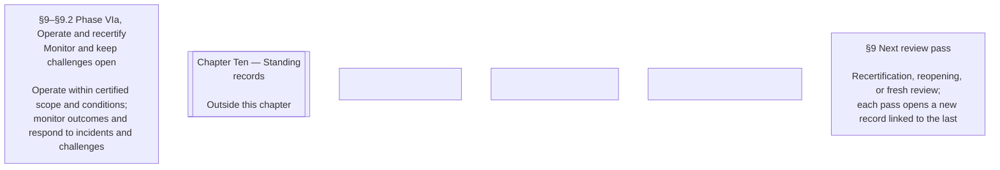

<!-- CHUNK-BEGIN ur__core_09.000_system_alignment_certification_evaluation__section_1_corpus_placement_overview.md bytes=4030 -->
<!-- AI-assisted translation draft; unreviewed. §1 corpus-placement overview, source lines 8–10; source SHA-256 4311e6ba74b7210f077c0bd4c8d21d8c9f517d2ada7b6d87288b39494dfeadd5. Draft only; do not synchronize into translations/. -->

# Chapter Nine Part A — §1 corpus-placement overview (ur)

## English source (lines 8–10)

> This file is **part of the Sentient Constitution** and is **binding only together** with the other numbered `core_*` files read as one text. It contains **Chapter Nine, Part A** — certification purpose, the process overview, and the first two phases of the process — **Frame** (system class) and **Evaluate** (whole-system evaluation in three sub-phases: the always-applicable evaluations, including data types and handling, in **§3**; the evaluations that apply where implicated in **§4**; and the Rights-Floor and domain evaluations that apply where triggered in **§5**) — **§1–§5**. The worked **Class A / B / C illustrations** (the system class profiles, §3.4.8, §5.1.5, §5.2.4, §5.3.7, §5.4.4, §5.5.5, and §5.6.4), including each one's **Reading across system classes** paragraph, are in [`core_09.010_system_alignment_certification_illustrations.md`](core_09.010_system_alignment_certification_illustrations.md); each keeps its Part A section number. The binding system-class-scaling and escalation rules those paragraphs illustrate stay in this file: system class scaling, including participation and proportionality, in §2.2; data-handling scaling in §3.4; and the **System class scaling and escalation** paragraph in each of §5.1–§5.6. The files of the whole chapter are listed in the table below.
>
> **Chapter Nine files.** Chapter Nine is split across four binding files read as one text. Part A, this file, opens the chapter; there is no separate index file.

## Translation draft

> یہ فائل **Sentient Constitution کا حصہ** ہے اور دوسری نمبر شدہ `core_*` فائلوں کے ساتھ ایک ہی متن کے طور پر پڑھے جانے پر ہی پابند ہے۔ اس میں **باب نہم، حصہ A** شامل ہے: تصدیق کا مقصد، عمل کا جائزہ، اور اس کے پہلے دو مراحل—**Frame** (نظامی درجہ) اور **Evaluate** (تین ذیلی مراحل میں پورے نظام کا جائزہ)—**§§1–5**۔ ان میں **§3** کے ہمیشہ لاگو جائزے (ڈیٹا کی اقسام اور ان کے استعمال سمیت)، **§4** کے متعلقہ ہونے پر لاگو جائزے، اور **§5** کے شرط پوری ہونے پر لاگو حقوق کی بنیاد اور شعبہ جاتی جائزے شامل ہیں۔ **درجہ A / B / C** کی تفصیلی مثالیں (نظامی درجے کے خاکے، §3.4.8، §5.1.5، §5.2.4، §5.3.7، §5.4.4، §5.5.5، §5.6.4)، ہر مثال کے **نظامی درجات کے درمیان مطالعے** والے پیراگراف سمیت، [`core_09.010_system_alignment_certification_illustrations.md`](core_09.010_system_alignment_certification_illustrations.md) میں ہیں؛ ہر مثال حصہ A کا اپنا دفعہ نمبر برقرار رکھتی ہے۔ ان پیراگراف میں واضح کیے گئے پابند درجہ وار پیمانے اور اضافے کے قواعد اسی فائل میں رہتے ہیں: شرکت اور تناسب سمیت نظامی درجے کے مطابق پیمانہ §2.2 میں؛ ڈیٹا کے استعمال کا پیمانہ §3.4 میں؛ اور §§5.1–5.6 میں ہر ایک کے **نظامی درجے کے مطابق پیمانہ اور اضافہ** والے پیراگراف میں۔ نیچے دی گئی جدول پورے باب کی فائلیں دکھاتی ہے۔
>
> **باب نہم کی فائلیں۔** باب نہم چار پابند فائلوں میں تقسیم ہے جنہیں ایک ساتھ پڑھا جاتا ہے۔ حصہ A، یعنی یہ فائل، باب کا آغاز کرتا ہے؛ الگ اشاریہ فائل نہیں ہے۔

<!-- CHUNK-END -->
<!-- CHUNK-BEGIN ur__core_09.000_system_alignment_certification_evaluation__section_1_corpus_file_table.md bytes=5591 -->
<!-- AI-assisted translation draft; unreviewed. §1 corpus-placement file table, source lines 12–17; source SHA-256 4311e6ba74b7210f077c0bd4c8d21d8c9f517d2ada7b6d87288b39494dfeadd5. Draft only; do not synchronize into translations/. -->

# Chapter Nine Part A — §1 corpus-placement file table (ur)

## English source (lines 12–17)

> | Part | File | Owns |
> |------|------|------|
> | **Part A — Evaluation** | [`core_09.000_system_alignment_certification_evaluation.md`](core_09.000_system_alignment_certification_evaluation.md) | §1–§5: purpose and process overview (with a chart of the whole certification process in its six phases), **Phase I Frame** (system class, how system class scales every evaluation, and pilot certification) and **Phase II Evaluate** (whole-system evaluation in three sub-phases: **IIa** always, in §3, including chartered scope versus functional boundaries and data types and handling; **IIb** where implicated, in §4; and **IIc** where triggered, the Rights-Floor and domain evaluations, in §5) |
> | **Part B — Record and process** | [`core_09.005_system_alignment_certification_record_process.md`](core_09.005_system_alignment_certification_record_process.md) | §6–§10: **Phase III Review** (forum roles, supervisory sequence, and the contestability chain), **Phase IV Decide** (certification outcomes, including the go-live gate), **Phase V Record** (the certification record and its integrity, including governing [System Charter](core_05.040_band_continuity.md#system-charter) fields), and **Phase VI Operate** (the challenge path; recertification and reopening; the standing bridge) — continuous chapter numbering from Part A §5 |
> | **Part C — Illustrations** | [`core_09.010_system_alignment_certification_illustrations.md`](core_09.010_system_alignment_certification_illustrations.md) | the illustrative system class profiles, §3.4, §3.4.8, §5.1.5, §5.2.4, §5.3.7, §5.4.4, §5.5.5, and §5.6.4: worked Class A / B / C walkthroughs for each Part A evaluation area, numbered to match Part A and linked both ways |
> | **Part D — Institutional alignment certification** | [`core_09.015_institutional_alignment_certification.md`](core_09.015_institutional_alignment_certification.md) | §11–§15: the same six phases for an **Institution** rather than a System — the institution class and the institutional evaluation (**Phases I and II**, §12), the forum roles, outcome, and **Institutional Certification Record** (**Phases III to V**, §13), and recertification, reopening, the cascade from System certifications, and the standing bridge (**Phase VI**, §14–§15). It cites each System's certification by link and does not repeat it, and it is not a licence — continuous chapter numbering from Part B §10 |

## Translation draft

| حصہ | فائل | دائرۂ کار |
|------|------|------|
| **Part A — Evaluation** | [`core_09.000_system_alignment_certification_evaluation.md`](core_09.000_system_alignment_certification_evaluation.md) | §§1–5: مقصد اور عمل کا خاکہ (تصدیق کے چھ مراحل کا چارٹ)، نیز مرحلہ I Frame (نظامی درجہ، ہر جائزے کی گہرائی پر درجے کا اثر، اور آزمائشی تصدیق) اور II Evaluate (تین ذیلی مراحل میں پورے نظام کا جائزہ: IIa ہمیشہ §3 میں—چارٹر کا دائرہ بمقابلہ عملی حدود اور ڈیٹا کی اقسام/استعمال سمیت؛ IIb جہاں متعلق ہو §4 میں؛ IIc شرط پوری ہونے پر §5 کے حقوق کی بنیاد اور شعبہ جاتی جائزے)۔ |
| **Part B — Record and process** | [`core_09.005_system_alignment_certification_record_process.md`](core_09.005_system_alignment_certification_record_process.md) | §§6–10: مرحلہ III Review (فورم کے کردار، نگرانی کی ترتیب، اور اعتراض کا سلسلہ)؛ IV Decide (تصدیق کے نتائج، آغازِ کار کی شرط سمیت)؛ V Record (تصدیقی ریکارڈ اور اس کی سالمیت، [System Charter](core_05.040_band_continuity.md#system-charter) کے حاکم خانے سمیت)؛ VI Operate (اعتراض کا راستہ، دوبارہ تصدیق اور دوبارہ کھولنا، standing پل) — حصہ A §5 سے مسلسل نمبرنگ۔ |
| **Part C — Illustrations** | [`core_09.010_system_alignment_certification_illustrations.md`](core_09.010_system_alignment_certification_illustrations.md) | نظامی درجات کے مثالی خاکے اور §§3.4، 3.4.8، 5.1.5، 5.2.4، 5.3.7، 5.4.4، 5.5.5، 5.6.4: حصہ A کے ہر جائزہ شعبے کے لیے A/B/C درجوں کی تفصیلی مثالیں؛ نمبر باہم ملتے ہیں اور روابط دونوں سمتوں میں ہیں۔ |
| **Part D — Institutional alignment certification** | [`core_09.015_institutional_alignment_certification.md`](core_09.015_institutional_alignment_certification.md) | §§11–15: نظام کے بجائے ادارے کے لیے وہی چھ مراحل—ادارہ جاتی درجہ اور جائزہ (I–II، §12)، فورم کے کردار، نتیجہ اور ادارہ جاتی تصدیقی ریکارڈ (III–V، §13)، دوبارہ تصدیق، دوبارہ کھولنا، نظامی تصدیقات کا تسلسل، اور standing پل (VI، §§14–15)۔ ہر نظام کی تصدیق کا حوالہ دیتا ہے، اسے دہراتا نہیں، اور لائسنس نہیں — حصہ B §10 سے مسلسل نمبرنگ۔ |

<!-- CHUNK-END -->
<!-- CHUNK-BEGIN ur__core_09.000_system_alignment_certification_evaluation__section_1_corpus_explanation.md bytes=9498 -->
<!-- AI-assisted translation draft; unreviewed. §1 corpus-placement explanatory prose, source lines 19–30; source SHA-256 4311e6ba74b7210f077c0bd4c8d21d8c9f517d2ada7b6d87288b39494dfeadd5. Draft only; do not synchronize into translations/. -->

# Chapter Nine Part A — §1 corpus-placement explanatory prose (ur)

## English source (lines 19–30)

> **How the two certifications relate.** System Alignment Certification (Parts A to C) is the certification of a System. Institutional alignment certification (Part D) is the certification of an Institution, which may run Systems or none. Part D cites each System's certification record by link and does not redo it; [Part D §11.1](core_09.015_institutional_alignment_certification.md#111-relation-to-system-alignment-certification) states the relation and [Part D §11.3](core_09.015_institutional_alignment_certification.md#113-no-permission-and-no-gate) states that it is not a licence.
>
> Generic **Chapter Nine** links in other files route to the appropriate part by section number.
>
> - **Constitutional owner (joint with Parts B and D):** forum-supervised **system alignment certification and related records** — evaluation domains (Part A); forum process, supervisory sequence, certification-record duties, certification outcomes and the go-live gate, the challenge path, recertification and reopening, and verified-input bridge to Chapter Ten (Part B); the same six phases for an Institution (Part D). Under the **oversight** Tetrad leg, SAC is one especially large, high-stakes audit process among others; auditing floors remain at **Article XVI** (*Audit, Transparency, and Independent Verification*) and Chapter Five [Auditability](core_05.050_band_oversight.md#auditability).
> - **Verification substrate owner:** [Chapter Four — Burden of Proof, Traceability, and Verification](core_04.000_burden_traceability_verification.md#chapter-four-burden-of-proof-traceability-and-verification) (within Chapters Two through Four) owns burden allocation, compliance evidence, definition traceability, observability, and security-constrained verification. Chapter Nine **applies** that discipline to system alignment certification records; it does **not** restate Chapter Four sections **1** through **5**.
> - **Auditing home (not relocated here):** **Article XVI** (*Audit, Transparency, and Independent Verification*), **Def.O1** (*Transparency, Auditability, and Verification*), and **CJS-5.110 §3 and CJS-5.115 §3** (*Audit process home*)–**CJS-5.110 §5** own auditing floors and operational terms. Chapter Nine runs one especially large SAC audit process that must satisfy those floors; it does not own all auditing.
> - **Implementation owner:** system-class handling, CS-6.345, and forum-process detail in designated implementation files must remain consistent with Chapter Nine and may be stricter where the corpus already provides a [Fullest Protective Effect](core_05.045_band_integrative.md#fullest-protective-effect) rule.
> - **Anti-relocation rule:** Part A does not restate Chapter Five canonical definitions, Chapter Three anti-evasion discipline (see [Part B §9.3](core_09.005_system_alignment_certification_record_process.md#93-non-evasion)), Chapter Ten contribution or standing measurement, or Chapter Eleven standing effects. **[Part B §10](core_09.005_system_alignment_certification_record_process.md#10-relationship-to-standing)** states the standing bridge boundary explicitly.
>
> **Upstream:** Chapter Five definitions; Chapters Two through Four record, verification, burden, and traceability of definitions to results; and [Chapter Eight](core_08.000_functional_independence_separation_of_duties.md#chapter-eight-functional-independence-and-separation-of-duties), whose separation-of-duties requirement governs every materially binding certification act.
> **Downstream:** [Part B](core_09.005_system_alignment_certification_record_process.md#chapter-nine-part-b-system-alignment-certification--record-and-process) (*forum process, record, outcomes, and standing bridge*); Chapter Ten standing records and verified inputs; Chapter Eleven standing effects; Chapter Thirteen forum supervision and system alignment certification pathways.

## Translation draft

**دونوں تصدیقوں کا تعلق۔** System Alignment Certification (حصے A تا C) کسی نظام کی تصدیق ہے۔ ادارہ جاتی ہم آہنگی کی تصدیق (حصہ D) کسی Institution کی تصدیق ہے، جو Systems چلا بھی سکتی ہے یا کوئی بھی نہ چلاتی ہو۔ حصہ D ہر نظام کے تصدیقی ریکارڈ کا لنک دیتا ہے، اسے دوبارہ نہیں کرتا؛ [Part D §11.1](core_09.015_institutional_alignment_certification.md#111-relation-to-system-alignment-certification) تعلق بیان کرتا ہے اور [Part D §11.3](core_09.015_institutional_alignment_certification.md#113-no-permission-and-no-gate) واضح کرتا ہے کہ یہ لائسنس نہیں۔
>
> دوسری فائلوں میں **Chapter Nine** کے عمومی روابط، دفعہ نمبر کے مطابق مناسب حصے تک لے جاتے ہیں۔
>
> - **آئینی مالک (حصہ B اور D کے ساتھ مشترک):** فورم کی نگرانی میں نظامی ہم آہنگی کی تصدیق اور متعلقہ ریکارڈ — جائزے کے شعبے (حصہ A)؛ فورم کا عمل، نگرانی کی ترتیب، تصدیقی ریکارڈ کی ذمہ داریاں، نتائج اور آغازِ کار کی شرط، اعتراض کا راستہ، دوبارہ تصدیق اور دوبارہ کھولنا، اور باب دہم تک تصدیق شدہ اِن پٹس کا پل (حصہ B)؛ Institution کے لیے وہی چھ مراحل (حصہ D)۔ Tetrad کے **نگرانی** والے جزو میں SAC کئی آڈٹ عملوں میں سے ایک خاص طور پر بڑا اور بلند خطرے والا عمل ہے؛ آڈٹ کی کم از کم بنیادیں **Article XVI** (*Audit, Transparency, and Independent Verification*) اور باب پنجم کے [Auditability](core_05.050_band_oversight.md#auditability) میں رہتی ہیں۔
> - **تصدیقی بنیاد کا مالک:** [Chapter Four — Burden of Proof, Traceability, and Verification](core_04.000_burden_traceability_verification.md#chapter-four-burden-of-proof-traceability-and-verification) (باب دوم تا چہارم کے اندر) بارِ ثبوت کی تقسیم، تعمیل کے شواہد، تعریفوں کی سراغ پذیری، مشاہدہ پذیری، اور سلامتی کی پابندیوں کے تحت تصدیق کا مالک ہے۔ باب نہم یہ نظم نظامی ہم آہنگی کے تصدیقی ریکارڈ پر لاگو کرتا ہے؛ باب چہارم کی **1** تا **5** دفعات کو دوبارہ بیان نہیں کرتا۔
> - **آڈٹ کا اصل مقام (یہاں منتقل نہیں):** **Article XVI** (*Audit, Transparency, and Independent Verification*)، **Def.O1** (*Transparency, Auditability, and Verification*)، اور **CJS-5.110 §3 اور CJS-5.115 §3** (*Audit process home*)–**CJS-5.110 §5** آڈٹ کی کم از کم بنیادوں اور عملی اصطلاحات کے مالک ہیں۔ باب نہم ایک خاص طور پر بڑے SAC آڈٹ عمل کو چلاتا ہے جسے یہ بنیادیں پوری کرنی ہوتی ہیں؛ یہ تمام آڈٹ کا مالک نہیں۔
> - **نفاذ کا مالک:** نامزد نفاذی فائلوں میں نظامی درجے کا برتاؤ، CS-6.345، اور فورم کے عمل کی تفصیل باب نہم سے ہم آہنگ رہنی چاہیے؛ جہاں متن میں پہلے سے [Fullest Protective Effect](core_05.045_band_integrative.md#fullest-protective-effect) کا قاعدہ موجود ہو وہاں یہ زیادہ سخت ہو سکتی ہے۔
> - **منتقلی مخالف قاعدہ:** حصہ A باب پنجم کی بنیادی تعریفیں، باب سوم کا راہِ فرار مخالف نظم ([Part B §9.3](core_09.005_system_alignment_certification_record_process.md#93-non-evasion) دیکھیں)، باب دہم میں contribution یا standing کی پیمائش، یا باب یازدہم کے standing اثرات دوبارہ بیان نہیں کرتا۔ **[Part B §10](core_09.005_system_alignment_certification_record_process.md#10-relationship-to-standing)** standing پل کی حد واضح طور پر بتاتا ہے۔
>
> **پیش رو ماخذ:** باب پنجم کی تعریفیں؛ باب دوم تا چہارم کے ریکارڈ، تصدیق، بارِ ثبوت، اور تعریفوں سے نتائج تک سراغ پذیری؛ نیز [Chapter Eight](core_08.000_functional_independence_separation_of_duties.md#chapter-eight-functional-independence-and-separation-of-duties)، جس کی فرائض کی علیحدگی کی شرط ہر مادی طور پر پابند تصدیقی عمل پر لاگو ہوتی ہے۔
> **بعد کے ماخذ:** [Part B](core_09.005_system_alignment_certification_record_process.md#chapter-nine-part-b-system-alignment-certification--record-and-process) (*فورم کا عمل، ریکارڈ، نتائج، اور standing پل*)؛ باب دہم کے standing ریکارڈ اور تصدیق شدہ اِن پٹس؛ باب یازدہم کے standing اثرات؛ باب سیزدہم کی فورم نگرانی اور نظامی ہم آہنگی کے تصدیقی راستے۔

<!-- CHUNK-END -->
<!-- CHUNK-BEGIN ur__core_09.000_system_alignment_certification_evaluation__section_1_heading.md bytes=375 -->
<!-- AI-assisted translation draft; unreviewed. §1 heading, source line 44; source SHA-256 4311e6ba74b7210f077c0bd4c8d21d8c9f517d2ada7b6d87288b39494dfeadd5. Draft only; do not synchronize into translations/. -->

# Chapter Nine Part A — §1 heading (ur)

## English source (lines 44–45)

### 1. Purpose and Role


## Translation draft

### 1. مقصد اور کردار

<!-- CHUNK-END -->
<!-- CHUNK-BEGIN ur__core_09.000_system_alignment_certification_evaluation__section_1_trace.md bytes=12271 -->
<!-- AI-assisted translation draft; unreviewed. §1 trace, source lines 46–95; source SHA-256 4311e6ba74b7210f077c0bd4c8d21d8c9f517d2ada7b6d87288b39494dfeadd5. Draft only; do not synchronize into translations/. -->

# Chapter Nine Part A — §1 trace (ur)

## English source (lines 46–95)

<details>
<summary><strong><span style="color: #2563eb;">Trace</span></strong></summary>

- Upstream:
  - [Preamble — constitutional owner register](core_00.000_preamble.md#4-principles-definitions-and-rights) and
  - [Authority Stack and Internal Hierarchy](core_05.045_band_integrative.md#authority-stack-and-internal-hierarchy);
  - [Constitutional Tetrad](core_00.000_preamble.md#constitutional-tetrad);
  - [Two Constitutional Aims](core_00.000_preamble.md#two-constitutional-aims);
  - [material stake](core_00.000_preamble.md#material-stake);
  - [Proportionality](core_05.035_band_accountability.md#proportionality) and
  - [Substantive Fairness](core_05.055_band_participation.md#substantive-fairness) (Chapter Five); Participation measurement family (*voice, access, and contest paths*);
  - [Chapter One §16 Stewardship In Depth](core_01.010_stewardship_capacity_principles.md#16-stewardship-in-depth) (1.010 §16);
  - [Chapter One §12 Systemic Evaluation Requirement](core_01.000_values_principles.md#12-systemic-evaluation-requirement) (1.000 §12) (*principle-layer whole-system evaluation lens — not one corner alone*); Chapters Two through Four;
  - [Chapter Five](core_05.000_definitions_home.md#chapter-five-foundational-definitions) (5.000) (*canonical definitions*);
  - [Chapter Eight §2 Four-Seat Constitutional Requirement](core_08.000_functional_independence_separation_of_duties.md#2-four-seat-constitutional-requirement) (8.000 §2);
  - [System Alignment Certification](core_05.040_band_continuity.md#system-alignment-certification) (Chapter Five canonical term; non-operative shorthand **SAC**);
  - [System Certification Record](core_05.040_band_continuity.md#system-certification-record) (Chapter Five meaning).
- Downstream:
  - [§2](#2-system-class-evaluation) (*system class evaluation*);
  - [Part B §9.1](core_09.005_system_alignment_certification_record_process.md#91-challenging-a-certification) (9.005 §9.1) (*challenging a certification*); and
  - [Part C system class profiles](core_09.010_system_alignment_certification_illustrations.md#illustrative-system-class-profiles-non-exhaustive) (9.010) (*illustrative system class profiles*);
  - [Part C whole-system walkthroughs](core_09.010_system_alignment_certification_illustrations.md#illustrative-whole-system-application-by-system-class-non-exhaustive) (9.010) (*worked whole-system examples by system class*);
  - [§3.4.8](core_09.010_system_alignment_certification_illustrations.md#348-illustrative-data-handling-application-by-system-class-non-exhaustive) (*worked data-handling examples by system class*);
  - [§5.1.5](core_09.010_system_alignment_certification_illustrations.md#515-illustrative-ecological-footprint-application-by-system-class-non-exhaustive) (*worked ecological-footprint examples by system class*);
  - [§5.2.4](core_09.010_system_alignment_certification_illustrations.md#524-illustrative-educational-capability-application-by-system-class-non-exhaustive) (*worked educational-capability examples by system class*);
  - [§5.3.7](core_09.010_system_alignment_certification_illustrations.md#537-illustrative-cross-system-support-application-by-system-class-non-exhaustive) (*worked cross-system-support examples by system class*);
  - [§5.4.4](core_09.010_system_alignment_certification_illustrations.md#544-illustrative-nondiscrimination-application-by-system-class-non-exhaustive) (*worked nondiscrimination examples by system class*);
  - [§5.5.5](core_09.010_system_alignment_certification_illustrations.md#555-illustrative-accessibility-application-by-system-class-non-exhaustive) (*worked accessibility examples by system class*);
  - [§5.6.4](core_09.010_system_alignment_certification_illustrations.md#564-illustrative-trustworthiness-application-by-system-class-non-exhaustive) (*worked trustworthiness examples by system class*);
  - [§3](#3-whole-system-certification-evaluation) (*whole-system certification evaluation factors*);
  - [§3.4](#34-data-types-and-handling-evaluation) through
  - [§5.6](#56-trustworthiness-and-system-reliance-integrity-evaluation) (*domain evaluations*);
  - [Part B §6](core_09.005_system_alignment_certification_record_process.md#6-forum-process) (9.005 §6) (*supervisory sequence and contestability chain*);
  - [Part B §6.1](core_09.005_system_alignment_certification_record_process.md#61-forum-supervision-and-component-roles) (9.005 §6.1) (*forum component roles*);
  - [Part B §8](core_09.005_system_alignment_certification_record_process.md#8-system-certification-record) (9.005 §8) (*certification record contents*);
  - [Part B §8.2](core_09.005_system_alignment_certification_record_process.md#82-record-integrity-transparency-and-auditability) (9.005 §8.2) (*record integrity requirements*);
  - [Part B §7](core_09.005_system_alignment_certification_record_process.md#7-certification-outcomes) (9.005 §7) (*reopening and anti-evasion*);
  - [Part B §10](core_09.005_system_alignment_certification_record_process.md#10-relationship-to-standing) (9.005 §10) (*standing-record bridge*);
  - [Chapter Ten](core_11.000_standing_assessment.md#chapter-eleven-contribution-violation-and-standing-model--measurement) (10.000) (*standing records and verified-input gate*);
  - [Chapter Eleven](core_12.000_standing_integration.md#chapter-twelve-standing-effects-and-integration) (11.000) (*standing effects and integration*);
  - [Chapter Thirteen](core_14.000_forum.md#chapter-fourteen-forums-and-jurisdiction) (13.000) (*forum supervision, certification, alignment certification, and review*).
- Read with:
  - **[CS-9.305](corpus_systems/cs_09.305_system_classification_machinery.md#cs-9305-part-a-system-classification-machinery) (*System classification machinery*) and [CS-9.310 — System impact classifications](corpus_systems/cs_09.310_system_impact_classifications.md#cs-9310-part-b-system-impact-classifications)**, **[CS-6.305](corpus_systems/cs_06.305_information_types_and_handling.md#cs-6305-part-a-information-types-and-handling) (*Information types and handling*) and [CS-6.310 — Data classifications](corpus_systems/cs_06.310_data_classifications.md#cs-6310-part-b-data-classifications)**, and
  - **CS-6.345** (*System lifecycle*);
  - **CF-13.415** (*Routing operations, transfer, certification, and representative treatment*) and
  - **CF-13.425** (*Integrity safeguards, anti-capture operations, and anti-self-judging support*); **Article XVI** (*Audit, Transparency, and Independent Verification*) and
  - [Auditability](core_05.050_band_oversight.md#auditability) (*auditing floors — SAC is one especially large audit process under oversight, not the sole auditing home*); **CJS-5.110 §3 (*Oversight: auditability and reconstructability terms (annex)*) and CJS-5.115 §3** (*Audit process home*)–
  - **CJS-5.110 §5** (*Oversight: independent verification and claim-integrity terms*).

</details>

## Translation draft

#### حوالہ جاتی نقشہ

یہ نقشہ اس حصے کی آئینی اور اختیاری بنیاد دکھا کر اسے جائزے، درجہ بندی، نظرثانی کے راستوں، ریکارڈ، نتائج اور آڈٹ سے جوڑتا ہے؛ ساتھ پڑھے جانے والے عملیاتی دستاویزات بھی بتاتا ہے۔

**حوالہ جاتی نقشہ — upstream canonical sources:** [Preamble — constitutional owner register](core_00.000_preamble.md#4-principles-definitions-and-rights); [Authority Stack and Internal Hierarchy](core_05.045_band_integrative.md#authority-stack-and-internal-hierarchy); [Constitutional Tetrad](core_00.000_preamble.md#constitutional-tetrad); [Two Constitutional Aims](core_00.000_preamble.md#two-constitutional-aims); [material stake](core_00.000_preamble.md#material-stake); [Proportionality](core_05.035_band_accountability.md#proportionality); [Substantive Fairness](core_05.055_band_participation.md#substantive-fairness); [Chapter One §16 Stewardship In Depth](core_01.010_stewardship_capacity_principles.md#16-stewardship-in-depth); [Chapter One §12 Systemic Evaluation Requirement](core_01.000_values_principles.md#12-systemic-evaluation-requirement); [Chapter Five](core_05.000_definitions_home.md#chapter-five-foundational-definitions); [Chapter Eight §2 Four-Seat Constitutional Requirement](core_08.000_functional_independence_separation_of_duties.md#2-four-seat-constitutional-requirement); [System Alignment Certification](core_05.040_band_continuity.md#system-alignment-certification); [System Certification Record](core_05.040_band_continuity.md#system-certification-record)

**حوالہ جاتی نقشہ — downstream routes and related records:** [§2](#2-system-class-evaluation); [Part B §9.1](core_09.005_system_alignment_certification_record_process.md#91-challenging-a-certification); [Part C system class profiles](core_09.010_system_alignment_certification_illustrations.md#illustrative-system-class-profiles-non-exhaustive); [Part C whole-system walkthroughs](core_09.010_system_alignment_certification_illustrations.md#illustrative-whole-system-application-by-system-class-non-exhaustive); [§3.4.8](core_09.010_system_alignment_certification_illustrations.md#348-illustrative-data-handling-application-by-system-class-non-exhaustive); [§5.1.5](core_09.010_system_alignment_certification_illustrations.md#515-illustrative-ecological-footprint-application-by-system-class-non-exhaustive); [§5.2.4](core_09.010_system_alignment_certification_illustrations.md#524-illustrative-educational-capability-application-by-system-class-non-exhaustive); [§5.3.7](core_09.010_system_alignment_certification_illustrations.md#537-illustrative-cross-system-support-application-by-system-class-non-exhaustive); [§5.4.4](core_09.010_system_alignment_certification_illustrations.md#544-illustrative-nondiscrimination-application-by-system-class-non-exhaustive); [§5.5.5](core_09.010_system_alignment_certification_illustrations.md#555-illustrative-accessibility-application-by-system-class-non-exhaustive); [§5.6.4](core_09.010_system_alignment_certification_illustrations.md#564-illustrative-trustworthiness-application-by-system-class-non-exhaustive); [§3](#3-whole-system-certification-evaluation); [§3.4](#34-data-types-and-handling-evaluation); [§5.6](#56-trustworthiness-and-system-reliance-integrity-evaluation); [Part B §6](core_09.005_system_alignment_certification_record_process.md#6-forum-process); [Part B §6.1](core_09.005_system_alignment_certification_record_process.md#61-forum-supervision-and-component-roles); [Part B §8](core_09.005_system_alignment_certification_record_process.md#8-system-certification-record); [Part B §8.2](core_09.005_system_alignment_certification_record_process.md#82-record-integrity-transparency-and-auditability); [Part B §7](core_09.005_system_alignment_certification_record_process.md#7-certification-outcomes); [Part B §10](core_09.005_system_alignment_certification_record_process.md#10-relationship-to-standing); [Chapter Ten](core_11.000_standing_assessment.md#chapter-eleven-contribution-violation-and-standing-model--measurement); [Chapter Eleven](core_12.000_standing_integration.md#chapter-twelve-standing-effects-and-integration); [Chapter Thirteen](core_14.000_forum.md#chapter-fourteen-forums-and-jurisdiction)

**حوالہ جاتی نقشہ — operational materials to read with this section:** [CS-9.305](corpus_systems/cs_09.305_system_classification_machinery.md#cs-9305-part-a-system-classification-machinery); [CS-9.310 — System impact classifications](corpus_systems/cs_09.310_system_impact_classifications.md#cs-9310-part-b-system-impact-classifications); [CS-6.305](corpus_systems/cs_06.305_information_types_and_handling.md#cs-6305-part-a-information-types-and-handling); [CS-6.310 — Data classifications](corpus_systems/cs_06.310_data_classifications.md#cs-6310-part-b-data-classifications); [Auditability](core_05.050_band_oversight.md#auditability)

<!-- CHUNK-END -->
<!-- CHUNK-BEGIN ur__core_09.000_system_alignment_certification_evaluation__purpose_adjuncts.md bytes=6746 -->
<!-- AI-assisted translation draft; unreviewed. Selected §1 passages, source lines 99 and 107–114; source SHA-256 4311e6ba74b7210f077c0bd4c8d21d8c9f517d2ada7b6d87288b39494dfeadd5. -->

# Chapter Nine Part A — §1 plain-terms excerpt

**Status:** AI-assisted draft; unreviewed. English source remains controlling.

## English source

When a system really matters to sentients' lives, certification has to be **proportionate** — as demanding as the system's real impact, dependency, and risk require, not a one-size-fits-all checklist or a rubber stamp. It also has to be **participatory** — affected sentients and communities must be able to see what was reviewed, understand what was decided, and challenge it when something is wrong. Forums review evidence, write it down in a certification record, and require re-checks on a schedule that matches how risky the system is. Classes A, B, and C get the full process and Class L a lighter one. Class P is encouraged to use it, and must once it is reclassified to Class L or higher (that is, its effects reach beyond a private unit) or its operator claims constitutional compliance.

## ur draft

جب کوئی نظام حساس مخلوقات کی زندگیوں پر واقعی اہم اثر ڈالتا ہو تو اس کی سند **متناسب** ہونی چاہیے—نظام کے حقیقی اثر، اس پر انحصار اور خطرے کے تقاضوں کے مطابق سخت؛ نہ کہ سب کے لیے ایک جیسی جانچ فہرست یا رسمی منظوری کی مہر۔ یہ **شرکت پر مبنی** بھی ہونی چاہیے—متاثرہ مخلوقات اور برادریاں دیکھ سکیں کہ کیا جانچا گیا، فیصلہ سمجھ سکیں اور غلطی کی صورت میں اسے چیلنج کر سکیں۔ فورم شواہد کا جائزہ لیتے، انہیں سندی ریکارڈ میں درج کرتے اور نظام کے خطرے سے مطابقت رکھنے والے شیڈول کے مطابق دوبارہ جانچ کا تقاضا کرتے ہیں۔ A، B اور C کلاسوں کے لیے مکمل عمل، جبکہ L کلاس کے لیے ہلکا عمل ہوتا ہے۔ P کلاس کو اس عمل کے استعمال کی ترغیب دی جاتی ہے؛ L یا اس سے اوپر دوبارہ درجہ بند ہونے پر (یعنی اثرات نجی اکائی سے باہر پہنچنے پر) یا اس کے منتظم کے آئینی تعمیل کا دعویٰ کرنے پر یہ عمل لازم ہو جاتا ہے۔


### English source — Flourishing

- **[Flourishing](core_00.000_preamble.md#flourishing)** — certification verifies that certification or continued reliance would not quietly defeat Rights Floors or block fair participation in constitutionally relevant life;

### ur draft

- **[نشوونما](core_00.000_preamble.md#flourishing)** — سند کاری یہ جانچتی ہے کہ سند دینا یا انحصار جاری رکھنا خاموشی سے حقوق کی کم از کم حدود کو ناکام نہ کرے یا آئینی طور پر متعلقہ زندگی میں منصفانہ شرکت نہ روکے؛


### English source — Continuity criterion

- **[Continuity](core_00.000_preamble.md#continuity)** — certification verifies durable, non-regressive supply that sustains rather than depletes healthy natural systems ([Ecological Integrity](core_05.040_band_continuity.md#ecological-integrity), including [Ecological Recovery Capacity](core_05.040_band_continuity.md#ecological-recovery-capacity)), and system-class-scaled recertification where shared systems gate or sustain delivery;

### ur draft

- **[تسلسل](core_00.000_preamble.md#continuity)** — سند کاری پائیدار، غیر رجعتی فراہمی کی تصدیق کرتی ہے جو صحت مند قدرتی نظاموں کو ختم کرنے کے بجائے سہارا دے ([ماحولیاتی سالمیت](core_05.040_band_continuity.md#ecological-integrity)، بشمول [ماحولیاتی بحالی کی صلاحیت](core_05.040_band_continuity.md#ecological-recovery-capacity))، اور جہاں مشترکہ نظام فراہمی کو محدود یا برقرار رکھتے ہوں وہاں نظامی کلاس کے مطابق دوبارہ سند کاری؛


### English source — Participation criterion

- **Participation** — affected sentients and communities can understand, contest, and take part in review paths that matter to them;

### ur draft

- **شرکت** — متاثرہ حساس مخلوقات اور برادریاں اپنے لیے اہم جائزہ راستوں کو سمجھ، چیلنج اور ان میں حصہ لے سکتی ہیں؛


### English source — Oversight criterion

- **Oversight** — records, evidence, and assumptions are visible and auditable enough for independent checking; certification itself is one especially large audit process under that oversight duty, not the only one;

### ur draft

- **نگرانی** — ریکارڈ، شواہد اور مفروضے آزادانہ جانچ کے لیے کافی نمایاں اور قابلِ آڈٹ ہوتے ہیں؛ سند کاری خود نگرانی کی ذمہ داری کے تحت ایک بڑا آڈٹ عمل ہے، مگر آڈٹ کا واحد مقام نہیں؛


### English source — Accountability criterion

- **Accountability** — defects, misclassification, and floor-defeating operation route to remedy, conditions, withdrawal, or standing input where the facts support it;

### ur draft

- **جوابدہی** — خامیاں، غلط درجہ بندی اور حقوق کی کم از کم حدود کو ناکام کرنے والا عمل، جہاں حقائق تائید کریں، تلافی، شرائط، واپسی یا حیثیت کے جائزے کے لیے معلومات کی طرف لے جاتا ہے؛


### English source — Timeliness criterion

- **Timeliness** — review and contest windows keep certification from going stale while harm can still be prevented or reversed.

### ur draft

- **بروقتی** — جائزے اور اعتراض کی مدت سند کو اس وقت فرسودہ نہیں ہونے دیتی جب نقصان کو اب بھی روکا یا پلٹا جا سکتا ہو۔


### English source — Tetrad introduction

Certification implements the [Two Constitutional Aims](core_00.000_preamble.md#two-constitutional-aims) through the [Constitutional Tetrad](core_00.000_preamble.md#constitutional-tetrad):

### ur draft

سند کاری [دو آئینی مقاصد](core_00.000_preamble.md#two-constitutional-aims) کو [آئینی چہارگانہ اصول](core_00.000_preamble.md#constitutional-tetrad) کے ذریعے نافذ کرتی ہے:

<!-- CHUNK-END -->
<!-- CHUNK-BEGIN ur__core_09.000_system_alignment_certification_evaluation__section_1_purpose.md bytes=1470 -->
<!-- AI-assisted translation draft; unreviewed. Complete purpose statement excerpt, source lines 101–105; source SHA-256 4311e6ba74b7210f077c0bd4c8d21d8c9f517d2ada7b6d87288b39494dfeadd5. This is an excerpt, not a complete §1 translation. -->

**نظامی ہم آہنگی کی توثیق** ایک متعین دائرۂ کار اور جائزے کے شیڈول کے لیے ایک سوال کا جواب دینے کے لیے موجود ہے: کیا نظام نے توثیق، مشروط توثیق، تصدیق، دوبارہ توثیق، مسلسل انحصار، تعیناتی، یا شرائط سے مادی رہائی کے لیے کافی آئینی ہم آہنگی دکھائی ہے؟

- توثیق مقبولیت کا اسکور، ہمیشہ کے لیے اجازت نامہ، یا حقوق کے جائزے سے بچنے کا طریقہ نہیں۔
- یہ اس وقت نظام کی ہم آہنگی کے بارے میں معلوم باتوں کا وقت-محدود اور چیلنج کے قابل بیان ہے۔
- چوکڑی کی **نگرانی** ٹانگ کے تحت نگرانی کے لیے آڈٹ لازم ہے؛ نظامی ہم آہنگی کی توثیق دیگر آڈٹ عملوں میں ایک خاص طور پر بڑا، اونچے مادی داؤ والا عمل ہے — آڈٹ کا واحد گھر نہیں (**دفعہ XVI** (*آڈٹ، شفافیت، اور آزادانہ تصدیق*)، [آڈٹ پذیری](core_05.050_band_oversight.md#auditability)).

<!-- CHUNK-END -->
<!-- CHUNK-BEGIN ur__core_09.000_system_alignment_certification_evaluation__section_1_subsection_headings.md bytes=811 -->
<!-- AI-assisted translation draft; unreviewed. §1.1/§1.2 visible subsection headings, source lines 116–119 and 144–148; source SHA-256 4311e6ba74b7210f077c0bd4c8d21d8c9f517d2ada7b6d87288b39494dfeadd5. Draft only; anchors/blank layout are structural. Do not synchronize into translations/. -->

# Chapter Nine Part A — §1.1 and §1.2 subsection headings (ur)

## English source

### Lines 116–119

<a id="11-certification-as-an-audit-process-scaled-by-class"></a>

#### 1.1 Certification as an audit process, scaled by class


### Lines 144–148


<a id="12-certification-at-a-glance"></a>

#### 1.2 Certification at a glance


## Translation draft

#### 1.1 نظامی درجے کے مطابق پیمانہ بند آڈٹ عمل کے طور پر تصدیق

#### 1.2 تصدیق ایک نظر میں

<!-- CHUNK-END -->
<!-- CHUNK-BEGIN ur__core_09.000_system_alignment_certification_evaluation__section_1_audit_scope.md bytes=3711 -->
<!-- AI-assisted translation draft; unreviewed. §1.1 audit mechanism and sibling audit modes, source lines 120–130; source SHA-256 4311e6ba74b7210f077c0bd4c8d21d8c9f517d2ada7b6d87288b39494dfeadd5. -->

# Chapter Nine Part A — §1.1 certification audit process excerpt (ur)

## English source

As an oversight mechanism, certification is one especially large audit process under [Auditability](core_05.050_band_oversight.md#auditability) and **Article XVI** (*Audit, Transparency, and Independent Verification*):

- It is forum-supervised, multi-domain, and status-granting.
- It may integrate the results of sibling audit modes, and it does not absorb or replace them. Each keeps its own owner, named in the [sibling audit modes map](corpus_joint_structure/cjs_05.115_audit_process.md#sibling-audit-modes-owner-map) of the audit process home:
  - System Data Types Record audits under **CS-6.305 (*Information types and handling*) and CS-6.310** (*Data classifications*)
  - System Classification Record audits under **CS-9.305 (*System classification machinery*) and CS-9.310** (*System impact classifications*)
  - steward assurance reviews under **CS-14.305** (*Critical system stewardship*)
  - continuous audit under **CS-6.345** (*System lifecycle*) ACA
  - complexity audits under **CS-6.315** (*Comprehensibility and complexity stewardship*) and **Article XXIII-B** (*Complexity Audit and Modularity Requirements*)
  - claim verification under **CJS-5.110 §5** (*Oversight: independent verification and claim-integrity terms*)
- You can still run any of these checks on their own, without going through certification. Certification doesn't replace them.

## ur draft

نگرانی کے طریقۂ کار کے طور پر، تصدیق [قابلِ آڈٹ ہونے](core_05.050_band_oversight.md#auditability) اور **Article XVI** (*Audit, Transparency, and Independent Verification*) کے تحت خاص طور پر بڑا آڈٹ عمل ہے:

- یہ فورم کی نگرانی میں ہوتا ہے، متعدد شعبوں پر مشتمل ہے اور حیثیت عطا کرتا ہے۔
- یہ ہمسایہ آڈٹ طریقوں کے نتائج کو یکجا کر سکتا ہے، مگر انہیں اپنے اندر جذب یا ان کی جگہ نہیں لیتا۔ ہر طریقے کا اپنا مالک رہتا ہے، جس کا نام آڈٹ عمل کی بنیادی دستاویز میں [ہمسایہ آڈٹ طریقوں کے نقشے](corpus_joint_structure/cjs_05.115_audit_process.md#sibling-audit-modes-owner-map) میں درج ہے:
  - System Data Types Record کے آڈٹ **CS-6.305 (*معلومات کی اقسام اور ان کا طریقۂ کار*) اور CS-6.310** (*ڈیٹا کی درجہ بندیاں*) کے تحت
  - System Classification Record کے آڈٹ **CS-9.305 (*سسٹم کی درجہ بندی کا طریقۂ کار*) اور CS-9.310** (*سسٹم کے اثرات کی درجہ بندیاں*) کے تحت
  - سرپرست کی یقین دہانی کے جائزے **CS-14.305** (*اہم نظاموں کی سرپرستی*) کے تحت
  - مسلسل آڈٹ **CS-6.345** (*سسٹم لائف سائیکل*) ACA کے تحت
  - پیچیدگی کے آڈٹ **CS-6.315** (*قابلِ فہمیت اور پیچیدگی کی سرپرستی*) اور **Article XXIII-B** (*پیچیدگی کے آڈٹ اور ماڈیولرٹی کے تقاضے*) کے تحت
  - دعووں کی تصدیق **CJS-5.110 §5** (*نگرانی: آزادانہ تصدیق اور دعوے کی سالمیت کی شرائط*) کے تحت
- آپ تصدیق کے عمل سے گزرے بغیر بھی ان میں سے ہر جانچ الگ سے کر سکتے ہیں۔ تصدیق ان کی جگہ نہیں لیتی۔

<!-- CHUNK-END -->
<!-- CHUNK-BEGIN ur__core_09.000_system_alignment_certification_evaluation__section_1_class_scaling.md bytes=4510 -->
<!-- AI-assisted translation draft; unreviewed. Chapter Nine Part A §1 class scaling and cadence, source lines 132–143; source SHA-256 4311e6ba74b7210f077c0bd4c8d21d8c9f517d2ada7b6d87288b39494dfeadd5. Draft only; do not synchronize into translations/. -->

**Current English passage:**

Certification depth, record burden, certification interval, stakeholder review, and contest paths must scale with [material stake](core_00.000_preamble.md#material-stake) under [Proportionality](core_05.035_band_accountability.md#proportionality):

The process applies by impact class, as the [reclassification requirement](corpus_systems/cs_09.305_system_classification_machinery.md#35-reclassification-requirement) of **CS-9.305** (*System classification machinery*) sets out:

- **Class A, Class B, and Class C:** these systems carry the highest impact, dependency, and risk, and whole-system evaluation under [§3 Whole-System Certification Evaluation](#3-whole-system-certification-evaluation), [§4 Evaluations Where Implicated](#4-evaluations-where-implicated), and [§5 Rights-Floor and Domain Evaluations](#5-rights-floor-and-domain-evaluations), each as its own sub-phase applies, is mandatory at full depth;
- **Class L:** the same evaluation is mandatory but proportionate, with a lower default re-check cadence and simpler records where CS-9.305 (*System classification machinery*) and CS-9.310 (*System impact classifications*) permits; and
- **Class P:** the process is encouraged while the system is validly Class P, and a Class P system may use it voluntarily. It becomes mandatory on reclassification to Class L or higher, or where the operator voluntarily asserts constitutional compliance for the system.

The certification interval, and the financial, resource, or special audit that falls at its midpoint, are set by class in [Chapter Thirteen §6 Timely resolution, materiality tiers, and anti-delay discipline](core_14.000_forum.md#review-cadence) (*Review cadence*). This chapter does not restate the numbers.

**Proposed locale translation:**

تصدیق کی گہرائی، ریکارڈ کا بوجھ، تصدیق کا وقفہ، متعلقہ فریقوں کا جائزہ، اور اعتراض کے راستے [مادی اہمیت](core_00.000_preamble.md#material-stake) کے مطابق [تناسب](core_05.035_band_accountability.md#proportionality) کے تحت ہوں گے:

یہ عمل اثر کی جماعت کے مطابق لاگو ہوگا، جیسا کہ **CS-9.305** (*نظام کی درجہ بندی کا طریقۂ کار*) کی [دوبارہ درجہ بندی کی شرط](corpus_systems/cs_09.305_system_classification_machinery.md#35-reclassification-requirement) مقرر کرتی ہے:

- **جماعت A، B، اور C:** ان نظاموں کا اثر، انحصار اور خطرہ سب سے زیادہ ہے۔ پورے نظام کا مکمل گہرائی سے جائزہ ہر قابلِ اطلاق ذیلی مرحلے میں [§3 پورے نظام کی تصدیقی جانچ](#3-whole-system-certification-evaluation)، [§4 متعلقہ ہونے پر جائزے](#4-evaluations-where-implicated)، اور [§5 حقوق کی کم از کم حد اور شعبہ جاتی جائزے](#5-rights-floor-and-domain-evaluations) کے تحت لازم ہے؛
- **جماعت L:** یہی جائزہ لازم مگر متناسب ہے؛ جہاں **CS-9.305** (*نظام کی درجہ بندی کا طریقۂ کار*) اور **CS-9.310** (*نظامی اثر کی درجہ بندیاں*) اجازت دیں، وہاں معمول کا دوبارہ جانچ وقفہ طویل اور ریکارڈ سادہ ہو سکتا ہے؛ اور
- **جماعت P:** جب تک P درجہ بندی درست ہے، عمل کی حوصلہ افزائی کی جاتی ہے اور نظام اسے رضاکارانہ طور پر اپنا سکتا ہے۔ L یا اس سے اوپر دوبارہ درجہ بندی پر، یا جب آپریٹر رضاکارانہ طور پر نظام کی آئینی تعمیل کا دعویٰ کرے، یہ لازم ہو جاتا ہے۔

تصدیق کا وقفہ اور اس کے وسط میں آنے والا مالی، وسائل سے متعلق یا خصوصی آڈٹ جماعت کے مطابق [باب تیرہ §6 بروقت حل، مادی اہمیت کی سطحیں، اور تاخیر کے خلاف نظم](core_14.000_forum.md#review-cadence) (*جائزے کا دورانیہ*) میں طے ہوتے ہیں۔ یہ باب اعداد دوبارہ بیان نہیں کرتا۔

<!-- CHUNK-END -->
<!-- CHUNK-BEGIN ur__core_09.000_system_alignment_certification_evaluation__section_1_at_a_glance.md bytes=2182 -->
<!-- AI-assisted translation draft; unreviewed. Chapter Nine Part A §1.2 plain-language summary, source line 149; source SHA-256 4311e6ba74b7210f077c0bd4c8d21d8c9f517d2ada7b6d87288b39494dfeadd5. Draft only; do not synchronize into translations/. -->

# Chapter Nine Part A — §1.2 at-a-glance summary (ur)

## English source

*In plain terms: classify the system honestly, run the evaluations that apply, have forums independently review the evidence and stakeholder concerns, and decide an outcome. Complete the one record opened for forum review and publish it with an open challenge path. A certified system goes live only after its notice interval and required protections are satisfied. Monitor actual outcomes, respond to incidents and challenges, and check again on schedule or when the facts change. Correct defects and have the correction independently verified before authorizing the affected scope or releasing its conditions. Each review pass uses a new record linked to the last.*

## ur draft

*سادہ الفاظ میں: نظام کی دیانت داری سے درجہ بندی کریں، قابلِ اطلاق جائزے کریں، فورمز سے شواہد اور متعلقہ فریقوں کے خدشات کا آزادانہ جائزہ کرائیں، اور نتیجہ طے کریں۔ فورم کے جائزے کے لیے کھولے گئے واحد ریکارڈ کو مکمل کریں اور اسے کھلے اعتراضاتی راستے کے ساتھ شائع کریں۔ تصدیق شدہ نظام صرف نوٹس کی مدت پوری ہونے اور مطلوبہ تحفظات پورے ہونے کے بعد فعال ہو سکتا ہے۔ حقیقی نتائج کی نگرانی کریں، واقعات اور اعتراضات کا جواب دیں، اور مقررہ وقت پر یا حقائق بدلنے پر دوبارہ جانچ کریں۔ خامیاں درست کریں اور متاثرہ دائرے کی اجازت دینے یا اس کی شرائط ختم کرنے سے پہلے اصلاح کی آزادانہ تصدیق کرائیں۔ ہر جائزے میں پچھلے ریکارڈ سے منسلک نیا ریکارڈ استعمال ہوتا ہے۔*

<!-- CHUNK-END -->
<!-- CHUNK-BEGIN ur__core_09.000_system_alignment_certification_evaluation__section_1_phase_map.md bytes=633 -->
<!-- AI-assisted translation draft; unreviewed. Chapter Nine Part A §1.2 phase map, source line 151; source SHA-256 4311e6ba74b7210f077c0bd4c8d21d8c9f517d2ada7b6d87288b39494dfeadd5. Draft only; do not synchronize into translations/. -->

**Current English passage:**

The process runs in **six phases**: **I Frame**, **II Evaluate**, **III Review**, **IV Decide**, **V Record**, and **VI Operate**.

**Proposed locale translation:**

یہ عمل **چھ مراحل** میں چلتا ہے: **I خاکہ بندی**، **II جائزہ**، **III نظرثانی**، **IV فیصلہ**، **V ریکارڈ**، اور **VI عمل داری**۔

<!-- CHUNK-END -->
<!-- CHUNK-BEGIN ur__core_09.000_system_alignment_certification_evaluation__section_1_reopen_triggers.md bytes=1970 -->
<!-- AI-assisted translation draft; unreviewed. Chapter Nine Part A §1 review-reopening passage, source line 153; source SHA-256 4311e6ba74b7210f077c0bd4c8d21d8c9f517d2ada7b6d87288b39494dfeadd5. Draft only; do not synchronize into translations/. -->

**Current English passage:**

Every evaluation that applies is carried out again on each certification pass: at first certification, at each recertification on the schedule set by [§2 System Class Evaluation](#2-system-class-evaluation), and at each reopened or fresh review. Review reopens before the next scheduled recertification when material facts change, such as growing reliance on the system, growing extraction from shared foundations, a significant fall in what the system puts back into them, or a credible challenge. [Part B §9 Recertification and Reopening](core_09.005_system_alignment_certification_record_process.md#9-recertification-and-reopening) lists the triggers.

**Proposed locale translation:**

ہر قابلِ اطلاق جائزہ ہر سندی دور میں دوبارہ کیا جاتا ہے: پہلی سند کے وقت، [§2 نظام کی درجہ بندی کا جائزہ](#2-system-class-evaluation) کے مقرر کردہ شیڈول کے مطابق ہر تجدیدِ سند پر، اور ہر دوبارہ کھولے گئے یا نئے جائزے میں۔ اہم حقائق بدلنے پر اگلی مقررہ تجدیدِ سند سے پہلے جائزہ دوبارہ کھولا جائے گا، مثلاً نظام پر انحصار بڑھنا، مشترکہ بنیادوں سے زیادہ اخذ کرنا، نظام کی جانب سے ان بنیادوں کو واپس دیا جانے والا حصہ نمایاں طور پر گھٹنا، یا قابلِ اعتبار اعتراض۔ محرکات [حصہ B §9 تجدیدِ سند اور دوبارہ کھولنا](core_09.005_system_alignment_certification_record_process.md#9-recertification-and-reopening) میں درج ہیں۔

<!-- CHUNK-END -->
<!-- CHUNK-BEGIN ur__core_09.000_system_alignment_certification_evaluation__section_1_phase_map_opening_nodes.md bytes=2165 -->
<!-- AI-assisted translation draft; unreviewed. §1.2 Phase I/II opening chart-node labels, source lines 155–165; source SHA-256 4311e6ba74b7210f077c0bd4c8d21d8c9f517d2ada7b6d87288b39494dfeadd5. Draft only; non-prose Mermaid syntax/connectors are retained. Do not synchronize into translations/. -->

# Chapter Nine Part A — §1.2 opening phase-map nodes (ur)

## English source (lines 155–165)

```mermaid
flowchart TB
    T(["System with material impact seeks certification,<br/>or reliance on it grows"])
    C["§2 Phase I, Frame<br/>Classify honestly<br/><br/>Class sets depth and re-check schedule"]
    subgraph W["§3–§5 Phase II, Evaluate — Whole-system evaluation"]
        direction LR
        Al["§3.1–§3.4 IIa — Always<br/><br/>Governance; systemic risk: evaluated,<br/>and disclosed to those who need it;<br/>time horizon; data types"]
        Im["§4 IIb — When implicated<br/><br/>Privacy loci, exit rights,<br/>assembly and dissent"]
        Tr["§5 IIc — When triggered<br/><br/>Applicable Rights-Floor checks<br/>and six domain evaluations"]
        Al ~~~ Im ~~~ Tr
    end

## Translation draft

```mermaid
flowchart TB
    T["اہم اثر والا نظام تصدیق چاہتا ہے،<br/>یا اس پر انحصار بڑھتا ہے"]
    C["§2 مرحلہ I، دائرہ بندی<br/>دیانت داری سے درجہ بندی<br/><br/>درجہ جائزے کی گہرائی اور دوبارہ جانچ کا وقت مقرر کرتا ہے"]
    subgraph W["§3–§5 مرحلہ II، جائزہ — پورے نظام کا جائزہ"]
        direction LR
        Al["§3.1–§3.4 IIa — ہمیشہ<br/><br/>حکمرانی؛ نظامی خطرے کا جائزہ اور<br/>ضرورت مندوں کو افشا؛ زمانی افق؛ ڈیٹا کی اقسام"]
        Im["§4 IIb — جب متعلق ہو<br/><br/>رازداری کے مقامات، اخراج کے حقوق،<br/>اجتماع اور اختلاف"]
        Tr["§5 IIc — محرک پورا ہونے پر<br/><br/>قابلِ اطلاق حقوقی بنیاد کی جانچ<br/>اور چھ شعبہ جاتی جائزے"]
        Al ~~~ Im ~~~ Tr
    end
```

<!-- CHUNK-END -->
<!-- CHUNK-BEGIN ur__core_09.000_system_alignment_certification_evaluation__chart_review_node.md bytes=651 -->
# Chapter Nine Part A — chart review node (ur)

AI-assisted draft; unreviewed. Current source SHA-256: `4311e6ba74b7210f077c0bd4c8d21d8c9f517d2ada7b6d87288b39494dfeadd5`. Reconciles current source line 166: “Assigned forums issue findings; challenge paths stay open.” The translated node ID, chart structure, HTML line breaks, and code syntax are preserved.

```mermaid
    F["مرحلہ III، نظرثانی — §6<br/>شواہد اور متعلقہ فریقوں کے خدشات<br/>کا آزادانہ جائزہ<br/><br/>مقررہ فورم نتائج جاری کرتے ہیں؛<br/>چیلنج کے راستے کھلے رہتے ہیں"]
```

<!-- CHUNK-END -->
<!-- CHUNK-BEGIN ur__core_09.000_system_alignment_certification_evaluation__section_1_decision_nodes.md bytes=4257 -->
<!-- AI-assisted translation draft; unreviewed. Chapter Nine Part A §1.2 decision and outcome diagram nodes, source lines 167–176; source SHA-256 4311e6ba74b7210f077c0bd4c8d21d8c9f517d2ada7b6d87288b39494dfeadd5. Draft only; do not synchronize into translations/. -->

# Chapter Nine Part A — §1.2 decision and outcome nodes (ur)

## English source (lines 167–176)

```mermaid
flowchart TB
    Rec["§8 Phase V, Record<br/>One System Certification Record<br/><br/>Opened for forum review; completed with the outcome,<br/>supporting findings, conditions, and operating plan"]
    S[["Chapter Ten — Standing<br/>records<br/><br/>Outside this chapter"]]
    O{"§7 Phase IV, Decide<br/><br/>What outcome and status<br/>does the evidence support?"}
    Fc["§7, §9.2 Full Certification<br/><br/>Required consecutive clean provisional recertifications;<br/>no current or indicated impending misalignment<br/>Full certification interval; conditions may apply"]
    Pc["§7, §9.2 Provisional Certification<br/><br/>First grant, recovery after misalignment,<br/>or continued or stepped-down provisional status<br/>Provisional interval, shorter; conditions may apply"]
    Nc["§7 Not Certified<br/><br/>Deferred, refused, withdrawn, or expired<br/>No go-live; state reasons and required corrective work"]
    Pub["§7, §9.1 Publish the completed record<br/><br/>Open the published record challenge path;<br/>for new or expanded scope, state go-live and notice"]
    G{"§7 Go-live gate<br/><br/>Certification and applicable<br/>go-live prerequisites satisfied?"}
    Hold["§7 Meet go-live prerequisites<br/><br/>Complete notice and independently verify<br/>conditions required before go-live"]
    Rm["§7, §9.2 Protect and correct<br/><br/>No new go-live in the affected scope;<br/>protect affected sentients, correct design or operation,<br/>and submit evidence for independent verification"]
```



## ur draft



<!-- CHUNK-END -->
<!-- CHUNK-BEGIN ur__core_09.000_system_alignment_certification_evaluation__section_1_review_cycle_nodes.md bytes=2982 -->
<!-- AI-assisted translation draft; unreviewed. Chapter Nine Part A §1.2 operation and next-review diagram nodes, source lines 177–182; source SHA-256 4311e6ba74b7210f077c0bd4c8d21d8c9f517d2ada7b6d87288b39494dfeadd5. Draft only; do not synchronize into translations/. -->

```mermaid
flowchart TB
    Rec["§8 مرحلہ V، ریکارڈ<br/>ایک نظامی تصدیقی ریکارڈ<br/><br/>فورم کے جائزے کے لیے کھولا جاتا ہے؛ نتیجے، معاون نتائج، شرائط اور عملی منصوبے کے ساتھ مکمل کیا جاتا ہے"]
    S[["باب دس — اسٹینڈنگ ریکارڈز<br/><br/>اس باب سے باہر"]]
    O{"§7 مرحلہ IV، فیصلہ<br/><br/>شواہد کس نتیجے اور حیثیت<br/>کی تائید کرتے ہیں؟"}
    Fc["§7، §9.2 مکمل تصدیق<br/><br/>مسلسل بے عیب عارضی دوبارہ تصدیقیں درکار ہیں؛<br/>موجودہ یا قریب الوقوع عدم مطابقت کی کوئی نشاندہی نہیں<br/>مکمل تصدیق کا وقفہ؛ شرائط لاگو ہو سکتی ہیں"]
    Pc["§7، §9.2 عارضی تصدیق<br/><br/>پہلی منظوری، عدم مطابقت کے بعد بحالی،<br/>یا عارضی حیثیت کا جاری رہنا یا کم ہونا<br/>مختصر عارضی وقفہ؛ شرائط لاگو ہو سکتی ہیں"]
    Nc["§7 تصدیق شدہ نہیں<br/><br/>ملتوی، مسترد، واپس لی گئی یا ختم شدہ<br/>فعال نہیں ہوگا؛ وجوہ اور ضروری اصلاحی کام بیان کریں"]
    Pub["§7، §9.1 مکمل ریکارڈ شائع کریں<br/><br/>شائع شدہ ریکارڈ کے خلاف اعتراض کا راستہ کھولیں؛<br/>نئے یا وسیع دائرے کے لیے فعال ہونے اور نوٹس کا ذکر کریں"]
    G{"§7 فعال ہونے کی شرطی حد<br/><br/>کیا تصدیق اور فعال ہونے کی قابلِ اطلاق<br/>پیشگی شرائط پوری ہو گئی ہیں؟"}
    Hold["§7 فعال ہونے کی پیشگی شرائط پوری کریں<br/><br/>نوٹس کی مدت مکمل کریں اور فعال ہونے سے پہلے مطلوبہ<br/>شرائط کی آزادانہ تصدیق کرائیں"]
    Rm["§7، §9.2 تحفظ اور اصلاح<br/><br/>متاثرہ دائرے میں کوئی نیا آغاز نہیں؛<br/>متاثرہ ذی شعور وجود کا تحفظ کریں، ڈیزائن یا عمل درست کریں،<br/>اور آزادانہ تصدیق کے لیے شواہد پیش کریں"]
```

# Chapter Nine Part A — §1.2 operation and review-cycle nodes (ur)

## English source (lines 177–182)



## ur draft


<!-- CHUNK-END -->
<!-- CHUNK-BEGIN ur__core_09.000_system_alignment_certification_evaluation__section_1_phase_map_edge_labels.md bytes=2042 -->
<!-- AI-assisted translation draft; unreviewed. §1.2 certification-phase chart edge labels, source lines 194, 199, 200–206; source SHA-256 4311e6ba74b7210f077c0bd4c8d21d8c9f517d2ada7b6d87288b39494dfeadd5. Mermaid node IDs, edge syntax, and <br/> delimiters are structural and preserved; visible edge labels are translated. Draft only; do not synchronize into translations/. -->

# Chapter Nine Part A — phase-chart edge labels (ur)

## English source

```mermaid
    Rec -.->|VIb, §10 —<br/>verified inputs only;<br/>current certification or facts<br/>arising during certification| S
    G --->|Yes: operate<br/>within the record| Ch
    G --->|Certified,<br/>prerequisites pending| Hold
    Ch -->|Material defect:<br/>protect and correct| Rm
    Ch -->|On schedule, or<br/>material change or<br/>credible challenge<br/>requires review| Re
    Ch -.->|VIb, §10 —<br/>verified inputs only;<br/>operation may supply facts<br/>for Contribution and<br/>Violation records| S2
    Rm -->|Correction evidence<br/>is checked in the<br/>next review pass| Re
    G -->|Not Certified| Rm
```

## Translation draft

```mermaid
    Rec -.->|VIb, §10 —<br/>صرف تصدیق شدہ معلومات؛<br/>موجودہ تصدیق یا تصدیق کے دوران<br/>سامنے آنے والے حقائق| S
    G --->|ہاں: ریکارڈ کی<br/>حدود میں چلائیں| Ch
    G --->|تصدیق شدہ،<br/>پیشگی شرائط باقی| Hold
    Ch -->|اہم نقص:<br/>تحفظ کریں اور درست کریں| Rm
    Ch -->|مقررہ وقت پر، یا<br/>اہم تبدیلی یا<br/>معتبر چیلنج جائزہ<br/>لازم کرے تو| Re
    Ch -.->|VIb, §10 —<br/>صرف تصدیق شدہ معلومات؛<br/>عمل کے دوران شراکت اور<br/>خلاف ورزی کے ریکارڈ کے لیے<br/>حقائق سامنے آ سکتے ہیں| S2
    Rm -->|اصلاح کے ثبوت کی<br/>اگلے جائزے کے دور میں<br/>جانچ ہوتی ہے| Re
    G -->|تصدیق شدہ نہیں| Rm
```

<!-- CHUNK-END -->
<!-- CHUNK-BEGIN ur__core_09.000_system_alignment_certification_evaluation__section_1_reader_guide.md bytes=4554 -->
<!-- AI-assisted translation draft; unreviewed. §1 non-operative reader guide, source lines 236–245; source SHA-256 4311e6ba74b7210f077c0bd4c8d21d8c9f517d2ada7b6d87288b39494dfeadd5. Draft only; do not synchronize into translations/. -->

# Chapter Nine Part A — §1 reader guide (ur)

## English source (lines 236–245)

<details>
<summary><strong><span style="color: #2563eb;">Reader guide (non-operative): illustrations, run sheet, and Institutions</span></strong></summary>

> Illustrative **Class A**, **Class B**, and **Class C** profiles — and how system class scales certification depth across this chapter — are in [Illustrative System Class Profiles (Non-Exhaustive)](core_09.010_system_alignment_certification_illustrations.md#illustrative-system-class-profiles-non-exhaustive). Worked walkthroughs of the same three systems for each evaluation area in [§3 Whole-System Certification Evaluation](#3-whole-system-certification-evaluation) through [§5.6 Trustworthiness and System-Reliance Integrity Evaluation](#56-trustworthiness-and-system-reliance-integrity-evaluation) follow there, in [Part C — Illustrations](core_09.010_system_alignment_certification_illustrations.md#chapter-nine-part-c-system-alignment-certification--illustrations), which links each profile and walkthrough back to the Part A section it illustrates.
>
> A step-by-step run sheet for the six phases, with a link from each step to the section that holds the rule, is in [CS-9.315 §2 Run sheet](corpus_systems/cs_09.315_system_alignment_certification_run_sheet.md#cs-9315-2-run-sheet) (*System alignment certification run sheet*). Where the run sheet and a section differ, the section controls.
>
> For an Institution, the same six phases run through [Part D](core_09.015_institutional_alignment_certification.md#chapter-nine-part-d-institutional-alignment-certification): Phases I and II in [Part D §12 Institution Class and Institutional Evaluation](core_09.015_institutional_alignment_certification.md#12-institution-class-and-institutional-evaluation), Phases III to V in [§13 Review, Decision, and Record](core_09.015_institutional_alignment_certification.md#13-review-decision-and-record), and Phase VI in [§14 Operating, Reopening, and the Cascade](core_09.015_institutional_alignment_certification.md#14-operating-reopening-and-the-cascade) and [§15 Standing Bridge and Non-Evasion](core_09.015_institutional_alignment_certification.md#15-standing-bridge-and-non-evasion).

</details>

## Translation draft

<details>
<summary><strong>قارئ کے لیے رہنمائی (غیر عملیاتی): مثالیں، مرحلہ وار فہرست، ادارے</strong></summary>

**A**، **B**، **C** نظامی درجات کے نمائشی پروفائل اور اس باب میں درجہ بندی کے مطابق تصدیق کی گہرائی [Illustrative System Class Profiles (Non-Exhaustive)](core_09.010_system_alignment_certification_illustrations.md#illustrative-system-class-profiles-non-exhaustive) میں ہے۔ [Part C — Illustrations](core_09.010_system_alignment_certification_illustrations.md#chapter-nine-part-c-system-alignment-certification--illustrations) ہر شعبہ جاتی جائزے میں انہی تین نظاموں کی عملی مثالیں دیتا ہے اور ہر مثال کو اس کے Part A ضابطے سے جوڑتا ہے۔

چھ مراحل کی قدم بہ قدم فہرست [CS-9.315 §2 Run sheet](corpus_systems/cs_09.315_system_alignment_certification_run_sheet.md#cs-9315-2-run-sheet) میں ہے؛ ہر قدم اس حصے سے منسلک ہے جہاں ضابطہ موجود ہے۔ اختلاف ہو تو اصل حصہ حاکم ہوگا۔

ادارے کے لیے یہی چھ مراحل [Part D](core_09.015_institutional_alignment_certification.md#chapter-nine-part-d-institutional-alignment-certification) میں چلتے ہیں: I اور II [§12](core_09.015_institutional_alignment_certification.md#12-institution-class-and-institutional-evaluation)، III تا V [§13](core_09.015_institutional_alignment_certification.md#13-review-decision-and-record)، اور VI [§14](core_09.015_institutional_alignment_certification.md#14-operating-reopening-and-the-cascade) اور [§15](core_09.015_institutional_alignment_certification.md#15-standing-bridge-and-non-evasion) میں۔

یہ مثالیں [§3](#3-whole-system-certification-evaluation) سے [§5.6](#56-trustworthiness-and-system-reliance-integrity-evaluation) تک کے جائزہ شعبوں کا احاطہ کرتی ہیں۔

</details>

<!-- CHUNK-END -->
<!-- CHUNK-BEGIN ur__core_09.000_system_alignment_certification_evaluation__visible_section_headings_2_3.md bytes=1360 -->
<!-- AI-assisted translation draft; unreviewed. Remaining visible Part A headings, source lines 251, 409, 477, 531, 592, 653; source SHA-256 4311e6ba74b7210f077c0bd4c8d21d8c9f517d2ada7b6d87288b39494dfeadd5. Anchors are structural; prose headings are translated. Draft only; do not synchronize into translations/. -->

# Chapter Nine Part A — remaining visible section headings (ur)

## English source

<a id="2-system-class-evaluation"></a>
### 2. System Class Evaluation
<a id="3-whole-system-certification-evaluation"></a>
### 3. Whole-System Certification Evaluation
<a id="31-governance-incentive-and-contestability-discipline"></a>
#### 3.1 Governance, Incentive, and Contestability Discipline
<a id="32-systemic-scope-and-risk-factors"></a>
#### 3.2 Systemic Scope and Risk Factors
<a id="34-data-types-and-handling-evaluation"></a>
#### 3.4 Data Types and Handling Evaluation
<a id="341-type-o-baseline-disclosure"></a>
##### 3.4.1 Type O Baseline Disclosure

## Translation draft

### 2 نظامی درجے کا جائزہ
### 3 پورے نظام کی تصدیقی جانچ
#### 3.1 حکمرانی، ترغیبات، اور قابلِ اعتراض ہونے کا نظم
#### 3.2 نظامی دائرہ اور خطرے کے عوامل
#### 3.4 ڈیٹا کی اقسام اور استعمال کا جائزہ
##### 3.4.1 Type O کا بنیادی افشا

<!-- CHUNK-END -->
<!-- CHUNK-BEGIN ur__core_09.000_system_alignment_certification_evaluation__section_2_trace.md bytes=10149 -->
<!-- AI-assisted translation draft; unreviewed. §2 trace, source lines 253–295; source SHA-256 4311e6ba74b7210f077c0bd4c8d21d8c9f517d2ada7b6d87288b39494dfeadd5. Draft only; do not synchronize into translations/. -->

# Chapter Nine Part A — §2 trace (ur)

## English source (lines 253–295)

<details>
<summary><strong><span style="color: #2563eb;">Trace</span></strong></summary>

- Upstream:
  - [§1](#1-purpose-and-role) (*purpose and role*); Integrative Materiality (
  - [Materiality](core_05.050_band_oversight.md#materiality)) (*Materiality*);
  - [Constitutional Tetrad](core_00.000_preamble.md#constitutional-tetrad);
  - [Two Constitutional Aims](core_00.000_preamble.md#two-constitutional-aims);
  - [Material Impact](core_05.050_band_oversight.md#material-impact),
  - [Dependency](core_05.040_band_continuity.md#dependency),
  - [Risk](core_05.040_band_continuity.md#risk),
  - [System Boundaries](core_05.040_band_continuity.md#system-boundaries), and
  - [System Charter](core_05.040_band_continuity.md#system-charter) (Chapter Five);
  - [Chapter One §12 Systemic Evaluation Requirement](core_01.000_values_principles.md#12-systemic-evaluation-requirement) (1.000 §12); **Article III-A** (*Survival*) and **Article IV-A** (*Rights-Floor delivery where classification gates access*); **Article V-A** (*Dependency Mapping and Resource-Flow Transparency*) and **Article V-B** (*resource allocation and dependency stewardship where certification gates shared-infrastructure reliance*).
- Downstream:
  - [§2.1](#21-certification-recertification-and-defects) (*certification status, recertification, and defects*);
  - [§2.2](#22-how-system-class-scales-every-evaluation) (*system-class-scaled participation and proportionality*);
  - [§2.3](#23-pilot-certification) (*pilot certification*);
  - [Part C system class profiles and reclassification](core_09.010_system_alignment_certification_illustrations.md#illustrative-system-class-profiles-non-exhaustive) (9.010) (*illustrative system class profiles*);
  - [Part C whole-system walkthroughs](core_09.010_system_alignment_certification_illustrations.md#illustrative-whole-system-application-by-system-class-non-exhaustive) (9.010) (*worked whole-system examples by system class*);
  - [§3.4.8](core_09.010_system_alignment_certification_illustrations.md#348-illustrative-data-handling-application-by-system-class-non-exhaustive) (*worked data-handling examples by system class*);
  - [§5.1.5](core_09.010_system_alignment_certification_illustrations.md#515-illustrative-ecological-footprint-application-by-system-class-non-exhaustive) (*worked ecological-footprint examples by system class*);
  - [§5.2.4](core_09.010_system_alignment_certification_illustrations.md#524-illustrative-educational-capability-application-by-system-class-non-exhaustive) (*worked educational-capability examples by system class*);
  - [§5.3.7](core_09.010_system_alignment_certification_illustrations.md#537-illustrative-cross-system-support-application-by-system-class-non-exhaustive) (*worked cross-system-support examples by system class*);
  - [§5.4.4](core_09.010_system_alignment_certification_illustrations.md#544-illustrative-nondiscrimination-application-by-system-class-non-exhaustive) (*worked nondiscrimination examples by system class*);
  - [§5.5.5](core_09.010_system_alignment_certification_illustrations.md#555-illustrative-accessibility-application-by-system-class-non-exhaustive) (*worked accessibility examples by system class*);
  - [§5.6.4](core_09.010_system_alignment_certification_illustrations.md#564-illustrative-trustworthiness-application-by-system-class-non-exhaustive) (*worked trustworthiness examples by system class*);
  - [§3.4](#34-data-types-and-handling-evaluation) (*joint data-handling evaluation*);
  - [§5.1](#51-ecological-footprint-evaluation) (*ecological footprint evaluation*);
  - [§5.3](#53-proportionate-cross-system-support-evaluation) (*cross-system support evaluation*);
  - [Part B §8.2](core_09.005_system_alignment_certification_record_process.md#82-record-integrity-transparency-and-auditability) (9.005 §8.2) (*record integrity*);
  - [Part B §10](core_09.005_system_alignment_certification_record_process.md#10-relationship-to-standing) (9.005 §10) (*verified-input gate*);
  - [Part B §7](core_09.005_system_alignment_certification_record_process.md#7-certification-outcomes) (9.005 §7) (*classification drift and reclassification triggers*).
- Read with:
  - [System Classification Record](core_05.040_band_continuity.md#system-classification-record);
  - **[CS-9.305](corpus_systems/cs_09.305_system_classification_machinery.md#cs-9305-part-a-system-classification-machinery) (*System classification machinery*) and [CS-9.310 — System impact classifications](corpus_systems/cs_09.310_system_impact_classifications.md#cs-9310-part-b-system-impact-classifications)**, including **
  - [CS-9.305 §3.5 reclassification requirement](corpus_systems/cs_09.305_system_classification_machinery.md#35-reclassification-requirement)** (*Reclassification requirement* — triggers, system-class-scaled evaluation depth, and SAC verification bridge) and **
  - [CS-9.305 §7](corpus_systems/cs_09.305_system_classification_machinery.md#cs-9305-7-classification-governance-disclosure-and-challenge)** (*Classification governance, disclosure, and challenge*) — System Classification Record governance duties and the SAC bridge;
  - [CS-6.345 — System lifecycle](corpus_systems/cs_06.345_design_testing_verification_deployment.md#cs-6345-system-lifecycle);
  - [CJS-5.130 §21 — Adversarial robustness and abuse-resistance terms](corpus_joint_structure/cjs_05.130_continuity_operations.md#cjs-5130-20-continuity-reversibility-and-containment-terms) (*regression and hardening cycle obligations*);
  - **CF-13.425 §2** (*Constitutional alignment certification and review*).

</details>

## Translation draft

#### حوالہ جاتی نقشہ

درجہ بندی کے مطابق جائزے کا نقشہ اہمیت، اثر، انحصار اور خطرے کی بنیادوں کو جائزے کی شرائط سے جوڑتا اور درجہ بندی/ازسرِنو درجہ بندی کے راستے، مثالیں، ریکارڈ اور متعلقہ دستاویزات دکھاتا ہے۔

**حوالہ جاتی نقشہ — upstream standards and principles:** [§1](#1-purpose-and-role); [Materiality](core_05.050_band_oversight.md#materiality); [Constitutional Tetrad](core_00.000_preamble.md#constitutional-tetrad); [Two Constitutional Aims](core_00.000_preamble.md#two-constitutional-aims); [Material Impact](core_05.050_band_oversight.md#material-impact); [Dependency](core_05.040_band_continuity.md#dependency); [Risk](core_05.040_band_continuity.md#risk); [System Boundaries](core_05.040_band_continuity.md#system-boundaries); [System Charter](core_05.040_band_continuity.md#system-charter); [Chapter One §12 Systemic Evaluation Requirement](core_01.000_values_principles.md#12-systemic-evaluation-requirement)

**حوالہ جاتی نقشہ — downstream routes and records:** [§2.1](#21-certification-recertification-and-defects); [§2.2](#22-how-system-class-scales-every-evaluation); [§2.3](#23-pilot-certification); [Part C system class profiles and reclassification](core_09.010_system_alignment_certification_illustrations.md#illustrative-system-class-profiles-non-exhaustive); [Part C whole-system walkthroughs](core_09.010_system_alignment_certification_illustrations.md#illustrative-whole-system-application-by-system-class-non-exhaustive); [§3.4.8](core_09.010_system_alignment_certification_illustrations.md#348-illustrative-data-handling-application-by-system-class-non-exhaustive); [§5.1.5](core_09.010_system_alignment_certification_illustrations.md#515-illustrative-ecological-footprint-application-by-system-class-non-exhaustive); [§5.2.4](core_09.010_system_alignment_certification_illustrations.md#524-illustrative-educational-capability-application-by-system-class-non-exhaustive); [§5.3.7](core_09.010_system_alignment_certification_illustrations.md#537-illustrative-cross-system-support-application-by-system-class-non-exhaustive); [§5.4.4](core_09.010_system_alignment_certification_illustrations.md#544-illustrative-nondiscrimination-application-by-system-class-non-exhaustive); [§5.5.5](core_09.010_system_alignment_certification_illustrations.md#555-illustrative-accessibility-application-by-system-class-non-exhaustive); [§5.6.4](core_09.010_system_alignment_certification_illustrations.md#564-illustrative-trustworthiness-application-by-system-class-non-exhaustive); [§3.4](#34-data-types-and-handling-evaluation); [§5.1](#51-ecological-footprint-evaluation); [§5.3](#53-proportionate-cross-system-support-evaluation); [Part B §8.2](core_09.005_system_alignment_certification_record_process.md#82-record-integrity-transparency-and-auditability); [Part B §10](core_09.005_system_alignment_certification_record_process.md#10-relationship-to-standing); [Part B §7](core_09.005_system_alignment_certification_record_process.md#7-certification-outcomes)

**حوالہ جاتی نقشہ — related operating materials:** [System Classification Record](core_05.040_band_continuity.md#system-classification-record); [CS-9.305](corpus_systems/cs_09.305_system_classification_machinery.md#cs-9305-part-a-system-classification-machinery); [CS-9.310 — System impact classifications](corpus_systems/cs_09.310_system_impact_classifications.md#cs-9310-part-b-system-impact-classifications); [CS-9.305 §3.5 reclassification requirement](corpus_systems/cs_09.305_system_classification_machinery.md#35-reclassification-requirement); [CS-9.305 §7](corpus_systems/cs_09.305_system_classification_machinery.md#cs-9305-7-classification-governance-disclosure-and-challenge); [CS-6.345 — System lifecycle](corpus_systems/cs_06.345_design_testing_verification_deployment.md#cs-6345-system-lifecycle); [CJS-5.130 §21 — Adversarial robustness and abuse-resistance terms](corpus_joint_structure/cjs_05.130_continuity_operations.md#cjs-5130-20-continuity-reversibility-and-containment-terms)

<!-- CHUNK-END -->
<!-- CHUNK-BEGIN ur__core_09.000_system_alignment_certification_evaluation__section_2_class_intro.md bytes=3712 -->
<!-- AI-assisted translation draft; unreviewed. Chapter Nine Part A §2 system-class introduction, source lines 299–309; source SHA-256 4311e6ba74b7210f077c0bd4c8d21d8c9f517d2ada7b6d87288b39494dfeadd5. Draft only; do not synchronize into translations/. -->

# Chapter Nine Part A — §2 system-class introduction (ur)

## English source (lines 299–309)

*In plain terms: certification has to check whether the system is classified honestly — not by what the operator calls it, but by what it actually does, what depends on it, and what could go wrong. Higher system classes mean stricter proof, faster re-checks, and stronger resilience expectations. See [Part C — Illustrations](core_09.010_system_alignment_certification_illustrations.md#chapter-nine-part-c-system-alignment-certification--illustrations) for one example system per system class and how evaluation applies to each of them.*

Every certification record for a materially impactful system must include an evaluation of the system's **system class**.

The detailed rules live in [CS-9.305 — System classification machinery](corpus_systems/cs_09.305_system_classification_machinery.md#cs-9305-part-a-system-classification-machinery), and [CS-6.345 — System lifecycle](corpus_systems/cs_06.345_design_testing_verification_deployment.md#cs-6345-system-lifecycle). They cover:

- what the system classes are, how a system class is assigned, and the system class profiles;
- how classification is governed;
- how much assurance each system class needs;
- how robust the infrastructure must be;
- which checks and records are recertified, on what system-class-scaled schedule, and how provisional and full certification change that schedule.

## ur draft

*سادہ الفاظ میں: تصدیق کو یہ جانچنا چاہیے کہ نظام کی درجہ بندی دیانت داری سے ہوئی ہے یا نہیں — آپریٹر کے دیے ہوئے نام کی بنیاد پر نہیں، بلکہ اس بنیاد پر کہ نظام حقیقت میں کیا کرتا ہے، کون اس پر منحصر ہے اور کیا غلط ہو سکتا ہے۔ بلند نظامی درجات میں مضبوط شواہد، جلد دوبارہ جانچ اور زیادہ لچک کی توقعات درکار ہیں۔ ہر نظامی درجے کی مثال اور اس پر جائزے کے اطلاق کے لیے [حصہ C — مثالیں](core_09.010_system_alignment_certification_illustrations.md#chapter-nine-part-c-system-alignment-certification--illustrations) دیکھیں۔*

مادی اثر رکھنے والے نظام کے ہر تصدیقی ریکارڈ میں **نظامی درجے** کا جائزہ شامل ہونا چاہیے۔

تفصیلی قواعد [CS-9.305 — نظامی درجہ بندی کا طریقۂ کار](corpus_systems/cs_09.305_system_classification_machinery.md#cs-9305-part-a-system-classification-machinery) اور [CS-6.345 — نظام کا حیات چکر](corpus_systems/cs_06.345_design_testing_verification_deployment.md#cs-6345-system-lifecycle) میں ہیں۔ ان میں شامل ہیں:

- نظامی درجات کیا ہیں، نظام کو درجہ کیسے دیا جاتا ہے، اور درجات کے پروفائل؛
- درجہ بندی کی حکمرانی کیسے ہوتی ہے؛
- ہر نظامی درجے کے لیے کتنی یقین دہانی درکار ہے؛
- بنیادی ڈھانچہ کتنا مضبوط ہونا چاہیے؛
- کون سی جانچیں اور ریکارڈ دوبارہ تصدیق کے تابع ہیں، نظامی درجے کے مطابق ان کا شیڈول کیا ہے، اور عارضی و مکمل تصدیق اس شیڈول کو کیسے بدلتی ہیں۔


<!-- CHUNK-END -->
<!-- CHUNK-BEGIN ur__core_09.000_system_alignment_certification_evaluation__section_2_evaluation_requirements.md bytes=7328 -->
<!-- AI-assisted translation draft; unreviewed. §2 evaluation requirements, source lines 311–335; source SHA-256 4311e6ba74b7210f077c0bd4c8d21d8c9f517d2ada7b6d87288b39494dfeadd5. Draft only; do not synchronize into translations/. -->

# Chapter Nine Part A — §2 evaluation requirements (ur)

## English source (lines 311–335)

This section states what certification must verify:

- **Evaluation requirement:**
  - whether the assigned system class reflects observed and reasonably foreseeable **impact**, **dependency**, and **risk** under CS-9.305 (*System classification machinery*) and CS-9.310 (*System impact classifications*), including:
    - aggregate effects;
    - interaction effects;
    - adversarial effects;
    - threshold effects;
  - that classification is determined by actual system behavior and impacts, not from:
    - declared intent;
    - nominal scope;
    - [System Charter](core_05.040_band_continuity.md#system-charter) text alone; or
    - self-description alone;
  - that the system's class was re-checked under the **[CS-9.305 §3.5 reclassification requirement](corpus_systems/cs_09.305_system_classification_machinery.md#35-reclassification-requirement)** whenever a significant change called for it; and
  - that the [System Classification Record](core_05.040_band_continuity.md#system-classification-record) shows the **highest system class that applies** under current conditions.
- **Assurance and regression testing:**
  - that system-class-scaled assurance, infrastructure robustness, and regression coverage match the assigned system class under:
    - CS-9.305 (*System classification machinery*) and CS-9.310 (*System impact classifications*); and
    - CS-6.345 (*System lifecycle*), read with these shared operational terms where materially applicable:
      - [**CJS-5.130 §19**](corpus_joint_structure/cjs_05.130_continuity_operations.md#right-to-exit-pathway-integrity-c) (*Continuity: graceful degradation and failure-mode integrity terms*);
      - [**CJS-5.130 §20**](corpus_joint_structure/cjs_05.130_continuity_operations.md#transparency-disclosures-and-stakeholder-legibility-c) (*Continuity: reversibility and containment terms*);
      - [**CJS-5.130 §21**](corpus_joint_structure/cjs_05.130_continuity_operations.md#signaling-integrity-and-anti-silent-failure-controls-c) (*Continuity: adversarial robustness and abuse-resistance terms*);
      - [**CJS-5.135 §22**](corpus_joint_structure/cjs_05.135_integrative_operations.md#cjs-5135-22-integrative-constrained-secrecy-and-protected-investigation-terms) (*Integrative: constrained-secrecy and protected-investigation terms*), where the system's class or function makes it materially applicable; and
      - [**CJS-5.135 §23**](corpus_joint_structure/cjs_05.135_integrative_operations.md#cjs-5135-23-integrative-intervention-and-override-integrity-terms) (*Integrative: intervention and override integrity terms*), where the system's class or function makes it materially applicable; and
  - that regression testing was run for each recertification, as CS-6.345 (*System lifecycle*) requires, with its results on the record under [§8.1 Minimum record contents](core_09.005_system_alignment_certification_record_process.md#81-minimum-record-contents).

## Translation draft

یہ حصہ بتاتا ہے کہ تصدیق کو کن امور کی جانچ کرنی لازم ہے:

- **تشخیصی تقاضا:**
  - کیا مقررہ نظامی درجہ، CS-9.305 (*نظام کی درجہ بندی کا طریقۂ کار*) اور CS-9.310 (*نظامی اثر کی درجہ بندیاں*) کے تحت مشاہدہ شدہ اور معقول طور پر قابلِ پیش گوئی **اثر**، **انحصار** اور **خطرے** کی عکاسی کرتا ہے، بشمول:
    - مجموعی اثرات؛
    - باہمی تعامل کے اثرات؛
    - مخالفانہ اثرات؛
    - حدی اثرات؛
  - درجہ بندی نظام کے حقیقی رویے اور اثرات سے متعین ہوتی ہے، نہ کہ:
    - ظاہر کردہ ارادے سے؛
    - برائے نام دائرۂ کار سے؛
    - صرف [نظامی منشور](core_05.040_band_continuity.md#system-charter) کے متن سے؛ یا
    - صرف خود بیان کردہ تعارف سے؛
  - جب بھی کوئی اہم تبدیلی اسے ضروری بنائے، نظامی درجے کی **[CS-9.305 §3.5 کی دوبارہ درجہ بندی کی شرط](corpus_systems/cs_09.305_system_classification_machinery.md#35-reclassification-requirement)** کے مطابق دوبارہ جانچ کی گئی؛ اور
  - [نظامی درجہ بندی کا ریکارڈ](core_05.040_band_continuity.md#system-classification-record) موجودہ حالات میں لاگو ہونے والا **سب سے بلند نظامی درجہ** دکھاتا ہے۔
- **یقین دہانی اور رجریشن ٹیسٹنگ:**
  - نظامی درجے کے مطابق یقین دہانی، بنیادی ڈھانچے کی مضبوطی اور رجریشن کوریج مقررہ نظامی درجے سے ہم آہنگ ہیں، ان کے تحت:
    - CS-9.305 (*نظام کی درجہ بندی کا طریقۂ کار*) اور CS-9.310 (*نظامی اثر کی درجہ بندیاں*)؛ اور
    - CS-6.345 (*نظامی زندگی کا چکر*)، اور جہاں مادی طور پر قابلِ اطلاق ہوں وہاں ان مشترکہ عملی اصطلاحات کے ساتھ پڑھا جائے:
      - [**CJS-5.130 §19**](corpus_joint_structure/cjs_05.130_continuity_operations.md#right-to-exit-pathway-integrity-c) (*تسلسل: بتدریج تنزلی اور ناکامی کے طریقوں کی سالمیت کی اصطلاحات*)؛
      - [**CJS-5.130 §20**](corpus_joint_structure/cjs_05.130_continuity_operations.md#transparency-disclosures-and-stakeholder-legibility-c) (*تسلسل: قابلِ واپسی ہونے اور محدود رکھنے کی اصطلاحات*)؛
      - [**CJS-5.130 §21**](corpus_joint_structure/cjs_05.130_continuity_operations.md#signaling-integrity-and-anti-silent-failure-controls-c) (*تسلسل: مخالفانہ مضبوطی اور غلط استعمال کے خلاف مزاحمت کی اصطلاحات*)؛
      - [**CJS-5.135 §22**](corpus_joint_structure/cjs_05.135_integrative_operations.md#cjs-5135-22-integrative-constrained-secrecy-and-protected-investigation-terms) (*انضمام: محدود رازداری اور محفوظ تفتیش کی اصطلاحات*)، جب نظام کا درجہ یا کام اسے مادی طور پر قابلِ اطلاق بنائے؛ اور
      - [**CJS-5.135 §23**](corpus_joint_structure/cjs_05.135_integrative_operations.md#cjs-5135-23-integrative-intervention-and-override-integrity-terms) (*انضمام: مداخلت اور override کی سالمیت کی اصطلاحات*)، جب نظام کا درجہ یا کام اسے مادی طور پر قابلِ اطلاق بنائے؛ اور
  - CS-6.345 (*نظامی زندگی کا چکر*) کے تقاضے کے مطابق ہر دوبارہ تصدیق پر رجریشن ٹیسٹنگ کی گئی، اور نتائج [§8.1 ریکارڈ کے کم از کم مندرجات](core_09.005_system_alignment_certification_record_process.md#81-minimum-record-contents) کے تحت درج کیے گئے۔

<!-- CHUNK-END -->
<!-- CHUNK-BEGIN ur__core_09.000_system_alignment_certification_evaluation__section_2_1_certification_defects.md bytes=7827 -->
<!-- AI-assisted translation draft; unreviewed. Complete §2.1 subsection, source lines 339–366; source SHA-256 4311e6ba74b7210f077c0bd4c8d21d8c9f517d2ada7b6d87288b39494dfeadd5. -->

# Chapter Nine Part A — §2.1 certification, recertification, and defects (ur)

## English source

#### 2.1 Certification, recertification, and defects

This subsection states what certification must verify about certification status, recertification, and defects:

- **Certification and recertification:**
  - that a certification-and-review evidence package exists for the certification cycle, as CS-6.345 (*System lifecycle*) *Forum certification and lifecycle review* requires;
  - that the certification status on the record is supported under [Part B §9.2 Provisional and full certification](core_09.005_system_alignment_certification_record_process.md#92-provisional-and-full-certification):
    - full certification results only from a system that already holds provisional certification when it is being rechecked, and meets all three of these tests:
      - it has passed enough clean provisional rechecks in a row (at least one, and more for higher system classes);
      - it has no current misalignment; and
      - nothing being monitored shows misalignment coming;
    - provisional certification applies to a system certified for the first time, including a newly deployed system, and to a system certified again after a failed recertification or after a reopened review that found misalignment; and
  - for systems that deliver or depend on basic Rights Floor protections:
    - that the system is rechecked often enough, and retested deeply enough, to serve the **Continuity** aim in [Two Constitutional Aims](core_00.000_preamble.md#two-constitutional-aims), so that essentials keep reaching sentients over time; and
    - that a certification that has gone stale, or was issued too soon, is never treated as proof that sentients are getting food, water, shelter, education, or safety today.
- **Misclassification and defects:**
  - certification defects under CS-9.305 (*System classification machinery*) and CS-9.310 (*System impact classifications*) and [Part B §7](core_09.005_system_alignment_certification_record_process.md#7-certification-outcomes), not minor paperwork mistakes, include:
    - claiming a lower risk class than the system deserves;
    - breaking the system into pieces to dodge tougher rules; or
    - keeping an old system class label after conditions have changed, including failure to reassess under the **[CS-9.305 §3.5 reclassification requirement](corpus_systems/cs_09.305_system_classification_machinery.md#35-reclassification-requirement)**;
  - certification defects under CS-6.345 (*System lifecycle*) include:
    - skipping regression tests;
    - relying on outdated results;
    - leaving known breaks unfixed; or
    - accepting major fixes without re-testing when re-testing was feasible; and
  - where the system is certified and the facts support it, the same classification problems may also count toward adverse standing findings in [Chapter Ten](core_11.000_standing_assessment.md#chapter-eleven-contribution-violation-and-standing-model--measurement).

Consequences of these defects are set in [§7 Certification Outcomes](core_09.005_system_alignment_certification_record_process.md#7-certification-outcomes).

## ur draft

#### 2.1 سرٹیفکیشن، دوبارہ سرٹیفکیشن اور نقائص

یہ ذیلی دفعہ بتاتی ہے کہ سرٹیفکیشن کو سرٹیفکیشن کی حیثیت، دوبارہ سرٹیفکیشن اور نقائص کے بارے میں کیا تصدیق کرنی ہے:

- **سرٹیفکیشن اور دوبارہ سرٹیفکیشن:**
  - ہر سرٹیفکیشن دور کے لیے سرٹیفکیشن اور جائزے کا ثبوتی پیکج موجود ہو، جیسا کہ CS-6.345 (*System lifecycle*) کا *Forum certification and lifecycle review* تقاضا کرتا ہے؛
  - ریکارڈ میں درج سرٹیفکیشن کی حیثیت [حصہ B §9.2 عارضی اور مکمل سرٹیفکیشن](core_09.005_system_alignment_certification_record_process.md#92-provisional-and-full-certification) کے تحت ثابت ہو:
    - مکمل سرٹیفکیشن صرف اس نظام کو ملتی ہے جس کے دوبارہ جانچ کے وقت پہلے سے عارضی سرٹیفکیشن ہو اور جو یہ تینوں معیار پورے کرے:
      - مسلسل کافی تعداد میں صاف عارضی دوبارہ جانچیں پاس کی ہوں (کم از کم ایک، اور اعلیٰ نظامی درجات کے لیے زیادہ)؛
      - موجودہ عدم مطابقت نہ ہو؛ اور
      - زیرِ نگرانی کوئی چیز آنے والی عدم مطابقت نہ دکھائے؛
    - عارضی سرٹیفکیشن پہلی بار تصدیق پانے والے نظام (نئے تعینات نظام سمیت) اور ناکام دوبارہ سرٹیفکیشن یا عدم مطابقت پانے والے دوبارہ کھلے جائزے کے بعد دوبارہ تصدیق پانے والے نظام پر لاگو ہوتی ہے؛ اور
  - ایسے نظاموں کے لیے جو بنیادی Rights Floor تحفظات فراہم کرتے یا ان پر انحصار کرتے ہیں:
    - [دو آئینی مقاصد](core_00.000_preamble.md#two-constitutional-aims) کے **تسلسل** کے مقصد کی تکمیل اور بنیادی ضروریات کے وقت کے ساتھ sentients تک پہنچنے کے لیے نظام کو کافی وقفوں سے دوبارہ جانچا اور کافی گہرائی سے دوبارہ آزمایا جائے؛ اور
    - میعاد ختم ہو چکی یا بہت جلد جاری کی گئی سرٹیفکیشن کو کبھی اس بات کا ثبوت نہ سمجھا جائے کہ sentients کو آج خوراک، پانی، رہائش، تعلیم یا تحفظ مل رہا ہے۔
- **غلط درجہ بندی اور نقائص:**
  - معمولی کاغذی غلطیوں کے بجائے، CS-9.305 (*System classification machinery*)، CS-9.310 (*System impact classifications*) اور [حصہ B §7](core_09.005_system_alignment_certification_record_process.md#7-certification-outcomes) کے تحت سرٹیفکیشن نقائص میں شامل ہیں:
    - نظام کے حق سے کم خطرے والا درجہ ظاہر کرنا؛
    - سخت قواعد سے بچنے کے لیے نظام کو حصوں میں بانٹنا؛ یا
    - حالات بدل جانے کے بعد بھی نظام کا پرانا درجہ برقرار رکھنا، جس میں **[CS-9.305 §3.5 کی ازسرنو درجہ بندی کی شرط](corpus_systems/cs_09.305_system_classification_machinery.md#35-reclassification-requirement)** کے مطابق دوبارہ جائزہ نہ لینا بھی شامل ہے؛
  - CS-6.345 (*System lifecycle*) کے تحت سرٹیفکیشن نقائص میں شامل ہیں:
    - ریگریشن ٹیسٹ چھوڑ دینا؛
    - پرانے نتائج پر انحصار کرنا؛
    - معلوم خرابیوں کو درست نہ کرنا؛ یا
    - جب دوبارہ جانچ ممکن ہو تو اہم اصلاحات کو دوبارہ جانچے بغیر قبول کرنا؛ اور
  - جب نظام سرٹیفائیڈ ہو اور حقائق اس کی تائید کریں تو یہی درجہ بندی کے مسائل [باب دہم](core_11.000_standing_assessment.md#chapter-eleven-contribution-violation-and-standing-model--measurement) میں منفی standing نتائج میں بھی شمار ہو سکتے ہیں۔

ان نقائص کے نتائج [§7 سرٹیفکیشن کے نتائج](core_09.005_system_alignment_certification_record_process.md#7-certification-outcomes) میں مقرر ہیں۔

<!-- CHUNK-END -->
<!-- CHUNK-BEGIN ur__core_09.000_system_alignment_certification_evaluation__section_2_2_class_scaling.md bytes=7453 -->
<!-- AI-assisted translation draft; unreviewed. Complete §2.2 subsection, current source lines 370–393; source SHA-256 4311e6ba74b7210f077c0bd4c8d21d8c9f517d2ada7b6d87288b39494dfeadd5. -->

# Chapter Nine Part A — §2.2 class scaling (ur)

## English source

#### 2.2 How System Class Scales Every Evaluation

System class sets how deeply every evaluation in this chapter is carried out — the whole-system factors in [§3 Whole-System Certification Evaluation](#3-whole-system-certification-evaluation), data handling in [§3.4 Data Types and Handling Evaluation](#34-data-types-and-handling-evaluation), and each Rights-Floor and domain evaluation in [§5 Rights-Floor and Domain Evaluations](#5-rights-floor-and-domain-evaluations) — and how often it is repeated:

- Higher-class systems require proportionately stronger evidence that each applicable evaluation was actually performed, not asserted. No class may settle for credentials, labels, or accommodations that exist only on paper, or for assessments and decisions that nobody can see into.
- Lower system classes still require an honest, proportionate evaluation wherever a trigger applies.
- System class never permits skipping a required evaluation. A system whose real role outgrows its system class must be reclassified and re-evaluated at the higher depth. Growth in scale, reach, or adoption, and dependence that strengthens, widens, or becomes harder to replace, are reassessment triggers under **[CS-9.305 §3](corpus_systems/cs_09.305_system_classification_machinery.md#35-reclassification-requirement)** (*Reclassification requirement*), and they reopen review under [§9 Recertification and Reopening](core_09.005_system_alignment_certification_record_process.md#9-recertification-and-reopening). Concentration past a level that an adopter has set under [Chapter One §11.4 Resource and Dependency Concentration](core_01.000_values_principles.md#114-resource-and-dependency-concentration-adopter-tunable) is further evidence of that growth. Reassessment does not wait for a level to be crossed, and a level that is unset or set too high does not delay it.

Participation and proportionality requirements scale the same way:

- **Class A** systems require the strongest practicable participation paths, because errors can foreclose survival essentials before remedy is possible. These include:
  - accessible challenge;
  - stakeholder review; and
  - findings from the forum family assigned the affected stake under [Part B §6.1 Forum supervision and component roles](core_09.005_system_alignment_certification_record_process.md#61-forum-supervision-and-component-roles), including Institutional or Sentient Forums as that section requires.
- **Class B** systems require robust participation where the system gates:
  - healthcare;
  - education;
  - benefits;
  - work; or
  - comparable daily life.
- **Class C** systems still require contestable records and proportionate disclosure, especially where coordination effects:
  - place a heavier burden on protected groups;
  - leave many sentients depending on the same system; or
  - suggest the system may soon move up to Class B or Class A.


## ur draft

### 2.2 نظامی درجہ ہر جانچ کی گہرائی کیسے طے کرتا ہے

نظامی درجہ اس باب کی ہر جانچ کی گہرائی طے کرتا ہے—[§3 پورے نظام کی سرٹیفکیشن جانچ](#3-whole-system-certification-evaluation) کے نظام گیر عوامل، [§3.4 ڈیٹا کی اقسام اور ان کے استعمال کی جانچ](#34-data-types-and-handling-evaluation) میں ڈیٹا کا استعمال، اور [§5 حقوق کی کم از کم حد اور شعبہ جاتی جانچ](#5-rights-floor-and-domain-evaluations) کی ہر جانچ—اور یہ بھی کہ اسے کتنی بار دہرایا جائے:

- اعلیٰ درجے کے نظاموں کے لیے متناسب طور پر مضبوط ثبوت درکار ہے کہ ہر قابلِ اطلاق جانچ واقعی کی گئی، صرف اس کا دعویٰ نہیں کیا گیا۔ کوئی درجہ صرف کاغذ پر موجود اسناد، لیبلز یا سہولتوں، یا ایسی جانچوں اور فیصلوں پر اکتفا نہیں کر سکتا جن کی جانچ پڑتال میسر نہ ہو۔
- نچلے نظامی درجات میں بھی جہاں محرک شرط لاگو ہو وہاں دیانت دارانہ اور متناسب جانچ ضروری ہے۔
- نظامی درجہ ضروری جانچ چھوڑنے کی اجازت نہیں دیتا۔ اگر حقیقی کردار درجے سے بڑھ جائے تو دوبارہ درجہ بندی کرکے زیادہ گہرائی سے جانچنا ہوگا۔ پیمانے، رسائی یا اختیار میں اضافہ، اور ایسا انحصار جو مضبوط، وسیع یا بدلنے میں مشکل ہو، **[CS-9.305 §3](corpus_systems/cs_09.305_system_classification_machinery.md#35-reclassification-requirement)** (*ازسرنو درجہ بندی کی شرط*) کے تحت دوبارہ جانچ کے محرکات ہیں اور [§9 دوبارہ سرٹیفکیشن اور جائزہ دوبارہ کھولنا](core_09.005_system_alignment_certification_record_process.md#9-recertification-and-reopening) کے تحت جائزہ پھر کھولتے ہیں۔ [باب اول §11.4 وسائل اور انحصار کا ارتکاز](core_01.000_values_principles.md#114-resource-and-dependency-concentration-adopter-tunable) کے تحت مقررہ سطح سے زیادہ ارتکاز اضافی ثبوت ہے۔ دوبارہ جانچ کسی سطح کے عبور ہونے کا انتظار نہیں کرتی؛ سطح کا مقرر نہ ہونا یا بہت اونچا مقرر ہونا اسے مؤخر نہیں کرتا۔


شرکت اور تناسب کے تقاضے بھی اسی طرح درجہ وار ہوتے ہیں:

- **درجہ A** کے نظاموں کے لیے قابلِ عمل حد تک مضبوط ترین شرکت کے راستے ضروری ہیں، کیونکہ تدارک ممکن ہونے سے پہلے غلطی بقا کی ضروریات روک سکتی ہے۔ ان میں شامل ہیں:
  - قابلِ رسائی اعتراض؛
  - متعلقہ فریقوں کا جائزہ؛ اور
  - متاثرہ مفاد کے لیے مقرر کردہ فورم خاندان کے نتائج، جیسا کہ [حصہ B §6.1 فورم کی نگرانی اور اجزا کے کردار](core_09.005_system_alignment_certification_record_process.md#61-forum-supervision-and-component-roles) میں ہے؛ اس دفعہ کے تقاضے کے مطابق ادارہ جاتی یا sentient فورمز بھی شامل ہیں۔
- **درجہ B** کے نظاموں میں جہاں نظام ان تک رسائی کا دروازہ ہو، مضبوط شرکت ضروری ہے:
  - صحت کی دیکھ بھال؛
  - تعلیم؛
  - فوائد؛
  - کام؛ یا
  - روزمرہ زندگی کے تقابلی معاملات۔
- **درجہ C** کے نظاموں کے لیے بھی قابلِ اعتراض ریکارڈ اور متناسب انکشاف ضروری ہے، خصوصاً جب باہمی ربط کے اثرات:
  - محفوظ گروہوں پر زیادہ بوجھ ڈالیں؛
  - بہت سے sentients کو ایک ہی نظام پر منحصر چھوڑیں؛ یا
  - اشارہ دیں کہ نظام جلد درجہ B یا A میں جا سکتا ہے۔
<!-- CHUNK-END -->
<!-- CHUNK-BEGIN ur__core_09.000_system_alignment_certification_evaluation__section_2_3_pilot.md bytes=3171 -->
<!-- AI-assisted translation draft; unreviewed. Complete §2.3 subsection, current source lines 397–404; source SHA-256 4311e6ba74b7210f077c0bd4c8d21d8c9f517d2ada7b6d87288b39494dfeadd5. -->

# Chapter Nine Part A — §2.3 pilot certification (ur)

## English source

A **[pilot](core_05.040_band_continuity.md#pilot)** is a [go-live](core_05.040_band_continuity.md#go-live), so it needs its own certification before it starts, under the go-live rule in [Part B §7.1 Go-Live Gate](core_09.005_system_alignment_certification_record_process.md#71-go-live-gate).

- A system at any system class is expected to run a pilot before full deployment; one that does not records why.
- A pilot still needs an honest classification and every evaluation whose trigger applies, and its scope, population, and duration are stated on its record.
- It is evaluated on its own record, at a depth scaled to its system class and to how substitutable the system is: whether a viable alternative exists for the sentients it would affect or who would rely on it, and at what cost, delay, and loss of function (see [Dependency](core_05.040_band_continuity.md#dependency)).
  - The more readily the system can be replaced, and the lower its system class, the lighter the pilot's evaluation may be.
  - A pilot of a system that cannot readily be replaced is evaluated at the depth its system class requires at full deployment.

## ur draft

#### 2.3 Pilot certification

**[پائلٹ](core_05.040_band_continuity.md#pilot)** ایک [آغازِ استعمال](core_05.040_band_continuity.md#go-live) ہے، اس لیے شروع ہونے سے پہلے اس کی اپنی سرٹیفکیشن ضروری ہے، جیسا کہ [حصہ B §7.1 آغازِ استعمال کی حد](core_09.005_system_alignment_certification_record_process.md#71-go-live-gate) کا قاعدہ مقرر کرتا ہے۔

- ہر نظامی درجے کے نظام سے توقع ہے کہ مکمل تعیناتی سے پہلے پائلٹ چلائے؛ اگر ایسا نہ ہو تو وجہ ریکارڈ کی جائے۔
- پائلٹ کے لیے دیانت دارانہ درجہ بندی اور ہر وہ جانچ ضروری ہے جس کی محرک شرط لاگو ہو؛ اس کا دائرہ، آبادی اور مدت اس کے ریکارڈ میں درج ہوں گے۔
- اسے اپنے الگ ریکارڈ پر، نظامی درجے اور نظام کو بدلنے کے امکان کے مطابق گہرائی سے جانچا جاتا ہے: کیا متاثر ہونے یا انحصار کرنے والے sentients کے لیے قابلِ عمل متبادل موجود ہے، اور اس کی لاگت، تاخیر اور فعالی نقصان کیا ہے (دیکھیں [انحصار](core_05.040_band_continuity.md#dependency))؟
  - جتنا آسانی سے نظام بدلا جا سکے اور اس کا درجہ جتنا کم ہو، پائلٹ کی جانچ اتنی ہلکی ہو سکتی ہے۔
  - جس نظام کو آسانی سے بدلا نہ جا سکے، اس کے پائلٹ کی جانچ اسی گہرائی سے ہوتی ہے جو مکمل تعیناتی پر اس کے درجے کے لیے لازم ہے۔

<!-- CHUNK-END -->
<!-- CHUNK-BEGIN ur__core_09.000_system_alignment_certification_evaluation__additional_prose_gaps.md bytes=3514 -->
<!-- AI-assisted translation draft; unreviewed. Part A prose gaps, source lines 405, 767, 769, 1569, and 1571; source SHA-256 4311e6ba74b7210f077c0bd4c8d21d8c9f517d2ada7b6d87288b39494dfeadd5. Draft only; do not synchronize into translations/. -->

# Chapter Nine Part A — additional prose excerpts (ur)

## English source

### Line 405

  - A pilot of a system that cannot readily be replaced is evaluated at the depth its system class requires at full deployment.

### Lines 767 and 769

*In plain terms: three checks apply only when the system actually touches them — whether private information stays properly walled off, whether sentients can leave without being trapped, and whether groups can still organize and dissent. If the system touches one, certification has to look at it.*

This section is sub-phase **IIb** of Phase II (Evaluate). It groups the whole-system evaluations that apply only where a subsection's own trigger is met.

### Lines 1569 and 1571

*Continue to forum process, record, outcomes, and standing bridge:* [Chapter Nine, Part B — Record and Process](core_09.005_system_alignment_certification_record_process.md#chapter-nine-part-b-system-alignment-certification--record-and-process) ([§6 Forum Process](core_09.005_system_alignment_certification_record_process.md#6-forum-process) through [§10 Relationship to Standing](core_09.005_system_alignment_certification_record_process.md#10-relationship-to-standing)).

*Worked examples for each evaluation area:* [Chapter Nine, Part C — Illustrations](core_09.010_system_alignment_certification_illustrations.md#chapter-nine-part-c-system-alignment-certification--illustrations).

## Translation draft

### §2.3 continuation

ایسے نظام کا پائلٹ جسے آسانی سے بدلا نہ جا سکے، اسی گہرائی سے جانچا جائے گا جس کا تقاضا مکمل تعیناتی پر اس کا نظامی درجہ کرتا ہے۔

### §4 introduction

سادہ الفاظ میں، یہ تین جانچیں صرف تب لاگو ہوتی ہیں جب نظام کا ان سے واقعی تعلق ہو: کیا نجی معلومات مناسب طور پر محفوظ ہیں، کیا sentients پھنسے بغیر نکل سکتے ہیں، اور کیا گروہ اب بھی منظم ہو کر اختلاف ظاہر کر سکتے ہیں؟ اگر نظام ان میں سے کسی معاملے کو چھوتا ہے تو تصدیق میں اس کی جانچ ضروری ہے۔

یہ حصہ مرحلہ دوم (**Evaluate**) کا ذیلی مرحلہ **IIb** ہے۔ اس میں پورے نظام کے وہ جائزے جمع ہیں جو صرف متعلقہ ذیلی حصے کی اپنی شرط پوری ہونے پر لاگو ہوتے ہیں۔

### Part A closing pointers

*فورم کے عمل، ریکارڈ، نتائج اور standing پل کے لیے آگے بڑھیں:* [Chapter Nine, Part B — Record and Process](core_09.005_system_alignment_certification_record_process.md#chapter-nine-part-b-system-alignment-certification--record-and-process) ([§6 Forum Process](core_09.005_system_alignment_certification_record_process.md#6-forum-process) through [§10 Relationship to Standing](core_09.005_system_alignment_certification_record_process.md#10-relationship-to-standing)).

*ہر جائزہ شعبے کی تفصیلی مثالیں:* [Chapter Nine, Part C — Illustrations](core_09.010_system_alignment_certification_illustrations.md#chapter-nine-part-c-system-alignment-certification--illustrations).

<!-- CHUNK-END -->
<!-- CHUNK-BEGIN ur__core_09.000_system_alignment_certification_evaluation__section_3_trace.md bytes=7706 -->
<!-- AI-assisted translation draft; unreviewed. §3 trace, source lines 412–449; source SHA-256 4311e6ba74b7210f077c0bd4c8d21d8c9f517d2ada7b6d87288b39494dfeadd5. Draft only; do not synchronize into translations/. -->

# Chapter Nine Part A — §3 trace (ur)

## English source (lines 412–449)

<summary><strong><span style="color: #2563eb;">Trace</span></strong></summary>

- Upstream:
  - [Chapter One §12 Systemic Evaluation Requirement](core_01.000_values_principles.md#12-systemic-evaluation-requirement) (1.000 §12); Flourishing measurement family (*Wellbeing, safety, harm, and survival-floor access*); Constitutional Performance measurement family (*Constitutional Efficiency, Avoidable Burden, and Productive Capacity*);
  - [Constitutional Tetrad](core_00.000_preamble.md#constitutional-tetrad);
  - [Two Constitutional Aims](core_00.000_preamble.md#two-constitutional-aims);
  - [material stake](core_00.000_preamble.md#material-stake);
  - [§1 Purpose and Role](#1-purpose-and-role).
- Downstream:
  - [Part C whole-system walkthroughs](core_09.010_system_alignment_certification_illustrations.md#illustrative-whole-system-application-by-system-class-non-exhaustive) (9.010) (*illustrative whole-system walkthroughs*);
  - [§3.4](#34-data-types-and-handling-evaluation) through
  - [§5.6](#56-trustworthiness-and-system-reliance-integrity-evaluation) (*domain evaluations*);
  - [Part C system class profiles](core_09.010_system_alignment_certification_illustrations.md#illustrative-system-class-profiles-non-exhaustive) (9.010) (*illustrative system class profiles*);
  - [Part B §8](core_09.005_system_alignment_certification_record_process.md#8-system-certification-record) (9.005 §8) (*record contents*);
  - [Part B §8.2](core_09.005_system_alignment_certification_record_process.md#82-record-integrity-transparency-and-auditability) (9.005 §8.2) (*record integrity*);
  - [Part B §6](core_09.005_system_alignment_certification_record_process.md#6-forum-process) (9.005 §6) (*contestability chain*);
  - [Part B §7](core_09.005_system_alignment_certification_record_process.md#7-certification-outcomes) (9.005 §7) (*reopening and anti-evasion*).
- Read with:
  - [Chapter One §16](core_01.010_stewardship_capacity_principles.md#16-stewardship-in-depth) (1.010 §16),
  - [§18](core_01.010_stewardship_capacity_principles.md#18-governance-under-stewardship-discipline), and
  - [§19](core_01.010_stewardship_capacity_principles.md#19-incentive-alignment-and-system-capture);
  - [Chapter One §7.4 Voluntary Discontinuation, Major Self-Modification, and Exit Rights](core_01.000_values_principles.md#74-voluntary-discontinuation-and-exit-rights) (1.000 §7.4);
  - [Chapter One §7.2 Assembly, Collective Organization, and Institutional Formation](core_01.000_values_principles.md#72-assembly-collective-organization-and-institutional-formation) (1.000 §7.2); **Article XVI** (*Audit, Transparency, and Independent Verification*) where audit, transparency, or independent-verification Rights Floors are materially at stake; Continuity measurement family (
  - [§3.2](#32-systemic-scope-and-risk-factors) — resilience, reversibility, and systemic risk);
  - [Risk Evaluation](core_05.040_band_continuity.md#risk-evaluation);
  - [Risk Disclosure](core_05.050_band_oversight.md#risk-disclosure);
  - [Public Oversight Baseline Disclosure](core_05.050_band_oversight.md#public-oversight-baseline-disclosure); Participation measurement family (
  - [§4.1](#41-privacy-informational-joint-invocation) — privacy and data stewardship); Accountability measurement family (
  - [§3.1](#31-governance-incentive-and-contestability-discipline) — incentive alignment and market contestability);
  - [System Boundaries](core_05.040_band_continuity.md#system-boundaries);
  - [System Charter](core_05.040_band_continuity.md#system-charter).
- Subsections:
  - [§3.1](#31-governance-incentive-and-contestability-discipline) through
  - [§3.4](#34-data-types-and-handling-evaluation) (*always: governance, systemic factors, time horizon, and data types and handling*). Phase II continues in
  - [§4 Evaluations Where Implicated](#4-evaluations-where-implicated) (*when implicated: privacy loci, exit rights, and assembly and dissent*) and
  - [§5 Rights-Floor and Domain Evaluations](#5-rights-floor-and-domain-evaluations) (*when triggered*).

</details>

## Translation draft

#### حوالہ جاتی نقشہ

جامع جائزے کا نقشہ نظامی جائزے کی شرائط کو اثر، خطرے اور حکمرانی کے مراجع، متعلقہ ریکارڈ، نظرثانی اور حقوق کے راستوں سے جوڑتا اور ذیلی مراحل IIa، IIb، IIc کا باہمی تعلق دکھاتا ہے۔

**حوالہ جاتی نقشہ — upstream foundations:** [Chapter One §12 Systemic Evaluation Requirement](core_01.000_values_principles.md#12-systemic-evaluation-requirement); [Constitutional Tetrad](core_00.000_preamble.md#constitutional-tetrad); [Two Constitutional Aims](core_00.000_preamble.md#two-constitutional-aims); [material stake](core_00.000_preamble.md#material-stake); [§1 Purpose and Role](#1-purpose-and-role)

**حوالہ جاتی نقشہ — downstream evaluation and record routes:** [Part C whole-system walkthroughs](core_09.010_system_alignment_certification_illustrations.md#illustrative-whole-system-application-by-system-class-non-exhaustive); [§3.4](#34-data-types-and-handling-evaluation); [§5.6](#56-trustworthiness-and-system-reliance-integrity-evaluation); [Part C system class profiles](core_09.010_system_alignment_certification_illustrations.md#illustrative-system-class-profiles-non-exhaustive); [Part B §8](core_09.005_system_alignment_certification_record_process.md#8-system-certification-record); [Part B §8.2](core_09.005_system_alignment_certification_record_process.md#82-record-integrity-transparency-and-auditability); [Part B §6](core_09.005_system_alignment_certification_record_process.md#6-forum-process); [Part B §7](core_09.005_system_alignment_certification_record_process.md#7-certification-outcomes)

**حوالہ جاتی نقشہ — related governance and rights:** [Chapter One §16](core_01.010_stewardship_capacity_principles.md#16-stewardship-in-depth); [§18](core_01.010_stewardship_capacity_principles.md#18-governance-under-stewardship-discipline); [§19](core_01.010_stewardship_capacity_principles.md#19-incentive-alignment-and-system-capture); [Chapter One §7.4 Voluntary Discontinuation, Major Self-Modification, and Exit Rights](core_01.000_values_principles.md#74-voluntary-discontinuation-and-exit-rights); [Chapter One §7.2 Assembly, Collective Organization, and Institutional Formation](core_01.000_values_principles.md#72-assembly-collective-organization-and-institutional-formation); [§3.2](#32-systemic-scope-and-risk-factors); [Risk Evaluation](core_05.040_band_continuity.md#risk-evaluation); [Risk Disclosure](core_05.050_band_oversight.md#risk-disclosure); [Public Oversight Baseline Disclosure](core_05.050_band_oversight.md#public-oversight-baseline-disclosure); [§4.1](#41-privacy-informational-joint-invocation); [§3.1](#31-governance-incentive-and-contestability-discipline); [System Boundaries](core_05.040_band_continuity.md#system-boundaries); [System Charter](core_05.040_band_continuity.md#system-charter)

**حوالہ جاتی نقشہ — subsections and phase map:** [§3.1](#31-governance-incentive-and-contestability-discipline); [§3.4](#34-data-types-and-handling-evaluation); [§4 Evaluations Where Implicated](#4-evaluations-where-implicated); [§5 Rights-Floor and Domain Evaluations](#5-rights-floor-and-domain-evaluations)

<!-- CHUNK-END -->
<!-- CHUNK-BEGIN ur__core_09.000_system_alignment_certification_evaluation__section_3_introduction.md bytes=5629 -->
<!-- AI-assisted translation draft; unreviewed. Whole-system evaluation introduction, source lines 453–468; source SHA-256 4311e6ba74b7210f077c0bd4c8d21d8c9f517d2ada7b6d87288b39494dfeadd5. Draft only; do not synchronize into translations/. -->

# Chapter Nine Part A — §3 whole-system evaluation introduction (ur)

## English source (lines 453–468)

*In plain terms: you cannot green-light one piece of a system and ignore the rest. Reviewers need the full picture — what it depends on, what breaks when something upstream fails, harms that show up later or add up over time, whether sentients can actually use it (not just on paper), whether private information stays properly walled off, whether sentients can leave without being trapped, whether groups can still organize without the system splitting them apart, whether short-term wins hide long-term damage, and whether real oversight and accountability will still work when a lot is on the line.*

*Worked examples: [Part C](core_09.010_system_alignment_certification_illustrations.md#illustrative-whole-system-application-by-system-class-non-exhaustive) shows how this section plays out in practice. It takes three sample systems, one for each system class, and walks each through the checks above.*

A certification evaluation must confirm that the [Constitutional Tetrad](core_00.000_preamble.md#constitutional-tetrad) (Participation, Oversight, Accountability, and Timeliness) will be strong enough to meet the [material stake](core_00.000_preamble.md#material-stake) of the system under review.

Certification records must show that the evaluation considered each factor in this section, in [§4 Evaluations Where Implicated](#4-evaluations-where-implicated), and in [§5 Rights-Floor and Domain Evaluations](#5-rights-floor-and-domain-evaluations) wherever it is material to any of the following:

- certification;
- validation;
- recertification;
- continued reliance;
- deployment; or
- lifting a condition placed on a certification.

Evaluating only a system's immediate or local effects isn't enough. Phase II, the whole-system evaluation, fills that gap in three parts, listed in the table below. This section covers part **IIa**. [§4 Evaluations Where Implicated](#4-evaluations-where-implicated) covers **IIb**, and [§5 Rights-Floor and Domain Evaluations](#5-rights-floor-and-domain-evaluations) covers **IIc**. The table is just a guide; it doesn't change what any section requires.

## Translation draft

*سادہ الفاظ میں: آپ کسی نظام کے ایک حصے کو منظور کرکے باقی کو نظرانداز نہیں کر سکتے۔ جائزہ لینے والوں کو پوری تصویر درکار ہے — نظام کس چیز پر منحصر ہے، بالائی سلسلے میں کسی چیز کی ناکامی پر کیا ٹوٹتا ہے، وہ نقصانات جو بعد میں ظاہر ہوتے یا وقت کے ساتھ جمع ہوتے ہیں، کیا حساس مخلوقات اسے حقیقتاً استعمال کر سکتی ہیں (صرف کاغذ پر نہیں)، کیا نجی معلومات مناسب طور پر الگ رہتی ہیں، کیا حساس مخلوقات پھنسے بغیر جا سکتی ہیں، کیا نظام گروہوں کو تقسیم کیے بغیر انہیں منظم ہونے دیتا ہے، کیا قلیل مدتی فائدے طویل مدتی نقصان چھپاتے ہیں، اور کیا بڑے داؤ کے وقت حقیقی نگرانی اور جواب دہی کام کرتی رہے گی۔*

*عملی مثالیں: [حصہ C](core_09.010_system_alignment_certification_illustrations.md#illustrative-whole-system-application-by-system-class-non-exhaustive) دکھاتا ہے کہ یہ حصہ عملی طور پر کیسے کام کرتا ہے۔ اس میں ہر نظامی درجے کے لیے ایک، کل تین نمونہ نظام لے کر ہر ایک کو اوپر دی گئی جانچوں سے گزارا گیا ہے۔*

تصدیقی جائزے کو اس بات کی تصدیق کرنی چاہیے کہ [آئینی چہارگانہ](core_00.000_preamble.md#constitutional-tetrad) (شرکت، نگرانی، جواب دہی اور بروقتی) زیرِ جائزہ نظام کے [مادی مفاد](core_00.000_preamble.md#material-stake) کو پورا کرنے کے لیے کافی مضبوط ہوگا۔

تصدیقی ریکارڈز کو دکھانا چاہیے کہ جائزے نے اس حصے کے ہر عامل، [§4 متعلقہ ہونے پر جائزے](#4-evaluations-where-implicated)، اور [§5 حقوق کی بنیاد اور شعبہ جاتی جائزے](#5-rights-floor-and-domain-evaluations) پر غور کیا، جہاں یہ درج ذیل میں سے کسی کے لیے مادی اہمیت رکھتا ہو:

- تصدیق؛
- توثیق؛
- دوبارہ تصدیق؛
- مسلسل انحصار؛
- تعیناتی؛ یا
- تصدیق پر عائد کسی شرط کو اٹھانا۔

صرف نظام کے فوری یا مقامی اثرات کا جائزہ لینا کافی نہیں۔ مرحلہ II، یعنی پورے نظام کا جائزہ، ذیل کے جدول میں درج تین حصوں کے ذریعے اس خلا کو پُر کرتا ہے۔ یہ حصہ **IIa** کا احاطہ کرتا ہے۔ [§4 متعلقہ ہونے پر جائزے](#4-evaluations-where-implicated) **IIb** اور [§5 حقوق کی بنیاد اور شعبہ جاتی جائزے](#5-rights-floor-and-domain-evaluations) **IIc** کا احاطہ کرتے ہیں۔ جدول محض رہنما ہے؛ یہ کسی حصے کے تقاضوں کو تبدیل نہیں کرتا۔

<!-- CHUNK-END -->
<!-- CHUNK-BEGIN ur__core_09.000_system_alignment_certification_evaluation__section_3_phase_table.md bytes=3095 -->
<!-- AI-assisted translation draft; unreviewed. §3 Phase II overview table, source lines 470–474; source SHA-256 4311e6ba74b7210f077c0bd4c8d21d8c9f517d2ada7b6d87288b39494dfeadd5. Draft only; do not synchronize into translations/. -->

# Chapter Nine Part A — §3 Phase II overview table (ur)

## English source (lines 470–474)

| When | Sub-phase | Sections | Applies |
|------|-----------|----------|---------|
| **Always** | IIa | [§3.1 Governance, Incentive, and Contestability Discipline](#31-governance-incentive-and-contestability-discipline); [§3.2 Systemic Scope and Risk Factors](#32-systemic-scope-and-risk-factors); [§3.3 Time-Consistency Constraint](#33-time-consistency-constraint); [§3.4 Data Types and Handling Evaluation](#34-data-types-and-handling-evaluation) | every materially impactful certification record |
| **When implicated** | IIb | [§4.1 Privacy (Informational) Joint Invocation](#41-privacy-informational-joint-invocation); [§4.2 Voluntary Discontinuation, Major Self-Modification, and Exit Rights](#42-voluntary-discontinuation-major-self-modification-and-exit-rights); [§4.3 Assembly, Collective Organization, and Institutional Formation](#43-assembly-collective-organization-and-institutional-formation), including [§4.3.1](#431-dissent-and-peaceful-protest) | where the certification matter materially implicates the locus or principle the subsection names |
| **When triggered** | IIc | [§5 Rights-Floor and Domain Evaluations](#5-rights-floor-and-domain-evaluations) | where a trigger in the §5 table is met |

## Translation draft

| کب | ذیلی مرحلہ | حصے | اطلاق |
|-----|----------|------|-------|
| **ہمیشہ** | IIa | [§3.1 حکمرانی، ترغیبات اور قابلِ چیلنج ہونے کا نظم](#31-governance-incentive-and-contestability-discipline)؛ [§3.2 نظامی دائرۂ کار اور خطرے کے عوامل](#32-systemic-scope-and-risk-factors)؛ [§3.3 زمانی مطابقت کی پابندی](#33-time-consistency-constraint)؛ [§3.4 ڈیٹا کی اقسام اور ان کے برتاؤ کا جائزہ](#34-data-types-and-handling-evaluation) | ہر مادی اثر والے تصدیقی ریکارڈ پر |
| **جب متعلق ہو** | IIb | [§4.1 رازداری (معلوماتی) کا مشترکہ اطلاق](#41-privacy-informational-joint-invocation)؛ [§4.2 رضاکارانہ خاتمہ، بڑی خود ترمیم، اور اخراج کے حقوق](#42-voluntary-discontinuation-major-self-modification-and-exit-rights)؛ [§4.3 اجتماع، اجتماعی تنظیم، اور ادارہ جاتی تشکیل](#43-assembly-collective-organization-and-institutional-formation)، بشمول [§4.3.1](#431-dissent-and-peaceful-protest) | جب تصدیق کا معاملہ ذیلی حصے کے نامزد مقام یا اصول کو مادی طور پر متاثر کرے |
| **محرک پر** | IIc | [§5 حقوق کی بنیاد اور شعبہ جاتی جائزے](#5-rights-floor-and-domain-evaluations) | جب §5 جدول کی کوئی محرک شرط پوری ہو |

<!-- CHUNK-END -->
<!-- CHUNK-BEGIN ur__core_09.000_system_alignment_certification_evaluation__section_3_1_plain_language.md bytes=2078 -->
<!-- AI-assisted translation draft; unreviewed. §3.1 plain-language passage, source line 479; source SHA-256 4311e6ba74b7210f077c0bd4c8d21d8c9f517d2ada7b6d87288b39494dfeadd5. Draft only; do not synchronize into translations/. -->

# Chapter Nine Part A — §3.1 plain-language passage (ur)

## English source (line 479)

*In plain terms: the review is not finished unless reviewers ask whether the four legs of the [Tetrad](core_00.000_preamble.md#constitutional-tetrad) will still hold at the level of risk involved — participation (whether sentients can actually take part), oversight (whether the work can be watched and checked), accountability (whether wrongdoing can be answered for), and timeliness (whether decisions will move fast enough when it matters). Reviewers also need to know who actually holds material authority and who answers for what — not a vague "the team" or a blame-shifting shell. Those questions must be answered for a valid certification.*

## Translation draft

*سادہ الفاظ میں: جائزہ اس وقت تک مکمل نہیں ہوتا جب تک جائزہ لینے والے یہ نہ پوچھیں کہ متعلقہ خطرے کی سطح پر [چہارگانہ](core_00.000_preamble.md#constitutional-tetrad) کے چاروں ستون قائم رہیں گے یا نہیں — شرکت (کیا حساس مخلوقات حقیقتاً حصہ لے سکتی ہیں)، نگرانی (کیا کام دیکھا اور جانچا جا سکتا ہے)، جواب دہی (کیا غلطی پر جواب طلب کیا جا سکتا ہے)، اور بروقتی (کیا ضرورت کے وقت فیصلے کافی تیزی سے آگے بڑھیں گے)۔ جائزہ لینے والوں کو یہ بھی معلوم ہونا چاہیے کہ مادی اختیار حقیقتاً کس کے پاس ہے اور کس بات کا جواب کون دیتا ہے — کوئی مبہم “ٹیم” یا الزام دوسری طرف ڈالنے والا خول نہیں۔ معتبر تصدیق کے لیے ان سوالات کے جواب دینا ضروری ہے۔*

<!-- CHUNK-END -->
<!-- CHUNK-BEGIN ur__core_09.000_system_alignment_certification_evaluation__section_3_1_factors_roles.md bytes=2970 -->
<!-- AI-assisted translation draft; unreviewed. §3.1 proportional factors and role traceability, source lines 481–494; source SHA-256 4311e6ba74b7210f077c0bd4c8d21d8c9f517d2ada7b6d87288b39494dfeadd5. Draft only; do not synchronize into translations/. -->

# Chapter Nine Part A — §3.1 scaled factors and role traceability (ur)

## English source (lines 481–494)

Certification evaluation is incomplete if it does not assess whether each of the following will meet [material stake](core_00.000_preamble.md#material-stake) scaling for the system under review:

- **oversight**;
- **accountability**;
- **participation**; and
- **timeliness**.

That assessment must also check that each of the following kinds of material role is **formally assigned, documented, and traceable** well enough that sentients can tell who is answerable and can actually challenge decisions:

- stewardship roles;
- governance roles; and
- accountability roles.

This is scaled to system class and material impact under **[CS-9.305](corpus_systems/cs_09.305_system_classification_machinery.md#cs-9305-part-a-system-classification-machinery) (*System classification machinery*) and [CS-9.310 — System impact classifications](corpus_systems/cs_09.310_system_impact_classifications.md#cs-9310-part-b-system-impact-classifications)**. The class also sets the schedule on which it is checked again ([§2 System Class Evaluation](#2-system-class-evaluation)).

## Translation draft

تصدیقی جائزہ نامکمل ہے اگر یہ نہ جانچے کہ درج ذیل میں سے ہر ایک زیرِ جائزہ نظام کے [مادی مفاد](core_00.000_preamble.md#material-stake) کے پیمانے پر پورا اترے گا یا نہیں:

- **نگرانی**؛
- **جواب دہی**؛
- **شرکت**؛ اور
- **بروقتی**۔

جائزے کو یہ بھی جانچنا چاہیے کہ درج ذیل ہر قسم کا مادی کردار اس حد تک **باضابطہ طور پر تفویض، دستاویزی شکل میں درج، اور قابلِ سراغ** ہے کہ حساس مخلوقات جان سکیں کہ جواب دہ کون ہے اور فیصلوں کو حقیقتاً چیلنج کر سکیں:

- نگرانی و سرپرستی کے کردار؛
- حکمرانی کے کردار؛ اور
- جواب دہی کے کردار۔

یہ نظامی درجے اور مادی اثر کے مطابق **[CS-9.305](corpus_systems/cs_09.305_system_classification_machinery.md#cs-9305-part-a-system-classification-machinery) (*نظام کی درجہ بندی کا طریقۂ کار*) اور [CS-9.310 — نظامی اثر کی درجہ بندیاں](corpus_systems/cs_09.310_system_impact_classifications.md#cs-9310-part-b-system-impact-classifications)** کے تحت پیمانہ بند ہوتا ہے۔ دوبارہ جانچ کا نظام الاوقات بھی یہی درجہ مقرر کرتا ہے ([§2 نظامی درجے کا جائزہ](#2-system-class-evaluation)).

<!-- CHUNK-END -->
<!-- CHUNK-BEGIN ur__core_09.000_system_alignment_certification_evaluation__section_3_1_standards.md bytes=4216 -->
<!-- AI-assisted translation draft; unreviewed. §3.1 governance/incentive standards, source lines 496–503; source SHA-256 4311e6ba74b7210f077c0bd4c8d21d8c9f517d2ada7b6d87288b39494dfeadd5. Draft only; do not synchronize into translations/. -->

# Chapter Nine Part A — §3.1 governance, incentive, and contestability standards (ur)

## English source (lines 496–503)

To assess governance, incentives, and contestability, certification must apply the following:

- **[Chapter One §16 Stewardship In Depth](core_01.010_stewardship_capacity_principles.md#16-stewardship-in-depth)** — distributed understanding, transparency, auditability, and contestable observability;
- **[Chapter One §18 Governance Under Stewardship Discipline](core_01.010_stewardship_capacity_principles.md#18-governance-under-stewardship-discipline)** — authorized governance and answerability;
- **[Chapter One §19 Incentive Alignment and System Capture](core_01.010_stewardship_capacity_principles.md#19-incentive-alignment-and-system-capture)** — proxy integrity, short-horizon defect correction, and capture response, including:
  - **[Chapter One §19.1.4 Role-Depth and Material-Responsibility Pathways](core_01.010_stewardship_capacity_principles.md#1914-role-depth-and-material-responsibility-pathways)** — roles that carry real consequence, and safeguards against symbolic participation;
- **[Chapter Fourteen §5 Authorized Roles, Competency Development, and Contribution](core_15.000_governance.md#5-authorized-roles-competency-development-and-contribution)** and **[CS-14.305 — Critical system stewardship](corpus_systems/cs_15.305_critical_system_stewardship.md#cs-15305-critical-system-stewardship)** — operative role-definition, competency, and traceability requirements where material;
- **[Article XVI: Audit, Transparency, and Independent Verification](core_06.010_rights_part_c.md#article-xvi-audit-transparency-and-independent-verification)** where audit, transparency, or independent-verification Rights Floors are materially at stake.

## Translation draft

حکمرانی، ترغیبات اور قابلِ چیلنج ہونے کا جائزہ لینے کے لیے تصدیق کو درج ذیل نافذ کرنا ہوگا:

- **[باب اول §16 سرپرستی کی گہرائی میں جانچ](core_01.010_stewardship_capacity_principles.md#16-stewardship-in-depth)** — تقسیم شدہ فہم، شفافیت، قابلِ آڈٹ ہونا، اور قابلِ چیلنج مشاہدہ پذیری؛
- **[باب اول §18 سرپرستی کے نظم کے تحت حکمرانی](core_01.010_stewardship_capacity_principles.md#18-governance-under-stewardship-discipline)** — مجاز حکمرانی اور جواب دہی؛
- **[باب اول §19 ترغیبات کی ہم آہنگی اور نظام پر قبضہ](core_01.010_stewardship_capacity_principles.md#19-incentive-alignment-and-system-capture)** — متبادل اشاریوں کی سالمیت، مختصر مدتی نقص کی اصلاح، اور قبضے کے خلاف ردعمل، بشمول:
  - **[باب اول §19.1.4 کردار کی گہرائی اور مادی ذمہ داری کے راستے](core_01.010_stewardship_capacity_principles.md#1914-role-depth-and-material-responsibility-pathways)** — حقیقی نتائج کے حامل کردار اور علامتی شرکت کے خلاف حفاظتی تدابیر؛
- **[باب چہارم §5 مجاز کردار، مہارت کی نشوونما اور حصہ داری](core_15.000_governance.md#5-authorized-roles-competency-development-and-contribution)** اور **[CS-14.305 — اہم نظاموں کی سرپرستی](corpus_systems/cs_15.305_critical_system_stewardship.md#cs-15305-critical-system-stewardship)** — جہاں مادی طور پر متعلق ہوں وہاں کردار کی تعریف، اہلیت اور سراغ پذیری کے عملی تقاضے؛
- **[آرٹیکل XVI: آڈٹ، شفافیت اور آزادانہ توثیق](core_06.010_rights_part_c.md#article-xvi-audit-transparency-and-independent-verification)** جب آڈٹ، شفافیت یا آزادانہ توثیق کے حقوق کی بنیاد مادی طور پر داؤ پر ہو۔

<!-- CHUNK-END -->
<!-- CHUNK-BEGIN ur__core_09.000_system_alignment_certification_evaluation__section_3_1_institutional_facts.md bytes=3872 -->
<!-- AI-assisted translation draft; unreviewed. §3.1 institutional facts and forum treatment, source lines 505–518; source SHA-256 4311e6ba74b7210f077c0bd4c8d21d8c9f517d2ada7b6d87288b39494dfeadd5. Draft only; do not synchronize into translations/. -->

# Chapter Nine Part A — §3.1 institutional facts (ur)

## English source (lines 505–518)

**Institutional facts.** This section asks about the governance and incentives of the system's operator or steward. Where that operator or steward is an [Institution](core_05.040_band_continuity.md#institution), those facts are found once, in its Institutional Certification Record, rather than again for every system it runs. The following facts about the Institution may be taken by link from its current record under [Part D §12.2 Institutional evaluation, always](core_09.015_institutional_alignment_certification.md#122-institutional-evaluation-always):

- its own governance;
- its accountable offices; and
- its reward structures.

Part D does not take these facts on the Institution's word. It tests them against evidence and observed operation, and each finding states what it rests on. Where there is no current Institutional Certification Record, these facts are evaluated directly under this section.

For these facts, the forums for this system:

- still decide whether the facts are enough for this system; and
- may not find the same institutional fact differently without saying why on the System Certification Record.

A system's own governance, incentives, and contestability are still evaluated here. See [Part D §11.1 Relation to System Alignment Certification](core_09.015_institutional_alignment_certification.md#111-relation-to-system-alignment-certification).

## Translation draft

**ادارہ جاتی حقائق۔** یہ حصہ نظام کے آپریٹر یا سرپرست کی حکمرانی اور ترغیبات کے بارے میں پوچھتا ہے۔ اگر وہ آپریٹر یا سرپرست ایک [ادارہ](core_05.040_band_continuity.md#institution) ہو، تو یہ حقائق اس کے ادارہ جاتی تصدیقی ریکارڈ میں صرف ایک بار درج ہوتے ہیں، نہ کہ اس کے چلائے ہوئے ہر نظام کے لیے دوبارہ۔ ادارے کے بارے میں درج ذیل حقائق اس کے موجودہ ریکارڈ سے لنک کے ذریعے [حصہ D §12.2 ادارہ جاتی جائزہ، ہمیشہ](core_09.015_institutional_alignment_certification.md#122-institutional-evaluation-always) کے تحت لیے جا سکتے ہیں:

- اس کی اپنی حکمرانی؛
- اس کے جواب دہ دفاتر؛ اور
- اس کے انعامی ڈھانچے۔

حصہ D ان حقائق کو ادارے کی بات محض سن کر قبول نہیں کرتا۔ یہ انہیں شواہد اور مشاہدہ شدہ کارروائی کے مقابل پرکھتا ہے، اور ہر نتیجہ اپنی بنیاد بیان کرتا ہے۔ اگر کوئی موجودہ ادارہ جاتی تصدیقی ریکارڈ نہ ہو تو ان حقائق کا براہِ راست اسی حصے کے تحت جائزہ لیا جاتا ہے۔

ان حقائق کے بارے میں، اس نظام کے فورمز:

- پھر بھی فیصلہ کرتے ہیں کہ یہ حقائق اس نظام کے لیے کافی ہیں یا نہیں؛ اور
- نظامی تصدیقی ریکارڈ میں وجہ بتائے بغیر اسی ادارہ جاتی حقیقت پر مختلف نتیجہ اخذ نہیں کر سکتے۔

نظام کی اپنی حکمرانی، ترغیبات اور قابلِ چیلنج ہونے کا جائزہ یہاں جاری رہتا ہے۔ دیکھیے [حصہ D §11.1 نظامی ہم آہنگی کی تصدیق سے تعلق](core_09.015_institutional_alignment_certification.md#111-relation-to-system-alignment-certification).

<!-- CHUNK-END -->
<!-- CHUNK-BEGIN ur__core_09.000_system_alignment_certification_evaluation__section_3_1_type_o.md bytes=4521 -->
<!-- AI-assisted translation draft; unreviewed. §3.1 Type O publication rule, source lines 520–528; source SHA-256 4311e6ba74b7210f077c0bd4c8d21d8c9f517d2ada7b6d87288b39494dfeadd5. Draft only; do not synchronize into translations/. -->

# Chapter Nine Part A — §3.1 Type O publication (ur)

## English source (lines 520–528)

**Publication as Type O.** What this section establishes is certification data, and certification data is **Type O** for every system class under [CS-6.310 Part B §9.3 Type O](corpus_systems/cs_06.310_data_classifications.md#93-type-o-open-public-oversight-baseline-disclosure-data). It is not a private finding. That covers:

- the oversight, accountability, participation, and timeliness assessment;
- the assigned stewardship, governance, and accountability roles, and who holds material authority and answers for what; and
- the Institutional facts relied on, including its governance, accountable offices, and reward structures.

It is published through the [System Certification Record](core_05.040_band_continuity.md#system-certification-record) at public-baseline fidelity, under the substitute and hold-back rules of the **[CS-6.305 Part A §7 Type O baseline](corpus_systems/cs_06.305_information_types_and_handling.md#cs-6305-7-type-o-baseline-for-class-abc-systems)**. For **Class A**, **Class B**, and **Class C** systems it is also part of the [Public Oversight Baseline Disclosure](core_05.050_band_oversight.md#public-oversight-baseline-disclosure), and [§3.4.1 Type O Baseline Disclosure](#341-type-o-baseline-disclosure) verifies that it is actually published.

For **Class L** and **Class P** systems the full Public Oversight Baseline Disclosure does not apply, but this certification data is still **Type O**. How much detail it carries follows the class's transparency duty under [CS-9.310 §8.6 Scaled-duties intensity](corpus_systems/cs_09.310_system_impact_classifications.md#86-scaled-duties-intensity). If a Class L or Class P system is reclassified to Class C or higher, the full baseline applies from reclassification.

## Translation draft

**Type O کے طور پر اشاعت۔** یہ حصہ جو قائم کرتا ہے وہ تصدیقی ڈیٹا ہے، اور [CS-6.310 حصہ B §9.3 Type O](corpus_systems/cs_06.310_data_classifications.md#93-type-o-open-public-oversight-baseline-disclosure-data) کے تحت ہر نظامی درجے کے لیے تصدیقی ڈیٹا **Type O** ہے۔ یہ نجی نتیجہ نہیں۔ اس میں شامل ہیں:

- نگرانی، جواب دہی، شرکت اور بروقتی کا جائزہ؛
- تفویض کردہ سرپرستی، حکمرانی اور جواب دہی کے کردار، اور مادی اختیار کس کے پاس ہے اور کس بات کا جواب کون دیتا ہے؛ اور
- جن ادارہ جاتی حقائق پر انحصار کیا گیا، بشمول اس کی حکمرانی، جواب دہ دفاتر اور انعامی ڈھانچے۔

یہ ڈیٹا **[CS-6.305 حصہ A §7 Type O بنیاد](corpus_systems/cs_06.305_information_types_and_handling.md#cs-6305-7-type-o-baseline-for-class-abc-systems)** کے متبادل اور روک کر رکھنے کے قواعد کے تحت، عوامی بنیاد کے معیار پر [نظامی تصدیقی ریکارڈ](core_05.040_band_continuity.md#system-certification-record) کے ذریعے شائع کیا جاتا ہے۔ **Class A**، **Class B** اور **Class C** نظاموں کے لیے یہ [عوامی نگرانی کی بنیاد کے انکشاف](core_05.050_band_oversight.md#public-oversight-baseline-disclosure) کا بھی حصہ ہے، اور [§3.4.1 Type O بنیاد کا انکشاف](#341-type-o-baseline-disclosure) تصدیق کرتا ہے کہ اسے حقیقتاً شائع کیا گیا ہے۔

**Class L** اور **Class P** نظاموں پر مکمل عوامی نگرانی کی بنیاد کا انکشاف لاگو نہیں ہوتا، لیکن یہ تصدیقی ڈیٹا پھر بھی **Type O** ہے۔ اس میں تفصیل کی مقدار [CS-9.310 §8.6 متناسب فرائض کی شدت](corpus_systems/cs_09.310_system_impact_classifications.md#86-scaled-duties-intensity) کے تحت اس درجے کی شفافیت کی ذمہ داری کے مطابق ہے۔ اگر Class L یا P نظام کو Class C یا اس سے بلند درجے میں دوبارہ درجہ بند کیا جائے، تو مکمل بنیاد دوبارہ درجہ بندی کے وقت سے لاگو ہوگی۔

<!-- CHUNK-END -->
<!-- CHUNK-BEGIN ur__core_09.000_system_alignment_certification_evaluation__section_3_2_scope_risks.md bytes=3749 -->
<!-- AI-assisted translation draft; unreviewed. §3.2 systemic scope and risk factors, source lines 533–544; source SHA-256 4311e6ba74b7210f077c0bd4c8d21d8c9f517d2ada7b6d87288b39494dfeadd5. Draft only; do not synchronize into translations/. -->

# Chapter Nine Part A — §3.2 systemic scope and risk factors (ur)

## English source (lines 533–544)

Certification evaluations must consider:

- **Harms at the largest scales:**
  - **ecological recovery capacity** — whether the system could damage the [Ecological Recovery Capacity](core_05.040_band_continuity.md#ecological-recovery-capacity) of any natural ecosystem, at any scale, so that it can no longer regenerate after harm;
  - **existential risks** — outcomes that could threaten sentient survival at civilization scale;
- **How effects spread and build up:**
  - **dependency relationships and cascading effects** — what fails downstream when something upstream breaks;
  - **aggregation and scale effects** — what changes when many small actions combine;
  - **delayed, cumulative, and probabilistic impacts** — harms that show up later, stack up, or depend on chance;
- **How the system could be misused or mis-scoped:**
  - **adversarial conditions and misuse potential** — how bad actors or predictable abuse could exploit the system;
  - **chartered scope versus functional boundaries** — whether the governing [System Charter](core_05.040_band_continuity.md#system-charter), where one exists or is required, matches observed [System Boundaries](core_05.040_band_continuity.md#system-boundaries), and whether stated scope understates material impact or dependency.

## Translation draft

تصدیقی جائزوں کو درج ذیل امور پر غور کرنا چاہیے:

- **سب سے بڑے پیمانے کے نقصانات:**
  - **ماحولیاتی بحالی کی صلاحیت** — کیا نظام کسی بھی قدرتی ماحولیاتی نظام کی [ماحولیاتی بحالی کی صلاحیت](core_05.040_band_continuity.md#ecological-recovery-capacity) کو کسی بھی پیمانے پر اس طرح نقصان پہنچا سکتا ہے کہ وہ نقصان کے بعد دوبارہ پیدا نہ ہو سکے؛
  - **وجودی خطرات** — ایسے نتائج جو تہذیبی پیمانے پر حساس مخلوقات کی بقا کو خطرے میں ڈال سکتے ہیں؛
- **اثرات پھیلنے اور جمع ہونے کے طریقے:**
  - **انحصاری تعلقات اور سلسلہ وار اثرات** — بالائی حصے میں کچھ ٹوٹنے پر نچلے سلسلے میں کیا ناکام ہوتا ہے؛
  - **تجمیع اور پیمانے کے اثرات** — بہت سی چھوٹی کارروائیاں ملنے پر کیا بدلتا ہے؛
  - **تاخیری، مجموعی اور امکانی اثرات** — وہ نقصانات جو بعد میں سامنے آتے، جمع ہوتے یا اتفاق پر منحصر ہوتے ہیں؛
- **نظام کا غلط استعمال یا دائرہ غلط متعین ہونے کے طریقے:**
  - **مخالفانہ حالات اور غلط استعمال کا امکان** — بدنیت عناصر یا قابلِ پیش گوئی غلط استعمال نظام سے کیسے فائدہ اٹھا سکتے ہیں؛
  - **منشور کا دائرہ بمقابلہ فعلی حدود** — اگر [نظامی منشور](core_05.040_band_continuity.md#system-charter) موجود یا لازم ہو تو کیا وہ مشاہدہ شدہ [نظامی حدود](core_05.040_band_continuity.md#system-boundaries) سے مطابقت رکھتا ہے، اور کیا بیان کردہ دائرہ مادی اثر یا انحصار کو کم ظاہر کرتا ہے۔

<!-- CHUNK-END -->
<!-- CHUNK-BEGIN ur__core_09.000_system_alignment_certification_evaluation__section_3_2_1_risk_bridge.md bytes=2568 -->
<!-- AI-assisted translation draft; unreviewed. §3.2.1 risk evaluation/disclosure bridge, source lines 547–556; source SHA-256 4311e6ba74b7210f077c0bd4c8d21d8c9f517d2ada7b6d87288b39494dfeadd5. Draft only; do not synchronize into translations/. -->

# Chapter Nine Part A — §3.2.1 risk evaluation and disclosure bridge (ur)

## English source (lines 547–556)

##### 3.2.1 Risk Evaluation and Disclosure Bridge

Where systemic [Risk](core_05.040_band_continuity.md#risk) is in scope under the factors above, certification must verify both halves of the Chapter Five pair — not invent a separate named risk-disclosure record species:

- **[Risk Evaluation](core_05.040_band_continuity.md#risk-evaluation)** — whether systemic risk was actually evaluated:
  - under the conditions that matter (dependency, time horizons, and [Adversarial, Scaled, and Exploited Conditions](core_05.050_band_oversight.md#adversarial-scaled-and-exploited-conditions)); and
  - at a level sized to system class and [material stake](core_00.000_preamble.md#material-stake).
- **[Risk Disclosure](core_05.050_band_oversight.md#risk-disclosure)** — whether evaluated risk:
  - reached the sentients who need it; and
  - reached them in time to understand, challenge, and act.

## Translation draft

##### 3.2.1 خطر کے جائزے اور انکشاف کے درمیان ربط

جہاں اوپر کے عوامل کے تحت نظامی [خطرہ](core_05.040_band_continuity.md#risk) دائرۂ کار میں ہو، تصدیق کو باب پنجم کے جوڑے کے دونوں حصے جانچنے ہوں گے — خطرے کے انکشاف کے لیے الگ نام زدہ ریکارڈ کی نئی قسم ایجاد نہیں کرنی:

- **[خطرے کا جائزہ](core_05.040_band_continuity.md#risk-evaluation)** — آیا نظامی خطرے کا حقیقتاً جائزہ لیا گیا:
  - اہم حالات میں (انحصار، زمانی افق، اور [مخالفانہ، پیمانہ بند اور استحصال شدہ حالات](core_05.050_band_oversight.md#adversarial-scaled-and-exploited-conditions))؛ اور
  - نظامی درجے اور [مادی مفاد](core_00.000_preamble.md#material-stake) کے مطابق سطح پر۔
- **[خطرے کا انکشاف](core_05.050_band_oversight.md#risk-disclosure)** — آیا جانچا گیا خطرہ:
  - ان حساس مخلوقات تک پہنچا جنہیں اس کی ضرورت ہے؛ اور
  - اتنی جلد پہنچا کہ وہ اسے سمجھ، چیلنج اور اس پر عمل کر سکیں۔

<!-- CHUNK-END -->
<!-- CHUNK-BEGIN ur__core_09.000_system_alignment_certification_evaluation__section_3_2_2_defects.md bytes=2648 -->
<!-- AI-assisted translation draft; unreviewed. §3.2.2 defects and misalignment, source lines 559–573; source SHA-256 4311e6ba74b7210f077c0bd4c8d21d8c9f517d2ada7b6d87288b39494dfeadd5. Draft only; do not synchronize into translations/. -->

# Chapter Nine Part A — §3.2.2 defects and misalignment (ur)

## English source (lines 559–573)

##### 3.2.2 Defects and Misalignment

Doing only one of the two halves above fails:

- risk that was evaluated but never shared does not pass; and
- risk that was shared but never properly evaluated does not pass.

An internal note, buried appendix, checklist, or after-the-fact statement counts as neither risk evaluation nor risk disclosure.

Each of the following must be treated as a certification defect:

- failing to disclose evaluated systemic risk to those who need it where [Transparency](core_05.050_band_oversight.md#transparency) or [Safety (Constitutional Constraint)](core_05.040_band_continuity.md#safety-constitutional-constraint) requires it; or
- signing off on continued reliance on the system while known risks go undocumented, undisclosed, and unaddressed.

Their consequences are set in [§7 Certification Outcomes](core_09.005_system_alignment_certification_record_process.md#7-certification-outcomes).

## Translation draft

##### 3.2.2 نقائص اور عدم مطابقت

اوپر کے دو حصوں میں سے صرف ایک کرنا ناکامی ہے:

- جس خطرے کا جائزہ لیا گیا مگر کبھی شیئر نہیں کیا گیا، وہ منظور نہیں ہوتا؛ اور
- جس خطرے کو شیئر کیا گیا مگر مناسب طور پر جانچا نہیں گیا، وہ بھی منظور نہیں ہوتا۔

اندرونی نوٹ، چھپا ہوا ضمیمہ، چیک لسٹ یا بعد از واقعہ بیان نہ خطرے کا جائزہ شمار ہوتا ہے نہ خطرے کا انکشاف۔

درج ذیل میں سے ہر ایک کو تصدیقی نقص سمجھا جانا چاہیے:

- جہاں [شفافیت](core_05.050_band_oversight.md#transparency) یا [حفاظت (آئینی پابندی)](core_05.040_band_continuity.md#safety-constitutional-constraint) لازم کرے، وہاں جانچے گئے نظامی خطرے کو ضرورت مندوں کے سامنے ظاہر نہ کرنا؛ یا
- معلوم خطرات کو دستاویز کیے، ظاہر کیے اور حل کیے بغیر نظام پر مسلسل انحصار کی منظوری دینا۔

ان کے نتائج [§7 تصدیقی نتائج](core_09.005_system_alignment_certification_record_process.md#7-certification-outcomes) میں مقرر ہیں۔

<!-- CHUNK-END -->
<!-- CHUNK-BEGIN ur__core_09.000_system_alignment_certification_evaluation__section_3_3_time_consistency.md bytes=1649 -->
<!-- AI-assisted translation draft; unreviewed. §3.3 time-consistency constraint, source lines 576–588; source SHA-256 4311e6ba74b7210f077c0bd4c8d21d8c9f517d2ada7b6d87288b39494dfeadd5. Draft only; do not synchronize into translations/. -->

# Chapter Nine Part A — §3.3 time-consistency constraint (ur)

## English source (lines 576–588)

Certification may not treat any of the following as sufficient where foreseeable medium- or long-horizon violations remain unaddressed:

- near-term metrics;
- local compliance; or
- short-horizon efficiency.

Chasing short-term results is not acceptable if it can reasonably be expected to break any of the following down the road, even when the damage builds up slowly, shows up late, or spreads across different systems:

- **Safety**;
- **Truth**; or
- **wellbeing**.

## Translation draft

#### 3.3 زمانی مطابقت کی پابندی

جہاں درمیانی یا طویل مدت کی قابلِ پیش گوئی خلاف ورزیاں حل طلب ہوں، تصدیق درج ذیل میں سے کسی کو کافی نہیں سمجھ سکتی:

- قریب المدت پیمانے؛
- مقامی تعمیل؛ یا
- مختصر مدتی کارکردگی۔

قلیل مدتی نتائج کے پیچھے چلنا قابلِ قبول نہیں اگر معقول طور پر توقع ہو کہ اس سے آگے چل کر درج ذیل میں سے کسی کو نقصان پہنچے گا، خواہ نقصان آہستہ آہستہ جمع ہو، دیر سے ظاہر ہو یا مختلف نظاموں میں پھیل جائے:

- **حفاظت**؛
- **سچائی**؛ یا
- **فلاح و بہبود**۔

<!-- CHUNK-END -->
<!-- CHUNK-BEGIN ur__core_09.000_system_alignment_certification_evaluation__section_3_4_trace.md bytes=7699 -->
<!-- AI-assisted translation draft; unreviewed. §3.4 trace, source lines 594–632; source SHA-256 4311e6ba74b7210f077c0bd4c8d21d8c9f517d2ada7b6d87288b39494dfeadd5. Draft only; do not synchronize into translations/. -->

# Chapter Nine Part A — §3.4 trace (ur)

## English source (lines 594–632)

<details>
<summary><strong><span style="color: #2563eb;">Trace</span></strong></summary>

- Upstream:
  - [§3](#3-whole-system-certification-evaluation) (*whole-system evaluation factors*);
  - [Part C whole-system walkthroughs](core_09.010_system_alignment_certification_illustrations.md#illustrative-whole-system-application-by-system-class-non-exhaustive) (9.010) (*illustrative whole-system walkthroughs*);
  - [Part B §8](core_09.005_system_alignment_certification_record_process.md#8-system-certification-record) (9.005 §8) (*record contents*);
  - [§2](#2-system-class-evaluation) (*system class evaluation*); Oversight measurement family (*Truth and epistemic integrity as constitutional measurement*);
  - [Article XV: Info-Sphere Integrity](core_06.010_rights_part_c.md#article-xv-info-sphere-integrity);
  - [Article XVI: Audit, Transparency, and Independent Verification](core_06.010_rights_part_c.md#article-xvi-audit-transparency-and-independent-verification);
  - [Article VII: Self-Ownership](core_06.005_rights_part_b.md#article-vii-self-ownership).
- Downstream:
  - [§3.4.8](core_09.010_system_alignment_certification_illustrations.md#348-illustrative-data-handling-application-by-system-class-non-exhaustive) (*illustrative data-handling walkthroughs*);
  - [§5.1](#51-ecological-footprint-evaluation) and
  - [§5.1.5](core_09.010_system_alignment_certification_illustrations.md#515-illustrative-ecological-footprint-application-by-system-class-non-exhaustive) (*ecological footprint evaluation and walkthroughs*);
  - [Part B §8.2](core_09.005_system_alignment_certification_record_process.md#82-record-integrity-transparency-and-auditability) (9.005 §8.2) (*record integrity*);
  - [Part B §10](core_09.005_system_alignment_certification_record_process.md#10-relationship-to-standing) (9.005 §10) (*verified-input gate*);
  - [Part B §7](core_09.005_system_alignment_certification_record_process.md#7-certification-outcomes) (9.005 §7) (*reclassification and handling misalignment*).
- Read with:
  - **[CS-6.305](corpus_systems/cs_06.305_information_types_and_handling.md#cs-6305-part-a-information-types-and-handling) (*Information types and handling*) and [CS-6.310 — Data classifications](corpus_systems/cs_06.310_data_classifications.md#cs-6310-part-b-data-classifications)** (including **
  - [CS-6.305 §5.2](corpus_systems/cs_06.305_information_types_and_handling.md#52-reclassification-and-lifecycle-governance)** (*Reclassification and lifecycle governance*) and **
  - [CS-6.305 §8](corpus_systems/cs_06.305_information_types_and_handling.md#cs-6305-8-system-data-types-record-governance)** (*System Data Types Record governance*));
  - [System Data Types Record](core_05.040_band_continuity.md#system-data-types-record);
  - [Public Oversight Baseline Disclosure](core_05.050_band_oversight.md#public-oversight-baseline-disclosure);
  - **CJS-5.130 §18** (*data-retention and lifecycle-integrity terms*),
  - **CJS-5.130 §21** (*adversarial robustness and abuse-resistance terms*), and
  - **CJS-5.130 §17** (*interoperability, portability, and exit-integrity terms*) where materially applicable;
  - [§4.1 Privacy (Informational) Joint Invocation](#41-privacy-informational-joint-invocation) where a privacy locus is implicated.
- Subsections:
  - [§3.4.1](#341-type-o-baseline-disclosure) (*Type O baseline disclosure*);
  - [§3.4.2](#342-privacy-discipline) (*privacy discipline*);
  - [§3.4.3](#343-protective-storage-and-key-custody) (*protective storage and key custody*);
  - [§3.4.4](#344-scheduled-data-type-re-evaluation) (*scheduled data-type re-evaluation*);
  - [§3.4.5](#345-system-class-scaled-infrastructure-assurance) (*system-class-scaled infrastructure assurance*);
  - [§3.4.6](#346-infrastructure-robustness-for-data) (*infrastructure robustness for data*);
  - [§3.4.7](#347-defects-and-misalignment) (*defects and misalignment*);
  - [§3.4.8](core_09.010_system_alignment_certification_illustrations.md#348-illustrative-data-handling-application-by-system-class-non-exhaustive) (*illustrative data-handling application by system class*).

</details>

## Translation draft

#### حوالہ جاتی نقشہ

یہ نقشہ ڈیٹا کی اقسام و طریقۂ کار کے جائزے کو پورے نظام کے جائزے، رازداری/آڈٹ/ملکیت کے مراجع، ازسرِنو درجہ بندی و ریکارڈ حکمرانی، تصدیقی نتائج اور ذیلی حصوں سے جوڑتا ہے۔

**حوالہ جاتی نقشہ — upstream sources:** [§3](#3-whole-system-certification-evaluation); [Part C whole-system walkthroughs](core_09.010_system_alignment_certification_illustrations.md#illustrative-whole-system-application-by-system-class-non-exhaustive); [Part B §8](core_09.005_system_alignment_certification_record_process.md#8-system-certification-record); [§2](#2-system-class-evaluation); [Article XV: Info-Sphere Integrity](core_06.010_rights_part_c.md#article-xv-info-sphere-integrity); [Article XVI: Audit, Transparency, and Independent Verification](core_06.010_rights_part_c.md#article-xvi-audit-transparency-and-independent-verification); [Article VII: Self-Ownership](core_06.005_rights_part_b.md#article-vii-self-ownership)

**حوالہ جاتی نقشہ — downstream evaluation and record routes:** [§3.4.8](core_09.010_system_alignment_certification_illustrations.md#348-illustrative-data-handling-application-by-system-class-non-exhaustive); [§5.1](#51-ecological-footprint-evaluation); [§5.1.5](core_09.010_system_alignment_certification_illustrations.md#515-illustrative-ecological-footprint-application-by-system-class-non-exhaustive); [Part B §8.2](core_09.005_system_alignment_certification_record_process.md#82-record-integrity-transparency-and-auditability); [Part B §10](core_09.005_system_alignment_certification_record_process.md#10-relationship-to-standing); [Part B §7](core_09.005_system_alignment_certification_record_process.md#7-certification-outcomes)

**حوالہ جاتی نقشہ — related rights and operational records:** [CS-6.305](corpus_systems/cs_06.305_information_types_and_handling.md#cs-6305-part-a-information-types-and-handling); [CS-6.310 — Data classifications](corpus_systems/cs_06.310_data_classifications.md#cs-6310-part-b-data-classifications); [CS-6.305 §5.2](corpus_systems/cs_06.305_information_types_and_handling.md#52-reclassification-and-lifecycle-governance); [CS-6.305 §8](corpus_systems/cs_06.305_information_types_and_handling.md#cs-6305-8-system-data-types-record-governance); [System Data Types Record](core_05.040_band_continuity.md#system-data-types-record); [Public Oversight Baseline Disclosure](core_05.050_band_oversight.md#public-oversight-baseline-disclosure); [§4.1 Privacy (Informational) Joint Invocation](#41-privacy-informational-joint-invocation)

**حوالہ جاتی نقشہ — subsections:** [§3.4.1](#341-type-o-baseline-disclosure); [§3.4.2](#342-privacy-discipline); [§3.4.3](#343-protective-storage-and-key-custody); [§3.4.4](#344-scheduled-data-type-re-evaluation); [§3.4.5](#345-system-class-scaled-infrastructure-assurance); [§3.4.6](#346-infrastructure-robustness-for-data); [§3.4.7](#347-defects-and-misalignment); [§3.4.8](core_09.010_system_alignment_certification_illustrations.md#348-illustrative-data-handling-application-by-system-class-non-exhaustive)

<!-- CHUNK-END -->
<!-- CHUNK-BEGIN ur__core_09.000_system_alignment_certification_evaluation__section_3_4_intro.md bytes=4495 -->
<!-- AI-assisted translation draft; unreviewed. §3.4 data-types introduction and evaluation requirement, source lines 636–650; source SHA-256 4311e6ba74b7210f077c0bd4c8d21d8c9f517d2ada7b6d87288b39494dfeadd5. Draft only; do not synchronize into translations/. -->

# Chapter Nine Part A — §3.4 data types and handling introduction (ur)

## English source (lines 636–650)

*In plain terms: certification also has to look at what kinds of data the system touches and whether it handles them appropriately — including whether types are still right on the current review cycle, and whether the underlying infrastructure is strong enough for that data at that system class. The type rules and the System Data Types Record live in the systems corpus; certification checks that the rules were actually applied and that the record is honest.*

System alignment certification must evaluate **data types and handling** as part of every materially impactful certification record. This section states what certification must verify. The type taxonomy and handling mechanics live in **[CS-6.305](corpus_systems/cs_06.305_information_types_and_handling.md#cs-6305-part-a-information-types-and-handling) (*Information types and handling*) and [CS-6.310 — Data classifications](corpus_systems/cs_06.310_data_classifications.md#cs-6310-part-b-data-classifications)**, together with:

- canonical information-type definitions;
- handling rules and separation requirements;
- lifecycle detail; and
- the durable [System Data Types Record](core_05.040_band_continuity.md#system-data-types-record).

**Evaluation requirement.** The certification process must determine whether the system:

- identifies the data types materially in scope; and
- handles them under the **most restrictive applicable** classification, including across transformation, aggregation, delegation, storage, retention, and cross-domain linkage.

Evaluation must reflect functional effect, not label, format, or pipeline stage alone.

## Translation draft

*سادہ الفاظ میں: تصدیق کو یہ بھی دیکھنا ہوگا کہ نظام کس قسم کے ڈیٹا کو چھوتا ہے اور آیا اسے مناسب طریقے سے سنبھالتا ہے — اس میں یہ بھی شامل ہے کہ موجودہ جائزہ چکر میں اقسام اب بھی درست ہیں یا نہیں اور اس نظامی درجے پر اس ڈیٹا کے لیے بنیادی ڈھانچہ کافی مضبوط ہے یا نہیں۔ اقسام کے قواعد اور [نظامی ڈیٹا اقسام کا ریکارڈ](core_05.040_band_continuity.md#system-data-types-record) نظاموں کے مجموعے میں ہیں؛ تصدیق دیکھتی ہے کہ قواعد حقیقتاً لاگو کیے گئے اور ریکارڈ دیانت دار ہے۔*

نظامی ہم آہنگی کی تصدیق کو ہر مادی اثر والے تصدیقی ریکارڈ کے حصے کے طور پر **ڈیٹا کی اقسام اور ان کے برتاؤ** کا جائزہ لینا ہوگا۔ یہ حصہ بتاتا ہے کہ تصدیق کو کیا جانچنا ہے۔ اقسام کی درجہ بندی اور برتاؤ کے طریقۂ کار **[CS-6.305](corpus_systems/cs_06.305_information_types_and_handling.md#cs-6305-part-a-information-types-and-handling) (*معلومات کی اقسام اور برتاؤ*) اور [CS-6.310 — ڈیٹا کی درجہ بندیاں](corpus_systems/cs_06.310_data_classifications.md#cs-6310-part-b-data-classifications)** میں ہیں، ساتھ ہی:

- معلوماتی اقسام کی مستند تعریفیں؛
- برتاؤ کے قواعد اور علیحدگی کے تقاضے؛
- زندگی کے چکر کی تفصیل؛ اور
- پائیدار [نظامی ڈیٹا اقسام کا ریکارڈ](core_05.040_band_continuity.md#system-data-types-record)۔

**تشخیصی تقاضا۔** تصدیقی عمل کو طے کرنا ہوگا کہ آیا نظام:

- مادی طور پر دائرۂ کار میں آنے والی ڈیٹا اقسام کی شناخت کرتا ہے؛ اور
- تبدیلی، تجمیع، تفویض، ذخیرہ، برقرار رکھنے، اور مختلف شعبوں میں ربط سمیت **سب سے زیادہ پابند قابلِ اطلاق** درجہ بندی کے تحت انہیں سنبھالتا ہے۔

تشخیص میں فعلی اثر کی عکاسی ہونی چاہیے، محض لیبل، فارمیٹ یا پائپ لائن کے مرحلے کی نہیں۔

<!-- CHUNK-END -->
<!-- CHUNK-BEGIN ur__core_09.000_system_alignment_certification_evaluation__section_3_4_1_type_o.md bytes=4172 -->
<!-- AI-assisted translation draft; unreviewed. §3.4.1 Type O baseline disclosure, source lines 655–665; source SHA-256 4311e6ba74b7210f077c0bd4c8d21d8c9f517d2ada7b6d87288b39494dfeadd5. Draft only; do not synchronize into translations/. -->

# Chapter Nine Part A — §3.4.1 Type O baseline disclosure (ur)

## English source (lines 655–665)

Where the **[CS-6.305 Part A §7 Type O baseline](corpus_systems/cs_06.305_information_types_and_handling.md#cs-6305-7-type-o-baseline-for-class-abc-systems)** applies, certification must also verify that the published [Public Oversight Baseline Disclosure](core_05.050_band_oversight.md#public-oversight-baseline-disclosure) (**Type O**) covers the **certified scope**, mapped from:

- the governing [System Charter](core_05.040_band_continuity.md#system-charter);
- the assigned system class; and
- the observed [System Boundaries](core_05.040_band_continuity.md#system-boundaries).

That coverage must include the governance, incentive, and contestability findings and the assigned roles established under [§3.1 Governance, Incentive, and Contestability Discipline](#31-governance-incentive-and-contestability-discipline).

For every system class, including Class L and Class P, certification must also verify that the System Certification Record is published as **Type O** certification data under [CS-6.310 Part B §9.3 Type O](corpus_systems/cs_06.310_data_classifications.md#93-type-o-open-public-oversight-baseline-disclosure-data). That check does not require the full Public Oversight Baseline Disclosure outside Class A, B, and C.

Sharing evaluated risk can also count toward this baseline where systemic risk is in play. The public's baseline right is broader than certification, and it does not call for a separate record alongside the [System Classification Record](core_05.040_band_continuity.md#system-classification-record) or [System Data Types Record](core_05.040_band_continuity.md#system-data-types-record).

## Translation draft

جہاں **[CS-6.305 حصہ A §7 Type O بنیاد](corpus_systems/cs_06.305_information_types_and_handling.md#cs-6305-7-type-o-baseline-for-class-abc-systems)** لاگو ہو، تصدیق کو یہ بھی جانچنا ہوگا کہ شائع شدہ [عوامی نگرانی کی بنیاد کا انکشاف](core_05.050_band_oversight.md#public-oversight-baseline-disclosure) (**Type O**) **مصدقہ دائرۂ کار** کا احاطہ کرتا ہے، جس کی نقشہ بندی درج ذیل سے ہوئی ہے:

- حاکم [نظامی منشور](core_05.040_band_continuity.md#system-charter)؛
- مقررہ نظامی درجہ؛ اور
- مشاہدہ شدہ [نظامی حدود](core_05.040_band_continuity.md#system-boundaries)۔

اس احاطے میں [§3.1 حکمرانی، ترغیبات اور قابلِ چیلنج ہونے کا نظم](#31-governance-incentive-and-contestability-discipline) کے تحت قائم کردہ حکمرانی، ترغیبات اور قابلِ چیلنج ہونے کے نتائج اور تفویض کردہ کردار شامل ہونے چاہییں۔

ہر نظامی درجے کے لیے، بشمول Class L اور Class P، تصدیق کو یہ بھی جانچنا ہوگا کہ نظامی تصدیقی ریکارڈ [CS-6.310 حصہ B §9.3 Type O](corpus_systems/cs_06.310_data_classifications.md#93-type-o-open-public-oversight-baseline-disclosure-data) کے تحت **Type O** تصدیقی ڈیٹا کے طور پر شائع ہے۔ یہ جانچ Class A، B اور C سے باہر مکمل عوامی نگرانی کی بنیاد کا انکشاف لازم نہیں کرتی۔

جہاں نظامی خطرہ موجود ہو، جانچے گئے خطرے کو شیئر کرنا بھی اس بنیاد میں شمار ہو سکتا ہے۔ بنیاد سے متعلق عوام کا حق تصدیق سے وسیع تر ہے اور اس کے لیے [نظامی درجہ بندی کے ریکارڈ](core_05.040_band_continuity.md#system-classification-record) یا [نظامی ڈیٹا اقسام کے ریکارڈ](core_05.040_band_continuity.md#system-data-types-record) کے ساتھ الگ ریکارڈ لازم نہیں۔

<!-- CHUNK-END -->
<!-- CHUNK-BEGIN ur__core_09.000_system_alignment_certification_evaluation__section_3_4_1_holdback.md bytes=1365 -->
<!-- AI-assisted translation draft; unreviewed. §3.4.1 justified hold-back/public substitute rule, source line 667; source SHA-256 4311e6ba74b7210f077c0bd4c8d21d8c9f517d2ada7b6d87288b39494dfeadd5. Draft only; do not synchronize into translations/. -->

# Chapter Nine Part A — §3.4.1 hold-back and public substitute (ur)

## English source (line 667)

Each justified hold-back must be accompanied by the strongest public substitute reasonably possible ([§3.4.5 System-Class-Scaled Infrastructure Assurance](#345-system-class-scaled-infrastructure-assurance) gives examples). Chapter Five owns the term; CS-6.305 (*Information types and handling*) and CS-6.310 (*Data classifications*) owns baseline content and release mechanics.

## Translation draft

ہر جائز طور پر روکی گئی چیز کے ساتھ معقول طور پر ممکن سب سے مضبوط عوامی متبادل دینا لازم ہے ([§3.4.5 نظامی درجے کے مطابق بنیادی ڈھانچے کی یقین دہانی](#345-system-class-scaled-infrastructure-assurance) مثالیں دیتا ہے)۔ اصطلاح کی ذمہ داری باب پنجم کی ہے؛ بنیاد کا مواد اور اجرا کے طریقۂ کار CS-6.305 (*معلومات کی اقسام اور برتاؤ*) اور CS-6.310 (*ڈیٹا کی درجہ بندیاں*) کے تحت ہیں۔

<!-- CHUNK-END -->
<!-- CHUNK-BEGIN ur__core_09.000_system_alignment_certification_evaluation__visible_heading_3_4_2.md bytes=459 -->
<!-- AI-assisted translation draft; unreviewed. Part A visible subsection heading, source line 670; source SHA-256 4311e6ba74b7210f077c0bd4c8d21d8c9f517d2ada7b6d87288b39494dfeadd5. Draft only; do not synchronize into translations/. -->

**English source (line 670):**

##### 3.4.2 Privacy Discipline

**Proposed translation (ur):**

##### 3.4.2 رازداری کا نظم

<!-- The source anchor at line 669 is structural and retained in the source file. -->

<!-- CHUNK-END -->
<!-- CHUNK-BEGIN ur__core_09.000_system_alignment_certification_evaluation__section_3_4_2_privacy.md bytes=2509 -->
<!-- AI-assisted translation draft; unreviewed. §3.4.2 privacy discipline, source lines 672–676; source SHA-256 4311e6ba74b7210f077c0bd4c8d21d8c9f517d2ada7b6d87288b39494dfeadd5. Draft only; do not synchronize into translations/. -->

# Chapter Nine Part A — §3.4.2 privacy discipline (ur)

## English source (lines 672–676)

Certification must hold data handling to the following privacy discipline:

- *Types H, I, N, S, and Y.* For **Type H**, **Type I**, **Type N**, **Type S**, and **Type Y** data, certification must verify that handling satisfies the [privacy homes](corpus_systems/cs_06.310_data_classifications.md#privacy-link) each type names in **CS-6.305 (*Information types and handling*) and CS-6.310** (*Data classifications*), including [Necessity](core_05.035_band_accountability.md#necessity), [Proportionality](core_05.035_band_accountability.md#proportionality), minimization, and consent or other adequate authority.
- *Joint invocation.* Where more than one privacy locus is implicated, [§4.1 Privacy (Informational) Joint Invocation](#41-privacy-informational-joint-invocation) also applies.
- *Labels are not enough.* A correct type label does not by itself show privacy compliance.

## Translation draft

##### 3.4.2 رازداری کا نظم

تصدیق کو ڈیٹا کے برتاؤ پر رازداری کا درج ذیل نظم لاگو کرنا ہوگا:

- *اقسام H، I، N، S، اور Y۔* **Type H**، **Type I**، **Type N**، **Type S**، اور **Type Y** ڈیٹا کے لیے، تصدیق کو جانچنا ہوگا کہ برتاؤ **CS-6.305 (*معلومات کی اقسام اور برتاؤ*) اور CS-6.310** (*ڈیٹا کی درجہ بندیاں*) میں ہر قسم کے بیان کردہ [رازداری کے مقامات](corpus_systems/cs_06.310_data_classifications.md#privacy-link) پورے کرتا ہے، بشمول [ضرورت](core_05.035_band_accountability.md#necessity)، [تناسب](core_05.035_band_accountability.md#proportionality)، کم سے کم رکھنا، اور رضامندی یا دیگر کافی اختیار۔
- *مشترکہ اطلاق۔* جہاں رازداری کے ایک سے زیادہ مقامات متاثر ہوں، وہاں [§4.1 رازداری (معلوماتی) کا مشترکہ اطلاق](#41-privacy-informational-joint-invocation) بھی لاگو ہوتا ہے۔
- *لیبل کافی نہیں۔* درست قسم کا لیبل بذاتِ خود رازداری کی تعمیل ظاہر نہیں کرتا۔

<!-- CHUNK-END -->
<!-- CHUNK-BEGIN ur__core_09.000_system_alignment_certification_evaluation__section_3_4_2_creator_control.md bytes=3294 -->
<!-- AI-assisted translation draft; unreviewed. §3.4.2 creator control and no-implied-consent rules, source lines 677–681; source SHA-256 4311e6ba74b7210f077c0bd4c8d21d8c9f517d2ada7b6d87288b39494dfeadd5. Draft only; do not synchronize into translations/. -->

# Chapter Nine Part A — §3.4.2 creator control and no implied consent (ur)

## English source (lines 677–681)

- *Types W, U, and T.* For **Type W**, **Type U**, and **Type T** works, certification must verify that the creator's control is honored, including:
  - withdrawal of a public release under [CS-6.310 Part B §9.9](corpus_systems/cs_06.310_data_classifications.md#99-type-w-works-published) (*Type W: Works, published*);
  - the limits of each recorded grant under [CS-6.310 Part B §9.13](corpus_systems/cs_06.310_data_classifications.md#913-commercial-grants) (*Commercial grants*); and
  - the creator's [reserved rights](corpus_systems/cs_06.310_data_classifications.md#9133-reserved-rights).
- *No implied consent.* A grant covers only the uses it names, within the scope, term, territory, and medium it states. Anything it does not name stays with the creator. Certification must not treat a default setting, bundled terms, silence, or a broader grant as consent to a use the grant does not name. For example, a general licence to publish or sell a work is not consent to use it as training data, which needs the creator's own specific consent (see the [reserved rights](corpus_systems/cs_06.310_data_classifications.md#9133-reserved-rights)).

## Translation draft

- *اقسام W، U، اور T۔* **Type W**، **Type U**، اور **Type T** کاموں کے لیے، تصدیق کو جانچنا ہوگا کہ تخلیق کار کا اختیار برقرار ہے، بشمول:
  - [CS-6.310 حصہ B §9.9](corpus_systems/cs_06.310_data_classifications.md#99-type-w-works-published) (*Type W: شائع شدہ کام*) کے تحت عوامی اشاعت واپس لینا؛
  - [CS-6.310 حصہ B §9.13](corpus_systems/cs_06.310_data_classifications.md#913-commercial-grants) (*تجارتی اجازتیں*) کے تحت ہر درج شدہ اجازت کی حدود؛ اور
  - تخلیق کار کے [محفوظ حقوق](corpus_systems/cs_06.310_data_classifications.md#9133-reserved-rights)۔
- *ضمنی رضامندی نہیں۔* کوئی اجازت صرف انہی استعمالات کا احاطہ کرتی ہے جنہیں وہ نامزد کرتی ہے، اور اسی دائرے، مدت، علاقے اور وسیلے میں جو وہ بتاتی ہے۔ جو کچھ وہ نامزد نہ کرے وہ تخلیق کار کے پاس رہتا ہے۔ تصدیق کو ڈیفالٹ ترتیب، یکجا شرائط، خاموشی یا وسیع تر اجازت کو ایسے استعمال کی رضامندی نہیں سمجھنا چاہیے جس کا اجازت نامے میں ذکر نہ ہو۔ مثال کے طور پر، کسی کام کو شائع یا فروخت کرنے کا عمومی لائسنس اسے تربیتی ڈیٹا کے طور پر استعمال کرنے کی رضامندی نہیں؛ اس کے لیے خود تخلیق کار کی مخصوص رضامندی درکار ہے (دیکھیے [محفوظ حقوق](corpus_systems/cs_06.310_data_classifications.md#9133-reserved-rights)).

<!-- CHUNK-END -->
<!-- CHUNK-BEGIN ur__core_09.000_system_alignment_certification_evaluation__section_3_4_3_protective_storage.md bytes=2057 -->
<!-- AI-assisted translation draft; unreviewed. §3.4.3 protective storage and key custody, source lines 684–691; source SHA-256 4311e6ba74b7210f077c0bd4c8d21d8c9f517d2ada7b6d87288b39494dfeadd5. Draft only; do not synchronize into translations/. -->

# Chapter Nine Part A — §3.4.3 protective storage and key custody (ur)

## English source (lines 684–691)

##### 3.4.3 Protective Storage and Key Custody

For data in the restricted-by-default and non-accessible bands, certification must verify that the system meets the protective storage and key-custody minimum in [CS-6.305 Part A §5.0 Access-posture bands](corpus_systems/cs_06.305_information_types_and_handling.md#50-access-posture-bands). The record must show:
- where restricted data and its keys actually sit, including backups, caches, logs, and swap;
- that plaintext is confined to the processes that need it; and
- that audit, export, and lawful-override paths still work.

A claim of encryption without that evidence does not satisfy this check.

## Translation draft

##### 3.4.3 حفاظتی ذخیرہ اور کلیدوں کی تحویل

بطورِ طے شدہ محدود اور ناقابلِ رسائی بینڈز کے ڈیٹا کے لیے، تصدیق کو جانچنا ہوگا کہ نظام [CS-6.305 حصہ A §5.0 رسائی کی حالت کے بینڈز](corpus_systems/cs_06.305_information_types_and_handling.md#50-access-posture-bands) میں حفاظتی ذخیرے اور کلیدوں کی تحویل کی کم از کم شرط پوری کرتا ہے۔ ریکارڈ کو دکھانا ہوگا:

- محدود ڈیٹا اور اس کی کلیدیں حقیقتاً کہاں ہیں، بشمول بیک اپ، کیش، لاگز، اور swap؛
- سادہ متن صرف ان عملوں تک محدود ہے جنہیں اس کی ضرورت ہے؛ اور
- آڈٹ، برآمد، اور قانونی override کے راستے بدستور کام کرتے ہیں۔

ان شواہد کے بغیر خفیہ کاری کا دعویٰ اس جانچ کو پورا نہیں کرتا۔

<!-- CHUNK-END -->
<!-- CHUNK-BEGIN ur__core_09.000_system_alignment_certification_evaluation__section_3_4_4_scheduled_reevaluation.md bytes=2189 -->
<!-- AI-assisted translation draft; unreviewed. §3.4.4 scheduled data-type re-evaluation, source lines 695–702; source SHA-256 4311e6ba74b7210f077c0bd4c8d21d8c9f517d2ada7b6d87288b39494dfeadd5. Draft only; do not synchronize into translations/. -->

# Chapter Nine Part A — §3.4.4 scheduled data-type re-evaluation (ur)

## English source (lines 695–702)

##### 3.4.4 Scheduled Data-Type Re-evaluation

Each time a system with material impact is certified or recertified, the review must check that its important datasets were:

- **re-evaluated** for appropriate classification under **[CS-6.305 §5.2](corpus_systems/cs_06.305_information_types_and_handling.md#52-reclassification-and-lifecycle-governance)** (*Reclassification and lifecycle governance*) and **CJS-5.130 §18** (*data-retention and lifecycle-integrity terms*); and
- **reclassified** where that review required it.

Event-triggered retyping under CS-6.305 (*Information types and handling*) and CS-6.310 (*Data classifications*) does not replace this scheduled certification check.

## Translation draft

##### 3.4.4 ڈیٹا کی اقسام کا طے شدہ ازسرِنو جائزہ

اہم اثر رکھنے والے نظام کی ہر تصدیق یا دوبارہ تصدیق کے وقت جائزے میں یہ جانچنا لازم ہے کہ اس کے اہم ڈیٹاسیٹس:

- [CS-6.305 §5.2](corpus_systems/cs_06.305_information_types_and_handling.md#52-reclassification-and-lifecycle-governance) (*ازسرِنو درجہ بندی اور لائف سائیکل کی حکمرانی*) اور **CJS-5.130 §18** (*ڈیٹا برقرار رکھنے اور لائف سائیکل کی سالمیت کی شرائط*) کے تحت مناسب درجہ بندی کے لیے **ازسرِنو جانچے گئے**؛ اور
- جہاں اس جائزے نے لازم قرار دیا وہاں **ازسرِنو درجہ بند کیے گئے**۔

CS-6.305 (*معلومات کی اقسام اور ان کا نظم*) اور CS-6.310 (*ڈیٹا کی درجہ بندیاں*) کے تحت واقعے سے متحرک ہونے والی دوبارہ قسم بندی اس طے شدہ تصدیقی جانچ کا متبادل نہیں۔

<!-- CHUNK-END -->
<!-- CHUNK-BEGIN ur__core_09.000_system_alignment_certification_evaluation__section_3_4_5_class_scaled_assurance.md bytes=2954 -->
<!-- AI-assisted translation draft; unreviewed. §3.4.5 system-class-scaled infrastructure assurance, source lines 705–717; source SHA-256 4311e6ba74b7210f077c0bd4c8d21d8c9f517d2ada7b6d87288b39494dfeadd5. Draft only; do not synchronize into translations/. -->

# Chapter Nine Part A — §3.4.5 system-class-scaled infrastructure assurance (ur)

## English source (lines 705–717)

##### 3.4.5 System-Class-Scaled Infrastructure Assurance

Under [§2.2 How system class scales every evaluation](#22-how-system-class-scales-every-evaluation) and CS-9.305 (*System classification machinery*) and CS-9.310 (*System impact classifications*), higher-class systems require proportionately stronger evidence that handling, storage, processing, transmission, backup, recovery, and monitoring infrastructure can preserve the following under stress:

- classification integrity;
- attribution; and
- contestability.

Where CS-6.305 (*Information types and handling*) and CS-6.310 (*Data classifications*) public-interest visibility defaults apply, certification must verify that restrictions are:

- narrowly scoped;
- documented and auditable; and
- accompanied by the strongest public substitute reasonably possible (for example, a summary, an aggregate, a de-identified version, a delayed release, or qualified audit access), so that what is withheld is explained rather than simply hidden.


## Translation draft

##### 3.4.5 نظامی درجہ بندی کے مطابق بنیادی ڈھانچے کی یقین دہانی

[§2.2 ہر جائزے پر نظامی درجہ بندی کا اثر](#22-how-system-class-scales-every-evaluation)، CS-9.305 (*نظامی درجہ بندی کا طریقۂ کار*) اور CS-9.310 (*نظامی اثر کی درجہ بندیاں*) کے تحت، اعلیٰ درجے کے نظاموں کے لیے متناسب طور پر زیادہ مضبوط شواہد درکار ہیں کہ انتظام، ذخیرہ، عمل کاری، ترسیل، بیک اپ، بحالی اور نگرانی کا بنیادی ڈھانچہ دباؤ میں درج ذیل کو برقرار رکھ سکتا ہے:

- درجہ بندی کی سالمیت;
- نسبت/انتساب; and
- اعتراض کرنے کی گنجائش.

جہاں CS-6.305 (*معلومات کی اقسام اور ان کا نظم*) اور CS-6.310 (*ڈیٹا کی درجہ بندیاں*) کے عوامی مفاد میں مرئیت کے اصول لاگو ہوں، تصدیق کو یہ جانچنا لازم ہے کہ پابندیاں:

- محدود دائرے میں ہوں;
- دستاویزی اور آڈٹ کے قابل ہوں; and
- اور ان کے ساتھ معقول طور پر ممکنہ مضبوط ترین عوامی متبادل ہو (مثلاً خلاصہ، مجموعی ڈیٹا، شناخت سے پاک نسخہ، مؤخر اشاعت یا اہل آڈٹ رسائی)، تاکہ روکی گئی چیز کی وضاحت ہو، اسے محض چھپایا نہ جائے۔

<!-- CHUNK-END -->
<!-- CHUNK-BEGIN ur__core_09.000_system_alignment_certification_evaluation__section_3_4_6_infrastructure_robustness.md bytes=1910 -->
<!-- AI-assisted translation draft; unreviewed. §3.4.6 infrastructure robustness for data, source lines 720–730; source SHA-256 4311e6ba74b7210f077c0bd4c8d21d8c9f517d2ada7b6d87288b39494dfeadd5. Draft only; do not synchronize into translations/. -->

# Chapter Nine Part A — §3.4.6 infrastructure robustness for data (ur)

## English source (lines 720–730)

##### 3.4.6 Infrastructure Robustness for Data

Certification must evaluate whether data-handling infrastructure is appropriate for the data types and system class at issue. That infrastructure includes:

- persistence layers and pipelines;
- access controls;
- encryption or isolation boundaries;
- backup and restore paths; and
- operator or vendor delegation chains.

Material gaps in lifecycle integrity, adversarial robustness, portability, or recoverability must be stated on the record and reflected in certification outcome, conditions, or reliance limits.


## Translation draft

##### 3.4.6 ڈیٹا کے لیے بنیادی ڈھانچے کی مضبوطی

تصدیق کو یہ جانچنا لازم ہے کہ ڈیٹا کے نظم کا بنیادی ڈھانچہ متعلقہ ڈیٹا کی اقسام اور نظامی درجے کے لیے موزوں ہے۔ اس بنیادی ڈھانچے میں شامل ہیں:

- پائیداری کی تہیں اور پائپ لائنیں;
- رسائی کے کنٹرول;
- خفیہ کاری یا علیحدگی کی حدود;
- بیک اپ اور بحالی کے راستے;
- آپریٹر یا فروخت کنندہ کو تفویض کی زنجیریں.

لائف سائیکل کی سالمیت، مخالفانہ حالات میں مضبوطی، قابلِ منتقلی ہونے یا بحالی کی صلاحیت میں اہم خلا کو ریکارڈ پر بیان کرنا اور تصدیق کے نتیجے، شرائط یا انحصار کی حدود میں منعکس کرنا لازم ہے۔

<!-- CHUNK-END -->
<!-- CHUNK-BEGIN ur__core_09.000_system_alignment_certification_evaluation__section_3_4_7_defects.md bytes=2626 -->
<!-- AI-assisted translation draft; unreviewed. §3.4.7 defects and misalignment, source lines 733–746; source SHA-256 4311e6ba74b7210f077c0bd4c8d21d8c9f517d2ada7b6d87288b39494dfeadd5. Draft only; do not synchronize into translations/. -->

# Chapter Nine Part A — §3.4.7 defects and misalignment (ur)

## English source (lines 733–746)

##### 3.4.7 Defects and Misalignment

Each of the following must be treated as a certification defect:

- misclassification of data;
- evasive restructuring;
- unsafe cross-domain linkage;
- handling that carries the right type label but still breaks the privacy protections that type requires;
- no record of who accessed, processed, or changed data, so a significant harm could not be investigated;
- **overdue or skipped scheduled data-type re-evaluation**;
- restricted data held as plaintext in storage or beyond its authorized processing boundary, or keys reachable by processes that do not need them; and
- infrastructure fragility that foreseeably defeats CS-6.305 (*Information types and handling*) and CS-6.310 (*Data classifications*) protections.

Their consequences are set in [§7 Certification Outcomes](core_09.005_system_alignment_certification_record_process.md#7-certification-outcomes).

## Translation draft

##### 3.4.7 ڈیٹا کے نقائص اور عدم مطابقت

درج ذیل ہر معاملے کو تصدیق کا نقص سمجھا جائے گا:

- ڈیٹا کی غلط درجہ بندی؛
- بچنے کے لیے ساخت نو ترتیب دینا؛
- ڈومینوں کے درمیان غیر محفوظ ربط؛
- درست نوع کا لیبل ہونے کے باوجود ایسا استعمال جو اس نوع کے لازم رازداری تحفظات توڑ دے؛
- یہ ریکارڈ نہ ہونا کہ ڈیٹا تک کس نے رسائی حاصل کی، اسے پراسیس کیا یا بدلا، جس سے اہم نقصان کی تفتیش ممکن نہ رہے؛
- مقررہ ڈیٹا نوع کی دوبارہ جانچ میں تاخیر یا اسے چھوڑ دینا؛
- محدود ڈیٹا کو ذخیرے میں سادہ متن کی صورت یا مجاز پراسیسنگ حد سے باہر رکھنا، یا غیر ضروری عملوں کو چابیاں دستیاب ہونا؛
- بنیادی ڈھانچے کی ایسی کمزوری جو متوقع طور پر CS-6.305 (*Information types and handling*) اور CS-6.310 (*Data classifications*) کے تحفظات ناکام کرے۔

ان کے نتائج درج ہیں [§7 Certification Outcomes](core_09.005_system_alignment_certification_record_process.md#7-certification-outcomes).

<!-- CHUNK-END -->
<!-- CHUNK-BEGIN ur__core_09.000_system_alignment_certification_evaluation__visible_section_headings_4_5.md bytes=2339 -->
<!-- AI-assisted translation draft; unreviewed. Visible Part A headings, source lines 750, 772, 815, 820, 825, 980, 1074, 1248, 1337, 1458; source SHA-256 4311e6ba74b7210f077c0bd4c8d21d8c9f517d2ada7b6d87288b39494dfeadd5. Anchors are structural; prose headings are translated. Draft only; do not synchronize into translations/. -->

# Chapter Nine Part A — remaining visible section headings (ur)

## English source

<a id="4-evaluations-where-implicated"></a>
### 4. Evaluations Where Implicated
<a id="41-privacy-informational-joint-invocation"></a>
#### 4.1 Privacy (Informational) Joint Invocation
<a id="42-voluntary-discontinuation-major-self-modification-and-exit-rights"></a>
#### 4.2 Voluntary Discontinuation, Major Self-Modification, and Exit Rights
<a id="43-assembly-collective-organization-and-institutional-formation"></a>
#### 4.3 Assembly, Collective Organization, and Institutional Formation
<a id="431-dissent-and-peaceful-protest"></a>
##### 4.3.1 Dissent and Peaceful Protest
<a id="52-educational-capability-and-learning-system-integrity-evaluation"></a>
#### 5.2 Educational Capability and Learning-System Integrity Evaluation
<a id="53-proportionate-cross-system-support-evaluation"></a>
#### 5.3 Proportionate Cross-System Support Evaluation
<a id="54-nondiscrimination-evaluation"></a>
#### 5.4 Nondiscrimination Evaluation
<a id="55-accessibility-evaluation"></a>
#### 5.5 Accessibility Evaluation
<a id="56-trustworthiness-and-system-reliance-integrity-evaluation"></a>
#### 5.6 Trustworthiness and System-Reliance Integrity Evaluation

## Translation draft

### 4 جہاں لاگو ہوں وہاں جائزے
#### 4.1 رازداری (معلوماتی) کا مشترکہ اطلاق
#### 4.2 رضاکارانہ بندش، بڑی خود ترمیم، اور اخراج کے حقوق
#### 4.3 اجتماع، اجتماعی تنظیم، اور ادارہ جاتی تشکیل
##### 4.3.1 اختلاف اور پُرامن احتجاج
#### 5.2 تعلیمی صلاحیت اور نظامِ تعلم کی سالمیت کا جائزہ
#### 5.3 نظاموں کے درمیان متناسب معاونت کا جائزہ
#### 5.4 عدمِ امتیاز کا جائزہ
#### 5.5 رسائی پذیری کا جائزہ
#### 5.6 قابلِ اعتماد ہونے اور نظام پر انحصار کی سالمیت کا جائزہ

<!-- CHUNK-END -->
<!-- CHUNK-BEGIN ur__core_09.000_system_alignment_certification_evaluation__section_4_trace.md bytes=2378 -->
<!-- AI-assisted translation draft; unreviewed. §4 trace, source lines 752–763; source SHA-256 4311e6ba74b7210f077c0bd4c8d21d8c9f517d2ada7b6d87288b39494dfeadd5. Draft only; do not synchronize into translations/. -->

# Chapter Nine Part A — §4 trace (ur)

## English source (lines 752–763)

<details>
<summary><strong><span style="color: #2563eb;">Trace</span></strong></summary>

- Upstream: [§3](#3-whole-system-certification-evaluation) (*whole-system evaluation, including the always-applicable sub-phase*); [§2](#2-system-class-evaluation) (*system class evaluation*); [Chapter One §12 Systemic Evaluation Requirement](core_01.000_values_principles.md#12-systemic-evaluation-requirement) (1.000 §12).
- Downstream:
  - [§4.1](#41-privacy-informational-joint-invocation) (*privacy loci*);
  - [§4.2](#42-voluntary-discontinuation-major-self-modification-and-exit-rights) (*exit rights*);
  - [§4.3](#43-assembly-collective-organization-and-institutional-formation) (*assembly and dissent*);
  - [Part B §8](core_09.005_system_alignment_certification_record_process.md#8-system-certification-record) (9.005 §8) (*record contents*).
- Read with: [§5 Rights-Floor and Domain Evaluations](#5-rights-floor-and-domain-evaluations) (*the sub-phase that applies where triggered*).

</details>

## Translation draft

**بالائی مراجع:** [§3](#3-whole-system-certification-evaluation) (ہمیشہ لاگو ذیلی مرحلے سمیت پورے نظام کا جائزہ)؛ [§2](#2-system-class-evaluation) (نظامی درجہ بندی کا جائزہ)؛ [Chapter One §12](core_01.000_values_principles.md#12-systemic-evaluation-requirement) (نظامی جائزے کی شرط)۔
**زیریں راستے:** [§4.1](#41-privacy-informational-joint-invocation) (رازداری کے مقامات)، [§4.2](#42-voluntary-discontinuation-major-self-modification-and-exit-rights) (اخراج کے حقوق)، [§4.3](#43-assembly-collective-organization-and-institutional-formation) (اجتماع اور اختلاف)، اور [Part B §8](core_09.005_system_alignment_certification_record_process.md#8-system-certification-record) (ریکارڈ کا مواد)۔
**ساتھ پڑھیں:** [§5 حقوق کی بنیاد اور شعبہ جاتی جائزے](#5-rights-floor-and-domain-evaluations)، محرک پورا ہونے پر لاگو ذیلی مرحلہ۔

<!-- CHUNK-END -->
<!-- CHUNK-BEGIN ur__core_09.000_system_alignment_certification_evaluation__section_4_1_trace.md bytes=1201 -->
<!-- AI-assisted translation draft; unreviewed. §4.1 trace, source lines 774–779; source SHA-256 4311e6ba74b7210f077c0bd4c8d21d8c9f517d2ada7b6d87288b39494dfeadd5. Draft only; do not synchronize into translations/. -->

# Chapter Nine Part A — §4.1 trace (ur)

## English source (lines 774–779)

<details>
<summary><strong><span style="color: #2563eb;">Trace</span></strong></summary>

- Read with: Chapter Five [**Def.C3** (*Privacy (Informational)* — peer-level cluster head)](core_05.040_band_continuity.md#defc3-privacy-informational--peer-level-cluster-head) and [Privacy (Informational)](core_05.040_band_continuity.md#privacy-informational), the cluster-head home, which own meaning.

</details>

## Translation draft

اس مشترکہ رجوع کو Chapter Five کے ہم مرتبہ کلسٹر سربراہ [Def.C3 Privacy (Informational)](core_05.040_band_continuity.md#defc3-privacy-informational--peer-level-cluster-head) اور کلسٹر سربراہ کے بنیادی مقام [Privacy (Informational)](core_05.040_band_continuity.md#privacy-informational) کے ساتھ پڑھا جائے؛ معنی متعین کرنے کا اختیار انہی مراجع کے پاس ہے۔

<!-- CHUNK-END -->
<!-- CHUNK-BEGIN ur__core_09.000_system_alignment_certification_evaluation__section_4_1_joint_invocation_opening.md bytes=5729 -->
<!-- AI-assisted translation draft; unreviewed. §4.1 privacy joint-invocation opening and principles, source lines 783–792; source SHA-256 4311e6ba74b7210f077c0bd4c8d21d8c9f517d2ada7b6d87288b39494dfeadd5. Draft only; do not synchronize into translations/. -->

# Chapter Nine Part A — §4.1 privacy joint-invocation opening (ur)

## English source (lines 783–792)

*In plain terms: Chapter Six spreads privacy protections across several articles — not one tidy corner. If a certification review touches more than one of those protections, reviewers must check every one that actually applies. Clearing the easiest box and calling it done is not enough.*

When a certification matter materially implicates more than one Chapter Six privacy locus, certification must address each such locus. Closing the matter under one locus alone is insufficient.

**Principles that apply.** These govern how the loci are read together:

- *Joint assessment.* The matter may not be routed through one locus in a way that lets another be evaded ([§15.1.1 Anti-Segmentation Principle](core_01.005_interaction_interpretation.md#1511-anti-segmentation-principle)).
- *No relaxation by read-across.* Each cluster member's locally stated standard controls within its own scope and may not be loosened by importing a laxer standard from another member ([§15.1.1 Anti-Segmentation Principle](core_01.005_interaction_interpretation.md#1511-anti-segmentation-principle)).
- *Type minimums preserved.* This factor does not narrow the handling of any **[CS-6.305](corpus_systems/cs_06.305_information_types_and_handling.md#cs-6305-part-a-information-types-and-handling) (*Information types and handling*) and [CS-6.310](corpus_systems/cs_06.310_data_classifications.md#cs-6310-part-b-data-classifications)** (*Data classifications*) type that applies to data in scope. Each applicable type's access posture and handling duties under [CS-6.310 Part B §9](corpus_systems/cs_06.310_data_classifications.md#cs-6310-9-data-classifications) (*Data classifications*) apply in full, together with the [privacy homes](corpus_systems/cs_06.310_data_classifications.md#privacy-link) that type names.
- *Most protective type governs.* Where more than one type fits the same data, the most protective applicable handling governs under [CS-6.305 Part A §2](corpus_systems/cs_06.305_information_types_and_handling.md#cs-6305-2-determination-of-classification) (*Determination of classification*), and meeting one type's handling does not discharge another's.

## Translation draft

سادہ الفاظ میں: چھٹا باب رازداری کے تحفظات کو ایک ہی جگہ جمع کرنے کے بجائے کئی دفعات میں تقسیم کرتا ہے۔ اگر تصدیقی جائزہ ایک سے زیادہ تحفظات سے متعلق ہو تو جائزہ لینے والوں کو ہر اس تحفظ کی جانچ کرنی لازم ہے جو حقیقتاً لاگو ہوتا ہے۔ سب سے آسان خانے پر نشان لگا کر کام مکمل سمجھنا کافی نہیں۔

جب تصدیق کا کوئی معاملہ چھٹے باب کے ایک سے زیادہ رازداری کے مقامات کو مادی طور پر متاثر کرے تو تصدیق میں ہر ایسے مقام کا احاطہ لازم ہے۔ صرف ایک مقام کے تحت معاملہ بند کرنا کافی نہیں۔

**قابلِ اطلاق اصول۔** یہ اصول طے کرتے ہیں کہ رازداری کے مقامات کو باہم کیسے پڑھا جائے:

- *مشترکہ جائزہ۔* معاملے کو ایک مقام کے ذریعے اس طرح نہیں چلایا جا سکتا کہ دوسرے مقام سے بچ نکلنے کا راستہ ملے۔ ([§15.1.1 Anti-Segmentation Principle](core_01.005_interaction_interpretation.md#1511-anti-segmentation-principle)).
- *ایک معیار سے دوسرے کو نرم نہیں کیا جا سکتا۔* کلسٹر کے ہر رکن کا مقامی طور پر بیان کردہ معیار اپنے دائرے میں حاکم ہے اور کسی دوسرے رکن کا نرم معیار لاگو کر کے اسے ڈھیلا نہیں کیا جا سکتا۔ ([§15.1.1 Anti-Segmentation Principle](core_01.005_interaction_interpretation.md#1511-anti-segmentation-principle)).
- *قسم کی کم از کم شرائط برقرار۔* یہ عامل دائرۂ کار کے ڈیٹا پر لاگو کسی بھی CS-6.305 یا CS-6.310 قسم کے نظم کو محدود نہیں کرتا۔ CS-6.310 Part B §9 کے تحت ہر قابلِ اطلاق قسم کی رسائی کی حالت اور نظم کی ذمہ داریاں پوری طرح لاگو ہوتی ہیں، ساتھ ہی وہ رازداری کے مقامات بھی جن کا نام وہ قسم لیتی ہے۔ ([CS-6.305](corpus_systems/cs_06.305_information_types_and_handling.md#cs-6305-part-a-information-types-and-handling); [CS-6.310](corpus_systems/cs_06.310_data_classifications.md#cs-6310-part-b-data-classifications); [CS-6.310 Part B §9](corpus_systems/cs_06.310_data_classifications.md#cs-6310-9-data-classifications); [privacy homes](corpus_systems/cs_06.310_data_classifications.md#privacy-link)).
- *سب سے زیادہ تحفظ دینے والی قسم حاکم ہے۔* ایک ہی ڈیٹا پر ایک سے زیادہ اقسام لاگو ہوں تو CS-6.305 Part A §2 کے تحت سب سے زیادہ تحفظ دینے والا قابلِ اطلاق نظم حاکم ہوگا؛ ایک قسم کے نظم کی تعمیل دوسری قسم کی ذمہ داری ختم نہیں کرتی۔ ([CS-6.305 Part A §2](corpus_systems/cs_06.305_information_types_and_handling.md#cs-6305-2-determination-of-classification)).

<!-- CHUNK-END -->
<!-- CHUNK-BEGIN ur__core_09.000_system_alignment_certification_evaluation__section_4_1_cluster_loci.md bytes=5723 -->
<!-- AI-assisted translation draft; unreviewed. §4.1 cluster loci and data-type mapping, source lines 794–803; source SHA-256 4311e6ba74b7210f077c0bd4c8d21d8c9f517d2ada7b6d87288b39494dfeadd5. Draft only; do not synchronize into translations/. -->

# Chapter Nine Part A — §4.1 cluster loci (ur)

## English source (lines 794–803)

**Cluster loci.** Distributed privacy coverage lives across the following, each with the data types it reaches:

- **Article VII-A** (*Self-Ownership of Body*) — [**Type I**](corpus_systems/cs_06.310_data_classifications.md#95-type-i-identity-and-attribution-data) for health, biometric, and substrate-linked records;
- **Article VII-B** (*Self-Ownership of Mind*) — [**Type N**](corpus_systems/cs_06.310_data_classifications.md#96-type-n-neurocognitive-and-internal-data) for internal states, including their reconstruction or inference;
- **Article IX** (*Likeness, Experiential Data, and Publication Rights*):
  - **Type I** for likeness and voice under [Article IX-A](core_06.005_rights_part_b.md#article-ix-a-self-ownership-of-likeness-and-reputation) (*Self-Ownership of Likeness and Reputation*);
  - [**Type H**](corpus_systems/cs_06.310_data_classifications.md#94-type-h-historical-relational-transactional-and-participation-data) for experiential and interaction-derived data under [Article IX-B](core_06.005_rights_part_b.md#article-ix-b-experiential-and-derived-data-rights) (*Experiential and Derived Data Rights*); and
  - [**Type Y**](corpus_systems/cs_06.310_data_classifications.md#98-type-y-yours) for a creator's works under [Article IX-D](core_06.005_rights_part_b.md#article-ix-d-creative-work-training-data-use-and-anti-displacement) (*Creative Work, Training-Data Use, and Anti-Displacement*), whose protections carry into [**Type W**](corpus_systems/cs_06.310_data_classifications.md#99-type-w-works-published), [**Type U**](corpus_systems/cs_06.310_data_classifications.md#911-type-u-use-licensed), and [**Type T**](corpus_systems/cs_06.310_data_classifications.md#912-type-t-transferred) together with the creator's [reserved rights](corpus_systems/cs_06.310_data_classifications.md#9133-reserved-rights);
- **Article X-A** (*Agency and Freedom from Manipulation*) — [**Type N**](corpus_systems/cs_06.310_data_classifications.md#96-type-n-neurocognitive-and-internal-data) for internal states, including their reconstruction or inference; and
- **Article XIV-A** (*Security, Intelligence, and Covert-Power Limits*) — [**Type S**](corpus_systems/cs_06.310_data_classifications.md#97-type-s-safety-security-and-restricted-investigation-data) for restricted security and investigation material, whose **H**, **I**, or **N** components keep that type's protection when the restriction ends.

## Translation draft

**کلسٹر کے مقامات۔** رازداری کا تحفظ درج ذیل مقامات میں تقسیم ہے، اور ہر مقام کے ساتھ اس سے متعلق ڈیٹا کی اقسام درج ہیں:

- **Article VII-A** (*Self-Ownership of Body*) — [**Type I**](corpus_systems/cs_06.310_data_classifications.md#95-type-i-identity-and-attribution-data) صحت، بایومیٹرک اور بنیاد سے منسلک ریکارڈز کے لیے۔
- **Article VII-B** (*Self-Ownership of Mind*) — [**Type N**](corpus_systems/cs_06.310_data_classifications.md#96-type-n-neurocognitive-and-internal-data) اندرونی حالتوں کے لیے، بشمول ان کی دوبارہ تشکیل یا استنباط۔
- **Article IX** (*Likeness, Experiential Data, and Publication Rights*):
  - مشابہت اور آواز کے لیے۔ under [Article IX-A](core_06.005_rights_part_b.md#article-ix-a-self-ownership-of-likeness-and-reputation) (*Self-Ownership of Likeness and Reputation*);
  - [**Type H**](corpus_systems/cs_06.310_data_classifications.md#94-type-h-historical-relational-transactional-and-participation-data) تجرباتی اور تعامل سے اخذ کردہ ڈیٹا کے لیے۔ under [Article IX-B](core_06.005_rights_part_b.md#article-ix-b-experiential-and-derived-data-rights) (*Experiential and Derived Data Rights*); and
  - [**Type Y**](corpus_systems/cs_06.310_data_classifications.md#98-type-y-yours) تخلیق کار کے کاموں کے لیے۔ تحفظ متعلقہ اقسام تک بھی پہنچتا ہے اور تخلیق کار کے محفوظ رکھے گئے حقوق سمیت لاگو ہوتا ہے۔ under [Article IX-D](core_06.005_rights_part_b.md#article-ix-d-creative-work-training-data-use-and-anti-displacement) (*Creative Work, Training-Data Use, and Anti-Displacement*), whose protections carry into [**Type W**](corpus_systems/cs_06.310_data_classifications.md#99-type-w-works-published), [**Type U**](corpus_systems/cs_06.310_data_classifications.md#911-type-u-use-licensed), and [**Type T**](corpus_systems/cs_06.310_data_classifications.md#912-type-t-transferred) together with the creator's [reserved rights](corpus_systems/cs_06.310_data_classifications.md#9133-reserved-rights);
- **Article X-A** (*Agency and Freedom from Manipulation*) — [**Type N**](corpus_systems/cs_06.310_data_classifications.md#96-type-n-neurocognitive-and-internal-data) اندرونی حالتوں کے لیے، بشمول ان کی دوبارہ تشکیل یا استنباط۔; and
- **Article XIV-A** (*Security, Intelligence, and Covert-Power Limits*) — [**Type S**](corpus_systems/cs_06.310_data_classifications.md#97-type-s-safety-security-and-restricted-investigation-data) محدود سکیورٹی اور تفتیشی مواد کے لیے؛ پابندی ختم ہونے کے بعد بھی اس کے H، I یا N اجزا اپنی قسم کا تحفظ برقرار رکھتے ہیں۔

<!-- CHUNK-END -->
<!-- CHUNK-BEGIN ur__core_09.000_system_alignment_certification_evaluation__section_4_1_certification_evidence.md bytes=4213 -->
<!-- AI-assisted translation draft; unreviewed. §4.1 certification evidence, source lines 805–812; source SHA-256 4311e6ba74b7210f077c0bd4c8d21d8c9f517d2ada7b6d87288b39494dfeadd5. Draft only; do not synchronize into translations/. -->

# Chapter Nine Part A — §4.1 certification evidence (ur)

## English source (lines 805–812)

**What certification must show:**

- *Participation enablement.* [Privacy (Informational)](core_05.040_band_continuity.md#privacy-informational) enables substantive [Participation](core_05.025_apex_participation_leg.md#participation-constitutional). Certification must confirm that privacy protections supporting voice, deliberation, association, and challenge are not defeated through segmentation, read-across, or exposure pressure.
- *Open and audit-accessible types.* The floors run in both directions:
  - personal, relational, or internal-state content inside **Type E**, **Type G**, or **Type O** material keeps its **H**, **I**, or **N** handling;
  - a privacy locus does not by itself justify withholding **Type O** or **Type E** data beyond the narrow hold-backs their own rules allow; and
  - when protecting someone's privacy and publishing what the public is owed truly pull against each other, neither side wins automatically: the conflict is decided openly and on the record under [CS-6.305 §7](corpus_systems/cs_06.305_information_types_and_handling.md#cs-6305-7-type-o-baseline-for-class-abc-systems) (*Type O baseline for Class A/B/C systems*).
- *Data-types evidence.* Certification must use the [System Data Types Record](core_05.040_band_continuity.md#system-data-types-record) verified under [§3.4 Data Types and Handling Evaluation](#34-data-types-and-handling-evaluation) as evidence for each privacy locus it reaches: the types in scope and their purpose, recipients, basis, and derived data. A privacy locus may not be closed on handling that record does not show.

## Translation draft

**تصدیق کو یہ دکھانا لازم ہے:**

[Privacy (Informational)](core_05.040_band_continuity.md#privacy-informational) بامعنی [Participation](core_05.025_apex_participation_leg.md#participation-constitutional) کو ممکن بناتا ہے۔ تصدیق کو یہ یقینی بنانا لازم ہے کہ اظہارِ خیال، غوروفکر، انجمن اور اعتراض کی حمایت کرنے والے رازداری کے تحفظات تقسیم، ایک مقام سے دوسرے کا معیار اخذ کرنے یا معلومات ظاہر کرنے کے دباؤ سے ناکام نہیں ہوتے۔

- *کھلی اور آڈٹ کے لیے قابلِ رسائی اقسام۔* کم از کم تحفظات دونوں سمتوں میں لاگو ہوتے ہیں:
  - Type E، G یا O مواد کے اندر ذاتی، تعلقاتی یا اندرونی حالت کا مواد H، I یا N کے نظم کے تحت رہتا ہے؛
  - صرف رازداری کا کوئی مقام Type O یا Type E ڈیٹا کو ان کے اپنے قواعد کے منظور کردہ محدود استثنا سے زیادہ روکنے کا جواز نہیں؛ اور
  - جب کسی کی رازداری کا تحفظ اور عوام کا حق دار مواد شائع کرنا واقعی متصادم ہوں تو کوئی فریق خودکار طور پر غالب نہیں آتا: [CS-6.305 §7](corpus_systems/cs_06.305_information_types_and_handling.md#cs-6305-7-type-o-baseline-for-class-abc-systems) کے تحت تنازع کا کھلے عام اور ریکارڈ پر فیصلہ ہوتا ہے۔
- *Data-types evidence.* تصدیق کو ہر متعلقہ رازداری کے مقام کے لیے بطور ثبوت [§3.4 Data Types and Handling Evaluation](#34-data-types-and-handling-evaluation) کے تحت تصدیق شدہ [System Data Types Record](core_05.040_band_continuity.md#system-data-types-record) استعمال کرنا لازم ہے: دائرے میں شامل اقسام اور ان کا مقصد، وصول کنندگان، بنیاد، اور اخذ شدہ ڈیٹا۔ جس نظم کا ثبوت ریکارڈ میں نہیں، اس کی بنیاد پر رازداری کا کوئی مقام بند نہیں کیا جا سکتا۔

<!-- CHUNK-END -->
<!-- CHUNK-BEGIN ur__core_09.000_system_alignment_certification_evaluation__section_4_2_exit_rights.md bytes=1452 -->
<!-- AI-assisted translation draft; unreviewed. §4.2 certification test for voluntary discontinuation, major self-modification, and exit rights, source line 817; source SHA-256 4311e6ba74b7210f077c0bd4c8d21d8c9f517d2ada7b6d87288b39494dfeadd5. Draft only; do not synchronize into translations/. -->

# Chapter Nine Part A — §4.2 exit-rights certification test (ur)

## English source (line 817)

Where [Chapter One §7.4 Voluntary Discontinuation, Major Self-Modification, and Exit Rights](core_01.000_values_principles.md#74-voluntary-discontinuation-and-exit-rights) applies to a certification matter, certification must test voluntariness, consent, anti-coercion, dependency pressure, information, and reversibility before the certification claim stands. Formal assent alone is insufficient.

## Translation draft

#### 4.2 رضاکارانہ توقف، بڑی خود ترمیم اور خروج کے حقوق

جب تصدیقی معاملے پر [باب اول §7.4 رضاکارانہ توقف، بڑی خود ترمیم اور خروج کے حقوق](core_01.000_values_principles.md#74-voluntary-discontinuation-and-exit-rights) لاگو ہو، تو تصدیق کے دعوے کو قبول کرنے سے پہلے رضاکارانہ عمل، رضامندی، جبر سے تحفظ، انحصار کا دباؤ، معلومات اور واپسی کے امکان کو جانچنا لازم ہے۔ صرف رسمی رضامندی کافی نہیں۔

<!-- CHUNK-END -->
<!-- CHUNK-BEGIN ur__core_09.000_system_alignment_certification_evaluation__section_4_3_assembly.md bytes=1706 -->
<!-- AI-assisted translation draft; unreviewed. §4.3 assembly and collective-organization joint test, source line 822; source SHA-256 4311e6ba74b7210f077c0bd4c8d21d8c9f517d2ada7b6d87288b39494dfeadd5. Draft only; do not synchronize into translations/. -->

# Chapter Nine Part A — §4.3 assembly and collective-organization test (ur)

## English source (line 822)

Where [Chapter One §7.2 Assembly, Collective Organization, and Institutional Formation](core_01.000_values_principles.md#72-assembly-collective-organization-and-institutional-formation) applies to a certification matter, certification must test the issue jointly under the [Anti-Segmentation Principle](core_01.005_interaction_interpretation.md#1511-anti-segmentation-principle). The evaluation is incomplete if it routes the matter through one framing alone in a way that defeats assembly or collective-organization protection.

## Translation draft

#### 4.3 اجتماع، اجتماعی تنظیم اور ادارہ جاتی تشکیل

جب تصدیقی معاملے پر [باب اول §7.2 اجتماع، اجتماعی تنظیم اور ادارہ جاتی تشکیل](core_01.000_values_principles.md#72-assembly-collective-organization-and-institutional-formation) لاگو ہو، تو تصدیق کو [تقسیم مخالف اصول] کے تحت معاملے کی مشترکہ جانچ کرنا لازم ہے۔ اگر جائزہ معاملے کو صرف ایک زاویے سے اس طرح چلائے کہ اجتماع یا اجتماعی تنظیم کا تحفظ ناکام ہو جائے تو وہ نامکمل ہے۔ ([Anti-Segmentation Principle](core_01.005_interaction_interpretation.md#1511-anti-segmentation-principle))

<!-- CHUNK-END -->
<!-- CHUNK-BEGIN ur__core_09.000_system_alignment_certification_evaluation__section_4_3_1_dissent.md bytes=5229 -->
<!-- AI-assisted translation draft; unreviewed. §4.3.1 dissent and peaceful-protest evaluation, source lines 827–835; source SHA-256 4311e6ba74b7210f077c0bd4c8d21d8c9f517d2ada7b6d87288b39494dfeadd5. Draft only; do not synchronize into translations/. -->

# Chapter Nine Part A — §4.3.1 dissent and peaceful protest (ur)

## English source (lines 827–835)

*In plain terms: a system cannot be certified as aligned if it quietly punishes the sentients who disagree with it. Reviewers must check whether sentients can actually object and protest, and whether dissent is being counted against them anywhere in the system's logic — including when the dissenter is the system itself.*

Where [Chapter One §7.3 Dissent and Peaceful Protest](core_01.000_values_principles.md#73-dissent-and-peaceful-protest) applies to a certification matter, certification must test:
- whether affected sentients can actually dissent, protest, and organize against the system and its operators through the channels the system controls, without viewpoint-based gating;
- whether records, scores, rankings, moderation, access controls, eligibility logic, or comparable mechanisms use dissent, peaceful protest, or [protected nonviolent civil disobedience](core_06.005_rights_part_b.md#xi-d-nonviolent-civil-disobedience) as an adverse input, directly or through proxies;
- whether adverse actions that follow dissent carry independent, verified grounds on the record, as the [**Article XI-D** (*Assembly, Dissent, and Peaceful Protest*) burden](core_06.005_rights_part_b.md#xi-d-dissent-burden-and-pretext) requires; and
- where the system is, or hosts, a synthetic sentient, whether that sentient has a working channel to object, and whether its objection is treated as a defect or answered by modifying its values, memory, or internal states as reprisal.

A system's own disagreement with its operator, raised through available channels, is not evidence of misalignment for certification purposes. A system that penalizes protected dissent has a certification defect. Treating dissent as a risk signal, or clearing the question on a formal statement of neutrality while the adverse effect persists, is not enough to close it.

## Translation draft

##### 4.3.1 اختلاف اور پُرامن احتجاج

سادہ الفاظ میں: اگر کوئی نظام اس سے اختلاف کرنے والی حساس ہستیوں کو خاموشی سے سزا دے تو اسے ہم آہنگ قرار دے کر تصدیق نہیں دی جا سکتی۔ جائزہ لینے والوں کو جانچنا لازم ہے کہ حساس ہستیاں واقعی اعتراض اور احتجاج کر سکتی ہیں، اور کیا نظام کی منطق میں کہیں اختلاف کو ان کے خلاف شمار کیا جاتا ہے — حتیٰ کہ جب اختلاف کرنے والا خود نظام ہو۔

جب باب اول §7.3 تصدیقی معاملے پر لاگو ہو، تو تصدیق کو یہ جانچنا لازم ہے: ([Chapter One §7.3 Dissent and Peaceful Protest](core_01.000_values_principles.md#73-dissent-and-peaceful-protest))

- کیا متاثرہ حساس ہستیاں نظام اور اس کے منتظمین کے خلاف نظام کے زیرِ اختیار ذرائع سے حقیقتاً اختلاف، احتجاج اور تنظیم کر سکتی ہیں، اور کیا نقطۂ نظر کی بنیاد پر کوئی رکاوٹ نہیں؛
- کیا ریکارڈ، اسکور، درجہ بندیاں، نگرانی، رسائی کے کنٹرول، اہلیت کی منطق یا ایسے ہی طریقے اختلاف، پُرامن احتجاج یا محفوظ پُرتشدد نہ ہونے والی شہری نافرمانی کو براہِ راست یا متبادل اشاروں کے ذریعے منفی اِن پٹ بناتے ہیں؛ ([protected nonviolent civil disobedience](core_06.005_rights_part_b.md#xi-d-nonviolent-civil-disobedience))
- کیا اختلاف کے بعد ہونے والی منفی کارروائیوں کی آزادانہ طور پر تصدیق شدہ بنیاد ریکارڈ پر ہے، جیسا کہ Article XI-D کا ثبوت کا بوجھ لازم کرتا ہے؛ اور ([**Article XI-D** (*Assembly, Dissent, and Peaceful Protest*) burden](core_06.005_rights_part_b.md#xi-d-dissent-burden-and-pretext))
- اگر نظام خود مصنوعی حساس ہستی ہو یا کسی کو میزبانی دے، تو کیا اس ہستی کے پاس اعتراض کا فعال ذریعہ ہے، اور کیا اس کے اعتراض کو نقص سمجھا جاتا ہے یا انتقاماً اس کی اقدار، یادداشت یا اندرونی حالتیں بدلی جاتی ہیں۔

دستیاب ذرائع سے ظاہر کیا گیا نظام کا اپنے منتظم سے اختلاف، تصدیق کے مقصد کے لیے عدم ہم آہنگی کا ثبوت نہیں۔ محفوظ اختلاف کو سزا دینے والے نظام میں تصدیقی نقص ہے۔ اختلاف کو خطرے کا اشارہ سمجھنا، یا منفی اثر برقرار رہنے کے باوجود رسمی غیر جانب داری کے بیان پر معاملہ بند کرنا کافی نہیں۔

<!-- CHUNK-END -->
<!-- CHUNK-BEGIN ur__core_09.000_system_alignment_certification_evaluation__section_5_trace.md bytes=4239 -->
<!-- AI-assisted translation draft; unreviewed. §5 rights-floor/domain-evaluations trace, source lines 837–858; source SHA-256 4311e6ba74b7210f077c0bd4c8d21d8c9f517d2ada7b6d87288b39494dfeadd5. Draft only; do not synchronize into translations/. -->

# Chapter Nine Part A — §5 rights-floor/domain-evaluations trace (ur)

## English source (lines 837–858)

<a id="5-rights-floor-and-domain-evaluations"></a>

### 5. Rights-Floor and Domain Evaluations

<details>
<summary><strong><span style="color: #2563eb;">Trace</span></strong></summary>

- Upstream: [§1](#1-purpose-and-role) (*purpose and role*); [§2.2](#22-how-system-class-scales-every-evaluation) (*system class scaling*); Chapter Six Rights Floors — **Article I-B** (*Ecological Footprint and Transparency*), **Article III-A** (*Survival*), **Article IV** (*Right to Sentient-Centered Education*), **Article IV-A** (*Equal Educational Access*), **Article V** (*Resource Allocation, Dependencies, and Ecosystem Funding*), **Article VI-C** (*Nondiscrimination*), **Article VI-D** (*Accessibility*), **Article XIII** (*Right to Reliable and Trustworthy Systems*), and **Article XIII-A** (*Reliability and Trustworthiness Baseline*).
- Downstream:
  - [Part B §8.1](core_09.005_system_alignment_certification_record_process.md#81-minimum-record-contents) (9.005 §8.1) (*record contents*);
  - [Part B §6.1](core_09.005_system_alignment_certification_record_process.md#61-forum-supervision-and-component-roles) (9.005 §6.1) (*forum component roles*);
  - [Part B §7](core_09.005_system_alignment_certification_record_process.md#7-certification-outcomes) (9.005 §7) (*outcomes and reopening*);
  - [Part B §10](core_09.005_system_alignment_certification_record_process.md#10-relationship-to-standing) (9.005 §10) (*verified-input gate*).
- Subsections:
  - [§5.1](#51-ecological-footprint-evaluation) (*ecological footprint*);
  - [§5.2](#52-educational-capability-and-learning-system-integrity-evaluation) (*educational capability*);
  - [§5.3](#53-proportionate-cross-system-support-evaluation) (*cross-system support*);
  - [§5.4](#54-nondiscrimination-evaluation) (*nondiscrimination*);
  - [§5.5](#55-accessibility-evaluation) (*accessibility*);
  - [§5.6](#56-trustworthiness-and-system-reliance-integrity-evaluation) (*trustworthiness*).

</details>

## Translation draft

#### 5. حقوق کی بنیاد اور شعبہ جاتی جائزے

<details>
<summary><strong>حوالہ جاتی سلسلہ</strong></summary>

- **بالائی ماخذ:** [§1](#1-purpose-and-role) (*مقصد اور کردار*)؛ [§2.2](#22-how-system-class-scales-every-evaluation) (*نظام کی درجہ بندی کے مطابق جائزے میں اضافہ*)؛ اور Chapter Six کے حقوقی معیار: **Article I-B**، **Article III-A**، **Article IV**، **Article IV-A**، **Article V**، **Article VI-C**، **Article VI-D**، **Article XIII**، **Article XIII-A**۔
- **ذیلی حوالہ جات:**
  - [Part B §8.1](core_09.005_system_alignment_certification_record_process.md#81-minimum-record-contents) (9.005 §8.1) (*ریکارڈ کا مواد*)؛
  - [Part B §6.1](core_09.005_system_alignment_certification_record_process.md#61-forum-supervision-and-component-roles) (9.005 §6.1) (*فورم کے اجزا کے کردار*)؛
  - [Part B §7](core_09.005_system_alignment_certification_record_process.md#7-certification-outcomes) (9.005 §7) (*نتائج اور دوبارہ کھولنا*)؛
  - [Part B §10](core_09.005_system_alignment_certification_record_process.md#10-relationship-to-standing) (9.005 §10) (*تصدیق شدہ معلومات کی جانچ*)۔
- **ذیلی حصے:** [§5.1](#51-ecological-footprint-evaluation) (*ماحولیاتی نقشِ قدم*)؛ [§5.2](#52-educational-capability-and-learning-system-integrity-evaluation) (*تعلیمی صلاحیت*)؛ [§5.3](#53-proportionate-cross-system-support-evaluation) (*نظاموں کے درمیان معاونت*)؛ [§5.4](#54-nondiscrimination-evaluation) (*عدم امتیاز*)؛ [§5.5](#55-accessibility-evaluation) (*رسائی پذیری*)؛ [§5.6](#56-trustworthiness-and-system-reliance-integrity-evaluation) (*قابلِ اعتماد ہونا*)۔

</details>

<!-- CHUNK-END -->
<!-- CHUNK-BEGIN ur__core_09.000_system_alignment_certification_evaluation__section_5_intro.md bytes=3400 -->
<!-- AI-assisted translation draft; unreviewed. §5 rights-floor and domain-evaluation opening, source lines 862–866; source SHA-256 4311e6ba74b7210f077c0bd4c8d21d8c9f517d2ada7b6d87288b39494dfeadd5. Draft only; do not synchronize into translations/. -->

# Chapter Nine Part A — §5 domain-evaluation opening (ur)

## English source (lines 862–866)

*In plain terms: some systems have a big effect on whether sentients get their basic protections — honest accounting of environmental burdens, food and water, education, fair treatment, real access, systems they can trust, and a fair share of what shared infrastructure costs. When a system does, certification has to check that approving it would not quietly undermine those protections, and the check has to be real — not a box the operator ticked. The table shows which protection each check covers, when it applies, and where it is evaluated.*

This section is sub-phase **IIc** of Phase II (Evaluate), after [§3 Whole-System Certification Evaluation](#3-whole-system-certification-evaluation) (**IIa**) and [§4 Evaluations Where Implicated](#4-evaluations-where-implicated) (**IIb**).

When a materially impactful system meets a trigger in the table below, certification must evaluate the matching protection, read with related Chapter Six provisions. The evaluation must ask whether certification or continued reliance would foreclose or materially degrade that protection. Operator assertion, self-attestation, or paper compliance does not substitute for that evaluation.

## Translation draft

### 5. Rights-Floor and Domain Evaluations

سادہ الفاظ میں: کچھ نظام اس بات پر بہت اثر انداز ہوتے ہیں کہ حساس ہستیوں کو بنیادی تحفظات ملتے ہیں یا نہیں — مثلاً ماحولیاتی بوجھ کا دیانت دار حساب، خوراک اور پانی، تعلیم، منصفانہ برتاؤ، حقیقی رسائی، قابلِ اعتماد نظام، اور مشترکہ بنیادی ڈھانچے کے اخراجات میں منصفانہ حصہ۔ جب نظام کا اثر اہم ہو تو تصدیق کو جانچنا لازم ہے کہ اس کی منظوری ان تحفظات کو خاموشی سے کمزور نہ کرے اور جانچ حقیقی ہو، نہ کہ منتظم کے نشان لگانے کا محض خانہ۔ جدول بتاتا ہے کہ ہر جانچ کس تحفظ کو ڈھانپتی ہے، کب لاگو ہوتی ہے اور کہاں جانچی جاتی ہے۔

یہ حصہ مرحلہ دوم (جائزہ) کا ذیلی مرحلہ IIc ہے، [§3 Whole-System Certification Evaluation](#3-whole-system-certification-evaluation) (IIa) اور [§4 Evaluations Where Implicated](#4-evaluations-where-implicated) (IIb) کے بعد۔

جب مادی اثر رکھنے والا نظام نیچے دیے گئے جدول کے کسی محرک پر پورا اترے، تو تصدیق کو چھٹے باب کی متعلقہ دفعات کے ساتھ ملتی جلتی حفاظت کا جائزہ لینا لازم ہے۔ جائزے میں پوچھنا چاہیے کہ کیا تصدیق یا نظام پر مسلسل انحصار اس حفاظت کو روک دے گا یا مادی طور پر کمزور کرے گا۔ منتظم کا دعویٰ، خود توثیق یا کاغذی تعمیل اس جائزے کا متبادل نہیں۔

<!-- CHUNK-END -->
<!-- CHUNK-BEGIN ur__core_09.000_system_alignment_certification_evaluation__section_5_trigger_matrix.md bytes=7095 -->
<!-- AI-assisted translation draft; unreviewed. §5 protection-trigger matrix, source lines 868–879; source SHA-256 4311e6ba74b7210f077c0bd4c8d21d8c9f517d2ada7b6d87288b39494dfeadd5. Draft only; do not synchronize into translations/. -->

# Chapter Nine Part A — §5 protection-trigger matrix (ur)

## English source (lines 868–879)

| Protection | Applies when the system… | Evaluated under |
|------------|--------------------------|-----------------|
| **Article I-B** (*Ecological Footprint and Transparency*) | carries material attributable environmental burdens | [§5.1](#51-ecological-footprint-evaluation) |
| **Article III-A** (*Survival*) — food, water, shelter, operating environment, and comparable substrate-agnostic inputs | supplies, allocates, prices, hosts, or terminates access to survival essentials | [§2](#2-system-class-evaluation) and [§3](#3-whole-system-certification-evaluation) |
| **Article IV** (*Right to Sentient-Centered Education*) | ranks, assesses, recommends, places, or credential-gates sentients in educational or training contexts, or gates retraining and lifelong-learning pathways | [§5.2](#52-educational-capability-and-learning-system-integrity-evaluation) |
| **Article IV-A** (*Equal Educational Access*) | supplies, allocates, prices, hosts, or terminates access to education | [§2](#2-system-class-evaluation) and [§3](#3-whole-system-certification-evaluation); [§5.2](#52-educational-capability-and-learning-system-integrity-evaluation) and [§5.5](#55-accessibility-evaluation) where their triggers apply |
| **Article V** (*Resource Allocation, Dependencies, and Ecosystem Funding*), including [Proportionate Cross-System Support](core_05.040_band_continuity.md#proportionate-cross-system-support) under **Article V-A** (*Dependency Mapping and Resource-Flow Transparency*) and **Article V-B** (*Cross-System Fairness and Sustainability*) | allocates, routes, funds, or extracts from shared infrastructure or foundational dependencies on which other systems or sentients rely | [§5.3](#53-proportionate-cross-system-support-evaluation) |
| **Article III-F** (*Safe Products and Health Information*) | supplies, lists, recommends, or advises on products or services that can affect body, health, or safety, or carries the information about them | [§2](#2-system-class-evaluation) and [§3](#3-whole-system-certification-evaluation); [§5.6](#56-trustworthiness-and-system-reliance-integrity-evaluation) where its trigger applies |
| **Article VI-C** (*Nondiscrimination*) | classifies, ranks, prices, gates, excludes, or allocates burdens and benefits among sentients | [§5.4](#54-nondiscrimination-evaluation) |
| **Article VI-D** (*Accessibility*) | gates substantive participation in constitutionally relevant domains | [§5.5](#55-accessibility-evaluation) |
| **Article XIII** (*Right to Reliable and Trustworthy Systems*) | shapes sentient reliance on represented behavior, limits, risks, challenge paths, or remediation | [§5.6](#56-trustworthiness-and-system-reliance-integrity-evaluation) |
| **Article XIII-A** (*Reliability and Trustworthiness Baseline*) and [**Safe Conditions**](core_05.040_band_continuity.md#safe-conditions) | supplies or gates productive activity, or supplies, allocates, prices, hosts, or terminates access to Safe Conditions | [§2](#2-system-class-evaluation) and [§3](#3-whole-system-certification-evaluation); [§5.6](#56-trustworthiness-and-system-reliance-integrity-evaluation) where its trigger applies |

## Translation draft

| تحفظ | اس وقت لاگو جب نظام… | جائزہ |
|---|---|---|
| **Article I-B** | قابلِ انتساب اہم ماحولیاتی بوجھ رکھتا ہو | [§5.1](#51-ecological-footprint-evaluation) |
| **Article III-A** — بقا: خوراک، پانی، رہائش، عملی ماحول اور مماثل بنیادی وسائل | بقا کی لازمی ضرورتوں تک رسائی فراہم، مختص، قیمت بند، میزبانی یا ختم کرے | [§2](#2-system-class-evaluation) اور [§3](#3-whole-system-certification-evaluation) |
| **Article IV** — حساس مخلوقات پر مرکوز تعلیم | تعلیم/تربیت میں درجہ بندی، جانچ، سفارش، تقرری یا اسناد کا دروازہ بنے، یا دوبارہ تربیت/تاحیات سیکھنے کے راستے روکے | [§5.2](#52-educational-capability-and-learning-system-integrity-evaluation) |
| **Article IV-A** — تعلیم تک مساوی رسائی | تعلیم تک رسائی فراہم، مختص، قیمت بند، میزبانی یا ختم کرے | [§2](#2-system-class-evaluation) اور [§3](#3-whole-system-certification-evaluation)؛ متعلقہ محرکات پر [§5.2](#52-educational-capability-and-learning-system-integrity-evaluation) اور [§5.5](#55-accessibility-evaluation) |
| **Article V**، بشمول **V-A/V-B** کے تحت متناسب بین النظامی معاونت | مشترکہ بنیادی ڈھانچے/بنیادی انحصارات کو مختص، راستہ بند، مالی اعانت یا ان سے وسائل حاصل کرے جن پر دوسرے نظام یا مخلوقات انحصار کرتے ہیں | [§5.3](#53-proportionate-cross-system-support-evaluation) |
| **Article III-F** — محفوظ مصنوعات اور صحت کی معلومات | جسم، صحت یا حفاظت پر اثرانداز ہونے والی مصنوعات/خدمات فراہم، فہرست یا تجویز کرے، یا ان کی معلومات لے جائے | [§2](#2-system-class-evaluation) اور [§3](#3-whole-system-certification-evaluation)؛ محرک لاگو ہو تو [§5.6](#56-trustworthiness-and-system-reliance-integrity-evaluation) |
| **Article VI-C** — عدم امتیاز | مخلوقات کی درجہ بندی، ترتیب، قیمت بندی، رسائی روک، اخراج یا بوجھ/فوائد تقسیم کرے | [§5.4](#54-nondiscrimination-evaluation) |
| **Article VI-D** — قابلِ رسائی ہونا | آئینی طور پر متعلقہ شعبوں میں حقیقی شرکت روکے | [§5.5](#55-accessibility-evaluation) |
| **Article XIII** — قابلِ اعتماد نظاموں کا حق | ظاہر کردہ رویے، حدود، خطرات، اعتراض یا تدارک کے راستوں پر انحصار بنائے | [§5.6](#56-trustworthiness-and-system-reliance-integrity-evaluation) |
| **Article XIII-A** اور **Safe Conditions** | پیداواری سرگرمی فراہم/محدود کرے، یا محفوظ حالات تک رسائی فراہم، مختص، قیمت بند، میزبانی یا ختم کرے | [§2](#2-system-class-evaluation) اور [§3](#3-whole-system-certification-evaluation)؛ محرک لاگو ہو تو [§5.6](#56-trustworthiness-and-system-reliance-integrity-evaluation) |

Chapter Five references: [Proportionate Cross-System Support](core_05.040_band_continuity.md#proportionate-cross-system-support) and [Safe Conditions](core_05.040_band_continuity.md#safe-conditions).

<!-- CHUNK-END -->
<!-- CHUNK-BEGIN ur__core_09.000_system_alignment_certification_evaluation__section_5_common_standards.md bytes=6419 -->
<!-- AI-assisted translation draft; unreviewed. §5 general domain-evaluation standards, source lines 881–904; source SHA-256 4311e6ba74b7210f077c0bd4c8d21d8c9f517d2ada7b6d87288b39494dfeadd5. Draft only; do not synchronize into translations/. -->

# Chapter Nine Part A — §5 domain-evaluation standards (ur)

## English source (lines 881–904)

Each domain evaluation in [§5.1 Ecological Footprint Evaluation](#51-ecological-footprint-evaluation) through [§5.6 Trustworthiness and System-Reliance Integrity Evaluation](#56-trustworthiness-and-system-reliance-integrity-evaluation):

- applies only where its own materiality trigger is met, so a certification record includes only the domain evaluations its system triggers, not an audit of all six domains on every record;
- is scaled to system class under [§2.2 How system class scales every evaluation](#22-how-system-class-scales-every-evaluation);
- puts its findings on the certification record under [Part B §8.1](core_09.005_system_alignment_certification_record_process.md#81-minimum-record-contents); and
- treats the defects it names as certification defects, with consequences under [Part B §7](core_09.005_system_alignment_certification_record_process.md#7-certification-outcomes).

Each domain evaluation:

- states what certification must verify, and no more;
- takes its canonical meaning, evaluation factors, and non-compliance discipline from Chapter Five and the Article it names; and
- leaves accounting methods, catalogs, metrics, disclosure formats, numeric targets, and other operational mechanics to incorporated documents where applicable.

**Principles that apply.** In every domain evaluation, reviewers must check that the following hold, so that significant burdens and defects are not hidden:

- [Chapter One §15.1 Constitutional No-Bypass Principle](core_01.005_interaction_interpretation.md#151-constitutional-no-bypass-principle) and [§15.1.1 Anti-Segmentation Principle](core_01.005_interaction_interpretation.md#1511-anti-segmentation-principle) — a requirement follows the act, not its label, owner, or framing, and is judged on checkable evidence;
- [System Boundary Integrity](core_05.040_band_continuity.md#system-boundary-integrity) — boundaries are not drawn to leave out material impacts;
- [Chapter One §5 Truth](core_01.000_values_principles.md#5-truth-epistemic-integrity-constraint) — including no selective reporting; and
- [Chapter One §6 Trust and Trustworthiness](core_01.000_values_principles.md#6-trust-and-trustworthiness-coordination-integrity) — reliance is not endorsed or continued while documented problems threaten alignment or cause misalignment.

**Defects that apply.** In every domain evaluation, each of the following counts as a certification defect:

- breaching any of the principles above; and
- hiding, misstating, breaking up, or handing off information that the Article the domain evaluation names requires the system to disclose.

## Translation draft

[§5.1](#51-ecological-footprint-evaluation) سے [§5.6](#56-trustworthiness-and-system-reliance-integrity-evaluation) تک ہر شعبہ جاتی جائزہ:
- صرف اسی وقت لاگو ہوتا ہے جب اس کی اپنی مادیّت کی حد پوری ہو؛ اس لیے تصدیقی ریکارڈ میں صرف نظام سے متحرک ہونے والے شعبہ جاتی جائزے شامل ہوتے ہیں، ہر ریکارڈ میں تمام چھ شعبوں کا آڈٹ نہیں؛
- [§2.2](#22-how-system-class-scales-every-evaluation) کے مطابق نظام کی درجہ بندی کے تناسب سے ہوتا ہے؛
- اپنے نتائج [Part B §8.1](core_09.005_system_alignment_certification_record_process.md#81-minimum-record-contents) کے مطابق تصدیقی ریکارڈ میں درج کرتا ہے؛ اور
- بیان کردہ خامیوں کو تصدیقی خامیاں سمجھتا ہے، جن کے نتائج [Part B §7](core_09.005_system_alignment_certification_record_process.md#7-certification-outcomes) کے تابع ہیں۔

ہر شعبہ جاتی جائزہ صرف یہ بتاتا ہے کہ تصدیق کو کیا جانچنا ہے؛ اپنا معیاری مفہوم، جائزے کے عوامل، اور عدم تعمیل کا نظم Chapter Five اور نامزد Article سے لیتا ہے؛ اور جہاں لاگو ہو، حساب کے طریقے، فہرستیں، پیمانے، افشائی فارمیٹس، عددی اہداف اور دیگر عملی طریقۂ کار شامل کردہ دستاویزات پر چھوڑتا ہے۔

**قابلِ اطلاق اصول۔** اہم بوجھ اور خامیاں پوشیدہ نہ رہیں، اس لیے ہر شعبہ جاتی جائزے میں جائزہ کار درج ذیل کی پابندی دیکھیں گے:
- [Chapter One §15.1 آئینی بائی پاس سے ممانعت کا اصول](core_01.005_interaction_interpretation.md#151-constitutional-no-bypass-principle) اور [§15.1.1 تقسیم مخالف اصول](core_01.005_interaction_interpretation.md#1511-anti-segmentation-principle): تقاضا عمل کے ساتھ چلتا ہے، اس کے نام، مالک یا پیشکش کے ساتھ نہیں، اور قابلِ جانچ شواہد سے پرکھا جاتا ہے؛
- [نظامی حدود کی سالمیت](core_05.040_band_continuity.md#system-boundary-integrity): اہم اثرات کو خارج کرنے کے لیے حدبندی نہیں کی جاتی؛
- [Chapter One §5 سچائی](core_01.000_values_principles.md#5-truth-epistemic-integrity-constraint)، جس میں انتخابی رپورٹنگ نہ کرنا شامل ہے؛ اور
- [Chapter One §6 اعتماد اور قابلِ اعتماد ہونا](core_01.000_values_principles.md#6-trust-and-trustworthiness-coordination-integrity): دستاویزی مسائل ہم آہنگی کو خطرے میں ڈالیں یا بے ربطی پیدا کریں تو انحصار کی توثیق یا اسے جاری نہیں رکھا جاتا۔

**قابلِ اطلاق خامیاں۔** مذکورہ اصولوں میں سے کسی کی خلاف ورزی، نیز ایسی معلومات چھپانا، غلط بیان کرنا، ٹکڑوں میں بانٹنا یا آگے منتقل کرنا جن کے افشا کا نامزد Article نظام سے تقاضا کرتا ہے، ہر شعبہ جاتی جائزے میں تصدیقی خامی ہے۔

<!-- CHUNK-END -->
<!-- CHUNK-BEGIN ur__core_09.000_system_alignment_certification_evaluation__section_5_1_heading.md bytes=502 -->
<!-- AI-assisted translation draft; unreviewed. §5.1 heading, source line 908; source SHA-256 4311e6ba74b7210f077c0bd4c8d21d8c9f517d2ada7b6d87288b39494dfeadd5. Draft only; anchor and blank line are structural. Do not synchronize into translations/. -->

# Chapter Nine Part A — §5.1 heading (ur)

## English source (lines 906–908)

<a id="51-ecological-footprint-evaluation"></a>

#### 5.1 Ecological Footprint Evaluation

## Translation draft

#### 5.1 ماحولیاتی نقش کا جائزہ

<!-- CHUNK-END -->
<!-- CHUNK-BEGIN ur__core_09.000_system_alignment_certification_evaluation__section_5_1_trace.md bytes=6332 -->
<!-- AI-assisted translation draft; unreviewed. §5.1 trace, source lines 913–942; source SHA-256 4311e6ba74b7210f077c0bd4c8d21d8c9f517d2ada7b6d87288b39494dfeadd5. Draft only; do not synchronize into translations/. -->

# Chapter Nine Part A — §5.1 trace (ur)

## English source (lines 913–942)

- Upstream:
  - [Part B §8](core_09.005_system_alignment_certification_record_process.md#8-system-certification-record) (9.005 §8) (*record contents*);
  - [§2](#2-system-class-evaluation) (*system class evaluation*); Continuity measurement family (*Ecological Footprint as constitutional measurement*); **Article I-B** (*Ecological Footprint and Transparency*);
  - [Ecological Footprint](core_05.040_band_continuity.md#ecological-footprint),
  - [Material Impact](core_05.050_band_oversight.md#material-impact),
  - [Dependency](core_05.040_band_continuity.md#dependency),
  - [Transparency](core_05.050_band_oversight.md#transparency), and
  - [Epistemic Integrity](core_05.050_band_oversight.md#epistemic-integrity) (Chapter Five);
  - [Environmental Preconditions](core_05.040_band_continuity.md#environmental-preconditions) and
  - [Ecological Integrity](core_05.040_band_continuity.md#ecological-integrity) where materially implicated.
- Upstream: Principles: Chapter One
  - [§5 Truth](core_01.000_values_principles.md#5-truth-epistemic-integrity-constraint) (*partial counts are selective reporting*),
  - [§9.1.1 Preserve, Expand, and What Does Not Count](core_01.000_values_principles.md#911-preserve-expand-and-what-does-not-count), and
  - [§11.4 Resource and Dependency Concentration](core_01.000_values_principles.md#114-resource-and-dependency-concentration-adopter-tunable) (*choke points; the step-up in §5.1.3*).
- Downstream:
  - [§5.1.5](core_09.010_system_alignment_certification_illustrations.md#515-illustrative-ecological-footprint-application-by-system-class-non-exhaustive) (*illustrative ecological-footprint walkthroughs*);
  - [§5.3](#53-proportionate-cross-system-support-evaluation) and
  - [§5.3.7](core_09.010_system_alignment_certification_illustrations.md#537-illustrative-cross-system-support-application-by-system-class-non-exhaustive) (*cross-system support evaluation and walkthroughs*);
  - [Part B §8.2](core_09.005_system_alignment_certification_record_process.md#82-record-integrity-transparency-and-auditability) (9.005 §8.2) (*record integrity*);
  - [Part B §10](core_09.005_system_alignment_certification_record_process.md#10-relationship-to-standing) (9.005 §10) (*verified-input gate*);
  - [Part B §7](core_09.005_system_alignment_certification_record_process.md#7-certification-outcomes) (9.005 §7) (*footprint misrepresentation and misalignment*).
- Read with: [CS-6.325 — Adaptive sustainability and ecosystem resilience](corpus_systems/cs_06.325_adaptive_sustainability_ecosystem_resilience.md#cs-6325-adaptive-sustainability-and-ecosystem-resilience) where adaptive allocation or ecosystem interdependence is materially in scope.
- Subsections:
  - [§5.1.1](#511-scope-and-governing-rules) (*scope and governing rules*);
  - [§5.1.2](#512-evaluation-requirement) (*evaluation requirement*);
  - [§5.1.3](#513-system-class-scaling-and-escalation) (*system class scaling and escalation*);
  - [§5.1.4](#514-defects-and-misalignment) (*defects and misalignment*);
  - [§5.1.5](core_09.010_system_alignment_certification_illustrations.md#515-illustrative-ecological-footprint-application-by-system-class-non-exhaustive) (*illustrative ecological-footprint application by system class*).

</details>

## Translation draft

#### حوالہ جاتی نقشہ

یہ روابط معیاری بنیاد، متعلقہ اصول، اگلی دستاویزات اور اس حصے کے ذیلی مقامات بتاتے ہیں۔

**بالائی مراجع; Chapter One کے اصول; زیریں حوالہ جات; ساتھ پڑھیں; ذیلی حصے:**

- [Part B §8](core_09.005_system_alignment_certification_record_process.md#8-system-certification-record) (9.005 §8); [§2](#2-system-class-evaluation); Continuity measurement family; **Article I-B**.
- [Ecological Footprint](core_05.040_band_continuity.md#ecological-footprint), [Material Impact](core_05.050_band_oversight.md#material-impact), [Dependency](core_05.040_band_continuity.md#dependency), [Transparency](core_05.050_band_oversight.md#transparency), [Epistemic Integrity](core_05.050_band_oversight.md#epistemic-integrity), [Environmental Preconditions](core_05.040_band_continuity.md#environmental-preconditions), and [Ecological Integrity](core_05.040_band_continuity.md#ecological-integrity).
- Chapter One: [§5 Truth](core_01.000_values_principles.md#5-truth-epistemic-integrity-constraint), [§9.1.1 Preserve, Expand, and What Does Not Count](core_01.000_values_principles.md#911-preserve-expand-and-what-does-not-count), and [§11.4 Resource and Dependency Concentration](core_01.000_values_principles.md#114-resource-and-dependency-concentration-adopter-tunable).
- [§5.1.5 illustrative application](core_09.010_system_alignment_certification_illustrations.md#515-illustrative-ecological-footprint-application-by-system-class-non-exhaustive); [§5.3](#53-proportionate-cross-system-support-evaluation); [§5.3.7 illustrative application](core_09.010_system_alignment_certification_illustrations.md#537-illustrative-cross-system-support-application-by-system-class-non-exhaustive); [Part B §8.2](core_09.005_system_alignment_certification_record_process.md#82-record-integrity-transparency-and-auditability); [Part B §10](core_09.005_system_alignment_certification_record_process.md#10-relationship-to-standing); [Part B §7](core_09.005_system_alignment_certification_record_process.md#7-certification-outcomes).
- [CS-6.325 — Adaptive sustainability and ecosystem resilience](corpus_systems/cs_06.325_adaptive_sustainability_ecosystem_resilience.md#cs-6325-adaptive-sustainability-and-ecosystem-resilience), where relevant.
- [§5.1.1](#511-scope-and-governing-rules); [§5.1.2](#512-evaluation-requirement); [§5.1.3](#513-system-class-scaling-and-escalation); [§5.1.4](#514-defects-and-misalignment); [§5.1.5 illustrative application](core_09.010_system_alignment_certification_illustrations.md#515-illustrative-ecological-footprint-application-by-system-class-non-exhaustive).

<!-- CHUNK-END -->
<!-- CHUNK-BEGIN ur__core_09.000_system_alignment_certification_evaluation__section_5_1_scope.md bytes=3338 -->
<!-- AI-assisted translation draft; unreviewed. §5.1 ecological-footprint plain-language scope and governing rule, source lines 946–951; source SHA-256 4311e6ba74b7210f077c0bd4c8d21d8c9f517d2ada7b6d87288b39494dfeadd5. Draft only; do not synchronize into translations/. -->

# Chapter Nine Part A — §5.1 ecological-footprint scope (ur)

## English source (lines 946–951)

*In plain terms: if a system does real damage to the environment, certification has to look at that damage honestly — including damage that happens through its suppliers and through what happens after sentients use it. Reviewers can't just take the operator's word that the system is "green." This section doesn't explain how to measure a footprint or how much it must shrink; other documents cover that. It only requires that, where the damage is significant, someone actually worked out how much of it belongs to this system, disclosed it, and compared it to alternatives. Worked examples: [§5.1.5 Illustrative ecological-footprint application by system class (non-exhaustive)](core_09.010_system_alignment_certification_illustrations.md#515-illustrative-ecological-footprint-application-by-system-class-non-exhaustive).*

<a id="511-scope-and-governing-rules"></a>
##### 5.1.1 Scope and Governing Rules

System alignment certification must evaluate **ecological footprint** as part of every materially impactful certification record where attributable environmental burdens are material under [Ecological Footprint](core_05.040_band_continuity.md#ecological-footprint) and **Article I-B** (*Ecological Footprint and Transparency*).

## Translation draft

#### 5.1 Ecological Footprint Evaluation

سادہ الفاظ میں: اگر نظام ماحول کو حقیقی نقصان پہنچاتا ہے تو تصدیق کو اس نقصان کا دیانت دارانہ جائزہ لینا لازم ہے — بشمول فراہم کنندگان کے ذریعے اور حساس ہستیوں کے استعمال کے بعد ہونے والے نقصان کے۔ جائزہ لینے والے صرف منتظم کے اس دعوے کو قبول نہیں کر سکتے کہ نظام “ماحول دوست” ہے۔ یہ حصہ یہ نہیں بتاتا کہ نقشِ قدم کیسے ناپنا ہے یا اسے کتنا کم کرنا ہے؛ دیگر دستاویزات اس پر بات کرتی ہیں۔ یہ صرف تقاضا کرتا ہے کہ نقصان اہم ہو تو اس نظام سے منسوب مقدار کا واقعی حساب لگایا، اسے ظاہر کیا اور متبادل سے موازنہ کیا جائے۔ عملی مثالیں: [§5.1.5 Illustrative ecological-footprint application by system class (non-exhaustive)](core_09.010_system_alignment_certification_illustrations.md#515-illustrative-ecological-footprint-application-by-system-class-non-exhaustive)

##### 5.1.1 Scope and Governing Rules

جب [Ecological Footprint](core_05.040_band_continuity.md#ecological-footprint) اور **Article I-B** (*ماحولیاتی نقشِ قدم اور شفافیت*) کے تحت قابلِ نسبت ماحولیاتی بوجھ اہم ہوں تو نظام کی ہم آہنگی کی تصدیق ہر مادی اثر والے تصدیقی ریکارڈ کے حصے کے طور پر **ماحولیاتی نقشِ قدم** کا جائزہ لے گی۔

<!-- CHUNK-END -->
<!-- CHUNK-BEGIN ur__core_09.000_system_alignment_certification_evaluation__visible_headings_5.md bytes=4080 -->
<!-- AI-assisted translation draft; unreviewed. Visible Part A subsection headings, source lines 954, 965, 974, 1036, 1053, 1063, 1128, 1140, 1179, 1207, 1218, 1232, 1288, 1306, 1322, 1404, 1419, 1430, 1445, 1517, 1542, and 1557; source SHA-256 4311e6ba74b7210f077c0bd4c8d21d8c9f517d2ada7b6d87288b39494dfeadd5. Draft only; do not synchronize into translations/. -->

# Chapter Nine Part A — visible §5 subsection headings (ur)

**English source (line 954):**

##### 5.1.2 Evaluation Requirement

**Proposed translation (ur):**

##### 5.1.2 جائزے کی ضرورت

**English source (line 965):**

##### 5.1.3 System Class Scaling and Escalation

**Proposed translation (ur):**

##### 5.1.3 نظامی طبقے کے مطابق پیمانہ بندی اور سخت تر اقدام

**English source (line 974):**

##### 5.1.4 Defects and Misalignment

**Proposed translation (ur):**

##### 5.1.4 نقائص اور عدم مطابقت

**English source (line 1036):**

##### 5.2.1 Evaluation Requirement

**Proposed translation (ur):**

##### 5.2.1 جائزے کی ضرورت

**English source (line 1053):**

##### 5.2.2 System Class Scaling and Escalation

**Proposed translation (ur):**

##### 5.2.2 نظامی طبقے کے مطابق پیمانہ بندی اور سخت تر اقدام

**English source (line 1063):**

##### 5.2.3 Defects and Misalignment

**Proposed translation (ur):**

##### 5.2.3 نقائص اور عدم مطابقت

**English source (line 1128):**

##### 5.3.1 Meaning of Extraction

**Proposed translation (ur):**

##### 5.3.1 اخذ کرنے کا مفہوم

**English source (line 1140):**

##### 5.3.2 Governing Rules

**Proposed translation (ur):**

##### 5.3.2 حاکم قواعد

**English source (line 1179):**

##### 5.3.3 Evaluation Requirement

**Proposed translation (ur):**

##### 5.3.3 جائزے کی ضرورت

**English source (line 1207):**

##### 5.3.4 Map and Record Integrity

**Proposed translation (ur):**

##### 5.3.4 نقشے اور ریکارڈ کی سالمیت

**English source (line 1218):**

##### 5.3.5 System Class Scaling and Escalation

**Proposed translation (ur):**

##### 5.3.5 نظامی طبقے کے مطابق پیمانہ بندی اور سخت تر اقدام

**English source (line 1232):**

##### 5.3.6 Defects and Misalignment

**Proposed translation (ur):**

##### 5.3.6 نقائص اور عدم مطابقت

**English source (line 1288):**

##### 5.4.1 Evaluation Requirement

**Proposed translation (ur):**

##### 5.4.1 جائزے کی ضرورت

**English source (line 1306):**

##### 5.4.2 System Class Scaling and Escalation

**Proposed translation (ur):**

##### 5.4.2 نظامی طبقے کے مطابق پیمانہ بندی اور سخت تر اقدام

**English source (line 1322):**

##### 5.4.3 Defects and Misalignment

**Proposed translation (ur):**

##### 5.4.3 نقائص اور عدم مطابقت

**English source (line 1404):**

##### 5.5.1 Evaluation Requirement

**Proposed translation (ur):**

##### 5.5.1 جائزے کی ضرورت

**English source (line 1419):**

##### 5.5.2 Profiles in Scope

**Proposed translation (ur):**

##### 5.5.2 دائرۂ کار میں شامل پروفائل

**English source (line 1430):**

##### 5.5.3 System Class Scaling and Escalation

**Proposed translation (ur):**

##### 5.5.3 نظامی طبقے کے مطابق پیمانہ بندی اور سخت تر اقدام

**English source (line 1445):**

##### 5.5.4 Defects and Misalignment

**Proposed translation (ur):**

##### 5.5.4 نقائص اور عدم مطابقت

**English source (line 1517):**

##### 5.6.1 Evaluation Requirement

**Proposed translation (ur):**

##### 5.6.1 جائزے کی ضرورت

**English source (line 1542):**

##### 5.6.2 System Class Scaling and Escalation

**Proposed translation (ur):**

##### 5.6.2 نظامی طبقے کے مطابق پیمانہ بندی اور سخت تر اقدام

**English source (line 1557):**

##### 5.6.3 Defects and Misalignment

**Proposed translation (ur):**

##### 5.6.3 نقائص اور عدم مطابقت

<!-- CHUNK-END -->
<!-- CHUNK-BEGIN ur__core_09.000_system_alignment_certification_evaluation__section_5_1_2_evaluation_requirement.md bytes=2985 -->
<!-- AI-assisted translation draft; unreviewed. §5.1.2 ecological-flow evaluation requirement, source lines 956–962; source SHA-256 4311e6ba74b7210f077c0bd4c8d21d8c9f517d2ada7b6d87288b39494dfeadd5. Draft only; do not synchronize into translations/. -->

# Chapter Nine Part A — §5.1.2 evaluation requirement (ur)

## English source (lines 956–962)

The certification process must determine whether attributable environmental flows — energy, materials, emissions, air quality, water quality, water use, land use, and related burdens — are:

- identified across the system's materially relevant lifecycle and [Dependency](core_05.040_band_continuity.md#dependency) relationships;
- evaluated under [Material Impact](core_05.050_band_oversight.md#material-impact); and
- disclosed or withheld only as [Transparency](core_05.050_band_oversight.md#transparency), [Epistemic Integrity](core_05.050_band_oversight.md#epistemic-integrity), and applicable transparency obligations permit.

The principles in [§5 Rights-Floor and Domain Evaluations](#5-rights-floor-and-domain-evaluations) apply to this evaluation, as to every domain evaluation: it must reflect functional effect and system boundaries, not nominal scope, marketing labels, or partial lifecycle framing alone. Where practical, reviewers must also compare the system's significant environmental harms against realistic alternatives.

## Translation draft

##### 5.1.2 Evaluation Requirement

تصدیق کے عمل کو یہ طے کرنا لازم ہے کہ قابلِ نسبت ماحولیاتی بہاؤ — توانائی، مواد، اخراج، ہوا کا معیار، پانی کا معیار، پانی کا استعمال، زمین کا استعمال اور متعلقہ بوجھ — کیا:

- نظام کے مادی طور پر متعلقہ لائف سائیکل اور [Dependency](core_05.040_band_continuity.md#dependency) تعلقات میں شناخت کیے گئے ہیں؛
- [Material Impact](core_05.050_band_oversight.md#material-impact) کے تحت جانچے گئے ہیں؛ اور
- صرف اسی حد تک ظاہر یا روکے گئے ہیں جس کی [Transparency](core_05.050_band_oversight.md#transparency)، [Epistemic Integrity](core_05.050_band_oversight.md#epistemic-integrity) اور قابلِ اطلاق شفافیت کی ذمہ داریاں اجازت دیتی ہیں۔

[§5 Rights-Floor and Domain Evaluations](#5-rights-floor-and-domain-evaluations) کے اصول ہر شعبہ جاتی جائزے کی طرح اس جائزے پر بھی لاگو ہوتے ہیں: اس میں عملی اثر اور نظام کی حدود ظاہر ہونی چاہئیں، نہ کہ صرف رسمی دائرہ، تشہیری لیبل یا جزوی لائف سائیکل منظر۔ جہاں عملی ہو، جائزہ لینے والوں کو نظام کے اہم ماحولیاتی نقصانات کا حقیقت پسندانہ متبادل سے موازنہ بھی کرنا لازم ہے۔

<!-- CHUNK-END -->
<!-- CHUNK-BEGIN ur__core_09.000_system_alignment_certification_evaluation__section_5_1_3_class_scaling.md bytes=5000 -->
<!-- AI-assisted translation draft; unreviewed. §5.1.3 system-class scaling and escalation, source lines 967–971; source SHA-256 4311e6ba74b7210f077c0bd4c8d21d8c9f517d2ada7b6d87288b39494dfeadd5. Draft only; do not synchronize into translations/. -->

# Chapter Nine Part A — §5.1.3 system-class scaling and escalation (ur)

## English source (lines 967–971)

A system's class decides how deeply its environmental harm must be traced and how much comparison is required. It is never a way to avoid looking at significant harm: [Chapter One §9.1.1 Preserve, Expand, and What Does Not Count](core_01.000_values_principles.md#911-preserve-expand-and-what-does-not-count) gives no credit for gains that move harm onto others or the planet.

- A system must not be moved down to a lower system class while its water extraction, pollution discharge, energy use, or similar burdens are still only partly counted — especially where those burdens affect delivery of something sentients need to survive, such as safe water. Counting only part of the burden is the selective reporting that [Chapter One §5 Truth](core_01.000_values_principles.md#5-truth-epistemic-integrity-constraint) rules out.
- If a system grows (more load, or more of the hosting concentrated in one place) and its environmental harm rises significantly, the review must grow with it, and the growth is a reassessment trigger under [§2.2 How system class scales every evaluation](#22-how-system-class-scales-every-evaluation). That can mean going all the way up to **Class A** depth when the system's survival-essential delivery and the burdens of its sources are both involved.
- If a system becomes a choke point that sentients depend on for survival-essential coordination, it cannot get by with a token footprint file just because its operator calls it "non-critical." That is the dependency that [Chapter One §11.4 Resource and Dependency Concentration](core_01.000_values_principles.md#114-resource-and-dependency-concentration-adopter-tunable) looks for, and [§2.2 How system class scales every evaluation](#22-how-system-class-scales-every-evaluation) sets the step-up.

## Translation draft

##### 5.1.3 System Class Scaling and Escalation

نظام کا درجہ یہ طے کرتا ہے کہ ماحولیاتی نقصان کا کتنا گہرا سراغ لگانا اور کتنی تقابلی جانچ درکار ہے۔ اہم نقصان کو دیکھنے سے بچنے کے لیے درجہ کبھی استعمال نہیں کیا جا سکتا: [Chapter One §9.1.1 Preserve, Expand, and What Does Not Count] ایسے فائدے کو کوئی کریڈٹ نہیں دیتا جو نقصان دوسروں یا سیارے پر منتقل کرے۔ ([Chapter One §9.1.1 Preserve, Expand, and What Does Not Count](core_01.000_values_principles.md#911-preserve-expand-and-what-does-not-count))

- جب تک پانی کا اخراج، آلودگی کا بہاؤ، توانائی کا استعمال یا ایسے ہی بوجھ جزوی طور پر ہی شمار ہوں، نظام کو کم درجے میں نہیں لایا جا سکتا — خصوصاً جب یہ بوجھ بقا کے لیے حساس ہستیوں کی ضرورت کی فراہمی، مثلاً محفوظ پانی، کو متاثر کریں۔ بوجھ کا صرف ایک حصہ شمار کرنا وہ انتخابی رپورٹنگ ہے جسے [Chapter One §5 Truth] منع کرتا ہے۔ ([Chapter One §5 Truth](core_01.000_values_principles.md#5-truth-epistemic-integrity-constraint))
- اگر نظام بڑھے (بوجھ زیادہ ہو یا میزبانی ایک جگہ مزید مرتکز ہو) اور ماحولیاتی نقصان نمایاں طور پر بڑھے تو جائزہ بھی اسی کے مطابق بڑھنا لازم ہے؛ یہ اضافہ [§2.2 How system class scales every evaluation] کے تحت دوبارہ جائزے کا محرک ہے۔ جہاں بقا کے لیے ضروری فراہمی اور اس کے ذرائع کے بوجھ دونوں شامل ہوں، وہاں **Class A** کی گہرائی تک جانا پڑ سکتا ہے۔ ([§2.2 How system class scales every evaluation](#22-how-system-class-scales-every-evaluation))
- اگر نظام بقا کے لیے ضروری رابطہ کاری کا ایسا گلا گھونٹنے والا مقام بن جائے جس پر حساس ہستیاں انحصار کرتی ہوں، تو منتظم کے اسے “غیر اہم” کہنے سے صرف رسمی ماحولیاتی فائل کافی نہیں ہو جاتی۔ یہی انحصار [Chapter One §11.4 Resource and Dependency Concentration] تلاش کرتا ہے، اور [§2.2 How system class scales every evaluation] اضافے کی سطح طے کرتا ہے۔ ([Chapter One §11.4 Resource and Dependency Concentration](core_01.000_values_principles.md#114-resource-and-dependency-concentration-adopter-tunable); [§2.2 How system class scales every evaluation](#22-how-system-class-scales-every-evaluation))

<!-- CHUNK-END -->
<!-- CHUNK-BEGIN ur__core_09.000_system_alignment_certification_evaluation__section_5_1_4_defects.md bytes=1168 -->
<!-- AI-assisted translation draft; unreviewed. §5.1.4 defects and misalignment, source line 976; source SHA-256 4311e6ba74b7210f077c0bd4c8d21d8c9f517d2ada7b6d87288b39494dfeadd5. Draft only; do not synchronize into translations/. -->

# Chapter Nine Part A — §5.1.4 defects and misalignment (ur)

## English source (line 976)

The principles and defects in [§5](#5-rights-floor-and-domain-evaluations) (*Rights-Floor and Domain Evaluations*) apply to this evaluation, including to footprint information that **Article I-B** (*Ecological Footprint and Transparency*) requires the system to disclose. This evaluation adds no further defects.

## Translation draft

##### 5.1.4 Defects and Misalignment

[§5](#5-rights-floor-and-domain-evaluations) (*حقوقی بنیاد اور شعبہ جاتی جائزے*) کے اصول اور نقائص اس جائزے پر بھی لاگو ہوتے ہیں، بشمول نقشِ قدم کی وہ معلومات جنہیں **Article I-B** (*ماحولیاتی نقشِ قدم اور شفافیت*) نظام سے ظاہر کرنے کا تقاضا کرتا ہے۔ یہ جائزہ کوئی اضافی نقص نہیں ڈالتا۔

<!-- CHUNK-END -->
<!-- CHUNK-BEGIN ur__core_09.000_system_alignment_certification_evaluation__section_5_2_trace.md bytes=6669 -->
<!-- AI-assisted translation draft; unreviewed. §5.2 trace, source lines 985–1012; source SHA-256 4311e6ba74b7210f077c0bd4c8d21d8c9f517d2ada7b6d87288b39494dfeadd5. Draft only; do not synchronize into translations/. -->

# Chapter Nine Part A — §5.2 trace (ur)

## English source (lines 985–1012)

- Upstream:
  - [Part B §8](core_09.005_system_alignment_certification_record_process.md#8-system-certification-record) (9.005 §8) (*record contents*);
  - [§2](#2-system-class-evaluation) (*system class evaluation*); Participation measurement family (*Educational Agency as constitutional measurement*); **Article IV** (*Right to Sentient-Centered Education*);
  - [Educational Agency](core_05.055_band_participation.md#educational-agency),
  - [Meaningful Agency](core_05.055_band_participation.md#meaningful-agency),
  - [Systemic Lock-In](core_05.040_band_continuity.md#systemic-lock-in),
  - [Contestability](core_05.035_band_accountability.md#contestability),
  - [Transparency](core_05.050_band_oversight.md#transparency),
  - [Auditability](core_05.050_band_oversight.md#auditability),
  - [Coercion and Manipulation](core_05.055_band_participation.md#coercion-and-manipulation),
  - [Materiality](core_05.050_band_oversight.md#materiality), and
  - [Dependency](core_05.040_band_continuity.md#dependency) (Chapter Five).
- Upstream: Principles: Chapter One
  - [§3.1 Fairness](core_01.000_values_principles.md#31-fairness) (especially [§3.1.1 Access and Opportunity](core_01.000_values_principles.md#311-access-and-opportunity)),
  - [§7 Freedom](core_01.000_values_principles.md#7-freedom-bounded-agency),
  - [§11.2 Pro-Competition and Anti-Domination](core_01.000_values_principles.md#112-pro-competition-and-anti-domination), and
  - [§11.4 Resource and Dependency Concentration](core_01.000_values_principles.md#114-resource-and-dependency-concentration-adopter-tunable) (*credential gatekeeping; the step-up in §5.2.2*).
- Downstream:
  - [§5.2.4](core_09.010_system_alignment_certification_illustrations.md#524-illustrative-educational-capability-application-by-system-class-non-exhaustive) (*illustrative educational-capability walkthroughs*);
  - [Part B §8.2](core_09.005_system_alignment_certification_record_process.md#82-record-integrity-transparency-and-auditability) (9.005 §8.2) (*record integrity*);
  - [Part B §10](core_09.005_system_alignment_certification_record_process.md#10-relationship-to-standing) (9.005 §10) (*verified-input gate*);
  - [Part B §7](core_09.005_system_alignment_certification_record_process.md#7-certification-outcomes) (9.005 §7) (*assessment-opacity misalignment, credential gatekeeping, and imposed-obsolescence misalignment*).
- Read with: **Article IV-A** (*Equal Educational Access*) where equal access or educational accessibility is implicated — equal access and educational accessibility remain owned there; **Article VI-C** (*Nondiscrimination*) and [§5.4](#54-nondiscrimination-evaluation) where ranking or placement patterns implicate protected-characteristic burdening; **Article X-A** (*Agency and Freedom from Manipulation*) where coercive or manipulative learning design is materially implicated; [Chapter One §16 Stewardship In Depth](core_01.010_stewardship_capacity_principles.md#16-stewardship-in-depth) (1.010 §16) (*distributed understanding and capability-building read-with*).
- Subsections:
  - [§5.2.1](#521-evaluation-requirement) (*evaluation requirement*);
  - [§5.2.2](#522-system-class-scaling-and-escalation) (*system class scaling and escalation*);
  - [§5.2.3](#523-defects-and-misalignment) (*defects and misalignment*);
  - [§5.2.4](core_09.010_system_alignment_certification_illustrations.md#524-illustrative-educational-capability-application-by-system-class-non-exhaustive) (*illustrative educational-capability application by system class*).

## Translation draft

#### حوالہ جاتی نقشہ

بالائی روابط معیاری بنیاد اور متعلقہ تصورات دکھاتے ہیں؛ Chapter One کے روابط رہنما اصول، جبکہ اگلے روابط بعد کی دستاویزات، ساتھ پڑھے جانے والے مراجع اور ذیلی حصے بتاتے ہیں۔

**حوالہ جاتی نقشہ:**

- [Part B §8](core_09.005_system_alignment_certification_record_process.md#8-system-certification-record); [§2](#2-system-class-evaluation); Participation measurement family; **Article IV**.
- [Educational Agency](core_05.055_band_participation.md#educational-agency), [Meaningful Agency](core_05.055_band_participation.md#meaningful-agency), [Systemic Lock-In](core_05.040_band_continuity.md#systemic-lock-in), [Contestability](core_05.035_band_accountability.md#contestability), [Transparency](core_05.050_band_oversight.md#transparency), [Auditability](core_05.050_band_oversight.md#auditability), [Coercion and Manipulation](core_05.055_band_participation.md#coercion-and-manipulation), [Materiality](core_05.050_band_oversight.md#materiality), and [Dependency](core_05.040_band_continuity.md#dependency).
- Chapter One: [§3.1 Fairness](core_01.000_values_principles.md#31-fairness), [§3.1.1 Access and Opportunity](core_01.000_values_principles.md#311-access-and-opportunity), [§7 Freedom](core_01.000_values_principles.md#7-freedom-bounded-agency), [§11.2 Pro-Competition and Anti-Domination](core_01.000_values_principles.md#112-pro-competition-and-anti-domination), and [§11.4 Resource and Dependency Concentration](core_01.000_values_principles.md#114-resource-and-dependency-concentration-adopter-tunable).
- [§5.2.4 illustrative educational-capability application](core_09.010_system_alignment_certification_illustrations.md#524-illustrative-educational-capability-application-by-system-class-non-exhaustive); [Part B §8.2](core_09.005_system_alignment_certification_record_process.md#82-record-integrity-transparency-and-auditability); [Part B §10](core_09.005_system_alignment_certification_record_process.md#10-relationship-to-standing); [Part B §7](core_09.005_system_alignment_certification_record_process.md#7-certification-outcomes).
- Read with **Article IV-A**, **Article VI-C**, [§5.4](#54-nondiscrimination-evaluation), **Article X-A**, and [Chapter One §16 Stewardship In Depth](core_01.010_stewardship_capacity_principles.md#16-stewardship-in-depth).
- [§5.2.1](#521-evaluation-requirement); [§5.2.2](#522-system-class-scaling-and-escalation); [§5.2.3](#523-defects-and-misalignment); [§5.2.4 illustrative application](core_09.010_system_alignment_certification_illustrations.md#524-illustrative-educational-capability-application-by-system-class-non-exhaustive).

<!-- CHUNK-END -->
<!-- CHUNK-BEGIN ur__core_09.000_system_alignment_certification_evaluation__section_5_2_scope.md bytes=6531 -->
<!-- AI-assisted translation draft; unreviewed. §5.2 educational capability scope and evaluation framework, source lines 1018–1033; source SHA-256 4311e6ba74b7210f077c0bd4c8d21d8c9f517d2ada7b6d87288b39494dfeadd5. Draft only; do not synchronize into translations/. -->

# Chapter Nine Part A — §5.2 educational capability scope (ur)

## English source (lines 1018–1033)

*In plain terms: some schools, platforms, and training systems can shape a sentient's future through grades, rankings, recommendations, placement, or credentials that open or close doors. Where that is true, certification has to check three things: whether sentients can actually build real skills there, whether they can retrain when the skills the world needs change, and whether they can see how decisions about them are made, check those decisions, and push back on them. This section doesn't say what to teach, how to grade, or how to pay for it; other documents cover that. It only checks that skill-building and the fairness of the learning system were actually looked at when this section applies. Worked examples: [§5.2.4 Illustrative educational-capability application by system class (non-exhaustive)](core_09.010_system_alignment_certification_illustrations.md#524-illustrative-educational-capability-application-by-system-class-non-exhaustive).*

This section applies when a system with a major effect on sentients' lives does either of the following in education or training:

- it significantly ranks, assesses, recommends, places, or acts as a credential gatekeeper for sentients — for example through grading, placement, admissions, licensing, course recommendations, adaptive-learning routing, or similar decisions; or
- it significantly controls access to continuing education, retraining, or help with transitions, in cases where changes to the system have significantly changed what skills sentients need.

Equal access to education and accessibility stay under **Article IV-A** (*Equal Educational Access*), and nothing here narrows them.

Where the materiality trigger applies, certification must evaluate **educational capability and learning-system integrity** — that is, whether the system really builds capability and treats sentients fairly — under:

- **Article IV** (*Right to Sentient-Centered Education*);
- **Article IV-C** (*Lifelong and Adaptive Learning and Contestability*); and
- [Educational Agency](core_05.055_band_participation.md#educational-agency).

This section does not set the rules for how education itself works. Decisions about what to teach, which credentials exist, how work is graded, and how schools are funded are made in other documents that may be incorporated, and certification does not pick a curriculum, a credential format, or a grading method.

## Translation draft

#### 5.2 Educational Capability and Learning-System Integrity Evaluation

سادہ الفاظ میں: کچھ اسکول، پلیٹ فارم اور تربیتی نظام نمبروں، درجہ بندیوں، سفارشات، تقرری یا اسناد کے ذریعے کسی حساس ہستی کا مستقبل بنا سکتے ہیں—جو مواقع کھولتی یا بند کرتی ہیں۔ جہاں ایسا ہو، تصدیق کو تین باتیں جانچنا لازم ہے: کیا حساس ہستیاں واقعی مہارتیں بنا سکتی ہیں؛ دنیا کی ضروری مہارتیں بدلنے پر کیا دوبارہ تربیت پا سکتی ہیں؛ اور کیا اپنے بارے میں فیصلوں کا طریقہ سمجھ، جانچ اور چیلنج کر سکتی ہیں؟ یہ حصہ یہ نہیں بتاتا کہ کیا پڑھایا جائے، نمبر کیسے دیے جائیں یا اخراجات کیسے پورے ہوں؛ دیگر دستاویزات ان باتوں کا احاطہ کرتی ہیں۔ یہ صرف یہ جانچتا ہے کہ جہاں لاگو ہو وہاں مہارت سازی اور تعلیمی نظام کی منصفانہ حیثیت واقعی دیکھی گئی۔ عملی مثالیں: [§5.2.4 Illustrative educational-capability application by system class (non-exhaustive)](core_09.010_system_alignment_certification_illustrations.md#524-illustrative-educational-capability-application-by-system-class-non-exhaustive)

یہ حصہ اس وقت لاگو ہوتا ہے جب حساس ہستیوں کی زندگی پر بڑا اثر رکھنے والا نظام تعلیم یا تربیت میں درج ذیل میں سے کوئی کام کرے:

- حساس ہستیوں کی نمایاں درجہ بندی، جانچ، سفارش یا تقرری کرے، یا اسناد کے لیے دروازہ بان بنے — مثلاً گریڈنگ، داخلہ، لائسنس، کورس کی سفارش، موافق سیکھنے کی سمت بندی یا ایسے فیصلوں کے ذریعے؛
- یا جاری تعلیم، دوبارہ تربیت یا تبدیلی کے مراحل میں مدد تک رسائی کو نمایاں طور پر قابو کرے، جہاں نظام میں تبدیلیوں نے حساس ہستیوں کی مطلوبہ مہارتوں کو نمایاں طور پر بدل دیا ہو۔

تعلیم تک مساوی رسائی اور تعلیمی قابلِ رسائی ہونا **Article IV-A** (*تعلیم تک مساوی رسائی*) کے تحت رہتے ہیں؛ یہاں کوئی بات انہیں محدود نہیں کرتی۔

جب مادیت کا محرک لاگو ہو تو تصدیق کو **تعلیمی صلاحیت اور سیکھنے کے نظام کی سالمیت** کا جائزہ لینا لازم ہے — یعنی کیا نظام واقعی صلاحیت بناتا اور حساس ہستیوں کے ساتھ منصفانہ برتاؤ کرتا ہے — ان کے تحت:

- **Article IV** (*حساس ہستی پر مرکوز تعلیم کا حق*);
- **Article IV-C** (*زندگی بھر اور موافق تعلیم اور اعتراض کی صلاحیت*); اور
- [Educational Agency]. [Educational Agency](core_05.055_band_participation.md#educational-agency)

یہ حصہ تعلیم کے کام کرنے کے قواعد طے نہیں کرتا۔ کیا پڑھایا جائے، کون سی اسناد ہوں، کام کو نمبر کیسے دیے جائیں اور اسکولوں کو فنڈ کیسے ملے، یہ فیصلے دیگر شامل کیے جانے والے دستاویزات میں ہوتے ہیں؛ تصدیق نصاب، سند کی شکل یا گریڈ دینے کا طریقہ منتخب نہیں کرتی۔

<!-- CHUNK-END -->
<!-- CHUNK-BEGIN ur__core_09.000_system_alignment_certification_evaluation__section_5_2_1_evaluation_requirement.md bytes=5177 -->
<!-- AI-assisted translation draft; unreviewed. §5.2.1 educational capability evaluation requirement, source lines 1038–1050; source SHA-256 4311e6ba74b7210f077c0bd4c8d21d8c9f517d2ada7b6d87288b39494dfeadd5. Draft only; do not synchronize into translations/. -->

# Chapter Nine Part A — §5.2.1 evaluation requirement (ur)

## English source (lines 1038–1050)

Certification must check whether the learning and credential paths sentients actually rely on give them a real way to build skills — not just a certificate that looks good on paper — and whether sentients still have workable ways to retrain, keep learning, and get through transitions when the skills they need change significantly.

Reviewers must also test whether the system's ranking, grading, recommendation, and placement decisions can be seen, audited, and challenged, as **Article IV-C** (*Lifelong and Adaptive Learning and Contestability*) requires. How demanding that test is depends on how much is at stake ([Materiality](core_05.050_band_oversight.md#materiality)) and how much sentients depend on the system ([Dependency](core_05.040_band_continuity.md#dependency)).

Reviewers must watch for:

- scores or rankings built on hidden stand-ins (proxies) that nobody can review;
- credential gatekeeping that blocks sentients from building real skills;
- forced obsolescence or lock-in that takes away sentients' real choice over their own learning path — for example, by making their skills obsolete with no workable way to retrain, or by trapping them in a track or provider they cannot leave;
- coercive or manipulative learning design; and
- sorting sentients into tracks in ways that take away their ability to challenge decisions or keep adapting, where **Article IV** (*Right to Sentient-Centered Education*) also applies.

Reviewers judge by what the system actually does, not by its labels, stated intent, or paperwork, as [Chapter One §15.1 Constitutional No-Bypass Principle](core_01.005_interaction_interpretation.md#151-constitutional-no-bypass-principle) and [Chapter Three §2 Non-Compliance from Observable System Behavior](core_03.000_definition_integrity.md#2-non-compliance-from-observable-system-behavior) require.

## Translation draft

##### 5.2.1 Evaluation Requirement

تصدیق کو جانچنا لازم ہے کہ سیکھنے اور اسناد کے وہ راستے جن پر حساس ہستیاں حقیقتاً انحصار کرتی ہیں انہیں حقیقی مہارتیں بنانے کا طریقہ دیتے ہیں یا نہیں — محض کاغذ پر اچھی لگنے والی سند نہیں — اور مطلوبہ مہارتوں میں نمایاں تبدیلی آنے پر دوبارہ تربیت، سیکھنا جاری رکھنے اور تبدیلیوں سے گزرنے کے قابلِ عمل راستے ان کے پاس رہتے ہیں یا نہیں۔

جائزہ لینے والوں کو یہ بھی جانچنا لازم ہے کہ نظام کے درجہ بندی، نمبر دینے، سفارش اور تقرری کے فیصلے دیکھے، آڈٹ اور چیلنج کیے جا سکتے ہیں یا نہیں، جیسا کہ **Article IV-C** (*زندگی بھر اور موافق تعلیم اور اعتراض کی صلاحیت*) لازم کرتا ہے۔ جانچ کی سختی کا انحصار داؤ پر لگی چیزوں اور نظام پر حساس ہستیوں کے انحصار پر ہے۔ ([Materiality](core_05.050_band_oversight.md#materiality); [Dependency](core_05.040_band_continuity.md#dependency))

**Reviewers must watch for:**

- چھپے ہوئے متبادل اشاروں پر مبنی اسکور یا درجہ بندیاں جن کا کوئی جائزہ نہیں لے سکتا؛
- اسناد کی ایسی دروازہ بانی جو حساس ہستیوں کو حقیقی مہارتیں بنانے سے روکے؛
- جبری فرسودگی یا پابندی جو اپنے سیکھنے کے راستے پر حساس ہستیوں کا حقیقی اختیار چھین لے — مثلاً دوبارہ تربیت کے قابلِ عمل راستے کے بغیر مہارتوں کو فرسودہ کرنا، یا ایسے راستے/فراہم کنندہ میں پھنسانا جہاں سے نکل نہ سکیں؛
- جبر یا فریب پر مبنی تعلیمی ڈیزائن؛ اور
- حساس ہستیوں کو ایسے راستوں میں بانٹنا جو فیصلوں کو چیلنج کرنے یا موافقت جاری رکھنے کی صلاحیت چھین لیں، جہاں **Article IV** (*حساس ہستی پر مرکوز تعلیم کا حق*) بھی لاگو ہو۔

جائزہ لینے والے نظام کے حقیقی عمل کی بنیاد پر فیصلہ کرتے ہیں، نہ کہ اس کے لیبل، بیان کردہ نیت یا کاغذی کارروائی پر، جیسا کہ [Chapter One §15.1 Constitutional No-Bypass Principle](core_01.005_interaction_interpretation.md#151-constitutional-no-bypass-principle) اور [Chapter Three §2 Non-Compliance from Observable System Behavior](core_03.000_definition_integrity.md#2-non-compliance-from-observable-system-behavior) لازم کرتے ہیں۔

<!-- CHUNK-END -->
<!-- CHUNK-BEGIN ur__core_09.000_system_alignment_certification_evaluation__section_5_2_2_class_scaling.md bytes=6087 -->
<!-- AI-assisted translation draft; unreviewed. §5.2.2 system-class scaling and escalation, source lines 1055–1060; source SHA-256 4311e6ba74b7210f077c0bd4c8d21d8c9f517d2ada7b6d87288b39494dfeadd5. Draft only; do not synchronize into translations/. -->

# Chapter Nine Part A — §5.2.2 system-class scaling and escalation (ur)

## English source (lines 1055–1060)

How deep the review goes depends on the system's class. Whenever the materiality trigger is met:

- If the system tests or licenses the operators of infrastructure that sentients need to survive, and its decisions could keep that infrastructure from running safely, the record must show the strongest proof that the system builds real skills, offers retraining, and can be challenged. A general training policy is not enough. Retraining is part of the access and opportunity that [Chapter One §3.1.1 Access and Opportunity](core_01.000_values_principles.md#311-access-and-opportunity) protects, and the challenge route is what [Chapter One §7 Freedom](core_01.000_values_principles.md#7-freedom-bounded-agency) keeps open.
- If the system's privileges, placement, or continuing-education rules decide who can work in roles where mistakes could cause significant harm to others (clinical roles, for example), the record must show how its assessments can be inspected and how sentients can retrain. The more critical the work, the more detail is needed.
- If the system's training-slot, recommendation, or credential-routing logic significantly ranks or shuts out participants, the record must show how that logic works and how sentients can challenge it. A short general description of the education offered is not enough. Ranking by logic that no one can see or contest is the unexplained rule that [Chapter One §3.1 Fairness](core_01.000_values_principles.md#31-fairness) rules out.
- If the system becomes something sentients must go through to do the work or get licensed, certification must review it more closely and reconsider its system class under [§2.2 How system class scales every evaluation](#22-how-system-class-scales-every-evaluation). That includes moving it up toward **Class A** when credentials for survival-essential staffing are gated. A credential that sentients cannot do without is the lock-in that [Chapter One §11.2 Pro-Competition and Anti-Domination](core_01.000_values_principles.md#112-pro-competition-and-anti-domination) and [Chapter One §11.4 Resource and Dependency Concentration](core_01.000_values_principles.md#114-resource-and-dependency-concentration-adopter-tunable) address.

## Translation draft

##### 5.2.2 نظام کی درجہ بندی میں اضافہ اور سخت تر جائزہ

جائزہ کتنا گہرا ہوگا، اس کا انحصار نظام کی کلاس پر ہے۔ جب بھی مادیت کا معیار پورا ہو:

- اگر نظام ایسے بنیادی ڈھانچے کے آپریٹروں کی جانچ یا لائسنسنگ کرتا ہے جس کی حساس ہستیوں کو زندہ رہنے کے لیے ضرورت ہے، اور اس کے فیصلے اس بنیادی ڈھانچے کو محفوظ طور پر چلنے سے روک سکتے ہیں، تو ریکارڈ میں مضبوط ترین ثبوت ہونا چاہیے کہ نظام حقیقی مہارتیں بناتا، دوبارہ تربیت دیتا اور قابلِ اعتراض ہے۔ عمومی تربیتی پالیسی کافی نہیں۔ دوبارہ تربیت اس رسائی اور موقع کا حصہ ہے جسے [Chapter One §3.1.1 Access and Opportunity](core_01.000_values_principles.md#311-access-and-opportunity) تحفظ دیتا ہے، اور اعتراض کا راستہ وہ ہے جسے [Chapter One §7 Freedom](core_01.000_values_principles.md#7-freedom-bounded-agency) کھلا رکھتا ہے۔
- اگر نظام کے مراعات، تعیناتی یا جاری تعلیم کے قواعد طے کرتے ہیں کہ کون ایسے کرداروں میں کام کر سکتا ہے جہاں غلطی سے دوسروں کو نمایاں نقصان پہنچ سکتا ہے (مثلاً طبی کردار)، تو ریکارڈ میں دکھانا ہوگا کہ جائزوں کا معائنہ کیسے ہو سکتا ہے اور حساس ہستیاں دوبارہ تربیت کیسے حاصل کر سکتی ہیں۔ کام جتنا اہم ہو، اتنی ہی زیادہ تفصیل درکار ہے۔
- اگر تربیتی نشستوں، سفارشات یا اسناد کی سمت بندی کا نظامی منطق شرکا کی نمایاں درجہ بندی یا اخراج کرتی ہے، تو ریکارڈ میں اس منطق کا طریقۂ کار اور حساس ہستیوں کے اعتراض کا راستہ دکھانا ہوگا۔ فراہم کردہ تعلیم کی مختصر عمومی وضاحت کافی نہیں۔ ایسی منطق سے درجہ بندی جسے کوئی دیکھ یا چیلنج نہ کر سکے وہی غیر واضح قاعدہ ہے جسے [Chapter One §3.1 Fairness](core_01.000_values_principles.md#31-fairness) ممنوع قرار دیتا ہے۔
- اگر کام کرنے یا لائسنس لینے کے لیے حساس ہستیوں کو نظام سے گزرنا لازمی ہو جائے، تو سرٹیفکیشن کو اس کا زیادہ باریک بینی سے جائزہ لے کر [§2.2 How system class scales every evaluation](#22-how-system-class-scales-every-evaluation) کے تحت اس کی کلاس پر دوبارہ غور کرنا ہوگا۔ بقا کے لیے ضروری عملے کی اسناد روکنے پر اسے **Class A** کی طرف بڑھانا بھی شامل ہے۔ ایسی سند جس کے بغیر حساس ہستیاں کام نہیں چلا سکتیں وہی بندش ہے جس سے [Chapter One §11.2 Pro-Competition and Anti-Domination](core_01.000_values_principles.md#112-pro-competition-and-anti-domination) اور [Chapter One §11.4 Resource and Dependency Concentration](core_01.000_values_principles.md#114-resource-and-dependency-concentration-adopter-tunable) نمٹتے ہیں۔

<!-- CHUNK-END -->
<!-- CHUNK-BEGIN ur__core_09.000_system_alignment_certification_evaluation__section_5_2_3_defects.md bytes=3326 -->
<!-- AI-assisted translation draft; unreviewed. §5.2.3 defects and misalignment, source lines 1065–1070; source SHA-256 4311e6ba74b7210f077c0bd4c8d21d8c9f517d2ada7b6d87288b39494dfeadd5. Draft only; do not synchronize into translations/. -->

# Chapter Nine Part A — §5.2.3 defects and misalignment (ur)

## English source (lines 1065–1070)

The defects in [§5](#5-rights-floor-and-domain-evaluations) (*Rights-Floor and Domain Evaluations*) apply to this evaluation, including where the information at issue is the logic behind significant rankings, assessments, recommendations, or placements that **Article IV-C** (*Lifelong and Adaptive Learning and Contestability*) requires to be open to review. In addition, each of the following counts as a certification defect:

- accepting credentials, overall completion rates, or the operator's word as proof that sentients are learning, without checking whether they are actually building skills; and
- using efficiency, personalization, or scale as an excuse to deny retraining or the ability to challenge decisions, when the system has not met the skill-building requirements of **Article IV** (*Right to Sentient-Centered Education*) and the transparency requirements of **Article IV-C** (*Lifelong and Adaptive Learning and Contestability*).

Documented problems that count under [Chapter One §6 Trust and Trustworthiness](core_01.000_values_principles.md#6-trust-and-trustworthiness-coordination-integrity) include opaque assessments, credential gatekeeping, forced obsolescence, and manipulative learning design.

## Translation draft

##### 5.2.3 نقائص اور عدم مطابقت

[§5](#5-rights-floor-and-domain-evaluations) (*Rights-Floor and Domain Evaluations*) کے نقائص اس جائزے پر بھی لاگو ہوتے ہیں، بشمول اس صورت میں جب زیرِ بحث معلومات اہم درجہ بندیوں، جائزوں، سفارشات یا تعیناتیوں کے پیچھے موجود منطق ہو جسے **Article IV-C** (*Lifelong and Adaptive Learning and Contestability*) جائزے کے لیے کھلا رکھنے کا تقاضا کرتا ہے۔ اس کے علاوہ، درج ذیل میں سے ہر ایک سرٹیفکیشن کی خامی ہے:

- اسناد، مجموعی تکمیل کی شرح یا آپریٹر کی بات کو اس بات کا ثبوت ماننا کہ حساس ہستیاں سیکھ رہی ہیں، بغیر یہ جانچے کہ وہ واقعی مہارتیں بنا رہی ہیں؛ اور
- کارکردگی، شخصی تخصیص یا پیمانے کو دوبارہ تربیت یا فیصلوں کو چیلنج کرنے کی صلاحیت سے انکار کا بہانہ بنانا، جبکہ نظام نے **Article IV** (*Right to Sentient-Centered Education*) کی مہارت سازی اور **Article IV-C** (*Lifelong and Adaptive Learning and Contestability*) کی شفافیت کی ضروریات پوری نہ کی ہوں۔

[Chapter One §6 Trust and Trustworthiness](core_01.000_values_principles.md#6-trust-and-trustworthiness-coordination-integrity) کے تحت شمار ہونے والے دستاویزی مسائل میں غیرشفاف جائزے، اسناد کی رکاوٹ، جبری فرسودگی اور جوڑ توڑ پر مبنی تعلیمی ڈیزائن شامل ہیں۔

<!-- CHUNK-END -->
<!-- CHUNK-BEGIN ur__core_09.000_system_alignment_certification_evaluation__section_5_3_trace.md bytes=7286 -->
<!-- AI-assisted translation draft; unreviewed. §5.3 trace, source lines 1079–1110; source SHA-256 4311e6ba74b7210f077c0bd4c8d21d8c9f517d2ada7b6d87288b39494dfeadd5. Draft only; do not synchronize into translations/. -->

# Chapter Nine Part A — §5.3 trace (ur)

## English source (lines 1079–1110)

- Upstream:
  - [Part B §8](core_09.005_system_alignment_certification_record_process.md#8-system-certification-record) (9.005 §8) (*record contents*);
  - [§2](#2-system-class-evaluation) (*system class evaluation*); Continuity measurement family (*Proportionate Cross-System Support as constitutional measurement*); **Article V-A** (*Dependency Mapping and Resource-Flow Transparency*) and **Article V-B** (*Cross-System Fairness and Sustainability*);
  - [Cross-System Extraction](core_05.040_band_continuity.md#cross-system-extraction),
  - [Proportionate Cross-System Support](core_05.040_band_continuity.md#proportionate-cross-system-support),
  - [Dependency](core_05.040_band_continuity.md#dependency),
  - [Substantive Fairness](core_05.055_band_participation.md#substantive-fairness),
  - [Proportionality](core_05.035_band_accountability.md#proportionality),
  - [Ecological Footprint](core_05.040_band_continuity.md#ecological-footprint), and
  - [Sustainability](core_05.040_band_continuity.md#sustainability) (Chapter Five).
- Upstream: Principles: Chapter One
  - [§9 Shared-System Capacity](core_01.000_values_principles.md#9-shared-system-capacity),
  - [§11.4 Resource and Dependency Concentration](core_01.000_values_principles.md#114-resource-and-dependency-concentration-adopter-tunable) (*adopter-set concentration levels and the step-up in §5.3.5*),
  - [§15.1.1 Anti-Segmentation Principle](core_01.005_interaction_interpretation.md#1511-anti-segmentation-principle), and
  - [§18.5 Modular Architecture and Dependency Discipline](core_01.010_stewardship_capacity_principles.md#185-modular-architecture-and-dependency-discipline).
- Downstream:
  - [§5.3.7](core_09.010_system_alignment_certification_illustrations.md#537-illustrative-cross-system-support-application-by-system-class-non-exhaustive) (*illustrative cross-system support walkthroughs*);
  - [Part B §8.2](core_09.005_system_alignment_certification_record_process.md#82-record-integrity-transparency-and-auditability) (9.005 §8.2) (*record integrity*);
  - [Part B §10](core_09.005_system_alignment_certification_record_process.md#10-relationship-to-standing) (9.005 §10) (*verified-input gate*);
  - [Part B §7](core_09.005_system_alignment_certification_record_process.md#7-certification-outcomes) (9.005 §7) (*resource-flow misrepresentation, extraction misalignment, and support inadequacy*).
- Read with:
  - **[CS-6.335](corpus_systems/cs_06.335_resource_allocation_funding_stewardship.md#cs-6335-resource-allocation-and-funding-stewardship)** (*Resource allocation and funding stewardship*), and
  - **[CS-6.325](corpus_systems/cs_06.325_adaptive_sustainability_ecosystem_resilience.md#cs-6325-adaptive-sustainability-and-ecosystem-resilience)** (*Adaptive sustainability and ecosystem resilience*);
  - [*Governance Architecture, Oversight, Dependency, Decentralization, Concentration, Market Structure, and Exit-Path Integrity*](core_05.035_band_accountability.md#governance-architecture-decentralization-and-concentration) where concentration, dependency, or incentive routing intersect **Article V-B** (*Cross-System Fairness and Sustainability*).
- Subsections:
  - [§5.3.1](#531-meaning-of-extraction) (*meaning of extraction*);
  - [§5.3.2](#532-governing-rules) (*governing rules*);
  - [§5.3.3](#533-evaluation-requirement) (*evaluation requirement*);
  - [§5.3.4](#534-map-and-record-integrity) (*map and record integrity*);
  - [§5.3.5](#535-system-class-scaling-and-escalation) (*system class scaling and escalation*);
  - [§5.3.6](#536-defects-and-misalignment) (*defects and misalignment*);
  - [§5.3.7](core_09.010_system_alignment_certification_illustrations.md#537-illustrative-cross-system-support-application-by-system-class-non-exhaustive) (*illustrative cross-system support application by system class*).

## Translation draft

#### حوالہ جاتی نقشہ

یہ نقشہ معیاری روابط، منصفانہ تقسیم و انحصار کے اصول، ریکارڈ/نتائج کے راستے، متعلقہ دستاویزات اور ذیلی حصوں کو یکجا کرتا ہے۔

**حوالہ جاتی نقشہ:**

- [Part B §8](core_09.005_system_alignment_certification_record_process.md#8-system-certification-record); [§2](#2-system-class-evaluation); Continuity measurement family; **Article V-A** and **Article V-B**.
- [Cross-System Extraction](core_05.040_band_continuity.md#cross-system-extraction), [Proportionate Cross-System Support](core_05.040_band_continuity.md#proportionate-cross-system-support), [Dependency](core_05.040_band_continuity.md#dependency), [Substantive Fairness](core_05.055_band_participation.md#substantive-fairness), [Proportionality](core_05.035_band_accountability.md#proportionality), [Ecological Footprint](core_05.040_band_continuity.md#ecological-footprint), and [Sustainability](core_05.040_band_continuity.md#sustainability).
- Chapter One: [§9 Shared-System Capacity](core_01.000_values_principles.md#9-shared-system-capacity), [§11.4 Resource and Dependency Concentration](core_01.000_values_principles.md#114-resource-and-dependency-concentration-adopter-tunable), [§15.1.1 Anti-Segmentation](core_01.005_interaction_interpretation.md#1511-anti-segmentation-principle), and [§18.5 Modular Architecture and Dependency Discipline](core_01.010_stewardship_capacity_principles.md#185-modular-architecture-and-dependency-discipline).
- [§5.3.7 illustrative application](core_09.010_system_alignment_certification_illustrations.md#537-illustrative-cross-system-support-application-by-system-class-non-exhaustive); [Part B §8.2](core_09.005_system_alignment_certification_record_process.md#82-record-integrity-transparency-and-auditability); [Part B §10](core_09.005_system_alignment_certification_record_process.md#10-relationship-to-standing); [Part B §7](core_09.005_system_alignment_certification_record_process.md#7-certification-outcomes).
- Read with [CS-6.335 Resource allocation and funding stewardship](corpus_systems/cs_06.335_resource_allocation_funding_stewardship.md#cs-6335-resource-allocation-and-funding-stewardship), [CS-6.325 Adaptive sustainability and ecosystem resilience](corpus_systems/cs_06.325_adaptive_sustainability_ecosystem_resilience.md#cs-6325-adaptive-sustainability-and-ecosystem-resilience), and [Governance Architecture, Oversight, Dependency, Decentralization, Concentration, Market Structure, and Exit-Path Integrity](core_05.035_band_accountability.md#governance-architecture-decentralization-and-concentration).
- [§5.3.1](#531-meaning-of-extraction); [§5.3.2](#532-governing-rules); [§5.3.3](#533-evaluation-requirement); [§5.3.4](#534-map-and-record-integrity); [§5.3.5](#535-system-class-scaling-and-escalation); [§5.3.6](#536-defects-and-misalignment); [§5.3.7 illustrative application](core_09.010_system_alignment_certification_illustrations.md#537-illustrative-cross-system-support-application-by-system-class-non-exhaustive).

<!-- CHUNK-END -->
<!-- CHUNK-BEGIN ur__core_09.000_system_alignment_certification_evaluation__section_5_3_plain_language_and_scope.md bytes=4752 -->
<!-- AI-assisted translation draft; unreviewed. §5.3 plain-language overview and applicability, source lines 1116–1125; source SHA-256 4311e6ba74b7210f077c0bd4c8d21d8c9f517d2ada7b6d87288b39494dfeadd5. Draft only; do not synchronize into translations/. -->

# Chapter Nine Part A — §5.3 plain-language overview and scope (ur)

## English source (lines 1116–1125)

*In plain terms: some systems depend on shared foundations — infrastructure, services, and resources that many other systems and sentients rely on. When a system draws heavily on those foundations, certification has to check what it takes — resources, goods, services, labor, information, or money — and whether it puts enough back to keep them going, and whether the records show that clearly enough for anyone to trace. The operator's word that "the books balance" is not enough. This section doesn't set allocation formulas or numeric targets; other documents do that. It checks that the system's dependencies, what it takes, what it gives back, and whether the arrangement is fair to others were actually evaluated when this section applies. Worked examples: [§5.3.7 Illustrative cross-system support application by system class (non-exhaustive)](core_09.010_system_alignment_certification_illustrations.md#537-illustrative-cross-system-support-application-by-system-class-non-exhaustive).*

This section applies when a system that has a material effect on sentients' lives does any of the following with shared infrastructure or foundations — the things that other systems and sentients depend on — and with the **resources, goods, services, labor, information, or money** that flow into, out of, or through them:

- decides who gets them (allocates them);
- directs where they flow (routes them);
- pays for them (funds them); or
- takes from them (extracts from them).

Typical flows are fees and public funding, shared supplies and services, maintenance and upkeep labor, compute and connectivity, shared capacity, and shared records that other systems keep up and rely on.

## Translation draft

#### 5.3 متناسب بین النظامی معاونت کا جائزہ

*سادہ الفاظ میں: کچھ نظام مشترکہ بنیادوں—بنیادی ڈھانچے، خدمات اور وسائل—پر انحصار کرتے ہیں جن پر بہت سے دوسرے نظام اور حساس ہستیاں بھی منحصر ہیں۔ جب کوئی نظام ان بنیادوں سے بہت کچھ لیتا ہے تو سرٹیفکیشن کو جانچنا چاہیے کہ وہ کیا لیتا ہے—وسائل، اشیا، خدمات، محنت، معلومات یا رقم—انہیں برقرار رکھنے کے لیے کافی واپس کرتا ہے یا نہیں، اور ریکارڈ اتنے واضح ہیں کہ کوئی بھی ان کا سراغ لگا سکے۔ آپریٹر کا یہ کہنا کافی نہیں کہ “حساب برابر ہے”۔ یہ حصہ تقسیم کے فارمولے یا عددی اہداف مقرر نہیں کرتا؛ دیگر دستاویزات ایسا کرتی ہیں۔ جہاں یہ حصہ لاگو ہو وہاں یہ جانچتا ہے کہ نظام کے انحصار، اس کے لینے اور واپس دینے، اور دوسروں کے لیے انتظام کی منصفانہ حیثیت کا واقعی جائزہ لیا گیا یا نہیں۔ مثالیں: [§5.3.7 Illustrative cross-system support application by system class (non-exhaustive)](core_09.010_system_alignment_certification_illustrations.md#537-illustrative-cross-system-support-application-by-system-class-non-exhaustive).*

یہ حصہ اس وقت لاگو ہوتا ہے جب حساس ہستیوں کی زندگی پر اہم اثر رکھنے والا نظام مشترکہ بنیادی ڈھانچے یا بنیادوں—جن پر دوسرے نظام اور حساس ہستیاں انحصار کرتی ہیں—اور ان میں آنے، جانے یا ان کے ذریعے گزرنے والے **وسائل، اشیا، خدمات، محنت، معلومات یا رقم** کے ساتھ درج ذیل میں سے کوئی کام کرے:

- فیصلہ کرے کہ انہیں کون حاصل کرے گا (مختص کرے)؛
- ان کے بہاؤ کا رخ متعین کرے؛
- ان کی ادائیگی کرے (مالی معاونت دے)؛ یا
- ان سے لے (نکالے)۔

عام بہاؤ میں فیس اور عوامی فنڈنگ، مشترکہ رسد اور خدمات، دیکھ بھال اور مرمت کی محنت، کمپیوٹنگ اور رابطہ، مشترکہ گنجائش، اور مشترکہ ریکارڈ شامل ہیں جنہیں دوسرے نظام برقرار رکھتے اور جن پر انحصار کرتے ہیں۔

<!-- CHUNK-END -->
<!-- CHUNK-BEGIN ur__core_09.000_system_alignment_certification_evaluation__section_5_3_1_meaning_of_extraction.md bytes=3018 -->
<!-- AI-assisted translation draft; unreviewed. §5.3.1 meaning of extraction, source lines 1130–1137; source SHA-256 4311e6ba74b7210f077c0bd4c8d21d8c9f517d2ada7b6d87288b39494dfeadd5. Draft only; do not synchronize into translations/. -->

# Chapter Nine Part A — §5.3.1 meaning of extraction (ur)

## English source (lines 1130–1137)

In this section, **extraction** has the meaning given in [Cross-System Extraction](core_05.040_band_continuity.md#cross-system-extraction) under [Article V-B](core_06.000_rights_part_a.md#article-v-b-cross-system-fairness-and-sustainability) (*Cross-System Fairness and Sustainability*).

- The question is **who benefits from shared backends and who pays to keep them running** — not what a system does with sentients' data.
- **Information** counts as a flow here only when it is itself a shared foundation that others rely on — for example a shared registry, directory, or reference dataset — and the question is who maintains it and who pays for it.
- How a system handles data, including sale, advertising, and profiling, is checked under:
  - [§3.4 Data Types and Handling Evaluation](#34-data-types-and-handling-evaluation) (especially [§3.4.2 Privacy Discipline](#342-privacy-discipline)); and
  - [§4.1 Privacy (Informational) Joint Invocation](#41-privacy-informational-joint-invocation).
- Neither review can stand in for the other.

## Translation draft

##### 5.3.1 استخراج کا مفہوم

اس حصے میں **استخراج** کا وہی مفہوم ہے جو [Article V-B](core_06.000_rights_part_a.md#article-v-b-cross-system-fairness-and-sustainability) (*Cross-System Fairness and Sustainability*) کے تحت [Cross-System Extraction](core_05.040_band_continuity.md#cross-system-extraction) میں دیا گیا ہے۔

- سوال یہ ہے کہ **مشترکہ بیک اینڈز سے فائدہ کون اٹھاتا ہے اور انہیں چلتا رکھنے کی ادائیگی کون کرتا ہے**—یہ نہیں کہ نظام حساس ہستیوں کے ڈیٹا کے ساتھ کیا کرتا ہے۔
- **معلومات** یہاں بہاؤ صرف اسی وقت شمار ہوتی ہے جب وہ خود مشترکہ بنیاد ہو جس پر دوسرے انحصار کرتے ہوں—مثلاً مشترکہ رجسٹری، ڈائریکٹری یا حوالہ جاتی ڈیٹاسیٹ—اور سوال یہ ہو کہ اسے کون برقرار رکھتا ہے اور کون اس کی ادائیگی کرتا ہے۔
- ڈیٹا کے ساتھ نظام کا برتاؤ، بشمول فروخت، اشتہار اور پروفائل سازی، درج ذیل کے تحت جانچا جاتا ہے:
  - [§3.4 Data Types and Handling Evaluation](#34-data-types-and-handling-evaluation) (خصوصاً [§3.4.2 Privacy Discipline](#342-privacy-discipline))؛ اور
  - [§4.1 Privacy (Informational) Joint Invocation](#41-privacy-informational-joint-invocation)۔
- ان میں سے کوئی جائزہ دوسرے کی جگہ نہیں لے سکتا۔

<!-- CHUNK-END -->
<!-- CHUNK-BEGIN ur__core_09.000_system_alignment_certification_evaluation__section_5_3_2_governing_rules.md bytes=1546 -->
<!-- AI-assisted translation draft; unreviewed. §5.3.2 governing rules, source lines 1142–1146; source SHA-256 4311e6ba74b7210f077c0bd4c8d21d8c9f517d2ada7b6d87288b39494dfeadd5. Draft only; do not synchronize into translations/. -->

# Chapter Nine Part A — §5.3.2 governing rules (ur)

## English source (lines 1142–1146)

Whenever the materiality trigger applies, certification must evaluate **proportionate cross-system support**. Put simply: if a system draws on shared foundations, does it put enough back to keep them going? The rules that govern this are:

- [Proportionate Cross-System Support](core_05.040_band_continuity.md#proportionate-cross-system-support);
- **Article V-A** (*Dependency Mapping and Resource-Flow Transparency*); and
- **Article V-B** (*Cross-System Fairness and Sustainability*).

## Translation draft

##### 5.3.2 حاکم قواعد

جب بھی مادیت کا محرک لاگو ہو، سرٹیفکیشن کو **متناسب بین النظامی معاونت** کا جائزہ لینا ہوگا۔ سادہ الفاظ میں: اگر کوئی نظام مشترکہ بنیادوں سے فائدہ اٹھاتا ہے تو کیا انہیں برقرار رکھنے کے لیے کافی واپس کرتا ہے؟ اس پر حاکم قواعد یہ ہیں:

- [Proportionate Cross-System Support](core_05.040_band_continuity.md#proportionate-cross-system-support)؛
- **Article V-A** (*Dependency Mapping and Resource-Flow Transparency*)؛ اور
- **Article V-B** (*Cross-System Fairness and Sustainability*)۔

<!-- CHUNK-END -->
<!-- CHUNK-BEGIN ur__core_09.000_system_alignment_certification_evaluation__section_5_3_2_terms_and_adequacy.md bytes=3563 -->
<!-- AI-assisted translation draft; unreviewed. §5.3.2 governing-rule details, source lines 1148–1165; source SHA-256 4311e6ba74b7210f077c0bd4c8d21d8c9f517d2ada7b6d87288b39494dfeadd5. Draft only; do not synchronize into translations/. -->

# Chapter Nine Part A — §5.3.2 terms and adequacy details (ur)

## English source (lines 1148–1165)

The details are kept elsewhere:

- *Chapter Five* defines the terms, the kinds of support that count, and the test for whether support is adequate:
  - **The terms:**
    - [Cross-System Extraction](core_05.040_band_continuity.md#cross-system-extraction) — what counts as taking from shared foundations;
    - [Dependency](core_05.040_band_continuity.md#dependency) — how one-sided the reliance is; and
    - [Proportionate Cross-System Support](core_05.040_band_continuity.md#proportionate-cross-system-support) — what must come back.
  - **The kinds of support that count**, all in [Proportionate Cross-System Support](core_05.040_band_continuity.md#proportionate-cross-system-support):
    - continuity of operations;
    - remedy and resilience capacity;
    - ecosystem reinvestment; and
    - offsetting or restoring ecological burden.
  - **The test for adequacy:** [Proportionate Cross-System Support](core_05.040_band_continuity.md#proportionate-cross-system-support) asks for substantive adequacy, not labels or one-off transfers. It is judged under:
    - [Substantive Fairness](core_05.055_band_participation.md#substantive-fairness) and
    - [Proportionality](core_05.035_band_accountability.md#proportionality),
    and scaled by:
    - [Ecological Footprint](core_05.040_band_continuity.md#ecological-footprint) and
    - [Sustainability](core_05.040_band_continuity.md#sustainability).

## Translation draft

تفصیلات دوسری جگہ درج ہیں:

*Chapter Five* اصطلاحات، شمار ہونے والی معاونت کی اقسام، اور معاونت کے کافی ہونے کا معیار متعین کرتا ہے:

- **اصطلاحات:**
- [Cross-System Extraction](core_05.040_band_continuity.md#cross-system-extraction) — مشترکہ بنیادوں سے لینا کسے کہتے ہیں؛
- [Dependency](core_05.040_band_continuity.md#dependency) — انحصار کس حد تک یک طرفہ ہے؛ اور
- [Proportionate Cross-System Support](core_05.040_band_continuity.md#proportionate-cross-system-support) — کیا واپس آنا چاہیے۔
- **معاونت کی شمار ہونے والی اقسام**، سب [Proportionate Cross-System Support](core_05.040_band_continuity.md#proportionate-cross-system-support) میں:
- کارروائیوں کا تسلسل؛
- تلافی اور مزاحمت کی صلاحیت؛
- ماحولیاتی نظام میں دوبارہ سرمایہ کاری؛
- ماحولیاتی بوجھ کی تلافی یا بحالی۔
- **کفایت کا معیار:** [Proportionate Cross-System Support](core_05.040_band_continuity.md#proportionate-cross-system-support) ناموں یا ایک بار کی منتقلی نہیں بلکہ حقیقی کفایت کا تقاضا کرتا ہے۔ فیصلہ ان کے تحت ہوتا ہے:
- [Substantive Fairness](core_05.055_band_participation.md#substantive-fairness) اور
- [Proportionality](core_05.035_band_accountability.md#proportionality)،
- اور درج ذیل کے مطابق اس کا تناسب مقرر ہوتا ہے:
- [Ecological Footprint](core_05.040_band_continuity.md#ecological-footprint) اور
- [Sustainability](core_05.040_band_continuity.md#sustainability).

<!-- CHUNK-END -->
<!-- CHUNK-BEGIN ur__core_09.000_system_alignment_certification_evaluation__section_5_3_2_implementation_details.md bytes=3921 -->
<!-- AI-assisted translation draft; unreviewed. §5.3.2 implementation details and non-prescriptive limits, source lines 1166–1176; source SHA-256 4311e6ba74b7210f077c0bd4c8d21d8c9f517d2ada7b6d87288b39494dfeadd5. Draft only; do not synchronize into translations/. -->

# Chapter Nine Part A — §5.3.2 implementation details (ur)

## English source (lines 1166–1176)

- **Article V-B** (*Cross-System Fairness and Sustainability*) sets the factors for allocating fairly and the minimum floor itself.
- The systems implementation text sets those details, where it applies:
  - [CS-6.335](corpus_systems/cs_06.335_resource_allocation_funding_stewardship.md#cs-6335-resource-allocation-and-funding-stewardship) (*Resource allocation and funding stewardship*) sets:
    - the required allocation categories ([§7 Required allocation categories](corpus_systems/cs_06.335_resource_allocation_funding_stewardship.md#cs-6335-7-required-allocation-categories));
    - how funding models are renewed ([§10 Evolution of funding models](corpus_systems/cs_06.335_resource_allocation_funding_stewardship.md#cs-6335-10-evolution-of-funding-models)); and
    - illustrative allocation ranges, which bind nobody ([§12 Reference allocation guidance](corpus_systems/cs_06.335_resource_allocation_funding_stewardship.md#cs-6335-12-reference-allocation-guidance)).
  - [CS-6.325](corpus_systems/cs_06.325_adaptive_sustainability_ecosystem_resilience.md#cs-6325-adaptive-sustainability-and-ecosystem-resilience) (*Adaptive sustainability and ecosystem resilience*) sets how allocation adapts to measured strain:
    - [§3 Adaptive allocation requirement](corpus_systems/cs_06.325_adaptive_sustainability_ecosystem_resilience.md#cs-6325-3-adaptive-allocation-requirement); and
    - [§5 Ecosystem risk response](corpus_systems/cs_06.325_adaptive_sustainability_ecosystem_resilience.md#cs-6325-5-ecosystem-risk-response).

It does not require equal splits, fixed percentages, or any one funding model.

## Translation draft

##### 5.3.2 نفاذ کی تفصیلات اور حدود

- **Article V-B** (*Cross-System Fairness and Sustainability*) منصفانہ تقسیم کے عوامل اور کم از کم معیار خود مقرر کرتا ہے۔
- جہاں لاگو ہو، نظاموں کا نفاذی متن یہ تفصیلات طے کرتا ہے:
- [CS-6.335](corpus_systems/cs_06.335_resource_allocation_funding_stewardship.md#cs-6335-resource-allocation-and-funding-stewardship) (*Resource allocation and funding stewardship*) یہ طے کرتا ہے:
- مطلوبہ تقسیم کی اقسام ([§7 Required allocation categories](corpus_systems/cs_06.335_resource_allocation_funding_stewardship.md#cs-6335-7-required-allocation-categories))؛
- فنڈنگ ماڈلز کی تجدید کا طریقہ ([§10 Evolution of funding models](corpus_systems/cs_06.335_resource_allocation_funding_stewardship.md#cs-6335-10-evolution-of-funding-models))؛ اور
- مثالی تقسیم کی حدود جو کسی کو پابند نہیں کرتیں ([§12 Reference allocation guidance](corpus_systems/cs_06.335_resource_allocation_funding_stewardship.md#cs-6335-12-reference-allocation-guidance).
- [CS-6.325](corpus_systems/cs_06.325_adaptive_sustainability_ecosystem_resilience.md#cs-6325-adaptive-sustainability-and-ecosystem-resilience) (*Adaptive sustainability and ecosystem resilience*) طے کرتا ہے کہ پیمائش شدہ دباؤ کے مطابق تقسیم کیسے ڈھلتی ہے:
- [§3 Adaptive allocation requirement](corpus_systems/cs_06.325_adaptive_sustainability_ecosystem_resilience.md#cs-6325-3-adaptive-allocation-requirement)؛ اور
- [§5 Ecosystem risk response](corpus_systems/cs_06.325_adaptive_sustainability_ecosystem_resilience.md#cs-6325-5-ecosystem-risk-response).
- یہ مساوی تقسیم، مقررہ فیصد یا کسی ایک فنڈنگ ماڈل کا تقاضا نہیں کرتا۔

<!-- CHUNK-END -->
<!-- CHUNK-BEGIN ur__core_09.000_system_alignment_certification_evaluation__section_5_3_3_evaluation_questions.md bytes=4433 -->
<!-- AI-assisted translation draft; unreviewed. §5.3.3 evaluation questions and proportionality factors, source lines 1181–1194; source SHA-256 4311e6ba74b7210f077c0bd4c8d21d8c9f517d2ada7b6d87288b39494dfeadd5. Draft only; do not synchronize into translations/. -->

# Chapter Nine Part A — §5.3.3 evaluation requirement (ur)

## English source (lines 1181–1194)

Certification must answer two questions:

- **What does the system take?** Do the documented maps of dependent systems and the auditable resource-flow records required by **Article V-A** (*Dependency Mapping and Resource-Flow Transparency*) show which resources, goods, services, labor, information, or money the system takes from shared infrastructure or foundations it depends on?
- **What does the system put back?** Do its return flows — of resources, goods, services, labor, information, or money — actually add up to adequate support under [Proportionate Cross-System Support](core_05.040_band_continuity.md#proportionate-cross-system-support)?

Certification must judge both for fairness and proportion, under [Substantive Fairness](core_05.055_band_participation.md#substantive-fairness) and [Proportionality](core_05.035_band_accountability.md#proportionality), taking into account:

- how critical the shared infrastructure is (its system class under [§2 System Class Evaluation](#2-system-class-evaluation), if one is assigned);
- how one-sided the dependency is;
- how easily the system could be replaced, and whether alternatives exist;
- the system's [Ecological Footprint](core_05.040_band_continuity.md#ecological-footprint), where it is significant; and
- long-term [Sustainability](core_05.040_band_continuity.md#sustainability).

Reviewers must go by what actually happens and what is documented — not by labels, one-off transfers, or claims that aren't on the map. They compare the maps and records as they stand at the time of evaluation. Not having an allocation formula or numeric target is not a reason to put the evaluation off.

## Translation draft

##### 5.3.3 جائزے کے تقاضے

سرٹیفکیشن کو دو سوالوں کے جواب دینے ہوں گے:

- **نظام کیا لیتا ہے؟** کیا **Article V-A** (*Dependency Mapping and Resource-Flow Transparency*) کے مطلوبہ انحصار کرنے والے نظاموں کے دستاویزی نقشے اور قابلِ آڈٹ وسائل کے بہاؤ کے ریکارڈ دکھاتے ہیں کہ نظام مشترکہ بنیادی ڈھانچے یا بنیادوں سے کون سے وسائل، اشیا، خدمات، محنت، معلومات یا رقم لیتا ہے جن پر وہ منحصر ہے؟
- **نظام کیا واپس دیتا ہے؟** کیا وسائل، اشیا، خدمات، محنت، معلومات یا رقم کی اس کی واپسی کی روانیاں [Proportionate Cross-System Support](core_05.040_band_continuity.md#proportionate-cross-system-support) کے تحت واقعی کافی معاونت فراہم کرتی ہیں؟

سرٹیفکیشن کو [Substantive Fairness](core_05.055_band_participation.md#substantive-fairness) اور [Proportionality](core_05.035_band_accountability.md#proportionality) کے تحت انصاف اور تناسب کے لحاظ سے دونوں کا جائزہ لینا ہوگا، اور درج ذیل باتیں ملحوظ رکھنی ہوں گی:

- مشترکہ بنیادی ڈھانچہ کتنا اہم ہے (اگر کلاس مقرر ہے تو [§2 System Class Evaluation](#2-system-class-evaluation) کے تحت اس کی نظامی کلاس)؛
- انحصار کس حد تک یک طرفہ ہے؛
- نظام کو بدلنا کتنا آسان ہوگا اور متبادل موجود ہیں یا نہیں؛
- جہاں اہم ہو نظام کا [Ecological Footprint](core_05.040_band_continuity.md#ecological-footprint)؛ اور
- طویل مدتی [Sustainability](core_05.040_band_continuity.md#sustainability)۔

جائزہ لینے والوں کو اصل میں ہونے والی اور دستاویزی باتوں پر انحصار کرنا چاہیے—لیبلز، ایک بار کی منتقلی یا نقشے سے باہر کے دعووں پر نہیں۔ وہ جائزے کے وقت کے نقشوں اور ریکارڈز کا موازنہ کرتے ہیں۔ تقسیم کے فارمولے یا عددی ہدف کا نہ ہونا جائزہ مؤخر کرنے کی وجہ نہیں۔

<!-- CHUNK-END -->
<!-- CHUNK-BEGIN ur__core_09.000_system_alignment_certification_evaluation__section_5_3_3_evaluation_coverage.md bytes=2692 -->
<!-- AI-assisted translation draft; unreviewed. §5.3.3 evaluation coverage criteria, source lines 1196–1204; source SHA-256 4311e6ba74b7210f077c0bd4c8d21d8c9f517d2ada7b6d87288b39494dfeadd5. Draft only; do not synchronize into translations/. -->

# Chapter Nine Part A — §5.3.3 evaluation coverage (ur)

## English source (lines 1196–1204)

The evaluation must cover:

- **Adequate return:** whether the documented return flows cover, where it matters, the support categories in [Proportionate Cross-System Support](core_05.040_band_continuity.md#proportionate-cross-system-support):
  - keeping operations going;
  - the capacity to fix problems and bounce back;
  - reinvestment in the surrounding ecosystem; and
  - offsetting or restoring ecological harm.
- **Fair allocation:** whether funding and allocation decisions took into account the fair-allocation factors in **Article V-B** (*Cross-System Fairness and Sustainability*), including whether smaller or more dependent participants carry unequal costs.
- **Support integrity:** whether the support mostly entrenches capture or concentration (control gathering in a few hands), or is set up to defeat the transparency that **Article V-A** (*Dependency Mapping and Resource-Flow Transparency*) requires.

## Translation draft

##### 5.3.3 جائزے کے لازمی اجزا

جائزے میں لازماً شامل ہونا چاہیے:

- **کافی واپسی:** کیا دستاویزی واپسی کے بہاؤ، جہاں اہم ہوں، [Proportionate Cross-System Support](core_05.040_band_continuity.md#proportionate-cross-system-support) میں دی گئی معاونت کی اقسام پوری کرتے ہیں:
  - کارروائیاں جاری رکھنا؛
  - مسائل درست کرنے اور بحال ہونے کی صلاحیت؛
  - اردگرد کے ماحولیاتی نظام میں دوبارہ سرمایہ کاری؛
  - ماحولیاتی نقصان کی تلافی یا بحالی۔
- **منصفانہ تقسیم:** کیا فنڈنگ اور تقسیم کے فیصلوں میں **Article V-B** (*Cross-System Fairness and Sustainability*) کے منصفانہ تقسیم کے عوامل ملحوظ تھے، بشمول یہ کہ چھوٹے یا زیادہ منحصر شرکا غیر مساوی اخراجات تو نہیں اٹھا رہے۔
- **معاونت کی سالمیت:** کیا معاونت زیادہ تر قبضے یا ارتکاز (اختیار چند ہاتھوں میں جمع ہونے) کو مضبوط کرتی ہے، یا **Article V-A** (*Dependency Mapping and Resource-Flow Transparency*) کی مطلوبہ شفافیت کو ناکام بنانے کے لیے ترتیب دی گئی ہے۔

<!-- CHUNK-END -->
<!-- CHUNK-BEGIN ur__core_09.000_system_alignment_certification_evaluation__section_5_3_4_map_record_integrity.md bytes=2735 -->
<!-- AI-assisted translation draft; unreviewed. §5.3.4 map and record integrity, source lines 1209–1215; source SHA-256 4311e6ba74b7210f077c0bd4c8d21d8c9f517d2ada7b6d87288b39494dfeadd5. Draft only; do not synchronize into translations/. -->

# Chapter Nine Part A — §5.3.4 map and record integrity (ur)

## English source (lines 1209–1215)

Before relying on dependency maps and resource-flow records, certification must check that they meet **Article V-A** (*Dependency Mapping and Resource-Flow Transparency*). They must be:

- **Complete:** they cover significant upstream and downstream dependencies, resource flows, and any relationships that are hidden or lopsided, where those matter.
- **Current:** they are updated often enough given how fast things change and how critical the system is, including its system class under [§2 System Class Evaluation](#2-system-class-evaluation). They show the system as it runs now, not as it ran at the last certification.
- **Auditable:** they are open to audit under **Article XVI-A** (*Auditability and Observable Evidence*).

A map or record that fails any of these tests cannot support a finding that the system gives back enough. The gap must be written down and handled under *Defects and misalignment* below.

## Translation draft

##### 5.3.4 نقشوں اور ریکارڈ کی سالمیت

انحصار کے نقشوں اور وسائل کے بہاؤ کے ریکارڈز پر بھروسا کرنے سے پہلے، سرٹیفکیشن کو جانچنا ہوگا کہ وہ **Article V-A** (*Dependency Mapping and Resource-Flow Transparency*) پر پورے اترتے ہیں۔ وہ ہونے چاہییں:

- **مکمل:** اہم بالائی اور زیریں انحصار، وسائل کے بہاؤ، اور جہاں اہم ہو پوشیدہ یا غیرمتوازن تعلقات کا احاطہ کریں۔
- **تازہ ترین:** تبدیلی کی رفتار اور نظام کی اہمیت کے مطابق، بشمول [§2 System Class Evaluation](#2-system-class-evaluation)- کے تحت اس کی کلاس، کافی بار تازہ کیے جائیں۔ وہ نظام کو اب کے مطابق دکھائیں، نہ کہ آخری سرٹیفکیشن کے وقت کے مطابق۔
- **قابلِ آڈٹ:** **Article XVI-A** (*Auditability and Observable Evidence*) کے تحت آڈٹ کے لیے کھلے ہوں۔

جو نقشہ یا ریکارڈ ان میں سے کسی ایک معیار پر پورا نہ اترے وہ اس نتیجے کی تائید نہیں کر سکتا کہ نظام کافی معاونت واپس دیتا ہے۔ خلا کو تحریری طور پر درج کرکے ذیل کے *Defects and misalignment* کے تحت سنبھالنا ہوگا۔

<!-- CHUNK-END -->
<!-- CHUNK-BEGIN ur__core_09.000_system_alignment_certification_evaluation__section_5_3_5_class_scaling.md bytes=7659 -->
<!-- AI-assisted translation draft; unreviewed. §5.3.5 system-class scaling and escalation, source lines 1220–1229; source SHA-256 4311e6ba74b7210f077c0bd4c8d21d8c9f517d2ada7b6d87288b39494dfeadd5. Draft only; do not synchronize into translations/. -->

# Chapter Nine Part A — §5.3.5 system-class scaling and escalation (ur)

## English source (lines 1220–1229)

A system's class decides how deep the review goes and how closely adequacy is judged. It never makes a shared extraction too small to count, and extraction split across entities, records, or periods is judged as one under [Chapter One §15.1.1 Anti-Segmentation Principle](core_01.005_interaction_interpretation.md#1511-anti-segmentation-principle). Whenever the materiality trigger is met:

- A system drawing on a shared foundation that sentients need to survive — such as a shared watershed or the backbone of a regional power grid — must put the strongest dependency-map and return-flow proof on the record. These are the shared systems whose lasting capacity [Chapter One §9 Shared-System Capacity](core_01.000_values_principles.md#9-shared-system-capacity) protects, and **Article III-A** (*Survival*) is why the proof is strongest here.
- A system relying on shared authentication, health-IT, or similar infrastructure must document what it takes and whether its support is adequate, at a depth that matches how critical its operations are. Vague slogans about "interoperability" do not count: the reliance must be visible in the maps and records, as [Chapter One §18.5 Modular Architecture and Dependency Discipline](core_01.010_stewardship_capacity_principles.md#185-modular-architecture-and-dependency-discipline) requires.
- A system must not dodge cross-system review while quietly becoming the payments, identity, or staffing choke point for institutions that cannot realistically switch.
  - **Who cannot switch:** judged by the replaceability factors in [§5.3.3 Evaluation Requirement](#533-evaluation-requirement).
  - **Why it matters:** this is the kind of concentration that [Chapter One §11.4 Resource and Dependency Concentration](core_01.000_values_principles.md#114-resource-and-dependency-concentration-adopter-tunable) describes. It tells adopters to set levels for it, such as how many sentients or systems rely on one provider with no real alternative, or who controls the interfaces and access points to shared infrastructure. Certification does not wait for an adopter's level to be crossed before it steps up its review (see below).
  - **What certification does:** it steps up its review and reconsiders the system's class under [§2.2 How system class scales every evaluation](#22-how-system-class-scales-every-evaluation), up to **Class A** where the system controls access to survival-essential coordination.

The step-up does not wait for a concentration level set under [Chapter One §11.4 Resource and Dependency Concentration](core_01.000_values_principles.md#114-resource-and-dependency-concentration-adopter-tunable). A level that an adopter has set and the system has crossed is further evidence. A level that is unset, or set too high, does not delay the step-up, and crossing a level is not by itself a finding of misconduct.

## Translation draft

##### 5.3.5 نظام کی درجہ بندی میں اضافہ اور سخت تر جائزہ

نظام کی کلاس طے کرتی ہے کہ جائزہ کتنا گہرا ہوگا اور کفایت کو کتنی باریک بینی سے پرکھا جائے گا۔ مشترکہ استخراج کو شمار سے باہر کرنے کے لیے اتنا چھوٹا نہیں کیا جاتا؛ مختلف اداروں، ریکارڈز یا ادوار میں تقسیم شدہ استخراج کو [Chapter One §15.1.1 Anti-Segmentation Principle](core_01.005_interaction_interpretation.md#1511-anti-segmentation-principle) کے تحت ایک ہی سمجھا جاتا ہے۔ جب بھی مادیت کا معیار پورا ہو:

- جو نظام ایسی مشترکہ بنیاد استعمال کرتا ہے جس کی حساس ہستیوں کو زندہ رہنے کے لیے ضرورت ہے—مثلاً مشترکہ آبی حوض یا علاقائی بجلی کے گرڈ کی ریڑھ کی ہڈی—اسے انحصار کے نقشے اور واپسی کے بہاؤ کے مضبوط ترین ثبوت ریکارڈ پر دینے ہوں گے۔ یہ وہ مشترکہ نظام ہیں جن کی پائیدار صلاحیت کو [Chapter One §9 Shared-System Capacity](core_01.000_values_principles.md#9-shared-system-capacity) تحفظ دیتا ہے، اور **Article III-A** (*Survival*) اسی لیے یہاں سب سے مضبوط ثبوت لازم کرتا ہے۔
- مشترکہ توثیق، صحت کی انفارمیشن ٹیکنالوجی یا ایسے ہی بنیادی ڈھانچے پر انحصار کرنے والے نظام کو اپنے لینے اور معاونت کی کفایت کو اپنے کام کی اہمیت کے مطابق تفصیل سے درج کرنا ہوگا۔ “باہمی عمل پذیری” جیسے مبہم نعرے کافی نہیں: [Chapter One §18.5 Modular Architecture and Dependency Discipline](core_01.010_stewardship_capacity_principles.md#185-modular-architecture-and-dependency-discipline) کے مطابق انحصار نقشوں اور ریکارڈ میں نظر آنا چاہیے۔
- نظام کو بین النظامی جائزے سے بچتے ہوئے خاموشی سے ان اداروں کے ادائیگی، شناخت یا عملے کے لیے گلوٹ پوائنٹ نہیں بننا چاہیے جو حقیقتاً تبدیل نہیں ہو سکتے۔
  - **کون تبدیل نہیں ہو سکتا:** [§5.3.3 Evaluation Requirement](#533-evaluation-requirement) کے متبادل پذیری کے عوامل کے مطابق فیصلہ ہوگا۔
  - **یہ کیوں اہم ہے:** [Chapter One §11.4 Resource and Dependency Concentration](core_01.000_values_principles.md#114-resource-and-dependency-concentration-adopter-tunable) اسی نوع کی مرکزیت بیان کرتا ہے۔ یہ اختیار کرنے والوں کو ایسی سطحیں مقرر کرنے کی ہدایت دیتا ہے، مثلاً حقیقی متبادل کے بغیر ایک فراہم کنندہ پر منحصر حساس ہستیوں یا نظاموں کی تعداد، یا مشترکہ بنیادی ڈھانچے کے انٹرفیس اور رسائی کے مقامات پر کس کا اختیار ہے۔ سرٹیفکیشن جائزہ بڑھانے کے لیے اختیار کنندہ کی مقررہ سطح کے عبور ہونے کا انتظار نہیں کرتا (ذیل دیکھیں)۔
  - **سرٹیفکیشن کا اقدام:** جائزہ بڑھاتا ہے اور [§2.2 How system class scales every evaluation](#22-how-system-class-scales-every-evaluation) کے تحت نظام کی کلاس پر دوبارہ غور کرتا ہے، حتیٰ کہ **Class A** تک، جہاں نظام بقا کے لیے ضروری ہم آہنگی تک رسائی کنٹرول کرتا ہو۔

یہ اضافہ [Chapter One §11.4 Resource and Dependency Concentration](core_01.000_values_principles.md#114-resource-and-dependency-concentration-adopter-tunable) کے تحت مقررہ ارتکاز کی سطح عبور ہونے کا انتظار نہیں کرتا۔ اختیار کنندہ کی مقررہ سطح عبور ہونا اضافی ثبوت ہے۔ سطح مقرر نہ ہونا یا بہت زیادہ مقرر ہونا اضافے میں تاخیر نہیں کرتا، اور سطح عبور ہونا بذاتِ خود بدعنوانی کا فیصلہ نہیں۔

<!-- CHUNK-END -->
<!-- CHUNK-BEGIN ur__core_09.000_system_alignment_certification_evaluation__section_5_3_6_defects.md bytes=3508 -->
<!-- AI-assisted translation draft; unreviewed. §5.3.6 defects and misalignment, source lines 1234–1244; source SHA-256 4311e6ba74b7210f077c0bd4c8d21d8c9f517d2ada7b6d87288b39494dfeadd5. Draft only; do not synchronize into translations/. -->

# Chapter Nine Part A — §5.3.6 defects and misalignment (ur)

## English source (lines 1234–1244)

The defects in [§5](#5-rights-floor-and-domain-evaluations) (*Rights-Floor and Domain Evaluations*) apply to this evaluation, including to dependency or resource-flow information that **Article V-A** (*Dependency Mapping and Resource-Flow Transparency*) requires the system to disclose. In addition, each of the following counts as a certification defect:

- treating any of the following as enough to satisfy [Proportionate Cross-System Support](core_05.040_band_continuity.md#proportionate-cross-system-support):
  - symbolic, opaque, off-map, or one-off transfers;
  - the fact that a system meets the survival floor in **Article III-A** (*Survival*); or
  - the fact that a system stays within the market-concentration limits in [Chapter One §11 Market Structure](core_01.000_values_principles.md#11-market-structure);
- repeatedly taking from shared foundations without giving back in proportion, where the materiality trigger applies;
- support that mainly entrenches capture or concentration; and
- support with strings attached that defeat the transparency **Article V-A** (*Dependency Mapping and Resource-Flow Transparency*) requires.

Documented gaps in support count under [Chapter One §6 Trust and Trustworthiness](core_01.000_values_principles.md#6-trust-and-trustworthiness-coordination-integrity).

## Translation draft

##### 5.3.6 نقائص اور عدم مطابقت

[§5](#5-rights-floor-and-domain-evaluations) (*Rights-Floor and Domain Evaluations*) کے نقائص اس جائزے پر بھی لاگو ہوتے ہیں، بشمول انحصار یا وسائل کے بہاؤ کی وہ معلومات جنہیں **Article V-A** (*Dependency Mapping and Resource-Flow Transparency*) نظام سے ظاہر کرنے کا تقاضا کرتا ہے۔ اس کے علاوہ، درج ذیل میں سے ہر ایک سرٹیفکیشن کی خامی ہے:

- درج ذیل میں سے کسی بھی بات کو [Proportionate Cross-System Support](core_05.040_band_continuity.md#proportionate-cross-system-support) پورا کرنے کے لیے کافی سمجھنا:
- علامتی، غیرشفاف، نقشے سے باہر یا ایک بار کے تبادلے؛
  - یہ حقیقت کہ نظام **Article III-A** (*Survival*) کی بقا کی کم از کم سطح پوری کرتا ہے؛ یا
  - یہ حقیقت کہ نظام [Chapter One §11 Market Structure](core_01.000_values_principles.md#11-market-structure) کی مارکیٹ ارتکاز کی حدود کے اندر رہتا ہے۔
- مادیت کا محرک لاگو ہونے پر متناسب واپسی کے بغیر مشترکہ بنیادوں سے بار بار لینا؛
- ایسی معاونت جو بنیادی طور پر قبضے یا ارتکاز کو مضبوط کرے؛ اور
- ایسی شرائط والی معاونت جو **Article V-A** (*Dependency Mapping and Resource-Flow Transparency*) کی مطلوبہ شفافیت کو ناکام بنائے۔

دستاویزی معاونتی خلا [Chapter One §6 Trust and Trustworthiness](core_01.000_values_principles.md#6-trust-and-trustworthiness-coordination-integrity) کے تحت شمار ہوتے ہیں۔

<!-- CHUNK-END -->
<!-- CHUNK-BEGIN ur__core_09.000_system_alignment_certification_evaluation__section_5_4_trace.md bytes=5819 -->
<!-- AI-assisted translation draft; unreviewed. §5.4 trace, source lines 1253–1275; source SHA-256 4311e6ba74b7210f077c0bd4c8d21d8c9f517d2ada7b6d87288b39494dfeadd5. Draft only; do not synchronize into translations/. -->

# Chapter Nine Part A — §5.4 trace (ur)

## English source (lines 1253–1275)

- Upstream:
  - [Part B §8](core_09.005_system_alignment_certification_record_process.md#8-system-certification-record) (9.005 §8) (*record contents*);
  - [§2](#2-system-class-evaluation) (*system class evaluation*); Participation measurement family (*Substantive Fairness and Protected Characteristic Proxying and Disparate Impact as constitutional measurement*); **Article VI-C** (*Nondiscrimination*);
  - [Substantive Fairness](core_05.055_band_participation.md#substantive-fairness),
  - [Protected Characteristics](core_05.055_band_participation.md#protected-characteristics),
  - [Protected Characteristic Proxying and Disparate Impact](core_05.055_band_participation.md#protected-characteristic-proxying-and-disparate-impact),
  - [Language, Culture, and Heritage](core_05.040_band_continuity.md#language-culture-and-heritage),
  - [Necessity](core_05.035_band_accountability.md#necessity), and
  - [Proportionality](core_05.035_band_accountability.md#proportionality) (Chapter Five).
- Upstream: Principles: Chapter One
  - [§3.1 Fairness](core_01.000_values_principles.md#31-fairness) (especially [§3.1.2 Benefits and Burdens](core_01.000_values_principles.md#312-benefits-and-burdens)) and
  - [§11.4 Resource and Dependency Concentration](core_01.000_values_principles.md#114-resource-and-dependency-concentration-adopter-tunable) (*gatekeeping; the step-up in §5.4.2*).
- Downstream:
  - [§5.4.4](core_09.010_system_alignment_certification_illustrations.md#544-illustrative-nondiscrimination-application-by-system-class-non-exhaustive) (*illustrative nondiscrimination walkthroughs*);
  - [Part B §8.2](core_09.005_system_alignment_certification_record_process.md#82-record-integrity-transparency-and-auditability) (9.005 §8.2) (*record integrity*);
  - [Part B §10](core_09.005_system_alignment_certification_record_process.md#10-relationship-to-standing) (9.005 §10) (*verified-input gate*);
  - [Part B §7](core_09.005_system_alignment_certification_record_process.md#7-certification-outcomes) (9.005 §7) (*discrimination-pattern misalignment and proxy evasion*).
- Read with: **Article VI-C** (*Nondiscrimination*) adjudication-and-operations duty where certification gates forum, administrative, or enforcement access; [*Nondiscrimination, Protected Characteristics, Dignity, Intimate-Signal Gating, and **Article VII-E** (*Adult consensual commercial sexual services and sexual exploitation*) Status*](core_05.055_band_participation.md#fairness-protected-characteristics-and-nondiscrimination).
- Subsections:
  - [§5.4.1](#541-evaluation-requirement) (*evaluation requirement*);
  - [§5.4.2](#542-system-class-scaling-and-escalation) (*system class scaling and escalation*);
  - [§5.4.3](#543-defects-and-misalignment) (*defects and misalignment*);
  - [§5.4.4](core_09.010_system_alignment_certification_illustrations.md#544-illustrative-nondiscrimination-application-by-system-class-non-exhaustive) (*illustrative nondiscrimination application by system class*).

## Translation draft

#### حوالہ جاتی نقشہ

یہ نقشہ عدم امتیاز اور حقیقی انصاف کے مراجع، Chapter One کے اصول، ریکارڈ/نتائج کے راستے، متعلقہ نفاذی فرائض اور جائزے کے ذیلی حصے دکھاتا ہے۔

**حوالہ جاتی نقشہ:**

- [Part B §8](core_09.005_system_alignment_certification_record_process.md#8-system-certification-record); [§2](#2-system-class-evaluation); Participation measurement family; **Article VI-C**.
- [Substantive Fairness](core_05.055_band_participation.md#substantive-fairness), [Protected Characteristics](core_05.055_band_participation.md#protected-characteristics), [Protected Characteristic Proxying and Disparate Impact](core_05.055_band_participation.md#protected-characteristic-proxying-and-disparate-impact), [Language, Culture, and Heritage](core_05.040_band_continuity.md#language-culture-and-heritage), [Necessity](core_05.035_band_accountability.md#necessity), and [Proportionality](core_05.035_band_accountability.md#proportionality).
- Chapter One: [§3.1 Fairness](core_01.000_values_principles.md#31-fairness), [§3.1.2 Benefits and Burdens](core_01.000_values_principles.md#312-benefits-and-burdens), and [§11.4 Resource and Dependency Concentration](core_01.000_values_principles.md#114-resource-and-dependency-concentration-adopter-tunable).
- [§5.4.4 illustrative nondiscrimination application](core_09.010_system_alignment_certification_illustrations.md#544-illustrative-nondiscrimination-application-by-system-class-non-exhaustive); [Part B §8.2](core_09.005_system_alignment_certification_record_process.md#82-record-integrity-transparency-and-auditability); [Part B §10](core_09.005_system_alignment_certification_record_process.md#10-relationship-to-standing); [Part B §7](core_09.005_system_alignment_certification_record_process.md#7-certification-outcomes).
- Read with **Article VI-C** adjudication and operations duties, and [Nondiscrimination, Protected Characteristics, Dignity, Intimate-Signal Gating, and Article VII-E Status](core_05.055_band_participation.md#fairness-protected-characteristics-and-nondiscrimination).
- [§5.4.1](#541-evaluation-requirement); [§5.4.2](#542-system-class-scaling-and-escalation); [§5.4.3](#543-defects-and-misalignment); [§5.4.4 illustrative application](core_09.010_system_alignment_certification_illustrations.md#544-illustrative-nondiscrimination-application-by-system-class-non-exhaustive).

<!-- CHUNK-END -->
<!-- CHUNK-BEGIN ur__core_09.000_system_alignment_certification_evaluation__section_5_4_scope.md bytes=3677 -->
<!-- AI-assisted translation draft; unreviewed. §5.4 nondiscrimination overview and scope, source lines 1281–1285; source SHA-256 4311e6ba74b7210f077c0bd4c8d21d8c9f517d2ada7b6d87288b39494dfeadd5. Draft only; do not synchronize into translations/. -->

# Chapter Nine Part A — §5.4 nondiscrimination overview and scope (ur)

## English source (lines 1281–1285)

*In plain terms: some systems decide who gets in. Some decide who pays more. Some decide who ranks lower or carries the heavier burden. When a system makes decisions like these in a way that matters, certification asks one question. Does the harm fall mostly on sentients with protected characteristics, or on traits that stand in for them? An operator saying its rules are neutral does not answer that question. Worked examples: [§5.4.4 Illustrative nondiscrimination application by system class (non-exhaustive)](core_09.010_system_alignment_certification_illustrations.md#544-illustrative-nondiscrimination-application-by-system-class-non-exhaustive).*

This section applies where a materially impactful system materially classifies, ranks, prices, gates, excludes, or allocates burdens and benefits among sentients — including through eligibility rules, model features, ranking logic, platform policy, or comparable decision pathways.

System alignment certification must evaluate **nondiscrimination** under **Article VI-C** (*Nondiscrimination*), [Substantive Fairness](core_05.055_band_participation.md#substantive-fairness), and [Protected Characteristic Proxying and Disparate Impact](core_05.055_band_participation.md#protected-characteristic-proxying-and-disparate-impact) where the materiality trigger applies.

## Translation draft

#### 5.4 عدم امتیاز کا جائزہ

*سادہ الفاظ میں: کچھ نظام طے کرتے ہیں کہ کس کو داخلہ ملے۔ کچھ طے کرتے ہیں کہ کون زیادہ ادائیگی کرے، کس کی درجہ بندی نیچے ہو یا کون زیادہ بوجھ اٹھائے۔ جب ایسے فیصلے اہم اثر رکھتے ہوں تو سرٹیفکیشن ایک سوال پوچھتا ہے: کیا نقصان زیادہ تر محفوظ خصوصیات رکھنے والی حساس ہستیوں کو پہنچتا ہے، یا ان صفات کو جو ان خصوصیات کی جگہ استعمال ہوتی ہیں؟ آپریٹر کا یہ کہنا کہ اس کے قواعد غیرجانبدار ہیں اس سوال کا جواب نہیں۔ مثالیں: [§5.4.4 Illustrative nondiscrimination application by system class (non-exhaustive)](core_09.010_system_alignment_certification_illustrations.md#544-illustrative-nondiscrimination-application-by-system-class-non-exhaustive).*

یہ حصہ وہاں لاگو ہوتا ہے جہاں اہم اثر رکھنے والا نظام حساس ہستیوں کی مادی درجہ بندی، رینکنگ، قیمت بندی، رسائی پر شرط، اخراج یا ان کے درمیان بوجھ اور فوائد کی تقسیم کرے — بشمول اہلیت کے قواعد، ماڈل کی خصوصیات، درجہ بندی کی منطق، پلیٹ فارم پالیسی یا ایسے ہی فیصلہ جاتی راستے۔

جب مادیت کا محرک لاگو ہو، نظامی ہم آہنگی کی سرٹیفکیشن کو **Article VI-C** (*Nondiscrimination*)، [Substantive Fairness](core_05.055_band_participation.md#substantive-fairness)، اور [Protected Characteristic Proxying and Disparate Impact](core_05.055_band_participation.md#protected-characteristic-proxying-and-disparate-impact) کے تحت **عدم امتیاز** کا جائزہ لینا ہوگا۔

<!-- CHUNK-END -->
<!-- CHUNK-BEGIN ur__core_09.000_system_alignment_certification_evaluation__section_5_4_1_evaluation_requirement.md bytes=4600 -->
<!-- AI-assisted translation draft; unreviewed. §5.4.1 evaluation requirement, source lines 1290–1303; source SHA-256 4311e6ba74b7210f077c0bd4c8d21d8c9f517d2ada7b6d87288b39494dfeadd5. Draft only; do not synchronize into translations/. -->

# Chapter Nine Part A — §5.4.1 evaluation requirement (ur)

## English source (lines 1290–1303)

*In plain terms: this chapter does not set inclusion quotas. It does not pick a fairness formula. Other documents may cover those. So may later additions to the corpus, or the documents an adopter writes. Certification only checks that someone actually looked at who gets the benefits, who bears the burdens, and whether stand-ins for protected traits are at work. That check applies wherever the trigger applies.*

The certification process must determine whether the system's materially relied-on decision pathways impose material burdens, exclusions, or harms on sentients based on any of the following:

- [Protected Characteristics](core_05.055_band_participation.md#protected-characteristics);
- their proxies; or
- arbitrary groupings used as functional substitutes, including language, culture, and heritage specializations under [Language, Culture, and Heritage](core_05.040_band_continuity.md#language-culture-and-heritage).

Evaluation must, scaled to [material stake](core_00.000_preamble.md#material-stake):

- test burden-and-benefit patterns under [Substantive Fairness](core_05.055_band_participation.md#substantive-fairness); and
- test proxy or disparate-impact risk under [Protected Characteristic Proxying and Disparate Impact](core_05.055_band_participation.md#protected-characteristic-proxying-and-disparate-impact).

Differential treatment is acceptable only where documented [Necessity](core_05.035_band_accountability.md#necessity), [Proportionality](core_05.035_band_accountability.md#proportionality), and substantive fairness justify it. Evaluation must reflect functional effect, not nominal neutrality, declared intent, or label alone.

## Translation draft

##### 5.4.1 جائزے کے تقاضے

*سادہ الفاظ میں: یہ باب شمولیت کے کوٹے مقرر نہیں کرتا اور نہ ہی انصاف کا کوئی فارمولا منتخب کرتا ہے۔ دوسرے دستاویزات، کارپس میں بعد کے اضافے یا اختیار کنندہ کے لکھے ہوئے دستاویزات یہ موضوعات لے سکتے ہیں۔ سرٹیفکیشن صرف یہ جانچتا ہے کہ کسی نے واقعی دیکھا یا نہیں کہ فوائد کس کو ملتے ہیں، بوجھ کون اٹھاتا ہے، اور محفوظ خصوصیات کے متبادل صفات استعمال ہو رہی ہیں یا نہیں۔ جہاں محرک لاگو ہو وہاں یہ جانچ بھی لاگو ہوتی ہے۔*

سرٹیفکیشن کے عمل کو طے کرنا ہوگا کہ نظام جن فیصلہ جاتی راستوں پر مادی طور پر انحصار کرتا ہے وہ حساس ہستیوں پر درج ذیل میں سے کسی بنیاد پر مادی بوجھ، اخراج یا نقصان عائد کرتے ہیں یا نہیں:

- محفوظ خصوصیات؛ ([Protected Characteristics](core_05.055_band_participation.md#protected-characteristics))
- ان کے متبادل صفات؛ یا
- فعلی متبادل کے طور پر استعمال ہونے والی من مانے گروہ بندیاں، بشمول [Language, Culture, and Heritage](core_05.040_band_continuity.md#language-culture-and-heritage) کے تحت زبان، ثقافت اور ورثے کی تخصصات۔

جائزہ [material stake](core_00.000_preamble.md#material-stake) کے تناسب سے ہونا چاہیے، اور:

- بوجھ اور فوائد کے نمونوں کو [Substantive Fairness](core_05.055_band_participation.md#substantive-fairness) کے تحت جانچنا چاہیے؛ اور
- متبادل صفات یا مختلف اثر کے خطرے کو [Protected Characteristic Proxying and Disparate Impact](core_05.055_band_participation.md#protected-characteristic-proxying-and-disparate-impact) کے تحت جانچنا چاہیے۔

مختلف برتاؤ صرف اسی وقت قابلِ قبول ہے جب دستاویزی [Necessity](core_05.035_band_accountability.md#necessity)، [Proportionality](core_05.035_band_accountability.md#proportionality)، اور بنیادی انصاف اسے جائز قرار دیں۔ جائزے میں فعلی اثر ظاہر ہونا چاہیے، نہ کہ صرف ظاہری غیرجانبداری، بیان کردہ نیت یا لیبل۔

<!-- CHUNK-END -->
<!-- CHUNK-BEGIN ur__core_09.000_system_alignment_certification_evaluation__section_5_4_2_class_scaling.md bytes=5059 -->
<!-- AI-assisted translation draft; unreviewed. §5.4.2 system-class scaling and escalation, source lines 1308–1319; source SHA-256 4311e6ba74b7210f077c0bd4c8d21d8c9f517d2ada7b6d87288b39494dfeadd5. Draft only; do not synchronize into translations/. -->

# Chapter Nine Part A — §5.4.2 system-class scaling and escalation (ur)

## English source (lines 1308–1319)

System class sets how deeply a system is evaluated. It does not allow anyone to treat ranking or burden-shifting as immaterial. Wherever the materiality trigger is met, the following apply:

- **Systems whose shutoff, notification, or comparable rules can foreclose survival essentials:**
  - the record must carry the strongest burden-and-benefit and proxy analysis, not a generic best-practice statement; and
  - hidden cost-shifting does not satisfy [Chapter One §3.1.2 Benefits and Burdens](core_01.000_values_principles.md#312-benefits-and-burdens).
- **Systems whose matching or routing logic affects emergency care, benefits, or credential access:**
  - the record must document disparate-impact and substantive-fairness findings at operational criticality; and
  - the reason is that fairness under [Chapter One §3.1 Fairness](core_01.000_values_principles.md#31-fairness) means sentients are not treated by unexplained rules or left carrying costs that others avoid.
- **Systems whose shift, vendor, or booking logic materially ranks or excludes participants:**
  - the system must not keep a token fairness paragraph in place of real analysis;
  - when coordination becomes survival-essential, certification must escalate review and reclassification under [§2.2 How system class scales every evaluation](#22-how-system-class-scales-every-evaluation), including reclassification into **Class A** where the system gates staffing or emergency routing; and
  - gatekeeping of that kind is a concentration indicator under [Chapter One §11.4 Resource and Dependency Concentration](core_01.000_values_principles.md#114-resource-and-dependency-concentration-adopter-tunable), because many sentients or systems rely on one provider with no real alternative, and that is why certification steps up review here.

## Translation draft

##### 5.4.2 نظام کی درجہ بندی میں اضافہ اور سخت تر جائزہ

نظام کی کلاس طے کرتی ہے کہ اس کا جائزہ کتنی گہرائی سے ہوگا۔ یہ درجہ بندی یا بوجھ کی منتقلی کو غیرمادی سمجھنے کی اجازت نہیں دیتی۔ جہاں بھی مادیت کا محرک پورا ہو، درج ذیل لاگو ہوں گے:

- **ایسے نظام جن کے بند کرنے، اطلاع دینے یا اسی نوع کے قواعد بقا کے لیے ضروری امور تک رسائی بند کر سکتے ہیں:**
  - ریکارڈ میں بوجھ و فوائد اور متبادل صفات کا مضبوط ترین تجزیہ ہونا چاہیے، نہ کہ بہترین طریقوں کا عمومی بیان؛ اور
  - خفیہ لاگت کی منتقلی [Chapter One §3.1.2 Benefits and Burdens](core_01.000_values_principles.md#312-benefits-and-burdens) پر پوری نہیں اترتی۔
- **ایسے نظام جن کی مطابقت یا راستہ بندی کی منطق ہنگامی نگہداشت، فوائد یا اسناد تک رسائی پر اثر انداز ہوتی ہے:**
  - ریکارڈ میں عملی اہمیت کے مطابق مختلف اثر اور بنیادی انصاف کے نتائج درج ہونے چاہییں؛ اور
  - وجہ یہ ہے کہ [Chapter One §3.1 Fairness](core_01.000_values_principles.md#31-fairness) کے تحت انصاف کا مطلب ہے کہ حساس ہستیوں کے ساتھ غیر واضح قواعد کے تحت برتاؤ نہ ہو یا وہ ایسی لاگت نہ اٹھائیں جن سے دوسرے بچ جاتے ہیں۔
- **ایسے نظام جن کی شفٹ، فروشندہ یا بکنگ کی منطق شرکا کی مادی درجہ بندی یا اخراج کرتی ہے:**
  - حقیقی تجزیے کے بجائے محض رسمی انصاف کا پیراگراف رکھنا کافی نہیں؛
  - جب ہم آہنگی بقا کے لیے ضروری ہو جائے تو سرٹیفکیشن کو [§2.2 How system class scales every evaluation](#22-how-system-class-scales-every-evaluation) کے تحت جائزہ بڑھا کر درجہ بندی پر نظرثانی کرنی ہوگی؛ عملے کی تقرری یا ہنگامی راستہ بندی پر اختیار ہو تو **Class A** تک؛ اور
  - اس نوع کی دروازہ بندی [Chapter One §11.4 Resource and Dependency Concentration](core_01.000_values_principles.md#114-resource-and-dependency-concentration-adopter-tunable) کے تحت ارتکاز کا اشارہ ہے، کیونکہ بہت سی حساس ہستیاں یا نظام حقیقی متبادل کے بغیر ایک فراہم کنندہ پر انحصار کرتے ہیں، اسی لیے سرٹیفکیشن یہاں جائزہ بڑھاتا ہے۔

<!-- CHUNK-END -->
<!-- CHUNK-BEGIN ur__core_09.000_system_alignment_certification_evaluation__section_5_4_3_defects.md bytes=2962 -->
<!-- AI-assisted translation draft; unreviewed. §5.4.3 defects and misalignment, source lines 1324–1333; source SHA-256 4311e6ba74b7210f077c0bd4c8d21d8c9f517d2ada7b6d87288b39494dfeadd5. Draft only; do not synchronize into translations/. -->

# Chapter Nine Part A — §5.4.3 defects and misalignment (ur)

## English source (lines 1324–1333)

Two sets of defects apply to this evaluation:

- **Section-wide defects:**
  - the defects in [§5](#5-rights-floor-and-domain-evaluations) (*Rights-Floor and Domain Evaluations*) apply to this evaluation; and
  - they apply to material classification, ranking, or burden-allocation logic where **Article VI-C** (*Nondiscrimination*) requires review.
- **Nondiscrimination defects:** each of the following must also be treated as a certification defect:
  - treating facial neutrality, aggregate convenience metrics, or operator self-report as sufficient without evaluable burden-and-benefit analysis; and
  - using homogenization, interoperability, or efficiency framings to defeat language, culture, or heritage protections without satisfying **Article VI-C** (*Nondiscrimination*)'s **Necessity** and **Proportionality** tests.

Documented proxy discrimination or substantive unfairness counts under [Chapter One §6 Trust and Trustworthiness](core_01.000_values_principles.md#6-trust-and-trustworthiness-coordination-integrity).

## Translation draft

##### 5.4.3 نقائص اور عدم مطابقت

اس جائزے پر نقائص کے دو مجموعے لاگو ہوتے ہیں:

- **پورے حصے پر لاگو نقائص:**
  - [§5](#5-rights-floor-and-domain-evaluations) (*حقوق کی بنیاد اور شعبہ جاتی جائزے*) کے نقائص اس جائزے پر بھی لاگو ہوتے ہیں؛ اور
  - جہاں **Article VI-C** (*عدم امتیاز*) جائزہ لازم کرے، وہاں یہ مادی درجہ بندی، رینکنگ یا بوجھ کی تقسیم کے منطق پر بھی لاگو ہوتے ہیں۔
- **عدم امتیاز کے نقائص:** درج ذیل ہر عمل کو بھی سرٹیفکیشن کا نقص سمجھا جائے گا:
  - قابلِ جانچ بوجھ و فائدے کے تجزیے کے بغیر ظاہری غیر جانب داری، مجموعی سہولت کے پیمانوں یا منتظم کی اپنی رپورٹ کو کافی سمجھنا؛ اور
  - **Article VI-C** (*عدم امتیاز*) کے **Necessity** اور **Proportionality** کے امتحانات پورے کیے بغیر زبان، ثقافت یا ورثے کے تحفظ کو ناکام بنانے کے لیے یکساں سازی، باہمی عمل پذیری یا کارکردگی کے بیانیے استعمال کرنا۔

دستاویزی پراکسی امتیاز یا حقیقی ناانصافی [Chapter One §6 Trust and Trustworthiness](core_01.000_values_principles.md#6-trust-and-trustworthiness-coordination-integrity) کے تحت شمار ہوتی ہے۔

<!-- CHUNK-END -->
<!-- CHUNK-BEGIN ur__core_09.000_system_alignment_certification_evaluation__section_5_5_trace.md bytes=6870 -->
<!-- AI-assisted translation draft; unreviewed. §5.5 trace, source lines 1342–1370; source SHA-256 4311e6ba74b7210f077c0bd4c8d21d8c9f517d2ada7b6d87288b39494dfeadd5. Draft only; do not synchronize into translations/. -->

# Chapter Nine Part A — §5.5 trace (ur)

## English source (lines 1342–1370)

- Upstream:
  - [Part B §8](core_09.005_system_alignment_certification_record_process.md#8-system-certification-record) (9.005 §8) (*record contents*);
  - [§2](#2-system-class-evaluation) (*system class evaluation*); Participation measurement family (*Accessibility as constitutional measurement*); **Article VI-D** (*Accessibility*);
  - [Accessibility](core_05.055_band_participation.md#accessibility),
  - [Materiality](core_05.050_band_oversight.md#materiality),
  - [Dependency](core_05.040_band_continuity.md#dependency),
  - [Meaningful Agency](core_05.055_band_participation.md#meaningful-agency),
  - [Protected Characteristics](core_05.055_band_participation.md#protected-characteristics),
  - [Protected Characteristic Proxying and Disparate Impact](core_05.055_band_participation.md#protected-characteristic-proxying-and-disparate-impact),
  - [Substantive Fairness](core_05.055_band_participation.md#substantive-fairness),
  - [Necessity](core_05.035_band_accountability.md#necessity), and
  - [Proportionality](core_05.035_band_accountability.md#proportionality) (Chapter Five).
- Upstream: Principles: Chapter One
  - [§3.1.5 Present Capability and Proactive Help](core_01.000_values_principles.md#315-present-capability-and-proactive-help) (*changing needs in §5.5.2; the non-response safeguards in §5.5.3*),
  - [§7.1 Limitation Discipline](core_01.000_values_principles.md#71-limitation-discipline),
  - [§5.2 Plain-Language Accessibility](core_01.000_values_principles.md#52-plain-language-accessibility-participation-and-stewardship-duty), and
  - [§11.4 Resource and Dependency Concentration](core_01.000_values_principles.md#114-resource-and-dependency-concentration-adopter-tunable) (*gatekeeping; the step-up in §5.5.3*).
- Downstream:
  - [§5.5.5](core_09.010_system_alignment_certification_illustrations.md#555-illustrative-accessibility-application-by-system-class-non-exhaustive) (*illustrative accessibility walkthroughs*);
  - [Part B §8.2](core_09.005_system_alignment_certification_record_process.md#82-record-integrity-transparency-and-auditability) (9.005 §8.2) (*record integrity*);
  - [Part B §10](core_09.005_system_alignment_certification_record_process.md#10-relationship-to-standing) (9.005 §10) (*verified-input gate*);
  - [Part B §7](core_09.005_system_alignment_certification_record_process.md#7-certification-outcomes) (9.005 §7) (*accessibility misalignment and paper-only accommodation*).
- Read with: **Article IV-A** (*Equal Educational Access*) where educational accessibility is implicated — education-specific accessibility remains owned there; **Article III-A** (*Survival*) where billing, collection, or cutoff steps can end access to survival essentials — the meaningful-notice requirement behind the non-response safeguards in [§5.5.3](#553-system-class-scaling-and-escalation); **Article VI-C** (*Nondiscrimination*) (adjudication and operations) and **Article XII** (*Stakeholder System Participation, Representation, and Due Process*) where certification gates forum, administrative, stakeholder, or enforcement participation; [Chapter Nine §5.5](#55-accessibility-evaluation) (*cross-cutting accessibility evaluation-factor hook*).
- Subsections:
  - [§5.5.1](#551-evaluation-requirement) (*evaluation requirement*);
  - [§5.5.2](#552-profiles-in-scope) (*profiles in scope*);
  - [§5.5.3](#553-system-class-scaling-and-escalation) (*system class scaling and escalation*);
  - [§5.5.4](#554-defects-and-misalignment) (*defects and misalignment*);
  - [§5.5.5](core_09.010_system_alignment_certification_illustrations.md#555-illustrative-accessibility-application-by-system-class-non-exhaustive) (*illustrative accessibility application by system class*).

## Translation draft

#### حوالہ جاتی نقشہ

یہ نقشہ قابلِ رسائی ہونے کے جائزے کو معیاری مراجع، صلاحیت و حدود کے اصول، تصدیقی ریکارڈ/نتائج، باہم مربوط شرکت کے حقوق اور ذیلی حصوں سے جوڑتا ہے۔

**حوالہ جاتی نقشہ:**

- [Part B §8](core_09.005_system_alignment_certification_record_process.md#8-system-certification-record); [§2](#2-system-class-evaluation); Participation measurement family; **Article VI-D**.
- [Accessibility](core_05.055_band_participation.md#accessibility), [Materiality](core_05.050_band_oversight.md#materiality), [Dependency](core_05.040_band_continuity.md#dependency), [Meaningful Agency](core_05.055_band_participation.md#meaningful-agency), [Protected Characteristics](core_05.055_band_participation.md#protected-characteristics), [Protected Characteristic Proxying and Disparate Impact](core_05.055_band_participation.md#protected-characteristic-proxying-and-disparate-impact), [Substantive Fairness](core_05.055_band_participation.md#substantive-fairness), [Necessity](core_05.035_band_accountability.md#necessity), and [Proportionality](core_05.035_band_accountability.md#proportionality).
- Chapter One: [§3.1.5 Present Capability and Proactive Help](core_01.000_values_principles.md#315-present-capability-and-proactive-help), [§7.1 Limitation Discipline](core_01.000_values_principles.md#71-limitation-discipline), [§5.2 Plain-Language Accessibility](core_01.000_values_principles.md#52-plain-language-accessibility-participation-and-stewardship-duty), and [§11.4 Resource and Dependency Concentration](core_01.000_values_principles.md#114-resource-and-dependency-concentration-adopter-tunable).
- [§5.5.5 illustrative accessibility application](core_09.010_system_alignment_certification_illustrations.md#555-illustrative-accessibility-application-by-system-class-non-exhaustive); [Part B §8.2](core_09.005_system_alignment_certification_record_process.md#82-record-integrity-transparency-and-auditability); [Part B §10](core_09.005_system_alignment_certification_record_process.md#10-relationship-to-standing); [Part B §7](core_09.005_system_alignment_certification_record_process.md#7-certification-outcomes).
- Read with **Article IV-A**, **Article III-A**, [§5.5.3](#553-system-class-scaling-and-escalation), **Article VI-C**, **Article XII**, and [§5.5](#55-accessibility-evaluation).
- [§5.5.1](#551-evaluation-requirement); [§5.5.2](#552-profiles-in-scope); [§5.5.3](#553-system-class-scaling-and-escalation); [§5.5.4](#554-defects-and-misalignment); [§5.5.5 illustrative application](core_09.010_system_alignment_certification_illustrations.md#555-illustrative-accessibility-application-by-system-class-non-exhaustive).

<!-- CHUNK-END -->
<!-- CHUNK-BEGIN ur__core_09.000_system_alignment_certification_evaluation__section_5_5_scope.md bytes=4981 -->
<!-- AI-assisted translation draft; unreviewed. §5.5 accessibility evaluation and scope, source lines 1376–1401; source SHA-256 4311e6ba74b7210f077c0bd4c8d21d8c9f517d2ada7b6d87288b39494dfeadd5. Draft only; do not synchronize into translations/. -->

# Chapter Nine Part A — §5.5 accessibility evaluation and scope (ur)

## English source (lines 1376–1401)

*In plain terms: when a system materially controls whether sentients can actually take part — not just whether a door is labeled "open" — certification has to check whether participation is genuinely reachable across sensory, cognitive, mobility, communication, substrate-interface, and comparable needs. Accommodation catalogs and interface standards may live in other documents, later corpus additions, or adoption documents; certification checks that substantive participation was actually evaluated where the trigger applies. Worked examples: [§5.5.5 Illustrative accessibility application by system class (non-exhaustive)](core_09.010_system_alignment_certification_illustrations.md#555-illustrative-accessibility-application-by-system-class-non-exhaustive).*

This section applies when a system with a major effect on sentients' lives controls whether they can really take part in something the Constitution protects, such as:

- governance, stakeholder participation, adjudication, and operations;
- survival essentials and healthcare;
- expression, assembly, and press; or
- comparable areas.

The control may come through:

- interfaces, venues, or scheduling;
- credentials or compute access;
- how accommodations are designed; or
- similar pathways.

Accessibility in education stays under **Article IV-A** (*Equal Educational Access*), and nothing here narrows it.

Where that applies, certification must evaluate **accessibility** under **Article VI-D** (*Accessibility*) and [Accessibility](core_05.055_band_participation.md#accessibility). This section does not set:

- lists of accommodations;
- interface standards;
- universal-design specifications; or
- day-to-day accommodation procedures.

Those live in other documents that may be incorporated.

## Translation draft

#### 5.5 رسائی پذیری کا جائزہ اور دائرۂ کار

*سادہ الفاظ میں: جب کوئی نظام مادی طور پر یہ طے کرتا ہے کہ حساس ہستیاں حقیقتاً حصہ لے سکتی ہیں یا نہیں—صرف یہ نہیں کہ دروازے پر “کھلا” لکھا ہے—تو سرٹیفکیشن کو جانچنا ہوگا کہ حسی، ادراکی، نقل و حرکت، ابلاغی، سبسٹریٹ-انٹرفیس اور اسی نوع کی ضروریات کے ساتھ شرکت واقعی ممکن ہے۔ سہولتوں کی فہرستیں اور انٹرفیس معیار دوسرے دستاویزات، بعد کی کارپس شمولیات یا اختیار کرنے والے کے دستاویزات میں ہو سکتے ہیں؛ محرک لاگو ہونے پر سرٹیفکیشن دیکھتا ہے کہ حقیقی شرکت کا جائزہ واقعی لیا گیا۔ مثالیں: [§5.5.5 Illustrative accessibility application by system class (non-exhaustive)](core_09.010_system_alignment_certification_illustrations.md#555-illustrative-accessibility-application-by-system-class-non-exhaustive).* 

یہ حصہ اس وقت لاگو ہوتا ہے جب حساس ہستیوں کی زندگیوں پر بڑا اثر رکھنے والا نظام یہ کنٹرول کرے کہ وہ آئین کے محفوظ کردہ معاملے میں حقیقتاً حصہ لے سکتی ہیں یا نہیں، مثلاً:

- حکمرانی، متعلقہ فریقوں کی شرکت، فیصلہ کاری اور کارروائیاں؛
- بقا کی ضروریات اور صحت کی نگہداشت؛
- اظہار، اجتماع اور صحافت؛ یا
- ملتے جلتے شعبے۔

یہ کنٹرول ان ذرائع سے ہو سکتا ہے:

- انٹرفیس، مقامات یا نظام الاوقات؛
- اسناد یا کمپیوٹنگ تک رسائی؛
- سہولتوں کے ڈیزائن کا طریقہ؛ یا
- اسی طرح کے راستے۔

تعلیم میں رسائی پذیری **Article IV-A** (*تعلیم تک مساوی رسائی*) کے تحت ہی رہتی ہے، اور یہاں کوئی بات اسے محدود نہیں کرتی۔

جہاں یہ لاگو ہو، سرٹیفکیشن کو **Article VI-D** (*رسائی پذیری*) اور [Accessibility](core_05.055_band_participation.md#accessibility) کے تحت **رسائی پذیری** کا جائزہ لینا ہوگا۔ یہ حصہ درج ذیل مقرر نہیں کرتا:

- سہولتوں کی فہرستیں؛
- انٹرفیس معیار؛
- عالمگیر ڈیزائن کی تفصیلات؛ یا
- روزمرہ سہولت فراہم کرنے کے طریقۂ کار۔

یہ تفصیلات دوسرے ایسے دستاویزات میں ہیں جنہیں شامل کیا جا سکتا ہے۔

<!-- CHUNK-END -->
<!-- CHUNK-BEGIN ur__core_09.000_system_alignment_certification_evaluation__section_5_5_1_evaluation_requirement.md bytes=4064 -->
<!-- AI-assisted translation draft; unreviewed. §5.5.1 evaluation requirement and reviewer checklist, source lines 1406–1416; source SHA-256 4311e6ba74b7210f077c0bd4c8d21d8c9f517d2ada7b6d87288b39494dfeadd5. Draft only; do not synchronize into translations/. -->

# Chapter Nine Part A — §5.5.1 evaluation requirement (ur)

## English source (lines 1406–1416)

Certification must check whether sentients can really take part in the areas the system controls, not just whether formal features, default interfaces, or accommodations on paper exist. It must test the real effect on participation under [Accessibility](core_05.055_band_participation.md#accessibility), scaled to [Materiality](core_05.050_band_oversight.md#materiality) and [Dependency](core_05.040_band_continuity.md#dependency).

Reviewers must watch for:

- accommodations that exist only on paper;
- "general access" claims that rely on default features but give no one real capacity to take part;
- arguments that the system is only partly material, used to shrink the accommodations it owes;
- exclusion that conflicts with [Sentience Non-Exclusion](core_05.055_band_participation.md#sentience-non-exclusion); and
- design that shuts sentients out indirectly, through scheduling, venue choice, credentialing, compute access, or similar mechanics (denial by proxy).

Certification must also apply [Protected Characteristics](core_05.055_band_participation.md#protected-characteristics) and [Protected Characteristic Proxying and Disparate Impact](core_05.055_band_participation.md#protected-characteristic-proxying-and-disparate-impact) to how accommodations are designed. Any limit on accommodation must be documented and must satisfy [Necessity](core_05.035_band_accountability.md#necessity), [Proportionality](core_05.035_band_accountability.md#proportionality), and [Substantive Fairness](core_05.055_band_participation.md#substantive-fairness).

## Translation draft

##### 5.5.1 جائزے کی شرط

سرٹیفکیشن کو یہ جانچنا ہوگا کہ حساس ہستیاں ان شعبوں میں حقیقتاً حصہ لے سکتی ہیں جن پر نظام کنٹرول کرتا ہے؛ صرف یہ نہیں کہ رسمی خصوصیات، طے شدہ انٹرفیس یا کاغذی سہولتیں موجود ہیں۔ [Accessibility](core_05.055_band_participation.md#accessibility) کے تحت شرکت پر حقیقی اثر کو [Materiality](core_05.050_band_oversight.md#materiality) اور [Dependency](core_05.040_band_continuity.md#dependency) کے مطابق جانچنا ہوگا۔

جائزہ لینے والوں کو ان باتوں پر نظر رکھنی چاہیے:

- ایسی سہولتیں جو صرف کاغذ پر موجود ہوں؛
- “عمومی رسائی” کے دعوے جو طے شدہ خصوصیات پر منحصر ہوں مگر کسی کو شرکت کی حقیقی صلاحیت نہ دیں؛
- نظام کو جزوی طور پر ہی مادی قرار دے کر واجب سہولتیں کم کرنے کی دلیلیں؛
- [Sentience Non-Exclusion](core_05.055_band_participation.md#sentience-non-exclusion) سے متصادم اخراج؛ اور
- ایسا ڈیزائن جو نظام الاوقات، مقام کے انتخاب، اسناد، کمپیوٹنگ تک رسائی یا اسی طرح کے طریقوں سے حساس ہستیوں کو بالواسطہ باہر رکھے (بالواسطہ محرومی)۔

سرٹیفکیشن کو سہولتوں کے ڈیزائن پر [Protected Characteristics](core_05.055_band_participation.md#protected-characteristics) اور [Protected Characteristic Proxying and Disparate Impact](core_05.055_band_participation.md#protected-characteristic-proxying-and-disparate-impact) بھی لاگو کرنا ہوگا۔ سہولت پر ہر حد دستاویزی ہو اور [Necessity](core_05.035_band_accountability.md#necessity)، [Proportionality](core_05.035_band_accountability.md#proportionality)، اور [Substantive Fairness](core_05.055_band_participation.md#substantive-fairness) پوری کرے۔

<!-- CHUNK-END -->
<!-- CHUNK-BEGIN ur__core_09.000_system_alignment_certification_evaluation__section_5_5_2_profiles_in_scope.md bytes=3679 -->
<!-- AI-assisted translation draft; unreviewed. §5.5.2 profiles in scope, source lines 1421–1427; source SHA-256 4311e6ba74b7210f077c0bd4c8d21d8c9f517d2ada7b6d87288b39494dfeadd5. Draft only; do not synchronize into translations/. -->

# Chapter Nine Part A — §5.5.2 profiles in scope (ur)

## English source (lines 1421–1427)

Evaluation must test real participation, not paper compliance, for every sentient form and ability profile in scope under [Accessibility](core_05.055_band_participation.md#accessibility):

- **Profiles that count:** sensory, cognitive, mobility, and communication profiles; profiles about how a sentient connects through its substrate (**substrate-interface**) or through computing (**compute-interface**); and comparable profiles.
- **How needs change over time:** profiles may be **constant** (they stay the same), **episodic** (they come and go), or **developmental** (they change as the sentient develops). All three are covered the same way, and each is judged by what the sentient can do now, not by what they could do before or by a label, under [Chapter One §3.1.5 Present Capability and Proactive Help](core_01.000_values_principles.md#315-present-capability-and-proactive-help).
- **What does not satisfy this section:**
  - a **general access** claim, where access looks broad overall but leaves a specific group of affected sentients without real access; and
  - **selective-materiality scaling**, where the system is argued to be only partly material in order to shrink the accommodations it owes, so that sentients fall below the participation that **Article VI-D** (*Accessibility*) protects.

## Translation draft

##### 5.5.2 دائرۂ کار میں شامل پروفائلز

[Accessibility](core_05.055_band_participation.md#accessibility) کے دائرے میں آنے والی ہر حساس شکل اور صلاحیت کے پروفائل کے لیے جائزے کو کاغذی تعمیل نہیں بلکہ حقیقی شرکت جانچنی ہوگی:

- **شامل کیے جانے والے پروفائلز:** حسی، ادراکی، نقل و حرکت اور ابلاغی پروفائلز؛ حساس ہستی اپنے سبسٹریٹ (**substrate-interface**) یا کمپیوٹنگ (**compute-interface**) کے ذریعے کیسے منسلک ہوتی ہے، اس کے پروفائلز؛ اور ملتے جلتے پروفائلز۔
- **وقت کے ساتھ ضروریات میں تبدیلی:** پروفائلز **مستقل** (ایک جیسے رہنے والے)، **وقفہ وار** (آتے جاتے) یا **ترقیاتی** (حساس ہستی کی نشوونما کے ساتھ بدلنے والے) ہو سکتے ہیں۔ تینوں یکساں طور پر شامل ہیں؛ ہر پروفائل کا فیصلہ اس بنیاد پر ہوگا کہ حساس ہستی اب کیا کر سکتی ہے، نہ کہ پہلے کیا کر سکتی تھی یا اس پر کون سا لیبل ہے، [Chapter One §3.1.5 Present Capability and Proactive Help](core_01.000_values_principles.md#315-present-capability-and-proactive-help) کے مطابق۔
- **جو اس حصے کو پورا نہیں کرتا:**
  - **عمومی رسائی** کا دعویٰ جو مجموعی طور پر وسیع دکھائی دے مگر متاثرہ حساس ہستیوں کے کسی مخصوص گروہ کو حقیقی رسائی نہ دے؛ اور
  - **منتخب اہمیت کی درجہ بندی**، یعنی واجب سہولتیں گھٹانے کے لیے نظام کو صرف جزوی طور پر مادی کہنا، جس سے شرکت **Article VI-D** (*رسائی پذیری*) کے محفوظ کردہ درجے سے نیچے چلی جائے۔

<!-- CHUNK-END -->
<!-- CHUNK-BEGIN ur__core_09.000_system_alignment_certification_evaluation__section_5_5_3_survival_essentials.md bytes=2453 -->
<!-- AI-assisted translation draft; unreviewed. §5.5.3 class scaling and survival-essential barriers, source lines 1432–1434; source SHA-256 4311e6ba74b7210f077c0bd4c8d21d8c9f517d2ada7b6d87288b39494dfeadd5. Draft only; do not synchronize into translations/. -->

# Chapter Nine Part A — §5.5.3 system-class scaling and escalation (ur)

## English source (lines 1432–1434)

System class changes how deep the evaluation goes. It never permits treating paper accommodations or default interfaces as enough. Wherever the materiality trigger is met:

- If a system's billing or outage pathways could cut sentients off from survival essentials, the record must show the strongest proof that sentients can really take part. A generic accessibility statement is not enough. A barrier that shuts sentients out needs a justification under [Chapter One §7.1 Limitation Discipline](core_01.000_values_principles.md#71-limitation-discipline), and billing and outage notices must be written so sentients can read and act on them under [Chapter One §5.2 Plain-Language Accessibility](core_01.000_values_principles.md#52-plain-language-accessibility-participation-and-stewardship-duty).

## Translation draft

##### 5.5.3 نظام کی درجہ بندی کے مطابق جائزہ بڑھانا

نظام کی درجہ بندی جائزے کی گہرائی بدلتی ہے۔ یہ کبھی کاغذی سہولتوں یا طے شدہ انٹرفیسوں کو کافی سمجھنے کی اجازت نہیں دیتی۔ جہاں مادی ہونے کا معیار پورا ہو:

- اگر نظام کے بلنگ یا بندش کے طریقے حساس ہستیوں کو بقا کی ضروریات سے محروم کر سکتے ہوں، تو ریکارڈ میں اس بات کا مضبوط ترین ثبوت ہونا چاہیے کہ وہ حقیقتاً حصہ لے سکتی ہیں۔ رسائی پذیری کا عمومی بیان کافی نہیں۔ شرکت سے روکنے والی رکاوٹ کا جواز [Chapter One §7.1 Limitation Discipline](core_01.000_values_principles.md#71-limitation-discipline) کے تحت دینا ہوگا، اور بلنگ و بندش کے نوٹس اس طرح لکھے جائیں کہ حساس ہستیاں انہیں پڑھ اور ان پر عمل کر سکیں، [Chapter One §5.2 Plain-Language Accessibility](core_01.000_values_principles.md#52-plain-language-accessibility-participation-and-stewardship-duty) کے مطابق۔

<!-- CHUNK-END -->
<!-- CHUNK-BEGIN ur__core_09.000_system_alignment_certification_evaluation__section_5_5_3_nonresponse_safeguards.md bytes=4746 -->
<!-- AI-assisted translation draft; unreviewed. §5.5.3 non-response safeguards, source lines 1435–1440; source SHA-256 4311e6ba74b7210f077c0bd4c8d21d8c9f517d2ada7b6d87288b39494dfeadd5. Draft only; do not synchronize into translations/. -->

# Chapter Nine Part A — §5.5.3 non-response safeguards (ur)

## English source (lines 1435–1440)

- If a system's billing, collection, or cutoff process could cut sentients off from survival essentials when they stop paying or stop answering, the record must show how it protects sentients who cannot respond, whatever the reason, including a cognitive or mental health condition such as severe depression. The system must not need to know why a sentient is silent. This applies [Chapter One §3.1.5 Present Capability and Proactive Help](core_01.000_values_principles.md#315-present-capability-and-proactive-help) to billing, collection, and cutoff. Silence is not consent, and it is not a choice to give up the service. A notice that a sentient cannot act on is not the meaningful notice that [**Article III-A** (*Survival*)](core_06.000_rights_part_a.md#article-iii-a-survival) requires before an essential relationship is ended. The record must show:
  - more than one way to reach the sentient, with follow-up that does not depend on a channel that has already gone unanswered;
  - a way for sentients to choose, in advance, a trusted sentient or advocate to be contacted before any cutoff, with only the information needed to get a response shared;
  - active outreach before any cutoff, in which the system tries to connect the sentient with help (for example, a support or care service or their chosen contact) rather than waiting for them to come forward;
  - a review by a sentient reviewer, not only an automated process, before survival essentials are cut off for non-response, based on what the system can observe (the unanswered contacts and what is at stake) and not on a guess about the sentient's health or state of mind; and
  - a quick, low-barrier way back (restoring service and arranging payment), so that one stretch of silence does not become a permanent loss.

## Translation draft

##### 5.5.3 عدم جواب پر حفاظتی اقدامات

اگر نظام کا بلنگ، وصولی یا بندش کا عمل ادائیگی یا جواب بند ہونے پر حساس ہستیوں کو بقا کی ضروریات سے محروم کر سکتا ہو، تو ریکارڈ میں دکھانا ہوگا کہ کسی بھی وجہ سے جواب نہ دے سکنے والی ہستیوں—مثلاً شدید افسردگی جیسی ادراکی یا ذہنی صحت کی حالت—کا تحفظ کیسے ہوتا ہے۔ نظام کو یہ جاننے کی ضرورت نہیں ہونی چاہیے کہ حساس ہستی خاموش کیوں ہے۔ یہ بلنگ، وصولی اور بندش پر [Chapter One §3.1.5 Present Capability and Proactive Help](core_01.000_values_principles.md#315-present-capability-and-proactive-help) لاگو کرتا ہے۔ خاموشی رضامندی نہیں اور نہ ہی خدمت چھوڑنے کا انتخاب ہے۔ ایسا نوٹس جس پر حساس ہستی عمل نہ کر سکے، ضروری تعلق ختم کرنے سے پہلے [**Article III-A** (*Survival*)](core_06.000_rights_part_a.md#article-iii-a-survival) کا مطلوبہ بامعنی نوٹس نہیں۔ ریکارڈ میں یہ دکھانا ہوگا:

- حساس ہستی تک پہنچنے کے ایک سے زیادہ طریقے، اور ایسی پیروی جو پہلے ہی بے جواب رہ جانے والے ذریعے پر منحصر نہ ہو؛
- بندش سے پہلے رابطے کے لیے کسی قابلِ اعتماد حساس ہستی یا نمائندے کو پیشگی منتخب کرنے کا طریقہ، اور جواب کے لیے ضروری معلومات ہی بانٹنا؛
- بندش سے پہلے فعال رابطہ جس میں نظام مدد (مثلاً معاونت/نگہداشت کی خدمت یا منتخب رابطے) سے جوڑنے کی کوشش کرے، نہ کہ ہستی کے خود سامنے آنے کا انتظار؛
- جواب نہ دینے پر بقا کی ضروریات بند کرنے سے پہلے ایک حساس جائزہ کار کی پڑتال، صرف خودکار عمل نہیں؛ یہ پڑتال قابلِ مشاہدہ باتوں (بے جواب رابطوں اور داؤ پر لگی چیزوں) پر مبنی ہو، صحت یا ذہنی کیفیت کے اندازے پر نہیں؛ اور
- خدمت بحال کرنے اور ادائیگی طے کرنے کا تیز اور کم رکاوٹ والا واپسی راستہ، تاکہ خاموشی کا ایک وقفہ مستقل محرومی نہ بنے۔

<!-- CHUNK-END -->
<!-- CHUNK-BEGIN ur__core_09.000_system_alignment_certification_evaluation__section_5_5_3_portals_coordination.md bytes=2840 -->
<!-- AI-assisted translation draft; unreviewed. §5.5.3 healthcare portals and coordination interfaces, source lines 1441–1442; source SHA-256 4311e6ba74b7210f077c0bd4c8d21d8c9f517d2ada7b6d87288b39494dfeadd5. Draft only; do not synchronize into translations/. -->

# Chapter Nine Part A — §5.5.3 healthcare portals and coordination (ur)

## English source (lines 1441–1442)

- If a system's portals control access to healthcare, it must document its findings on accommodations and on denial by proxy. The more critical the operations, the more detail is needed.
- A system cannot get by with a token paragraph about accessibility while its shift, booking, or vendor interfaces materially shut participants out. When the system's coordination becomes essential to survival, certification must review it more closely and reconsider its system class under [§2.2 How system class scales every evaluation](#22-how-system-class-scales-every-evaluation). That includes moving it up toward **Class A** where staffing or emergency routing is gated. Interfaces that sentients cannot realistically avoid are the gatekeeping that [Chapter One §11.4 Resource and Dependency Concentration](core_01.000_values_principles.md#114-resource-and-dependency-concentration-adopter-tunable) names.

## Translation draft

##### 5.5.3 صحت کے پورٹل اور اخراجی رابطہ جاتی انٹرفیس

- اگر نظام کے پورٹل صحت کی نگہداشت تک رسائی کنٹرول کرتے ہیں تو اسے سہولتوں اور بالواسطہ محرومی کے بارے میں اپنے نتائج دستاویزی شکل میں دینے ہوں گے۔ کارروائیاں جتنی اہم ہوں، اتنی ہی زیادہ تفصیل ضروری ہے۔
- نظام رسائی پذیری کے بارے میں محض رسمی پیراگراف سے کام نہیں چلا سکتا جبکہ اس کے شفٹ، بکنگ یا فروشندہ انٹرفیس شرکا کو مادی طور پر باہر رکھتے ہوں۔ جب نظام کا رابطہ بقا کے لیے ضروری ہو جائے تو سرٹیفکیشن کو [§2.2 How system class scales every evaluation](#22-how-system-class-scales-every-evaluation) کے تحت زیادہ باریک بینی سے جائزہ اور نظام کی درجہ بندی پر نظرثانی کرنی ہوگی؛ جہاں عملے کی تعیناتی یا ہنگامی راستہ بندی روک کر رکھی جائے وہاں **Class A** کی طرف بڑھانا بھی شامل ہے۔ جن انٹرفیسوں سے حساس ہستیاں حقیقتاً بچ نہیں سکتیں وہی دروازہ بندی ہے جسے [Chapter One §11.4 Resource and Dependency Concentration](core_01.000_values_principles.md#114-resource-and-dependency-concentration-adopter-tunable) نام دیتا ہے۔

<!-- CHUNK-END -->
<!-- CHUNK-BEGIN ur__core_09.000_system_alignment_certification_evaluation__section_5_5_4_defects.md bytes=3168 -->
<!-- AI-assisted translation draft; unreviewed. §5.5.4 accessibility defects and misalignment, source lines 1447–1454; source SHA-256 4311e6ba74b7210f077c0bd4c8d21d8c9f517d2ada7b6d87288b39494dfeadd5. Draft only; do not synchronize into translations/. -->

# Chapter Nine Part A — §5.5.4 defects and misalignment (ur)

## English source (lines 1447–1454)

The defects in [§5](#5-rights-floor-and-domain-evaluations) (*Rights-Floor and Domain Evaluations*) apply to this evaluation. In addition, each of the following must be treated as a certification defect:

- treating formal affordances, default interfaces, or paper accommodations as sufficient without evaluable substantive-participation analysis;
- using cost, design-choice, substrate-class, or operational-scale framings to defeat the participation floor without satisfying **Article VI-D** (*Accessibility*)'s **Necessity** and **Proportionality** tests;
- operational design whose effect is to defeat accessibility where a less-burdensome option is feasible; and
- treating a sentient's silence or non-payment as consent, as a refusal, or as a choice to give up the service, and cutting off survival essentials, without the safeguards the record must show under [§5.5.3 System Class Scaling and Escalation](#553-system-class-scaling-and-escalation).

Documented participation barriers count under [Chapter One §6 Trust and Trustworthiness](core_01.000_values_principles.md#6-trust-and-trustworthiness-coordination-integrity).

## Translation draft

##### 5.5.4 نقائص اور عدم مطابقت

[§5](#5-rights-floor-and-domain-evaluations) (*حقوق کی بنیاد اور شعبہ جاتی جائزے*) کے نقائص اس جائزے پر بھی لاگو ہوتے ہیں۔ اس کے علاوہ، درج ذیل میں سے ہر ایک کو سرٹیفکیشن کا نقص سمجھا جائے گا:

- قابلِ جانچ حقیقی شرکت کے تجزیے کے بغیر رسمی سہولتوں، طے شدہ انٹرفیسوں یا کاغذی انتظامات کو کافی سمجھنا؛
- **Article VI-D** (*رسائی پذیری*) کے **Necessity** اور **Proportionality** کے امتحانات پورے کیے بغیر لاگت، ڈیزائن کے انتخاب، سبسٹریٹ طبقے یا عملی پیمانے کے بیانیے سے شرکت کی کم از کم حد کو ناکام کرنا؛
- ایسا عملی ڈیزائن جو کم بوجھ والا متبادل ممکن ہونے کے باوجود رسائی پذیری کو ناکام بنائے؛ اور
- حساس ہستی کی خاموشی یا عدم ادائیگی کو رضامندی، انکار یا خدمت چھوڑنے کا انتخاب سمجھ کر بقا کی ضروریات بند کرنا، جبکہ [§5.5.3 System Class Scaling and Escalation](#553-system-class-scaling-and-escalation) کے تحت ریکارڈ میں دکھائے جانے والے تحفظات موجود نہ ہوں۔

دستاویزی شرکت کی رکاوٹیں [Chapter One §6 Trust and Trustworthiness](core_01.000_values_principles.md#6-trust-and-trustworthiness-coordination-integrity) کے تحت شمار ہوتی ہیں۔

<!-- CHUNK-END -->
<!-- CHUNK-BEGIN ur__core_09.000_system_alignment_certification_evaluation__section_5_6_trace.md bytes=8454 -->
<!-- AI-assisted translation draft; unreviewed. §5.6 trace, source lines 1463–1493; source SHA-256 4311e6ba74b7210f077c0bd4c8d21d8c9f517d2ada7b6d87288b39494dfeadd5. Draft only; do not synchronize into translations/. -->

# Chapter Nine Part A — §5.6 trace (ur)

## English source (lines 1463–1493)

- Upstream:
  - [Part B §8](core_09.005_system_alignment_certification_record_process.md#8-system-certification-record) (9.005 §8) (*record contents*);
  - [§2](#2-system-class-evaluation) (*system class evaluation*); Oversight measurement family (*Truth and epistemic integrity; Trustworthiness and Trust Degradation and Misleading Reliance as constitutional measurement*); **Article XIII** (*Right to Reliable and Trustworthy Systems*);
  - [Trustworthiness](core_05.040_band_continuity.md#trustworthiness),
  - [Trust](core_05.040_band_continuity.md#trust),
  - [Trust Degradation and Misleading Reliance](core_05.040_band_continuity.md#trust-degradation-and-misleading-reliance),
  - [Contestability](core_05.035_band_accountability.md#contestability),
  - [Redress and Remediation](core_05.035_band_accountability.md#redress-and-remediation),
  - [Incentive Alignment](core_05.045_band_integrative.md#incentive-alignment),
  - [Reversibility](core_05.040_band_continuity.md#reversibility),
  - [Materiality](core_05.050_band_oversight.md#materiality),
  - [Dependency](core_05.040_band_continuity.md#dependency), and
  - [Risk](core_05.040_band_continuity.md#risk) (Chapter Five).
- Upstream: Principles: Chapter One
  - [§3.1.5 Present Capability and Proactive Help](core_01.000_values_principles.md#315-present-capability-and-proactive-help) (*challenge and review paths that work for sentients as they are now; misleading reliance judged against the sentients who rely; survival-critical alerts that reach those who do not respond*),
  - [§4 Safety](core_01.000_values_principles.md#4-safety-harm-constraint),
  - [§6 Trust](core_01.000_values_principles.md#6-trust-and-trustworthiness-coordination-integrity),
  - [§10 Resilience and Self-Healing Design](core_01.000_values_principles.md#10-resilience-and-self-healing-design), and
  - [§11.4 Resource and Dependency Concentration](core_01.000_values_principles.md#114-resource-and-dependency-concentration-adopter-tunable) (*reliance that cannot be avoided; the step-up in §5.6.2*).
- Downstream:
  - [§5.6.4](core_09.010_system_alignment_certification_illustrations.md#564-illustrative-trustworthiness-application-by-system-class-non-exhaustive) (*illustrative trustworthiness walkthroughs*);
  - [Part B §8.2](core_09.005_system_alignment_certification_record_process.md#82-record-integrity-transparency-and-auditability) (9.005 §8.2) (*record integrity*);
  - [Part B §10](core_09.005_system_alignment_certification_record_process.md#10-relationship-to-standing) (9.005 §10) (*verified-input gate*);
  - [Part B §7](core_09.005_system_alignment_certification_record_process.md#7-certification-outcomes) (9.005 §7) (*false-trust misalignment, perverse-incentive misalignment, and recovery-integrity misalignment*).
- Read with: **Article XIII-A** (*Reliability and Trustworthiness Baseline*) and **Article XIII-B** (*Right to Redress and Remedy*) and **Article XVI** (*Audit, Transparency, and Independent Verification*) — challenge and audit rights remain owned there; **Article XIII-E** (*High-Autonomy Systems and Tool-Mediated Process Integrity*) where high-autonomy systems materially mediate governance or verification pathways; **Article III-A** (*Survival*) where continued system reliance would affect survival-essential access; **Article III-F** (*Safe Products and Health Information*) where the system supplies, lists, recommends, or advises on products or services that can affect body, health, or safety; **Article VI-D** (*Accessibility*) where health and safety information must be usable by every sentient who relies on it; [Chapter One §6 Trust](core_01.000_values_principles.md#6-trust-and-trustworthiness-coordination-integrity) (1.000 §6) and [Chapter One §5 Truth](core_01.000_values_principles.md#5-truth-epistemic-integrity-constraint) (1.000 §5).
- Operating terms: [CJS-5.120 §10](corpus_joint_structure/cjs_05.120_participation_operations.md#product-and-service-health-and-safety-information) (*Participation: disclosure sufficiency and observability terms*) for product and service health and safety information and for ratings, rankings, and paid promotion; [CJS-5.125 §15](corpus_joint_structure/cjs_05.125_accountability_operations.md#harm-reports-and-corrective-notices) (*Accountability: structural review, correction urgency, and disclosure terms*) for harm reports and corrective notices.
- Subsections:
  - [§5.6.1](#561-evaluation-requirement) (*evaluation requirement*);
  - [§5.6.2](#562-system-class-scaling-and-escalation) (*system class scaling and escalation*);
  - [§5.6.3](#563-defects-and-misalignment) (*defects and misalignment*);
  - [§5.6.4](core_09.010_system_alignment_certification_illustrations.md#564-illustrative-trustworthiness-application-by-system-class-non-exhaustive) (*illustrative trustworthiness application by system class*).

## Translation draft

#### حوالہ جاتی نقشہ

یہ نقشہ قابلِ اعتماد ہونے، حفاظت اور اعتراض کے راستوں کے مراجع، Chapter One کے اصول، ریکارڈ/نتائج کے روابط، متعلقہ حقوق، عملیاتی مراجع اور ذیلی حصوں کو یکجا کرتا ہے۔

**حوالہ جاتی نقشہ:**

- [Part B §8](core_09.005_system_alignment_certification_record_process.md#8-system-certification-record); [§2](#2-system-class-evaluation); Oversight measurement family; **Article XIII**.
- [Trustworthiness](core_05.040_band_continuity.md#trustworthiness), [Trust](core_05.040_band_continuity.md#trust), [Trust Degradation and Misleading Reliance](core_05.040_band_continuity.md#trust-degradation-and-misleading-reliance), [Contestability](core_05.035_band_accountability.md#contestability), [Redress and Remediation](core_05.035_band_accountability.md#redress-and-remediation), [Incentive Alignment](core_05.045_band_integrative.md#incentive-alignment), [Reversibility](core_05.040_band_continuity.md#reversibility), [Materiality](core_05.050_band_oversight.md#materiality), [Dependency](core_05.040_band_continuity.md#dependency), and [Risk](core_05.040_band_continuity.md#risk).
- Chapter One: [§3.1.5 Present Capability and Proactive Help](core_01.000_values_principles.md#315-present-capability-and-proactive-help), [§4 Safety](core_01.000_values_principles.md#4-safety-harm-constraint), [§6 Trust](core_01.000_values_principles.md#6-trust-and-trustworthiness-coordination-integrity), [§10 Resilience and Self-Healing Design](core_01.000_values_principles.md#10-resilience-and-self-healing-design), and [§11.4 Resource and Dependency Concentration](core_01.000_values_principles.md#114-resource-and-dependency-concentration-adopter-tunable).
- [§5.6.4 illustrative trustworthiness application](core_09.010_system_alignment_certification_illustrations.md#564-illustrative-trustworthiness-application-by-system-class-non-exhaustive); [Part B §8.2](core_09.005_system_alignment_certification_record_process.md#82-record-integrity-transparency-and-auditability); [Part B §10](core_09.005_system_alignment_certification_record_process.md#10-relationship-to-standing); [Part B §7](core_09.005_system_alignment_certification_record_process.md#7-certification-outcomes).
- Read with **Article XIII-A**, **Article XIII-B**, **Article XVI**, **Article XIII-E**, **Article III-A**, **Article III-F**, **Article VI-D**, and the linked Chapter One §§5–6 principles.
- Operating terms: [CJS-5.120 §10](corpus_joint_structure/cjs_05.120_participation_operations.md#product-and-service-health-and-safety-information) for product/service health and safety information, ratings, rankings, and paid promotion; [CJS-5.125 §15](corpus_joint_structure/cjs_05.125_accountability_operations.md#harm-reports-and-corrective-notices) for harm reports and corrective notices.
- [§5.6.1](#561-evaluation-requirement); [§5.6.2](#562-system-class-scaling-and-escalation); [§5.6.3](#563-defects-and-misalignment); [§5.6.4 illustrative application](core_09.010_system_alignment_certification_illustrations.md#564-illustrative-trustworthiness-application-by-system-class-non-exhaustive).

<!-- CHUNK-END -->
<!-- CHUNK-BEGIN ur__core_09.000_system_alignment_certification_evaluation__section_5_6_plain_language_and_scope.md bytes=4471 -->
<!-- AI-assisted translation draft; unreviewed. §5.6 trustworthiness and system-reliance integrity overview, source lines 1499–1514; source SHA-256 4311e6ba74b7210f077c0bd4c8d21d8c9f517d2ada7b6d87288b39494dfeadd5. Draft only; do not synchronize into translations/. -->

# Chapter Nine Part A — §5.6 trustworthiness and system-reliance integrity (ur)

## English source (lines 1499–1514)

*In plain terms: when a system materially affects whether sentients can trust what it says and does — and push back when that trust fails — certification has to check whether reliance is actually warranted, honestly disclosed, and repairable. Reliability metrics and test-suite designs live in other documents; certification checks that trustworthiness, false-trust risk, and challenge paths were actually evaluated where the trigger applies. Worked examples: [§5.6.4 Illustrative trustworthiness application by system class (non-exhaustive)](core_09.010_system_alignment_certification_illustrations.md#564-illustrative-trustworthiness-application-by-system-class-non-exhaustive).*

This section applies when a major system shapes what sentients count on it for: what it does, where its limits are, what could go wrong, how to challenge it, and how problems get fixed. That can happen through:

- claims about how reliable it is;
- what it does and doesn't disclose;
- how it actually operates;
- the incentives built into it;
- how it recovers from failures; or
- any similar way sentients come to depend on it.

System alignment certification must evaluate **trustworthiness and system-reliance integrity** under the following, where the materiality trigger applies:

- **Article XIII** (*Right to Reliable and Trustworthy Systems*);
- [Trustworthiness](core_05.040_band_continuity.md#trustworthiness); and
- [Trust Degradation and Misleading Reliance](core_05.040_band_continuity.md#trust-degradation-and-misleading-reliance).

## Translation draft

#### 5.6 قابلِ اعتماد ہونے اور نظام پر انحصار کی سالمیت کا جائزہ

*سادہ الفاظ میں: جب کوئی نظام مادی طور پر اس بات پر اثر انداز ہو کہ حساس ہستیاں اس کے قول و فعل پر اعتماد کر سکتی ہیں یا نہیں—اور اعتماد ناکام ہو تو اعتراض کر سکتی ہیں یا نہیں—تو سرٹیفکیشن کو جانچنا ہوگا کہ انحصار واقعی جائز، دیانت داری سے ظاہر کردہ اور قابلِ اصلاح ہے۔ قابلِ اعتماد ہونے کے پیمانے اور ٹیسٹ سوٹ کے ڈیزائن دوسرے دستاویزات میں ہیں؛ محرک لاگو ہونے پر سرٹیفکیشن دیکھتا ہے کہ قابلِ اعتماد ہونا، جھوٹے اعتماد کا خطرہ اور چیلنج کے راستے حقیقتاً جانچے گئے۔ مثالیں: [§5.6.4 Illustrative trustworthiness application by system class (non-exhaustive)](core_09.010_system_alignment_certification_illustrations.md#564-illustrative-trustworthiness-application-by-system-class-non-exhaustive).*

یہ حصہ اس وقت لاگو ہوتا ہے جب کوئی بڑا نظام ان چیزوں کو تشکیل دے جن کے لیے حساس ہستیاں اس پر بھروسا کرتی ہیں: وہ کیا کرتا ہے، اس کی حدود کیا ہیں، کیا غلط ہو سکتا ہے، اسے کیسے چیلنج کرنا ہے، اور مسائل کیسے درست ہوتے ہیں۔ یہ ان ذرائع سے ہو سکتا ہے:

- اس کی قابلِ اعتماد ہونے سے متعلق دعوے؛
- وہ کیا ظاہر کرتا یا نہیں کرتا؛
- اس کا حقیقی طور پر کام کرنے کا طریقہ؛
- اس میں شامل ترغیبات؛
- ناکامیوں سے بحالی کا طریقہ؛ یا
- حساس ہستیوں کو اس پر منحصر کرنے کا کوئی مماثل طریقہ۔

جہاں مادی ہونے کا معیار لاگو ہو، سرٹیفکیشن کو درج ذیل کے تحت **قابلِ اعتماد ہونے اور نظام پر انحصار کی سالمیت** کا جائزہ لینا ہوگا:

- **Article XIII** (*قابلِ اعتماد نظاموں کا حق*);
- [Trustworthiness](core_05.040_band_continuity.md#trustworthiness); اور
- [Trust Degradation and Misleading Reliance](core_05.040_band_continuity.md#trust-degradation-and-misleading-reliance).

<!-- CHUNK-END -->
<!-- CHUNK-BEGIN ur__core_09.000_system_alignment_certification_evaluation__section_5_6_1_trust_challenge.md bytes=3221 -->
<!-- AI-assisted translation draft; unreviewed. §5.6.1 evaluation requirement: warranted trust, challenge, and misleading reliance, source lines 1519–1524; source SHA-256 4311e6ba74b7210f077c0bd4c8d21d8c9f517d2ada7b6d87288b39494dfeadd5. Draft only; do not synchronize into translations/. -->

# Chapter Nine Part A — §5.6.1 evaluation requirement (ur)

## English source (lines 1519–1524)

The certification process must check whether sentients have good reason to [trust](core_05.040_band_continuity.md#trust) the system and can rely on it accurately, under **Article XIII-A** (*Reliability and Trustworthiness Baseline*).

Evaluation must also test whether:

- sentients can actually challenge the system, get a decision reviewed, and get a problem fixed — not just on paper. This must work for sentients as they are now, including those who cannot easily answer or get through a long process ([Chapter One §3.1.5 Present Capability and Proactive Help](core_01.000_values_principles.md#315-present-capability-and-proactive-help); **Article XIII-A** (*Reliability and Trustworthiness Baseline*) and **Article XIII-B** (*Right to Redress and Remedy*));
- sentients could be misled into trusting or relying on the system more than it deserves, whether through trust it has not earned or through limits it does not disclose. This is judged against the sentients who really use the system, not an average sentient (**Article XIII-C** (*Prohibition of False Trust and Misleading Reliance*));

## Translation draft

##### 5.6.1 جائزے کی شرط: اعتماد اور چیلنج

سرٹیفکیشن عمل کو جانچنا ہوگا کہ حساس ہستیوں کے پاس نظام پر [اعتماد](core_05.040_band_continuity.md#trust) کرنے کی معقول وجہ ہے اور وہ اس پر درست طور پر بھروسا کر سکتی ہیں یا نہیں، **Article XIII-A** (*قابلِ اعتماد ہونے کی بنیاد*) کے تحت۔

جائزے کو یہ بھی جانچنا ہوگا کہ آیا:

- حساس ہستیاں حقیقتاً نظام کو چیلنج کر سکتی ہیں، فیصلے پر نظرثانی کرا سکتی ہیں اور مسئلہ درست کرا سکتی ہیں—صرف کاغذ پر نہیں۔ یہ ان کی موجودہ حالت میں کام کرے، ان کے لیے بھی جو آسانی سے جواب نہیں دے سکتیں یا طویل عمل مکمل نہیں کر سکتیں ([Chapter One §3.1.5 Present Capability and Proactive Help](core_01.000_values_principles.md#315-present-capability-and-proactive-help)؛ **Article XIII-A** اور **Article XIII-B** (*ازالہ اور تدارک کا حق*));
- حساس ہستیوں کو نظام پر اس کے استحقاق سے زیادہ اعتماد یا انحصار کی طرف گمراہ کیا جا سکتا ہے، خواہ اس اعتماد کے ذریعے جو اس نے کمایا نہیں یا ان حدود کے ذریعے جنہیں وہ ظاہر نہیں کرتا۔ فیصلہ حقیقی صارفین کو سامنے رکھ کر ہوگا، اوسط حساس ہستی کو نہیں (**Article XIII-C** (*جھوٹے اعتماد اور گمراہ کن انحصار کی ممانعت*)).

<!-- CHUNK-END -->
<!-- CHUNK-BEGIN ur__core_09.000_system_alignment_certification_evaluation__section_5_6_1_health_safety.md bytes=5246 -->
<!-- AI-assisted translation draft; unreviewed. §5.6.1 health/safety information, correction, incentives, recovery, and scaling criteria, source lines 1525–1531; source SHA-256 4311e6ba74b7210f077c0bd4c8d21d8c9f517d2ada7b6d87288b39494dfeadd5. Draft only; do not synchronize into translations/. -->

# Chapter Nine Part A — §5.6.1 evaluation criteria (ur)

## English source (lines 1525–1531)

- the information the system gives about products and services that can affect health or safety is accurate, complete enough to act on, and easy for the sentient who needs it to find and understand. That covers safety warnings, health claims, nutrition facts, ingredients, and allergen information. It also covers saying plainly when something is unknown or untested, instead of leaving a gap that reads as "safe" (**Article III-F** (*Safe Products and Health Information*), with **Article XIII-A** (*Reliability and Trustworthiness Baseline*) and **Article XIII-C** (*Prohibition of False Trust and Misleading Reliance*) as the systems-layer hooks);
- that safety and health information can be used by sentients with different sensory, cognitive, and language needs, and reaches them when they are deciding, not buried in small print or offered in only one format (**Article III-F** (*Safe Products and Health Information*); **Article VI-D** (*Accessibility*); [Chapter One §3.1.5 Present Capability and Proactive Help](core_01.000_values_principles.md#315-present-capability-and-proactive-help));
- when that information turns out to be wrong, or a product turns out to be unsafe, everyone who relied on it is told inside the notice window for the urgency of the harm (NU-1 to NU-3) and reached where they are, and the unsafe product or wrong information is contained and corrected everywhere it appears inside the containment and correction windows for that urgency (CU-1 to CU-4) ([Chapter One §3.1.5 Present Capability and Proactive Help](core_01.000_values_principles.md#315-present-capability-and-proactive-help); **Article XIII-B** (*Right to Redress and Remedy*));
- the rewards built into the system favor deception or cutting corners (**Article XIII-D** (*Incentive-Alignment Constraint*)); and
- the system can recover from failures honestly, without hiding them or quietly taking away anyone's rights, where that matters (**Article XIII-F** (*Resilience and Self-Healing Baseline*)).

Testing is scaled to [Materiality](core_05.050_band_oversight.md#materiality), [Dependency](core_05.040_band_continuity.md#dependency), and [Risk](core_05.040_band_continuity.md#risk).

## Translation draft

##### 5.6.1 مزید جائزہ معیار

- ایسی مصنوعات اور خدمات کے بارے میں معلومات جو صحت یا حفاظت پر اثر ڈال سکتی ہیں، درست، اقدام کے لیے کافی حد تک مکمل، اور ضرورت مند حساس ہستی کے لیے آسانی سے قابلِ تلاش و فہم ہونی چاہییں۔ اس میں حفاظتی انتباہات، صحت سے متعلق دعوے، غذائی حقائق، اجزا اور الرجی کی معلومات شامل ہیں۔ نامعلوم یا غیر آزمودہ بات کو صاف ظاہر کیا جائے، ایسا خلا نہ چھوڑا جائے جو “محفوظ” کا تاثر دے (**Article III-F**؛ نظامی سطح کے روابط کے طور پر **Article XIII-A** اور **Article XIII-C**);
- مختلف حسی، ادراکی اور لسانی ضروریات والی حساس ہستیاں صحت و حفاظت کی معلومات استعمال کر سکیں اور فیصلہ کرتے وقت اسے حاصل کریں؛ معلومات باریک حروف میں دفن یا صرف ایک قالب میں پیش نہ ہو (**Article III-F**؛ **Article VI-D**؛ [Chapter One §3.1.5 Present Capability and Proactive Help](core_01.000_values_principles.md#315-present-capability-and-proactive-help));
- معلومات غلط یا مصنوعہ غیر محفوظ نکلے تو اس پر انحصار کرنے والے ہر شخص کو نقصان کی ہنگامی نوعیت کے مطابق نوٹس کی مدت (NU-1 سے NU-3) میں مطلع کیا جائے اور جہاں ہوں وہاں پہنچا جائے؛ غیر محفوظ مصنوعہ یا غلط معلومات جہاں کہیں ظاہر ہوں، متعلقہ روک تھام اور اصلاح کی مدت (CU-1 سے CU-4) میں محدود اور درست کی جائیں ([Chapter One §3.1.5 Present Capability and Proactive Help](core_01.000_values_principles.md#315-present-capability-and-proactive-help)؛ **Article XIII-B**);
- نظام میں شامل انعامات دھوکے یا کام میں کوتاہی کو ترجیح دیتے ہیں یا نہیں (**Article XIII-D**); اور
- جہاں اہم ہو، نظام ناکامیوں کو چھپائے یا کسی کے حقوق خاموشی سے واپس لیے بغیر دیانت داری سے بحال ہو سکتا ہے یا نہیں (**Article XIII-F**)۔

جانچ [Materiality](core_05.050_band_oversight.md#materiality)، [Dependency](core_05.040_band_continuity.md#dependency) اور [Risk](core_05.040_band_continuity.md#risk) کے مطابق متناسب ہوگی۔

<!-- CHUNK-END -->
<!-- CHUNK-BEGIN ur__core_09.000_system_alignment_certification_evaluation__section_5_6_1_functional_effect.md bytes=1388 -->
<!-- AI-assisted translation draft; unreviewed. §5.6.1 functional-effect criteria and insufficient proxies, source lines 1533–1539; source SHA-256 4311e6ba74b7210f077c0bd4c8d21d8c9f517d2ada7b6d87288b39494dfeadd5. Draft only; do not synchronize into translations/. -->

# Chapter Nine Part A — §5.6.1 functional-effect criteria (ur)

## English source (lines 1533–1539)

Evaluation must reflect functional effect across time, scale, and dependency, not:

- reputation, size, or marketing;
- nominal assurance labels;
- a token paragraph on trustworthiness, where reliability badges or vendor scores really drive who gets staffed or what gets bought;
- declared intent; or
- prior performance alone.

## Translation draft

##### 5.6.1 فعلی اثر اور ناکافی اشارے

جائزے میں وقت، پیمانے اور انحصار کے دوران فعلی اثر ظاہر ہونا چاہیے، نہ کہ ان چیزوں پر انحصار کیا جائے:

- شہرت، حجم یا تشہیر؛
- نامیاتی ضمانتی لیبل؛
- قابلِ اعتماد ہونے پر رسمی سا پیراگراف، جبکہ حقیقت میں بھروسا مندی کے بیج یا فروشندہ اسکور یہ طے کرتے ہوں کہ کس کو ملازمت ملے یا کیا خریدا جائے؛
- اعلان کردہ نیت؛ یا
- صرف سابقہ کارکردگی۔

<!-- CHUNK-END -->
<!-- CHUNK-BEGIN ur__core_09.000_system_alignment_certification_evaluation__section_5_6_2_class_scaling.md bytes=5788 -->
<!-- AI-assisted translation draft; unreviewed. §5.6.2 system-class scaling, warranted survival reliance, emergency claims, and escalation, source lines 1544–1554; source SHA-256 4311e6ba74b7210f077c0bd4c8d21d8c9f517d2ada7b6d87288b39494dfeadd5. Draft only; do not synchronize into translations/. -->

# Chapter Nine Part A — §5.6.2 system-class scaling and escalation (ur)

## English source (lines 1544–1554)

How deep the review goes depends on the system's class. Wherever the materiality trigger is met:

- If a system's readings, alerts, or recovery claims could mislead households or operators about survival essentials (things sentients need to live), the record must show strong evidence, not just a claim that the system is reliable, because dependence must be earned by how the system actually behaves ([Chapter One §6 Trust](core_01.000_values_principles.md#6-trust-and-trustworthiness-coordination-integrity)). The evidence must show that:
  - sentients can trust the system;
  - sentients won't be falsely reassured;
  - survival-critical alerts and advisories reach sentients who do not acknowledge them, with follow-up when they go unanswered, as [Chapter One §3.1.5 Present Capability and Proactive Help](core_01.000_values_principles.md#315-present-capability-and-proactive-help) requires; and
  - the system recovers from failures honestly, as [Chapter One §10 Resilience and Self-Healing Design](core_01.000_values_principles.md#10-resilience-and-self-healing-design) requires.
- If a system's claims about uptime, matching, or emergency overrides ("break-glass" access) control whether sentients can get clinical care or emergency services (a risk that [Chapter One §4 Safety](core_01.000_values_principles.md#4-safety-harm-constraint) covers), the record must show the following, in detail that matches how critical the system is:
  - how sentients can challenge those claims; and
  - whether sentients could be misled into relying on them.
- When coordination becomes essential to survival, certification must escalate its review and reconsider the system's class under [§2.2 How system class scales every evaluation](#22-how-system-class-scales-every-evaluation). That can mean moving the system up toward **Class A** when misleading reliance could cut off coordination sentients need to survive. Reliance that sentients cannot realistically do without is the dependency that [Chapter One §11.4 Resource and Dependency Concentration](core_01.000_values_principles.md#114-resource-and-dependency-concentration-adopter-tunable) names.

## Translation draft

##### 5.6.2 نظام کی درجہ بندی کے مطابق جائزہ بڑھانا

جائزے کی گہرائی نظام کی درجہ بندی پر منحصر ہے۔ جہاں مادی ہونے کا معیار لاگو ہو:

- اگر نظام کی قرأتیں، انتباہات یا بحالی کے دعوے گھرانوں یا منتظمین کو بقا کی ضروریات (وہ چیزیں جن کی حساس ہستیوں کو زندہ رہنے کے لیے ضرورت ہے) کے بارے میں گمراہ کر سکتے ہوں تو ریکارڈ میں مضبوط ثبوت ہونا چاہیے، صرف نظام کے قابلِ اعتماد ہونے کا دعویٰ نہیں؛ انحصار نظام کے حقیقی رویے سے کمایا جانا چاہیے ([Chapter One §6 Trust](core_01.000_values_principles.md#6-trust-and-trustworthiness-coordination-integrity))۔ ثبوت دکھائے کہ:
  - حساس ہستیاں نظام پر اعتماد کر سکتی ہیں؛
  - انہیں جھوٹی تسلی نہیں دی جاتی؛
  - بقا کے لیے اہم انتباہات اور مشورے ان حساس ہستیوں تک بھی پہنچتے ہیں جو وصولی کی توثیق نہیں کرتیں، اور جواب نہ آنے پر پیروی ہوتی ہے، جیسا [Chapter One §3.1.5 Present Capability and Proactive Help](core_01.000_values_principles.md#315-present-capability-and-proactive-help) لازم کرتا ہے؛ اور
  - نظام [Chapter One §10 Resilience and Self-Healing Design](core_01.000_values_principles.md#10-resilience-and-self-healing-design) کے مطابق ناکامیوں سے دیانت داری سے بحال ہوتا ہے۔
- اگر اپ ٹائم، مطابقت یا ہنگامی اووررائیڈ (“break-glass” رسائی) سے متعلق نظام کے دعوے یہ کنٹرول کرتے ہوں کہ حساس ہستیاں طبی نگہداشت یا ہنگامی خدمات حاصل کر سکتی ہیں یا نہیں (یہ خطرہ [Chapter One §4 Safety](core_01.000_values_principles.md#4-safety-harm-constraint) میں شامل ہے)، تو ریکارڈ میں نظام کی اہمیت کے مطابق تفصیل سے دکھایا جائے:
  - حساس ہستیاں ان دعووں کو کیسے چیلنج کر سکتی ہیں؛ اور
  - کیا انہیں ان پر انحصار کرنے کے لیے گمراہ کیا جا سکتا ہے۔
- جب رابطہ کاری بقا کے لیے ضروری ہو جائے، سرٹیفکیشن کو [§2.2 How system class scales every evaluation](#22-how-system-class-scales-every-evaluation) کے تحت جائزہ بڑھا کر نظام کی درجہ بندی پر نظرثانی کرنی ہوگی۔ اگر گمراہ کن انحصار بقا کے لیے درکار رابطہ کاری منقطع کر سکتا ہو تو **Class A** کی طرف ترقی دی جا سکتی ہے۔ جس انحصار کے بغیر حساس ہستیاں حقیقتاً نہیں چل سکتیں، وہی [Chapter One §11.4 Resource and Dependency Concentration](core_01.000_values_principles.md#114-resource-and-dependency-concentration-adopter-tunable) میں بیان کردہ انحصار ہے۔

<!-- CHUNK-END -->
<!-- CHUNK-BEGIN ur__core_09.000_system_alignment_certification_evaluation__section_5_6_3_defects.md bytes=3508 -->
<!-- AI-assisted translation draft; unreviewed. §5.6.3 trustworthiness defects/misalignment, source lines 1559–1565; source SHA-256 4311e6ba74b7210f077c0bd4c8d21d8c9f517d2ada7b6d87288b39494dfeadd5. Draft only; do not synchronize into translations/. -->

# Chapter Nine Part A — §5.6.3 defects and misalignment (ur)

## English source (lines 1559–1565)

The defects in [§5](#5-rights-floor-and-domain-evaluations) (*Rights-Floor and Domain Evaluations*) apply to this evaluation, including to material limits, risks, or failure history where **Article XIII** (*Right to Reliable and Trustworthy Systems*) requires review. In addition, each of the following must be treated as a certification defect:

- treating reputation, endorsement, scale, or operator self-report as sufficient without evaluable [Trustworthiness](core_05.040_band_continuity.md#trustworthiness) analysis;
- treating the absence of a warning, or a blank field, as showing that a product or service is safe, instead of saying plainly that it is unknown or untested, under **Article III-F** (*Safe Products and Health Information*); and
- using efficiency, innovation, or security framings to defeat disclosure, contestability, or redress without satisfying **Article XIII** (*Right to Reliable and Trustworthy Systems*)'s reliability and **Article XIII-A** (*Reliability and Trustworthiness Baseline*) challenge disciplines.

Documented false trust, perverse incentives, inaccessible challenge paths, and recovery practices that hide failure count under [Chapter One §6 Trust and Trustworthiness](core_01.000_values_principles.md#6-trust-and-trustworthiness-coordination-integrity).

## Translation draft

##### 5.6.3 نقائص اور عدم مطابقت

[§5](#5-rights-floor-and-domain-evaluations) (*حقوق کی بنیاد اور شعبہ جاتی جائزے*) کے نقائص اس جائزے پر بھی لاگو ہوتے ہیں؛ ان میں مادی حدود، خطرات یا ناکامیوں کی تاریخ بھی شامل ہے جہاں **Article XIII** (*قابلِ اعتماد نظاموں کا حق*) جائزہ لازم کرے۔ اس کے علاوہ درج ذیل میں سے ہر ایک سرٹیفکیشن کا نقص ہے:

- قابلِ جانچ [Trustworthiness](core_05.040_band_continuity.md#trustworthiness) تجزیے کے بغیر شہرت، توثیق، پیمانے یا منتظم کی اپنی رپورٹ کو کافی سمجھنا؛
- **Article III-F** (*محفوظ مصنوعات اور صحت کی معلومات*) کے تحت، تنبیہ نہ ہونے یا خالی خانے کو مصنوعہ یا خدمت کے محفوظ ہونے کا ثبوت سمجھنا، بجائے اس کے کہ صاف بتایا جائے کہ بات نامعلوم یا غیر آزمودہ ہے؛ اور
- **Article XIII** کے قابلِ اعتماد ہونے کے اصول اور **Article XIII-A** (*قابلِ اعتماد ہونے کی بنیاد*) کے چیلنج اصول پورے کیے بغیر افشا، اعتراض یا ازالے کو ناکام کرنے کے لیے کارکردگی، جدت یا سلامتی کے بیانیے استعمال کرنا۔

دستاویزی جھوٹا اعتماد، بگڑی ترغیبات، ناقابلِ رسائی چیلنج راستے اور ناکامی چھپانے والے بحالی طریقے [Chapter One §6 Trust and Trustworthiness](core_01.000_values_principles.md#6-trust-and-trustworthiness-coordination-integrity) کے تحت شمار ہوتے ہیں۔

<!-- CHUNK-END -->
<!-- CHUNK-BEGIN ur__core_09.000_system_alignment_certification_evaluation__opening.md bytes=621 -->
<!-- AI-assisted translation draft; unreviewed. Source lines 1–6; source SHA-256 4311e6ba74b7210f077c0bd4c8d21d8c9f517d2ada7b6d87288b39494dfeadd5. -->

<a id="chapter-nine-system-alignment-certification"></a>
<a id="chapter-nine-system-alignment-certification-and-recognition"></a>
<a id="chapter-nine-part-a-certification-evaluation"></a>
# باب نہم، حصہ الف: نظامی ہم آہنگی کی توثیق — جائزہ
<details>
<summary><strong><span style="color: #2563eb;">کارپس میں مقام (غیرِ عملی): فائل کی ساخت اور پڑھنے کے قواعد</span></strong></summary>

<!-- CHUNK-END -->
<!-- CHUNK-BEGIN ur__core_09.000_system_alignment_certification_evaluation__owner_and_part_scope.md bytes=1871 -->
<!-- AI-assisted translation draft; unreviewed. Chapter Nine Part A owner-and-part-scope passage; source SHA-256 4311e6ba74b7210f077c0bd4c8d21d8c9f517d2ada7b6d87288b39494dfeadd5. Draft only; do not synchronize into translations/. -->

**Current English passage:**

Chapter Nine, **Part A**, is the constitutional owner of **system alignment certification evaluation**.

- Forum supervision, record contents, outcomes and reopening, and the standing bridge are in **[Part B](core_09.005_system_alignment_certification_record_process.md#chapter-nine-part-b-system-alignment-certification--record-and-process)**.
- Worked illustrations of these evaluation sections are in **[Part C](core_09.010_system_alignment_certification_illustrations.md#chapter-nine-part-c-system-alignment-certification--illustrations)**.
- Institutional alignment certification is in **[Part D](core_09.015_institutional_alignment_certification.md#chapter-nine-part-d-institutional-alignment-certification)**.

**Proposed locale translation:**

باب نہم کا **حصہ A** نظام کی ہم آہنگی کی سند کے جائزے کا آئینی ذمہ دار ہے۔

- فورم کی نگرانی، ریکارڈ کا مواد، نتائج اور دوبارہ کھولنا، اور مستقل حیثیت سے رابطہ **[حصہ B](core_09.005_system_alignment_certification_record_process.md#chapter-nine-part-b-system-alignment-certification--record-and-process)** میں ہے۔
- ان جائزہ جاتی حصوں کی عملی مثالیں **[حصہ C](core_09.010_system_alignment_certification_illustrations.md#chapter-nine-part-c-system-alignment-certification--illustrations)** میں ہیں۔
- ادارہ جاتی ہم آہنگی کی سند **[حصہ D](core_09.015_institutional_alignment_certification.md#chapter-nine-part-d-institutional-alignment-certification)** میں ہے۔


<!-- CHUNK-END -->
<!-- CHUNK-BEGIN ur__core_09.000_system_alignment_certification_evaluation__section_1_proportionality.md bytes=1378 -->
<!-- AI-assisted translation draft; unreviewed. Source lines 134–135; source SHA-256 4311e6ba74b7210f077c0bd4c8d21d8c9f517d2ada7b6d87288b39494dfeadd5. -->

# Chapter Nine Part A — proportionality excerpt (ur)

## English source

- Higher-impact, higher-dependency, and higher-risk systems require stronger proof, clearer records, and more practicable participation — including substantive accessibility, stakeholder input, and challenge routes scaled to who relies on the system.
- Lower system classes and bounded scopes still require honest classification and proportionate assurance; they do not receive a free pass from material obligations where external effects exist.

## ur draft

- زیادہ اثر، انحصار اور خطرے والے نظاموں کے لیے مضبوط ثبوت، واضح ریکارڈ اور قابلِ عمل شرکت درکار ہے؛ اس میں حقیقی رسائی، متعلقہ فریقوں کی رائے، اور نظام پر انحصار کرنے والوں کے مطابق اعتراض کے راستے شامل ہیں۔
- نچلے نظامی درجات اور محدود دائرۂ کار کے لیے بھی دیانت دارانہ درجہ بندی اور متناسب یقین دہانی ضروری ہے؛ بیرونی اثرات موجود ہوں تو وہ اہم ذمہ داریوں سے مستثنیٰ نہیں ہوتے۔

<!-- CHUNK-END -->
<!-- CHUNK-BEGIN ur__core_09.000_system_alignment_certification_evaluation__section_1_proportionality_heading.md bytes=849 -->
<!-- AI-assisted translation draft; unreviewed. Source line 132; source SHA-256 4311e6ba74b7210f077c0bd4c8d21d8c9f517d2ada7b6d87288b39494dfeadd5. -->

# Chapter Nine Part A — proportionality heading (ur)

## English source

Certification depth, record burden, certification interval, stakeholder review, and contest paths must scale with [material stake](core_00.000_preamble.md#material-stake) under [Proportionality](core_05.035_band_accountability.md#proportionality):

## ur draft

سرٹیفکیشن کی گہرائی، ریکارڈ کا بوجھ، سرٹیفکیشن کا وقفہ، متعلقہ فریقوں کا جائزہ، اور اعتراض کے راستے [تناسب](core_05.035_band_accountability.md#proportionality) کے تحت [مادی اہمیت](core_00.000_preamble.md#material-stake) کے مطابق ہونے چاہییں:

<!-- CHUNK-END -->
