<!-- AI-assisted translation draft; unreviewed. Source lines 1–128; source SHA-256 c35fb170bf1d5c5feb22099772a0262ae5e7cf22c15f407d9a9103cfa0e5213f. -->

# باب نہم، حصہ B: نظامی ہم آہنگی کی تصدیق — فورم کا طریقۂ کار اور نتائج

<strong>کارپس میں مقام (غیر عملی): فائل کی ساخت اور مطالعے کے قواعد</strong>

> یہ فائل **سینٹینٹ آئین کا حصہ** ہے اور دیگر نمبر شدہ `core_*` فائلوں کے ساتھ ایک ہی متن کے طور پر پڑھے جانے پر ہی **مل کر پابند** ہوتی ہے۔ اس میں **باب نہم، حصہ B** شامل ہے — **فورم کا طریقۂ کار** (اجزائے کار کے کردار، نگرانی کی ترتیب، اور قابلِ اعتراض ہونے کا سلسلہ) اور براہِ راست آغاز کے دروازے سمیت تصدیق کے **نتائج** (**§6–§7**، حصہ A §§1–5 سے آگے)۔ **حصہ A** — مقصد، فریم (نظامی جماعت)، اور جائزے کے تقاضے — [`core_09.000_system_alignment_certification_evaluation.md`](core_09.000_system_alignment_certification_evaluation.md) میں ہے۔ **حصہ C** — تصدیق کا **ریکارڈ** اور اس کی سالمیت، دوبارہ تصدیق اور دوبارہ کھولنے سمیت **چیلنج کا راستہ**، اور **اسٹینڈنگ کا رابطہ** (**§8–§10**) — [`core_09.010_system_alignment_certification_record_recertification.md`](core_09.010_system_alignment_certification_record_recertification.md) میں ہے۔
>
> - **آئینی ذمہ دار (حصہ A اور C کے ساتھ مشترکہ):** فورم کی نگرانی میں نظامی ہم آہنگی کی تصدیق اور متعلقہ ریکارڈ۔ **نگرانی** والی ٹیٹراڈ ٹانگ کے تحت SAC متعدد آڈٹ عملوں میں ایک خاصا بڑا اور بلند خطرے والا عمل ہے؛ آڈٹ کے بنیادی تقاضے **Article XVI** (*آڈٹ، شفافیت، اور آزادانہ توثیق*) اور باب پنجم [قابلِ آڈٹ ہونا](core_05.050_band_oversight.md#auditability) میں برقرار ہیں۔
> - **جائزے کے اِن پٹ:** [حصہ A §2](core_09.000_system_alignment_certification_evaluation.md#2-system-class-evaluation) تا [§5](core_09.000_system_alignment_certification_evaluation.md#5-rights-floor-and-domain-evaluations) وہ جائزہ نتائج فراہم کرتے ہیں جن کا فورمز جائزہ لیتے ہیں اور جن پر نتیجہ قائم ہوتا ہے۔
> - **ذمہ داری کی منتقلی کے خلاف اصول:** حصہ B، حصہ A کے جائزے کے طریقۂ کار، باب پنجم کی معیاری تعریفیں، باب دہم کی اسٹینڈنگ پیمائش، یا باب یازدہم کے اسٹینڈنگ اثرات کو دوبارہ بیان نہیں کرتا۔ اسٹینڈنگ رابطے کی حد [حصہ C §10](core_09.010_system_alignment_certification_record_recertification.md#10-relationship-to-standing) میں بیان ہے۔ حصہ B آڈٹ کی ملکیت **Article XVI** (*آڈٹ، شفافیت، اور آزادانہ توثیق*) / **Def.O1** / **CJS-5.110 §3 اور CJS-5.115 §3** (*آڈٹ عمل کا مرکز*)–**CJS-5.110 §5** سے منتقل بھی نہیں کرتا۔
>
> **پیش رو:** [حصہ A](core_09.000_system_alignment_certification_evaluation.md#chapter-nine-part-a-system-alignment-certification--evaluation)؛ [باب ہشتم](core_08.000_functional_independence_separation_of_duties.md#chapter-eight-functional-independence-and-separation-of-duties) فعلی آزادی اور فرائض کی علیحدگی؛ باب سیزدہم کی فورم نگرانی؛ ابواب دوم تا چہارم کا توثیقی نظم۔
> **بعد کے مراحل:** [حصہ C](core_09.010_system_alignment_certification_record_recertification.md#chapter-nine-part-c-system-alignment-certification--record-recertification-and-standing)؛ باب دہم کے اسٹینڈنگ ریکارڈ اور توثیق شدہ اِن پٹ؛ باب یازدہم کے اسٹینڈنگ اثرات۔

<strong>سراغ</strong>

- پیش رو:
  - [حصہ A §1](core_09.000_system_alignment_certification_evaluation.md#1-purpose-and-role) (9.000 §1) (*تصدیق کا مقصد اور طریقۂ کار کا جائزہ*);
  - [حصہ A §2](core_09.000_system_alignment_certification_evaluation.md#2-system-class-evaluation) (9.000 §2) تا
  - [§5](core_09.000_system_alignment_certification_evaluation.md#5-rights-floor-and-domain-evaluations) (*ریکارڈ کے لیے جائزے کے نتائج*);
  - [باب ہشتم §2 چار نشستوں کا آئینی تقاضا](core_08.000_functional_independence_separation_of_duties.md#2-four-seat-constitutional-requirement) (8.000 §2)؛
  - [آئینی ٹیٹراڈ](core_00.000_preamble.md#constitutional-tetrad)؛
  - [دو آئینی مقاصد](core_00.000_preamble.md#two-constitutional-aims)۔
- بعد کے مراحل:
  - [§6](#6-forum-process) اور
  - [§7](#7-certification-outcomes)؛
  - [حصہ C §8](core_09.010_system_alignment_certification_record_recertification.md#8-system-certification-record) تا
  - [§10](core_09.010_system_alignment_certification_record_recertification.md#10-relationship-to-standing) (*ریکارڈ، دوبارہ تصدیق، اور اسٹینڈنگ رابطہ*)؛
  - [باب دہم](core_11.000_standing_assessment.md#chapter-eleven-contribution-violation-and-standing-model--measurement) (10.000)؛
  - [باب سیزدہم](core_14.000_forum.md#chapter-fourteen-forums-and-jurisdiction) (13.000)۔
- ان کے ساتھ پڑھیں: **[CF-13.415](corpus_forum/cf_14.415_routing_operations_transfer_certification_representative_treatment.md#cf-14415-routing-operations-transfer-certification-and-representative-treatment)** (*آپریشنز کی روٹنگ، منتقلی، تصدیق، اور نمائندہ سلوک*) اور **[CF-13.425](corpus_forum/cf_14.425_integrity_safeguards_anti_capture_anti_self_judging.md#cf-14425-integrity-safeguards-anti-capture-operations-and-anti-self-judging-support)** (*سالمیت کے تحفظات، قبضے کے خلاف کارروائیاں، اور خود فیصلہ کرنے کے خلاف معاونت*)۔

 

باب نہم، **حصہ B**، نظامی ہم آہنگی کی تصدیق کے ان حصوں کا آئینی ذمہ دار ہے:

- **مرحلہ III، جائزہ:** **فورم کی نگرانی میں عمل** ([§6 فورم کا طریقۂ کار](#6-forum-process))؛ اور
- **مرحلہ IV، فیصلہ:** **نتائج** ([§7 تصدیقی نتائج](#7-certification-outcomes))۔

**حصہ C**، **مرحلہ V، ریکارڈ** اور **مرحلہ VI، آپریشن** (دوبارہ تصدیق اور دوبارہ کھولنا، نیز اسٹینڈنگ رابطہ) کے ساتھ جاری رہتا ہے: [حصہ C §8 نظامی تصدیق کا ریکارڈ](core_09.010_system_alignment_certification_record_recertification.md#8-system-certification-record)، [§9 دوبارہ تصدیق اور دوبارہ کھولنا](core_09.010_system_alignment_certification_record_recertification.md#9-recertification-and-reopening)، اور [§10 اسٹینڈنگ سے تعلق](core_09.010_system_alignment_certification_record_recertification.md#10-relationship-to-standing)۔

جائزے کے تقاضے **[حصہ A](core_09.000_system_alignment_certification_evaluation.md#chapter-nine-part-a-system-alignment-certification--evaluation)** (**مرحلہ I، فریم** اور **مرحلہ II، جائزہ**) میں ہیں، جو [§5 حقوق کی کم از کم حد اور شعبہ جاتی جائزے](core_09.000_system_alignment_certification_evaluation.md#5-rights-floor-and-domain-evaluations) پر ختم ہوتا ہے۔ یہ حصہ باب کو **§6** (*فورم کا طریقۂ کار*) سے جاری رکھتا ہے، اور حصہ C اسے **§8** (*نظامی تصدیق کا ریکارڈ*) سے جاری رکھتا ہے۔ [حصہ A §1.2 تصدیق ایک نظر میں](core_09.000_system_alignment_certification_evaluation.md#12-certification-at-a-glance) پورا عمل دکھاتا ہے۔

*سادہ الفاظ میں: حصہ A بتاتا ہے کہ نظام کو کیسے **فریم** اور **جانچا** جائے۔ حصہ B بتاتا ہے کہ اس کے بعد کیا ہوتا ہے۔ فورمز نتائج کا جائزہ لے کر **نتیجہ** اخذ کرتے ہیں، اور نظام کی تصدیق ہونے تک کوئی چیز براہِ راست شروع نہیں ہوتی۔ حصہ C فیصلے کے بعد کے امور بیان کرتا ہے: **ریکارڈ**، **چیلنج** کا راستہ، تصدیق کو موجودہ رکھنا، اور **اسٹینڈنگ** سے تعلق۔*

اس حصے کے تحت تصدیق:

- [§6 فورم کا طریقۂ کار](#6-forum-process) کے تحت فورمز کی نگرانی میں ہوتی ہے اور اسے چیلنج کیا جا سکتا ہے؛ شائع شدہ ریکارڈ کا چیلنج راستہ [حصہ C §9.1 تصدیق کو چیلنج کرنا](core_09.010_system_alignment_certification_record_recertification.md#91-challenging-a-certification) کے تحت کھلتا ہے؛ اور
- [§7 تصدیقی نتائج](#7-certification-outcomes) کے تحت بیان کردہ نتیجے پر پہنچتی ہے، اور تصدیق سے پہلے کوئی نظام براہِ راست شروع نہیں ہوتا۔

نتیجہ [حصہ C §8 نظامی تصدیق کا ریکارڈ](core_09.010_system_alignment_certification_record_recertification.md#8-system-certification-record) کے تحت ایک محدود **نظامی تصدیق کے ریکارڈ** میں درج ہوتا ہے، [حصہ C §9 دوبارہ تصدیق اور دوبارہ کھولنا](core_09.010_system_alignment_certification_record_recertification.md#9-recertification-and-reopening) کے تحت موجودہ رکھا جاتا ہے، اور باب دہم کو توثیق شدہ اِن پٹ صرف [حصہ C §10 اسٹینڈنگ سے تعلق](core_09.010_system_alignment_certification_record_recertification.md#10-relationship-to-standing) کے ذریعے فراہم کر سکتا ہے۔

نیچے دیا گیا چارٹ [حصہ A §1.2 تصدیق ایک نظر میں](core_09.000_system_alignment_certification_evaluation.md#12-certification-at-a-glance) کے عمل کے چارٹ میں حصہ B اور C کا حصہ ہے: **مرحلہ III جائزہ** سے **مرحلہ VI آپریشن** تک ([§6 فورم کا طریقۂ کار](#6-forum-process) تا [حصہ C §10 اسٹینڈنگ سے تعلق](core_09.010_system_alignment_certification_record_recertification.md#10-relationship-to-standing))۔ جائزے اور فیصلے کے نوڈز حصہ B کی ملکیت ہیں ([§6 فورم کا طریقۂ کار](#6-forum-process)، [§7 تصدیقی نتائج](#7-certification-outcomes))۔ ریکارڈ، دوبارہ تصدیق، اور اسٹینڈنگ رابطے کے نوڈز حصہ C کی ملکیت ہیں ([§8 نظامی تصدیق کا ریکارڈ](core_09.010_system_alignment_certification_record_recertification.md#8-system-certification-record) تا [§10 اسٹینڈنگ سے تعلق](core_09.010_system_alignment_certification_record_recertification.md#10-relationship-to-standing))۔ چارٹ حصہ A کے فریم اور جائزے کے کام سے شروع ہوتا ہے، اور ہر نیا جائزہ چکر کنیکٹر A کے ذریعے وہاں واپس جاتا ہے۔

```mermaid
flowchart TB
    PA["§2–§5 حصہ A — مراحل I–II<br/><br/>نظام کی درجہ بندی اور جانچ مکمل؛<br/>جائزے کے نتائج آگے منتقل"]
    F["§6 مرحلہ III، جائزہ<br/>شواہد اور متعلقہ فریقوں کے خدشات کا<br/>آزادانہ جائزہ<br/><br/>مقررہ فورمز نتائج جاری کرتے ہیں؛<br/>چیلنج کے راستے کھلے رہتے ہیں"]
    Rec["§8 مرحلہ V، ریکارڈ<br/>ایک نظامی تصدیق کا ریکارڈ<br/><br/>فورم کے جائزے کے لیے کھلا؛ نتیجے، معاون نتائج،<br/>شرائط اور عملی منصوبے کے ساتھ مکمل"]
    S[["باب دہم — اسٹینڈنگ<br/>ریکارڈز<br/><br/>اس باب سے باہر"]]
    O{"§7 مرحلہ IV، فیصلہ<br/><br/>شواہد کس نتیجے اور حیثیت<br/>کی تائید کرتے ہیں؟"}
    Fc["§7, §9.2 مکمل تصدیق<br/><br/>مسلسل صاف عبوری دوبارہ تصدیقات درکار؛<br/>موجودہ یا متوقع عدم مطابقت نہ ہو<br/>مکمل تصدیق کی مدت؛ شرائط لاگو ہو سکتی ہیں"]
    Pc["§7, §9.2 عبوری تصدیق<br/><br/>پہلی منظوری، عدم مطابقت کے بعد بحالی،<br/>یا عبوری حیثیت کا تسلسل یا کم درجہ<br/>مختصر عبوری مدت؛ شرائط لاگو ہو سکتی ہیں"]
    Nc["§7 غیر مصدقہ<br/><br/>ملتوی، مسترد، واپس لی گئی یا میعاد ختم<br/>براہِ راست آغاز نہیں؛ وجوہ اور مطلوبہ اصلاحی کام بتائیں"]
    Pub["§7, §9.1 مکمل شدہ ریکارڈ شائع کریں<br/><br/>شائع شدہ ریکارڈ کا چیلنج راستہ کھولیں؛<br/>نئے یا وسیع دائرے کے لیے آغاز اور اطلاع بیان کریں"]
    G{"§7 براہِ راست آغاز کا دروازہ<br/><br/>تصدیق اور قابلِ اطلاق آغاز سے پہلے کے<br/>تقاضے پورے ہیں؟"}
    Hold["§7 براہِ راست آغاز سے پہلے کے تقاضے پورے کریں<br/><br/>اطلاع مکمل کریں اور براہِ راست آغاز سے پہلے لازم<br/>شرائط کی آزادانہ توثیق کریں"]
    Rm["تحفظ اور اصلاح کریں<br/><br/>متاثرہ دائرے میں نیا براہِ راست آغاز نہیں؛<br/>متاثرہ sentients کا تحفظ، ڈیزائن یا آپریشن کی اصلاح،<br/>اور آزادانہ توثیق کے لیے شواہد جمع کرائیں"]
    Ch["§9–§9.2 مرحلہ VIa، آپریشن اور دوبارہ تصدیق<br/>نگرانی کریں اور چیلنج کھلے رکھیں<br/><br/>مصدقہ دائرے اور شرائط کے اندر آپریشن کریں؛<br/>نتائج کی نگرانی اور واقعات و چیلنجز کا جواب دیں"]
    S2[["باب دہم — اسٹینڈنگ<br/>ریکارڈز<br/><br/>اس باب سے باہر"]]
    Re["§9 اگلا جائزہ چکر<br/><br/>دوبارہ تصدیق، دوبارہ کھولنا یا نیا جائزہ؛<br/>ہر چکر گزشتہ سے منسلک نیا ریکارڈ کھولتا ہے"]
    Sp["&nbsp;&nbsp;&nbsp;&nbsp;&nbsp;&nbsp;&nbsp;&nbsp;&nbsp;&nbsp;&nbsp;&nbsp;&nbsp;&nbsp;&nbsp;&nbsp;&nbsp;&nbsp;&nbsp;&nbsp;&nbsp;&nbsp;&nbsp;&nbsp;&nbsp;&nbsp;&nbsp;&nbsp;&nbsp;&nbsp;&nbsp;&nbsp;&nbsp;"]
    SpL["&nbsp;&nbsp;&nbsp;&nbsp;&nbsp;&nbsp;&nbsp;&nbsp;&nbsp;&nbsp;&nbsp;&nbsp;&nbsp;&nbsp;&nbsp;&nbsp;&nbsp;&nbsp;&nbsp;&nbsp;&nbsp;&nbsp;&nbsp;&nbsp;&nbsp;&nbsp;&nbsp;&nbsp;&nbsp;&nbsp;&nbsp;&nbsp;&nbsp;&nbsp;&nbsp;"]
    SpA["&nbsp;&nbsp;&nbsp;&nbsp;&nbsp;&nbsp;&nbsp;&nbsp;&nbsp;&nbsp;&nbsp;&nbsp;&nbsp;&nbsp;&nbsp;&nbsp;&nbsp;&nbsp;&nbsp;&nbsp;&nbsp;&nbsp;&nbsp;&nbsp;&nbsp;&nbsp;&nbsp;&nbsp;&nbsp;&nbsp;&nbsp;&nbsp;&nbsp;&nbsp;&nbsp;&nbsp;&nbsp;&nbsp;&nbsp;&nbsp;&nbsp;&nbsp;&nbsp;&nbsp;&nbsp;"]
    A1((A)) --> PA
    PA --> F
    F --> O
    O --> Fc
    O --> Pc
    O --> Nc
    Fc --> Rec
    Pc --> Rec
    Nc --> Rec
    Rec -.->|VIb, §10 —<br/>توثیق شدہ اِن پٹ ہی؛<br/>موجودہ تصدیق یا تصدیق کے دوران<br/>سامنے آنے والے حقائق| S
    Rec --> Pub
    Rec ~~~ Sp
    Pub --> G
    G ~~~ SpL
    G -->|غیر مصدقہ| Rm
    G --->|ہاں: ریکارڈ کے<br/>دائرے میں آپریشن| Ch
    G --->|مصدقہ، مگر<br/>پیشگی تقاضے زیر التوا| Hold
    Hold --> G
    Ch -->|اہم نقص:<br/>تحفظ اور اصلاح| Rm
    Ch -->|طے شدہ وقت پر، یا<br/>اہم تبدیلی یا<br/>قابلِ اعتبار چیلنج<br/>جائزے کا تقاضا کرے| Re
    Ch -.->|VIb, §10 —<br/>توثیق شدہ اِن پٹ ہی؛<br/>آپریشن سے شراکت اور<br/>خلاف ورزی کے ریکارڈز کے<br/>لیے حقائق مل سکتے ہیں| S2
    Rm -->|اصلاح کے شواہد<br/>اگلے جائزہ چکر میں<br/>جانچے جائیں گے| Re
    S2 ~~~~ SpA
    SpA ~~~ Re
    Re --> A2((A))
    style Sp fill:none,stroke:none,color:#111111
    style SpL fill:none,stroke:none,color:#111111
    style SpA fill:none,stroke:none,color:#111111
    style PA fill:none,stroke:#16a34a,color:#ffffff
    style Ch fill:none,stroke:#16a34a,color:#ffffff
    style F fill:none,stroke:#ea580c,color:#ffffff
    style Rec fill:none,stroke:#2563eb,color:#ffffff
    style S fill:none,stroke:#db2777,color:#ffffff
    style S2 fill:none,stroke:#db2777,color:#ffffff
    style O fill:none,stroke:#ea580c,color:#ffffff
    style Fc fill:none,stroke:#9333ea,color:#ffffff
    style Pc fill:none,stroke:#9333ea,color:#ffffff
    style Nc fill:none,stroke:#9333ea,color:#ffffff
    style G fill:none,stroke:#ea580c,color:#ffffff
    style Pub fill:none,stroke:#2563eb,color:#ffffff
    style Rm fill:none,stroke:#9333ea,color:#ffffff
    style Hold fill:none,stroke:#16a34a,color:#ffffff
    style Re fill:none,stroke:#16a34a,color:#ffffff
    style A1 fill:none,stroke:#64748b,color:#ffffff
    style A2 fill:none,stroke:#64748b,color:#ffffff
```

