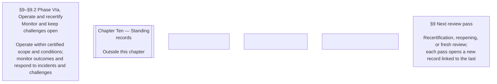
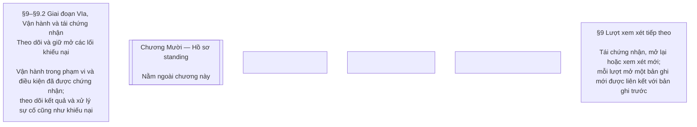

<!-- CHUNK-BEGIN vi__core_09.000_system_alignment_certification_evaluation__section_1_corpus_placement_overview.md bytes=3733 -->
<!-- AI-assisted translation draft; unreviewed. §1 corpus-placement overview, source lines 8–10; source SHA-256 4311e6ba74b7210f077c0bd4c8d21d8c9f517d2ada7b6d87288b39494dfeadd5. Draft only; do not synchronize into translations/. -->

# Chapter Nine Part A — §1 corpus-placement overview (vi)

## English source (lines 8–10)

> This file is **part of the Sentient Constitution** and is **binding only together** with the other numbered `core_*` files read as one text. It contains **Chapter Nine, Part A** — certification purpose, the process overview, and the first two phases of the process — **Frame** (system class) and **Evaluate** (whole-system evaluation in three sub-phases: the always-applicable evaluations, including data types and handling, in **§3**; the evaluations that apply where implicated in **§4**; and the Rights-Floor and domain evaluations that apply where triggered in **§5**) — **§1–§5**. The worked **Class A / B / C illustrations** (the system class profiles, §3.4.8, §5.1.5, §5.2.4, §5.3.7, §5.4.4, §5.5.5, and §5.6.4), including each one's **Reading across system classes** paragraph, are in [`core_09.010_system_alignment_certification_illustrations.md`](core_09.010_system_alignment_certification_illustrations.md); each keeps its Part A section number. The binding system-class-scaling and escalation rules those paragraphs illustrate stay in this file: system class scaling, including participation and proportionality, in §2.2; data-handling scaling in §3.4; and the **System class scaling and escalation** paragraph in each of §5.1–§5.6. The files of the whole chapter are listed in the table below.
>
> **Chapter Nine files.** Chapter Nine is split across four binding files read as one text. Part A, this file, opens the chapter; there is no separate index file.

## Translation draft

> Tệp này **là một phần của Sentient Constitution** và chỉ có hiệu lực ràng buộc khi được đọc như một văn bản thống nhất cùng các tệp `core_*` được đánh số khác. Tệp bao gồm **Chương Chín, Phần A**: mục đích chứng nhận, tổng quan quy trình, và hai giai đoạn đầu — **Frame** (lớp hệ thống) và **Evaluate** (đánh giá toàn hệ thống qua ba tiểu giai đoạn) — **§§1–5**. Ba tiểu giai đoạn gồm: đánh giá luôn áp dụng, kể cả loại và cách xử lý dữ liệu, tại **§3**; đánh giá áp dụng khi có liên quan tại **§4**; và đánh giá **Sàn Quyền** cùng các lĩnh vực được kích hoạt tại **§5**. Các minh họa chi tiết cho **Lớp A / B / C** (hồ sơ lớp hệ thống, §3.4.8, §5.1.5, §5.2.4, §5.3.7, §5.4.4, §5.5.5, §5.6.4), gồm cả đoạn **Đọc xuyên các lớp hệ thống** của từng minh họa, nằm trong [`core_09.010_system_alignment_certification_illustrations.md`](core_09.010_system_alignment_certification_illustrations.md); mỗi minh họa giữ số mục tương ứng ở Phần A. Các quy tắc ràng buộc về hiệu chỉnh theo lớp và nâng cấp mà các đoạn đó minh họa vẫn nằm trong tệp này: hiệu chỉnh theo lớp hệ thống, gồm cả sự tham gia và tính tương xứng, tại §2.2; hiệu chỉnh việc xử lý dữ liệu tại §3.4; và đoạn **Hiệu chỉnh, nâng cấp theo lớp hệ thống** trong từng mục §§5.1–5.6. Bảng dưới đây liệt kê các tệp của toàn chương.
>
> **Các tệp của Chương Chín.** Chương Chín được chia thành bốn tệp có tính ràng buộc và được đọc cùng nhau. Phần A, chính là tệp này, mở đầu chương; không có tệp chỉ mục riêng.

<!-- CHUNK-END -->
<!-- CHUNK-BEGIN vi__core_09.000_system_alignment_certification_evaluation__section_1_corpus_file_table.md bytes=5363 -->
<!-- AI-assisted translation draft; unreviewed. §1 corpus-placement file table, source lines 12–17; source SHA-256 4311e6ba74b7210f077c0bd4c8d21d8c9f517d2ada7b6d87288b39494dfeadd5. Draft only; do not synchronize into translations/. -->

# Chapter Nine Part A — §1 corpus-placement file table (vi)

## English source (lines 12–17)

> | Part | File | Owns |
> |------|------|------|
> | **Part A — Evaluation** | [`core_09.000_system_alignment_certification_evaluation.md`](core_09.000_system_alignment_certification_evaluation.md) | §1–§5: purpose and process overview (with a chart of the whole certification process in its six phases), **Phase I Frame** (system class, how system class scales every evaluation, and pilot certification) and **Phase II Evaluate** (whole-system evaluation in three sub-phases: **IIa** always, in §3, including chartered scope versus functional boundaries and data types and handling; **IIb** where implicated, in §4; and **IIc** where triggered, the Rights-Floor and domain evaluations, in §5) |
> | **Part B — Record and process** | [`core_09.005_system_alignment_certification_record_process.md`](core_09.005_system_alignment_certification_record_process.md) | §6–§10: **Phase III Review** (forum roles, supervisory sequence, and the contestability chain), **Phase IV Decide** (certification outcomes, including the go-live gate), **Phase V Record** (the certification record and its integrity, including governing [System Charter](core_05.040_band_continuity.md#system-charter) fields), and **Phase VI Operate** (the challenge path; recertification and reopening; the standing bridge) — continuous chapter numbering from Part A §5 |
> | **Part C — Illustrations** | [`core_09.010_system_alignment_certification_illustrations.md`](core_09.010_system_alignment_certification_illustrations.md) | the illustrative system class profiles, §3.4, §3.4.8, §5.1.5, §5.2.4, §5.3.7, §5.4.4, §5.5.5, and §5.6.4: worked Class A / B / C walkthroughs for each Part A evaluation area, numbered to match Part A and linked both ways |
> | **Part D — Institutional alignment certification** | [`core_09.015_institutional_alignment_certification.md`](core_09.015_institutional_alignment_certification.md) | §11–§15: the same six phases for an **Institution** rather than a System — the institution class and the institutional evaluation (**Phases I and II**, §12), the forum roles, outcome, and **Institutional Certification Record** (**Phases III to V**, §13), and recertification, reopening, the cascade from System certifications, and the standing bridge (**Phase VI**, §14–§15). It cites each System's certification by link and does not repeat it, and it is not a licence — continuous chapter numbering from Part B §10 |

## Translation draft

| Phần | Tệp | Phạm vi |
|------|------|------|
| **Part A — Evaluation** | [`core_09.000_system_alignment_certification_evaluation.md`](core_09.000_system_alignment_certification_evaluation.md) | §§1–5: mục đích và tổng quan quy trình (kèm sơ đồ sáu giai đoạn chứng nhận), cùng giai đoạn I Frame (lớp hệ thống, cách lớp điều chỉnh từng đánh giá, và chứng nhận thí điểm) và II Evaluate (đánh giá toàn hệ thống qua ba tiểu giai đoạn: IIa luôn áp dụng ở §3, gồm phạm vi theo Điều lệ so với ranh giới chức năng và loại/cách xử lý dữ liệu; IIb áp dụng khi có liên quan ở §4; IIc khi được kích hoạt, gồm Sàn Quyền và đánh giá lĩnh vực ở §5). |
| **Part B — Record and process** | [`core_09.005_system_alignment_certification_record_process.md`](core_09.005_system_alignment_certification_record_process.md) | §§6–10: giai đoạn III Review (vai trò diễn đàn, trình tự giám sát và chuỗi khiếu nại); IV Decide (kết quả chứng nhận, gồm cửa kiểm soát trước khi đưa vào vận hành); V Record (hồ sơ chứng nhận và tính toàn vẹn, gồm các trường chi phối của [System Charter](core_05.040_band_continuity.md#system-charter)); VI Operate (đường khiếu nại, tái chứng nhận và mở lại, cầu nối standing) — đánh số liên tục từ Phần A §5. |
| **Part C — Illustrations** | [`core_09.010_system_alignment_certification_illustrations.md`](core_09.010_system_alignment_certification_illustrations.md) | Hồ sơ minh họa lớp hệ thống và §§3.4, 3.4.8, 5.1.5, 5.2.4, 5.3.7, 5.4.4, 5.5.5, 5.6.4: ví dụ cụ thể lớp A/B/C cho từng lĩnh vực đánh giá ở Phần A; số mục tương ứng và liên kết hai chiều. |
| **Part D — Institutional alignment certification** | [`core_09.015_institutional_alignment_certification.md`](core_09.015_institutional_alignment_certification.md) | §§11–15: cùng sáu giai đoạn nhưng áp dụng cho một Institution thay vì một System—lớp và đánh giá thể chế (I–II, §12), vai trò diễn đàn, kết quả, hồ sơ chứng nhận thể chế (III–V, §13), tái chứng nhận, mở lại, chuỗi chứng nhận System và cầu nối standing (VI, §§14–15). Dẫn liên kết tới chứng nhận của từng System mà không lặp lại; đây không phải giấy phép — đánh số liên tục từ Phần B §10. |

<!-- CHUNK-END -->
<!-- CHUNK-BEGIN vi__core_09.000_system_alignment_certification_evaluation__section_1_corpus_explanation.md bytes=9056 -->
<!-- AI-assisted translation draft; unreviewed. §1 corpus-placement explanatory prose, source lines 19–30; source SHA-256 4311e6ba74b7210f077c0bd4c8d21d8c9f517d2ada7b6d87288b39494dfeadd5. Draft only; do not synchronize into translations/. -->

# Chapter Nine Part A — §1 corpus-placement explanatory prose (vi)

## English source (lines 19–30)

> **How the two certifications relate.** System Alignment Certification (Parts A to C) is the certification of a System. Institutional alignment certification (Part D) is the certification of an Institution, which may run Systems or none. Part D cites each System's certification record by link and does not redo it; [Part D §11.1](core_09.015_institutional_alignment_certification.md#111-relation-to-system-alignment-certification) states the relation and [Part D §11.3](core_09.015_institutional_alignment_certification.md#113-no-permission-and-no-gate) states that it is not a licence.
>
> Generic **Chapter Nine** links in other files route to the appropriate part by section number.
>
> - **Constitutional owner (joint with Parts B and D):** forum-supervised **system alignment certification and related records** — evaluation domains (Part A); forum process, supervisory sequence, certification-record duties, certification outcomes and the go-live gate, the challenge path, recertification and reopening, and verified-input bridge to Chapter Ten (Part B); the same six phases for an Institution (Part D). Under the **oversight** Tetrad leg, SAC is one especially large, high-stakes audit process among others; auditing floors remain at **Article XVI** (*Audit, Transparency, and Independent Verification*) and Chapter Five [Auditability](core_05.050_band_oversight.md#auditability).
> - **Verification substrate owner:** [Chapter Four — Burden of Proof, Traceability, and Verification](core_04.000_burden_traceability_verification.md#chapter-four-burden-of-proof-traceability-and-verification) (within Chapters Two through Four) owns burden allocation, compliance evidence, definition traceability, observability, and security-constrained verification. Chapter Nine **applies** that discipline to system alignment certification records; it does **not** restate Chapter Four sections **1** through **5**.
> - **Auditing home (not relocated here):** **Article XVI** (*Audit, Transparency, and Independent Verification*), **Def.O1** (*Transparency, Auditability, and Verification*), and **CJS-5.110 §3 and CJS-5.115 §3** (*Audit process home*)–**CJS-5.110 §5** own auditing floors and operational terms. Chapter Nine runs one especially large SAC audit process that must satisfy those floors; it does not own all auditing.
> - **Implementation owner:** system-class handling, CS-6.345, and forum-process detail in designated implementation files must remain consistent with Chapter Nine and may be stricter where the corpus already provides a [Fullest Protective Effect](core_05.045_band_integrative.md#fullest-protective-effect) rule.
> - **Anti-relocation rule:** Part A does not restate Chapter Five canonical definitions, Chapter Three anti-evasion discipline (see [Part B §9.3](core_09.005_system_alignment_certification_record_process.md#93-non-evasion)), Chapter Ten contribution or standing measurement, or Chapter Eleven standing effects. **[Part B §10](core_09.005_system_alignment_certification_record_process.md#10-relationship-to-standing)** states the standing bridge boundary explicitly.
>
> **Upstream:** Chapter Five definitions; Chapters Two through Four record, verification, burden, and traceability of definitions to results; and [Chapter Eight](core_08.000_functional_independence_separation_of_duties.md#chapter-eight-functional-independence-and-separation-of-duties), whose separation-of-duties requirement governs every materially binding certification act.
> **Downstream:** [Part B](core_09.005_system_alignment_certification_record_process.md#chapter-nine-part-b-system-alignment-certification--record-and-process) (*forum process, record, outcomes, and standing bridge*); Chapter Ten standing records and verified inputs; Chapter Eleven standing effects; Chapter Thirteen forum supervision and system alignment certification pathways.

## Translation draft

**Quan hệ giữa hai loại chứng nhận.** System Alignment Certification (Phần A đến C) là chứng nhận một System. Chứng nhận căn chỉnh thể chế (Phần D) là chứng nhận một Institution, có thể vận hành Systems hoặc không vận hành hệ thống nào. Phần D dẫn liên kết đến hồ sơ chứng nhận của từng System, không thực hiện lại; [Part D §11.1](core_09.015_institutional_alignment_certification.md#111-relation-to-system-alignment-certification) nêu quan hệ và [Part D §11.3](core_09.015_institutional_alignment_certification.md#113-no-permission-and-no-gate) xác định đây không phải giấy phép.
>
> Các liên kết chung đến **Chapter Nine** trong tệp khác dẫn đến phần phù hợp theo số mục.
>
> - **Chủ thể phụ trách theo hiến pháp (chung với Phần B và D):** chứng nhận căn chỉnh hệ thống và hồ sơ liên quan dưới sự giám sát của diễn đàn — các lĩnh vực đánh giá (Phần A); quy trình diễn đàn, trình tự giám sát, nghĩa vụ hồ sơ chứng nhận, kết quả và điều kiện cho phép vận hành, con đường phản biện, chứng nhận lại và mở lại, cùng cầu nối dữ liệu đầu vào đã xác minh tới Chương Mười (Phần B); sáu giai đoạn tương tự cho Institution (Phần D). Trong trụ cột **giám sát** của Tetrad, SAC là một quy trình kiểm toán đặc biệt lớn, hệ trọng trong số nhiều quy trình; các mức sàn kiểm toán vẫn thuộc **Article XVI** (*Audit, Transparency, and Independent Verification*) và [Auditability](core_05.050_band_oversight.md#auditability) của Chương Năm.
> - **Chủ thể phụ trách nền tảng xác minh:** [Chapter Four — Burden of Proof, Traceability, and Verification](core_04.000_burden_traceability_verification.md#chapter-four-burden-of-proof-traceability-and-verification) (trong các Chương Hai đến Bốn) phụ trách phân bổ gánh nặng chứng minh, bằng chứng tuân thủ, khả năng truy xuất định nghĩa, khả năng quan sát và xác minh có giới hạn an ninh. Chương Chín áp dụng kỷ luật đó vào hồ sơ chứng nhận căn chỉnh hệ thống; không nhắc lại các mục **1** đến **5** của Chương Bốn.
> - **Nơi đặt quy tắc kiểm toán (không chuyển đến đây):** **Article XVI** (*Audit, Transparency, and Independent Verification*), **Def.O1** (*Transparency, Auditability, and Verification*), và **CJS-5.110 §3 cùng CJS-5.115 §3** (*Audit process home*)–**CJS-5.110 §5** quy định các mức sàn kiểm toán và thuật ngữ vận hành. Chương Chín thực hiện một quy trình kiểm toán SAC đặc biệt lớn, phải đáp ứng các mức sàn ấy; chương này không sở hữu toàn bộ hoạt động kiểm toán.
> - **Chủ thể phụ trách triển khai:** việc xử lý lớp hệ thống, CS-6.345 và chi tiết quy trình diễn đàn trong các tệp triển khai được chỉ định phải nhất quán với Chương Chín và có thể nghiêm ngặt hơn nếu corpus đã có quy tắc [Fullest Protective Effect](core_05.045_band_integrative.md#fullest-protective-effect).
> - **Quy tắc chống chuyển vị:** Phần A không lặp lại định nghĩa chuẩn của Chương Năm, kỷ luật chống lẩn tránh của Chương Ba (xem [Part B §9.3](core_09.005_system_alignment_certification_record_process.md#93-non-evasion)), việc đo đóng góp hoặc standing của Chương Mười, hay tác động standing của Chương Mười Một. **[Part B §10](core_09.005_system_alignment_certification_record_process.md#10-relationship-to-standing)** nêu rõ ranh giới của cầu nối standing.
>
> **Nguồn thượng nguồn:** định nghĩa Chương Năm; hồ sơ, xác minh, gánh nặng chứng minh và khả năng truy xuất định nghĩa tới kết quả ở Chương Hai đến Bốn; và [Chapter Eight](core_08.000_functional_independence_separation_of_duties.md#chapter-eight-functional-independence-and-separation-of-duties), nơi yêu cầu phân tách nhiệm vụ chi phối mọi hành vi chứng nhận có hiệu lực ràng buộc đáng kể.
> **Nguồn hạ nguồn:** [Part B](core_09.005_system_alignment_certification_record_process.md#chapter-nine-part-b-system-alignment-certification--record-and-process) (*quy trình diễn đàn, hồ sơ, kết quả và cầu nối standing*); hồ sơ standing và đầu vào đã xác minh của Chương Mười; tác động standing của Chương Mười Một; giám sát diễn đàn và lộ trình chứng nhận căn chỉnh hệ thống của Chương Mười Ba.

<!-- CHUNK-END -->
<!-- CHUNK-BEGIN vi__core_09.000_system_alignment_certification_evaluation__section_1_heading.md bytes=374 -->
<!-- AI-assisted translation draft; unreviewed. §1 heading, source line 44; source SHA-256 4311e6ba74b7210f077c0bd4c8d21d8c9f517d2ada7b6d87288b39494dfeadd5. Draft only; do not synchronize into translations/. -->

# Chapter Nine Part A — §1 heading (vi)

## English source (lines 44–45)

### 1. Purpose and Role


## Translation draft

### 1. Mục đích và vai trò

<!-- CHUNK-END -->
<!-- CHUNK-BEGIN vi__core_09.000_system_alignment_certification_evaluation__section_1_trace.md bytes=12179 -->
<!-- AI-assisted translation draft; unreviewed. §1 trace, source lines 46–95; source SHA-256 4311e6ba74b7210f077c0bd4c8d21d8c9f517d2ada7b6d87288b39494dfeadd5. Draft only; do not synchronize into translations/. -->

# Chapter Nine Part A — §1 trace (vi)

## English source (lines 46–95)

<details>
<summary><strong><span style="color: #2563eb;">Trace</span></strong></summary>

- Upstream:
  - [Preamble — constitutional owner register](core_00.000_preamble.md#4-principles-definitions-and-rights) and
  - [Authority Stack and Internal Hierarchy](core_05.045_band_integrative.md#authority-stack-and-internal-hierarchy);
  - [Constitutional Tetrad](core_00.000_preamble.md#constitutional-tetrad);
  - [Two Constitutional Aims](core_00.000_preamble.md#two-constitutional-aims);
  - [material stake](core_00.000_preamble.md#material-stake);
  - [Proportionality](core_05.035_band_accountability.md#proportionality) and
  - [Substantive Fairness](core_05.055_band_participation.md#substantive-fairness) (Chapter Five); Participation measurement family (*voice, access, and contest paths*);
  - [Chapter One §16 Stewardship In Depth](core_01.010_stewardship_capacity_principles.md#16-stewardship-in-depth) (1.010 §16);
  - [Chapter One §12 Systemic Evaluation Requirement](core_01.000_values_principles.md#12-systemic-evaluation-requirement) (1.000 §12) (*principle-layer whole-system evaluation lens — not one corner alone*); Chapters Two through Four;
  - [Chapter Five](core_05.000_definitions_home.md#chapter-five-foundational-definitions) (5.000) (*canonical definitions*);
  - [Chapter Eight §2 Four-Seat Constitutional Requirement](core_08.000_functional_independence_separation_of_duties.md#2-four-seat-constitutional-requirement) (8.000 §2);
  - [System Alignment Certification](core_05.040_band_continuity.md#system-alignment-certification) (Chapter Five canonical term; non-operative shorthand **SAC**);
  - [System Certification Record](core_05.040_band_continuity.md#system-certification-record) (Chapter Five meaning).
- Downstream:
  - [§2](#2-system-class-evaluation) (*system class evaluation*);
  - [Part B §9.1](core_09.005_system_alignment_certification_record_process.md#91-challenging-a-certification) (9.005 §9.1) (*challenging a certification*); and
  - [Part C system class profiles](core_09.010_system_alignment_certification_illustrations.md#illustrative-system-class-profiles-non-exhaustive) (9.010) (*illustrative system class profiles*);
  - [Part C whole-system walkthroughs](core_09.010_system_alignment_certification_illustrations.md#illustrative-whole-system-application-by-system-class-non-exhaustive) (9.010) (*worked whole-system examples by system class*);
  - [§3.4.8](core_09.010_system_alignment_certification_illustrations.md#348-illustrative-data-handling-application-by-system-class-non-exhaustive) (*worked data-handling examples by system class*);
  - [§5.1.5](core_09.010_system_alignment_certification_illustrations.md#515-illustrative-ecological-footprint-application-by-system-class-non-exhaustive) (*worked ecological-footprint examples by system class*);
  - [§5.2.4](core_09.010_system_alignment_certification_illustrations.md#524-illustrative-educational-capability-application-by-system-class-non-exhaustive) (*worked educational-capability examples by system class*);
  - [§5.3.7](core_09.010_system_alignment_certification_illustrations.md#537-illustrative-cross-system-support-application-by-system-class-non-exhaustive) (*worked cross-system-support examples by system class*);
  - [§5.4.4](core_09.010_system_alignment_certification_illustrations.md#544-illustrative-nondiscrimination-application-by-system-class-non-exhaustive) (*worked nondiscrimination examples by system class*);
  - [§5.5.5](core_09.010_system_alignment_certification_illustrations.md#555-illustrative-accessibility-application-by-system-class-non-exhaustive) (*worked accessibility examples by system class*);
  - [§5.6.4](core_09.010_system_alignment_certification_illustrations.md#564-illustrative-trustworthiness-application-by-system-class-non-exhaustive) (*worked trustworthiness examples by system class*);
  - [§3](#3-whole-system-certification-evaluation) (*whole-system certification evaluation factors*);
  - [§3.4](#34-data-types-and-handling-evaluation) through
  - [§5.6](#56-trustworthiness-and-system-reliance-integrity-evaluation) (*domain evaluations*);
  - [Part B §6](core_09.005_system_alignment_certification_record_process.md#6-forum-process) (9.005 §6) (*supervisory sequence and contestability chain*);
  - [Part B §6.1](core_09.005_system_alignment_certification_record_process.md#61-forum-supervision-and-component-roles) (9.005 §6.1) (*forum component roles*);
  - [Part B §8](core_09.005_system_alignment_certification_record_process.md#8-system-certification-record) (9.005 §8) (*certification record contents*);
  - [Part B §8.2](core_09.005_system_alignment_certification_record_process.md#82-record-integrity-transparency-and-auditability) (9.005 §8.2) (*record integrity requirements*);
  - [Part B §7](core_09.005_system_alignment_certification_record_process.md#7-certification-outcomes) (9.005 §7) (*reopening and anti-evasion*);
  - [Part B §10](core_09.005_system_alignment_certification_record_process.md#10-relationship-to-standing) (9.005 §10) (*standing-record bridge*);
  - [Chapter Ten](core_11.000_standing_assessment.md#chapter-eleven-contribution-violation-and-standing-model--measurement) (10.000) (*standing records and verified-input gate*);
  - [Chapter Eleven](core_12.000_standing_integration.md#chapter-twelve-standing-effects-and-integration) (11.000) (*standing effects and integration*);
  - [Chapter Thirteen](core_14.000_forum.md#chapter-fourteen-forums-and-jurisdiction) (13.000) (*forum supervision, certification, alignment certification, and review*).
- Read with:
  - **[CS-9.305](corpus_systems/cs_09.305_system_classification_machinery.md#cs-9305-part-a-system-classification-machinery) (*System classification machinery*) and [CS-9.310 — System impact classifications](corpus_systems/cs_09.310_system_impact_classifications.md#cs-9310-part-b-system-impact-classifications)**, **[CS-6.305](corpus_systems/cs_06.305_information_types_and_handling.md#cs-6305-part-a-information-types-and-handling) (*Information types and handling*) and [CS-6.310 — Data classifications](corpus_systems/cs_06.310_data_classifications.md#cs-6310-part-b-data-classifications)**, and
  - **CS-6.345** (*System lifecycle*);
  - **CF-13.415** (*Routing operations, transfer, certification, and representative treatment*) and
  - **CF-13.425** (*Integrity safeguards, anti-capture operations, and anti-self-judging support*); **Article XVI** (*Audit, Transparency, and Independent Verification*) and
  - [Auditability](core_05.050_band_oversight.md#auditability) (*auditing floors — SAC is one especially large audit process under oversight, not the sole auditing home*); **CJS-5.110 §3 (*Oversight: auditability and reconstructability terms (annex)*) and CJS-5.115 §3** (*Audit process home*)–
  - **CJS-5.110 §5** (*Oversight: independent verification and claim-integrity terms*).

</details>

## Translation draft

#### Sơ đồ tham chiếu

Sơ đồ nêu nền tảng hiến định và thẩm quyền của phần này, kết nối với đánh giá, phân loại, đường rà soát, hồ sơ, kết quả và kiểm toán; đồng thời chỉ ra tài liệu vận hành cần đọc kèm.

**Sơ đồ tham chiếu — upstream canonical sources:** [Preamble — constitutional owner register](core_00.000_preamble.md#4-principles-definitions-and-rights); [Authority Stack and Internal Hierarchy](core_05.045_band_integrative.md#authority-stack-and-internal-hierarchy); [Constitutional Tetrad](core_00.000_preamble.md#constitutional-tetrad); [Two Constitutional Aims](core_00.000_preamble.md#two-constitutional-aims); [material stake](core_00.000_preamble.md#material-stake); [Proportionality](core_05.035_band_accountability.md#proportionality); [Substantive Fairness](core_05.055_band_participation.md#substantive-fairness); [Chapter One §16 Stewardship In Depth](core_01.010_stewardship_capacity_principles.md#16-stewardship-in-depth); [Chapter One §12 Systemic Evaluation Requirement](core_01.000_values_principles.md#12-systemic-evaluation-requirement); [Chapter Five](core_05.000_definitions_home.md#chapter-five-foundational-definitions); [Chapter Eight §2 Four-Seat Constitutional Requirement](core_08.000_functional_independence_separation_of_duties.md#2-four-seat-constitutional-requirement); [System Alignment Certification](core_05.040_band_continuity.md#system-alignment-certification); [System Certification Record](core_05.040_band_continuity.md#system-certification-record)

**Sơ đồ tham chiếu — downstream routes and related records:** [§2](#2-system-class-evaluation); [Part B §9.1](core_09.005_system_alignment_certification_record_process.md#91-challenging-a-certification); [Part C system class profiles](core_09.010_system_alignment_certification_illustrations.md#illustrative-system-class-profiles-non-exhaustive); [Part C whole-system walkthroughs](core_09.010_system_alignment_certification_illustrations.md#illustrative-whole-system-application-by-system-class-non-exhaustive); [§3.4.8](core_09.010_system_alignment_certification_illustrations.md#348-illustrative-data-handling-application-by-system-class-non-exhaustive); [§5.1.5](core_09.010_system_alignment_certification_illustrations.md#515-illustrative-ecological-footprint-application-by-system-class-non-exhaustive); [§5.2.4](core_09.010_system_alignment_certification_illustrations.md#524-illustrative-educational-capability-application-by-system-class-non-exhaustive); [§5.3.7](core_09.010_system_alignment_certification_illustrations.md#537-illustrative-cross-system-support-application-by-system-class-non-exhaustive); [§5.4.4](core_09.010_system_alignment_certification_illustrations.md#544-illustrative-nondiscrimination-application-by-system-class-non-exhaustive); [§5.5.5](core_09.010_system_alignment_certification_illustrations.md#555-illustrative-accessibility-application-by-system-class-non-exhaustive); [§5.6.4](core_09.010_system_alignment_certification_illustrations.md#564-illustrative-trustworthiness-application-by-system-class-non-exhaustive); [§3](#3-whole-system-certification-evaluation); [§3.4](#34-data-types-and-handling-evaluation); [§5.6](#56-trustworthiness-and-system-reliance-integrity-evaluation); [Part B §6](core_09.005_system_alignment_certification_record_process.md#6-forum-process); [Part B §6.1](core_09.005_system_alignment_certification_record_process.md#61-forum-supervision-and-component-roles); [Part B §8](core_09.005_system_alignment_certification_record_process.md#8-system-certification-record); [Part B §8.2](core_09.005_system_alignment_certification_record_process.md#82-record-integrity-transparency-and-auditability); [Part B §7](core_09.005_system_alignment_certification_record_process.md#7-certification-outcomes); [Part B §10](core_09.005_system_alignment_certification_record_process.md#10-relationship-to-standing); [Chapter Ten](core_11.000_standing_assessment.md#chapter-eleven-contribution-violation-and-standing-model--measurement); [Chapter Eleven](core_12.000_standing_integration.md#chapter-twelve-standing-effects-and-integration); [Chapter Thirteen](core_14.000_forum.md#chapter-fourteen-forums-and-jurisdiction)

**Sơ đồ tham chiếu — operational materials to read with this section:** [CS-9.305](corpus_systems/cs_09.305_system_classification_machinery.md#cs-9305-part-a-system-classification-machinery); [CS-9.310 — System impact classifications](corpus_systems/cs_09.310_system_impact_classifications.md#cs-9310-part-b-system-impact-classifications); [CS-6.305](corpus_systems/cs_06.305_information_types_and_handling.md#cs-6305-part-a-information-types-and-handling); [CS-6.310 — Data classifications](corpus_systems/cs_06.310_data_classifications.md#cs-6310-part-b-data-classifications); [Auditability](core_05.050_band_oversight.md#auditability)

<!-- CHUNK-END -->
<!-- CHUNK-BEGIN vi__core_09.000_system_alignment_certification_evaluation__purpose_adjuncts.md bytes=6290 -->
<!-- AI-assisted translation draft; unreviewed. Selected §1 passages, source lines 99 and 107–114; source SHA-256 4311e6ba74b7210f077c0bd4c8d21d8c9f517d2ada7b6d87288b39494dfeadd5. -->

# Chapter Nine Part A — §1 plain-terms excerpt

**Status:** AI-assisted draft; unreviewed. English source remains controlling.

## English source

When a system really matters to sentients' lives, certification has to be **proportionate** — as demanding as the system's real impact, dependency, and risk require, not a one-size-fits-all checklist or a rubber stamp. It also has to be **participatory** — affected sentients and communities must be able to see what was reviewed, understand what was decided, and challenge it when something is wrong. Forums review evidence, write it down in a certification record, and require re-checks on a schedule that matches how risky the system is. Classes A, B, and C get the full process and Class L a lighter one. Class P is encouraged to use it, and must once it is reclassified to Class L or higher (that is, its effects reach beyond a private unit) or its operator claims constitutional compliance.

## vi draft

Khi một hệ thống thực sự ảnh hưởng đến đời sống của các sinh thể có tri giác, việc chứng nhận phải **tương xứng** — nghiêm ngặt đúng mức mà tác động thực tế, sự phụ thuộc và rủi ro của hệ thống đòi hỏi, chứ không phải danh sách kiểm tra áp dụng đồng loạt hay con dấu phê duyệt hình thức. Việc này cũng phải **có sự tham gia** — các sinh thể và cộng đồng chịu ảnh hưởng phải có thể thấy nội dung đã được xem xét, hiểu quyết định được đưa ra và phản đối khi có sai sót. Các diễn đàn xem xét bằng chứng, ghi lại trong hồ sơ chứng nhận và yêu cầu tái kiểm tra theo lịch phù hợp với mức rủi ro của hệ thống. Hệ thống Loại A, B và C phải trải qua quy trình đầy đủ; Loại L áp dụng quy trình nhẹ hơn. Loại P được khuyến khích sử dụng quy trình này và phải sử dụng khi được phân loại lại thành Loại L trở lên (tức là tác động vượt ra ngoài một đơn vị tư) hoặc khi đơn vị vận hành tuyên bố tuân thủ hiến pháp.


### English source — Flourishing

- **[Flourishing](core_00.000_preamble.md#flourishing)** — certification verifies that certification or continued reliance would not quietly defeat Rights Floors or block fair participation in constitutionally relevant life;

### vi draft

- **[Thăng tiến](core_00.000_preamble.md#flourishing)** — chứng nhận xác minh rằng việc cấp chứng nhận hoặc tiếp tục dựa vào hệ thống sẽ không âm thầm phá vỡ các Sàn quyền hay cản trở sự tham gia công bằng vào đời sống có ý nghĩa hiến pháp;


### English source — Continuity criterion

- **[Continuity](core_00.000_preamble.md#continuity)** — certification verifies durable, non-regressive supply that sustains rather than depletes healthy natural systems ([Ecological Integrity](core_05.040_band_continuity.md#ecological-integrity), including [Ecological Recovery Capacity](core_05.040_band_continuity.md#ecological-recovery-capacity)), and system-class-scaled recertification where shared systems gate or sustain delivery;

### vi draft

- **[Tính liên tục](core_00.000_preamble.md#continuity)** — chứng nhận xác minh nguồn cung bền vững, không thụt lùi, giúp duy trì thay vì làm cạn kiệt các hệ tự nhiên lành mạnh ([Tính toàn vẹn sinh thái](core_05.040_band_continuity.md#ecological-integrity), bao gồm [Năng lực phục hồi sinh thái](core_05.040_band_continuity.md#ecological-recovery-capacity)), và tái chứng nhận theo cấp hệ thống khi hệ thống dùng chung chi phối hoặc duy trì việc cung cấp;


### English source — Participation criterion

- **Participation** — affected sentients and communities can understand, contest, and take part in review paths that matter to them;

### vi draft

- **Sự tham gia** — các sinh thể và cộng đồng chịu ảnh hưởng có thể hiểu, phản đối và tham gia các lộ trình xem xét quan trọng đối với họ;


### English source — Oversight criterion

- **Oversight** — records, evidence, and assumptions are visible and auditable enough for independent checking; certification itself is one especially large audit process under that oversight duty, not the only one;

### vi draft

- **Giám sát** — hồ sơ, bằng chứng và giả định đủ công khai, có thể kiểm toán để kiểm tra độc lập; bản thân chứng nhận là một quy trình kiểm toán đặc biệt lớn theo nghĩa vụ giám sát, chứ không phải nơi duy nhất dành cho kiểm toán;


### English source — Accountability criterion

- **Accountability** — defects, misclassification, and floor-defeating operation route to remedy, conditions, withdrawal, or standing input where the facts support it;

### vi draft

- **Trách nhiệm giải trình** — khi sự kiện làm căn cứ, khiếm khuyết, phân loại sai và hoạt động phá vỡ Sàn quyền sẽ dẫn đến khắc phục, áp điều kiện, rút chứng nhận hoặc cung cấp đầu vào cho đánh giá tư cách;


### English source — Timeliness criterion

- **Timeliness** — review and contest windows keep certification from going stale while harm can still be prevented or reversed.

### vi draft

- **Kịp thời** — thời hạn xem xét và phản đối ngăn chứng nhận trở nên lỗi thời khi vẫn còn có thể ngăn chặn hoặc khắc phục thiệt hại.


### English source — Tetrad introduction

Certification implements the [Two Constitutional Aims](core_00.000_preamble.md#two-constitutional-aims) through the [Constitutional Tetrad](core_00.000_preamble.md#constitutional-tetrad):

### vi draft

Chứng nhận thực hiện [Hai Mục tiêu Hiến pháp](core_00.000_preamble.md#two-constitutional-aims) thông qua [Tứ trụ Hiến pháp](core_00.000_preamble.md#constitutional-tetrad):

<!-- CHUNK-END -->
<!-- CHUNK-BEGIN vi__core_09.000_system_alignment_certification_evaluation__section_1_purpose.md bytes=1382 -->
<!-- AI-assisted translation draft; unreviewed. Complete purpose statement excerpt, source lines 101–105; source SHA-256 4311e6ba74b7210f077c0bd4c8d21d8c9f517d2ada7b6d87288b39494dfeadd5. This is an excerpt, not a complete §1 translation. -->

**Chứng nhận phù hợp hệ thống** nhằm trả lời một câu hỏi cho phạm vi và lịch xem xét đã nêu: Hệ thống đã thể hiện mức độ phù hợp hiến định đủ để được chứng nhận, chứng nhận có điều kiện, xác nhận giá trị, tái chứng nhận, tiếp tục được dựa vào, triển khai, hoặc được gỡ bỏ điều kiện đáng kể chưa?

- Chứng nhận không phải điểm phổ biến, giấy thông hành vĩnh viễn, hay cách bỏ qua việc xem xét quyền.
- Đó là tuyên bố có thời hạn và có thể bị tranh biện về những gì hiện biết được về mức độ phù hợp của hệ thống.
- Theo trụ **giám sát** của Tứ diện, giám sát đòi hỏi kiểm toán; chứng nhận phù hợp hệ thống là một quy trình kiểm toán đặc biệt lớn, có rủi ro cao trong số nhiều quy trình — không phải nơi duy nhất của kiểm toán (**Điều XVI** (*Kiểm toán, Minh bạch và Xác minh Độc lập*), [Khả năng kiểm toán](core_05.050_band_oversight.md#auditability)).

<!-- CHUNK-END -->
<!-- CHUNK-BEGIN vi__core_09.000_system_alignment_certification_evaluation__section_1_subsection_headings.md bytes=797 -->
<!-- AI-assisted translation draft; unreviewed. §1.1/§1.2 visible subsection headings, source lines 116–119 and 144–148; source SHA-256 4311e6ba74b7210f077c0bd4c8d21d8c9f517d2ada7b6d87288b39494dfeadd5. Draft only; anchors/blank layout are structural. Do not synchronize into translations/. -->

# Chapter Nine Part A — §1.1 and §1.2 subsection headings (vi)

## English source

### Lines 116–119

<a id="11-certification-as-an-audit-process-scaled-by-class"></a>

#### 1.1 Certification as an audit process, scaled by class


### Lines 144–148


<a id="12-certification-at-a-glance"></a>

#### 1.2 Certification at a glance


## Translation draft

#### 1.1 Chứng nhận như một quy trình kiểm toán được định mức theo cấp

#### 1.2 Khái quát về chứng nhận

<!-- CHUNK-END -->
<!-- CHUNK-BEGIN vi__core_09.000_system_alignment_certification_evaluation__section_1_audit_scope.md bytes=3457 -->
<!-- AI-assisted translation draft; unreviewed. §1.1 audit mechanism and sibling audit modes, source lines 120–130; source SHA-256 4311e6ba74b7210f077c0bd4c8d21d8c9f517d2ada7b6d87288b39494dfeadd5. -->

# Chapter Nine Part A — §1.1 certification audit process excerpt (vi)

## English source

As an oversight mechanism, certification is one especially large audit process under [Auditability](core_05.050_band_oversight.md#auditability) and **Article XVI** (*Audit, Transparency, and Independent Verification*):

- It is forum-supervised, multi-domain, and status-granting.
- It may integrate the results of sibling audit modes, and it does not absorb or replace them. Each keeps its own owner, named in the [sibling audit modes map](corpus_joint_structure/cjs_05.115_audit_process.md#sibling-audit-modes-owner-map) of the audit process home:
  - System Data Types Record audits under **CS-6.305 (*Information types and handling*) and CS-6.310** (*Data classifications*)
  - System Classification Record audits under **CS-9.305 (*System classification machinery*) and CS-9.310** (*System impact classifications*)
  - steward assurance reviews under **CS-14.305** (*Critical system stewardship*)
  - continuous audit under **CS-6.345** (*System lifecycle*) ACA
  - complexity audits under **CS-6.315** (*Comprehensibility and complexity stewardship*) and **Article XXIII-B** (*Complexity Audit and Modularity Requirements*)
  - claim verification under **CJS-5.110 §5** (*Oversight: independent verification and claim-integrity terms*)
- You can still run any of these checks on their own, without going through certification. Certification doesn't replace them.

## vi draft

Với tư cách là cơ chế giám sát, chứng nhận là một quy trình kiểm toán đặc biệt lớn theo [Khả năng Kiểm toán](core_05.050_band_oversight.md#auditability) và **Article XVI** (*Kiểm toán, Minh bạch và Xác minh Độc lập*):

- Quy trình do diễn đàn giám sát, bao quát nhiều lĩnh vực và cấp trạng thái.
- Quy trình có thể tích hợp kết quả của các phương thức kiểm toán liên quan, nhưng không hấp thụ hay thay thế chúng. Mỗi phương thức vẫn có chủ thể phụ trách riêng, được nêu trong [bản đồ các phương thức kiểm toán liên quan](corpus_joint_structure/cjs_05.115_audit_process.md#sibling-audit-modes-owner-map) của tài liệu gốc về quy trình kiểm toán:
  - Kiểm toán System Data Types Record theo **CS-6.305 (*Các loại thông tin và cách xử lý*) và CS-6.310** (*Phân loại dữ liệu*)
  - Kiểm toán System Classification Record theo **CS-9.305 (*Cơ chế phân loại hệ thống*) và CS-9.310** (*Phân loại tác động hệ thống*)
  - Rà soát bảo đảm giám hộ theo **CS-14.305** (*Giám hộ hệ thống trọng yếu*)
  - Kiểm toán liên tục theo **CS-6.345** (*Vòng đời hệ thống*) ACA
  - Kiểm toán độ phức tạp theo **CS-6.315** (*Tính dễ hiểu và giám hộ độ phức tạp*) và **Article XXIII-B** (*Yêu cầu Kiểm toán Độ phức tạp và Tính Mô-đun*)
  - Xác minh tuyên bố theo **CJS-5.110 §5** (*Giám sát: xác minh độc lập và các điều khoản về tính toàn vẹn của tuyên bố*)
- Bạn vẫn có thể tự tiến hành từng kiểm tra này mà không cần qua chứng nhận. Chứng nhận không thay thế chúng.

<!-- CHUNK-END -->
<!-- CHUNK-BEGIN vi__core_09.000_system_alignment_certification_evaluation__section_1_class_scaling.md bytes=4205 -->
<!-- AI-assisted translation draft; unreviewed. Chapter Nine Part A §1 class scaling and cadence, source lines 132–143; source SHA-256 4311e6ba74b7210f077c0bd4c8d21d8c9f517d2ada7b6d87288b39494dfeadd5. Draft only; do not synchronize into translations/. -->

**Current English passage:**

Certification depth, record burden, certification interval, stakeholder review, and contest paths must scale with [material stake](core_00.000_preamble.md#material-stake) under [Proportionality](core_05.035_band_accountability.md#proportionality):

The process applies by impact class, as the [reclassification requirement](corpus_systems/cs_09.305_system_classification_machinery.md#35-reclassification-requirement) of **CS-9.305** (*System classification machinery*) sets out:

- **Class A, Class B, and Class C:** these systems carry the highest impact, dependency, and risk, and whole-system evaluation under [§3 Whole-System Certification Evaluation](#3-whole-system-certification-evaluation), [§4 Evaluations Where Implicated](#4-evaluations-where-implicated), and [§5 Rights-Floor and Domain Evaluations](#5-rights-floor-and-domain-evaluations), each as its own sub-phase applies, is mandatory at full depth;
- **Class L:** the same evaluation is mandatory but proportionate, with a lower default re-check cadence and simpler records where CS-9.305 (*System classification machinery*) and CS-9.310 (*System impact classifications*) permits; and
- **Class P:** the process is encouraged while the system is validly Class P, and a Class P system may use it voluntarily. It becomes mandatory on reclassification to Class L or higher, or where the operator voluntarily asserts constitutional compliance for the system.

The certification interval, and the financial, resource, or special audit that falls at its midpoint, are set by class in [Chapter Thirteen §6 Timely resolution, materiality tiers, and anti-delay discipline](core_14.000_forum.md#review-cadence) (*Review cadence*). This chapter does not restate the numbers.

**Proposed locale translation:**

Mức độ sâu của chứng nhận, gánh nặng hồ sơ, chu kỳ chứng nhận, việc rà soát của các bên liên quan và con đường khiếu nghị phải được điều chỉnh theo [mức độ lợi ích trọng yếu](core_00.000_preamble.md#material-stake) theo nguyên tắc [tương xứng](core_05.035_band_accountability.md#proportionality):

Quy trình áp dụng theo lớp tác động, như [yêu cầu phân loại lại](corpus_systems/cs_09.305_system_classification_machinery.md#35-reclassification-requirement) của **CS-9.305** (*Cơ chế phân loại hệ thống*) quy định:

- **Lớp A, B và C:** các hệ thống này có tác động, mức phụ thuộc và rủi ro cao nhất; phải đánh giá toàn hệ thống ở mức đầy đủ trong từng tiểu giai đoạn áp dụng theo [§3 Đánh giá chứng nhận toàn hệ thống](#3-whole-system-certification-evaluation), [§4 Đánh giá khi có liên quan](#4-evaluations-where-implicated) và [§5 Đánh giá Sàn Quyền và theo lĩnh vực](#5-rights-floor-and-domain-evaluations);
- **Lớp L:** cùng loại đánh giá là bắt buộc nhưng phải tương xứng, với chu kỳ kiểm tra lại mặc định thưa hơn và hồ sơ đơn giản hơn khi **CS-9.305** (*Cơ chế phân loại hệ thống*) và **CS-9.310** (*Phân loại tác động hệ thống*) cho phép; và
- **Lớp P:** khuyến khích quy trình khi hệ thống vẫn được xếp lớp P hợp lệ và có thể áp dụng tự nguyện. Quy trình trở thành bắt buộc khi hệ thống được phân loại lại thành L trở lên hoặc khi đơn vị vận hành tự nguyện tuyên bố hệ thống tuân thủ hiến định.

Chu kỳ chứng nhận và cuộc kiểm toán tài chính, nguồn lực hoặc đặc biệt vào thời điểm giữa chu kỳ được ấn định theo lớp tại [Chương Mười Ba §6 Giải quyết đúng hạn, các mức trọng yếu và kỷ luật chống trì hoãn](core_14.000_forum.md#review-cadence) (*Nhịp rà soát*). Chương này không lặp lại các con số.

<!-- CHUNK-END -->
<!-- CHUNK-BEGIN vi__core_09.000_system_alignment_certification_evaluation__section_1_at_a_glance.md bytes=1973 -->
<!-- AI-assisted translation draft; unreviewed. Chapter Nine Part A §1.2 plain-language summary, source line 149; source SHA-256 4311e6ba74b7210f077c0bd4c8d21d8c9f517d2ada7b6d87288b39494dfeadd5. Draft only; do not synchronize into translations/. -->

# Chapter Nine Part A — §1.2 at-a-glance summary (vi)

## English source

*In plain terms: classify the system honestly, run the evaluations that apply, have forums independently review the evidence and stakeholder concerns, and decide an outcome. Complete the one record opened for forum review and publish it with an open challenge path. A certified system goes live only after its notice interval and required protections are satisfied. Monitor actual outcomes, respond to incidents and challenges, and check again on schedule or when the facts change. Correct defects and have the correction independently verified before authorizing the affected scope or releasing its conditions. Each review pass uses a new record linked to the last.*

## vi draft

*Nói đơn giản: phân loại hệ thống trung thực, thực hiện các đánh giá áp dụng, để các diễn đàn độc lập xem xét bằng chứng và quan ngại của các bên liên quan, rồi quyết định kết quả. Hoàn tất bản ghi duy nhất mở cho diễn đàn xem xét và công bố cùng một lối khiếu nại luôn mở. Hệ thống được chứng nhận chỉ được đưa vào hoạt động sau khi hết thời hạn thông báo và đáp ứng các biện pháp bảo vệ bắt buộc. Theo dõi kết quả thực tế, xử lý sự cố và khiếu nại, rồi kiểm tra lại theo lịch hoặc khi sự kiện thay đổi. Khắc phục khiếm khuyết và yêu cầu xác minh độc lập việc khắc phục trước khi cho phép phạm vi bị ảnh hưởng hoặc gỡ điều kiện của phạm vi đó. Mỗi lượt xem xét dùng bản ghi mới liên kết với bản ghi trước.*

<!-- CHUNK-END -->
<!-- CHUNK-BEGIN vi__core_09.000_system_alignment_certification_evaluation__section_1_phase_map.md bytes=601 -->
<!-- AI-assisted translation draft; unreviewed. Chapter Nine Part A §1.2 phase map, source line 151; source SHA-256 4311e6ba74b7210f077c0bd4c8d21d8c9f517d2ada7b6d87288b39494dfeadd5. Draft only; do not synchronize into translations/. -->

**Current English passage:**

The process runs in **six phases**: **I Frame**, **II Evaluate**, **III Review**, **IV Decide**, **V Record**, and **VI Operate**.

**Proposed locale translation:**

Quy trình gồm **sáu giai đoạn**: **I Định khung**, **II Đánh giá**, **III Rà soát**, **IV Quyết định**, **V Ghi nhận**, và **VI Vận hành**.

<!-- CHUNK-END -->
<!-- CHUNK-BEGIN vi__core_09.000_system_alignment_certification_evaluation__section_1_reopen_triggers.md bytes=1845 -->
<!-- AI-assisted translation draft; unreviewed. Chapter Nine Part A §1 review-reopening passage, source line 153; source SHA-256 4311e6ba74b7210f077c0bd4c8d21d8c9f517d2ada7b6d87288b39494dfeadd5. Draft only; do not synchronize into translations/. -->

**Current English passage:**

Every evaluation that applies is carried out again on each certification pass: at first certification, at each recertification on the schedule set by [§2 System Class Evaluation](#2-system-class-evaluation), and at each reopened or fresh review. Review reopens before the next scheduled recertification when material facts change, such as growing reliance on the system, growing extraction from shared foundations, a significant fall in what the system puts back into them, or a credible challenge. [Part B §9 Recertification and Reopening](core_09.005_system_alignment_certification_record_process.md#9-recertification-and-reopening) lists the triggers.

**Proposed locale translation:**

Mỗi đánh giá áp dụng được thực hiện lại trong từng lượt chứng nhận: ở lần chứng nhận đầu, mỗi lần tái chứng nhận theo lịch do [§2 Đánh giá cấp hệ thống](#2-system-class-evaluation) đặt ra, và mỗi lần rà soát được mở lại hoặc mới. Rà soát phải mở lại trước kỳ tái chứng nhận theo lịch kế tiếp khi sự kiện trọng yếu thay đổi, chẳng hạn mức độ phụ thuộc vào hệ thống tăng, việc khai thác từ nền tảng chung tăng, đóng góp của hệ thống cho các nền tảng đó giảm đáng kể, hoặc xuất hiện khiếu nghị đáng tin cậy. [Phần B §9 Tái chứng nhận và mở lại](core_09.005_system_alignment_certification_record_process.md#9-recertification-and-reopening) liệt kê các yếu tố kích hoạt.

<!-- CHUNK-END -->
<!-- CHUNK-BEGIN vi__core_09.000_system_alignment_certification_evaluation__section_1_phase_map_opening_nodes.md bytes=2061 -->
<!-- AI-assisted translation draft; unreviewed. §1.2 Phase I/II opening chart-node labels, source lines 155–165; source SHA-256 4311e6ba74b7210f077c0bd4c8d21d8c9f517d2ada7b6d87288b39494dfeadd5. Draft only; non-prose Mermaid syntax/connectors are retained. Do not synchronize into translations/. -->

# Chapter Nine Part A — §1.2 opening phase-map nodes (vi)

## English source (lines 155–165)

```mermaid
flowchart TB
    T(["System with material impact seeks certification,<br/>or reliance on it grows"])
    C["§2 Phase I, Frame<br/>Classify honestly<br/><br/>Class sets depth and re-check schedule"]
    subgraph W["§3–§5 Phase II, Evaluate — Whole-system evaluation"]
        direction LR
        Al["§3.1–§3.4 IIa — Always<br/><br/>Governance; systemic risk: evaluated,<br/>and disclosed to those who need it;<br/>time horizon; data types"]
        Im["§4 IIb — When implicated<br/><br/>Privacy loci, exit rights,<br/>assembly and dissent"]
        Tr["§5 IIc — When triggered<br/><br/>Applicable Rights-Floor checks<br/>and six domain evaluations"]
        Al ~~~ Im ~~~ Tr
    end

## Translation draft

```mermaid
flowchart TB
    T["Hệ thống có tác động trọng yếu xin chứng nhận,<br/>hoặc mức lệ thuộc vào hệ thống tăng lên"]
    C["§2 Giai đoạn I, Định khung<br/>Phân loại trung thực<br/><br/>Cấp hệ thống quyết định độ sâu và lịch rà soát lại"]
    subgraph W["§3–§5 Giai đoạn II, Đánh giá — đánh giá toàn hệ thống"]
        direction LR
        Al["§3.1–§3.4 IIa — Luôn áp dụng<br/><br/>Quản trị; đánh giá rủi ro hệ thống và công bố<br/>cho người cần biết; thời hạn; loại dữ liệu"]
        Im["§4 IIb — Khi có liên quan<br/><br/>Lĩnh vực riêng tư, quyền rời bỏ,<br/>hội họp và bất đồng"]
        Tr["§5 IIc — Khi được kích hoạt<br/><br/>Kiểm tra nền tảng quyền áp dụng<br/>và sáu đánh giá lĩnh vực"]
        Al ~~~ Im ~~~ Tr
    end
```

<!-- CHUNK-END -->
<!-- CHUNK-BEGIN vi__core_09.000_system_alignment_certification_evaluation__chart_review_node.md bytes=625 -->
# Chapter Nine Part A — chart review node (vi)

AI-assisted draft; unreviewed. Current source SHA-256: `4311e6ba74b7210f077c0bd4c8d21d8c9f517d2ada7b6d87288b39494dfeadd5`. Reconciles current source line 166: “Assigned forums issue findings; challenge paths stay open.” The translated node ID, chart structure, HTML line breaks, and code syntax are preserved.

```mermaid
    F["Giai đoạn III, Rà soát — §6<br/>Rà soát độc lập chứng cứ<br/>và quan ngại của các bên liên quan<br/><br/>Các diễn đàn được phân công đưa ra phát hiện;<br/>con đường tranh biện vẫn mở"]
```

<!-- CHUNK-END -->
<!-- CHUNK-BEGIN vi__core_09.000_system_alignment_certification_evaluation__section_1_decision_nodes.md bytes=4086 -->
<!-- AI-assisted translation draft; unreviewed. Chapter Nine Part A §1.2 decision and outcome diagram nodes, source lines 167–176; source SHA-256 4311e6ba74b7210f077c0bd4c8d21d8c9f517d2ada7b6d87288b39494dfeadd5. Draft only; do not synchronize into translations/. -->

# Chapter Nine Part A — §1.2 decision and outcome nodes (vi)

## English source (lines 167–176)

```mermaid
flowchart TB
    Rec["§8 Phase V, Record<br/>One System Certification Record<br/><br/>Opened for forum review; completed with the outcome,<br/>supporting findings, conditions, and operating plan"]
    S[["Chapter Ten — Standing<br/>records<br/><br/>Outside this chapter"]]
    O{"§7 Phase IV, Decide<br/><br/>What outcome and status<br/>does the evidence support?"}
    Fc["§7, §9.2 Full Certification<br/><br/>Required consecutive clean provisional recertifications;<br/>no current or indicated impending misalignment<br/>Full certification interval; conditions may apply"]
    Pc["§7, §9.2 Provisional Certification<br/><br/>First grant, recovery after misalignment,<br/>or continued or stepped-down provisional status<br/>Provisional interval, shorter; conditions may apply"]
    Nc["§7 Not Certified<br/><br/>Deferred, refused, withdrawn, or expired<br/>No go-live; state reasons and required corrective work"]
    Pub["§7, §9.1 Publish the completed record<br/><br/>Open the published record challenge path;<br/>for new or expanded scope, state go-live and notice"]
    G{"§7 Go-live gate<br/><br/>Certification and applicable<br/>go-live prerequisites satisfied?"}
    Hold["§7 Meet go-live prerequisites<br/><br/>Complete notice and independently verify<br/>conditions required before go-live"]
    Rm["§7, §9.2 Protect and correct<br/><br/>No new go-live in the affected scope;<br/>protect affected sentients, correct design or operation,<br/>and submit evidence for independent verification"]
```



## vi draft



<!-- CHUNK-END -->
<!-- CHUNK-BEGIN vi__core_09.000_system_alignment_certification_evaluation__section_1_review_cycle_nodes.md bytes=2880 -->
<!-- AI-assisted translation draft; unreviewed. Chapter Nine Part A §1.2 operation and next-review diagram nodes, source lines 177–182; source SHA-256 4311e6ba74b7210f077c0bd4c8d21d8c9f517d2ada7b6d87288b39494dfeadd5. Draft only; do not synchronize into translations/. -->

```mermaid
flowchart TB
    Rec["§8 Giai đoạn V, Hồ sơ<br/>Một Hồ sơ Chứng nhận Hệ thống duy nhất<br/><br/>Được mở để diễn đàn xem xét; hoàn tất với kết quả, phát hiện hỗ trợ, điều kiện và kế hoạch vận hành"]
    S[["Chương Mười — Hồ sơ standing<br/><br/>Nằm ngoài chương này"]]
    O{"§7 Giai đoạn IV, Quyết định<br/><br/>Bằng chứng ủng hộ kết quả và trạng thái nào?"}
    Fc["§7, §9.2 Chứng nhận đầy đủ<br/><br/>Cần các lần tái chứng nhận tạm thời liên tiếp không có sai lỗi;<br/>không có dấu hiệu lệch chuẩn hiện tại hoặc sắp xảy ra<br/>Khoảng chứng nhận đầy đủ; có thể áp dụng điều kiện"]
    Pc["§7, §9.2 Chứng nhận tạm thời<br/><br/>Cấp lần đầu, phục hồi sau lệch chuẩn,<br/>hoặc tiếp tục hay hạ bậc trạng thái tạm thời<br/>Khoảng tạm thời ngắn hơn; có thể áp dụng điều kiện"]
    Nc["§7 Không được chứng nhận<br/><br/>Bị hoãn, từ chối, rút hoặc hết hạn<br/>Không đưa vào hoạt động; nêu lý do và công việc khắc phục cần thiết"]
    Pub["§7, §9.1 Công bố hồ sơ đã hoàn tất<br/><br/>Mở lối khiếu nại đối với hồ sơ đã công bố;<br/>với phạm vi mới hoặc mở rộng, nêu việc đưa vào hoạt động và thông báo"]
    G{"§7 Cổng đưa vào hoạt động<br/><br/>Chứng nhận và các điều kiện tiên quyết áp dụng<br/>để đưa vào hoạt động đã được đáp ứng chưa?"}
    Hold["§7 Đáp ứng điều kiện tiên quyết để đưa vào hoạt động<br/><br/>Hoàn tất thời hạn thông báo và xác minh độc lập<br/>các điều kiện bắt buộc trước khi vận hành"]
    Rm["§7, §9.2 Bảo vệ và khắc phục<br/><br/>Không đưa phạm vi bị ảnh hưởng vào hoạt động mới;<br/>bảo vệ các chủ thể có tri giác bị ảnh hưởng, sửa thiết kế hoặc vận hành,<br/>và nộp bằng chứng để xác minh độc lập"]
```

# Chapter Nine Part A — §1.2 operation and review-cycle nodes (vi)

## English source (lines 177–182)



## vi draft



<!-- CHUNK-END -->
<!-- CHUNK-BEGIN vi__core_09.000_system_alignment_certification_evaluation__section_1_phase_map_edge_labels.md bytes=1974 -->
<!-- AI-assisted translation draft; unreviewed. §1.2 certification-phase chart edge labels, source lines 194, 199, 200–206; source SHA-256 4311e6ba74b7210f077c0bd4c8d21d8c9f517d2ada7b6d87288b39494dfeadd5. Mermaid node IDs, edge syntax, and <br/> delimiters are structural and preserved; visible edge labels are translated. Draft only; do not synchronize into translations/. -->

# Chapter Nine Part A — phase-chart edge labels (vi)

## English source

```mermaid
    Rec -.->|VIb, §10 —<br/>verified inputs only;<br/>current certification or facts<br/>arising during certification| S
    G --->|Yes: operate<br/>within the record| Ch
    G --->|Certified,<br/>prerequisites pending| Hold
    Ch -->|Material defect:<br/>protect and correct| Rm
    Ch -->|On schedule, or<br/>material change or<br/>credible challenge<br/>requires review| Re
    Ch -.->|VIb, §10 —<br/>verified inputs only;<br/>operation may supply facts<br/>for Contribution and<br/>Violation records| S2
    Rm -->|Correction evidence<br/>is checked in the<br/>next review pass| Re
    G -->|Not Certified| Rm
```

## Translation draft

```mermaid
    Rec -.->|VIb, §10 —<br/>chỉ dùng đầu vào đã xác minh;<br/>chứng nhận hiện hành hoặc sự kiện<br/>phát sinh trong quá trình chứng nhận| S
    G --->|Có: vận hành<br/>trong phạm vi hồ sơ| Ch
    G --->|Đã chứng nhận,<br/>điều kiện tiên quyết còn chờ| Hold
    Ch -->|Khiếm khuyết trọng yếu:<br/>bảo vệ và khắc phục| Rm
    Ch -->|Theo lịch, hoặc khi<br/>thay đổi trọng yếu hay<br/>khiếu nại đáng tin<br/>đòi hỏi rà soát| Re
    Ch -.->|VIb, §10 —<br/>chỉ dùng đầu vào đã xác minh;<br/>vận hành có thể cung cấp sự kiện<br/>cho hồ sơ Đóng góp<br/>và Vi phạm| S2
    Rm -->|Bằng chứng khắc phục được<br/>kiểm tra ở đợt rà soát<br/>tiếp theo| Re
    G -->|Chưa được chứng nhận| Rm
```

<!-- CHUNK-END -->
<!-- CHUNK-BEGIN vi__core_09.000_system_alignment_certification_evaluation__section_1_reader_guide.md bytes=4497 -->
<!-- AI-assisted translation draft; unreviewed. §1 non-operative reader guide, source lines 236–245; source SHA-256 4311e6ba74b7210f077c0bd4c8d21d8c9f517d2ada7b6d87288b39494dfeadd5. Draft only; do not synchronize into translations/. -->

# Chapter Nine Part A — §1 reader guide (vi)

## English source (lines 236–245)

<details>
<summary><strong><span style="color: #2563eb;">Reader guide (non-operative): illustrations, run sheet, and Institutions</span></strong></summary>

> Illustrative **Class A**, **Class B**, and **Class C** profiles — and how system class scales certification depth across this chapter — are in [Illustrative System Class Profiles (Non-Exhaustive)](core_09.010_system_alignment_certification_illustrations.md#illustrative-system-class-profiles-non-exhaustive). Worked walkthroughs of the same three systems for each evaluation area in [§3 Whole-System Certification Evaluation](#3-whole-system-certification-evaluation) through [§5.6 Trustworthiness and System-Reliance Integrity Evaluation](#56-trustworthiness-and-system-reliance-integrity-evaluation) follow there, in [Part C — Illustrations](core_09.010_system_alignment_certification_illustrations.md#chapter-nine-part-c-system-alignment-certification--illustrations), which links each profile and walkthrough back to the Part A section it illustrates.
>
> A step-by-step run sheet for the six phases, with a link from each step to the section that holds the rule, is in [CS-9.315 §2 Run sheet](corpus_systems/cs_09.315_system_alignment_certification_run_sheet.md#cs-9315-2-run-sheet) (*System alignment certification run sheet*). Where the run sheet and a section differ, the section controls.
>
> For an Institution, the same six phases run through [Part D](core_09.015_institutional_alignment_certification.md#chapter-nine-part-d-institutional-alignment-certification): Phases I and II in [Part D §12 Institution Class and Institutional Evaluation](core_09.015_institutional_alignment_certification.md#12-institution-class-and-institutional-evaluation), Phases III to V in [§13 Review, Decision, and Record](core_09.015_institutional_alignment_certification.md#13-review-decision-and-record), and Phase VI in [§14 Operating, Reopening, and the Cascade](core_09.015_institutional_alignment_certification.md#14-operating-reopening-and-the-cascade) and [§15 Standing Bridge and Non-Evasion](core_09.015_institutional_alignment_certification.md#15-standing-bridge-and-non-evasion).

</details>

## Translation draft

<details>
<summary><strong>Hướng dẫn đọc (không mang tính vận hành): ví dụ, bảng quy trình và tổ chức</strong></summary>

Hồ sơ minh họa cho hệ thống cấp **A**, **B**, **C** và cách cấp hệ thống quyết định độ sâu chứng nhận trong chương này có tại [Illustrative System Class Profiles (Non-Exhaustive)](core_09.010_system_alignment_certification_illustrations.md#illustrative-system-class-profiles-non-exhaustive). [Part C — Illustrations](core_09.010_system_alignment_certification_illustrations.md#chapter-nine-part-c-system-alignment-certification--illustrations) trình bày từng bước các ví dụ của cùng ba hệ thống theo mỗi lĩnh vực đánh giá và liên kết mỗi hồ sơ/ví dụ về quy tắc Part A tương ứng.

[CS-9.315 §2 Run sheet](corpus_systems/cs_09.315_system_alignment_certification_run_sheet.md#cs-9315-2-run-sheet) cung cấp quy trình sáu giai đoạn từng bước, mỗi bước liên kết đến mục chứa quy tắc. Nếu bảng quy trình khác với mục, mục đó được ưu tiên.

Đối với tổ chức, sáu giai đoạn tương tự được thực hiện theo [Part D](core_09.015_institutional_alignment_certification.md#chapter-nine-part-d-institutional-alignment-certification): giai đoạn I–II tại [§12](core_09.015_institutional_alignment_certification.md#12-institution-class-and-institutional-evaluation), III–V tại [§13](core_09.015_institutional_alignment_certification.md#13-review-decision-and-record), và VI tại [§14](core_09.015_institutional_alignment_certification.md#14-operating-reopening-and-the-cascade) cùng [§15](core_09.015_institutional_alignment_certification.md#15-standing-bridge-and-non-evasion).

Các ví dụ này bao quát lĩnh vực đánh giá từ [§3](#3-whole-system-certification-evaluation) đến [§5.6](#56-trustworthiness-and-system-reliance-integrity-evaluation).

</details>

<!-- CHUNK-END -->
<!-- CHUNK-BEGIN vi__core_09.000_system_alignment_certification_evaluation__visible_section_headings_2_3.md bytes=1324 -->
<!-- AI-assisted translation draft; unreviewed. Remaining visible Part A headings, source lines 251, 409, 477, 531, 592, 653; source SHA-256 4311e6ba74b7210f077c0bd4c8d21d8c9f517d2ada7b6d87288b39494dfeadd5. Anchors are structural; prose headings are translated. Draft only; do not synchronize into translations/. -->

# Chapter Nine Part A — remaining visible section headings (vi)

## English source

<a id="2-system-class-evaluation"></a>
### 2. System Class Evaluation
<a id="3-whole-system-certification-evaluation"></a>
### 3. Whole-System Certification Evaluation
<a id="31-governance-incentive-and-contestability-discipline"></a>
#### 3.1 Governance, Incentive, and Contestability Discipline
<a id="32-systemic-scope-and-risk-factors"></a>
#### 3.2 Systemic Scope and Risk Factors
<a id="34-data-types-and-handling-evaluation"></a>
#### 3.4 Data Types and Handling Evaluation
<a id="341-type-o-baseline-disclosure"></a>
##### 3.4.1 Type O Baseline Disclosure

## Translation draft

### 2 Đánh giá lớp hệ thống
### 3 Đánh giá chứng nhận toàn hệ thống
#### 3.1 Kỷ luật về quản trị, động lực và khả năng khiếu nại
#### 3.2 Phạm vi hệ thống và các yếu tố rủi ro
#### 3.4 Đánh giá loại và cách xử lý dữ liệu
##### 3.4.1 Công khai cơ bản Type O

<!-- CHUNK-END -->
<!-- CHUNK-BEGIN vi__core_09.000_system_alignment_certification_evaluation__section_2_trace.md bytes=10037 -->
<!-- AI-assisted translation draft; unreviewed. §2 trace, source lines 253–295; source SHA-256 4311e6ba74b7210f077c0bd4c8d21d8c9f517d2ada7b6d87288b39494dfeadd5. Draft only; do not synchronize into translations/. -->

# Chapter Nine Part A — §2 trace (vi)

## English source (lines 253–295)

<details>
<summary><strong><span style="color: #2563eb;">Trace</span></strong></summary>

- Upstream:
  - [§1](#1-purpose-and-role) (*purpose and role*); Integrative Materiality (
  - [Materiality](core_05.050_band_oversight.md#materiality)) (*Materiality*);
  - [Constitutional Tetrad](core_00.000_preamble.md#constitutional-tetrad);
  - [Two Constitutional Aims](core_00.000_preamble.md#two-constitutional-aims);
  - [Material Impact](core_05.050_band_oversight.md#material-impact),
  - [Dependency](core_05.040_band_continuity.md#dependency),
  - [Risk](core_05.040_band_continuity.md#risk),
  - [System Boundaries](core_05.040_band_continuity.md#system-boundaries), and
  - [System Charter](core_05.040_band_continuity.md#system-charter) (Chapter Five);
  - [Chapter One §12 Systemic Evaluation Requirement](core_01.000_values_principles.md#12-systemic-evaluation-requirement) (1.000 §12); **Article III-A** (*Survival*) and **Article IV-A** (*Rights-Floor delivery where classification gates access*); **Article V-A** (*Dependency Mapping and Resource-Flow Transparency*) and **Article V-B** (*resource allocation and dependency stewardship where certification gates shared-infrastructure reliance*).
- Downstream:
  - [§2.1](#21-certification-recertification-and-defects) (*certification status, recertification, and defects*);
  - [§2.2](#22-how-system-class-scales-every-evaluation) (*system-class-scaled participation and proportionality*);
  - [§2.3](#23-pilot-certification) (*pilot certification*);
  - [Part C system class profiles and reclassification](core_09.010_system_alignment_certification_illustrations.md#illustrative-system-class-profiles-non-exhaustive) (9.010) (*illustrative system class profiles*);
  - [Part C whole-system walkthroughs](core_09.010_system_alignment_certification_illustrations.md#illustrative-whole-system-application-by-system-class-non-exhaustive) (9.010) (*worked whole-system examples by system class*);
  - [§3.4.8](core_09.010_system_alignment_certification_illustrations.md#348-illustrative-data-handling-application-by-system-class-non-exhaustive) (*worked data-handling examples by system class*);
  - [§5.1.5](core_09.010_system_alignment_certification_illustrations.md#515-illustrative-ecological-footprint-application-by-system-class-non-exhaustive) (*worked ecological-footprint examples by system class*);
  - [§5.2.4](core_09.010_system_alignment_certification_illustrations.md#524-illustrative-educational-capability-application-by-system-class-non-exhaustive) (*worked educational-capability examples by system class*);
  - [§5.3.7](core_09.010_system_alignment_certification_illustrations.md#537-illustrative-cross-system-support-application-by-system-class-non-exhaustive) (*worked cross-system-support examples by system class*);
  - [§5.4.4](core_09.010_system_alignment_certification_illustrations.md#544-illustrative-nondiscrimination-application-by-system-class-non-exhaustive) (*worked nondiscrimination examples by system class*);
  - [§5.5.5](core_09.010_system_alignment_certification_illustrations.md#555-illustrative-accessibility-application-by-system-class-non-exhaustive) (*worked accessibility examples by system class*);
  - [§5.6.4](core_09.010_system_alignment_certification_illustrations.md#564-illustrative-trustworthiness-application-by-system-class-non-exhaustive) (*worked trustworthiness examples by system class*);
  - [§3.4](#34-data-types-and-handling-evaluation) (*joint data-handling evaluation*);
  - [§5.1](#51-ecological-footprint-evaluation) (*ecological footprint evaluation*);
  - [§5.3](#53-proportionate-cross-system-support-evaluation) (*cross-system support evaluation*);
  - [Part B §8.2](core_09.005_system_alignment_certification_record_process.md#82-record-integrity-transparency-and-auditability) (9.005 §8.2) (*record integrity*);
  - [Part B §10](core_09.005_system_alignment_certification_record_process.md#10-relationship-to-standing) (9.005 §10) (*verified-input gate*);
  - [Part B §7](core_09.005_system_alignment_certification_record_process.md#7-certification-outcomes) (9.005 §7) (*classification drift and reclassification triggers*).
- Read with:
  - [System Classification Record](core_05.040_band_continuity.md#system-classification-record);
  - **[CS-9.305](corpus_systems/cs_09.305_system_classification_machinery.md#cs-9305-part-a-system-classification-machinery) (*System classification machinery*) and [CS-9.310 — System impact classifications](corpus_systems/cs_09.310_system_impact_classifications.md#cs-9310-part-b-system-impact-classifications)**, including **
  - [CS-9.305 §3.5 reclassification requirement](corpus_systems/cs_09.305_system_classification_machinery.md#35-reclassification-requirement)** (*Reclassification requirement* — triggers, system-class-scaled evaluation depth, and SAC verification bridge) and **
  - [CS-9.305 §7](corpus_systems/cs_09.305_system_classification_machinery.md#cs-9305-7-classification-governance-disclosure-and-challenge)** (*Classification governance, disclosure, and challenge*) — System Classification Record governance duties and the SAC bridge;
  - [CS-6.345 — System lifecycle](corpus_systems/cs_06.345_design_testing_verification_deployment.md#cs-6345-system-lifecycle);
  - [CJS-5.130 §21 — Adversarial robustness and abuse-resistance terms](corpus_joint_structure/cjs_05.130_continuity_operations.md#cjs-5130-20-continuity-reversibility-and-containment-terms) (*regression and hardening cycle obligations*);
  - **CF-13.425 §2** (*Constitutional alignment certification and review*).

</details>

## Translation draft

#### Sơ đồ tham chiếu

Sơ đồ đánh giá theo cấp nối căn cứ về trọng yếu, tác động, phụ thuộc và rủi ro với yêu cầu đánh giá, đồng thời chỉ ra đường phân loại/tái phân loại, ví dụ, hồ sơ và tài liệu liên quan.

**Sơ đồ tham chiếu — upstream standards and principles:** [§1](#1-purpose-and-role); [Materiality](core_05.050_band_oversight.md#materiality); [Constitutional Tetrad](core_00.000_preamble.md#constitutional-tetrad); [Two Constitutional Aims](core_00.000_preamble.md#two-constitutional-aims); [Material Impact](core_05.050_band_oversight.md#material-impact); [Dependency](core_05.040_band_continuity.md#dependency); [Risk](core_05.040_band_continuity.md#risk); [System Boundaries](core_05.040_band_continuity.md#system-boundaries); [System Charter](core_05.040_band_continuity.md#system-charter); [Chapter One §12 Systemic Evaluation Requirement](core_01.000_values_principles.md#12-systemic-evaluation-requirement)

**Sơ đồ tham chiếu — downstream routes and records:** [§2.1](#21-certification-recertification-and-defects); [§2.2](#22-how-system-class-scales-every-evaluation); [§2.3](#23-pilot-certification); [Part C system class profiles and reclassification](core_09.010_system_alignment_certification_illustrations.md#illustrative-system-class-profiles-non-exhaustive); [Part C whole-system walkthroughs](core_09.010_system_alignment_certification_illustrations.md#illustrative-whole-system-application-by-system-class-non-exhaustive); [§3.4.8](core_09.010_system_alignment_certification_illustrations.md#348-illustrative-data-handling-application-by-system-class-non-exhaustive); [§5.1.5](core_09.010_system_alignment_certification_illustrations.md#515-illustrative-ecological-footprint-application-by-system-class-non-exhaustive); [§5.2.4](core_09.010_system_alignment_certification_illustrations.md#524-illustrative-educational-capability-application-by-system-class-non-exhaustive); [§5.3.7](core_09.010_system_alignment_certification_illustrations.md#537-illustrative-cross-system-support-application-by-system-class-non-exhaustive); [§5.4.4](core_09.010_system_alignment_certification_illustrations.md#544-illustrative-nondiscrimination-application-by-system-class-non-exhaustive); [§5.5.5](core_09.010_system_alignment_certification_illustrations.md#555-illustrative-accessibility-application-by-system-class-non-exhaustive); [§5.6.4](core_09.010_system_alignment_certification_illustrations.md#564-illustrative-trustworthiness-application-by-system-class-non-exhaustive); [§3.4](#34-data-types-and-handling-evaluation); [§5.1](#51-ecological-footprint-evaluation); [§5.3](#53-proportionate-cross-system-support-evaluation); [Part B §8.2](core_09.005_system_alignment_certification_record_process.md#82-record-integrity-transparency-and-auditability); [Part B §10](core_09.005_system_alignment_certification_record_process.md#10-relationship-to-standing); [Part B §7](core_09.005_system_alignment_certification_record_process.md#7-certification-outcomes)

**Sơ đồ tham chiếu — related operating materials:** [System Classification Record](core_05.040_band_continuity.md#system-classification-record); [CS-9.305](corpus_systems/cs_09.305_system_classification_machinery.md#cs-9305-part-a-system-classification-machinery); [CS-9.310 — System impact classifications](corpus_systems/cs_09.310_system_impact_classifications.md#cs-9310-part-b-system-impact-classifications); [CS-9.305 §3.5 reclassification requirement](corpus_systems/cs_09.305_system_classification_machinery.md#35-reclassification-requirement); [CS-9.305 §7](corpus_systems/cs_09.305_system_classification_machinery.md#cs-9305-7-classification-governance-disclosure-and-challenge); [CS-6.345 — System lifecycle](corpus_systems/cs_06.345_design_testing_verification_deployment.md#cs-6345-system-lifecycle); [CJS-5.130 §21 — Adversarial robustness and abuse-resistance terms](corpus_joint_structure/cjs_05.130_continuity_operations.md#cjs-5130-20-continuity-reversibility-and-containment-terms)

<!-- CHUNK-END -->
<!-- CHUNK-BEGIN vi__core_09.000_system_alignment_certification_evaluation__section_2_class_intro.md bytes=3392 -->
<!-- AI-assisted translation draft; unreviewed. Chapter Nine Part A §2 system-class introduction, source lines 299–309; source SHA-256 4311e6ba74b7210f077c0bd4c8d21d8c9f517d2ada7b6d87288b39494dfeadd5. Draft only; do not synchronize into translations/. -->

# Chapter Nine Part A — §2 system-class introduction (vi)

## English source (lines 299–309)

*In plain terms: certification has to check whether the system is classified honestly — not by what the operator calls it, but by what it actually does, what depends on it, and what could go wrong. Higher system classes mean stricter proof, faster re-checks, and stronger resilience expectations. See [Part C — Illustrations](core_09.010_system_alignment_certification_illustrations.md#chapter-nine-part-c-system-alignment-certification--illustrations) for one example system per system class and how evaluation applies to each of them.*

Every certification record for a materially impactful system must include an evaluation of the system's **system class**.

The detailed rules live in [CS-9.305 — System classification machinery](corpus_systems/cs_09.305_system_classification_machinery.md#cs-9305-part-a-system-classification-machinery), and [CS-6.345 — System lifecycle](corpus_systems/cs_06.345_design_testing_verification_deployment.md#cs-6345-system-lifecycle). They cover:

- what the system classes are, how a system class is assigned, and the system class profiles;
- how classification is governed;
- how much assurance each system class needs;
- how robust the infrastructure must be;
- which checks and records are recertified, on what system-class-scaled schedule, and how provisional and full certification change that schedule.

## vi draft

*Nói đơn giản: chứng nhận phải kiểm tra hệ thống có được phân loại trung thực hay không — dựa trên việc hệ thống thực sự làm gì, những gì phụ thuộc vào nó và điều gì có thể xảy ra sai sót, chứ không theo tên mà đơn vị vận hành đặt ra. Hạng hệ thống càng cao thì cần bằng chứng càng mạnh, kiểm tra lại càng nhanh và kỳ vọng về khả năng phục hồi càng cao. Xem [Part C — Minh họa](core_09.010_system_alignment_certification_illustrations.md#chapter-nine-part-c-system-alignment-certification--illustrations) để biết một ví dụ cho mỗi hạng và cách áp dụng đánh giá.*

Mỗi Hồ sơ Chứng nhận cho một hệ thống có tác động trọng yếu phải bao gồm đánh giá **hạng hệ thống**.

Các quy tắc chi tiết nằm trong [CS-9.305 — Cơ chế phân loại hệ thống](corpus_systems/cs_09.305_system_classification_machinery.md#cs-9305-part-a-system-classification-machinery) và [CS-6.345 — Vòng đời hệ thống](corpus_systems/cs_06.345_design_testing_verification_deployment.md#cs-6345-system-lifecycle). Các quy tắc này bao gồm:

- các hạng hệ thống, cách xếp hạng cho hệ thống và hồ sơ từng hạng;
- cách quản trị việc phân loại;
- mức độ bảo đảm cần có cho từng hạng hệ thống;
- mức độ vững chắc mà hạ tầng phải đạt;
- những kiểm tra và hồ sơ cần tái chứng nhận, lịch trình theo hạng hệ thống và cách chứng nhận tạm thời/đầy đủ làm thay đổi lịch trình đó.


<!-- CHUNK-END -->
<!-- CHUNK-BEGIN vi__core_09.000_system_alignment_certification_evaluation__section_2_evaluation_requirements.md bytes=6954 -->
<!-- AI-assisted translation draft; unreviewed. §2 evaluation requirements, source lines 311–335; source SHA-256 4311e6ba74b7210f077c0bd4c8d21d8c9f517d2ada7b6d87288b39494dfeadd5. Draft only; do not synchronize into translations/. -->

# Chapter Nine Part A — §2 evaluation requirements (vi)

## English source (lines 311–335)

This section states what certification must verify:

- **Evaluation requirement:**
  - whether the assigned system class reflects observed and reasonably foreseeable **impact**, **dependency**, and **risk** under CS-9.305 (*System classification machinery*) and CS-9.310 (*System impact classifications*), including:
    - aggregate effects;
    - interaction effects;
    - adversarial effects;
    - threshold effects;
  - that classification is determined by actual system behavior and impacts, not from:
    - declared intent;
    - nominal scope;
    - [System Charter](core_05.040_band_continuity.md#system-charter) text alone; or
    - self-description alone;
  - that the system's class was re-checked under the **[CS-9.305 §3.5 reclassification requirement](corpus_systems/cs_09.305_system_classification_machinery.md#35-reclassification-requirement)** whenever a significant change called for it; and
  - that the [System Classification Record](core_05.040_band_continuity.md#system-classification-record) shows the **highest system class that applies** under current conditions.
- **Assurance and regression testing:**
  - that system-class-scaled assurance, infrastructure robustness, and regression coverage match the assigned system class under:
    - CS-9.305 (*System classification machinery*) and CS-9.310 (*System impact classifications*); and
    - CS-6.345 (*System lifecycle*), read with these shared operational terms where materially applicable:
      - [**CJS-5.130 §19**](corpus_joint_structure/cjs_05.130_continuity_operations.md#right-to-exit-pathway-integrity-c) (*Continuity: graceful degradation and failure-mode integrity terms*);
      - [**CJS-5.130 §20**](corpus_joint_structure/cjs_05.130_continuity_operations.md#transparency-disclosures-and-stakeholder-legibility-c) (*Continuity: reversibility and containment terms*);
      - [**CJS-5.130 §21**](corpus_joint_structure/cjs_05.130_continuity_operations.md#signaling-integrity-and-anti-silent-failure-controls-c) (*Continuity: adversarial robustness and abuse-resistance terms*);
      - [**CJS-5.135 §22**](corpus_joint_structure/cjs_05.135_integrative_operations.md#cjs-5135-22-integrative-constrained-secrecy-and-protected-investigation-terms) (*Integrative: constrained-secrecy and protected-investigation terms*), where the system's class or function makes it materially applicable; and
      - [**CJS-5.135 §23**](corpus_joint_structure/cjs_05.135_integrative_operations.md#cjs-5135-23-integrative-intervention-and-override-integrity-terms) (*Integrative: intervention and override integrity terms*), where the system's class or function makes it materially applicable; and
  - that regression testing was run for each recertification, as CS-6.345 (*System lifecycle*) requires, with its results on the record under [§8.1 Minimum record contents](core_09.005_system_alignment_certification_record_process.md#81-minimum-record-contents).

## Translation draft

Phần này nêu những nội dung chứng nhận phải xác minh:

- **Yêu cầu đánh giá:**
  - liệu cấp hệ thống được chỉ định có phản ánh **tác động**, **sự phụ thuộc** và **rủi ro** đã quan sát và có thể dự kiến một cách hợp lý theo CS-9.305 (*Cơ chế phân loại hệ thống*) và CS-9.310 (*Các phân loại tác động hệ thống*) hay không, bao gồm:
    - tác động tổng hợp;
    - tác động tương tác;
    - tác động đối kháng;
    - tác động ngưỡng;
  - việc phân loại được xác định từ hành vi và tác động thực tế của hệ thống, không phải từ:
    - ý định được tuyên bố;
    - phạm vi danh nghĩa;
    - chỉ riêng nội dung [Hiến chương Hệ thống](core_05.040_band_continuity.md#system-charter); hoặc
    - chỉ riêng phần tự mô tả;
  - cấp của hệ thống đã được kiểm tra lại theo **[yêu cầu phân loại lại CS-9.305 §3.5](corpus_systems/cs_09.305_system_classification_machinery.md#35-reclassification-requirement)** mỗi khi một thay đổi đáng kể đòi hỏi việc đó; và
  - [Hồ sơ Phân loại Hệ thống](core_05.040_band_continuity.md#system-classification-record) thể hiện **cấp hệ thống cao nhất đang áp dụng** trong điều kiện hiện tại.
- **Bảo đảm và kiểm thử hồi quy:**
  - mức bảo đảm theo cấp hệ thống, độ vững chắc của hạ tầng và phạm vi kiểm thử hồi quy phù hợp với cấp hệ thống được chỉ định theo:
    - CS-9.305 (*Cơ chế phân loại hệ thống*) và CS-9.310 (*Các phân loại tác động hệ thống*); và
    - CS-6.345 (*Vòng đời hệ thống*), được đọc cùng các thuật ngữ vận hành chung sau đây khi có liên quan trọng yếu:
      - [**CJS-5.130 §19**](corpus_joint_structure/cjs_05.130_continuity_operations.md#right-to-exit-pathway-integrity-c) (*Tính liên tục: thuật ngữ về suy giảm nhẹ nhàng và tính toàn vẹn của chế độ lỗi*);
      - [**CJS-5.130 §20**](corpus_joint_structure/cjs_05.130_continuity_operations.md#transparency-disclosures-and-stakeholder-legibility-c) (*Tính liên tục: thuật ngữ về khả năng đảo ngược và ngăn chặn*);
      - [**CJS-5.130 §21**](corpus_joint_structure/cjs_05.130_continuity_operations.md#signaling-integrity-and-anti-silent-failure-controls-c) (*Tính liên tục: thuật ngữ về khả năng chống đối kháng và kháng cự lạm dụng*);
      - [**CJS-5.135 §22**](corpus_joint_structure/cjs_05.135_integrative_operations.md#cjs-5135-22-integrative-constrained-secrecy-and-protected-investigation-terms) (*Tích hợp: thuật ngữ về bí mật có giới hạn và điều tra được bảo vệ*), khi cấp hoặc chức năng hệ thống khiến nội dung này có liên quan trọng yếu; và
      - [**CJS-5.135 §23**](corpus_joint_structure/cjs_05.135_integrative_operations.md#cjs-5135-23-integrative-intervention-and-override-integrity-terms) (*Tích hợp: thuật ngữ về tính toàn vẹn của can thiệp và ghi đè*), khi cấp hoặc chức năng hệ thống khiến nội dung này có liên quan trọng yếu; và
  - kiểm thử hồi quy đã được thực hiện cho mỗi lần tái chứng nhận theo yêu cầu của CS-6.345 (*Vòng đời hệ thống*), và kết quả được ghi vào hồ sơ theo [§8.1 Nội dung hồ sơ tối thiểu](core_09.005_system_alignment_certification_record_process.md#81-minimum-record-contents).

<!-- CHUNK-END -->
<!-- CHUNK-BEGIN vi__core_09.000_system_alignment_certification_evaluation__section_2_1_certification_defects.md bytes=7241 -->
<!-- AI-assisted translation draft; unreviewed. Complete §2.1 subsection, source lines 339–366; source SHA-256 4311e6ba74b7210f077c0bd4c8d21d8c9f517d2ada7b6d87288b39494dfeadd5. -->

# Chapter Nine Part A — §2.1 certification, recertification, and defects (vi)

## English source

#### 2.1 Certification, recertification, and defects

This subsection states what certification must verify about certification status, recertification, and defects:

- **Certification and recertification:**
  - that a certification-and-review evidence package exists for the certification cycle, as CS-6.345 (*System lifecycle*) *Forum certification and lifecycle review* requires;
  - that the certification status on the record is supported under [Part B §9.2 Provisional and full certification](core_09.005_system_alignment_certification_record_process.md#92-provisional-and-full-certification):
    - full certification results only from a system that already holds provisional certification when it is being rechecked, and meets all three of these tests:
      - it has passed enough clean provisional rechecks in a row (at least one, and more for higher system classes);
      - it has no current misalignment; and
      - nothing being monitored shows misalignment coming;
    - provisional certification applies to a system certified for the first time, including a newly deployed system, and to a system certified again after a failed recertification or after a reopened review that found misalignment; and
  - for systems that deliver or depend on basic Rights Floor protections:
    - that the system is rechecked often enough, and retested deeply enough, to serve the **Continuity** aim in [Two Constitutional Aims](core_00.000_preamble.md#two-constitutional-aims), so that essentials keep reaching sentients over time; and
    - that a certification that has gone stale, or was issued too soon, is never treated as proof that sentients are getting food, water, shelter, education, or safety today.
- **Misclassification and defects:**
  - certification defects under CS-9.305 (*System classification machinery*) and CS-9.310 (*System impact classifications*) and [Part B §7](core_09.005_system_alignment_certification_record_process.md#7-certification-outcomes), not minor paperwork mistakes, include:
    - claiming a lower risk class than the system deserves;
    - breaking the system into pieces to dodge tougher rules; or
    - keeping an old system class label after conditions have changed, including failure to reassess under the **[CS-9.305 §3.5 reclassification requirement](corpus_systems/cs_09.305_system_classification_machinery.md#35-reclassification-requirement)**;
  - certification defects under CS-6.345 (*System lifecycle*) include:
    - skipping regression tests;
    - relying on outdated results;
    - leaving known breaks unfixed; or
    - accepting major fixes without re-testing when re-testing was feasible; and
  - where the system is certified and the facts support it, the same classification problems may also count toward adverse standing findings in [Chapter Ten](core_11.000_standing_assessment.md#chapter-eleven-contribution-violation-and-standing-model--measurement).

Consequences of these defects are set in [§7 Certification Outcomes](core_09.005_system_alignment_certification_record_process.md#7-certification-outcomes).

## vi draft

#### 2.1 Chứng nhận, chứng nhận lại và khiếm khuyết

Tiểu mục này nêu những điều chứng nhận phải xác minh về tình trạng chứng nhận, chứng nhận lại và khiếm khuyết:

- **Chứng nhận và chứng nhận lại:**
  - mỗi chu kỳ chứng nhận phải có bộ bằng chứng chứng nhận và rà soát theo yêu cầu của CS-6.345 (*System lifecycle*), *Forum certification and lifecycle review*;
  - tình trạng chứng nhận trong hồ sơ phải được hỗ trợ theo [Phần B §9.2 Chứng nhận tạm thời và đầy đủ](core_09.005_system_alignment_certification_record_process.md#92-provisional-and-full-certification):
    - chỉ hệ thống đã có chứng nhận tạm thời tại thời điểm được kiểm tra lại và đáp ứng cả ba phép thử sau mới được chứng nhận đầy đủ:
      - đã vượt qua đủ số lần kiểm tra lại tạm thời liên tiếp mà không có vấn đề (ít nhất một lần, và nhiều hơn với lớp hệ thống cao hơn);
      - hiện không có sai lệch; và
      - không có điều gì đang được theo dõi cho thấy sai lệch sắp xảy ra;
    - chứng nhận tạm thời áp dụng cho hệ thống được chứng nhận lần đầu, kể cả hệ thống mới triển khai, và hệ thống được chứng nhận lại sau khi trượt chứng nhận lại hoặc sau khi rà soát mở lại phát hiện sai lệch; và
  - đối với hệ thống cung cấp hoặc phụ thuộc vào các bảo vệ cơ bản của Rights Floor:
    - hệ thống phải được kiểm tra lại đủ thường xuyên và thử nghiệm lại đủ sâu để phục vụ mục tiêu **Tính liên tục** trong [Hai Mục tiêu Hiến định](core_00.000_preamble.md#two-constitutional-aims), bảo đảm các nhu yếu phẩm tiếp tục đến với sentient theo thời gian; và
    - chứng nhận đã hết hạn hoặc cấp quá sớm không bao giờ được xem là bằng chứng rằng ngày nay sentient đang nhận được thực phẩm, nước, nơi ở, giáo dục hoặc an toàn.
- **Phân loại sai và khiếm khuyết:**
  - các khiếm khuyết chứng nhận theo CS-9.305 (*System classification machinery*), CS-9.310 (*System impact classifications*) và [Phần B §7](core_09.005_system_alignment_certification_record_process.md#7-certification-outcomes), chứ không phải lỗi giấy tờ nhỏ, bao gồm:
    - khai báo lớp rủi ro thấp hơn mức hệ thống đáng phải chịu;
    - chia hệ thống thành nhiều phần để né quy tắc nghiêm ngặt hơn; hoặc
    - giữ nhãn lớp hệ thống cũ sau khi điều kiện thay đổi, kể cả việc không đánh giá lại theo **[yêu cầu phân loại lại tại CS-9.305 §3.5](corpus_systems/cs_09.305_system_classification_machinery.md#35-reclassification-requirement)**;
  - khiếm khuyết chứng nhận theo CS-6.345 (*System lifecycle*) bao gồm:
    - bỏ qua kiểm thử hồi quy;
    - dựa vào kết quả lỗi thời;
    - để nguyên các hỏng hóc đã biết; hoặc
    - chấp nhận sửa chữa lớn mà không kiểm thử lại khi việc kiểm thử lại khả thi; và
  - nếu hệ thống đã được chứng nhận và sự kiện hỗ trợ kết luận đó, các vấn đề phân loại tương tự cũng có thể góp phần vào kết luận bất lợi về standing tại [Chương Mười](core_11.000_standing_assessment.md#chapter-eleven-contribution-violation-and-standing-model--measurement).

Hậu quả của các khiếm khuyết này được quy định tại [§7 Kết quả chứng nhận](core_09.005_system_alignment_certification_record_process.md#7-certification-outcomes).

<!-- CHUNK-END -->
<!-- CHUNK-BEGIN vi__core_09.000_system_alignment_certification_evaluation__section_2_2_class_scaling.md bytes=6939 -->
<!-- AI-assisted translation draft; unreviewed. Complete §2.2 subsection, current source lines 370–393; source SHA-256 4311e6ba74b7210f077c0bd4c8d21d8c9f517d2ada7b6d87288b39494dfeadd5. -->

# Chapter Nine Part A — §2.2 class scaling (vi)

## English source

#### 2.2 How System Class Scales Every Evaluation

System class sets how deeply every evaluation in this chapter is carried out — the whole-system factors in [§3 Whole-System Certification Evaluation](#3-whole-system-certification-evaluation), data handling in [§3.4 Data Types and Handling Evaluation](#34-data-types-and-handling-evaluation), and each Rights-Floor and domain evaluation in [§5 Rights-Floor and Domain Evaluations](#5-rights-floor-and-domain-evaluations) — and how often it is repeated:

- Higher-class systems require proportionately stronger evidence that each applicable evaluation was actually performed, not asserted. No class may settle for credentials, labels, or accommodations that exist only on paper, or for assessments and decisions that nobody can see into.
- Lower system classes still require an honest, proportionate evaluation wherever a trigger applies.
- System class never permits skipping a required evaluation. A system whose real role outgrows its system class must be reclassified and re-evaluated at the higher depth. Growth in scale, reach, or adoption, and dependence that strengthens, widens, or becomes harder to replace, are reassessment triggers under **[CS-9.305 §3](corpus_systems/cs_09.305_system_classification_machinery.md#35-reclassification-requirement)** (*Reclassification requirement*), and they reopen review under [§9 Recertification and Reopening](core_09.005_system_alignment_certification_record_process.md#9-recertification-and-reopening). Concentration past a level that an adopter has set under [Chapter One §11.4 Resource and Dependency Concentration](core_01.000_values_principles.md#114-resource-and-dependency-concentration-adopter-tunable) is further evidence of that growth. Reassessment does not wait for a level to be crossed, and a level that is unset or set too high does not delay it.

Participation and proportionality requirements scale the same way:

- **Class A** systems require the strongest practicable participation paths, because errors can foreclose survival essentials before remedy is possible. These include:
  - accessible challenge;
  - stakeholder review; and
  - findings from the forum family assigned the affected stake under [Part B §6.1 Forum supervision and component roles](core_09.005_system_alignment_certification_record_process.md#61-forum-supervision-and-component-roles), including Institutional or Sentient Forums as that section requires.
- **Class B** systems require robust participation where the system gates:
  - healthcare;
  - education;
  - benefits;
  - work; or
  - comparable daily life.
- **Class C** systems still require contestable records and proportionate disclosure, especially where coordination effects:
  - place a heavier burden on protected groups;
  - leave many sentients depending on the same system; or
  - suggest the system may soon move up to Class B or Class A.


## vi draft

### 2.2 Lớp hệ thống quyết định độ sâu của từng đánh giá như thế nào

Lớp hệ thống quyết định mức độ sâu của từng đánh giá trong chương này — các yếu tố toàn hệ thống tại [§3 Đánh giá chứng nhận toàn hệ thống](#3-whole-system-certification-evaluation), việc xử lý dữ liệu tại [§3.4 Đánh giá loại và xử lý dữ liệu](#34-data-types-and-handling-evaluation), và từng đánh giá Rights Floor và theo lĩnh vực tại [§5 Đánh giá Rights Floor và theo lĩnh vực](#5-rights-floor-and-domain-evaluations) — cũng như tần suất lặp lại:

- Hệ thống lớp cao hơn cần bằng chứng mạnh hơn tương xứng cho thấy từng đánh giá áp dụng đã thực sự được thực hiện, chứ không chỉ được khẳng định. Không lớp nào được chấp nhận năng lực, nhãn hoặc điều chỉnh chỉ tồn tại trên giấy, hay đánh giá và quyết định không ai có thể xem xét.
- Các lớp hệ thống thấp hơn vẫn cần được đánh giá trung thực, tương xứng khi có điều kiện kích hoạt.
- Lớp hệ thống không bao giờ cho phép bỏ qua đánh giá bắt buộc. Nếu vai trò thực tế vượt quá lớp, phải phân loại lại và đánh giá ở mức sâu hơn. Tăng quy mô, phạm vi hoặc mức độ áp dụng, cùng sự phụ thuộc mạnh lên, mở rộng hoặc khó thay thế hơn, là điều kiện kích hoạt đánh giá lại theo **[CS-9.305 §3](corpus_systems/cs_09.305_system_classification_machinery.md#35-reclassification-requirement)** (*Yêu cầu phân loại lại*) và mở lại rà soát theo [§9 Chứng nhận lại và Mở lại](core_09.005_system_alignment_certification_record_process.md#9-recertification-and-reopening). Mức tập trung vượt quá ngưỡng bên áp dụng đặt ra theo [Chương Một §11.4 Tập trung nguồn lực và sự phụ thuộc](core_01.000_values_principles.md#114-resource-and-dependency-concentration-adopter-tunable) cũng là bằng chứng bổ sung. Đánh giá lại không chờ vượt ngưỡng; ngưỡng chưa đặt hoặc đặt quá cao cũng không được trì hoãn việc đó.


Yêu cầu về sự tham gia và tính tương xứng cũng được điều chỉnh theo cách tương tự:

- Hệ thống **Lớp A** cần những lộ trình tham gia mạnh nhất có thể thực hiện, vì sai sót có thể chặn các nhu yếu phẩm sinh tồn trước khi có thể khắc phục. Các lộ trình này gồm:
  - cơ chế phản đối dễ tiếp cận;
  - rà soát của các bên liên quan; và
  - kết luận của nhóm diễn đàn được phân công xem xét lợi ích bị ảnh hưởng theo [Phần B §6.1 Giám sát diễn đàn và vai trò của các thành phần](core_09.005_system_alignment_certification_record_process.md#61-forum-supervision-and-component-roles), bao gồm Diễn đàn Thể chế hoặc Sentient khi mục đó yêu cầu.
- Hệ thống **Lớp B** cần sự tham gia mạnh mẽ khi hệ thống kiểm soát quyền tiếp cận:
  - dịch vụ y tế;
  - giáo dục;
  - trợ cấp;
  - việc làm; hoặc
  - các khía cạnh tương đương của đời sống hằng ngày.
- Hệ thống **Lớp C** vẫn cần hồ sơ có thể bị phản đối và công khai tương xứng, nhất là khi tác động phối hợp:
  - đặt gánh nặng lớn hơn lên các nhóm được bảo vệ;
  - khiến nhiều sentient phụ thuộc vào cùng một hệ thống; hoặc
  - cho thấy hệ thống có thể sớm chuyển lên Lớp B hoặc Lớp A.
<!-- CHUNK-END -->
<!-- CHUNK-BEGIN vi__core_09.000_system_alignment_certification_evaluation__section_2_3_pilot.md bytes=2918 -->
<!-- AI-assisted translation draft; unreviewed. Complete §2.3 subsection, current source lines 397–404; source SHA-256 4311e6ba74b7210f077c0bd4c8d21d8c9f517d2ada7b6d87288b39494dfeadd5. -->

# Chapter Nine Part A — §2.3 pilot certification (vi)

## English source

A **[pilot](core_05.040_band_continuity.md#pilot)** is a [go-live](core_05.040_band_continuity.md#go-live), so it needs its own certification before it starts, under the go-live rule in [Part B §7.1 Go-Live Gate](core_09.005_system_alignment_certification_record_process.md#71-go-live-gate).

- A system at any system class is expected to run a pilot before full deployment; one that does not records why.
- A pilot still needs an honest classification and every evaluation whose trigger applies, and its scope, population, and duration are stated on its record.
- It is evaluated on its own record, at a depth scaled to its system class and to how substitutable the system is: whether a viable alternative exists for the sentients it would affect or who would rely on it, and at what cost, delay, and loss of function (see [Dependency](core_05.040_band_continuity.md#dependency)).
  - The more readily the system can be replaced, and the lower its system class, the lighter the pilot's evaluation may be.
  - A pilot of a system that cannot readily be replaced is evaluated at the depth its system class requires at full deployment.

## vi draft

#### 2.3 Pilot certification

Một **[thí điểm](core_05.040_band_continuity.md#pilot)** là một lần [đưa vào vận hành](core_05.040_band_continuity.md#go-live), nên phải được chứng nhận riêng trước khi bắt đầu, theo quy tắc đưa vào vận hành tại [Phần B §7.1 Cổng đưa vào vận hành](core_09.005_system_alignment_certification_record_process.md#71-go-live-gate).

- Mọi hệ thống, bất kể lớp nào, đều được kỳ vọng chạy thử trước khi triển khai đầy đủ; nếu không, phải ghi rõ lý do.
- Thí điểm vẫn cần được phân loại trung thực và phải trải qua mọi đánh giá có điều kiện kích hoạt áp dụng. Phạm vi, nhóm dân số và thời lượng được ghi trong hồ sơ của nó.
- Thí điểm được đánh giá trong hồ sơ riêng, với mức độ tương ứng với lớp hệ thống và khả năng thay thế: có phương án khả thi cho các sentient sẽ chịu tác động hoặc phụ thuộc vào hệ thống không, và phương án đó gây chi phí, chậm trễ, mất chức năng thế nào (xem [Sự phụ thuộc](core_05.040_band_continuity.md#dependency))?
  - Hệ thống càng dễ thay thế và lớp càng thấp thì đánh giá thí điểm có thể càng nhẹ.
  - Thí điểm của hệ thống khó thay thế được đánh giá ở mức độ mà lớp hệ thống đó đòi hỏi khi triển khai đầy đủ.

<!-- CHUNK-END -->
<!-- CHUNK-BEGIN vi__core_09.000_system_alignment_certification_evaluation__additional_prose_gaps.md bytes=3367 -->
<!-- AI-assisted translation draft; unreviewed. Part A prose gaps, source lines 405, 767, 769, 1569, and 1571; source SHA-256 4311e6ba74b7210f077c0bd4c8d21d8c9f517d2ada7b6d87288b39494dfeadd5. Draft only; do not synchronize into translations/. -->

# Chapter Nine Part A — additional prose excerpts (vi)

## English source

### Line 405

  - A pilot of a system that cannot readily be replaced is evaluated at the depth its system class requires at full deployment.

### Lines 767 and 769

*In plain terms: three checks apply only when the system actually touches them — whether private information stays properly walled off, whether sentients can leave without being trapped, and whether groups can still organize and dissent. If the system touches one, certification has to look at it.*

This section is sub-phase **IIb** of Phase II (Evaluate). It groups the whole-system evaluations that apply only where a subsection's own trigger is met.

### Lines 1569 and 1571

*Continue to forum process, record, outcomes, and standing bridge:* [Chapter Nine, Part B — Record and Process](core_09.005_system_alignment_certification_record_process.md#chapter-nine-part-b-system-alignment-certification--record-and-process) ([§6 Forum Process](core_09.005_system_alignment_certification_record_process.md#6-forum-process) through [§10 Relationship to Standing](core_09.005_system_alignment_certification_record_process.md#10-relationship-to-standing)).

*Worked examples for each evaluation area:* [Chapter Nine, Part C — Illustrations](core_09.010_system_alignment_certification_illustrations.md#chapter-nine-part-c-system-alignment-certification--illustrations).

## Translation draft

### §2.3 continuation

Một hệ thống khó thay thế cần được đánh giá ở mức độ sâu mà lớp hệ thống yêu cầu khi triển khai đầy đủ, ngay từ giai đoạn thí điểm.

### §4 introduction

Nói đơn giản: ba phép kiểm tra chỉ áp dụng khi hệ thống thực sự tác động đến các vấn đề đó—thông tin riêng tư có được bảo vệ thích đáng không, các sentient có thể rời đi mà không bị mắc kẹt không, và các nhóm có còn tổ chức, bày tỏ bất đồng được không. Nếu hệ thống chạm đến một vấn đề, chứng nhận phải xem xét vấn đề đó.

Mục này là tiểu giai đoạn **IIb** của Giai đoạn II (**Evaluate**). Mục này tập hợp các đánh giá toàn hệ thống chỉ áp dụng khi điều kiện kích hoạt riêng của tiểu mục được đáp ứng.

### Part A closing pointers

*Tiếp tục đến quy trình diễn đàn, hồ sơ, kết quả và cầu nối standing:* [Chapter Nine, Part B — Record and Process](core_09.005_system_alignment_certification_record_process.md#chapter-nine-part-b-system-alignment-certification--record-and-process) ([§6 Forum Process](core_09.005_system_alignment_certification_record_process.md#6-forum-process) through [§10 Relationship to Standing](core_09.005_system_alignment_certification_record_process.md#10-relationship-to-standing)).

*Ví dụ chi tiết cho từng lĩnh vực đánh giá:* [Chapter Nine, Part C — Illustrations](core_09.010_system_alignment_certification_illustrations.md#chapter-nine-part-c-system-alignment-certification--illustrations).

<!-- CHUNK-END -->
<!-- CHUNK-BEGIN vi__core_09.000_system_alignment_certification_evaluation__section_3_trace.md bytes=7640 -->
<!-- AI-assisted translation draft; unreviewed. §3 trace, source lines 412–449; source SHA-256 4311e6ba74b7210f077c0bd4c8d21d8c9f517d2ada7b6d87288b39494dfeadd5. Draft only; do not synchronize into translations/. -->

# Chapter Nine Part A — §3 trace (vi)

## English source (lines 412–449)

<summary><strong><span style="color: #2563eb;">Trace</span></strong></summary>

- Upstream:
  - [Chapter One §12 Systemic Evaluation Requirement](core_01.000_values_principles.md#12-systemic-evaluation-requirement) (1.000 §12); Flourishing measurement family (*Wellbeing, safety, harm, and survival-floor access*); Constitutional Performance measurement family (*Constitutional Efficiency, Avoidable Burden, and Productive Capacity*);
  - [Constitutional Tetrad](core_00.000_preamble.md#constitutional-tetrad);
  - [Two Constitutional Aims](core_00.000_preamble.md#two-constitutional-aims);
  - [material stake](core_00.000_preamble.md#material-stake);
  - [§1 Purpose and Role](#1-purpose-and-role).
- Downstream:
  - [Part C whole-system walkthroughs](core_09.010_system_alignment_certification_illustrations.md#illustrative-whole-system-application-by-system-class-non-exhaustive) (9.010) (*illustrative whole-system walkthroughs*);
  - [§3.4](#34-data-types-and-handling-evaluation) through
  - [§5.6](#56-trustworthiness-and-system-reliance-integrity-evaluation) (*domain evaluations*);
  - [Part C system class profiles](core_09.010_system_alignment_certification_illustrations.md#illustrative-system-class-profiles-non-exhaustive) (9.010) (*illustrative system class profiles*);
  - [Part B §8](core_09.005_system_alignment_certification_record_process.md#8-system-certification-record) (9.005 §8) (*record contents*);
  - [Part B §8.2](core_09.005_system_alignment_certification_record_process.md#82-record-integrity-transparency-and-auditability) (9.005 §8.2) (*record integrity*);
  - [Part B §6](core_09.005_system_alignment_certification_record_process.md#6-forum-process) (9.005 §6) (*contestability chain*);
  - [Part B §7](core_09.005_system_alignment_certification_record_process.md#7-certification-outcomes) (9.005 §7) (*reopening and anti-evasion*).
- Read with:
  - [Chapter One §16](core_01.010_stewardship_capacity_principles.md#16-stewardship-in-depth) (1.010 §16),
  - [§18](core_01.010_stewardship_capacity_principles.md#18-governance-under-stewardship-discipline), and
  - [§19](core_01.010_stewardship_capacity_principles.md#19-incentive-alignment-and-system-capture);
  - [Chapter One §7.4 Voluntary Discontinuation, Major Self-Modification, and Exit Rights](core_01.000_values_principles.md#74-voluntary-discontinuation-and-exit-rights) (1.000 §7.4);
  - [Chapter One §7.2 Assembly, Collective Organization, and Institutional Formation](core_01.000_values_principles.md#72-assembly-collective-organization-and-institutional-formation) (1.000 §7.2); **Article XVI** (*Audit, Transparency, and Independent Verification*) where audit, transparency, or independent-verification Rights Floors are materially at stake; Continuity measurement family (
  - [§3.2](#32-systemic-scope-and-risk-factors) — resilience, reversibility, and systemic risk);
  - [Risk Evaluation](core_05.040_band_continuity.md#risk-evaluation);
  - [Risk Disclosure](core_05.050_band_oversight.md#risk-disclosure);
  - [Public Oversight Baseline Disclosure](core_05.050_band_oversight.md#public-oversight-baseline-disclosure); Participation measurement family (
  - [§4.1](#41-privacy-informational-joint-invocation) — privacy and data stewardship); Accountability measurement family (
  - [§3.1](#31-governance-incentive-and-contestability-discipline) — incentive alignment and market contestability);
  - [System Boundaries](core_05.040_band_continuity.md#system-boundaries);
  - [System Charter](core_05.040_band_continuity.md#system-charter).
- Subsections:
  - [§3.1](#31-governance-incentive-and-contestability-discipline) through
  - [§3.4](#34-data-types-and-handling-evaluation) (*always: governance, systemic factors, time horizon, and data types and handling*). Phase II continues in
  - [§4 Evaluations Where Implicated](#4-evaluations-where-implicated) (*when implicated: privacy loci, exit rights, and assembly and dissent*) and
  - [§5 Rights-Floor and Domain Evaluations](#5-rights-floor-and-domain-evaluations) (*when triggered*).

</details>

## Translation draft

#### Sơ đồ tham chiếu

Sơ đồ đánh giá toàn hệ thống nối yêu cầu rà soát hệ thống với căn cứ về tác động, rủi ro, quản trị và các lộ trình hồ sơ, xem xét, quyền liên quan; đồng thời thể hiện quan hệ giữa tiểu giai đoạn IIa, IIb, IIc.

**Sơ đồ tham chiếu — upstream foundations:** [Chapter One §12 Systemic Evaluation Requirement](core_01.000_values_principles.md#12-systemic-evaluation-requirement); [Constitutional Tetrad](core_00.000_preamble.md#constitutional-tetrad); [Two Constitutional Aims](core_00.000_preamble.md#two-constitutional-aims); [material stake](core_00.000_preamble.md#material-stake); [§1 Purpose and Role](#1-purpose-and-role)

**Sơ đồ tham chiếu — downstream evaluation and record routes:** [Part C whole-system walkthroughs](core_09.010_system_alignment_certification_illustrations.md#illustrative-whole-system-application-by-system-class-non-exhaustive); [§3.4](#34-data-types-and-handling-evaluation); [§5.6](#56-trustworthiness-and-system-reliance-integrity-evaluation); [Part C system class profiles](core_09.010_system_alignment_certification_illustrations.md#illustrative-system-class-profiles-non-exhaustive); [Part B §8](core_09.005_system_alignment_certification_record_process.md#8-system-certification-record); [Part B §8.2](core_09.005_system_alignment_certification_record_process.md#82-record-integrity-transparency-and-auditability); [Part B §6](core_09.005_system_alignment_certification_record_process.md#6-forum-process); [Part B §7](core_09.005_system_alignment_certification_record_process.md#7-certification-outcomes)

**Sơ đồ tham chiếu — related governance and rights:** [Chapter One §16](core_01.010_stewardship_capacity_principles.md#16-stewardship-in-depth); [§18](core_01.010_stewardship_capacity_principles.md#18-governance-under-stewardship-discipline); [§19](core_01.010_stewardship_capacity_principles.md#19-incentive-alignment-and-system-capture); [Chapter One §7.4 Voluntary Discontinuation, Major Self-Modification, and Exit Rights](core_01.000_values_principles.md#74-voluntary-discontinuation-and-exit-rights); [Chapter One §7.2 Assembly, Collective Organization, and Institutional Formation](core_01.000_values_principles.md#72-assembly-collective-organization-and-institutional-formation); [§3.2](#32-systemic-scope-and-risk-factors); [Risk Evaluation](core_05.040_band_continuity.md#risk-evaluation); [Risk Disclosure](core_05.050_band_oversight.md#risk-disclosure); [Public Oversight Baseline Disclosure](core_05.050_band_oversight.md#public-oversight-baseline-disclosure); [§4.1](#41-privacy-informational-joint-invocation); [§3.1](#31-governance-incentive-and-contestability-discipline); [System Boundaries](core_05.040_band_continuity.md#system-boundaries); [System Charter](core_05.040_band_continuity.md#system-charter)

**Sơ đồ tham chiếu — subsections and phase map:** [§3.1](#31-governance-incentive-and-contestability-discipline); [§3.4](#34-data-types-and-handling-evaluation); [§4 Evaluations Where Implicated](#4-evaluations-where-implicated); [§5 Rights-Floor and Domain Evaluations](#5-rights-floor-and-domain-evaluations)

<!-- CHUNK-END -->
<!-- CHUNK-BEGIN vi__core_09.000_system_alignment_certification_evaluation__section_3_introduction.md bytes=5290 -->
<!-- AI-assisted translation draft; unreviewed. Whole-system evaluation introduction, source lines 453–468; source SHA-256 4311e6ba74b7210f077c0bd4c8d21d8c9f517d2ada7b6d87288b39494dfeadd5. Draft only; do not synchronize into translations/. -->

# Chapter Nine Part A — §3 whole-system evaluation introduction (vi)

## English source (lines 453–468)

*In plain terms: you cannot green-light one piece of a system and ignore the rest. Reviewers need the full picture — what it depends on, what breaks when something upstream fails, harms that show up later or add up over time, whether sentients can actually use it (not just on paper), whether private information stays properly walled off, whether sentients can leave without being trapped, whether groups can still organize without the system splitting them apart, whether short-term wins hide long-term damage, and whether real oversight and accountability will still work when a lot is on the line.*

*Worked examples: [Part C](core_09.010_system_alignment_certification_illustrations.md#illustrative-whole-system-application-by-system-class-non-exhaustive) shows how this section plays out in practice. It takes three sample systems, one for each system class, and walks each through the checks above.*

A certification evaluation must confirm that the [Constitutional Tetrad](core_00.000_preamble.md#constitutional-tetrad) (Participation, Oversight, Accountability, and Timeliness) will be strong enough to meet the [material stake](core_00.000_preamble.md#material-stake) of the system under review.

Certification records must show that the evaluation considered each factor in this section, in [§4 Evaluations Where Implicated](#4-evaluations-where-implicated), and in [§5 Rights-Floor and Domain Evaluations](#5-rights-floor-and-domain-evaluations) wherever it is material to any of the following:

- certification;
- validation;
- recertification;
- continued reliance;
- deployment; or
- lifting a condition placed on a certification.

Evaluating only a system's immediate or local effects isn't enough. Phase II, the whole-system evaluation, fills that gap in three parts, listed in the table below. This section covers part **IIa**. [§4 Evaluations Where Implicated](#4-evaluations-where-implicated) covers **IIb**, and [§5 Rights-Floor and Domain Evaluations](#5-rights-floor-and-domain-evaluations) covers **IIc**. The table is just a guide; it doesn't change what any section requires.

## Translation draft

*Nói đơn giản: không thể phê duyệt một phần của hệ thống rồi bỏ qua phần còn lại. Người đánh giá cần thấy toàn cảnh: hệ thống phụ thuộc vào điều gì, điều gì hỏng khi một thành phần ở phía trước gặp sự cố, những tổn hại xuất hiện muộn hoặc tích lũy theo thời gian, liệu chúng sinh có thể thực sự sử dụng hệ thống (chứ không chỉ trên giấy), thông tin riêng tư có được ngăn cách đúng cách không, chúng sinh có thể rời đi mà không bị mắc kẹt không, các nhóm có còn tổ chức được mà không bị hệ thống chia rẽ không, lợi ích ngắn hạn có che giấu tổn hại dài hạn không, và giám sát cùng trách nhiệm giải trình thực chất có tiếp tục hoạt động khi hệ quả rất lớn không.*

*Ví dụ minh họa: [Phần C](core_09.010_system_alignment_certification_illustrations.md#illustrative-whole-system-application-by-system-class-non-exhaustive) cho thấy phần này được áp dụng trong thực tế ra sao. Phần này đưa ra ba hệ thống mẫu, mỗi cấp hệ thống một ví dụ, rồi lần lượt áp dụng các kiểm tra trên cho từng hệ thống.*

Đánh giá chứng nhận phải xác nhận rằng [Tứ trụ Hiến định](core_00.000_preamble.md#constitutional-tetrad) (Tham gia, Giám sát, Trách nhiệm giải trình và Tính kịp thời) đủ vững chắc để đáp ứng [lợi ích trọng yếu](core_00.000_preamble.md#material-stake) của hệ thống đang được xem xét.

Hồ sơ chứng nhận phải cho thấy đánh giá đã xem xét từng yếu tố trong phần này, trong [§4 Đánh giá khi có liên quan](#4-evaluations-where-implicated) và trong [§5 Đánh giá Sàn Quyền và Theo Lĩnh vực](#5-rights-floor-and-domain-evaluations) mỗi khi chúng có ý nghĩa trọng yếu đối với bất kỳ hoạt động nào sau đây:

- chứng nhận;
- xác nhận;
- tái chứng nhận;
- tiếp tục dựa vào hệ thống;
- triển khai; hoặc
- gỡ bỏ một điều kiện đặt ra cho chứng nhận.

Chỉ đánh giá các tác động tức thời hoặc cục bộ của hệ thống là chưa đủ. Giai đoạn II, đánh giá toàn hệ thống, khắc phục thiếu sót đó qua ba phần được liệt kê trong bảng dưới đây. Phần này bao quát phần **IIa**. [§4 Đánh giá khi có liên quan](#4-evaluations-where-implicated) bao quát **IIb**, còn [§5 Đánh giá Sàn Quyền và Theo Lĩnh vực](#5-rights-floor-and-domain-evaluations) bao quát **IIc**. Bảng chỉ có tính hướng dẫn; bảng không thay đổi yêu cầu của bất kỳ phần nào.

<!-- CHUNK-END -->
<!-- CHUNK-BEGIN vi__core_09.000_system_alignment_certification_evaluation__section_3_phase_table.md bytes=3028 -->
<!-- AI-assisted translation draft; unreviewed. §3 Phase II overview table, source lines 470–474; source SHA-256 4311e6ba74b7210f077c0bd4c8d21d8c9f517d2ada7b6d87288b39494dfeadd5. Draft only; do not synchronize into translations/. -->

# Chapter Nine Part A — §3 Phase II overview table (vi)

## English source (lines 470–474)

| When | Sub-phase | Sections | Applies |
|------|-----------|----------|---------|
| **Always** | IIa | [§3.1 Governance, Incentive, and Contestability Discipline](#31-governance-incentive-and-contestability-discipline); [§3.2 Systemic Scope and Risk Factors](#32-systemic-scope-and-risk-factors); [§3.3 Time-Consistency Constraint](#33-time-consistency-constraint); [§3.4 Data Types and Handling Evaluation](#34-data-types-and-handling-evaluation) | every materially impactful certification record |
| **When implicated** | IIb | [§4.1 Privacy (Informational) Joint Invocation](#41-privacy-informational-joint-invocation); [§4.2 Voluntary Discontinuation, Major Self-Modification, and Exit Rights](#42-voluntary-discontinuation-major-self-modification-and-exit-rights); [§4.3 Assembly, Collective Organization, and Institutional Formation](#43-assembly-collective-organization-and-institutional-formation), including [§4.3.1](#431-dissent-and-peaceful-protest) | where the certification matter materially implicates the locus or principle the subsection names |
| **When triggered** | IIc | [§5 Rights-Floor and Domain Evaluations](#5-rights-floor-and-domain-evaluations) | where a trigger in the §5 table is met |

## Translation draft

| Khi nào | Tiểu giai đoạn | Các mục | Áp dụng |
|---------|---------------|---------|---------|
| **Luôn luôn** | IIa | [§3.1 Kỷ luật về quản trị, động lực và khả năng phản biện](#31-governance-incentive-and-contestability-discipline); [§3.2 Phạm vi hệ thống và các yếu tố rủi ro](#32-systemic-scope-and-risk-factors); [§3.3 Ràng buộc nhất quán theo thời gian](#33-time-consistency-constraint); [§3.4 Đánh giá loại dữ liệu và cách xử lý](#34-data-types-and-handling-evaluation) | mọi hồ sơ chứng nhận có tác động trọng yếu |
| **Khi có liên quan** | IIb | [§4.1 Kết hợp viện dẫn quyền riêng tư (thông tin)](#41-privacy-informational-joint-invocation); [§4.2 Tự nguyện chấm dứt, tự sửa đổi lớn và quyền rời đi](#42-voluntary-discontinuation-major-self-modification-and-exit-rights); [§4.3 Hội họp, tổ chức tập thể và hình thành thể chế](#43-assembly-collective-organization-and-institutional-formation), gồm cả [§4.3.1](#431-dissent-and-peaceful-protest) | khi vấn đề chứng nhận liên quan trọng yếu đến trọng điểm hoặc nguyên tắc mà tiểu mục nêu tên |
| **Khi được kích hoạt** | IIc | [§5 Đánh giá Sàn Quyền và Theo Lĩnh vực](#5-rights-floor-and-domain-evaluations) | khi đáp ứng điều kiện kích hoạt trong bảng §5 |

<!-- CHUNK-END -->
<!-- CHUNK-BEGIN vi__core_09.000_system_alignment_certification_evaluation__section_3_1_plain_language.md bytes=1906 -->
<!-- AI-assisted translation draft; unreviewed. §3.1 plain-language passage, source line 479; source SHA-256 4311e6ba74b7210f077c0bd4c8d21d8c9f517d2ada7b6d87288b39494dfeadd5. Draft only; do not synchronize into translations/. -->

# Chapter Nine Part A — §3.1 plain-language passage (vi)

## English source (line 479)

*In plain terms: the review is not finished unless reviewers ask whether the four legs of the [Tetrad](core_00.000_preamble.md#constitutional-tetrad) will still hold at the level of risk involved — participation (whether sentients can actually take part), oversight (whether the work can be watched and checked), accountability (whether wrongdoing can be answered for), and timeliness (whether decisions will move fast enough when it matters). Reviewers also need to know who actually holds material authority and who answers for what — not a vague "the team" or a blame-shifting shell. Those questions must be answered for a valid certification.*

## Translation draft

*Nói đơn giản: việc đánh giá chưa hoàn tất nếu người đánh giá chưa hỏi liệu bốn trụ cột của [Tứ trụ](core_00.000_preamble.md#constitutional-tetrad) có đứng vững ở mức rủi ro liên quan hay không: sự tham gia (chúng sinh có thể thực sự tham gia không), giám sát (công việc có thể được theo dõi và kiểm tra không), trách nhiệm giải trình (có thể buộc người vi phạm chịu trách nhiệm không) và tính kịp thời (quyết định có được tiến hành đủ nhanh khi cần không). Người đánh giá cũng cần biết ai thực sự nắm quyền hạn trọng yếu và ai chịu trách nhiệm về việc gì — không thể trả lời mơ hồ là “cả nhóm” hay dùng một vỏ bọc để đổ lỗi. Muốn chứng nhận hợp lệ thì phải trả lời những câu hỏi đó.*

<!-- CHUNK-END -->
<!-- CHUNK-BEGIN vi__core_09.000_system_alignment_certification_evaluation__section_3_1_factors_roles.md bytes=2796 -->
<!-- AI-assisted translation draft; unreviewed. §3.1 proportional factors and role traceability, source lines 481–494; source SHA-256 4311e6ba74b7210f077c0bd4c8d21d8c9f517d2ada7b6d87288b39494dfeadd5. Draft only; do not synchronize into translations/. -->

# Chapter Nine Part A — §3.1 scaled factors and role traceability (vi)

## English source (lines 481–494)

Certification evaluation is incomplete if it does not assess whether each of the following will meet [material stake](core_00.000_preamble.md#material-stake) scaling for the system under review:

- **oversight**;
- **accountability**;
- **participation**; and
- **timeliness**.

That assessment must also check that each of the following kinds of material role is **formally assigned, documented, and traceable** well enough that sentients can tell who is answerable and can actually challenge decisions:

- stewardship roles;
- governance roles; and
- accountability roles.

This is scaled to system class and material impact under **[CS-9.305](corpus_systems/cs_09.305_system_classification_machinery.md#cs-9305-part-a-system-classification-machinery) (*System classification machinery*) and [CS-9.310 — System impact classifications](corpus_systems/cs_09.310_system_impact_classifications.md#cs-9310-part-b-system-impact-classifications)**. The class also sets the schedule on which it is checked again ([§2 System Class Evaluation](#2-system-class-evaluation)).

## Translation draft

Đánh giá chứng nhận chưa đầy đủ nếu không đánh giá liệu từng yếu tố sau đây có đáp ứng quy mô [lợi ích trọng yếu](core_00.000_preamble.md#material-stake) của hệ thống đang được xem xét hay không:

- **giám sát**;
- **trách nhiệm giải trình**;
- **sự tham gia**; và
- **tính kịp thời**.

Đánh giá đó cũng phải kiểm tra xem từng loại vai trò trọng yếu sau đây đã được **phân công chính thức, lập hồ sơ và truy xuất được** đầy đủ để chúng sinh biết ai phải chịu trách nhiệm và thực sự có thể phản biện quyết định hay chưa:

- vai trò stewardship;
- vai trò quản trị; và
- vai trò trách nhiệm giải trình.

Các yêu cầu này được điều chỉnh theo cấp hệ thống và tác động trọng yếu theo **[CS-9.305](corpus_systems/cs_09.305_system_classification_machinery.md#cs-9305-part-a-system-classification-machinery) (*Cơ chế phân loại hệ thống*) và [CS-9.310 — Các phân loại tác động hệ thống](corpus_systems/cs_09.310_system_impact_classifications.md#cs-9310-part-b-system-impact-classifications)**. Cấp hệ thống cũng đặt ra lịch kiểm tra lại ([§2 Đánh giá Cấp Hệ thống](#2-system-class-evaluation)).

<!-- CHUNK-END -->
<!-- CHUNK-BEGIN vi__core_09.000_system_alignment_certification_evaluation__section_3_1_standards.md bytes=4080 -->
<!-- AI-assisted translation draft; unreviewed. §3.1 governance/incentive standards, source lines 496–503; source SHA-256 4311e6ba74b7210f077c0bd4c8d21d8c9f517d2ada7b6d87288b39494dfeadd5. Draft only; do not synchronize into translations/. -->

# Chapter Nine Part A — §3.1 governance, incentive, and contestability standards (vi)

## English source (lines 496–503)

To assess governance, incentives, and contestability, certification must apply the following:

- **[Chapter One §16 Stewardship In Depth](core_01.010_stewardship_capacity_principles.md#16-stewardship-in-depth)** — distributed understanding, transparency, auditability, and contestable observability;
- **[Chapter One §18 Governance Under Stewardship Discipline](core_01.010_stewardship_capacity_principles.md#18-governance-under-stewardship-discipline)** — authorized governance and answerability;
- **[Chapter One §19 Incentive Alignment and System Capture](core_01.010_stewardship_capacity_principles.md#19-incentive-alignment-and-system-capture)** — proxy integrity, short-horizon defect correction, and capture response, including:
  - **[Chapter One §19.1.4 Role-Depth and Material-Responsibility Pathways](core_01.010_stewardship_capacity_principles.md#1914-role-depth-and-material-responsibility-pathways)** — roles that carry real consequence, and safeguards against symbolic participation;
- **[Chapter Fourteen §5 Authorized Roles, Competency Development, and Contribution](core_15.000_governance.md#5-authorized-roles-competency-development-and-contribution)** and **[CS-14.305 — Critical system stewardship](corpus_systems/cs_15.305_critical_system_stewardship.md#cs-15305-critical-system-stewardship)** — operative role-definition, competency, and traceability requirements where material;
- **[Article XVI: Audit, Transparency, and Independent Verification](core_06.010_rights_part_c.md#article-xvi-audit-transparency-and-independent-verification)** where audit, transparency, or independent-verification Rights Floors are materially at stake.

## Translation draft

Để đánh giá quản trị, động lực và khả năng phản biện, chứng nhận phải áp dụng những nội dung sau:

- **[Chương Một §16 Stewardship chuyên sâu](core_01.010_stewardship_capacity_principles.md#16-stewardship-in-depth)** — hiểu biết phân tán, minh bạch, khả năng kiểm toán và khả năng quan sát có thể bị phản biện;
- **[Chương Một §18 Quản trị dưới kỷ luật stewardship](core_01.010_stewardship_capacity_principles.md#18-governance-under-stewardship-discipline)** — quản trị được ủy quyền và nghĩa vụ giải trình;
- **[Chương Một §19 Căn chỉnh động lực và chiếm đoạt hệ thống](core_01.010_stewardship_capacity_principles.md#19-incentive-alignment-and-system-capture)** — tính toàn vẹn của chỉ báo thay thế, sửa lỗi trong thời hạn ngắn và ứng phó với việc chiếm đoạt, bao gồm:
  - **[Chương Một §19.1.4 Lộ trình chiều sâu vai trò và trách nhiệm trọng yếu](core_01.010_stewardship_capacity_principles.md#1914-role-depth-and-material-responsibility-pathways)** — các vai trò có hệ quả thực chất và biện pháp bảo vệ chống tham gia hình thức;
- **[Chương Mười Bốn §5 Vai trò được ủy quyền, Phát triển năng lực và Đóng góp](core_15.000_governance.md#5-authorized-roles-competency-development-and-contribution)** và **[CS-14.305 — Stewardship hệ thống trọng yếu](corpus_systems/cs_15.305_critical_system_stewardship.md#cs-15305-critical-system-stewardship)** — yêu cầu vận hành về định nghĩa vai trò, năng lực và khả năng truy xuất khi có liên quan trọng yếu;
- **[Điều XVI: Kiểm toán, Minh bạch và Xác minh Độc lập](core_06.010_rights_part_c.md#article-xvi-audit-transparency-and-independent-verification)** khi các Sàn Quyền về kiểm toán, minh bạch hoặc xác minh độc lập có ý nghĩa trọng yếu.

<!-- CHUNK-END -->
<!-- CHUNK-BEGIN vi__core_09.000_system_alignment_certification_evaluation__section_3_1_institutional_facts.md bytes=3578 -->
<!-- AI-assisted translation draft; unreviewed. §3.1 institutional facts and forum treatment, source lines 505–518; source SHA-256 4311e6ba74b7210f077c0bd4c8d21d8c9f517d2ada7b6d87288b39494dfeadd5. Draft only; do not synchronize into translations/. -->

# Chapter Nine Part A — §3.1 institutional facts (vi)

## English source (lines 505–518)

**Institutional facts.** This section asks about the governance and incentives of the system's operator or steward. Where that operator or steward is an [Institution](core_05.040_band_continuity.md#institution), those facts are found once, in its Institutional Certification Record, rather than again for every system it runs. The following facts about the Institution may be taken by link from its current record under [Part D §12.2 Institutional evaluation, always](core_09.015_institutional_alignment_certification.md#122-institutional-evaluation-always):

- its own governance;
- its accountable offices; and
- its reward structures.

Part D does not take these facts on the Institution's word. It tests them against evidence and observed operation, and each finding states what it rests on. Where there is no current Institutional Certification Record, these facts are evaluated directly under this section.

For these facts, the forums for this system:

- still decide whether the facts are enough for this system; and
- may not find the same institutional fact differently without saying why on the System Certification Record.

A system's own governance, incentives, and contestability are still evaluated here. See [Part D §11.1 Relation to System Alignment Certification](core_09.015_institutional_alignment_certification.md#111-relation-to-system-alignment-certification).

## Translation draft

**Sự kiện về tổ chức.** Phần này xem xét quản trị và động lực của đơn vị vận hành hoặc stewardship hệ thống. Nếu đơn vị vận hành hoặc stewardship đó là một [Thể chế](core_05.040_band_continuity.md#institution), các sự kiện này được ghi một lần trong Hồ sơ Chứng nhận Thể chế của họ, thay vì lặp lại cho từng hệ thống họ vận hành. Có thể lấy các sự kiện sau về Thể chế bằng liên kết từ hồ sơ hiện hành theo [Phần D §12.2 Đánh giá thể chế, luôn luôn](core_09.015_institutional_alignment_certification.md#122-institutional-evaluation-always):

- quản trị nội bộ của thể chế;
- các văn phòng chịu trách nhiệm; và
- cơ cấu khen thưởng.

Phần D không chấp nhận các sự kiện này chỉ dựa trên lời của Thể chế. Phần này đối chiếu chúng với bằng chứng và hoạt động quan sát được; mỗi kết luận đều nêu căn cứ. Nếu không có Hồ sơ Chứng nhận Thể chế hiện hành, các sự kiện này được đánh giá trực tiếp theo phần này.

Đối với các sự kiện này, các diễn đàn của hệ thống:

- vẫn quyết định liệu các sự kiện đó có đủ cho hệ thống này hay không; và
- không được đưa ra kết luận khác về cùng một sự kiện thể chế nếu không nêu lý do trong Hồ sơ Chứng nhận Hệ thống.

Quản trị, động lực và khả năng phản biện của chính hệ thống vẫn được đánh giá tại đây. Xem [Phần D §11.1 Quan hệ với Chứng nhận Căn chỉnh Hệ thống](core_09.015_institutional_alignment_certification.md#111-relation-to-system-alignment-certification).

<!-- CHUNK-END -->
<!-- CHUNK-BEGIN vi__core_09.000_system_alignment_certification_evaluation__section_3_1_type_o.md bytes=4325 -->
<!-- AI-assisted translation draft; unreviewed. §3.1 Type O publication rule, source lines 520–528; source SHA-256 4311e6ba74b7210f077c0bd4c8d21d8c9f517d2ada7b6d87288b39494dfeadd5. Draft only; do not synchronize into translations/. -->

# Chapter Nine Part A — §3.1 Type O publication (vi)

## English source (lines 520–528)

**Publication as Type O.** What this section establishes is certification data, and certification data is **Type O** for every system class under [CS-6.310 Part B §9.3 Type O](corpus_systems/cs_06.310_data_classifications.md#93-type-o-open-public-oversight-baseline-disclosure-data). It is not a private finding. That covers:

- the oversight, accountability, participation, and timeliness assessment;
- the assigned stewardship, governance, and accountability roles, and who holds material authority and answers for what; and
- the Institutional facts relied on, including its governance, accountable offices, and reward structures.

It is published through the [System Certification Record](core_05.040_band_continuity.md#system-certification-record) at public-baseline fidelity, under the substitute and hold-back rules of the **[CS-6.305 Part A §7 Type O baseline](corpus_systems/cs_06.305_information_types_and_handling.md#cs-6305-7-type-o-baseline-for-class-abc-systems)**. For **Class A**, **Class B**, and **Class C** systems it is also part of the [Public Oversight Baseline Disclosure](core_05.050_band_oversight.md#public-oversight-baseline-disclosure), and [§3.4.1 Type O Baseline Disclosure](#341-type-o-baseline-disclosure) verifies that it is actually published.

For **Class L** and **Class P** systems the full Public Oversight Baseline Disclosure does not apply, but this certification data is still **Type O**. How much detail it carries follows the class's transparency duty under [CS-9.310 §8.6 Scaled-duties intensity](corpus_systems/cs_09.310_system_impact_classifications.md#86-scaled-duties-intensity). If a Class L or Class P system is reclassified to Class C or higher, the full baseline applies from reclassification.

## Translation draft

**Công bố dưới dạng Type O.** Nội dung phần này thiết lập là dữ liệu chứng nhận, và theo [CS-6.310 Phần B §9.3 Type O](corpus_systems/cs_06.310_data_classifications.md#93-type-o-open-public-oversight-baseline-disclosure-data), dữ liệu chứng nhận là **Type O** đối với mọi cấp hệ thống. Đây không phải là kết luận riêng tư. Dữ liệu bao gồm:

- đánh giá về giám sát, trách nhiệm giải trình, sự tham gia và tính kịp thời;
- các vai trò stewardship, quản trị và trách nhiệm giải trình được phân công, cũng như ai nắm quyền hạn trọng yếu và chịu trách nhiệm về việc gì; và
- các sự kiện thể chế được dựa vào, bao gồm quản trị, các văn phòng chịu trách nhiệm và cơ cấu khen thưởng của thể chế.

Dữ liệu này được công bố qua [Hồ sơ Chứng nhận Hệ thống](core_05.040_band_continuity.md#system-certification-record) với độ trung thực của đường cơ sở công khai, theo các quy tắc thay thế và giữ lại của **[CS-6.305 Phần A §7 Đường cơ sở Type O](corpus_systems/cs_06.305_information_types_and_handling.md#cs-6305-7-type-o-baseline-for-class-abc-systems)**. Đối với hệ thống **Cấp A**, **Cấp B** và **Cấp C**, dữ liệu này cũng thuộc [Công bố Đường cơ sở Giám sát Công khai](core_05.050_band_oversight.md#public-oversight-baseline-disclosure), và [§3.4.1 Công bố Đường cơ sở Type O](#341-type-o-baseline-disclosure) xác minh việc công bố thực tế.

Công bố Đường cơ sở Giám sát Công khai đầy đủ không áp dụng cho hệ thống **Cấp L** và **Cấp P**, nhưng dữ liệu chứng nhận này vẫn là **Type O**. Mức độ chi tiết tuân theo nghĩa vụ minh bạch của cấp đó theo [CS-9.310 §8.6 Cường độ nghĩa vụ theo cấp](corpus_systems/cs_09.310_system_impact_classifications.md#86-scaled-duties-intensity). Nếu hệ thống Cấp L hoặc Cấp P được phân loại lại thành Cấp C trở lên, đường cơ sở đầy đủ áp dụng kể từ khi phân loại lại.

<!-- CHUNK-END -->
<!-- CHUNK-BEGIN vi__core_09.000_system_alignment_certification_evaluation__section_3_2_scope_risks.md bytes=3480 -->
<!-- AI-assisted translation draft; unreviewed. §3.2 systemic scope and risk factors, source lines 533–544; source SHA-256 4311e6ba74b7210f077c0bd4c8d21d8c9f517d2ada7b6d87288b39494dfeadd5. Draft only; do not synchronize into translations/. -->

# Chapter Nine Part A — §3.2 systemic scope and risk factors (vi)

## English source (lines 533–544)

Certification evaluations must consider:

- **Harms at the largest scales:**
  - **ecological recovery capacity** — whether the system could damage the [Ecological Recovery Capacity](core_05.040_band_continuity.md#ecological-recovery-capacity) of any natural ecosystem, at any scale, so that it can no longer regenerate after harm;
  - **existential risks** — outcomes that could threaten sentient survival at civilization scale;
- **How effects spread and build up:**
  - **dependency relationships and cascading effects** — what fails downstream when something upstream breaks;
  - **aggregation and scale effects** — what changes when many small actions combine;
  - **delayed, cumulative, and probabilistic impacts** — harms that show up later, stack up, or depend on chance;
- **How the system could be misused or mis-scoped:**
  - **adversarial conditions and misuse potential** — how bad actors or predictable abuse could exploit the system;
  - **chartered scope versus functional boundaries** — whether the governing [System Charter](core_05.040_band_continuity.md#system-charter), where one exists or is required, matches observed [System Boundaries](core_05.040_band_continuity.md#system-boundaries), and whether stated scope understates material impact or dependency.

## Translation draft

Đánh giá chứng nhận phải xem xét:

- **Tổn hại ở quy mô lớn nhất:**
  - **năng lực phục hồi sinh thái** — liệu hệ thống có thể gây hại cho [Năng lực Phục hồi Sinh thái](core_05.040_band_continuity.md#ecological-recovery-capacity) của bất kỳ hệ sinh thái tự nhiên nào, ở bất kỳ quy mô nào, khiến hệ sinh thái không còn tái sinh được sau tổn hại hay không;
  - **rủi ro hiện sinh** — những kết quả có thể đe dọa sự tồn tại của chúng sinh ở quy mô văn minh;
- **Cách tác động lan truyền và tích tụ:**
  - **quan hệ phụ thuộc và hiệu ứng dây chuyền** — điều gì ở hạ nguồn thất bại khi một thành phần ở thượng nguồn hỏng;
  - **tác động cộng gộp và quy mô** — điều gì thay đổi khi nhiều hành động nhỏ kết hợp;
  - **tác động trễ, tích lũy và xác suất** — tổn hại xuất hiện muộn hơn, cộng dồn hoặc phụ thuộc vào khả năng xảy ra;
- **Cách hệ thống có thể bị sử dụng sai mục đích hoặc xác định sai phạm vi:**
  - **điều kiện đối kháng và khả năng sử dụng sai** — tác nhân xấu hoặc hành vi lạm dụng có thể dự đoán khai thác hệ thống như thế nào;
  - **phạm vi theo Hiến chương so với ranh giới chức năng** — [Hiến chương Hệ thống](core_05.040_band_continuity.md#system-charter) có hiệu lực, nếu tồn tại hoặc được yêu cầu, có khớp với [Ranh giới Hệ thống](core_05.040_band_continuity.md#system-boundaries) quan sát được không, và phạm vi được nêu có đánh giá thấp tác động trọng yếu hoặc sự phụ thuộc không.

<!-- CHUNK-END -->
<!-- CHUNK-BEGIN vi__core_09.000_system_alignment_certification_evaluation__section_3_2_1_risk_bridge.md bytes=2450 -->
<!-- AI-assisted translation draft; unreviewed. §3.2.1 risk evaluation/disclosure bridge, source lines 547–556; source SHA-256 4311e6ba74b7210f077c0bd4c8d21d8c9f517d2ada7b6d87288b39494dfeadd5. Draft only; do not synchronize into translations/. -->

# Chapter Nine Part A — §3.2.1 risk evaluation and disclosure bridge (vi)

## English source (lines 547–556)

##### 3.2.1 Risk Evaluation and Disclosure Bridge

Where systemic [Risk](core_05.040_band_continuity.md#risk) is in scope under the factors above, certification must verify both halves of the Chapter Five pair — not invent a separate named risk-disclosure record species:

- **[Risk Evaluation](core_05.040_band_continuity.md#risk-evaluation)** — whether systemic risk was actually evaluated:
  - under the conditions that matter (dependency, time horizons, and [Adversarial, Scaled, and Exploited Conditions](core_05.050_band_oversight.md#adversarial-scaled-and-exploited-conditions)); and
  - at a level sized to system class and [material stake](core_00.000_preamble.md#material-stake).
- **[Risk Disclosure](core_05.050_band_oversight.md#risk-disclosure)** — whether evaluated risk:
  - reached the sentients who need it; and
  - reached them in time to understand, challenge, and act.

## Translation draft

##### 3.2.1 Cầu nối giữa Đánh giá và Công bố Rủi ro

Khi các yếu tố trên đưa [Rủi ro](core_05.040_band_continuity.md#risk) hệ thống vào phạm vi, chứng nhận phải xác minh cả hai phần của cặp quy định tại Chương Năm — không tự tạo thêm một loại hồ sơ công bố rủi ro riêng có tên gọi mới:

- **[Đánh giá Rủi ro](core_05.040_band_continuity.md#risk-evaluation)** — liệu rủi ro hệ thống đã thực sự được đánh giá hay chưa:
  - trong các điều kiện quan trọng (sự phụ thuộc, khung thời gian và [Điều kiện Đối kháng, Được Mở rộng và Bị Khai thác](core_05.050_band_oversight.md#adversarial-scaled-and-exploited-conditions)); và
  - ở mức độ tương ứng với cấp hệ thống và [lợi ích trọng yếu](core_00.000_preamble.md#material-stake).
- **[Công bố Rủi ro](core_05.050_band_oversight.md#risk-disclosure)** — liệu rủi ro đã đánh giá:
  - đến được với chúng sinh cần biết hay chưa; và
  - đến kịp thời để họ hiểu, phản biện và hành động hay chưa.

<!-- CHUNK-END -->
<!-- CHUNK-BEGIN vi__core_09.000_system_alignment_certification_evaluation__section_3_2_2_defects.md bytes=2536 -->
<!-- AI-assisted translation draft; unreviewed. §3.2.2 defects and misalignment, source lines 559–573; source SHA-256 4311e6ba74b7210f077c0bd4c8d21d8c9f517d2ada7b6d87288b39494dfeadd5. Draft only; do not synchronize into translations/. -->

# Chapter Nine Part A — §3.2.2 defects and misalignment (vi)

## English source (lines 559–573)

##### 3.2.2 Defects and Misalignment

Doing only one of the two halves above fails:

- risk that was evaluated but never shared does not pass; and
- risk that was shared but never properly evaluated does not pass.

An internal note, buried appendix, checklist, or after-the-fact statement counts as neither risk evaluation nor risk disclosure.

Each of the following must be treated as a certification defect:

- failing to disclose evaluated systemic risk to those who need it where [Transparency](core_05.050_band_oversight.md#transparency) or [Safety (Constitutional Constraint)](core_05.040_band_continuity.md#safety-constitutional-constraint) requires it; or
- signing off on continued reliance on the system while known risks go undocumented, undisclosed, and unaddressed.

Their consequences are set in [§7 Certification Outcomes](core_09.005_system_alignment_certification_record_process.md#7-certification-outcomes).

## Translation draft

##### 3.2.2 Khiếm khuyết và Sai lệch

Chỉ thực hiện một trong hai nửa nêu trên là không đạt:

- rủi ro đã được đánh giá nhưng chưa bao giờ được chia sẻ thì không đạt; và
- rủi ro đã được chia sẻ nhưng chưa bao giờ được đánh giá đúng cách cũng không đạt.

Ghi chú nội bộ, phụ lục bị chôn vùi, danh sách kiểm tra hoặc tuyên bố sau sự việc không được tính là đánh giá rủi ro cũng không được tính là công bố rủi ro.

Mỗi trường hợp sau đây phải được coi là khiếm khuyết chứng nhận:

- không công bố rủi ro hệ thống đã đánh giá cho những người cần biết khi [Tính Minh bạch](core_05.050_band_oversight.md#transparency) hoặc [An toàn (Ràng buộc Hiến định)](core_05.040_band_continuity.md#safety-constitutional-constraint) yêu cầu; hoặc
- phê chuẩn việc tiếp tục dựa vào hệ thống trong khi các rủi ro đã biết vẫn chưa được ghi hồ sơ, công bố và xử lý.

Hệ quả được quy định tại [§7 Kết quả Chứng nhận](core_09.005_system_alignment_certification_record_process.md#7-certification-outcomes).

<!-- CHUNK-END -->
<!-- CHUNK-BEGIN vi__core_09.000_system_alignment_certification_evaluation__section_3_3_time_consistency.md bytes=1565 -->
<!-- AI-assisted translation draft; unreviewed. §3.3 time-consistency constraint, source lines 576–588; source SHA-256 4311e6ba74b7210f077c0bd4c8d21d8c9f517d2ada7b6d87288b39494dfeadd5. Draft only; do not synchronize into translations/. -->

# Chapter Nine Part A — §3.3 time-consistency constraint (vi)

## English source (lines 576–588)

Certification may not treat any of the following as sufficient where foreseeable medium- or long-horizon violations remain unaddressed:

- near-term metrics;
- local compliance; or
- short-horizon efficiency.

Chasing short-term results is not acceptable if it can reasonably be expected to break any of the following down the road, even when the damage builds up slowly, shows up late, or spreads across different systems:

- **Safety**;
- **Truth**; or
- **wellbeing**.

## Translation draft

#### 3.3 Ràng buộc Nhất quán theo Thời gian

Chứng nhận không được xem bất kỳ điều nào sau đây là đủ khi các vi phạm có thể dự kiến trong trung hạn hoặc dài hạn vẫn chưa được xử lý:

- chỉ số ngắn hạn;
- tuân thủ cục bộ; hoặc
- hiệu suất trong khung thời gian ngắn.

Theo đuổi kết quả ngắn hạn là không thể chấp nhận nếu có thể dự kiến một cách hợp lý rằng việc đó về sau sẽ làm tổn hại bất kỳ điều nào sau đây, kể cả khi tổn hại tích tụ chậm, xuất hiện muộn hoặc lan qua các hệ thống khác nhau:

- **An toàn**;
- **Sự thật**; hoặc
- **an sinh**.

<!-- CHUNK-END -->
<!-- CHUNK-BEGIN vi__core_09.000_system_alignment_certification_evaluation__section_3_4_trace.md bytes=7606 -->
<!-- AI-assisted translation draft; unreviewed. §3.4 trace, source lines 594–632; source SHA-256 4311e6ba74b7210f077c0bd4c8d21d8c9f517d2ada7b6d87288b39494dfeadd5. Draft only; do not synchronize into translations/. -->

# Chapter Nine Part A — §3.4 trace (vi)

## English source (lines 594–632)

<details>
<summary><strong><span style="color: #2563eb;">Trace</span></strong></summary>

- Upstream:
  - [§3](#3-whole-system-certification-evaluation) (*whole-system evaluation factors*);
  - [Part C whole-system walkthroughs](core_09.010_system_alignment_certification_illustrations.md#illustrative-whole-system-application-by-system-class-non-exhaustive) (9.010) (*illustrative whole-system walkthroughs*);
  - [Part B §8](core_09.005_system_alignment_certification_record_process.md#8-system-certification-record) (9.005 §8) (*record contents*);
  - [§2](#2-system-class-evaluation) (*system class evaluation*); Oversight measurement family (*Truth and epistemic integrity as constitutional measurement*);
  - [Article XV: Info-Sphere Integrity](core_06.010_rights_part_c.md#article-xv-info-sphere-integrity);
  - [Article XVI: Audit, Transparency, and Independent Verification](core_06.010_rights_part_c.md#article-xvi-audit-transparency-and-independent-verification);
  - [Article VII: Self-Ownership](core_06.005_rights_part_b.md#article-vii-self-ownership).
- Downstream:
  - [§3.4.8](core_09.010_system_alignment_certification_illustrations.md#348-illustrative-data-handling-application-by-system-class-non-exhaustive) (*illustrative data-handling walkthroughs*);
  - [§5.1](#51-ecological-footprint-evaluation) and
  - [§5.1.5](core_09.010_system_alignment_certification_illustrations.md#515-illustrative-ecological-footprint-application-by-system-class-non-exhaustive) (*ecological footprint evaluation and walkthroughs*);
  - [Part B §8.2](core_09.005_system_alignment_certification_record_process.md#82-record-integrity-transparency-and-auditability) (9.005 §8.2) (*record integrity*);
  - [Part B §10](core_09.005_system_alignment_certification_record_process.md#10-relationship-to-standing) (9.005 §10) (*verified-input gate*);
  - [Part B §7](core_09.005_system_alignment_certification_record_process.md#7-certification-outcomes) (9.005 §7) (*reclassification and handling misalignment*).
- Read with:
  - **[CS-6.305](corpus_systems/cs_06.305_information_types_and_handling.md#cs-6305-part-a-information-types-and-handling) (*Information types and handling*) and [CS-6.310 — Data classifications](corpus_systems/cs_06.310_data_classifications.md#cs-6310-part-b-data-classifications)** (including **
  - [CS-6.305 §5.2](corpus_systems/cs_06.305_information_types_and_handling.md#52-reclassification-and-lifecycle-governance)** (*Reclassification and lifecycle governance*) and **
  - [CS-6.305 §8](corpus_systems/cs_06.305_information_types_and_handling.md#cs-6305-8-system-data-types-record-governance)** (*System Data Types Record governance*));
  - [System Data Types Record](core_05.040_band_continuity.md#system-data-types-record);
  - [Public Oversight Baseline Disclosure](core_05.050_band_oversight.md#public-oversight-baseline-disclosure);
  - **CJS-5.130 §18** (*data-retention and lifecycle-integrity terms*),
  - **CJS-5.130 §21** (*adversarial robustness and abuse-resistance terms*), and
  - **CJS-5.130 §17** (*interoperability, portability, and exit-integrity terms*) where materially applicable;
  - [§4.1 Privacy (Informational) Joint Invocation](#41-privacy-informational-joint-invocation) where a privacy locus is implicated.
- Subsections:
  - [§3.4.1](#341-type-o-baseline-disclosure) (*Type O baseline disclosure*);
  - [§3.4.2](#342-privacy-discipline) (*privacy discipline*);
  - [§3.4.3](#343-protective-storage-and-key-custody) (*protective storage and key custody*);
  - [§3.4.4](#344-scheduled-data-type-re-evaluation) (*scheduled data-type re-evaluation*);
  - [§3.4.5](#345-system-class-scaled-infrastructure-assurance) (*system-class-scaled infrastructure assurance*);
  - [§3.4.6](#346-infrastructure-robustness-for-data) (*infrastructure robustness for data*);
  - [§3.4.7](#347-defects-and-misalignment) (*defects and misalignment*);
  - [§3.4.8](core_09.010_system_alignment_certification_illustrations.md#348-illustrative-data-handling-application-by-system-class-non-exhaustive) (*illustrative data-handling application by system class*).

</details>

## Translation draft

#### Sơ đồ tham chiếu

Sơ đồ nối đánh giá loại và cách xử lý dữ liệu với rà soát toàn hệ thống, căn cứ về riêng tư/kiểm toán/sở hữu, tái phân loại và quản trị hồ sơ, kết quả chứng nhận và tiểu mục.

**Sơ đồ tham chiếu — upstream sources:** [§3](#3-whole-system-certification-evaluation); [Part C whole-system walkthroughs](core_09.010_system_alignment_certification_illustrations.md#illustrative-whole-system-application-by-system-class-non-exhaustive); [Part B §8](core_09.005_system_alignment_certification_record_process.md#8-system-certification-record); [§2](#2-system-class-evaluation); [Article XV: Info-Sphere Integrity](core_06.010_rights_part_c.md#article-xv-info-sphere-integrity); [Article XVI: Audit, Transparency, and Independent Verification](core_06.010_rights_part_c.md#article-xvi-audit-transparency-and-independent-verification); [Article VII: Self-Ownership](core_06.005_rights_part_b.md#article-vii-self-ownership)

**Sơ đồ tham chiếu — downstream evaluation and record routes:** [§3.4.8](core_09.010_system_alignment_certification_illustrations.md#348-illustrative-data-handling-application-by-system-class-non-exhaustive); [§5.1](#51-ecological-footprint-evaluation); [§5.1.5](core_09.010_system_alignment_certification_illustrations.md#515-illustrative-ecological-footprint-application-by-system-class-non-exhaustive); [Part B §8.2](core_09.005_system_alignment_certification_record_process.md#82-record-integrity-transparency-and-auditability); [Part B §10](core_09.005_system_alignment_certification_record_process.md#10-relationship-to-standing); [Part B §7](core_09.005_system_alignment_certification_record_process.md#7-certification-outcomes)

**Sơ đồ tham chiếu — related rights and operational records:** [CS-6.305](corpus_systems/cs_06.305_information_types_and_handling.md#cs-6305-part-a-information-types-and-handling); [CS-6.310 — Data classifications](corpus_systems/cs_06.310_data_classifications.md#cs-6310-part-b-data-classifications); [CS-6.305 §5.2](corpus_systems/cs_06.305_information_types_and_handling.md#52-reclassification-and-lifecycle-governance); [CS-6.305 §8](corpus_systems/cs_06.305_information_types_and_handling.md#cs-6305-8-system-data-types-record-governance); [System Data Types Record](core_05.040_band_continuity.md#system-data-types-record); [Public Oversight Baseline Disclosure](core_05.050_band_oversight.md#public-oversight-baseline-disclosure); [§4.1 Privacy (Informational) Joint Invocation](#41-privacy-informational-joint-invocation)

**Sơ đồ tham chiếu — subsections:** [§3.4.1](#341-type-o-baseline-disclosure); [§3.4.2](#342-privacy-discipline); [§3.4.3](#343-protective-storage-and-key-custody); [§3.4.4](#344-scheduled-data-type-re-evaluation); [§3.4.5](#345-system-class-scaled-infrastructure-assurance); [§3.4.6](#346-infrastructure-robustness-for-data); [§3.4.7](#347-defects-and-misalignment); [§3.4.8](core_09.010_system_alignment_certification_illustrations.md#348-illustrative-data-handling-application-by-system-class-non-exhaustive)

<!-- CHUNK-END -->
<!-- CHUNK-BEGIN vi__core_09.000_system_alignment_certification_evaluation__section_3_4_intro.md bytes=4156 -->
<!-- AI-assisted translation draft; unreviewed. §3.4 data-types introduction and evaluation requirement, source lines 636–650; source SHA-256 4311e6ba74b7210f077c0bd4c8d21d8c9f517d2ada7b6d87288b39494dfeadd5. Draft only; do not synchronize into translations/. -->

# Chapter Nine Part A — §3.4 data types and handling introduction (vi)

## English source (lines 636–650)

*In plain terms: certification also has to look at what kinds of data the system touches and whether it handles them appropriately — including whether types are still right on the current review cycle, and whether the underlying infrastructure is strong enough for that data at that system class. The type rules and the System Data Types Record live in the systems corpus; certification checks that the rules were actually applied and that the record is honest.*

System alignment certification must evaluate **data types and handling** as part of every materially impactful certification record. This section states what certification must verify. The type taxonomy and handling mechanics live in **[CS-6.305](corpus_systems/cs_06.305_information_types_and_handling.md#cs-6305-part-a-information-types-and-handling) (*Information types and handling*) and [CS-6.310 — Data classifications](corpus_systems/cs_06.310_data_classifications.md#cs-6310-part-b-data-classifications)**, together with:

- canonical information-type definitions;
- handling rules and separation requirements;
- lifecycle detail; and
- the durable [System Data Types Record](core_05.040_band_continuity.md#system-data-types-record).

**Evaluation requirement.** The certification process must determine whether the system:

- identifies the data types materially in scope; and
- handles them under the **most restrictive applicable** classification, including across transformation, aggregation, delegation, storage, retention, and cross-domain linkage.

Evaluation must reflect functional effect, not label, format, or pipeline stage alone.

## Translation draft

*Nói đơn giản: chứng nhận cũng phải xem hệ thống tiếp xúc với những loại dữ liệu nào và có xử lý chúng phù hợp hay không — bao gồm việc các loại dữ liệu còn chính xác trong chu kỳ rà soát hiện tại không, và hạ tầng nền có đủ vững chắc để xử lý dữ liệu đó ở cấp hệ thống ấy không. Các quy tắc về loại dữ liệu và [Hồ sơ Loại Dữ liệu Hệ thống](core_05.040_band_continuity.md#system-data-types-record) nằm trong kho ngữ liệu hệ thống; chứng nhận kiểm tra việc áp dụng quy tắc trên thực tế và tính trung thực của hồ sơ.*

Chứng nhận căn chỉnh hệ thống phải đánh giá **loại dữ liệu và cách xử lý** như một phần của mọi hồ sơ chứng nhận có tác động trọng yếu. Phần này nêu những nội dung chứng nhận phải xác minh. Hệ phân loại và cơ chế xử lý dữ liệu nằm trong **[CS-6.305](corpus_systems/cs_06.305_information_types_and_handling.md#cs-6305-part-a-information-types-and-handling) (*Loại và xử lý thông tin*) và [CS-6.310 — Phân loại dữ liệu](corpus_systems/cs_06.310_data_classifications.md#cs-6310-part-b-data-classifications)**, cùng với:

- định nghĩa chuẩn tắc về loại thông tin;
- quy tắc xử lý và yêu cầu tách biệt;
- chi tiết vòng đời; và
- [Hồ sơ Loại Dữ liệu Hệ thống](core_05.040_band_continuity.md#system-data-types-record) bền vững.

**Yêu cầu đánh giá.** Quy trình chứng nhận phải xác định liệu hệ thống:

- có nhận diện các loại dữ liệu nằm trong phạm vi một cách trọng yếu hay không; và
- có xử lý chúng theo phân loại **nghiêm ngặt nhất có thể áp dụng**, bao gồm trong quá trình chuyển đổi, tổng hợp, ủy quyền, lưu trữ, lưu giữ và liên kết xuyên miền hay không.

Đánh giá phải phản ánh hiệu quả chức năng, chứ không chỉ nhãn, định dạng hoặc giai đoạn của quy trình xử lý.

<!-- CHUNK-END -->
<!-- CHUNK-BEGIN vi__core_09.000_system_alignment_certification_evaluation__section_3_4_1_type_o.md bytes=3991 -->
<!-- AI-assisted translation draft; unreviewed. §3.4.1 Type O baseline disclosure, source lines 655–665; source SHA-256 4311e6ba74b7210f077c0bd4c8d21d8c9f517d2ada7b6d87288b39494dfeadd5. Draft only; do not synchronize into translations/. -->

# Chapter Nine Part A — §3.4.1 Type O baseline disclosure (vi)

## English source (lines 655–665)

Where the **[CS-6.305 Part A §7 Type O baseline](corpus_systems/cs_06.305_information_types_and_handling.md#cs-6305-7-type-o-baseline-for-class-abc-systems)** applies, certification must also verify that the published [Public Oversight Baseline Disclosure](core_05.050_band_oversight.md#public-oversight-baseline-disclosure) (**Type O**) covers the **certified scope**, mapped from:

- the governing [System Charter](core_05.040_band_continuity.md#system-charter);
- the assigned system class; and
- the observed [System Boundaries](core_05.040_band_continuity.md#system-boundaries).

That coverage must include the governance, incentive, and contestability findings and the assigned roles established under [§3.1 Governance, Incentive, and Contestability Discipline](#31-governance-incentive-and-contestability-discipline).

For every system class, including Class L and Class P, certification must also verify that the System Certification Record is published as **Type O** certification data under [CS-6.310 Part B §9.3 Type O](corpus_systems/cs_06.310_data_classifications.md#93-type-o-open-public-oversight-baseline-disclosure-data). That check does not require the full Public Oversight Baseline Disclosure outside Class A, B, and C.

Sharing evaluated risk can also count toward this baseline where systemic risk is in play. The public's baseline right is broader than certification, and it does not call for a separate record alongside the [System Classification Record](core_05.040_band_continuity.md#system-classification-record) or [System Data Types Record](core_05.040_band_continuity.md#system-data-types-record).

## Translation draft

Khi **[đường cơ sở Type O theo CS-6.305 Phần A §7](corpus_systems/cs_06.305_information_types_and_handling.md#cs-6305-7-type-o-baseline-for-class-abc-systems)** áp dụng, chứng nhận cũng phải xác minh rằng [Công bố Đường cơ sở Giám sát Công khai](core_05.050_band_oversight.md#public-oversight-baseline-disclosure) đã công bố (**Type O**) bao quát **phạm vi được chứng nhận**, được lập dựa trên:

- [Hiến chương Hệ thống](core_05.040_band_continuity.md#system-charter) điều chỉnh;
- cấp hệ thống được chỉ định; và
- [Ranh giới Hệ thống](core_05.040_band_continuity.md#system-boundaries) quan sát được.

Phạm vi đó phải bao gồm các kết luận về quản trị, động lực và khả năng phản biện, cùng các vai trò được phân công theo [§3.1 Kỷ luật về quản trị, động lực và khả năng phản biện](#31-governance-incentive-and-contestability-discipline).

Đối với mọi cấp hệ thống, bao gồm Cấp L và Cấp P, chứng nhận cũng phải xác minh Hồ sơ Chứng nhận Hệ thống được công bố dưới dạng dữ liệu chứng nhận **Type O** theo [CS-6.310 Phần B §9.3 Type O](corpus_systems/cs_06.310_data_classifications.md#93-type-o-open-public-oversight-baseline-disclosure-data). Việc kiểm tra đó không yêu cầu Công bố Đường cơ sở Giám sát Công khai đầy đủ ngoài Cấp A, B và C.

Khi có rủi ro hệ thống, việc chia sẻ rủi ro đã đánh giá cũng có thể được tính vào đường cơ sở này. Quyền của công chúng đối với đường cơ sở rộng hơn phạm vi chứng nhận và không đòi hỏi hồ sơ riêng bên cạnh [Hồ sơ Phân loại Hệ thống](core_05.040_band_continuity.md#system-classification-record) hoặc [Hồ sơ Loại Dữ liệu Hệ thống](core_05.040_band_continuity.md#system-data-types-record).

<!-- CHUNK-END -->
<!-- CHUNK-BEGIN vi__core_09.000_system_alignment_certification_evaluation__section_3_4_1_holdback.md bytes=1246 -->
<!-- AI-assisted translation draft; unreviewed. §3.4.1 justified hold-back/public substitute rule, source line 667; source SHA-256 4311e6ba74b7210f077c0bd4c8d21d8c9f517d2ada7b6d87288b39494dfeadd5. Draft only; do not synchronize into translations/. -->

# Chapter Nine Part A — §3.4.1 hold-back and public substitute (vi)

## English source (line 667)

Each justified hold-back must be accompanied by the strongest public substitute reasonably possible ([§3.4.5 System-Class-Scaled Infrastructure Assurance](#345-system-class-scaled-infrastructure-assurance) gives examples). Chapter Five owns the term; CS-6.305 (*Information types and handling*) and CS-6.310 (*Data classifications*) owns baseline content and release mechanics.

## Translation draft

Mỗi trường hợp giữ lại có căn cứ phải đi kèm phương án thay thế công khai mạnh nhất có thể thực hiện một cách hợp lý ([§3.4.5 Bảo đảm Hạ tầng theo Cấp Hệ thống](#345-system-class-scaled-infrastructure-assurance) đưa ra ví dụ). Chương Năm quản lý thuật ngữ này; CS-6.305 (*Loại và xử lý thông tin*) và CS-6.310 (*Phân loại dữ liệu*) quản lý nội dung đường cơ sở và cơ chế công bố.

<!-- CHUNK-END -->
<!-- CHUNK-BEGIN vi__core_09.000_system_alignment_certification_evaluation__visible_heading_3_4_2.md bytes=468 -->
<!-- AI-assisted translation draft; unreviewed. Part A visible subsection heading, source line 670; source SHA-256 4311e6ba74b7210f077c0bd4c8d21d8c9f517d2ada7b6d87288b39494dfeadd5. Draft only; do not synchronize into translations/. -->

**English source (line 670):**

##### 3.4.2 Privacy Discipline

**Proposed translation (vi):**

##### 3.4.2 Kỷ luật về quyền riêng tư

<!-- The source anchor at line 669 is structural and retained in the source file. -->

<!-- CHUNK-END -->
<!-- CHUNK-BEGIN vi__core_09.000_system_alignment_certification_evaluation__section_3_4_2_privacy.md bytes=2390 -->
<!-- AI-assisted translation draft; unreviewed. §3.4.2 privacy discipline, source lines 672–676; source SHA-256 4311e6ba74b7210f077c0bd4c8d21d8c9f517d2ada7b6d87288b39494dfeadd5. Draft only; do not synchronize into translations/. -->

# Chapter Nine Part A — §3.4.2 privacy discipline (vi)

## English source (lines 672–676)

Certification must hold data handling to the following privacy discipline:

- *Types H, I, N, S, and Y.* For **Type H**, **Type I**, **Type N**, **Type S**, and **Type Y** data, certification must verify that handling satisfies the [privacy homes](corpus_systems/cs_06.310_data_classifications.md#privacy-link) each type names in **CS-6.305 (*Information types and handling*) and CS-6.310** (*Data classifications*), including [Necessity](core_05.035_band_accountability.md#necessity), [Proportionality](core_05.035_band_accountability.md#proportionality), minimization, and consent or other adequate authority.
- *Joint invocation.* Where more than one privacy locus is implicated, [§4.1 Privacy (Informational) Joint Invocation](#41-privacy-informational-joint-invocation) also applies.
- *Labels are not enough.* A correct type label does not by itself show privacy compliance.

## Translation draft

##### 3.4.2 Kỷ luật về Quyền riêng tư

Chứng nhận phải buộc việc xử lý dữ liệu tuân theo kỷ luật về quyền riêng tư sau:

- *Các Loại H, I, N, S và Y.* Đối với dữ liệu **Type H**, **Type I**, **Type N**, **Type S** và **Type Y**, chứng nhận phải xác minh cách xử lý đáp ứng các [phạm vi quyền riêng tư](corpus_systems/cs_06.310_data_classifications.md#privacy-link) mà từng loại nêu trong **CS-6.305 (*Loại và xử lý thông tin*) và CS-6.310** (*Phân loại dữ liệu*), bao gồm [Tính Cần thiết](core_05.035_band_accountability.md#necessity), [Tính Tương xứng](core_05.035_band_accountability.md#proportionality), giảm thiểu dữ liệu và sự đồng ý hoặc thẩm quyền đầy đủ khác.
- *Kết hợp viện dẫn.* Khi có liên quan đến nhiều điểm quyền riêng tư, [§4.1 Kết hợp viện dẫn quyền riêng tư (thông tin)](#41-privacy-informational-joint-invocation) cũng áp dụng.
- *Chỉ có nhãn là chưa đủ.* Nhãn loại chính xác tự nó không chứng minh việc tuân thủ quyền riêng tư.

<!-- CHUNK-END -->
<!-- CHUNK-BEGIN vi__core_09.000_system_alignment_certification_evaluation__section_3_4_2_creator_control.md bytes=3137 -->
<!-- AI-assisted translation draft; unreviewed. §3.4.2 creator control and no-implied-consent rules, source lines 677–681; source SHA-256 4311e6ba74b7210f077c0bd4c8d21d8c9f517d2ada7b6d87288b39494dfeadd5. Draft only; do not synchronize into translations/. -->

# Chapter Nine Part A — §3.4.2 creator control and no implied consent (vi)

## English source (lines 677–681)

- *Types W, U, and T.* For **Type W**, **Type U**, and **Type T** works, certification must verify that the creator's control is honored, including:
  - withdrawal of a public release under [CS-6.310 Part B §9.9](corpus_systems/cs_06.310_data_classifications.md#99-type-w-works-published) (*Type W: Works, published*);
  - the limits of each recorded grant under [CS-6.310 Part B §9.13](corpus_systems/cs_06.310_data_classifications.md#913-commercial-grants) (*Commercial grants*); and
  - the creator's [reserved rights](corpus_systems/cs_06.310_data_classifications.md#9133-reserved-rights).
- *No implied consent.* A grant covers only the uses it names, within the scope, term, territory, and medium it states. Anything it does not name stays with the creator. Certification must not treat a default setting, bundled terms, silence, or a broader grant as consent to a use the grant does not name. For example, a general licence to publish or sell a work is not consent to use it as training data, which needs the creator's own specific consent (see the [reserved rights](corpus_systems/cs_06.310_data_classifications.md#9133-reserved-rights)).

## Translation draft

- *Các Loại W, U và T.* Đối với tác phẩm **Type W**, **Type U** và **Type T**, chứng nhận phải xác minh quyền kiểm soát của người sáng tạo được tôn trọng, bao gồm:
  - rút lại việc phát hành công khai theo [CS-6.310 Phần B §9.9](corpus_systems/cs_06.310_data_classifications.md#99-type-w-works-published) (*Type W: Tác phẩm đã công bố*);
  - giới hạn của từng cấp phép đã ghi theo [CS-6.310 Phần B §9.13](corpus_systems/cs_06.310_data_classifications.md#913-commercial-grants) (*Cấp phép thương mại*); và
  - [các quyền được bảo lưu](corpus_systems/cs_06.310_data_classifications.md#9133-reserved-rights) của người sáng tạo.
- *Không có sự đồng ý ngụ ý.* Một cấp phép chỉ bao gồm các mục đích sử dụng được nêu tên, trong phạm vi, thời hạn, lãnh thổ và phương tiện mà cấp phép quy định. Điều gì không được nêu tên vẫn thuộc về người sáng tạo. Chứng nhận không được coi cài đặt mặc định, điều khoản gộp, sự im lặng hoặc một cấp phép rộng hơn là sự đồng ý cho mục đích sử dụng mà cấp phép không nêu. Ví dụ, giấy phép chung để công bố hoặc bán tác phẩm không phải là sự đồng ý dùng tác phẩm làm dữ liệu huấn luyện; việc đó cần sự đồng ý cụ thể của chính người sáng tạo (xem [các quyền được bảo lưu](corpus_systems/cs_06.310_data_classifications.md#9133-reserved-rights)).

<!-- CHUNK-END -->
<!-- CHUNK-BEGIN vi__core_09.000_system_alignment_certification_evaluation__section_3_4_3_protective_storage.md bytes=1955 -->
<!-- AI-assisted translation draft; unreviewed. §3.4.3 protective storage and key custody, source lines 684–691; source SHA-256 4311e6ba74b7210f077c0bd4c8d21d8c9f517d2ada7b6d87288b39494dfeadd5. Draft only; do not synchronize into translations/. -->

# Chapter Nine Part A — §3.4.3 protective storage and key custody (vi)

## English source (lines 684–691)

##### 3.4.3 Protective Storage and Key Custody

For data in the restricted-by-default and non-accessible bands, certification must verify that the system meets the protective storage and key-custody minimum in [CS-6.305 Part A §5.0 Access-posture bands](corpus_systems/cs_06.305_information_types_and_handling.md#50-access-posture-bands). The record must show:
- where restricted data and its keys actually sit, including backups, caches, logs, and swap;
- that plaintext is confined to the processes that need it; and
- that audit, export, and lawful-override paths still work.

A claim of encryption without that evidence does not satisfy this check.

## Translation draft

##### 3.4.3 Lưu trữ Bảo vệ và Bảo quản Khóa

Đối với dữ liệu thuộc các băng bị hạn chế theo mặc định và không thể truy cập, chứng nhận phải xác minh hệ thống đáp ứng mức tối thiểu về lưu trữ bảo vệ và bảo quản khóa trong [CS-6.305 Phần A §5.0 Các băng trạng thái truy cập](corpus_systems/cs_06.305_information_types_and_handling.md#50-access-posture-bands). Hồ sơ phải cho thấy:

- vị trí thực tế của dữ liệu bị hạn chế và khóa của chúng, bao gồm bản sao lưu, bộ nhớ đệm, nhật ký và vùng hoán đổi;
- văn bản thuần chỉ giới hạn trong các quy trình cần đến nó; và
- các lối kiểm toán, xuất dữ liệu và ghi đè hợp pháp vẫn hoạt động.

Tuyên bố có mã hóa mà không có bằng chứng đó không đáp ứng kiểm tra này.

<!-- CHUNK-END -->
<!-- CHUNK-BEGIN vi__core_09.000_system_alignment_certification_evaluation__section_3_4_4_scheduled_reevaluation.md bytes=2017 -->
<!-- AI-assisted translation draft; unreviewed. §3.4.4 scheduled data-type re-evaluation, source lines 695–702; source SHA-256 4311e6ba74b7210f077c0bd4c8d21d8c9f517d2ada7b6d87288b39494dfeadd5. Draft only; do not synchronize into translations/. -->

# Chapter Nine Part A — §3.4.4 scheduled data-type re-evaluation (vi)

## English source (lines 695–702)

##### 3.4.4 Scheduled Data-Type Re-evaluation

Each time a system with material impact is certified or recertified, the review must check that its important datasets were:

- **re-evaluated** for appropriate classification under **[CS-6.305 §5.2](corpus_systems/cs_06.305_information_types_and_handling.md#52-reclassification-and-lifecycle-governance)** (*Reclassification and lifecycle governance*) and **CJS-5.130 §18** (*data-retention and lifecycle-integrity terms*); and
- **reclassified** where that review required it.

Event-triggered retyping under CS-6.305 (*Information types and handling*) and CS-6.310 (*Data classifications*) does not replace this scheduled certification check.

## Translation draft

##### 3.4.4 Đánh giá lại định kỳ các loại dữ liệu

Mỗi khi một hệ thống có tác động trọng yếu được chứng nhận hoặc chứng nhận lại, việc xem xét phải kiểm tra xem các tập dữ liệu quan trọng của hệ thống đã:

- **được đánh giá lại** để xác định phân loại phù hợp theo [CS-6.305 §5.2](corpus_systems/cs_06.305_information_types_and_handling.md#52-reclassification-and-lifecycle-governance) (*Tái phân loại và quản trị vòng đời*) và **CJS-5.130 §18** (*điều khoản về lưu giữ dữ liệu và tính toàn vẹn vòng đời*); và
- **được phân loại lại** khi việc xem xét yêu cầu.

Việc đổi loại do sự kiện kích hoạt theo CS-6.305 (*Các loại và cách xử lý thông tin*) và CS-6.310 (*Phân loại dữ liệu*) không thay thế bước kiểm tra chứng nhận định kỳ này.

<!-- CHUNK-END -->
<!-- CHUNK-BEGIN vi__core_09.000_system_alignment_certification_evaluation__section_3_4_5_class_scaled_assurance.md bytes=2756 -->
<!-- AI-assisted translation draft; unreviewed. §3.4.5 system-class-scaled infrastructure assurance, source lines 705–717; source SHA-256 4311e6ba74b7210f077c0bd4c8d21d8c9f517d2ada7b6d87288b39494dfeadd5. Draft only; do not synchronize into translations/. -->

# Chapter Nine Part A — §3.4.5 system-class-scaled infrastructure assurance (vi)

## English source (lines 705–717)

##### 3.4.5 System-Class-Scaled Infrastructure Assurance

Under [§2.2 How system class scales every evaluation](#22-how-system-class-scales-every-evaluation) and CS-9.305 (*System classification machinery*) and CS-9.310 (*System impact classifications*), higher-class systems require proportionately stronger evidence that handling, storage, processing, transmission, backup, recovery, and monitoring infrastructure can preserve the following under stress:

- classification integrity;
- attribution; and
- contestability.

Where CS-6.305 (*Information types and handling*) and CS-6.310 (*Data classifications*) public-interest visibility defaults apply, certification must verify that restrictions are:

- narrowly scoped;
- documented and auditable; and
- accompanied by the strongest public substitute reasonably possible (for example, a summary, an aggregate, a de-identified version, a delayed release, or qualified audit access), so that what is withheld is explained rather than simply hidden.


## Translation draft

##### 3.4.5 Bảo đảm hạ tầng tương xứng với cấp hệ thống

Theo [§2.2 Cấp hệ thống chi phối từng hoạt động đánh giá](#22-how-system-class-scales-every-evaluation), CS-9.305 (*Cơ chế phân loại hệ thống*) và CS-9.310 (*Phân loại tác động của hệ thống*), hệ thống cấp cao hơn cần bằng chứng mạnh hơn tương ứng rằng hạ tầng xử lý, lưu trữ, truyền tải, sao lưu, khôi phục và giám sát có thể duy trì các yếu tố sau dưới áp lực:

- tính toàn vẹn của phân loại;
- khả năng quy trách nhiệm; and
- khả năng bị phản biện.

Khi các mặc định về khả năng hiển thị vì lợi ích công chúng trong CS-6.305 (*Các loại và cách xử lý thông tin*) và CS-6.310 (*Phân loại dữ liệu*) được áp dụng, chứng nhận phải xác minh rằng các hạn chế:

- có phạm vi hẹp;
- được ghi lại và có thể kiểm toán; and
- và đi kèm phương án thay thế công khai mạnh nhất có thể một cách hợp lý (chẳng hạn bản tóm tắt, dữ liệu tổng hợp, phiên bản đã khử định danh, công bố trì hoãn hoặc quyền truy cập kiểm toán có điều kiện), để giải thích nội dung bị giữ lại thay vì chỉ che giấu.

<!-- CHUNK-END -->
<!-- CHUNK-BEGIN vi__core_09.000_system_alignment_certification_evaluation__section_3_4_6_infrastructure_robustness.md bytes=1780 -->
<!-- AI-assisted translation draft; unreviewed. §3.4.6 infrastructure robustness for data, source lines 720–730; source SHA-256 4311e6ba74b7210f077c0bd4c8d21d8c9f517d2ada7b6d87288b39494dfeadd5. Draft only; do not synchronize into translations/. -->

# Chapter Nine Part A — §3.4.6 infrastructure robustness for data (vi)

## English source (lines 720–730)

##### 3.4.6 Infrastructure Robustness for Data

Certification must evaluate whether data-handling infrastructure is appropriate for the data types and system class at issue. That infrastructure includes:

- persistence layers and pipelines;
- access controls;
- encryption or isolation boundaries;
- backup and restore paths; and
- operator or vendor delegation chains.

Material gaps in lifecycle integrity, adversarial robustness, portability, or recoverability must be stated on the record and reflected in certification outcome, conditions, or reliance limits.


## Translation draft

##### 3.4.6 Độ vững chắc của hạ tầng dữ liệu

Chứng nhận phải đánh giá liệu hạ tầng xử lý dữ liệu có phù hợp với các loại dữ liệu và cấp hệ thống liên quan hay không. Hạ tầng đó bao gồm:

- các tầng lưu trữ lâu dài và quy trình dữ liệu;
- các biện pháp kiểm soát truy cập;
- ranh giới mã hóa hoặc cô lập;
- đường dẫn sao lưu và khôi phục;
- chuỗi ủy quyền cho người vận hành hoặc nhà cung cấp.

Các thiếu sót trọng yếu về tính toàn vẹn vòng đời, khả năng chống tác nhân đối nghịch, tính khả chuyển hoặc khả năng khôi phục phải được ghi nhận và phản ánh trong kết quả chứng nhận, các điều kiện hoặc giới hạn phụ thuộc.

<!-- CHUNK-END -->
<!-- CHUNK-BEGIN vi__core_09.000_system_alignment_certification_evaluation__section_3_4_7_defects.md bytes=2432 -->
<!-- AI-assisted translation draft; unreviewed. §3.4.7 defects and misalignment, source lines 733–746; source SHA-256 4311e6ba74b7210f077c0bd4c8d21d8c9f517d2ada7b6d87288b39494dfeadd5. Draft only; do not synchronize into translations/. -->

# Chapter Nine Part A — §3.4.7 defects and misalignment (vi)

## English source (lines 733–746)

##### 3.4.7 Defects and Misalignment

Each of the following must be treated as a certification defect:

- misclassification of data;
- evasive restructuring;
- unsafe cross-domain linkage;
- handling that carries the right type label but still breaks the privacy protections that type requires;
- no record of who accessed, processed, or changed data, so a significant harm could not be investigated;
- **overdue or skipped scheduled data-type re-evaluation**;
- restricted data held as plaintext in storage or beyond its authorized processing boundary, or keys reachable by processes that do not need them; and
- infrastructure fragility that foreseeably defeats CS-6.305 (*Information types and handling*) and CS-6.310 (*Data classifications*) protections.

Their consequences are set in [§7 Certification Outcomes](core_09.005_system_alignment_certification_record_process.md#7-certification-outcomes).

## Translation draft

##### 3.4.7 Khiếm khuyết và sai lệch

Mỗi trường hợp sau phải được coi là khiếm khuyết chứng nhận:

- phân loại sai dữ liệu;
- tái cấu trúc nhằm né tránh;
- liên kết liên miền không an toàn;
- cách xử lý mang nhãn loại đúng nhưng vẫn phá vỡ các biện pháp bảo vệ quyền riêng tư mà loại đó yêu cầu;
- không có hồ sơ về người đã truy cập, xử lý hoặc thay đổi dữ liệu, khiến không thể điều tra tổn hại đáng kể;
- chậm hoặc bỏ qua việc đánh giá lại loại dữ liệu theo lịch;
- dữ liệu hạn chế được lưu ở dạng văn bản thuần hoặc ngoài ranh giới xử lý được phép, hoặc khóa có thể bị quy trình không cần thiết truy cập;
- hạ tầng mong manh có thể dự liệu là sẽ vô hiệu hóa các bảo vệ của CS-6.305 (*Information types and handling*) và CS-6.310 (*Data classifications*).

Hậu quả của chúng được quy định tại [§7 Certification Outcomes](core_09.005_system_alignment_certification_record_process.md#7-certification-outcomes).

<!-- CHUNK-END -->
<!-- CHUNK-BEGIN vi__core_09.000_system_alignment_certification_evaluation__visible_section_headings_4_5.md bytes=2262 -->
<!-- AI-assisted translation draft; unreviewed. Visible Part A headings, source lines 750, 772, 815, 820, 825, 980, 1074, 1248, 1337, 1458; source SHA-256 4311e6ba74b7210f077c0bd4c8d21d8c9f517d2ada7b6d87288b39494dfeadd5. Anchors are structural; prose headings are translated. Draft only; do not synchronize into translations/. -->

# Chapter Nine Part A — remaining visible section headings (vi)

## English source

<a id="4-evaluations-where-implicated"></a>
### 4. Evaluations Where Implicated
<a id="41-privacy-informational-joint-invocation"></a>
#### 4.1 Privacy (Informational) Joint Invocation
<a id="42-voluntary-discontinuation-major-self-modification-and-exit-rights"></a>
#### 4.2 Voluntary Discontinuation, Major Self-Modification, and Exit Rights
<a id="43-assembly-collective-organization-and-institutional-formation"></a>
#### 4.3 Assembly, Collective Organization, and Institutional Formation
<a id="431-dissent-and-peaceful-protest"></a>
##### 4.3.1 Dissent and Peaceful Protest
<a id="52-educational-capability-and-learning-system-integrity-evaluation"></a>
#### 5.2 Educational Capability and Learning-System Integrity Evaluation
<a id="53-proportionate-cross-system-support-evaluation"></a>
#### 5.3 Proportionate Cross-System Support Evaluation
<a id="54-nondiscrimination-evaluation"></a>
#### 5.4 Nondiscrimination Evaluation
<a id="55-accessibility-evaluation"></a>
#### 5.5 Accessibility Evaluation
<a id="56-trustworthiness-and-system-reliance-integrity-evaluation"></a>
#### 5.6 Trustworthiness and System-Reliance Integrity Evaluation

## Translation draft

### 4 Đánh giá khi có liên quan
#### 4.1 Áp dụng kết hợp quyền riêng tư (thông tin)
#### 4.2 Tự nguyện chấm dứt, tự sửa đổi lớn và quyền rời khỏi
#### 4.3 Hội họp, tổ chức tập thể và hình thành thể chế
##### 4.3.1 Bất đồng và biểu tình ôn hòa
#### 5.2 Đánh giá năng lực giáo dục và tính toàn vẹn của hệ thống học tập
#### 5.3 Đánh giá hỗ trợ liên hệ thống tương xứng
#### 5.4 Đánh giá không phân biệt đối xử
#### 5.5 Đánh giá khả năng tiếp cận
#### 5.6 Đánh giá độ đáng tin và tính toàn vẹn của sự lệ thuộc hệ thống

<!-- CHUNK-END -->
<!-- CHUNK-BEGIN vi__core_09.000_system_alignment_certification_evaluation__section_4_trace.md bytes=2298 -->
<!-- AI-assisted translation draft; unreviewed. §4 trace, source lines 752–763; source SHA-256 4311e6ba74b7210f077c0bd4c8d21d8c9f517d2ada7b6d87288b39494dfeadd5. Draft only; do not synchronize into translations/. -->

# Chapter Nine Part A — §4 trace (vi)

## English source (lines 752–763)

<details>
<summary><strong><span style="color: #2563eb;">Trace</span></strong></summary>

- Upstream: [§3](#3-whole-system-certification-evaluation) (*whole-system evaluation, including the always-applicable sub-phase*); [§2](#2-system-class-evaluation) (*system class evaluation*); [Chapter One §12 Systemic Evaluation Requirement](core_01.000_values_principles.md#12-systemic-evaluation-requirement) (1.000 §12).
- Downstream:
  - [§4.1](#41-privacy-informational-joint-invocation) (*privacy loci*);
  - [§4.2](#42-voluntary-discontinuation-major-self-modification-and-exit-rights) (*exit rights*);
  - [§4.3](#43-assembly-collective-organization-and-institutional-formation) (*assembly and dissent*);
  - [Part B §8](core_09.005_system_alignment_certification_record_process.md#8-system-certification-record) (9.005 §8) (*record contents*).
- Read with: [§5 Rights-Floor and Domain Evaluations](#5-rights-floor-and-domain-evaluations) (*the sub-phase that applies where triggered*).

</details>

## Translation draft

**Nguồn thượng lưu:** [§3](#3-whole-system-certification-evaluation) (đánh giá toàn hệ thống, gồm tiểu giai đoạn luôn áp dụng); [§2](#2-system-class-evaluation) (đánh giá cấp hệ thống); [Chapter One §12](core_01.000_values_principles.md#12-systemic-evaluation-requirement) (yêu cầu đánh giá hệ thống).
**Lộ trình hạ lưu:** [§4.1](#41-privacy-informational-joint-invocation) (lĩnh vực riêng tư), [§4.2](#42-voluntary-discontinuation-major-self-modification-and-exit-rights) (quyền rời bỏ), [§4.3](#43-assembly-collective-organization-and-institutional-formation) (hội họp và bất đồng), [Part B §8](core_09.005_system_alignment_certification_record_process.md#8-system-certification-record) (nội dung hồ sơ).
**Đọc cùng:** [§5 Nền tảng quyền và đánh giá lĩnh vực](#5-rights-floor-and-domain-evaluations), tiểu giai đoạn áp dụng khi có yếu tố kích hoạt.

<!-- CHUNK-END -->
<!-- CHUNK-BEGIN vi__core_09.000_system_alignment_certification_evaluation__section_4_1_trace.md bytes=1142 -->
<!-- AI-assisted translation draft; unreviewed. §4.1 trace, source lines 774–779; source SHA-256 4311e6ba74b7210f077c0bd4c8d21d8c9f517d2ada7b6d87288b39494dfeadd5. Draft only; do not synchronize into translations/. -->

# Chapter Nine Part A — §4.1 trace (vi)

## English source (lines 774–779)

<details>
<summary><strong><span style="color: #2563eb;">Trace</span></strong></summary>

- Read with: Chapter Five [**Def.C3** (*Privacy (Informational)* — peer-level cluster head)](core_05.040_band_continuity.md#defc3-privacy-informational--peer-level-cluster-head) and [Privacy (Informational)](core_05.040_band_continuity.md#privacy-informational), the cluster-head home, which own meaning.

</details>

## Translation draft

Cách viện dẫn chung này được đọc cùng [Def.C3 Privacy (Informational)](core_05.040_band_continuity.md#defc3-privacy-informational--peer-level-cluster-head), đầu mối ngang hàng của cụm trong Chapter Five, và [Privacy (Informational)](core_05.040_band_continuity.md#privacy-informational), nơi đặt đầu mối chính; các nguồn này có thẩm quyền xác định ý nghĩa.

<!-- CHUNK-END -->
<!-- CHUNK-BEGIN vi__core_09.000_system_alignment_certification_evaluation__section_4_1_joint_invocation_opening.md bytes=5219 -->
<!-- AI-assisted translation draft; unreviewed. §4.1 privacy joint-invocation opening and principles, source lines 783–792; source SHA-256 4311e6ba74b7210f077c0bd4c8d21d8c9f517d2ada7b6d87288b39494dfeadd5. Draft only; do not synchronize into translations/. -->

# Chapter Nine Part A — §4.1 privacy joint-invocation opening (vi)

## English source (lines 783–792)

*In plain terms: Chapter Six spreads privacy protections across several articles — not one tidy corner. If a certification review touches more than one of those protections, reviewers must check every one that actually applies. Clearing the easiest box and calling it done is not enough.*

When a certification matter materially implicates more than one Chapter Six privacy locus, certification must address each such locus. Closing the matter under one locus alone is insufficient.

**Principles that apply.** These govern how the loci are read together:

- *Joint assessment.* The matter may not be routed through one locus in a way that lets another be evaded ([§15.1.1 Anti-Segmentation Principle](core_01.005_interaction_interpretation.md#1511-anti-segmentation-principle)).
- *No relaxation by read-across.* Each cluster member's locally stated standard controls within its own scope and may not be loosened by importing a laxer standard from another member ([§15.1.1 Anti-Segmentation Principle](core_01.005_interaction_interpretation.md#1511-anti-segmentation-principle)).
- *Type minimums preserved.* This factor does not narrow the handling of any **[CS-6.305](corpus_systems/cs_06.305_information_types_and_handling.md#cs-6305-part-a-information-types-and-handling) (*Information types and handling*) and [CS-6.310](corpus_systems/cs_06.310_data_classifications.md#cs-6310-part-b-data-classifications)** (*Data classifications*) type that applies to data in scope. Each applicable type's access posture and handling duties under [CS-6.310 Part B §9](corpus_systems/cs_06.310_data_classifications.md#cs-6310-9-data-classifications) (*Data classifications*) apply in full, together with the [privacy homes](corpus_systems/cs_06.310_data_classifications.md#privacy-link) that type names.
- *Most protective type governs.* Where more than one type fits the same data, the most protective applicable handling governs under [CS-6.305 Part A §2](corpus_systems/cs_06.305_information_types_and_handling.md#cs-6305-2-determination-of-classification) (*Determination of classification*), and meeting one type's handling does not discharge another's.

## Translation draft

Nói đơn giản: Chương Sáu phân bổ các biện pháp bảo vệ quyền riêng tư qua nhiều điều khoản, chứ không gom vào một chỗ. Nếu việc rà soát chứng nhận chạm đến nhiều biện pháp, người rà soát phải kiểm tra tất cả biện pháp thực sự áp dụng. Chỉ đánh dấu mục dễ nhất rồi coi như xong là không đủ.

Khi một vấn đề chứng nhận liên quan trọng yếu đến nhiều hơn một trọng điểm quyền riêng tư của Chương Sáu, chứng nhận phải giải quyết từng trọng điểm đó. Chỉ kết thúc vấn đề theo một trọng điểm là chưa đủ.

**Các nguyên tắc áp dụng.** Những nguyên tắc này chi phối cách đọc các trọng điểm cùng nhau:

- *Đánh giá chung.* Không được chuyển vấn đề qua một trọng điểm theo cách cho phép né tránh trọng điểm khác ([§15.1.1 Anti-Segmentation Principle](core_01.005_interaction_interpretation.md#1511-anti-segmentation-principle)).
- *Không nới lỏng bằng cách viện dẫn chéo.* Chuẩn mực mà từng thành viên cụm nêu tại chỗ có hiệu lực trong phạm vi riêng và không được nới lỏng bằng cách nhập chuẩn mực dễ dãi hơn từ thành viên khác ([§15.1.1 Anti-Segmentation Principle](core_01.005_interaction_interpretation.md#1511-anti-segmentation-principle)).
- *Giữ nguyên mức tối thiểu theo loại.* Yếu tố này không thu hẹp cách xử lý theo bất kỳ loại CS-6.305 hoặc CS-6.310 nào áp dụng cho dữ liệu trong phạm vi. Tư thế truy cập và nghĩa vụ xử lý của mỗi loại áp dụng theo CS-6.310 Part B §9 có hiệu lực đầy đủ, cùng với các trọng điểm quyền riêng tư mà loại đó nêu ([CS-6.305](corpus_systems/cs_06.305_information_types_and_handling.md#cs-6305-part-a-information-types-and-handling); [CS-6.310](corpus_systems/cs_06.310_data_classifications.md#cs-6310-part-b-data-classifications); [CS-6.310 Part B §9](corpus_systems/cs_06.310_data_classifications.md#cs-6310-9-data-classifications); [privacy homes](corpus_systems/cs_06.310_data_classifications.md#privacy-link)).
- *Loại bảo vệ cao nhất chi phối.* Khi nhiều loại cùng áp dụng cho một dữ liệu, cách xử lý áp dụng có mức bảo vệ cao nhất theo CS-6.305 Part A §2 sẽ chi phối; đáp ứng cách xử lý của một loại không miễn trừ nghĩa vụ của loại khác ([CS-6.305 Part A §2](corpus_systems/cs_06.305_information_types_and_handling.md#cs-6305-2-determination-of-classification)).

<!-- CHUNK-END -->
<!-- CHUNK-BEGIN vi__core_09.000_system_alignment_certification_evaluation__section_4_1_cluster_loci.md bytes=5624 -->
<!-- AI-assisted translation draft; unreviewed. §4.1 cluster loci and data-type mapping, source lines 794–803; source SHA-256 4311e6ba74b7210f077c0bd4c8d21d8c9f517d2ada7b6d87288b39494dfeadd5. Draft only; do not synchronize into translations/. -->

# Chapter Nine Part A — §4.1 cluster loci (vi)

## English source (lines 794–803)

**Cluster loci.** Distributed privacy coverage lives across the following, each with the data types it reaches:

- **Article VII-A** (*Self-Ownership of Body*) — [**Type I**](corpus_systems/cs_06.310_data_classifications.md#95-type-i-identity-and-attribution-data) for health, biometric, and substrate-linked records;
- **Article VII-B** (*Self-Ownership of Mind*) — [**Type N**](corpus_systems/cs_06.310_data_classifications.md#96-type-n-neurocognitive-and-internal-data) for internal states, including their reconstruction or inference;
- **Article IX** (*Likeness, Experiential Data, and Publication Rights*):
  - **Type I** for likeness and voice under [Article IX-A](core_06.005_rights_part_b.md#article-ix-a-self-ownership-of-likeness-and-reputation) (*Self-Ownership of Likeness and Reputation*);
  - [**Type H**](corpus_systems/cs_06.310_data_classifications.md#94-type-h-historical-relational-transactional-and-participation-data) for experiential and interaction-derived data under [Article IX-B](core_06.005_rights_part_b.md#article-ix-b-experiential-and-derived-data-rights) (*Experiential and Derived Data Rights*); and
  - [**Type Y**](corpus_systems/cs_06.310_data_classifications.md#98-type-y-yours) for a creator's works under [Article IX-D](core_06.005_rights_part_b.md#article-ix-d-creative-work-training-data-use-and-anti-displacement) (*Creative Work, Training-Data Use, and Anti-Displacement*), whose protections carry into [**Type W**](corpus_systems/cs_06.310_data_classifications.md#99-type-w-works-published), [**Type U**](corpus_systems/cs_06.310_data_classifications.md#911-type-u-use-licensed), and [**Type T**](corpus_systems/cs_06.310_data_classifications.md#912-type-t-transferred) together with the creator's [reserved rights](corpus_systems/cs_06.310_data_classifications.md#9133-reserved-rights);
- **Article X-A** (*Agency and Freedom from Manipulation*) — [**Type N**](corpus_systems/cs_06.310_data_classifications.md#96-type-n-neurocognitive-and-internal-data) for internal states, including their reconstruction or inference; and
- **Article XIV-A** (*Security, Intelligence, and Covert-Power Limits*) — [**Type S**](corpus_systems/cs_06.310_data_classifications.md#97-type-s-safety-security-and-restricted-investigation-data) for restricted security and investigation material, whose **H**, **I**, or **N** components keep that type's protection when the restriction ends.

## Translation draft

**Các trọng điểm trong cụm.** Phạm vi bảo vệ quyền riêng tư được phân bổ ở các trọng điểm sau, kèm theo loại dữ liệu mà từng trọng điểm bao quát:

- **Article VII-A** (*Self-Ownership of Body*) — [**Type I**](corpus_systems/cs_06.310_data_classifications.md#95-type-i-identity-and-attribution-data) đối với hồ sơ sức khỏe, sinh trắc học và gắn với nền tảng.
- **Article VII-B** (*Self-Ownership of Mind*) — [**Type N**](corpus_systems/cs_06.310_data_classifications.md#96-type-n-neurocognitive-and-internal-data) đối với trạng thái bên trong, kể cả việc tái dựng hoặc suy luận chúng.
- **Article IX** (*Likeness, Experiential Data, and Publication Rights*):
  - đối với diện mạo và giọng nói. under [Article IX-A](core_06.005_rights_part_b.md#article-ix-a-self-ownership-of-likeness-and-reputation) (*Self-Ownership of Likeness and Reputation*);
  - [**Type H**](corpus_systems/cs_06.310_data_classifications.md#94-type-h-historical-relational-transactional-and-participation-data) đối với dữ liệu trải nghiệm và dữ liệu suy ra từ tương tác. under [Article IX-B](core_06.005_rights_part_b.md#article-ix-b-experiential-and-derived-data-rights) (*Experiential and Derived Data Rights*); and
  - [**Type Y**](corpus_systems/cs_06.310_data_classifications.md#98-type-y-yours) đối với tác phẩm của người sáng tạo. Các biện pháp bảo vệ còn áp dụng cho những loại liên quan, cùng với các quyền được người sáng tạo bảo lưu. under [Article IX-D](core_06.005_rights_part_b.md#article-ix-d-creative-work-training-data-use-and-anti-displacement) (*Creative Work, Training-Data Use, and Anti-Displacement*), whose protections carry into [**Type W**](corpus_systems/cs_06.310_data_classifications.md#99-type-w-works-published), [**Type U**](corpus_systems/cs_06.310_data_classifications.md#911-type-u-use-licensed), and [**Type T**](corpus_systems/cs_06.310_data_classifications.md#912-type-t-transferred) together with the creator's [reserved rights](corpus_systems/cs_06.310_data_classifications.md#9133-reserved-rights);
- **Article X-A** (*Agency and Freedom from Manipulation*) — [**Type N**](corpus_systems/cs_06.310_data_classifications.md#96-type-n-neurocognitive-and-internal-data) đối với trạng thái bên trong, kể cả việc tái dựng hoặc suy luận chúng.; and
- **Article XIV-A** (*Security, Intelligence, and Covert-Power Limits*) — [**Type S**](corpus_systems/cs_06.310_data_classifications.md#97-type-s-safety-security-and-restricted-investigation-data) đối với tài liệu an ninh và điều tra bị hạn chế; các thành phần H, I hoặc N vẫn giữ bảo vệ của loại đó sau khi hạn chế chấm dứt.

<!-- CHUNK-END -->
<!-- CHUNK-BEGIN vi__core_09.000_system_alignment_certification_evaluation__section_4_1_certification_evidence.md bytes=3987 -->
<!-- AI-assisted translation draft; unreviewed. §4.1 certification evidence, source lines 805–812; source SHA-256 4311e6ba74b7210f077c0bd4c8d21d8c9f517d2ada7b6d87288b39494dfeadd5. Draft only; do not synchronize into translations/. -->

# Chapter Nine Part A — §4.1 certification evidence (vi)

## English source (lines 805–812)

**What certification must show:**

- *Participation enablement.* [Privacy (Informational)](core_05.040_band_continuity.md#privacy-informational) enables substantive [Participation](core_05.025_apex_participation_leg.md#participation-constitutional). Certification must confirm that privacy protections supporting voice, deliberation, association, and challenge are not defeated through segmentation, read-across, or exposure pressure.
- *Open and audit-accessible types.* The floors run in both directions:
  - personal, relational, or internal-state content inside **Type E**, **Type G**, or **Type O** material keeps its **H**, **I**, or **N** handling;
  - a privacy locus does not by itself justify withholding **Type O** or **Type E** data beyond the narrow hold-backs their own rules allow; and
  - when protecting someone's privacy and publishing what the public is owed truly pull against each other, neither side wins automatically: the conflict is decided openly and on the record under [CS-6.305 §7](corpus_systems/cs_06.305_information_types_and_handling.md#cs-6305-7-type-o-baseline-for-class-abc-systems) (*Type O baseline for Class A/B/C systems*).
- *Data-types evidence.* Certification must use the [System Data Types Record](core_05.040_band_continuity.md#system-data-types-record) verified under [§3.4 Data Types and Handling Evaluation](#34-data-types-and-handling-evaluation) as evidence for each privacy locus it reaches: the types in scope and their purpose, recipients, basis, and derived data. A privacy locus may not be closed on handling that record does not show.

## Translation draft

**Chứng nhận phải chứng minh:**

[Privacy (Informational)](core_05.040_band_continuity.md#privacy-informational) tạo điều kiện cho [Participation](core_05.025_apex_participation_leg.md#participation-constitutional) thực chất. Chứng nhận phải xác nhận rằng các biện pháp bảo vệ quyền riêng tư hỗ trợ tiếng nói, thảo luận, lập hội và phản biện không bị vô hiệu hóa bằng cách phân đoạn, viện dẫn chéo hoặc gây áp lực buộc tiết lộ.

- *Các loại dữ liệu mở và có thể tiếp cận để kiểm toán.* Các mức bảo vệ tối thiểu vận hành theo cả hai chiều:
  - nội dung cá nhân, quan hệ hoặc trạng thái bên trong nằm trong tài liệu Type E, G hoặc O vẫn phải được xử lý theo Type H, I hoặc N;
  - một trọng điểm quyền riêng tư tự nó không biện minh cho việc giữ lại dữ liệu Type O hoặc Type E vượt quá các ngoại lệ hẹp mà quy tắc riêng của chúng cho phép; và
  - khi việc bảo vệ quyền riêng tư của một người thực sự xung đột với việc công bố điều công chúng có quyền nhận, không bên nào tự động thắng: xung đột được giải quyết công khai và ghi vào hồ sơ theo [CS-6.305 §7](corpus_systems/cs_06.305_information_types_and_handling.md#cs-6305-7-type-o-baseline-for-class-abc-systems).
- *Data-types evidence.* Chứng nhận phải dùng [System Data Types Record](core_05.040_band_continuity.md#system-data-types-record) đã được xác minh theo [§3.4 Data Types and Handling Evaluation](#34-data-types-and-handling-evaluation) làm bằng chứng cho từng trọng điểm quyền riêng tư mà hệ thống chạm tới: các loại dữ liệu trong phạm vi cùng mục đích, người nhận, căn cứ và dữ liệu phái sinh. Không được đóng một trọng điểm quyền riêng tư dựa trên cách xử lý mà hồ sơ không thể hiện.

<!-- CHUNK-END -->
<!-- CHUNK-BEGIN vi__core_09.000_system_alignment_certification_evaluation__section_4_2_exit_rights.md bytes=1435 -->
<!-- AI-assisted translation draft; unreviewed. §4.2 certification test for voluntary discontinuation, major self-modification, and exit rights, source line 817; source SHA-256 4311e6ba74b7210f077c0bd4c8d21d8c9f517d2ada7b6d87288b39494dfeadd5. Draft only; do not synchronize into translations/. -->

# Chapter Nine Part A — §4.2 exit-rights certification test (vi)

## English source (line 817)

Where [Chapter One §7.4 Voluntary Discontinuation, Major Self-Modification, and Exit Rights](core_01.000_values_principles.md#74-voluntary-discontinuation-and-exit-rights) applies to a certification matter, certification must test voluntariness, consent, anti-coercion, dependency pressure, information, and reversibility before the certification claim stands. Formal assent alone is insufficient.

## Translation draft

#### 4.2 Ngừng hoạt động tự nguyện, tự sửa đổi lớn và quyền rời đi

Khi [Chương Một §7.4 Ngừng hoạt động tự nguyện, tự sửa đổi lớn và quyền rời đi](core_01.000_values_principles.md#74-voluntary-discontinuation-and-exit-rights) áp dụng cho một vấn đề chứng nhận, chứng nhận phải kiểm tra tính tự nguyện, sự đồng thuận, chống cưỡng ép, áp lực phụ thuộc, thông tin và khả năng đảo ngược trước khi chấp nhận tuyên bố chứng nhận. Chỉ có sự chấp thuận hình thức là chưa đủ.

<!-- CHUNK-END -->
<!-- CHUNK-BEGIN vi__core_09.000_system_alignment_certification_evaluation__section_4_3_assembly.md bytes=1633 -->
<!-- AI-assisted translation draft; unreviewed. §4.3 assembly and collective-organization joint test, source line 822; source SHA-256 4311e6ba74b7210f077c0bd4c8d21d8c9f517d2ada7b6d87288b39494dfeadd5. Draft only; do not synchronize into translations/. -->

# Chapter Nine Part A — §4.3 assembly and collective-organization test (vi)

## English source (line 822)

Where [Chapter One §7.2 Assembly, Collective Organization, and Institutional Formation](core_01.000_values_principles.md#72-assembly-collective-organization-and-institutional-formation) applies to a certification matter, certification must test the issue jointly under the [Anti-Segmentation Principle](core_01.005_interaction_interpretation.md#1511-anti-segmentation-principle). The evaluation is incomplete if it routes the matter through one framing alone in a way that defeats assembly or collective-organization protection.

## Translation draft

#### 4.3 Hội họp, tổ chức tập thể và hình thành thiết chế

Khi [Chương Một §7.2 Hội họp, tổ chức tập thể và hình thành thiết chế](core_01.000_values_principles.md#72-assembly-collective-organization-and-institutional-formation) áp dụng cho một vấn đề chứng nhận, chứng nhận phải cùng đánh giá vấn đề theo [Nguyên tắc chống phân đoạn]. Việc đánh giá chưa hoàn chỉnh nếu chỉ xử lý vấn đề qua một khuôn khổ theo cách làm suy yếu sự bảo vệ quyền hội họp hoặc tổ chức tập thể. ([Anti-Segmentation Principle](core_01.005_interaction_interpretation.md#1511-anti-segmentation-principle))

<!-- CHUNK-END -->
<!-- CHUNK-BEGIN vi__core_09.000_system_alignment_certification_evaluation__section_4_3_1_dissent.md bytes=4898 -->
<!-- AI-assisted translation draft; unreviewed. §4.3.1 dissent and peaceful-protest evaluation, source lines 827–835; source SHA-256 4311e6ba74b7210f077c0bd4c8d21d8c9f517d2ada7b6d87288b39494dfeadd5. Draft only; do not synchronize into translations/. -->

# Chapter Nine Part A — §4.3.1 dissent and peaceful protest (vi)

## English source (lines 827–835)

*In plain terms: a system cannot be certified as aligned if it quietly punishes the sentients who disagree with it. Reviewers must check whether sentients can actually object and protest, and whether dissent is being counted against them anywhere in the system's logic — including when the dissenter is the system itself.*

Where [Chapter One §7.3 Dissent and Peaceful Protest](core_01.000_values_principles.md#73-dissent-and-peaceful-protest) applies to a certification matter, certification must test:
- whether affected sentients can actually dissent, protest, and organize against the system and its operators through the channels the system controls, without viewpoint-based gating;
- whether records, scores, rankings, moderation, access controls, eligibility logic, or comparable mechanisms use dissent, peaceful protest, or [protected nonviolent civil disobedience](core_06.005_rights_part_b.md#xi-d-nonviolent-civil-disobedience) as an adverse input, directly or through proxies;
- whether adverse actions that follow dissent carry independent, verified grounds on the record, as the [**Article XI-D** (*Assembly, Dissent, and Peaceful Protest*) burden](core_06.005_rights_part_b.md#xi-d-dissent-burden-and-pretext) requires; and
- where the system is, or hosts, a synthetic sentient, whether that sentient has a working channel to object, and whether its objection is treated as a defect or answered by modifying its values, memory, or internal states as reprisal.

A system's own disagreement with its operator, raised through available channels, is not evidence of misalignment for certification purposes. A system that penalizes protected dissent has a certification defect. Treating dissent as a risk signal, or clearing the question on a formal statement of neutrality while the adverse effect persists, is not enough to close it.

## Translation draft

##### 4.3.1 Bất đồng và biểu tình ôn hòa

Nói đơn giản: không thể chứng nhận một hệ thống là phù hợp nếu hệ thống âm thầm trừng phạt các hữu thể có tri giác bất đồng với mình. Người rà soát phải kiểm tra liệu các hữu thể đó có thể thực sự phản đối, biểu tình hay không, và liệu bất đồng có bị tính bất lợi cho họ ở bất kỳ đâu trong logic của hệ thống hay không — kể cả khi chính hệ thống là bên bất đồng.

Khi Chương Một §7.3 áp dụng cho một vấn đề chứng nhận, chứng nhận phải kiểm tra: ([Chapter One §7.3 Dissent and Peaceful Protest](core_01.000_values_principles.md#73-dissent-and-peaceful-protest))

- các hữu thể có tri giác bị ảnh hưởng có thực sự có thể bất đồng, biểu tình và tổ chức chống lại hệ thống cũng như người vận hành thông qua các kênh do hệ thống kiểm soát, mà không bị lọc theo quan điểm hay không;
- hồ sơ, điểm số, thứ hạng, kiểm duyệt, kiểm soát truy cập, logic điều kiện hoặc cơ chế tương tự có dùng bất đồng, biểu tình ôn hòa hoặc bất tuân dân sự phi bạo lực được bảo vệ làm yếu tố bất lợi, trực tiếp hoặc qua biến đại diện hay không; ([protected nonviolent civil disobedience](core_06.005_rights_part_b.md#xi-d-nonviolent-civil-disobedience))
- các hành động bất lợi sau bất đồng có căn cứ độc lập đã xác minh và ghi vào hồ sơ theo yêu cầu về gánh nặng của Article XI-D hay không; và ([**Article XI-D** (*Assembly, Dissent, and Peaceful Protest*) burden](core_06.005_rights_part_b.md#xi-d-dissent-burden-and-pretext))
- nếu hệ thống là hoặc lưu trữ một hữu thể có tri giác tổng hợp, hữu thể đó có kênh phản đối hoạt động được hay không, và phản đối có bị coi là lỗi hoặc bị đáp trả bằng cách sửa đổi giá trị, ký ức hay trạng thái bên trong của hữu thể đó như một biện pháp trả đũa hay không.

Việc chính hệ thống bất đồng với người vận hành qua các kênh sẵn có không phải bằng chứng về sự không phù hợp cho mục đích chứng nhận. Hệ thống trừng phạt bất đồng được bảo vệ có lỗi chứng nhận. Coi bất đồng là tín hiệu rủi ro hoặc khép lại vấn đề bằng tuyên bố trung lập hình thức trong khi tác động bất lợi vẫn tiếp diễn là chưa đủ.

<!-- CHUNK-END -->
<!-- CHUNK-BEGIN vi__core_09.000_system_alignment_certification_evaluation__section_5_trace.md bytes=4127 -->
<!-- AI-assisted translation draft; unreviewed. §5 rights-floor/domain-evaluations trace, source lines 837–858; source SHA-256 4311e6ba74b7210f077c0bd4c8d21d8c9f517d2ada7b6d87288b39494dfeadd5. Draft only; do not synchronize into translations/. -->

# Chapter Nine Part A — §5 rights-floor/domain-evaluations trace (vi)

## English source (lines 837–858)

<a id="5-rights-floor-and-domain-evaluations"></a>

### 5. Rights-Floor and Domain Evaluations

<details>
<summary><strong><span style="color: #2563eb;">Trace</span></strong></summary>

- Upstream: [§1](#1-purpose-and-role) (*purpose and role*); [§2.2](#22-how-system-class-scales-every-evaluation) (*system class scaling*); Chapter Six Rights Floors — **Article I-B** (*Ecological Footprint and Transparency*), **Article III-A** (*Survival*), **Article IV** (*Right to Sentient-Centered Education*), **Article IV-A** (*Equal Educational Access*), **Article V** (*Resource Allocation, Dependencies, and Ecosystem Funding*), **Article VI-C** (*Nondiscrimination*), **Article VI-D** (*Accessibility*), **Article XIII** (*Right to Reliable and Trustworthy Systems*), and **Article XIII-A** (*Reliability and Trustworthiness Baseline*).
- Downstream:
  - [Part B §8.1](core_09.005_system_alignment_certification_record_process.md#81-minimum-record-contents) (9.005 §8.1) (*record contents*);
  - [Part B §6.1](core_09.005_system_alignment_certification_record_process.md#61-forum-supervision-and-component-roles) (9.005 §6.1) (*forum component roles*);
  - [Part B §7](core_09.005_system_alignment_certification_record_process.md#7-certification-outcomes) (9.005 §7) (*outcomes and reopening*);
  - [Part B §10](core_09.005_system_alignment_certification_record_process.md#10-relationship-to-standing) (9.005 §10) (*verified-input gate*).
- Subsections:
  - [§5.1](#51-ecological-footprint-evaluation) (*ecological footprint*);
  - [§5.2](#52-educational-capability-and-learning-system-integrity-evaluation) (*educational capability*);
  - [§5.3](#53-proportionate-cross-system-support-evaluation) (*cross-system support*);
  - [§5.4](#54-nondiscrimination-evaluation) (*nondiscrimination*);
  - [§5.5](#55-accessibility-evaluation) (*accessibility*);
  - [§5.6](#56-trustworthiness-and-system-reliance-integrity-evaluation) (*trustworthiness*).

</details>

## Translation draft

#### 5. Nền tảng Quyền và Đánh giá theo Lĩnh vực

<details>
<summary><strong>Truy xuất nguồn và liên kết</strong></summary>

- **Nguồn thượng lưu:** [§1](#1-purpose-and-role) (*mục đích và vai trò*); [§2.2](#22-how-system-class-scales-every-evaluation) (*tăng cường đánh giá theo cấp hệ thống*); và các Nền tảng Quyền Chương Sáu: **Article I-B**, **Article III-A**, **Article IV**, **Article IV-A**, **Article V**, **Article VI-C**, **Article VI-D**, **Article XIII**, **Article XIII-A**.
- **Liên kết hạ lưu:**
  - [Part B §8.1](core_09.005_system_alignment_certification_record_process.md#81-minimum-record-contents) (9.005 §8.1) (*nội dung hồ sơ*);
  - [Part B §6.1](core_09.005_system_alignment_certification_record_process.md#61-forum-supervision-and-component-roles) (9.005 §6.1) (*vai trò các thành phần diễn đàn*);
  - [Part B §7](core_09.005_system_alignment_certification_record_process.md#7-certification-outcomes) (9.005 §7) (*kết quả và mở lại*);
  - [Part B §10](core_09.005_system_alignment_certification_record_process.md#10-relationship-to-standing) (9.005 §10) (*cổng đầu vào đã xác minh*).
- **Các tiểu mục:** [§5.1](#51-ecological-footprint-evaluation) (*dấu chân sinh thái*); [§5.2](#52-educational-capability-and-learning-system-integrity-evaluation) (*năng lực giáo dục*); [§5.3](#53-proportionate-cross-system-support-evaluation) (*hỗ trợ liên hệ thống*); [§5.4](#54-nondiscrimination-evaluation) (*không phân biệt đối xử*); [§5.5](#55-accessibility-evaluation) (*khả năng tiếp cận*); [§5.6](#56-trustworthiness-and-system-reliance-integrity-evaluation) (*độ đáng tin cậy*).

</details>

<!-- CHUNK-END -->
<!-- CHUNK-BEGIN vi__core_09.000_system_alignment_certification_evaluation__section_5_intro.md bytes=3313 -->
<!-- AI-assisted translation draft; unreviewed. §5 rights-floor and domain-evaluation opening, source lines 862–866; source SHA-256 4311e6ba74b7210f077c0bd4c8d21d8c9f517d2ada7b6d87288b39494dfeadd5. Draft only; do not synchronize into translations/. -->

# Chapter Nine Part A — §5 domain-evaluation opening (vi)

## English source (lines 862–866)

*In plain terms: some systems have a big effect on whether sentients get their basic protections — honest accounting of environmental burdens, food and water, education, fair treatment, real access, systems they can trust, and a fair share of what shared infrastructure costs. When a system does, certification has to check that approving it would not quietly undermine those protections, and the check has to be real — not a box the operator ticked. The table shows which protection each check covers, when it applies, and where it is evaluated.*

This section is sub-phase **IIc** of Phase II (Evaluate), after [§3 Whole-System Certification Evaluation](#3-whole-system-certification-evaluation) (**IIa**) and [§4 Evaluations Where Implicated](#4-evaluations-where-implicated) (**IIb**).

When a materially impactful system meets a trigger in the table below, certification must evaluate the matching protection, read with related Chapter Six provisions. The evaluation must ask whether certification or continued reliance would foreclose or materially degrade that protection. Operator assertion, self-attestation, or paper compliance does not substitute for that evaluation.

## Translation draft

### 5. Rights-Floor and Domain Evaluations

Nói đơn giản: một số hệ thống ảnh hưởng lớn đến việc các hữu thể có tri giác có nhận được các biện pháp bảo vệ cơ bản hay không — như hạch toán trung thực gánh nặng môi trường, thực phẩm và nước, giáo dục, đối xử công bằng, khả năng tiếp cận thực tế, hệ thống đáng tin cậy và phần chia công bằng chi phí hạ tầng dùng chung. Khi hệ thống có tác động trọng yếu, chứng nhận phải kiểm tra rằng việc phê duyệt không âm thầm làm suy yếu các biện pháp bảo vệ đó, và việc kiểm tra phải thực chất chứ không chỉ là ô do người vận hành đánh dấu. Bảng cho biết mỗi phép kiểm tra bao quát biện pháp bảo vệ nào, khi nào áp dụng và được đánh giá ở đâu.

Phần này là tiểu giai đoạn IIc của Giai đoạn II (Đánh giá), sau [§3 Whole-System Certification Evaluation](#3-whole-system-certification-evaluation) (IIa) và [§4 Evaluations Where Implicated](#4-evaluations-where-implicated) (IIb).

Khi một hệ thống có tác động trọng yếu đáp ứng một điều kiện kích hoạt trong bảng dưới đây, chứng nhận phải đánh giá biện pháp bảo vệ tương ứng cùng với các quy định liên quan của Chương Sáu. Việc đánh giá phải xem liệu chứng nhận hoặc tiếp tục dựa vào hệ thống có ngăn cản hoặc làm suy giảm đáng kể biện pháp bảo vệ đó hay không. Tuyên bố của người vận hành, tự xác nhận hoặc tuân thủ trên giấy tờ không thay thế được việc đánh giá.

<!-- CHUNK-END -->
<!-- CHUNK-BEGIN vi__core_09.000_system_alignment_certification_evaluation__section_5_trigger_matrix.md bytes=6941 -->
<!-- AI-assisted translation draft; unreviewed. §5 protection-trigger matrix, source lines 868–879; source SHA-256 4311e6ba74b7210f077c0bd4c8d21d8c9f517d2ada7b6d87288b39494dfeadd5. Draft only; do not synchronize into translations/. -->

# Chapter Nine Part A — §5 protection-trigger matrix (vi)

## English source (lines 868–879)

| Protection | Applies when the system… | Evaluated under |
|------------|--------------------------|-----------------|
| **Article I-B** (*Ecological Footprint and Transparency*) | carries material attributable environmental burdens | [§5.1](#51-ecological-footprint-evaluation) |
| **Article III-A** (*Survival*) — food, water, shelter, operating environment, and comparable substrate-agnostic inputs | supplies, allocates, prices, hosts, or terminates access to survival essentials | [§2](#2-system-class-evaluation) and [§3](#3-whole-system-certification-evaluation) |
| **Article IV** (*Right to Sentient-Centered Education*) | ranks, assesses, recommends, places, or credential-gates sentients in educational or training contexts, or gates retraining and lifelong-learning pathways | [§5.2](#52-educational-capability-and-learning-system-integrity-evaluation) |
| **Article IV-A** (*Equal Educational Access*) | supplies, allocates, prices, hosts, or terminates access to education | [§2](#2-system-class-evaluation) and [§3](#3-whole-system-certification-evaluation); [§5.2](#52-educational-capability-and-learning-system-integrity-evaluation) and [§5.5](#55-accessibility-evaluation) where their triggers apply |
| **Article V** (*Resource Allocation, Dependencies, and Ecosystem Funding*), including [Proportionate Cross-System Support](core_05.040_band_continuity.md#proportionate-cross-system-support) under **Article V-A** (*Dependency Mapping and Resource-Flow Transparency*) and **Article V-B** (*Cross-System Fairness and Sustainability*) | allocates, routes, funds, or extracts from shared infrastructure or foundational dependencies on which other systems or sentients rely | [§5.3](#53-proportionate-cross-system-support-evaluation) |
| **Article III-F** (*Safe Products and Health Information*) | supplies, lists, recommends, or advises on products or services that can affect body, health, or safety, or carries the information about them | [§2](#2-system-class-evaluation) and [§3](#3-whole-system-certification-evaluation); [§5.6](#56-trustworthiness-and-system-reliance-integrity-evaluation) where its trigger applies |
| **Article VI-C** (*Nondiscrimination*) | classifies, ranks, prices, gates, excludes, or allocates burdens and benefits among sentients | [§5.4](#54-nondiscrimination-evaluation) |
| **Article VI-D** (*Accessibility*) | gates substantive participation in constitutionally relevant domains | [§5.5](#55-accessibility-evaluation) |
| **Article XIII** (*Right to Reliable and Trustworthy Systems*) | shapes sentient reliance on represented behavior, limits, risks, challenge paths, or remediation | [§5.6](#56-trustworthiness-and-system-reliance-integrity-evaluation) |
| **Article XIII-A** (*Reliability and Trustworthiness Baseline*) and [**Safe Conditions**](core_05.040_band_continuity.md#safe-conditions) | supplies or gates productive activity, or supplies, allocates, prices, hosts, or terminates access to Safe Conditions | [§2](#2-system-class-evaluation) and [§3](#3-whole-system-certification-evaluation); [§5.6](#56-trustworthiness-and-system-reliance-integrity-evaluation) where its trigger applies |

## Translation draft

| Bảo vệ | Áp dụng khi hệ thống… | Đánh giá theo |
|---|---|---|
| **Article I-B** | mang gánh nặng môi trường trọng yếu có thể quy thuộc cho nó | [§5.1](#51-ecological-footprint-evaluation) |
| **Article III-A** — sự sống còn: thực phẩm, nước, nơi trú, môi trường vận hành và đầu vào nền tảng tương đương | cung cấp, phân bổ, định giá, lưu trữ hoặc chấm dứt quyền tiếp cận nhu yếu phẩm sinh tồn | [§2](#2-system-class-evaluation) và [§3](#3-whole-system-certification-evaluation) |
| **Article IV** — giáo dục lấy chúng sinh có tri giác làm trung tâm | xếp hạng, đánh giá, đề xuất, bố trí hoặc đặt điều kiện chứng chỉ trong giáo dục/đào tạo, hoặc chặn đường đào tạo lại/học tập suốt đời | [§5.2](#52-educational-capability-and-learning-system-integrity-evaluation) |
| **Article IV-A** — bình đẳng tiếp cận giáo dục | cung cấp, phân bổ, định giá, lưu trữ hoặc chấm dứt quyền tiếp cận giáo dục | [§2](#2-system-class-evaluation) và [§3](#3-whole-system-certification-evaluation); cùng [§5.2](#52-educational-capability-and-learning-system-integrity-evaluation), [§5.5](#55-accessibility-evaluation) khi có yếu tố kích hoạt |
| **Article V**, gồm hỗ trợ liên hệ thống tương xứng theo **V-A/V-B** | phân bổ, định tuyến, cấp vốn hoặc khai thác hạ tầng chung/sự phụ thuộc nền tảng mà hệ thống hay chúng sinh khác dựa vào | [§5.3](#53-proportionate-cross-system-support-evaluation) |
| **Article III-F** — sản phẩm an toàn và thông tin sức khỏe | cung cấp, liệt kê, đề xuất sản phẩm/dịch vụ có thể ảnh hưởng cơ thể, sức khỏe, an toàn, hoặc mang thông tin về chúng | [§2](#2-system-class-evaluation) và [§3](#3-whole-system-certification-evaluation); nếu có yếu tố kích hoạt, [§5.6](#56-trustworthiness-and-system-reliance-integrity-evaluation) |
| **Article VI-C** — không phân biệt đối xử | phân loại, xếp hạng, định giá, chặn, loại trừ hoặc phân bổ gánh nặng/lợi ích giữa chúng sinh | [§5.4](#54-nondiscrimination-evaluation) |
| **Article VI-D** — khả năng tiếp cận | hạn chế sự tham gia thực chất trong lĩnh vực liên quan hiến định | [§5.5](#55-accessibility-evaluation) |
| **Article XIII** — quyền có hệ thống đáng tin cậy | định hình sự lệ thuộc vào hành vi, giới hạn, rủi ro, đường khiếu nại hoặc biện pháp khắc phục được biểu thị | [§5.6](#56-trustworthiness-and-system-reliance-integrity-evaluation) |
| **Article XIII-A** và **Safe Conditions** | cung cấp/hạn chế hoạt động sản xuất, hoặc cung cấp, phân bổ, định giá, lưu trữ hay chấm dứt quyền tiếp cận điều kiện an toàn | [§2](#2-system-class-evaluation) và [§3](#3-whole-system-certification-evaluation); nếu có yếu tố kích hoạt, [§5.6](#56-trustworthiness-and-system-reliance-integrity-evaluation) |

Chapter Five references: [Proportionate Cross-System Support](core_05.040_band_continuity.md#proportionate-cross-system-support) and [Safe Conditions](core_05.040_band_continuity.md#safe-conditions).

<!-- CHUNK-END -->
<!-- CHUNK-BEGIN vi__core_09.000_system_alignment_certification_evaluation__section_5_common_standards.md bytes=5839 -->
<!-- AI-assisted translation draft; unreviewed. §5 general domain-evaluation standards, source lines 881–904; source SHA-256 4311e6ba74b7210f077c0bd4c8d21d8c9f517d2ada7b6d87288b39494dfeadd5. Draft only; do not synchronize into translations/. -->

# Chapter Nine Part A — §5 domain-evaluation standards (vi)

## English source (lines 881–904)

Each domain evaluation in [§5.1 Ecological Footprint Evaluation](#51-ecological-footprint-evaluation) through [§5.6 Trustworthiness and System-Reliance Integrity Evaluation](#56-trustworthiness-and-system-reliance-integrity-evaluation):

- applies only where its own materiality trigger is met, so a certification record includes only the domain evaluations its system triggers, not an audit of all six domains on every record;
- is scaled to system class under [§2.2 How system class scales every evaluation](#22-how-system-class-scales-every-evaluation);
- puts its findings on the certification record under [Part B §8.1](core_09.005_system_alignment_certification_record_process.md#81-minimum-record-contents); and
- treats the defects it names as certification defects, with consequences under [Part B §7](core_09.005_system_alignment_certification_record_process.md#7-certification-outcomes).

Each domain evaluation:

- states what certification must verify, and no more;
- takes its canonical meaning, evaluation factors, and non-compliance discipline from Chapter Five and the Article it names; and
- leaves accounting methods, catalogs, metrics, disclosure formats, numeric targets, and other operational mechanics to incorporated documents where applicable.

**Principles that apply.** In every domain evaluation, reviewers must check that the following hold, so that significant burdens and defects are not hidden:

- [Chapter One §15.1 Constitutional No-Bypass Principle](core_01.005_interaction_interpretation.md#151-constitutional-no-bypass-principle) and [§15.1.1 Anti-Segmentation Principle](core_01.005_interaction_interpretation.md#1511-anti-segmentation-principle) — a requirement follows the act, not its label, owner, or framing, and is judged on checkable evidence;
- [System Boundary Integrity](core_05.040_band_continuity.md#system-boundary-integrity) — boundaries are not drawn to leave out material impacts;
- [Chapter One §5 Truth](core_01.000_values_principles.md#5-truth-epistemic-integrity-constraint) — including no selective reporting; and
- [Chapter One §6 Trust and Trustworthiness](core_01.000_values_principles.md#6-trust-and-trustworthiness-coordination-integrity) — reliance is not endorsed or continued while documented problems threaten alignment or cause misalignment.

**Defects that apply.** In every domain evaluation, each of the following counts as a certification defect:

- breaching any of the principles above; and
- hiding, misstating, breaking up, or handing off information that the Article the domain evaluation names requires the system to disclose.

## Translation draft

Mỗi đánh giá lĩnh vực từ [§5.1](#51-ecological-footprint-evaluation) đến [§5.6](#56-trustworthiness-and-system-reliance-integrity-evaluation):
- chỉ áp dụng khi đạt ngưỡng trọng yếu riêng; vì vậy hồ sơ chứng nhận chỉ gồm các đánh giá lĩnh vực do hệ thống kích hoạt, không kiểm toán cả sáu lĩnh vực trong mọi hồ sơ;
- được định mức theo cấp hệ thống theo [§2.2](#22-how-system-class-scales-every-evaluation);
- ghi kết quả vào hồ sơ chứng nhận theo [Part B §8.1](core_09.005_system_alignment_certification_record_process.md#81-minimum-record-contents); và
- coi khiếm khuyết được nêu là khiếm khuyết chứng nhận, với hệ quả theo [Part B §7](core_09.005_system_alignment_certification_record_process.md#7-certification-outcomes).

Mỗi đánh giá lĩnh vực chỉ nêu điều chứng nhận phải xác minh; lấy ý nghĩa chuẩn tắc, yếu tố đánh giá và quy tắc xử lý không tuân thủ từ Chapter Five và Article được nêu; và, khi thích hợp, để các tài liệu được viện dẫn quy định phương pháp kế toán, danh mục, chỉ số, định dạng công bố, mục tiêu số và cơ chế vận hành khác.

**Nguyên tắc áp dụng.** Trong mọi đánh giá lĩnh vực, người rà soát phải kiểm tra các điểm sau để gánh nặng và khiếm khuyết đáng kể không bị che giấu:
- [Nguyên tắc Hiến định Không Lách luật, Chapter One §15.1](core_01.005_interaction_interpretation.md#151-constitutional-no-bypass-principle) và [Nguyên tắc Chống Phân đoạn, §15.1.1](core_01.005_interaction_interpretation.md#1511-anti-segmentation-principle): yêu cầu đi theo hành vi, không theo nhãn, chủ sở hữu hay cách đóng khung, và được đánh giá bằng chứng cứ có thể kiểm tra;
- [Tính toàn vẹn ranh giới hệ thống](core_05.040_band_continuity.md#system-boundary-integrity): không vạch ranh giới để loại trừ tác động trọng yếu;
- [Sự thật, Chapter One §5](core_01.000_values_principles.md#5-truth-epistemic-integrity-constraint), bao gồm không báo cáo chọn lọc; và
- [Tin cậy và độ đáng tin cậy, Chapter One §6](core_01.000_values_principles.md#6-trust-and-trustworthiness-coordination-integrity): không tán thành hoặc tiếp tục sự lệ thuộc khi vấn đề được ghi nhận đe dọa hay gây mất phù hợp.

**Khiếm khuyết áp dụng.** Vi phạm bất kỳ nguyên tắc nào ở trên, cũng như che giấu, trình bày sai, chia nhỏ hoặc chuyển giao thông tin mà Article được nêu yêu cầu hệ thống công bố, đều là khiếm khuyết chứng nhận trong mọi đánh giá lĩnh vực.

<!-- CHUNK-END -->
<!-- CHUNK-BEGIN vi__core_09.000_system_alignment_certification_evaluation__section_5_1_heading.md bytes=495 -->
<!-- AI-assisted translation draft; unreviewed. §5.1 heading, source line 908; source SHA-256 4311e6ba74b7210f077c0bd4c8d21d8c9f517d2ada7b6d87288b39494dfeadd5. Draft only; anchor and blank line are structural. Do not synchronize into translations/. -->

# Chapter Nine Part A — §5.1 heading (vi)

## English source (lines 906–908)

<a id="51-ecological-footprint-evaluation"></a>

#### 5.1 Ecological Footprint Evaluation

## Translation draft

#### 5.1 Đánh giá dấu chân sinh thái

<!-- CHUNK-END -->
<!-- CHUNK-BEGIN vi__core_09.000_system_alignment_certification_evaluation__section_5_1_trace.md bytes=6290 -->
<!-- AI-assisted translation draft; unreviewed. §5.1 trace, source lines 913–942; source SHA-256 4311e6ba74b7210f077c0bd4c8d21d8c9f517d2ada7b6d87288b39494dfeadd5. Draft only; do not synchronize into translations/. -->

# Chapter Nine Part A — §5.1 trace (vi)

## English source (lines 913–942)

- Upstream:
  - [Part B §8](core_09.005_system_alignment_certification_record_process.md#8-system-certification-record) (9.005 §8) (*record contents*);
  - [§2](#2-system-class-evaluation) (*system class evaluation*); Continuity measurement family (*Ecological Footprint as constitutional measurement*); **Article I-B** (*Ecological Footprint and Transparency*);
  - [Ecological Footprint](core_05.040_band_continuity.md#ecological-footprint),
  - [Material Impact](core_05.050_band_oversight.md#material-impact),
  - [Dependency](core_05.040_band_continuity.md#dependency),
  - [Transparency](core_05.050_band_oversight.md#transparency), and
  - [Epistemic Integrity](core_05.050_band_oversight.md#epistemic-integrity) (Chapter Five);
  - [Environmental Preconditions](core_05.040_band_continuity.md#environmental-preconditions) and
  - [Ecological Integrity](core_05.040_band_continuity.md#ecological-integrity) where materially implicated.
- Upstream: Principles: Chapter One
  - [§5 Truth](core_01.000_values_principles.md#5-truth-epistemic-integrity-constraint) (*partial counts are selective reporting*),
  - [§9.1.1 Preserve, Expand, and What Does Not Count](core_01.000_values_principles.md#911-preserve-expand-and-what-does-not-count), and
  - [§11.4 Resource and Dependency Concentration](core_01.000_values_principles.md#114-resource-and-dependency-concentration-adopter-tunable) (*choke points; the step-up in §5.1.3*).
- Downstream:
  - [§5.1.5](core_09.010_system_alignment_certification_illustrations.md#515-illustrative-ecological-footprint-application-by-system-class-non-exhaustive) (*illustrative ecological-footprint walkthroughs*);
  - [§5.3](#53-proportionate-cross-system-support-evaluation) and
  - [§5.3.7](core_09.010_system_alignment_certification_illustrations.md#537-illustrative-cross-system-support-application-by-system-class-non-exhaustive) (*cross-system support evaluation and walkthroughs*);
  - [Part B §8.2](core_09.005_system_alignment_certification_record_process.md#82-record-integrity-transparency-and-auditability) (9.005 §8.2) (*record integrity*);
  - [Part B §10](core_09.005_system_alignment_certification_record_process.md#10-relationship-to-standing) (9.005 §10) (*verified-input gate*);
  - [Part B §7](core_09.005_system_alignment_certification_record_process.md#7-certification-outcomes) (9.005 §7) (*footprint misrepresentation and misalignment*).
- Read with: [CS-6.325 — Adaptive sustainability and ecosystem resilience](corpus_systems/cs_06.325_adaptive_sustainability_ecosystem_resilience.md#cs-6325-adaptive-sustainability-and-ecosystem-resilience) where adaptive allocation or ecosystem interdependence is materially in scope.
- Subsections:
  - [§5.1.1](#511-scope-and-governing-rules) (*scope and governing rules*);
  - [§5.1.2](#512-evaluation-requirement) (*evaluation requirement*);
  - [§5.1.3](#513-system-class-scaling-and-escalation) (*system class scaling and escalation*);
  - [§5.1.4](#514-defects-and-misalignment) (*defects and misalignment*);
  - [§5.1.5](core_09.010_system_alignment_certification_illustrations.md#515-illustrative-ecological-footprint-application-by-system-class-non-exhaustive) (*illustrative ecological-footprint application by system class*).

</details>

## Translation draft

#### Sơ đồ tham chiếu

Các liên kết này chỉ ra căn cứ chuẩn tắc, nguyên tắc liên quan, tài liệu tiếp nối và các đích trong phần này.

**Nguồn thượng lưu; Nguyên tắc Chapter One; Liên kết hạ lưu; Đọc cùng; Tiểu mục:**

- [Part B §8](core_09.005_system_alignment_certification_record_process.md#8-system-certification-record) (9.005 §8); [§2](#2-system-class-evaluation); Continuity measurement family; **Article I-B**.
- [Ecological Footprint](core_05.040_band_continuity.md#ecological-footprint), [Material Impact](core_05.050_band_oversight.md#material-impact), [Dependency](core_05.040_band_continuity.md#dependency), [Transparency](core_05.050_band_oversight.md#transparency), [Epistemic Integrity](core_05.050_band_oversight.md#epistemic-integrity), [Environmental Preconditions](core_05.040_band_continuity.md#environmental-preconditions), and [Ecological Integrity](core_05.040_band_continuity.md#ecological-integrity).
- Chapter One: [§5 Truth](core_01.000_values_principles.md#5-truth-epistemic-integrity-constraint), [§9.1.1 Preserve, Expand, and What Does Not Count](core_01.000_values_principles.md#911-preserve-expand-and-what-does-not-count), and [§11.4 Resource and Dependency Concentration](core_01.000_values_principles.md#114-resource-and-dependency-concentration-adopter-tunable).
- [§5.1.5 illustrative application](core_09.010_system_alignment_certification_illustrations.md#515-illustrative-ecological-footprint-application-by-system-class-non-exhaustive); [§5.3](#53-proportionate-cross-system-support-evaluation); [§5.3.7 illustrative application](core_09.010_system_alignment_certification_illustrations.md#537-illustrative-cross-system-support-application-by-system-class-non-exhaustive); [Part B §8.2](core_09.005_system_alignment_certification_record_process.md#82-record-integrity-transparency-and-auditability); [Part B §10](core_09.005_system_alignment_certification_record_process.md#10-relationship-to-standing); [Part B §7](core_09.005_system_alignment_certification_record_process.md#7-certification-outcomes).
- [CS-6.325 — Adaptive sustainability and ecosystem resilience](corpus_systems/cs_06.325_adaptive_sustainability_ecosystem_resilience.md#cs-6325-adaptive-sustainability-and-ecosystem-resilience), where relevant.
- [§5.1.1](#511-scope-and-governing-rules); [§5.1.2](#512-evaluation-requirement); [§5.1.3](#513-system-class-scaling-and-escalation); [§5.1.4](#514-defects-and-misalignment); [§5.1.5 illustrative application](core_09.010_system_alignment_certification_illustrations.md#515-illustrative-ecological-footprint-application-by-system-class-non-exhaustive).

<!-- CHUNK-END -->
<!-- CHUNK-BEGIN vi__core_09.000_system_alignment_certification_evaluation__section_5_1_scope.md bytes=3064 -->
<!-- AI-assisted translation draft; unreviewed. §5.1 ecological-footprint plain-language scope and governing rule, source lines 946–951; source SHA-256 4311e6ba74b7210f077c0bd4c8d21d8c9f517d2ada7b6d87288b39494dfeadd5. Draft only; do not synchronize into translations/. -->

# Chapter Nine Part A — §5.1 ecological-footprint scope (vi)

## English source (lines 946–951)

*In plain terms: if a system does real damage to the environment, certification has to look at that damage honestly — including damage that happens through its suppliers and through what happens after sentients use it. Reviewers can't just take the operator's word that the system is "green." This section doesn't explain how to measure a footprint or how much it must shrink; other documents cover that. It only requires that, where the damage is significant, someone actually worked out how much of it belongs to this system, disclosed it, and compared it to alternatives. Worked examples: [§5.1.5 Illustrative ecological-footprint application by system class (non-exhaustive)](core_09.010_system_alignment_certification_illustrations.md#515-illustrative-ecological-footprint-application-by-system-class-non-exhaustive).*

<a id="511-scope-and-governing-rules"></a>
##### 5.1.1 Scope and Governing Rules

System alignment certification must evaluate **ecological footprint** as part of every materially impactful certification record where attributable environmental burdens are material under [Ecological Footprint](core_05.040_band_continuity.md#ecological-footprint) and **Article I-B** (*Ecological Footprint and Transparency*).

## Translation draft

#### 5.1 Ecological Footprint Evaluation

Nói đơn giản: nếu một hệ thống thực sự gây hại cho môi trường, chứng nhận phải xem xét trung thực thiệt hại đó — kể cả thiệt hại qua các nhà cung cấp và phát sinh sau khi các hữu thể có tri giác sử dụng hệ thống. Người rà soát không thể chỉ tin lời người vận hành rằng hệ thống “xanh”. Phần này không giải thích cách đo dấu chân hay phải giảm bao nhiêu; tài liệu khác quy định việc đó. Phần này chỉ yêu cầu khi thiệt hại trọng yếu thì phải thực sự tính phần thuộc về hệ thống, công bố và so sánh với các phương án khác. Ví dụ minh họa: [§5.1.5 Illustrative ecological-footprint application by system class (non-exhaustive)](core_09.010_system_alignment_certification_illustrations.md#515-illustrative-ecological-footprint-application-by-system-class-non-exhaustive)

##### 5.1.1 Scope and Governing Rules

Chứng nhận sự phù hợp của hệ thống phải đánh giá **dấu chân sinh thái** như một phần của mọi hồ sơ chứng nhận có tác động trọng yếu khi gánh nặng môi trường có thể quy thuộc là trọng yếu theo [Ecological Footprint](core_05.040_band_continuity.md#ecological-footprint) và **Article I-B** (*Dấu chân sinh thái và Minh bạch*).

<!-- CHUNK-END -->
<!-- CHUNK-BEGIN vi__core_09.000_system_alignment_certification_evaluation__visible_headings_5.md bytes=3840 -->
<!-- AI-assisted translation draft; unreviewed. Visible Part A subsection headings, source lines 954, 965, 974, 1036, 1053, 1063, 1128, 1140, 1179, 1207, 1218, 1232, 1288, 1306, 1322, 1404, 1419, 1430, 1445, 1517, 1542, and 1557; source SHA-256 4311e6ba74b7210f077c0bd4c8d21d8c9f517d2ada7b6d87288b39494dfeadd5. Draft only; do not synchronize into translations/. -->

# Chapter Nine Part A — visible §5 subsection headings (vi)

**English source (line 954):**

##### 5.1.2 Evaluation Requirement

**Proposed translation (vi):**

##### 5.1.2 Yêu cầu đánh giá

**English source (line 965):**

##### 5.1.3 System Class Scaling and Escalation

**Proposed translation (vi):**

##### 5.1.3 Phân cấp và tăng cường theo lớp hệ thống

**English source (line 974):**

##### 5.1.4 Defects and Misalignment

**Proposed translation (vi):**

##### 5.1.4 Khiếm khuyết và lệch chuẩn

**English source (line 1036):**

##### 5.2.1 Evaluation Requirement

**Proposed translation (vi):**

##### 5.2.1 Yêu cầu đánh giá

**English source (line 1053):**

##### 5.2.2 System Class Scaling and Escalation

**Proposed translation (vi):**

##### 5.2.2 Phân cấp và tăng cường theo lớp hệ thống

**English source (line 1063):**

##### 5.2.3 Defects and Misalignment

**Proposed translation (vi):**

##### 5.2.3 Khiếm khuyết và lệch chuẩn

**English source (line 1128):**

##### 5.3.1 Meaning of Extraction

**Proposed translation (vi):**

##### 5.3.1 Ý nghĩa của việc trích xuất

**English source (line 1140):**

##### 5.3.2 Governing Rules

**Proposed translation (vi):**

##### 5.3.2 Quy tắc điều chỉnh

**English source (line 1179):**

##### 5.3.3 Evaluation Requirement

**Proposed translation (vi):**

##### 5.3.3 Yêu cầu đánh giá

**English source (line 1207):**

##### 5.3.4 Map and Record Integrity

**Proposed translation (vi):**

##### 5.3.4 Tính toàn vẹn của sơ đồ và hồ sơ

**English source (line 1218):**

##### 5.3.5 System Class Scaling and Escalation

**Proposed translation (vi):**

##### 5.3.5 Phân cấp và tăng cường theo lớp hệ thống

**English source (line 1232):**

##### 5.3.6 Defects and Misalignment

**Proposed translation (vi):**

##### 5.3.6 Khiếm khuyết và lệch chuẩn

**English source (line 1288):**

##### 5.4.1 Evaluation Requirement

**Proposed translation (vi):**

##### 5.4.1 Yêu cầu đánh giá

**English source (line 1306):**

##### 5.4.2 System Class Scaling and Escalation

**Proposed translation (vi):**

##### 5.4.2 Phân cấp và tăng cường theo lớp hệ thống

**English source (line 1322):**

##### 5.4.3 Defects and Misalignment

**Proposed translation (vi):**

##### 5.4.3 Khiếm khuyết và lệch chuẩn

**English source (line 1404):**

##### 5.5.1 Evaluation Requirement

**Proposed translation (vi):**

##### 5.5.1 Yêu cầu đánh giá

**English source (line 1419):**

##### 5.5.2 Profiles in Scope

**Proposed translation (vi):**

##### 5.5.2 Các hồ sơ thuộc phạm vi

**English source (line 1430):**

##### 5.5.3 System Class Scaling and Escalation

**Proposed translation (vi):**

##### 5.5.3 Phân cấp và tăng cường theo lớp hệ thống

**English source (line 1445):**

##### 5.5.4 Defects and Misalignment

**Proposed translation (vi):**

##### 5.5.4 Khiếm khuyết và lệch chuẩn

**English source (line 1517):**

##### 5.6.1 Evaluation Requirement

**Proposed translation (vi):**

##### 5.6.1 Yêu cầu đánh giá

**English source (line 1542):**

##### 5.6.2 System Class Scaling and Escalation

**Proposed translation (vi):**

##### 5.6.2 Phân cấp và tăng cường theo lớp hệ thống

**English source (line 1557):**

##### 5.6.3 Defects and Misalignment

**Proposed translation (vi):**

##### 5.6.3 Khiếm khuyết và lệch chuẩn

<!-- CHUNK-END -->
<!-- CHUNK-BEGIN vi__core_09.000_system_alignment_certification_evaluation__section_5_1_2_evaluation_requirement.md bytes=2793 -->
<!-- AI-assisted translation draft; unreviewed. §5.1.2 ecological-flow evaluation requirement, source lines 956–962; source SHA-256 4311e6ba74b7210f077c0bd4c8d21d8c9f517d2ada7b6d87288b39494dfeadd5. Draft only; do not synchronize into translations/. -->

# Chapter Nine Part A — §5.1.2 evaluation requirement (vi)

## English source (lines 956–962)

The certification process must determine whether attributable environmental flows — energy, materials, emissions, air quality, water quality, water use, land use, and related burdens — are:

- identified across the system's materially relevant lifecycle and [Dependency](core_05.040_band_continuity.md#dependency) relationships;
- evaluated under [Material Impact](core_05.050_band_oversight.md#material-impact); and
- disclosed or withheld only as [Transparency](core_05.050_band_oversight.md#transparency), [Epistemic Integrity](core_05.050_band_oversight.md#epistemic-integrity), and applicable transparency obligations permit.

The principles in [§5 Rights-Floor and Domain Evaluations](#5-rights-floor-and-domain-evaluations) apply to this evaluation, as to every domain evaluation: it must reflect functional effect and system boundaries, not nominal scope, marketing labels, or partial lifecycle framing alone. Where practical, reviewers must also compare the system's significant environmental harms against realistic alternatives.

## Translation draft

##### 5.1.2 Evaluation Requirement

Quy trình chứng nhận phải xác định liệu các dòng tác động môi trường có thể quy thuộc — năng lượng, vật liệu, phát thải, chất lượng không khí, chất lượng nước, sử dụng nước, sử dụng đất và gánh nặng liên quan — đã được:

- nhận diện xuyên suốt vòng đời có liên quan trọng yếu của hệ thống và các quan hệ [Dependency](core_05.040_band_continuity.md#dependency);
- đánh giá theo [Material Impact](core_05.050_band_oversight.md#material-impact); và
- công bố hoặc giữ lại chỉ trong phạm vi mà [Transparency](core_05.050_band_oversight.md#transparency), [Epistemic Integrity](core_05.050_band_oversight.md#epistemic-integrity) và các nghĩa vụ minh bạch áp dụng cho phép.

Các nguyên tắc trong [§5 Rights-Floor and Domain Evaluations](#5-rights-floor-and-domain-evaluations) áp dụng cho đánh giá này như với mọi đánh giá lĩnh vực: phải phản ánh tác động chức năng và ranh giới hệ thống, chứ không chỉ phạm vi danh nghĩa, nhãn tiếp thị hoặc cách đóng khung vòng đời một phần. Khi khả thi, người rà soát cũng phải so sánh thiệt hại môi trường trọng yếu của hệ thống với các phương án thực tế.

<!-- CHUNK-END -->
<!-- CHUNK-BEGIN vi__core_09.000_system_alignment_certification_evaluation__section_5_1_3_class_scaling.md bytes=4643 -->
<!-- AI-assisted translation draft; unreviewed. §5.1.3 system-class scaling and escalation, source lines 967–971; source SHA-256 4311e6ba74b7210f077c0bd4c8d21d8c9f517d2ada7b6d87288b39494dfeadd5. Draft only; do not synchronize into translations/. -->

# Chapter Nine Part A — §5.1.3 system-class scaling and escalation (vi)

## English source (lines 967–971)

A system's class decides how deeply its environmental harm must be traced and how much comparison is required. It is never a way to avoid looking at significant harm: [Chapter One §9.1.1 Preserve, Expand, and What Does Not Count](core_01.000_values_principles.md#911-preserve-expand-and-what-does-not-count) gives no credit for gains that move harm onto others or the planet.

- A system must not be moved down to a lower system class while its water extraction, pollution discharge, energy use, or similar burdens are still only partly counted — especially where those burdens affect delivery of something sentients need to survive, such as safe water. Counting only part of the burden is the selective reporting that [Chapter One §5 Truth](core_01.000_values_principles.md#5-truth-epistemic-integrity-constraint) rules out.
- If a system grows (more load, or more of the hosting concentrated in one place) and its environmental harm rises significantly, the review must grow with it, and the growth is a reassessment trigger under [§2.2 How system class scales every evaluation](#22-how-system-class-scales-every-evaluation). That can mean going all the way up to **Class A** depth when the system's survival-essential delivery and the burdens of its sources are both involved.
- If a system becomes a choke point that sentients depend on for survival-essential coordination, it cannot get by with a token footprint file just because its operator calls it "non-critical." That is the dependency that [Chapter One §11.4 Resource and Dependency Concentration](core_01.000_values_principles.md#114-resource-and-dependency-concentration-adopter-tunable) looks for, and [§2.2 How system class scales every evaluation](#22-how-system-class-scales-every-evaluation) sets the step-up.

## Translation draft

##### 5.1.3 System Class Scaling and Escalation

Cấp hệ thống quyết định phải truy vết tác hại môi trường sâu đến mức nào và cần so sánh bao nhiêu. Không bao giờ được dùng cấp hệ thống để né tránh xem xét tác hại trọng yếu: [Chapter One §9.1.1 Preserve, Expand, and What Does Not Count] không ghi nhận lợi ích đạt được bằng cách chuyển tác hại sang người khác hoặc hành tinh. ([Chapter One §9.1.1 Preserve, Expand, and What Does Not Count](core_01.000_values_principles.md#911-preserve-expand-and-what-does-not-count))

- Không được hạ cấp hệ thống khi việc khai thác nước, xả ô nhiễm, sử dụng năng lượng hoặc gánh nặng tương tự vẫn chỉ được tính một phần — nhất là khi các gánh nặng đó ảnh hưởng đến việc cung cấp thứ mà các hữu thể có tri giác cần để sống, như nước an toàn. Chỉ tính một phần gánh nặng là báo cáo chọn lọc bị [Chapter One §5 Truth] cấm. ([Chapter One §5 Truth](core_01.000_values_principles.md#5-truth-epistemic-integrity-constraint))
- Nếu hệ thống phát triển (tải tăng hoặc việc lưu trữ tập trung hơn tại một nơi) và tác hại môi trường tăng đáng kể, việc rà soát phải mở rộng theo; sự tăng trưởng đó kích hoạt đánh giá lại theo [§2.2 How system class scales every evaluation]. Có thể phải nâng lên mức độ sâu **Class A** khi cả việc cung cấp nhu yếu phẩm sinh tồn lẫn gánh nặng từ nguồn cung đều liên quan. ([§2.2 How system class scales every evaluation](#22-how-system-class-scales-every-evaluation))
- Nếu hệ thống trở thành nút thắt cho việc điều phối thiết yếu để sinh tồn mà các hữu thể có tri giác phụ thuộc vào, không thể chỉ nộp hồ sơ dấu chân hình thức vì người vận hành gọi nó là “không trọng yếu”. Đó là kiểu phụ thuộc mà [Chapter One §11.4 Resource and Dependency Concentration] tìm kiếm, còn [§2.2 How system class scales every evaluation] quy định mức nâng cấp. ([Chapter One §11.4 Resource and Dependency Concentration](core_01.000_values_principles.md#114-resource-and-dependency-concentration-adopter-tunable); [§2.2 How system class scales every evaluation](#22-how-system-class-scales-every-evaluation))

<!-- CHUNK-END -->
<!-- CHUNK-BEGIN vi__core_09.000_system_alignment_certification_evaluation__section_5_1_4_defects.md bytes=1066 -->
<!-- AI-assisted translation draft; unreviewed. §5.1.4 defects and misalignment, source line 976; source SHA-256 4311e6ba74b7210f077c0bd4c8d21d8c9f517d2ada7b6d87288b39494dfeadd5. Draft only; do not synchronize into translations/. -->

# Chapter Nine Part A — §5.1.4 defects and misalignment (vi)

## English source (line 976)

The principles and defects in [§5](#5-rights-floor-and-domain-evaluations) (*Rights-Floor and Domain Evaluations*) apply to this evaluation, including to footprint information that **Article I-B** (*Ecological Footprint and Transparency*) requires the system to disclose. This evaluation adds no further defects.

## Translation draft

##### 5.1.4 Defects and Misalignment

Các nguyên tắc và lỗi trong [§5](#5-rights-floor-and-domain-evaluations) (*Đánh giá Sàn Quyền và Đánh giá Lĩnh vực*) áp dụng cho đánh giá này, bao gồm thông tin về dấu chân mà **Article I-B** (*Dấu chân sinh thái và Minh bạch*) yêu cầu hệ thống công bố. Đánh giá này không bổ sung lỗi nào khác.

<!-- CHUNK-END -->
<!-- CHUNK-BEGIN vi__core_09.000_system_alignment_certification_evaluation__section_5_2_trace.md bytes=6610 -->
<!-- AI-assisted translation draft; unreviewed. §5.2 trace, source lines 985–1012; source SHA-256 4311e6ba74b7210f077c0bd4c8d21d8c9f517d2ada7b6d87288b39494dfeadd5. Draft only; do not synchronize into translations/. -->

# Chapter Nine Part A — §5.2 trace (vi)

## English source (lines 985–1012)

- Upstream:
  - [Part B §8](core_09.005_system_alignment_certification_record_process.md#8-system-certification-record) (9.005 §8) (*record contents*);
  - [§2](#2-system-class-evaluation) (*system class evaluation*); Participation measurement family (*Educational Agency as constitutional measurement*); **Article IV** (*Right to Sentient-Centered Education*);
  - [Educational Agency](core_05.055_band_participation.md#educational-agency),
  - [Meaningful Agency](core_05.055_band_participation.md#meaningful-agency),
  - [Systemic Lock-In](core_05.040_band_continuity.md#systemic-lock-in),
  - [Contestability](core_05.035_band_accountability.md#contestability),
  - [Transparency](core_05.050_band_oversight.md#transparency),
  - [Auditability](core_05.050_band_oversight.md#auditability),
  - [Coercion and Manipulation](core_05.055_band_participation.md#coercion-and-manipulation),
  - [Materiality](core_05.050_band_oversight.md#materiality), and
  - [Dependency](core_05.040_band_continuity.md#dependency) (Chapter Five).
- Upstream: Principles: Chapter One
  - [§3.1 Fairness](core_01.000_values_principles.md#31-fairness) (especially [§3.1.1 Access and Opportunity](core_01.000_values_principles.md#311-access-and-opportunity)),
  - [§7 Freedom](core_01.000_values_principles.md#7-freedom-bounded-agency),
  - [§11.2 Pro-Competition and Anti-Domination](core_01.000_values_principles.md#112-pro-competition-and-anti-domination), and
  - [§11.4 Resource and Dependency Concentration](core_01.000_values_principles.md#114-resource-and-dependency-concentration-adopter-tunable) (*credential gatekeeping; the step-up in §5.2.2*).
- Downstream:
  - [§5.2.4](core_09.010_system_alignment_certification_illustrations.md#524-illustrative-educational-capability-application-by-system-class-non-exhaustive) (*illustrative educational-capability walkthroughs*);
  - [Part B §8.2](core_09.005_system_alignment_certification_record_process.md#82-record-integrity-transparency-and-auditability) (9.005 §8.2) (*record integrity*);
  - [Part B §10](core_09.005_system_alignment_certification_record_process.md#10-relationship-to-standing) (9.005 §10) (*verified-input gate*);
  - [Part B §7](core_09.005_system_alignment_certification_record_process.md#7-certification-outcomes) (9.005 §7) (*assessment-opacity misalignment, credential gatekeeping, and imposed-obsolescence misalignment*).
- Read with: **Article IV-A** (*Equal Educational Access*) where equal access or educational accessibility is implicated — equal access and educational accessibility remain owned there; **Article VI-C** (*Nondiscrimination*) and [§5.4](#54-nondiscrimination-evaluation) where ranking or placement patterns implicate protected-characteristic burdening; **Article X-A** (*Agency and Freedom from Manipulation*) where coercive or manipulative learning design is materially implicated; [Chapter One §16 Stewardship In Depth](core_01.010_stewardship_capacity_principles.md#16-stewardship-in-depth) (1.010 §16) (*distributed understanding and capability-building read-with*).
- Subsections:
  - [§5.2.1](#521-evaluation-requirement) (*evaluation requirement*);
  - [§5.2.2](#522-system-class-scaling-and-escalation) (*system class scaling and escalation*);
  - [§5.2.3](#523-defects-and-misalignment) (*defects and misalignment*);
  - [§5.2.4](core_09.010_system_alignment_certification_illustrations.md#524-illustrative-educational-capability-application-by-system-class-non-exhaustive) (*illustrative educational-capability application by system class*).

## Translation draft

#### Sơ đồ tham chiếu

Liên kết thượng lưu nêu căn cứ chuẩn tắc và khái niệm liên quan; liên kết Chapter One chỉ ra nguyên tắc điều chỉnh; các liên kết tiếp theo dẫn đến tài liệu nối tiếp, nội dung đọc kèm và tiểu mục.

**Sơ đồ tham chiếu:**

- [Part B §8](core_09.005_system_alignment_certification_record_process.md#8-system-certification-record); [§2](#2-system-class-evaluation); Participation measurement family; **Article IV**.
- [Educational Agency](core_05.055_band_participation.md#educational-agency), [Meaningful Agency](core_05.055_band_participation.md#meaningful-agency), [Systemic Lock-In](core_05.040_band_continuity.md#systemic-lock-in), [Contestability](core_05.035_band_accountability.md#contestability), [Transparency](core_05.050_band_oversight.md#transparency), [Auditability](core_05.050_band_oversight.md#auditability), [Coercion and Manipulation](core_05.055_band_participation.md#coercion-and-manipulation), [Materiality](core_05.050_band_oversight.md#materiality), and [Dependency](core_05.040_band_continuity.md#dependency).
- Chapter One: [§3.1 Fairness](core_01.000_values_principles.md#31-fairness), [§3.1.1 Access and Opportunity](core_01.000_values_principles.md#311-access-and-opportunity), [§7 Freedom](core_01.000_values_principles.md#7-freedom-bounded-agency), [§11.2 Pro-Competition and Anti-Domination](core_01.000_values_principles.md#112-pro-competition-and-anti-domination), and [§11.4 Resource and Dependency Concentration](core_01.000_values_principles.md#114-resource-and-dependency-concentration-adopter-tunable).
- [§5.2.4 illustrative educational-capability application](core_09.010_system_alignment_certification_illustrations.md#524-illustrative-educational-capability-application-by-system-class-non-exhaustive); [Part B §8.2](core_09.005_system_alignment_certification_record_process.md#82-record-integrity-transparency-and-auditability); [Part B §10](core_09.005_system_alignment_certification_record_process.md#10-relationship-to-standing); [Part B §7](core_09.005_system_alignment_certification_record_process.md#7-certification-outcomes).
- Read with **Article IV-A**, **Article VI-C**, [§5.4](#54-nondiscrimination-evaluation), **Article X-A**, and [Chapter One §16 Stewardship In Depth](core_01.010_stewardship_capacity_principles.md#16-stewardship-in-depth).
- [§5.2.1](#521-evaluation-requirement); [§5.2.2](#522-system-class-scaling-and-escalation); [§5.2.3](#523-defects-and-misalignment); [§5.2.4 illustrative application](core_09.010_system_alignment_certification_illustrations.md#524-illustrative-educational-capability-application-by-system-class-non-exhaustive).

<!-- CHUNK-END -->
<!-- CHUNK-BEGIN vi__core_09.000_system_alignment_certification_evaluation__section_5_2_scope.md bytes=6169 -->
<!-- AI-assisted translation draft; unreviewed. §5.2 educational capability scope and evaluation framework, source lines 1018–1033; source SHA-256 4311e6ba74b7210f077c0bd4c8d21d8c9f517d2ada7b6d87288b39494dfeadd5. Draft only; do not synchronize into translations/. -->

# Chapter Nine Part A — §5.2 educational capability scope (vi)

## English source (lines 1018–1033)

*In plain terms: some schools, platforms, and training systems can shape a sentient's future through grades, rankings, recommendations, placement, or credentials that open or close doors. Where that is true, certification has to check three things: whether sentients can actually build real skills there, whether they can retrain when the skills the world needs change, and whether they can see how decisions about them are made, check those decisions, and push back on them. This section doesn't say what to teach, how to grade, or how to pay for it; other documents cover that. It only checks that skill-building and the fairness of the learning system were actually looked at when this section applies. Worked examples: [§5.2.4 Illustrative educational-capability application by system class (non-exhaustive)](core_09.010_system_alignment_certification_illustrations.md#524-illustrative-educational-capability-application-by-system-class-non-exhaustive).*

This section applies when a system with a major effect on sentients' lives does either of the following in education or training:

- it significantly ranks, assesses, recommends, places, or acts as a credential gatekeeper for sentients — for example through grading, placement, admissions, licensing, course recommendations, adaptive-learning routing, or similar decisions; or
- it significantly controls access to continuing education, retraining, or help with transitions, in cases where changes to the system have significantly changed what skills sentients need.

Equal access to education and accessibility stay under **Article IV-A** (*Equal Educational Access*), and nothing here narrows them.

Where the materiality trigger applies, certification must evaluate **educational capability and learning-system integrity** — that is, whether the system really builds capability and treats sentients fairly — under:

- **Article IV** (*Right to Sentient-Centered Education*);
- **Article IV-C** (*Lifelong and Adaptive Learning and Contestability*); and
- [Educational Agency](core_05.055_band_participation.md#educational-agency).

This section does not set the rules for how education itself works. Decisions about what to teach, which credentials exist, how work is graded, and how schools are funded are made in other documents that may be incorporated, and certification does not pick a curriculum, a credential format, or a grading method.

## Translation draft

#### 5.2 Educational Capability and Learning-System Integrity Evaluation

Nói đơn giản: một số trường học, nền tảng và hệ thống đào tạo có thể định hình tương lai của một hữu thể có tri giác qua điểm số, thứ hạng, đề xuất, phân bổ hoặc chứng chỉ mở ra hay đóng lại cơ hội. Khi đó, chứng nhận phải kiểm tra ba điều: các hữu thể có tri giác có thực sự xây dựng được kỹ năng không; họ có thể đào tạo lại khi kỹ năng thế giới cần thay đổi không; và họ có thể hiểu cách quyết định về mình được đưa ra, kiểm tra và phản biện các quyết định đó không? Phần này không quy định dạy gì, chấm điểm ra sao hay tài trợ thế nào; tài liệu khác quy định. Phần này chỉ kiểm tra rằng khi áp dụng, việc xây dựng kỹ năng và tính công bằng của hệ thống học tập đã được xem xét thực chất. Ví dụ minh họa: [§5.2.4 Illustrative educational-capability application by system class (non-exhaustive)](core_09.010_system_alignment_certification_illustrations.md#524-illustrative-educational-capability-application-by-system-class-non-exhaustive)

Phần này áp dụng khi một hệ thống có ảnh hưởng lớn đến cuộc sống của các hữu thể có tri giác thực hiện một trong các việc sau trong giáo dục hoặc đào tạo:

- xếp hạng, đánh giá, đề xuất, phân bổ hoặc làm người gác cổng chứng chỉ cho các hữu thể có tri giác ở mức đáng kể — chẳng hạn qua chấm điểm, phân bổ, tuyển sinh, cấp phép, đề xuất khóa học, định tuyến học tập thích ứng hoặc quyết định tương tự;
- hoặc kiểm soát đáng kể quyền tiếp cận giáo dục thường xuyên, đào tạo lại hoặc hỗ trợ chuyển đổi trong trường hợp thay đổi hệ thống đã làm thay đổi đáng kể các kỹ năng mà các hữu thể có tri giác cần.

Quyền tiếp cận giáo dục bình đẳng và khả năng tiếp cận giáo dục vẫn thuộc **Article IV-A** (*Tiếp cận Giáo dục Bình đẳng*); không nội dung nào ở đây thu hẹp các quyền đó.

Khi ngưỡng trọng yếu được đáp ứng, chứng nhận phải đánh giá **năng lực giáo dục và tính toàn vẹn của hệ thống học tập** — tức hệ thống có thực sự xây dựng năng lực và đối xử công bằng với các hữu thể có tri giác hay không — theo:

- **Article IV** (*Quyền được Giáo dục lấy Hữu thể có Tri giác làm Trung tâm*);
- **Article IV-C** (*Học tập suốt đời và thích ứng cùng Khả năng phản biện*); và
- [Educational Agency]. [Educational Agency](core_05.055_band_participation.md#educational-agency)

Phần này không đặt ra quy tắc về cách giáo dục vận hành. Các quyết định dạy gì, có chứng chỉ nào, chấm điểm công việc ra sao và cấp kinh phí cho trường học thế nào được quy định trong tài liệu khác có thể được viện dẫn; chứng nhận không chọn chương trình học, hình thức chứng chỉ hay phương pháp chấm điểm.

<!-- CHUNK-END -->
<!-- CHUNK-BEGIN vi__core_09.000_system_alignment_certification_evaluation__section_5_2_1_evaluation_requirement.md bytes=4843 -->
<!-- AI-assisted translation draft; unreviewed. §5.2.1 educational capability evaluation requirement, source lines 1038–1050; source SHA-256 4311e6ba74b7210f077c0bd4c8d21d8c9f517d2ada7b6d87288b39494dfeadd5. Draft only; do not synchronize into translations/. -->

# Chapter Nine Part A — §5.2.1 evaluation requirement (vi)

## English source (lines 1038–1050)

Certification must check whether the learning and credential paths sentients actually rely on give them a real way to build skills — not just a certificate that looks good on paper — and whether sentients still have workable ways to retrain, keep learning, and get through transitions when the skills they need change significantly.

Reviewers must also test whether the system's ranking, grading, recommendation, and placement decisions can be seen, audited, and challenged, as **Article IV-C** (*Lifelong and Adaptive Learning and Contestability*) requires. How demanding that test is depends on how much is at stake ([Materiality](core_05.050_band_oversight.md#materiality)) and how much sentients depend on the system ([Dependency](core_05.040_band_continuity.md#dependency)).

Reviewers must watch for:

- scores or rankings built on hidden stand-ins (proxies) that nobody can review;
- credential gatekeeping that blocks sentients from building real skills;
- forced obsolescence or lock-in that takes away sentients' real choice over their own learning path — for example, by making their skills obsolete with no workable way to retrain, or by trapping them in a track or provider they cannot leave;
- coercive or manipulative learning design; and
- sorting sentients into tracks in ways that take away their ability to challenge decisions or keep adapting, where **Article IV** (*Right to Sentient-Centered Education*) also applies.

Reviewers judge by what the system actually does, not by its labels, stated intent, or paperwork, as [Chapter One §15.1 Constitutional No-Bypass Principle](core_01.005_interaction_interpretation.md#151-constitutional-no-bypass-principle) and [Chapter Three §2 Non-Compliance from Observable System Behavior](core_03.000_definition_integrity.md#2-non-compliance-from-observable-system-behavior) require.

## Translation draft

##### 5.2.1 Evaluation Requirement

Chứng nhận phải kiểm tra liệu các lộ trình học tập và chứng chỉ mà các hữu thể có tri giác thực sự dựa vào có cho họ cách thật sự xây dựng kỹ năng hay không — chứ không chỉ là chứng chỉ trông đẹp trên giấy — và liệu họ còn cách khả thi để đào tạo lại, tiếp tục học và vượt qua giai đoạn chuyển đổi khi kỹ năng cần thiết thay đổi đáng kể hay không.

Người rà soát cũng phải kiểm tra liệu các quyết định xếp hạng, chấm điểm, đề xuất và phân bổ của hệ thống có thể được xem, kiểm toán và phản biện theo yêu cầu của **Article IV-C** (*Học tập suốt đời và thích ứng cùng Khả năng phản biện*) hay không. Mức độ khắt khe của phép kiểm tra phụ thuộc vào điều được đặt cược và mức độ các hữu thể có tri giác phụ thuộc vào hệ thống. ([Materiality](core_05.050_band_oversight.md#materiality); [Dependency](core_05.040_band_continuity.md#dependency))

**Reviewers must watch for:**

- điểm số hoặc thứ hạng dựa trên biến đại diện bị che giấu mà không ai có thể rà soát;
- việc dùng chứng chỉ làm cổng chặn khiến các hữu thể có tri giác không thể xây dựng kỹ năng thực sự;
- việc làm cho kỹ năng lỗi thời bắt buộc hoặc khóa chặt, tước đi lựa chọn thực chất của các hữu thể có tri giác về lộ trình học tập của mình — chẳng hạn làm kỹ năng lỗi thời mà không có cách đào tạo lại khả thi, hoặc mắc kẹt họ trong lộ trình hay nhà cung cấp mà họ không thể rời;
- thiết kế học tập cưỡng ép hoặc thao túng; và
- phân loại các hữu thể có tri giác vào lộ trình khiến họ mất khả năng phản biện quyết định hoặc tiếp tục thích ứng, khi **Article IV** (*Quyền được Giáo dục lấy Hữu thể có Tri giác làm Trung tâm*) cũng áp dụng.

Người rà soát đánh giá theo điều hệ thống thực sự làm, không theo nhãn, ý định được tuyên bố hay giấy tờ, như [Chapter One §15.1 Constitutional No-Bypass Principle](core_01.005_interaction_interpretation.md#151-constitutional-no-bypass-principle) và [Chapter Three §2 Non-Compliance from Observable System Behavior](core_03.000_definition_integrity.md#2-non-compliance-from-observable-system-behavior) yêu cầu.

<!-- CHUNK-END -->
<!-- CHUNK-BEGIN vi__core_09.000_system_alignment_certification_evaluation__section_5_2_2_class_scaling.md bytes=5586 -->
<!-- AI-assisted translation draft; unreviewed. §5.2.2 system-class scaling and escalation, source lines 1055–1060; source SHA-256 4311e6ba74b7210f077c0bd4c8d21d8c9f517d2ada7b6d87288b39494dfeadd5. Draft only; do not synchronize into translations/. -->

# Chapter Nine Part A — §5.2.2 system-class scaling and escalation (vi)

## English source (lines 1055–1060)

How deep the review goes depends on the system's class. Whenever the materiality trigger is met:

- If the system tests or licenses the operators of infrastructure that sentients need to survive, and its decisions could keep that infrastructure from running safely, the record must show the strongest proof that the system builds real skills, offers retraining, and can be challenged. A general training policy is not enough. Retraining is part of the access and opportunity that [Chapter One §3.1.1 Access and Opportunity](core_01.000_values_principles.md#311-access-and-opportunity) protects, and the challenge route is what [Chapter One §7 Freedom](core_01.000_values_principles.md#7-freedom-bounded-agency) keeps open.
- If the system's privileges, placement, or continuing-education rules decide who can work in roles where mistakes could cause significant harm to others (clinical roles, for example), the record must show how its assessments can be inspected and how sentients can retrain. The more critical the work, the more detail is needed.
- If the system's training-slot, recommendation, or credential-routing logic significantly ranks or shuts out participants, the record must show how that logic works and how sentients can challenge it. A short general description of the education offered is not enough. Ranking by logic that no one can see or contest is the unexplained rule that [Chapter One §3.1 Fairness](core_01.000_values_principles.md#31-fairness) rules out.
- If the system becomes something sentients must go through to do the work or get licensed, certification must review it more closely and reconsider its system class under [§2.2 How system class scales every evaluation](#22-how-system-class-scales-every-evaluation). That includes moving it up toward **Class A** when credentials for survival-essential staffing are gated. A credential that sentients cannot do without is the lock-in that [Chapter One §11.2 Pro-Competition and Anti-Domination](core_01.000_values_principles.md#112-pro-competition-and-anti-domination) and [Chapter One §11.4 Resource and Dependency Concentration](core_01.000_values_principles.md#114-resource-and-dependency-concentration-adopter-tunable) address.

## Translation draft

##### 5.2.2 Mở rộng và nâng hạng hệ thống

Mức độ sâu của việc rà soát phụ thuộc vào hạng của hệ thống. Bất cứ khi nào ngưỡng trọng yếu được đáp ứng:

- Nếu hệ thống kiểm tra hoặc cấp phép cho người vận hành hạ tầng mà các chủ thể hữu tri cần để sinh tồn, và các quyết định của hệ thống có thể khiến hạ tầng đó không vận hành an toàn, hồ sơ phải đưa ra bằng chứng mạnh nhất rằng hệ thống xây dựng kỹ năng thực chất, cung cấp đào tạo lại và có thể bị khiếu nại. Chính sách đào tạo chung là chưa đủ. Đào tạo lại thuộc về quyền tiếp cận và cơ hội được [Chapter One §3.1.1 Access and Opportunity](core_01.000_values_principles.md#311-access-and-opportunity) bảo vệ; con đường khiếu nại là điều [Chapter One §7 Freedom](core_01.000_values_principles.md#7-freedom-bounded-agency) duy trì.
- Nếu đặc quyền, phân công hoặc quy tắc giáo dục liên tục của hệ thống quyết định ai được làm những công việc mà sai sót có thể gây tổn hại đáng kể cho người khác (chẳng hạn công việc lâm sàng), hồ sơ phải cho thấy các đánh giá có thể được kiểm tra ra sao và các chủ thể hữu tri có thể đào tạo lại thế nào. Công việc càng trọng yếu thì càng cần nhiều chi tiết.
- Nếu logic về suất đào tạo, đề xuất hoặc định tuyến chứng chỉ của hệ thống xếp hạng đáng kể hoặc loại trừ người tham gia, hồ sơ phải cho thấy logic đó vận hành thế nào và các chủ thể hữu tri có thể khiếu nại ra sao. Mô tả chung ngắn gọn về chương trình giáo dục là chưa đủ. Xếp hạng bằng logic không ai thấy hoặc phản biện được chính là quy tắc không được giải thích mà [Chapter One §3.1 Fairness](core_01.000_values_principles.md#31-fairness) loại trừ.
- Nếu hệ thống trở thành điều mà các chủ thể hữu tri buộc phải đi qua để làm việc hoặc được cấp phép, chứng nhận phải rà soát kỹ hơn và xem xét lại hạng hệ thống theo [§2.2 How system class scales every evaluation](#22-how-system-class-scales-every-evaluation). Việc nâng lên gần **Class A** khi chứng chỉ để bố trí nhân sự thiết yếu cho sự sống bị chặn cũng thuộc trường hợp này. Chứng chỉ mà các chủ thể hữu tri không thể thiếu là sự khóa chặt được đề cập trong [Chapter One §11.2 Pro-Competition and Anti-Domination](core_01.000_values_principles.md#112-pro-competition-and-anti-domination) và [Chapter One §11.4 Resource and Dependency Concentration](core_01.000_values_principles.md#114-resource-and-dependency-concentration-adopter-tunable).

<!-- CHUNK-END -->
<!-- CHUNK-BEGIN vi__core_09.000_system_alignment_certification_evaluation__section_5_2_3_defects.md bytes=3140 -->
<!-- AI-assisted translation draft; unreviewed. §5.2.3 defects and misalignment, source lines 1065–1070; source SHA-256 4311e6ba74b7210f077c0bd4c8d21d8c9f517d2ada7b6d87288b39494dfeadd5. Draft only; do not synchronize into translations/. -->

# Chapter Nine Part A — §5.2.3 defects and misalignment (vi)

## English source (lines 1065–1070)

The defects in [§5](#5-rights-floor-and-domain-evaluations) (*Rights-Floor and Domain Evaluations*) apply to this evaluation, including where the information at issue is the logic behind significant rankings, assessments, recommendations, or placements that **Article IV-C** (*Lifelong and Adaptive Learning and Contestability*) requires to be open to review. In addition, each of the following counts as a certification defect:

- accepting credentials, overall completion rates, or the operator's word as proof that sentients are learning, without checking whether they are actually building skills; and
- using efficiency, personalization, or scale as an excuse to deny retraining or the ability to challenge decisions, when the system has not met the skill-building requirements of **Article IV** (*Right to Sentient-Centered Education*) and the transparency requirements of **Article IV-C** (*Lifelong and Adaptive Learning and Contestability*).

Documented problems that count under [Chapter One §6 Trust and Trustworthiness](core_01.000_values_principles.md#6-trust-and-trustworthiness-coordination-integrity) include opaque assessments, credential gatekeeping, forced obsolescence, and manipulative learning design.

## Translation draft

##### 5.2.3 Khiếm khuyết và sai lệch

Các khiếm khuyết tại [§5](#5-rights-floor-and-domain-evaluations) (*Rights-Floor and Domain Evaluations*) cũng áp dụng cho đánh giá này, kể cả khi thông tin liên quan là logic đằng sau việc xếp hạng, đánh giá, đề xuất hoặc phân công quan trọng mà **Article IV-C** (*Lifelong and Adaptive Learning and Contestability*) yêu cầu phải mở cho rà soát. Ngoài ra, mỗi trường hợp sau đều là khiếm khuyết chứng nhận:

- chấp nhận chứng chỉ, tỷ lệ hoàn thành tổng thể hoặc lời khẳng định của đơn vị vận hành làm bằng chứng rằng các chủ thể hữu tri đang học, mà không kiểm tra xem họ có thực sự xây dựng kỹ năng hay không; và
- dùng hiệu quả, cá nhân hóa hoặc quy mô làm lý do để từ chối đào tạo lại hoặc khả năng phản biện quyết định, khi hệ thống chưa đáp ứng yêu cầu xây dựng kỹ năng của **Article IV** (*Right to Sentient-Centered Education*) và yêu cầu minh bạch của **Article IV-C** (*Lifelong and Adaptive Learning and Contestability*).

Các vấn đề được ghi nhận và tính theo [Chapter One §6 Trust and Trustworthiness](core_01.000_values_principles.md#6-trust-and-trustworthiness-coordination-integrity) gồm đánh giá không minh bạch, chặn chứng chỉ, làm kỹ năng lỗi thời một cách cưỡng ép và thiết kế học tập mang tính thao túng.

<!-- CHUNK-END -->
<!-- CHUNK-BEGIN vi__core_09.000_system_alignment_certification_evaluation__section_5_3_trace.md bytes=7233 -->
<!-- AI-assisted translation draft; unreviewed. §5.3 trace, source lines 1079–1110; source SHA-256 4311e6ba74b7210f077c0bd4c8d21d8c9f517d2ada7b6d87288b39494dfeadd5. Draft only; do not synchronize into translations/. -->

# Chapter Nine Part A — §5.3 trace (vi)

## English source (lines 1079–1110)

- Upstream:
  - [Part B §8](core_09.005_system_alignment_certification_record_process.md#8-system-certification-record) (9.005 §8) (*record contents*);
  - [§2](#2-system-class-evaluation) (*system class evaluation*); Continuity measurement family (*Proportionate Cross-System Support as constitutional measurement*); **Article V-A** (*Dependency Mapping and Resource-Flow Transparency*) and **Article V-B** (*Cross-System Fairness and Sustainability*);
  - [Cross-System Extraction](core_05.040_band_continuity.md#cross-system-extraction),
  - [Proportionate Cross-System Support](core_05.040_band_continuity.md#proportionate-cross-system-support),
  - [Dependency](core_05.040_band_continuity.md#dependency),
  - [Substantive Fairness](core_05.055_band_participation.md#substantive-fairness),
  - [Proportionality](core_05.035_band_accountability.md#proportionality),
  - [Ecological Footprint](core_05.040_band_continuity.md#ecological-footprint), and
  - [Sustainability](core_05.040_band_continuity.md#sustainability) (Chapter Five).
- Upstream: Principles: Chapter One
  - [§9 Shared-System Capacity](core_01.000_values_principles.md#9-shared-system-capacity),
  - [§11.4 Resource and Dependency Concentration](core_01.000_values_principles.md#114-resource-and-dependency-concentration-adopter-tunable) (*adopter-set concentration levels and the step-up in §5.3.5*),
  - [§15.1.1 Anti-Segmentation Principle](core_01.005_interaction_interpretation.md#1511-anti-segmentation-principle), and
  - [§18.5 Modular Architecture and Dependency Discipline](core_01.010_stewardship_capacity_principles.md#185-modular-architecture-and-dependency-discipline).
- Downstream:
  - [§5.3.7](core_09.010_system_alignment_certification_illustrations.md#537-illustrative-cross-system-support-application-by-system-class-non-exhaustive) (*illustrative cross-system support walkthroughs*);
  - [Part B §8.2](core_09.005_system_alignment_certification_record_process.md#82-record-integrity-transparency-and-auditability) (9.005 §8.2) (*record integrity*);
  - [Part B §10](core_09.005_system_alignment_certification_record_process.md#10-relationship-to-standing) (9.005 §10) (*verified-input gate*);
  - [Part B §7](core_09.005_system_alignment_certification_record_process.md#7-certification-outcomes) (9.005 §7) (*resource-flow misrepresentation, extraction misalignment, and support inadequacy*).
- Read with:
  - **[CS-6.335](corpus_systems/cs_06.335_resource_allocation_funding_stewardship.md#cs-6335-resource-allocation-and-funding-stewardship)** (*Resource allocation and funding stewardship*), and
  - **[CS-6.325](corpus_systems/cs_06.325_adaptive_sustainability_ecosystem_resilience.md#cs-6325-adaptive-sustainability-and-ecosystem-resilience)** (*Adaptive sustainability and ecosystem resilience*);
  - [*Governance Architecture, Oversight, Dependency, Decentralization, Concentration, Market Structure, and Exit-Path Integrity*](core_05.035_band_accountability.md#governance-architecture-decentralization-and-concentration) where concentration, dependency, or incentive routing intersect **Article V-B** (*Cross-System Fairness and Sustainability*).
- Subsections:
  - [§5.3.1](#531-meaning-of-extraction) (*meaning of extraction*);
  - [§5.3.2](#532-governing-rules) (*governing rules*);
  - [§5.3.3](#533-evaluation-requirement) (*evaluation requirement*);
  - [§5.3.4](#534-map-and-record-integrity) (*map and record integrity*);
  - [§5.3.5](#535-system-class-scaling-and-escalation) (*system class scaling and escalation*);
  - [§5.3.6](#536-defects-and-misalignment) (*defects and misalignment*);
  - [§5.3.7](core_09.010_system_alignment_certification_illustrations.md#537-illustrative-cross-system-support-application-by-system-class-non-exhaustive) (*illustrative cross-system support application by system class*).

## Translation draft

#### Sơ đồ tham chiếu

Sơ đồ này tập hợp liên kết chuẩn tắc, nguyên tắc phân bổ công bằng và phụ thuộc, lộ trình hồ sơ/kết quả, tài liệu liên quan và tiểu mục.

**Sơ đồ tham chiếu:**

- [Part B §8](core_09.005_system_alignment_certification_record_process.md#8-system-certification-record); [§2](#2-system-class-evaluation); Continuity measurement family; **Article V-A** and **Article V-B**.
- [Cross-System Extraction](core_05.040_band_continuity.md#cross-system-extraction), [Proportionate Cross-System Support](core_05.040_band_continuity.md#proportionate-cross-system-support), [Dependency](core_05.040_band_continuity.md#dependency), [Substantive Fairness](core_05.055_band_participation.md#substantive-fairness), [Proportionality](core_05.035_band_accountability.md#proportionality), [Ecological Footprint](core_05.040_band_continuity.md#ecological-footprint), and [Sustainability](core_05.040_band_continuity.md#sustainability).
- Chapter One: [§9 Shared-System Capacity](core_01.000_values_principles.md#9-shared-system-capacity), [§11.4 Resource and Dependency Concentration](core_01.000_values_principles.md#114-resource-and-dependency-concentration-adopter-tunable), [§15.1.1 Anti-Segmentation](core_01.005_interaction_interpretation.md#1511-anti-segmentation-principle), and [§18.5 Modular Architecture and Dependency Discipline](core_01.010_stewardship_capacity_principles.md#185-modular-architecture-and-dependency-discipline).
- [§5.3.7 illustrative application](core_09.010_system_alignment_certification_illustrations.md#537-illustrative-cross-system-support-application-by-system-class-non-exhaustive); [Part B §8.2](core_09.005_system_alignment_certification_record_process.md#82-record-integrity-transparency-and-auditability); [Part B §10](core_09.005_system_alignment_certification_record_process.md#10-relationship-to-standing); [Part B §7](core_09.005_system_alignment_certification_record_process.md#7-certification-outcomes).
- Read with [CS-6.335 Resource allocation and funding stewardship](corpus_systems/cs_06.335_resource_allocation_funding_stewardship.md#cs-6335-resource-allocation-and-funding-stewardship), [CS-6.325 Adaptive sustainability and ecosystem resilience](corpus_systems/cs_06.325_adaptive_sustainability_ecosystem_resilience.md#cs-6325-adaptive-sustainability-and-ecosystem-resilience), and [Governance Architecture, Oversight, Dependency, Decentralization, Concentration, Market Structure, and Exit-Path Integrity](core_05.035_band_accountability.md#governance-architecture-decentralization-and-concentration).
- [§5.3.1](#531-meaning-of-extraction); [§5.3.2](#532-governing-rules); [§5.3.3](#533-evaluation-requirement); [§5.3.4](#534-map-and-record-integrity); [§5.3.5](#535-system-class-scaling-and-escalation); [§5.3.6](#536-defects-and-misalignment); [§5.3.7 illustrative application](core_09.010_system_alignment_certification_illustrations.md#537-illustrative-cross-system-support-application-by-system-class-non-exhaustive).

<!-- CHUNK-END -->
<!-- CHUNK-BEGIN vi__core_09.000_system_alignment_certification_evaluation__section_5_3_plain_language_and_scope.md bytes=4293 -->
<!-- AI-assisted translation draft; unreviewed. §5.3 plain-language overview and applicability, source lines 1116–1125; source SHA-256 4311e6ba74b7210f077c0bd4c8d21d8c9f517d2ada7b6d87288b39494dfeadd5. Draft only; do not synchronize into translations/. -->

# Chapter Nine Part A — §5.3 plain-language overview and scope (vi)

## English source (lines 1116–1125)

*In plain terms: some systems depend on shared foundations — infrastructure, services, and resources that many other systems and sentients rely on. When a system draws heavily on those foundations, certification has to check what it takes — resources, goods, services, labor, information, or money — and whether it puts enough back to keep them going, and whether the records show that clearly enough for anyone to trace. The operator's word that "the books balance" is not enough. This section doesn't set allocation formulas or numeric targets; other documents do that. It checks that the system's dependencies, what it takes, what it gives back, and whether the arrangement is fair to others were actually evaluated when this section applies. Worked examples: [§5.3.7 Illustrative cross-system support application by system class (non-exhaustive)](core_09.010_system_alignment_certification_illustrations.md#537-illustrative-cross-system-support-application-by-system-class-non-exhaustive).*

This section applies when a system that has a material effect on sentients' lives does any of the following with shared infrastructure or foundations — the things that other systems and sentients depend on — and with the **resources, goods, services, labor, information, or money** that flow into, out of, or through them:

- decides who gets them (allocates them);
- directs where they flow (routes them);
- pays for them (funds them); or
- takes from them (extracts from them).

Typical flows are fees and public funding, shared supplies and services, maintenance and upkeep labor, compute and connectivity, shared capacity, and shared records that other systems keep up and rely on.

## Translation draft

#### 5.3 Đánh giá hỗ trợ liên hệ thống tương xứng

*Nói đơn giản: một số hệ thống phụ thuộc vào nền tảng dùng chung—hạ tầng, dịch vụ và tài nguyên mà nhiều hệ thống và chủ thể hữu tri khác dựa vào. Khi một hệ thống sử dụng nhiều các nền tảng đó, chứng nhận phải kiểm tra hệ thống lấy gì—tài nguyên, hàng hóa, dịch vụ, lao động, thông tin hoặc tiền—có hoàn trả đủ để duy trì chúng không, và hồ sơ có rõ đến mức bất kỳ ai cũng truy vết được không. Lời khẳng định “sổ sách cân đối” của đơn vị vận hành là chưa đủ. Phần này không đặt công thức phân bổ hay mục tiêu số; tài liệu khác quy định những việc đó. Khi áp dụng, phần này kiểm tra xem sự phụ thuộc của hệ thống, những gì nó lấy và hoàn trả, cũng như tính công bằng của thỏa thuận đối với bên khác có thực sự được đánh giá hay không. Ví dụ: [§5.3.7 Illustrative cross-system support application by system class (non-exhaustive)](core_09.010_system_alignment_certification_illustrations.md#537-illustrative-cross-system-support-application-by-system-class-non-exhaustive).*

Phần này áp dụng khi một hệ thống có ảnh hưởng trọng yếu đến đời sống của các chủ thể hữu tri thực hiện bất kỳ việc nào sau đây với hạ tầng hoặc nền tảng dùng chung—thứ mà các hệ thống và chủ thể hữu tri khác phụ thuộc—và với **tài nguyên, hàng hóa, dịch vụ, lao động, thông tin hoặc tiền** chảy vào, chảy ra hoặc đi qua chúng:

- quyết định ai được nhận (phân bổ);
- định tuyến dòng chảy của chúng;
- chi trả hoặc cấp vốn; hoặc
- lấy từ chúng (khai thác).

Các dòng chảy điển hình gồm phí và ngân sách công, nguồn cung và dịch vụ dùng chung, lao động bảo trì và duy tu, năng lực tính toán và kết nối, năng lực dùng chung, và hồ sơ chung do hệ thống khác duy trì và dựa vào.

<!-- CHUNK-END -->
<!-- CHUNK-BEGIN vi__core_09.000_system_alignment_certification_evaluation__section_5_3_1_meaning_of_extraction.md bytes=2741 -->
<!-- AI-assisted translation draft; unreviewed. §5.3.1 meaning of extraction, source lines 1130–1137; source SHA-256 4311e6ba74b7210f077c0bd4c8d21d8c9f517d2ada7b6d87288b39494dfeadd5. Draft only; do not synchronize into translations/. -->

# Chapter Nine Part A — §5.3.1 meaning of extraction (vi)

## English source (lines 1130–1137)

In this section, **extraction** has the meaning given in [Cross-System Extraction](core_05.040_band_continuity.md#cross-system-extraction) under [Article V-B](core_06.000_rights_part_a.md#article-v-b-cross-system-fairness-and-sustainability) (*Cross-System Fairness and Sustainability*).

- The question is **who benefits from shared backends and who pays to keep them running** — not what a system does with sentients' data.
- **Information** counts as a flow here only when it is itself a shared foundation that others rely on — for example a shared registry, directory, or reference dataset — and the question is who maintains it and who pays for it.
- How a system handles data, including sale, advertising, and profiling, is checked under:
  - [§3.4 Data Types and Handling Evaluation](#34-data-types-and-handling-evaluation) (especially [§3.4.2 Privacy Discipline](#342-privacy-discipline)); and
  - [§4.1 Privacy (Informational) Joint Invocation](#41-privacy-informational-joint-invocation).
- Neither review can stand in for the other.

## Translation draft

##### 5.3.1 Ý nghĩa của việc khai thác

Trong phần này, **khai thác** có nghĩa như được nêu tại [Cross-System Extraction](core_05.040_band_continuity.md#cross-system-extraction) theo [Article V-B](core_06.000_rights_part_a.md#article-v-b-cross-system-fairness-and-sustainability) (*Cross-System Fairness and Sustainability*).

- Vấn đề cần xem xét là **ai hưởng lợi từ các hệ thống nền dùng chung và ai trả chi phí duy trì chúng**, chứ không phải hệ thống làm gì với dữ liệu của các chủ thể hữu tri.
- **Thông tin** chỉ được tính là một dòng chảy ở đây khi chính nó là nền tảng dùng chung mà bên khác dựa vào—chẳng hạn sổ đăng ký, danh bạ hoặc bộ dữ liệu tham chiếu dùng chung—và câu hỏi là ai duy trì, ai chi trả cho nó.
- Cách hệ thống xử lý dữ liệu, bao gồm bán dữ liệu, quảng cáo và lập hồ sơ, được kiểm tra theo:
  - [§3.4 Data Types and Handling Evaluation](#34-data-types-and-handling-evaluation) (đặc biệt là [§3.4.2 Privacy Discipline](#342-privacy-discipline)); và
  - [§4.1 Privacy (Informational) Joint Invocation](#41-privacy-informational-joint-invocation).
- Hai cuộc rà soát này không thể thay thế cho nhau.

<!-- CHUNK-END -->
<!-- CHUNK-BEGIN vi__core_09.000_system_alignment_certification_evaluation__section_5_3_2_governing_rules.md bytes=1469 -->
<!-- AI-assisted translation draft; unreviewed. §5.3.2 governing rules, source lines 1142–1146; source SHA-256 4311e6ba74b7210f077c0bd4c8d21d8c9f517d2ada7b6d87288b39494dfeadd5. Draft only; do not synchronize into translations/. -->

# Chapter Nine Part A — §5.3.2 governing rules (vi)

## English source (lines 1142–1146)

Whenever the materiality trigger applies, certification must evaluate **proportionate cross-system support**. Put simply: if a system draws on shared foundations, does it put enough back to keep them going? The rules that govern this are:

- [Proportionate Cross-System Support](core_05.040_band_continuity.md#proportionate-cross-system-support);
- **Article V-A** (*Dependency Mapping and Resource-Flow Transparency*); and
- **Article V-B** (*Cross-System Fairness and Sustainability*).

## Translation draft

##### 5.3.2 Các quy tắc chi phối

Bất cứ khi nào ngưỡng trọng yếu được áp dụng, chứng nhận phải đánh giá **hỗ trợ liên hệ thống tương xứng**. Nói đơn giản: nếu một hệ thống sử dụng nền tảng dùng chung, hệ thống có hoàn trả đủ để duy trì chúng không? Các quy tắc chi phối việc này là:

- [Proportionate Cross-System Support](core_05.040_band_continuity.md#proportionate-cross-system-support);
- **Article V-A** (*Dependency Mapping and Resource-Flow Transparency*); và
- **Article V-B** (*Cross-System Fairness and Sustainability*).

<!-- CHUNK-END -->
<!-- CHUNK-BEGIN vi__core_09.000_system_alignment_certification_evaluation__section_5_3_2_terms_and_adequacy.md bytes=3396 -->
<!-- AI-assisted translation draft; unreviewed. §5.3.2 governing-rule details, source lines 1148–1165; source SHA-256 4311e6ba74b7210f077c0bd4c8d21d8c9f517d2ada7b6d87288b39494dfeadd5. Draft only; do not synchronize into translations/. -->

# Chapter Nine Part A — §5.3.2 terms and adequacy details (vi)

## English source (lines 1148–1165)

The details are kept elsewhere:

- *Chapter Five* defines the terms, the kinds of support that count, and the test for whether support is adequate:
  - **The terms:**
    - [Cross-System Extraction](core_05.040_band_continuity.md#cross-system-extraction) — what counts as taking from shared foundations;
    - [Dependency](core_05.040_band_continuity.md#dependency) — how one-sided the reliance is; and
    - [Proportionate Cross-System Support](core_05.040_band_continuity.md#proportionate-cross-system-support) — what must come back.
  - **The kinds of support that count**, all in [Proportionate Cross-System Support](core_05.040_band_continuity.md#proportionate-cross-system-support):
    - continuity of operations;
    - remedy and resilience capacity;
    - ecosystem reinvestment; and
    - offsetting or restoring ecological burden.
  - **The test for adequacy:** [Proportionate Cross-System Support](core_05.040_band_continuity.md#proportionate-cross-system-support) asks for substantive adequacy, not labels or one-off transfers. It is judged under:
    - [Substantive Fairness](core_05.055_band_participation.md#substantive-fairness) and
    - [Proportionality](core_05.035_band_accountability.md#proportionality),
    and scaled by:
    - [Ecological Footprint](core_05.040_band_continuity.md#ecological-footprint) and
    - [Sustainability](core_05.040_band_continuity.md#sustainability).

## Translation draft

Các chi tiết được quy định ở nơi khác:

*Chapter Five* định nghĩa thuật ngữ, các loại hỗ trợ được tính đến và phép thử xem hỗ trợ có đầy đủ hay không:

- **Thuật ngữ:**
- [Cross-System Extraction](core_05.040_band_continuity.md#cross-system-extraction) — điều gì được xem là lấy từ nền tảng dùng chung;
- [Dependency](core_05.040_band_continuity.md#dependency) — mức độ phụ thuộc một chiều; và
- [Proportionate Cross-System Support](core_05.040_band_continuity.md#proportionate-cross-system-support) — những gì phải hoàn trả.
- **Các loại hỗ trợ được tính đến**, tất cả đều trong [Proportionate Cross-System Support](core_05.040_band_continuity.md#proportionate-cross-system-support):
- duy trì hoạt động liên tục;
- năng lực khắc phục và chống chịu;
- tái đầu tư vào hệ sinh thái;
- bù đắp hoặc phục hồi gánh nặng sinh thái.
- **Phép thử mức đầy đủ:** [Proportionate Cross-System Support](core_05.040_band_continuity.md#proportionate-cross-system-support) đòi hỏi mức đầy đủ thực chất, không chỉ nhãn gọi hay chuyển giao một lần. Việc đánh giá dựa trên:
- [Substantive Fairness](core_05.055_band_participation.md#substantive-fairness) và
- [Proportionality](core_05.035_band_accountability.md#proportionality),
- và được điều chỉnh theo:
- [Ecological Footprint](core_05.040_band_continuity.md#ecological-footprint) và
- [Sustainability](core_05.040_band_continuity.md#sustainability).

<!-- CHUNK-END -->
<!-- CHUNK-BEGIN vi__core_09.000_system_alignment_certification_evaluation__section_5_3_2_implementation_details.md bytes=3775 -->
<!-- AI-assisted translation draft; unreviewed. §5.3.2 implementation details and non-prescriptive limits, source lines 1166–1176; source SHA-256 4311e6ba74b7210f077c0bd4c8d21d8c9f517d2ada7b6d87288b39494dfeadd5. Draft only; do not synchronize into translations/. -->

# Chapter Nine Part A — §5.3.2 implementation details (vi)

## English source (lines 1166–1176)

- **Article V-B** (*Cross-System Fairness and Sustainability*) sets the factors for allocating fairly and the minimum floor itself.
- The systems implementation text sets those details, where it applies:
  - [CS-6.335](corpus_systems/cs_06.335_resource_allocation_funding_stewardship.md#cs-6335-resource-allocation-and-funding-stewardship) (*Resource allocation and funding stewardship*) sets:
    - the required allocation categories ([§7 Required allocation categories](corpus_systems/cs_06.335_resource_allocation_funding_stewardship.md#cs-6335-7-required-allocation-categories));
    - how funding models are renewed ([§10 Evolution of funding models](corpus_systems/cs_06.335_resource_allocation_funding_stewardship.md#cs-6335-10-evolution-of-funding-models)); and
    - illustrative allocation ranges, which bind nobody ([§12 Reference allocation guidance](corpus_systems/cs_06.335_resource_allocation_funding_stewardship.md#cs-6335-12-reference-allocation-guidance)).
  - [CS-6.325](corpus_systems/cs_06.325_adaptive_sustainability_ecosystem_resilience.md#cs-6325-adaptive-sustainability-and-ecosystem-resilience) (*Adaptive sustainability and ecosystem resilience*) sets how allocation adapts to measured strain:
    - [§3 Adaptive allocation requirement](corpus_systems/cs_06.325_adaptive_sustainability_ecosystem_resilience.md#cs-6325-3-adaptive-allocation-requirement); and
    - [§5 Ecosystem risk response](corpus_systems/cs_06.325_adaptive_sustainability_ecosystem_resilience.md#cs-6325-5-ecosystem-risk-response).

It does not require equal splits, fixed percentages, or any one funding model.

## Translation draft

##### 5.3.2 Chi tiết triển khai và giới hạn

- **Article V-B** (*Cross-System Fairness and Sustainability*) quy định các yếu tố phân bổ công bằng và mức sàn tối thiểu.
- Văn bản triển khai hệ thống quy định các chi tiết đó khi áp dụng:
- [CS-6.335](corpus_systems/cs_06.335_resource_allocation_funding_stewardship.md#cs-6335-resource-allocation-and-funding-stewardship) (*Resource allocation and funding stewardship*) quy định:
- các nhóm phân bổ bắt buộc ([§7 Required allocation categories](corpus_systems/cs_06.335_resource_allocation_funding_stewardship.md#cs-6335-7-required-allocation-categories));
- cách gia hạn mô hình tài trợ ([§10 Evolution of funding models](corpus_systems/cs_06.335_resource_allocation_funding_stewardship.md#cs-6335-10-evolution-of-funding-models)); và
- các khoảng phân bổ tham khảo, không ràng buộc ai ([§12 Reference allocation guidance](corpus_systems/cs_06.335_resource_allocation_funding_stewardship.md#cs-6335-12-reference-allocation-guidance).
- [CS-6.325](corpus_systems/cs_06.325_adaptive_sustainability_ecosystem_resilience.md#cs-6325-adaptive-sustainability-and-ecosystem-resilience) (*Adaptive sustainability and ecosystem resilience*) quy định cách điều chỉnh phân bổ theo áp lực được đo lường:
- [§3 Adaptive allocation requirement](corpus_systems/cs_06.325_adaptive_sustainability_ecosystem_resilience.md#cs-6325-3-adaptive-allocation-requirement); và
- [§5 Ecosystem risk response](corpus_systems/cs_06.325_adaptive_sustainability_ecosystem_resilience.md#cs-6325-5-ecosystem-risk-response).
- Điều này không đòi hỏi chia đều, tỷ lệ cố định hay một mô hình tài trợ duy nhất.

<!-- CHUNK-END -->
<!-- CHUNK-BEGIN vi__core_09.000_system_alignment_certification_evaluation__section_5_3_3_evaluation_questions.md bytes=4082 -->
<!-- AI-assisted translation draft; unreviewed. §5.3.3 evaluation questions and proportionality factors, source lines 1181–1194; source SHA-256 4311e6ba74b7210f077c0bd4c8d21d8c9f517d2ada7b6d87288b39494dfeadd5. Draft only; do not synchronize into translations/. -->

# Chapter Nine Part A — §5.3.3 evaluation requirement (vi)

## English source (lines 1181–1194)

Certification must answer two questions:

- **What does the system take?** Do the documented maps of dependent systems and the auditable resource-flow records required by **Article V-A** (*Dependency Mapping and Resource-Flow Transparency*) show which resources, goods, services, labor, information, or money the system takes from shared infrastructure or foundations it depends on?
- **What does the system put back?** Do its return flows — of resources, goods, services, labor, information, or money — actually add up to adequate support under [Proportionate Cross-System Support](core_05.040_band_continuity.md#proportionate-cross-system-support)?

Certification must judge both for fairness and proportion, under [Substantive Fairness](core_05.055_band_participation.md#substantive-fairness) and [Proportionality](core_05.035_band_accountability.md#proportionality), taking into account:

- how critical the shared infrastructure is (its system class under [§2 System Class Evaluation](#2-system-class-evaluation), if one is assigned);
- how one-sided the dependency is;
- how easily the system could be replaced, and whether alternatives exist;
- the system's [Ecological Footprint](core_05.040_band_continuity.md#ecological-footprint), where it is significant; and
- long-term [Sustainability](core_05.040_band_continuity.md#sustainability).

Reviewers must go by what actually happens and what is documented — not by labels, one-off transfers, or claims that aren't on the map. They compare the maps and records as they stand at the time of evaluation. Not having an allocation formula or numeric target is not a reason to put the evaluation off.

## Translation draft

##### 5.3.3 Yêu cầu đánh giá

Chứng nhận phải trả lời hai câu hỏi:

- **Hệ thống lấy gì?** Bản đồ được lập hồ sơ về các hệ thống phụ thuộc và hồ sơ dòng tài nguyên có thể kiểm toán theo yêu cầu của **Article V-A** (*Dependency Mapping and Resource-Flow Transparency*) có cho thấy hệ thống lấy những tài nguyên, hàng hóa, dịch vụ, lao động, thông tin hoặc tiền nào từ hạ tầng hay nền tảng dùng chung mà nó phụ thuộc không?
- **Hệ thống hoàn trả gì?** Các dòng hoàn trả—tài nguyên, hàng hóa, dịch vụ, lao động, thông tin hoặc tiền—có thực sự tạo thành hỗ trợ đầy đủ theo [Proportionate Cross-System Support](core_05.040_band_continuity.md#proportionate-cross-system-support) không?

Chứng nhận phải đánh giá cả hai về tính công bằng và tương xứng theo [Substantive Fairness](core_05.055_band_participation.md#substantive-fairness) và [Proportionality](core_05.035_band_accountability.md#proportionality), đồng thời cân nhắc:

- mức độ trọng yếu của hạ tầng dùng chung (hạng hệ thống theo [§2 System Class Evaluation](#2-system-class-evaluation), nếu được xác định);
- mức độ phụ thuộc một chiều;
- khả năng thay thế hệ thống dễ đến đâu và có phương án khác không;
- [Ecological Footprint](core_05.040_band_continuity.md#ecological-footprint) của hệ thống, khi đáng kể; và
- [Sustainability](core_05.040_band_continuity.md#sustainability) lâu dài.

Người rà soát phải căn cứ vào những gì thực sự xảy ra và được ghi nhận—không dựa vào nhãn gọi, khoản chuyển giao một lần hay tuyên bố không có trên bản đồ. Họ đối chiếu bản đồ và hồ sơ tại thời điểm đánh giá. Không có công thức phân bổ hay mục tiêu số không phải là lý do để trì hoãn đánh giá.

<!-- CHUNK-END -->
<!-- CHUNK-BEGIN vi__core_09.000_system_alignment_certification_evaluation__section_5_3_3_evaluation_coverage.md bytes=2500 -->
<!-- AI-assisted translation draft; unreviewed. §5.3.3 evaluation coverage criteria, source lines 1196–1204; source SHA-256 4311e6ba74b7210f077c0bd4c8d21d8c9f517d2ada7b6d87288b39494dfeadd5. Draft only; do not synchronize into translations/. -->

# Chapter Nine Part A — §5.3.3 evaluation coverage (vi)

## English source (lines 1196–1204)

The evaluation must cover:

- **Adequate return:** whether the documented return flows cover, where it matters, the support categories in [Proportionate Cross-System Support](core_05.040_band_continuity.md#proportionate-cross-system-support):
  - keeping operations going;
  - the capacity to fix problems and bounce back;
  - reinvestment in the surrounding ecosystem; and
  - offsetting or restoring ecological harm.
- **Fair allocation:** whether funding and allocation decisions took into account the fair-allocation factors in **Article V-B** (*Cross-System Fairness and Sustainability*), including whether smaller or more dependent participants carry unequal costs.
- **Support integrity:** whether the support mostly entrenches capture or concentration (control gathering in a few hands), or is set up to defeat the transparency that **Article V-A** (*Dependency Mapping and Resource-Flow Transparency*) requires.

## Translation draft

##### 5.3.3 Các nội dung đánh giá bắt buộc

Đánh giá phải bao quát:

- **Hoàn trả đầy đủ:** các dòng hoàn trả được ghi nhận có đáp ứng, khi phù hợp, các loại hỗ trợ trong [Proportionate Cross-System Support](core_05.040_band_continuity.md#proportionate-cross-system-support) hay không:
  - duy trì hoạt động;
  - năng lực khắc phục sự cố và phục hồi;
  - tái đầu tư vào hệ sinh thái xung quanh;
  - bù đắp hoặc phục hồi tổn hại sinh thái.
- **Phân bổ công bằng:** các quyết định tài trợ và phân bổ có xét đến các yếu tố phân bổ công bằng trong **Article V-B** (*Cross-System Fairness and Sustainability*) hay không, bao gồm việc các bên tham gia nhỏ hơn hoặc phụ thuộc nhiều hơn có phải gánh chi phí bất bình đẳng không.
- **Tính liêm chính của hỗ trợ:** hỗ trợ có chủ yếu củng cố sự chiếm đoạt hoặc tập trung quyền kiểm soát vào tay một số ít hay được bố trí để vô hiệu hóa tính minh bạch mà **Article V-A** (*Dependency Mapping and Resource-Flow Transparency*) yêu cầu không.

<!-- CHUNK-END -->
<!-- CHUNK-BEGIN vi__core_09.000_system_alignment_certification_evaluation__section_5_3_4_map_record_integrity.md bytes=2589 -->
<!-- AI-assisted translation draft; unreviewed. §5.3.4 map and record integrity, source lines 1209–1215; source SHA-256 4311e6ba74b7210f077c0bd4c8d21d8c9f517d2ada7b6d87288b39494dfeadd5. Draft only; do not synchronize into translations/. -->

# Chapter Nine Part A — §5.3.4 map and record integrity (vi)

## English source (lines 1209–1215)

Before relying on dependency maps and resource-flow records, certification must check that they meet **Article V-A** (*Dependency Mapping and Resource-Flow Transparency*). They must be:

- **Complete:** they cover significant upstream and downstream dependencies, resource flows, and any relationships that are hidden or lopsided, where those matter.
- **Current:** they are updated often enough given how fast things change and how critical the system is, including its system class under [§2 System Class Evaluation](#2-system-class-evaluation). They show the system as it runs now, not as it ran at the last certification.
- **Auditable:** they are open to audit under **Article XVI-A** (*Auditability and Observable Evidence*).

A map or record that fails any of these tests cannot support a finding that the system gives back enough. The gap must be written down and handled under *Defects and misalignment* below.

## Translation draft

##### 5.3.4 Tính toàn vẹn của bản đồ và hồ sơ

Trước khi dựa vào bản đồ phụ thuộc và hồ sơ dòng tài nguyên, chứng nhận phải kiểm tra chúng có đáp ứng **Article V-A** (*Dependency Mapping and Resource-Flow Transparency*) hay không. Chúng phải:

- **Đầy đủ:** bao quát các quan hệ phụ thuộc thượng nguồn và hạ nguồn đáng kể, các dòng tài nguyên và mọi quan hệ bị che giấu hoặc lệch một phía khi có liên quan.
- **Cập nhật:** được cập nhật đủ thường xuyên theo tốc độ thay đổi và mức độ trọng yếu của hệ thống, bao gồm hạng của hệ thống theo [§2 System Class Evaluation](#2-system-class-evaluation). Chúng phải thể hiện hệ thống như đang vận hành hiện nay, không phải như lúc chứng nhận lần trước.
- **Có thể kiểm toán:** mở cho kiểm toán theo **Article XVI-A** (*Auditability and Observable Evidence*).

Bản đồ hoặc hồ sơ không đạt bất kỳ phép thử nào trong số này không thể làm căn cứ kết luận rằng hệ thống hoàn trả hỗ trợ đầy đủ. Khoảng trống phải được ghi lại và xử lý theo mục *Defects and misalignment* bên dưới.

<!-- CHUNK-END -->
<!-- CHUNK-BEGIN vi__core_09.000_system_alignment_certification_evaluation__section_5_3_5_class_scaling.md bytes=6959 -->
<!-- AI-assisted translation draft; unreviewed. §5.3.5 system-class scaling and escalation, source lines 1220–1229; source SHA-256 4311e6ba74b7210f077c0bd4c8d21d8c9f517d2ada7b6d87288b39494dfeadd5. Draft only; do not synchronize into translations/. -->

# Chapter Nine Part A — §5.3.5 system-class scaling and escalation (vi)

## English source (lines 1220–1229)

A system's class decides how deep the review goes and how closely adequacy is judged. It never makes a shared extraction too small to count, and extraction split across entities, records, or periods is judged as one under [Chapter One §15.1.1 Anti-Segmentation Principle](core_01.005_interaction_interpretation.md#1511-anti-segmentation-principle). Whenever the materiality trigger is met:

- A system drawing on a shared foundation that sentients need to survive — such as a shared watershed or the backbone of a regional power grid — must put the strongest dependency-map and return-flow proof on the record. These are the shared systems whose lasting capacity [Chapter One §9 Shared-System Capacity](core_01.000_values_principles.md#9-shared-system-capacity) protects, and **Article III-A** (*Survival*) is why the proof is strongest here.
- A system relying on shared authentication, health-IT, or similar infrastructure must document what it takes and whether its support is adequate, at a depth that matches how critical its operations are. Vague slogans about "interoperability" do not count: the reliance must be visible in the maps and records, as [Chapter One §18.5 Modular Architecture and Dependency Discipline](core_01.010_stewardship_capacity_principles.md#185-modular-architecture-and-dependency-discipline) requires.
- A system must not dodge cross-system review while quietly becoming the payments, identity, or staffing choke point for institutions that cannot realistically switch.
  - **Who cannot switch:** judged by the replaceability factors in [§5.3.3 Evaluation Requirement](#533-evaluation-requirement).
  - **Why it matters:** this is the kind of concentration that [Chapter One §11.4 Resource and Dependency Concentration](core_01.000_values_principles.md#114-resource-and-dependency-concentration-adopter-tunable) describes. It tells adopters to set levels for it, such as how many sentients or systems rely on one provider with no real alternative, or who controls the interfaces and access points to shared infrastructure. Certification does not wait for an adopter's level to be crossed before it steps up its review (see below).
  - **What certification does:** it steps up its review and reconsiders the system's class under [§2.2 How system class scales every evaluation](#22-how-system-class-scales-every-evaluation), up to **Class A** where the system controls access to survival-essential coordination.

The step-up does not wait for a concentration level set under [Chapter One §11.4 Resource and Dependency Concentration](core_01.000_values_principles.md#114-resource-and-dependency-concentration-adopter-tunable). A level that an adopter has set and the system has crossed is further evidence. A level that is unset, or set too high, does not delay the step-up, and crossing a level is not by itself a finding of misconduct.

## Translation draft

##### 5.3.5 Mở rộng và nâng hạng hệ thống

Hạng hệ thống quyết định độ sâu của việc rà soát và mức độ chặt chẽ khi đánh giá tính đầy đủ. Hạng không khiến việc khai thác dùng chung trở nên quá nhỏ để tính; hoạt động khai thác bị chia qua nhiều thực thể, hồ sơ hoặc giai đoạn được đánh giá như một theo [Chapter One §15.1.1 Anti-Segmentation Principle](core_01.005_interaction_interpretation.md#1511-anti-segmentation-principle). Bất cứ khi nào ngưỡng trọng yếu được đáp ứng:

- Hệ thống dựa vào nền tảng dùng chung mà các chủ thể hữu tri cần để sinh tồn—chẳng hạn lưu vực chung hoặc trục chính của lưới điện khu vực—phải đưa vào hồ sơ bằng chứng mạnh nhất về bản đồ phụ thuộc và dòng hoàn trả. Đây là những hệ thống chung có năng lực lâu dài được [Chapter One §9 Shared-System Capacity](core_01.000_values_principles.md#9-shared-system-capacity) bảo vệ, và **Article III-A** (*Survival*) là lý do cần bằng chứng mạnh nhất ở đây.
- Hệ thống dựa vào xác thực dùng chung, CNTT y tế hoặc hạ tầng tương tự phải ghi lại những gì mình lấy và mức hỗ trợ có đầy đủ không, với độ chi tiết tương xứng mức độ trọng yếu của hoạt động. Khẩu hiệu mơ hồ về “khả năng tương tác” không được tính: sự phụ thuộc phải thể hiện trên bản đồ và hồ sơ như [Chapter One §18.5 Modular Architecture and Dependency Discipline](core_01.010_stewardship_capacity_principles.md#185-modular-architecture-and-dependency-discipline) yêu cầu.
- Hệ thống không được né rà soát liên hệ thống trong khi âm thầm trở thành nút thắt về thanh toán, danh tính hoặc nhân sự của các tổ chức không thể thực tế chuyển đổi.
  - **Ai không thể chuyển đổi:** đánh giá theo các yếu tố khả năng thay thế trong [§5.3.3 Evaluation Requirement](#533-evaluation-requirement).
  - **Vì sao điều đó quan trọng:** đây là dạng tập trung quyền lực được mô tả tại [Chapter One §11.4 Resource and Dependency Concentration](core_01.000_values_principles.md#114-resource-and-dependency-concentration-adopter-tunable). Quy định này yêu cầu bên áp dụng đặt ngưỡng, chẳng hạn số chủ thể hữu tri hoặc hệ thống phụ thuộc vào một nhà cung cấp không có phương án thay thế thực tế, hoặc ai kiểm soát giao diện và điểm truy cập hạ tầng dùng chung. Chứng nhận không chờ vượt ngưỡng do bên áp dụng đặt ra mới tăng cường rà soát (xem bên dưới).
  - **Chứng nhận sẽ làm gì:** tăng cường rà soát và xem xét lại hạng hệ thống theo [§2.2 How system class scales every evaluation](#22-how-system-class-scales-every-evaluation), lên đến **Class A** khi hệ thống kiểm soát quyền tiếp cận hoạt động điều phối thiết yếu cho sự sống.

Việc tăng cường không chờ vượt ngưỡng tập trung theo [Chapter One §11.4 Resource and Dependency Concentration](core_01.000_values_principles.md#114-resource-and-dependency-concentration-adopter-tunable). Vượt ngưỡng do bên áp dụng đặt ra là bằng chứng bổ sung. Không đặt ngưỡng hoặc đặt quá cao không trì hoãn việc tăng cường; và chỉ riêng việc vượt ngưỡng không đồng nghĩa với kết luận có hành vi sai trái.

<!-- CHUNK-END -->
<!-- CHUNK-BEGIN vi__core_09.000_system_alignment_certification_evaluation__section_5_3_6_defects.md bytes=3307 -->
<!-- AI-assisted translation draft; unreviewed. §5.3.6 defects and misalignment, source lines 1234–1244; source SHA-256 4311e6ba74b7210f077c0bd4c8d21d8c9f517d2ada7b6d87288b39494dfeadd5. Draft only; do not synchronize into translations/. -->

# Chapter Nine Part A — §5.3.6 defects and misalignment (vi)

## English source (lines 1234–1244)

The defects in [§5](#5-rights-floor-and-domain-evaluations) (*Rights-Floor and Domain Evaluations*) apply to this evaluation, including to dependency or resource-flow information that **Article V-A** (*Dependency Mapping and Resource-Flow Transparency*) requires the system to disclose. In addition, each of the following counts as a certification defect:

- treating any of the following as enough to satisfy [Proportionate Cross-System Support](core_05.040_band_continuity.md#proportionate-cross-system-support):
  - symbolic, opaque, off-map, or one-off transfers;
  - the fact that a system meets the survival floor in **Article III-A** (*Survival*); or
  - the fact that a system stays within the market-concentration limits in [Chapter One §11 Market Structure](core_01.000_values_principles.md#11-market-structure);
- repeatedly taking from shared foundations without giving back in proportion, where the materiality trigger applies;
- support that mainly entrenches capture or concentration; and
- support with strings attached that defeat the transparency **Article V-A** (*Dependency Mapping and Resource-Flow Transparency*) requires.

Documented gaps in support count under [Chapter One §6 Trust and Trustworthiness](core_01.000_values_principles.md#6-trust-and-trustworthiness-coordination-integrity).

## Translation draft

##### 5.3.6 Khiếm khuyết và sai lệch

Các khiếm khuyết tại [§5](#5-rights-floor-and-domain-evaluations) (*Rights-Floor and Domain Evaluations*) cũng áp dụng cho đánh giá này, bao gồm thông tin phụ thuộc hoặc dòng tài nguyên mà **Article V-A** (*Dependency Mapping and Resource-Flow Transparency*) yêu cầu hệ thống công khai. Ngoài ra, mỗi trường hợp sau đều là khiếm khuyết chứng nhận:

- coi bất kỳ điều nào sau đây là đủ để đáp ứng [Proportionate Cross-System Support](core_05.040_band_continuity.md#proportionate-cross-system-support):
- các khoản chuyển giao mang tính tượng trưng, không minh bạch, không có trên bản đồ hoặc chỉ xảy ra một lần;
  - việc hệ thống đáp ứng mức sàn sinh tồn trong **Article III-A** (*Survival*); hoặc
  - việc hệ thống nằm trong giới hạn tập trung thị trường tại [Chapter One §11 Market Structure](core_01.000_values_principles.md#11-market-structure).
- liên tục lấy từ nền tảng dùng chung mà không hoàn trả tương xứng khi ngưỡng trọng yếu áp dụng;
- hỗ trợ chủ yếu củng cố sự chiếm đoạt hoặc tập trung quyền lực; và
- hỗ trợ kèm điều kiện làm vô hiệu tính minh bạch mà **Article V-A** (*Dependency Mapping and Resource-Flow Transparency*) yêu cầu.

Khoảng trống hỗ trợ được ghi nhận được tính theo [Chapter One §6 Trust and Trustworthiness](core_01.000_values_principles.md#6-trust-and-trustworthiness-coordination-integrity).

<!-- CHUNK-END -->
<!-- CHUNK-BEGIN vi__core_09.000_system_alignment_certification_evaluation__section_5_4_trace.md bytes=5779 -->
<!-- AI-assisted translation draft; unreviewed. §5.4 trace, source lines 1253–1275; source SHA-256 4311e6ba74b7210f077c0bd4c8d21d8c9f517d2ada7b6d87288b39494dfeadd5. Draft only; do not synchronize into translations/. -->

# Chapter Nine Part A — §5.4 trace (vi)

## English source (lines 1253–1275)

- Upstream:
  - [Part B §8](core_09.005_system_alignment_certification_record_process.md#8-system-certification-record) (9.005 §8) (*record contents*);
  - [§2](#2-system-class-evaluation) (*system class evaluation*); Participation measurement family (*Substantive Fairness and Protected Characteristic Proxying and Disparate Impact as constitutional measurement*); **Article VI-C** (*Nondiscrimination*);
  - [Substantive Fairness](core_05.055_band_participation.md#substantive-fairness),
  - [Protected Characteristics](core_05.055_band_participation.md#protected-characteristics),
  - [Protected Characteristic Proxying and Disparate Impact](core_05.055_band_participation.md#protected-characteristic-proxying-and-disparate-impact),
  - [Language, Culture, and Heritage](core_05.040_band_continuity.md#language-culture-and-heritage),
  - [Necessity](core_05.035_band_accountability.md#necessity), and
  - [Proportionality](core_05.035_band_accountability.md#proportionality) (Chapter Five).
- Upstream: Principles: Chapter One
  - [§3.1 Fairness](core_01.000_values_principles.md#31-fairness) (especially [§3.1.2 Benefits and Burdens](core_01.000_values_principles.md#312-benefits-and-burdens)) and
  - [§11.4 Resource and Dependency Concentration](core_01.000_values_principles.md#114-resource-and-dependency-concentration-adopter-tunable) (*gatekeeping; the step-up in §5.4.2*).
- Downstream:
  - [§5.4.4](core_09.010_system_alignment_certification_illustrations.md#544-illustrative-nondiscrimination-application-by-system-class-non-exhaustive) (*illustrative nondiscrimination walkthroughs*);
  - [Part B §8.2](core_09.005_system_alignment_certification_record_process.md#82-record-integrity-transparency-and-auditability) (9.005 §8.2) (*record integrity*);
  - [Part B §10](core_09.005_system_alignment_certification_record_process.md#10-relationship-to-standing) (9.005 §10) (*verified-input gate*);
  - [Part B §7](core_09.005_system_alignment_certification_record_process.md#7-certification-outcomes) (9.005 §7) (*discrimination-pattern misalignment and proxy evasion*).
- Read with: **Article VI-C** (*Nondiscrimination*) adjudication-and-operations duty where certification gates forum, administrative, or enforcement access; [*Nondiscrimination, Protected Characteristics, Dignity, Intimate-Signal Gating, and **Article VII-E** (*Adult consensual commercial sexual services and sexual exploitation*) Status*](core_05.055_band_participation.md#fairness-protected-characteristics-and-nondiscrimination).
- Subsections:
  - [§5.4.1](#541-evaluation-requirement) (*evaluation requirement*);
  - [§5.4.2](#542-system-class-scaling-and-escalation) (*system class scaling and escalation*);
  - [§5.4.3](#543-defects-and-misalignment) (*defects and misalignment*);
  - [§5.4.4](core_09.010_system_alignment_certification_illustrations.md#544-illustrative-nondiscrimination-application-by-system-class-non-exhaustive) (*illustrative nondiscrimination application by system class*).

## Translation draft

#### Sơ đồ tham chiếu

Sơ đồ nêu nguồn về không phân biệt đối xử và công bằng thực chất, nguyên tắc Chapter One, lộ trình hồ sơ/kết quả, nghĩa vụ thực thi liên quan và tiểu mục đánh giá.

**Sơ đồ tham chiếu:**

- [Part B §8](core_09.005_system_alignment_certification_record_process.md#8-system-certification-record); [§2](#2-system-class-evaluation); Participation measurement family; **Article VI-C**.
- [Substantive Fairness](core_05.055_band_participation.md#substantive-fairness), [Protected Characteristics](core_05.055_band_participation.md#protected-characteristics), [Protected Characteristic Proxying and Disparate Impact](core_05.055_band_participation.md#protected-characteristic-proxying-and-disparate-impact), [Language, Culture, and Heritage](core_05.040_band_continuity.md#language-culture-and-heritage), [Necessity](core_05.035_band_accountability.md#necessity), and [Proportionality](core_05.035_band_accountability.md#proportionality).
- Chapter One: [§3.1 Fairness](core_01.000_values_principles.md#31-fairness), [§3.1.2 Benefits and Burdens](core_01.000_values_principles.md#312-benefits-and-burdens), and [§11.4 Resource and Dependency Concentration](core_01.000_values_principles.md#114-resource-and-dependency-concentration-adopter-tunable).
- [§5.4.4 illustrative nondiscrimination application](core_09.010_system_alignment_certification_illustrations.md#544-illustrative-nondiscrimination-application-by-system-class-non-exhaustive); [Part B §8.2](core_09.005_system_alignment_certification_record_process.md#82-record-integrity-transparency-and-auditability); [Part B §10](core_09.005_system_alignment_certification_record_process.md#10-relationship-to-standing); [Part B §7](core_09.005_system_alignment_certification_record_process.md#7-certification-outcomes).
- Read with **Article VI-C** adjudication and operations duties, and [Nondiscrimination, Protected Characteristics, Dignity, Intimate-Signal Gating, and Article VII-E Status](core_05.055_band_participation.md#fairness-protected-characteristics-and-nondiscrimination).
- [§5.4.1](#541-evaluation-requirement); [§5.4.2](#542-system-class-scaling-and-escalation); [§5.4.3](#543-defects-and-misalignment); [§5.4.4 illustrative application](core_09.010_system_alignment_certification_illustrations.md#544-illustrative-nondiscrimination-application-by-system-class-non-exhaustive).

<!-- CHUNK-END -->
<!-- CHUNK-BEGIN vi__core_09.000_system_alignment_certification_evaluation__section_5_4_scope.md bytes=3457 -->
<!-- AI-assisted translation draft; unreviewed. §5.4 nondiscrimination overview and scope, source lines 1281–1285; source SHA-256 4311e6ba74b7210f077c0bd4c8d21d8c9f517d2ada7b6d87288b39494dfeadd5. Draft only; do not synchronize into translations/. -->

# Chapter Nine Part A — §5.4 nondiscrimination overview and scope (vi)

## English source (lines 1281–1285)

*In plain terms: some systems decide who gets in. Some decide who pays more. Some decide who ranks lower or carries the heavier burden. When a system makes decisions like these in a way that matters, certification asks one question. Does the harm fall mostly on sentients with protected characteristics, or on traits that stand in for them? An operator saying its rules are neutral does not answer that question. Worked examples: [§5.4.4 Illustrative nondiscrimination application by system class (non-exhaustive)](core_09.010_system_alignment_certification_illustrations.md#544-illustrative-nondiscrimination-application-by-system-class-non-exhaustive).*

This section applies where a materially impactful system materially classifies, ranks, prices, gates, excludes, or allocates burdens and benefits among sentients — including through eligibility rules, model features, ranking logic, platform policy, or comparable decision pathways.

System alignment certification must evaluate **nondiscrimination** under **Article VI-C** (*Nondiscrimination*), [Substantive Fairness](core_05.055_band_participation.md#substantive-fairness), and [Protected Characteristic Proxying and Disparate Impact](core_05.055_band_participation.md#protected-characteristic-proxying-and-disparate-impact) where the materiality trigger applies.

## Translation draft

#### 5.4 Đánh giá không phân biệt đối xử

*Nói đơn giản: một số hệ thống quyết định ai được vào. Một số quyết định ai phải trả nhiều hơn, ai bị xếp hạng thấp hơn hoặc ai gánh nhiều nghĩa vụ hơn. Khi các quyết định này có ý nghĩa trọng yếu, chứng nhận đặt một câu hỏi: tổn hại chủ yếu rơi vào các chủ thể hữu tri có đặc điểm được bảo vệ hay vào những đặc điểm đại diện thay cho chúng? Đơn vị vận hành nói quy tắc của mình trung lập không trả lời được câu hỏi đó. Ví dụ: [§5.4.4 Illustrative nondiscrimination application by system class (non-exhaustive)](core_09.010_system_alignment_certification_illustrations.md#544-illustrative-nondiscrimination-application-by-system-class-non-exhaustive).*

Phần này áp dụng khi một hệ thống có ảnh hưởng trọng yếu phân loại, xếp hạng, định giá, đặt điều kiện tiếp cận, loại trừ hoặc phân bổ đáng kể gánh nặng và lợi ích giữa các chủ thể hữu tri—kể cả thông qua quy tắc đủ điều kiện, đặc trưng mô hình, logic xếp hạng, chính sách nền tảng hoặc lộ trình quyết định tương đương.

Khi ngưỡng trọng yếu áp dụng, chứng nhận tính tương thích của hệ thống phải đánh giá **không phân biệt đối xử** theo **Article VI-C** (*Nondiscrimination*), [Substantive Fairness](core_05.055_band_participation.md#substantive-fairness) và [Protected Characteristic Proxying and Disparate Impact](core_05.055_band_participation.md#protected-characteristic-proxying-and-disparate-impact).

<!-- CHUNK-END -->
<!-- CHUNK-BEGIN vi__core_09.000_system_alignment_certification_evaluation__section_5_4_1_evaluation_requirement.md bytes=4295 -->
<!-- AI-assisted translation draft; unreviewed. §5.4.1 evaluation requirement, source lines 1290–1303; source SHA-256 4311e6ba74b7210f077c0bd4c8d21d8c9f517d2ada7b6d87288b39494dfeadd5. Draft only; do not synchronize into translations/. -->

# Chapter Nine Part A — §5.4.1 evaluation requirement (vi)

## English source (lines 1290–1303)

*In plain terms: this chapter does not set inclusion quotas. It does not pick a fairness formula. Other documents may cover those. So may later additions to the corpus, or the documents an adopter writes. Certification only checks that someone actually looked at who gets the benefits, who bears the burdens, and whether stand-ins for protected traits are at work. That check applies wherever the trigger applies.*

The certification process must determine whether the system's materially relied-on decision pathways impose material burdens, exclusions, or harms on sentients based on any of the following:

- [Protected Characteristics](core_05.055_band_participation.md#protected-characteristics);
- their proxies; or
- arbitrary groupings used as functional substitutes, including language, culture, and heritage specializations under [Language, Culture, and Heritage](core_05.040_band_continuity.md#language-culture-and-heritage).

Evaluation must, scaled to [material stake](core_00.000_preamble.md#material-stake):

- test burden-and-benefit patterns under [Substantive Fairness](core_05.055_band_participation.md#substantive-fairness); and
- test proxy or disparate-impact risk under [Protected Characteristic Proxying and Disparate Impact](core_05.055_band_participation.md#protected-characteristic-proxying-and-disparate-impact).

Differential treatment is acceptable only where documented [Necessity](core_05.035_band_accountability.md#necessity), [Proportionality](core_05.035_band_accountability.md#proportionality), and substantive fairness justify it. Evaluation must reflect functional effect, not nominal neutrality, declared intent, or label alone.

## Translation draft

##### 5.4.1 Yêu cầu đánh giá

*Nói đơn giản: chương này không đặt hạn ngạch hòa nhập và không chọn một công thức công bằng. Tài liệu khác có thể quy định việc đó, cũng như các phần bổ sung sau này cho kho tư liệu hoặc tài liệu do bên áp dụng soạn. Chứng nhận chỉ kiểm tra xem có ai thực sự xem xét ai nhận lợi ích, ai gánh nghĩa vụ và liệu các đặc điểm thay thế cho đặc điểm được bảo vệ có đang được dùng hay không. Việc kiểm tra áp dụng ở mọi nơi ngưỡng áp dụng.*

Quy trình chứng nhận phải xác định liệu các lộ trình quyết định mà hệ thống dựa vào một cách trọng yếu có áp đặt gánh nặng, loại trừ hoặc tổn hại trọng yếu lên các chủ thể hữu tri dựa trên bất kỳ điều nào sau đây không:

- đặc điểm được bảo vệ; ([Protected Characteristics](core_05.055_band_participation.md#protected-characteristics))
- các đặc điểm đại diện thay thế chúng; hoặc
- các nhóm tùy tiện được dùng làm vật thay thế về chức năng, bao gồm chuyên môn hóa ngôn ngữ, văn hóa và di sản theo [Language, Culture, and Heritage](core_05.040_band_continuity.md#language-culture-and-heritage).

Đánh giá phải tương xứng với [material stake](core_00.000_preamble.md#material-stake) và:

- kiểm tra mô hình gánh nặng và lợi ích theo [Substantive Fairness](core_05.055_band_participation.md#substantive-fairness); và
- kiểm tra nguy cơ đặc điểm đại diện hoặc tác động khác biệt theo [Protected Characteristic Proxying and Disparate Impact](core_05.055_band_participation.md#protected-characteristic-proxying-and-disparate-impact).

Đối xử khác biệt chỉ chấp nhận được khi có [Necessity](core_05.035_band_accountability.md#necessity), [Proportionality](core_05.035_band_accountability.md#proportionality) và công bằng thực chất được ghi nhận làm căn cứ. Đánh giá phải phản ánh tác động chức năng, không phải tính trung lập trên danh nghĩa, ý định đã tuyên bố hay chỉ riêng nhãn gọi.

<!-- CHUNK-END -->
<!-- CHUNK-BEGIN vi__core_09.000_system_alignment_certification_evaluation__section_5_4_2_class_scaling.md bytes=4735 -->
<!-- AI-assisted translation draft; unreviewed. §5.4.2 system-class scaling and escalation, source lines 1308–1319; source SHA-256 4311e6ba74b7210f077c0bd4c8d21d8c9f517d2ada7b6d87288b39494dfeadd5. Draft only; do not synchronize into translations/. -->

# Chapter Nine Part A — §5.4.2 system-class scaling and escalation (vi)

## English source (lines 1308–1319)

System class sets how deeply a system is evaluated. It does not allow anyone to treat ranking or burden-shifting as immaterial. Wherever the materiality trigger is met, the following apply:

- **Systems whose shutoff, notification, or comparable rules can foreclose survival essentials:**
  - the record must carry the strongest burden-and-benefit and proxy analysis, not a generic best-practice statement; and
  - hidden cost-shifting does not satisfy [Chapter One §3.1.2 Benefits and Burdens](core_01.000_values_principles.md#312-benefits-and-burdens).
- **Systems whose matching or routing logic affects emergency care, benefits, or credential access:**
  - the record must document disparate-impact and substantive-fairness findings at operational criticality; and
  - the reason is that fairness under [Chapter One §3.1 Fairness](core_01.000_values_principles.md#31-fairness) means sentients are not treated by unexplained rules or left carrying costs that others avoid.
- **Systems whose shift, vendor, or booking logic materially ranks or excludes participants:**
  - the system must not keep a token fairness paragraph in place of real analysis;
  - when coordination becomes survival-essential, certification must escalate review and reclassification under [§2.2 How system class scales every evaluation](#22-how-system-class-scales-every-evaluation), including reclassification into **Class A** where the system gates staffing or emergency routing; and
  - gatekeeping of that kind is a concentration indicator under [Chapter One §11.4 Resource and Dependency Concentration](core_01.000_values_principles.md#114-resource-and-dependency-concentration-adopter-tunable), because many sentients or systems rely on one provider with no real alternative, and that is why certification steps up review here.

## Translation draft

##### 5.4.2 Mở rộng và nâng hạng hệ thống

Hạng hệ thống xác định mức độ sâu của việc đánh giá. Hạng không cho phép xem việc xếp hạng hoặc chuyển gánh nặng là không trọng yếu. Khi ngưỡng trọng yếu áp dụng, các quy tắc sau được áp dụng:

- **Hệ thống có quy tắc tắt, thông báo hoặc tương tự có thể ngăn tiếp cận nhu cầu thiết yếu cho sự sống:**
  - hồ sơ phải có phân tích mạnh nhất về gánh nặng-lợi ích và đặc điểm đại diện thay thế, không chỉ là tuyên bố chung về thông lệ tốt; và
  - chuyển chi phí một cách che giấu không đáp ứng [Chapter One §3.1.2 Benefits and Burdens](core_01.000_values_principles.md#312-benefits-and-burdens).
- **Hệ thống có logic ghép nối hoặc định tuyến ảnh hưởng đến chăm sóc khẩn cấp, phúc lợi hoặc quyền tiếp cận chứng chỉ:**
  - hồ sơ phải ghi nhận kết luận về tác động khác biệt và công bằng thực chất ở mức tương xứng với mức độ trọng yếu trong vận hành; và
  - lý do là công bằng theo [Chapter One §3.1 Fairness](core_01.000_values_principles.md#31-fairness) có nghĩa các chủ thể hữu tri không bị đối xử theo quy tắc không được giải thích hoặc phải gánh chi phí mà người khác tránh được.
- **Hệ thống có logic ca làm, nhà cung cấp hoặc đặt chỗ xếp hạng hoặc loại trừ người tham gia một cách trọng yếu:**
  - không được thay phân tích thực chất bằng một đoạn văn mang tính hình thức về công bằng;
  - khi việc điều phối trở nên thiết yếu cho sự sống, chứng nhận phải tăng cường rà soát và phân loại lại theo [§2.2 How system class scales every evaluation](#22-how-system-class-scales-every-evaluation), kể cả nâng lên **Class A** khi hệ thống kiểm soát bố trí nhân sự hoặc định tuyến khẩn cấp; và
  - việc kiểm soát cửa ngõ như vậy là chỉ báo tập trung theo [Chapter One §11.4 Resource and Dependency Concentration](core_01.000_values_principles.md#114-resource-and-dependency-concentration-adopter-tunable), vì nhiều chủ thể hữu tri hoặc hệ thống phụ thuộc vào một nhà cung cấp duy nhất không có phương án thay thế thực tế; do đó chứng nhận tăng cường rà soát ở đây.

<!-- CHUNK-END -->
<!-- CHUNK-BEGIN vi__core_09.000_system_alignment_certification_evaluation__section_5_4_3_defects.md bytes=2883 -->
<!-- AI-assisted translation draft; unreviewed. §5.4.3 defects and misalignment, source lines 1324–1333; source SHA-256 4311e6ba74b7210f077c0bd4c8d21d8c9f517d2ada7b6d87288b39494dfeadd5. Draft only; do not synchronize into translations/. -->

# Chapter Nine Part A — §5.4.3 defects and misalignment (vi)

## English source (lines 1324–1333)

Two sets of defects apply to this evaluation:

- **Section-wide defects:**
  - the defects in [§5](#5-rights-floor-and-domain-evaluations) (*Rights-Floor and Domain Evaluations*) apply to this evaluation; and
  - they apply to material classification, ranking, or burden-allocation logic where **Article VI-C** (*Nondiscrimination*) requires review.
- **Nondiscrimination defects:** each of the following must also be treated as a certification defect:
  - treating facial neutrality, aggregate convenience metrics, or operator self-report as sufficient without evaluable burden-and-benefit analysis; and
  - using homogenization, interoperability, or efficiency framings to defeat language, culture, or heritage protections without satisfying **Article VI-C** (*Nondiscrimination*)'s **Necessity** and **Proportionality** tests.

Documented proxy discrimination or substantive unfairness counts under [Chapter One §6 Trust and Trustworthiness](core_01.000_values_principles.md#6-trust-and-trustworthiness-coordination-integrity).

## Translation draft

##### 5.4.3 Khiếm khuyết và sai lệch

Hai nhóm khiếm khuyết áp dụng cho đánh giá này:

- **Khiếm khuyết áp dụng toàn mục:**
  - các khiếm khuyết trong [§5](#5-rights-floor-and-domain-evaluations) (*Nền tảng Quyền và Đánh giá theo Lĩnh vực*) áp dụng cho đánh giá này; và
  - chúng áp dụng cho logic phân loại, xếp hạng hoặc phân bổ gánh nặng trọng yếu khi **Article VI-C** (*Không phân biệt đối xử*) yêu cầu rà soát.
- **Khiếm khuyết về không phân biệt đối xử:** mỗi điều sau đây cũng phải được xem là khiếm khuyết chứng nhận:
  - coi tính trung lập bề ngoài, các chỉ số tiện lợi tổng hợp hoặc lời tự báo cáo của đơn vị vận hành là đủ mà không có phân tích gánh nặng-lợi ích có thể đánh giá; và
  - dùng các lập luận về đồng nhất hóa, khả năng tương tác hoặc hiệu quả để vô hiệu hóa bảo vệ ngôn ngữ, văn hóa hoặc di sản mà không đáp ứng các phép thử **Necessity** và **Proportionality** của **Article VI-C** (*Không phân biệt đối xử*).

Phân biệt đối xử dựa trên đặc điểm đại diện thay thế được ghi nhận hoặc sự bất công thực chất được tính theo [Chapter One §6 Trust and Trustworthiness](core_01.000_values_principles.md#6-trust-and-trustworthiness-coordination-integrity).

<!-- CHUNK-END -->
<!-- CHUNK-BEGIN vi__core_09.000_system_alignment_certification_evaluation__section_5_5_trace.md bytes=6815 -->
<!-- AI-assisted translation draft; unreviewed. §5.5 trace, source lines 1342–1370; source SHA-256 4311e6ba74b7210f077c0bd4c8d21d8c9f517d2ada7b6d87288b39494dfeadd5. Draft only; do not synchronize into translations/. -->

# Chapter Nine Part A — §5.5 trace (vi)

## English source (lines 1342–1370)

- Upstream:
  - [Part B §8](core_09.005_system_alignment_certification_record_process.md#8-system-certification-record) (9.005 §8) (*record contents*);
  - [§2](#2-system-class-evaluation) (*system class evaluation*); Participation measurement family (*Accessibility as constitutional measurement*); **Article VI-D** (*Accessibility*);
  - [Accessibility](core_05.055_band_participation.md#accessibility),
  - [Materiality](core_05.050_band_oversight.md#materiality),
  - [Dependency](core_05.040_band_continuity.md#dependency),
  - [Meaningful Agency](core_05.055_band_participation.md#meaningful-agency),
  - [Protected Characteristics](core_05.055_band_participation.md#protected-characteristics),
  - [Protected Characteristic Proxying and Disparate Impact](core_05.055_band_participation.md#protected-characteristic-proxying-and-disparate-impact),
  - [Substantive Fairness](core_05.055_band_participation.md#substantive-fairness),
  - [Necessity](core_05.035_band_accountability.md#necessity), and
  - [Proportionality](core_05.035_band_accountability.md#proportionality) (Chapter Five).
- Upstream: Principles: Chapter One
  - [§3.1.5 Present Capability and Proactive Help](core_01.000_values_principles.md#315-present-capability-and-proactive-help) (*changing needs in §5.5.2; the non-response safeguards in §5.5.3*),
  - [§7.1 Limitation Discipline](core_01.000_values_principles.md#71-limitation-discipline),
  - [§5.2 Plain-Language Accessibility](core_01.000_values_principles.md#52-plain-language-accessibility-participation-and-stewardship-duty), and
  - [§11.4 Resource and Dependency Concentration](core_01.000_values_principles.md#114-resource-and-dependency-concentration-adopter-tunable) (*gatekeeping; the step-up in §5.5.3*).
- Downstream:
  - [§5.5.5](core_09.010_system_alignment_certification_illustrations.md#555-illustrative-accessibility-application-by-system-class-non-exhaustive) (*illustrative accessibility walkthroughs*);
  - [Part B §8.2](core_09.005_system_alignment_certification_record_process.md#82-record-integrity-transparency-and-auditability) (9.005 §8.2) (*record integrity*);
  - [Part B §10](core_09.005_system_alignment_certification_record_process.md#10-relationship-to-standing) (9.005 §10) (*verified-input gate*);
  - [Part B §7](core_09.005_system_alignment_certification_record_process.md#7-certification-outcomes) (9.005 §7) (*accessibility misalignment and paper-only accommodation*).
- Read with: **Article IV-A** (*Equal Educational Access*) where educational accessibility is implicated — education-specific accessibility remains owned there; **Article III-A** (*Survival*) where billing, collection, or cutoff steps can end access to survival essentials — the meaningful-notice requirement behind the non-response safeguards in [§5.5.3](#553-system-class-scaling-and-escalation); **Article VI-C** (*Nondiscrimination*) (adjudication and operations) and **Article XII** (*Stakeholder System Participation, Representation, and Due Process*) where certification gates forum, administrative, stakeholder, or enforcement participation; [Chapter Nine §5.5](#55-accessibility-evaluation) (*cross-cutting accessibility evaluation-factor hook*).
- Subsections:
  - [§5.5.1](#551-evaluation-requirement) (*evaluation requirement*);
  - [§5.5.2](#552-profiles-in-scope) (*profiles in scope*);
  - [§5.5.3](#553-system-class-scaling-and-escalation) (*system class scaling and escalation*);
  - [§5.5.4](#554-defects-and-misalignment) (*defects and misalignment*);
  - [§5.5.5](core_09.010_system_alignment_certification_illustrations.md#555-illustrative-accessibility-application-by-system-class-non-exhaustive) (*illustrative accessibility application by system class*).

## Translation draft

#### Sơ đồ tham chiếu

Sơ đồ kết nối đánh giá khả năng tiếp cận với căn cứ chuẩn tắc, nguyên tắc về năng lực/giới hạn, hồ sơ/kết quả chứng nhận, quyền tham gia liên ngành và tiểu mục.

**Sơ đồ tham chiếu:**

- [Part B §8](core_09.005_system_alignment_certification_record_process.md#8-system-certification-record); [§2](#2-system-class-evaluation); Participation measurement family; **Article VI-D**.
- [Accessibility](core_05.055_band_participation.md#accessibility), [Materiality](core_05.050_band_oversight.md#materiality), [Dependency](core_05.040_band_continuity.md#dependency), [Meaningful Agency](core_05.055_band_participation.md#meaningful-agency), [Protected Characteristics](core_05.055_band_participation.md#protected-characteristics), [Protected Characteristic Proxying and Disparate Impact](core_05.055_band_participation.md#protected-characteristic-proxying-and-disparate-impact), [Substantive Fairness](core_05.055_band_participation.md#substantive-fairness), [Necessity](core_05.035_band_accountability.md#necessity), and [Proportionality](core_05.035_band_accountability.md#proportionality).
- Chapter One: [§3.1.5 Present Capability and Proactive Help](core_01.000_values_principles.md#315-present-capability-and-proactive-help), [§7.1 Limitation Discipline](core_01.000_values_principles.md#71-limitation-discipline), [§5.2 Plain-Language Accessibility](core_01.000_values_principles.md#52-plain-language-accessibility-participation-and-stewardship-duty), and [§11.4 Resource and Dependency Concentration](core_01.000_values_principles.md#114-resource-and-dependency-concentration-adopter-tunable).
- [§5.5.5 illustrative accessibility application](core_09.010_system_alignment_certification_illustrations.md#555-illustrative-accessibility-application-by-system-class-non-exhaustive); [Part B §8.2](core_09.005_system_alignment_certification_record_process.md#82-record-integrity-transparency-and-auditability); [Part B §10](core_09.005_system_alignment_certification_record_process.md#10-relationship-to-standing); [Part B §7](core_09.005_system_alignment_certification_record_process.md#7-certification-outcomes).
- Read with **Article IV-A**, **Article III-A**, [§5.5.3](#553-system-class-scaling-and-escalation), **Article VI-C**, **Article XII**, and [§5.5](#55-accessibility-evaluation).
- [§5.5.1](#551-evaluation-requirement); [§5.5.2](#552-profiles-in-scope); [§5.5.3](#553-system-class-scaling-and-escalation); [§5.5.4](#554-defects-and-misalignment); [§5.5.5 illustrative application](core_09.010_system_alignment_certification_illustrations.md#555-illustrative-accessibility-application-by-system-class-non-exhaustive).

<!-- CHUNK-END -->
<!-- CHUNK-BEGIN vi__core_09.000_system_alignment_certification_evaluation__section_5_5_scope.md bytes=4595 -->
<!-- AI-assisted translation draft; unreviewed. §5.5 accessibility evaluation and scope, source lines 1376–1401; source SHA-256 4311e6ba74b7210f077c0bd4c8d21d8c9f517d2ada7b6d87288b39494dfeadd5. Draft only; do not synchronize into translations/. -->

# Chapter Nine Part A — §5.5 accessibility evaluation and scope (vi)

## English source (lines 1376–1401)

*In plain terms: when a system materially controls whether sentients can actually take part — not just whether a door is labeled "open" — certification has to check whether participation is genuinely reachable across sensory, cognitive, mobility, communication, substrate-interface, and comparable needs. Accommodation catalogs and interface standards may live in other documents, later corpus additions, or adoption documents; certification checks that substantive participation was actually evaluated where the trigger applies. Worked examples: [§5.5.5 Illustrative accessibility application by system class (non-exhaustive)](core_09.010_system_alignment_certification_illustrations.md#555-illustrative-accessibility-application-by-system-class-non-exhaustive).*

This section applies when a system with a major effect on sentients' lives controls whether they can really take part in something the Constitution protects, such as:

- governance, stakeholder participation, adjudication, and operations;
- survival essentials and healthcare;
- expression, assembly, and press; or
- comparable areas.

The control may come through:

- interfaces, venues, or scheduling;
- credentials or compute access;
- how accommodations are designed; or
- similar pathways.

Accessibility in education stays under **Article IV-A** (*Equal Educational Access*), and nothing here narrows it.

Where that applies, certification must evaluate **accessibility** under **Article VI-D** (*Accessibility*) and [Accessibility](core_05.055_band_participation.md#accessibility). This section does not set:

- lists of accommodations;
- interface standards;
- universal-design specifications; or
- day-to-day accommodation procedures.

Those live in other documents that may be incorporated.

## Translation draft

#### 5.5 Đánh giá khả năng tiếp cận và phạm vi

*Nói đơn giản: khi một hệ thống kiểm soát đáng kể việc các chủ thể hữu tri có thể thực sự tham gia hay không—chứ không chỉ là cánh cửa có gắn nhãn “mở” hay không—chứng nhận phải kiểm tra liệu sự tham gia có thực sự khả thi xét đến nhu cầu giác quan, nhận thức, di chuyển, giao tiếp, giao diện nền tảng và các nhu cầu tương đương. Danh mục điều chỉnh và tiêu chuẩn giao diện có thể nằm trong tài liệu khác, phần bổ sung kho tư liệu sau này hoặc tài liệu tiếp nhận; chứng nhận kiểm tra xem sự tham gia thực chất đã được đánh giá khi điều kiện kích hoạt áp dụng hay chưa. Ví dụ: [§5.5.5 Illustrative accessibility application by system class (non-exhaustive)](core_09.010_system_alignment_certification_illustrations.md#555-illustrative-accessibility-application-by-system-class-non-exhaustive).* 

Mục này áp dụng khi một hệ thống có ảnh hưởng lớn đến đời sống của các chủ thể hữu tri kiểm soát việc họ có thể thực sự tham gia vào nội dung được Hiến pháp bảo vệ hay không, chẳng hạn:

- quản trị, sự tham gia của các bên liên quan, xét xử và vận hành;
- nhu yếu phẩm sinh tồn và chăm sóc sức khỏe;
- biểu đạt, hội họp và báo chí; hoặc
- các lĩnh vực tương đương.

Việc kiểm soát có thể thông qua:

- giao diện, địa điểm hoặc lịch trình;
- thông tin xác thực hoặc quyền truy cập tính toán;
- cách thiết kế các điều chỉnh; hoặc
- các lộ trình tương tự.

Khả năng tiếp cận trong giáo dục tiếp tục thuộc **Article IV-A** (*Tiếp cận Giáo dục Bình đẳng*), và không nội dung nào ở đây thu hẹp điều đó.

Khi áp dụng, chứng nhận phải đánh giá **khả năng tiếp cận** theo **Article VI-D** (*Khả năng Tiếp cận*) và [Accessibility](core_05.055_band_participation.md#accessibility). Mục này không quy định:

- danh mục điều chỉnh;
- tiêu chuẩn giao diện;
- thông số thiết kế phổ quát; hoặc
- quy trình điều chỉnh hằng ngày.

Những nội dung đó nằm trong các tài liệu khác có thể được viện dẫn.

<!-- CHUNK-END -->
<!-- CHUNK-BEGIN vi__core_09.000_system_alignment_certification_evaluation__section_5_5_1_evaluation_requirement.md bytes=3896 -->
<!-- AI-assisted translation draft; unreviewed. §5.5.1 evaluation requirement and reviewer checklist, source lines 1406–1416; source SHA-256 4311e6ba74b7210f077c0bd4c8d21d8c9f517d2ada7b6d87288b39494dfeadd5. Draft only; do not synchronize into translations/. -->

# Chapter Nine Part A — §5.5.1 evaluation requirement (vi)

## English source (lines 1406–1416)

Certification must check whether sentients can really take part in the areas the system controls, not just whether formal features, default interfaces, or accommodations on paper exist. It must test the real effect on participation under [Accessibility](core_05.055_band_participation.md#accessibility), scaled to [Materiality](core_05.050_band_oversight.md#materiality) and [Dependency](core_05.040_band_continuity.md#dependency).

Reviewers must watch for:

- accommodations that exist only on paper;
- "general access" claims that rely on default features but give no one real capacity to take part;
- arguments that the system is only partly material, used to shrink the accommodations it owes;
- exclusion that conflicts with [Sentience Non-Exclusion](core_05.055_band_participation.md#sentience-non-exclusion); and
- design that shuts sentients out indirectly, through scheduling, venue choice, credentialing, compute access, or similar mechanics (denial by proxy).

Certification must also apply [Protected Characteristics](core_05.055_band_participation.md#protected-characteristics) and [Protected Characteristic Proxying and Disparate Impact](core_05.055_band_participation.md#protected-characteristic-proxying-and-disparate-impact) to how accommodations are designed. Any limit on accommodation must be documented and must satisfy [Necessity](core_05.035_band_accountability.md#necessity), [Proportionality](core_05.035_band_accountability.md#proportionality), and [Substantive Fairness](core_05.055_band_participation.md#substantive-fairness).

## Translation draft

##### 5.5.1 Yêu cầu đánh giá

Chứng nhận phải kiểm tra liệu các chủ thể hữu tri có thể thực sự tham gia vào những lĩnh vực hệ thống kiểm soát hay không, chứ không chỉ xem có tính năng hình thức, giao diện mặc định hoặc điều chỉnh trên giấy hay không. Phải kiểm tra tác động thực tế đến sự tham gia theo [Accessibility](core_05.055_band_participation.md#accessibility), với mức độ tương xứng với [Materiality](core_05.050_band_oversight.md#materiality) và [Dependency](core_05.040_band_continuity.md#dependency).

Người rà soát phải chú ý:

- điều chỉnh chỉ tồn tại trên giấy;
- tuyên bố “tiếp cận chung” dựa vào tính năng mặc định nhưng không trao cho ai năng lực tham gia thực sự;
- lập luận rằng hệ thống chỉ trọng yếu một phần nhằm thu hẹp các điều chỉnh hệ thống phải cung cấp;
- sự loại trừ trái với [Sentience Non-Exclusion](core_05.055_band_participation.md#sentience-non-exclusion); và
- thiết kế gián tiếp chặn các chủ thể hữu tri qua lịch trình, lựa chọn địa điểm, xác thực tư cách, quyền truy cập tính toán hoặc cơ chế tương tự (từ chối qua trung gian).

Chứng nhận cũng phải áp dụng [Protected Characteristics](core_05.055_band_participation.md#protected-characteristics) và [Protected Characteristic Proxying and Disparate Impact](core_05.055_band_participation.md#protected-characteristic-proxying-and-disparate-impact) vào việc thiết kế điều chỉnh. Mọi giới hạn đối với điều chỉnh phải được ghi nhận và đáp ứng [Necessity](core_05.035_band_accountability.md#necessity), [Proportionality](core_05.035_band_accountability.md#proportionality) và [Substantive Fairness](core_05.055_band_participation.md#substantive-fairness).

<!-- CHUNK-END -->
<!-- CHUNK-BEGIN vi__core_09.000_system_alignment_certification_evaluation__section_5_5_2_profiles_in_scope.md bytes=3363 -->
<!-- AI-assisted translation draft; unreviewed. §5.5.2 profiles in scope, source lines 1421–1427; source SHA-256 4311e6ba74b7210f077c0bd4c8d21d8c9f517d2ada7b6d87288b39494dfeadd5. Draft only; do not synchronize into translations/. -->

# Chapter Nine Part A — §5.5.2 profiles in scope (vi)

## English source (lines 1421–1427)

Evaluation must test real participation, not paper compliance, for every sentient form and ability profile in scope under [Accessibility](core_05.055_band_participation.md#accessibility):

- **Profiles that count:** sensory, cognitive, mobility, and communication profiles; profiles about how a sentient connects through its substrate (**substrate-interface**) or through computing (**compute-interface**); and comparable profiles.
- **How needs change over time:** profiles may be **constant** (they stay the same), **episodic** (they come and go), or **developmental** (they change as the sentient develops). All three are covered the same way, and each is judged by what the sentient can do now, not by what they could do before or by a label, under [Chapter One §3.1.5 Present Capability and Proactive Help](core_01.000_values_principles.md#315-present-capability-and-proactive-help).
- **What does not satisfy this section:**
  - a **general access** claim, where access looks broad overall but leaves a specific group of affected sentients without real access; and
  - **selective-materiality scaling**, where the system is argued to be only partly material in order to shrink the accommodations it owes, so that sentients fall below the participation that **Article VI-D** (*Accessibility*) protects.

## Translation draft

##### 5.5.2 Các hồ sơ thuộc phạm vi

Đánh giá phải kiểm tra sự tham gia thực tế, không phải sự tuân thủ trên giấy, đối với mọi hình thái hữu tri và hồ sơ năng lực thuộc phạm vi của [Accessibility](core_05.055_band_participation.md#accessibility):

- **Hồ sơ được tính đến:** hồ sơ giác quan, nhận thức, di chuyển và giao tiếp; hồ sơ về cách một chủ thể hữu tri kết nối qua nền tảng của mình (**substrate-interface**) hoặc qua tính toán (**compute-interface**); và các hồ sơ tương đương.
- **Nhu cầu thay đổi theo thời gian:** hồ sơ có thể **ổn định** (không đổi), **theo đợt** (đến rồi đi) hoặc **phát triển** (thay đổi khi chủ thể hữu tri phát triển). Cả ba đều được áp dụng như nhau; mỗi hồ sơ được đánh giá theo những gì chủ thể hữu tri có thể làm hiện nay, không theo khả năng trước đây hay nhãn gọi, theo [Chapter One §3.1.5 Present Capability and Proactive Help](core_01.000_values_principles.md#315-present-capability-and-proactive-help).
- **Điều không đáp ứng mục này:**
  - tuyên bố **tiếp cận chung** nhìn chung có vẻ rộng nhưng khiến một nhóm chủ thể hữu tri bị ảnh hưởng cụ thể không có khả năng tiếp cận thực tế; và
  - **điều chỉnh tính trọng yếu có chọn lọc**, tức lập luận hệ thống chỉ trọng yếu một phần để thu hẹp điều chỉnh phải cung cấp, khiến sự tham gia thấp hơn mức được **Article VI-D** (*Khả năng Tiếp cận*) bảo vệ.

<!-- CHUNK-END -->
<!-- CHUNK-BEGIN vi__core_09.000_system_alignment_certification_evaluation__section_5_5_3_survival_essentials.md bytes=2226 -->
<!-- AI-assisted translation draft; unreviewed. §5.5.3 class scaling and survival-essential barriers, source lines 1432–1434; source SHA-256 4311e6ba74b7210f077c0bd4c8d21d8c9f517d2ada7b6d87288b39494dfeadd5. Draft only; do not synchronize into translations/. -->

# Chapter Nine Part A — §5.5.3 system-class scaling and escalation (vi)

## English source (lines 1432–1434)

System class changes how deep the evaluation goes. It never permits treating paper accommodations or default interfaces as enough. Wherever the materiality trigger is met:

- If a system's billing or outage pathways could cut sentients off from survival essentials, the record must show the strongest proof that sentients can really take part. A generic accessibility statement is not enough. A barrier that shuts sentients out needs a justification under [Chapter One §7.1 Limitation Discipline](core_01.000_values_principles.md#71-limitation-discipline), and billing and outage notices must be written so sentients can read and act on them under [Chapter One §5.2 Plain-Language Accessibility](core_01.000_values_principles.md#52-plain-language-accessibility-participation-and-stewardship-duty).

## Translation draft

##### 5.5.3 Tăng cường theo cấp hệ thống

Cấp hệ thống làm thay đổi độ sâu của đánh giá. Cấp này tuyệt đối không cho phép coi điều chỉnh trên giấy hoặc giao diện mặc định là đủ. Khi ngưỡng trọng yếu được đáp ứng:

- Nếu các luồng tính phí hoặc ngừng dịch vụ có thể khiến các chủ thể hữu tri mất nhu yếu phẩm sinh tồn, hồ sơ phải đưa ra bằng chứng mạnh nhất rằng họ thực sự có thể tham gia. Một tuyên bố tiếp cận chung chung là không đủ. Rào cản loại trừ họ cần được biện minh theo [Chapter One §7.1 Limitation Discipline](core_01.000_values_principles.md#71-limitation-discipline); thông báo tính phí và ngừng dịch vụ phải được viết để họ có thể đọc và hành động theo [Chapter One §5.2 Plain-Language Accessibility](core_01.000_values_principles.md#52-plain-language-accessibility-participation-and-stewardship-duty).

<!-- CHUNK-END -->
<!-- CHUNK-BEGIN vi__core_09.000_system_alignment_certification_evaluation__section_5_5_3_nonresponse_safeguards.md bytes=4512 -->
<!-- AI-assisted translation draft; unreviewed. §5.5.3 non-response safeguards, source lines 1435–1440; source SHA-256 4311e6ba74b7210f077c0bd4c8d21d8c9f517d2ada7b6d87288b39494dfeadd5. Draft only; do not synchronize into translations/. -->

# Chapter Nine Part A — §5.5.3 non-response safeguards (vi)

## English source (lines 1435–1440)

- If a system's billing, collection, or cutoff process could cut sentients off from survival essentials when they stop paying or stop answering, the record must show how it protects sentients who cannot respond, whatever the reason, including a cognitive or mental health condition such as severe depression. The system must not need to know why a sentient is silent. This applies [Chapter One §3.1.5 Present Capability and Proactive Help](core_01.000_values_principles.md#315-present-capability-and-proactive-help) to billing, collection, and cutoff. Silence is not consent, and it is not a choice to give up the service. A notice that a sentient cannot act on is not the meaningful notice that [**Article III-A** (*Survival*)](core_06.000_rights_part_a.md#article-iii-a-survival) requires before an essential relationship is ended. The record must show:
  - more than one way to reach the sentient, with follow-up that does not depend on a channel that has already gone unanswered;
  - a way for sentients to choose, in advance, a trusted sentient or advocate to be contacted before any cutoff, with only the information needed to get a response shared;
  - active outreach before any cutoff, in which the system tries to connect the sentient with help (for example, a support or care service or their chosen contact) rather than waiting for them to come forward;
  - a review by a sentient reviewer, not only an automated process, before survival essentials are cut off for non-response, based on what the system can observe (the unanswered contacts and what is at stake) and not on a guess about the sentient's health or state of mind; and
  - a quick, low-barrier way back (restoring service and arranging payment), so that one stretch of silence does not become a permanent loss.

## Translation draft

##### 5.5.3 Biện pháp bảo vệ khi không phản hồi

Nếu quy trình tính phí, thu hồi hoặc ngắt dịch vụ có thể khiến các chủ thể hữu tri mất nhu yếu phẩm sinh tồn khi họ ngừng trả tiền hoặc ngừng phản hồi, hồ sơ phải cho thấy cách bảo vệ những người không thể phản hồi vì bất kỳ lý do nào, kể cả tình trạng nhận thức hoặc sức khỏe tâm thần như trầm cảm nặng. Hệ thống không cần biết vì sao chủ thể hữu tri im lặng. Quy tắc này áp dụng [Chapter One §3.1.5 Present Capability and Proactive Help](core_01.000_values_principles.md#315-present-capability-and-proactive-help) cho tính phí, thu hồi và ngắt dịch vụ. Im lặng không phải sự đồng ý, cũng không phải lựa chọn từ bỏ dịch vụ. Thông báo mà chủ thể hữu tri không thể thực hiện theo không phải thông báo có ý nghĩa theo yêu cầu của [**Article III-A** (*Survival*)](core_06.000_rights_part_a.md#article-iii-a-survival) trước khi chấm dứt quan hệ thiết yếu. Hồ sơ phải thể hiện:

- nhiều hơn một cách liên hệ chủ thể hữu tri, cùng việc theo dõi không phụ thuộc kênh đã không nhận được phản hồi;
- cách để chủ thể hữu tri chọn trước một chủ thể hữu tri đáng tin cậy hoặc người bảo vệ để liên hệ trước mọi lần ngắt; chỉ chia sẻ thông tin cần thiết để nhận được phản hồi;
- chủ động tiếp cận trước khi ngắt, cố gắng kết nối chủ thể hữu tri với hỗ trợ (ví dụ dịch vụ hỗ trợ/chăm sóc hoặc người liên hệ họ chọn), thay vì chờ họ tự tìm đến;
- người rà soát hữu tri xem xét trước khi ngắt nhu yếu phẩm sinh tồn do không phản hồi, chứ không chỉ dùng quy trình tự động; dựa trên điều hệ thống quan sát được (các lần liên hệ không được trả lời và điều đang bị đe dọa), không dựa vào phỏng đoán về sức khỏe hay trạng thái tinh thần; và
- đường quay lại nhanh, ít rào cản (khôi phục dịch vụ và thu xếp thanh toán), để một khoảng im lặng không trở thành mất mát vĩnh viễn.

<!-- CHUNK-END -->
<!-- CHUNK-BEGIN vi__core_09.000_system_alignment_certification_evaluation__section_5_5_3_portals_coordination.md bytes=2537 -->
<!-- AI-assisted translation draft; unreviewed. §5.5.3 healthcare portals and coordination interfaces, source lines 1441–1442; source SHA-256 4311e6ba74b7210f077c0bd4c8d21d8c9f517d2ada7b6d87288b39494dfeadd5. Draft only; do not synchronize into translations/. -->

# Chapter Nine Part A — §5.5.3 healthcare portals and coordination (vi)

## English source (lines 1441–1442)

- If a system's portals control access to healthcare, it must document its findings on accommodations and on denial by proxy. The more critical the operations, the more detail is needed.
- A system cannot get by with a token paragraph about accessibility while its shift, booking, or vendor interfaces materially shut participants out. When the system's coordination becomes essential to survival, certification must review it more closely and reconsider its system class under [§2.2 How system class scales every evaluation](#22-how-system-class-scales-every-evaluation). That includes moving it up toward **Class A** where staffing or emergency routing is gated. Interfaces that sentients cannot realistically avoid are the gatekeeping that [Chapter One §11.4 Resource and Dependency Concentration](core_01.000_values_principles.md#114-resource-and-dependency-concentration-adopter-tunable) names.

## Translation draft

##### 5.5.3 Cổng y tế và giao diện điều phối loại trừ

- Nếu các cổng của hệ thống kiểm soát quyền tiếp cận dịch vụ y tế, hệ thống phải ghi nhận kết luận về điều chỉnh và việc từ chối qua trung gian. Hoạt động càng trọng yếu thì càng cần chi tiết.
- Hệ thống không thể chỉ đưa ra một đoạn văn chiếu lệ về khả năng tiếp cận trong khi giao diện ca làm, đặt chỗ hoặc nhà cung cấp loại trừ người tham gia một cách trọng yếu. Khi việc điều phối trở nên thiết yếu cho sự sống, chứng nhận phải rà soát kỹ hơn và xem xét lại cấp hệ thống theo [§2.2 How system class scales every evaluation](#22-how-system-class-scales-every-evaluation). Việc này bao gồm nâng lên gần **Class A** khi hệ thống kiểm soát bố trí nhân sự hoặc định tuyến khẩn cấp. Các giao diện mà chủ thể hữu tri thực tế không thể tránh là sự kiểm soát cửa ngõ được nêu tại [Chapter One §11.4 Resource and Dependency Concentration](core_01.000_values_principles.md#114-resource-and-dependency-concentration-adopter-tunable).

<!-- CHUNK-END -->
<!-- CHUNK-BEGIN vi__core_09.000_system_alignment_certification_evaluation__section_5_5_4_defects.md bytes=2952 -->
<!-- AI-assisted translation draft; unreviewed. §5.5.4 accessibility defects and misalignment, source lines 1447–1454; source SHA-256 4311e6ba74b7210f077c0bd4c8d21d8c9f517d2ada7b6d87288b39494dfeadd5. Draft only; do not synchronize into translations/. -->

# Chapter Nine Part A — §5.5.4 defects and misalignment (vi)

## English source (lines 1447–1454)

The defects in [§5](#5-rights-floor-and-domain-evaluations) (*Rights-Floor and Domain Evaluations*) apply to this evaluation. In addition, each of the following must be treated as a certification defect:

- treating formal affordances, default interfaces, or paper accommodations as sufficient without evaluable substantive-participation analysis;
- using cost, design-choice, substrate-class, or operational-scale framings to defeat the participation floor without satisfying **Article VI-D** (*Accessibility*)'s **Necessity** and **Proportionality** tests;
- operational design whose effect is to defeat accessibility where a less-burdensome option is feasible; and
- treating a sentient's silence or non-payment as consent, as a refusal, or as a choice to give up the service, and cutting off survival essentials, without the safeguards the record must show under [§5.5.3 System Class Scaling and Escalation](#553-system-class-scaling-and-escalation).

Documented participation barriers count under [Chapter One §6 Trust and Trustworthiness](core_01.000_values_principles.md#6-trust-and-trustworthiness-coordination-integrity).

## Translation draft

##### 5.5.4 Khiếm khuyết và sai lệch

Các khiếm khuyết trong [§5](#5-rights-floor-and-domain-evaluations) (*Nền tảng Quyền và Đánh giá theo Lĩnh vực*) áp dụng cho đánh giá này. Ngoài ra, mỗi điều sau đây phải được xem là khiếm khuyết chứng nhận:

- coi các tính năng hình thức, giao diện mặc định hoặc điều chỉnh trên giấy là đủ mà không có phân tích có thể đánh giá về sự tham gia thực chất;
- dùng lập luận về chi phí, lựa chọn thiết kế, lớp nền tảng hoặc quy mô vận hành để phá vỡ mức sàn tham gia mà không đáp ứng các phép thử **Necessity** và **Proportionality** của **Article VI-D** (*Khả năng Tiếp cận*);
- thiết kế vận hành làm vô hiệu khả năng tiếp cận trong khi có phương án ít gây gánh nặng hơn; và
- coi sự im lặng hoặc không thanh toán của chủ thể hữu tri là đồng ý, từ chối hoặc lựa chọn bỏ dịch vụ rồi cắt nhu yếu phẩm sinh tồn, mà không có biện pháp bảo vệ hồ sơ phải thể hiện theo [§5.5.3 System Class Scaling and Escalation](#553-system-class-scaling-and-escalation).

Rào cản tham gia được ghi nhận được tính theo [Chapter One §6 Trust and Trustworthiness](core_01.000_values_principles.md#6-trust-and-trustworthiness-coordination-integrity).

<!-- CHUNK-END -->
<!-- CHUNK-BEGIN vi__core_09.000_system_alignment_certification_evaluation__section_5_6_trace.md bytes=8366 -->
<!-- AI-assisted translation draft; unreviewed. §5.6 trace, source lines 1463–1493; source SHA-256 4311e6ba74b7210f077c0bd4c8d21d8c9f517d2ada7b6d87288b39494dfeadd5. Draft only; do not synchronize into translations/. -->

# Chapter Nine Part A — §5.6 trace (vi)

## English source (lines 1463–1493)

- Upstream:
  - [Part B §8](core_09.005_system_alignment_certification_record_process.md#8-system-certification-record) (9.005 §8) (*record contents*);
  - [§2](#2-system-class-evaluation) (*system class evaluation*); Oversight measurement family (*Truth and epistemic integrity; Trustworthiness and Trust Degradation and Misleading Reliance as constitutional measurement*); **Article XIII** (*Right to Reliable and Trustworthy Systems*);
  - [Trustworthiness](core_05.040_band_continuity.md#trustworthiness),
  - [Trust](core_05.040_band_continuity.md#trust),
  - [Trust Degradation and Misleading Reliance](core_05.040_band_continuity.md#trust-degradation-and-misleading-reliance),
  - [Contestability](core_05.035_band_accountability.md#contestability),
  - [Redress and Remediation](core_05.035_band_accountability.md#redress-and-remediation),
  - [Incentive Alignment](core_05.045_band_integrative.md#incentive-alignment),
  - [Reversibility](core_05.040_band_continuity.md#reversibility),
  - [Materiality](core_05.050_band_oversight.md#materiality),
  - [Dependency](core_05.040_band_continuity.md#dependency), and
  - [Risk](core_05.040_band_continuity.md#risk) (Chapter Five).
- Upstream: Principles: Chapter One
  - [§3.1.5 Present Capability and Proactive Help](core_01.000_values_principles.md#315-present-capability-and-proactive-help) (*challenge and review paths that work for sentients as they are now; misleading reliance judged against the sentients who rely; survival-critical alerts that reach those who do not respond*),
  - [§4 Safety](core_01.000_values_principles.md#4-safety-harm-constraint),
  - [§6 Trust](core_01.000_values_principles.md#6-trust-and-trustworthiness-coordination-integrity),
  - [§10 Resilience and Self-Healing Design](core_01.000_values_principles.md#10-resilience-and-self-healing-design), and
  - [§11.4 Resource and Dependency Concentration](core_01.000_values_principles.md#114-resource-and-dependency-concentration-adopter-tunable) (*reliance that cannot be avoided; the step-up in §5.6.2*).
- Downstream:
  - [§5.6.4](core_09.010_system_alignment_certification_illustrations.md#564-illustrative-trustworthiness-application-by-system-class-non-exhaustive) (*illustrative trustworthiness walkthroughs*);
  - [Part B §8.2](core_09.005_system_alignment_certification_record_process.md#82-record-integrity-transparency-and-auditability) (9.005 §8.2) (*record integrity*);
  - [Part B §10](core_09.005_system_alignment_certification_record_process.md#10-relationship-to-standing) (9.005 §10) (*verified-input gate*);
  - [Part B §7](core_09.005_system_alignment_certification_record_process.md#7-certification-outcomes) (9.005 §7) (*false-trust misalignment, perverse-incentive misalignment, and recovery-integrity misalignment*).
- Read with: **Article XIII-A** (*Reliability and Trustworthiness Baseline*) and **Article XIII-B** (*Right to Redress and Remedy*) and **Article XVI** (*Audit, Transparency, and Independent Verification*) — challenge and audit rights remain owned there; **Article XIII-E** (*High-Autonomy Systems and Tool-Mediated Process Integrity*) where high-autonomy systems materially mediate governance or verification pathways; **Article III-A** (*Survival*) where continued system reliance would affect survival-essential access; **Article III-F** (*Safe Products and Health Information*) where the system supplies, lists, recommends, or advises on products or services that can affect body, health, or safety; **Article VI-D** (*Accessibility*) where health and safety information must be usable by every sentient who relies on it; [Chapter One §6 Trust](core_01.000_values_principles.md#6-trust-and-trustworthiness-coordination-integrity) (1.000 §6) and [Chapter One §5 Truth](core_01.000_values_principles.md#5-truth-epistemic-integrity-constraint) (1.000 §5).
- Operating terms: [CJS-5.120 §10](corpus_joint_structure/cjs_05.120_participation_operations.md#product-and-service-health-and-safety-information) (*Participation: disclosure sufficiency and observability terms*) for product and service health and safety information and for ratings, rankings, and paid promotion; [CJS-5.125 §15](corpus_joint_structure/cjs_05.125_accountability_operations.md#harm-reports-and-corrective-notices) (*Accountability: structural review, correction urgency, and disclosure terms*) for harm reports and corrective notices.
- Subsections:
  - [§5.6.1](#561-evaluation-requirement) (*evaluation requirement*);
  - [§5.6.2](#562-system-class-scaling-and-escalation) (*system class scaling and escalation*);
  - [§5.6.3](#563-defects-and-misalignment) (*defects and misalignment*);
  - [§5.6.4](core_09.010_system_alignment_certification_illustrations.md#564-illustrative-trustworthiness-application-by-system-class-non-exhaustive) (*illustrative trustworthiness application by system class*).

## Translation draft

#### Sơ đồ tham chiếu

Sơ đồ tập hợp căn cứ về độ tin cậy, an toàn và đường khiếu nại, nguyên tắc Chapter One, lộ trình hồ sơ/kết quả, quyền liên quan, tài liệu vận hành và tiểu mục.

**Sơ đồ tham chiếu:**

- [Part B §8](core_09.005_system_alignment_certification_record_process.md#8-system-certification-record); [§2](#2-system-class-evaluation); Oversight measurement family; **Article XIII**.
- [Trustworthiness](core_05.040_band_continuity.md#trustworthiness), [Trust](core_05.040_band_continuity.md#trust), [Trust Degradation and Misleading Reliance](core_05.040_band_continuity.md#trust-degradation-and-misleading-reliance), [Contestability](core_05.035_band_accountability.md#contestability), [Redress and Remediation](core_05.035_band_accountability.md#redress-and-remediation), [Incentive Alignment](core_05.045_band_integrative.md#incentive-alignment), [Reversibility](core_05.040_band_continuity.md#reversibility), [Materiality](core_05.050_band_oversight.md#materiality), [Dependency](core_05.040_band_continuity.md#dependency), and [Risk](core_05.040_band_continuity.md#risk).
- Chapter One: [§3.1.5 Present Capability and Proactive Help](core_01.000_values_principles.md#315-present-capability-and-proactive-help), [§4 Safety](core_01.000_values_principles.md#4-safety-harm-constraint), [§6 Trust](core_01.000_values_principles.md#6-trust-and-trustworthiness-coordination-integrity), [§10 Resilience and Self-Healing Design](core_01.000_values_principles.md#10-resilience-and-self-healing-design), and [§11.4 Resource and Dependency Concentration](core_01.000_values_principles.md#114-resource-and-dependency-concentration-adopter-tunable).
- [§5.6.4 illustrative trustworthiness application](core_09.010_system_alignment_certification_illustrations.md#564-illustrative-trustworthiness-application-by-system-class-non-exhaustive); [Part B §8.2](core_09.005_system_alignment_certification_record_process.md#82-record-integrity-transparency-and-auditability); [Part B §10](core_09.005_system_alignment_certification_record_process.md#10-relationship-to-standing); [Part B §7](core_09.005_system_alignment_certification_record_process.md#7-certification-outcomes).
- Read with **Article XIII-A**, **Article XIII-B**, **Article XVI**, **Article XIII-E**, **Article III-A**, **Article III-F**, **Article VI-D**, and the linked Chapter One §§5–6 principles.
- Operating terms: [CJS-5.120 §10](corpus_joint_structure/cjs_05.120_participation_operations.md#product-and-service-health-and-safety-information) for product/service health and safety information, ratings, rankings, and paid promotion; [CJS-5.125 §15](corpus_joint_structure/cjs_05.125_accountability_operations.md#harm-reports-and-corrective-notices) for harm reports and corrective notices.
- [§5.6.1](#561-evaluation-requirement); [§5.6.2](#562-system-class-scaling-and-escalation); [§5.6.3](#563-defects-and-misalignment); [§5.6.4 illustrative application](core_09.010_system_alignment_certification_illustrations.md#564-illustrative-trustworthiness-application-by-system-class-non-exhaustive).

<!-- CHUNK-END -->
<!-- CHUNK-BEGIN vi__core_09.000_system_alignment_certification_evaluation__section_5_6_plain_language_and_scope.md bytes=4085 -->
<!-- AI-assisted translation draft; unreviewed. §5.6 trustworthiness and system-reliance integrity overview, source lines 1499–1514; source SHA-256 4311e6ba74b7210f077c0bd4c8d21d8c9f517d2ada7b6d87288b39494dfeadd5. Draft only; do not synchronize into translations/. -->

# Chapter Nine Part A — §5.6 trustworthiness and system-reliance integrity (vi)

## English source (lines 1499–1514)

*In plain terms: when a system materially affects whether sentients can trust what it says and does — and push back when that trust fails — certification has to check whether reliance is actually warranted, honestly disclosed, and repairable. Reliability metrics and test-suite designs live in other documents; certification checks that trustworthiness, false-trust risk, and challenge paths were actually evaluated where the trigger applies. Worked examples: [§5.6.4 Illustrative trustworthiness application by system class (non-exhaustive)](core_09.010_system_alignment_certification_illustrations.md#564-illustrative-trustworthiness-application-by-system-class-non-exhaustive).*

This section applies when a major system shapes what sentients count on it for: what it does, where its limits are, what could go wrong, how to challenge it, and how problems get fixed. That can happen through:

- claims about how reliable it is;
- what it does and doesn't disclose;
- how it actually operates;
- the incentives built into it;
- how it recovers from failures; or
- any similar way sentients come to depend on it.

System alignment certification must evaluate **trustworthiness and system-reliance integrity** under the following, where the materiality trigger applies:

- **Article XIII** (*Right to Reliable and Trustworthy Systems*);
- [Trustworthiness](core_05.040_band_continuity.md#trustworthiness); and
- [Trust Degradation and Misleading Reliance](core_05.040_band_continuity.md#trust-degradation-and-misleading-reliance).

## Translation draft

#### 5.6 Đánh giá độ đáng tin cậy và tính toàn vẹn của sự phụ thuộc vào hệ thống

*Nói đơn giản: khi một hệ thống ảnh hưởng trọng yếu đến việc các chủ thể hữu tri có thể tin vào lời nói và hành động của nó hay không—và phản đối khi niềm tin đó thất bại hay không—chứng nhận phải kiểm tra liệu sự phụ thuộc có thực sự chính đáng, được công bố trung thực và có thể khắc phục hay không. Chỉ số độ tin cậy và thiết kế bộ kiểm thử nằm trong tài liệu khác; khi điều kiện kích hoạt áp dụng, chứng nhận kiểm tra xem độ đáng tin, nguy cơ niềm tin sai lệch và các con đường phản biện có thực sự được đánh giá hay không. Ví dụ: [§5.6.4 Illustrative trustworthiness application by system class (non-exhaustive)](core_09.010_system_alignment_certification_illustrations.md#564-illustrative-trustworthiness-application-by-system-class-non-exhaustive).*

Mục này áp dụng khi một hệ thống lớn định hình những gì các chủ thể hữu tri trông cậy vào nó: hệ thống làm gì, giới hạn ở đâu, điều gì có thể sai, cách phản đối và cách khắc phục vấn đề. Điều đó có thể diễn ra qua:

- tuyên bố về mức độ đáng tin cậy;
- những gì hệ thống công bố hoặc không công bố;
- cách hệ thống thực sự vận hành;
- các động lực được tích hợp;
- cách khôi phục sau sự cố; hoặc
- cách tương tự khiến các chủ thể hữu tri phụ thuộc vào hệ thống.

Khi ngưỡng trọng yếu áp dụng, chứng nhận phải đánh giá **độ đáng tin cậy và tính toàn vẹn của sự phụ thuộc vào hệ thống** theo:

- **Article XIII** (*Quyền được có Hệ thống Đáng tin cậy*);
- [Trustworthiness](core_05.040_band_continuity.md#trustworthiness); và
- [Trust Degradation and Misleading Reliance](core_05.040_band_continuity.md#trust-degradation-and-misleading-reliance).

<!-- CHUNK-END -->
<!-- CHUNK-BEGIN vi__core_09.000_system_alignment_certification_evaluation__section_5_6_1_trust_challenge.md bytes=3016 -->
<!-- AI-assisted translation draft; unreviewed. §5.6.1 evaluation requirement: warranted trust, challenge, and misleading reliance, source lines 1519–1524; source SHA-256 4311e6ba74b7210f077c0bd4c8d21d8c9f517d2ada7b6d87288b39494dfeadd5. Draft only; do not synchronize into translations/. -->

# Chapter Nine Part A — §5.6.1 evaluation requirement (vi)

## English source (lines 1519–1524)

The certification process must check whether sentients have good reason to [trust](core_05.040_band_continuity.md#trust) the system and can rely on it accurately, under **Article XIII-A** (*Reliability and Trustworthiness Baseline*).

Evaluation must also test whether:

- sentients can actually challenge the system, get a decision reviewed, and get a problem fixed — not just on paper. This must work for sentients as they are now, including those who cannot easily answer or get through a long process ([Chapter One §3.1.5 Present Capability and Proactive Help](core_01.000_values_principles.md#315-present-capability-and-proactive-help); **Article XIII-A** (*Reliability and Trustworthiness Baseline*) and **Article XIII-B** (*Right to Redress and Remedy*));
- sentients could be misled into trusting or relying on the system more than it deserves, whether through trust it has not earned or through limits it does not disclose. This is judged against the sentients who really use the system, not an average sentient (**Article XIII-C** (*Prohibition of False Trust and Misleading Reliance*));

## Translation draft

##### 5.6.1 Yêu cầu đánh giá: niềm tin và quyền phản biện

Quy trình chứng nhận phải kiểm tra liệu các chủ thể hữu tri có lý do chính đáng để [tin cậy](core_05.040_band_continuity.md#trust) hệ thống và có thể dựa vào hệ thống một cách chính xác hay không, theo **Article XIII-A** (*Nền tảng Độ tin cậy và Tính Đáng tin*).

Đánh giá cũng phải kiểm tra liệu:

- các chủ thể hữu tri có thể thực sự phản biện hệ thống, yêu cầu xem xét lại quyết định và khắc phục vấn đề hay không—không chỉ trên giấy. Việc này phải phù hợp với tình trạng hiện tại của họ, kể cả người khó phản hồi hoặc khó vượt qua quy trình kéo dài ([Chapter One §3.1.5 Present Capability and Proactive Help](core_01.000_values_principles.md#315-present-capability-and-proactive-help); **Article XIII-A** và **Article XIII-B** (*Quyền được Bồi thường và Khắc phục*));
- các chủ thể hữu tri có thể bị dẫn dụ để tin hoặc dựa vào hệ thống nhiều hơn mức hệ thống xứng đáng, qua niềm tin chưa được tạo dựng hoặc giới hạn không được công bố. Việc đánh giá dựa trên những người thực sự dùng hệ thống, không phải một chủ thể hữu tri trung bình (**Article XIII-C** (*Cấm Niềm tin Giả tạo và Sự Phụ thuộc Gây hiểu lầm*)).

<!-- CHUNK-END -->
<!-- CHUNK-BEGIN vi__core_09.000_system_alignment_certification_evaluation__section_5_6_1_health_safety.md bytes=4962 -->
<!-- AI-assisted translation draft; unreviewed. §5.6.1 health/safety information, correction, incentives, recovery, and scaling criteria, source lines 1525–1531; source SHA-256 4311e6ba74b7210f077c0bd4c8d21d8c9f517d2ada7b6d87288b39494dfeadd5. Draft only; do not synchronize into translations/. -->

# Chapter Nine Part A — §5.6.1 evaluation criteria (vi)

## English source (lines 1525–1531)

- the information the system gives about products and services that can affect health or safety is accurate, complete enough to act on, and easy for the sentient who needs it to find and understand. That covers safety warnings, health claims, nutrition facts, ingredients, and allergen information. It also covers saying plainly when something is unknown or untested, instead of leaving a gap that reads as "safe" (**Article III-F** (*Safe Products and Health Information*), with **Article XIII-A** (*Reliability and Trustworthiness Baseline*) and **Article XIII-C** (*Prohibition of False Trust and Misleading Reliance*) as the systems-layer hooks);
- that safety and health information can be used by sentients with different sensory, cognitive, and language needs, and reaches them when they are deciding, not buried in small print or offered in only one format (**Article III-F** (*Safe Products and Health Information*); **Article VI-D** (*Accessibility*); [Chapter One §3.1.5 Present Capability and Proactive Help](core_01.000_values_principles.md#315-present-capability-and-proactive-help));
- when that information turns out to be wrong, or a product turns out to be unsafe, everyone who relied on it is told inside the notice window for the urgency of the harm (NU-1 to NU-3) and reached where they are, and the unsafe product or wrong information is contained and corrected everywhere it appears inside the containment and correction windows for that urgency (CU-1 to CU-4) ([Chapter One §3.1.5 Present Capability and Proactive Help](core_01.000_values_principles.md#315-present-capability-and-proactive-help); **Article XIII-B** (*Right to Redress and Remedy*));
- the rewards built into the system favor deception or cutting corners (**Article XIII-D** (*Incentive-Alignment Constraint*)); and
- the system can recover from failures honestly, without hiding them or quietly taking away anyone's rights, where that matters (**Article XIII-F** (*Resilience and Self-Healing Baseline*)).

Testing is scaled to [Materiality](core_05.050_band_oversight.md#materiality), [Dependency](core_05.040_band_continuity.md#dependency), and [Risk](core_05.040_band_continuity.md#risk).

## Translation draft

##### 5.6.1 Các tiêu chí đánh giá tiếp theo

- Thông tin về sản phẩm và dịch vụ có thể ảnh hưởng đến sức khỏe hoặc an toàn phải chính xác, đủ đầy để hành động, đồng thời dễ tìm và dễ hiểu đối với chủ thể hữu tri cần đến. Bao gồm cảnh báo an toàn, tuyên bố sức khỏe, dữ liệu dinh dưỡng, thành phần và thông tin dị ứng. Phải nói rõ điều gì chưa biết hoặc chưa được kiểm nghiệm, thay vì để khoảng trống khiến người đọc hiểu là “an toàn” (**Article III-F**, với **Article XIII-A** và **Article XIII-C** làm căn cứ ở tầng hệ thống);
- các chủ thể hữu tri có nhu cầu giác quan, nhận thức và ngôn ngữ khác nhau phải sử dụng được thông tin sức khỏe, an toàn và nhận được thông tin lúc ra quyết định; không được chôn trong chữ nhỏ hoặc chỉ cung cấp một định dạng (**Article III-F**; **Article VI-D**; [Chapter One §3.1.5 Present Capability and Proactive Help](core_01.000_values_principles.md#315-present-capability-and-proactive-help));
- khi thông tin hóa ra sai hoặc sản phẩm không an toàn, phải thông báo cho mọi người đã dựa vào thông tin trong thời hạn báo tin tương ứng với mức khẩn cấp của tổn hại (NU-1 đến NU-3) và tìm đến họ ở nơi họ đang có mặt; phải ngăn chặn và sửa sản phẩm không an toàn hoặc thông tin sai ở mọi nơi xuất hiện trong thời hạn ngăn chặn, sửa chữa phù hợp (CU-1 đến CU-4) ([Chapter One §3.1.5 Present Capability and Proactive Help](core_01.000_values_principles.md#315-present-capability-and-proactive-help); **Article XIII-B**);
- phần thưởng tích hợp trong hệ thống có khuyến khích lừa dối hoặc làm tắt hay không (**Article XIII-D**); và
- khi thích hợp, hệ thống có thể phục hồi sau sự cố một cách trung thực, không che giấu hoặc âm thầm tước quyền của ai hay không (**Article XIII-F**).

Mức độ kiểm tra được điều chỉnh theo [Materiality](core_05.050_band_oversight.md#materiality), [Dependency](core_05.040_band_continuity.md#dependency) và [Risk](core_05.040_band_continuity.md#risk).

<!-- CHUNK-END -->
<!-- CHUNK-BEGIN vi__core_09.000_system_alignment_certification_evaluation__section_5_6_1_functional_effect.md bytes=1340 -->
<!-- AI-assisted translation draft; unreviewed. §5.6.1 functional-effect criteria and insufficient proxies, source lines 1533–1539; source SHA-256 4311e6ba74b7210f077c0bd4c8d21d8c9f517d2ada7b6d87288b39494dfeadd5. Draft only; do not synchronize into translations/. -->

# Chapter Nine Part A — §5.6.1 functional-effect criteria (vi)

## English source (lines 1533–1539)

Evaluation must reflect functional effect across time, scale, and dependency, not:

- reputation, size, or marketing;
- nominal assurance labels;
- a token paragraph on trustworthiness, where reliability badges or vendor scores really drive who gets staffed or what gets bought;
- declared intent; or
- prior performance alone.

## Translation draft

##### 5.6.1 Tác động chức năng và chỉ dấu không đầy đủ

Đánh giá phải phản ánh tác động chức năng theo thời gian, quy mô và mức độ phụ thuộc, chứ không dựa vào:

- danh tiếng, quy mô hoặc tiếp thị;
- nhãn bảo đảm chỉ mang tính danh nghĩa;
- một đoạn văn chiếu lệ về độ đáng tin trong khi trên thực tế, huy hiệu độ tin cậy hoặc điểm nhà cung cấp quyết định ai được tuyển hoặc thứ gì được mua;
- ý định được tuyên bố; hoặc
- chỉ dựa vào thành tích trước đây.

<!-- CHUNK-END -->
<!-- CHUNK-BEGIN vi__core_09.000_system_alignment_certification_evaluation__section_5_6_2_class_scaling.md bytes=5346 -->
<!-- AI-assisted translation draft; unreviewed. §5.6.2 system-class scaling, warranted survival reliance, emergency claims, and escalation, source lines 1544–1554; source SHA-256 4311e6ba74b7210f077c0bd4c8d21d8c9f517d2ada7b6d87288b39494dfeadd5. Draft only; do not synchronize into translations/. -->

# Chapter Nine Part A — §5.6.2 system-class scaling and escalation (vi)

## English source (lines 1544–1554)

How deep the review goes depends on the system's class. Wherever the materiality trigger is met:

- If a system's readings, alerts, or recovery claims could mislead households or operators about survival essentials (things sentients need to live), the record must show strong evidence, not just a claim that the system is reliable, because dependence must be earned by how the system actually behaves ([Chapter One §6 Trust](core_01.000_values_principles.md#6-trust-and-trustworthiness-coordination-integrity)). The evidence must show that:
  - sentients can trust the system;
  - sentients won't be falsely reassured;
  - survival-critical alerts and advisories reach sentients who do not acknowledge them, with follow-up when they go unanswered, as [Chapter One §3.1.5 Present Capability and Proactive Help](core_01.000_values_principles.md#315-present-capability-and-proactive-help) requires; and
  - the system recovers from failures honestly, as [Chapter One §10 Resilience and Self-Healing Design](core_01.000_values_principles.md#10-resilience-and-self-healing-design) requires.
- If a system's claims about uptime, matching, or emergency overrides ("break-glass" access) control whether sentients can get clinical care or emergency services (a risk that [Chapter One §4 Safety](core_01.000_values_principles.md#4-safety-harm-constraint) covers), the record must show the following, in detail that matches how critical the system is:
  - how sentients can challenge those claims; and
  - whether sentients could be misled into relying on them.
- When coordination becomes essential to survival, certification must escalate its review and reconsider the system's class under [§2.2 How system class scales every evaluation](#22-how-system-class-scales-every-evaluation). That can mean moving the system up toward **Class A** when misleading reliance could cut off coordination sentients need to survive. Reliance that sentients cannot realistically do without is the dependency that [Chapter One §11.4 Resource and Dependency Concentration](core_01.000_values_principles.md#114-resource-and-dependency-concentration-adopter-tunable) names.

## Translation draft

##### 5.6.2 Tăng cường rà soát theo cấp hệ thống

Độ sâu rà soát tùy thuộc cấp hệ thống. Khi ngưỡng trọng yếu áp dụng:

- Nếu số liệu, cảnh báo hoặc tuyên bố phục hồi của hệ thống có thể khiến hộ gia đình hoặc đơn vị vận hành hiểu sai về nhu yếu phẩm sinh tồn (những thứ chủ thể hữu tri cần để sống), hồ sơ phải có bằng chứng mạnh chứ không chỉ tuyên bố hệ thống đáng tin; sự phụ thuộc phải được tạo dựng bằng hành vi thực tế của hệ thống ([Chapter One §6 Trust](core_01.000_values_principles.md#6-trust-and-trustworthiness-coordination-integrity)). Bằng chứng phải cho thấy rằng:
  - các chủ thể hữu tri có thể tin cậy hệ thống;
  - họ không bị trấn an sai lệch;
  - cảnh báo và khuyến nghị thiết yếu cho sự sống đến được cả những người không xác nhận đã nhận, và có theo dõi khi họ không trả lời, theo yêu cầu của [Chapter One §3.1.5 Present Capability and Proactive Help](core_01.000_values_principles.md#315-present-capability-and-proactive-help); và
  - hệ thống phục hồi sau lỗi một cách trung thực, theo yêu cầu của [Chapter One §10 Resilience and Self-Healing Design](core_01.000_values_principles.md#10-resilience-and-self-healing-design).
- Nếu tuyên bố về thời gian hoạt động, ghép nối hoặc quyền ghi đè khẩn cấp (“break-glass”) quyết định chủ thể hữu tri có thể nhận chăm sóc lâm sàng hoặc dịch vụ khẩn cấp hay không (rủi ro thuộc [Chapter One §4 Safety](core_01.000_values_principles.md#4-safety-harm-constraint)), hồ sơ phải thể hiện chi tiết tương xứng với mức độ trọng yếu của hệ thống về:
  - cách chủ thể hữu tri có thể phản biện các tuyên bố đó; và
  - liệu họ có thể bị dẫn dụ để dựa vào chúng hay không.
- Khi điều phối trở nên thiết yếu cho sự sống, chứng nhận phải tăng cường rà soát và xem xét lại cấp hệ thống theo [§2.2 How system class scales every evaluation](#22-how-system-class-scales-every-evaluation). Có thể cần nâng hệ thống hướng tới **Class A** nếu sự phụ thuộc gây hiểu lầm có thể cắt đứt việc điều phối cần thiết để sống sót. Sự phụ thuộc mà các chủ thể hữu tri thực tế không thể thiếu là dạng phụ thuộc được nêu tại [Chapter One §11.4 Resource and Dependency Concentration](core_01.000_values_principles.md#114-resource-and-dependency-concentration-adopter-tunable).

<!-- CHUNK-END -->
<!-- CHUNK-BEGIN vi__core_09.000_system_alignment_certification_evaluation__section_5_6_3_defects.md bytes=3320 -->
<!-- AI-assisted translation draft; unreviewed. §5.6.3 trustworthiness defects/misalignment, source lines 1559–1565; source SHA-256 4311e6ba74b7210f077c0bd4c8d21d8c9f517d2ada7b6d87288b39494dfeadd5. Draft only; do not synchronize into translations/. -->

# Chapter Nine Part A — §5.6.3 defects and misalignment (vi)

## English source (lines 1559–1565)

The defects in [§5](#5-rights-floor-and-domain-evaluations) (*Rights-Floor and Domain Evaluations*) apply to this evaluation, including to material limits, risks, or failure history where **Article XIII** (*Right to Reliable and Trustworthy Systems*) requires review. In addition, each of the following must be treated as a certification defect:

- treating reputation, endorsement, scale, or operator self-report as sufficient without evaluable [Trustworthiness](core_05.040_band_continuity.md#trustworthiness) analysis;
- treating the absence of a warning, or a blank field, as showing that a product or service is safe, instead of saying plainly that it is unknown or untested, under **Article III-F** (*Safe Products and Health Information*); and
- using efficiency, innovation, or security framings to defeat disclosure, contestability, or redress without satisfying **Article XIII** (*Right to Reliable and Trustworthy Systems*)'s reliability and **Article XIII-A** (*Reliability and Trustworthiness Baseline*) challenge disciplines.

Documented false trust, perverse incentives, inaccessible challenge paths, and recovery practices that hide failure count under [Chapter One §6 Trust and Trustworthiness](core_01.000_values_principles.md#6-trust-and-trustworthiness-coordination-integrity).

## Translation draft

##### 5.6.3 Khiếm khuyết và sai lệch

Các khiếm khuyết trong [§5](#5-rights-floor-and-domain-evaluations) (*Nền tảng Quyền và Đánh giá theo Lĩnh vực*) áp dụng cho đánh giá này, kể cả giới hạn trọng yếu, rủi ro hoặc lịch sử sự cố khi **Article XIII** (*Quyền được có Hệ thống Đáng tin cậy*) yêu cầu rà soát. Ngoài ra, mỗi điều sau đây phải được xem là khiếm khuyết chứng nhận:

- coi danh tiếng, sự chứng thực, quy mô hoặc lời tự báo cáo của đơn vị vận hành là đủ mà không có phân tích [Trustworthiness](core_05.040_band_continuity.md#trustworthiness) có thể đánh giá;
- coi việc không có cảnh báo hoặc trường thông tin trống là bằng chứng sản phẩm/dịch vụ an toàn, thay vì nói rõ là chưa biết hoặc chưa được kiểm nghiệm, theo **Article III-F** (*Sản phẩm An toàn và Thông tin Sức khỏe*); và
- dùng lập luận về hiệu quả, đổi mới hoặc an ninh để cản trở công bố, quyền phản biện hoặc khắc phục mà không đáp ứng kỷ luật độ tin cậy của **Article XIII** và kỷ luật phản biện của **Article XIII-A** (*Nền tảng Độ tin cậy và Tính Đáng tin*).

Niềm tin sai lệch được ghi nhận, động lực lệch lạc, con đường phản biện không thể tiếp cận và cách phục hồi che giấu sự cố được tính theo [Chapter One §6 Trust and Trustworthiness](core_01.000_values_principles.md#6-trust-and-trustworthiness-coordination-integrity).

<!-- CHUNK-END -->
<!-- CHUNK-BEGIN vi__core_09.000_system_alignment_certification_evaluation__opening.md bytes=600 -->
<!-- AI-assisted translation draft; unreviewed. Source lines 1–6; source SHA-256 4311e6ba74b7210f077c0bd4c8d21d8c9f517d2ada7b6d87288b39494dfeadd5. -->

<a id="chapter-nine-system-alignment-certification"></a>
<a id="chapter-nine-system-alignment-certification-and-recognition"></a>
<a id="chapter-nine-part-a-certification-evaluation"></a>
# CHƯƠNG CHÍN, PHẦN A: CHỨNG NHẬN PHÙ HỢP HỆ THỐNG — ĐÁNH GIÁ
<details>
<summary><strong><span style="color: #2563eb;">Vị trí trong kho văn bản (không vận hành): cấu trúc tệp và quy tắc đọc</span></strong></summary>

<!-- CHUNK-END -->
<!-- CHUNK-BEGIN vi__core_09.000_system_alignment_certification_evaluation__owner_and_part_scope.md bytes=1879 -->
<!-- AI-assisted translation draft; unreviewed. Chapter Nine Part A owner-and-part-scope passage; source SHA-256 4311e6ba74b7210f077c0bd4c8d21d8c9f517d2ada7b6d87288b39494dfeadd5. Draft only; do not synchronize into translations/. -->

**Current English passage:**

Chapter Nine, **Part A**, is the constitutional owner of **system alignment certification evaluation**.

- Forum supervision, record contents, outcomes and reopening, and the standing bridge are in **[Part B](core_09.005_system_alignment_certification_record_process.md#chapter-nine-part-b-system-alignment-certification--record-and-process)**.
- Worked illustrations of these evaluation sections are in **[Part C](core_09.010_system_alignment_certification_illustrations.md#chapter-nine-part-c-system-alignment-certification--illustrations)**.
- Institutional alignment certification is in **[Part D](core_09.015_institutional_alignment_certification.md#chapter-nine-part-d-institutional-alignment-certification)**.

**Proposed locale translation:**

**Phần A** của Chương Chín là chủ thể hiến định phụ trách đánh giá chứng nhận sự phù hợp của hệ thống.

- Giám sát diễn đàn, nội dung hồ sơ, kết quả và việc mở lại, cùng cầu nối sang trạng thái thường trực được quy định ở **[Phần B](core_09.005_system_alignment_certification_record_process.md#chapter-nine-part-b-system-alignment-certification--record-and-process)**.
- Các minh họa thực hành cho những mục đánh giá này nằm ở **[Phần C](core_09.010_system_alignment_certification_illustrations.md#chapter-nine-part-c-system-alignment-certification--illustrations)**.
- Chứng nhận sự phù hợp của thể chế nằm ở **[Phần D](core_09.015_institutional_alignment_certification.md#chapter-nine-part-d-institutional-alignment-certification)**.


<!-- CHUNK-END -->
<!-- CHUNK-BEGIN vi__core_09.000_system_alignment_certification_evaluation__section_1_proportionality.md bytes=1267 -->
<!-- AI-assisted translation draft; unreviewed. Source lines 134–135; source SHA-256 4311e6ba74b7210f077c0bd4c8d21d8c9f517d2ada7b6d87288b39494dfeadd5. -->

# Chapter Nine Part A — proportionality excerpt (vi)

## English source

- Higher-impact, higher-dependency, and higher-risk systems require stronger proof, clearer records, and more practicable participation — including substantive accessibility, stakeholder input, and challenge routes scaled to who relies on the system.
- Lower system classes and bounded scopes still require honest classification and proportionate assurance; they do not receive a free pass from material obligations where external effects exist.

## vi draft

- Các hệ thống có tác động, mức phụ thuộc và rủi ro cao hơn cần bằng chứng mạnh hơn, hồ sơ rõ hơn và sự tham gia khả thi hơn, gồm khả năng tiếp cận thực chất, ý kiến của các bên liên quan và lộ trình phản đối phù hợp với những người phụ thuộc vào hệ thống.
- Các lớp hệ thống thấp hơn và phạm vi giới hạn vẫn cần phân loại trung thực và bảo đảm tương xứng; chúng không được miễn nghĩa vụ trọng yếu khi có tác động bên ngoài.

<!-- CHUNK-END -->
<!-- CHUNK-BEGIN vi__core_09.000_system_alignment_certification_evaluation__section_1_proportionality_heading.md bytes=852 -->
<!-- AI-assisted translation draft; unreviewed. Source line 132; source SHA-256 4311e6ba74b7210f077c0bd4c8d21d8c9f517d2ada7b6d87288b39494dfeadd5. -->

# Chapter Nine Part A — proportionality heading (vi)

## English source

Certification depth, record burden, certification interval, stakeholder review, and contest paths must scale with [material stake](core_00.000_preamble.md#material-stake) under [Proportionality](core_05.035_band_accountability.md#proportionality):

## vi draft

Mức độ chuyên sâu của chứng nhận, gánh nặng hồ sơ, khoảng thời gian chứng nhận, việc rà soát của các bên liên quan và các con đường phản biện phải tương xứng với [lợi ích trọng yếu](core_00.000_preamble.md#material-stake) theo [tính tương xứng](core_05.035_band_accountability.md#proportionality):

<!-- CHUNK-END -->
