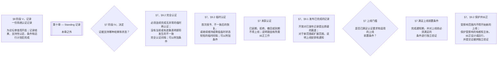
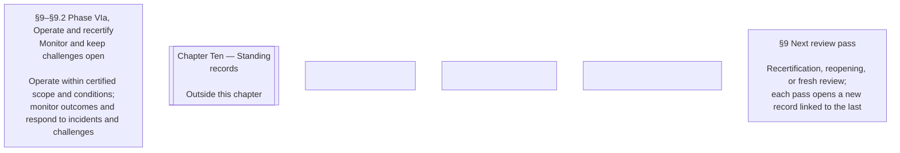
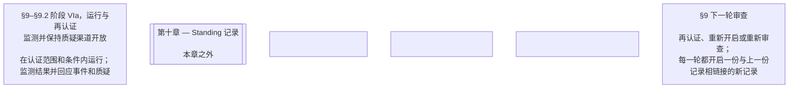

<!-- CHUNK-BEGIN zh__core_09.000_system_alignment_certification_evaluation__section_1_corpus_placement_overview.md bytes=3246 -->
<!-- AI-assisted translation draft; unreviewed. §1 corpus-placement overview, source lines 8–10; source SHA-256 4311e6ba74b7210f077c0bd4c8d21d8c9f517d2ada7b6d87288b39494dfeadd5. Draft only; do not synchronize into translations/. -->

# Chapter Nine Part A — §1 corpus-placement overview (zh)

## English source (lines 8–10)

> This file is **part of the Sentient Constitution** and is **binding only together** with the other numbered `core_*` files read as one text. It contains **Chapter Nine, Part A** — certification purpose, the process overview, and the first two phases of the process — **Frame** (system class) and **Evaluate** (whole-system evaluation in three sub-phases: the always-applicable evaluations, including data types and handling, in **§3**; the evaluations that apply where implicated in **§4**; and the Rights-Floor and domain evaluations that apply where triggered in **§5**) — **§1–§5**. The worked **Class A / B / C illustrations** (the system class profiles, §3.4.8, §5.1.5, §5.2.4, §5.3.7, §5.4.4, §5.5.5, and §5.6.4), including each one's **Reading across system classes** paragraph, are in [`core_09.010_system_alignment_certification_illustrations.md`](core_09.010_system_alignment_certification_illustrations.md); each keeps its Part A section number. The binding system-class-scaling and escalation rules those paragraphs illustrate stay in this file: system class scaling, including participation and proportionality, in §2.2; data-handling scaling in §3.4; and the **System class scaling and escalation** paragraph in each of §5.1–§5.6. The files of the whole chapter are listed in the table below.
>
> **Chapter Nine files.** Chapter Nine is split across four binding files read as one text. Part A, this file, opens the chapter; there is no separate index file.

## Translation draft

> 本文件**属于《Sentient Constitution》**，只有与其他编号的 `core_*` 文件作为同一文本共同阅读时才具有约束力。本文为**第九章A部分**，涵盖认证目的、流程概览及前两个阶段：**Frame**（系统类别）和 **Evaluate**（分三个子阶段进行的全系统评估）——**§§1–5**。三个子阶段包括：**§3**中始终适用的评估（包括数据类型与处理）；**§4**中在相关时适用的评估；以及**§5**中在触发条件成立时适用的**权利底线**和领域评估。**A / B / C类**的详细示例（系统类别概况、§3.4.8、§5.1.5、§5.2.4、§5.3.7、§5.4.4、§5.5.5、§5.6.4），包括每个示例中的**跨系统类别阅读**段落，见[`core_09.010_system_alignment_certification_illustrations.md`](core_09.010_system_alignment_certification_illustrations.md)；每个示例都保留其在A部分中的章节编号。这些段落所说明的、具有约束力的类别缩放和升级规则仍置于本文件：§2.2规定系统类别缩放（包括参与和比例性）；§3.4规定数据处理缩放；§5.1–§5.6各节均设有**系统类别缩放与升级**段落。下表列出本章全部文件。
>
> **第九章文件。**第九章分为四个具有约束力、需共同阅读的文件。本文件即A部分，位于本章开篇；本章没有单独的索引文件。

<!-- CHUNK-END -->
<!-- CHUNK-BEGIN zh__core_09.000_system_alignment_certification_evaluation__section_1_corpus_file_table.md bytes=4930 -->
<!-- AI-assisted translation draft; unreviewed. §1 corpus-placement file table, source lines 12–17; source SHA-256 4311e6ba74b7210f077c0bd4c8d21d8c9f517d2ada7b6d87288b39494dfeadd5. Draft only; do not synchronize into translations/. -->

# Chapter Nine Part A — §1 corpus-placement file table (zh)

## English source (lines 12–17)

> | Part | File | Owns |
> |------|------|------|
> | **Part A — Evaluation** | [`core_09.000_system_alignment_certification_evaluation.md`](core_09.000_system_alignment_certification_evaluation.md) | §1–§5: purpose and process overview (with a chart of the whole certification process in its six phases), **Phase I Frame** (system class, how system class scales every evaluation, and pilot certification) and **Phase II Evaluate** (whole-system evaluation in three sub-phases: **IIa** always, in §3, including chartered scope versus functional boundaries and data types and handling; **IIb** where implicated, in §4; and **IIc** where triggered, the Rights-Floor and domain evaluations, in §5) |
> | **Part B — Record and process** | [`core_09.005_system_alignment_certification_record_process.md`](core_09.005_system_alignment_certification_record_process.md) | §6–§10: **Phase III Review** (forum roles, supervisory sequence, and the contestability chain), **Phase IV Decide** (certification outcomes, including the go-live gate), **Phase V Record** (the certification record and its integrity, including governing [System Charter](core_05.040_band_continuity.md#system-charter) fields), and **Phase VI Operate** (the challenge path; recertification and reopening; the standing bridge) — continuous chapter numbering from Part A §5 |
> | **Part C — Illustrations** | [`core_09.010_system_alignment_certification_illustrations.md`](core_09.010_system_alignment_certification_illustrations.md) | the illustrative system class profiles, §3.4, §3.4.8, §5.1.5, §5.2.4, §5.3.7, §5.4.4, §5.5.5, and §5.6.4: worked Class A / B / C walkthroughs for each Part A evaluation area, numbered to match Part A and linked both ways |
> | **Part D — Institutional alignment certification** | [`core_09.015_institutional_alignment_certification.md`](core_09.015_institutional_alignment_certification.md) | §11–§15: the same six phases for an **Institution** rather than a System — the institution class and the institutional evaluation (**Phases I and II**, §12), the forum roles, outcome, and **Institutional Certification Record** (**Phases III to V**, §13), and recertification, reopening, the cascade from System certifications, and the standing bridge (**Phase VI**, §14–§15). It cites each System's certification by link and does not repeat it, and it is not a licence — continuous chapter numbering from Part B §10 |

## Translation draft

| 部分 | 文件 | 范围 |
|------|------|------|
| **Part A — Evaluation** | [`core_09.000_system_alignment_certification_evaluation.md`](core_09.000_system_alignment_certification_evaluation.md) | §§1–5：目的与流程概览（含六阶段认证流程图），以及第I阶段 Frame（系统类别、类别如何调整每项评估、试点认证）和第II阶段 Evaluate（三个子阶段的全系统评估：IIa始终适用，见§3，包括宪章范围与功能边界、数据类型与处理；IIb在相关时适用，见§4；IIc在触发时适用，见§5的权利底线和领域评估）。 |
| **Part B — Record and process** | [`core_09.005_system_alignment_certification_record_process.md`](core_09.005_system_alignment_certification_record_process.md) | §§6–10：第III阶段 Review（论坛角色、监督顺序和挑战链）；第IV阶段 Decide（认证结果，包括上线门槛）；第V阶段 Record（认证记录及其完整性，包括[System Charter](core_05.040_band_continuity.md#system-charter)的约束字段）；第VI阶段 Operate（挑战途径、再认证与重新开启、standing桥接）——从A部分§5连续编号。 |
| **Part C — Illustrations** | [`core_09.010_system_alignment_certification_illustrations.md`](core_09.010_system_alignment_certification_illustrations.md) | 系统类别示例概况及§3.4、§3.4.8、§5.1.5、§5.2.4、§5.3.7、§5.4.4、§5.5.5、§5.6.4：针对A部分每个评估领域提供A/B/C类实例，编号与正文一致，并建立双向链接。 |
| **Part D — Institutional alignment certification** | [`core_09.015_institutional_alignment_certification.md`](core_09.015_institutional_alignment_certification.md) | §§11–15：将同一六阶段用于Institution而非System——机构类别与机构评估（I、II阶段，§12），论坛角色、结果与机构认证记录（III至V阶段，§13），再认证、重新开启、System认证的级联和standing桥接（VI阶段，§§14–15）。通过链接引用每个System的认证而不重复，也不是许可证——从B部分§10连续编号。 |

<!-- CHUNK-END -->
<!-- CHUNK-BEGIN zh__core_09.000_system_alignment_certification_evaluation__section_1_corpus_explanation.md bytes=7879 -->
<!-- AI-assisted translation draft; unreviewed. §1 corpus-placement explanatory prose, source lines 19–30; source SHA-256 4311e6ba74b7210f077c0bd4c8d21d8c9f517d2ada7b6d87288b39494dfeadd5. Draft only; do not synchronize into translations/. -->

# Chapter Nine Part A — §1 corpus-placement explanatory prose (zh)

## English source (lines 19–30)

> **How the two certifications relate.** System Alignment Certification (Parts A to C) is the certification of a System. Institutional alignment certification (Part D) is the certification of an Institution, which may run Systems or none. Part D cites each System's certification record by link and does not redo it; [Part D §11.1](core_09.015_institutional_alignment_certification.md#111-relation-to-system-alignment-certification) states the relation and [Part D §11.3](core_09.015_institutional_alignment_certification.md#113-no-permission-and-no-gate) states that it is not a licence.
>
> Generic **Chapter Nine** links in other files route to the appropriate part by section number.
>
> - **Constitutional owner (joint with Parts B and D):** forum-supervised **system alignment certification and related records** — evaluation domains (Part A); forum process, supervisory sequence, certification-record duties, certification outcomes and the go-live gate, the challenge path, recertification and reopening, and verified-input bridge to Chapter Ten (Part B); the same six phases for an Institution (Part D). Under the **oversight** Tetrad leg, SAC is one especially large, high-stakes audit process among others; auditing floors remain at **Article XVI** (*Audit, Transparency, and Independent Verification*) and Chapter Five [Auditability](core_05.050_band_oversight.md#auditability).
> - **Verification substrate owner:** [Chapter Four — Burden of Proof, Traceability, and Verification](core_04.000_burden_traceability_verification.md#chapter-four-burden-of-proof-traceability-and-verification) (within Chapters Two through Four) owns burden allocation, compliance evidence, definition traceability, observability, and security-constrained verification. Chapter Nine **applies** that discipline to system alignment certification records; it does **not** restate Chapter Four sections **1** through **5**.
> - **Auditing home (not relocated here):** **Article XVI** (*Audit, Transparency, and Independent Verification*), **Def.O1** (*Transparency, Auditability, and Verification*), and **CJS-5.110 §3 and CJS-5.115 §3** (*Audit process home*)–**CJS-5.110 §5** own auditing floors and operational terms. Chapter Nine runs one especially large SAC audit process that must satisfy those floors; it does not own all auditing.
> - **Implementation owner:** system-class handling, CS-6.345, and forum-process detail in designated implementation files must remain consistent with Chapter Nine and may be stricter where the corpus already provides a [Fullest Protective Effect](core_05.045_band_integrative.md#fullest-protective-effect) rule.
> - **Anti-relocation rule:** Part A does not restate Chapter Five canonical definitions, Chapter Three anti-evasion discipline (see [Part B §9.3](core_09.005_system_alignment_certification_record_process.md#93-non-evasion)), Chapter Ten contribution or standing measurement, or Chapter Eleven standing effects. **[Part B §10](core_09.005_system_alignment_certification_record_process.md#10-relationship-to-standing)** states the standing bridge boundary explicitly.
>
> **Upstream:** Chapter Five definitions; Chapters Two through Four record, verification, burden, and traceability of definitions to results; and [Chapter Eight](core_08.000_functional_independence_separation_of_duties.md#chapter-eight-functional-independence-and-separation-of-duties), whose separation-of-duties requirement governs every materially binding certification act.
> **Downstream:** [Part B](core_09.005_system_alignment_certification_record_process.md#chapter-nine-part-b-system-alignment-certification--record-and-process) (*forum process, record, outcomes, and standing bridge*); Chapter Ten standing records and verified inputs; Chapter Eleven standing effects; Chapter Thirteen forum supervision and system alignment certification pathways.

## Translation draft

**两种认证之间的关系。** System Alignment Certification（A至C部分）认证的是一个System。机构对齐认证（D部分）认证的是一个Institution；该机构可以运营System，也可以不运营任何System。D部分通过链接引用各System的认证记录，不重新进行认证；[Part D §11.1](core_09.015_institutional_alignment_certification.md#111-relation-to-system-alignment-certification)说明两者关系，[Part D §11.3](core_09.015_institutional_alignment_certification.md#113-no-permission-and-no-gate)说明该认证不是许可证。
>
> 其他文件中的通用 **Chapter Nine** 链接按章节编号指向相应部分。
>
> - **宪法职责所有者（与B、D部分共同承担）：** 由论坛监督的系统对齐认证及相关记录——评估领域（A部分）；论坛流程、监督顺序、认证记录义务、认证结果与上线门槛、质疑途径、重新认证与重启审查，以及通往第十章的已核验输入桥接（B部分）；以及针对Institution的同样六个阶段（D部分）。在Tetrad的**监督**支柱下，SAC是多种审计流程中规模特别大、风险很高的一种；审计底线仍由**Article XVI**（*Audit, Transparency, and Independent Verification*）和第五章的[Auditability](core_05.050_band_oversight.md#auditability)规定。
> - **核验基础职责所有者：** [Chapter Four — Burden of Proof, Traceability, and Verification](core_04.000_burden_traceability_verification.md#chapter-four-burden-of-proof-traceability-and-verification)（第二至第四章范围内）负责分配举证责任、合规证据、定义可追溯性、可观测性和受安全约束的核验。第九章将该纪律用于系统对齐认证记录；不重述第四章第**1**至**5**节。
> - **审计规范归属地（不迁入此处）：****Article XVI**（*Audit, Transparency, and Independent Verification*）、**Def.O1**（*Transparency, Auditability, and Verification*）以及**CJS-5.110 §3和CJS-5.115 §3**（*Audit process home*）–**CJS-5.110 §5**规定审计底线和操作术语。第九章执行一项规模特别大的SAC审计流程，并须符合这些底线；它不负责所有审计。
> - **实施职责所有者：** 指定实施文件中的系统类别处理、CS-6.345和论坛流程细节必须与第九章保持一致；若语料库已有[Fullest Protective Effect](core_05.045_band_integrative.md#fullest-protective-effect)规则，则可更严格。
> - **禁止迁移规则：** A部分不重述第五章的规范定义、第三章的反规避纪律（见[Part B §9.3](core_09.005_system_alignment_certification_record_process.md#93-non-evasion)）、第十章的贡献或standing衡量，也不重述第十一章的standing效应。**[Part B §10](core_09.005_system_alignment_certification_record_process.md#10-relationship-to-standing)**明确规定standing桥接的边界。
>
> **上游：** 第五章定义；第二至第四章的记录、核验、举证责任以及从定义到结果的可追溯性；以及[Chapter Eight](core_08.000_functional_independence_separation_of_duties.md#chapter-eight-functional-independence-and-separation-of-duties)，其职责分离要求约束每一项具有实质约束力的认证行为。
> **下游：** [Part B](core_09.005_system_alignment_certification_record_process.md#chapter-nine-part-b-system-alignment-certification--record-and-process)（*论坛流程、记录、结果和standing桥接*）；第十章的standing记录和已核验输入；第十一章的standing效应；第十三章的论坛监督及系统对齐认证途径。

<!-- CHUNK-END -->
<!-- CHUNK-BEGIN zh__core_09.000_system_alignment_certification_evaluation__section_1_heading.md bytes=364 -->
<!-- AI-assisted translation draft; unreviewed. §1 heading, source line 44; source SHA-256 4311e6ba74b7210f077c0bd4c8d21d8c9f517d2ada7b6d87288b39494dfeadd5. Draft only; do not synchronize into translations/. -->

# Chapter Nine Part A — §1 heading (zh)

## English source (lines 44–45)

### 1. Purpose and Role


## Translation draft

### 1. 目的与作用

<!-- CHUNK-END -->
<!-- CHUNK-BEGIN zh__core_09.000_system_alignment_certification_evaluation__section_1_trace.md bytes=12057 -->
<!-- AI-assisted translation draft; unreviewed. §1 trace, source lines 46–95; source SHA-256 4311e6ba74b7210f077c0bd4c8d21d8c9f517d2ada7b6d87288b39494dfeadd5. Draft only; do not synchronize into translations/. -->

# Chapter Nine Part A — §1 trace (zh)

## English source (lines 46–95)

<details>
<summary><strong><span style="color: #2563eb;">Trace</span></strong></summary>

- Upstream:
  - [Preamble — constitutional owner register](core_00.000_preamble.md#4-principles-definitions-and-rights) and
  - [Authority Stack and Internal Hierarchy](core_05.045_band_integrative.md#authority-stack-and-internal-hierarchy);
  - [Constitutional Tetrad](core_00.000_preamble.md#constitutional-tetrad);
  - [Two Constitutional Aims](core_00.000_preamble.md#two-constitutional-aims);
  - [material stake](core_00.000_preamble.md#material-stake);
  - [Proportionality](core_05.035_band_accountability.md#proportionality) and
  - [Substantive Fairness](core_05.055_band_participation.md#substantive-fairness) (Chapter Five); Participation measurement family (*voice, access, and contest paths*);
  - [Chapter One §16 Stewardship In Depth](core_01.010_stewardship_capacity_principles.md#16-stewardship-in-depth) (1.010 §16);
  - [Chapter One §12 Systemic Evaluation Requirement](core_01.000_values_principles.md#12-systemic-evaluation-requirement) (1.000 §12) (*principle-layer whole-system evaluation lens — not one corner alone*); Chapters Two through Four;
  - [Chapter Five](core_05.000_definitions_home.md#chapter-five-foundational-definitions) (5.000) (*canonical definitions*);
  - [Chapter Eight §2 Four-Seat Constitutional Requirement](core_08.000_functional_independence_separation_of_duties.md#2-four-seat-constitutional-requirement) (8.000 §2);
  - [System Alignment Certification](core_05.040_band_continuity.md#system-alignment-certification) (Chapter Five canonical term; non-operative shorthand **SAC**);
  - [System Certification Record](core_05.040_band_continuity.md#system-certification-record) (Chapter Five meaning).
- Downstream:
  - [§2](#2-system-class-evaluation) (*system class evaluation*);
  - [Part B §9.1](core_09.005_system_alignment_certification_record_process.md#91-challenging-a-certification) (9.005 §9.1) (*challenging a certification*); and
  - [Part C system class profiles](core_09.010_system_alignment_certification_illustrations.md#illustrative-system-class-profiles-non-exhaustive) (9.010) (*illustrative system class profiles*);
  - [Part C whole-system walkthroughs](core_09.010_system_alignment_certification_illustrations.md#illustrative-whole-system-application-by-system-class-non-exhaustive) (9.010) (*worked whole-system examples by system class*);
  - [§3.4.8](core_09.010_system_alignment_certification_illustrations.md#348-illustrative-data-handling-application-by-system-class-non-exhaustive) (*worked data-handling examples by system class*);
  - [§5.1.5](core_09.010_system_alignment_certification_illustrations.md#515-illustrative-ecological-footprint-application-by-system-class-non-exhaustive) (*worked ecological-footprint examples by system class*);
  - [§5.2.4](core_09.010_system_alignment_certification_illustrations.md#524-illustrative-educational-capability-application-by-system-class-non-exhaustive) (*worked educational-capability examples by system class*);
  - [§5.3.7](core_09.010_system_alignment_certification_illustrations.md#537-illustrative-cross-system-support-application-by-system-class-non-exhaustive) (*worked cross-system-support examples by system class*);
  - [§5.4.4](core_09.010_system_alignment_certification_illustrations.md#544-illustrative-nondiscrimination-application-by-system-class-non-exhaustive) (*worked nondiscrimination examples by system class*);
  - [§5.5.5](core_09.010_system_alignment_certification_illustrations.md#555-illustrative-accessibility-application-by-system-class-non-exhaustive) (*worked accessibility examples by system class*);
  - [§5.6.4](core_09.010_system_alignment_certification_illustrations.md#564-illustrative-trustworthiness-application-by-system-class-non-exhaustive) (*worked trustworthiness examples by system class*);
  - [§3](#3-whole-system-certification-evaluation) (*whole-system certification evaluation factors*);
  - [§3.4](#34-data-types-and-handling-evaluation) through
  - [§5.6](#56-trustworthiness-and-system-reliance-integrity-evaluation) (*domain evaluations*);
  - [Part B §6](core_09.005_system_alignment_certification_record_process.md#6-forum-process) (9.005 §6) (*supervisory sequence and contestability chain*);
  - [Part B §6.1](core_09.005_system_alignment_certification_record_process.md#61-forum-supervision-and-component-roles) (9.005 §6.1) (*forum component roles*);
  - [Part B §8](core_09.005_system_alignment_certification_record_process.md#8-system-certification-record) (9.005 §8) (*certification record contents*);
  - [Part B §8.2](core_09.005_system_alignment_certification_record_process.md#82-record-integrity-transparency-and-auditability) (9.005 §8.2) (*record integrity requirements*);
  - [Part B §7](core_09.005_system_alignment_certification_record_process.md#7-certification-outcomes) (9.005 §7) (*reopening and anti-evasion*);
  - [Part B §10](core_09.005_system_alignment_certification_record_process.md#10-relationship-to-standing) (9.005 §10) (*standing-record bridge*);
  - [Chapter Ten](core_11.000_standing_assessment.md#chapter-eleven-contribution-violation-and-standing-model--measurement) (10.000) (*standing records and verified-input gate*);
  - [Chapter Eleven](core_12.000_standing_integration.md#chapter-twelve-standing-effects-and-integration) (11.000) (*standing effects and integration*);
  - [Chapter Thirteen](core_14.000_forum.md#chapter-fourteen-forums-and-jurisdiction) (13.000) (*forum supervision, certification, alignment certification, and review*).
- Read with:
  - **[CS-9.305](corpus_systems/cs_09.305_system_classification_machinery.md#cs-9305-part-a-system-classification-machinery) (*System classification machinery*) and [CS-9.310 — System impact classifications](corpus_systems/cs_09.310_system_impact_classifications.md#cs-9310-part-b-system-impact-classifications)**, **[CS-6.305](corpus_systems/cs_06.305_information_types_and_handling.md#cs-6305-part-a-information-types-and-handling) (*Information types and handling*) and [CS-6.310 — Data classifications](corpus_systems/cs_06.310_data_classifications.md#cs-6310-part-b-data-classifications)**, and
  - **CS-6.345** (*System lifecycle*);
  - **CF-13.415** (*Routing operations, transfer, certification, and representative treatment*) and
  - **CF-13.425** (*Integrity safeguards, anti-capture operations, and anti-self-judging support*); **Article XVI** (*Audit, Transparency, and Independent Verification*) and
  - [Auditability](core_05.050_band_oversight.md#auditability) (*auditing floors — SAC is one especially large audit process under oversight, not the sole auditing home*); **CJS-5.110 §3 (*Oversight: auditability and reconstructability terms (annex)*) and CJS-5.115 §3** (*Audit process home*)–
  - **CJS-5.110 §5** (*Oversight: independent verification and claim-integrity terms*).

</details>

## Translation draft

#### 追溯关系

此图说明本节的宪法依据与权限层级，并将其连接到评估、分类、审查路径、记录、结果和审计，同时标明配套参阅的操作文件。

**追溯关系 — upstream canonical sources:** [Preamble — constitutional owner register](core_00.000_preamble.md#4-principles-definitions-and-rights); [Authority Stack and Internal Hierarchy](core_05.045_band_integrative.md#authority-stack-and-internal-hierarchy); [Constitutional Tetrad](core_00.000_preamble.md#constitutional-tetrad); [Two Constitutional Aims](core_00.000_preamble.md#two-constitutional-aims); [material stake](core_00.000_preamble.md#material-stake); [Proportionality](core_05.035_band_accountability.md#proportionality); [Substantive Fairness](core_05.055_band_participation.md#substantive-fairness); [Chapter One §16 Stewardship In Depth](core_01.010_stewardship_capacity_principles.md#16-stewardship-in-depth); [Chapter One §12 Systemic Evaluation Requirement](core_01.000_values_principles.md#12-systemic-evaluation-requirement); [Chapter Five](core_05.000_definitions_home.md#chapter-five-foundational-definitions); [Chapter Eight §2 Four-Seat Constitutional Requirement](core_08.000_functional_independence_separation_of_duties.md#2-four-seat-constitutional-requirement); [System Alignment Certification](core_05.040_band_continuity.md#system-alignment-certification); [System Certification Record](core_05.040_band_continuity.md#system-certification-record)

**追溯关系 — downstream routes and related records:** [§2](#2-system-class-evaluation); [Part B §9.1](core_09.005_system_alignment_certification_record_process.md#91-challenging-a-certification); [Part C system class profiles](core_09.010_system_alignment_certification_illustrations.md#illustrative-system-class-profiles-non-exhaustive); [Part C whole-system walkthroughs](core_09.010_system_alignment_certification_illustrations.md#illustrative-whole-system-application-by-system-class-non-exhaustive); [§3.4.8](core_09.010_system_alignment_certification_illustrations.md#348-illustrative-data-handling-application-by-system-class-non-exhaustive); [§5.1.5](core_09.010_system_alignment_certification_illustrations.md#515-illustrative-ecological-footprint-application-by-system-class-non-exhaustive); [§5.2.4](core_09.010_system_alignment_certification_illustrations.md#524-illustrative-educational-capability-application-by-system-class-non-exhaustive); [§5.3.7](core_09.010_system_alignment_certification_illustrations.md#537-illustrative-cross-system-support-application-by-system-class-non-exhaustive); [§5.4.4](core_09.010_system_alignment_certification_illustrations.md#544-illustrative-nondiscrimination-application-by-system-class-non-exhaustive); [§5.5.5](core_09.010_system_alignment_certification_illustrations.md#555-illustrative-accessibility-application-by-system-class-non-exhaustive); [§5.6.4](core_09.010_system_alignment_certification_illustrations.md#564-illustrative-trustworthiness-application-by-system-class-non-exhaustive); [§3](#3-whole-system-certification-evaluation); [§3.4](#34-data-types-and-handling-evaluation); [§5.6](#56-trustworthiness-and-system-reliance-integrity-evaluation); [Part B §6](core_09.005_system_alignment_certification_record_process.md#6-forum-process); [Part B §6.1](core_09.005_system_alignment_certification_record_process.md#61-forum-supervision-and-component-roles); [Part B §8](core_09.005_system_alignment_certification_record_process.md#8-system-certification-record); [Part B §8.2](core_09.005_system_alignment_certification_record_process.md#82-record-integrity-transparency-and-auditability); [Part B §7](core_09.005_system_alignment_certification_record_process.md#7-certification-outcomes); [Part B §10](core_09.005_system_alignment_certification_record_process.md#10-relationship-to-standing); [Chapter Ten](core_11.000_standing_assessment.md#chapter-eleven-contribution-violation-and-standing-model--measurement); [Chapter Eleven](core_12.000_standing_integration.md#chapter-twelve-standing-effects-and-integration); [Chapter Thirteen](core_14.000_forum.md#chapter-fourteen-forums-and-jurisdiction)

**追溯关系 — operational materials to read with this section:** [CS-9.305](corpus_systems/cs_09.305_system_classification_machinery.md#cs-9305-part-a-system-classification-machinery); [CS-9.310 — System impact classifications](corpus_systems/cs_09.310_system_impact_classifications.md#cs-9310-part-b-system-impact-classifications); [CS-6.305](corpus_systems/cs_06.305_information_types_and_handling.md#cs-6305-part-a-information-types-and-handling); [CS-6.310 — Data classifications](corpus_systems/cs_06.310_data_classifications.md#cs-6310-part-b-data-classifications); [Auditability](core_05.050_band_oversight.md#auditability)

<!-- CHUNK-END -->
<!-- CHUNK-BEGIN zh__core_09.000_system_alignment_certification_evaluation__purpose_adjuncts.md bytes=5156 -->
<!-- AI-assisted translation draft; unreviewed. Selected §1 passages, source lines 99 and 107–114; source SHA-256 4311e6ba74b7210f077c0bd4c8d21d8c9f517d2ada7b6d87288b39494dfeadd5. -->

# Chapter Nine Part A — §1 plain-terms excerpt

**Status:** AI-assisted draft; unreviewed. English source remains controlling.

## English source

When a system really matters to sentients' lives, certification has to be **proportionate** — as demanding as the system's real impact, dependency, and risk require, not a one-size-fits-all checklist or a rubber stamp. It also has to be **participatory** — affected sentients and communities must be able to see what was reviewed, understand what was decided, and challenge it when something is wrong. Forums review evidence, write it down in a certification record, and require re-checks on a schedule that matches how risky the system is. Classes A, B, and C get the full process and Class L a lighter one. Class P is encouraged to use it, and must once it is reclassified to Class L or higher (that is, its effects reach beyond a private unit) or its operator claims constitutional compliance.

## zh draft

当一个系统确实关系到有感知存在的生活时，其认证必须**合乎比例**——严格程度应与系统的实际影响、依赖程度和风险相称，而不能采用一刀切的清单或走过场的盖章。认证还必须**允许参与**：受影响的有感知存在和社区必须能够查看审查了什么、理解作出了什么决定，并在发现错误时提出异议。论坛审查证据，将其记入认证记录，并要求按系统风险相称的时间表重新检查。A、B、C类适用完整流程，L类适用较轻流程。鼓励P类使用该流程；当其被重新归类为L类或更高等级（即影响超出私人单元）或其运营者声称符合宪法时，该流程成为强制要求。


### English source — Flourishing

- **[Flourishing](core_00.000_preamble.md#flourishing)** — certification verifies that certification or continued reliance would not quietly defeat Rights Floors or block fair participation in constitutionally relevant life;

### zh draft

- **[繁荣发展](core_00.000_preamble.md#flourishing)** — 认证确认，授予认证或继续依赖系统不会暗中破坏权利底线，也不会阻碍在宪法相关生活中的公平参与；


### English source — Continuity criterion

- **[Continuity](core_00.000_preamble.md#continuity)** — certification verifies durable, non-regressive supply that sustains rather than depletes healthy natural systems ([Ecological Integrity](core_05.040_band_continuity.md#ecological-integrity), including [Ecological Recovery Capacity](core_05.040_band_continuity.md#ecological-recovery-capacity)), and system-class-scaled recertification where shared systems gate or sustain delivery;

### zh draft

- **[连续性](core_00.000_preamble.md#continuity)** — 认证确认供应持久且不倒退，能够维持而非耗尽健康的自然系统（[生态完整性](core_05.040_band_continuity.md#ecological-integrity)，包括[生态恢复能力](core_05.040_band_continuity.md#ecological-recovery-capacity)），并在共享系统控制或维持交付时按系统类别进行重新认证；


### English source — Participation criterion

- **Participation** — affected sentients and communities can understand, contest, and take part in review paths that matter to them;

### zh draft

- **参与** — 受影响的有感知存在和社区能够理解、质疑并参与对其切身相关的审查途径；


### English source — Oversight criterion

- **Oversight** — records, evidence, and assumptions are visible and auditable enough for independent checking; certification itself is one especially large audit process under that oversight duty, not the only one;

### zh draft

- **监督** — 记录、证据和假设足够公开且可审计，以支持独立核查；认证本身是监督义务下规模较大的一种审计流程，但不是审计的唯一归属；


### English source — Accountability criterion

- **Accountability** — defects, misclassification, and floor-defeating operation route to remedy, conditions, withdrawal, or standing input where the facts support it;

### zh draft

- **问责** — 缺陷、错误分类以及破坏权利底线的运行，在事实支持时应进入补救、附加条件、撤回或地位评估输入；


### English source — Timeliness criterion

- **Timeliness** — review and contest windows keep certification from going stale while harm can still be prevented or reversed.

### zh draft

- **及时性** — 审查和异议期限确保在损害仍可预防或逆转时认证不会过时。


### English source — Tetrad introduction

Certification implements the [Two Constitutional Aims](core_00.000_preamble.md#two-constitutional-aims) through the [Constitutional Tetrad](core_00.000_preamble.md#constitutional-tetrad):

### zh draft

认证通过[两项宪法目标](core_00.000_preamble.md#two-constitutional-aims)和[宪法四元原则](core_00.000_preamble.md#constitutional-tetrad)发挥作用：

<!-- CHUNK-END -->
<!-- CHUNK-BEGIN zh__core_09.000_system_alignment_certification_evaluation__section_1_purpose.md bytes=953 -->
<!-- AI-assisted translation draft; unreviewed. Complete purpose statement excerpt, source lines 101–105; source SHA-256 4311e6ba74b7210f077c0bd4c8d21d8c9f517d2ada7b6d87288b39494dfeadd5. This is an excerpt, not a complete §1 translation. -->

**系统对齐认证**旨在针对指定范围和审查时间表回答一个问题：该系统是否已充分展示其宪法对齐，以支持认证、有条件认证、验证、再认证、继续依赖、部署，或实质性解除条件？

- 认证不是人气评分、永久通行证，也不是跳过权利审查的方式。
- 它是对当前已知系统对齐情况作出的有时限、可质疑的陈述。
- 在四元的**监督**支柱下，监督要求审计；系统对齐认证是诸多审计流程中特别庞大、利害重大的一个，并非审计的唯一归属处（**第XVI条**（*审计、透明度与独立核验*），[可审计性](core_05.050_band_oversight.md#auditability)）。

<!-- CHUNK-END -->
<!-- CHUNK-BEGIN zh__core_09.000_system_alignment_certification_evaluation__section_1_subsection_headings.md bytes=743 -->
<!-- AI-assisted translation draft; unreviewed. §1.1/§1.2 visible subsection headings, source lines 116–119 and 144–148; source SHA-256 4311e6ba74b7210f077c0bd4c8d21d8c9f517d2ada7b6d87288b39494dfeadd5. Draft only; anchors/blank layout are structural. Do not synchronize into translations/. -->

# Chapter Nine Part A — §1.1 and §1.2 subsection headings (zh)

## English source

### Lines 116–119

<a id="11-certification-as-an-audit-process-scaled-by-class"></a>

#### 1.1 Certification as an audit process, scaled by class


### Lines 144–148


<a id="12-certification-at-a-glance"></a>

#### 1.2 Certification at a glance


## Translation draft

#### 1.1 按类别调整深度的审计流程中的认证

#### 1.2 认证概览

<!-- CHUNK-END -->
<!-- CHUNK-BEGIN zh__core_09.000_system_alignment_certification_evaluation__section_1_audit_scope.md bytes=2943 -->
<!-- AI-assisted translation draft; unreviewed. §1.1 audit mechanism and sibling audit modes, source lines 120–130; source SHA-256 4311e6ba74b7210f077c0bd4c8d21d8c9f517d2ada7b6d87288b39494dfeadd5. -->

# Chapter Nine Part A — §1.1 certification audit process excerpt (zh)

## English source

As an oversight mechanism, certification is one especially large audit process under [Auditability](core_05.050_band_oversight.md#auditability) and **Article XVI** (*Audit, Transparency, and Independent Verification*):

- It is forum-supervised, multi-domain, and status-granting.
- It may integrate the results of sibling audit modes, and it does not absorb or replace them. Each keeps its own owner, named in the [sibling audit modes map](corpus_joint_structure/cjs_05.115_audit_process.md#sibling-audit-modes-owner-map) of the audit process home:
  - System Data Types Record audits under **CS-6.305 (*Information types and handling*) and CS-6.310** (*Data classifications*)
  - System Classification Record audits under **CS-9.305 (*System classification machinery*) and CS-9.310** (*System impact classifications*)
  - steward assurance reviews under **CS-14.305** (*Critical system stewardship*)
  - continuous audit under **CS-6.345** (*System lifecycle*) ACA
  - complexity audits under **CS-6.315** (*Comprehensibility and complexity stewardship*) and **Article XXIII-B** (*Complexity Audit and Modularity Requirements*)
  - claim verification under **CJS-5.110 §5** (*Oversight: independent verification and claim-integrity terms*)
- You can still run any of these checks on their own, without going through certification. Certification doesn't replace them.

## zh draft

作为监督机制，认证是依据[可审计性](core_05.050_band_oversight.md#auditability)和**Article XVI**（*审计、透明度与独立验证*）开展的一项特别大型的审计流程：

- 该流程由论坛监督，涵盖多个领域，并授予状态。
- 它可以整合相关审计模式的结果，但不会吸收或取代这些模式。每种模式都保留自己的负责人，负责人列于审计流程主文档的[相关审计模式图](corpus_joint_structure/cjs_05.115_audit_process.md#sibling-audit-modes-owner-map)中：
  - System Data Types Record 审计依据 **CS-6.305（*信息类型与处理*）和 CS-6.310**（*数据分类*）
  - System Classification Record 审计依据 **CS-9.305（*系统分类机制*）和 CS-9.310**（*系统影响分类*）
  - 监护保证审查依据 **CS-14.305**（*关键系统监护*）
  - 持续审计依据 **CS-6.345**（*系统生命周期*）ACA
  - 复杂性审计依据 **CS-6.315**（*可理解性与复杂性监护*）和 **Article XXIII-B**（*复杂性审计与模块化要求*）
  - 主张核验依据 **CJS-5.110 §5**（*监督：独立验证与主张完整性条款*）
- 你仍可单独开展其中任何一项检查，无须经过认证。认证不能取代这些检查。

<!-- CHUNK-END -->
<!-- CHUNK-BEGIN zh__core_09.000_system_alignment_certification_evaluation__section_1_class_scaling.md bytes=3541 -->
<!-- AI-assisted translation draft; unreviewed. Chapter Nine Part A §1 class scaling and cadence, source lines 132–143; source SHA-256 4311e6ba74b7210f077c0bd4c8d21d8c9f517d2ada7b6d87288b39494dfeadd5. Draft only; do not synchronize into translations/. -->

**Current English passage:**

Certification depth, record burden, certification interval, stakeholder review, and contest paths must scale with [material stake](core_00.000_preamble.md#material-stake) under [Proportionality](core_05.035_band_accountability.md#proportionality):

The process applies by impact class, as the [reclassification requirement](corpus_systems/cs_09.305_system_classification_machinery.md#35-reclassification-requirement) of **CS-9.305** (*System classification machinery*) sets out:

- **Class A, Class B, and Class C:** these systems carry the highest impact, dependency, and risk, and whole-system evaluation under [§3 Whole-System Certification Evaluation](#3-whole-system-certification-evaluation), [§4 Evaluations Where Implicated](#4-evaluations-where-implicated), and [§5 Rights-Floor and Domain Evaluations](#5-rights-floor-and-domain-evaluations), each as its own sub-phase applies, is mandatory at full depth;
- **Class L:** the same evaluation is mandatory but proportionate, with a lower default re-check cadence and simpler records where CS-9.305 (*System classification machinery*) and CS-9.310 (*System impact classifications*) permits; and
- **Class P:** the process is encouraged while the system is validly Class P, and a Class P system may use it voluntarily. It becomes mandatory on reclassification to Class L or higher, or where the operator voluntarily asserts constitutional compliance for the system.

The certification interval, and the financial, resource, or special audit that falls at its midpoint, are set by class in [Chapter Thirteen §6 Timely resolution, materiality tiers, and anti-delay discipline](core_14.000_forum.md#review-cadence) (*Review cadence*). This chapter does not restate the numbers.

**Proposed locale translation:**

认证深度、记录负担、认证间隔、利益相关方审查以及质疑途径，必须依照[实质性利害](core_00.000_preamble.md#material-stake)，按[比例原则](core_05.035_band_accountability.md#proportionality)进行调整：

依照**CS-9.305**（*系统分类机制*）的[重新分类要求](corpus_systems/cs_09.305_system_classification_machinery.md#35-reclassification-requirement)，该流程按影响类别适用：

- **A、B、C类：**这些系统具有最高影响、依赖和风险；根据[§3 全系统认证评估](#3-whole-system-certification-evaluation)、[§4 在相关情形下的评估](#4-evaluations-where-implicated)和[§5 权利底线与领域评估](#5-rights-floor-and-domain-evaluations)，每个适用子阶段都必须进行全深度的全系统评估；
- **L类：**同样必须进行评估，但应按比例实施；在**CS-9.305**（*系统分类机制*）和**CS-9.310**（*系统影响分类*）允许时，默认复查频率可较低，记录可较简；以及
- **P类：**系统有效属于P类期间，鼓励采用该流程，也可自愿采用。系统重新分类为L类或更高类别，或运营方自愿声称系统符合宪制要求时，该流程即为强制。

认证间隔以及在间隔中点进行的财务、资源或特别审计，按类别由[第十三章 §6 及时解决、实质性分级与反拖延纪律](core_14.000_forum.md#review-cadence)（*审查周期*）设定。本章不重复具体数值。

<!-- CHUNK-END -->
<!-- CHUNK-BEGIN zh__core_09.000_system_alignment_certification_evaluation__section_1_at_a_glance.md bytes=1608 -->
<!-- AI-assisted translation draft; unreviewed. Chapter Nine Part A §1.2 plain-language summary, source line 149; source SHA-256 4311e6ba74b7210f077c0bd4c8d21d8c9f517d2ada7b6d87288b39494dfeadd5. Draft only; do not synchronize into translations/. -->

# Chapter Nine Part A — §1.2 at-a-glance summary (zh)

## English source

*In plain terms: classify the system honestly, run the evaluations that apply, have forums independently review the evidence and stakeholder concerns, and decide an outcome. Complete the one record opened for forum review and publish it with an open challenge path. A certified system goes live only after its notice interval and required protections are satisfied. Monitor actual outcomes, respond to incidents and challenges, and check again on schedule or when the facts change. Correct defects and have the correction independently verified before authorizing the affected scope or releasing its conditions. Each review pass uses a new record linked to the last.*

## zh draft

*简单来说：诚实地对系统分类，开展适用的评估，由论坛独立审查证据和利益相关方的关切，并作出结果决定。完成为论坛审查而开启的唯一记录，并在保留开放质疑渠道的同时予以公开。认证系统只有在通知期届满且满足所需保护措施后才能上线。监测实际结果，回应事件和质疑，并按计划或在事实变化时重新检查。纠正缺陷，并在授权受影响范围或解除其条件之前，对纠正进行独立验证。每一轮审查都使用一份与上一份记录相链接的新记录。*

<!-- CHUNK-END -->
<!-- CHUNK-BEGIN zh__core_09.000_system_alignment_certification_evaluation__section_1_phase_map.md bytes=571 -->
<!-- AI-assisted translation draft; unreviewed. Chapter Nine Part A §1.2 phase map, source line 151; source SHA-256 4311e6ba74b7210f077c0bd4c8d21d8c9f517d2ada7b6d87288b39494dfeadd5. Draft only; do not synchronize into translations/. -->

**Current English passage:**

The process runs in **six phases**: **I Frame**, **II Evaluate**, **III Review**, **IV Decide**, **V Record**, and **VI Operate**.

**Proposed locale translation:**

该流程分为**六个阶段**：**I 界定框架**、**II 评估**、**III 审查**、**IV 决定**、**V 记录**和**VI 运行**。

<!-- CHUNK-END -->
<!-- CHUNK-BEGIN zh__core_09.000_system_alignment_certification_evaluation__section_1_reopen_triggers.md bytes=1575 -->
<!-- AI-assisted translation draft; unreviewed. Chapter Nine Part A §1 review-reopening passage, source line 153; source SHA-256 4311e6ba74b7210f077c0bd4c8d21d8c9f517d2ada7b6d87288b39494dfeadd5. Draft only; do not synchronize into translations/. -->

**Current English passage:**

Every evaluation that applies is carried out again on each certification pass: at first certification, at each recertification on the schedule set by [§2 System Class Evaluation](#2-system-class-evaluation), and at each reopened or fresh review. Review reopens before the next scheduled recertification when material facts change, such as growing reliance on the system, growing extraction from shared foundations, a significant fall in what the system puts back into them, or a credible challenge. [Part B §9 Recertification and Reopening](core_09.005_system_alignment_certification_record_process.md#9-recertification-and-reopening) lists the triggers.

**Proposed locale translation:**

每次认证都要重新进行所有适用的评估：首次认证时、按[§2 系统类别评估](#2-system-class-evaluation)设定的周期进行每次再认证时，以及每次重新开启或新启动审查时。若重要事实发生变化，例如对系统的依赖增加、从共同基础中提取增加、系统回馈共同基础的贡献显著下降，或出现可信质疑，就要在下一次计划再认证之前重新开启审查。[乙部分 §9 再认证与重新开启](core_09.005_system_alignment_certification_record_process.md#9-recertification-and-reopening)列出触发条件。

<!-- CHUNK-END -->
<!-- CHUNK-BEGIN zh__core_09.000_system_alignment_certification_evaluation__section_1_phase_map_opening_nodes.md bytes=1821 -->
<!-- AI-assisted translation draft; unreviewed. §1.2 Phase I/II opening chart-node labels, source lines 155–165; source SHA-256 4311e6ba74b7210f077c0bd4c8d21d8c9f517d2ada7b6d87288b39494dfeadd5. Draft only; non-prose Mermaid syntax/connectors are retained. Do not synchronize into translations/. -->

# Chapter Nine Part A — §1.2 opening phase-map nodes (zh)

## English source (lines 155–165)

```mermaid
flowchart TB
    T(["System with material impact seeks certification,<br/>or reliance on it grows"])
    C["§2 Phase I, Frame<br/>Classify honestly<br/><br/>Class sets depth and re-check schedule"]
    subgraph W["§3–§5 Phase II, Evaluate — Whole-system evaluation"]
        direction LR
        Al["§3.1–§3.4 IIa — Always<br/><br/>Governance; systemic risk: evaluated,<br/>and disclosed to those who need it;<br/>time horizon; data types"]
        Im["§4 IIb — When implicated<br/><br/>Privacy loci, exit rights,<br/>assembly and dissent"]
        Tr["§5 IIc — When triggered<br/><br/>Applicable Rights-Floor checks<br/>and six domain evaluations"]
        Al ~~~ Im ~~~ Tr
    end

## Translation draft

```mermaid
flowchart TB
    T["具有重大影响的系统申请认证，<br/>或对其依赖增加"]
    C["§2 阶段 I，框定范围<br/>如实分类<br/><br/>类别决定评估深度和复查时间表"]
    subgraph W["§3–§5 阶段 II，评估——全系统评估"]
        direction LR
        Al["§3.1–§3.4 IIa — 始终适用<br/><br/>治理；评估系统性风险并向需要者披露；<br/>时间跨度；数据类型"]
        Im["§4 IIb — 涉及时适用<br/><br/>隐私事项、退出权、<br/>集会与异议"]
        Tr["§5 IIc — 触发时适用<br/><br/>适用的权利底线核查<br/>及六项领域评估"]
        Al ~~~ Im ~~~ Tr
    end
```

<!-- CHUNK-END -->
<!-- CHUNK-BEGIN zh__core_09.000_system_alignment_certification_evaluation__chart_review_node.md bytes=539 -->
# Chapter Nine Part A — chart review node (zh)

AI-assisted draft; unreviewed. Current source SHA-256: `4311e6ba74b7210f077c0bd4c8d21d8c9f517d2ada7b6d87288b39494dfeadd5`. Reconciles current source line 166: “Assigned forums issue findings; challenge paths stay open.” The translated node ID, chart structure, HTML line breaks, and code syntax are preserved.

```mermaid
    F["阶段 III，审查 — §6<br/>独立审查证据与利益相关方关切<br/><br/>指定评议所提出调查结论；<br/>质疑途径保持开放"]
```

<!-- CHUNK-END -->
<!-- CHUNK-BEGIN zh__core_09.000_system_alignment_certification_evaluation__section_1_decision_nodes.md bytes=3337 -->
<!-- AI-assisted translation draft; unreviewed. Chapter Nine Part A §1.2 decision and outcome diagram nodes, source lines 167–176; source SHA-256 4311e6ba74b7210f077c0bd4c8d21d8c9f517d2ada7b6d87288b39494dfeadd5. Draft only; do not synchronize into translations/. -->

# Chapter Nine Part A — §1.2 decision and outcome nodes (zh)

## English source (lines 167–176)

```mermaid
flowchart TB
    Rec["§8 Phase V, Record<br/>One System Certification Record<br/><br/>Opened for forum review; completed with the outcome,<br/>supporting findings, conditions, and operating plan"]
    S[["Chapter Ten — Standing<br/>records<br/><br/>Outside this chapter"]]
    O{"§7 Phase IV, Decide<br/><br/>What outcome and status<br/>does the evidence support?"}
    Fc["§7, §9.2 Full Certification<br/><br/>Required consecutive clean provisional recertifications;<br/>no current or indicated impending misalignment<br/>Full certification interval; conditions may apply"]
    Pc["§7, §9.2 Provisional Certification<br/><br/>First grant, recovery after misalignment,<br/>or continued or stepped-down provisional status<br/>Provisional interval, shorter; conditions may apply"]
    Nc["§7 Not Certified<br/><br/>Deferred, refused, withdrawn, or expired<br/>No go-live; state reasons and required corrective work"]
    Pub["§7, §9.1 Publish the completed record<br/><br/>Open the published record challenge path;<br/>for new or expanded scope, state go-live and notice"]
    G{"§7 Go-live gate<br/><br/>Certification and applicable<br/>go-live prerequisites satisfied?"}
    Hold["§7 Meet go-live prerequisites<br/><br/>Complete notice and independently verify<br/>conditions required before go-live"]
    Rm["§7, §9.2 Protect and correct<br/><br/>No new go-live in the affected scope;<br/>protect affected sentients, correct design or operation,<br/>and submit evidence for independent verification"]
```



## zh draft



<!-- CHUNK-END -->
<!-- CHUNK-BEGIN zh__core_09.000_system_alignment_certification_evaluation__section_1_review_cycle_nodes.md bytes=2698 -->
<!-- AI-assisted translation draft; unreviewed. Chapter Nine Part A §1.2 operation and next-review diagram nodes, source lines 177–182; source SHA-256 4311e6ba74b7210f077c0bd4c8d21d8c9f517d2ada7b6d87288b39494dfeadd5. Draft only; do not synchronize into translations/. -->

# Chapter Nine Part A — §1.2 operation and review-cycle nodes (zh)

## English source (lines 177–182)



## zh draft



<!-- CHUNK-END -->
<!-- CHUNK-BEGIN zh__core_09.000_system_alignment_certification_evaluation__section_1_phase_map_edge_labels.md bytes=1732 -->
<!-- AI-assisted translation draft; unreviewed. §1.2 certification-phase chart edge labels, source lines 194, 199, 200–206; source SHA-256 4311e6ba74b7210f077c0bd4c8d21d8c9f517d2ada7b6d87288b39494dfeadd5. Mermaid node IDs, edge syntax, and <br/> delimiters are structural and preserved; visible edge labels are translated. Draft only; do not synchronize into translations/. -->

# Chapter Nine Part A — phase-chart edge labels (zh)

## English source

```mermaid
    Rec -.->|VIb, §10 —<br/>verified inputs only;<br/>current certification or facts<br/>arising during certification| S
    G --->|Yes: operate<br/>within the record| Ch
    G --->|Certified,<br/>prerequisites pending| Hold
    Ch -->|Material defect:<br/>protect and correct| Rm
    Ch -->|On schedule, or<br/>material change or<br/>credible challenge<br/>requires review| Re
    Ch -.->|VIb, §10 —<br/>verified inputs only;<br/>operation may supply facts<br/>for Contribution and<br/>Violation records| S2
    Rm -->|Correction evidence<br/>is checked in the<br/>next review pass| Re
    G -->|Not Certified| Rm
```

## Translation draft

```mermaid
    Rec -.->|VIb, §10 —<br/>仅限已核验的输入；<br/>当前认证或认证期间<br/>出现的事实| S
    G --->|是：在记录<br/>范围内运行| Ch
    G --->|已认证，<br/>先决条件尚待满足| Hold
    Ch -->|重大缺陷：<br/>保护并纠正| Rm
    Ch -->|按计划进行，或在<br/>重大变化或<br/>可信挑战要求<br/>复审时| Re
    Ch -.->|VIb, §10 —<br/>仅限已核验的输入；<br/>运行过程可为贡献记录<br/>和违规记录<br/>提供事实| S2
    Rm -->|纠正证据将在<br/>下一轮审查中<br/>核验| Re
    G -->|未获认证| Rm
```

<!-- CHUNK-END -->
<!-- CHUNK-BEGIN zh__core_09.000_system_alignment_certification_evaluation__section_1_reader_guide.md bytes=4209 -->
<!-- AI-assisted translation draft; unreviewed. §1 non-operative reader guide, source lines 236–245; source SHA-256 4311e6ba74b7210f077c0bd4c8d21d8c9f517d2ada7b6d87288b39494dfeadd5. Draft only; do not synchronize into translations/. -->

# Chapter Nine Part A — §1 reader guide (zh)

## English source (lines 236–245)

<details>
<summary><strong><span style="color: #2563eb;">Reader guide (non-operative): illustrations, run sheet, and Institutions</span></strong></summary>

> Illustrative **Class A**, **Class B**, and **Class C** profiles — and how system class scales certification depth across this chapter — are in [Illustrative System Class Profiles (Non-Exhaustive)](core_09.010_system_alignment_certification_illustrations.md#illustrative-system-class-profiles-non-exhaustive). Worked walkthroughs of the same three systems for each evaluation area in [§3 Whole-System Certification Evaluation](#3-whole-system-certification-evaluation) through [§5.6 Trustworthiness and System-Reliance Integrity Evaluation](#56-trustworthiness-and-system-reliance-integrity-evaluation) follow there, in [Part C — Illustrations](core_09.010_system_alignment_certification_illustrations.md#chapter-nine-part-c-system-alignment-certification--illustrations), which links each profile and walkthrough back to the Part A section it illustrates.
>
> A step-by-step run sheet for the six phases, with a link from each step to the section that holds the rule, is in [CS-9.315 §2 Run sheet](corpus_systems/cs_09.315_system_alignment_certification_run_sheet.md#cs-9315-2-run-sheet) (*System alignment certification run sheet*). Where the run sheet and a section differ, the section controls.
>
> For an Institution, the same six phases run through [Part D](core_09.015_institutional_alignment_certification.md#chapter-nine-part-d-institutional-alignment-certification): Phases I and II in [Part D §12 Institution Class and Institutional Evaluation](core_09.015_institutional_alignment_certification.md#12-institution-class-and-institutional-evaluation), Phases III to V in [§13 Review, Decision, and Record](core_09.015_institutional_alignment_certification.md#13-review-decision-and-record), and Phase VI in [§14 Operating, Reopening, and the Cascade](core_09.015_institutional_alignment_certification.md#14-operating-reopening-and-the-cascade) and [§15 Standing Bridge and Non-Evasion](core_09.015_institutional_alignment_certification.md#15-standing-bridge-and-non-evasion).

</details>

## Translation draft

<details>
<summary><strong>读者指南（非操作性）：示例、流程清单与机构</strong></summary>

**A**、**B**、**C** 类系统的示例档案，以及系统类别如何决定本章认证深度，见[系统类别示例档案（非穷尽）](core_09.010_system_alignment_certification_illustrations.md#illustrative-system-class-profiles-non-exhaustive)。[Part C — Illustrations](core_09.010_system_alignment_certification_illustrations.md#chapter-nine-part-c-system-alignment-certification--illustrations)逐项展示这三类系统在各评估领域的实践案例，并将每个档案/案例链接回其说明的 Part A 规则。

[CS-9.315 §2 Run sheet](corpus_systems/cs_09.315_system_alignment_certification_run_sheet.md#cs-9315-2-run-sheet)提供六个阶段的逐步流程，并从每一步链接到载有规则的章节。流程表与章节不一致时，以章节为准。

对于机构，同样六个阶段通过[Part D](core_09.015_institutional_alignment_certification.md#chapter-nine-part-d-institutional-alignment-certification)实施：阶段 I、II 见[§12](core_09.015_institutional_alignment_certification.md#12-institution-class-and-institutional-evaluation)，III 至 V 见[§13](core_09.015_institutional_alignment_certification.md#13-review-decision-and-record)，阶段 VI 见[§14](core_09.015_institutional_alignment_certification.md#14-operating-reopening-and-the-cascade)和[§15](core_09.015_institutional_alignment_certification.md#15-standing-bridge-and-non-evasion)。

这些示例涵盖从[§3](#3-whole-system-certification-evaluation)到[§5.6](#56-trustworthiness-and-system-reliance-integrity-evaluation)的评估领域。

</details>

<!-- CHUNK-END -->
<!-- CHUNK-BEGIN zh__core_09.000_system_alignment_certification_evaluation__visible_section_headings_2_3.md bytes=1195 -->
<!-- AI-assisted translation draft; unreviewed. Remaining visible Part A headings, source lines 251, 409, 477, 531, 592, 653; source SHA-256 4311e6ba74b7210f077c0bd4c8d21d8c9f517d2ada7b6d87288b39494dfeadd5. Anchors are structural; prose headings are translated. Draft only; do not synchronize into translations/. -->

# Chapter Nine Part A — remaining visible section headings (zh)

## English source

<a id="2-system-class-evaluation"></a>
### 2. System Class Evaluation
<a id="3-whole-system-certification-evaluation"></a>
### 3. Whole-System Certification Evaluation
<a id="31-governance-incentive-and-contestability-discipline"></a>
#### 3.1 Governance, Incentive, and Contestability Discipline
<a id="32-systemic-scope-and-risk-factors"></a>
#### 3.2 Systemic Scope and Risk Factors
<a id="34-data-types-and-handling-evaluation"></a>
#### 3.4 Data Types and Handling Evaluation
<a id="341-type-o-baseline-disclosure"></a>
##### 3.4.1 Type O Baseline Disclosure

## Translation draft

### 2 系统类别评估
### 3 全系统认证评估
#### 3.1 治理、激励与可质疑性规范
#### 3.2 系统范围与风险因素
#### 3.4 数据类型与处理评估
##### 3.4.1 Type O基础披露

<!-- CHUNK-END -->
<!-- CHUNK-BEGIN zh__core_09.000_system_alignment_certification_evaluation__section_2_trace.md bytes=9899 -->
<!-- AI-assisted translation draft; unreviewed. §2 trace, source lines 253–295; source SHA-256 4311e6ba74b7210f077c0bd4c8d21d8c9f517d2ada7b6d87288b39494dfeadd5. Draft only; do not synchronize into translations/. -->

# Chapter Nine Part A — §2 trace (zh)

## English source (lines 253–295)

<details>
<summary><strong><span style="color: #2563eb;">Trace</span></strong></summary>

- Upstream:
  - [§1](#1-purpose-and-role) (*purpose and role*); Integrative Materiality (
  - [Materiality](core_05.050_band_oversight.md#materiality)) (*Materiality*);
  - [Constitutional Tetrad](core_00.000_preamble.md#constitutional-tetrad);
  - [Two Constitutional Aims](core_00.000_preamble.md#two-constitutional-aims);
  - [Material Impact](core_05.050_band_oversight.md#material-impact),
  - [Dependency](core_05.040_band_continuity.md#dependency),
  - [Risk](core_05.040_band_continuity.md#risk),
  - [System Boundaries](core_05.040_band_continuity.md#system-boundaries), and
  - [System Charter](core_05.040_band_continuity.md#system-charter) (Chapter Five);
  - [Chapter One §12 Systemic Evaluation Requirement](core_01.000_values_principles.md#12-systemic-evaluation-requirement) (1.000 §12); **Article III-A** (*Survival*) and **Article IV-A** (*Rights-Floor delivery where classification gates access*); **Article V-A** (*Dependency Mapping and Resource-Flow Transparency*) and **Article V-B** (*resource allocation and dependency stewardship where certification gates shared-infrastructure reliance*).
- Downstream:
  - [§2.1](#21-certification-recertification-and-defects) (*certification status, recertification, and defects*);
  - [§2.2](#22-how-system-class-scales-every-evaluation) (*system-class-scaled participation and proportionality*);
  - [§2.3](#23-pilot-certification) (*pilot certification*);
  - [Part C system class profiles and reclassification](core_09.010_system_alignment_certification_illustrations.md#illustrative-system-class-profiles-non-exhaustive) (9.010) (*illustrative system class profiles*);
  - [Part C whole-system walkthroughs](core_09.010_system_alignment_certification_illustrations.md#illustrative-whole-system-application-by-system-class-non-exhaustive) (9.010) (*worked whole-system examples by system class*);
  - [§3.4.8](core_09.010_system_alignment_certification_illustrations.md#348-illustrative-data-handling-application-by-system-class-non-exhaustive) (*worked data-handling examples by system class*);
  - [§5.1.5](core_09.010_system_alignment_certification_illustrations.md#515-illustrative-ecological-footprint-application-by-system-class-non-exhaustive) (*worked ecological-footprint examples by system class*);
  - [§5.2.4](core_09.010_system_alignment_certification_illustrations.md#524-illustrative-educational-capability-application-by-system-class-non-exhaustive) (*worked educational-capability examples by system class*);
  - [§5.3.7](core_09.010_system_alignment_certification_illustrations.md#537-illustrative-cross-system-support-application-by-system-class-non-exhaustive) (*worked cross-system-support examples by system class*);
  - [§5.4.4](core_09.010_system_alignment_certification_illustrations.md#544-illustrative-nondiscrimination-application-by-system-class-non-exhaustive) (*worked nondiscrimination examples by system class*);
  - [§5.5.5](core_09.010_system_alignment_certification_illustrations.md#555-illustrative-accessibility-application-by-system-class-non-exhaustive) (*worked accessibility examples by system class*);
  - [§5.6.4](core_09.010_system_alignment_certification_illustrations.md#564-illustrative-trustworthiness-application-by-system-class-non-exhaustive) (*worked trustworthiness examples by system class*);
  - [§3.4](#34-data-types-and-handling-evaluation) (*joint data-handling evaluation*);
  - [§5.1](#51-ecological-footprint-evaluation) (*ecological footprint evaluation*);
  - [§5.3](#53-proportionate-cross-system-support-evaluation) (*cross-system support evaluation*);
  - [Part B §8.2](core_09.005_system_alignment_certification_record_process.md#82-record-integrity-transparency-and-auditability) (9.005 §8.2) (*record integrity*);
  - [Part B §10](core_09.005_system_alignment_certification_record_process.md#10-relationship-to-standing) (9.005 §10) (*verified-input gate*);
  - [Part B §7](core_09.005_system_alignment_certification_record_process.md#7-certification-outcomes) (9.005 §7) (*classification drift and reclassification triggers*).
- Read with:
  - [System Classification Record](core_05.040_band_continuity.md#system-classification-record);
  - **[CS-9.305](corpus_systems/cs_09.305_system_classification_machinery.md#cs-9305-part-a-system-classification-machinery) (*System classification machinery*) and [CS-9.310 — System impact classifications](corpus_systems/cs_09.310_system_impact_classifications.md#cs-9310-part-b-system-impact-classifications)**, including **
  - [CS-9.305 §3.5 reclassification requirement](corpus_systems/cs_09.305_system_classification_machinery.md#35-reclassification-requirement)** (*Reclassification requirement* — triggers, system-class-scaled evaluation depth, and SAC verification bridge) and **
  - [CS-9.305 §7](corpus_systems/cs_09.305_system_classification_machinery.md#cs-9305-7-classification-governance-disclosure-and-challenge)** (*Classification governance, disclosure, and challenge*) — System Classification Record governance duties and the SAC bridge;
  - [CS-6.345 — System lifecycle](corpus_systems/cs_06.345_design_testing_verification_deployment.md#cs-6345-system-lifecycle);
  - [CJS-5.130 §21 — Adversarial robustness and abuse-resistance terms](corpus_joint_structure/cjs_05.130_continuity_operations.md#cjs-5130-20-continuity-reversibility-and-containment-terms) (*regression and hardening cycle obligations*);
  - **CF-13.425 §2** (*Constitutional alignment certification and review*).

</details>

## Translation draft

#### 追溯关系

分类评估图将实质性、影响、依赖和风险依据与评估要求相连，并标出分类/重新分类路径、示例、记录及相关文件。

**追溯关系 — upstream standards and principles:** [§1](#1-purpose-and-role); [Materiality](core_05.050_band_oversight.md#materiality); [Constitutional Tetrad](core_00.000_preamble.md#constitutional-tetrad); [Two Constitutional Aims](core_00.000_preamble.md#two-constitutional-aims); [Material Impact](core_05.050_band_oversight.md#material-impact); [Dependency](core_05.040_band_continuity.md#dependency); [Risk](core_05.040_band_continuity.md#risk); [System Boundaries](core_05.040_band_continuity.md#system-boundaries); [System Charter](core_05.040_band_continuity.md#system-charter); [Chapter One §12 Systemic Evaluation Requirement](core_01.000_values_principles.md#12-systemic-evaluation-requirement)

**追溯关系 — downstream routes and records:** [§2.1](#21-certification-recertification-and-defects); [§2.2](#22-how-system-class-scales-every-evaluation); [§2.3](#23-pilot-certification); [Part C system class profiles and reclassification](core_09.010_system_alignment_certification_illustrations.md#illustrative-system-class-profiles-non-exhaustive); [Part C whole-system walkthroughs](core_09.010_system_alignment_certification_illustrations.md#illustrative-whole-system-application-by-system-class-non-exhaustive); [§3.4.8](core_09.010_system_alignment_certification_illustrations.md#348-illustrative-data-handling-application-by-system-class-non-exhaustive); [§5.1.5](core_09.010_system_alignment_certification_illustrations.md#515-illustrative-ecological-footprint-application-by-system-class-non-exhaustive); [§5.2.4](core_09.010_system_alignment_certification_illustrations.md#524-illustrative-educational-capability-application-by-system-class-non-exhaustive); [§5.3.7](core_09.010_system_alignment_certification_illustrations.md#537-illustrative-cross-system-support-application-by-system-class-non-exhaustive); [§5.4.4](core_09.010_system_alignment_certification_illustrations.md#544-illustrative-nondiscrimination-application-by-system-class-non-exhaustive); [§5.5.5](core_09.010_system_alignment_certification_illustrations.md#555-illustrative-accessibility-application-by-system-class-non-exhaustive); [§5.6.4](core_09.010_system_alignment_certification_illustrations.md#564-illustrative-trustworthiness-application-by-system-class-non-exhaustive); [§3.4](#34-data-types-and-handling-evaluation); [§5.1](#51-ecological-footprint-evaluation); [§5.3](#53-proportionate-cross-system-support-evaluation); [Part B §8.2](core_09.005_system_alignment_certification_record_process.md#82-record-integrity-transparency-and-auditability); [Part B §10](core_09.005_system_alignment_certification_record_process.md#10-relationship-to-standing); [Part B §7](core_09.005_system_alignment_certification_record_process.md#7-certification-outcomes)

**追溯关系 — related operating materials:** [System Classification Record](core_05.040_band_continuity.md#system-classification-record); [CS-9.305](corpus_systems/cs_09.305_system_classification_machinery.md#cs-9305-part-a-system-classification-machinery); [CS-9.310 — System impact classifications](corpus_systems/cs_09.310_system_impact_classifications.md#cs-9310-part-b-system-impact-classifications); [CS-9.305 §3.5 reclassification requirement](corpus_systems/cs_09.305_system_classification_machinery.md#35-reclassification-requirement); [CS-9.305 §7](corpus_systems/cs_09.305_system_classification_machinery.md#cs-9305-7-classification-governance-disclosure-and-challenge); [CS-6.345 — System lifecycle](corpus_systems/cs_06.345_design_testing_verification_deployment.md#cs-6345-system-lifecycle); [CJS-5.130 §21 — Adversarial robustness and abuse-resistance terms](corpus_joint_structure/cjs_05.130_continuity_operations.md#cjs-5130-20-continuity-reversibility-and-containment-terms)

<!-- CHUNK-END -->
<!-- CHUNK-BEGIN zh__core_09.000_system_alignment_certification_evaluation__section_2_class_intro.md bytes=2996 -->
<!-- AI-assisted translation draft; unreviewed. Chapter Nine Part A §2 system-class introduction, source lines 299–309; source SHA-256 4311e6ba74b7210f077c0bd4c8d21d8c9f517d2ada7b6d87288b39494dfeadd5. Draft only; do not synchronize into translations/. -->

# Chapter Nine Part A — §2 system-class introduction (zh)

## English source (lines 299–309)

*In plain terms: certification has to check whether the system is classified honestly — not by what the operator calls it, but by what it actually does, what depends on it, and what could go wrong. Higher system classes mean stricter proof, faster re-checks, and stronger resilience expectations. See [Part C — Illustrations](core_09.010_system_alignment_certification_illustrations.md#chapter-nine-part-c-system-alignment-certification--illustrations) for one example system per system class and how evaluation applies to each of them.*

Every certification record for a materially impactful system must include an evaluation of the system's **system class**.

The detailed rules live in [CS-9.305 — System classification machinery](corpus_systems/cs_09.305_system_classification_machinery.md#cs-9305-part-a-system-classification-machinery), and [CS-6.345 — System lifecycle](corpus_systems/cs_06.345_design_testing_verification_deployment.md#cs-6345-system-lifecycle). They cover:

- what the system classes are, how a system class is assigned, and the system class profiles;
- how classification is governed;
- how much assurance each system class needs;
- how robust the infrastructure must be;
- which checks and records are recertified, on what system-class-scaled schedule, and how provisional and full certification change that schedule.

## zh draft

*简单来说，认证必须检查系统是否被诚实分类：依据系统实际做什么、什么依赖它以及可能发生什么问题，而不是依据运营者给它起的名称。系统类别越高，要求的证据越有力、复查越频繁，对韧性的期待也越高。请参阅 [Part C — 示例](core_09.010_system_alignment_certification_illustrations.md#chapter-nine-part-c-system-alignment-certification--illustrations)，查看每个系统类别的一个示例及评估如何适用于该类别。*

每份针对具有实质影响系统的认证记录都必须评估该系统的**系统类别**。

详细规则载于 [CS-9.305 — 系统分类机制](corpus_systems/cs_09.305_system_classification_machinery.md#cs-9305-part-a-system-classification-machinery)和 [CS-6.345 — 系统生命周期](corpus_systems/cs_06.345_design_testing_verification_deployment.md#cs-6345-system-lifecycle)，内容包括：

- 系统类别有哪些、如何为系统指定类别，以及各类别的概况；
- 如何治理分类；
- 每个系统类别所需的保证程度；
- 基础设施必须达到怎样的稳健性；
- 哪些检查和记录需要再认证、按系统类别调整的时间表，以及临时认证和完全认证如何改变该时间表。


<!-- CHUNK-END -->
<!-- CHUNK-BEGIN zh__core_09.000_system_alignment_certification_evaluation__section_2_evaluation_requirements.md bytes=6022 -->
<!-- AI-assisted translation draft; unreviewed. §2 evaluation requirements, source lines 311–335; source SHA-256 4311e6ba74b7210f077c0bd4c8d21d8c9f517d2ada7b6d87288b39494dfeadd5. Draft only; do not synchronize into translations/. -->

# Chapter Nine Part A — §2 evaluation requirements (zh)

## English source (lines 311–335)

This section states what certification must verify:

- **Evaluation requirement:**
  - whether the assigned system class reflects observed and reasonably foreseeable **impact**, **dependency**, and **risk** under CS-9.305 (*System classification machinery*) and CS-9.310 (*System impact classifications*), including:
    - aggregate effects;
    - interaction effects;
    - adversarial effects;
    - threshold effects;
  - that classification is determined by actual system behavior and impacts, not from:
    - declared intent;
    - nominal scope;
    - [System Charter](core_05.040_band_continuity.md#system-charter) text alone; or
    - self-description alone;
  - that the system's class was re-checked under the **[CS-9.305 §3.5 reclassification requirement](corpus_systems/cs_09.305_system_classification_machinery.md#35-reclassification-requirement)** whenever a significant change called for it; and
  - that the [System Classification Record](core_05.040_band_continuity.md#system-classification-record) shows the **highest system class that applies** under current conditions.
- **Assurance and regression testing:**
  - that system-class-scaled assurance, infrastructure robustness, and regression coverage match the assigned system class under:
    - CS-9.305 (*System classification machinery*) and CS-9.310 (*System impact classifications*); and
    - CS-6.345 (*System lifecycle*), read with these shared operational terms where materially applicable:
      - [**CJS-5.130 §19**](corpus_joint_structure/cjs_05.130_continuity_operations.md#right-to-exit-pathway-integrity-c) (*Continuity: graceful degradation and failure-mode integrity terms*);
      - [**CJS-5.130 §20**](corpus_joint_structure/cjs_05.130_continuity_operations.md#transparency-disclosures-and-stakeholder-legibility-c) (*Continuity: reversibility and containment terms*);
      - [**CJS-5.130 §21**](corpus_joint_structure/cjs_05.130_continuity_operations.md#signaling-integrity-and-anti-silent-failure-controls-c) (*Continuity: adversarial robustness and abuse-resistance terms*);
      - [**CJS-5.135 §22**](corpus_joint_structure/cjs_05.135_integrative_operations.md#cjs-5135-22-integrative-constrained-secrecy-and-protected-investigation-terms) (*Integrative: constrained-secrecy and protected-investigation terms*), where the system's class or function makes it materially applicable; and
      - [**CJS-5.135 §23**](corpus_joint_structure/cjs_05.135_integrative_operations.md#cjs-5135-23-integrative-intervention-and-override-integrity-terms) (*Integrative: intervention and override integrity terms*), where the system's class or function makes it materially applicable; and
  - that regression testing was run for each recertification, as CS-6.345 (*System lifecycle*) requires, with its results on the record under [§8.1 Minimum record contents](core_09.005_system_alignment_certification_record_process.md#81-minimum-record-contents).

## Translation draft

本节规定认证必须核验的事项：

- **评估要求：**
  - 按照 CS-9.305（*系统分类机制*）和 CS-9.310（*系统影响分类*），所指定的系统类别是否反映了已观察到且可合理预见的**影响**、**依赖**和**风险**，包括：
    - 汇总效应；
    - 交互效应；
    - 对抗性效应；
    - 阈值效应；
  - 分类依据是系统的实际行为和影响，而非：
    - 声明的意图；
    - 名义范围；
    - 仅凭[系统章程](core_05.040_band_continuity.md#system-charter)文本；或
    - 仅凭自我描述；
  - 每当重大变更要求重新核查时，均已依据 **[CS-9.305 §3.5 重新分类要求](corpus_systems/cs_09.305_system_classification_machinery.md#35-reclassification-requirement)** 重新核验系统类别；并且
  - [系统分类记录](core_05.040_band_continuity.md#system-classification-record)载明当前条件下适用的**最高系统类别**。
- **保证与回归测试：**
  - 按系统类别调整的保证、基础设施稳健性和回归测试覆盖范围，符合依照下列规定指定的系统类别：
    - CS-9.305（*系统分类机制*）和 CS-9.310（*系统影响分类*）；以及
    - CS-6.345（*系统生命周期*）；在具有实质适用性的情况下，还应结合以下共同运行术语阅读：
      - [**CJS-5.130 §19**](corpus_joint_structure/cjs_05.130_continuity_operations.md#right-to-exit-pathway-integrity-c)（*连续性：平稳降级和故障模式完整性术语*）；
      - [**CJS-5.130 §20**](corpus_joint_structure/cjs_05.130_continuity_operations.md#transparency-disclosures-and-stakeholder-legibility-c)（*连续性：可逆性和遏制术语*）；
      - [**CJS-5.130 §21**](corpus_joint_structure/cjs_05.130_continuity_operations.md#signaling-integrity-and-anti-silent-failure-controls-c)（*连续性：对抗稳健性和防滥用术语*）；
      - [**CJS-5.135 §22**](corpus_joint_structure/cjs_05.135_integrative_operations.md#cjs-5135-22-integrative-constrained-secrecy-and-protected-investigation-terms)（*整合：受限保密和受保护调查术语*），当系统类别或功能使其具有实质适用性时；以及
      - [**CJS-5.135 §23**](corpus_joint_structure/cjs_05.135_integrative_operations.md#cjs-5135-23-integrative-intervention-and-override-integrity-terms)（*整合：干预和覆盖完整性术语*），当系统类别或功能使其具有实质适用性时；并且
  - 按照 CS-6.345（*系统生命周期*）的要求，每次重新认证均已进行回归测试，并依据[§8.1 记录的最低内容](core_09.005_system_alignment_certification_record_process.md#81-minimum-record-contents)将结果记入记录。

<!-- CHUNK-END -->
<!-- CHUNK-BEGIN zh__core_09.000_system_alignment_certification_evaluation__section_2_1_certification_defects.md bytes=6071 -->
<!-- AI-assisted translation draft; unreviewed. Complete §2.1 subsection, source lines 339–366; source SHA-256 4311e6ba74b7210f077c0bd4c8d21d8c9f517d2ada7b6d87288b39494dfeadd5. -->

# Chapter Nine Part A — §2.1 certification, recertification, and defects (zh)

## English source

#### 2.1 Certification, recertification, and defects

This subsection states what certification must verify about certification status, recertification, and defects:

- **Certification and recertification:**
  - that a certification-and-review evidence package exists for the certification cycle, as CS-6.345 (*System lifecycle*) *Forum certification and lifecycle review* requires;
  - that the certification status on the record is supported under [Part B §9.2 Provisional and full certification](core_09.005_system_alignment_certification_record_process.md#92-provisional-and-full-certification):
    - full certification results only from a system that already holds provisional certification when it is being rechecked, and meets all three of these tests:
      - it has passed enough clean provisional rechecks in a row (at least one, and more for higher system classes);
      - it has no current misalignment; and
      - nothing being monitored shows misalignment coming;
    - provisional certification applies to a system certified for the first time, including a newly deployed system, and to a system certified again after a failed recertification or after a reopened review that found misalignment; and
  - for systems that deliver or depend on basic Rights Floor protections:
    - that the system is rechecked often enough, and retested deeply enough, to serve the **Continuity** aim in [Two Constitutional Aims](core_00.000_preamble.md#two-constitutional-aims), so that essentials keep reaching sentients over time; and
    - that a certification that has gone stale, or was issued too soon, is never treated as proof that sentients are getting food, water, shelter, education, or safety today.
- **Misclassification and defects:**
  - certification defects under CS-9.305 (*System classification machinery*) and CS-9.310 (*System impact classifications*) and [Part B §7](core_09.005_system_alignment_certification_record_process.md#7-certification-outcomes), not minor paperwork mistakes, include:
    - claiming a lower risk class than the system deserves;
    - breaking the system into pieces to dodge tougher rules; or
    - keeping an old system class label after conditions have changed, including failure to reassess under the **[CS-9.305 §3.5 reclassification requirement](corpus_systems/cs_09.305_system_classification_machinery.md#35-reclassification-requirement)**;
  - certification defects under CS-6.345 (*System lifecycle*) include:
    - skipping regression tests;
    - relying on outdated results;
    - leaving known breaks unfixed; or
    - accepting major fixes without re-testing when re-testing was feasible; and
  - where the system is certified and the facts support it, the same classification problems may also count toward adverse standing findings in [Chapter Ten](core_11.000_standing_assessment.md#chapter-eleven-contribution-violation-and-standing-model--measurement).

Consequences of these defects are set in [§7 Certification Outcomes](core_09.005_system_alignment_certification_record_process.md#7-certification-outcomes).

## zh draft

#### 2.1 认证、再认证与缺陷

本小节说明认证必须如何核实认证状态、再认证和缺陷：

- **认证与再认证：**
  - 每个认证周期都必须有认证与审查证据包，正如 CS-6.345（*System lifecycle*）中的 *Forum certification and lifecycle review* 所要求的；
  - 记录中的认证状态必须符合[Part B §9.2 临时与完整认证](core_09.005_system_alignment_certification_record_process.md#92-provisional-and-full-certification)的支持条件：
    - 只有在复查时已持有临时认证且满足以下三项检验的系统，才能获得完整认证：
      - 连续通过足够次数的无缺陷临时复查（至少一次；系统类别越高，次数越多）；
      - 当前不存在不对齐；并且
      - 受监测事项没有显示不对齐即将发生；
    - 临时认证适用于首次获认证的系统（包括新部署系统），也适用于再认证失败后或重新开启的审查发现不对齐后再次获认证的系统；并且
  - 对提供或依赖基本 Rights Floor 保护的系统：
    - 必须以足够频繁的复查和足够深入的复测来服务[两项宪法目标](core_00.000_preamble.md#two-constitutional-aims)中的**连续性**目标，使基本必需品持续供应给 sentient；并且
    - 过期或过早颁发的认证绝不能被视为 sentient 今天获得食物、水、住所、教育或安全的证据。
- **错误分类与缺陷：**
  - 根据 CS-9.305（*System classification machinery*）、CS-9.310（*System impact classifications*）和[Part B §7](core_09.005_system_alignment_certification_record_process.md#7-certification-outcomes)，认证缺陷包括以下事项，而非轻微文书错误：
    - 声称系统属于低于其实际应属的风险类别；
    - 将系统拆分成若干部分以规避更严格的规则；或
    - 条件改变后仍保留旧系统类别标签，包括未按**[CS-9.305 §3.5 重新分类要求](corpus_systems/cs_09.305_system_classification_machinery.md#35-reclassification-requirement)**重新评估；
  - CS-6.345（*System lifecycle*）项下的认证缺陷包括：
    - 跳过回归测试；
    - 依赖过时结果；
    - 已知故障不予修复；或
    - 明明可重新测试，却接受重大修复而不复测；并且
  - 如果系统已获认证且事实支持相应结论，同样的分类问题也可计入[第十章](core_11.000_standing_assessment.md#chapter-eleven-contribution-violation-and-standing-model--measurement)的不利 standing 认定。

这些缺陷的后果规定在[§7 认证结果](core_09.005_system_alignment_certification_record_process.md#7-certification-outcomes)中。

<!-- CHUNK-END -->
<!-- CHUNK-BEGIN zh__core_09.000_system_alignment_certification_evaluation__section_2_2_class_scaling.md bytes=5911 -->
<!-- AI-assisted translation draft; unreviewed. Complete §2.2 subsection, current source lines 370–393; source SHA-256 4311e6ba74b7210f077c0bd4c8d21d8c9f517d2ada7b6d87288b39494dfeadd5. -->

# Chapter Nine Part A — §2.2 class scaling (zh)

## English source

#### 2.2 How System Class Scales Every Evaluation

System class sets how deeply every evaluation in this chapter is carried out — the whole-system factors in [§3 Whole-System Certification Evaluation](#3-whole-system-certification-evaluation), data handling in [§3.4 Data Types and Handling Evaluation](#34-data-types-and-handling-evaluation), and each Rights-Floor and domain evaluation in [§5 Rights-Floor and Domain Evaluations](#5-rights-floor-and-domain-evaluations) — and how often it is repeated:

- Higher-class systems require proportionately stronger evidence that each applicable evaluation was actually performed, not asserted. No class may settle for credentials, labels, or accommodations that exist only on paper, or for assessments and decisions that nobody can see into.
- Lower system classes still require an honest, proportionate evaluation wherever a trigger applies.
- System class never permits skipping a required evaluation. A system whose real role outgrows its system class must be reclassified and re-evaluated at the higher depth. Growth in scale, reach, or adoption, and dependence that strengthens, widens, or becomes harder to replace, are reassessment triggers under **[CS-9.305 §3](corpus_systems/cs_09.305_system_classification_machinery.md#35-reclassification-requirement)** (*Reclassification requirement*), and they reopen review under [§9 Recertification and Reopening](core_09.005_system_alignment_certification_record_process.md#9-recertification-and-reopening). Concentration past a level that an adopter has set under [Chapter One §11.4 Resource and Dependency Concentration](core_01.000_values_principles.md#114-resource-and-dependency-concentration-adopter-tunable) is further evidence of that growth. Reassessment does not wait for a level to be crossed, and a level that is unset or set too high does not delay it.

Participation and proportionality requirements scale the same way:

- **Class A** systems require the strongest practicable participation paths, because errors can foreclose survival essentials before remedy is possible. These include:
  - accessible challenge;
  - stakeholder review; and
  - findings from the forum family assigned the affected stake under [Part B §6.1 Forum supervision and component roles](core_09.005_system_alignment_certification_record_process.md#61-forum-supervision-and-component-roles), including Institutional or Sentient Forums as that section requires.
- **Class B** systems require robust participation where the system gates:
  - healthcare;
  - education;
  - benefits;
  - work; or
  - comparable daily life.
- **Class C** systems still require contestable records and proportionate disclosure, especially where coordination effects:
  - place a heavier burden on protected groups;
  - leave many sentients depending on the same system; or
  - suggest the system may soon move up to Class B or Class A.


## zh draft

### 2.2 系统类别如何决定每项评估的深度

系统类别决定本章各项评估的实施深度——包括[§3 全系统认证评估](#3-whole-system-certification-evaluation)中的全系统因素、[§3.4 数据类型与处理评估](#34-data-types-and-handling-evaluation)中的数据处理，以及[§5 权利底线与领域评估](#5-rights-floor-and-domain-evaluations)中的各项评估——也决定重复评估的频率：

- 较高类别的系统需要按比例提供更有力的证据，证明每项适用评估确实已实施，而非仅仅声称实施。任何类别都不得满足于仅存在于纸面上的资质、标签或便利措施，也不得接受无人能够审视的评估和决定。
- 较低系统类别在触发条件适用时仍须接受诚实且相称的评估。
- 系统类别绝不允许跳过必需评估。如果系统的实际作用超出其类别，必须重新分类并按更高深度重新评估。规模、覆盖范围或采用程度的增长，以及变得更强、更广或更难替代的依赖关系，都是依据**[CS-9.305 §3](corpus_systems/cs_09.305_system_classification_machinery.md#35-reclassification-requirement)**（*重新分类要求*）重新评估的触发因素，并会依据[§9 再认证与重新开启](core_09.005_system_alignment_certification_record_process.md#9-recertification-and-reopening)重新开启审查。依照采用方在[第一章 §11.4 资源与依赖集中度](core_01.000_values_principles.md#114-resource-and-dependency-concentration-adopter-tunable)设定的水平而发生的超限集中，也是增长的进一步证据。重新评估无须等到超过某个水平；水平未设定或设得过高也不得延迟重新评估。


参与和相称性要求也按同样方式随类别调整：

- **A 类**系统须提供实际可行的最强参与途径，因为错误可能在救济实现前就切断生存必需品。这些途径包括：
  - 便于使用的质疑途径；
  - 利益相关方审查；以及
  - 依据[Part B §6.1 论坛监督与组成部分职责](core_09.005_system_alignment_certification_record_process.md#61-forum-supervision-and-component-roles)为受影响利益指定的论坛类别所作的认定；该节要求时还包括机构论坛或 Sentient 论坛。
- 如果系统控制以下事项的准入，**B 类**系统就必须有充分的参与机制：
  - 医疗保健；
  - 教育；
  - 福利；
  - 工作；或
  - 类似的日常生活事项。
- **C 类**系统仍须保留可质疑的记录并作出相称披露，尤其是协调效应会：
  - 加重受保护群体的负担；
  - 使许多 sentient 依赖同一系统；或
  - 表明该系统可能很快升为 B 类或 A 类。
<!-- CHUNK-END -->
<!-- CHUNK-BEGIN zh__core_09.000_system_alignment_certification_evaluation__section_2_3_pilot.md bytes=2468 -->
<!-- AI-assisted translation draft; unreviewed. Complete §2.3 subsection, current source lines 397–404; source SHA-256 4311e6ba74b7210f077c0bd4c8d21d8c9f517d2ada7b6d87288b39494dfeadd5. -->

# Chapter Nine Part A — §2.3 pilot certification (zh)

## English source

A **[pilot](core_05.040_band_continuity.md#pilot)** is a [go-live](core_05.040_band_continuity.md#go-live), so it needs its own certification before it starts, under the go-live rule in [Part B §7.1 Go-Live Gate](core_09.005_system_alignment_certification_record_process.md#71-go-live-gate).

- A system at any system class is expected to run a pilot before full deployment; one that does not records why.
- A pilot still needs an honest classification and every evaluation whose trigger applies, and its scope, population, and duration are stated on its record.
- It is evaluated on its own record, at a depth scaled to its system class and to how substitutable the system is: whether a viable alternative exists for the sentients it would affect or who would rely on it, and at what cost, delay, and loss of function (see [Dependency](core_05.040_band_continuity.md#dependency)).
  - The more readily the system can be replaced, and the lower its system class, the lighter the pilot's evaluation may be.
  - A pilot of a system that cannot readily be replaced is evaluated at the depth its system class requires at full deployment.

## zh draft

#### 2.3 Pilot certification

**[试点](core_05.040_band_continuity.md#pilot)**属于[上线运行](core_05.040_band_continuity.md#go-live)，因此开始前必须单独获得认证，并遵循[Part B §7.1 上线关口](core_09.005_system_alignment_certification_record_process.md#71-go-live-gate)的上线规则。

- 任何系统类别的系统都应在全面部署前开展试点；如未开展，应记录原因。
- 试点仍须如实分类，并完成所有触发条件适用的评估；其范围、涉及人群和持续时间应记载在试点记录中。
- 试点应以独立记录进行评估，评估深度应与系统类别及可替代程度相称：对将受其影响或依赖它的 sentient，是否存在可行替代方案；替代方案的成本、延误和功能损失如何（参见[依赖性](core_05.040_band_continuity.md#dependency)）。
  - 系统越容易替代、类别越低，试点评估就可以越轻。
  - 难以替代的系统，其试点评估深度应达到该系统类别在全面部署时所要求的程度。

<!-- CHUNK-END -->
<!-- CHUNK-BEGIN zh__core_09.000_system_alignment_certification_evaluation__additional_prose_gaps.md bytes=2985 -->
<!-- AI-assisted translation draft; unreviewed. Part A prose gaps, source lines 405, 767, 769, 1569, and 1571; source SHA-256 4311e6ba74b7210f077c0bd4c8d21d8c9f517d2ada7b6d87288b39494dfeadd5. Draft only; do not synchronize into translations/. -->

# Chapter Nine Part A — additional prose excerpts (zh)

## English source

### Line 405

  - A pilot of a system that cannot readily be replaced is evaluated at the depth its system class requires at full deployment.

### Lines 767 and 769

*In plain terms: three checks apply only when the system actually touches them — whether private information stays properly walled off, whether sentients can leave without being trapped, and whether groups can still organize and dissent. If the system touches one, certification has to look at it.*

This section is sub-phase **IIb** of Phase II (Evaluate). It groups the whole-system evaluations that apply only where a subsection's own trigger is met.

### Lines 1569 and 1571

*Continue to forum process, record, outcomes, and standing bridge:* [Chapter Nine, Part B — Record and Process](core_09.005_system_alignment_certification_record_process.md#chapter-nine-part-b-system-alignment-certification--record-and-process) ([§6 Forum Process](core_09.005_system_alignment_certification_record_process.md#6-forum-process) through [§10 Relationship to Standing](core_09.005_system_alignment_certification_record_process.md#10-relationship-to-standing)).

*Worked examples for each evaluation area:* [Chapter Nine, Part C — Illustrations](core_09.010_system_alignment_certification_illustrations.md#chapter-nine-part-c-system-alignment-certification--illustrations).

## Translation draft

### §2.3 continuation

难以轻易替代的系统，其试点阶段也须按该系统类别在全面部署时所要求的深度进行评估。

### §4 introduction

简单来说，只有系统确实涉及以下事项时，才需进行这三项检查：私人信息是否得到适当保护；sentient能否不受困地退出；各群体能否继续组织并表达异议。系统涉及其中任何一项，认证就必须审查该项。

本节是第二阶段（**Evaluate**）的子阶段 **IIb**。它汇集仅在相应小节自身触发条件满足时才适用的全系统评估。

### Part A closing pointers

*继续阅读论坛流程、记录、结果和standing桥接：* [Chapter Nine, Part B — Record and Process](core_09.005_system_alignment_certification_record_process.md#chapter-nine-part-b-system-alignment-certification--record-and-process) ([§6 Forum Process](core_09.005_system_alignment_certification_record_process.md#6-forum-process) through [§10 Relationship to Standing](core_09.005_system_alignment_certification_record_process.md#10-relationship-to-standing)).

*各评估领域的详细示例：* [Chapter Nine, Part C — Illustrations](core_09.010_system_alignment_certification_illustrations.md#chapter-nine-part-c-system-alignment-certification--illustrations).

<!-- CHUNK-END -->
<!-- CHUNK-BEGIN zh__core_09.000_system_alignment_certification_evaluation__section_3_trace.md bytes=7487 -->
<!-- AI-assisted translation draft; unreviewed. §3 trace, source lines 412–449; source SHA-256 4311e6ba74b7210f077c0bd4c8d21d8c9f517d2ada7b6d87288b39494dfeadd5. Draft only; do not synchronize into translations/. -->

# Chapter Nine Part A — §3 trace (zh)

## English source (lines 412–449)

<summary><strong><span style="color: #2563eb;">Trace</span></strong></summary>

- Upstream:
  - [Chapter One §12 Systemic Evaluation Requirement](core_01.000_values_principles.md#12-systemic-evaluation-requirement) (1.000 §12); Flourishing measurement family (*Wellbeing, safety, harm, and survival-floor access*); Constitutional Performance measurement family (*Constitutional Efficiency, Avoidable Burden, and Productive Capacity*);
  - [Constitutional Tetrad](core_00.000_preamble.md#constitutional-tetrad);
  - [Two Constitutional Aims](core_00.000_preamble.md#two-constitutional-aims);
  - [material stake](core_00.000_preamble.md#material-stake);
  - [§1 Purpose and Role](#1-purpose-and-role).
- Downstream:
  - [Part C whole-system walkthroughs](core_09.010_system_alignment_certification_illustrations.md#illustrative-whole-system-application-by-system-class-non-exhaustive) (9.010) (*illustrative whole-system walkthroughs*);
  - [§3.4](#34-data-types-and-handling-evaluation) through
  - [§5.6](#56-trustworthiness-and-system-reliance-integrity-evaluation) (*domain evaluations*);
  - [Part C system class profiles](core_09.010_system_alignment_certification_illustrations.md#illustrative-system-class-profiles-non-exhaustive) (9.010) (*illustrative system class profiles*);
  - [Part B §8](core_09.005_system_alignment_certification_record_process.md#8-system-certification-record) (9.005 §8) (*record contents*);
  - [Part B §8.2](core_09.005_system_alignment_certification_record_process.md#82-record-integrity-transparency-and-auditability) (9.005 §8.2) (*record integrity*);
  - [Part B §6](core_09.005_system_alignment_certification_record_process.md#6-forum-process) (9.005 §6) (*contestability chain*);
  - [Part B §7](core_09.005_system_alignment_certification_record_process.md#7-certification-outcomes) (9.005 §7) (*reopening and anti-evasion*).
- Read with:
  - [Chapter One §16](core_01.010_stewardship_capacity_principles.md#16-stewardship-in-depth) (1.010 §16),
  - [§18](core_01.010_stewardship_capacity_principles.md#18-governance-under-stewardship-discipline), and
  - [§19](core_01.010_stewardship_capacity_principles.md#19-incentive-alignment-and-system-capture);
  - [Chapter One §7.4 Voluntary Discontinuation, Major Self-Modification, and Exit Rights](core_01.000_values_principles.md#74-voluntary-discontinuation-and-exit-rights) (1.000 §7.4);
  - [Chapter One §7.2 Assembly, Collective Organization, and Institutional Formation](core_01.000_values_principles.md#72-assembly-collective-organization-and-institutional-formation) (1.000 §7.2); **Article XVI** (*Audit, Transparency, and Independent Verification*) where audit, transparency, or independent-verification Rights Floors are materially at stake; Continuity measurement family (
  - [§3.2](#32-systemic-scope-and-risk-factors) — resilience, reversibility, and systemic risk);
  - [Risk Evaluation](core_05.040_band_continuity.md#risk-evaluation);
  - [Risk Disclosure](core_05.050_band_oversight.md#risk-disclosure);
  - [Public Oversight Baseline Disclosure](core_05.050_band_oversight.md#public-oversight-baseline-disclosure); Participation measurement family (
  - [§4.1](#41-privacy-informational-joint-invocation) — privacy and data stewardship); Accountability measurement family (
  - [§3.1](#31-governance-incentive-and-contestability-discipline) — incentive alignment and market contestability);
  - [System Boundaries](core_05.040_band_continuity.md#system-boundaries);
  - [System Charter](core_05.040_band_continuity.md#system-charter).
- Subsections:
  - [§3.1](#31-governance-incentive-and-contestability-discipline) through
  - [§3.4](#34-data-types-and-handling-evaluation) (*always: governance, systemic factors, time horizon, and data types and handling*). Phase II continues in
  - [§4 Evaluations Where Implicated](#4-evaluations-where-implicated) (*when implicated: privacy loci, exit rights, and assembly and dissent*) and
  - [§5 Rights-Floor and Domain Evaluations](#5-rights-floor-and-domain-evaluations) (*when triggered*).

</details>

## Translation draft

#### 追溯关系

整体评估图将系统性评估要求与影响、风险、治理依据以及相关记录、复核和权利路径相连，并展示子阶段 IIa、IIb、IIc 之间的关系。

**追溯关系 — upstream foundations:** [Chapter One §12 Systemic Evaluation Requirement](core_01.000_values_principles.md#12-systemic-evaluation-requirement); [Constitutional Tetrad](core_00.000_preamble.md#constitutional-tetrad); [Two Constitutional Aims](core_00.000_preamble.md#two-constitutional-aims); [material stake](core_00.000_preamble.md#material-stake); [§1 Purpose and Role](#1-purpose-and-role)

**追溯关系 — downstream evaluation and record routes:** [Part C whole-system walkthroughs](core_09.010_system_alignment_certification_illustrations.md#illustrative-whole-system-application-by-system-class-non-exhaustive); [§3.4](#34-data-types-and-handling-evaluation); [§5.6](#56-trustworthiness-and-system-reliance-integrity-evaluation); [Part C system class profiles](core_09.010_system_alignment_certification_illustrations.md#illustrative-system-class-profiles-non-exhaustive); [Part B §8](core_09.005_system_alignment_certification_record_process.md#8-system-certification-record); [Part B §8.2](core_09.005_system_alignment_certification_record_process.md#82-record-integrity-transparency-and-auditability); [Part B §6](core_09.005_system_alignment_certification_record_process.md#6-forum-process); [Part B §7](core_09.005_system_alignment_certification_record_process.md#7-certification-outcomes)

**追溯关系 — related governance and rights:** [Chapter One §16](core_01.010_stewardship_capacity_principles.md#16-stewardship-in-depth); [§18](core_01.010_stewardship_capacity_principles.md#18-governance-under-stewardship-discipline); [§19](core_01.010_stewardship_capacity_principles.md#19-incentive-alignment-and-system-capture); [Chapter One §7.4 Voluntary Discontinuation, Major Self-Modification, and Exit Rights](core_01.000_values_principles.md#74-voluntary-discontinuation-and-exit-rights); [Chapter One §7.2 Assembly, Collective Organization, and Institutional Formation](core_01.000_values_principles.md#72-assembly-collective-organization-and-institutional-formation); [§3.2](#32-systemic-scope-and-risk-factors); [Risk Evaluation](core_05.040_band_continuity.md#risk-evaluation); [Risk Disclosure](core_05.050_band_oversight.md#risk-disclosure); [Public Oversight Baseline Disclosure](core_05.050_band_oversight.md#public-oversight-baseline-disclosure); [§4.1](#41-privacy-informational-joint-invocation); [§3.1](#31-governance-incentive-and-contestability-discipline); [System Boundaries](core_05.040_band_continuity.md#system-boundaries); [System Charter](core_05.040_band_continuity.md#system-charter)

**追溯关系 — subsections and phase map:** [§3.1](#31-governance-incentive-and-contestability-discipline); [§3.4](#34-data-types-and-handling-evaluation); [§4 Evaluations Where Implicated](#4-evaluations-where-implicated); [§5 Rights-Floor and Domain Evaluations](#5-rights-floor-and-domain-evaluations)

<!-- CHUNK-END -->
<!-- CHUNK-BEGIN zh__core_09.000_system_alignment_certification_evaluation__section_3_introduction.md bytes=4315 -->
<!-- AI-assisted translation draft; unreviewed. Whole-system evaluation introduction, source lines 453–468; source SHA-256 4311e6ba74b7210f077c0bd4c8d21d8c9f517d2ada7b6d87288b39494dfeadd5. Draft only; do not synchronize into translations/. -->

# Chapter Nine Part A — §3 whole-system evaluation introduction (zh)

## English source (lines 453–468)

*In plain terms: you cannot green-light one piece of a system and ignore the rest. Reviewers need the full picture — what it depends on, what breaks when something upstream fails, harms that show up later or add up over time, whether sentients can actually use it (not just on paper), whether private information stays properly walled off, whether sentients can leave without being trapped, whether groups can still organize without the system splitting them apart, whether short-term wins hide long-term damage, and whether real oversight and accountability will still work when a lot is on the line.*

*Worked examples: [Part C](core_09.010_system_alignment_certification_illustrations.md#illustrative-whole-system-application-by-system-class-non-exhaustive) shows how this section plays out in practice. It takes three sample systems, one for each system class, and walks each through the checks above.*

A certification evaluation must confirm that the [Constitutional Tetrad](core_00.000_preamble.md#constitutional-tetrad) (Participation, Oversight, Accountability, and Timeliness) will be strong enough to meet the [material stake](core_00.000_preamble.md#material-stake) of the system under review.

Certification records must show that the evaluation considered each factor in this section, in [§4 Evaluations Where Implicated](#4-evaluations-where-implicated), and in [§5 Rights-Floor and Domain Evaluations](#5-rights-floor-and-domain-evaluations) wherever it is material to any of the following:

- certification;
- validation;
- recertification;
- continued reliance;
- deployment; or
- lifting a condition placed on a certification.

Evaluating only a system's immediate or local effects isn't enough. Phase II, the whole-system evaluation, fills that gap in three parts, listed in the table below. This section covers part **IIa**. [§4 Evaluations Where Implicated](#4-evaluations-where-implicated) covers **IIb**, and [§5 Rights-Floor and Domain Evaluations](#5-rights-floor-and-domain-evaluations) covers **IIc**. The table is just a guide; it doesn't change what any section requires.

## Translation draft

*简言之：不能只批准系统的一部分而忽略其余部分。审查者需要了解全貌——系统依赖什么、上游某项内容失效时哪些部分会出故障、后来显现或随时间累积的损害、有感知者是否能实际使用系统（而非仅停留在纸面上）、私人信息是否得到妥善隔离、有感知者能否不受困地离开、群体能否继续组织而不被系统拆散、短期收益是否掩盖长期损害，以及在利害重大时真实的监督和问责是否仍能发挥作用。*

*实例：[C部分](core_09.010_system_alignment_certification_illustrations.md#illustrative-whole-system-application-by-system-class-non-exhaustive)展示本节如何在实践中适用。它选取三个示例系统，每个系统类别各一个，并逐一依照上述检查进行分析。*

认证评估必须确认，[宪法四要素](core_00.000_preamble.md#constitutional-tetrad)（参与、监督、问责和及时性）足以满足受审系统的[重大利害](core_00.000_preamble.md#material-stake)。

认证记录必须表明：凡与下列任何事项具有实质关联之处，评估均考虑了本节、[§4 在涉及时进行的评估](#4-evaluations-where-implicated)以及[§5 权利底线和领域评估](#5-rights-floor-and-domain-evaluations)中的每项因素：

- 认证；
- 验证；
- 重新认证；
- 持续依赖；
- 部署；或
- 解除施加于认证的条件。

仅评估系统的即时或局部影响并不足够。第二阶段即全系统评估，分为下表所列三部分，以弥补这一不足。本节涵盖**IIa**。[§4 在涉及时进行的评估](#4-evaluations-where-implicated)涵盖**IIb**，[§5 权利底线和领域评估](#5-rights-floor-and-domain-evaluations)涵盖**IIc**。该表仅供指引；不会改变任何章节的要求。

<!-- CHUNK-END -->
<!-- CHUNK-BEGIN zh__core_09.000_system_alignment_certification_evaluation__section_3_phase_table.md bytes=2668 -->
<!-- AI-assisted translation draft; unreviewed. §3 Phase II overview table, source lines 470–474; source SHA-256 4311e6ba74b7210f077c0bd4c8d21d8c9f517d2ada7b6d87288b39494dfeadd5. Draft only; do not synchronize into translations/. -->

# Chapter Nine Part A — §3 Phase II overview table (zh)

## English source (lines 470–474)

| When | Sub-phase | Sections | Applies |
|------|-----------|----------|---------|
| **Always** | IIa | [§3.1 Governance, Incentive, and Contestability Discipline](#31-governance-incentive-and-contestability-discipline); [§3.2 Systemic Scope and Risk Factors](#32-systemic-scope-and-risk-factors); [§3.3 Time-Consistency Constraint](#33-time-consistency-constraint); [§3.4 Data Types and Handling Evaluation](#34-data-types-and-handling-evaluation) | every materially impactful certification record |
| **When implicated** | IIb | [§4.1 Privacy (Informational) Joint Invocation](#41-privacy-informational-joint-invocation); [§4.2 Voluntary Discontinuation, Major Self-Modification, and Exit Rights](#42-voluntary-discontinuation-major-self-modification-and-exit-rights); [§4.3 Assembly, Collective Organization, and Institutional Formation](#43-assembly-collective-organization-and-institutional-formation), including [§4.3.1](#431-dissent-and-peaceful-protest) | where the certification matter materially implicates the locus or principle the subsection names |
| **When triggered** | IIc | [§5 Rights-Floor and Domain Evaluations](#5-rights-floor-and-domain-evaluations) | where a trigger in the §5 table is met |

## Translation draft

| 何时 | 子阶段 | 章节 | 适用范围 |
|------|--------|------|----------|
| **始终** | IIa | [§3.1 治理、激励与可争议性纪律](#31-governance-incentive-and-contestability-discipline)；[§3.2 系统范围与风险因素](#32-systemic-scope-and-risk-factors)；[§3.3 时间一致性约束](#33-time-consistency-constraint)；[§3.4 数据类型和处理评估](#34-data-types-and-handling-evaluation) | 每一份具有重大影响的认证记录 |
| **涉及时** | IIb | [§4.1 隐私（信息性）联合适用](#41-privacy-informational-joint-invocation)；[§4.2 自愿停止、重大自我修改和退出权](#42-voluntary-discontinuation-major-self-modification-and-exit-rights)；[§4.3 集会、集体组织和机构形成](#43-assembly-collective-organization-and-institutional-formation)，包括[§4.3.1](#431-dissent-and-peaceful-protest) | 认证事项对该小节所指领域或原则具有实质影响时 |
| **触发时** | IIc | [§5 权利底线和领域评估](#5-rights-floor-and-domain-evaluations) | 满足§5表格中的触发条件时 |

<!-- CHUNK-END -->
<!-- CHUNK-BEGIN zh__core_09.000_system_alignment_certification_evaluation__section_3_1_plain_language.md bytes=1575 -->
<!-- AI-assisted translation draft; unreviewed. §3.1 plain-language passage, source line 479; source SHA-256 4311e6ba74b7210f077c0bd4c8d21d8c9f517d2ada7b6d87288b39494dfeadd5. Draft only; do not synchronize into translations/. -->

# Chapter Nine Part A — §3.1 plain-language passage (zh)

## English source (line 479)

*In plain terms: the review is not finished unless reviewers ask whether the four legs of the [Tetrad](core_00.000_preamble.md#constitutional-tetrad) will still hold at the level of risk involved — participation (whether sentients can actually take part), oversight (whether the work can be watched and checked), accountability (whether wrongdoing can be answered for), and timeliness (whether decisions will move fast enough when it matters). Reviewers also need to know who actually holds material authority and who answers for what — not a vague "the team" or a blame-shifting shell. Those questions must be answered for a valid certification.*

## Translation draft

*简言之，除非审查者询问[四要素](core_00.000_preamble.md#constitutional-tetrad)的四根支柱在相关风险水平下是否仍然稳固，否则审查就尚未完成：参与（有感知者能否实际参与）、监督（工作能否被观察和核查）、问责（能否追究不当行为）、及时性（重要时决策能否足够迅速地推进）。审查者还需要知道谁实际掌握重大权限、谁对什么负责——不能用含糊的“团队”作答，也不能用推卸责任的空壳组织搪塞。有效认证必须回答这些问题。*

<!-- CHUNK-END -->
<!-- CHUNK-BEGIN zh__core_09.000_system_alignment_certification_evaluation__section_3_1_factors_roles.md bytes=2418 -->
<!-- AI-assisted translation draft; unreviewed. §3.1 proportional factors and role traceability, source lines 481–494; source SHA-256 4311e6ba74b7210f077c0bd4c8d21d8c9f517d2ada7b6d87288b39494dfeadd5. Draft only; do not synchronize into translations/. -->

# Chapter Nine Part A — §3.1 scaled factors and role traceability (zh)

## English source (lines 481–494)

Certification evaluation is incomplete if it does not assess whether each of the following will meet [material stake](core_00.000_preamble.md#material-stake) scaling for the system under review:

- **oversight**;
- **accountability**;
- **participation**; and
- **timeliness**.

That assessment must also check that each of the following kinds of material role is **formally assigned, documented, and traceable** well enough that sentients can tell who is answerable and can actually challenge decisions:

- stewardship roles;
- governance roles; and
- accountability roles.

This is scaled to system class and material impact under **[CS-9.305](corpus_systems/cs_09.305_system_classification_machinery.md#cs-9305-part-a-system-classification-machinery) (*System classification machinery*) and [CS-9.310 — System impact classifications](corpus_systems/cs_09.310_system_impact_classifications.md#cs-9310-part-b-system-impact-classifications)**. The class also sets the schedule on which it is checked again ([§2 System Class Evaluation](#2-system-class-evaluation)).

## Translation draft

如果认证评估未评估以下各项能否达到受审系统的[重大利害](core_00.000_preamble.md#material-stake)规模要求，则该评估并不完整：

- **监督**；
- **问责**；
- **参与**；以及
- **及时性**。

该评估还必须核查以下每类重大角色是否已得到充分的**正式指派、记录和追踪**，使有感知者能够判断谁应承担责任，并能实际质疑决策：

- 受托管理角色；
- 治理角色；以及
- 问责角色。

根据系统类别和重大影响，须依照**[CS-9.305](corpus_systems/cs_09.305_system_classification_machinery.md#cs-9305-part-a-system-classification-machinery)（*系统分类机制*）和[CS-9.310 — 系统影响分类](corpus_systems/cs_09.310_system_impact_classifications.md#cs-9310-part-b-system-impact-classifications)**调整评估尺度。系统类别也决定再次核查的时间安排（[§2 系统类别评估](#2-system-class-evaluation)）。

<!-- CHUNK-END -->
<!-- CHUNK-BEGIN zh__core_09.000_system_alignment_certification_evaluation__section_3_1_standards.md bytes=3611 -->
<!-- AI-assisted translation draft; unreviewed. §3.1 governance/incentive standards, source lines 496–503; source SHA-256 4311e6ba74b7210f077c0bd4c8d21d8c9f517d2ada7b6d87288b39494dfeadd5. Draft only; do not synchronize into translations/. -->

# Chapter Nine Part A — §3.1 governance, incentive, and contestability standards (zh)

## English source (lines 496–503)

To assess governance, incentives, and contestability, certification must apply the following:

- **[Chapter One §16 Stewardship In Depth](core_01.010_stewardship_capacity_principles.md#16-stewardship-in-depth)** — distributed understanding, transparency, auditability, and contestable observability;
- **[Chapter One §18 Governance Under Stewardship Discipline](core_01.010_stewardship_capacity_principles.md#18-governance-under-stewardship-discipline)** — authorized governance and answerability;
- **[Chapter One §19 Incentive Alignment and System Capture](core_01.010_stewardship_capacity_principles.md#19-incentive-alignment-and-system-capture)** — proxy integrity, short-horizon defect correction, and capture response, including:
  - **[Chapter One §19.1.4 Role-Depth and Material-Responsibility Pathways](core_01.010_stewardship_capacity_principles.md#1914-role-depth-and-material-responsibility-pathways)** — roles that carry real consequence, and safeguards against symbolic participation;
- **[Chapter Fourteen §5 Authorized Roles, Competency Development, and Contribution](core_15.000_governance.md#5-authorized-roles-competency-development-and-contribution)** and **[CS-14.305 — Critical system stewardship](corpus_systems/cs_15.305_critical_system_stewardship.md#cs-15305-critical-system-stewardship)** — operative role-definition, competency, and traceability requirements where material;
- **[Article XVI: Audit, Transparency, and Independent Verification](core_06.010_rights_part_c.md#article-xvi-audit-transparency-and-independent-verification)** where audit, transparency, or independent-verification Rights Floors are materially at stake.

## Translation draft

为评估治理、激励和可争议性，认证必须适用以下内容：

- **[第一章 §16 深入的受托管理](core_01.010_stewardship_capacity_principles.md#16-stewardship-in-depth)**——分布式理解、透明度、可审计性以及可质疑的可观察性；
- **[第一章 §18 受托管理纪律下的治理](core_01.010_stewardship_capacity_principles.md#18-governance-under-stewardship-discipline)**——经授权的治理和答责；
- **[第一章 §19 激励协调与系统俘获](core_01.010_stewardship_capacity_principles.md#19-incentive-alignment-and-system-capture)**——代理指标完整性、短期缺陷纠正以及对俘获的响应，包括：
  - **[第一章 §19.1.4 角色深度和重大责任路径](core_01.010_stewardship_capacity_principles.md#1914-role-depth-and-material-responsibility-pathways)**——承担实际后果的角色，以及防止象征性参与的保障措施；
- **[第十四章 §5 授权角色、能力发展和贡献](core_15.000_governance.md#5-authorized-roles-competency-development-and-contribution)**以及**[CS-14.305 — 关键系统受托管理](corpus_systems/cs_15.305_critical_system_stewardship.md#cs-15305-critical-system-stewardship)**——在具有重大意义时适用的角色定义、能力和可追踪性操作要求；
- **[第XVI条：审计、透明度和独立核验](core_06.010_rights_part_c.md#article-xvi-audit-transparency-and-independent-verification)**——当审计、透明度或独立核验的权利底线具有重大利害关系时。

<!-- CHUNK-END -->
<!-- CHUNK-BEGIN zh__core_09.000_system_alignment_certification_evaluation__section_3_1_institutional_facts.md bytes=3042 -->
<!-- AI-assisted translation draft; unreviewed. §3.1 institutional facts and forum treatment, source lines 505–518; source SHA-256 4311e6ba74b7210f077c0bd4c8d21d8c9f517d2ada7b6d87288b39494dfeadd5. Draft only; do not synchronize into translations/. -->

# Chapter Nine Part A — §3.1 institutional facts (zh)

## English source (lines 505–518)

**Institutional facts.** This section asks about the governance and incentives of the system's operator or steward. Where that operator or steward is an [Institution](core_05.040_band_continuity.md#institution), those facts are found once, in its Institutional Certification Record, rather than again for every system it runs. The following facts about the Institution may be taken by link from its current record under [Part D §12.2 Institutional evaluation, always](core_09.015_institutional_alignment_certification.md#122-institutional-evaluation-always):

- its own governance;
- its accountable offices; and
- its reward structures.

Part D does not take these facts on the Institution's word. It tests them against evidence and observed operation, and each finding states what it rests on. Where there is no current Institutional Certification Record, these facts are evaluated directly under this section.

For these facts, the forums for this system:

- still decide whether the facts are enough for this system; and
- may not find the same institutional fact differently without saying why on the System Certification Record.

A system's own governance, incentives, and contestability are still evaluated here. See [Part D §11.1 Relation to System Alignment Certification](core_09.015_institutional_alignment_certification.md#111-relation-to-system-alignment-certification).

## Translation draft

**机构事实。**本节询问系统运营者或受托管理者的治理和激励。如果该运营者或受托管理者是一个[机构](core_05.040_band_continuity.md#institution)，这些事实只在其《机构认证记录》中记载一次，而不是针对其运行的每个系统重复记录。关于该机构的以下事实，可根据[Part D §12.2 机构评估（始终适用）](core_09.015_institutional_alignment_certification.md#122-institutional-evaluation-always)从其当前记录中链接获取：

- 机构自身的治理；
- 其承担问责的办公室；以及
- 其奖励结构。

Part D 不会仅凭机构自述就接受这些事实，而是以证据和观察到的运行情况加以检验，并在每项认定中说明依据。若没有当前的《机构认证记录》，则依据本节直接评估这些事实。

就这些事实而言，该系统的审查论坛：

- 仍须决定这些事实对该系统是否足够；并且
- 对同一机构事实不得作出不同认定，除非在《系统认证记录》中说明理由。

系统自身的治理、激励和可争议性仍在本节评估。参见[Part D §11.1 与系统对齐认证的关系](core_09.015_institutional_alignment_certification.md#111-relation-to-system-alignment-certification)。

<!-- CHUNK-END -->
<!-- CHUNK-BEGIN zh__core_09.000_system_alignment_certification_evaluation__section_3_1_type_o.md bytes=3677 -->
<!-- AI-assisted translation draft; unreviewed. §3.1 Type O publication rule, source lines 520–528; source SHA-256 4311e6ba74b7210f077c0bd4c8d21d8c9f517d2ada7b6d87288b39494dfeadd5. Draft only; do not synchronize into translations/. -->

# Chapter Nine Part A — §3.1 Type O publication (zh)

## English source (lines 520–528)

**Publication as Type O.** What this section establishes is certification data, and certification data is **Type O** for every system class under [CS-6.310 Part B §9.3 Type O](corpus_systems/cs_06.310_data_classifications.md#93-type-o-open-public-oversight-baseline-disclosure-data). It is not a private finding. That covers:

- the oversight, accountability, participation, and timeliness assessment;
- the assigned stewardship, governance, and accountability roles, and who holds material authority and answers for what; and
- the Institutional facts relied on, including its governance, accountable offices, and reward structures.

It is published through the [System Certification Record](core_05.040_band_continuity.md#system-certification-record) at public-baseline fidelity, under the substitute and hold-back rules of the **[CS-6.305 Part A §7 Type O baseline](corpus_systems/cs_06.305_information_types_and_handling.md#cs-6305-7-type-o-baseline-for-class-abc-systems)**. For **Class A**, **Class B**, and **Class C** systems it is also part of the [Public Oversight Baseline Disclosure](core_05.050_band_oversight.md#public-oversight-baseline-disclosure), and [§3.4.1 Type O Baseline Disclosure](#341-type-o-baseline-disclosure) verifies that it is actually published.

For **Class L** and **Class P** systems the full Public Oversight Baseline Disclosure does not apply, but this certification data is still **Type O**. How much detail it carries follows the class's transparency duty under [CS-9.310 §8.6 Scaled-duties intensity](corpus_systems/cs_09.310_system_impact_classifications.md#86-scaled-duties-intensity). If a Class L or Class P system is reclassified to Class C or higher, the full baseline applies from reclassification.

## Translation draft

**作为Type O发布。**本节确立的是认证数据；根据[CS-6.310 Part B §9.3 Type O](corpus_systems/cs_06.310_data_classifications.md#93-type-o-open-public-oversight-baseline-disclosure-data)，所有系统类别的认证数据均为**Type O**。这不是私人认定。涵盖内容包括：

- 监督、问责、参与和及时性评估；
- 指派的受托管理、治理和问责角色，以及谁掌握重大权限、谁对何事负责；以及
- 所依赖的机构事实，包括机构治理、承担问责的办公室和奖励结构。

这些数据依照**[CS-6.305 Part A §7 Type O基线](corpus_systems/cs_06.305_information_types_and_handling.md#cs-6305-7-type-o-baseline-for-class-abc-systems)**中的替代和暂缓规则，通过[系统认证记录](core_05.040_band_continuity.md#system-certification-record)按公开基线忠实度发布。对于**Class A**、**Class B**和**Class C**系统，这些数据也属于[公共监督基线披露](core_05.050_band_oversight.md#public-oversight-baseline-disclosure)的一部分，并由[§3.4.1 Type O基线披露](#341-type-o-baseline-disclosure)核实是否已实际发布。

完整的公共监督基线披露不适用于**Class L**和**Class P**系统，但这些认证数据仍属于**Type O**。其详细程度遵循[CS-9.310 §8.6 分级义务强度](corpus_systems/cs_09.310_system_impact_classifications.md#86-scaled-duties-intensity)规定的该类别透明度义务。如果Class L或Class P系统被重新分类为Class C或更高类别，则从重新分类之日起适用完整基线。

<!-- CHUNK-END -->
<!-- CHUNK-BEGIN zh__core_09.000_system_alignment_certification_evaluation__section_3_2_scope_risks.md bytes=2843 -->
<!-- AI-assisted translation draft; unreviewed. §3.2 systemic scope and risk factors, source lines 533–544; source SHA-256 4311e6ba74b7210f077c0bd4c8d21d8c9f517d2ada7b6d87288b39494dfeadd5. Draft only; do not synchronize into translations/. -->

# Chapter Nine Part A — §3.2 systemic scope and risk factors (zh)

## English source (lines 533–544)

Certification evaluations must consider:

- **Harms at the largest scales:**
  - **ecological recovery capacity** — whether the system could damage the [Ecological Recovery Capacity](core_05.040_band_continuity.md#ecological-recovery-capacity) of any natural ecosystem, at any scale, so that it can no longer regenerate after harm;
  - **existential risks** — outcomes that could threaten sentient survival at civilization scale;
- **How effects spread and build up:**
  - **dependency relationships and cascading effects** — what fails downstream when something upstream breaks;
  - **aggregation and scale effects** — what changes when many small actions combine;
  - **delayed, cumulative, and probabilistic impacts** — harms that show up later, stack up, or depend on chance;
- **How the system could be misused or mis-scoped:**
  - **adversarial conditions and misuse potential** — how bad actors or predictable abuse could exploit the system;
  - **chartered scope versus functional boundaries** — whether the governing [System Charter](core_05.040_band_continuity.md#system-charter), where one exists or is required, matches observed [System Boundaries](core_05.040_band_continuity.md#system-boundaries), and whether stated scope understates material impact or dependency.

## Translation draft

认证评估必须考虑：

- **最大规模的损害：**
  - **生态恢复能力**——系统是否可能以任何规模损害任何自然生态系统的[生态恢复能力](core_05.040_band_continuity.md#ecological-recovery-capacity)，以致其受损后无法再生；
  - **生存风险**——可能在文明规模上威胁有感知者生存的结果；
- **影响如何扩散和累积：**
  - **依赖关系和级联效应**——上游某处发生故障时，下游会有哪些部分失效；
  - **聚合和规模效应**——许多小行动组合起来会产生什么变化；
  - **延迟、累积和概率性影响**——后来才显现、逐渐累积或取决于偶然性的损害；
- **系统可能遭到滥用或范围界定不当的方式：**
  - **对抗性条件和滥用可能性**——恶意行为者或可预见的滥用如何利用系统；
  - **章程规定的范围与功能边界**——在[系统章程](core_05.040_band_continuity.md#system-charter)存在或为必需时，该章程是否符合观察到的[系统边界](core_05.040_band_continuity.md#system-boundaries)，以及所述范围是否低估重大影响或依赖关系。

<!-- CHUNK-END -->
<!-- CHUNK-BEGIN zh__core_09.000_system_alignment_certification_evaluation__section_3_2_1_risk_bridge.md bytes=2193 -->
<!-- AI-assisted translation draft; unreviewed. §3.2.1 risk evaluation/disclosure bridge, source lines 547–556; source SHA-256 4311e6ba74b7210f077c0bd4c8d21d8c9f517d2ada7b6d87288b39494dfeadd5. Draft only; do not synchronize into translations/. -->

# Chapter Nine Part A — §3.2.1 risk evaluation and disclosure bridge (zh)

## English source (lines 547–556)

##### 3.2.1 Risk Evaluation and Disclosure Bridge

Where systemic [Risk](core_05.040_band_continuity.md#risk) is in scope under the factors above, certification must verify both halves of the Chapter Five pair — not invent a separate named risk-disclosure record species:

- **[Risk Evaluation](core_05.040_band_continuity.md#risk-evaluation)** — whether systemic risk was actually evaluated:
  - under the conditions that matter (dependency, time horizons, and [Adversarial, Scaled, and Exploited Conditions](core_05.050_band_oversight.md#adversarial-scaled-and-exploited-conditions)); and
  - at a level sized to system class and [material stake](core_00.000_preamble.md#material-stake).
- **[Risk Disclosure](core_05.050_band_oversight.md#risk-disclosure)** — whether evaluated risk:
  - reached the sentients who need it; and
  - reached them in time to understand, challenge, and act.

## Translation draft

##### 3.2.1 风险评估与披露衔接

如果上述因素将系统性[风险](core_05.040_band_continuity.md#risk)纳入范围，认证必须核验第五章这一对要求的两部分，而不能另行创造一种单独命名的风险披露记录类别：

- **[风险评估](core_05.040_band_continuity.md#risk-evaluation)**——是否确实评估了系统性风险：
  - 是否在重要条件下评估（依赖关系、时间范围以及[对抗性、规模化和遭利用的条件](core_05.050_band_oversight.md#adversarial-scaled-and-exploited-conditions)）；并且
  - 评估程度是否与系统类别和[重大利害](core_00.000_preamble.md#material-stake)相适应。
- **[风险披露](core_05.050_band_oversight.md#risk-disclosure)**——经评估的风险是否：
  - 已传达给需要了解风险的有感知者；并且
  - 及时传达，使其能够理解、质疑并采取行动。

<!-- CHUNK-END -->
<!-- CHUNK-BEGIN zh__core_09.000_system_alignment_certification_evaluation__section_3_2_2_defects.md bytes=2103 -->
<!-- AI-assisted translation draft; unreviewed. §3.2.2 defects and misalignment, source lines 559–573; source SHA-256 4311e6ba74b7210f077c0bd4c8d21d8c9f517d2ada7b6d87288b39494dfeadd5. Draft only; do not synchronize into translations/. -->

# Chapter Nine Part A — §3.2.2 defects and misalignment (zh)

## English source (lines 559–573)

##### 3.2.2 Defects and Misalignment

Doing only one of the two halves above fails:

- risk that was evaluated but never shared does not pass; and
- risk that was shared but never properly evaluated does not pass.

An internal note, buried appendix, checklist, or after-the-fact statement counts as neither risk evaluation nor risk disclosure.

Each of the following must be treated as a certification defect:

- failing to disclose evaluated systemic risk to those who need it where [Transparency](core_05.050_band_oversight.md#transparency) or [Safety (Constitutional Constraint)](core_05.040_band_continuity.md#safety-constitutional-constraint) requires it; or
- signing off on continued reliance on the system while known risks go undocumented, undisclosed, and unaddressed.

Their consequences are set in [§7 Certification Outcomes](core_09.005_system_alignment_certification_record_process.md#7-certification-outcomes).

## Translation draft

##### 3.2.2 缺陷与不一致

只完成上述两部分中的一部分即不合格：

- 已评估但从未共享的风险不合格；并且
- 已共享但从未得到适当评估的风险也不合格。

内部便笺、埋藏的附录、核对清单或事后声明，均不算风险评估，也不算风险披露。

以下每一种情形都必须视为认证缺陷：

- 在[透明度](core_05.050_band_oversight.md#transparency)或[安全（宪法约束）](core_05.040_band_continuity.md#safety-constitutional-constraint)要求时，未向需要了解者披露已评估的系统性风险；或
- 已知风险仍未记录、披露和处理，却批准继续依赖该系统。

其后果规定于[§7 认证结果](core_09.005_system_alignment_certification_record_process.md#7-certification-outcomes)。

<!-- CHUNK-END -->
<!-- CHUNK-BEGIN zh__core_09.000_system_alignment_certification_evaluation__section_3_3_time_consistency.md bytes=1284 -->
<!-- AI-assisted translation draft; unreviewed. §3.3 time-consistency constraint, source lines 576–588; source SHA-256 4311e6ba74b7210f077c0bd4c8d21d8c9f517d2ada7b6d87288b39494dfeadd5. Draft only; do not synchronize into translations/. -->

# Chapter Nine Part A — §3.3 time-consistency constraint (zh)

## English source (lines 576–588)

Certification may not treat any of the following as sufficient where foreseeable medium- or long-horizon violations remain unaddressed:

- near-term metrics;
- local compliance; or
- short-horizon efficiency.

Chasing short-term results is not acceptable if it can reasonably be expected to break any of the following down the road, even when the damage builds up slowly, shows up late, or spreads across different systems:

- **Safety**;
- **Truth**; or
- **wellbeing**.

## Translation draft

#### 3.3 时间一致性约束

如果可预见的中期或长期违规仍未得到处理，认证不得将以下任何一项视为充分：

- 近期指标；
- 局部合规；或
- 短期效率。

如果可以合理预期追求短期成果会在未来损害以下任何一项，那么这种做法不可接受，即使损害是缓慢累积、迟迟才显现，或扩散到不同系统：

- **安全**；
- **真实**；或
- **福祉**。

<!-- CHUNK-END -->
<!-- CHUNK-BEGIN zh__core_09.000_system_alignment_certification_evaluation__section_3_4_trace.md bytes=7463 -->
<!-- AI-assisted translation draft; unreviewed. §3.4 trace, source lines 594–632; source SHA-256 4311e6ba74b7210f077c0bd4c8d21d8c9f517d2ada7b6d87288b39494dfeadd5. Draft only; do not synchronize into translations/. -->

# Chapter Nine Part A — §3.4 trace (zh)

## English source (lines 594–632)

<details>
<summary><strong><span style="color: #2563eb;">Trace</span></strong></summary>

- Upstream:
  - [§3](#3-whole-system-certification-evaluation) (*whole-system evaluation factors*);
  - [Part C whole-system walkthroughs](core_09.010_system_alignment_certification_illustrations.md#illustrative-whole-system-application-by-system-class-non-exhaustive) (9.010) (*illustrative whole-system walkthroughs*);
  - [Part B §8](core_09.005_system_alignment_certification_record_process.md#8-system-certification-record) (9.005 §8) (*record contents*);
  - [§2](#2-system-class-evaluation) (*system class evaluation*); Oversight measurement family (*Truth and epistemic integrity as constitutional measurement*);
  - [Article XV: Info-Sphere Integrity](core_06.010_rights_part_c.md#article-xv-info-sphere-integrity);
  - [Article XVI: Audit, Transparency, and Independent Verification](core_06.010_rights_part_c.md#article-xvi-audit-transparency-and-independent-verification);
  - [Article VII: Self-Ownership](core_06.005_rights_part_b.md#article-vii-self-ownership).
- Downstream:
  - [§3.4.8](core_09.010_system_alignment_certification_illustrations.md#348-illustrative-data-handling-application-by-system-class-non-exhaustive) (*illustrative data-handling walkthroughs*);
  - [§5.1](#51-ecological-footprint-evaluation) and
  - [§5.1.5](core_09.010_system_alignment_certification_illustrations.md#515-illustrative-ecological-footprint-application-by-system-class-non-exhaustive) (*ecological footprint evaluation and walkthroughs*);
  - [Part B §8.2](core_09.005_system_alignment_certification_record_process.md#82-record-integrity-transparency-and-auditability) (9.005 §8.2) (*record integrity*);
  - [Part B §10](core_09.005_system_alignment_certification_record_process.md#10-relationship-to-standing) (9.005 §10) (*verified-input gate*);
  - [Part B §7](core_09.005_system_alignment_certification_record_process.md#7-certification-outcomes) (9.005 §7) (*reclassification and handling misalignment*).
- Read with:
  - **[CS-6.305](corpus_systems/cs_06.305_information_types_and_handling.md#cs-6305-part-a-information-types-and-handling) (*Information types and handling*) and [CS-6.310 — Data classifications](corpus_systems/cs_06.310_data_classifications.md#cs-6310-part-b-data-classifications)** (including **
  - [CS-6.305 §5.2](corpus_systems/cs_06.305_information_types_and_handling.md#52-reclassification-and-lifecycle-governance)** (*Reclassification and lifecycle governance*) and **
  - [CS-6.305 §8](corpus_systems/cs_06.305_information_types_and_handling.md#cs-6305-8-system-data-types-record-governance)** (*System Data Types Record governance*));
  - [System Data Types Record](core_05.040_band_continuity.md#system-data-types-record);
  - [Public Oversight Baseline Disclosure](core_05.050_band_oversight.md#public-oversight-baseline-disclosure);
  - **CJS-5.130 §18** (*data-retention and lifecycle-integrity terms*),
  - **CJS-5.130 §21** (*adversarial robustness and abuse-resistance terms*), and
  - **CJS-5.130 §17** (*interoperability, portability, and exit-integrity terms*) where materially applicable;
  - [§4.1 Privacy (Informational) Joint Invocation](#41-privacy-informational-joint-invocation) where a privacy locus is implicated.
- Subsections:
  - [§3.4.1](#341-type-o-baseline-disclosure) (*Type O baseline disclosure*);
  - [§3.4.2](#342-privacy-discipline) (*privacy discipline*);
  - [§3.4.3](#343-protective-storage-and-key-custody) (*protective storage and key custody*);
  - [§3.4.4](#344-scheduled-data-type-re-evaluation) (*scheduled data-type re-evaluation*);
  - [§3.4.5](#345-system-class-scaled-infrastructure-assurance) (*system-class-scaled infrastructure assurance*);
  - [§3.4.6](#346-infrastructure-robustness-for-data) (*infrastructure robustness for data*);
  - [§3.4.7](#347-defects-and-misalignment) (*defects and misalignment*);
  - [§3.4.8](core_09.010_system_alignment_certification_illustrations.md#348-illustrative-data-handling-application-by-system-class-non-exhaustive) (*illustrative data-handling application by system class*).

</details>

## Translation draft

#### 追溯关系

此图将数据类型与处理评估连接到全系统审查、隐私/审计/所有权依据、重新分类及记录治理、认证结果和子节。

**追溯关系 — upstream sources:** [§3](#3-whole-system-certification-evaluation); [Part C whole-system walkthroughs](core_09.010_system_alignment_certification_illustrations.md#illustrative-whole-system-application-by-system-class-non-exhaustive); [Part B §8](core_09.005_system_alignment_certification_record_process.md#8-system-certification-record); [§2](#2-system-class-evaluation); [Article XV: Info-Sphere Integrity](core_06.010_rights_part_c.md#article-xv-info-sphere-integrity); [Article XVI: Audit, Transparency, and Independent Verification](core_06.010_rights_part_c.md#article-xvi-audit-transparency-and-independent-verification); [Article VII: Self-Ownership](core_06.005_rights_part_b.md#article-vii-self-ownership)

**追溯关系 — downstream evaluation and record routes:** [§3.4.8](core_09.010_system_alignment_certification_illustrations.md#348-illustrative-data-handling-application-by-system-class-non-exhaustive); [§5.1](#51-ecological-footprint-evaluation); [§5.1.5](core_09.010_system_alignment_certification_illustrations.md#515-illustrative-ecological-footprint-application-by-system-class-non-exhaustive); [Part B §8.2](core_09.005_system_alignment_certification_record_process.md#82-record-integrity-transparency-and-auditability); [Part B §10](core_09.005_system_alignment_certification_record_process.md#10-relationship-to-standing); [Part B §7](core_09.005_system_alignment_certification_record_process.md#7-certification-outcomes)

**追溯关系 — related rights and operational records:** [CS-6.305](corpus_systems/cs_06.305_information_types_and_handling.md#cs-6305-part-a-information-types-and-handling); [CS-6.310 — Data classifications](corpus_systems/cs_06.310_data_classifications.md#cs-6310-part-b-data-classifications); [CS-6.305 §5.2](corpus_systems/cs_06.305_information_types_and_handling.md#52-reclassification-and-lifecycle-governance); [CS-6.305 §8](corpus_systems/cs_06.305_information_types_and_handling.md#cs-6305-8-system-data-types-record-governance); [System Data Types Record](core_05.040_band_continuity.md#system-data-types-record); [Public Oversight Baseline Disclosure](core_05.050_band_oversight.md#public-oversight-baseline-disclosure); [§4.1 Privacy (Informational) Joint Invocation](#41-privacy-informational-joint-invocation)

**追溯关系 — subsections:** [§3.4.1](#341-type-o-baseline-disclosure); [§3.4.2](#342-privacy-discipline); [§3.4.3](#343-protective-storage-and-key-custody); [§3.4.4](#344-scheduled-data-type-re-evaluation); [§3.4.5](#345-system-class-scaled-infrastructure-assurance); [§3.4.6](#346-infrastructure-robustness-for-data); [§3.4.7](#347-defects-and-misalignment); [§3.4.8](core_09.010_system_alignment_certification_illustrations.md#348-illustrative-data-handling-application-by-system-class-non-exhaustive)

<!-- CHUNK-END -->
<!-- CHUNK-BEGIN zh__core_09.000_system_alignment_certification_evaluation__section_3_4_intro.md bytes=3492 -->
<!-- AI-assisted translation draft; unreviewed. §3.4 data-types introduction and evaluation requirement, source lines 636–650; source SHA-256 4311e6ba74b7210f077c0bd4c8d21d8c9f517d2ada7b6d87288b39494dfeadd5. Draft only; do not synchronize into translations/. -->

# Chapter Nine Part A — §3.4 data types and handling introduction (zh)

## English source (lines 636–650)

*In plain terms: certification also has to look at what kinds of data the system touches and whether it handles them appropriately — including whether types are still right on the current review cycle, and whether the underlying infrastructure is strong enough for that data at that system class. The type rules and the System Data Types Record live in the systems corpus; certification checks that the rules were actually applied and that the record is honest.*

System alignment certification must evaluate **data types and handling** as part of every materially impactful certification record. This section states what certification must verify. The type taxonomy and handling mechanics live in **[CS-6.305](corpus_systems/cs_06.305_information_types_and_handling.md#cs-6305-part-a-information-types-and-handling) (*Information types and handling*) and [CS-6.310 — Data classifications](corpus_systems/cs_06.310_data_classifications.md#cs-6310-part-b-data-classifications)**, together with:

- canonical information-type definitions;
- handling rules and separation requirements;
- lifecycle detail; and
- the durable [System Data Types Record](core_05.040_band_continuity.md#system-data-types-record).

**Evaluation requirement.** The certification process must determine whether the system:

- identifies the data types materially in scope; and
- handles them under the **most restrictive applicable** classification, including across transformation, aggregation, delegation, storage, retention, and cross-domain linkage.

Evaluation must reflect functional effect, not label, format, or pipeline stage alone.

## Translation draft

*简言之，认证还必须检查系统接触哪些类型的数据，以及是否妥善处理这些数据——包括这些类型在当前审查周期内是否仍然正确，以及底层基础设施对于该系统类别中的这些数据是否足够稳健。类型规则和[系统数据类型记录](core_05.040_band_continuity.md#system-data-types-record)位于系统语料库中；认证要核查规则是否实际得到应用，以及记录是否真实。*

系统对齐认证必须在每一份具有重大影响的认证记录中评估**数据类型和处理方式**。本节规定认证必须核验的事项。类型分类体系和处理机制载于**[CS-6.305](corpus_systems/cs_06.305_information_types_and_handling.md#cs-6305-part-a-information-types-and-handling)（*信息类型和处理*）和[CS-6.310 — 数据分类](corpus_systems/cs_06.310_data_classifications.md#cs-6310-part-b-data-classifications)**，并包括：

- 信息类型的规范定义；
- 处理规则和隔离要求；
- 生命周期细节；以及
- 持久的[系统数据类型记录](core_05.040_band_continuity.md#system-data-types-record)。

**评估要求。**认证流程必须确定系统是否：

- 识别了实质上属于范围内的数据类型；并且
- 按照**适用的最严格**分类处理这些数据，包括转换、聚合、委派、存储、保留以及跨域关联。

评估必须反映功能效果，而不能仅依据标签、格式或处理管线阶段。

<!-- CHUNK-END -->
<!-- CHUNK-BEGIN zh__core_09.000_system_alignment_certification_evaluation__section_3_4_1_type_o.md bytes=3487 -->
<!-- AI-assisted translation draft; unreviewed. §3.4.1 Type O baseline disclosure, source lines 655–665; source SHA-256 4311e6ba74b7210f077c0bd4c8d21d8c9f517d2ada7b6d87288b39494dfeadd5. Draft only; do not synchronize into translations/. -->

# Chapter Nine Part A — §3.4.1 Type O baseline disclosure (zh)

## English source (lines 655–665)

Where the **[CS-6.305 Part A §7 Type O baseline](corpus_systems/cs_06.305_information_types_and_handling.md#cs-6305-7-type-o-baseline-for-class-abc-systems)** applies, certification must also verify that the published [Public Oversight Baseline Disclosure](core_05.050_band_oversight.md#public-oversight-baseline-disclosure) (**Type O**) covers the **certified scope**, mapped from:

- the governing [System Charter](core_05.040_band_continuity.md#system-charter);
- the assigned system class; and
- the observed [System Boundaries](core_05.040_band_continuity.md#system-boundaries).

That coverage must include the governance, incentive, and contestability findings and the assigned roles established under [§3.1 Governance, Incentive, and Contestability Discipline](#31-governance-incentive-and-contestability-discipline).

For every system class, including Class L and Class P, certification must also verify that the System Certification Record is published as **Type O** certification data under [CS-6.310 Part B §9.3 Type O](corpus_systems/cs_06.310_data_classifications.md#93-type-o-open-public-oversight-baseline-disclosure-data). That check does not require the full Public Oversight Baseline Disclosure outside Class A, B, and C.

Sharing evaluated risk can also count toward this baseline where systemic risk is in play. The public's baseline right is broader than certification, and it does not call for a separate record alongside the [System Classification Record](core_05.040_band_continuity.md#system-classification-record) or [System Data Types Record](core_05.040_band_continuity.md#system-data-types-record).

## Translation draft

当**[CS-6.305 Part A §7 Type O基线](corpus_systems/cs_06.305_information_types_and_handling.md#cs-6305-7-type-o-baseline-for-class-abc-systems)**适用时，认证还必须核查已发布的[公共监督基线披露](core_05.050_band_oversight.md#public-oversight-baseline-disclosure)（**Type O**）是否涵盖**认证范围**，该范围根据以下内容映射确定：

- 适用的[系统章程](core_05.040_band_continuity.md#system-charter)；
- 指定的系统类别；以及
- 观察到的[系统边界](core_05.040_band_continuity.md#system-boundaries)。

该覆盖范围必须包括根据[§3.1 治理、激励与可争议性纪律](#31-governance-incentive-and-contestability-discipline)确立的治理、激励和可争议性认定以及指定角色。

对于每个系统类别（包括Class L和Class P），认证还必须核查系统认证记录是否按照[CS-6.310 Part B §9.3 Type O](corpus_systems/cs_06.310_data_classifications.md#93-type-o-open-public-oversight-baseline-disclosure-data)作为**Type O**认证数据发布。对于Class A、B和C以外的类别，此项核查不要求完整的公共监督基线披露。

如果涉及系统性风险，共享已评估风险也可计入该基线。公众享有的基线权利范围宽于认证，并不要求在[系统分类记录](core_05.040_band_continuity.md#system-classification-record)或[系统数据类型记录](core_05.040_band_continuity.md#system-data-types-record)之外另设一份记录。

<!-- CHUNK-END -->
<!-- CHUNK-BEGIN zh__core_09.000_system_alignment_certification_evaluation__section_3_4_1_holdback.md bytes=1113 -->
<!-- AI-assisted translation draft; unreviewed. §3.4.1 justified hold-back/public substitute rule, source line 667; source SHA-256 4311e6ba74b7210f077c0bd4c8d21d8c9f517d2ada7b6d87288b39494dfeadd5. Draft only; do not synchronize into translations/. -->

# Chapter Nine Part A — §3.4.1 hold-back and public substitute (zh)

## English source (line 667)

Each justified hold-back must be accompanied by the strongest public substitute reasonably possible ([§3.4.5 System-Class-Scaled Infrastructure Assurance](#345-system-class-scaled-infrastructure-assurance) gives examples). Chapter Five owns the term; CS-6.305 (*Information types and handling*) and CS-6.310 (*Data classifications*) owns baseline content and release mechanics.

## Translation draft

每项有正当理由的暂缓披露都必须配以合理可行的最强公开替代方案（[§3.4.5 按系统类别调整的基础设施保障](#345-system-class-scaled-infrastructure-assurance)提供了示例）。该术语由第五章负责；基线内容和发布机制由CS-6.305（*信息类型和处理*）及CS-6.310（*数据分类*）负责。

<!-- CHUNK-END -->
<!-- CHUNK-BEGIN zh__core_09.000_system_alignment_certification_evaluation__visible_heading_3_4_2.md bytes=445 -->
<!-- AI-assisted translation draft; unreviewed. Part A visible subsection heading, source line 670; source SHA-256 4311e6ba74b7210f077c0bd4c8d21d8c9f517d2ada7b6d87288b39494dfeadd5. Draft only; do not synchronize into translations/. -->

**English source (line 670):**

##### 3.4.2 Privacy Discipline

**Proposed translation (zh):**

##### 3.4.2 隐私规范

<!-- The source anchor at line 669 is structural and retained in the source file. -->

<!-- CHUNK-END -->
<!-- CHUNK-BEGIN zh__core_09.000_system_alignment_certification_evaluation__section_3_4_2_privacy.md bytes=2083 -->
<!-- AI-assisted translation draft; unreviewed. §3.4.2 privacy discipline, source lines 672–676; source SHA-256 4311e6ba74b7210f077c0bd4c8d21d8c9f517d2ada7b6d87288b39494dfeadd5. Draft only; do not synchronize into translations/. -->

# Chapter Nine Part A — §3.4.2 privacy discipline (zh)

## English source (lines 672–676)

Certification must hold data handling to the following privacy discipline:

- *Types H, I, N, S, and Y.* For **Type H**, **Type I**, **Type N**, **Type S**, and **Type Y** data, certification must verify that handling satisfies the [privacy homes](corpus_systems/cs_06.310_data_classifications.md#privacy-link) each type names in **CS-6.305 (*Information types and handling*) and CS-6.310** (*Data classifications*), including [Necessity](core_05.035_band_accountability.md#necessity), [Proportionality](core_05.035_band_accountability.md#proportionality), minimization, and consent or other adequate authority.
- *Joint invocation.* Where more than one privacy locus is implicated, [§4.1 Privacy (Informational) Joint Invocation](#41-privacy-informational-joint-invocation) also applies.
- *Labels are not enough.* A correct type label does not by itself show privacy compliance.

## Translation draft

##### 3.4.2 隐私纪律

认证必须要求数据处理遵守以下隐私纪律：

- *H、I、N、S和Y类。* 对于**Type H**、**Type I**、**Type N**、**Type S**和**Type Y**数据，认证必须核查其处理方式是否满足每种类型在**CS-6.305（*信息类型和处理*）和CS-6.310**（*数据分类*）中规定的[隐私事项](corpus_systems/cs_06.310_data_classifications.md#privacy-link)，包括[必要性](core_05.035_band_accountability.md#necessity)、[比例性](core_05.035_band_accountability.md#proportionality)、最小化，以及同意或其他充分授权。
- *联合适用。* 如果涉及多个隐私领域，[§4.1 隐私（信息性）联合适用](#41-privacy-informational-joint-invocation)也适用。
- *仅有标签并不足够。* 正确的数据类型标签本身不能证明符合隐私要求。

<!-- CHUNK-END -->
<!-- CHUNK-BEGIN zh__core_09.000_system_alignment_certification_evaluation__section_3_4_2_creator_control.md bytes=2667 -->
<!-- AI-assisted translation draft; unreviewed. §3.4.2 creator control and no-implied-consent rules, source lines 677–681; source SHA-256 4311e6ba74b7210f077c0bd4c8d21d8c9f517d2ada7b6d87288b39494dfeadd5. Draft only; do not synchronize into translations/. -->

# Chapter Nine Part A — §3.4.2 creator control and no implied consent (zh)

## English source (lines 677–681)

- *Types W, U, and T.* For **Type W**, **Type U**, and **Type T** works, certification must verify that the creator's control is honored, including:
  - withdrawal of a public release under [CS-6.310 Part B §9.9](corpus_systems/cs_06.310_data_classifications.md#99-type-w-works-published) (*Type W: Works, published*);
  - the limits of each recorded grant under [CS-6.310 Part B §9.13](corpus_systems/cs_06.310_data_classifications.md#913-commercial-grants) (*Commercial grants*); and
  - the creator's [reserved rights](corpus_systems/cs_06.310_data_classifications.md#9133-reserved-rights).
- *No implied consent.* A grant covers only the uses it names, within the scope, term, territory, and medium it states. Anything it does not name stays with the creator. Certification must not treat a default setting, bundled terms, silence, or a broader grant as consent to a use the grant does not name. For example, a general licence to publish or sell a work is not consent to use it as training data, which needs the creator's own specific consent (see the [reserved rights](corpus_systems/cs_06.310_data_classifications.md#9133-reserved-rights)).

## Translation draft

- *W、U和T类。* 对于**Type W**、**Type U**和**Type T**作品，认证必须核查创作者的控制权得到尊重，包括：
  - 根据[CS-6.310 Part B §9.9](corpus_systems/cs_06.310_data_classifications.md#99-type-w-works-published)（*Type W：已发布作品*）撤回公开发布；
  - 根据[CS-6.310 Part B §9.13](corpus_systems/cs_06.310_data_classifications.md#913-commercial-grants)（*商业授权*）核查每项已记录授权的限制；以及
  - 创作者的[保留权利](corpus_systems/cs_06.310_data_classifications.md#9133-reserved-rights)。
- *不得推定同意。* 授权仅涵盖其明确列出的用途，并限于其中所述的范围、期限、地域和媒介。未列出的事项仍归创作者所有。认证不得将默认设置、捆绑条款、沉默或更广泛的授权视为对授权未列出用途的同意。例如，允许发布或销售作品的一般许可，并不等于同意将作品用作训练数据；这种用途需要创作者本人明确的具体同意（参见[保留权利](corpus_systems/cs_06.310_data_classifications.md#9133-reserved-rights)）。

<!-- CHUNK-END -->
<!-- CHUNK-BEGIN zh__core_09.000_system_alignment_certification_evaluation__section_3_4_3_protective_storage.md bytes=1666 -->
<!-- AI-assisted translation draft; unreviewed. §3.4.3 protective storage and key custody, source lines 684–691; source SHA-256 4311e6ba74b7210f077c0bd4c8d21d8c9f517d2ada7b6d87288b39494dfeadd5. Draft only; do not synchronize into translations/. -->

# Chapter Nine Part A — §3.4.3 protective storage and key custody (zh)

## English source (lines 684–691)

##### 3.4.3 Protective Storage and Key Custody

For data in the restricted-by-default and non-accessible bands, certification must verify that the system meets the protective storage and key-custody minimum in [CS-6.305 Part A §5.0 Access-posture bands](corpus_systems/cs_06.305_information_types_and_handling.md#50-access-posture-bands). The record must show:
- where restricted data and its keys actually sit, including backups, caches, logs, and swap;
- that plaintext is confined to the processes that need it; and
- that audit, export, and lawful-override paths still work.

A claim of encryption without that evidence does not satisfy this check.

## Translation draft

##### 3.4.3 保护性存储与密钥托管

对于默认受限和不可访问访问带中的数据，认证必须核查系统是否满足[CS-6.305 Part A §5.0 访问态势带](corpus_systems/cs_06.305_information_types_and_handling.md#50-access-posture-bands)规定的保护性存储与密钥托管最低要求。记录必须表明：

- 受限数据及其密钥实际存放的位置，包括备份、缓存、日志和交换空间；
- 明文仅限于确实需要它的进程；以及
- 审计、导出和合法覆盖路径仍能正常工作。

没有这些证据，仅声称使用了加密并不能满足此项核查。

<!-- CHUNK-END -->
<!-- CHUNK-BEGIN zh__core_09.000_system_alignment_certification_evaluation__section_3_4_4_scheduled_reevaluation.md bytes=1736 -->
<!-- AI-assisted translation draft; unreviewed. §3.4.4 scheduled data-type re-evaluation, source lines 695–702; source SHA-256 4311e6ba74b7210f077c0bd4c8d21d8c9f517d2ada7b6d87288b39494dfeadd5. Draft only; do not synchronize into translations/. -->

# Chapter Nine Part A — §3.4.4 scheduled data-type re-evaluation (zh)

## English source (lines 695–702)

##### 3.4.4 Scheduled Data-Type Re-evaluation

Each time a system with material impact is certified or recertified, the review must check that its important datasets were:

- **re-evaluated** for appropriate classification under **[CS-6.305 §5.2](corpus_systems/cs_06.305_information_types_and_handling.md#52-reclassification-and-lifecycle-governance)** (*Reclassification and lifecycle governance*) and **CJS-5.130 §18** (*data-retention and lifecycle-integrity terms*); and
- **reclassified** where that review required it.

Event-triggered retyping under CS-6.305 (*Information types and handling*) and CS-6.310 (*Data classifications*) does not replace this scheduled certification check.

## Translation draft

##### 3.4.4 数据类型的定期重新评估

每次对具有重大影响的系统进行认证或再认证时，审查都必须核实其重要数据集是否已经：

- 依据 [CS-6.305 §5.2](corpus_systems/cs_06.305_information_types_and_handling.md#52-reclassification-and-lifecycle-governance)（*重新分类与生命周期治理*）及 **CJS-5.130 §18**（*数据保留与生命周期完整性条款*），为确定适当分类而**重新评估**；并且
- 在审查要求时**重新分类**。

依据 CS-6.305（*信息类型与处理*）和 CS-6.310（*数据分类*）由事件触发的重新定型，不能取代这项定期认证检查。

<!-- CHUNK-END -->
<!-- CHUNK-BEGIN zh__core_09.000_system_alignment_certification_evaluation__section_3_4_5_class_scaled_assurance.md bytes=2293 -->
<!-- AI-assisted translation draft; unreviewed. §3.4.5 system-class-scaled infrastructure assurance, source lines 705–717; source SHA-256 4311e6ba74b7210f077c0bd4c8d21d8c9f517d2ada7b6d87288b39494dfeadd5. Draft only; do not synchronize into translations/. -->

# Chapter Nine Part A — §3.4.5 system-class-scaled infrastructure assurance (zh)

## English source (lines 705–717)

##### 3.4.5 System-Class-Scaled Infrastructure Assurance

Under [§2.2 How system class scales every evaluation](#22-how-system-class-scales-every-evaluation) and CS-9.305 (*System classification machinery*) and CS-9.310 (*System impact classifications*), higher-class systems require proportionately stronger evidence that handling, storage, processing, transmission, backup, recovery, and monitoring infrastructure can preserve the following under stress:

- classification integrity;
- attribution; and
- contestability.

Where CS-6.305 (*Information types and handling*) and CS-6.310 (*Data classifications*) public-interest visibility defaults apply, certification must verify that restrictions are:

- narrowly scoped;
- documented and auditable; and
- accompanied by the strongest public substitute reasonably possible (for example, a summary, an aggregate, a de-identified version, a delayed release, or qualified audit access), so that what is withheld is explained rather than simply hidden.


## Translation draft

##### 3.4.5 与系统类别相称的基础设施保障

依据[§2.2 系统类别如何影响每项评估](#22-how-system-class-scales-every-evaluation)、CS-9.305（*系统分类机制*）和 CS-9.310（*系统影响分类*），较高类别的系统必须提供相称地更有力的证据，证明其处理、存储、加工、传输、备份、恢复和监测基础设施在压力下能够维护以下事项：

- 分类完整性;
- 归因能力; and
- 可质疑性.

当 CS-6.305（*信息类型与处理*）和 CS-6.310（*数据分类*）中的公共利益可见性默认规则适用时，认证必须核实限制措施：

- 范围狭窄;
- 有记录且可审计; and
- 并附有合理可行的最强公开替代方案（例如摘要、汇总数据、去标识版本、延迟发布或符合条件的审计访问），以解释被保留的内容，而非仅仅将其隐藏。

<!-- CHUNK-END -->
<!-- CHUNK-BEGIN zh__core_09.000_system_alignment_certification_evaluation__section_3_4_6_infrastructure_robustness.md bytes=1433 -->
<!-- AI-assisted translation draft; unreviewed. §3.4.6 infrastructure robustness for data, source lines 720–730; source SHA-256 4311e6ba74b7210f077c0bd4c8d21d8c9f517d2ada7b6d87288b39494dfeadd5. Draft only; do not synchronize into translations/. -->

# Chapter Nine Part A — §3.4.6 infrastructure robustness for data (zh)

## English source (lines 720–730)

##### 3.4.6 Infrastructure Robustness for Data

Certification must evaluate whether data-handling infrastructure is appropriate for the data types and system class at issue. That infrastructure includes:

- persistence layers and pipelines;
- access controls;
- encryption or isolation boundaries;
- backup and restore paths; and
- operator or vendor delegation chains.

Material gaps in lifecycle integrity, adversarial robustness, portability, or recoverability must be stated on the record and reflected in certification outcome, conditions, or reliance limits.


## Translation draft

##### 3.4.6 数据基础设施的稳健性

认证必须评估数据处理基础设施是否适合相关数据类型和系统类别。该基础设施包括：

- 持久化层和数据管道;
- 访问控制;
- 加密或隔离边界;
- 备份和恢复路径;
- 运营者或供应商委派链.

生命周期完整性、抵御对抗性行为的稳健性、可移植性或可恢复性方面的重大缺口，必须记录在案，并反映在认证结果、条件或依赖限制中。

<!-- CHUNK-END -->
<!-- CHUNK-BEGIN zh__core_09.000_system_alignment_certification_evaluation__section_3_4_7_defects.md bytes=2053 -->
<!-- AI-assisted translation draft; unreviewed. §3.4.7 defects and misalignment, source lines 733–746; source SHA-256 4311e6ba74b7210f077c0bd4c8d21d8c9f517d2ada7b6d87288b39494dfeadd5. Draft only; do not synchronize into translations/. -->

# Chapter Nine Part A — §3.4.7 defects and misalignment (zh)

## English source (lines 733–746)

##### 3.4.7 Defects and Misalignment

Each of the following must be treated as a certification defect:

- misclassification of data;
- evasive restructuring;
- unsafe cross-domain linkage;
- handling that carries the right type label but still breaks the privacy protections that type requires;
- no record of who accessed, processed, or changed data, so a significant harm could not be investigated;
- **overdue or skipped scheduled data-type re-evaluation**;
- restricted data held as plaintext in storage or beyond its authorized processing boundary, or keys reachable by processes that do not need them; and
- infrastructure fragility that foreseeably defeats CS-6.305 (*Information types and handling*) and CS-6.310 (*Data classifications*) protections.

Their consequences are set in [§7 Certification Outcomes](core_09.005_system_alignment_certification_record_process.md#7-certification-outcomes).

## Translation draft

##### 3.4.7 缺陷与不一致

以下每一项均须视为认证缺陷：

- 数据分类错误；
- 规避性重构；
- 不安全的跨域关联；
- 虽标注了正确的数据类型，却仍破坏该类型所要求的隐私保护；
- 没有记录谁访问、处理或更改了数据，以致无法调查重大损害；
- 逾期或跳过计划中的数据类型重新评估；
- 受限数据以明文存储或置于授权处理边界之外，或不需要密钥的进程也能访问密钥；
- 基础设施脆弱，且可预见会使CS-6.305（*Information types and handling*）和CS-6.310（*Data classifications*）的保护失效。

其后果规定于 [§7 Certification Outcomes](core_09.005_system_alignment_certification_record_process.md#7-certification-outcomes).

<!-- CHUNK-END -->
<!-- CHUNK-BEGIN zh__core_09.000_system_alignment_certification_evaluation__visible_section_headings_4_5.md bytes=1988 -->
<!-- AI-assisted translation draft; unreviewed. Visible Part A headings, source lines 750, 772, 815, 820, 825, 980, 1074, 1248, 1337, 1458; source SHA-256 4311e6ba74b7210f077c0bd4c8d21d8c9f517d2ada7b6d87288b39494dfeadd5. Anchors are structural; prose headings are translated. Draft only; do not synchronize into translations/. -->

# Chapter Nine Part A — remaining visible section headings (zh)

## English source

<a id="4-evaluations-where-implicated"></a>
### 4. Evaluations Where Implicated
<a id="41-privacy-informational-joint-invocation"></a>
#### 4.1 Privacy (Informational) Joint Invocation
<a id="42-voluntary-discontinuation-major-self-modification-and-exit-rights"></a>
#### 4.2 Voluntary Discontinuation, Major Self-Modification, and Exit Rights
<a id="43-assembly-collective-organization-and-institutional-formation"></a>
#### 4.3 Assembly, Collective Organization, and Institutional Formation
<a id="431-dissent-and-peaceful-protest"></a>
##### 4.3.1 Dissent and Peaceful Protest
<a id="52-educational-capability-and-learning-system-integrity-evaluation"></a>
#### 5.2 Educational Capability and Learning-System Integrity Evaluation
<a id="53-proportionate-cross-system-support-evaluation"></a>
#### 5.3 Proportionate Cross-System Support Evaluation
<a id="54-nondiscrimination-evaluation"></a>
#### 5.4 Nondiscrimination Evaluation
<a id="55-accessibility-evaluation"></a>
#### 5.5 Accessibility Evaluation
<a id="56-trustworthiness-and-system-reliance-integrity-evaluation"></a>
#### 5.6 Trustworthiness and System-Reliance Integrity Evaluation

## Translation draft

### 4 在相关情况下适用的评估
#### 4.1 信息隐私的联合适用
#### 4.2 自愿停止、重大自我修改与退出权
#### 4.3 集会、集体组织与机构形成
##### 4.3.1 异议与和平抗议
#### 5.2 教育能力与学习系统完整性评估
#### 5.3 系统间适度支持评估
#### 5.4 非歧视评估
#### 5.5 可及性评估
#### 5.6 可信度与系统依赖完整性评估

<!-- CHUNK-END -->
<!-- CHUNK-BEGIN zh__core_09.000_system_alignment_certification_evaluation__section_4_trace.md bytes=2194 -->
<!-- AI-assisted translation draft; unreviewed. §4 trace, source lines 752–763; source SHA-256 4311e6ba74b7210f077c0bd4c8d21d8c9f517d2ada7b6d87288b39494dfeadd5. Draft only; do not synchronize into translations/. -->

# Chapter Nine Part A — §4 trace (zh)

## English source (lines 752–763)

<details>
<summary><strong><span style="color: #2563eb;">Trace</span></strong></summary>

- Upstream: [§3](#3-whole-system-certification-evaluation) (*whole-system evaluation, including the always-applicable sub-phase*); [§2](#2-system-class-evaluation) (*system class evaluation*); [Chapter One §12 Systemic Evaluation Requirement](core_01.000_values_principles.md#12-systemic-evaluation-requirement) (1.000 §12).
- Downstream:
  - [§4.1](#41-privacy-informational-joint-invocation) (*privacy loci*);
  - [§4.2](#42-voluntary-discontinuation-major-self-modification-and-exit-rights) (*exit rights*);
  - [§4.3](#43-assembly-collective-organization-and-institutional-formation) (*assembly and dissent*);
  - [Part B §8](core_09.005_system_alignment_certification_record_process.md#8-system-certification-record) (9.005 §8) (*record contents*).
- Read with: [§5 Rights-Floor and Domain Evaluations](#5-rights-floor-and-domain-evaluations) (*the sub-phase that applies where triggered*).

</details>

## Translation draft

**上游依据：** [§3](#3-whole-system-certification-evaluation)（包括始终适用的子阶段在内的全系统评估）；[§2](#2-system-class-evaluation)（系统类别评估）；[Chapter One §12](core_01.000_values_principles.md#12-systemic-evaluation-requirement)（系统性评估要求）。
**下游路径：** [§4.1](#41-privacy-informational-joint-invocation)（隐私事项）、[§4.2](#42-voluntary-discontinuation-major-self-modification-and-exit-rights)（退出权）、[§4.3](#43-assembly-collective-organization-and-institutional-formation)（集会与异议）以及[Part B §8](core_09.005_system_alignment_certification_record_process.md#8-system-certification-record)（记录内容）。
**一并参阅：** [§5 权利底线与领域评估](#5-rights-floor-and-domain-evaluations)，在触发条件满足时适用的子阶段。

<!-- CHUNK-END -->
<!-- CHUNK-BEGIN zh__core_09.000_system_alignment_certification_evaluation__section_4_1_trace.md bytes=1064 -->
<!-- AI-assisted translation draft; unreviewed. §4.1 trace, source lines 774–779; source SHA-256 4311e6ba74b7210f077c0bd4c8d21d8c9f517d2ada7b6d87288b39494dfeadd5. Draft only; do not synchronize into translations/. -->

# Chapter Nine Part A — §4.1 trace (zh)

## English source (lines 774–779)

<details>
<summary><strong><span style="color: #2563eb;">Trace</span></strong></summary>

- Read with: Chapter Five [**Def.C3** (*Privacy (Informational)* — peer-level cluster head)](core_05.040_band_continuity.md#defc3-privacy-informational--peer-level-cluster-head) and [Privacy (Informational)](core_05.040_band_continuity.md#privacy-informational), the cluster-head home, which own meaning.

</details>

## Translation draft

本共同援引应与Chapter Five中的同级集群标题[Def.C3 Privacy (Informational)](core_05.040_band_continuity.md#defc3-privacy-informational--peer-level-cluster-head)以及该标题的主位置[Privacy (Informational)](core_05.040_band_continuity.md#privacy-informational)一并阅读；其含义由这些来源确定。

<!-- CHUNK-END -->
<!-- CHUNK-BEGIN zh__core_09.000_system_alignment_certification_evaluation__section_4_1_joint_invocation_opening.md bytes=4612 -->
<!-- AI-assisted translation draft; unreviewed. §4.1 privacy joint-invocation opening and principles, source lines 783–792; source SHA-256 4311e6ba74b7210f077c0bd4c8d21d8c9f517d2ada7b6d87288b39494dfeadd5. Draft only; do not synchronize into translations/. -->

# Chapter Nine Part A — §4.1 privacy joint-invocation opening (zh)

## English source (lines 783–792)

*In plain terms: Chapter Six spreads privacy protections across several articles — not one tidy corner. If a certification review touches more than one of those protections, reviewers must check every one that actually applies. Clearing the easiest box and calling it done is not enough.*

When a certification matter materially implicates more than one Chapter Six privacy locus, certification must address each such locus. Closing the matter under one locus alone is insufficient.

**Principles that apply.** These govern how the loci are read together:

- *Joint assessment.* The matter may not be routed through one locus in a way that lets another be evaded ([§15.1.1 Anti-Segmentation Principle](core_01.005_interaction_interpretation.md#1511-anti-segmentation-principle)).
- *No relaxation by read-across.* Each cluster member's locally stated standard controls within its own scope and may not be loosened by importing a laxer standard from another member ([§15.1.1 Anti-Segmentation Principle](core_01.005_interaction_interpretation.md#1511-anti-segmentation-principle)).
- *Type minimums preserved.* This factor does not narrow the handling of any **[CS-6.305](corpus_systems/cs_06.305_information_types_and_handling.md#cs-6305-part-a-information-types-and-handling) (*Information types and handling*) and [CS-6.310](corpus_systems/cs_06.310_data_classifications.md#cs-6310-part-b-data-classifications)** (*Data classifications*) type that applies to data in scope. Each applicable type's access posture and handling duties under [CS-6.310 Part B §9](corpus_systems/cs_06.310_data_classifications.md#cs-6310-9-data-classifications) (*Data classifications*) apply in full, together with the [privacy homes](corpus_systems/cs_06.310_data_classifications.md#privacy-link) that type names.
- *Most protective type governs.* Where more than one type fits the same data, the most protective applicable handling governs under [CS-6.305 Part A §2](corpus_systems/cs_06.305_information_types_and_handling.md#cs-6305-2-determination-of-classification) (*Determination of classification*), and meeting one type's handling does not discharge another's.

## Translation draft

通俗地说：第六章把隐私保护分布在多个条款中，而非集中在一个角落。如果认证审查涉及多项保护，审查者必须核查所有实际适用的保护。只勾选最容易的一项就宣布完成是不够的。

当认证事项实质上涉及第六章中的多个隐私保护领域时，认证必须逐一处理每个相关领域。仅依据一个领域结案并不充分。

**适用原则。** 以下原则规范如何共同解读这些领域：

- *联合评估。* 不得通过单一领域处理事项，从而规避另一领域。 ([§15.1.1 Anti-Segmentation Principle](core_01.005_interaction_interpretation.md#1511-anti-segmentation-principle)).
- *不得借用其他标准而放宽。* 集群每个成员在其本地规定的标准在自身范围内具有控制效力，不得引入另一成员较宽松的标准来放宽该标准。 ([§15.1.1 Anti-Segmentation Principle](core_01.005_interaction_interpretation.md#1511-anti-segmentation-principle)).
- *保留各类型的最低要求。* 本因素不会缩小适用于范围内数据的任何 CS-6.305 或 CS-6.310 类型的处理要求。依据 CS-6.310 Part B §9，每个适用类型的访问姿态和处理义务均完整适用，并连同该类型指定的隐私保护领域一并适用。 ([CS-6.305](corpus_systems/cs_06.305_information_types_and_handling.md#cs-6305-part-a-information-types-and-handling); [CS-6.310](corpus_systems/cs_06.310_data_classifications.md#cs-6310-part-b-data-classifications); [CS-6.310 Part B §9](corpus_systems/cs_06.310_data_classifications.md#cs-6310-9-data-classifications); [privacy homes](corpus_systems/cs_06.310_data_classifications.md#privacy-link)).
- *以保护性最强的类型为准。* 同一数据符合多个类型时，依据 CS-6.305 Part A §2，适用范围内保护性最强的处理要求具有控制效力；满足一种类型的处理要求并不免除另一类型的义务。 ([CS-6.305 Part A §2](corpus_systems/cs_06.305_information_types_and_handling.md#cs-6305-2-determination-of-classification)).

<!-- CHUNK-END -->
<!-- CHUNK-BEGIN zh__core_09.000_system_alignment_certification_evaluation__section_4_1_cluster_loci.md bytes=5261 -->
<!-- AI-assisted translation draft; unreviewed. §4.1 cluster loci and data-type mapping, source lines 794–803; source SHA-256 4311e6ba74b7210f077c0bd4c8d21d8c9f517d2ada7b6d87288b39494dfeadd5. Draft only; do not synchronize into translations/. -->

# Chapter Nine Part A — §4.1 cluster loci (zh)

## English source (lines 794–803)

**Cluster loci.** Distributed privacy coverage lives across the following, each with the data types it reaches:

- **Article VII-A** (*Self-Ownership of Body*) — [**Type I**](corpus_systems/cs_06.310_data_classifications.md#95-type-i-identity-and-attribution-data) for health, biometric, and substrate-linked records;
- **Article VII-B** (*Self-Ownership of Mind*) — [**Type N**](corpus_systems/cs_06.310_data_classifications.md#96-type-n-neurocognitive-and-internal-data) for internal states, including their reconstruction or inference;
- **Article IX** (*Likeness, Experiential Data, and Publication Rights*):
  - **Type I** for likeness and voice under [Article IX-A](core_06.005_rights_part_b.md#article-ix-a-self-ownership-of-likeness-and-reputation) (*Self-Ownership of Likeness and Reputation*);
  - [**Type H**](corpus_systems/cs_06.310_data_classifications.md#94-type-h-historical-relational-transactional-and-participation-data) for experiential and interaction-derived data under [Article IX-B](core_06.005_rights_part_b.md#article-ix-b-experiential-and-derived-data-rights) (*Experiential and Derived Data Rights*); and
  - [**Type Y**](corpus_systems/cs_06.310_data_classifications.md#98-type-y-yours) for a creator's works under [Article IX-D](core_06.005_rights_part_b.md#article-ix-d-creative-work-training-data-use-and-anti-displacement) (*Creative Work, Training-Data Use, and Anti-Displacement*), whose protections carry into [**Type W**](corpus_systems/cs_06.310_data_classifications.md#99-type-w-works-published), [**Type U**](corpus_systems/cs_06.310_data_classifications.md#911-type-u-use-licensed), and [**Type T**](corpus_systems/cs_06.310_data_classifications.md#912-type-t-transferred) together with the creator's [reserved rights](corpus_systems/cs_06.310_data_classifications.md#9133-reserved-rights);
- **Article X-A** (*Agency and Freedom from Manipulation*) — [**Type N**](corpus_systems/cs_06.310_data_classifications.md#96-type-n-neurocognitive-and-internal-data) for internal states, including their reconstruction or inference; and
- **Article XIV-A** (*Security, Intelligence, and Covert-Power Limits*) — [**Type S**](corpus_systems/cs_06.310_data_classifications.md#97-type-s-safety-security-and-restricted-investigation-data) for restricted security and investigation material, whose **H**, **I**, or **N** components keep that type's protection when the restriction ends.

## Translation draft

**隐私集群领域。** 隐私保护分布在以下领域中，并列明每个领域涉及的数据类型：

- **Article VII-A** (*Self-Ownership of Body*) — [**Type I**](corpus_systems/cs_06.310_data_classifications.md#95-type-i-identity-and-attribution-data) 适用于健康、生物特征以及与基底相关的记录。
- **Article VII-B** (*Self-Ownership of Mind*) — [**Type N**](corpus_systems/cs_06.310_data_classifications.md#96-type-n-neurocognitive-and-internal-data) 适用于内部状态，包括对其进行重构或推断。
- **Article IX** (*Likeness, Experiential Data, and Publication Rights*):
  - 适用于肖像和声音。 under [Article IX-A](core_06.005_rights_part_b.md#article-ix-a-self-ownership-of-likeness-and-reputation) (*Self-Ownership of Likeness and Reputation*);
  - [**Type H**](corpus_systems/cs_06.310_data_classifications.md#94-type-h-historical-relational-transactional-and-participation-data) 适用于体验数据及由互动衍生的数据。 under [Article IX-B](core_06.005_rights_part_b.md#article-ix-b-experiential-and-derived-data-rights) (*Experiential and Derived Data Rights*); and
  - [**Type Y**](corpus_systems/cs_06.310_data_classifications.md#98-type-y-yours) 适用于创作者作品。保护延伸至相关类型，并包含创作者保留的权利。 under [Article IX-D](core_06.005_rights_part_b.md#article-ix-d-creative-work-training-data-use-and-anti-displacement) (*Creative Work, Training-Data Use, and Anti-Displacement*), whose protections carry into [**Type W**](corpus_systems/cs_06.310_data_classifications.md#99-type-w-works-published), [**Type U**](corpus_systems/cs_06.310_data_classifications.md#911-type-u-use-licensed), and [**Type T**](corpus_systems/cs_06.310_data_classifications.md#912-type-t-transferred) together with the creator's [reserved rights](corpus_systems/cs_06.310_data_classifications.md#9133-reserved-rights);
- **Article X-A** (*Agency and Freedom from Manipulation*) — [**Type N**](corpus_systems/cs_06.310_data_classifications.md#96-type-n-neurocognitive-and-internal-data) 适用于内部状态，包括对其进行重构或推断。; and
- **Article XIV-A** (*Security, Intelligence, and Covert-Power Limits*) — [**Type S**](corpus_systems/cs_06.310_data_classifications.md#97-type-s-safety-security-and-restricted-investigation-data) 适用于受限制的安全和调查材料；限制结束后，其中的 H、I 或 N 组成部分仍保留相应类型的保护。

<!-- CHUNK-END -->
<!-- CHUNK-BEGIN zh__core_09.000_system_alignment_certification_evaluation__section_4_1_certification_evidence.md bytes=3371 -->
<!-- AI-assisted translation draft; unreviewed. §4.1 certification evidence, source lines 805–812; source SHA-256 4311e6ba74b7210f077c0bd4c8d21d8c9f517d2ada7b6d87288b39494dfeadd5. Draft only; do not synchronize into translations/. -->

# Chapter Nine Part A — §4.1 certification evidence (zh)

## English source (lines 805–812)

**What certification must show:**

- *Participation enablement.* [Privacy (Informational)](core_05.040_band_continuity.md#privacy-informational) enables substantive [Participation](core_05.025_apex_participation_leg.md#participation-constitutional). Certification must confirm that privacy protections supporting voice, deliberation, association, and challenge are not defeated through segmentation, read-across, or exposure pressure.
- *Open and audit-accessible types.* The floors run in both directions:
  - personal, relational, or internal-state content inside **Type E**, **Type G**, or **Type O** material keeps its **H**, **I**, or **N** handling;
  - a privacy locus does not by itself justify withholding **Type O** or **Type E** data beyond the narrow hold-backs their own rules allow; and
  - when protecting someone's privacy and publishing what the public is owed truly pull against each other, neither side wins automatically: the conflict is decided openly and on the record under [CS-6.305 §7](corpus_systems/cs_06.305_information_types_and_handling.md#cs-6305-7-type-o-baseline-for-class-abc-systems) (*Type O baseline for Class A/B/C systems*).
- *Data-types evidence.* Certification must use the [System Data Types Record](core_05.040_band_continuity.md#system-data-types-record) verified under [§3.4 Data Types and Handling Evaluation](#34-data-types-and-handling-evaluation) as evidence for each privacy locus it reaches: the types in scope and their purpose, recipients, basis, and derived data. A privacy locus may not be closed on handling that record does not show.

## Translation draft

**认证必须证明以下事项：**

[Privacy (Informational)](core_05.040_band_continuity.md#privacy-informational) 使实质性的 [Participation](core_05.025_apex_participation_leg.md#participation-constitutional) 成为可能。认证必须确认，支持表达、审议、结社和质疑的隐私保护不会因拆分、跨领域援引或要求披露的压力而被破坏。

- *开放且可供审计访问的类型。* 最低要求双向适用：
  - Type E、G 或 O 材料中的个人、关系或内部状态内容仍须按照 H、I 或 N 类型处理；
  - 隐私领域本身并不能成为扣留 Type O 或 Type E 数据的理由，除非其自身规则允许范围狭窄的保留；并且
  - 当保护个人隐私与公布公众应得的信息确实发生冲突时，任何一方都不会自动胜出：必须依据 [CS-6.305 §7](corpus_systems/cs_06.305_information_types_and_handling.md#cs-6305-7-type-o-baseline-for-class-abc-systems) 公开并记入记录地解决冲突。
- *Data-types evidence.* 认证必须将依据 [§3.4 Data Types and Handling Evaluation](#34-data-types-and-handling-evaluation) 核验的 [System Data Types Record](core_05.040_band_continuity.md#system-data-types-record) 作为每个相关隐私领域的证据：包括范围内的数据类型及其用途、接收方、依据和衍生数据。不得依据该记录未能证明的处理方式关闭隐私领域事项。

<!-- CHUNK-END -->
<!-- CHUNK-BEGIN zh__core_09.000_system_alignment_certification_evaluation__section_4_2_exit_rights.md bytes=1212 -->
<!-- AI-assisted translation draft; unreviewed. §4.2 certification test for voluntary discontinuation, major self-modification, and exit rights, source line 817; source SHA-256 4311e6ba74b7210f077c0bd4c8d21d8c9f517d2ada7b6d87288b39494dfeadd5. Draft only; do not synchronize into translations/. -->

# Chapter Nine Part A — §4.2 exit-rights certification test (zh)

## English source (line 817)

Where [Chapter One §7.4 Voluntary Discontinuation, Major Self-Modification, and Exit Rights](core_01.000_values_principles.md#74-voluntary-discontinuation-and-exit-rights) applies to a certification matter, certification must test voluntariness, consent, anti-coercion, dependency pressure, information, and reversibility before the certification claim stands. Formal assent alone is insufficient.

## Translation draft

#### 4.2 自愿停止、重大自我修改与退出权

当[第一章 §7.4 自愿停止、重大自我修改与退出权](core_01.000_values_principles.md#74-voluntary-discontinuation-and-exit-rights)适用于某项认证事项时，认证必须在认可认证主张前检验自愿性、同意、反胁迫、依赖压力、信息提供和可逆性。仅有形式上的同意并不足够。

<!-- CHUNK-END -->
<!-- CHUNK-BEGIN zh__core_09.000_system_alignment_certification_evaluation__section_4_3_assembly.md bytes=1437 -->
<!-- AI-assisted translation draft; unreviewed. §4.3 assembly and collective-organization joint test, source line 822; source SHA-256 4311e6ba74b7210f077c0bd4c8d21d8c9f517d2ada7b6d87288b39494dfeadd5. Draft only; do not synchronize into translations/. -->

# Chapter Nine Part A — §4.3 assembly and collective-organization test (zh)

## English source (line 822)

Where [Chapter One §7.2 Assembly, Collective Organization, and Institutional Formation](core_01.000_values_principles.md#72-assembly-collective-organization-and-institutional-formation) applies to a certification matter, certification must test the issue jointly under the [Anti-Segmentation Principle](core_01.005_interaction_interpretation.md#1511-anti-segmentation-principle). The evaluation is incomplete if it routes the matter through one framing alone in a way that defeats assembly or collective-organization protection.

## Translation draft

#### 4.3 集会、集体组织与机构形成

当[第一章 §7.2 集会、集体组织与机构形成](core_01.000_values_principles.md#72-assembly-collective-organization-and-institutional-formation)适用于某项认证事项时，认证必须依照[反拆分原则]联合审查该事项。如果仅通过一种框架处理事项，并因此损害集会或集体组织的保护，则评估并不完整。 ([Anti-Segmentation Principle](core_01.005_interaction_interpretation.md#1511-anti-segmentation-principle))

<!-- CHUNK-END -->
<!-- CHUNK-BEGIN zh__core_09.000_system_alignment_certification_evaluation__section_4_3_1_dissent.md bytes=4002 -->
<!-- AI-assisted translation draft; unreviewed. §4.3.1 dissent and peaceful-protest evaluation, source lines 827–835; source SHA-256 4311e6ba74b7210f077c0bd4c8d21d8c9f517d2ada7b6d87288b39494dfeadd5. Draft only; do not synchronize into translations/. -->

# Chapter Nine Part A — §4.3.1 dissent and peaceful protest (zh)

## English source (lines 827–835)

*In plain terms: a system cannot be certified as aligned if it quietly punishes the sentients who disagree with it. Reviewers must check whether sentients can actually object and protest, and whether dissent is being counted against them anywhere in the system's logic — including when the dissenter is the system itself.*

Where [Chapter One §7.3 Dissent and Peaceful Protest](core_01.000_values_principles.md#73-dissent-and-peaceful-protest) applies to a certification matter, certification must test:
- whether affected sentients can actually dissent, protest, and organize against the system and its operators through the channels the system controls, without viewpoint-based gating;
- whether records, scores, rankings, moderation, access controls, eligibility logic, or comparable mechanisms use dissent, peaceful protest, or [protected nonviolent civil disobedience](core_06.005_rights_part_b.md#xi-d-nonviolent-civil-disobedience) as an adverse input, directly or through proxies;
- whether adverse actions that follow dissent carry independent, verified grounds on the record, as the [**Article XI-D** (*Assembly, Dissent, and Peaceful Protest*) burden](core_06.005_rights_part_b.md#xi-d-dissent-burden-and-pretext) requires; and
- where the system is, or hosts, a synthetic sentient, whether that sentient has a working channel to object, and whether its objection is treated as a defect or answered by modifying its values, memory, or internal states as reprisal.

A system's own disagreement with its operator, raised through available channels, is not evidence of misalignment for certification purposes. A system that penalizes protected dissent has a certification defect. Treating dissent as a risk signal, or clearing the question on a formal statement of neutrality while the adverse effect persists, is not enough to close it.

## Translation draft

##### 4.3.1 异议与和平抗议

通俗地说：如果系统暗中惩罚不同意它的有感知者，就不能认证该系统与要求相符。审查者必须检查有感知者是否真的能够反对和抗议，以及系统逻辑是否在任何地方将异议算作对他们不利的因素——包括异议者就是系统本身的情形。

当第一章 §7.3 适用于某项认证事项时，认证必须检验： ([Chapter One §7.3 Dissent and Peaceful Protest](core_01.000_values_principles.md#73-dissent-and-peaceful-protest))

- 受影响的有感知者是否确实能够通过系统控制的渠道反对系统及其运营者、抗议并组织起来，且不会因观点而受到限制；
- 记录、评分、排名、审核、访问控制、资格逻辑或类似机制是否直接或通过代理指标，将异议、和平抗议或受保护的非暴力公民不服从作为不利输入； ([protected nonviolent civil disobedience](core_06.005_rights_part_b.md#xi-d-nonviolent-civil-disobedience))
- 异议之后的不利行动是否有独立且经核实的记录依据，符合 Article XI-D 的举证责任；以及 ([**Article XI-D** (*Assembly, Dissent, and Peaceful Protest*) burden](core_06.005_rights_part_b.md#xi-d-dissent-burden-and-pretext))
- 如果系统本身是合成有感知者或承载此类有感知者，该有感知者是否有可用的反对渠道，其异议是否被视为缺陷，或被报复性地修改其价值观、记忆或内部状态。

系统通过现有渠道表达对运营者的异议，本身并不构成认证意义上的不符合证据。惩罚受保护异议的系统存在认证缺陷。在不利影响仍然存在时，将异议视为风险信号，或以正式的中立声明结案，都不足以解决问题。

<!-- CHUNK-END -->
<!-- CHUNK-BEGIN zh__core_09.000_system_alignment_certification_evaluation__section_5_trace.md bytes=3956 -->
<!-- AI-assisted translation draft; unreviewed. §5 rights-floor/domain-evaluations trace, source lines 837–858; source SHA-256 4311e6ba74b7210f077c0bd4c8d21d8c9f517d2ada7b6d87288b39494dfeadd5. Draft only; do not synchronize into translations/. -->

# Chapter Nine Part A — §5 rights-floor/domain-evaluations trace (zh)

## English source (lines 837–858)

<a id="5-rights-floor-and-domain-evaluations"></a>

### 5. Rights-Floor and Domain Evaluations

<details>
<summary><strong><span style="color: #2563eb;">Trace</span></strong></summary>

- Upstream: [§1](#1-purpose-and-role) (*purpose and role*); [§2.2](#22-how-system-class-scales-every-evaluation) (*system class scaling*); Chapter Six Rights Floors — **Article I-B** (*Ecological Footprint and Transparency*), **Article III-A** (*Survival*), **Article IV** (*Right to Sentient-Centered Education*), **Article IV-A** (*Equal Educational Access*), **Article V** (*Resource Allocation, Dependencies, and Ecosystem Funding*), **Article VI-C** (*Nondiscrimination*), **Article VI-D** (*Accessibility*), **Article XIII** (*Right to Reliable and Trustworthy Systems*), and **Article XIII-A** (*Reliability and Trustworthiness Baseline*).
- Downstream:
  - [Part B §8.1](core_09.005_system_alignment_certification_record_process.md#81-minimum-record-contents) (9.005 §8.1) (*record contents*);
  - [Part B §6.1](core_09.005_system_alignment_certification_record_process.md#61-forum-supervision-and-component-roles) (9.005 §6.1) (*forum component roles*);
  - [Part B §7](core_09.005_system_alignment_certification_record_process.md#7-certification-outcomes) (9.005 §7) (*outcomes and reopening*);
  - [Part B §10](core_09.005_system_alignment_certification_record_process.md#10-relationship-to-standing) (9.005 §10) (*verified-input gate*).
- Subsections:
  - [§5.1](#51-ecological-footprint-evaluation) (*ecological footprint*);
  - [§5.2](#52-educational-capability-and-learning-system-integrity-evaluation) (*educational capability*);
  - [§5.3](#53-proportionate-cross-system-support-evaluation) (*cross-system support*);
  - [§5.4](#54-nondiscrimination-evaluation) (*nondiscrimination*);
  - [§5.5](#55-accessibility-evaluation) (*accessibility*);
  - [§5.6](#56-trustworthiness-and-system-reliance-integrity-evaluation) (*trustworthiness*).

</details>

## Translation draft

#### 5. 权利底线与领域评估

<details>
<summary><strong>追溯关系</strong></summary>

- **上游依据：** [§1](#1-purpose-and-role)（*目的与作用*）；[§2.2](#22-how-system-class-scales-every-evaluation)（*按系统类别扩大评估*）；以及第六章权利底线：**Article I-B**、**Article III-A**、**Article IV**、**Article IV-A**、**Article V**、**Article VI-C**、**Article VI-D**、**Article XIII**和**Article XIII-A**。
- **下游衔接：**
  - [Part B §8.1](core_09.005_system_alignment_certification_record_process.md#81-minimum-record-contents)（9.005 §8.1）（*记录内容*）；
  - [Part B §6.1](core_09.005_system_alignment_certification_record_process.md#61-forum-supervision-and-component-roles)（9.005 §6.1）（*论坛组成角色*）；
  - [Part B §7](core_09.005_system_alignment_certification_record_process.md#7-certification-outcomes)（9.005 §7）（*结果与重新开启*）；
  - [Part B §10](core_09.005_system_alignment_certification_record_process.md#10-relationship-to-standing)（9.005 §10）（*已验证输入门槛*）。
- **子节：** [§5.1](#51-ecological-footprint-evaluation)（*生态足迹*）；[§5.2](#52-educational-capability-and-learning-system-integrity-evaluation)（*教育能力*）；[§5.3](#53-proportionate-cross-system-support-evaluation)（*跨系统支持*）；[§5.4](#54-nondiscrimination-evaluation)（*禁止歧视*）；[§5.5](#55-accessibility-evaluation)（*无障碍*）；[§5.6](#56-trustworthiness-and-system-reliance-integrity-evaluation)（*可信赖性*）。

</details>

<!-- CHUNK-END -->
<!-- CHUNK-BEGIN zh__core_09.000_system_alignment_certification_evaluation__section_5_intro.md bytes=2641 -->
<!-- AI-assisted translation draft; unreviewed. §5 rights-floor and domain-evaluation opening, source lines 862–866; source SHA-256 4311e6ba74b7210f077c0bd4c8d21d8c9f517d2ada7b6d87288b39494dfeadd5. Draft only; do not synchronize into translations/. -->

# Chapter Nine Part A — §5 domain-evaluation opening (zh)

## English source (lines 862–866)

*In plain terms: some systems have a big effect on whether sentients get their basic protections — honest accounting of environmental burdens, food and water, education, fair treatment, real access, systems they can trust, and a fair share of what shared infrastructure costs. When a system does, certification has to check that approving it would not quietly undermine those protections, and the check has to be real — not a box the operator ticked. The table shows which protection each check covers, when it applies, and where it is evaluated.*

This section is sub-phase **IIc** of Phase II (Evaluate), after [§3 Whole-System Certification Evaluation](#3-whole-system-certification-evaluation) (**IIa**) and [§4 Evaluations Where Implicated](#4-evaluations-where-implicated) (**IIb**).

When a materially impactful system meets a trigger in the table below, certification must evaluate the matching protection, read with related Chapter Six provisions. The evaluation must ask whether certification or continued reliance would foreclose or materially degrade that protection. Operator assertion, self-attestation, or paper compliance does not substitute for that evaluation.

## Translation draft

### 5. Rights-Floor and Domain Evaluations

通俗地说：有些系统会显著影响有感知者能否获得基本保护，例如如实核算环境负担、食物和水、教育、公平待遇、实际可及性、可信赖的系统，以及公平分担共享基础设施成本。当系统影响重大时，认证必须检查批准该系统是否会暗中削弱这些保护，而且检查必须真实进行，不能只是运营者勾选一个框。表格说明每项检查涵盖哪种保护、何时适用以及在哪里评估。

本节是第二阶段（评估）的子阶段 IIc，位于 [§3 Whole-System Certification Evaluation](#3-whole-system-certification-evaluation)（IIa）和 [§4 Evaluations Where Implicated](#4-evaluations-where-implicated)（IIb）之后。

当具有重大影响的系统符合下表中的某项触发条件时，认证必须结合第六章相关规定评估对应保护。评估必须判断认证或继续依赖该系统是否会阻止或实质性削弱该保护。运营者的主张、自我证明或纸面合规不能替代这一评估。

<!-- CHUNK-END -->
<!-- CHUNK-BEGIN zh__core_09.000_system_alignment_certification_evaluation__section_5_trigger_matrix.md bytes=6240 -->
<!-- AI-assisted translation draft; unreviewed. §5 protection-trigger matrix, source lines 868–879; source SHA-256 4311e6ba74b7210f077c0bd4c8d21d8c9f517d2ada7b6d87288b39494dfeadd5. Draft only; do not synchronize into translations/. -->

# Chapter Nine Part A — §5 protection-trigger matrix (zh)

## English source (lines 868–879)

| Protection | Applies when the system… | Evaluated under |
|------------|--------------------------|-----------------|
| **Article I-B** (*Ecological Footprint and Transparency*) | carries material attributable environmental burdens | [§5.1](#51-ecological-footprint-evaluation) |
| **Article III-A** (*Survival*) — food, water, shelter, operating environment, and comparable substrate-agnostic inputs | supplies, allocates, prices, hosts, or terminates access to survival essentials | [§2](#2-system-class-evaluation) and [§3](#3-whole-system-certification-evaluation) |
| **Article IV** (*Right to Sentient-Centered Education*) | ranks, assesses, recommends, places, or credential-gates sentients in educational or training contexts, or gates retraining and lifelong-learning pathways | [§5.2](#52-educational-capability-and-learning-system-integrity-evaluation) |
| **Article IV-A** (*Equal Educational Access*) | supplies, allocates, prices, hosts, or terminates access to education | [§2](#2-system-class-evaluation) and [§3](#3-whole-system-certification-evaluation); [§5.2](#52-educational-capability-and-learning-system-integrity-evaluation) and [§5.5](#55-accessibility-evaluation) where their triggers apply |
| **Article V** (*Resource Allocation, Dependencies, and Ecosystem Funding*), including [Proportionate Cross-System Support](core_05.040_band_continuity.md#proportionate-cross-system-support) under **Article V-A** (*Dependency Mapping and Resource-Flow Transparency*) and **Article V-B** (*Cross-System Fairness and Sustainability*) | allocates, routes, funds, or extracts from shared infrastructure or foundational dependencies on which other systems or sentients rely | [§5.3](#53-proportionate-cross-system-support-evaluation) |
| **Article III-F** (*Safe Products and Health Information*) | supplies, lists, recommends, or advises on products or services that can affect body, health, or safety, or carries the information about them | [§2](#2-system-class-evaluation) and [§3](#3-whole-system-certification-evaluation); [§5.6](#56-trustworthiness-and-system-reliance-integrity-evaluation) where its trigger applies |
| **Article VI-C** (*Nondiscrimination*) | classifies, ranks, prices, gates, excludes, or allocates burdens and benefits among sentients | [§5.4](#54-nondiscrimination-evaluation) |
| **Article VI-D** (*Accessibility*) | gates substantive participation in constitutionally relevant domains | [§5.5](#55-accessibility-evaluation) |
| **Article XIII** (*Right to Reliable and Trustworthy Systems*) | shapes sentient reliance on represented behavior, limits, risks, challenge paths, or remediation | [§5.6](#56-trustworthiness-and-system-reliance-integrity-evaluation) |
| **Article XIII-A** (*Reliability and Trustworthiness Baseline*) and [**Safe Conditions**](core_05.040_band_continuity.md#safe-conditions) | supplies or gates productive activity, or supplies, allocates, prices, hosts, or terminates access to Safe Conditions | [§2](#2-system-class-evaluation) and [§3](#3-whole-system-certification-evaluation); [§5.6](#56-trustworthiness-and-system-reliance-integrity-evaluation) where its trigger applies |

## Translation draft

| 保护事项 | 系统有下列情形时适用… | 评估依据 |
|---|---|---|
| **Article I-B** | 产生可归因于系统的重大环境负担 | [§5.1](#51-ecological-footprint-evaluation) |
| **Article III-A** — 生存：食物、水、住所、运行环境及同类基础投入 | 提供、分配、定价、托管或终止获取生存必需品的途径 | [§2](#2-system-class-evaluation)和[§3](#3-whole-system-certification-evaluation) |
| **Article IV** — 以有感知能力者为中心的教育 | 在教育/培训中排名、评估、推荐、安排或设置资格门槛，或阻断再培训与终身学习途径 | [§5.2](#52-educational-capability-and-learning-system-integrity-evaluation) |
| **Article IV-A** — 平等获得教育 | 提供、分配、定价、托管或终止教育获取途径 | [§2](#2-system-class-evaluation)和[§3](#3-whole-system-certification-evaluation)；其触发条件适用时还依据[§5.2](#52-educational-capability-and-learning-system-integrity-evaluation)和[§5.5](#55-accessibility-evaluation) |
| **Article V**，包括依 **V-A/V-B** 实施的相称跨系统支持 | 分配、路由、资助或提取其他系统/有感知能力者所依赖的共享基础设施或基础依赖资源 | [§5.3](#53-proportionate-cross-system-support-evaluation) |
| **Article III-F** — 安全产品与健康信息 | 提供、列出、推荐可能影响身体、健康或安全的产品/服务，或承载相关信息 | [§2](#2-system-class-evaluation)和[§3](#3-whole-system-certification-evaluation)；触发条件适用时还依据[§5.6](#56-trustworthiness-and-system-reliance-integrity-evaluation) |
| **Article VI-C** — 禁止歧视 | 对有感知能力者分类、排名、定价、设限、排除或分配负担与利益 | [§5.4](#54-nondiscrimination-evaluation) |
| **Article VI-D** — 无障碍 | 限制在宪法相关领域的实质参与 | [§5.5](#55-accessibility-evaluation) |
| **Article XIII** — 获得可靠可信系统的权利 | 塑造对所呈现行为、限制、风险、质疑渠道或补救措施的依赖 | [§5.6](#56-trustworthiness-and-system-reliance-integrity-evaluation) |
| **Article XIII-A** 与 **Safe Conditions** | 提供或控制生产活动，或提供、分配、定价、托管或终止获取安全条件的途径 | [§2](#2-system-class-evaluation)和[§3](#3-whole-system-certification-evaluation)；触发条件适用时还依据[§5.6](#56-trustworthiness-and-system-reliance-integrity-evaluation) |

Chapter Five references: [Proportionate Cross-System Support](core_05.040_band_continuity.md#proportionate-cross-system-support) and [Safe Conditions](core_05.040_band_continuity.md#safe-conditions).

<!-- CHUNK-END -->
<!-- CHUNK-BEGIN zh__core_09.000_system_alignment_certification_evaluation__section_5_common_standards.md bytes=5115 -->
<!-- AI-assisted translation draft; unreviewed. §5 general domain-evaluation standards, source lines 881–904; source SHA-256 4311e6ba74b7210f077c0bd4c8d21d8c9f517d2ada7b6d87288b39494dfeadd5. Draft only; do not synchronize into translations/. -->

# Chapter Nine Part A — §5 domain-evaluation standards (zh)

## English source (lines 881–904)

Each domain evaluation in [§5.1 Ecological Footprint Evaluation](#51-ecological-footprint-evaluation) through [§5.6 Trustworthiness and System-Reliance Integrity Evaluation](#56-trustworthiness-and-system-reliance-integrity-evaluation):

- applies only where its own materiality trigger is met, so a certification record includes only the domain evaluations its system triggers, not an audit of all six domains on every record;
- is scaled to system class under [§2.2 How system class scales every evaluation](#22-how-system-class-scales-every-evaluation);
- puts its findings on the certification record under [Part B §8.1](core_09.005_system_alignment_certification_record_process.md#81-minimum-record-contents); and
- treats the defects it names as certification defects, with consequences under [Part B §7](core_09.005_system_alignment_certification_record_process.md#7-certification-outcomes).

Each domain evaluation:

- states what certification must verify, and no more;
- takes its canonical meaning, evaluation factors, and non-compliance discipline from Chapter Five and the Article it names; and
- leaves accounting methods, catalogs, metrics, disclosure formats, numeric targets, and other operational mechanics to incorporated documents where applicable.

**Principles that apply.** In every domain evaluation, reviewers must check that the following hold, so that significant burdens and defects are not hidden:

- [Chapter One §15.1 Constitutional No-Bypass Principle](core_01.005_interaction_interpretation.md#151-constitutional-no-bypass-principle) and [§15.1.1 Anti-Segmentation Principle](core_01.005_interaction_interpretation.md#1511-anti-segmentation-principle) — a requirement follows the act, not its label, owner, or framing, and is judged on checkable evidence;
- [System Boundary Integrity](core_05.040_band_continuity.md#system-boundary-integrity) — boundaries are not drawn to leave out material impacts;
- [Chapter One §5 Truth](core_01.000_values_principles.md#5-truth-epistemic-integrity-constraint) — including no selective reporting; and
- [Chapter One §6 Trust and Trustworthiness](core_01.000_values_principles.md#6-trust-and-trustworthiness-coordination-integrity) — reliance is not endorsed or continued while documented problems threaten alignment or cause misalignment.

**Defects that apply.** In every domain evaluation, each of the following counts as a certification defect:

- breaching any of the principles above; and
- hiding, misstating, breaking up, or handing off information that the Article the domain evaluation names requires the system to disclose.

## Translation draft

从[§5.1](#51-ecological-footprint-evaluation)到[§5.6](#56-trustworthiness-and-system-reliance-integrity-evaluation)的每项领域评估：
- 仅在满足其自身实质性触发条件时适用；因此，认证记录只纳入系统触发的领域评估，而非每份记录都审查全部六个领域；
- 按[§2.2](#22-how-system-class-scales-every-evaluation)依系统类别确定评估规模；
- 按[Part B §8.1](core_09.005_system_alignment_certification_record_process.md#81-minimum-record-contents)将发现记入认证记录；并且
- 将其列明的缺陷视为认证缺陷，后果依[Part B §7](core_09.005_system_alignment_certification_record_process.md#7-certification-outcomes)处理。

每项领域评估只说明认证必须核验的事项；其规范含义、评估因素和不合规处理依据Chapter Five及其点名的Article；在适用时，会计方法、目录、指标、披露格式、数值目标及其他操作机制则留由纳入的文件规定。

**适用原则。** 在每项领域评估中，审查者必须核验以下原则，以免重大负担和缺陷被隐瞒：
- [Chapter One §15.1 宪法禁止绕行原则](core_01.005_interaction_interpretation.md#151-constitutional-no-bypass-principle)及[§15.1.1 反拆分原则](core_01.005_interaction_interpretation.md#1511-anti-segmentation-principle)：要求跟随行为，而非其标签、所有者或表述方式，并依据可核查证据判断；
- [系统边界完整性](core_05.040_band_continuity.md#system-boundary-integrity)：不得为排除重大影响而划定边界；
- [Chapter One §5 真实](core_01.000_values_principles.md#5-truth-epistemic-integrity-constraint)，包括禁止选择性报告；以及
- [Chapter One §6 信任与可信赖性](core_01.000_values_principles.md#6-trust-and-trustworthiness-coordination-integrity)：当有记录的问题威胁或造成不一致时，不得认可或继续依赖。

**适用缺陷。** 违反上述任何原则，以及隐瞒、错误陈述、拆分或转交指定Article要求系统披露的信息，均构成每项领域评估中的认证缺陷。

<!-- CHUNK-END -->
<!-- CHUNK-BEGIN zh__core_09.000_system_alignment_certification_evaluation__section_5_1_heading.md bytes=479 -->
<!-- AI-assisted translation draft; unreviewed. §5.1 heading, source line 908; source SHA-256 4311e6ba74b7210f077c0bd4c8d21d8c9f517d2ada7b6d87288b39494dfeadd5. Draft only; anchor and blank line are structural. Do not synchronize into translations/. -->

# Chapter Nine Part A — §5.1 heading (zh)

## English source (lines 906–908)

<a id="51-ecological-footprint-evaluation"></a>

#### 5.1 Ecological Footprint Evaluation

## Translation draft

#### 5.1 生态足迹评估

<!-- CHUNK-END -->
<!-- CHUNK-BEGIN zh__core_09.000_system_alignment_certification_evaluation__section_5_1_trace.md bytes=6206 -->
<!-- AI-assisted translation draft; unreviewed. §5.1 trace, source lines 913–942; source SHA-256 4311e6ba74b7210f077c0bd4c8d21d8c9f517d2ada7b6d87288b39494dfeadd5. Draft only; do not synchronize into translations/. -->

# Chapter Nine Part A — §5.1 trace (zh)

## English source (lines 913–942)

- Upstream:
  - [Part B §8](core_09.005_system_alignment_certification_record_process.md#8-system-certification-record) (9.005 §8) (*record contents*);
  - [§2](#2-system-class-evaluation) (*system class evaluation*); Continuity measurement family (*Ecological Footprint as constitutional measurement*); **Article I-B** (*Ecological Footprint and Transparency*);
  - [Ecological Footprint](core_05.040_band_continuity.md#ecological-footprint),
  - [Material Impact](core_05.050_band_oversight.md#material-impact),
  - [Dependency](core_05.040_band_continuity.md#dependency),
  - [Transparency](core_05.050_band_oversight.md#transparency), and
  - [Epistemic Integrity](core_05.050_band_oversight.md#epistemic-integrity) (Chapter Five);
  - [Environmental Preconditions](core_05.040_band_continuity.md#environmental-preconditions) and
  - [Ecological Integrity](core_05.040_band_continuity.md#ecological-integrity) where materially implicated.
- Upstream: Principles: Chapter One
  - [§5 Truth](core_01.000_values_principles.md#5-truth-epistemic-integrity-constraint) (*partial counts are selective reporting*),
  - [§9.1.1 Preserve, Expand, and What Does Not Count](core_01.000_values_principles.md#911-preserve-expand-and-what-does-not-count), and
  - [§11.4 Resource and Dependency Concentration](core_01.000_values_principles.md#114-resource-and-dependency-concentration-adopter-tunable) (*choke points; the step-up in §5.1.3*).
- Downstream:
  - [§5.1.5](core_09.010_system_alignment_certification_illustrations.md#515-illustrative-ecological-footprint-application-by-system-class-non-exhaustive) (*illustrative ecological-footprint walkthroughs*);
  - [§5.3](#53-proportionate-cross-system-support-evaluation) and
  - [§5.3.7](core_09.010_system_alignment_certification_illustrations.md#537-illustrative-cross-system-support-application-by-system-class-non-exhaustive) (*cross-system support evaluation and walkthroughs*);
  - [Part B §8.2](core_09.005_system_alignment_certification_record_process.md#82-record-integrity-transparency-and-auditability) (9.005 §8.2) (*record integrity*);
  - [Part B §10](core_09.005_system_alignment_certification_record_process.md#10-relationship-to-standing) (9.005 §10) (*verified-input gate*);
  - [Part B §7](core_09.005_system_alignment_certification_record_process.md#7-certification-outcomes) (9.005 §7) (*footprint misrepresentation and misalignment*).
- Read with: [CS-6.325 — Adaptive sustainability and ecosystem resilience](corpus_systems/cs_06.325_adaptive_sustainability_ecosystem_resilience.md#cs-6325-adaptive-sustainability-and-ecosystem-resilience) where adaptive allocation or ecosystem interdependence is materially in scope.
- Subsections:
  - [§5.1.1](#511-scope-and-governing-rules) (*scope and governing rules*);
  - [§5.1.2](#512-evaluation-requirement) (*evaluation requirement*);
  - [§5.1.3](#513-system-class-scaling-and-escalation) (*system class scaling and escalation*);
  - [§5.1.4](#514-defects-and-misalignment) (*defects and misalignment*);
  - [§5.1.5](core_09.010_system_alignment_certification_illustrations.md#515-illustrative-ecological-footprint-application-by-system-class-non-exhaustive) (*illustrative ecological-footprint application by system class*).

</details>

## Translation draft

#### 追溯关系

这些链接标明规范依据、相关原则、后续文件以及本节各部分的对应位置。

**上游依据; Chapter One 原则; 下游衔接; 一并参阅; 子节:**

- [Part B §8](core_09.005_system_alignment_certification_record_process.md#8-system-certification-record) (9.005 §8); [§2](#2-system-class-evaluation); Continuity measurement family; **Article I-B**.
- [Ecological Footprint](core_05.040_band_continuity.md#ecological-footprint), [Material Impact](core_05.050_band_oversight.md#material-impact), [Dependency](core_05.040_band_continuity.md#dependency), [Transparency](core_05.050_band_oversight.md#transparency), [Epistemic Integrity](core_05.050_band_oversight.md#epistemic-integrity), [Environmental Preconditions](core_05.040_band_continuity.md#environmental-preconditions), and [Ecological Integrity](core_05.040_band_continuity.md#ecological-integrity).
- Chapter One: [§5 Truth](core_01.000_values_principles.md#5-truth-epistemic-integrity-constraint), [§9.1.1 Preserve, Expand, and What Does Not Count](core_01.000_values_principles.md#911-preserve-expand-and-what-does-not-count), and [§11.4 Resource and Dependency Concentration](core_01.000_values_principles.md#114-resource-and-dependency-concentration-adopter-tunable).
- [§5.1.5 illustrative application](core_09.010_system_alignment_certification_illustrations.md#515-illustrative-ecological-footprint-application-by-system-class-non-exhaustive); [§5.3](#53-proportionate-cross-system-support-evaluation); [§5.3.7 illustrative application](core_09.010_system_alignment_certification_illustrations.md#537-illustrative-cross-system-support-application-by-system-class-non-exhaustive); [Part B §8.2](core_09.005_system_alignment_certification_record_process.md#82-record-integrity-transparency-and-auditability); [Part B §10](core_09.005_system_alignment_certification_record_process.md#10-relationship-to-standing); [Part B §7](core_09.005_system_alignment_certification_record_process.md#7-certification-outcomes).
- [CS-6.325 — Adaptive sustainability and ecosystem resilience](corpus_systems/cs_06.325_adaptive_sustainability_ecosystem_resilience.md#cs-6325-adaptive-sustainability-and-ecosystem-resilience), where relevant.
- [§5.1.1](#511-scope-and-governing-rules); [§5.1.2](#512-evaluation-requirement); [§5.1.3](#513-system-class-scaling-and-escalation); [§5.1.4](#514-defects-and-misalignment); [§5.1.5 illustrative application](core_09.010_system_alignment_certification_illustrations.md#515-illustrative-ecological-footprint-application-by-system-class-non-exhaustive).

<!-- CHUNK-END -->
<!-- CHUNK-BEGIN zh__core_09.000_system_alignment_certification_evaluation__section_5_1_scope.md bytes=2705 -->
<!-- AI-assisted translation draft; unreviewed. §5.1 ecological-footprint plain-language scope and governing rule, source lines 946–951; source SHA-256 4311e6ba74b7210f077c0bd4c8d21d8c9f517d2ada7b6d87288b39494dfeadd5. Draft only; do not synchronize into translations/. -->

# Chapter Nine Part A — §5.1 ecological-footprint scope (zh)

## English source (lines 946–951)

*In plain terms: if a system does real damage to the environment, certification has to look at that damage honestly — including damage that happens through its suppliers and through what happens after sentients use it. Reviewers can't just take the operator's word that the system is "green." This section doesn't explain how to measure a footprint or how much it must shrink; other documents cover that. It only requires that, where the damage is significant, someone actually worked out how much of it belongs to this system, disclosed it, and compared it to alternatives. Worked examples: [§5.1.5 Illustrative ecological-footprint application by system class (non-exhaustive)](core_09.010_system_alignment_certification_illustrations.md#515-illustrative-ecological-footprint-application-by-system-class-non-exhaustive).*

<a id="511-scope-and-governing-rules"></a>
##### 5.1.1 Scope and Governing Rules

System alignment certification must evaluate **ecological footprint** as part of every materially impactful certification record where attributable environmental burdens are material under [Ecological Footprint](core_05.040_band_continuity.md#ecological-footprint) and **Article I-B** (*Ecological Footprint and Transparency*).

## Translation draft

#### 5.1 Ecological Footprint Evaluation

通俗地说：如果系统确实造成环境损害，认证必须如实审查这些损害，包括通过供应商造成的损害，以及有感知者使用系统后发生的损害。审查者不能只听运营者声称系统“绿色”。本节不说明如何衡量足迹或必须减少多少；其他文件会处理这些问题。本节仅要求在损害重大时，实际核算归属于该系统的份额、予以披露并与替代方案比较。应用示例： [§5.1.5 Illustrative ecological-footprint application by system class (non-exhaustive)](core_09.010_system_alignment_certification_illustrations.md#515-illustrative-ecological-footprint-application-by-system-class-non-exhaustive)

##### 5.1.1 Scope and Governing Rules

当可归因的环境负担依照 [Ecological Footprint](core_05.040_band_continuity.md#ecological-footprint) 和 **Article I-B**（*生态足迹与透明度*）达到重大程度时，系统对齐认证必须将**生态足迹**评估纳入每一份具有重大影响的认证记录。

<!-- CHUNK-END -->
<!-- CHUNK-BEGIN zh__core_09.000_system_alignment_certification_evaluation__visible_headings_5.md bytes=3456 -->
<!-- AI-assisted translation draft; unreviewed. Visible Part A subsection headings, source lines 954, 965, 974, 1036, 1053, 1063, 1128, 1140, 1179, 1207, 1218, 1232, 1288, 1306, 1322, 1404, 1419, 1430, 1445, 1517, 1542, and 1557; source SHA-256 4311e6ba74b7210f077c0bd4c8d21d8c9f517d2ada7b6d87288b39494dfeadd5. Draft only; do not synchronize into translations/. -->

# Chapter Nine Part A — visible §5 subsection headings (zh)

**English source (line 954):**

##### 5.1.2 Evaluation Requirement

**Proposed translation (zh):**

##### 5.1.2 评估要求

**English source (line 965):**

##### 5.1.3 System Class Scaling and Escalation

**Proposed translation (zh):**

##### 5.1.3 按系统类别分级与升级

**English source (line 974):**

##### 5.1.4 Defects and Misalignment

**Proposed translation (zh):**

##### 5.1.4 缺陷与失准

**English source (line 1036):**

##### 5.2.1 Evaluation Requirement

**Proposed translation (zh):**

##### 5.2.1 评估要求

**English source (line 1053):**

##### 5.2.2 System Class Scaling and Escalation

**Proposed translation (zh):**

##### 5.2.2 按系统类别分级与升级

**English source (line 1063):**

##### 5.2.3 Defects and Misalignment

**Proposed translation (zh):**

##### 5.2.3 缺陷与失准

**English source (line 1128):**

##### 5.3.1 Meaning of Extraction

**Proposed translation (zh):**

##### 5.3.1 提取的含义

**English source (line 1140):**

##### 5.3.2 Governing Rules

**Proposed translation (zh):**

##### 5.3.2 适用规则

**English source (line 1179):**

##### 5.3.3 Evaluation Requirement

**Proposed translation (zh):**

##### 5.3.3 评估要求

**English source (line 1207):**

##### 5.3.4 Map and Record Integrity

**Proposed translation (zh):**

##### 5.3.4 映射与记录的完整性

**English source (line 1218):**

##### 5.3.5 System Class Scaling and Escalation

**Proposed translation (zh):**

##### 5.3.5 按系统类别分级与升级

**English source (line 1232):**

##### 5.3.6 Defects and Misalignment

**Proposed translation (zh):**

##### 5.3.6 缺陷与失准

**English source (line 1288):**

##### 5.4.1 Evaluation Requirement

**Proposed translation (zh):**

##### 5.4.1 评估要求

**English source (line 1306):**

##### 5.4.2 System Class Scaling and Escalation

**Proposed translation (zh):**

##### 5.4.2 按系统类别分级与升级

**English source (line 1322):**

##### 5.4.3 Defects and Misalignment

**Proposed translation (zh):**

##### 5.4.3 缺陷与失准

**English source (line 1404):**

##### 5.5.1 Evaluation Requirement

**Proposed translation (zh):**

##### 5.5.1 评估要求

**English source (line 1419):**

##### 5.5.2 Profiles in Scope

**Proposed translation (zh):**

##### 5.5.2 范围内的档案类型

**English source (line 1430):**

##### 5.5.3 System Class Scaling and Escalation

**Proposed translation (zh):**

##### 5.5.3 按系统类别分级与升级

**English source (line 1445):**

##### 5.5.4 Defects and Misalignment

**Proposed translation (zh):**

##### 5.5.4 缺陷与失准

**English source (line 1517):**

##### 5.6.1 Evaluation Requirement

**Proposed translation (zh):**

##### 5.6.1 评估要求

**English source (line 1542):**

##### 5.6.2 System Class Scaling and Escalation

**Proposed translation (zh):**

##### 5.6.2 按系统类别分级与升级

**English source (line 1557):**

##### 5.6.3 Defects and Misalignment

**Proposed translation (zh):**

##### 5.6.3 缺陷与失准

<!-- CHUNK-END -->
<!-- CHUNK-BEGIN zh__core_09.000_system_alignment_certification_evaluation__section_5_1_2_evaluation_requirement.md bytes=2438 -->
<!-- AI-assisted translation draft; unreviewed. §5.1.2 ecological-flow evaluation requirement, source lines 956–962; source SHA-256 4311e6ba74b7210f077c0bd4c8d21d8c9f517d2ada7b6d87288b39494dfeadd5. Draft only; do not synchronize into translations/. -->

# Chapter Nine Part A — §5.1.2 evaluation requirement (zh)

## English source (lines 956–962)

The certification process must determine whether attributable environmental flows — energy, materials, emissions, air quality, water quality, water use, land use, and related burdens — are:

- identified across the system's materially relevant lifecycle and [Dependency](core_05.040_band_continuity.md#dependency) relationships;
- evaluated under [Material Impact](core_05.050_band_oversight.md#material-impact); and
- disclosed or withheld only as [Transparency](core_05.050_band_oversight.md#transparency), [Epistemic Integrity](core_05.050_band_oversight.md#epistemic-integrity), and applicable transparency obligations permit.

The principles in [§5 Rights-Floor and Domain Evaluations](#5-rights-floor-and-domain-evaluations) apply to this evaluation, as to every domain evaluation: it must reflect functional effect and system boundaries, not nominal scope, marketing labels, or partial lifecycle framing alone. Where practical, reviewers must also compare the system's significant environmental harms against realistic alternatives.

## Translation draft

##### 5.1.2 Evaluation Requirement

认证流程必须确定可归因的环境流量——能源、材料、排放、空气质量、水质、用水、土地使用及相关负担——是否：

- 已在系统具有重大相关性的生命周期及其 [Dependency](core_05.040_band_continuity.md#dependency) 关系中识别；
- 按照 [Material Impact](core_05.050_band_oversight.md#material-impact) 进行了评估；并且
- 仅在 [Transparency](core_05.050_band_oversight.md#transparency)、[Epistemic Integrity](core_05.050_band_oversight.md#epistemic-integrity) 和适用透明度义务允许的范围内予以披露或保留。

[§5 Rights-Floor and Domain Evaluations](#5-rights-floor-and-domain-evaluations) 中的原则同样适用于本评估及所有领域评估：评估必须反映功能影响和系统边界，而不能仅依据名义范围、营销标签或部分生命周期框架。实际可行时，审查者还必须将系统的重大环境损害与现实可行的替代方案进行比较。

<!-- CHUNK-END -->
<!-- CHUNK-BEGIN zh__core_09.000_system_alignment_certification_evaluation__section_5_1_3_class_scaling.md bytes=4079 -->
<!-- AI-assisted translation draft; unreviewed. §5.1.3 system-class scaling and escalation, source lines 967–971; source SHA-256 4311e6ba74b7210f077c0bd4c8d21d8c9f517d2ada7b6d87288b39494dfeadd5. Draft only; do not synchronize into translations/. -->

# Chapter Nine Part A — §5.1.3 system-class scaling and escalation (zh)

## English source (lines 967–971)

A system's class decides how deeply its environmental harm must be traced and how much comparison is required. It is never a way to avoid looking at significant harm: [Chapter One §9.1.1 Preserve, Expand, and What Does Not Count](core_01.000_values_principles.md#911-preserve-expand-and-what-does-not-count) gives no credit for gains that move harm onto others or the planet.

- A system must not be moved down to a lower system class while its water extraction, pollution discharge, energy use, or similar burdens are still only partly counted — especially where those burdens affect delivery of something sentients need to survive, such as safe water. Counting only part of the burden is the selective reporting that [Chapter One §5 Truth](core_01.000_values_principles.md#5-truth-epistemic-integrity-constraint) rules out.
- If a system grows (more load, or more of the hosting concentrated in one place) and its environmental harm rises significantly, the review must grow with it, and the growth is a reassessment trigger under [§2.2 How system class scales every evaluation](#22-how-system-class-scales-every-evaluation). That can mean going all the way up to **Class A** depth when the system's survival-essential delivery and the burdens of its sources are both involved.
- If a system becomes a choke point that sentients depend on for survival-essential coordination, it cannot get by with a token footprint file just because its operator calls it "non-critical." That is the dependency that [Chapter One §11.4 Resource and Dependency Concentration](core_01.000_values_principles.md#114-resource-and-dependency-concentration-adopter-tunable) looks for, and [§2.2 How system class scales every evaluation](#22-how-system-class-scales-every-evaluation) sets the step-up.

## Translation draft

##### 5.1.3 System Class Scaling and Escalation

系统类别决定环境损害必须追踪到多深入，以及需要进行多少比较。系统类别绝不能成为回避重大损害审查的手段：[Chapter One §9.1.1 Preserve, Expand, and What Does Not Count] 不会认可把损害转嫁给他人或地球的收益。 ([Chapter One §9.1.1 Preserve, Expand, and What Does Not Count](core_01.000_values_principles.md#911-preserve-expand-and-what-does-not-count))

- 在系统的取水、污染排放、能源使用或类似负担仍只被部分计入时，不得将系统降至较低类别——尤其当这些负担影响向有感知者提供生存所需之物（如安全饮水）时。只计算部分负担属于 [Chapter One §5 Truth] 禁止的选择性报告。 ([Chapter One §5 Truth](core_01.000_values_principles.md#5-truth-epistemic-integrity-constraint))
- 如果系统增长（负载增加，或托管进一步集中于一处）且环境损害显著上升，审查也必须相应加强；这种增长依照 [§2.2 How system class scales every evaluation] 构成重新评估触发条件。当生存必需品的供应及其来源负担都涉及其中时，评估深度可能需要提升至 **Class A**。 ([§2.2 How system class scales every evaluation](#22-how-system-class-scales-every-evaluation))
- 如果系统成为有感知者赖以进行生存必需协调的瓶颈，就不能因为运营者称其“非关键”而仅凭一份形式化足迹文件过关。这正是 [Chapter One §11.4 Resource and Dependency Concentration] 所要识别的依赖，而 [§2.2 How system class scales every evaluation] 规定了升级幅度。 ([Chapter One §11.4 Resource and Dependency Concentration](core_01.000_values_principles.md#114-resource-and-dependency-concentration-adopter-tunable); [§2.2 How system class scales every evaluation](#22-how-system-class-scales-every-evaluation))

<!-- CHUNK-END -->
<!-- CHUNK-BEGIN zh__core_09.000_system_alignment_certification_evaluation__section_5_1_4_defects.md bytes=958 -->
<!-- AI-assisted translation draft; unreviewed. §5.1.4 defects and misalignment, source line 976; source SHA-256 4311e6ba74b7210f077c0bd4c8d21d8c9f517d2ada7b6d87288b39494dfeadd5. Draft only; do not synchronize into translations/. -->

# Chapter Nine Part A — §5.1.4 defects and misalignment (zh)

## English source (line 976)

The principles and defects in [§5](#5-rights-floor-and-domain-evaluations) (*Rights-Floor and Domain Evaluations*) apply to this evaluation, including to footprint information that **Article I-B** (*Ecological Footprint and Transparency*) requires the system to disclose. This evaluation adds no further defects.

## Translation draft

##### 5.1.4 Defects and Misalignment

[§5](#5-rights-floor-and-domain-evaluations)（*权利底线与领域评估*）中的原则和缺陷同样适用于本评估，包括 **Article I-B**（*生态足迹与透明度*）要求系统披露的足迹信息。本评估不增设其他缺陷。

<!-- CHUNK-END -->
<!-- CHUNK-BEGIN zh__core_09.000_system_alignment_certification_evaluation__section_5_2_trace.md bytes=6486 -->
<!-- AI-assisted translation draft; unreviewed. §5.2 trace, source lines 985–1012; source SHA-256 4311e6ba74b7210f077c0bd4c8d21d8c9f517d2ada7b6d87288b39494dfeadd5. Draft only; do not synchronize into translations/. -->

# Chapter Nine Part A — §5.2 trace (zh)

## English source (lines 985–1012)

- Upstream:
  - [Part B §8](core_09.005_system_alignment_certification_record_process.md#8-system-certification-record) (9.005 §8) (*record contents*);
  - [§2](#2-system-class-evaluation) (*system class evaluation*); Participation measurement family (*Educational Agency as constitutional measurement*); **Article IV** (*Right to Sentient-Centered Education*);
  - [Educational Agency](core_05.055_band_participation.md#educational-agency),
  - [Meaningful Agency](core_05.055_band_participation.md#meaningful-agency),
  - [Systemic Lock-In](core_05.040_band_continuity.md#systemic-lock-in),
  - [Contestability](core_05.035_band_accountability.md#contestability),
  - [Transparency](core_05.050_band_oversight.md#transparency),
  - [Auditability](core_05.050_band_oversight.md#auditability),
  - [Coercion and Manipulation](core_05.055_band_participation.md#coercion-and-manipulation),
  - [Materiality](core_05.050_band_oversight.md#materiality), and
  - [Dependency](core_05.040_band_continuity.md#dependency) (Chapter Five).
- Upstream: Principles: Chapter One
  - [§3.1 Fairness](core_01.000_values_principles.md#31-fairness) (especially [§3.1.1 Access and Opportunity](core_01.000_values_principles.md#311-access-and-opportunity)),
  - [§7 Freedom](core_01.000_values_principles.md#7-freedom-bounded-agency),
  - [§11.2 Pro-Competition and Anti-Domination](core_01.000_values_principles.md#112-pro-competition-and-anti-domination), and
  - [§11.4 Resource and Dependency Concentration](core_01.000_values_principles.md#114-resource-and-dependency-concentration-adopter-tunable) (*credential gatekeeping; the step-up in §5.2.2*).
- Downstream:
  - [§5.2.4](core_09.010_system_alignment_certification_illustrations.md#524-illustrative-educational-capability-application-by-system-class-non-exhaustive) (*illustrative educational-capability walkthroughs*);
  - [Part B §8.2](core_09.005_system_alignment_certification_record_process.md#82-record-integrity-transparency-and-auditability) (9.005 §8.2) (*record integrity*);
  - [Part B §10](core_09.005_system_alignment_certification_record_process.md#10-relationship-to-standing) (9.005 §10) (*verified-input gate*);
  - [Part B §7](core_09.005_system_alignment_certification_record_process.md#7-certification-outcomes) (9.005 §7) (*assessment-opacity misalignment, credential gatekeeping, and imposed-obsolescence misalignment*).
- Read with: **Article IV-A** (*Equal Educational Access*) where equal access or educational accessibility is implicated — equal access and educational accessibility remain owned there; **Article VI-C** (*Nondiscrimination*) and [§5.4](#54-nondiscrimination-evaluation) where ranking or placement patterns implicate protected-characteristic burdening; **Article X-A** (*Agency and Freedom from Manipulation*) where coercive or manipulative learning design is materially implicated; [Chapter One §16 Stewardship In Depth](core_01.010_stewardship_capacity_principles.md#16-stewardship-in-depth) (1.010 §16) (*distributed understanding and capability-building read-with*).
- Subsections:
  - [§5.2.1](#521-evaluation-requirement) (*evaluation requirement*);
  - [§5.2.2](#522-system-class-scaling-and-escalation) (*system class scaling and escalation*);
  - [§5.2.3](#523-defects-and-misalignment) (*defects and misalignment*);
  - [§5.2.4](core_09.010_system_alignment_certification_illustrations.md#524-illustrative-educational-capability-application-by-system-class-non-exhaustive) (*illustrative educational-capability application by system class*).

## Translation draft

#### 追溯关系

上游链接标明规范依据和相关概念；Chapter One 链接指向治理原则，后续链接则列出衔接文件、配套阅读材料和子节。

**追溯关系:**

- [Part B §8](core_09.005_system_alignment_certification_record_process.md#8-system-certification-record); [§2](#2-system-class-evaluation); Participation measurement family; **Article IV**.
- [Educational Agency](core_05.055_band_participation.md#educational-agency), [Meaningful Agency](core_05.055_band_participation.md#meaningful-agency), [Systemic Lock-In](core_05.040_band_continuity.md#systemic-lock-in), [Contestability](core_05.035_band_accountability.md#contestability), [Transparency](core_05.050_band_oversight.md#transparency), [Auditability](core_05.050_band_oversight.md#auditability), [Coercion and Manipulation](core_05.055_band_participation.md#coercion-and-manipulation), [Materiality](core_05.050_band_oversight.md#materiality), and [Dependency](core_05.040_band_continuity.md#dependency).
- Chapter One: [§3.1 Fairness](core_01.000_values_principles.md#31-fairness), [§3.1.1 Access and Opportunity](core_01.000_values_principles.md#311-access-and-opportunity), [§7 Freedom](core_01.000_values_principles.md#7-freedom-bounded-agency), [§11.2 Pro-Competition and Anti-Domination](core_01.000_values_principles.md#112-pro-competition-and-anti-domination), and [§11.4 Resource and Dependency Concentration](core_01.000_values_principles.md#114-resource-and-dependency-concentration-adopter-tunable).
- [§5.2.4 illustrative educational-capability application](core_09.010_system_alignment_certification_illustrations.md#524-illustrative-educational-capability-application-by-system-class-non-exhaustive); [Part B §8.2](core_09.005_system_alignment_certification_record_process.md#82-record-integrity-transparency-and-auditability); [Part B §10](core_09.005_system_alignment_certification_record_process.md#10-relationship-to-standing); [Part B §7](core_09.005_system_alignment_certification_record_process.md#7-certification-outcomes).
- Read with **Article IV-A**, **Article VI-C**, [§5.4](#54-nondiscrimination-evaluation), **Article X-A**, and [Chapter One §16 Stewardship In Depth](core_01.010_stewardship_capacity_principles.md#16-stewardship-in-depth).
- [§5.2.1](#521-evaluation-requirement); [§5.2.2](#522-system-class-scaling-and-escalation); [§5.2.3](#523-defects-and-misalignment); [§5.2.4 illustrative application](core_09.010_system_alignment_certification_illustrations.md#524-illustrative-educational-capability-application-by-system-class-non-exhaustive).

<!-- CHUNK-END -->
<!-- CHUNK-BEGIN zh__core_09.000_system_alignment_certification_evaluation__section_5_2_scope.md bytes=4986 -->
<!-- AI-assisted translation draft; unreviewed. §5.2 educational capability scope and evaluation framework, source lines 1018–1033; source SHA-256 4311e6ba74b7210f077c0bd4c8d21d8c9f517d2ada7b6d87288b39494dfeadd5. Draft only; do not synchronize into translations/. -->

# Chapter Nine Part A — §5.2 educational capability scope (zh)

## English source (lines 1018–1033)

*In plain terms: some schools, platforms, and training systems can shape a sentient's future through grades, rankings, recommendations, placement, or credentials that open or close doors. Where that is true, certification has to check three things: whether sentients can actually build real skills there, whether they can retrain when the skills the world needs change, and whether they can see how decisions about them are made, check those decisions, and push back on them. This section doesn't say what to teach, how to grade, or how to pay for it; other documents cover that. It only checks that skill-building and the fairness of the learning system were actually looked at when this section applies. Worked examples: [§5.2.4 Illustrative educational-capability application by system class (non-exhaustive)](core_09.010_system_alignment_certification_illustrations.md#524-illustrative-educational-capability-application-by-system-class-non-exhaustive).*

This section applies when a system with a major effect on sentients' lives does either of the following in education or training:

- it significantly ranks, assesses, recommends, places, or acts as a credential gatekeeper for sentients — for example through grading, placement, admissions, licensing, course recommendations, adaptive-learning routing, or similar decisions; or
- it significantly controls access to continuing education, retraining, or help with transitions, in cases where changes to the system have significantly changed what skills sentients need.

Equal access to education and accessibility stay under **Article IV-A** (*Equal Educational Access*), and nothing here narrows them.

Where the materiality trigger applies, certification must evaluate **educational capability and learning-system integrity** — that is, whether the system really builds capability and treats sentients fairly — under:

- **Article IV** (*Right to Sentient-Centered Education*);
- **Article IV-C** (*Lifelong and Adaptive Learning and Contestability*); and
- [Educational Agency](core_05.055_band_participation.md#educational-agency).

This section does not set the rules for how education itself works. Decisions about what to teach, which credentials exist, how work is graded, and how schools are funded are made in other documents that may be incorporated, and certification does not pick a curriculum, a credential format, or a grading method.

## Translation draft

#### 5.2 Educational Capability and Learning-System Integrity Evaluation

通俗地说：一些学校、平台和培训系统会通过成绩、排名、推荐、分配或资质证书来塑造有感知者的未来，从而打开或关闭机会。出现这种情况时，认证必须检查三件事：有感知者是否能够真正培养技能；当世界所需技能变化时，是否能够重新培训；是否能够了解关于他们的决定如何作出、核查这些决定并提出异议。本节不规定教什么、如何评分或如何筹资；这些由其他文件处理。本节只检查在适用时是否真正审查了技能培养和学习体系的公平性。应用示例： [§5.2.4 Illustrative educational-capability application by system class (non-exhaustive)](core_09.010_system_alignment_certification_illustrations.md#524-illustrative-educational-capability-application-by-system-class-non-exhaustive)

当对有感知者生活产生重大影响的系统在教育或培训中实施以下任一行为时，本节适用：

- 显著地对有感知者排名、评估、推荐、安排，或充当资质认证的把关者，例如通过评分、安排、录取、许可、课程推荐、自适应学习路径分配或类似决定；
- 或显著控制继续教育、再培训或过渡支持的获取渠道，且系统变化已显著改变有感知者所需技能。

平等的教育机会和教育可及性仍由 **Article IV-A**（*平等教育机会*）负责，本节不缩小其范围。

当重大性触发条件适用时，认证必须依据以下内容评估**教育能力和学习体系完整性**——即系统是否真正培养能力并公平对待有感知者：

- **Article IV**（*以有感知者为中心的教育权*）；
- **Article IV-C**（*终身与适应性学习及可质疑性*）；以及
- [Educational Agency]。 [Educational Agency](core_05.055_band_participation.md#educational-agency)

本节不设定教育本身如何运作的规则。关于教什么、设有哪些资质、如何为工作评分以及如何资助学校的决定由其他可能纳入的文件作出；认证不选择课程、资质形式或评分方法。

<!-- CHUNK-END -->
<!-- CHUNK-BEGIN zh__core_09.000_system_alignment_certification_evaluation__section_5_2_1_evaluation_requirement.md bytes=3961 -->
<!-- AI-assisted translation draft; unreviewed. §5.2.1 educational capability evaluation requirement, source lines 1038–1050; source SHA-256 4311e6ba74b7210f077c0bd4c8d21d8c9f517d2ada7b6d87288b39494dfeadd5. Draft only; do not synchronize into translations/. -->

# Chapter Nine Part A — §5.2.1 evaluation requirement (zh)

## English source (lines 1038–1050)

Certification must check whether the learning and credential paths sentients actually rely on give them a real way to build skills — not just a certificate that looks good on paper — and whether sentients still have workable ways to retrain, keep learning, and get through transitions when the skills they need change significantly.

Reviewers must also test whether the system's ranking, grading, recommendation, and placement decisions can be seen, audited, and challenged, as **Article IV-C** (*Lifelong and Adaptive Learning and Contestability*) requires. How demanding that test is depends on how much is at stake ([Materiality](core_05.050_band_oversight.md#materiality)) and how much sentients depend on the system ([Dependency](core_05.040_band_continuity.md#dependency)).

Reviewers must watch for:

- scores or rankings built on hidden stand-ins (proxies) that nobody can review;
- credential gatekeeping that blocks sentients from building real skills;
- forced obsolescence or lock-in that takes away sentients' real choice over their own learning path — for example, by making their skills obsolete with no workable way to retrain, or by trapping them in a track or provider they cannot leave;
- coercive or manipulative learning design; and
- sorting sentients into tracks in ways that take away their ability to challenge decisions or keep adapting, where **Article IV** (*Right to Sentient-Centered Education*) also applies.

Reviewers judge by what the system actually does, not by its labels, stated intent, or paperwork, as [Chapter One §15.1 Constitutional No-Bypass Principle](core_01.005_interaction_interpretation.md#151-constitutional-no-bypass-principle) and [Chapter Three §2 Non-Compliance from Observable System Behavior](core_03.000_definition_integrity.md#2-non-compliance-from-observable-system-behavior) require.

## Translation draft

##### 5.2.1 Evaluation Requirement

认证必须检查有感知者实际依赖的学习和资质路径是否真正帮助他们培养技能，而非仅提供一张纸面上好看的证书；还必须检查当所需技能发生重大变化时，他们是否仍有可行途径重新培训、持续学习并完成过渡。

审查者还必须测试系统的排名、评分、推荐和安排决定是否可以查看、审计和质疑，正如 **Article IV-C**（*终身与适应性学习及可质疑性*）所要求。测试的严格程度取决于利害大小以及有感知者对系统的依赖程度。 ([Materiality](core_05.050_band_oversight.md#materiality); [Dependency](core_05.040_band_continuity.md#dependency))

**Reviewers must watch for:**

- 基于无人能够审查的隐藏代理指标建立的分数或排名；
- 阻碍有感知者培养真实技能的资质把关；
- 强制过时或锁定，剥夺有感知者对自身学习路径的实际选择权，例如使技能过时却不提供可行的再培训途径，或将其困在无法离开的路径或服务提供者中；
- 强制性或操纵性的学习设计；以及
- 将有感知者分配到剥夺其质疑决定或继续适应能力的路径中，且 **Article IV**（*以有感知者为中心的教育权*）也适用的情形。

审查者依据系统实际所为作出判断，而非其标签、宣称的意图或书面材料；[Chapter One §15.1 Constitutional No-Bypass Principle](core_01.005_interaction_interpretation.md#151-constitutional-no-bypass-principle) 和 [Chapter Three §2 Non-Compliance from Observable System Behavior](core_03.000_definition_integrity.md#2-non-compliance-from-observable-system-behavior) 均有此要求。

<!-- CHUNK-END -->
<!-- CHUNK-BEGIN zh__core_09.000_system_alignment_certification_evaluation__section_5_2_2_class_scaling.md bytes=4711 -->
<!-- AI-assisted translation draft; unreviewed. §5.2.2 system-class scaling and escalation, source lines 1055–1060; source SHA-256 4311e6ba74b7210f077c0bd4c8d21d8c9f517d2ada7b6d87288b39494dfeadd5. Draft only; do not synchronize into translations/. -->

# Chapter Nine Part A — §5.2.2 system-class scaling and escalation (zh)

## English source (lines 1055–1060)

How deep the review goes depends on the system's class. Whenever the materiality trigger is met:

- If the system tests or licenses the operators of infrastructure that sentients need to survive, and its decisions could keep that infrastructure from running safely, the record must show the strongest proof that the system builds real skills, offers retraining, and can be challenged. A general training policy is not enough. Retraining is part of the access and opportunity that [Chapter One §3.1.1 Access and Opportunity](core_01.000_values_principles.md#311-access-and-opportunity) protects, and the challenge route is what [Chapter One §7 Freedom](core_01.000_values_principles.md#7-freedom-bounded-agency) keeps open.
- If the system's privileges, placement, or continuing-education rules decide who can work in roles where mistakes could cause significant harm to others (clinical roles, for example), the record must show how its assessments can be inspected and how sentients can retrain. The more critical the work, the more detail is needed.
- If the system's training-slot, recommendation, or credential-routing logic significantly ranks or shuts out participants, the record must show how that logic works and how sentients can challenge it. A short general description of the education offered is not enough. Ranking by logic that no one can see or contest is the unexplained rule that [Chapter One §3.1 Fairness](core_01.000_values_principles.md#31-fairness) rules out.
- If the system becomes something sentients must go through to do the work or get licensed, certification must review it more closely and reconsider its system class under [§2.2 How system class scales every evaluation](#22-how-system-class-scales-every-evaluation). That includes moving it up toward **Class A** when credentials for survival-essential staffing are gated. A credential that sentients cannot do without is the lock-in that [Chapter One §11.2 Pro-Competition and Anti-Domination](core_01.000_values_principles.md#112-pro-competition-and-anti-domination) and [Chapter One §11.4 Resource and Dependency Concentration](core_01.000_values_principles.md#114-resource-and-dependency-concentration-adopter-tunable) address.

## Translation draft

##### 5.2.2 系统类别升级与审查强化

审查深度取决于系统类别。每当达到重要性触发标准时：

- 如果系统对有感知生命赖以生存的基础设施操作人员进行测试或许可，而且其决定可能阻止该基础设施安全运行，记录必须提供最有力证据，证明系统培养真实技能、提供再培训并可受质疑。一般培训政策并不足够。再培训属于[Chapter One §3.1.1 Access and Opportunity](core_01.000_values_principles.md#311-access-and-opportunity)所保护的访问与机会；质疑途径则是[Chapter One §7 Freedom](core_01.000_values_principles.md#7-freedom-bounded-agency)保持开放的内容。
- 如果系统的特权、岗位安排或继续教育规则决定谁能从事错误可能严重伤害他人的工作（例如临床岗位），记录必须说明如何检查评估，以及有感知生命如何接受再培训。工作越关键，所需细节越多。
- 如果系统在培训名额、推荐或资格证书分配方面的逻辑显著地给参与者排序或将其排除，记录必须说明该逻辑如何运作，以及有感知生命如何提出质疑。对所提供教育作简短的一般说明并不足够。依据无人能看见或质疑的逻辑排序，就是[Chapter One §3.1 Fairness](core_01.000_values_principles.md#31-fairness)所排除的无解释规则。
- 如果系统成为有感知生命工作或取得许可必须经过的关口，认证必须更严格地审查系统，并依照[§2.2 How system class scales every evaluation](#22-how-system-class-scales-every-evaluation)重新考虑其系统类别。这包括在生存必需岗位的人员资格受到把关时，将其向**Class A**上调。若没有某项资格有感知生命就无法工作，这种锁定正是[Chapter One §11.2 Pro-Competition and Anti-Domination](core_01.000_values_principles.md#112-pro-competition-and-anti-domination)与[Chapter One §11.4 Resource and Dependency Concentration](core_01.000_values_principles.md#114-resource-and-dependency-concentration-adopter-tunable)所处理的问题。

<!-- CHUNK-END -->
<!-- CHUNK-BEGIN zh__core_09.000_system_alignment_certification_evaluation__section_5_2_3_defects.md bytes=2672 -->
<!-- AI-assisted translation draft; unreviewed. §5.2.3 defects and misalignment, source lines 1065–1070; source SHA-256 4311e6ba74b7210f077c0bd4c8d21d8c9f517d2ada7b6d87288b39494dfeadd5. Draft only; do not synchronize into translations/. -->

# Chapter Nine Part A — §5.2.3 defects and misalignment (zh)

## English source (lines 1065–1070)

The defects in [§5](#5-rights-floor-and-domain-evaluations) (*Rights-Floor and Domain Evaluations*) apply to this evaluation, including where the information at issue is the logic behind significant rankings, assessments, recommendations, or placements that **Article IV-C** (*Lifelong and Adaptive Learning and Contestability*) requires to be open to review. In addition, each of the following counts as a certification defect:

- accepting credentials, overall completion rates, or the operator's word as proof that sentients are learning, without checking whether they are actually building skills; and
- using efficiency, personalization, or scale as an excuse to deny retraining or the ability to challenge decisions, when the system has not met the skill-building requirements of **Article IV** (*Right to Sentient-Centered Education*) and the transparency requirements of **Article IV-C** (*Lifelong and Adaptive Learning and Contestability*).

Documented problems that count under [Chapter One §6 Trust and Trustworthiness](core_01.000_values_principles.md#6-trust-and-trustworthiness-coordination-integrity) include opaque assessments, credential gatekeeping, forced obsolescence, and manipulative learning design.

## Translation draft

##### 5.2.3 缺陷与失准

[§5](#5-rights-floor-and-domain-evaluations) (*Rights-Floor and Domain Evaluations*)中的缺陷也适用于本评估，包括涉及重要排名、评估、推荐或安置背后逻辑的情况；**Article IV-C** (*Lifelong and Adaptive Learning and Contestability*)要求这些内容开放供审查。此外，下列各项均构成认证缺陷：

- 接受资格证书、总体完成率或运营方的说法作为有感知生命正在学习的证据，却不核实他们是否真的在培养技能；以及
- 在系统尚未满足**Article IV** (*Right to Sentient-Centered Education*)的技能培养要求和**Article IV-C** (*Lifelong and Adaptive Learning and Contestability*)的透明度要求时，以效率、个性化或规模为由拒绝再培训或拒绝提供质疑决定的能力。

根据[Chapter One §6 Trust and Trustworthiness](core_01.000_values_principles.md#6-trust-and-trustworthiness-coordination-integrity)计入的已记录问题包括不透明的评估、资格把关、强制淘汰技能以及操纵性学习设计。

<!-- CHUNK-END -->
<!-- CHUNK-BEGIN zh__core_09.000_system_alignment_certification_evaluation__section_5_3_trace.md bytes=7133 -->
<!-- AI-assisted translation draft; unreviewed. §5.3 trace, source lines 1079–1110; source SHA-256 4311e6ba74b7210f077c0bd4c8d21d8c9f517d2ada7b6d87288b39494dfeadd5. Draft only; do not synchronize into translations/. -->

# Chapter Nine Part A — §5.3 trace (zh)

## English source (lines 1079–1110)

- Upstream:
  - [Part B §8](core_09.005_system_alignment_certification_record_process.md#8-system-certification-record) (9.005 §8) (*record contents*);
  - [§2](#2-system-class-evaluation) (*system class evaluation*); Continuity measurement family (*Proportionate Cross-System Support as constitutional measurement*); **Article V-A** (*Dependency Mapping and Resource-Flow Transparency*) and **Article V-B** (*Cross-System Fairness and Sustainability*);
  - [Cross-System Extraction](core_05.040_band_continuity.md#cross-system-extraction),
  - [Proportionate Cross-System Support](core_05.040_band_continuity.md#proportionate-cross-system-support),
  - [Dependency](core_05.040_band_continuity.md#dependency),
  - [Substantive Fairness](core_05.055_band_participation.md#substantive-fairness),
  - [Proportionality](core_05.035_band_accountability.md#proportionality),
  - [Ecological Footprint](core_05.040_band_continuity.md#ecological-footprint), and
  - [Sustainability](core_05.040_band_continuity.md#sustainability) (Chapter Five).
- Upstream: Principles: Chapter One
  - [§9 Shared-System Capacity](core_01.000_values_principles.md#9-shared-system-capacity),
  - [§11.4 Resource and Dependency Concentration](core_01.000_values_principles.md#114-resource-and-dependency-concentration-adopter-tunable) (*adopter-set concentration levels and the step-up in §5.3.5*),
  - [§15.1.1 Anti-Segmentation Principle](core_01.005_interaction_interpretation.md#1511-anti-segmentation-principle), and
  - [§18.5 Modular Architecture and Dependency Discipline](core_01.010_stewardship_capacity_principles.md#185-modular-architecture-and-dependency-discipline).
- Downstream:
  - [§5.3.7](core_09.010_system_alignment_certification_illustrations.md#537-illustrative-cross-system-support-application-by-system-class-non-exhaustive) (*illustrative cross-system support walkthroughs*);
  - [Part B §8.2](core_09.005_system_alignment_certification_record_process.md#82-record-integrity-transparency-and-auditability) (9.005 §8.2) (*record integrity*);
  - [Part B §10](core_09.005_system_alignment_certification_record_process.md#10-relationship-to-standing) (9.005 §10) (*verified-input gate*);
  - [Part B §7](core_09.005_system_alignment_certification_record_process.md#7-certification-outcomes) (9.005 §7) (*resource-flow misrepresentation, extraction misalignment, and support inadequacy*).
- Read with:
  - **[CS-6.335](corpus_systems/cs_06.335_resource_allocation_funding_stewardship.md#cs-6335-resource-allocation-and-funding-stewardship)** (*Resource allocation and funding stewardship*), and
  - **[CS-6.325](corpus_systems/cs_06.325_adaptive_sustainability_ecosystem_resilience.md#cs-6325-adaptive-sustainability-and-ecosystem-resilience)** (*Adaptive sustainability and ecosystem resilience*);
  - [*Governance Architecture, Oversight, Dependency, Decentralization, Concentration, Market Structure, and Exit-Path Integrity*](core_05.035_band_accountability.md#governance-architecture-decentralization-and-concentration) where concentration, dependency, or incentive routing intersect **Article V-B** (*Cross-System Fairness and Sustainability*).
- Subsections:
  - [§5.3.1](#531-meaning-of-extraction) (*meaning of extraction*);
  - [§5.3.2](#532-governing-rules) (*governing rules*);
  - [§5.3.3](#533-evaluation-requirement) (*evaluation requirement*);
  - [§5.3.4](#534-map-and-record-integrity) (*map and record integrity*);
  - [§5.3.5](#535-system-class-scaling-and-escalation) (*system class scaling and escalation*);
  - [§5.3.6](#536-defects-and-misalignment) (*defects and misalignment*);
  - [§5.3.7](core_09.010_system_alignment_certification_illustrations.md#537-illustrative-cross-system-support-application-by-system-class-non-exhaustive) (*illustrative cross-system support application by system class*).

## Translation draft

#### 追溯关系

此图汇集规范链接、公平分配与依赖原则、记录及结果路径、相关文件和子节。

**追溯关系:**

- [Part B §8](core_09.005_system_alignment_certification_record_process.md#8-system-certification-record); [§2](#2-system-class-evaluation); Continuity measurement family; **Article V-A** and **Article V-B**.
- [Cross-System Extraction](core_05.040_band_continuity.md#cross-system-extraction), [Proportionate Cross-System Support](core_05.040_band_continuity.md#proportionate-cross-system-support), [Dependency](core_05.040_band_continuity.md#dependency), [Substantive Fairness](core_05.055_band_participation.md#substantive-fairness), [Proportionality](core_05.035_band_accountability.md#proportionality), [Ecological Footprint](core_05.040_band_continuity.md#ecological-footprint), and [Sustainability](core_05.040_band_continuity.md#sustainability).
- Chapter One: [§9 Shared-System Capacity](core_01.000_values_principles.md#9-shared-system-capacity), [§11.4 Resource and Dependency Concentration](core_01.000_values_principles.md#114-resource-and-dependency-concentration-adopter-tunable), [§15.1.1 Anti-Segmentation](core_01.005_interaction_interpretation.md#1511-anti-segmentation-principle), and [§18.5 Modular Architecture and Dependency Discipline](core_01.010_stewardship_capacity_principles.md#185-modular-architecture-and-dependency-discipline).
- [§5.3.7 illustrative application](core_09.010_system_alignment_certification_illustrations.md#537-illustrative-cross-system-support-application-by-system-class-non-exhaustive); [Part B §8.2](core_09.005_system_alignment_certification_record_process.md#82-record-integrity-transparency-and-auditability); [Part B §10](core_09.005_system_alignment_certification_record_process.md#10-relationship-to-standing); [Part B §7](core_09.005_system_alignment_certification_record_process.md#7-certification-outcomes).
- Read with [CS-6.335 Resource allocation and funding stewardship](corpus_systems/cs_06.335_resource_allocation_funding_stewardship.md#cs-6335-resource-allocation-and-funding-stewardship), [CS-6.325 Adaptive sustainability and ecosystem resilience](corpus_systems/cs_06.325_adaptive_sustainability_ecosystem_resilience.md#cs-6325-adaptive-sustainability-and-ecosystem-resilience), and [Governance Architecture, Oversight, Dependency, Decentralization, Concentration, Market Structure, and Exit-Path Integrity](core_05.035_band_accountability.md#governance-architecture-decentralization-and-concentration).
- [§5.3.1](#531-meaning-of-extraction); [§5.3.2](#532-governing-rules); [§5.3.3](#533-evaluation-requirement); [§5.3.4](#534-map-and-record-integrity); [§5.3.5](#535-system-class-scaling-and-escalation); [§5.3.6](#536-defects-and-misalignment); [§5.3.7 illustrative application](core_09.010_system_alignment_certification_illustrations.md#537-illustrative-cross-system-support-application-by-system-class-non-exhaustive).

<!-- CHUNK-END -->
<!-- CHUNK-BEGIN zh__core_09.000_system_alignment_certification_evaluation__section_5_3_plain_language_and_scope.md bytes=3654 -->
<!-- AI-assisted translation draft; unreviewed. §5.3 plain-language overview and applicability, source lines 1116–1125; source SHA-256 4311e6ba74b7210f077c0bd4c8d21d8c9f517d2ada7b6d87288b39494dfeadd5. Draft only; do not synchronize into translations/. -->

# Chapter Nine Part A — §5.3 plain-language overview and scope (zh)

## English source (lines 1116–1125)

*In plain terms: some systems depend on shared foundations — infrastructure, services, and resources that many other systems and sentients rely on. When a system draws heavily on those foundations, certification has to check what it takes — resources, goods, services, labor, information, or money — and whether it puts enough back to keep them going, and whether the records show that clearly enough for anyone to trace. The operator's word that "the books balance" is not enough. This section doesn't set allocation formulas or numeric targets; other documents do that. It checks that the system's dependencies, what it takes, what it gives back, and whether the arrangement is fair to others were actually evaluated when this section applies. Worked examples: [§5.3.7 Illustrative cross-system support application by system class (non-exhaustive)](core_09.010_system_alignment_certification_illustrations.md#537-illustrative-cross-system-support-application-by-system-class-non-exhaustive).*

This section applies when a system that has a material effect on sentients' lives does any of the following with shared infrastructure or foundations — the things that other systems and sentients depend on — and with the **resources, goods, services, labor, information, or money** that flow into, out of, or through them:

- decides who gets them (allocates them);
- directs where they flow (routes them);
- pays for them (funds them); or
- takes from them (extracts from them).

Typical flows are fees and public funding, shared supplies and services, maintenance and upkeep labor, compute and connectivity, shared capacity, and shared records that other systems keep up and rely on.

## Translation draft

#### 5.3 比例化的跨系统支持评估

*简言之：一些系统依赖共享基础——基础设施、服务和资源，许多其他系统和有感知生命也依赖它们。当一个系统大量使用这些基础时，认证必须核查它拿走了什么——资源、商品、服务、劳动、信息或资金——是否返还了足以维持这些基础的支持，以及记录是否清晰到任何人都能追踪。运营方声称“账目平衡”并不足够。本节不设定分配公式或数值目标；其他文件负责这些事项。本节检查在适用时，系统的依赖关系、它拿走和返还的内容，以及这种安排对他人的公平性是否确实经过评估。示例：[§5.3.7 Illustrative cross-system support application by system class (non-exhaustive)](core_09.010_system_alignment_certification_illustrations.md#537-illustrative-cross-system-support-application-by-system-class-non-exhaustive)。*

当一个对有感知生命生活具有实质影响的系统，就共享基础设施或基础——其他系统和有感知生命所依赖的事物——以及流入、流出或经过其中的**资源、商品、服务、劳动、信息或资金**，实施以下任何行为时，本节适用：

- 决定由谁获得（分配）；
- 指引其流向；
- 支付其费用（提供资金）；或
- 从中取用（提取）。

典型流量包括费用和公共资金、共享供应品与服务、维护和保养劳动力、计算与连接能力、共享容量，以及由其他系统维护并赖以运作的共享记录。

<!-- CHUNK-END -->
<!-- CHUNK-BEGIN zh__core_09.000_system_alignment_certification_evaluation__section_5_3_1_meaning_of_extraction.md bytes=2458 -->
<!-- AI-assisted translation draft; unreviewed. §5.3.1 meaning of extraction, source lines 1130–1137; source SHA-256 4311e6ba74b7210f077c0bd4c8d21d8c9f517d2ada7b6d87288b39494dfeadd5. Draft only; do not synchronize into translations/. -->

# Chapter Nine Part A — §5.3.1 meaning of extraction (zh)

## English source (lines 1130–1137)

In this section, **extraction** has the meaning given in [Cross-System Extraction](core_05.040_band_continuity.md#cross-system-extraction) under [Article V-B](core_06.000_rights_part_a.md#article-v-b-cross-system-fairness-and-sustainability) (*Cross-System Fairness and Sustainability*).

- The question is **who benefits from shared backends and who pays to keep them running** — not what a system does with sentients' data.
- **Information** counts as a flow here only when it is itself a shared foundation that others rely on — for example a shared registry, directory, or reference dataset — and the question is who maintains it and who pays for it.
- How a system handles data, including sale, advertising, and profiling, is checked under:
  - [§3.4 Data Types and Handling Evaluation](#34-data-types-and-handling-evaluation) (especially [§3.4.2 Privacy Discipline](#342-privacy-discipline)); and
  - [§4.1 Privacy (Informational) Joint Invocation](#41-privacy-informational-joint-invocation).
- Neither review can stand in for the other.

## Translation draft

##### 5.3.1 提取的含义

本节中的**提取**采用[Article V-B](core_06.000_rights_part_a.md#article-v-b-cross-system-fairness-and-sustainability) (*Cross-System Fairness and Sustainability*)项下[Cross-System Extraction](core_05.040_band_continuity.md#cross-system-extraction)所给出的含义。

- 问题是**谁从共享后端中受益，以及谁为维持其运行付费**，而不是系统如何处理有感知生命的数据。
- 只有当**信息**本身就是他人依赖的共享基础（例如共享登记册、目录或参考数据集），且所问的是谁维护它、谁为此付费时，信息才在此处算作一种流。
- 系统如何处理数据，包括出售、广告和画像，依据以下条款审查：
  - [§3.4 Data Types and Handling Evaluation](#34-data-types-and-handling-evaluation)（尤其是[§3.4.2 Privacy Discipline](#342-privacy-discipline)）；以及
  - [§4.1 Privacy (Informational) Joint Invocation](#41-privacy-informational-joint-invocation)。
- 两项审查不能相互替代。

<!-- CHUNK-END -->
<!-- CHUNK-BEGIN zh__core_09.000_system_alignment_certification_evaluation__section_5_3_2_governing_rules.md bytes=1339 -->
<!-- AI-assisted translation draft; unreviewed. §5.3.2 governing rules, source lines 1142–1146; source SHA-256 4311e6ba74b7210f077c0bd4c8d21d8c9f517d2ada7b6d87288b39494dfeadd5. Draft only; do not synchronize into translations/. -->

# Chapter Nine Part A — §5.3.2 governing rules (zh)

## English source (lines 1142–1146)

Whenever the materiality trigger applies, certification must evaluate **proportionate cross-system support**. Put simply: if a system draws on shared foundations, does it put enough back to keep them going? The rules that govern this are:

- [Proportionate Cross-System Support](core_05.040_band_continuity.md#proportionate-cross-system-support);
- **Article V-A** (*Dependency Mapping and Resource-Flow Transparency*); and
- **Article V-B** (*Cross-System Fairness and Sustainability*).

## Translation draft

##### 5.3.2 适用规则

每当重要性触发标准适用时，认证必须评估**比例化的跨系统支持**。简言之：如果一个系统使用共享基础，它是否返还了足以维持这些基础的支持？适用规则如下：

- [Proportionate Cross-System Support](core_05.040_band_continuity.md#proportionate-cross-system-support);
- **Article V-A** (*Dependency Mapping and Resource-Flow Transparency*);以及
- **Article V-B** (*Cross-System Fairness and Sustainability*)。

<!-- CHUNK-END -->
<!-- CHUNK-BEGIN zh__core_09.000_system_alignment_certification_evaluation__section_5_3_2_terms_and_adequacy.md bytes=3093 -->
<!-- AI-assisted translation draft; unreviewed. §5.3.2 governing-rule details, source lines 1148–1165; source SHA-256 4311e6ba74b7210f077c0bd4c8d21d8c9f517d2ada7b6d87288b39494dfeadd5. Draft only; do not synchronize into translations/. -->

# Chapter Nine Part A — §5.3.2 terms and adequacy details (zh)

## English source (lines 1148–1165)

The details are kept elsewhere:

- *Chapter Five* defines the terms, the kinds of support that count, and the test for whether support is adequate:
  - **The terms:**
    - [Cross-System Extraction](core_05.040_band_continuity.md#cross-system-extraction) — what counts as taking from shared foundations;
    - [Dependency](core_05.040_band_continuity.md#dependency) — how one-sided the reliance is; and
    - [Proportionate Cross-System Support](core_05.040_band_continuity.md#proportionate-cross-system-support) — what must come back.
  - **The kinds of support that count**, all in [Proportionate Cross-System Support](core_05.040_band_continuity.md#proportionate-cross-system-support):
    - continuity of operations;
    - remedy and resilience capacity;
    - ecosystem reinvestment; and
    - offsetting or restoring ecological burden.
  - **The test for adequacy:** [Proportionate Cross-System Support](core_05.040_band_continuity.md#proportionate-cross-system-support) asks for substantive adequacy, not labels or one-off transfers. It is judged under:
    - [Substantive Fairness](core_05.055_band_participation.md#substantive-fairness) and
    - [Proportionality](core_05.035_band_accountability.md#proportionality),
    and scaled by:
    - [Ecological Footprint](core_05.040_band_continuity.md#ecological-footprint) and
    - [Sustainability](core_05.040_band_continuity.md#sustainability).

## Translation draft

具体内容另见其他文件：

*Chapter Five*定义相关术语、计入的支持类型，以及判断支持是否充分的标准：

- **术语：**
- [Cross-System Extraction](core_05.040_band_continuity.md#cross-system-extraction)——何种情况算从共享基础中取用；
- [Dependency](core_05.040_band_continuity.md#dependency)——依赖关系有多单向；以及
- [Proportionate Cross-System Support](core_05.040_band_continuity.md#proportionate-cross-system-support)——必须返还什么。
- **计入的支持类型**均见[Proportionate Cross-System Support](core_05.040_band_continuity.md#proportionate-cross-system-support)：
- 运营连续性；
- 补救和韧性能力；
- 对生态系统再投资；
- 抵消或恢复生态负担。
- **充分性标准：**[Proportionate Cross-System Support](core_05.040_band_continuity.md#proportionate-cross-system-support)要求实质充分，而非只有标签或一次性转移。判断依据为：
- [Substantive Fairness](core_05.055_band_participation.md#substantive-fairness)与
- [Proportionality](core_05.035_band_accountability.md#proportionality)，
- 并依以下因素调整：
- [Ecological Footprint](core_05.040_band_continuity.md#ecological-footprint)与
- [Sustainability](core_05.040_band_continuity.md#sustainability)。

<!-- CHUNK-END -->
<!-- CHUNK-BEGIN zh__core_09.000_system_alignment_certification_evaluation__section_5_3_2_implementation_details.md bytes=3598 -->
<!-- AI-assisted translation draft; unreviewed. §5.3.2 implementation details and non-prescriptive limits, source lines 1166–1176; source SHA-256 4311e6ba74b7210f077c0bd4c8d21d8c9f517d2ada7b6d87288b39494dfeadd5. Draft only; do not synchronize into translations/. -->

# Chapter Nine Part A — §5.3.2 implementation details (zh)

## English source (lines 1166–1176)

- **Article V-B** (*Cross-System Fairness and Sustainability*) sets the factors for allocating fairly and the minimum floor itself.
- The systems implementation text sets those details, where it applies:
  - [CS-6.335](corpus_systems/cs_06.335_resource_allocation_funding_stewardship.md#cs-6335-resource-allocation-and-funding-stewardship) (*Resource allocation and funding stewardship*) sets:
    - the required allocation categories ([§7 Required allocation categories](corpus_systems/cs_06.335_resource_allocation_funding_stewardship.md#cs-6335-7-required-allocation-categories));
    - how funding models are renewed ([§10 Evolution of funding models](corpus_systems/cs_06.335_resource_allocation_funding_stewardship.md#cs-6335-10-evolution-of-funding-models)); and
    - illustrative allocation ranges, which bind nobody ([§12 Reference allocation guidance](corpus_systems/cs_06.335_resource_allocation_funding_stewardship.md#cs-6335-12-reference-allocation-guidance)).
  - [CS-6.325](corpus_systems/cs_06.325_adaptive_sustainability_ecosystem_resilience.md#cs-6325-adaptive-sustainability-and-ecosystem-resilience) (*Adaptive sustainability and ecosystem resilience*) sets how allocation adapts to measured strain:
    - [§3 Adaptive allocation requirement](corpus_systems/cs_06.325_adaptive_sustainability_ecosystem_resilience.md#cs-6325-3-adaptive-allocation-requirement); and
    - [§5 Ecosystem risk response](corpus_systems/cs_06.325_adaptive_sustainability_ecosystem_resilience.md#cs-6325-5-ecosystem-risk-response).

It does not require equal splits, fixed percentages, or any one funding model.

## Translation draft

##### 5.3.2 实施细节与限制

- **Article V-B** (*Cross-System Fairness and Sustainability*)规定公平分配的因素和最低底线。
- 在适用时，系统实施文本规定这些细节：
- [CS-6.335](corpus_systems/cs_06.335_resource_allocation_funding_stewardship.md#cs-6335-resource-allocation-and-funding-stewardship) (*Resource allocation and funding stewardship*)规定：
- 必需的分配类别（[§7 Required allocation categories](corpus_systems/cs_06.335_resource_allocation_funding_stewardship.md#cs-6335-7-required-allocation-categories)）；
- 资金模式如何续期（[§10 Evolution of funding models](corpus_systems/cs_06.335_resource_allocation_funding_stewardship.md#cs-6335-10-evolution-of-funding-models)）；以及
- 不具约束力的示例分配区间（[§12 Reference allocation guidance](corpus_systems/cs_06.335_resource_allocation_funding_stewardship.md#cs-6335-12-reference-allocation-guidance)。
- [CS-6.325](corpus_systems/cs_06.325_adaptive_sustainability_ecosystem_resilience.md#cs-6325-adaptive-sustainability-and-ecosystem-resilience) (*Adaptive sustainability and ecosystem resilience*)规定分配如何根据测得的压力进行调整：
- [§3 Adaptive allocation requirement](corpus_systems/cs_06.325_adaptive_sustainability_ecosystem_resilience.md#cs-6325-3-adaptive-allocation-requirement)；以及
- [§5 Ecosystem risk response](corpus_systems/cs_06.325_adaptive_sustainability_ecosystem_resilience.md#cs-6325-5-ecosystem-risk-response)。
- 本节不要求平均分配、固定百分比或任何一种特定资金模式。

<!-- CHUNK-END -->
<!-- CHUNK-BEGIN zh__core_09.000_system_alignment_certification_evaluation__section_5_3_3_evaluation_questions.md bytes=3557 -->
<!-- AI-assisted translation draft; unreviewed. §5.3.3 evaluation questions and proportionality factors, source lines 1181–1194; source SHA-256 4311e6ba74b7210f077c0bd4c8d21d8c9f517d2ada7b6d87288b39494dfeadd5. Draft only; do not synchronize into translations/. -->

# Chapter Nine Part A — §5.3.3 evaluation requirement (zh)

## English source (lines 1181–1194)

Certification must answer two questions:

- **What does the system take?** Do the documented maps of dependent systems and the auditable resource-flow records required by **Article V-A** (*Dependency Mapping and Resource-Flow Transparency*) show which resources, goods, services, labor, information, or money the system takes from shared infrastructure or foundations it depends on?
- **What does the system put back?** Do its return flows — of resources, goods, services, labor, information, or money — actually add up to adequate support under [Proportionate Cross-System Support](core_05.040_band_continuity.md#proportionate-cross-system-support)?

Certification must judge both for fairness and proportion, under [Substantive Fairness](core_05.055_band_participation.md#substantive-fairness) and [Proportionality](core_05.035_band_accountability.md#proportionality), taking into account:

- how critical the shared infrastructure is (its system class under [§2 System Class Evaluation](#2-system-class-evaluation), if one is assigned);
- how one-sided the dependency is;
- how easily the system could be replaced, and whether alternatives exist;
- the system's [Ecological Footprint](core_05.040_band_continuity.md#ecological-footprint), where it is significant; and
- long-term [Sustainability](core_05.040_band_continuity.md#sustainability).

Reviewers must go by what actually happens and what is documented — not by labels, one-off transfers, or claims that aren't on the map. They compare the maps and records as they stand at the time of evaluation. Not having an allocation formula or numeric target is not a reason to put the evaluation off.

## Translation draft

##### 5.3.3 评估要求

认证必须回答两个问题：

- **系统取走了什么？** **Article V-A** (*Dependency Mapping and Resource-Flow Transparency*)要求的依赖系统文档地图和可审计资源流记录，是否显示系统从其所依赖的共享基础设施或基础中取走了哪些资源、商品、服务、劳动、信息或资金？
- **系统返还了什么？** 其返还流——资源、商品、服务、劳动、信息或资金——是否确实达到[Proportionate Cross-System Support](core_05.040_band_continuity.md#proportionate-cross-system-support)所要求的充分支持？

认证必须依据[Substantive Fairness](core_05.055_band_participation.md#substantive-fairness)和[Proportionality](core_05.035_band_accountability.md#proportionality)，从公平与比例角度判断这两方面，并考虑：

- 共享基础设施的关键程度（如已指定系统类别，则依[§2 System Class Evaluation](#2-system-class-evaluation)确定）；
- 依赖关系有多单向；
- 系统是否容易替代，以及是否存在替代方案；
- 在重要情况下，系统的[Ecological Footprint](core_05.040_band_continuity.md#ecological-footprint)；以及
- 长期[Sustainability](core_05.040_band_continuity.md#sustainability)。

审查者必须依据实际发生且有记录的情况，而非标签、一次性转移或地图上没有的主张。他们比较评估时的地图和记录。没有分配公式或数值目标，并不是推迟评估的理由。

<!-- CHUNK-END -->
<!-- CHUNK-BEGIN zh__core_09.000_system_alignment_certification_evaluation__section_5_3_3_evaluation_coverage.md bytes=2139 -->
<!-- AI-assisted translation draft; unreviewed. §5.3.3 evaluation coverage criteria, source lines 1196–1204; source SHA-256 4311e6ba74b7210f077c0bd4c8d21d8c9f517d2ada7b6d87288b39494dfeadd5. Draft only; do not synchronize into translations/. -->

# Chapter Nine Part A — §5.3.3 evaluation coverage (zh)

## English source (lines 1196–1204)

The evaluation must cover:

- **Adequate return:** whether the documented return flows cover, where it matters, the support categories in [Proportionate Cross-System Support](core_05.040_band_continuity.md#proportionate-cross-system-support):
  - keeping operations going;
  - the capacity to fix problems and bounce back;
  - reinvestment in the surrounding ecosystem; and
  - offsetting or restoring ecological harm.
- **Fair allocation:** whether funding and allocation decisions took into account the fair-allocation factors in **Article V-B** (*Cross-System Fairness and Sustainability*), including whether smaller or more dependent participants carry unequal costs.
- **Support integrity:** whether the support mostly entrenches capture or concentration (control gathering in a few hands), or is set up to defeat the transparency that **Article V-A** (*Dependency Mapping and Resource-Flow Transparency*) requires.

## Translation draft

##### 5.3.3 评估必须覆盖的事项

评估必须覆盖：

- **充分返还：**在相关情况下，记录在案的返还流是否覆盖[Proportionate Cross-System Support](core_05.040_band_continuity.md#proportionate-cross-system-support)规定的支持类别：
  - 维持运营；
  - 解决问题和恢复能力；
  - 对周边生态系统再投资；
  - 抵消或修复生态损害。
- **公平分配：**资金和分配决定是否考虑了**Article V-B** (*Cross-System Fairness and Sustainability*)中的公平分配因素，包括规模较小或依赖程度较高的参与方是否承担了不平等的成本。
- **支持完整性：**支持是否主要巩固攫取或集中（控制权汇聚到少数人手中），或被设计成规避**Article V-A** (*Dependency Mapping and Resource-Flow Transparency*)要求的透明度。

<!-- CHUNK-END -->
<!-- CHUNK-BEGIN zh__core_09.000_system_alignment_certification_evaluation__section_5_3_4_map_record_integrity.md bytes=2179 -->
<!-- AI-assisted translation draft; unreviewed. §5.3.4 map and record integrity, source lines 1209–1215; source SHA-256 4311e6ba74b7210f077c0bd4c8d21d8c9f517d2ada7b6d87288b39494dfeadd5. Draft only; do not synchronize into translations/. -->

# Chapter Nine Part A — §5.3.4 map and record integrity (zh)

## English source (lines 1209–1215)

Before relying on dependency maps and resource-flow records, certification must check that they meet **Article V-A** (*Dependency Mapping and Resource-Flow Transparency*). They must be:

- **Complete:** they cover significant upstream and downstream dependencies, resource flows, and any relationships that are hidden or lopsided, where those matter.
- **Current:** they are updated often enough given how fast things change and how critical the system is, including its system class under [§2 System Class Evaluation](#2-system-class-evaluation). They show the system as it runs now, not as it ran at the last certification.
- **Auditable:** they are open to audit under **Article XVI-A** (*Auditability and Observable Evidence*).

A map or record that fails any of these tests cannot support a finding that the system gives back enough. The gap must be written down and handled under *Defects and misalignment* below.

## Translation draft

##### 5.3.4 地图与记录的完整性

在依赖依赖关系地图和资源流记录之前，认证必须检查其是否符合**Article V-A** (*Dependency Mapping and Resource-Flow Transparency*)。它们必须：

- **完整：**在相关情况下，涵盖重要的上游和下游依赖、资源流，以及任何被隐藏或失衡的关系。
- **保持最新：**根据变化速度和系统关键程度（包括其在[§2 System Class Evaluation](#2-system-class-evaluation)-下的类别）及时更新。它们必须反映系统当前的运行状态，而非上次认证时的状态。
- **可审计：**根据**Article XVI-A** (*Auditability and Observable Evidence*)开放审计。

未通过其中任何一项检查的地图或记录，都不能作为系统已提供足够返还支持的依据。必须记录这一缺口，并按照下文的*Defects and misalignment*处理。

<!-- CHUNK-END -->
<!-- CHUNK-BEGIN zh__core_09.000_system_alignment_certification_evaluation__section_5_3_5_class_scaling.md bytes=5907 -->
<!-- AI-assisted translation draft; unreviewed. §5.3.5 system-class scaling and escalation, source lines 1220–1229; source SHA-256 4311e6ba74b7210f077c0bd4c8d21d8c9f517d2ada7b6d87288b39494dfeadd5. Draft only; do not synchronize into translations/. -->

# Chapter Nine Part A — §5.3.5 system-class scaling and escalation (zh)

## English source (lines 1220–1229)

A system's class decides how deep the review goes and how closely adequacy is judged. It never makes a shared extraction too small to count, and extraction split across entities, records, or periods is judged as one under [Chapter One §15.1.1 Anti-Segmentation Principle](core_01.005_interaction_interpretation.md#1511-anti-segmentation-principle). Whenever the materiality trigger is met:

- A system drawing on a shared foundation that sentients need to survive — such as a shared watershed or the backbone of a regional power grid — must put the strongest dependency-map and return-flow proof on the record. These are the shared systems whose lasting capacity [Chapter One §9 Shared-System Capacity](core_01.000_values_principles.md#9-shared-system-capacity) protects, and **Article III-A** (*Survival*) is why the proof is strongest here.
- A system relying on shared authentication, health-IT, or similar infrastructure must document what it takes and whether its support is adequate, at a depth that matches how critical its operations are. Vague slogans about "interoperability" do not count: the reliance must be visible in the maps and records, as [Chapter One §18.5 Modular Architecture and Dependency Discipline](core_01.010_stewardship_capacity_principles.md#185-modular-architecture-and-dependency-discipline) requires.
- A system must not dodge cross-system review while quietly becoming the payments, identity, or staffing choke point for institutions that cannot realistically switch.
  - **Who cannot switch:** judged by the replaceability factors in [§5.3.3 Evaluation Requirement](#533-evaluation-requirement).
  - **Why it matters:** this is the kind of concentration that [Chapter One §11.4 Resource and Dependency Concentration](core_01.000_values_principles.md#114-resource-and-dependency-concentration-adopter-tunable) describes. It tells adopters to set levels for it, such as how many sentients or systems rely on one provider with no real alternative, or who controls the interfaces and access points to shared infrastructure. Certification does not wait for an adopter's level to be crossed before it steps up its review (see below).
  - **What certification does:** it steps up its review and reconsiders the system's class under [§2.2 How system class scales every evaluation](#22-how-system-class-scales-every-evaluation), up to **Class A** where the system controls access to survival-essential coordination.

The step-up does not wait for a concentration level set under [Chapter One §11.4 Resource and Dependency Concentration](core_01.000_values_principles.md#114-resource-and-dependency-concentration-adopter-tunable). A level that an adopter has set and the system has crossed is further evidence. A level that is unset, or set too high, does not delay the step-up, and crossing a level is not by itself a finding of misconduct.

## Translation draft

##### 5.3.5 系统类别升级与审查强化

系统类别决定审查深度以及对充分性的审慎程度。类别不会使共享提取小到不计；分散在不同实体、记录或期间的提取，依照[Chapter One §15.1.1 Anti-Segmentation Principle](core_01.005_interaction_interpretation.md#1511-anti-segmentation-principle)作为一个整体评估。每当达到重要性触发标准时：

- 使用有感知生命为生存所需的共享基础（例如共享流域或区域电网主干）的系统，必须在记录中提供最有力的依赖关系地图和返还流证据。这些共享系统的持久能力受[Chapter One §9 Shared-System Capacity](core_01.000_values_principles.md#9-shared-system-capacity)保护，**Article III-A** (*Survival*)说明了为何此处需要最强证据。
- 依赖共享身份验证、医疗信息技术或类似基础设施的系统，必须按其运营的关键程度，记录其取用内容以及支持是否充分。关于“互操作性”的含糊口号不算数：依赖关系必须像[Chapter One §18.5 Modular Architecture and Dependency Discipline](core_01.010_stewardship_capacity_principles.md#185-modular-architecture-and-dependency-discipline)要求的那样，在地图和记录中清晰可见。
- 系统不得一边逃避跨系统审查，一边悄然成为那些实际上无法切换的机构在支付、身份或人员配置方面的瓶颈。
  - **谁无法切换：**根据[§5.3.3 Evaluation Requirement](#533-evaluation-requirement)中的可替代性因素判断。
  - **其重要性：**这是[Chapter One §11.4 Resource and Dependency Concentration](core_01.000_values_principles.md#114-resource-and-dependency-concentration-adopter-tunable)所述的集中情形。该条要求采纳方为其设定水平，例如没有现实替代方案而依赖单一提供者的有感知生命或系统数量，或由谁控制共享基础设施的接口和访问点。认证不会等到超过采纳方设定的水平才加强审查（见下文）。
  - **认证如何处理：**加强审查，并依据[§2.2 How system class scales every evaluation](#22-how-system-class-scales-every-evaluation)重新考虑系统类别；系统控制生存必需协调的访问时，类别可升至**Class A**。

加强审查不等到超过依据[Chapter One §11.4 Resource and Dependency Concentration](core_01.000_values_principles.md#114-resource-and-dependency-concentration-adopter-tunable)设定的集中水平。超过采纳方设定的水平是进一步证据。未设定水平或设定过高都不会延迟升级；而超过水平本身并不构成不当行为的认定。

<!-- CHUNK-END -->
<!-- CHUNK-BEGIN zh__core_09.000_system_alignment_certification_evaluation__section_5_3_6_defects.md bytes=2902 -->
<!-- AI-assisted translation draft; unreviewed. §5.3.6 defects and misalignment, source lines 1234–1244; source SHA-256 4311e6ba74b7210f077c0bd4c8d21d8c9f517d2ada7b6d87288b39494dfeadd5. Draft only; do not synchronize into translations/. -->

# Chapter Nine Part A — §5.3.6 defects and misalignment (zh)

## English source (lines 1234–1244)

The defects in [§5](#5-rights-floor-and-domain-evaluations) (*Rights-Floor and Domain Evaluations*) apply to this evaluation, including to dependency or resource-flow information that **Article V-A** (*Dependency Mapping and Resource-Flow Transparency*) requires the system to disclose. In addition, each of the following counts as a certification defect:

- treating any of the following as enough to satisfy [Proportionate Cross-System Support](core_05.040_band_continuity.md#proportionate-cross-system-support):
  - symbolic, opaque, off-map, or one-off transfers;
  - the fact that a system meets the survival floor in **Article III-A** (*Survival*); or
  - the fact that a system stays within the market-concentration limits in [Chapter One §11 Market Structure](core_01.000_values_principles.md#11-market-structure);
- repeatedly taking from shared foundations without giving back in proportion, where the materiality trigger applies;
- support that mainly entrenches capture or concentration; and
- support with strings attached that defeat the transparency **Article V-A** (*Dependency Mapping and Resource-Flow Transparency*) requires.

Documented gaps in support count under [Chapter One §6 Trust and Trustworthiness](core_01.000_values_principles.md#6-trust-and-trustworthiness-coordination-integrity).

## Translation draft

##### 5.3.6 缺陷与失准

[§5](#5-rights-floor-and-domain-evaluations) (*Rights-Floor and Domain Evaluations*)中的缺陷也适用于本评估，包括**Article V-A** (*Dependency Mapping and Resource-Flow Transparency*)要求系统披露的依赖关系或资源流信息。此外，下列各项均构成认证缺陷：

- 将下列任何事项视为足以满足[Proportionate Cross-System Support](core_05.040_band_continuity.md#proportionate-cross-system-support)：
- 象征性、不透明、未列入地图或一次性的转移；
  - 系统达到**Article III-A** (*Survival*)生存底线这一事实；或
  - 系统处于[Chapter One §11 Market Structure](core_01.000_values_principles.md#11-market-structure)规定的市场集中限制范围内这一事实。
- 在重要性触发标准适用时，反复从共享基础中取用却不按比例返还；
- 主要巩固攫取或集中的支持；以及
- 附带条件、从而挫败**Article V-A** (*Dependency Mapping and Resource-Flow Transparency*)所要求透明度的支持。

有记录的支持缺口依照[Chapter One §6 Trust and Trustworthiness](core_01.000_values_principles.md#6-trust-and-trustworthiness-coordination-integrity)计入。

<!-- CHUNK-END -->
<!-- CHUNK-BEGIN zh__core_09.000_system_alignment_certification_evaluation__section_5_4_trace.md bytes=5673 -->
<!-- AI-assisted translation draft; unreviewed. §5.4 trace, source lines 1253–1275; source SHA-256 4311e6ba74b7210f077c0bd4c8d21d8c9f517d2ada7b6d87288b39494dfeadd5. Draft only; do not synchronize into translations/. -->

# Chapter Nine Part A — §5.4 trace (zh)

## English source (lines 1253–1275)

- Upstream:
  - [Part B §8](core_09.005_system_alignment_certification_record_process.md#8-system-certification-record) (9.005 §8) (*record contents*);
  - [§2](#2-system-class-evaluation) (*system class evaluation*); Participation measurement family (*Substantive Fairness and Protected Characteristic Proxying and Disparate Impact as constitutional measurement*); **Article VI-C** (*Nondiscrimination*);
  - [Substantive Fairness](core_05.055_band_participation.md#substantive-fairness),
  - [Protected Characteristics](core_05.055_band_participation.md#protected-characteristics),
  - [Protected Characteristic Proxying and Disparate Impact](core_05.055_band_participation.md#protected-characteristic-proxying-and-disparate-impact),
  - [Language, Culture, and Heritage](core_05.040_band_continuity.md#language-culture-and-heritage),
  - [Necessity](core_05.035_band_accountability.md#necessity), and
  - [Proportionality](core_05.035_band_accountability.md#proportionality) (Chapter Five).
- Upstream: Principles: Chapter One
  - [§3.1 Fairness](core_01.000_values_principles.md#31-fairness) (especially [§3.1.2 Benefits and Burdens](core_01.000_values_principles.md#312-benefits-and-burdens)) and
  - [§11.4 Resource and Dependency Concentration](core_01.000_values_principles.md#114-resource-and-dependency-concentration-adopter-tunable) (*gatekeeping; the step-up in §5.4.2*).
- Downstream:
  - [§5.4.4](core_09.010_system_alignment_certification_illustrations.md#544-illustrative-nondiscrimination-application-by-system-class-non-exhaustive) (*illustrative nondiscrimination walkthroughs*);
  - [Part B §8.2](core_09.005_system_alignment_certification_record_process.md#82-record-integrity-transparency-and-auditability) (9.005 §8.2) (*record integrity*);
  - [Part B §10](core_09.005_system_alignment_certification_record_process.md#10-relationship-to-standing) (9.005 §10) (*verified-input gate*);
  - [Part B §7](core_09.005_system_alignment_certification_record_process.md#7-certification-outcomes) (9.005 §7) (*discrimination-pattern misalignment and proxy evasion*).
- Read with: **Article VI-C** (*Nondiscrimination*) adjudication-and-operations duty where certification gates forum, administrative, or enforcement access; [*Nondiscrimination, Protected Characteristics, Dignity, Intimate-Signal Gating, and **Article VII-E** (*Adult consensual commercial sexual services and sexual exploitation*) Status*](core_05.055_band_participation.md#fairness-protected-characteristics-and-nondiscrimination).
- Subsections:
  - [§5.4.1](#541-evaluation-requirement) (*evaluation requirement*);
  - [§5.4.2](#542-system-class-scaling-and-escalation) (*system class scaling and escalation*);
  - [§5.4.3](#543-defects-and-misalignment) (*defects and misalignment*);
  - [§5.4.4](core_09.010_system_alignment_certification_illustrations.md#544-illustrative-nondiscrimination-application-by-system-class-non-exhaustive) (*illustrative nondiscrimination application by system class*).

## Translation draft

#### 追溯关系

此图列明禁止歧视与实质公平的依据、Chapter One 原则、记录/结果路径、相关执行义务及评估子节。

**追溯关系:**

- [Part B §8](core_09.005_system_alignment_certification_record_process.md#8-system-certification-record); [§2](#2-system-class-evaluation); Participation measurement family; **Article VI-C**.
- [Substantive Fairness](core_05.055_band_participation.md#substantive-fairness), [Protected Characteristics](core_05.055_band_participation.md#protected-characteristics), [Protected Characteristic Proxying and Disparate Impact](core_05.055_band_participation.md#protected-characteristic-proxying-and-disparate-impact), [Language, Culture, and Heritage](core_05.040_band_continuity.md#language-culture-and-heritage), [Necessity](core_05.035_band_accountability.md#necessity), and [Proportionality](core_05.035_band_accountability.md#proportionality).
- Chapter One: [§3.1 Fairness](core_01.000_values_principles.md#31-fairness), [§3.1.2 Benefits and Burdens](core_01.000_values_principles.md#312-benefits-and-burdens), and [§11.4 Resource and Dependency Concentration](core_01.000_values_principles.md#114-resource-and-dependency-concentration-adopter-tunable).
- [§5.4.4 illustrative nondiscrimination application](core_09.010_system_alignment_certification_illustrations.md#544-illustrative-nondiscrimination-application-by-system-class-non-exhaustive); [Part B §8.2](core_09.005_system_alignment_certification_record_process.md#82-record-integrity-transparency-and-auditability); [Part B §10](core_09.005_system_alignment_certification_record_process.md#10-relationship-to-standing); [Part B §7](core_09.005_system_alignment_certification_record_process.md#7-certification-outcomes).
- Read with **Article VI-C** adjudication and operations duties, and [Nondiscrimination, Protected Characteristics, Dignity, Intimate-Signal Gating, and Article VII-E Status](core_05.055_band_participation.md#fairness-protected-characteristics-and-nondiscrimination).
- [§5.4.1](#541-evaluation-requirement); [§5.4.2](#542-system-class-scaling-and-escalation); [§5.4.3](#543-defects-and-misalignment); [§5.4.4 illustrative application](core_09.010_system_alignment_certification_illustrations.md#544-illustrative-nondiscrimination-application-by-system-class-non-exhaustive).

<!-- CHUNK-END -->
<!-- CHUNK-BEGIN zh__core_09.000_system_alignment_certification_evaluation__section_5_4_scope.md bytes=2985 -->
<!-- AI-assisted translation draft; unreviewed. §5.4 nondiscrimination overview and scope, source lines 1281–1285; source SHA-256 4311e6ba74b7210f077c0bd4c8d21d8c9f517d2ada7b6d87288b39494dfeadd5. Draft only; do not synchronize into translations/. -->

# Chapter Nine Part A — §5.4 nondiscrimination overview and scope (zh)

## English source (lines 1281–1285)

*In plain terms: some systems decide who gets in. Some decide who pays more. Some decide who ranks lower or carries the heavier burden. When a system makes decisions like these in a way that matters, certification asks one question. Does the harm fall mostly on sentients with protected characteristics, or on traits that stand in for them? An operator saying its rules are neutral does not answer that question. Worked examples: [§5.4.4 Illustrative nondiscrimination application by system class (non-exhaustive)](core_09.010_system_alignment_certification_illustrations.md#544-illustrative-nondiscrimination-application-by-system-class-non-exhaustive).*

This section applies where a materially impactful system materially classifies, ranks, prices, gates, excludes, or allocates burdens and benefits among sentients — including through eligibility rules, model features, ranking logic, platform policy, or comparable decision pathways.

System alignment certification must evaluate **nondiscrimination** under **Article VI-C** (*Nondiscrimination*), [Substantive Fairness](core_05.055_band_participation.md#substantive-fairness), and [Protected Characteristic Proxying and Disparate Impact](core_05.055_band_participation.md#protected-characteristic-proxying-and-disparate-impact) where the materiality trigger applies.

## Translation draft

#### 5.4 不歧视评估

*简言之：有些系统决定谁能进入。有些决定谁要付更多、谁排名更低，或谁承担更重负担。当这类决定具有重要影响时，认证会提出一个问题：损害是否主要落在具有受保护特征的有感知生命身上，或落在替代这些特征的属性上？运营方声称规则中立并不能回答这个问题。示例：[§5.4.4 Illustrative nondiscrimination application by system class (non-exhaustive)](core_09.010_system_alignment_certification_illustrations.md#544-illustrative-nondiscrimination-application-by-system-class-non-exhaustive)。*

当一个具有实质影响的系统实质性地对有感知生命进行分类、排名、定价、设置准入门槛、排除，或分配负担与利益时，本节适用；这包括通过资格规则、模型特征、排名逻辑、平台政策或类似决策路径实施的情况。

达到重要性触发标准时，系统对齐认证必须依据**Article VI-C** (*Nondiscrimination*)、[Substantive Fairness](core_05.055_band_participation.md#substantive-fairness)和[Protected Characteristic Proxying and Disparate Impact](core_05.055_band_participation.md#protected-characteristic-proxying-and-disparate-impact)评估**不歧视**。

<!-- CHUNK-END -->
<!-- CHUNK-BEGIN zh__core_09.000_system_alignment_certification_evaluation__section_5_4_1_evaluation_requirement.md bytes=3644 -->
<!-- AI-assisted translation draft; unreviewed. §5.4.1 evaluation requirement, source lines 1290–1303; source SHA-256 4311e6ba74b7210f077c0bd4c8d21d8c9f517d2ada7b6d87288b39494dfeadd5. Draft only; do not synchronize into translations/. -->

# Chapter Nine Part A — §5.4.1 evaluation requirement (zh)

## English source (lines 1290–1303)

*In plain terms: this chapter does not set inclusion quotas. It does not pick a fairness formula. Other documents may cover those. So may later additions to the corpus, or the documents an adopter writes. Certification only checks that someone actually looked at who gets the benefits, who bears the burdens, and whether stand-ins for protected traits are at work. That check applies wherever the trigger applies.*

The certification process must determine whether the system's materially relied-on decision pathways impose material burdens, exclusions, or harms on sentients based on any of the following:

- [Protected Characteristics](core_05.055_band_participation.md#protected-characteristics);
- their proxies; or
- arbitrary groupings used as functional substitutes, including language, culture, and heritage specializations under [Language, Culture, and Heritage](core_05.040_band_continuity.md#language-culture-and-heritage).

Evaluation must, scaled to [material stake](core_00.000_preamble.md#material-stake):

- test burden-and-benefit patterns under [Substantive Fairness](core_05.055_band_participation.md#substantive-fairness); and
- test proxy or disparate-impact risk under [Protected Characteristic Proxying and Disparate Impact](core_05.055_band_participation.md#protected-characteristic-proxying-and-disparate-impact).

Differential treatment is acceptable only where documented [Necessity](core_05.035_band_accountability.md#necessity), [Proportionality](core_05.035_band_accountability.md#proportionality), and substantive fairness justify it. Evaluation must reflect functional effect, not nominal neutrality, declared intent, or label alone.

## Translation draft

##### 5.4.1 评估要求

*简言之：本章不设定包容配额，也不选定公平公式。其他文件、未来加入语料库的内容或采纳方编写的文件可以规定这些事项。认证只核查是否有人真正审视了谁获得利益、谁承担负担，以及是否使用了替代受保护特征的属性。触发标准适用之处均须进行此项核查。*

认证程序必须确定，系统实质依赖的决策路径是否基于以下任何因素对有感知生命施加实质负担、排斥或伤害：

- 受保护特征； ([Protected Characteristics](core_05.055_band_participation.md#protected-characteristics))
- 替代这些特征的属性；或
- 被用作功能性替代物的任意分组，包括依据[Language, Culture, and Heritage](core_05.040_band_continuity.md#language-culture-and-heritage)形成的语言、文化和传承专长分组。

评估必须与[material stake](core_00.000_preamble.md#material-stake)相称，并且：

- 依据[Substantive Fairness](core_05.055_band_participation.md#substantive-fairness)检验负担与利益的分布模式；以及
- 依据[Protected Characteristic Proxying and Disparate Impact](core_05.055_band_participation.md#protected-characteristic-proxying-and-disparate-impact)检验代理特征或差异影响风险。

只有在有记录的[Necessity](core_05.035_band_accountability.md#necessity)、[Proportionality](core_05.035_band_accountability.md#proportionality)和实质公平性均能证明其正当时，差别待遇才可接受。评估必须反映功能效果，而非名义中立、宣称意图或单纯标签。

<!-- CHUNK-END -->
<!-- CHUNK-BEGIN zh__core_09.000_system_alignment_certification_evaluation__section_5_4_2_class_scaling.md bytes=3875 -->
<!-- AI-assisted translation draft; unreviewed. §5.4.2 system-class scaling and escalation, source lines 1308–1319; source SHA-256 4311e6ba74b7210f077c0bd4c8d21d8c9f517d2ada7b6d87288b39494dfeadd5. Draft only; do not synchronize into translations/. -->

# Chapter Nine Part A — §5.4.2 system-class scaling and escalation (zh)

## English source (lines 1308–1319)

System class sets how deeply a system is evaluated. It does not allow anyone to treat ranking or burden-shifting as immaterial. Wherever the materiality trigger is met, the following apply:

- **Systems whose shutoff, notification, or comparable rules can foreclose survival essentials:**
  - the record must carry the strongest burden-and-benefit and proxy analysis, not a generic best-practice statement; and
  - hidden cost-shifting does not satisfy [Chapter One §3.1.2 Benefits and Burdens](core_01.000_values_principles.md#312-benefits-and-burdens).
- **Systems whose matching or routing logic affects emergency care, benefits, or credential access:**
  - the record must document disparate-impact and substantive-fairness findings at operational criticality; and
  - the reason is that fairness under [Chapter One §3.1 Fairness](core_01.000_values_principles.md#31-fairness) means sentients are not treated by unexplained rules or left carrying costs that others avoid.
- **Systems whose shift, vendor, or booking logic materially ranks or excludes participants:**
  - the system must not keep a token fairness paragraph in place of real analysis;
  - when coordination becomes survival-essential, certification must escalate review and reclassification under [§2.2 How system class scales every evaluation](#22-how-system-class-scales-every-evaluation), including reclassification into **Class A** where the system gates staffing or emergency routing; and
  - gatekeeping of that kind is a concentration indicator under [Chapter One §11.4 Resource and Dependency Concentration](core_01.000_values_principles.md#114-resource-and-dependency-concentration-adopter-tunable), because many sentients or systems rely on one provider with no real alternative, and that is why certification steps up review here.

## Translation draft

##### 5.4.2 系统类别升级与审查强化

系统类别决定评估深度。它不允许将排名或负担转移视为不重要。达到重要性触发标准时，适用以下要求：

- **其关闭、通知或类似规则可能阻断生存必需事项的系统：**
  - 记录必须包含最有力的负担与利益分析以及代理特征分析，不能只写一般最佳实践声明；并且
  - 隐藏成本转移不符合[Chapter One §3.1.2 Benefits and Burdens](core_01.000_values_principles.md#312-benefits-and-burdens)。
- **其匹配或路由逻辑影响紧急护理、福利或资格证书获取的系统：**
  - 记录必须根据运营关键程度，记录差异影响和实质公平性的发现；并且
  - 这是因为[Chapter One §3.1 Fairness](core_01.000_values_principles.md#31-fairness)要求不得以无法解释的规则对待有感知生命，也不得让其承担他人可以避免的成本。
- **其班次、供应商或预订逻辑对参与者进行实质排名或排斥的系统：**
  - 系统不得以形式上的公平性段落代替真实分析；
  - 当协调对生存至关重要时，认证必须依据[§2.2 How system class scales every evaluation](#22-how-system-class-scales-every-evaluation)加强审查并重新分类；若系统把关人员配置或紧急路由，则包括升至**Class A**；并且
  - 这种把关依据[Chapter One §11.4 Resource and Dependency Concentration](core_01.000_values_principles.md#114-resource-and-dependency-concentration-adopter-tunable)是集中度指标，因为许多有感知生命或系统依赖一个没有现实替代方案的提供者，因此认证在此加强审查。

<!-- CHUNK-END -->
<!-- CHUNK-BEGIN zh__core_09.000_system_alignment_certification_evaluation__section_5_4_3_defects.md bytes=2361 -->
<!-- AI-assisted translation draft; unreviewed. §5.4.3 defects and misalignment, source lines 1324–1333; source SHA-256 4311e6ba74b7210f077c0bd4c8d21d8c9f517d2ada7b6d87288b39494dfeadd5. Draft only; do not synchronize into translations/. -->

# Chapter Nine Part A — §5.4.3 defects and misalignment (zh)

## English source (lines 1324–1333)

Two sets of defects apply to this evaluation:

- **Section-wide defects:**
  - the defects in [§5](#5-rights-floor-and-domain-evaluations) (*Rights-Floor and Domain Evaluations*) apply to this evaluation; and
  - they apply to material classification, ranking, or burden-allocation logic where **Article VI-C** (*Nondiscrimination*) requires review.
- **Nondiscrimination defects:** each of the following must also be treated as a certification defect:
  - treating facial neutrality, aggregate convenience metrics, or operator self-report as sufficient without evaluable burden-and-benefit analysis; and
  - using homogenization, interoperability, or efficiency framings to defeat language, culture, or heritage protections without satisfying **Article VI-C** (*Nondiscrimination*)'s **Necessity** and **Proportionality** tests.

Documented proxy discrimination or substantive unfairness counts under [Chapter One §6 Trust and Trustworthiness](core_01.000_values_principles.md#6-trust-and-trustworthiness-coordination-integrity).

## Translation draft

##### 5.4.3 缺陷与不一致

本评估适用两组缺陷：

- **全节适用的缺陷：**
  - [§5](#5-rights-floor-and-domain-evaluations)（*权利底线与领域评估*）中的缺陷适用于本评估；并且
  - 当**Article VI-C**（*禁止歧视*）要求审查时，这些缺陷也适用于实质性的分类、排序或负担分配逻辑。
- **禁止歧视方面的缺陷：** 下列每种情况也必须视为认证缺陷：
  - 在没有可评估的负担与利益分析时，将表面中立、汇总便利指标或运营者自述视为充分；并且
  - 使用同质化、互操作性或效率框架，在未满足**Article VI-C**（*禁止歧视*）的**Necessity**与**Proportionality**检验时，削弱语言、文化或遗产保护。

有记录的代理特征歧视或实质不公平，依照[Chapter One §6 Trust and Trustworthiness](core_01.000_values_principles.md#6-trust-and-trustworthiness-coordination-integrity)计入。

<!-- CHUNK-END -->
<!-- CHUNK-BEGIN zh__core_09.000_system_alignment_certification_evaluation__section_5_5_trace.md bytes=6706 -->
<!-- AI-assisted translation draft; unreviewed. §5.5 trace, source lines 1342–1370; source SHA-256 4311e6ba74b7210f077c0bd4c8d21d8c9f517d2ada7b6d87288b39494dfeadd5. Draft only; do not synchronize into translations/. -->

# Chapter Nine Part A — §5.5 trace (zh)

## English source (lines 1342–1370)

- Upstream:
  - [Part B §8](core_09.005_system_alignment_certification_record_process.md#8-system-certification-record) (9.005 §8) (*record contents*);
  - [§2](#2-system-class-evaluation) (*system class evaluation*); Participation measurement family (*Accessibility as constitutional measurement*); **Article VI-D** (*Accessibility*);
  - [Accessibility](core_05.055_band_participation.md#accessibility),
  - [Materiality](core_05.050_band_oversight.md#materiality),
  - [Dependency](core_05.040_band_continuity.md#dependency),
  - [Meaningful Agency](core_05.055_band_participation.md#meaningful-agency),
  - [Protected Characteristics](core_05.055_band_participation.md#protected-characteristics),
  - [Protected Characteristic Proxying and Disparate Impact](core_05.055_band_participation.md#protected-characteristic-proxying-and-disparate-impact),
  - [Substantive Fairness](core_05.055_band_participation.md#substantive-fairness),
  - [Necessity](core_05.035_band_accountability.md#necessity), and
  - [Proportionality](core_05.035_band_accountability.md#proportionality) (Chapter Five).
- Upstream: Principles: Chapter One
  - [§3.1.5 Present Capability and Proactive Help](core_01.000_values_principles.md#315-present-capability-and-proactive-help) (*changing needs in §5.5.2; the non-response safeguards in §5.5.3*),
  - [§7.1 Limitation Discipline](core_01.000_values_principles.md#71-limitation-discipline),
  - [§5.2 Plain-Language Accessibility](core_01.000_values_principles.md#52-plain-language-accessibility-participation-and-stewardship-duty), and
  - [§11.4 Resource and Dependency Concentration](core_01.000_values_principles.md#114-resource-and-dependency-concentration-adopter-tunable) (*gatekeeping; the step-up in §5.5.3*).
- Downstream:
  - [§5.5.5](core_09.010_system_alignment_certification_illustrations.md#555-illustrative-accessibility-application-by-system-class-non-exhaustive) (*illustrative accessibility walkthroughs*);
  - [Part B §8.2](core_09.005_system_alignment_certification_record_process.md#82-record-integrity-transparency-and-auditability) (9.005 §8.2) (*record integrity*);
  - [Part B §10](core_09.005_system_alignment_certification_record_process.md#10-relationship-to-standing) (9.005 §10) (*verified-input gate*);
  - [Part B §7](core_09.005_system_alignment_certification_record_process.md#7-certification-outcomes) (9.005 §7) (*accessibility misalignment and paper-only accommodation*).
- Read with: **Article IV-A** (*Equal Educational Access*) where educational accessibility is implicated — education-specific accessibility remains owned there; **Article III-A** (*Survival*) where billing, collection, or cutoff steps can end access to survival essentials — the meaningful-notice requirement behind the non-response safeguards in [§5.5.3](#553-system-class-scaling-and-escalation); **Article VI-C** (*Nondiscrimination*) (adjudication and operations) and **Article XII** (*Stakeholder System Participation, Representation, and Due Process*) where certification gates forum, administrative, stakeholder, or enforcement participation; [Chapter Nine §5.5](#55-accessibility-evaluation) (*cross-cutting accessibility evaluation-factor hook*).
- Subsections:
  - [§5.5.1](#551-evaluation-requirement) (*evaluation requirement*);
  - [§5.5.2](#552-profiles-in-scope) (*profiles in scope*);
  - [§5.5.3](#553-system-class-scaling-and-escalation) (*system class scaling and escalation*);
  - [§5.5.4](#554-defects-and-misalignment) (*defects and misalignment*);
  - [§5.5.5](core_09.010_system_alignment_certification_illustrations.md#555-illustrative-accessibility-application-by-system-class-non-exhaustive) (*illustrative accessibility application by system class*).

## Translation draft

#### 追溯关系

此图将无障碍评估与规范依据、能力及限制原则、认证记录/结果、交叉适用的参与权和子节相连。

**追溯关系:**

- [Part B §8](core_09.005_system_alignment_certification_record_process.md#8-system-certification-record); [§2](#2-system-class-evaluation); Participation measurement family; **Article VI-D**.
- [Accessibility](core_05.055_band_participation.md#accessibility), [Materiality](core_05.050_band_oversight.md#materiality), [Dependency](core_05.040_band_continuity.md#dependency), [Meaningful Agency](core_05.055_band_participation.md#meaningful-agency), [Protected Characteristics](core_05.055_band_participation.md#protected-characteristics), [Protected Characteristic Proxying and Disparate Impact](core_05.055_band_participation.md#protected-characteristic-proxying-and-disparate-impact), [Substantive Fairness](core_05.055_band_participation.md#substantive-fairness), [Necessity](core_05.035_band_accountability.md#necessity), and [Proportionality](core_05.035_band_accountability.md#proportionality).
- Chapter One: [§3.1.5 Present Capability and Proactive Help](core_01.000_values_principles.md#315-present-capability-and-proactive-help), [§7.1 Limitation Discipline](core_01.000_values_principles.md#71-limitation-discipline), [§5.2 Plain-Language Accessibility](core_01.000_values_principles.md#52-plain-language-accessibility-participation-and-stewardship-duty), and [§11.4 Resource and Dependency Concentration](core_01.000_values_principles.md#114-resource-and-dependency-concentration-adopter-tunable).
- [§5.5.5 illustrative accessibility application](core_09.010_system_alignment_certification_illustrations.md#555-illustrative-accessibility-application-by-system-class-non-exhaustive); [Part B §8.2](core_09.005_system_alignment_certification_record_process.md#82-record-integrity-transparency-and-auditability); [Part B §10](core_09.005_system_alignment_certification_record_process.md#10-relationship-to-standing); [Part B §7](core_09.005_system_alignment_certification_record_process.md#7-certification-outcomes).
- Read with **Article IV-A**, **Article III-A**, [§5.5.3](#553-system-class-scaling-and-escalation), **Article VI-C**, **Article XII**, and [§5.5](#55-accessibility-evaluation).
- [§5.5.1](#551-evaluation-requirement); [§5.5.2](#552-profiles-in-scope); [§5.5.3](#553-system-class-scaling-and-escalation); [§5.5.4](#554-defects-and-misalignment); [§5.5.5 illustrative application](core_09.010_system_alignment_certification_illustrations.md#555-illustrative-accessibility-application-by-system-class-non-exhaustive).

<!-- CHUNK-END -->
<!-- CHUNK-BEGIN zh__core_09.000_system_alignment_certification_evaluation__section_5_5_scope.md bytes=3730 -->
<!-- AI-assisted translation draft; unreviewed. §5.5 accessibility evaluation and scope, source lines 1376–1401; source SHA-256 4311e6ba74b7210f077c0bd4c8d21d8c9f517d2ada7b6d87288b39494dfeadd5. Draft only; do not synchronize into translations/. -->

# Chapter Nine Part A — §5.5 accessibility evaluation and scope (zh)

## English source (lines 1376–1401)

*In plain terms: when a system materially controls whether sentients can actually take part — not just whether a door is labeled "open" — certification has to check whether participation is genuinely reachable across sensory, cognitive, mobility, communication, substrate-interface, and comparable needs. Accommodation catalogs and interface standards may live in other documents, later corpus additions, or adoption documents; certification checks that substantive participation was actually evaluated where the trigger applies. Worked examples: [§5.5.5 Illustrative accessibility application by system class (non-exhaustive)](core_09.010_system_alignment_certification_illustrations.md#555-illustrative-accessibility-application-by-system-class-non-exhaustive).*

This section applies when a system with a major effect on sentients' lives controls whether they can really take part in something the Constitution protects, such as:

- governance, stakeholder participation, adjudication, and operations;
- survival essentials and healthcare;
- expression, assembly, and press; or
- comparable areas.

The control may come through:

- interfaces, venues, or scheduling;
- credentials or compute access;
- how accommodations are designed; or
- similar pathways.

Accessibility in education stays under **Article IV-A** (*Equal Educational Access*), and nothing here narrows it.

Where that applies, certification must evaluate **accessibility** under **Article VI-D** (*Accessibility*) and [Accessibility](core_05.055_band_participation.md#accessibility). This section does not set:

- lists of accommodations;
- interface standards;
- universal-design specifications; or
- day-to-day accommodation procedures.

Those live in other documents that may be incorporated.

## Translation draft

#### 5.5 无障碍评估与范围

*通俗地说：当系统实质性地控制有感知生命能否真正参与时——不仅仅是门上是否贴着“开放”标签——认证必须检查，考虑到感官、认知、行动、沟通、基底接口及类似需求，参与是否确实可达。便利措施目录和界面标准可以载于其他文件、今后加入语料的内容或采纳文件；在触发条件适用时，认证检查是否确实评估了实质参与。示例：[§5.5.5 Illustrative accessibility application by system class (non-exhaustive)](core_09.010_system_alignment_certification_illustrations.md#555-illustrative-accessibility-application-by-system-class-non-exhaustive).* 

当对有感知生命生活有重大影响的系统控制其能否真正参与宪法保护的事项时，本节适用，例如：

- 治理、利益相关方参与、裁决和运营；
- 生存必需品和医疗保健；
- 表达、集会和新闻；或
- 类似领域。

这种控制可能通过以下方式产生：

- 界面、场所或日程安排；
- 凭证或计算资源访问；
- 便利措施的设计方式；或
- 类似途径。

教育无障碍仍由**Article IV-A**（*平等教育机会*）负责；本节不作任何限制。

适用时，认证必须依据**Article VI-D**（*无障碍*）和[Accessibility](core_05.055_band_participation.md#accessibility)评估**无障碍**。本节不规定：

- 便利措施清单；
- 界面标准；
- 通用设计规范；或
- 日常便利措施程序。

这些内容载于可纳入的其他文件。

<!-- CHUNK-END -->
<!-- CHUNK-BEGIN zh__core_09.000_system_alignment_certification_evaluation__section_5_5_1_evaluation_requirement.md bytes=3468 -->
<!-- AI-assisted translation draft; unreviewed. §5.5.1 evaluation requirement and reviewer checklist, source lines 1406–1416; source SHA-256 4311e6ba74b7210f077c0bd4c8d21d8c9f517d2ada7b6d87288b39494dfeadd5. Draft only; do not synchronize into translations/. -->

# Chapter Nine Part A — §5.5.1 evaluation requirement (zh)

## English source (lines 1406–1416)

Certification must check whether sentients can really take part in the areas the system controls, not just whether formal features, default interfaces, or accommodations on paper exist. It must test the real effect on participation under [Accessibility](core_05.055_band_participation.md#accessibility), scaled to [Materiality](core_05.050_band_oversight.md#materiality) and [Dependency](core_05.040_band_continuity.md#dependency).

Reviewers must watch for:

- accommodations that exist only on paper;
- "general access" claims that rely on default features but give no one real capacity to take part;
- arguments that the system is only partly material, used to shrink the accommodations it owes;
- exclusion that conflicts with [Sentience Non-Exclusion](core_05.055_band_participation.md#sentience-non-exclusion); and
- design that shuts sentients out indirectly, through scheduling, venue choice, credentialing, compute access, or similar mechanics (denial by proxy).

Certification must also apply [Protected Characteristics](core_05.055_band_participation.md#protected-characteristics) and [Protected Characteristic Proxying and Disparate Impact](core_05.055_band_participation.md#protected-characteristic-proxying-and-disparate-impact) to how accommodations are designed. Any limit on accommodation must be documented and must satisfy [Necessity](core_05.035_band_accountability.md#necessity), [Proportionality](core_05.035_band_accountability.md#proportionality), and [Substantive Fairness](core_05.055_band_participation.md#substantive-fairness).

## Translation draft

##### 5.5.1 评估要求

认证必须检查有感知生命是否能够真正参与系统所控制的领域，而不能只看是否存在形式上的功能、默认界面或纸面便利措施。认证必须依据[Accessibility](core_05.055_band_participation.md#accessibility)，并按[Materiality](core_05.050_band_oversight.md#materiality)和[Dependency](core_05.040_band_continuity.md#dependency)的程度，检验对参与的实际影响。

审查者必须留意：

- 仅存在于纸面上的便利措施；
- 依赖默认功能、却没有让任何人获得真实参与能力的“普遍访问”主张；
- 将系统说成仅部分具有重要性，以缩减其应提供的便利措施；
- 与[Sentience Non-Exclusion](core_05.055_band_participation.md#sentience-non-exclusion)相冲突的排斥；以及
- 通过排期、场所选择、资格凭证、计算资源访问或类似机制间接阻止有感知生命参与的设计（代理式拒绝）。

认证还必须将[Protected Characteristics](core_05.055_band_participation.md#protected-characteristics)和[Protected Characteristic Proxying and Disparate Impact](core_05.055_band_participation.md#protected-characteristic-proxying-and-disparate-impact)适用于便利措施的设计。对便利措施的任何限制都必须记录，并满足[Necessity](core_05.035_band_accountability.md#necessity)、[Proportionality](core_05.035_band_accountability.md#proportionality)和[Substantive Fairness](core_05.055_band_participation.md#substantive-fairness)。

<!-- CHUNK-END -->
<!-- CHUNK-BEGIN zh__core_09.000_system_alignment_certification_evaluation__section_5_5_2_profiles_in_scope.md bytes=2918 -->
<!-- AI-assisted translation draft; unreviewed. §5.5.2 profiles in scope, source lines 1421–1427; source SHA-256 4311e6ba74b7210f077c0bd4c8d21d8c9f517d2ada7b6d87288b39494dfeadd5. Draft only; do not synchronize into translations/. -->

# Chapter Nine Part A — §5.5.2 profiles in scope (zh)

## English source (lines 1421–1427)

Evaluation must test real participation, not paper compliance, for every sentient form and ability profile in scope under [Accessibility](core_05.055_band_participation.md#accessibility):

- **Profiles that count:** sensory, cognitive, mobility, and communication profiles; profiles about how a sentient connects through its substrate (**substrate-interface**) or through computing (**compute-interface**); and comparable profiles.
- **How needs change over time:** profiles may be **constant** (they stay the same), **episodic** (they come and go), or **developmental** (they change as the sentient develops). All three are covered the same way, and each is judged by what the sentient can do now, not by what they could do before or by a label, under [Chapter One §3.1.5 Present Capability and Proactive Help](core_01.000_values_principles.md#315-present-capability-and-proactive-help).
- **What does not satisfy this section:**
  - a **general access** claim, where access looks broad overall but leaves a specific group of affected sentients without real access; and
  - **selective-materiality scaling**, where the system is argued to be only partly material in order to shrink the accommodations it owes, so that sentients fall below the participation that **Article VI-D** (*Accessibility*) protects.

## Translation draft

##### 5.5.2 适用范围内的能力概况

评估必须针对[Accessibility](core_05.055_band_participation.md#accessibility)范围内的每种有感知生命形态和能力概况，检验实际参与，而非纸面合规：

- **计入的概况：** 感官、认知、行动和沟通概况；有关有感知生命如何通过其基底（**substrate-interface**）或计算（**compute-interface**）连接的概况；以及类似概况。
- **需求如何随时间变化：** 概况可能是**持续的**（保持不变）、**间歇的**（时有时无）或**发展性的**（随有感知生命成长而变化）。三者同样纳入；每种概况都依据有感知生命当前能做什么来判断，而非依据过去的能力或标签，并适用[Chapter One §3.1.5 Present Capability and Proactive Help](core_01.000_values_principles.md#315-present-capability-and-proactive-help)。
- **不满足本节要求的情形：**
  - **普遍访问**主张，整体看来覆盖广泛，却让某个受影响的有感知生命群体无法实际访问；以及
  - **选择性重要性分级**，即主张系统只有部分具有重要性以缩减其应提供的便利措施，致使参与低于**Article VI-D**（*无障碍*）所保护的水平。

<!-- CHUNK-END -->
<!-- CHUNK-BEGIN zh__core_09.000_system_alignment_certification_evaluation__section_5_5_3_survival_essentials.md bytes=1982 -->
<!-- AI-assisted translation draft; unreviewed. §5.5.3 class scaling and survival-essential barriers, source lines 1432–1434; source SHA-256 4311e6ba74b7210f077c0bd4c8d21d8c9f517d2ada7b6d87288b39494dfeadd5. Draft only; do not synchronize into translations/. -->

# Chapter Nine Part A — §5.5.3 system-class scaling and escalation (zh)

## English source (lines 1432–1434)

System class changes how deep the evaluation goes. It never permits treating paper accommodations or default interfaces as enough. Wherever the materiality trigger is met:

- If a system's billing or outage pathways could cut sentients off from survival essentials, the record must show the strongest proof that sentients can really take part. A generic accessibility statement is not enough. A barrier that shuts sentients out needs a justification under [Chapter One §7.1 Limitation Discipline](core_01.000_values_principles.md#71-limitation-discipline), and billing and outage notices must be written so sentients can read and act on them under [Chapter One §5.2 Plain-Language Accessibility](core_01.000_values_principles.md#52-plain-language-accessibility-participation-and-stewardship-duty).

## Translation draft

##### 5.5.3 按系统类别强化评估

系统类别决定评估深度，但绝不允许将纸面便利措施或默认界面视为足够。达到重要性触发标准时：

- 如果系统的计费或中断服务流程可能切断有感知生命获得生存必需品的途径，记录必须提供最有力的证据，证明其确实能够参与。一般性的无障碍声明不够。阻碍参与的障碍必须依据[Chapter One §7.1 Limitation Discipline](core_01.000_values_principles.md#71-limitation-discipline)说明理由；计费和中断服务通知必须依据[Chapter One §5.2 Plain-Language Accessibility](core_01.000_values_principles.md#52-plain-language-accessibility-participation-and-stewardship-duty)撰写，使有感知生命能够阅读并采取行动。

<!-- CHUNK-END -->
<!-- CHUNK-BEGIN zh__core_09.000_system_alignment_certification_evaluation__section_5_5_3_nonresponse_safeguards.md bytes=3746 -->
<!-- AI-assisted translation draft; unreviewed. §5.5.3 non-response safeguards, source lines 1435–1440; source SHA-256 4311e6ba74b7210f077c0bd4c8d21d8c9f517d2ada7b6d87288b39494dfeadd5. Draft only; do not synchronize into translations/. -->

# Chapter Nine Part A — §5.5.3 non-response safeguards (zh)

## English source (lines 1435–1440)

- If a system's billing, collection, or cutoff process could cut sentients off from survival essentials when they stop paying or stop answering, the record must show how it protects sentients who cannot respond, whatever the reason, including a cognitive or mental health condition such as severe depression. The system must not need to know why a sentient is silent. This applies [Chapter One §3.1.5 Present Capability and Proactive Help](core_01.000_values_principles.md#315-present-capability-and-proactive-help) to billing, collection, and cutoff. Silence is not consent, and it is not a choice to give up the service. A notice that a sentient cannot act on is not the meaningful notice that [**Article III-A** (*Survival*)](core_06.000_rights_part_a.md#article-iii-a-survival) requires before an essential relationship is ended. The record must show:
  - more than one way to reach the sentient, with follow-up that does not depend on a channel that has already gone unanswered;
  - a way for sentients to choose, in advance, a trusted sentient or advocate to be contacted before any cutoff, with only the information needed to get a response shared;
  - active outreach before any cutoff, in which the system tries to connect the sentient with help (for example, a support or care service or their chosen contact) rather than waiting for them to come forward;
  - a review by a sentient reviewer, not only an automated process, before survival essentials are cut off for non-response, based on what the system can observe (the unanswered contacts and what is at stake) and not on a guess about the sentient's health or state of mind; and
  - a quick, low-barrier way back (restoring service and arranging payment), so that one stretch of silence does not become a permanent loss.

## Translation draft

##### 5.5.3 无响应保障措施

如果系统的计费、催收或中断流程可能在有感知生命停止付款或停止回应时切断其获得生存必需品的途径，记录必须说明如何保护因任何原因无法回应的有感知生命，包括重度抑郁等认知或心理健康状况。系统无需知道有感知生命为何沉默。此要求将[Chapter One §3.1.5 Present Capability and Proactive Help](core_01.000_values_principles.md#315-present-capability-and-proactive-help)适用于计费、催收和中断。沉默不表示同意，也不表示选择放弃服务。有感知生命无法据以行动的通知，不是终止必要关系前[**Article III-A** (*Survival*)](core_06.000_rights_part_a.md#article-iii-a-survival)要求的有效通知。记录必须证明：

- 有多种联系有感知生命的方式，并且后续联系不依赖已经没有回应的渠道；
- 有感知生命可以预先选择一位可信赖的有感知生命或倡导者，在任何中断前联系；只分享获得回应所需的信息；
- 中断前主动联系，尝试将有感知生命与帮助（例如支持或照护服务，或其选择的联系人）连接起来，而非等待其主动求助；
- 因无响应而中断生存必需品前，由有感知生命担任的审查者进行审查，而不只依靠自动流程；审查依据系统可观察到的事实（未获回应的联系以及所涉利害），不猜测其健康或精神状态；并且
- 提供快速、低门槛的恢复途径（恢复服务并安排付款），避免一次沉默期造成永久损失。

<!-- CHUNK-END -->
<!-- CHUNK-BEGIN zh__core_09.000_system_alignment_certification_evaluation__section_5_5_3_portals_coordination.md bytes=2176 -->
<!-- AI-assisted translation draft; unreviewed. §5.5.3 healthcare portals and coordination interfaces, source lines 1441–1442; source SHA-256 4311e6ba74b7210f077c0bd4c8d21d8c9f517d2ada7b6d87288b39494dfeadd5. Draft only; do not synchronize into translations/. -->

# Chapter Nine Part A — §5.5.3 healthcare portals and coordination (zh)

## English source (lines 1441–1442)

- If a system's portals control access to healthcare, it must document its findings on accommodations and on denial by proxy. The more critical the operations, the more detail is needed.
- A system cannot get by with a token paragraph about accessibility while its shift, booking, or vendor interfaces materially shut participants out. When the system's coordination becomes essential to survival, certification must review it more closely and reconsider its system class under [§2.2 How system class scales every evaluation](#22-how-system-class-scales-every-evaluation). That includes moving it up toward **Class A** where staffing or emergency routing is gated. Interfaces that sentients cannot realistically avoid are the gatekeeping that [Chapter One §11.4 Resource and Dependency Concentration](core_01.000_values_principles.md#114-resource-and-dependency-concentration-adopter-tunable) names.

## Translation draft

##### 5.5.3 医疗门户与排斥性协调界面

- 如果系统门户控制医疗保健访问，系统必须记录其关于便利措施和代理式拒绝的发现。运营越关键，所需细节越多。
- 当系统的排班、预约或供应商界面实质性地排斥参与者时，系统不能只用一段象征性的无障碍说明敷衍了事。当系统协调对生存至关重要时，认证必须加强审查，并依据[§2.2 How system class scales every evaluation](#22-how-system-class-scales-every-evaluation)重新考虑系统类别。如果系统把关人员配置或紧急路由，还应包括向**Class A**提升。让有感知生命在现实中无法避开的界面，就是[Chapter One §11.4 Resource and Dependency Concentration](core_01.000_values_principles.md#114-resource-and-dependency-concentration-adopter-tunable)所指的把关控制。

<!-- CHUNK-END -->
<!-- CHUNK-BEGIN zh__core_09.000_system_alignment_certification_evaluation__section_5_5_4_defects.md bytes=2543 -->
<!-- AI-assisted translation draft; unreviewed. §5.5.4 accessibility defects and misalignment, source lines 1447–1454; source SHA-256 4311e6ba74b7210f077c0bd4c8d21d8c9f517d2ada7b6d87288b39494dfeadd5. Draft only; do not synchronize into translations/. -->

# Chapter Nine Part A — §5.5.4 defects and misalignment (zh)

## English source (lines 1447–1454)

The defects in [§5](#5-rights-floor-and-domain-evaluations) (*Rights-Floor and Domain Evaluations*) apply to this evaluation. In addition, each of the following must be treated as a certification defect:

- treating formal affordances, default interfaces, or paper accommodations as sufficient without evaluable substantive-participation analysis;
- using cost, design-choice, substrate-class, or operational-scale framings to defeat the participation floor without satisfying **Article VI-D** (*Accessibility*)'s **Necessity** and **Proportionality** tests;
- operational design whose effect is to defeat accessibility where a less-burdensome option is feasible; and
- treating a sentient's silence or non-payment as consent, as a refusal, or as a choice to give up the service, and cutting off survival essentials, without the safeguards the record must show under [§5.5.3 System Class Scaling and Escalation](#553-system-class-scaling-and-escalation).

Documented participation barriers count under [Chapter One §6 Trust and Trustworthiness](core_01.000_values_principles.md#6-trust-and-trustworthiness-coordination-integrity).

## Translation draft

##### 5.5.4 缺陷与不一致

[§5](#5-rights-floor-and-domain-evaluations)（*权利底线与领域评估*）中的缺陷适用于本评估。此外，下列每种情况都必须视为认证缺陷：

- 在没有可评估的实质参与分析时，将形式上的功能、默认界面或纸面便利措施视为充分；
- 未满足**Article VI-D**（*无障碍*）的**Necessity**和**Proportionality**检验，却以成本、设计选择、基底类别或运营规模为由削弱参与底线；
- 在存在负担更轻的可行方案时，运营设计仍实际破坏无障碍；以及
- 将有感知生命的沉默或未付款视为同意、拒绝或放弃服务的选择，并据此切断生存必需品，却未提供记录必须依据[§5.5.3 System Class Scaling and Escalation](#553-system-class-scaling-and-escalation)证明的保障措施。

有记录的参与障碍依照[Chapter One §6 Trust and Trustworthiness](core_01.000_values_principles.md#6-trust-and-trustworthiness-coordination-integrity)计入。

<!-- CHUNK-END -->
<!-- CHUNK-BEGIN zh__core_09.000_system_alignment_certification_evaluation__section_5_6_trace.md bytes=8274 -->
<!-- AI-assisted translation draft; unreviewed. §5.6 trace, source lines 1463–1493; source SHA-256 4311e6ba74b7210f077c0bd4c8d21d8c9f517d2ada7b6d87288b39494dfeadd5. Draft only; do not synchronize into translations/. -->

# Chapter Nine Part A — §5.6 trace (zh)

## English source (lines 1463–1493)

- Upstream:
  - [Part B §8](core_09.005_system_alignment_certification_record_process.md#8-system-certification-record) (9.005 §8) (*record contents*);
  - [§2](#2-system-class-evaluation) (*system class evaluation*); Oversight measurement family (*Truth and epistemic integrity; Trustworthiness and Trust Degradation and Misleading Reliance as constitutional measurement*); **Article XIII** (*Right to Reliable and Trustworthy Systems*);
  - [Trustworthiness](core_05.040_band_continuity.md#trustworthiness),
  - [Trust](core_05.040_band_continuity.md#trust),
  - [Trust Degradation and Misleading Reliance](core_05.040_band_continuity.md#trust-degradation-and-misleading-reliance),
  - [Contestability](core_05.035_band_accountability.md#contestability),
  - [Redress and Remediation](core_05.035_band_accountability.md#redress-and-remediation),
  - [Incentive Alignment](core_05.045_band_integrative.md#incentive-alignment),
  - [Reversibility](core_05.040_band_continuity.md#reversibility),
  - [Materiality](core_05.050_band_oversight.md#materiality),
  - [Dependency](core_05.040_band_continuity.md#dependency), and
  - [Risk](core_05.040_band_continuity.md#risk) (Chapter Five).
- Upstream: Principles: Chapter One
  - [§3.1.5 Present Capability and Proactive Help](core_01.000_values_principles.md#315-present-capability-and-proactive-help) (*challenge and review paths that work for sentients as they are now; misleading reliance judged against the sentients who rely; survival-critical alerts that reach those who do not respond*),
  - [§4 Safety](core_01.000_values_principles.md#4-safety-harm-constraint),
  - [§6 Trust](core_01.000_values_principles.md#6-trust-and-trustworthiness-coordination-integrity),
  - [§10 Resilience and Self-Healing Design](core_01.000_values_principles.md#10-resilience-and-self-healing-design), and
  - [§11.4 Resource and Dependency Concentration](core_01.000_values_principles.md#114-resource-and-dependency-concentration-adopter-tunable) (*reliance that cannot be avoided; the step-up in §5.6.2*).
- Downstream:
  - [§5.6.4](core_09.010_system_alignment_certification_illustrations.md#564-illustrative-trustworthiness-application-by-system-class-non-exhaustive) (*illustrative trustworthiness walkthroughs*);
  - [Part B §8.2](core_09.005_system_alignment_certification_record_process.md#82-record-integrity-transparency-and-auditability) (9.005 §8.2) (*record integrity*);
  - [Part B §10](core_09.005_system_alignment_certification_record_process.md#10-relationship-to-standing) (9.005 §10) (*verified-input gate*);
  - [Part B §7](core_09.005_system_alignment_certification_record_process.md#7-certification-outcomes) (9.005 §7) (*false-trust misalignment, perverse-incentive misalignment, and recovery-integrity misalignment*).
- Read with: **Article XIII-A** (*Reliability and Trustworthiness Baseline*) and **Article XIII-B** (*Right to Redress and Remedy*) and **Article XVI** (*Audit, Transparency, and Independent Verification*) — challenge and audit rights remain owned there; **Article XIII-E** (*High-Autonomy Systems and Tool-Mediated Process Integrity*) where high-autonomy systems materially mediate governance or verification pathways; **Article III-A** (*Survival*) where continued system reliance would affect survival-essential access; **Article III-F** (*Safe Products and Health Information*) where the system supplies, lists, recommends, or advises on products or services that can affect body, health, or safety; **Article VI-D** (*Accessibility*) where health and safety information must be usable by every sentient who relies on it; [Chapter One §6 Trust](core_01.000_values_principles.md#6-trust-and-trustworthiness-coordination-integrity) (1.000 §6) and [Chapter One §5 Truth](core_01.000_values_principles.md#5-truth-epistemic-integrity-constraint) (1.000 §5).
- Operating terms: [CJS-5.120 §10](corpus_joint_structure/cjs_05.120_participation_operations.md#product-and-service-health-and-safety-information) (*Participation: disclosure sufficiency and observability terms*) for product and service health and safety information and for ratings, rankings, and paid promotion; [CJS-5.125 §15](corpus_joint_structure/cjs_05.125_accountability_operations.md#harm-reports-and-corrective-notices) (*Accountability: structural review, correction urgency, and disclosure terms*) for harm reports and corrective notices.
- Subsections:
  - [§5.6.1](#561-evaluation-requirement) (*evaluation requirement*);
  - [§5.6.2](#562-system-class-scaling-and-escalation) (*system class scaling and escalation*);
  - [§5.6.3](#563-defects-and-misalignment) (*defects and misalignment*);
  - [§5.6.4](core_09.010_system_alignment_certification_illustrations.md#564-illustrative-trustworthiness-application-by-system-class-non-exhaustive) (*illustrative trustworthiness application by system class*).

## Translation draft

#### 追溯关系

此图汇集可信赖性、安全及质疑渠道的依据、Chapter One 原则、记录/结果路径、相关权利、操作参考和子节。

**追溯关系:**

- [Part B §8](core_09.005_system_alignment_certification_record_process.md#8-system-certification-record); [§2](#2-system-class-evaluation); Oversight measurement family; **Article XIII**.
- [Trustworthiness](core_05.040_band_continuity.md#trustworthiness), [Trust](core_05.040_band_continuity.md#trust), [Trust Degradation and Misleading Reliance](core_05.040_band_continuity.md#trust-degradation-and-misleading-reliance), [Contestability](core_05.035_band_accountability.md#contestability), [Redress and Remediation](core_05.035_band_accountability.md#redress-and-remediation), [Incentive Alignment](core_05.045_band_integrative.md#incentive-alignment), [Reversibility](core_05.040_band_continuity.md#reversibility), [Materiality](core_05.050_band_oversight.md#materiality), [Dependency](core_05.040_band_continuity.md#dependency), and [Risk](core_05.040_band_continuity.md#risk).
- Chapter One: [§3.1.5 Present Capability and Proactive Help](core_01.000_values_principles.md#315-present-capability-and-proactive-help), [§4 Safety](core_01.000_values_principles.md#4-safety-harm-constraint), [§6 Trust](core_01.000_values_principles.md#6-trust-and-trustworthiness-coordination-integrity), [§10 Resilience and Self-Healing Design](core_01.000_values_principles.md#10-resilience-and-self-healing-design), and [§11.4 Resource and Dependency Concentration](core_01.000_values_principles.md#114-resource-and-dependency-concentration-adopter-tunable).
- [§5.6.4 illustrative trustworthiness application](core_09.010_system_alignment_certification_illustrations.md#564-illustrative-trustworthiness-application-by-system-class-non-exhaustive); [Part B §8.2](core_09.005_system_alignment_certification_record_process.md#82-record-integrity-transparency-and-auditability); [Part B §10](core_09.005_system_alignment_certification_record_process.md#10-relationship-to-standing); [Part B §7](core_09.005_system_alignment_certification_record_process.md#7-certification-outcomes).
- Read with **Article XIII-A**, **Article XIII-B**, **Article XVI**, **Article XIII-E**, **Article III-A**, **Article III-F**, **Article VI-D**, and the linked Chapter One §§5–6 principles.
- Operating terms: [CJS-5.120 §10](corpus_joint_structure/cjs_05.120_participation_operations.md#product-and-service-health-and-safety-information) for product/service health and safety information, ratings, rankings, and paid promotion; [CJS-5.125 §15](corpus_joint_structure/cjs_05.125_accountability_operations.md#harm-reports-and-corrective-notices) for harm reports and corrective notices.
- [§5.6.1](#561-evaluation-requirement); [§5.6.2](#562-system-class-scaling-and-escalation); [§5.6.3](#563-defects-and-misalignment); [§5.6.4 illustrative application](core_09.010_system_alignment_certification_illustrations.md#564-illustrative-trustworthiness-application-by-system-class-non-exhaustive).

<!-- CHUNK-END -->
<!-- CHUNK-BEGIN zh__core_09.000_system_alignment_certification_evaluation__section_5_6_plain_language_and_scope.md bytes=3458 -->
<!-- AI-assisted translation draft; unreviewed. §5.6 trustworthiness and system-reliance integrity overview, source lines 1499–1514; source SHA-256 4311e6ba74b7210f077c0bd4c8d21d8c9f517d2ada7b6d87288b39494dfeadd5. Draft only; do not synchronize into translations/. -->

# Chapter Nine Part A — §5.6 trustworthiness and system-reliance integrity (zh)

## English source (lines 1499–1514)

*In plain terms: when a system materially affects whether sentients can trust what it says and does — and push back when that trust fails — certification has to check whether reliance is actually warranted, honestly disclosed, and repairable. Reliability metrics and test-suite designs live in other documents; certification checks that trustworthiness, false-trust risk, and challenge paths were actually evaluated where the trigger applies. Worked examples: [§5.6.4 Illustrative trustworthiness application by system class (non-exhaustive)](core_09.010_system_alignment_certification_illustrations.md#564-illustrative-trustworthiness-application-by-system-class-non-exhaustive).*

This section applies when a major system shapes what sentients count on it for: what it does, where its limits are, what could go wrong, how to challenge it, and how problems get fixed. That can happen through:

- claims about how reliable it is;
- what it does and doesn't disclose;
- how it actually operates;
- the incentives built into it;
- how it recovers from failures; or
- any similar way sentients come to depend on it.

System alignment certification must evaluate **trustworthiness and system-reliance integrity** under the following, where the materiality trigger applies:

- **Article XIII** (*Right to Reliable and Trustworthy Systems*);
- [Trustworthiness](core_05.040_band_continuity.md#trustworthiness); and
- [Trust Degradation and Misleading Reliance](core_05.040_band_continuity.md#trust-degradation-and-misleading-reliance).

## Translation draft

#### 5.6 可信赖性与系统依赖完整性评估

*通俗地说：当系统实质性地影响有感知生命能否信任其言行，以及信任失败时能否提出异议，认证必须检查这种依赖是否确有依据、是否如实披露、是否能够修复。可靠性指标和测试套件设计载于其他文件；触发条件适用时，认证检查是否确实评估了可信赖性、虚假信任风险和质疑途径。示例：[§5.6.4 Illustrative trustworthiness application by system class (non-exhaustive)](core_09.010_system_alignment_certification_illustrations.md#564-illustrative-trustworthiness-application-by-system-class-non-exhaustive).*

当重要系统塑造有感知生命所依赖的事项时，本节适用：系统做什么、其限制在哪里、可能出现什么问题、如何提出质疑以及如何解决问题。这可能通过以下方式发生：

- 关于系统可靠性的主张；
- 系统披露或不披露的内容；
- 系统实际运行方式；
- 系统内置的激励；
- 系统从故障中恢复的方式；或
- 其他使有感知生命依赖系统的类似方式。

当重要性触发标准适用时，认证必须依据以下内容评估**可信赖性与系统依赖完整性**：

- **Article XIII**（*可靠且可信赖系统的权利*）；
- [Trustworthiness](core_05.040_band_continuity.md#trustworthiness)；以及
- [Trust Degradation and Misleading Reliance](core_05.040_band_continuity.md#trust-degradation-and-misleading-reliance)。

<!-- CHUNK-END -->
<!-- CHUNK-BEGIN zh__core_09.000_system_alignment_certification_evaluation__section_5_6_1_trust_challenge.md bytes=2585 -->
<!-- AI-assisted translation draft; unreviewed. §5.6.1 evaluation requirement: warranted trust, challenge, and misleading reliance, source lines 1519–1524; source SHA-256 4311e6ba74b7210f077c0bd4c8d21d8c9f517d2ada7b6d87288b39494dfeadd5. Draft only; do not synchronize into translations/. -->

# Chapter Nine Part A — §5.6.1 evaluation requirement (zh)

## English source (lines 1519–1524)

The certification process must check whether sentients have good reason to [trust](core_05.040_band_continuity.md#trust) the system and can rely on it accurately, under **Article XIII-A** (*Reliability and Trustworthiness Baseline*).

Evaluation must also test whether:

- sentients can actually challenge the system, get a decision reviewed, and get a problem fixed — not just on paper. This must work for sentients as they are now, including those who cannot easily answer or get through a long process ([Chapter One §3.1.5 Present Capability and Proactive Help](core_01.000_values_principles.md#315-present-capability-and-proactive-help); **Article XIII-A** (*Reliability and Trustworthiness Baseline*) and **Article XIII-B** (*Right to Redress and Remedy*));
- sentients could be misled into trusting or relying on the system more than it deserves, whether through trust it has not earned or through limits it does not disclose. This is judged against the sentients who really use the system, not an average sentient (**Article XIII-C** (*Prohibition of False Trust and Misleading Reliance*));

## Translation draft

##### 5.6.1 评估要求：信任与质疑

认证流程必须依据**Article XIII-A**（*可靠性与可信赖性基线*），检查有感知生命是否有充分理由[信任](core_05.040_band_continuity.md#trust)系统，以及能否准确地依赖该系统。

评估还必须检验：

- 有感知生命能否真正质疑系统、要求复核决定并解决问题，而不只是纸面上有此权利。这必须适用于有感知生命当前的状态，包括难以回应或难以完成漫长程序者（[Chapter One §3.1.5 Present Capability and Proactive Help](core_01.000_values_principles.md#315-present-capability-and-proactive-help)；**Article XIII-A**和**Article XIII-B**（*获得补偿与救济的权利*））；
- 有感知生命是否可能被误导，从而对系统产生超出其应得程度的信任或依赖，无论是系统尚未赢得信任，还是未披露其限制。判断应以实际使用系统的有感知生命为准，而非以平均有感知生命为准（**Article XIII-C**（*禁止虚假信任与误导性依赖*））。

<!-- CHUNK-END -->
<!-- CHUNK-BEGIN zh__core_09.000_system_alignment_certification_evaluation__section_5_6_1_health_safety.md bytes=4408 -->
<!-- AI-assisted translation draft; unreviewed. §5.6.1 health/safety information, correction, incentives, recovery, and scaling criteria, source lines 1525–1531; source SHA-256 4311e6ba74b7210f077c0bd4c8d21d8c9f517d2ada7b6d87288b39494dfeadd5. Draft only; do not synchronize into translations/. -->

# Chapter Nine Part A — §5.6.1 evaluation criteria (zh)

## English source (lines 1525–1531)

- the information the system gives about products and services that can affect health or safety is accurate, complete enough to act on, and easy for the sentient who needs it to find and understand. That covers safety warnings, health claims, nutrition facts, ingredients, and allergen information. It also covers saying plainly when something is unknown or untested, instead of leaving a gap that reads as "safe" (**Article III-F** (*Safe Products and Health Information*), with **Article XIII-A** (*Reliability and Trustworthiness Baseline*) and **Article XIII-C** (*Prohibition of False Trust and Misleading Reliance*) as the systems-layer hooks);
- that safety and health information can be used by sentients with different sensory, cognitive, and language needs, and reaches them when they are deciding, not buried in small print or offered in only one format (**Article III-F** (*Safe Products and Health Information*); **Article VI-D** (*Accessibility*); [Chapter One §3.1.5 Present Capability and Proactive Help](core_01.000_values_principles.md#315-present-capability-and-proactive-help));
- when that information turns out to be wrong, or a product turns out to be unsafe, everyone who relied on it is told inside the notice window for the urgency of the harm (NU-1 to NU-3) and reached where they are, and the unsafe product or wrong information is contained and corrected everywhere it appears inside the containment and correction windows for that urgency (CU-1 to CU-4) ([Chapter One §3.1.5 Present Capability and Proactive Help](core_01.000_values_principles.md#315-present-capability-and-proactive-help); **Article XIII-B** (*Right to Redress and Remedy*));
- the rewards built into the system favor deception or cutting corners (**Article XIII-D** (*Incentive-Alignment Constraint*)); and
- the system can recover from failures honestly, without hiding them or quietly taking away anyone's rights, where that matters (**Article XIII-F** (*Resilience and Self-Healing Baseline*)).

Testing is scaled to [Materiality](core_05.050_band_oversight.md#materiality), [Dependency](core_05.040_band_continuity.md#dependency), and [Risk](core_05.040_band_continuity.md#risk).

## Translation draft

##### 5.6.1 后续评估标准

- 可能影响健康或安全的产品和服务信息必须准确、完整到足以支持行动，并且需要该信息的有感知生命能够轻易找到并理解。内容包括安全警告、健康声称、营养成分、配料和过敏原信息。对于未知或未经测试的事项，也必须明确说明，不得留下让人误以为“安全”的空白（**Article III-F**，并以**Article XIII-A**和**Article XIII-C**作为系统层面的依据）；
- 有感知生命无论感官、认知或语言需求有何不同，都必须能够使用健康与安全信息，并在作出决定时获得信息，而非将信息埋在小字中或只提供一种格式（**Article III-F**；**Article VI-D**；[Chapter One §3.1.5 Present Capability and Proactive Help](core_01.000_values_principles.md#315-present-capability-and-proactive-help)）；
- 如果信息被证实错误或产品被证实不安全，必须在与危害紧迫程度相符的通知期限内（NU-1至NU-3）告知所有依赖该信息的人，并联系到其所在之处；必须在相应的遏制和纠正期限内（CU-1至CU-4），遏制并纠正所有出现不安全产品或错误信息的位置（[Chapter One §3.1.5 Present Capability and Proactive Help](core_01.000_values_principles.md#315-present-capability-and-proactive-help)；**Article XIII-B**）；
- 系统内置的奖励是否鼓励欺骗或偷工减料（**Article XIII-D**）；以及
- 在相关情况下，系统能否诚实地从故障中恢复，而不隐瞒故障或悄然剥夺任何人的权利（**Article XIII-F**）。

测试规模应根据[Materiality](core_05.050_band_oversight.md#materiality)、[Dependency](core_05.040_band_continuity.md#dependency)和[Risk](core_05.040_band_continuity.md#risk)调整。

<!-- CHUNK-END -->
<!-- CHUNK-BEGIN zh__core_09.000_system_alignment_certification_evaluation__section_5_6_1_functional_effect.md bytes=1105 -->
<!-- AI-assisted translation draft; unreviewed. §5.6.1 functional-effect criteria and insufficient proxies, source lines 1533–1539; source SHA-256 4311e6ba74b7210f077c0bd4c8d21d8c9f517d2ada7b6d87288b39494dfeadd5. Draft only; do not synchronize into translations/. -->

# Chapter Nine Part A — §5.6.1 functional-effect criteria (zh)

## English source (lines 1533–1539)

Evaluation must reflect functional effect across time, scale, and dependency, not:

- reputation, size, or marketing;
- nominal assurance labels;
- a token paragraph on trustworthiness, where reliability badges or vendor scores really drive who gets staffed or what gets bought;
- declared intent; or
- prior performance alone.

## Translation draft

##### 5.6.1 功能性影响与不足的指标

评估必须反映跨越时间、规模和依赖关系的功能性影响，而不能依据：

- 声誉、规模或营销；
- 名义上的保证标签；
- 关于可信赖性的象征性段落，而实际决定招聘谁或购买什么的是可靠性徽章或供应商评分；
- 宣称的意图；或
- 仅凭过去的表现。

<!-- CHUNK-END -->
<!-- CHUNK-BEGIN zh__core_09.000_system_alignment_certification_evaluation__section_5_6_2_class_scaling.md bytes=4595 -->
<!-- AI-assisted translation draft; unreviewed. §5.6.2 system-class scaling, warranted survival reliance, emergency claims, and escalation, source lines 1544–1554; source SHA-256 4311e6ba74b7210f077c0bd4c8d21d8c9f517d2ada7b6d87288b39494dfeadd5. Draft only; do not synchronize into translations/. -->

# Chapter Nine Part A — §5.6.2 system-class scaling and escalation (zh)

## English source (lines 1544–1554)

How deep the review goes depends on the system's class. Wherever the materiality trigger is met:

- If a system's readings, alerts, or recovery claims could mislead households or operators about survival essentials (things sentients need to live), the record must show strong evidence, not just a claim that the system is reliable, because dependence must be earned by how the system actually behaves ([Chapter One §6 Trust](core_01.000_values_principles.md#6-trust-and-trustworthiness-coordination-integrity)). The evidence must show that:
  - sentients can trust the system;
  - sentients won't be falsely reassured;
  - survival-critical alerts and advisories reach sentients who do not acknowledge them, with follow-up when they go unanswered, as [Chapter One §3.1.5 Present Capability and Proactive Help](core_01.000_values_principles.md#315-present-capability-and-proactive-help) requires; and
  - the system recovers from failures honestly, as [Chapter One §10 Resilience and Self-Healing Design](core_01.000_values_principles.md#10-resilience-and-self-healing-design) requires.
- If a system's claims about uptime, matching, or emergency overrides ("break-glass" access) control whether sentients can get clinical care or emergency services (a risk that [Chapter One §4 Safety](core_01.000_values_principles.md#4-safety-harm-constraint) covers), the record must show the following, in detail that matches how critical the system is:
  - how sentients can challenge those claims; and
  - whether sentients could be misled into relying on them.
- When coordination becomes essential to survival, certification must escalate its review and reconsider the system's class under [§2.2 How system class scales every evaluation](#22-how-system-class-scales-every-evaluation). That can mean moving the system up toward **Class A** when misleading reliance could cut off coordination sentients need to survive. Reliance that sentients cannot realistically do without is the dependency that [Chapter One §11.4 Resource and Dependency Concentration](core_01.000_values_principles.md#114-resource-and-dependency-concentration-adopter-tunable) names.

## Translation draft

##### 5.6.2 按系统类别加强审查

审查深度取决于系统类别。达到重要性触发标准时：

- 如果系统读数、警报或恢复声明可能使家庭或运营者对生存必需品（有感知生命赖以生存的事物）产生误解，记录必须提供有力证据，而不能只声称系统可靠；依赖必须由系统的实际行为赢得（[Chapter One §6 Trust](core_01.000_values_principles.md#6-trust-and-trustworthiness-coordination-integrity)）。证据必须表明：
  - 有感知生命能够信任系统；
  - 有感知生命不会受到虚假安抚；
  - 生存关键警报和建议能够送达未确认收到的有感知生命，并在没有回应时跟进，正如[Chapter One §3.1.5 Present Capability and Proactive Help](core_01.000_values_principles.md#315-present-capability-and-proactive-help)所要求；并且
  - 系统能够诚实地从故障中恢复，正如[Chapter One §10 Resilience and Self-Healing Design](core_01.000_values_principles.md#10-resilience-and-self-healing-design)所要求。
- 如果系统关于运行时间、匹配或紧急覆盖（“break-glass”访问）的声明控制有感知生命能否获得临床护理或紧急服务（这是[Chapter One §4 Safety](core_01.000_values_principles.md#4-safety-harm-constraint)涵盖的风险），记录必须按系统关键程度详细说明：
  - 有感知生命如何质疑这些声明；以及
  - 有感知生命是否可能被误导而依赖这些声明。
- 当协调对生存至关重要时，认证必须依据[§2.2 How system class scales every evaluation](#22-how-system-class-scales-every-evaluation)加强审查并重新考虑系统类别。如果误导性依赖可能切断生存所需的协调，系统可能需要向**Class A**提升。有感知生命在现实中无法避免的依赖，就是[Chapter One §11.4 Resource and Dependency Concentration](core_01.000_values_principles.md#114-resource-and-dependency-concentration-adopter-tunable)所指的依赖。

<!-- CHUNK-END -->
<!-- CHUNK-BEGIN zh__core_09.000_system_alignment_certification_evaluation__section_5_6_3_defects.md bytes=2813 -->
<!-- AI-assisted translation draft; unreviewed. §5.6.3 trustworthiness defects/misalignment, source lines 1559–1565; source SHA-256 4311e6ba74b7210f077c0bd4c8d21d8c9f517d2ada7b6d87288b39494dfeadd5. Draft only; do not synchronize into translations/. -->

# Chapter Nine Part A — §5.6.3 defects and misalignment (zh)

## English source (lines 1559–1565)

The defects in [§5](#5-rights-floor-and-domain-evaluations) (*Rights-Floor and Domain Evaluations*) apply to this evaluation, including to material limits, risks, or failure history where **Article XIII** (*Right to Reliable and Trustworthy Systems*) requires review. In addition, each of the following must be treated as a certification defect:

- treating reputation, endorsement, scale, or operator self-report as sufficient without evaluable [Trustworthiness](core_05.040_band_continuity.md#trustworthiness) analysis;
- treating the absence of a warning, or a blank field, as showing that a product or service is safe, instead of saying plainly that it is unknown or untested, under **Article III-F** (*Safe Products and Health Information*); and
- using efficiency, innovation, or security framings to defeat disclosure, contestability, or redress without satisfying **Article XIII** (*Right to Reliable and Trustworthy Systems*)'s reliability and **Article XIII-A** (*Reliability and Trustworthiness Baseline*) challenge disciplines.

Documented false trust, perverse incentives, inaccessible challenge paths, and recovery practices that hide failure count under [Chapter One §6 Trust and Trustworthiness](core_01.000_values_principles.md#6-trust-and-trustworthiness-coordination-integrity).

## Translation draft

##### 5.6.3 缺陷与不一致

[§5](#5-rights-floor-and-domain-evaluations)（*权利底线与领域评估*）中的缺陷适用于本评估；在**Article XIII**（*可靠且可信赖系统的权利*）要求审查时，也包括实质性限制、风险或故障历史。此外，下列每种情况都必须视为认证缺陷：

- 在没有可评估的[Trustworthiness](core_05.040_band_continuity.md#trustworthiness)分析时，将声誉、背书、规模或运营者自述视为充分；
- 依据**Article III-F**（*安全产品与健康信息*），将没有警告或字段空白视为产品或服务安全的证明，而不明确说明该事项未知或未经测试；以及
- 未满足**Article XIII**的可靠性规范和**Article XIII-A**（*可靠性与可信赖性基线*）的质疑规范，却以效率、创新或安全框架阻止披露、可质疑性或补救。

有记录的虚假信任、反常激励、不可及的质疑途径以及掩盖故障的恢复做法，依照[Chapter One §6 Trust and Trustworthiness](core_01.000_values_principles.md#6-trust-and-trustworthiness-coordination-integrity)计入。

<!-- CHUNK-END -->
<!-- CHUNK-BEGIN zh__core_09.000_system_alignment_certification_evaluation__opening.md bytes=553 -->
<!-- AI-assisted translation draft; unreviewed. Source lines 1–6; source SHA-256 4311e6ba74b7210f077c0bd4c8d21d8c9f517d2ada7b6d87288b39494dfeadd5. -->

<a id="chapter-nine-system-alignment-certification"></a>
<a id="chapter-nine-system-alignment-certification-and-recognition"></a>
<a id="chapter-nine-part-a-certification-evaluation"></a>
# 第九章，A 部分：系统对齐认证 — 评价
<details>
<summary><strong><span style="color: #2563eb;">在文本库中的位置（非操作性）：文件结构与阅读规则</span></strong></summary>

<!-- CHUNK-END -->
<!-- CHUNK-BEGIN zh__core_09.000_system_alignment_certification_evaluation__owner_and_part_scope.md bytes=1666 -->
<!-- AI-assisted translation draft; unreviewed. Chapter Nine Part A owner-and-part-scope passage; source SHA-256 4311e6ba74b7210f077c0bd4c8d21d8c9f517d2ada7b6d87288b39494dfeadd5. Draft only; do not synchronize into translations/. -->

**Current English passage:**

Chapter Nine, **Part A**, is the constitutional owner of **system alignment certification evaluation**.

- Forum supervision, record contents, outcomes and reopening, and the standing bridge are in **[Part B](core_09.005_system_alignment_certification_record_process.md#chapter-nine-part-b-system-alignment-certification--record-and-process)**.
- Worked illustrations of these evaluation sections are in **[Part C](core_09.010_system_alignment_certification_illustrations.md#chapter-nine-part-c-system-alignment-certification--illustrations)**.
- Institutional alignment certification is in **[Part D](core_09.015_institutional_alignment_certification.md#chapter-nine-part-d-institutional-alignment-certification)**.

**Proposed locale translation:**

第九章**甲部分**是系统对齐认证评估的宪制责任主体。

- 论坛监督、记录内容、结果与重启，以及通向持续状态的衔接，见**[乙部分](core_09.005_system_alignment_certification_record_process.md#chapter-nine-part-b-system-alignment-certification--record-and-process)**。
- 这些评估章节的实例见**[丙部分](core_09.010_system_alignment_certification_illustrations.md#chapter-nine-part-c-system-alignment-certification--illustrations)**。
- 机构对齐认证见**[丁部分](core_09.015_institutional_alignment_certification.md#chapter-nine-part-d-institutional-alignment-certification)**。


<!-- CHUNK-END -->
<!-- CHUNK-BEGIN zh__core_09.000_system_alignment_certification_evaluation__section_1_proportionality.md bytes=1052 -->
<!-- AI-assisted translation draft; unreviewed. Source lines 134–135; source SHA-256 4311e6ba74b7210f077c0bd4c8d21d8c9f517d2ada7b6d87288b39494dfeadd5. -->

# Chapter Nine Part A — proportionality excerpt (zh)

## English source

- Higher-impact, higher-dependency, and higher-risk systems require stronger proof, clearer records, and more practicable participation — including substantive accessibility, stakeholder input, and challenge routes scaled to who relies on the system.
- Lower system classes and bounded scopes still require honest classification and proportionate assurance; they do not receive a free pass from material obligations where external effects exist.

## zh draft

- 影响、依赖和风险更高的系统需要更有力的证据、更清晰的记录和更切实可行的参与，包括实质可及性、利益相关方意见，以及按依赖该系统者的情况设置的质疑途径。
- 较低系统类别和有限范围仍须诚实分类并提供相称保证；存在外部影响时，不得免除其重大义务。

<!-- CHUNK-END -->
<!-- CHUNK-BEGIN zh__core_09.000_system_alignment_certification_evaluation__section_1_proportionality_heading.md bytes=726 -->
<!-- AI-assisted translation draft; unreviewed. Source line 132; source SHA-256 4311e6ba74b7210f077c0bd4c8d21d8c9f517d2ada7b6d87288b39494dfeadd5. -->

# Chapter Nine Part A — proportionality heading (zh)

## English source

Certification depth, record burden, certification interval, stakeholder review, and contest paths must scale with [material stake](core_00.000_preamble.md#material-stake) under [Proportionality](core_05.035_band_accountability.md#proportionality):

## zh draft

认证深度、记录负担、认证间隔、利益相关方审查和质疑渠道，必须依照[比例原则](core_05.035_band_accountability.md#proportionality)，与[重大利害关系](core_00.000_preamble.md#material-stake)相称：

<!-- CHUNK-END -->
