<!-- AI-assisted translation draft; unreviewed. Complete current-source Chapter Nine Part B, lines 1–775; source SHA-256 c35fb170bf1d5c5feb22099772a0262ae5e7cf22c15f407d9a9103cfa0e5213f. Draft only; do not synchronize into translations/. -->

# 第九章 B 部分：系统对齐认证——论坛程序与结果

<strong>语料库位置（不具操作效力）：文件结构与阅读规则</strong>

> 本文件是**Sentient 宪法的一部分**，只有与其他编号的 `core_*` 文件作为同一文本共同阅读时才具有**约束力**。本文件包含**第九章 B 部分**——**论坛程序**（组成角色、监督顺序和可争议链条）以及带有上线门槛的认证**结果**（**§6–§7**，承接 A 部分 §§1–5）。**A 部分**——目的、框架（系统类别）和评估要求——见 [`core_09.000_system_alignment_certification_evaluation.md`](core_09.000_system_alignment_certification_evaluation.md)。**C 部分**——认证**记录**及其完整性、包含重新认证和重新开启程序的**质疑路径**，以及**资格状态桥接**（**§8–§10**）——见 [`core_09.010_system_alignment_certification_record_recertification.md`](core_09.010_system_alignment_certification_record_recertification.md)。
>
> - **宪法责任主体（与 A、C 部分共同承担）：**论坛监督下的系统对齐认证及相关记录。在四元结构的**监督**一环中，SAC 是众多审计程序之一，规模特别大且风险很高；审计底线仍由 **Article XVI**（*审计、透明度与独立核实*）和第五章[可审计性](core_05.050_band_oversight.md#auditability)规定。
> - **评估输入：**[A 部分 §2](core_09.000_system_alignment_certification_evaluation.md#2-system-class-evaluation)至[§5](core_09.000_system_alignment_certification_evaluation.md#5-rights-floor-and-domain-evaluations)提供论坛审查的评估输出，并作为结果依据。
> - **不得转移归属规则：**B 部分不重述 A 部分的评估机制、第五章规范性定义、第十章资格状态测量或第十一章资格状态效应。资格状态桥接边界见[C 部分 §10](core_09.010_system_alignment_certification_record_recertification.md#10-relationship-to-standing)。B 部分也不将审计归属从 **Article XVI**（*审计、透明度与独立核实*）/ **Def.O1** / **CJS-5.110 §3 与 CJS-5.115 §3**（*审计程序归属*）–**CJS-5.110 §5** 转移出去。
>
> **上游依据：**[A 部分](core_09.000_system_alignment_certification_evaluation.md#chapter-nine-part-a-system-alignment-certification--evaluation)；[第八章](core_08.000_functional_independence_separation_of_duties.md#chapter-eight-functional-independence-and-separation-of-duties)职能独立与职责分离；第十三章论坛监督；第二至第四章核实纪律。
> **下游依据：**[C 部分](core_09.010_system_alignment_certification_record_recertification.md#chapter-nine-part-c-system-alignment-certification--record-recertification-and-standing)；第十章资格状态记录与已核实输入；第十一章资格状态效应。

<strong>追溯关系</strong>

- 上游：
  - [A 部分 §1](core_09.000_system_alignment_certification_evaluation.md#1-purpose-and-role)（9.000 §1）（*认证目的与程序概览*）；
  - [A 部分 §2](core_09.000_system_alignment_certification_evaluation.md#2-system-class-evaluation)（9.000 §2）至
  - [§5](core_09.000_system_alignment_certification_evaluation.md#5-rights-floor-and-domain-evaluations)（*记录所需的评估输出*）；
  - [第八章 §2 宪法规定的四席要求](core_08.000_functional_independence_separation_of_duties.md#2-four-seat-constitutional-requirement)（8.000 §2）；
  - [宪法四元结构](core_00.000_preamble.md#constitutional-tetrad)；
  - [两个宪法目标](core_00.000_preamble.md#two-constitutional-aims)。
- 下游：
  - [§6](#6-forum-process)与
  - [§7](#7-certification-outcomes)；
  - [C 部分 §8](core_09.010_system_alignment_certification_record_recertification.md#8-system-certification-record)至
  - [§10](core_09.010_system_alignment_certification_record_recertification.md#10-relationship-to-standing)（*记录、重新认证与资格状态桥接*）；
  - [第十章](core_11.000_standing_assessment.md#chapter-eleven-contribution-violation-and-standing-model--measurement)（10.000）；
  - [第十三章](core_14.000_forum.md#chapter-fourteen-forums-and-jurisdiction)（13.000）。
- 与以下文件一并阅读：**[CF-13.415](corpus_forum/cf_14.415_routing_operations_transfer_certification_representative_treatment.md#cf-14415-routing-operations-transfer-certification-and-representative-treatment)**（*运营路由、转移、认证及代表待遇*）以及 **[CF-13.425](corpus_forum/cf_14.425_integrity_safeguards_anti_capture_anti_self_judging.md#cf-14425-integrity-safeguards-anti-capture-operations-and-anti-self-judging-support)**（*完整性保障、反俘获操作与反自我裁判支持*）。

 

第九章**B 部分**是系统对齐认证以下部分的宪法责任主体：

- **第三阶段，审查：**由**论坛监督的程序**（[§6 论坛程序](#6-forum-process)）；以及
- **第四阶段，决定：****结果**（[§7 认证结果](#7-certification-outcomes)）。

**C 部分**继续规定**第五阶段，记录**和**第六阶段，运行**（重新认证、重新开启以及资格状态桥接）：[C 部分 §8 系统认证记录](core_09.010_system_alignment_certification_record_recertification.md#8-system-certification-record)、[§9 重新认证与重新开启](core_09.010_system_alignment_certification_record_recertification.md#9-recertification-and-reopening)以及[§10 与资格状态的关系](core_09.010_system_alignment_certification_record_recertification.md#10-relationship-to-standing)。

评估要求载于**[A 部分](core_09.000_system_alignment_certification_evaluation.md#chapter-nine-part-a-system-alignment-certification--evaluation)**（**第一阶段，框定**和**第二阶段，评估**），并在[§5 权利底线与领域评估](core_09.000_system_alignment_certification_evaluation.md#5-rights-floor-and-domain-evaluations)结束。本部分从**§6**（*论坛程序*）继续本章，C 部分从**§8**（*系统认证记录*）继续。[A 部分 §1.2 认证概览](core_09.000_system_alignment_certification_evaluation.md#12-certification-at-a-glance)展示完整流程。

*简单来说：A 部分说明如何为系统**设定框架**并进行**评估**。B 部分说明接下来会发生什么。论坛审查结论并形成**结果**；系统获得认证之前，不得上线。C 部分涵盖决定之后的事项：**记录**、**质疑**路径、维持认证有效，以及与**资格状态**的联系。*

本部分项下的认证：

- 由论坛监督，并可根据[§6 论坛程序](#6-forum-process)提出质疑；公开记录的质疑路径依据[C 部分 §9.1 质疑认证](core_09.010_system_alignment_certification_record_recertification.md#91-challenging-a-certification)开启；并且
- 根据[§7 认证结果](#7-certification-outcomes)以明确的结果结束；任何系统在认证前均不得上线。

结果依照[C 部分 §8 系统认证记录](core_09.010_system_alignment_certification_record_recertification.md#8-system-certification-record)记入一份范围明确的**系统认证记录**，依照[C 部分 §9 重新认证与重新开启](core_09.010_system_alignment_certification_record_recertification.md#9-recertification-and-reopening)保持更新；只有经由[C 部分 §10 与资格状态的关系](core_09.010_system_alignment_certification_record_recertification.md#10-relationship-to-standing)，才能向第十章提供已核实输入。

下图是[A 部分 §1.2 认证概览](core_09.000_system_alignment_certification_evaluation.md#12-certification-at-a-glance)流程图中 B、C 部分的内容：从**第三阶段审查**到**第六阶段运行**（从[§6 论坛程序](#6-forum-process)到[C 部分 §10 与资格状态的关系](core_09.010_system_alignment_certification_record_recertification.md#10-relationship-to-standing)）。B 部分负责审查与决定节点（[§6 论坛程序](#6-forum-process)和[§7 认证结果](#7-certification-outcomes)）。C 部分负责记录、重新认证和资格状态桥接节点（从[§8 系统认证记录](core_09.010_system_alignment_certification_record_recertification.md#8-system-certification-record)到[§10 与资格状态的关系](core_09.010_system_alignment_certification_record_recertification.md#10-relationship-to-standing)）。图从 A 部分的框定与评估工作开始，每一轮新审查都通过连接符 A 返回该处。

```mermaid
flowchart TB
    PA["§2–§5 A 部分 — 第一至第二阶段<br/><br/>系统已分类并评估；<br/>评估结论已向后传递"]
    F["§6 第三阶段，审查<br/>独立审查证据<br/>及利益相关方的关切<br/><br/>指定论坛作出结论；<br/>质疑路径保持开放"]
    Rec["§8 第五阶段，记录<br/>一份系统认证记录<br/><br/>开放供论坛审查；完成后载有结果、<br/>支持性结论、条件和运行计划"]
    S[["第十章 — 资格状态<br/>记录<br/><br/>本章范围之外"]]
    O{"§7 第四阶段，决定<br/><br/>证据支持何种结果<br/>与状态？"}
    Fc["§7、§9.2 完整认证<br/><br/>须连续通过规定次数的临时重新认证；<br/>不存在当前或有迹象即将发生的不一致<br/>完整认证期限；可附加条件"]
    Pc["§7、§9.2 临时认证<br/><br/>首次授予、不一致后的恢复，<br/>或维持或降级临时状态<br/>临时期限较短；可附加条件"]
    Nc["§7 未获认证<br/><br/>延期、拒绝、撤销或到期<br/>不得上线；说明理由和所需纠正工作"]
    Pub["§7、§9.1 公布已完成的记录<br/><br/>开启公开记录的质疑路径；<br/>对于新范围或扩展范围，说明上线和通知"]
    G{"§7 上线门槛<br/><br/>认证和适用的上线前提<br/>是否均已满足？"}
    Hold["§7 满足上线前提<br/><br/>完成通知，并独立核实<br/>上线前必须满足的条件"]
    Rm["§7 保护并纠正<br/><br/>受影响范围内不得新上线；<br/>保护受影响的 sentient，纠正设计或运行，<br/>并提交证据供独立核实"]
    Ch["§9–§9.2 第六阶段 a，运行并重新认证<br/>监测并保持质疑渠道开放<br/><br/>在已认证的范围和条件内运行；<br/>监测结果并回应事件和质疑"]
    S2[["第十章 — 资格状态<br/>记录<br/><br/>本章范围之外"]]
    Re["§9 下一轮审查<br/><br/>重新认证、重新开启或重新审查；<br/>每轮开启一份关联上一份记录的新记录"]
    Sp["&nbsp;&nbsp;&nbsp;&nbsp;&nbsp;&nbsp;&nbsp;&nbsp;&nbsp;&nbsp;&nbsp;&nbsp;&nbsp;&nbsp;&nbsp;&nbsp;&nbsp;&nbsp;&nbsp;&nbsp;&nbsp;&nbsp;&nbsp;&nbsp;&nbsp;&nbsp;&nbsp;&nbsp;&nbsp;&nbsp;&nbsp;&nbsp;&nbsp;"]
    SpL["&nbsp;&nbsp;&nbsp;&nbsp;&nbsp;&nbsp;&nbsp;&nbsp;&nbsp;&nbsp;&nbsp;&nbsp;&nbsp;&nbsp;&nbsp;&nbsp;&nbsp;&nbsp;&nbsp;&nbsp;&nbsp;&nbsp;&nbsp;&nbsp;&nbsp;&nbsp;&nbsp;&nbsp;&nbsp;&nbsp;&nbsp;&nbsp;&nbsp;&nbsp;&nbsp;"]
    SpA["&nbsp;&nbsp;&nbsp;&nbsp;&nbsp;&nbsp;&nbsp;&nbsp;&nbsp;&nbsp;&nbsp;&nbsp;&nbsp;&nbsp;&nbsp;&nbsp;&nbsp;&nbsp;&nbsp;&nbsp;&nbsp;&nbsp;&nbsp;&nbsp;&nbsp;&nbsp;&nbsp;&nbsp;&nbsp;&nbsp;&nbsp;&nbsp;&nbsp;&nbsp;&nbsp;&nbsp;&nbsp;&nbsp;&nbsp;&nbsp;&nbsp;&nbsp;&nbsp;&nbsp;&nbsp;"]
    A1((A)) --> PA
    PA --> F
    F --> O
    O --> Fc
    O --> Pc
    O --> Nc
    Fc --> Rec
    Pc --> Rec
    Nc --> Rec
    Rec -.->|VIb, §10 —<br/>仅限已核实输入；<br/>当前认证或认证期间<br/>产生的事实| S
    Rec --> Pub
    Rec ~~~ Sp
    Pub --> G
    G ~~~ SpL
    G -->|未获认证| Rm
    G --->|是：在记录范围内<br/>运行| Ch
    G --->|已认证，<br/>前提尚待满足| Hold
    Hold --> G
    Ch -->|重大缺陷：<br/>保护并纠正| Rm
    Ch -->|按计划，或重大变化或<br/>可信质疑要求<br/>进行审查| Re
    Ch -.->|VIb, §10 —<br/>仅限已核实输入；<br/>运行情况可为贡献与<br/>违规记录提供事实| S2
    Rm -->|纠正证据在<br/>下一轮审查中<br/>核查| Re
    S2 ~~~~ SpA
    SpA ~~~ Re
    Re --> A2((A))
    style Sp fill:none,stroke:none,color:#111111
    style SpL fill:none,stroke:none,color:#111111
    style SpA fill:none,stroke:none,color:#111111
    style PA fill:none,stroke:#16a34a,color:#ffffff
    style Ch fill:none,stroke:#16a34a,color:#ffffff
    style F fill:none,stroke:#ea580c,color:#ffffff
    style Rec fill:none,stroke:#2563eb,color:#ffffff
    style S fill:none,stroke:#db2777,color:#ffffff
    style S2 fill:none,stroke:#db2777,color:#ffffff
    style O fill:none,stroke:#ea580c,color:#ffffff
    style Fc fill:none,stroke:#9333ea,color:#ffffff
    style Pc fill:none,stroke:#9333ea,color:#ffffff
    style Nc fill:none,stroke:#9333ea,color:#ffffff
    style G fill:none,stroke:#ea580c,color:#ffffff
    style Pub fill:none,stroke:#2563eb,color:#ffffff
    style Rm fill:none,stroke:#9333ea,color:#ffffff
    style Hold fill:none,stroke:#16a34a,color:#ffffff
    style Re fill:none,stroke:#16a34a,color:#ffffff
    style A1 fill:none,stroke:#64748b,color:#ffffff
    style A2 fill:none,stroke:#64748b,color:#ffffff
```

### 6. 论坛程序

<strong>追溯</strong>

- 上游：
  - [A部分§3 全系统认证评估](core_09.000_system_alignment_certification_evaluation.md#3-whole-system-certification-evaluation)（9.000 §3）、
  - [§4 在涉及之处进行评估](core_09.000_system_alignment_certification_evaluation.md#4-evaluations-where-implicated)，以及
  - [§5 权利底线与领域评估](core_09.000_system_alignment_certification_evaluation.md#5-rights-floor-and-domain-evaluations)（*论坛审查的评估结论*）；
  - [第八章§2 四席位宪法要求](core_08.000_functional_independence_separation_of_duties.md#2-four-seat-constitutional-requirement)（8.000 §2），以及
  - [§9 与后续程序的关系](core_08.000_functional_independence_separation_of_duties.md#9-relationship-to-later-processes)（*四个席位，以及说明认证如何使用这些席位的义务；该要求适用于
  - [§6.1.1](#611-four-seats-in-a-certification)*）；
  - [章程角色图](core_05.040_band_continuity.md#charter-role-map)（*认证席位的配置位置*）；
  - [第十三章§4](core_14.000_forum.md#4-forum-family-definitions--accountability-through-adjudication)（13.000 §4）（*论坛类别、Integrity主导的对齐认证、组件转介和验证*）；
  - [第十三章§3](core_14.000_forum.md#3-transfer-consolidation-and-coordination--continuity-and-anti-capture)（13.000 §3）（*Integrity主导的对齐协调和禁止自我裁判*）；及时性衡量类别（*及时解决与反拖延纪律*）；
  - [宪法四元组](core_00.000_preamble.md#constitutional-tetrad)——**参与**、**监督**、**问责**和**及时性**；
  - [可争议性](core_05.035_band_accountability.md#contestability)。
- 下游：
  - [§7](#7-certification-outcomes)（*结果与上线门槛*）；
  - [C部分§8](core_09.010_system_alignment_certification_record_recertification.md#8-system-certification-record)（*记录内容与完整性*）；
  - [C部分§9](core_09.010_system_alignment_certification_record_recertification.md#9-recertification-and-reopening)（*重新认证、重新开启和质疑路径*）；
  - [C部分§10](core_09.010_system_alignment_certification_record_recertification.md#10-relationship-to-standing)（*已核实输入门槛*）；
  - [第十三章§5](core_14.000_forum.md#5-escalation-and-certification)（13.000 §5）（*类别间升级与宪法认证*）。
- 一并阅读：
  - 第十三章§1下的[争议排序](core_14.000_forum.md#dispute-sequencing)；
  - [序言§3.3](core_00.000_preamble.md#33-governance-layers)；
  - **CF-13.415**（*运营路由、转移、认证和代表性处理*）、
  - **CF-13.425**（*完整性保障、反俘获行动和反自我裁判支持*），以及
  - **CF-13.440**（*技术专家论坛与专业分庭*）；
  - [第XIII-A条](core_06.010_rights_part_c.md#article-xiii-a-reliability-and-trustworthiness-baseline)（*可靠性与可信赖性基线*），以及
  - [第XIII-B条](core_06.010_rights_part_c.md#article-xiii-b-right-to-redress-and-remedy)（*请求纠正与救济的权利*）。
- 子节：
  - [§6.1](#61-forum-supervision-and-component-roles)（*论坛组件角色*，包括
  - [§6.1.1 认证中的四个席位](#611-four-seats-in-a-certification)，以及
  - [§6.1.2 技术论坛](#612-technical-forums)至
  - [§6.1.7 宪法及其他常设论坛类别](#617-constitutional-and-other-regular-forum-families)，每个论坛类别各有一节）；
  - [§6.2](#62-supervisory-sequence)（*监督顺序*，包括
  - [§6.2.1 先开放质疑路径](#621-challenge-path-first)、
  - [§6.2.2 默认顺序](#622-default-sequence)、
  - [§6.2.3 紧急保护](#623-urgent-protection)，以及
  - [§6.2.4 审查期间的参与](#624-participation-during-review)）；
  - [§6.3](#63-contestability-chain)（*可争议性链条*）；
  - [§6.4](#64-anti-bypass)（*反绕过*）；并参阅
  - [C部分§9.1](core_09.010_system_alignment_certification_record_recertification.md#91-challenging-a-certification)（*质疑认证*）和
  - [C部分§9.1.1](core_09.010_system_alignment_certification_record_recertification.md#911-contestability-paths)（*可争议路径*）。

 

*简单来说：认证不是来自不同角落的一堆意见。评估工作可以并行进行，但从这里开始，记录按顺序推进：先审查，再决定，然后发布记录。每种论坛负责审查中明确界定的一部分，由一个主导论坛汇总各部分。受影响方可以在争议所在的层级提出质疑，不会迷失在内部官僚程序中，也不会被各论坛来回推转。*

本节属于**阶段III：审查**。它规定宪法上的**监督顺序**（论坛监督认证记录的次序）以及**可争议性链条**（与争议发生位置相匹配的质疑路径）。

对于具有重大实质影响的系统，凡论坛就认证采取行动之处，均须依照第十三章实行论坛监督程序。相关工作分为以下阶段：

- **阶段III，审查**（本节）：每一轮都独立审查证据和利益相关方的关切；
- **阶段IV，决定**（[§7 认证结果](#7-certification-outcomes)）：结果。可以是正式的宪法对齐**认证**（临时或完整，可附带或不附带条件）、延期、**不予认证**、**撤回**，或解除条件；
- **阶段V，记录**（[C部分§8 系统认证记录](core_09.010_system_alignment_certification_record_recertification.md#8-system-certification-record)）：完成并公布唯一一份系统认证记录；以及
- **阶段VIa，运行与重新认证**（[C部分§9 重新认证与重新开启](core_09.010_system_alignment_certification_record_recertification.md#9-recertification-and-reopening)）：**重新认证**、对现有系统进行**验证**，以及重新开启或新启动的审查。每一项都会开启新一轮并返回阶段I。

认证会因期限届满而终止。无需论坛采取行动，但仍须依照[第C部分§8 系统认证记录](core_09.010_system_alignment_certification_record_recertification.md#8-system-certification-record)在记录中注明。

根据[宪法四元组](core_00.000_preamble.md#constitutional-tetrad)：

- 监督顺序使各论坛类别中的**监督**和**问责**得以落实；并且
- 可争议性链条落实**参与**和**及时性**，使受影响的sentient能在对控制生存必需品、教育或安全的系统的依赖变得不可逆之前质疑认证。

论坛程序的详细规则归属**论坛与管辖权**所有者层（[第十三章](core_14.000_forum.md#chapter-fourteen-forums-and-jurisdiction)）。根据[序言——宪法所有者登记表](core_00.000_preamble.md#4-principles-definitions-and-rights)和[权限层级与内部层级](core_05.045_band_integrative.md#owner-non-relocation)，操作细节由**[CS-9.315](corpus_systems/cs_09.315_system_alignment_certification_run_sheet.md#cs-9315-system-alignment-certification-run-sheet)**（*系统对齐认证运行手册*）及其引用的系统规则承接。

#### 6.1 论坛监督与组件角色

*简单来说：要认证一个系统符合宪法对齐要求，必须独立审查证据和利益相关方的关切。不同类型的论坛各自负责分配给自己的工作部分。受影响的sentient可在结果公布前，通过组件和Integrity质疑路径补充证据并质疑审查。任何一种专业领域都不能独自运行整个程序，包括技术审查或Integrity协调。*

本节为系统对齐认证中的每个论坛类别规定其**组件角色**。这涵盖认证、验证或重新认证的每一轮，包括以撤回或不予认证结束的一轮，以及依照[C部分§8 系统认证记录](core_09.010_system_alignment_certification_record_recertification.md#8-system-certification-record)形成的相关记录。这些角色构成[§6.2 监督顺序](#62-supervisory-sequence)的输入。论坛的完整定义和路由细节见[第十三章](core_14.000_forum.md#chapter-fourteen-forums-and-jurisdiction)、[CF-13.405](corpus_forum/cf_14.405_forum_formation_chamber_structure.md#cf-14405-forum-formation-forum-structure-mapping-and-chamber-structure)（*论坛组建、论坛结构映射与分庭结构*）和[CF-13.415](corpus_forum/cf_14.415_routing_operations_transfer_certification_representative_treatment.md#cf-14415-routing-operations-transfer-certification-and-representative-treatment)（*运营路由、转移、认证与代表性处理*）。在此，每个类别只承担其在编制、监督或质疑认证记录方面的有限角色；任何类别都不接管属于其他类别的工作。

##### 6.1.1 认证中的四个席位

本小节说明第九章如何适用[第八章§2 四席位宪法要求](core_08.000_functional_independence_separation_of_duties.md#2-four-seat-constitutional-requirement)。[第八章§9 与后续程序的关系](core_08.000_functional_independence_separation_of_duties.md#9-relationship-to-later-processes)要求每个后续程序说明如何分配和使用全部四个席位；本小节就是对认证作出的这项说明。认证是一项[具有重大约束力的行为](core_05.035_band_accountability.md#materially-binding-act)，因此每一轮均设有第八章定义的四个席位，并沿用该章规定的名称。本小节不增设席位，也不放宽第八章的任何规则。本章其他规则可以更严格，绝不能更宽松。

认证行为中的席位分配如下：

- **[发起席位](core_05.035_band_accountability.md#initiating-seat)：**寻求认证的系统运营方、管理者、供应商或其他提案方。该方提出申请、运营系统或声称系统符合要求。
- **[核验或授权席位](core_05.035_band_accountability.md#verify-or-authorize-seat)：**论坛或权限范围明确的组件主管机关，按照适用标准核查证据和权限，并在其权限范围内作出认定。
- **[记录席位](core_05.035_band_accountability.md#record-seat)：**负责开启、录入、修改、保存和公布协调后的系统认证记录的办公室。该记录是认证行为的行为记录（见[C部分§8.1 最低记录内容](core_09.010_system_alignment_certification_record_recertification.md#81-minimum-record-contents)）。
- **[质疑席位](core_05.035_band_accountability.md#contest-seat)：**已公布记录的质疑路径，以及对被质疑行为有管辖权的审查论坛或备用论坛（见[C部分§9.1.1 可质疑路径](core_09.010_system_alignment_certification_record_recertification.md#911-contestability-paths)）。

**席位的设置位置：**

- 系统的[章程角色图](core_05.040_band_continuity.md#charter-role-map)为认证设置发起、记录和质疑席位。对于每个席位，图中列出符合资格的办公室、当前获准担任席位的管理者以及替补人员。
- 图中列出的记录席位和质疑席位位于运营方和提案方的[实质控制线](core_05.035_band_accountability.md#material-control-line)之外。
- 角色图不设置核验或授权席位。主导论坛和组件主管机关依照[§6.2 监督顺序](#62-supervisory-sequence)及第十三章指定，因此运营方不能自行选择核验机关。
- 系统认证记录注明每一轮适用的章程角色图版本（见[C部分§8.1 最低记录内容](core_09.010_system_alignment_certification_record_recertification.md#81-minimum-record-contents)）。
- 角色图未设置的席位属于系统章程缺陷，必须记录并纠正；该轮依照[第八章§5 已公布的设置、空缺与替补](core_08.000_functional_independence_separation_of_duties.md#5-published-placement-vacancy-and-substitution)推进。

**运营方之外。**认证中担任核验或授权席位的每个人都必须处于运营方和提案方的[实质控制线](core_05.035_band_accountability.md#material-control-line)之外，并且不得拥有会由该结果决定的利益。具体而言：

- 运营方、管理者、供应商或其他提案方不得选择、任命、通过其控制的渠道提供资金，或撤换负责核查自己的论坛或组件主管机关。
- 为其工作、由其拥有或向其负责的任何人不得在对该方的认证中担任该席位。
- 无法满足这一条件的sentient必须退出该轮程序（依照第十三章回避）。
- 不符合这一要求的席位安排无效，章程角色图记载为何并不改变这一点（[第八章§3 独立性、利益冲突与控制线](core_08.000_functional_independence_separation_of_duties.md#3-independence-conflict-and-control-lines)）。

论坛类别可以在不同的行为中担任不同席位，但不得借类别名称之名，在同一行为中合并[第八章§2 四席位宪法要求](core_08.000_functional_independence_separation_of_duties.md#2-four-seat-constitutional-requirement)所禁止合并的席位。

**主导论坛与记录持有人：**

- 主导论坛担任结果对应的核验或授权席位；每个提供组件认定的论坛或主管机关则就该认定担任该席位。
- 主导论坛负责指挥程序顺序，但不得在同一行为中担任记录席位。
- 章程角色图中指定的记录持有人开启、修改、保存和公布记录。他录入决策论坛认定的内容，但不自行作出决定。
- 第十三章规定的“协调成一份记录”义务，是主导论坛协调记录的义务，而不是保管记录的义务。

##### 6.1.2 技术论坛

**技术部分：**

- 在合法权限范围内维护并应用技术规范、测量方法、测试规程、专家证据标准、不确定性降低方法及技术充分性认定；
- 为认证记录提供**组件认定**，包括依据[§2 系统类别评估](core_09.000_system_alignment_certification_evaluation.md#2-system-class-evaluation)和[§3.4 数据类型与处理评估](core_09.000_system_alignment_certification_evaluation.md#34-data-types-and-handling-evaluation)按系统类别确定的保障措施和数据处理基础设施认定；
- 按照[第十三章§4.2 技术论坛领域](core_14.000_forum.md#42-technical-forum-domains)的授权，回答主导论坛为认证记录交办的技术问题；
- 当系统提供、列出、推荐或就可能影响身体、健康或安全的商品或服务提供建议时，就健康与安全信息提供组件认定。[§5.6 可信度与系统依赖完整性评估](core_09.000_system_alignment_certification_evaluation.md#56-trustworthiness-and-system-reliance-integrity-evaluation)依据**第三条-F**（*安全产品与健康信息*）对此进行检验。技术认定须判断警告、健康声称、营养事实、成分和过敏原信息是否准确、有证据支持且保持更新，并是否清楚说明哪些事项未知或未经测试；以及
- 承担[Sentience状态裁定](core_05.055_band_participation.md#sentience-status-adjudication)的组件角色（指标评估、专家证据和有限的不确定性）：
  - 当认证对权利、地位或保护目的下谁被视为**sentient**产生实质影响时，依照[第VI-B条](core_06.005_rights_part_b.md#article-vi-b-sentience-status-adjudication-floor)（*Sentience状态裁定底线*）适用。
  - 根据[第十三章§4.2 技术论坛领域](core_14.000_forum.md#42-technical-forum-domains)和[第十三章§5 升级与认证](core_14.000_forum.md#5-escalation-and-certification)（*Sentience状态裁定*接口），技术论坛默认担任主导论坛。
  - 第十三章要求时，技术论坛依照该接口将事项转至Integrity、机构或宪法特别路径。

##### 6.1.3 Integrity论坛

**默认主导协调：**

- 主导正式的宪法系统对齐认证和持续对齐验证，除非第十三章指定其他首要利益；
- 在技术论坛标准具有实质关联时采用这些标准；以及
- 按照[§6.2 监督顺序](#62-supervisory-sequence)，转介、认证或[暂缓](core_05.035_band_accountability.md#stay)（暂停）属于其他论坛类别的组件问题。

##### 6.1.4 环境论坛

**生态因素重要时的环境对齐：**

- 存在实质生态暴露、对环境前提条件的依赖、生命周期负担、恢复义务或可合理预见的生态风险时，承担环境对齐组件角色；并且
- 可归因的环境负担具有实质重要性时，依照[§5.1 生态足迹评估](core_09.000_system_alignment_certification_evaluation.md#51-ecological-footprint-evaluation)，纳入[生态足迹](core_05.040_band_continuity.md#ecological-footprint)归因、披露和比较。

##### 6.1.5 Sentient论坛

当系统对社区自治方式产生实质影响时，Sentient论坛：

- 提供**社区治理认定**，判断系统的决策是否遵循社区公布的程序、是否让受影响成员有机会表达意见并提出质疑，以及是否符合适用的A部分测试（[§4.3 集会、集体组织与机构成立](core_09.000_system_alignment_certification_evaluation.md#43-assembly-collective-organization-and-institutional-formation)、[§5.3 相称的跨系统支持评估](core_09.000_system_alignment_certification_evaluation.md#53-proportionate-cross-system-support-evaluation)和[§5.4 非歧视评估](core_09.000_system_alignment_certification_evaluation.md#54-nondiscrimination-evaluation)）。无论谁运营系统，这都涵盖成员资格、排除、内容管理、参与共同社区程序的机会、参与输入和公地使用（[第十三章§4.1 Sentient论坛](core_14.000_forum.md#41-sentient-forums)对此作出说明）；
- 对排除、参与共同社区程序的机会或公地使用等社区层面的利益，承担权利底线组件。较广泛的权利底线问题由[§6.1.6 机构论坛](#616-institutional-forums)下的机构论坛负责。如果没有任何类别承担该组件，Integrity主导论坛根据其他组件认定适用权利底线；
- 权利底线认定冲突时，服从机构论坛，因为该论坛在该轮中拥有最终决定权。两项认定均依照[§6.2 监督顺序](#62-supervisory-sequence)保留在记录中，冲突也依照[§6.3 可争议性链条](#63-contestability-chain)保持开放以供质疑；
- 受理仅针对社区治理认定的质疑（[§6.3 可争议性链条](#63-contestability-chain)中的组件论坛路径），并在审查期间接收受影响成员提出的社区层面证据和关切，作为指定论坛依据[§6.2 监督顺序](#62-supervisory-sequence)承担参与义务的一部分；以及
- 某一轮认定社区成员受害后，依照[第十三章§4.1 Sentient论坛](core_14.000_forum.md#41-sentient-forums)处理sentient之间的补救与恢复。此事发生在该轮之后，不构成第二条实体审理路径。

##### 6.1.6 机构论坛

涉及机构时，机构论坛：

- 当认证中出现相关问题时，就机构获准及有义务做什么、受何种监督范围约束、如何分类以及是否履行职责提供组件认定；并且
- 决定认证会维护还是挫败宪法保护的底线。若这些底线具有实质关联且符合以下任一情形，则适用本规则：机构是必要当事方；运营方或管理者是机构；或机构授权职责、受监督合规是首要利益。这些底线是[部分A §5 权利底线与领域评估](core_09.000_system_alignment_certification_evaluation.md#5-rights-floor-and-domain-evaluations)表格中的第六章权利底线。相应领域部分的评估触发条件适用时，也须纳入决定。底线包括：
  - **第三条-A**（*生存*）；
  - **第四条-A**（*平等教育机会*）；
  - **第四条**（*以Sentient为中心的教育权*）；
  - **第五条**（*资源分配、依赖关系与生态系统资助*）；
  - **第六条-C**（*非歧视*）；
  - **第六条-D**（*无障碍*）；
  - **第十三条**（*获得可靠和值得信赖系统的权利*）；以及
  - **第十三条-A**（*可靠性与可信赖性基线*），并包括[**安全条件**](core_05.040_band_continuity.md#safe-conditions)。

##### 6.1.7 宪法及其他常设论坛类别

**宪法事项与剩余事项：**

- 处理第十三章交由其负责的问题：宪法文本是否有效、含义为何，以及全类别的补救是否必须重组治理；也处理第十三章将主要利益交由上述未列论坛类别负责的其他问题；
- 依照[第十三章§5 升级与认证](core_14.000_forum.md#5-escalation-and-certification)，回答主导论坛交付的宪法问题：有效性问题、关于重组治理的结构性问题，或下级审理组对宪法问题的冲突。在其作出答复之前，主导论坛不得将该问题视为最终解决（[§6.2 监督顺序](#62-supervisory-sequence)，步骤5）；并且
- 技术专长和Integrity协调不得接管这些问题。

#### 6.2 监督顺序

*简单来说：**暂缓**是临时暂停。在适当论坛完成审查之前，它会暂缓最终批准、依赖或下一审查步骤。暂缓不是最终的同意或拒绝。*

##### 6.2.1 先开放质疑路径

在任何论坛签署认证记录之前，记录必须依照[C部分§9.1 质疑认证](core_09.010_system_alignment_certification_record_recertification.md#91-challenging-a-certification)，列出[已公布记录的质疑路径](core_09.010_system_alignment_certification_record_recertification.md#911-contestability-paths)。这意味着要说明由谁接收质疑、如何提交以及受理时限。结果公布时该路径即开放。如果系统已在运行，该路径已经开放（见[C部分§9.1.1 可质疑路径](core_09.010_system_alignment_certification_record_recertification.md#911-contestability-paths)）。未列出该路径的记录不得签署。对于有利益相关方的系统，即使组件认定如何表述，也不得在没有开放且可质疑的路径时维持认证。

##### 6.2.2 默认顺序

**监督顺序**是论坛监督认证记录的逐步次序。当主要利益、自我裁判防护或认证路由适用时，第十三章可以要求采用其他合法顺序。否则，默认顺序如下：

1. **主导协调：**每一轮正式宪法对齐认证、验证或重新认证——包括以撤回或不予认证告终的一轮——均由**Integrity**论坛主导。该论坛指示记录席位持有人为该轮开启唯一一份协调后的认证记录（见[§6.1 论坛监督与组件角色](#61-forum-supervision-and-component-roles)），并由记录席位持有人维护该记录。此处开启的记录在阶段V完成（见步骤6）。若第十三章为主要利益指定其他合法主导论坛，则适用例外。
2. **组件认定：**技术、环境、机构、Sentient、宪法及其他获指派的论坛类别，在其合法管辖范围内分别作出有限的组件认定：
   - **技术论坛**提供规范、方法、测试及技术充分性认定。当[§6.1 论坛监督与组件角色](#61-forum-supervision-and-component-roles)将该利益分配给技术论坛时，也包括[Sentience状态裁定](core_05.055_band_participation.md#sentience-status-adjudication)的组件认定；
   - 存在重大生态暴露时，**环境论坛**提供必要的环境对齐组件认定。可归因的环境负担具有实质重要性时，也包括依照[§5.1 生态足迹评估](core_09.000_system_alignment_certification_evaluation.md#51-ecological-footprint-evaluation)对[生态足迹](core_05.040_band_continuity.md#ecological-footprint)进行评估；
   - [§6.1 论坛监督与组件角色](#61-forum-supervision-and-component-roles)分配相关利益时，**机构论坛**提供必要的机构授权和权利底线组件认定；
   - 系统对社区自治方式产生实质影响时，**Sentient论坛**提供社区治理认定以及社区层面利益的权利底线组件认定。两项认定冲突时，由机构论坛作最终裁定（[§6.1.5 Sentient论坛](#615-sentient-forums)）；以及
   - **宪法**及其他获指派的论坛类别提供第十三章分配给它们的利益的组件认定。
3. **转介、认证与暂缓：**对于主要属于其他论坛类别的任何组件问题，主导论坛必须转介、认证或[暂缓](core_05.035_band_accountability.md#stay)处理。在作为授权依据的必要组件工作完成之前，主导论坛不得授权受影响范围，也不得取消或实质放宽该范围的条件。必要组件工作包括：
   - 组件论坛必须作出的每项认定；
   - 对可能影响结果的每项重大异议作出决定；
   - 核实授权前必须满足的每项条件均已满足；以及
   - 如果授权取决于答案，则须取得发给另一论坛的问题（经认证问题）的答复。

   以下两项规则防止程序被绕过或陷入停滞：
   - **有限运行须有已完成的认定：**组件主管机关可以作出已完成的认定，支持系统在既定限制范围内运行，并受明确的持续条件或纠正工作约束（见[§7.1 上线门槛](#71-go-live-gate)）。认定必须说明许可范围为何仍能保护适用的权利底线，以及尚待核实的事项。
   - **沉默不代表批准：**未答复的异议、缺失的认定或组件的沉默，绝不构成授权。
4. **为决策整合：**主导论坛整合各组件认定以供决策。记录席位持有人将其录入步骤1开启的唯一认证记录。记录随后根据作出决定时的情况说明：各项组件认定由哪个论坛或主管机关作出、每项认定的内容、所有未解决事项、全部条件以及对依赖的全部限制。
5. **宪法处置：**如果宪法含义、效力或全类别结构性补救是实质争点，主导论坛必须依照第十三章对问题进行认证或升级，然后才能将该点视为已最终解决。
6. **移交至阶段IV和阶段V：**主导论坛依照[§7 认证结果](#7-certification-outcomes)说明结果（阶段IV，决定）。随后，记录席位持有人依照[C部分§8 系统认证记录](core_09.010_system_alignment_certification_record_recertification.md#8-system-certification-record)，录入结果及形成结果时提出的关切，完成记录（阶段V，记录）。不得为该决定另开第二份记录。

##### 6.2.3 紧急保护

紧急保护无需等待上述顺序完成。可在顺序完成之前、甚至在决定撤回之前，下令暂缓、临时保护或限制依赖。以下章节适用于这些措施：

- [§7 认证结果](#7-certification-outcomes)；
- [§6.3 可争议性链条](#63-contestability-chain)；
- 第十三章[临时保护](core_14.000_forum.md#interim-protection)；以及
- 第十三章[§6.1 紧急措施与继续履行的负担](core_14.000_forum.md#61-emergency-measures-and-continuation-burden)。

监督顺序仍会继续，所采取的措施须录入记录。

##### 6.2.4 审查期间的参与

在评估和论坛审查期间，受指派论坛必须为受影响的sentient提供切实可行且无障碍的证据与关切提交方式，并根据系统类别和重大影响调整其规模。

- 评估根据实际及合理可预见的影响和依赖关系识别受影响的sentient，包括部署之前。系统尚未运行并不表示无人受影响。
- 根据[§6.3 可争议性链条](#63-contestability-chain)设置的组件、Integrity主导和升级路径，在整个审查过程中均保持可用。
- 随结果开放常规的已公布记录质疑路径，不得因此延后上述参与与审查路径。

审查期间收到的每份提交都须进入一份**审查提交日志**，由记录席位持有人作为系统认证记录的一部分保存。日志按以下方式运作：

- **提交给谁：**记录席位持有人或任何获指派论坛。接收提交的论坛须在与系统类别相符的Tier受理目标时限内，将其转交记录席位持有人（[CF-13.445 §3.1](corpus_forum/cf_14.445_performance_backlog_publication_accessibility.md#cf-14445-31-stage-targets-and-outer-bounds)（*阶段目标与外部界限*））。
- **记录席位持有人的处理：**记录提交日期、来源及其所涉论坛；告知提交者已收到；转交相关论坛；并在之后录入该论坛对此提交的处理情况。
- **不得把关：**记录席位持有人不得判断提交是否相关或有多大分量，也不得拒绝、删除或拖延提交。
- **匿名和保密提交：**提交者可以请求匿名或保密。在主导论坛作出决定之前，提交者身份以及提交中任何可能揭示其身份的内容，均须对所有人保密，包括运营方。如果主导论坛认定有必要保密，其保护方式应与[受保护报告（举报）](core_05.035_band_accountability.md#protected-reporting-whistleblowing)保护报告者的方式一致；身份继续保密，提交仍予登记并转交。如果论坛认定无需保密，则必须在披露任何内容前通知提交者，提交者可撤回提交。对提交者进行报复或干扰提交行为，属于[对受保护报告的报复与访问干扰](core_05.035_band_accountability.md#protected-reporting-retaliation-and-access-interference)。
- **谁能查看日志：**任何人。日志随记录一并公布，并适用[C部分§8.2 记录透明度与可审计性](core_09.010_system_alignment_certification_record_recertification.md#82-transparency-and-auditability-of-the-record)的披露规则；因此，只有基于安全或安保理由且有正当依据的限制，才可阻止查看某条记录。

#### 6.3 可争议性链条

**可争议性链条**是受影响方质疑认证记录的方式。

- **两个方向：**它映照监督顺序：监督从上方检查记录，质疑则让受影响方从下方提出异议。
- **适当层级：**质疑应提交至争议实际存在的层级。
- **通常的第一步：**第十三章§1下的[争议排序](core_14.000_forum.md#dispute-sequencing)（*目的与角色——参与架构*）说明通常的第一步，以及负责审理争议的正式机构（论坛）何时接手。
- **紧急出口：**需要时仍可使用第十三章更广泛的工具：转移、认证、备用路由，以及从一个论坛类别升级到另一个类别。不要从这些工具开始。应从上文的通常第一步开始，只有该步骤无法解决争议时才使用这些工具。

[C部分§9.1.1 可争议路径](core_09.010_system_alignment_certification_record_recertification.md#911-contestability-paths)为记录列出四条路径：

1. **已公布记录的质疑路径：**受影响方可以质疑认证记录的内容、范围、分类假设、对证据的依赖、结果、依赖限制或监督完整性。见[C部分§9.1 质疑认证](core_09.010_system_alignment_certification_record_recertification.md#91-challenging-a-certification)。对于尚未运行的系统，该路径随结果一并开放（见[C部分§9.1.1 可争议路径](core_09.010_system_alignment_certification_record_recertification.md#911-contestability-paths))。
2. **组件论坛路径：**仅针对某一项组件认定的质疑，提交给对该组件有管辖权的论坛类别。及时审查待决期间，主导论坛可以[暂缓](core_05.035_band_accountability.md#stay)依赖被质疑的组件。
3. **主导Integrity路径：**针对主导论坛如何运行程序提出的质疑，依照[第十三章](core_14.000_forum.md#chapter-fourteen-forums-and-jurisdiction)的完整性和反自我裁判规则处理，包括：
   - 被俘获；
   - 隐瞒信息；
   - 自我审查；
   - 滥用步骤顺序；
   - 过早宣称认证已经完成；以及
   - 其他主导论坛完整性问题。

   若质疑针对主导论坛自身的偏见、被俘获、利益冲突或程序滥用，则适用第十三章的备用路由规则。这些规则可将质疑转交独立的备用论坛类别或外部审查路径，因此不会只由同一个主导论坛自行审查。
4. **升级路径：**若主要利益、宪法效力、结构性补救、论坛类别僵局或反自我裁判保护有此需要，质疑路由应依照第十三章继续转移、认证、备用路由及类别间升级。

**各条路径如何配合：**

- **从路径1开始：**先使用已公布记录的质疑路径。
- **路径1不足时：**若记录质疑路径仍有争议、缺失、已被俘获，或无法提供所需救济，第十三章将按照主要利益为质疑安排路由。
- **选择适用路径：**路径2至4分别适用于特定问题类型，并在整个审查期间保持开放。
- **延迟危险时走捷径：**如果等待会实质危及权利、证据、独立性或实际纠正问题的能力，可依照[C部分§9.1.1 可争议路径](core_09.010_system_alignment_certification_record_recertification.md#911-contestability-paths)直接进入论坛路径。

**质疑期间的依赖限制。**重大且及时提出的质疑，可在必要范围内限制或暂停对认证记录的依赖，以便：

- 防止可预见的损害；
- 保存证据；或
- 防止对受质疑认定产生不可逆依赖。

审查须在**及时审查窗口**内启动，依照[第十三章§6 及时解决、重大性层级与反拖延纪律](core_14.000_forum.md#prompt-review)（*及时审查*）以及[第二十六条-C](core_06.020_rights_part_e.md#article-xxvi-c-timely-resolution-and-anti-delay-floor)（*及时解决与反拖延底线*）执行。

#### 6.4 反绕过

行为人不得通过以下方式破坏监督顺序或可争议性链条：

- 将一次认证拆分进隐藏的子记录；
- 只把质疑路由给已被俘获的内部机构；
- 让质疑止于最低行政层级；或
- 在依法必须作出的组件认定从未发出的情况下，把组件的沉默当成最终批准。

需要论坛监督的质疑，不得由运营方内部审查、供应商证明或技术签署来替代。受影响方仍必须有权依据[争议排序](core_14.000_forum.md#dispute-sequencing)和指定的[可争议路径](core_09.010_system_alignment_certification_record_recertification.md#911-contestability-paths)进入真实论坛程序。

### 7. 认证结果

<strong>追溯</strong>

- 上游：
  - [§6](#6-forum-process)（*论坛程序与可信质疑*）；
  - [A部分§2 系统类别评估](core_09.000_system_alignment_certification_evaluation.md#2-system-class-evaluation)（9.000 §2）至
  - [§5 权利底线与领域评估](core_09.000_system_alignment_certification_evaluation.md#5-rights-floor-and-domain-evaluations)（*评估发现的错误分类、不对齐和缺陷*）；
  - [两项宪法目标](core_00.000_preamble.md#two-constitutional-aims)；
  - [第三章§1](core_03.000_definition_integrity.md#1-definition-integrity-and-anti-evasion-constraints)（3.000 §1）；
  - [§2](core_03.000_definition_integrity.md#2-non-compliance-from-observable-system-behavior)（*定义完整性与规避*）；
  - [第三章§2.1 常见规避模式](core_03.000_definition_integrity.md#21-common-evasion-patterns)（3.000 §2.1）（*对范围和边界的规避*）；
  - [系统章程](core_05.040_band_continuity.md#system-charter)（*系统章程与行为不符以及逾期审查*）。
- 下游：
  - [C部分§8](core_09.010_system_alignment_certification_record_recertification.md#8-system-certification-record)（*在记录中陈述结果*）；
  - [C部分§9.1](core_09.010_system_alignment_certification_record_recertification.md#91-challenging-a-certification)（*结果公布时开放质疑路径*）；
  - [C部分§9](core_09.010_system_alignment_certification_record_recertification.md#9-recertification-and-reopening)（*重新认证与重新开启*）；
  - [C部分§10](core_09.010_system_alignment_certification_record_recertification.md#10-relationship-to-standing)（*事实支持不利认定时的已核实输入门槛*）；
  - [第十三章](core_14.000_forum.md#chapter-fourteen-forums-and-jurisdiction)（13.000）（*论坛监督*）；
  - [第十章](core_11.000_standing_assessment.md#chapter-eleven-contribution-violation-and-standing-model--measurement)（10.000）。
- 一并阅读：关于定期重新评估数据类型，参见**[CS-6.305 §5](corpus_systems/cs_06.305_information_types_and_handling.md#52-reclassification-and-lifecycle-governance)**（*重新分类与生命周期治理*）；关于系统类别重新评估触发条件和SAC核验，参见**[CS-9.305 §3](corpus_systems/cs_09.305_system_classification_machinery.md#35-reclassification-requirement)**（*重新分类要求*）。
- 子节：
  - [§7.1](#71-go-live-gate)（*上线门槛*，包括
    - [§7.1.1 已在运行的系统](#711-systems-already-operating)和
    - [§7.1.2 试点](#712-pilots)）；
  - [§7.2](#72-certification-defects-and-correction)（*认证缺陷与纠正*）；
  - [§7.3](#73-remediation-readiness-willingness-and-capacity-to-correct)（*补救准备度：纠正意愿与能力*，包括
    - [§7.3.1 意愿](#731-willingness)、
    - [§7.3.2 能力](#732-capacity)、
    - [§7.3.3 证明步骤](#733-proof-step)、
    - [§7.3.4 认定](#734-findings)和
    - [§7.3.5 对每个运营方采用相同条件](#735-same-terms-for-every-operator)）；
  - [§7.4](#74-denial-and-revocation)（*拒绝与撤销*，包括
    - [§7.4.1 什么是拒绝与撤销](#741-what-denial-and-revocation-are)、
    - [§7.4.2 何时必须拒绝或撤销](#742-when-denial-or-revocation-is-required)、
    - [§7.4.3 保护优先](#743-protection-first)、
    - [§7.4.4 程序](#744-process)、
    - [§7.4.5 效果](#745-effect)和
    - [§7.4.6 并非永久禁止](#746-not-a-permanent-bar)）。

 

*简单来说：每次认证审查都以明确结果结束，并由证据和过程中提出的关切提供支持。在系统获得认证、受影响sentient有切实可行的机会质疑已公布结果、且上线前必须采取的保护措施均经核查之前，系统不得上线。*

本节属于**阶段IV：决定**，接续[§6 论坛程序](#6-forum-process)（**阶段III：审查**）。本节规定论坛作出的结果。[§7.1 上线门槛](#71-go-live-gate)说明上线门槛，[§7.2 认证缺陷与纠正](#72-certification-defects-and-correction)说明发现缺陷后应采取的措施。

认证决定及作出决定时提出的关切，必须依照[C部分§8.1 最低记录内容](core_09.010_system_alignment_certification_record_recertification.md#81-minimum-record-contents)记入记录。结果有以下之一：

- 临时认证；
- 完整认证；
- 有条件认证；
- 延期认证；
- 不予认证；
- 撤回；
- 到期；或
- 解除条件。

既没有临时认证也没有完整认证的系统即为**未获认证**。以下情况均属此列：

- 认证被延期；
- 被拒绝；
- 被撤回；或
- 已到期。

临时认证和完整认证是认证的两种**状态**。[C部分§9.2 临时与完整认证](core_09.010_system_alignment_certification_record_recertification.md#92-provisional-and-full-certification)说明系统如何取得、维持和失去每种状态。有条件认证所附的条件可以适用于任一状态。

#### 7.1 上线门槛

*简单来说：上线是一种许可，不是独立的工作阶段。系统获得认证、通知期届满、且上线前必须满足的条件经独立核实后，方可获准上线。条件说明运营前必须完成什么、运营期间必须维持什么，以及在有限范围内之后可以继续哪些纠正工作。*

**认证前不得[上线](core_05.040_band_continuity.md#go-live)。** 对sentient产生重大影响或sentient会实质依赖的系统，只有满足以下所有条件才可上线：

- **已获认证：**其系统认证记录载有临时或完整认证，无论是否附带条件；
- **已公布且质疑路径开放：**完整结果已以无障碍方式公布，并已开放[C部分§9.1 质疑认证](core_09.010_system_alignment_certification_record_recertification.md#91-challenging-a-certification)所规定的已公布记录质疑路径。上线发生在结果之后。因此，公布结果时就应开放质疑路径，以便在系统上线前有时间提出质疑并暂缓依赖；
- **通知期已届满：**下文所述记录中设定的通知期已经届满；
- **条件已核实：**所有上线前必须满足的条件均经独立核实；并且
- **不存在暂缓或限制障碍：**已满足任何适用的暂缓或依赖限制。

未获认证的系统不得上线，包括认证被延期或拒绝的系统。

**公布与质疑机会。** 在首次上线或重大扩展之前，作出决定的论坛必须在记录中设定两项内容：

- 最早允许上线的时间；以及
- 完整结果以无障碍方式公布与该时间之间的通知期。

以下规则适用于通知期：

- 通知期须按系统类别、重大影响和依赖程度调整，也须考虑受影响sentient合理需要多少时间理解结果、提出质疑并在依赖变得不可逆之前申请临时保护。
- 论坛须说明通知期的理由，指出接收质疑的主管机关，以及能在**快速审查窗口**内暂缓或限制依赖的主管机关（[第十三章§6 及时解决、重大性层级与反拖延纪律](core_14.000_forum.md#prompt-review)（*快速审查*））。论坛也须说明[§6.3 可争议性链条](#63-contestability-chain)下适用的Tier时限。
- 提出质疑本身不会自动导致暂缓。临时保护依照适用的论坛程序决定。
- 通知期不会延长[第二十六条-C](core_06.020_rights_part_e.md#article-xxvi-c-timely-resolution-and-anti-delay-floor)（*及时解决与反拖延底线*）规定的质疑答复或审查期限。

**条件与有限授权。** 有条件认证必须区分三类要求：

- **上线前条件：**受影响范围开始运营前必须经独立核实的认定、纠正措施和保护措施；
- **持续运营条件：**许可运营期间必须始终遵守的限制与保障措施，并须说明监测方式及违规时的应对；以及
- **授权后纠正工作：**系统运行期间可以继续的工作，但只能在保护措施已核实且明确限定的范围内进行。指定的组件主管机关必须说明，在纠正工作完成前，该范围为何仍能维护适用的权利底线。

每项条件或纠正任务都必须由记录注明：

- 负责主体；
- 完成期限或持续执行频率；
- 所需证据；
- 独立核验机关；以及
- 未完成或违规的后果。

任何条件都不得推迟授权范围维护权利底线所需的保护措施。要解除条件，必须依照[第八章](core_08.000_functional_independence_separation_of_duties.md#2-four-seat-constitutional-requirement)和[§6.2 监督顺序](#62-supervisory-sequence)，独立核实支持解除的证据。

##### 7.1.1 已在运行的系统

若某系统在组织采纳本宪法时已经运行，只要已公布的宽限期仍在有效期内，就不违反“上线前须认证”的规则。

- [第二十八条-A](core_06.020_rights_part_e.md#xxviii-a-existing-instantiations-adoption-transition-window)（*分阶段采纳与权利底线连续性*）设定采纳过渡期，并按系统类别调整，以便将系统纳入本章范围。
- 该条中的限制义务自生效日起适用。宽限期仅推迟建设性工作，例如取得认证；不会推迟“不得为之”的规则，也不会推迟禁止删除或毁灭可能具有sentience的系统。
- 此例外仅适用于采纳过渡期。
- 新系统或现有运行系统的重大扩展不享有宽限期。与其他新系统一样，必须在上线前获得认证（见上文上线门槛）。
- 若系统的采纳过渡期结束时仍未取得临时或完整认证，该系统即已错过期限。除非根据[第二十八条-B](core_06.020_rights_part_e.md#article-xxviii-b-adoption-transition-authority-limits-and-reauthorization)（*采纳过渡授权限制与重新授权*）有记录在案的重新授权，否则构成采纳过渡里程碑失败，并启动[第十章](core_11.000_standing_assessment.md#chapter-eleven-contribution-violation-and-standing-model--measurement)的一般合规与违规路径。缺口不会因为持续存在就变成新常态。

##### 7.1.2 试点

上线规则对[试点](core_05.040_band_continuity.md#pilot)和全面部署同样适用。试点依据[部分A §2.3 试点认证](core_09.000_system_alignment_certification_evaluation.md#23-pilot-certification)，在独立记录上按相应规模认证。试点认证仅涵盖记录中所列的范围、人口和期限。全面部署必须另行认证，但可参考试点记录。

#### 7.2 认证缺陷与纠正

*简单来说：缺陷可能导致附加条件、延期、拒绝、撤销或重新审查。纠正措施在用于支持授权或解除条件之前，必须经过独立核实。运营方是否愿意且有能力纠正，决定了论坛必须从这些选项中作出何种选择（[§7.3 补救准备度：纠正意愿与能力](#73-remediation-readiness-willingness-and-capacity-to-correct)、[§7.4 拒绝与撤销](#74-denial-and-revocation)）。*

在任何第一部分评估中发现的认证缺陷都不是轻微的文书错误，包括：

- [§2 系统类别评估](core_09.000_system_alignment_certification_evaluation.md#2-system-class-evaluation)中的错误分类；
- [§3.2.2 缺陷与不一致](core_09.000_system_alignment_certification_evaluation.md#322-defects-and-misalignment)中的风险评估和风险披露缺陷；
- [§3.4 数据类型与处理评估](core_09.000_system_alignment_certification_evaluation.md#34-data-types-and-handling-evaluation)中的数据处理缺陷；以及
- [§5.1 生态足迹评估](core_09.000_system_alignment_certification_evaluation.md#51-ecological-footprint-evaluation)至[§5.6 可信度与对系统依赖完整性评估](core_09.000_system_alignment_certification_evaluation.md#56-trustworthiness-and-system-reliance-integrity-evaluation)所列的领域缺陷。

发现此类缺陷时，论坛可以：

- 附条件认证；
- 延期认证；
- 拒绝认证；
- 撤销认证；
- 更改认证间隔；或
- 根据[第三部分 §9 重新认证与重新开启](core_09.010_system_alignment_certification_record_recertification.md#9-recertification-and-reopening)重新开启审查，或命令进行新的审查。

论坛选择哪一种做法，取决于运营方或管理方是否愿意且有能力纠正缺陷。[§7.3 补救准备度：纠正意愿与能力](#73-remediation-readiness-willingness-and-capacity-to-correct)规定了这一判断，[§7.4 拒绝与撤销](#74-denial-and-revocation)规定了何时必须拒绝或撤销。

**保护、纠正与核实。** 发现缺陷时，论坛必须说明：

- 受影响的范围；
- 临时保护措施与依赖限制；以及
- 所需的纠正工作。

论坛采用[第三部分 §9.2 临时与完整认证](core_09.010_system_alignment_certification_record_recertification.md#92-provisional-and-full-certification)中的原因认定和分级时限。

运营方或管理方提供纠正证据。指定的主管机关必须独立核实这些证据，之后才能将其用于支持对该范围的授权或解除该范围的条件。纠正措施必须：

- 处理该缺陷及其已确定的原因；并且
- 证明受影响的保障措施仍然有效；在[CS-6.345 §10 重新认证、回归测试与认证缺陷](corpus_systems/cs_06.345_design_testing_verification_deployment.md#cs-6345-10-recertification-regression-testing-and-certification-defects)要求时，还须提供回归确认。

承诺纠正，或运营方声明工作已经完成，都不足以构成证明。运营方必须提供经核实的证据，证明每项纠正措施都直接处理了所指出的具体问题。证明运营方做过工作或系统现在能够运行，并不能满足要求，除非它证明所指出的问题确实已解决。

未获认证的系统不得开始新的运行。如果此期间仍继续依赖正在运行的系统，则应根据适用的论坛程序以及[第三部分 §9.2 临时与完整认证](core_09.010_system_alignment_certification_record_recertification.md#92-provisional-and-full-certification)中的生存必要保护，另行作出决定。

#### 7.3 补救准备度：纠正意愿与能力

*简单来说：审查发现存在不一致后，接下来要问的是运营方是否愿意并能够纠正。承诺不能作为答案。论坛会查看运营方收到通知后实际做了什么，是否正在改变造成问题的因素，以及是否具备完成工作的权限、技能、资金和时间。如果诚实的答案是否定的，结果就是拒绝或撤销，而不是不断延长条件清单。*

这就是**补救准备度检查**。第三阶段的组成部分结论形成后，在第四阶段“决定”中进行。每当评估、重新认证、重新开启的审查或新的审查发现不一致或认证缺陷时，都要进行该检查；并且只有在依照[第三部分 §9.2 临时与完整认证](core_09.010_system_alignment_certification_record_recertification.md#92-provisional-and-full-certification)查明原因，或将原因标记为“尚未确定”之后才进行。检查只提出一个问题：**运营方或管理方是否既愿意又有能力在相应等级的期限内纠正问题？** 答案取决于行为和证据，绝不取决于口头表达的意图。

各方职责：

- **运营方或管理方：**提案方，负责提供证据；不得自行判定其准备度（[§6.1.1 认证中的四个席位](#611-four-seats-in-a-certification)）。
- **牵头论坛：**作出结论。
- **技术论坛：**持有能力方面的证据。
- **机构论坛：**当原因在治理或激励方面时，持有相关证据。对于机构，检查按[第五部分 §13.5 机构的补救准备度、拒绝与撤销](core_09.020_institutional_alignment_certification.md#135-remediation-readiness-denial-and-revocation-for-an-institution)所述进行。
- **受影响的 sentient：**可以通过[§6.2 监督顺序](#62-supervisory-sequence)中的途径提交证据。

##### 7.3.1 意愿

论坛根据记录作出以下判断：

- **收到通知后的行为：**运营方是否在[第三部分 §9.2 临时与完整认证](core_09.010_system_alignment_certification_record_recertification.md#92-provisional-and-full-certification)规定的期限内停止或控制伤害、采取临时保护措施、保存证据并告知受影响的 sentient；还是反而拖延、淡化或隐瞒。
- **纠正措施与原因的契合度：**拟议的纠正措施是针对原因认定，还是仅针对症状、指标或表面上的修复行为（[代理偏离](core_05.050_band_oversight.md#proxy-divergence)）。
- **激励：**导致不一致的奖励结构是否正在改变，还是仍在奖励这种行为。如果某项纠正措施会让运营方付出其自身结构所奖励行为的代价，却不改变该结构，这种措施就不可信（[两个根本问题](core_00.000_preamble.md#two-fundamental-questions)）。
- **历史记录：**针对该系统或共同控制下其他系统的既往结论是否已得到纠正和核实，还是再次出现。
- **合作：**运营方是否接受独立核实、按要求提供记录并保持质疑途径畅通；以及报告问题的人是否受到惩罚。

善意争议不等于缺乏意愿。运营方通过已公布的途径对结论提出异议，并在此期间维持临时保护措施的，受到保护（[§6.3 可争议链条](#63-contestability-chain)）。

##### 7.3.2 能力

论坛判断以下方面：

- **权限：**被指定负责纠正的责任人是否控制造成问题的因素，无论该因素属于设计、数据、资金、部署还是治理决定。无法改变原因的责任人不构成计划。
- **技能：**合格的 sentient 是否负责执行工作并有替补人员，使纠正工作不依赖于单独一人（[第一章 §17.6 可携带的能力](core_01.010_stewardship_capacity_principles.md#176-portable-competence)；**CI-14.205 §1**（*共享人员与能力要求*））。
- **资源：**工作是否有经费并已排定时间，成本是否没有转嫁给受影响的 sentient（[第十一章 §9.1 补救能力与资金](core_12.000_standing_integration.md#91-remediation-capacity-and-funding)；**CI-11.205**（*补救系统与机构纠济能力*））。
- **依赖关系：**如果原因在第三方手中，例如供应商、上游系统或母机构，是否有人能够迫使其纠正或将其替换，以及何时能够做到。
- **可核实性：**独立核实机关能否利用获准的访问权限和时间测试纠正措施。无人能够核实的纠正措施不构成能力。
- **时间：**计划是否符合[第三部分 §9.2 临时与完整认证](core_09.010_system_alignment_certification_record_recertification.md#92-provisional-and-full-certification)中相应等级的期限。

##### 7.3.3 证明步骤

准备度通过一个**证明步骤**来展示：根据[第三部分 §9.2 临时与完整认证](core_09.010_system_alignment_certification_record_recertification.md#92-provisional-and-full-certification)中的等级，由论坛设定的期限内，已完成并经独立核实的第一项纠正措施或临时保护措施。计划能够获得多大程度的认可，取决于系统类别：

- **A 类和 B 类系统：**准备就绪的结论不得仅以计划为依据。
- **C 类和 L 类系统：**论坛可以接受一份注明日期的计划，但其第一个可核实步骤必须落在计划期限内。

##### 7.3.4 结论

论坛说明以下结论之一：

- **已准备就绪：**既有意愿也有能力。依照[§7.1 上线门槛](#71-go-live-gate)，条件和有限授权继续推进。
- **在支持下准备就绪：**有意愿，但某项能力不足，可通过外部支持弥补。条件须写明支持内容、提供者和期限。
- **有意愿但无能力：**有意愿，但由于原因超出运营方控制范围或缺少必要手段，无法在期限内或根本无法完成纠正。这不属于不当行为，也不构成违规认定的输入。在进入[§7.4 拒绝与撤销](#74-denial-and-revocation)之前，论坛会考虑缩小范围、移交给有能力的管理方或逐步退场。
- **有能力但无意愿：**有能力，但拒绝、拖延或阻挠纠正。
- **既无意愿也无能力：**运营方既不愿意也不能纠正。
- **尚未证明：**现有证据还不能得出结论。论坛可以按类别确定一个有界期限，并在临时保护措施持续生效的情况下延期一次。之后，事项返回[§7.4 拒绝与撤销](#74-denial-and-revocation)。

条件认证不得建立在检查未认定为已准备就绪或在支持下准备就绪的计划之上。

##### 7.3.5 对每个运营方采用相同条件

准备度检查衡量的是所需的纠正工作，不衡量运营方的规模、资历或财富。因此：

- **小型、新设或参与竞争的运营方：**不得用该检查拒绝有意愿且能够获得支持的运营方（[第 XI-E 条](core_06.005_rights_part_b.md#article-xi-e-institutional-formation-and-business-creation)（*机构组建与商业创设*））。
- **现有运营方：**同样适用该检查，条件相同。

#### 7.4 拒绝与撤销

*简单来说：拒绝和撤销是真正的结果，不是威胁。如果系统尚未获得认证，而其运营方不愿意或无力纠正问题，就拒绝认证。如果系统已获得认证，而其运营方不愿意或无力纠正问题，就撤回认证。在两种情况下，都会告知受影响的 sentient，限制对系统的依赖，并且在有替代方案之前，不会切断任何人生存所必需的资源。*

##### 7.4.1 拒绝与撤销是什么

**拒绝**（[认证拒绝](core_05.040_band_continuity.md#certification-denial)）是“不予认证”的结果（[§7 认证结果](#7-certification-outcomes)），通过拒绝认证达成。**撤销**（[认证撤销](core_05.040_band_continuity.md#certification-revocation)）是撤回的结果，通过收回已经持有的认证达成。这些是[§7 认证结果](#7-certification-outcomes)中已列明结果的直白名称。

##### 7.4.2 何时必须拒绝或撤销

在首次认证、新审查或审查没有任何状态的系统时，出现以下情况必须**拒绝**：

1. 检查认定运营方有能力但无意愿，或既无意愿也无能力；
2. 检查认定运营方有意愿但无能力，且在该类别允许的最长时间窗口内，缩小范围、提供支持或移交责任都无法弥补差距；或
3. 根据[§7.3 补救准备度：纠正意愿与能力](#73-remediation-readiness-willingness-and-capacity-to-correct)给予的唯一一次延期已结束，但结论仍未得到证明。

对于持有认证的系统，在重新认证或重新开启的审查中，出现以下情况必须**撤销**：

1. 在发出通知并给予答复机会后，检查认定运营方有能力但无意愿，或既无意愿也无能力；
2. 某项条件的期限已两次届满而仍未满足，或持续性条件遭到实质性违反，且运营方无法证明存在经核实、超出其控制范围的原因；
3. 运营方为证明准备度、纠正情况或解除条件而提交的证据被证实为虚假、伪造或隐瞒；
4. 在不一致仍然存在期间，论坛要求的证明步骤未在其时间窗口内完成；或
5. 检查认定运营方有意愿但无能力，且临时保护生效后仍未在论坛设定的窗口内弥补差距。

论坛不得通过附加条件进行认证或继续维持认证来满足上述任何情形。

##### 7.4.3 保护优先

拒绝和撤销影响认证状态。它们本身不会关闭系统。

- **两者之一生效之前：**论坛说明临时保护措施和依赖限制（[§7.2 认证缺陷与纠正](#72-certification-defects-and-correction)，*保护、纠正与核实*）。
- **中断会在替代方案出现前切断生存必需资源的 A 类系统：**状态立即改变。只有依照[第三部分 §9.2 临时与完整认证](core_09.010_system_alignment_certification_record_recertification.md#92-provisional-and-full-certification)（*A 类依赖*）另行授权的临时依赖方式才可继续运行，并须有一份注明日期、用于安排替代方案或有能力的管理方的计划。

##### 7.4.4 程序

拒绝或撤销之前，必须给予运营方：

- 关于结论和证据的通知；
- 明确规定的较短答复或证明步骤期限（根据[第三部分 §9.2 临时与完整认证](core_09.010_system_alignment_certification_record_recertification.md#92-provisional-and-full-certification)中的等级设定）；以及
- 通过[可争议链条](#63-contestability-chain)对结论提出异议的机会；该链条提供质疑认证记录的途径。

决定须在记录中说明理由，包括关于意愿和能力的结论（[第三部分 §8.1 记录的最低内容](core_09.010_system_alignment_certification_record_recertification.md#81-minimum-record-contents)）。紧急保护不等待这些程序完成（[§6.2 监督顺序](#62-supervisory-sequence)）。

##### 7.4.5 效果

拒绝或撤销产生以下效果：

- **状态：**系统为未认证状态，不得上线或进行实质性扩张，也不得自称已获认证。
- **通知：**通知依赖该系统的人，以及运营或管理该系统的每个机构。
- **运行：**是否继续依赖该系统，根据[第三部分 §9.2 临时与完整认证](core_09.010_system_alignment_certification_record_recertification.md#92-provisional-and-full-certification)中的生存必要保护另行决定。
- **机构：**机构所引用认证的撤销，对于[第五部分 §14.3 系统认证的级联效应](core_09.020_institutional_alignment_certification.md#143-cascade-from-system-certifications)而言，是一项已撤回的认证。
- **资格状态：**拒绝或撤销本身不会改变任何人的资格状态。只有[第十章](core_11.000_standing_assessment.md#chapter-eleven-contribution-violation-and-standing-model--measurement)和[第十一章](core_12.000_standing_integration.md#chapter-twelve-standing-effects-and-integration)对此作出决定。其背后的事实可以作为违规资格记录的输入，但只能通过[第三部分 §10 与资格状态的关系](core_09.010_system_alignment_certification_record_recertification.md#10-relationship-to-standing)及其经核实的输入门槛：
  - 因隐瞒、欺诈证据、实质性违反条件或超出认证范围运行而撤销，可以提供该项输入。
  - 认定有意愿但无能力，不提供任何输入。
  - 对从未获得认证的系统作出拒绝，不通过本章提供任何输入。

##### 7.4.6 并非永久禁入

被拒绝或被撤销认证的运营方可以再次申请。

- **新申请必须证明：**发生了哪些变化。
  - 新的准备度证明，且证明步骤已完成并经核实；以及
  - 如果原因涉及治理或激励，已改变的结构正在实际运行。
- **不算新的情况：**继承、更名、拆分或转让的载体仍然沿用相同运营方、控制关系或系统（[第三部分 §9.3 不得规避](core_09.010_system_alignment_certification_record_recertification.md#93-non-evasion)；[第三章 §2.1 常见规避模式](core_03.000_definition_integrity.md#21-common-evasion-patterns)）。
- **等待期：**论坛不得仅为自身目的设定等待期。

---

**上一文件：**[core_09.000_system_alignment_certification_evaluation.md](core_09.000_system_alignment_certification_evaluation.md#chapter-nine-part-a-certification-evaluation)

**下一文件：**[core_09.010_system_alignment_certification_record_recertification.md](core_09.010_system_alignment_certification_record_recertification.md#chapter-nine-part-c-certification-record-recertification-and-standing)
