<!-- AI-assisted translation draft; unreviewed. Source lines 1–128; source SHA-256 c35fb170bf1d5c5feb22099772a0262ae5e7cf22c15f407d9a9103cfa0e5213f. -->

# 第九章 B 部分：系统对齐认证——论坛程序与结果

<strong>语料库位置（不具操作效力）：文件结构与阅读规则</strong>

> 本文件是**Sentient 宪法的一部分**，只有与其他编号的 `core_*` 文件作为同一文本共同阅读时才具有**约束力**。本文件包含**第九章 B 部分**——**论坛程序**（组成角色、监督顺序和可争议链条）以及带有上线门槛的认证**结果**（**§6–§7**，承接 A 部分 §§1–5）。**A 部分**——目的、框架（系统类别）和评估要求——见 [`core_09.000_system_alignment_certification_evaluation.md`](core_09.000_system_alignment_certification_evaluation.md)。**C 部分**——认证**记录**及其完整性、包含重新认证和重新开启程序的**质疑路径**，以及**资格状态桥接**（**§8–§10**）——见 [`core_09.010_system_alignment_certification_record_recertification.md`](core_09.010_system_alignment_certification_record_recertification.md)。
>
> - **宪法责任主体（与 A、C 部分共同承担）：**论坛监督下的系统对齐认证及相关记录。在四元结构的**监督**一环中，SAC 是众多审计程序之一，规模特别大且风险很高；审计底线仍由 **Article XVI**（*审计、透明度与独立核实*）和第五章[可审计性](core_05.050_band_oversight.md#auditability)规定。
> - **评估输入：**[A 部分 §2](core_09.000_system_alignment_certification_evaluation.md#2-system-class-evaluation)至[§5](core_09.000_system_alignment_certification_evaluation.md#5-rights-floor-and-domain-evaluations)提供论坛审查的评估输出，并作为结果依据。
> - **不得转移归属规则：**B 部分不重述 A 部分的评估机制、第五章规范性定义、第十章资格状态测量或第十一章资格状态效应。资格状态桥接边界见[C 部分 §10](core_09.010_system_alignment_certification_record_recertification.md#10-relationship-to-standing)。B 部分也不将审计归属从 **Article XVI**（*审计、透明度与独立核实*）/ **Def.O1** / **CJS-5.110 §3 与 CJS-5.115 §3**（*审计程序归属*）–**CJS-5.110 §5** 转移出去。
>
> **上游依据：**[A 部分](core_09.000_system_alignment_certification_evaluation.md#chapter-nine-part-a-system-alignment-certification--evaluation)；[第八章](core_08.000_functional_independence_separation_of_duties.md#chapter-eight-functional-independence-and-separation-of-duties)职能独立与职责分离；第十三章论坛监督；第二至第四章核实纪律。
> **下游依据：**[C 部分](core_09.010_system_alignment_certification_record_recertification.md#chapter-nine-part-c-system-alignment-certification--record-recertification-and-standing)；第十章资格状态记录与已核实输入；第十一章资格状态效应。

<strong>追溯关系</strong>

- 上游：
  - [A 部分 §1](core_09.000_system_alignment_certification_evaluation.md#1-purpose-and-role)（9.000 §1）（*认证目的与程序概览*）；
  - [A 部分 §2](core_09.000_system_alignment_certification_evaluation.md#2-system-class-evaluation)（9.000 §2）至
  - [§5](core_09.000_system_alignment_certification_evaluation.md#5-rights-floor-and-domain-evaluations)（*记录所需的评估输出*）；
  - [第八章 §2 宪法规定的四席要求](core_08.000_functional_independence_separation_of_duties.md#2-four-seat-constitutional-requirement)（8.000 §2）；
  - [宪法四元结构](core_00.000_preamble.md#constitutional-tetrad)；
  - [两个宪法目标](core_00.000_preamble.md#two-constitutional-aims)。
- 下游：
  - [§6](#6-forum-process)与
  - [§7](#7-certification-outcomes)；
  - [C 部分 §8](core_09.010_system_alignment_certification_record_recertification.md#8-system-certification-record)至
  - [§10](core_09.010_system_alignment_certification_record_recertification.md#10-relationship-to-standing)（*记录、重新认证与资格状态桥接*）；
  - [第十章](core_11.000_standing_assessment.md#chapter-eleven-contribution-violation-and-standing-model--measurement)（10.000）；
  - [第十三章](core_14.000_forum.md#chapter-fourteen-forums-and-jurisdiction)（13.000）。
- 与以下文件一并阅读：**[CF-13.415](corpus_forum/cf_14.415_routing_operations_transfer_certification_representative_treatment.md#cf-14415-routing-operations-transfer-certification-and-representative-treatment)**（*运营路由、转移、认证及代表待遇*）以及 **[CF-13.425](corpus_forum/cf_14.425_integrity_safeguards_anti_capture_anti_self_judging.md#cf-14425-integrity-safeguards-anti-capture-operations-and-anti-self-judging-support)**（*完整性保障、反俘获操作与反自我裁判支持*）。

 

第九章**B 部分**是系统对齐认证以下部分的宪法责任主体：

- **第三阶段，审查：**由**论坛监督的程序**（[§6 论坛程序](#6-forum-process)）；以及
- **第四阶段，决定：****结果**（[§7 认证结果](#7-certification-outcomes)）。

**C 部分**继续规定**第五阶段，记录**和**第六阶段，运行**（重新认证、重新开启以及资格状态桥接）：[C 部分 §8 系统认证记录](core_09.010_system_alignment_certification_record_recertification.md#8-system-certification-record)、[§9 重新认证与重新开启](core_09.010_system_alignment_certification_record_recertification.md#9-recertification-and-reopening)以及[§10 与资格状态的关系](core_09.010_system_alignment_certification_record_recertification.md#10-relationship-to-standing)。

评估要求载于**[A 部分](core_09.000_system_alignment_certification_evaluation.md#chapter-nine-part-a-system-alignment-certification--evaluation)**（**第一阶段，框定**和**第二阶段，评估**），并在[§5 权利底线与领域评估](core_09.000_system_alignment_certification_evaluation.md#5-rights-floor-and-domain-evaluations)结束。本部分从**§6**（*论坛程序*）继续本章，C 部分从**§8**（*系统认证记录*）继续。[A 部分 §1.2 认证概览](core_09.000_system_alignment_certification_evaluation.md#12-certification-at-a-glance)展示完整流程。

*简单来说：A 部分说明如何为系统**设定框架**并进行**评估**。B 部分说明接下来会发生什么。论坛审查结论并形成**结果**；系统获得认证之前，不得上线。C 部分涵盖决定之后的事项：**记录**、**质疑**路径、维持认证有效，以及与**资格状态**的联系。*

本部分项下的认证：

- 由论坛监督，并可根据[§6 论坛程序](#6-forum-process)提出质疑；公开记录的质疑路径依据[C 部分 §9.1 质疑认证](core_09.010_system_alignment_certification_record_recertification.md#91-challenging-a-certification)开启；并且
- 根据[§7 认证结果](#7-certification-outcomes)以明确的结果结束；任何系统在认证前均不得上线。

结果依照[C 部分 §8 系统认证记录](core_09.010_system_alignment_certification_record_recertification.md#8-system-certification-record)记入一份范围明确的**系统认证记录**，依照[C 部分 §9 重新认证与重新开启](core_09.010_system_alignment_certification_record_recertification.md#9-recertification-and-reopening)保持更新；只有经由[C 部分 §10 与资格状态的关系](core_09.010_system_alignment_certification_record_recertification.md#10-relationship-to-standing)，才能向第十章提供已核实输入。

下图是[A 部分 §1.2 认证概览](core_09.000_system_alignment_certification_evaluation.md#12-certification-at-a-glance)流程图中 B、C 部分的内容：从**第三阶段审查**到**第六阶段运行**（从[§6 论坛程序](#6-forum-process)到[C 部分 §10 与资格状态的关系](core_09.010_system_alignment_certification_record_recertification.md#10-relationship-to-standing)）。B 部分负责审查与决定节点（[§6 论坛程序](#6-forum-process)和[§7 认证结果](#7-certification-outcomes)）。C 部分负责记录、重新认证和资格状态桥接节点（从[§8 系统认证记录](core_09.010_system_alignment_certification_record_recertification.md#8-system-certification-record)到[§10 与资格状态的关系](core_09.010_system_alignment_certification_record_recertification.md#10-relationship-to-standing)）。图从 A 部分的框定与评估工作开始，每一轮新审查都通过连接符 A 返回该处。

```mermaid
flowchart TB
    PA["§2–§5 A 部分 — 第一至第二阶段<br/><br/>系统已分类并评估；<br/>评估结论已向后传递"]
    F["§6 第三阶段，审查<br/>独立审查证据<br/>及利益相关方的关切<br/><br/>指定论坛作出结论；<br/>质疑路径保持开放"]
    Rec["§8 第五阶段，记录<br/>一份系统认证记录<br/><br/>开放供论坛审查；完成后载有结果、<br/>支持性结论、条件和运行计划"]
    S[["第十章 — 资格状态<br/>记录<br/><br/>本章范围之外"]]
    O{"§7 第四阶段，决定<br/><br/>证据支持何种结果<br/>与状态？"}
    Fc["§7、§9.2 完整认证<br/><br/>须连续通过规定次数的临时重新认证；<br/>不存在当前或有迹象即将发生的不一致<br/>完整认证期限；可附加条件"]
    Pc["§7、§9.2 临时认证<br/><br/>首次授予、不一致后的恢复，<br/>或维持或降级临时状态<br/>临时期限较短；可附加条件"]
    Nc["§7 未获认证<br/><br/>延期、拒绝、撤销或到期<br/>不得上线；说明理由和所需纠正工作"]
    Pub["§7、§9.1 公布已完成的记录<br/><br/>开启公开记录的质疑路径；<br/>对于新范围或扩展范围，说明上线和通知"]
    G{"§7 上线门槛<br/><br/>认证和适用的上线前提<br/>是否均已满足？"}
    Hold["§7 满足上线前提<br/><br/>完成通知，并独立核实<br/>上线前必须满足的条件"]
    Rm["§7 保护并纠正<br/><br/>受影响范围内不得新上线；<br/>保护受影响的 sentient，纠正设计或运行，<br/>并提交证据供独立核实"]
    Ch["§9–§9.2 第六阶段 a，运行并重新认证<br/>监测并保持质疑渠道开放<br/><br/>在已认证的范围和条件内运行；<br/>监测结果并回应事件和质疑"]
    S2[["第十章 — 资格状态<br/>记录<br/><br/>本章范围之外"]]
    Re["§9 下一轮审查<br/><br/>重新认证、重新开启或重新审查；<br/>每轮开启一份关联上一份记录的新记录"]
    Sp["&nbsp;&nbsp;&nbsp;&nbsp;&nbsp;&nbsp;&nbsp;&nbsp;&nbsp;&nbsp;&nbsp;&nbsp;&nbsp;&nbsp;&nbsp;&nbsp;&nbsp;&nbsp;&nbsp;&nbsp;&nbsp;&nbsp;&nbsp;&nbsp;&nbsp;&nbsp;&nbsp;&nbsp;&nbsp;&nbsp;&nbsp;&nbsp;&nbsp;"]
    SpL["&nbsp;&nbsp;&nbsp;&nbsp;&nbsp;&nbsp;&nbsp;&nbsp;&nbsp;&nbsp;&nbsp;&nbsp;&nbsp;&nbsp;&nbsp;&nbsp;&nbsp;&nbsp;&nbsp;&nbsp;&nbsp;&nbsp;&nbsp;&nbsp;&nbsp;&nbsp;&nbsp;&nbsp;&nbsp;&nbsp;&nbsp;&nbsp;&nbsp;&nbsp;&nbsp;"]
    SpA["&nbsp;&nbsp;&nbsp;&nbsp;&nbsp;&nbsp;&nbsp;&nbsp;&nbsp;&nbsp;&nbsp;&nbsp;&nbsp;&nbsp;&nbsp;&nbsp;&nbsp;&nbsp;&nbsp;&nbsp;&nbsp;&nbsp;&nbsp;&nbsp;&nbsp;&nbsp;&nbsp;&nbsp;&nbsp;&nbsp;&nbsp;&nbsp;&nbsp;&nbsp;&nbsp;&nbsp;&nbsp;&nbsp;&nbsp;&nbsp;&nbsp;&nbsp;&nbsp;&nbsp;&nbsp;"]
    A1((A)) --> PA
    PA --> F
    F --> O
    O --> Fc
    O --> Pc
    O --> Nc
    Fc --> Rec
    Pc --> Rec
    Nc --> Rec
    Rec -.->|VIb, §10 —<br/>仅限已核实输入；<br/>当前认证或认证期间<br/>产生的事实| S
    Rec --> Pub
    Rec ~~~ Sp
    Pub --> G
    G ~~~ SpL
    G -->|未获认证| Rm
    G --->|是：在记录范围内<br/>运行| Ch
    G --->|已认证，<br/>前提尚待满足| Hold
    Hold --> G
    Ch -->|重大缺陷：<br/>保护并纠正| Rm
    Ch -->|按计划，或重大变化或<br/>可信质疑要求<br/>进行审查| Re
    Ch -.->|VIb, §10 —<br/>仅限已核实输入；<br/>运行情况可为贡献与<br/>违规记录提供事实| S2
    Rm -->|纠正证据在<br/>下一轮审查中<br/>核查| Re
    S2 ~~~~ SpA
    SpA ~~~ Re
    Re --> A2((A))
    style Sp fill:none,stroke:none,color:#111111
    style SpL fill:none,stroke:none,color:#111111
    style SpA fill:none,stroke:none,color:#111111
    style PA fill:none,stroke:#16a34a,color:#ffffff
    style Ch fill:none,stroke:#16a34a,color:#ffffff
    style F fill:none,stroke:#ea580c,color:#ffffff
    style Rec fill:none,stroke:#2563eb,color:#ffffff
    style S fill:none,stroke:#db2777,color:#ffffff
    style S2 fill:none,stroke:#db2777,color:#ffffff
    style O fill:none,stroke:#ea580c,color:#ffffff
    style Fc fill:none,stroke:#9333ea,color:#ffffff
    style Pc fill:none,stroke:#9333ea,color:#ffffff
    style Nc fill:none,stroke:#9333ea,color:#ffffff
    style G fill:none,stroke:#ea580c,color:#ffffff
    style Pub fill:none,stroke:#2563eb,color:#ffffff
    style Rm fill:none,stroke:#9333ea,color:#ffffff
    style Hold fill:none,stroke:#16a34a,color:#ffffff
    style Re fill:none,stroke:#16a34a,color:#ffffff
    style A1 fill:none,stroke:#64748b,color:#ffffff
    style A2 fill:none,stroke:#64748b,color:#ffffff
```

