<!-- AI-assisted translation draft; unreviewed; English controls.
Source: core_09.000_system_alignment_certification_evaluation.md
Source snapshot: 247e2180509e5e029c1106878cf225067339e010
Source SHA-256: 3ff6a518d3c9d6779925a1daab6ad6c53abdbdabeeaad786ffafcdd1e6ac8b80 -->

# الفصل التاسع، الجزء أ: اعتماد مواءمة النظام — التقييم

<strong>موضع الملف في المتن (غير تشغيلي): بنية الملف وقواعد القراءة</strong>

> هذا الملف **جزء من دستور الكائنات الواعية**، ولا يكون **ملزماً إلا بالاقتران** مع ملفات `core_*` الأخرى ذات الترقيم، التي تُقرأ كنص واحد. ويتضمن **الفصل التاسع، الجزء أ** — غرض الاعتماد، ونظرة عامة على العملية، والمرحلتين الأوليين منها: **التأطير** (فئة النظام) و**التقييم** (تقييم النظام بأكمله في ثلاث مراحل فرعية: التقييمات المنطبقة دائماً، بما فيها أنواع البيانات والتعامل معها، في **§3**؛ والتقييمات المنطبقة عند وجود ما يستدعيها في **§4**؛ وتقييمات أرضية الحقوق والمجالات المنطبقة عند تحقق شروطها في **§5**) — **§1–§5**. أما **الأمثلة العملية للفئات A / B / C** (ملامح فئات الأنظمة والجولات الإرشادية للأقسام §3.4 و§5.1 و§5.2 و§5.3 و§5.4 و§5.5 و§5.6)، بما في ذلك فقرة **القراءة عبر فئات الأنظمة** في كل منها، فترد في [CS-9.320](corpus_systems/cs_09.320_system_alignment_certification_illustrations.md#cs-9320-system-alignment-certification-illustrations) (*أمثلة توضيحية لاعتماد مواءمة النظام*) ضمن عائلة أنظمة الحوسبة، لا في هذا الفصل؛ ويحدد كل مثال قسم الجزء أ الذي يوضحه. وتظل قواعد التدرج والتصعيد الملزمة بحسب فئة النظام، التي توضحها تلك الفقرات، في هذا الملف: تدرج فئة النظام، بما في ذلك المشاركة والتناسب، في §2.2؛ وتدرج التعامل مع البيانات في §3.4؛ وفقرة **تدرج فئة النظام والتصعيد** في كل قسم من §5.1 إلى §5.6. وترد ملفات الفصل بأكمله في الجدول أدناه.
>
> **ملفات الفصل التاسع.** ينقسم الفصل التاسع إلى ثلاثة ملفات ملزمة تُقرأ كنص واحد. ويفتتح الجزء أ، وهو هذا الملف، الفصل؛ ولا يوجد ملف فهرس مستقل. أما الأمثلة العملية فليست جزءاً من الفصل، بل ترد في [CS-9.320](corpus_systems/cs_09.320_system_alignment_certification_illustrations.md#cs-9320-system-alignment-certification-illustrations) (*أمثلة توضيحية لاعتماد مواءمة النظام*).
>
> | الجزء | الملف | الموضوعات التي يتولاها |
> |------|------|------|
> | **الجزء أ — التقييم** | [`core_09.000_system_alignment_certification_evaluation.md`](core_09.000_system_alignment_certification_evaluation.md) | §1–§5: الغرض ونظرة عامة على العملية (مع مخطط للعملية الكاملة للاعتماد بمراحلها الست)، و**المرحلة الأولى: التأطير** (فئة النظام، وكيف تدرّج فئة النظام كل تقييم، والاعتماد التجريبي)، و**المرحلة الثانية: التقييم** (تقييم النظام بأكمله في ثلاث مراحل فرعية: **IIa** دائماً في §3، بما في ذلك النطاق المحدد في الميثاق مقابل الحدود الوظيفية وأنواع البيانات والتعامل معها؛ و**IIb** عند وجود ما يستدعيها في §4؛ و**IIc** عند تحقق شروطها، أي تقييمات أرضية الحقوق والمجالات، في §5) |
> | **الجزء ب — إجراءات المنتدى والنتائج** | [`core_09.005_system_alignment_certification_record_process.md`](core_09.005_system_alignment_certification_record_process.md) | §6–§7: **المرحلة الثالثة: المراجعة** (أدوار المنتدى، وتسلسل الإشراف، وسلسلة قابلية الاعتراض) و**المرحلة الرابعة: اتخاذ القرار** (نتائج الاعتماد، بما فيها بوابة بدء التشغيل) — ويستمر ترقيم الفصل من §5 في الجزء أ |
> | **الجزء ج — السجل وإعادة الاعتماد والصفة** | [`core_09.010_system_alignment_certification_record_recertification.md`](core_09.010_system_alignment_certification_record_recertification.md) | §8–§11: **المرحلة الخامسة: التوثيق** (سجل اعتماد النظام ونزاهته، بما في ذلك حقول [ميثاق النظام](core_05.040_band_continuity.md#system-charter) الحاكمة) و**المرحلة السادسة: التشغيل** (إعادة الاعتماد وإعادة الفتح؛ ومسار الطعن؛ وجسر الصفة) — ويستمر ترقيم الفصل من §7 في الجزء ب |
>
> **العلاقة بين نوعي الاعتماد.** اعتماد مواءمة النظام (هذا الفصل) هو اعتماد نظام. أما اعتماد المواءمة المؤسسية ([الفصل العاشر](core_10.000_institutional_alignment_certification.md#chapter-ten-institutional-alignment-certification)) فهو اعتماد مؤسسة، وقد تشغّل المؤسسة أنظمة أو لا تشغّل أياً منها. ويحيل الفصل العاشر إلى سجل اعتماد النظام الخاص بكل نظام، ولا يعيد إجراء ذلك الاعتماد؛ إذ يبين [الفصل العاشر §1](core_10.000_institutional_alignment_certification.md#1-purpose-and-role) هذه العلاقة، ويبين [الفصل العاشر §1.2](core_10.000_institutional_alignment_certification.md#12-no-permission-and-no-gate-on-forming-or-running) أن الاعتماد ليس ترخيصاً. وأقسام الفصلين تحمل الأرقام نفسها، مع عناوين متوازية.
>
> تحيل الإشارات العامة إلى **الفصل التاسع** في الملفات الأخرى إلى الجزء المناسب بحسب رقم القسم.
>
> - **المالك الدستوري (بالاشتراك مع الجزأين ب وج):** **اعتماد مواءمة النظام والسجلات المرتبطة به** تحت إشراف المنتدى — مجالات التقييم (الجزء أ)؛ وإجراءات المنتدى، وتسلسل الإشراف، ونتائج الاعتماد مع بوابة بدء التشغيل (الجزء ب)؛ وواجبات سجل اعتماد النظام، ومسار الطعن، وإعادة الاعتماد وإعادة الفتح، وجسر المدخلات المتحققة إلى الفصل الحادي عشر (كلها في الجزء ج). وفي ضلع **الرقابة** من الرباعية، يُعد SAC عملية تدقيق كبرى وعالية المخاطر من بين عمليات أخرى؛ وتظل الحدود الدنيا للتدقيق ضمن **المادة XVI** (*التدقيق والشفافية والتحقق المستقل*) وفي الفصل الخامس [قابلية التدقيق](core_05.050_band_oversight.md#auditability).
> - **مالك قاعدة التحقق:** [الفصل الرابع — عبء الإثبات وإمكانية التتبع والتحقق](core_04.000_burden_traceability_verification.md#chapter-four-burden-of-proof-traceability-and-verification) (ضمن الفصول من الثاني إلى الرابع) يتولى توزيع الأعباء، وأدلة الامتثال، وإمكانية تتبع التعريفات، وقابلية الرصد، والتحقق المقيد بالأمن. ويُطبّق الفصل التاسع هذا النهج على سجلات اعتماد النظام؛ لكنه **لا** يعيد صياغة الأقسام **1** إلى **5** من الفصل الرابع.
> - **موضع التدقيق (ولا يُنقل إلى هنا):** تتولى **المادة XVI** (*التدقيق والشفافية والتحقق المستقل*) و**Def.O1** (*الشفافية وقابلية التدقيق والتحقق*) و**CJS-5.110 §3 وCJS-5.115 §3** (*موضع عملية التدقيق*) إلى **CJS-5.110 §5** الحدود الدنيا للتدقيق ومصطلحاته التشغيلية. ويجري الفصل التاسع عملية تدقيق SAC كبرى يجب أن تستوفي تلك الحدود؛ لكنه لا يتولى جميع أعمال التدقيق.
> - **مالك التنفيذ:** يجب أن تظل معالجة فئات الأنظمة، وCS-6.345 (*دورة حياة النظام*)، وتفاصيل إجراءات المنتدى في ملفات التنفيذ المحددة متسقة مع الفصل التاسع، ويجوز أن تكون أشد صرامة حيث ينص المتن بالفعل على قاعدة [أقصى أثر وقائي](core_05.045_band_integrative.md#fullest-protective-effect).
> - **قاعدة منع نقل الاختصاص:** لا يعيد الجزء أ صياغة التعريفات المعيارية في الفصل الخامس، أو انضباط منع التحايل في الفصل الثالث (انظر [الجزء ج §9.4](core_09.010_system_alignment_certification_record_recertification.md#94-non-evasion))، أو قياس المساهمة أو الصفة في الفصل الحادي عشر، أو آثار الصفة في الفصل الثاني عشر. وتبين **[§11 من الجزء ج](core_09.010_system_alignment_certification_record_recertification.md#11-relationship-to-standing)** جسر الصفة.
>
> **ما يسبقه:** تعريفات الفصل الخامس؛ وسجلات الفصول من الثاني إلى الرابع والتحقق والعبء وإمكانية تتبع التعريفات إلى النتائج؛ و[الفصل الثامن](core_08.000_functional_independence_separation_of_duties.md#chapter-eight-functional-independence-and-separation-of-duties)، الذي يحكم شرط الفصل بين الواجبات كل فعل اعتماد ملزم جوهرياً.
> **ما يليه:** [الجزء ب](core_09.005_system_alignment_certification_record_process.md#chapter-nine-part-b-system-alignment-certification--forum-process-and-outcomes) (*إجراءات المنتدى والنتائج*) و[الجزء ج](core_09.010_system_alignment_certification_record_recertification.md#chapter-nine-part-c-system-alignment-certification--record-recertification-and-standing) (*السجل وإعادة الاعتماد وجسر الصفة*)؛ وسجلات الصفة والمدخلات المتحققة في الفصل الحادي عشر؛ وآثار الصفة في الفصل الثاني عشر؛ وإشراف المنتدى ومسارات اعتماد مواءمة النظام في الفصل الرابع عشر.

 

الفصل التاسع، **الجزء أ**، هو المالك الدستوري **لتقييم اعتماد مواءمة النظام**.

- يرد الإشراف على المنتدى ونتائج الاعتماد في **[الجزء ب](core_09.005_system_alignment_certification_record_process.md#chapter-nine-part-b-system-alignment-certification--forum-process-and-outcomes)**.
- ويرد السجل وإعادة الاعتماد وإعادة الفتح وجسر الصفة في **[الجزء ج](core_09.010_system_alignment_certification_record_recertification.md#chapter-nine-part-c-system-alignment-certification--record-recertification-and-standing)**.
- وترد الأمثلة العملية لأقسام التقييم هذه في **[CS-9.320 أمثلة توضيحية لاعتماد مواءمة النظام](corpus_systems/cs_09.320_system_alignment_certification_illustrations.md#cs-9320-system-alignment-certification-illustrations)**.
- ويرد اعتماد المواءمة المؤسسية، بأرقام الأقسام نفسها، في **[الفصل العاشر](core_10.000_institutional_alignment_certification.md#chapter-ten-institutional-alignment-certification)**.

### 1. الغرض والدور

<strong>التتبّع</strong>

- ما يسبقه:
  - [الديباجة — سجل المالك الدستوري](core_00.000_preamble.md#4-principles-definitions-and-rights) و
  - [تسلسل السلطات والتراتبية الداخلية](core_05.045_band_integrative.md#authority-stack-and-internal-hierarchy)؛
  - [الرباعية الدستورية](core_00.000_preamble.md#constitutional-tetrad)؛
  - [الغايتان الدستوريتان](core_00.000_preamble.md#two-constitutional-aims)؛
  - [المصلحة الجوهرية](core_00.000_preamble.md#material-stake)؛
  - [التناسب](core_05.035_band_accountability.md#proportionality) و
  - [الإنصاف الجوهري](core_05.055_band_participation.md#substantive-fairness) (الفصل الخامس)؛ وعائلة قياس المشاركة (*الصوت وإمكانية الوصول ومسارات الاعتراض*)؛
  - [الفصل الأول §16: الإشراف المتعمق](core_01.010_stewardship_capacity_principles.md#16-stewardship-in-depth) (1.010 §16)؛
  - [الفصل الأول §12: متطلب التقييم المنظومي](core_01.000_values_principles.md#12-systemic-evaluation-requirement) (1.000 §12) (*منظور تقييم النظام بأكمله على مستوى المبادئ — لا يقتصر على جانب واحد*)؛ والفصول من الثاني إلى الرابع؛
  - [الفصل الخامس](core_05.000_definitions_home.md#chapter-five-foundational-definitions) (5.000) (*التعريفات المعيارية*)؛
  - [الفصل الثامن §2: المتطلب الدستوري للمقاعد الأربعة](core_08.000_functional_independence_separation_of_duties.md#2-four-seat-constitutional-requirement) (8.000 §2)؛
  - [اعتماد مواءمة النظام](core_05.040_band_continuity.md#system-alignment-certification) (المصطلح المعياري في الفصل الخامس؛ والاختصار غير التشغيلي **SAC**)؛
  - [سجل اعتماد النظام](core_05.040_band_continuity.md#system-certification-record) (بمعناه الوارد في الفصل الخامس).
- ما يليه:
  - [§2](#2-system-class-evaluation) (*تقييم فئة النظام*)؛
  - [الجزء ج §10](core_09.010_system_alignment_certification_record_recertification.md#10-challenging-a-certification) (9.010 §10) (*الطعن في الاعتماد*)؛ و
  - [CS-9.320 §2](corpus_systems/cs_09.320_system_alignment_certification_illustrations.md#cs-9320-2-illustrative-system-class-profiles) (*ملامح توضيحية لفئات الأنظمة*)؛
  - [CS-9.320 §4](corpus_systems/cs_09.320_system_alignment_certification_illustrations.md#cs-9320-4-illustrative-whole-system-application-by-system-class) (*تطبيق توضيحي على النظام بأكمله بحسب فئة النظام*)؛
  - [CS-9.320 §5](corpus_systems/cs_09.320_system_alignment_certification_illustrations.md#cs-9320-5-illustrative-data-handling-application-by-system-class) (*تطبيق توضيحي للتعامل مع البيانات بحسب فئة النظام*)؛
  - [CS-9.320 §6](corpus_systems/cs_09.320_system_alignment_certification_illustrations.md#cs-9320-6-illustrative-ecological-footprint-application-by-system-class) (*تطبيق توضيحي للبصمة البيئية بحسب فئة النظام*)؛
  - [CS-9.320 §7](corpus_systems/cs_09.320_system_alignment_certification_illustrations.md#cs-9320-7-illustrative-educational-capability-application-by-system-class) (*تطبيق توضيحي للقدرة التعليمية بحسب فئة النظام*)؛
  - [CS-9.320 §8](corpus_systems/cs_09.320_system_alignment_certification_illustrations.md#cs-9320-8-illustrative-cross-system-support-application-by-system-class) (*تطبيق توضيحي للدعم بين الأنظمة بحسب فئة النظام*)؛
  - [CS-9.320 §9](corpus_systems/cs_09.320_system_alignment_certification_illustrations.md#cs-9320-9-illustrative-nondiscrimination-application-by-system-class) (*تطبيق توضيحي لعدم التمييز بحسب فئة النظام*)؛
  - [CS-9.320 §10](corpus_systems/cs_09.320_system_alignment_certification_illustrations.md#cs-9320-10-illustrative-accessibility-application-by-system-class) (*تطبيق توضيحي لإمكانية الوصول بحسب فئة النظام*)؛
  - [CS-9.320 §11](corpus_systems/cs_09.320_system_alignment_certification_illustrations.md#cs-9320-11-illustrative-trustworthiness-application-by-system-class) (*تطبيق توضيحي للجدارة بالثقة بحسب فئة النظام*)؛
  - [§3](#3-whole-system-certification-evaluation) (*عوامل تقييم اعتماد النظام بأكمله*)؛
  - من [§3.4](#34-data-types-and-handling-evaluation) حتى
  - [§5.6](#56-trustworthiness-and-system-reliance-integrity-evaluation) (*تقييمات المجالات*)؛
  - [الجزء ب §6](core_09.005_system_alignment_certification_record_process.md#6-forum-process) (9.005 §6) (*تسلسل الإشراف وسلسلة قابلية الاعتراض*)؛
  - [الجزء ب §6.1](core_09.005_system_alignment_certification_record_process.md#61-forum-supervision-and-component-roles) (9.005 §6.1) (*أدوار مكونات المنتدى*)؛
  - [الجزء ج §8](core_09.010_system_alignment_certification_record_recertification.md#8-system-certification-record) (9.010 §8) (*محتويات سجل اعتماد النظام*)؛
  - [الجزء ج §8.2](core_09.010_system_alignment_certification_record_recertification.md#82-transparency-and-auditability-of-the-record) (9.010 §8.2) (*متطلبات نزاهة السجل*)؛
  - [الجزء ب §7](core_09.005_system_alignment_certification_record_process.md#7-certification-outcomes) (9.005 §7) (*نتائج الاعتماد*)؛
  - [الجزء ج §11](core_09.010_system_alignment_certification_record_recertification.md#11-relationship-to-standing) (9.010 §11) (*جسر سجلات الصفة*)؛
  - [الفصل الحادي عشر](core_11.000_standing_assessment.md#chapter-eleven-contribution-violation-and-standing-model--measurement) (11.000) (*سجلات الصفة وبوابة المدخلات المتحققة*)؛
  - [الفصل الثاني عشر](core_12.000_standing_integration.md#chapter-twelve-standing-effects-and-integration) (12.000) (*آثار الصفة ودمجها*)؛
  - [الفصل الرابع عشر](core_14.000_forum.md#chapter-fourteen-forums-and-jurisdiction) (14.000) (*إشراف المنتدى والاعتماد واعتماد المواءمة والمراجعة*).
- يُقرأ مع:
  - **[CS-9.305](corpus_systems/cs_09.305_system_classification_machinery.md#cs-9305-part-a-system-classification-machinery) (*آليات تصنيف الأنظمة*) و[CS-9.310 — تصنيفات أثر النظام](corpus_systems/cs_09.310_system_impact_classifications.md#cs-9310-part-b-system-impact-classifications)**، و**[CS-6.305](corpus_systems/cs_06.305_information_types_and_handling.md#cs-6305-part-a-information-types-and-handling) (*أنواع المعلومات والتعامل معها*) و[CS-6.310 — تصنيفات البيانات](corpus_systems/cs_06.310_data_classifications.md#cs-6310-part-b-data-classifications)**؛ و
  - **CS-6.345** (*دورة حياة النظام*)؛
  - **CF-14.415** (*عمليات التوجيه والنقل وأسئلة طلب الحكم ومعاملة الممثلين*) و
  - **CF-14.425** (*ضمانات النزاهة وعمليات منع الاستحواذ والدعم المضاد للتحكيم الذاتي*)؛ و**المادة XVI** (*التدقيق والشفافية والتحقق المستقل*)؛ و
  - [قابلية التدقيق](core_05.050_band_oversight.md#auditability) (*الحدود الدنيا للتدقيق — SAC عملية تدقيق كبيرة بوجه خاص تحت الإشراف، وليست الموضع الوحيد للتدقيق*)؛ و**CJS-5.110 §3 (*الإشراف: مصطلحات قابلية التدقيق وإعادة البناء (ملحق)*) وCJS-5.115 §3** (*موضع عملية التدقيق*)–
  - **CJS-5.110 §5** (*الإشراف: مصطلحات التحقق المستقل ونزاهة الادعاءات*).

 

*بعبارات مبسطة: عندما يؤثر نظام فعلاً في حياة الكائنات الواعية، يجب أن يكون الاعتماد **متناسباً** — أي بقدر ما يتطلبه الأثر الحقيقي للنظام والاعتماد عليه والمخاطر التي ينطوي عليها، لا وفق قائمة تحقق موحدة أو ختم آلي. ويجب أن يكون **تشاركياً** أيضاً — بحيث يتمكن المتأثرون من الكائنات الواعية والمجتمعات من الاطلاع على ما خضع للمراجعة، وفهم ما تقرر، والاعتراض عند وجود خطأ. وتراجع المنتديات الأدلة وتدوّنها في سجل اعتماد النظام، وتطلب إعادة الاعتماد وفق جدول يلائم مدى خطورة النظام. وتخضع الفئات A وB وC للعملية الكاملة، أما الفئة L فتخضع لعملية أخف. ويُشجَّع النظام من الفئة P على استخدامها، ويجب أن يفعل ذلك متى أعيد تصنيفه إلى الفئة L أو أعلى (أي عندما تتجاوز آثاره وحدة خاصة) أو ادعى مشغّله الامتثال الدستوري.*
**اعتماد مواءمة النظام** وُضع للإجابة عن سؤال واحد ضمن نطاق وجدول مراجعة محددين: هل أظهر النظام مواءمة دستورية بالقدر الكافي للاعتماد أو الاعتماد المشروط أو التحقق أو إعادة الاعتماد أو مواصلة الاعتماد عليه أو نشره أو الاستيفاء الجوهري لشروط الاعتماد أو الإعفاء منها؟

- الاعتماد ليس مقياساً للشعبية، ولا تصريحاً أبدياً، ولا وسيلة لتجاوز مراجعة الحقوق.
- بل هو بيان محدد المدة وقابل للطعن بشأن ما هو معلوم حالياً عن مواءمة النظام.
- ووفق ضلع **الرقابة** في الرباعية، تقتضي الرقابة التدقيق؛ واعتماد مواءمة النظام عملية تدقيق كبرى وعالية المخاطر من بين عمليات أخرى — وليس موضع التدقيق الوحيد (**المادة XVI** (*التدقيق والشفافية والتحقق المستقل*)، [قابلية التدقيق](core_05.050_band_oversight.md#auditability)).

ينفذ الاعتماد [الغايتين الدستوريتين](core_00.000_preamble.md#two-constitutional-aims) من خلال [الرباعية الدستورية](core_00.000_preamble.md#constitutional-tetrad):

- **[الازدهار](core_00.000_preamble.md#flourishing)** — يتحقق الاعتماد من أن الاعتماد أو استمرار الاتكال على النظام لن يهزم أرضيات الحقوق خفيةً أو يعيق المشاركة المنصفة في الحياة ذات الصلة دستورياً؛
- **[الاستمرارية](core_00.000_preamble.md#continuity)** — يتحقق الاعتماد من استدامة الإمداد وعدم تراجعه، بما يدعم النظم الطبيعية السليمة بدلاً من استنزافها ([النزاهة البيئية](core_05.040_band_continuity.md#ecological-integrity)، بما فيها [قدرة التعافي البيئي](core_05.040_band_continuity.md#ecological-recovery-capacity))، ومن إعادة الاعتماد بوتيرة متدرجة بحسب فئة النظام حيث تتحكم الأنظمة المشتركة في الإمداد أو تدعمه؛
- **المشاركة** — يستطيع المتأثرون من الكائنات الواعية والمجتمعات فهم مسارات المراجعة التي تهمهم والاعتراض فيها والمشاركة بها؛
- **الرقابة** — تكون السجلات والأدلة والافتراضات ظاهرة وقابلة للتدقيق بما يكفي لإجراء تحقق مستقل؛ والاعتماد نفسه عملية تدقيق كبرى بوجه خاص في إطار واجب الرقابة، وليس العملية الوحيدة؛
- **المساءلة** — تُحال العيوب وسوء التصنيف والتشغيل الذي يهزم أرضيات الحقوق إلى المعالجة أو شروط الاعتماد أو السحب أو المدخلات المتعلقة بالصفة عندما تسند الوقائع ذلك؛
- **التوقيت المناسب** — تمنع نوافذ المراجعة والاعتراض تقادم الاعتماد ما دام بالإمكان منع الضرر أو عكسه.

#### 1.1 الاعتماد كعملية تدقيق متدرجة بحسب فئة النظام

بوصفه آلية رقابية، يُعد الاعتماد عملية تدقيق كبرى بوجه خاص بموجب [قابلية التدقيق](core_05.050_band_oversight.md#auditability) و**المادة XVI** (*التدقيق والشفافية والتحقق المستقل*):
- يخضع لإشراف المنتدى، ويغطي مجالات متعددة، ويمنح صفة.
- يجوز له دمج نتائج أساليب التدقيق النظيرة، لكنه لا يستوعبها ولا يحل محلها. ويظل لكل أسلوب مالكه الخاص، كما هو مسمى في [خريطة ملاك أساليب التدقيق النظيرة](corpus_joint_structure/cjs_05.115_audit_process.md#sibling-audit-modes-owner-map) ضمن موضع عملية التدقيق:
  - تدقيقات سجل أنواع بيانات النظام بموجب **CS-6.305 (*أنواع المعلومات والتعامل معها*) وCS-6.310** (*تصنيفات البيانات*)؛
  - تدقيقات سجل تصنيف النظام بموجب **CS-9.305 (*آليات تصنيف الأنظمة*) وCS-9.310** (*تصنيفات أثر النظام*)؛
  - مراجعات ضمان القيّم بموجب **CS-15.305** (*الإشراف على الأنظمة الحيوية*)؛
  - التدقيق المستمر بموجب **CS-6.345** (*دورة حياة النظام*) ACA؛
  - تدقيقات التعقيد بموجب **CS-6.315** (*الإشراف على قابلية الفهم والتعقيد*) و**المادة XXIII-B** (*متطلبات تدقيق التعقيد والتقسيم إلى وحدات*)؛
  - التحقق من الادعاءات بموجب **CJS-5.110 §5** (*الإشراف: مصطلحات التحقق المستقل ونزاهة الادعاءات*).
- ويظل من الممكن إجراء أي من هذه التقييمات منفرداً دون المرور بالاعتماد. فالاعتماد لا يحل محلها.

يجب أن يتدرج عمق الاعتماد وعبء السجل وفترة الاعتماد ومراجعة أصحاب المصلحة ومسارات الاعتراض مع [المصلحة الجوهرية](core_00.000_preamble.md#material-stake) بموجب [التناسب](core_05.035_band_accountability.md#proportionality):

- تتطلب الأنظمة الأعلى أثراً أو اعتماداً أو خطراً أدلة أقوى وسجلات أوضح ومشاركة عملية أكبر — بما في ذلك إمكانية وصول فعلية، ومدخلات أصحاب المصلحة، ومسارات اعتراض تتناسب مع من يعتمدون على النظام.
- وتتطلب فئات الأنظمة الأدنى والنطاقات المحدودة أيضاً تصنيفاً أميناً وضماناً متناسباً؛ ولا تُعفى من الالتزامات الجوهرية حين توجد آثار خارجية.

تُطبّق العملية بحسب فئة الأثر، على النحو المحدد في [متطلب إعادة التصنيف](corpus_systems/cs_09.305_system_classification_machinery.md#35-reclassification-requirement) الوارد في **CS-9.305** (*آليات تصنيف الأنظمة*):

- **الفئة A والفئة B والفئة C:** تحمل هذه الأنظمة أعلى أثر واعتماد ومخاطر، ويكون تقييم النظام بأكمله بموجب [§3 تقييم اعتماد النظام بأكمله](#3-whole-system-certification-evaluation) و[§4 التقييمات عند وجود ما يستدعيها](#4-evaluations-where-implicated) و[§5 تقييمات أرضية الحقوق والمجالات](#5-rights-floor-and-domain-evaluations)، كلما انطبقت مرحلته الفرعية الخاصة، إلزامياً بأقصى عمق؛
- **الفئة L:** يكون التقييم نفسه إلزامياً لكن متناسباً، مع فترة افتراضية أطول للاعتماد وسجلات أبسط حيثما يسمح **CS-9.305** (*آليات تصنيف الأنظمة*) و**CS-9.310** (*تصنيفات أثر النظام*)؛ و
- **الفئة P:** يُشجَّع على العملية ما دام النظام مصنفاً على نحو صحيح ضمن الفئة P، ويجوز لنظام من الفئة P استخدامها طوعاً. وتصبح إلزامية عند إعادة تصنيفه إلى الفئة L أو أعلى، أو عندما يؤكد المشغّل طوعاً امتثال النظام للدستور.

تُحدد فترة الاعتماد، وكذلك التدقيق المالي أو المتعلق بالموارد أو التدقيق الخاص الذي يقع في منتصفها، بحسب فئة النظام في [الفصل الرابع عشر §6: الحل في الوقت المناسب ودرجات الأهمية والانضباط المضاد للتأخير](core_14.000_forum.md#review-cadence) (*وتيرة المراجعة*). ولا يعيد هذا الفصل ذكر الأرقام.

#### 1.2 الاعتماد في لمحة
*بعبارات مبسطة: صنّف النظام بأمانة، وأجرِ التقييمات المنطبقة، ودع المنتديات تراجع الأدلة ومخاوف أصحاب المصلحة بصورة مستقلة، ثم تتخذ نتيجة. أكمل السجل الواحد الذي فُتح لمراجعة المنتدى وانشره مع إبقاء مسار الطعن مفتوحاً. ولا يبدأ تشغيل نظام معتمد إلا بعد استيفاء مدة الإشعار والحمايات المطلوبة. راقب النتائج الفعلية، واستجب للحوادث والطعون، وأعد التحقق وفق الجدول أو عند تغير الوقائع. وصحح العيوب، واخضع التصحيح لتحقق مستقل قبل الإذن بالنطاق المتأثر أو الإعفاء من شروط الاعتماد. وتستخدم كل جولة مراجعة سجلاً جديداً مرتبطاً بالسجل السابق.*

تجري العملية عبر **ست مراحل**: **I التأطير** و**II التقييم** و**III المراجعة** و**IV اتخاذ القرار** و**V التوثيق** و**VI التشغيل**. وتنقسم المرحلة II إلى ثلاث مراحل فرعية، لكل منها قسمها: **IIa** (دائماً)، و**IIb** (عند وجود ما يستدعيها)، و**IIc** (عند تحقق شروطها). وتنقسم المرحلة VI إلى مرحلتين فرعيتين، لكل منهما قسمها: **VIa** (التشغيل وإعادة الاعتماد، [§9 إعادة الاعتماد وإعادة الفتح](core_09.010_system_alignment_certification_record_recertification.md#9-recertification-and-reopening)) و**VIb** (جسر الصفة، [§11 العلاقة بالصفة](core_09.010_system_alignment_certification_record_recertification.md#11-relationship-to-standing)). ويوضح المخطط عملية الاعتماد كاملة بهذا الترتيب. ويغطي الجزء أ المرحلتين الأوليين، التأطير والتقييم؛ أما [الجزء ب](core_09.005_system_alignment_certification_record_process.md#chapter-nine-part-b-system-alignment-certification--forum-process-and-outcomes) و[الجزء ج](core_09.010_system_alignment_certification_record_recertification.md#chapter-nine-part-c-system-alignment-certification--record-recertification-and-standing) فيغطيان المراحل الأربع الأخيرة: إجراءات المنتدى والنتيجة مع بوابة بدء التشغيل (الجزء ب)، ثم السجل والتشغيل (مسار الطعن وإعادة الاعتماد وإعادة الفتح وجسر الصفة) (الجزء ج).

يُعاد إجراء كل تقييم منطبق في كل جولة اعتماد: عند الاعتماد الأول، وفي كل إعادة اعتماد وفق الجدول المحدد في [§2 تقييم فئة النظام](#2-system-class-evaluation)، وفي كل مراجعة أعيد فتحها أو بدأت من جديد. وتُعاد المراجعة قبل موعد إعادة الاعتماد المقرر التالي حين تتغير وقائع جوهرية، مثل تزايد الاعتماد على النظام أو زيادة ما يستخرجه من الأسس المشتركة أو حدوث انخفاض كبير فيما يعيده إليها أو ورود طعن موثوق. ويورد [الجزء ج §9.2: محفزات إعادة الفتح](core_09.010_system_alignment_certification_record_recertification.md#92-reopening-triggers) تلك المحفزات.

```mermaid
flowchart TB
    T(["يسعى نظام ذو أثر جوهري إلى الاعتماد،<br/>أو يتزايد الاعتماد عليه"])
    C["§2 المرحلة I، التأطير<br/>التصنيف بأمانة<br/><br/>الفئة تحدد العمق وجدول إعادة التحقق"]
    subgraph W["§3–§5 المرحلة II، التقييم — تقييم النظام بأكمله"]
        direction LR
        Al["§3.1–§3.4 IIa — دائماً<br/><br/>الحوكمة؛ المخاطر المنظومية: تقييمها،<br/>وإفصاحها لمن يحتاج إليها؛<br/>الأفق الزمني؛ أنواع البيانات"]
        Im["§4 IIb — عند وجود ما يستدعيها<br/><br/>مواضع الخصوصية، وحقوق الخروج،<br/>والتجمع والمعارضة"]
        Tr["§5 IIc — عند تحقق شروطها<br/><br/>فحوص أرضية الحقوق المنطبقة<br/>وتقييمات المجالات الستة"]
        Al ~~~ Im ~~~ Tr
    end
    F["§6 المرحلة III، المراجعة<br/>مراجعة مستقلة للأدلة<br/>ومخاوف أصحاب المصلحة<br/><br/>المنتديات المختصة تصدر النتائج؛<br/>وتظل مسارات الطعن مفتوحة"]
    Rec["§8 المرحلة V، التوثيق<br/>سجل اعتماد نظام واحد<br/><br/>يُفتح لمراجعة المنتدى؛ ويُستكمل بالنتيجة،<br/>والنتائج المساندة، وشروط الاعتماد، وخطة التشغيل"]
    S[["الفصل الحادي عشر — سجلات<br/>الصفة<br/><br/>خارج هذا الفصل"]]
    O{"§7 المرحلة IV، اتخاذ القرار<br/><br/>ما النتيجة والصفة<br/>اللذان تسندهما الأدلة؟"}
    Fc["§7 و§9.3 الاعتماد الكامل<br/><br/>إعادات اعتماد مؤقت متتالية ونظيفة بالعدد المطلوب؛<br/>ولا يوجد اختلال مواءمة حالي أو وشيك تدل عليه المؤشرات<br/>فترة الاعتماد الكامل؛ وقد تنطبق شروط اعتماد"]
    Pc["§7 و§9.3 الاعتماد المؤقت<br/><br/>منح أول مرة، أو التعافي بعد اختلال مواءمة،<br/>أو استمرار الصفة المؤقتة أو تخفيضها<br/>فترة مؤقتة أقصر؛ وقد تنطبق شروط اعتماد"]
    Nc["§7 غير معتمد<br/><br/>مؤجل أو مرفوض أو مسحوب أو منتهٍ<br/>لا بدء للتشغيل؛ تُذكر الأسباب والعمل التصحيحي المطلوب"]
    Pub["§7 و§10 نشر السجل المكتمل<br/><br/>فتح مسار الطعن في السجل المنشور؛<br/>وبيان بدء التشغيل والإشعار للنطاق الجديد أو الموسع"]
    G{"§7 بوابة بدء التشغيل<br/><br/>هل استوفي الاعتماد ومتطلبات<br/>بدء التشغيل المنطبقة؟"}
    Hold["§7 استيفاء متطلبات بدء التشغيل<br/><br/>إكمال الإشعار والتحقق المستقل من<br/>شروط الاعتماد المطلوبة قبل بدء التشغيل"]
    Rm["§7 و§9.3 الحماية والتصحيح<br/><br/>لا بدء تشغيل جديداً في النطاق المتأثر؛<br/>حماية الكائنات الواعية المتأثرة وتصحيح التصميم أو التشغيل،<br/>وتقديم الأدلة للتحقق المستقل"]
    Ch["§9–§10 المرحلة VIa، التشغيل وإعادة الاعتماد<br/>المراقبة وإبقاء الطعون مفتوحة<br/><br/>التشغيل ضمن النطاق المعتمد وشروط الاعتماد؛<br/>ومراقبة النتائج والاستجابة للحوادث والطعون"]
    S2[["الفصل الحادي عشر — سجلات<br/>الصفة<br/><br/>خارج هذا الفصل"]]
    Sp["&nbsp;&nbsp;&nbsp;&nbsp;&nbsp;&nbsp;&nbsp;&nbsp;&nbsp;&nbsp;&nbsp;&nbsp;&nbsp;&nbsp;&nbsp;&nbsp;&nbsp;&nbsp;&nbsp;&nbsp;&nbsp;&nbsp;&nbsp;&nbsp;&nbsp;&nbsp;&nbsp;&nbsp;&nbsp;&nbsp;&nbsp;&nbsp;&nbsp;"]
    SpL["&nbsp;&nbsp;&nbsp;&nbsp;&nbsp;&nbsp;&nbsp;&nbsp;&nbsp;&nbsp;&nbsp;&nbsp;&nbsp;&nbsp;&nbsp;&nbsp;&nbsp;&nbsp;&nbsp;&nbsp;&nbsp;&nbsp;&nbsp;&nbsp;&nbsp;&nbsp;&nbsp;&nbsp;&nbsp;&nbsp;&nbsp;&nbsp;&nbsp;&nbsp;&nbsp;"]
    SpA["&nbsp;&nbsp;&nbsp;&nbsp;&nbsp;&nbsp;&nbsp;&nbsp;&nbsp;&nbsp;&nbsp;&nbsp;&nbsp;&nbsp;&nbsp;&nbsp;&nbsp;&nbsp;&nbsp;&nbsp;&nbsp;&nbsp;&nbsp;&nbsp;&nbsp;&nbsp;&nbsp;&nbsp;&nbsp;&nbsp;&nbsp;&nbsp;&nbsp;&nbsp;&nbsp;&nbsp;&nbsp;&nbsp;&nbsp;&nbsp;&nbsp;&nbsp;&nbsp;&nbsp;&nbsp;"]
    Re["§9 جولة المراجعة التالية<br/><br/>إعادة اعتماد أو إعادة فتح أو مراجعة جديدة؛<br/>كل جولة تفتح سجلاً جديداً مرتبطاً بالسابق"]
    T --> C
    A1((A)) --> C
    C --> W
    W --> F
    F --> O
    O --> Fc
    O --> Pc
    O --> Nc
    Fc --> Rec
    Pc --> Rec
    Nc --> Rec
    Rec -.->|VIb، §11 —<br/>المدخلات المتحققة فقط؛<br/>الاعتماد الحالي أو الوقائع<br/>الناشئة أثناء الاعتماد| S
    Rec --> Pub
    Rec ~~~ Sp
    Pub --> G
    G ~~~ SpL
    G -->|غير معتمد| Rm
    G --->|نعم: التشغيل<br/>ضمن السجل| Ch
    G --->|معتمد،<br/>المتطلبات السابقة معلقة| Hold
    Hold --> G
    Ch -->|عيب جوهري:<br/>حماية وتصحيح| Rm
    Ch -->|في الموعد المحدد، أو عند وجود<br/>تغير جوهري أو طعن موثوق<br/>يستدعي المراجعة| Re
    Ch -.->|VIb، §11 —<br/>المدخلات المتحققة فقط؛<br/>قد يوفر التشغيل وقائع<br/>لسجلات المساهمة<br/>والمخالفة| S2
    Rm -->|تُفحص أدلة التصحيح<br/>في جولة المراجعة<br/>التالية| Re
    S2 ~~~~ SpA
    SpA ~~~ Re
    Re --> A2((A))
    style Sp fill:none,stroke:none,color:#111111
    style SpL fill:none,stroke:none,color:#111111
    style SpA fill:none,stroke:none,color:#111111
    style T fill:none,stroke:#64748b,color:#ffffff
    style C fill:none,stroke:#16a34a,color:#ffffff
    style Ch fill:none,stroke:#16a34a,color:#ffffff
    style Al fill:none,stroke:#16a34a,color:#ffffff
    style Im fill:none,stroke:#16a34a,color:#ffffff
    style Tr fill:none,stroke:#16a34a,color:#ffffff
    style F fill:none,stroke:#ea580c,color:#ffffff
    style Rec fill:none,stroke:#2563eb,color:#ffffff
    style S fill:none,stroke:#db2777,color:#ffffff
    style S2 fill:none,stroke:#db2777,color:#ffffff
    style O fill:none,stroke:#ea580c,color:#ffffff
    style Fc fill:none,stroke:#9333ea,color:#ffffff
    style Pc fill:none,stroke:#9333ea,color:#ffffff
    style Nc fill:none,stroke:#9333ea,color:#ffffff
    style G fill:none,stroke:#ea580c,color:#ffffff
    style Pub fill:none,stroke:#2563eb,color:#ffffff
    style Rm fill:none,stroke:#9333ea,color:#ffffff
    style Hold fill:none,stroke:#16a34a,color:#ffffff
    style Re fill:none,stroke:#16a34a,color:#ffffff
    style A1 fill:none,stroke:#64748b,color:#ffffff
    style A2 fill:none,stroke:#64748b,color:#ffffff
```

<strong>دليل القراءة (غير تشغيلي): الأمثلة التوضيحية وخطة العمل والمؤسسات</strong>

> ترد ملامح توضيحية **للفئة A** و**الفئة B** و**الفئة C** — وكيف تدرّج فئة النظام عمق الاعتماد في هذا الفصل — في [CS-9.320 §2 ملامح فئات الأنظمة التوضيحية](corpus_systems/cs_09.320_system_alignment_certification_illustrations.md#cs-9320-2-illustrative-system-class-profiles). وترد هناك أيضاً جولات إرشادية عملية للأنظمة الثلاثة نفسها في كل مجال من مجالات التقييم الواردة في [§3 تقييم اعتماد النظام بأكمله](#3-whole-system-certification-evaluation) حتى [§5.6 تقييم الجدارة بالثقة ونزاهة الاتكال على النظام](#56-trustworthiness-and-system-reliance-integrity-evaluation)، في [CS-9.320 أمثلة اعتماد مواءمة النظام](corpus_systems/cs_09.320_system_alignment_certification_illustrations.md#cs-9320-system-alignment-certification-illustrations)، التي تربط كل مَلمح وجولة إرشادية بقسم الجزء أ الذي توضحه.
>
> ترد خطة عمل خطوة بخطوة للمراحل الست، مع رابط من كل خطوة إلى القسم الذي يتضمن القاعدة، في [CS-9.315 §2 خطة العمل](corpus_systems/cs_09.315_system_alignment_certification_run_sheet.md#cs-9315-2-run-sheet) (*خطة عمل اعتماد مواءمة النظام*). وعند اختلاف خطة العمل عن أحد الأقسام، تكون الغلبة للقسم.
>
> ترد ثلاث مؤسسات متخيلة، مع جولات إرشادية عبر عملية الفصل العاشر، في [CS-9.320 §12 جولات إرشادية توضيحية للمؤسسات](corpus_systems/cs_09.320_system_alignment_certification_illustrations.md#cs-9320-12-illustrative-institution-walkthroughs).
>
> وبالنسبة إلى المؤسسة، تمر المراحل الست نفسها عبر [الفصل العاشر](core_10.000_institutional_alignment_certification.md#chapter-ten-institutional-alignment-certification)، وتحمل أقسامه الأرقام نفسها لأقسام هذا الفصل: المرحلتان الأولى والثانية في [الفصل العاشر §2 تقييم فئة المؤسسة](core_10.000_institutional_alignment_certification.md#2-institution-class-evaluation) إلى [§5 تقييمات أرضية الحقوق والمجالات](core_10.000_institutional_alignment_certification.md#5-rights-floor-and-domain-evaluations)، والمراحل الثالثة إلى الخامسة في [§6 إجراءات المنتدى](core_10.000_institutional_alignment_certification.md#6-forum-process) إلى [§8 سجل الاعتماد المؤسسي](core_10.000_institutional_alignment_certification.md#8-institutional-certification-record)، والمرحلة السادسة في [§9 إعادة الاعتماد وإعادة الفتح](core_10.000_institutional_alignment_certification.md#9-recertification-and-reopening) إلى [§11 العلاقة بالصفة](core_10.000_institutional_alignment_certification.md#11-relationship-to-standing).

 

### 2. تقييم فئة النظام

<strong>التتبّع</strong>

- ما يسبقه:
  - [§1](#1-purpose-and-role) (*الغرض والدور*)؛ ومادية التكامل (
  - [المادية](core_05.050_band_oversight.md#materiality)) (*المادية*)؛
  - [الرباعية الدستورية](core_00.000_preamble.md#constitutional-tetrad)؛
  - [الغايتان الدستوريتان](core_00.000_preamble.md#two-constitutional-aims)؛
  - [الأثر الجوهري](core_05.050_band_oversight.md#material-impact)،
  - [الاعتماد](core_05.040_band_continuity.md#dependency)،
  - [المخاطر](core_05.040_band_continuity.md#risk)،
  - [حدود النظام](core_05.040_band_continuity.md#system-boundaries)، و
  - [ميثاق النظام](core_05.040_band_continuity.md#system-charter) (الفصل الخامس)؛
  - [الفصل الأول §12 متطلب التقييم المنظومي](core_01.000_values_principles.md#12-systemic-evaluation-requirement) (1.000 §12)؛ **المادة III-A** (*البقاء*) و**المادة IV-A** (*إيصال أرضية الحقوق حين يتحكم التصنيف في الوصول*)؛ **المادة V-A** (*رسم خرائط الاعتماد وشفافية تدفق الموارد*) و**المادة V-B** (*تخصيص الموارد والإشراف على الاعتماد حيث يتحكم الاعتماد في الاتكال على البنية التحتية المشتركة*).
- ما يليه:
  - [§2.1](#21-certification-recertification-and-defects) (*حالة الاعتماد وإعادة الاعتماد والعيوب*)؛
  - [§2.2](#22-how-system-class-scales-every-evaluation) (*المشاركة والتناسب المتدرجان بحسب فئة النظام*)؛
  - [§2.3](#23-pilot-certification) (*الاعتماد التجريبي*)؛
  - [CS-9.320 §2](corpus_systems/cs_09.320_system_alignment_certification_illustrations.md#cs-9320-2-illustrative-system-class-profiles) (*ملامح توضيحية لفئات الأنظمة*) و[CS-9.320 §3](corpus_systems/cs_09.320_system_alignment_certification_illustrations.md#cs-9320-3-reclassification) (*إعادة التصنيف*)؛
  - [CS-9.320 §4](corpus_systems/cs_09.320_system_alignment_certification_illustrations.md#cs-9320-4-illustrative-whole-system-application-by-system-class) (*تطبيق توضيحي على النظام بأكمله بحسب فئته*)؛
  - [CS-9.320 §5](corpus_systems/cs_09.320_system_alignment_certification_illustrations.md#cs-9320-5-illustrative-data-handling-application-by-system-class) (*تطبيق توضيحي للتعامل مع البيانات بحسب فئته*)؛
  - [CS-9.320 §6](corpus_systems/cs_09.320_system_alignment_certification_illustrations.md#cs-9320-6-illustrative-ecological-footprint-application-by-system-class) (*تطبيق توضيحي للبصمة البيئية بحسب فئته*)؛
  - [CS-9.320 §7](corpus_systems/cs_09.320_system_alignment_certification_illustrations.md#cs-9320-7-illustrative-educational-capability-application-by-system-class) (*تطبيق توضيحي للقدرة التعليمية بحسب فئته*)؛
  - [CS-9.320 §8](corpus_systems/cs_09.320_system_alignment_certification_illustrations.md#cs-9320-8-illustrative-cross-system-support-application-by-system-class) (*تطبيق توضيحي للدعم بين الأنظمة بحسب فئته*)؛
  - [CS-9.320 §9](corpus_systems/cs_09.320_system_alignment_certification_illustrations.md#cs-9320-9-illustrative-nondiscrimination-application-by-system-class) (*تطبيق توضيحي لعدم التمييز بحسب فئته*)؛
  - [CS-9.320 §10](corpus_systems/cs_09.320_system_alignment_certification_illustrations.md#cs-9320-10-illustrative-accessibility-application-by-system-class) (*تطبيق توضيحي لإمكانية الوصول بحسب فئته*)؛
  - [CS-9.320 §11](corpus_systems/cs_09.320_system_alignment_certification_illustrations.md#cs-9320-11-illustrative-trustworthiness-application-by-system-class) (*تطبيق توضيحي للجدارة بالثقة بحسب فئته*)؛
  - [§3.4](#34-data-types-and-handling-evaluation) (*تقييم مشترك للتعامل مع البيانات*)؛
  - [§5.1](#51-ecological-footprint-evaluation) (*تقييم البصمة البيئية*)؛
  - [§5.3](#53-proportionate-cross-system-support-evaluation) (*تقييم الدعم المتناسب بين الأنظمة*)؛
  - [الجزء ج §8.2](core_09.010_system_alignment_certification_record_recertification.md#82-transparency-and-auditability-of-the-record) (9.010 §8.2) (*نزاهة السجل*)؛
  - [الجزء ج §11.3](core_09.010_system_alignment_certification_record_recertification.md#113-verified-input-gate) (9.010 §11.3) (*بوابة المدخلات المتحققة*)؛
  - [الجزء ب §7](core_09.005_system_alignment_certification_record_process.md#7-certification-outcomes) (9.005 §7) (*انحراف التصنيف ومحفزات إعادة التصنيف*).
- يُقرأ مع:
  - [سجل تصنيف النظام](core_05.040_band_continuity.md#system-classification-record)؛
  - **[CS-9.305](corpus_systems/cs_09.305_system_classification_machinery.md#cs-9305-part-a-system-classification-machinery) (*آليات تصنيف الأنظمة*) و[CS-9.310 — تصنيفات أثر النظام](corpus_systems/cs_09.310_system_impact_classifications.md#cs-9310-part-b-system-impact-classifications)**، بما في ذلك **
  - [CS-9.305 §3.5 متطلب إعادة التصنيف](corpus_systems/cs_09.305_system_classification_machinery.md#35-reclassification-requirement)** (*متطلب إعادة التصنيف* — المحفزات وعمق التقييم المتدرج بحسب فئة النظام وجسر التحقق في SAC) و**
  - [CS-9.305 §7](corpus_systems/cs_09.305_system_classification_machinery.md#cs-9305-7-classification-governance-disclosure-and-challenge)** (*حوكمة التصنيف والإفصاح والطعن*) — واجبات حوكمة سجل تصنيف النظام وجسر SAC؛
  - [CS-6.345 — دورة حياة النظام](corpus_systems/cs_06.345_design_testing_verification_deployment.md#cs-6345-system-lifecycle)؛
  - [CJS-5.130 §21 — مصطلحات المتانة في مواجهة الخصومة ومقاومة إساءة الاستخدام](corpus_joint_structure/cjs_05.130_continuity_operations.md#cjs-5130-20-continuity-reversibility-and-containment-terms) (*واجبات دورات اختبار الانحدار والتحصين*)؛
  - **CF-14.425 §2** (*اعتماد المواءمة الدستورية ومراجعته*).

 

*بعبارات مبسطة: يجب أن يتحقق الاعتماد من صدق تصنيف النظام — لا بحسب ما يسميه المشغّل، بل بحسب ما يفعله فعلاً، وما يعتمد عليه، وما قد يسوء. فالفئات الأعلى تعني أدلة أشد، وفترات أقصر لإعادة الاعتماد، وتوقعات أقوى للمرونة. راجع [CS-9.320 أمثلة اعتماد مواءمة النظام](corpus_systems/cs_09.320_system_alignment_certification_illustrations.md#cs-9320-system-alignment-certification-illustrations) للاطلاع على مثال لنظام من كل فئة وكيف ينطبق التقييم عليه.*

يجب أن يتضمن كل سجل اعتماد نظام لنظام ذي أثر جوهري تقييماً **لفئة النظام**.
ترد القواعد التفصيلية في [CS-9.305 — آليات تصنيف الأنظمة](corpus_systems/cs_09.305_system_classification_machinery.md#cs-9305-part-a-system-classification-machinery) و[CS-6.345 — دورة حياة النظام](corpus_systems/cs_06.345_design_testing_verification_deployment.md#cs-6345-system-lifecycle). وهي تتناول ما يلي:

- ماهية فئات الأنظمة، وكيفية إسناد فئة للنظام، وملامح فئات الأنظمة؛
- كيفية حوكمة التصنيف؛
- مقدار الضمان الذي تحتاج إليه كل فئة من فئات الأنظمة؛
- مستوى متانة البنية التحتية المطلوب؛
- الفحوص والسجلات التي تخضع لإعادة الاعتماد، والجدول المتدرج بحسب فئة النظام، وكيف يغير الاعتماد المؤقت والكامل ذلك الجدول.

يحدد هذا القسم ما يجب على الاعتماد التحقق منه:

- **متطلب التقييم:**
  - ما إذا كانت فئة النظام المسندة تعكس الأثر **الملحوظ** و**المتوقع على نحو معقول**، و**الاعتماد**، و**المخاطر** بموجب CS-9.305 (*آليات تصنيف الأنظمة*) وCS-9.310 (*تصنيفات أثر النظام*)، بما في ذلك:
    - الآثار التراكمية؛
    - آثار التفاعل؛
    - الآثار الخصومية؛
    - آثار العتبات؛
  - وأن التصنيف يتحدد وفق سلوك النظام وآثاره الفعلية، لا وفق:
    - النية المعلنة؛
    - النطاق الاسمي؛
    - نص [ميثاق النظام](core_05.040_band_continuity.md#system-charter) وحده؛ أو
    - الوصف الذاتي وحده؛
  - وأن فئة النظام أُعيد التحقق منها بموجب **[متطلب إعادة التصنيف في CS-9.305 §3.5](corpus_systems/cs_09.305_system_classification_machinery.md#35-reclassification-requirement)** كلما استدعى تغير جوهري ذلك؛ و
  - أن [سجل تصنيف النظام](core_05.040_band_continuity.md#system-classification-record) يبين **أعلى فئة نظام منطبقة** في ظل الظروف الحالية.
- **الضمان واختبار الانحدار:**
  - أن الضمان والمتانة البنيوية للبنية التحتية وتغطية اختبارات الانحدار المتدرجة بحسب فئة النظام تتوافق مع الفئة المسندة بموجب:
    - CS-9.305 (*آليات تصنيف الأنظمة*) وCS-9.310 (*تصنيفات أثر النظام*)؛ و
    - CS-6.345 (*دورة حياة النظام*)، بالاقتران مع المصطلحات التشغيلية المشتركة التالية عند انطباقها جوهرياً:
      - [**CJS-5.130 §19**](corpus_joint_structure/cjs_05.130_continuity_operations.md#right-to-exit-pathway-integrity-c) (*الاستمرارية: مصطلحات التدهور التدريجي وسلامة أنماط الإخفاق*)؛
      - [**CJS-5.130 §20**](corpus_joint_structure/cjs_05.130_continuity_operations.md#transparency-disclosures-and-stakeholder-legibility-c) (*الاستمرارية: مصطلحات قابلية العكس والاحتواء*)؛
      - [**CJS-5.130 §21**](corpus_joint_structure/cjs_05.130_continuity_operations.md#signaling-integrity-and-anti-silent-failure-controls-c) (*الاستمرارية: مصطلحات المتانة أمام الخصومة ومقاومة إساءة الاستخدام*)؛
      - [**CJS-5.135 §22**](corpus_joint_structure/cjs_05.135_integrative_operations.md#cjs-5135-22-integrative-constrained-secrecy-and-protected-investigation-terms) (*التكامل: مصطلحات السرية المقيدة والتحقيق المحمي*)، حيث تجعل فئة النظام أو وظيفته ذلك منطبقاً جوهرياً؛ و
      - [**CJS-5.135 §23**](corpus_joint_structure/cjs_05.135_integrative_operations.md#cjs-5135-23-integrative-intervention-and-override-integrity-terms) (*التكامل: مصطلحات نزاهة التدخل وتجاوز الضوابط*)، حيث تجعل فئة النظام أو وظيفته ذلك منطبقاً جوهرياً؛ و
  - أن اختبار الانحدار أُجري في كل إعادة اعتماد، وفق ما يقتضيه CS-6.345 (*دورة حياة النظام*)، وأُدرجت نتائجه في السجل بموجب [§8.1 الحد الأدنى لمحتويات السجل](core_09.010_system_alignment_certification_record_recertification.md#81-minimum-record-contents).

#### 2.1 الاعتماد وإعادة الاعتماد والعيوب

يبين هذا القسم الفرعي ما يجب على الاعتماد التحقق منه بشأن حالة الاعتماد وإعادة الاعتماد والعيوب:

- **الاعتماد وإعادة الاعتماد:**
  - وجود حزمة أدلة للاعتماد والمراجعة لدورة الاعتماد، كما يقتضي بند *اعتماد المنتدى ومراجعة دورة الحياة* في CS-6.345 (*دورة حياة النظام*)؛
  - أن حالة الاعتماد في السجل مسنودة بموجب [الجزء ج §9.3 الاعتماد المؤقت والكامل](core_09.010_system_alignment_certification_record_recertification.md#93-provisional-and-full-certification):
    - لا ينتج الاعتماد الكامل إلا عن نظام يحمل الاعتماد المؤقت بالفعل عند إعادة التحقق منه، ويستوفي الاختبارات الثلاثة التالية:
      - اجتاز عدداً كافياً من إعادات الاعتماد المؤقت النظيفة المتتالية (واحدة على الأقل، وعدداً أكبر للفئات الأعلى من الأنظمة)؛
      - لا يوجد لديه اختلال مواءمة حالي؛ و
      - لا يشير أي مما يخضع للمراقبة إلى قرب حدوث اختلال مواءمة؛
    - ينطبق الاعتماد المؤقت على نظام يُعتمد للمرة الأولى، بما في ذلك النظام المنشور حديثاً، وعلى نظام يُعاد اعتماده بعد إخفاقه في إعادة الاعتماد أو بعد مراجعة أعيد فتحها وكشفت عن اختلال مواءمة؛ و
  - بالنسبة إلى الأنظمة التي توفر حماية أساسية من أرضية الحقوق أو تعتمد عليها:
    - يُعاد التحقق من النظام بالقدر الكافي من التواتر، وتُعاد اختباره بعمق كافٍ، لخدمة غاية **الاستمرارية** في [الغايتين الدستوريتين](core_00.000_preamble.md#two-constitutional-aims)، كي يستمر إيصال الاحتياجات الأساسية إلى الكائنات الواعية بمرور الوقت؛ و
    - لا يُعامل أبداً اعتماد تقادم أو صدر قبل أوانه كدليل على أن الكائنات الواعية تحصل اليوم على الغذاء أو الماء أو المأوى أو التعليم أو السلامة.
- **سوء التصنيف والعيوب:**
  - تشمل عيوب الاعتماد بموجب CS-9.305 (*آليات تصنيف الأنظمة*) وCS-9.310 (*تصنيفات أثر النظام*) و[الجزء ب §7](core_09.005_system_alignment_certification_record_process.md#7-certification-outcomes)، لا مجرد أخطاء ورقية طفيفة، ما يلي:
    - ادعاء فئة مخاطر أدنى مما يستحقه النظام؛
    - تفكيك النظام إلى أجزاء للتحايل على القواعد الأشد؛ أو
    - الإبقاء على تسمية قديمة لفئة النظام بعد تغير الظروف، بما في ذلك عدم إعادة التقييم بموجب **[متطلب إعادة التصنيف في CS-9.305 §3.5](corpus_systems/cs_09.305_system_classification_machinery.md#35-reclassification-requirement)**؛
  - وتشمل عيوب الاعتماد بموجب CS-6.345 (*دورة حياة النظام*) ما يلي:
    - تجاوز اختبارات الانحدار؛
    - الاعتماد على نتائج قديمة؛
    - ترك أعطال معلومة دون إصلاح؛ أو
    - قبول إصلاحات كبيرة دون إعادة الاختبار حين كان ذلك ممكناً؛ و
  - وحيث يكون النظام معتمداً وتؤيد الوقائع ذلك، قد تدخل مشكلات التصنيف نفسها أيضاً في النتائج السلبية المتعلقة بالصفة في [الفصل الحادي عشر](core_11.000_standing_assessment.md#chapter-eleven-contribution-violation-and-standing-model--measurement).

ترد عواقب هذه العيوب في [§7 نتائج الاعتماد](core_09.005_system_alignment_certification_record_process.md#7-certification-outcomes).

#### 2.2 كيف تدرّج فئة النظام كل تقييم

تحدد فئة النظام عمق إجراء كل تقييم في هذا الفصل — عوامل النظام بأكمله في [§3 تقييم اعتماد النظام بأكمله](#3-whole-system-certification-evaluation)، والتعامل مع البيانات في [§3.4 تقييم أنواع البيانات والتعامل معها](#34-data-types-and-handling-evaluation)، وكل تقييم لأرضية الحقوق والمجالات في [§5 تقييمات أرضية الحقوق والمجالات](#5-rights-floor-and-domain-evaluations) — وتحدد كذلك وتيرة تكراره:

- تتطلب الأنظمة ذات الفئات الأعلى أدلة أقوى بما يتناسب مع فئتها على أن كل تقييم منطبق قد أُجري فعلاً، لا مجرد الادعاء بإجرائه. ولا يجوز لأي فئة من فئات الأنظمة الاكتفاء باعتمادات أو تسميات أو ترتيبات تيسيرية لا وجود لها إلا على الورق، أو بتقييمات وقرارات لا يستطيع أحد الاطلاع عليها.
- وتتطلب فئات الأنظمة الأدنى تقييماً أميناً ومتناسباً حيثما ينطبق محفز.
- لا تبيح فئة النظام أبداً تجاوز تقييم مطلوب. ويجب إعادة تصنيف أي نظام يتجاوز دوره الفعلي فئته، وإعادة تقييمه بالعمق الأعلى. ويُعد نمو الحجم أو النطاق أو الاعتماد، وتزايد الاعتماد على النظام أو اتساعه أو صعوبة استبداله، من محفزات إعادة التقييم بموجب **[CS-9.305 §3](corpus_systems/cs_09.305_system_classification_machinery.md#35-reclassification-requirement)** (*متطلب إعادة التصنيف*)، كما تؤدي إلى إعادة فتح المراجعة بموجب [§9.2 محفزات إعادة الفتح](core_09.010_system_alignment_certification_record_recertification.md#92-reopening-triggers). ويشكل تجاوز التركّز لعتبة حددها المعتمد بموجب [الفصل الأول §11.4 تركّز الموارد والاعتماد](core_01.000_values_principles.md#114-resource-and-dependency-concentration-adopter-tunable) دليلاً إضافياً على ذلك النمو. ولا تنتظر إعادة التقييم تجاوز عتبة، كما أن عدم تحديد عتبة أو تحديدها بمستوى مرتفع أكثر من اللازم لا يؤخرها.

وتتدرج متطلبات المشاركة والتناسب بالطريقة نفسها:

- **الفئة A:** تتطلب الأنظمة أقوى مسارات مشاركة عملية، لأن الأخطاء قد تمنع تلبية ضروريات البقاء قبل إمكان المعالجة. وتشمل هذه المسارات:
  - طعناً ميسراً؛
  - مراجعة أصحاب المصلحة؛ و
  - نتائج من عائلة المنتدى المسند إليها المصلحة المتأثرة بموجب [الجزء ب §6.1 إشراف المنتدى وأدوار مكوناته](core_09.005_system_alignment_certification_record_process.md#61-forum-supervision-and-component-roles)، بما في ذلك المنتديات المؤسسية أو منتديات الكائنات الواعية بحسب ما يقتضيه ذلك القسم.
- **الفئة B:** تتطلب الأنظمة مشاركة قوية حيث يتحكم النظام في:
  - الرعاية الصحية؛
  - التعليم؛
  - الإعانات؛
  - العمل؛ أو
  - جوانب مماثلة من الحياة اليومية.
- **الفئة C:** تتطلب الأنظمة أيضاً سجلات قابلة للاعتراض وإفصاحاً متناسباً، ولا سيما حيث تؤدي آثار التنسيق إلى:
  - تحميل الفئات المحمية عبئاً أكبر؛
  - اعتماد عدد كبير من الكائنات الواعية على النظام نفسه؛ أو
  - الإشارة إلى احتمال ارتقاء النظام قريباً إلى الفئة B أو الفئة A.

#### 2.3 الاعتماد التجريبي

**[التجربة](core_05.040_band_continuity.md#pilot)** هي [بدء تشغيل](core_05.040_band_continuity.md#go-live)، ولذلك تحتاج إلى اعتماد خاص بها قبل بدئها بموجب قاعدة بدء التشغيل في [الجزء ب §7.1 بوابة بدء التشغيل](core_09.005_system_alignment_certification_record_process.md#71-go-live-gate).

- يُتوقع من أي نظام، أياً كانت فئته، أن يجري تجربة قبل النشر الكامل؛ وإذا لم يفعل، فعليه تسجيل السبب.
- وتحتاج التجربة إلى تصنيف أمين وإلى كل تقييم ينطبق محفزه، كما يجب بيان نطاقها والفئة السكانية التي تشملها ومدتها في سجلها.
- وتُقيّم التجربة في سجلها الخاص، بعمق يتدرج بحسب فئة النظام ومدى قابلية استبداله: أي وجود بديل عملي للكائنات الواعية التي سيؤثر فيها النظام أو ستعتمد عليه، والتكلفة والتأخير وفقدان الوظيفة المترتب على ذلك (انظر [الاعتماد](core_05.040_band_continuity.md#dependency)).
  - كلما كان استبدال النظام أيسر وكانت فئته أدنى، جاز أن يكون تقييم التجربة أخف.
  - ويُقيّم النظام التجريبي الذي يصعب استبداله بالعمق الذي تتطلبه فئته عند النشر الكامل.

### 3. تقييم اعتماد النظام بأكمله

<strong>التتبّع</strong>

- ما يسبقه:
  - [الفصل الأول §12 متطلب التقييم المنظومي](core_01.000_values_principles.md#12-systemic-evaluation-requirement) (1.000 §12)؛ وعائلة قياس الازدهار (*الرفاه والسلامة والضرر وإمكانية الوصول إلى حد البقاء*)؛ وعائلة قياس الأداء الدستوري (*الكفاءة الدستورية والعبء الممكن تجنبه والقدرة الإنتاجية*)؛
  - [الرباعية الدستورية](core_00.000_preamble.md#constitutional-tetrad)؛
  - [الغايتان الدستوريتان](core_00.000_preamble.md#two-constitutional-aims)؛
  - [المصلحة الجوهرية](core_00.000_preamble.md#material-stake)؛
  - [§1 الغرض والدور](#1-purpose-and-role).
- ما يليه:
  - [CS-9.320 §4](corpus_systems/cs_09.320_system_alignment_certification_illustrations.md#cs-9320-4-illustrative-whole-system-application-by-system-class) (*تطبيق توضيحي على النظام بأكمله بحسب فئة النظام*)؛
  - من [§3.4](#34-data-types-and-handling-evaluation) حتى
  - [§5.6](#56-trustworthiness-and-system-reliance-integrity-evaluation) (*تقييمات المجالات*)؛
  - [CS-9.320 §2](corpus_systems/cs_09.320_system_alignment_certification_illustrations.md#cs-9320-2-illustrative-system-class-profiles) (*ملامح توضيحية لفئات الأنظمة*)؛
  - [الجزء ج §8](core_09.010_system_alignment_certification_record_recertification.md#8-system-certification-record) (9.010 §8) (*محتويات السجل*)؛
  - [الجزء ج §8.2](core_09.010_system_alignment_certification_record_recertification.md#82-transparency-and-auditability-of-the-record) (9.010 §8.2) (*نزاهة السجل*)؛
  - [الجزء ب §6](core_09.005_system_alignment_certification_record_process.md#6-forum-process) (9.005 §6) (*سلسلة قابلية الاعتراض*)؛
  - [الجزء ب §7](core_09.005_system_alignment_certification_record_process.md#7-certification-outcomes) (9.005 §7) (*نتائج الاعتماد*).
- يُقرأ مع:
  - [الفصل الأول §16](core_01.010_stewardship_capacity_principles.md#16-stewardship-in-depth) (1.010 §16)،
  - و[§18](core_01.010_stewardship_capacity_principles.md#18-governance-under-stewardship-discipline)، و
  - [§19](core_01.010_stewardship_capacity_principles.md#19-incentive-alignment-and-system-capture)؛
  - [الفصل الأول §7.4 وقف التشغيل الطوعي والتعديل الذاتي الكبير وحقوق الخروج](core_01.000_values_principles.md#74-voluntary-discontinuation-and-exit-rights) (1.000 §7.4)؛
  - [الفصل الأول §7.2 التجمع والتنظيم الجماعي وتشكيل المؤسسات](core_01.000_values_principles.md#72-assembly-collective-organization-and-institutional-formation) (1.000 §7.2)؛ و**المادة XVI** (*التدقيق والشفافية والتحقق المستقل*) عند وجود مصلحة جوهرية في أرضيات حقوق التدقيق أو الشفافية أو التحقق المستقل؛ وعائلة قياس الاستمرارية (
  - [§3.2](#32-systemic-scope-and-risk-factors) — المرونة وقابلية العكس والمخاطر المنظومية)؛
  - [تقييم المخاطر](core_05.040_band_continuity.md#risk-evaluation)؛
  - [الإفصاح عن المخاطر](core_05.050_band_oversight.md#risk-disclosure)؛
  - [الإفصاح الأساسي للرقابة العامة](core_05.050_band_oversight.md#public-oversight-baseline-disclosure)؛ وعائلة قياس المشاركة (
  - [§4.1](#41-privacy-informational-joint-invocation) — الخصوصية والإشراف على البيانات)؛ وعائلة قياس المساءلة (
  - [§3.1](#31-governance-incentive-and-contestability-discipline) — مواءمة الحوافز وقابلية المنافسة في السوق)؛
  - [حدود النظام](core_05.040_band_continuity.md#system-boundaries)؛
  - [ميثاق النظام](core_05.040_band_continuity.md#system-charter).
- الأقسام الفرعية:
  - من [§3.1](#31-governance-incentive-and-contestability-discipline) حتى
  - [§3.4](#34-data-types-and-handling-evaluation) (*دائماً: الحوكمة والعوامل المنظومية والأفق الزمني وأنواع البيانات والتعامل معها*). وتستمر المرحلة الثانية في
  - [§4 التقييمات عند وجود ما يستدعيها](#4-evaluations-where-implicated) (*عند وجود ما يستدعيها: مواضع الخصوصية وحقوق الخروج والتجمع والمعارضة*) و
  - [§5 تقييمات أرضية الحقوق والمجالات](#5-rights-floor-and-domain-evaluations) (*عند تحقق الشروط*).

 

*بعبارات مبسطة: لا يجوز إجازة جزء واحد من النظام وتجاهل بقية أجزائه. يحتاج المراجعون إلى الصورة الكاملة — ما الذي يعتمد عليه النظام، وما الذي يتعطل عند إخفاق عنصر سابق في السلسلة، والأضرار التي تظهر لاحقاً أو تتراكم بمرور الوقت، وهل يستطيع الكائنات الواعية استخدامه فعلاً لا على الورق فقط، وهل تظل المعلومات الخاصة معزولة كما ينبغي، وهل يستطيع الكائن الواعي المغادرة من دون أن يقع في الأسر، وهل تظل المجموعات قادرة على التنظيم من دون أن يفرقها النظام، وهل تخفي المكاسب قصيرة الأجل ضرراً طويل الأجل، وهل تظل الرقابة والمساءلة الفعليتان ممكنتين حين تكون المخاطر كبيرة.*

*أمثلة عملية: يبين [CS-9.320 §4 التطبيق التوضيحي على النظام بأكمله بحسب فئة النظام](corpus_systems/cs_09.320_system_alignment_certification_illustrations.md#cs-9320-4-illustrative-whole-system-application-by-system-class) كيفية تطبيق هذا القسم عملياً. فهو يتناول ثلاثة أنظمة نموذجية، واحداً لكل فئة من فئات الأنظمة، ويمر بكل منها على التقييمات أعلاه.*

يجب أن يؤكد تقييم الاعتماد أن [الرباعية الدستورية](core_00.000_preamble.md#constitutional-tetrad) (المشاركة والرقابة والمساءلة والتوقيت المناسب) ستكون قوية بما يكفي لتلبية [المصلحة الجوهرية](core_00.000_preamble.md#material-stake) للنظام قيد المراجعة.

يجب أن تبين سجلات اعتماد النظام أن التقييم أخذ في الحسبان كل عامل في هذا القسم، وفي [§4 التقييمات عند وجود ما يستدعيها](#4-evaluations-where-implicated)، وفي [§5 تقييمات أرضية الحقوق والمجالات](#5-rights-floor-and-domain-evaluations)، متى كان ذلك جوهرياً لأي مما يلي:

- الاعتماد؛
- التحقق؛
- إعادة الاعتماد؛
- استمرار الاتكال؛
- النشر؛ أو
- رفع أحد شروط الاعتماد.

لا يكفي تقييم الآثار المباشرة أو المحلية للنظام وحدها. فالمرحلة الثانية، أي تقييم النظام بأكمله، تسد هذه الفجوة عبر ثلاثة أجزاء مدرجة في الجدول أدناه. ويغطي هذا القسم الجزء **IIa**. ويغطي [§4 التقييمات عند وجود ما يستدعيها](#4-evaluations-where-implicated) الجزء **IIb**، ويغطي [§5 تقييمات أرضية الحقوق والمجالات](#5-rights-floor-and-domain-evaluations) الجزء **IIc**. والجدول مجرد دليل؛ ولا يغير متطلبات أي قسم.

| متى | المرحلة الفرعية | الأقسام | نطاق الانطباق |
|------|-----------|----------|---------|
| **دائماً** | IIa | [§3.1 انضباط الحوكمة والحوافز وقابلية الاعتراض](#31-governance-incentive-and-contestability-discipline)؛ [§3.2 النطاق المنظومي وعوامل المخاطر](#32-systemic-scope-and-risk-factors)؛ [§3.3 قيد الاتساق الزمني](#33-time-consistency-constraint)؛ [§3.4 تقييم أنواع البيانات والتعامل معها](#34-data-types-and-handling-evaluation) | كل سجل اعتماد نظام ذي أثر جوهري |
| **عند وجود ما يستدعيها** | IIb | [§4.1 الاستدعاء المشترك للخصوصية (المعلوماتية)](#41-privacy-informational-joint-invocation)؛ [§4.2 وقف التشغيل الطوعي والتعديل الذاتي الكبير وحقوق الخروج](#42-voluntary-discontinuation-major-self-modification-and-exit-rights)؛ [§4.3 التجمع والتنظيم الجماعي وتشكيل المؤسسات](#43-assembly-collective-organization-and-institutional-formation)، بما فيها [§4.3.1](#431-dissent-and-peaceful-protest) | حين تمس مسألة الاعتماد جوهرياً الموضع أو المبدأ الذي يسميه القسم الفرعي |
| **عند تحقق المحفز** | IIc | [§5 تقييمات أرضية الحقوق والمجالات](#5-rights-floor-and-domain-evaluations) | حين يتحقق أحد المحفزات الواردة في جدول §5 |

#### 3.1 انضباط الحوكمة والحوافز وقابلية الاعتراض

*بعبارات مبسطة: لا تكتمل المراجعة ما لم يسأل المراجعون هل ستظل أضلاع [الرباعية](core_00.000_preamble.md#constitutional-tetrad) الأربعة صامدة بالمستوى الذي تقتضيه المخاطر — أي المشاركة (هل يستطيع الكائنات الواعية المشاركة فعلاً)، والرقابة (هل يمكن متابعة العمل والتحقق منه)، والمساءلة (هل يمكن المساءلة عن المخالفات)، والتوقيت المناسب (هل ستُتخذ القرارات بالسرعة اللازمة عندما يهم الأمر). ويحتاج المراجعون أيضاً إلى معرفة من يملك السلطة الجوهرية فعلاً ومن يُسأل عن كل أمر — لا إجابة مبهمة مثل «الفريق» أو كيان صوري يلقي باللوم على غيره. ولا بد من الإجابة عن هذه الأسئلة لصحة الاعتماد.*

يكون تقييم الاعتماد ناقصاً إن لم يقيّم ما إذا كان كل مما يلي سيلبي التدرج بحسب [المصلحة الجوهرية](core_00.000_preamble.md#material-stake) للنظام قيد المراجعة:

- **الرقابة**؛
- **المساءلة**؛
- **المشاركة**؛ و
- **التوقيت المناسب**.

ويجب أن يتحقق هذا التقييم أيضاً من أن كل نوع مما يلي من الأدوار الجوهرية **مسند رسمياً وموثق وقابل للتتبع** بما يكفي لتمكين الكائنات الواعية من معرفة المسؤول فعلاً والطعن في القرارات:

- أدوار الإشراف؛
- أدوار الحوكمة؛ و
- أدوار المساءلة.

ويتدرج ذلك بحسب فئة النظام والأثر الجوهري بموجب **[CS-9.305](corpus_systems/cs_09.305_system_classification_machinery.md#cs-9305-part-a-system-classification-machinery) (*آليات تصنيف الأنظمة*) و[CS-9.310 — تصنيفات أثر النظام](corpus_systems/cs_09.310_system_impact_classifications.md#cs-9310-part-b-system-impact-classifications)**. كما تحدد فئة النظام الجدول الذي يعاد التحقق وفقه ([§2 تقييم فئة النظام](#2-system-class-evaluation)).

ولتقييم الحوكمة والحوافز وقابلية الاعتراض، يجب أن يطبق الاعتماد ما يلي:
- **[الفصل الأول §16 الإشراف المتعمق](core_01.010_stewardship_capacity_principles.md#16-stewardship-in-depth)** — الفهم الموزع والشفافية وقابلية التدقيق وقابلية الرصد التي يمكن الاعتراض عليها؛
- **[الفصل الأول §18 الحوكمة في ظل انضباط الإشراف](core_01.010_stewardship_capacity_principles.md#18-governance-under-stewardship-discipline)** — الحوكمة المصرح بها والخضوع للمساءلة؛
- **[الفصل الأول §19 مواءمة الحوافز والاستحواذ على النظام](core_01.010_stewardship_capacity_principles.md#19-incentive-alignment-and-system-capture)** — نزاهة المؤشرات البديلة وتصحيح العيوب قصيرة الأجل والاستجابة للاستحواذ، بما في ذلك:
  - **[الفصل الأول §19.1.4 مسارات عمق الدور والمسؤولية الجوهرية](core_01.010_stewardship_capacity_principles.md#1914-role-depth-and-material-responsibility-pathways)** — الأدوار ذات العواقب الفعلية والضمانات ضد المشاركة الرمزية؛
- **[الفصل الخامس عشر §5 الأدوار المصرح بها وتطوير الكفاءة والمساهمة](core_15.000_governance.md#5-authorized-roles-competency-development-and-contribution)** و**[CS-15.305 — الإشراف على الأنظمة الحيوية](corpus_systems/cs_15.305_critical_system_stewardship.md#cs-15305-critical-system-stewardship)** — متطلبات تحديد الأدوار والكفاءة وقابلية التتبع حيث تكون جوهرية؛
- **[المادة XVI: التدقيق والشفافية والتحقق المستقل](core_06.010_rights_part_c.md#article-xvi-audit-transparency-and-independent-verification)** حيث تكون مصلحة جوهرية في أرضيات حقوق التدقيق أو الشفافية أو التحقق المستقل.

**الوقائع المؤسسية.** يتناول هذا القسم حوكمة مشغّل النظام أو قيّمه وحوافزه. وحين يكون المشغّل أو القيّم [مؤسسة](core_05.040_band_continuity.md#institution)، تُثبت تلك الوقائع مرة واحدة في سجل اعتمادها المؤسسي، لا من جديد لكل نظام تشغله. ويجوز أخذ الوقائع التالية عن المؤسسة بالرابط من سجلها الحالي بموجب [الفصل العاشر §3 تقييم المؤسسة بأكملها](core_10.000_institutional_alignment_certification.md#3-whole-institution-certification-evaluation):

- حوكمتها؛
- مكاتبها الخاضعة للمساءلة؛ و
- هياكل المكافآت فيها.

ولا يأخذ الفصل العاشر هذه الوقائع عن المؤسسة بمجرد قولها. بل يختبرها بالأدلة والتشغيل الملحوظ، وتبين كل نتيجة ما تستند إليه. وإذا لم يوجد سجل اعتماد مؤسسي حالي، فتُقيّم هذه الوقائع مباشرة بموجب هذا القسم.

وبالنسبة إلى هذه الوقائع، فإن منتديات هذا النظام:

- تظل مسؤولة عن تقرير ما إذا كانت الوقائع كافية لهذا النظام؛ و
- لا يجوز لها أن تجد في الواقعة المؤسسية نفسها خلاف ما وجدته منتديات أخرى من دون بيان السبب في سجل اعتماد النظام.

ويظل تقييم حوكمة النظام نفسه وحوافزه وقابلية الاعتراض فيه ضمن هذا الموضع. انظر [الفصل العاشر §1 الغرض والدور](core_10.000_institutional_alignment_certification.md#1-purpose-and-role).

**النشر بوصفه من النوع O.** ما يقرره هذا القسم هو بيانات اعتماد، وبيانات الاعتماد **من النوع O** لجميع فئات الأنظمة بموجب [CS-6.310 الجزء ب §9.3 بيانات النوع O](corpus_systems/cs_06.310_data_classifications.md#93-type-o-open-public-oversight-baseline-disclosure-data). وهي ليست نتيجة خاصة. ويشمل ذلك:

- تقييم الرقابة والمساءلة والمشاركة والتوقيت المناسب؛
- أدوار الإشراف والحوكمة والمساءلة المسندة، ومن يملك السلطة الجوهرية ومن يُسأل عن ماذا؛ و
- الوقائع المؤسسية المستند إليها، بما فيها الحوكمة والمكاتب الخاضعة للمساءلة وهياكل المكافآت.

وتُنشر هذه البيانات عبر [سجل اعتماد النظام](core_05.040_band_continuity.md#system-certification-record) بمستوى أمانة خط الأساس العام، بموجب قواعد البديل والحجب في **[خط أساس النوع O في CS-6.305 §7](corpus_systems/cs_06.305_information_types_and_handling.md#cs-6305-7-type-o-baseline-for-class-abc-systems)**. وبالنسبة إلى الأنظمة من **الفئة A** و**الفئة B** و**الفئة C**، فهي أيضاً جزء من [الإفصاح الأساسي للرقابة العامة](core_05.050_band_oversight.md#public-oversight-baseline-disclosure)، ويؤكد [§3.4.1 الإفصاح الأساسي لبيانات النوع O](#341-type-o-baseline-disclosure) أنها منشورة فعلاً.

ولا ينطبق الإفصاح الأساسي الكامل للرقابة العامة على أنظمة **الفئة L** و**الفئة P**، لكن بيانات الاعتماد هذه تظل **من النوع O**. ويتبع مقدار التفاصيل واجب الشفافية بحسب فئة النظام بموجب [CS-9.310 §8.6 شدة الواجبات المتدرجة](corpus_systems/cs_09.310_system_impact_classifications.md#86-scaled-duties-intensity). وإذا أعيد تصنيف نظام من الفئة L أو P إلى الفئة C أو أعلى، ينطبق خط الأساس الكامل بدءاً من إعادة التصنيف.

#### 3.2 النطاق المنظومي وعوامل المخاطر

يجب أن تراعي تقييمات الاعتماد ما يلي:

- **الأضرار على أوسع نطاق:**
  - **قدرة التعافي البيئي** — ما إذا كان النظام قد يضر [قدرة التعافي البيئي](core_05.040_band_continuity.md#ecological-recovery-capacity) لأي نظام بيئي طبيعي، وعلى أي نطاق، بحيث يعجز عن التجدد بعد الضرر؛
  - **المخاطر الوجودية** — النتائج التي قد تهدد بقاء الكائنات الواعية على مستوى الحضارة؛
- **كيفية انتشار الآثار وتراكمها:**
  - **علاقات الاعتماد والآثار المتسلسلة** — ما الذي يتعطل في المراحل اللاحقة عند تعطل شيء في مرحلة سابقة؛
  - **آثار التجميع والحجم** — ما الذي يتغير عند اجتماع أفعال صغيرة كثيرة؛
  - **الآثار المتأخرة والتراكمية والاحتمالية** — الأضرار التي تظهر لاحقاً أو تتراكم أو تتوقف على الصدفة؛
- **كيفية إساءة استخدام النظام أو تضييق نطاقه على نحو مضلل:**
  - **الظروف الخصومية وإمكانات إساءة الاستخدام** — كيف يمكن للجهات سيئة النية أو إساءة الاستخدام المتوقعة استغلال النظام؛
  - **النطاق المحدد في الميثاق مقابل الحدود الوظيفية** — ما إذا كان [ميثاق النظام](core_05.040_band_continuity.md#system-charter) الحاكم، حيث يوجد أو يكون مطلوباً، يطابق [حدود النظام](core_05.040_band_continuity.md#system-boundaries) الملحوظة، وما إذا كان النطاق المعلن يقلل من الأثر الجوهري أو الاعتماد.

##### 3.2.1 تقييم المخاطر وجسر الإفصاح

عندما يكون [الخطر](core_05.040_band_continuity.md#risk) المنظومي داخلاً في النطاق بموجب العوامل أعلاه، يجب أن يتحقق الاعتماد من كلا جانبي الاقتران الوارد في الفصل الخامس — من دون اختراع نوع مستقل مسمى لسجل الإفصاح عن المخاطر:

- **[تقييم المخاطر](core_05.040_band_continuity.md#risk-evaluation)** — هل جرى بالفعل تقييم الخطر المنظومي:
  - في ظل الظروف ذات الصلة (الاعتماد والآفاق الزمنية و[الظروف الخصومية والمتوسعة والمستغلة](core_05.050_band_oversight.md#adversarial-scaled-and-exploited-conditions))؛ و
  - بمستوى يتناسب مع فئة النظام و[المصلحة الجوهرية](core_00.000_preamble.md#material-stake).
- **[الإفصاح عن المخاطر](core_05.050_band_oversight.md#risk-disclosure)** — هل وصل الخطر الذي جرى تقييمه:
  - إلى الكائنات الواعية التي تحتاج إليه؛ و
  - في الوقت المناسب لفهمه والاعتراض عليه والتصرف حياله.

##### 3.2.2 العيوب واختلال المواءمة

يُخفق الاكتفاء بأحد الشقين أعلاه:

- لا يكفي تقييم المخاطر إن لم تُشارك نتائجه؛ و
- ولا يكفي نشر المخاطر إن لم تُقيّم على النحو الصحيح.

ولا تُعد المذكرة الداخلية أو الملحق المدفون أو قائمة التحقق أو البيان اللاحق تقييماً للمخاطر ولا إفصاحاً عنها.

ويجب التعامل مع كل مما يلي بوصفه عيباً في الاعتماد:

- عدم الإفصاح عن المخاطر المنظومية التي جرى تقييمها لمن يحتاج إليها، حيثما تقتضي [الشفافية](core_05.050_band_oversight.md#transparency) أو [السلامة (قيد دستوري)](core_05.040_band_continuity.md#safety-constitutional-constraint) ذلك؛ أو
- إقرار استمرار الاتكال على النظام مع بقاء مخاطر معلومة دون توثيق أو إفصاح أو معالجة.

وترد عواقب ذلك في [§7 نتائج الاعتماد](core_09.005_system_alignment_certification_record_process.md#7-certification-outcomes).

#### 3.3 قيد الاتساق الزمني

لا يجوز للاعتماد اعتبار أي مما يلي كافياً ما دامت انتهاكات متوقعة على الأمد المتوسط أو الطويل لم تُعالج:

- المقاييس القريبة الأمد؛
- الامتثال المحلي؛ أو
- الكفاءة قصيرة الأمد.

ولا يُقبل السعي وراء النتائج قصيرة الأمد إذا كان من المعقول توقع أن يؤدي إلى تقويض أي مما يلي لاحقاً، حتى عندما يتراكم الضرر ببطء أو يظهر متأخراً أو يمتد إلى أنظمة مختلفة:

- **السلامة**؛
- **الحقيقة**؛ أو
- **الرفاه**.

#### 3.4 تقييم أنواع البيانات والتعامل معها

<strong>التتبّع</strong>

- ما يسبقه:
  - [§3](#3-whole-system-certification-evaluation) (*عوامل تقييم النظام بأكمله*)؛
  - [CS-9.320 §4](corpus_systems/cs_09.320_system_alignment_certification_illustrations.md#cs-9320-4-illustrative-whole-system-application-by-system-class) (*تطبيق توضيحي على النظام بأكمله بحسب فئة النظام*)؛
  - [الجزء ج §8](core_09.010_system_alignment_certification_record_recertification.md#8-system-certification-record) (9.010 §8) (*محتويات السجل*)؛
  - [§2](#2-system-class-evaluation) (*تقييم فئة النظام*)؛ وعائلة قياس الرقابة (*الحقيقة والنزاهة المعرفية كقياس دستوري*)؛
  - [المادة XV: نزاهة المجال المعلوماتي](core_06.010_rights_part_c.md#article-xv-info-sphere-integrity)؛
  - [المادة XVI: التدقيق والشفافية والتحقق المستقل](core_06.010_rights_part_c.md#article-xvi-audit-transparency-and-independent-verification)؛
  - [المادة VII: الملكية الذاتية](core_06.005_rights_part_b.md#article-vii-self-ownership).
- ما يليه:
  - [CS-9.320 §5](corpus_systems/cs_09.320_system_alignment_certification_illustrations.md#cs-9320-5-illustrative-data-handling-application-by-system-class) (*تطبيق توضيحي للتعامل مع البيانات بحسب فئة النظام*)؛
  - [§5.1](#51-ecological-footprint-evaluation) و
  - [CS-9.320 §6](corpus_systems/cs_09.320_system_alignment_certification_illustrations.md#cs-9320-6-illustrative-ecological-footprint-application-by-system-class) (*تطبيق توضيحي للبصمة البيئية بحسب فئة النظام*)؛
  - [الجزء ج §8.2](core_09.010_system_alignment_certification_record_recertification.md#82-transparency-and-auditability-of-the-record) (9.010 §8.2) (*نزاهة السجل*)؛
  - [الجزء ج §11.3](core_09.010_system_alignment_certification_record_recertification.md#113-verified-input-gate) (9.010 §11.3) (*بوابة المدخلات المتحققة*)؛
  - [الجزء ب §7](core_09.005_system_alignment_certification_record_process.md#7-certification-outcomes) (9.005 §7) (*إعادة التصنيف واختلال المواءمة في التعامل*).
- يُقرأ مع:
  - **[CS-6.305](corpus_systems/cs_06.305_information_types_and_handling.md#cs-6305-part-a-information-types-and-handling) (*أنواع المعلومات والتعامل معها*) و[CS-6.310 — تصنيفات البيانات](corpus_systems/cs_06.310_data_classifications.md#cs-6310-part-b-data-classifications)**، بما في ذلك **
  - [CS-6.305 §5.2](corpus_systems/cs_06.305_information_types_and_handling.md#52-reclassification-and-lifecycle-governance)** (*حوكمة إعادة التصنيف ودورة الحياة*) و**
  - [CS-6.305 §8](corpus_systems/cs_06.305_information_types_and_handling.md#cs-6305-8-system-data-types-record-governance)** (*حوكمة سجل أنواع بيانات النظام*)؛
  - [سجل أنواع بيانات النظام](core_05.040_band_continuity.md#system-data-types-record)؛
  - [الإفصاح الأساسي للرقابة العامة](core_05.050_band_oversight.md#public-oversight-baseline-disclosure)؛
  - **CJS-5.130 §18** (*مصطلحات الاحتفاظ بالبيانات ونزاهة دورة الحياة*)،
  - **CJS-5.130 §21** (*مصطلحات المتانة أمام الخصومة ومقاومة إساءة الاستخدام*)، و
  - **CJS-5.130 §17** (*مصطلحات التشغيل البيني وقابلية النقل ونزاهة الخروج*) حيثما كان ذلك منطبقاً جوهرياً؛
  - [§4.1 الاستدعاء المشترك للخصوصية (المعلوماتية)](#41-privacy-informational-joint-invocation) عند وجود موضع متعلق بالخصوصية.
- الأقسام الفرعية:
  - [§3.4.1](#341-type-o-baseline-disclosure) (*الإفصاح الأساسي للنوع O*)؛
  - [§3.4.2](#342-privacy-discipline) (*انضباط الخصوصية*)؛
  - [§3.4.3](#343-protective-storage-and-key-custody) (*التخزين الوقائي وحيازة المفاتيح*)؛
  - [§3.4.4](#344-scheduled-data-type-re-evaluation) (*إعادة تقييم أنواع البيانات وفق الجدول*)؛
  - [§3.4.5](#345-system-class-scaled-infrastructure-assurance) (*ضمان البنية التحتية المتدرج بحسب فئة النظام*)؛
  - [§3.4.6](#346-infrastructure-robustness-for-data) (*متانة البنية التحتية للبيانات*)؛
  - [§3.4.7](#347-defects-and-misalignment) (*العيوب واختلال المواءمة*)؛
  - [CS-9.320 §5](corpus_systems/cs_09.320_system_alignment_certification_illustrations.md#cs-9320-5-illustrative-data-handling-application-by-system-class) (*تطبيق توضيحي للتعامل مع البيانات بحسب فئة النظام*).

 

*بعبارات مبسطة: يجب أن ينظر الاعتماد أيضاً في أنواع البيانات التي يتعامل معها النظام وما إذا كان يتعامل معها على النحو المناسب — بما في ذلك استمرار صحة تصنيف الأنواع في دورة المراجعة الحالية، وكفاية قوة البنية التحتية الأساسية لتلك البيانات وفق فئة النظام. وترد قواعد الأنواع وسجل أنواع بيانات النظام في متن الأنظمة؛ ويتحقق الاعتماد من تطبيق القواعد فعلاً ومن صدق السجل.*

يجب أن يقيّم اعتماد مواءمة النظام **أنواع البيانات والتعامل معها** في كل سجل اعتماد نظام ذي أثر جوهري. ويبين هذا القسم ما يجب على الاعتماد التحقق منه. أما تصنيف الأنواع وآليات التعامل معها فترد في **[CS-6.305](corpus_systems/cs_06.305_information_types_and_handling.md#cs-6305-part-a-information-types-and-handling) (*أنواع المعلومات والتعامل معها*) و[CS-6.310 — تصنيفات البيانات](corpus_systems/cs_06.310_data_classifications.md#cs-6310-part-b-data-classifications)**، إلى جانب:

- التعريفات المعيارية لأنواع المعلومات؛
- قواعد التعامل ومتطلبات الفصل؛
- تفاصيل دورة الحياة؛ و
- [سجل أنواع بيانات النظام](core_05.040_band_continuity.md#system-data-types-record) الدائم.

**متطلب التقييم.** يجب أن تحدد عملية الاعتماد ما إذا كان النظام:

- يحدد أنواع البيانات الداخلة جوهرياً في النطاق؛ و
- يتعامل معها وفق **أشد تصنيف منطبق**، بما في ذلك عبر التحويل والتجميع والتفويض والتخزين والاحتفاظ والربط بين المجالات.

ويجب أن يعكس التقييم الأثر الوظيفي، لا التسمية أو الشكل أو مرحلة خط المعالجة وحدها.

##### 3.4.1 الإفصاح الأساسي للنوع O
حيث ينطبق **[خط أساس النوع O في CS-6.305 §7](corpus_systems/cs_06.305_information_types_and_handling.md#cs-6305-7-type-o-baseline-for-class-abc-systems)**، يجب على الاعتماد أن يتحقق أيضاً من أن [الإفصاح الأساسي للرقابة العامة](core_05.050_band_oversight.md#public-oversight-baseline-disclosure) المنشور (**النوع O**) يغطي **النطاق المعتمد**، المستمد من:

- [ميثاق النظام](core_05.040_band_continuity.md#system-charter) الحاكم؛
- فئة النظام المسندة؛ و
- [حدود النظام](core_05.040_band_continuity.md#system-boundaries) الملحوظة.

ويجب أن تشمل هذه التغطية نتائج الحوكمة والحوافز وقابلية الاعتراض والأدوار المسندة التي تقررت بموجب [§3.1 انضباط الحوكمة والحوافز وقابلية الاعتراض](#31-governance-incentive-and-contestability-discipline).

وبالنسبة إلى كل فئات الأنظمة، بما فيها الفئتان L وP، يجب على الاعتماد أيضاً أن يتحقق من نشر سجل اعتماد النظام بوصفه بيانات اعتماد **من النوع O** بموجب [CS-6.310 الجزء ب §9.3 النوع O](corpus_systems/cs_06.310_data_classifications.md#93-type-o-open-public-oversight-baseline-disclosure-data). ولا يقتضي نشر السجل الإفصاح الأساسي الكامل للرقابة العامة خارج الفئات A وB وC.

وقد يشكل تبادل المخاطر التي جرى تقييمها جزءاً من خط الأساس هذا أيضاً عندما تكون المخاطر المنظومية قائمة. فحق الجمهور في خط الأساس أوسع من الاعتماد، ولا يتطلب سجلاً منفصلاً إلى جانب [سجل تصنيف النظام](core_05.040_band_continuity.md#system-classification-record) أو [سجل أنواع بيانات النظام](core_05.040_band_continuity.md#system-data-types-record).

ويجب أن يصاحب كل حجب مبرر أقوى بديل عام ممكن على نحو معقول (تورد [§3.4.5 ضمان البنية التحتية المتدرج بحسب فئة النظام](#345-system-class-scaled-infrastructure-assurance) أمثلة). ويتولى الفصل الخامس المصطلح؛ بينما يتولى CS-6.305 (*أنواع المعلومات والتعامل معها*) وCS-6.310 (*تصنيفات البيانات*) محتوى خط الأساس وآليات إتاحة المعلومات.

##### 3.4.2 انضباط الخصوصية

يجب أن يخضع التعامل مع البيانات في الاعتماد لانضباط الخصوصية التالي:

- *الأنواع H وI وN وS وY.* بالنسبة إلى بيانات **النوع H** و**النوع I** و**النوع N** و**النوع S** و**النوع Y**، يجب أن يتحقق الاعتماد من استيفاء التعامل [لمواضع الخصوصية](corpus_systems/cs_06.310_data_classifications.md#privacy-link) التي يسميها كل نوع في **CS-6.305 (*أنواع المعلومات والتعامل معها*) وCS-6.310** (*تصنيفات البيانات*)، بما في ذلك [الضرورة](core_05.035_band_accountability.md#necessity) و[التناسب](core_05.035_band_accountability.md#proportionality) وتقليل البيانات والموافقة أو أي سلطة كافية أخرى.
- *الاستدعاء المشترك.* حين يشمل الأمر أكثر من موضع واحد للخصوصية، ينطبق أيضاً [§4.1 الاستدعاء المشترك للخصوصية (المعلوماتية)](#41-privacy-informational-joint-invocation).
- *التسميات لا تكفي.* لا يثبت تصنيف النوع الصحيح وحده الامتثال للخصوصية.
- *الأعمال من الأنواع W وU وT.* بالنسبة إلى الأعمال من **النوع W** و**النوع U** و**النوع T**، يجب أن يتحقق الاعتماد من احترام سيطرة المبدع، بما في ذلك:
  - سحب إتاحة عمل للجمهور بموجب [CS-6.310 الجزء ب §9.9](corpus_systems/cs_06.310_data_classifications.md#99-type-w-works-published) (*النوع W: الأعمال المنشورة*)؛
  - حدود كل منحة مسجلة بموجب [CS-6.310 الجزء ب §9.13](corpus_systems/cs_06.310_data_classifications.md#913-commercial-grants) (*المنح التجارية*)؛ و
  - [الحقوق المحفوظة](corpus_systems/cs_06.310_data_classifications.md#9133-reserved-rights) للمبدع.
- *لا موافقة ضمنية.* لا تشمل المنحة إلا الاستخدامات التي تسميها، وفي حدود النطاق والمدة والإقليم والوسيط المذكورة فيها. وكل ما لم تسمه يظل للمبدع. ولا يجوز للاعتماد اعتبار الإعداد الافتراضي أو الشروط المجمعة أو الصمت أو المنحة الأوسع موافقةً على استخدام لم تسمه المنحة. مثلاً، لا تُعد الرخصة العامة لنشر عمل أو بيعه موافقة على استخدامه بيانات تدريب؛ فهذا الاستخدام يحتاج إلى موافقة محددة من المبدع نفسه (انظر [الحقوق المحفوظة](corpus_systems/cs_06.310_data_classifications.md#9133-reserved-rights)).

##### 3.4.3 التخزين الوقائي وحيازة المفاتيح

بالنسبة إلى البيانات في النطاقات المقيدة افتراضياً وغير المتاحة، يجب أن يتحقق الاعتماد من استيفاء النظام للحد الأدنى للتخزين الوقائي وحيازة المفاتيح في [CS-6.305 الجزء أ §5.0 نطاقات وضع الوصول](corpus_systems/cs_06.305_information_types_and_handling.md#50-access-posture-bands). ويجب أن يبين السجل ما يلي:
- المواضع الفعلية للبيانات المقيدة ومفاتيحها، بما في ذلك النسخ الاحتياطية والذاكرات الوسيطة والسجلات وذاكرة التبديل؛
- حصر النص الصريح في العمليات التي تحتاج إليه؛ و
- استمرار عمل مسارات التدقيق والتصدير والتجاوز القانوني.

ولا يستوفي الادعاء بالتشفير هذا المتطلب من دون تلك الأدلة.

##### 3.4.4 إعادة تقييم أنواع البيانات وفق الجدول

في كل مرة يُعتمد فيها نظام ذو أثر جوهري أو يعاد اعتماده، يجب أن تتحقق المراجعة من أن مجموعات بياناته المهمة قد:

- **أعيد تقييمها** للتحقق من ملاءمة تصنيفها بموجب **[CS-6.305 §5.2](corpus_systems/cs_06.305_information_types_and_handling.md#52-reclassification-and-lifecycle-governance)** (*حوكمة إعادة التصنيف ودورة الحياة*) و**CJS-5.130 §18** (*مصطلحات الاحتفاظ بالبيانات ونزاهة دورة الحياة*)؛ و
- **أعيد تصنيفها** حيث استلزمت المراجعة ذلك.

ولا تحل إعادة تحديد الأنواع عند وقوع حدث، بموجب CS-6.305 (*أنواع المعلومات والتعامل معها*) وCS-6.310 (*تصنيفات البيانات*)، محل فحص الاعتماد المجدول هذا.

##### 3.4.5 ضمان البنية التحتية المتدرج بحسب فئة النظام

بموجب [§2.2 كيف تدرّج فئة النظام كل تقييم](#22-how-system-class-scales-every-evaluation) وCS-9.305 (*آليات تصنيف الأنظمة*) وCS-9.310 (*تصنيفات أثر النظام*)، تتطلب الأنظمة ذات الفئات الأعلى أدلة أقوى بما يتناسب مع فئتها على قدرة بنية التعامل والتخزين والمعالجة والنقل والنسخ الاحتياطي والاستعادة والمراقبة على حفظ ما يلي تحت الضغط:

- نزاهة التصنيف؛
- الإسناد؛ و
- قابلية الاعتراض.

وحيث تنطبق افتراضات إظهار المصلحة العامة في CS-6.305 (*أنواع المعلومات والتعامل معها*) وCS-6.310 (*تصنيفات البيانات*)، يجب أن يتحقق الاعتماد من أن القيود:

- محددة بنطاق ضيق؛
- موثقة وقابلة للتدقيق؛ و
- مصحوبة بأقوى بديل عام ممكن على نحو معقول (كملخص أو بيانات مجمعة أو نسخة منزوعة الهوية أو إتاحة مؤجلة أو وصول مؤهل لأغراض التدقيق)، بحيث يُشرح ما حُجب بدلاً من إخفائه ببساطة.

##### 3.4.6 متانة البنية التحتية للبيانات

يجب أن يقيّم الاعتماد مدى ملاءمة البنية التحتية للتعامل مع البيانات لأنواع البيانات وفئة النظام المعنيين. وتشمل تلك البنية التحتية:

- طبقات الاستمرار وخطوط المعالجة؛
- ضوابط الوصول؛
- حدود التشفير أو العزل؛
- مسارات النسخ الاحتياطي والاستعادة؛ و
- سلاسل تفويض المشغّلين أو الموردين.

ويجب بيان أوجه القصور الجوهرية في نزاهة دورة الحياة أو المتانة أمام الخصومة أو قابلية النقل أو إمكان الاستعادة في السجل، وأن تنعكس في نتيجة الاعتماد أو شروطه أو حدود الاتكال.

##### 3.4.7 العيوب واختلال المواءمة

يجب التعامل مع كل مما يلي بوصفه عيباً في الاعتماد:

- سوء تصنيف البيانات؛
- إعادة الهيكلة للتحايل؛
- الربط غير الآمن بين المجالات؛
- التعامل الذي يحمل تسمية النوع الصحيح، لكنه مع ذلك يهدم حماية الخصوصية التي يتطلبها ذلك النوع؛
- غياب سجل لمن وصل إلى البيانات أو عالجها أو غيّرها، بما يحول دون التحقيق في ضرر جوهري؛
- **تأخر إعادة التقييم المجدولة لنوع البيانات أو تخطيها**؛
- الاحتفاظ ببيانات مقيدة كنص صريح في التخزين أو خارج حدود المعالجة المصرح بها، أو إتاحة المفاتيح لعمليات لا تحتاج إليها؛ و
- هشاشة البنية التحتية التي يُتوقع أن تهزم حماية CS-6.305 (*أنواع المعلومات والتعامل معها*) وCS-6.310 (*تصنيفات البيانات*).

وترد عواقب ذلك في [§7 نتائج الاعتماد](core_09.005_system_alignment_certification_record_process.md#7-certification-outcomes).

### 4. التقييمات عند وجود ما يستدعيها

<strong>التتبّع</strong>

- ما يسبقه: [§3](#3-whole-system-certification-evaluation) (*تقييم النظام بأكمله، بما في ذلك المرحلة الفرعية المنطبقة دائماً*)؛ [§2](#2-system-class-evaluation) (*تقييم فئة النظام*)؛ [الفصل الأول §12 متطلب التقييم المنظومي](core_01.000_values_principles.md#12-systemic-evaluation-requirement) (1.000 §12).
- ما يليه:
  - [§4.1](#41-privacy-informational-joint-invocation) (*مواضع الخصوصية*)؛
  - [§4.2](#42-voluntary-discontinuation-major-self-modification-and-exit-rights) (*حقوق الخروج*)؛
  - [§4.3](#43-assembly-collective-organization-and-institutional-formation) (*التجمع والمعارضة*)؛
  - [الجزء ج §8](core_09.010_system_alignment_certification_record_recertification.md#8-system-certification-record) (9.010 §8) (*محتويات السجل*).
- يُقرأ مع: [§5 تقييمات أرضية الحقوق والمجالات](#5-rights-floor-and-domain-evaluations) (*المرحلة الفرعية المنطبقة عند تحقق محفز*).

 

*بعبارات مبسطة: لا تنطبق الفحوص الثلاثة إلا عندما يمسها النظام فعلاً — هل تظل المعلومات الخاصة معزولة كما ينبغي، وهل يستطيع الكائنات الواعية المغادرة دون أن تقع في الأسر، وهل تظل المجموعات قادرة على التنظيم والمعارضة. وإذا مس النظام أحد هذه الأمور، وجب على الاعتماد النظر فيه.*

هذا القسم هو المرحلة الفرعية **IIb** من المرحلة الثانية (التقييم). ويضم تقييمات النظام بأكمله التي لا تنطبق إلا عند تحقق المحفز الخاص بأحد أقسامه الفرعية.

#### 4.1 الاستدعاء المشترك للخصوصية (المعلوماتية)

<strong>التتبّع</strong>

- يُقرأ مع: [**Def.C3** (*الخصوصية (المعلوماتية)* — رأس المجموعة النظيرة)](core_05.040_band_continuity.md#defc3-privacy-informational--peer-level-cluster-head) في الفصل الخامس و[الخصوصية (المعلوماتية)](core_05.040_band_continuity.md#privacy-informational)، وهي موضع رأس المجموعة الذي يتولى المعنى.

 

*بعبارات مبسطة: يوزع الفصل السادس حماية الخصوصية على عدة مواد — لا على موضع واحد مرتب. فإذا مسَت مراجعة الاعتماد أكثر من حماية واحدة منها، وجب على المراجعين التحقق من كل ما ينطبق فعلاً. ولا يكفي اجتياز أبسط خانة ثم اعتبار العمل منتهياً.*

عندما تمس مسألة اعتماد جوهرياً أكثر من موضع واحد للخصوصية في الفصل السادس، يجب أن يتناول الاعتماد كل موضع من هذا القبيل. ولا يكفي إغلاق المسألة بالاستناد إلى موضع واحد وحده.

**المبادئ المنطبقة.** تحكم هذه المبادئ كيفية قراءة المواضع معاً:

- *التقييم المشترك.* لا يجوز توجيه المسألة عبر موضع واحد على نحو يتيح التحايل على موضع آخر ([§15.1.1 مبدأ منع التجزئة](core_01.005_interaction_interpretation.md#1511-anti-segmentation-principle)).
- *عدم تخفيف المعيار بالقراءة عبر المواضع.* يحكم المعيار المقرر محلياً لكل عضو في المجموعة ضمن نطاقه الخاص، ولا يجوز تخفيفه باستيراد معيار أيسر من عضو آخر ([§15.1.1 مبدأ منع التجزئة](core_01.005_interaction_interpretation.md#1511-anti-segmentation-principle)).
- *الحفاظ على الحدود الدنيا للنوع.* لا يضيّق هذا العامل كيفية التعامل مع أي نوع من **[CS-6.305](corpus_systems/cs_06.305_information_types_and_handling.md#cs-6305-part-a-information-types-and-handling) (*أنواع المعلومات والتعامل معها*) و[CS-6.310](corpus_systems/cs_06.310_data_classifications.md#cs-6310-part-b-data-classifications)** (*تصنيفات البيانات*) ينطبق على البيانات الداخلة في النطاق. وينطبق بالكامل وضع الوصول وواجبات التعامل لكل نوع منطبق بموجب [CS-6.310 الجزء ب §9](corpus_systems/cs_06.310_data_classifications.md#cs-6310-9-data-classifications) (*تصنيفات البيانات*)، مع [مواضع الخصوصية](corpus_systems/cs_06.310_data_classifications.md#privacy-link) التي يسميها ذلك النوع.
- *يحكم النوع الأكثر حماية.* عندما ينطبق أكثر من نوع على البيانات نفسها، يحكم التعامل الأكثر حماية من الأنواع المنطبقة بموجب [CS-6.305 الجزء أ §2](corpus_systems/cs_06.305_information_types_and_handling.md#cs-6305-2-determination-of-classification) (*تحديد التصنيف*)، ولا يؤدي استيفاء متطلبات التعامل لنوع واحد إلى إسقاط متطلبات نوع آخر.

**مواضع المجموعة.** تتوزع تغطية الخصوصية على المواضع التالية، ولكل منها أنواع البيانات التي تشملها:

- **المادة VII-A** (*الملكية الذاتية للجسد*) — [**النوع I**](corpus_systems/cs_06.310_data_classifications.md#95-type-i-identity-and-attribution-data) للسجلات الصحية والبيومترية والمرتبطة بالدعامة الجسدية؛
- **المادة VII-B** (*الملكية الذاتية للعقل*) — [**النوع N**](corpus_systems/cs_06.310_data_classifications.md#96-type-n-neurocognitive-and-internal-data) للحالات الداخلية، بما في ذلك إعادة بنائها أو استنتاجها؛
- **المادة IX** (*الشبه والبيانات التجريبية وحقوق النشر*):
  - **النوع I** للشبه والصوت بموجب [المادة IX-A](core_06.005_rights_part_b.md#article-ix-a-self-ownership-of-likeness-and-reputation) (*الملكية الذاتية للشبه والسمعة*)؛
  - [**النوع H**](corpus_systems/cs_06.310_data_classifications.md#94-type-h-historical-relational-transactional-and-participation-data) للبيانات التجريبية والمستمدة من التفاعل بموجب [المادة IX-B](core_06.005_rights_part_b.md#article-ix-b-experiential-and-derived-data-rights) (*حقوق البيانات التجريبية والمشتقة*)؛ و
  - [**النوع Y**](corpus_systems/cs_06.310_data_classifications.md#98-type-y-yours) لأعمال المبدع بموجب [المادة IX-D](core_06.005_rights_part_b.md#article-ix-d-creative-work-training-data-use-and-anti-displacement) (*الأعمال الإبداعية واستخدامها بيانات تدريب ومنع الإزاحة*)، وتنتقل حماياتها إلى [**النوع W**](corpus_systems/cs_06.310_data_classifications.md#99-type-w-works-published) و[**النوع U**](corpus_systems/cs_06.310_data_classifications.md#911-type-u-use-licensed) و[**النوع T**](corpus_systems/cs_06.310_data_classifications.md#912-type-t-transferred) مع [الحقوق المحفوظة](corpus_systems/cs_06.310_data_classifications.md#9133-reserved-rights) للمبدع؛
- **المادة X-A** (*الفاعلية والتحرر من التلاعب*) — [**النوع N**](corpus_systems/cs_06.310_data_classifications.md#96-type-n-neurocognitive-and-internal-data) للحالات الداخلية، بما في ذلك إعادة بنائها أو استنتاجها؛ و
- **المادة XIV-A** (*الأمن والاستخبارات وحدود السلطة السرية*) — [**النوع S**](corpus_systems/cs_06.310_data_classifications.md#97-type-s-safety-security-and-restricted-investigation-data) لمواد الأمن والتحقيق المقيدة، وتحتفظ مكونات **H** أو **I** أو **N** فيها بحماية نوعها حتى بعد انتهاء القيد.
**ما يجب على الاعتماد إثباته:**

- *تمكين المشاركة.* تتيح [الخصوصية (المعلوماتية)](core_05.040_band_continuity.md#privacy-informational) [المشاركة الجوهرية](core_05.025_apex_participation_leg.md#participation-constitutional). ويجب أن يؤكد الاعتماد عدم هزيمة حمايات الخصوصية الداعمة للتعبير والتداول وتكوين الجمعيات والطعن، من خلال التجزئة أو القراءة عبر المواضع أو الضغط الناشئ عن كشف المعلومات.
- *الأنواع المفتوحة والقابلة للتدقيق.* تسري الحدود الدنيا في الاتجاهين:
  - يحتفظ المحتوى الشخصي أو العلائقي أو المتعلق بالحالات الداخلية داخل مواد **النوع E** أو **النوع G** أو **النوع O** بمعاملة **H** أو **I** أو **N**؛
  - لا يبرر موضع الخصوصية وحده حجب بيانات **النوع O** أو **النوع E** بما يتجاوز أضيق حالات الحجب التي تسمح بها قواعدها؛ و
  - حين تتعارض حماية خصوصية شخص وإتاحة ما يستحقه الجمهور فعلاً، لا يرجح أحد الطرفين تلقائياً؛ بل يُحسم التعارض علناً ويُسجل بموجب [CS-6.305 §7](corpus_systems/cs_06.305_information_types_and_handling.md#cs-6305-7-type-o-baseline-for-class-abc-systems) (*خط أساس النوع O لأنظمة الفئات A/B/C*).
- *أدلة أنواع البيانات.* يجب أن يستخدم الاعتماد [سجل أنواع بيانات النظام](core_05.040_band_continuity.md#system-data-types-record)، بعد التحقق منه بموجب [§3.4 تقييم أنواع البيانات والتعامل معها](#34-data-types-and-handling-evaluation)، كدليل لكل موضع خصوصية يشمله: الأنواع الداخلة في النطاق وغرضها ومستلموها وأساسها والبيانات المشتقة منها. ولا يجوز إغلاق النظر في موضع خصوصية استناداً إلى تعامل لا يثبته السجل.

#### 4.2 وقف التشغيل الطوعي والتعديل الذاتي الكبير وحقوق الخروج

عندما ينطبق [الفصل الأول §7.4 وقف التشغيل الطوعي والتعديل الذاتي الكبير وحقوق الخروج](core_01.000_values_principles.md#74-voluntary-discontinuation-and-exit-rights) على مسألة اعتماد، يجب على الاعتماد اختبار الطوعية والموافقة ومناهضة الإكراه وضغط الاعتماد والمعلومات وقابلية العكس قبل إقرار الادعاء بالاعتماد. ولا تكفي الموافقة الشكلية وحدها.

#### 4.3 التجمع والتنظيم الجماعي وتشكيل المؤسسات

عندما ينطبق [الفصل الأول §7.2 التجمع والتنظيم الجماعي وتشكيل المؤسسات](core_01.000_values_principles.md#72-assembly-collective-organization-and-institutional-formation) على مسألة اعتماد، يجب تقييمها على نحو مشترك بموجب [مبدأ منع التجزئة](core_01.005_interaction_interpretation.md#1511-anti-segmentation-principle). ويكون التقييم ناقصاً إذا وُجهت المسألة عبر إطار واحد فقط على نحو يهزم حماية التجمع أو التنظيم الجماعي.

##### 4.3.1 المعارضة والاحتجاج السلمي

*بعبارات مبسطة: لا يمكن اعتماد نظام بوصفه متوافقاً إذا كان يعاقب بهدوء الكائنات الواعية التي تخالفه الرأي. ويجب على المراجعين التحقق مما إذا كان بإمكان الكائنات الواعية الاعتراض والاحتجاج فعلاً، وما إذا كانت المعارضة تُحتسب ضدها في أي موضع من منطق النظام — بما في ذلك عندما يكون النظام نفسه هو المعارض.*

حيث ينطبق [الفصل الأول §7.3 المعارضة والاحتجاج السلمي](core_01.000_values_principles.md#73-dissent-and-peaceful-protest) على مسألة اعتماد، يجب أن يختبر الاعتماد ما يلي:
- هل يستطيع الكائنات الواعية المتأثرون معارضة النظام ومشغّليه والاحتجاج عليهم والتنظيم ضدهم فعلياً، عبر القنوات التي يسيطر عليها النظام، دون تقييد بحسب وجهة النظر؛
- وهل تستخدم السجلات أو الدرجات أو التصنيفات أو الإشراف أو ضوابط الوصول أو منطق الأهلية أو الآليات المماثلة المعارضة أو الاحتجاج السلمي أو [العصيان المدني السلمي المحمي](core_06.005_rights_part_b.md#xi-d-nonviolent-civil-disobedience) كمدخل سلبي، مباشرةً أو عبر مؤشرات بديلة؛
- وهل تستند الإجراءات السلبية التي تعقب المعارضة إلى أسباب مستقلة ومتحقق منها ومسجلة، وفق ما يقتضيه [عبء **المادة XI-D** (*التجمع والمعارضة والاحتجاج السلمي*)](core_06.005_rights_part_b.md#xi-d-dissent-burden-and-pretext)؛ و
- إذا كان النظام كائناً واعياً اصطناعياً أو يستضيفه، فهل لديه قناة فعالة للاعتراض، وهل يُعامل اعتراضه على أنه عيب أو يُجاب عنه بتغيير قيمه أو ذاكرته أو حالاته الداخلية انتقاماً منه.

لا يُعد اختلاف النظام نفسه مع مشغّله، إذا أبداه عبر القنوات المتاحة، دليلاً على اختلال المواءمة لأغراض الاعتماد. ويكون النظام الذي يعاقب المعارضة المحمية مصاباً بعيب اعتماد. ولا يكفي إغلاق المسألة باعتبار المعارضة مؤشراً إلى المخاطر، أو بإفادة رسمية بالحياد فيما يظل الأثر السلبي قائماً.

### 5. تقييمات أرضية الحقوق والمجالات

<strong>التتبّع</strong>

- ما يسبقه: [§1](#1-purpose-and-role) (*الغرض والدور*)؛ [§2.2](#22-how-system-class-scales-every-evaluation) (*تدرج فئة النظام*)؛ أرضيات الحقوق في الفصل السادس — **المادة I-B** (*البصمة البيئية والشفافية*) و**المادة III-A** (*البقاء*) و**المادة IV** (*الحق في التعليم المتمحور حول الكائنات الواعية*) و**المادة IV-A** (*تكافؤ الوصول إلى التعليم*) و**المادة V** (*تخصيص الموارد والاعتماد وتمويل النظم البيئية*) و**المادة VI-C** (*عدم التمييز*) و**المادة VI-D** (*إمكانية الوصول*) و**المادة XIII** (*الحق في أنظمة موثوقة وجديرة بالثقة*) و**المادة XIII-A** (*الحد الأساسي للموثوقية والجدارة بالثقة*).
- ما يليه:
  - [الجزء ج §8.1](core_09.010_system_alignment_certification_record_recertification.md#81-minimum-record-contents) (9.010 §8.1) (*محتويات السجل*)؛
  - [الجزء ب §6.1](core_09.005_system_alignment_certification_record_process.md#61-forum-supervision-and-component-roles) (9.005 §6.1) (*أدوار مكونات المنتدى*)؛
  - [الجزء ب §7](core_09.005_system_alignment_certification_record_process.md#7-certification-outcomes) (9.005 §7) (*نتائج الاعتماد*)؛
  - [الجزء ج §11.3](core_09.010_system_alignment_certification_record_recertification.md#113-verified-input-gate) (9.010 §11.3) (*بوابة المدخلات المتحققة*).
- الأقسام الفرعية:
  - [§5.1](#51-ecological-footprint-evaluation) (*البصمة البيئية*)؛
  - [§5.2](#52-educational-capability-and-learning-system-integrity-evaluation) (*القدرة التعليمية*)؛
  - [§5.3](#53-proportionate-cross-system-support-evaluation) (*الدعم بين الأنظمة*)؛
  - [§5.4](#54-nondiscrimination-evaluation) (*عدم التمييز*)؛
  - [§5.5](#55-accessibility-evaluation) (*إمكانية الوصول*)؛
  - [§5.6](#56-trustworthiness-and-system-reliance-integrity-evaluation) (*الجدارة بالثقة*).

 

*بعبارات مبسطة: تؤثر بعض الأنظمة كثيراً في حصول الكائنات الواعية على حماياتها الأساسية — كالمحاسبة الأمينة عن الأعباء البيئية، والغذاء والماء والتعليم والمعاملة المنصفة والوصول الفعلي والأنظمة الجديرة بالثقة والحصة العادلة من تكاليف البنية التحتية المشتركة. وعندما يفعل النظام ذلك، يجب على الاعتماد التحقق من أن إقراره لن يقوض تلك الحمايات خفيةً، وأن التقييم حقيقي — لا مجرد مربع وضع المشغّل علامة عليه. ويوضح الجدول الحماية التي يغطيها كل تقييم ومتى ينطبق وأين يُجرى.*

هذا القسم هو المرحلة الفرعية **IIc** من المرحلة الثانية (التقييم)، بعد [§3 تقييم اعتماد النظام بأكمله](#3-whole-system-certification-evaluation) (**IIa**) و[§4 التقييمات عند وجود ما يستدعيها](#4-evaluations-where-implicated) (**IIb**).

عندما يستوفي نظام ذو أثر جوهري محفزاً في الجدول أدناه، يجب أن يقيّم الاعتماد الحماية المقابلة، مع قراءة الأحكام ذات الصلة من الفصل السادس. ويجب أن يسأل التقييم عما إذا كان الاعتماد أو استمرار الاتكال سيمنع تلك الحماية أو يخفضها جوهرياً. ولا يحل محل التقييم ادعاء المشغّل أو إقراره الذاتي أو الامتثال الورقي.

| الحماية | تنطبق عندما يقوم النظام بـ… | موضع التقييم |
|------------|--------------------------|-----------------|
| **المادة I-B** (*البصمة البيئية والشفافية*) | تحمل أعباء بيئية جوهرية يمكن إسنادها إليه | [§5.1](#51-ecological-footprint-evaluation) |
| **المادة III-A** (*البقاء*) — الغذاء والماء والمأوى وبيئة التشغيل والمدخلات المماثلة بصرف النظر عن نوع الدعامة | توفير ضروريات البقاء أو تخصيصها أو تسعيرها أو استضافتها أو إنهاء الوصول إليها | [§2](#2-system-class-evaluation) و[§3](#3-whole-system-certification-evaluation) |
| **المادة IV** (*الحق في التعليم المتمحور حول الكائنات الواعية*) | تصنيف الكائنات الواعية أو تقييمها أو التوصية بها أو توجيهها أو اشتراط مؤهلاتها في سياقات التعليم أو التدريب، أو التحكم في مسارات إعادة التدريب والتعلم مدى الحياة | [§5.2](#52-educational-capability-and-learning-system-integrity-evaluation) |
| **المادة IV-A** (*تكافؤ الوصول إلى التعليم*) | توفير الوصول إلى التعليم أو تخصيصه أو تسعيره أو استضافته أو إنهاؤه | [§2](#2-system-class-evaluation) و[§3](#3-whole-system-certification-evaluation)؛ و[§5.2](#52-educational-capability-and-learning-system-integrity-evaluation) و[§5.5](#55-accessibility-evaluation) عند تحقق محفزاتهما |
| **المادة V** (*تخصيص الموارد والاعتماد وتمويل النظم البيئية*)، بما في ذلك [الدعم المتناسب بين الأنظمة](core_05.040_band_continuity.md#proportionate-cross-system-support) بموجب **المادة V-A** (*رسم خرائط الاعتماد وشفافية تدفق الموارد*) و**المادة V-B** (*الإنصاف والاستدامة بين الأنظمة*) | تخصيص بنية تحتية مشتركة تعتمد عليها أنظمة أخرى أو كائنات واعية، أو توجيهها أو تمويلها أو الاستخراج منها | [§5.3](#53-proportionate-cross-system-support-evaluation) |
| **المادة III-F** (*المنتجات الآمنة والمعلومات الصحية*) | توفير منتجات أو خدمات قد تؤثر في الجسد أو الصحة أو السلامة، أو إدراجها أو التوصية بها أو تقديم المشورة بشأنها، أو حمل معلومات عنها | [§2](#2-system-class-evaluation) و[§3](#3-whole-system-certification-evaluation)؛ و[§5.6](#56-trustworthiness-and-system-reliance-integrity-evaluation) عند تحقق محفزه |
| **المادة VI-C** (*عدم التمييز*) | تصنيف الكائنات الواعية أو ترتيبها أو تسعيرها أو التحكم في دخولها أو استبعادها أو توزيع الأعباء والمنافع بينها | [§5.4](#54-nondiscrimination-evaluation) |
| **المادة VI-D** (*إمكانية الوصول*) | التحكم في المشاركة الجوهرية في مجالات ذات صلة دستورياً | [§5.5](#55-accessibility-evaluation) |
| **المادة XIII** (*الحق في أنظمة موثوقة وجديرة بالثقة*) | تشكيل اتكال الكائنات الواعية على السلوك أو الحدود أو المخاطر أو مسارات الطعن أو المعالجة المعروضة | [§5.6](#56-trustworthiness-and-system-reliance-integrity-evaluation) |
| **المادة XIII-A** (*الحد الأساسي للموثوقية والجدارة بالثقة*) و[**الظروف الآمنة**](core_05.040_band_continuity.md#safe-conditions) | توفير نشاط إنتاجي أو التحكم فيه، أو توفير الوصول إلى الظروف الآمنة أو تخصيصه أو تسعيره أو استضافته أو إنهاؤه | [§2](#2-system-class-evaluation) و[§3](#3-whole-system-certification-evaluation)؛ و[§5.6](#56-trustworthiness-and-system-reliance-integrity-evaluation) عند تحقق محفزه |
يجب أن يستوفي كل تقييم مجال من [§5.1 تقييم البصمة البيئية](#51-ecological-footprint-evaluation) حتى [§5.6 تقييم الجدارة بالثقة ونزاهة الاتكال على النظام](#56-trustworthiness-and-system-reliance-integrity-evaluation) ما يلي:

- لا ينطبق إلا عند تحقق محفز المادية الخاص به، بحيث لا يتضمن سجل اعتماد النظام سوى تقييمات المجالات التي تستدعيها خصائص النظام، لا تدقيق المجالات الستة كلها في كل سجل؛
- يتدرج بحسب فئة النظام بموجب [§2.2 كيف تدرّج فئة النظام كل تقييم](#22-how-system-class-scales-every-evaluation)؛
- يورد نتائجه في سجل اعتماد النظام بموجب [الجزء ج §8.1](core_09.010_system_alignment_certification_record_recertification.md#81-minimum-record-contents)؛ و
- يعامل العيوب التي يسميها بوصفها عيوب اعتماد، وتترتب عليها العواقب بموجب [الجزء ب §7](core_09.005_system_alignment_certification_record_process.md#7-certification-outcomes).

ويقوم كل تقييم مجال بما يلي:

- يبين ما يجب على الاعتماد التحقق منه، ولا يتجاوز ذلك؛
- يستمد معناه المعياري وعوامل التقييم وانضباط عدم الامتثال من الفصل الخامس والمادة التي يسميها؛ و
- يترك أساليب المحاسبة والفهارس والمقاييس وتنسيقات الإفصاح والأهداف الرقمية وغيرها من الآليات التشغيلية للوثائق المحال إليها حيثما ينطبق ذلك.

**المبادئ المنطبقة.** في كل تقييم مجال، يجب أن يتحقق المراجعون مما يلي كي لا تُخفى الأعباء والعيوب المهمة:

- [الفصل الأول §15.1 مبدأ عدم التجاوز الدستوري](core_01.005_interaction_interpretation.md#151-constitutional-no-bypass-principle) و[§15.1.1 مبدأ منع التجزئة](core_01.005_interaction_interpretation.md#1511-anti-segmentation-principle) — يتبع المتطلب الفعل، لا تسميته أو مالكه أو تأطيره، ويُحكم عليه بأدلة قابلة للتحقق؛
- [نزاهة حدود النظام](core_05.040_band_continuity.md#system-boundary-integrity) — لا تُرسم الحدود لاستبعاد الآثار الجوهرية؛
- [الفصل الأول §5 الحقيقة](core_01.000_values_principles.md#5-truth-epistemic-integrity-constraint) — بما في ذلك منع الانتقاء في الإبلاغ؛ و
- [الفصل الأول §6 الثقة والجدارة بالثقة](core_01.000_values_principles.md#6-trust-and-trustworthiness-coordination-integrity) — لا يُقر الاتكال ولا يستمر مع وجود مشكلات موثقة تهدد المواءمة أو تسبب اختلالها.

**العيوب المنطبقة.** يُعد كل مما يلي عيب اعتماد في كل تقييم مجال:

- مخالفة أي من المبادئ أعلاه؛ و
- إخفاء المعلومات التي تتطلب المادة المسماة في تقييم المجال من النظام أو تحريفها أو تجزئتها أو تسليمها إلى غيره.

#### 5.1 تقييم البصمة البيئية

<strong>التتبّع</strong>

- ما يسبقه:
  - [الجزء ج §8](core_09.010_system_alignment_certification_record_recertification.md#8-system-certification-record) (9.010 §8) (*محتويات السجل*)؛
  - [§2](#2-system-class-evaluation) (*تقييم فئة النظام*)؛ وعائلة قياس الاستمرارية (*البصمة البيئية كقياس دستوري*)؛ و**المادة I-B** (*البصمة البيئية والشفافية*)؛
  - [البصمة البيئية](core_05.040_band_continuity.md#ecological-footprint)،
  - [الأثر الجوهري](core_05.050_band_oversight.md#material-impact)،
  - [الاعتماد](core_05.040_band_continuity.md#dependency)،
  - [الشفافية](core_05.050_band_oversight.md#transparency)، و
  - [النزاهة المعرفية](core_05.050_band_oversight.md#epistemic-integrity) (الفصل الخامس)؛
  - [المتطلبات البيئية السابقة](core_05.040_band_continuity.md#environmental-preconditions) و
  - [النزاهة البيئية](core_05.040_band_continuity.md#ecological-integrity) عند وجود أثر جوهري.
- ما يسبقه: المبادئ في الفصل الأول:
  - [§5 الحقيقة](core_01.000_values_principles.md#5-truth-epistemic-integrity-constraint) (*الأعداد الجزئية إبلاغ انتقائي*)،
  - [§9.1.1 الحفظ والتوسع وما لا يُحسب](core_01.000_values_principles.md#911-preserve-expand-and-what-does-not-count)، و
  - [§11.4 تركّز الموارد والاعتماد](core_01.000_values_principles.md#114-resource-and-dependency-concentration-adopter-tunable) (*نقاط الاختناق؛ والتصعيد في §5.1.3*).
- ما يليه:
  - [CS-9.320 §6](corpus_systems/cs_09.320_system_alignment_certification_illustrations.md#cs-9320-6-illustrative-ecological-footprint-application-by-system-class) (*تطبيق توضيحي للبصمة البيئية بحسب فئة النظام*)؛
  - [§5.3](#53-proportionate-cross-system-support-evaluation) و
  - [CS-9.320 §8](corpus_systems/cs_09.320_system_alignment_certification_illustrations.md#cs-9320-8-illustrative-cross-system-support-application-by-system-class) (*تطبيق توضيحي للدعم بين الأنظمة بحسب فئة النظام*)؛
  - [الجزء ج §8.2](core_09.010_system_alignment_certification_record_recertification.md#82-transparency-and-auditability-of-the-record) (9.010 §8.2) (*نزاهة السجل*)؛
  - [الجزء ج §11.3](core_09.010_system_alignment_certification_record_recertification.md#113-verified-input-gate) (9.010 §11.3) (*بوابة المدخلات المتحققة*)؛
  - [الجزء ب §7](core_09.005_system_alignment_certification_record_process.md#7-certification-outcomes) (9.005 §7) (*تحريف البصمة واختلال المواءمة*).
- يُقرأ مع: [CS-6.325 — الاستدامة التكيفية ومرونة النظام البيئي](corpus_systems/cs_06.325_adaptive_sustainability_ecosystem_resilience.md#cs-6325-adaptive-sustainability-and-ecosystem-resilience) حيث يكون التخصيص التكيفي أو الترابط بين النظم البيئية داخلاً جوهرياً في النطاق.
- الأقسام الفرعية:
  - [§5.1.1](#511-scope-and-governing-rules) (*النطاق والقواعد الحاكمة*)؛
  - [§5.1.2](#512-evaluation-requirement) (*متطلب التقييم*)؛
  - [§5.1.3](#513-system-class-scaling-and-escalation) (*التدرج والتصعيد بحسب فئة النظام*)؛
  - [§5.1.4](#514-defects-and-misalignment) (*العيوب واختلال المواءمة*)؛
  - [CS-9.320 §6](corpus_systems/cs_09.320_system_alignment_certification_illustrations.md#cs-9320-6-illustrative-ecological-footprint-application-by-system-class) (*تطبيق توضيحي للبصمة البيئية بحسب فئة النظام*).

 

*بعبارات مبسطة: إذا ألحق نظام ضرراً فعلياً بالبيئة، يجب على الاعتماد النظر في ذلك الضرر بأمانة — بما في ذلك الضرر الذي يقع عبر مورديه وما يحدث بعد استخدام الكائنات الواعية له. ولا يجوز للمراجعين الاكتفاء بقول المشغّل إن النظام «أخضر». ولا يشرح هذا القسم كيفية قياس البصمة أو مقدار خفضها؛ فوثائق أخرى تتناول ذلك. وهو لا يتطلب إلا أن يحدد أحدهم، حين يكون الضرر جوهرياً، مقدار ما يُنسب منه إلى هذا النظام، وأن يفصح عنه ويقارنه بالبدائل. أمثلة عملية: [CS-9.320 §6 التطبيق التوضيحي للبصمة البيئية بحسب فئة النظام](corpus_systems/cs_09.320_system_alignment_certification_illustrations.md#cs-9320-6-illustrative-ecological-footprint-application-by-system-class).* 

##### 5.1.1 النطاق والقواعد الحاكمة

يجب أن يقيّم اعتماد مواءمة النظام **البصمة البيئية** ضمن كل سجل اعتماد لنظام ذي أثر جوهري، حيث تكون الأعباء البيئية القابلة للإسناد جوهرية بموجب [البصمة البيئية](core_05.040_band_continuity.md#ecological-footprint) و**المادة I-B** (*البصمة البيئية والشفافية*).

##### 5.1.2 متطلب التقييم

يجب أن تحدد عملية الاعتماد ما إذا كانت التدفقات البيئية القابلة للإسناد — الطاقة والمواد والانبعاثات وجودة الهواء وجودة المياه واستخدام المياه واستخدام الأراضي والأعباء ذات الصلة — قد:

- حُددت على امتداد دورة الحياة ذات الصلة جوهرياً بالنظام وعلاقات [الاعتماد](core_05.040_band_continuity.md#dependency)؛
- قُيّمت بموجب [الأثر الجوهري](core_05.050_band_oversight.md#material-impact)؛ و
- أُفصح عنها أو حُجبت فقط وفق ما تسمح به [الشفافية](core_05.050_band_oversight.md#transparency) و[النزاهة المعرفية](core_05.050_band_oversight.md#epistemic-integrity) وواجبات الشفافية المنطبقة.

تنطبق مبادئ [§5 تقييمات أرضية الحقوق والمجالات](#5-rights-floor-and-domain-evaluations) على هذا التقييم كما تنطبق على كل تقييم مجال: يجب أن يعكس الأثر الوظيفي وحدود النظام، لا النطاق الاسمي أو التسميات التسويقية أو التأطير الجزئي لدورة الحياة وحده. وحيثما كان ذلك عملياً، يجب على المراجعين أيضاً مقارنة الأضرار البيئية الجوهرية للنظام بالبدائل الواقعية.

##### 5.1.3 التدرج والتصعيد بحسب فئة النظام

تحدد فئة النظام مدى عمق تتبع ضرره البيئي ومقدار المقارنة المطلوبة. ولا يجوز أبداً استخدامها لتجنب النظر في الضرر الجوهري: فلا يمنح [الفصل الأول §9.1.1 الحفظ والتوسع وما لا يُحسب](core_01.000_values_principles.md#911-preserve-expand-and-what-does-not-count) رصيداً لمكاسب تنقل الضرر إلى الآخرين أو إلى الكوكب.

- لا يجوز خفض تصنيف النظام إلى فئة أدنى بينما لا يزال احتساب استخراج المياه أو تصريف الملوثات أو استخدام الطاقة أو الأعباء المماثلة جزئياً فقط — وبخاصة عندما تؤثر تلك الأعباء في إيصال ما تحتاج إليه الكائنات الواعية للبقاء، مثل المياه الآمنة. واحتساب جزء من العبء وحده هو الإبلاغ الانتقائي الذي يحظره [الفصل الأول §5 الحقيقة](core_01.000_values_principles.md#5-truth-epistemic-integrity-constraint).
- إذا نما النظام (بزيادة الحمل أو تركّز قدر أكبر من الاستضافة في مكان واحد) وازداد ضرره البيئي جوهرياً، وجب أن تتسع المراجعة معه، ويكون هذا النمو محفزاً لإعادة التقييم بموجب [§2.2 كيف تدرّج فئة النظام كل تقييم](#22-how-system-class-scales-every-evaluation). وقد يعني ذلك الارتقاء إلى عمق **الفئة A** بالكامل عندما يتعلق الأمر بإيصال ضروريات البقاء بالنظام وبأعباء مصادره معاً.
- إذا أصبح النظام نقطة اختناق يعتمد عليها الكائنات الواعية لتنسيق ما يلزم للبقاء، فلا يكفيه ملف رمزي للبصمة لمجرد أن مشغّله يسميه «غير حيوي». وهذا هو الاعتماد الذي يبحث عنه [الفصل الأول §11.4 تركّز الموارد والاعتماد](core_01.000_values_principles.md#114-resource-and-dependency-concentration-adopter-tunable)، ويحدد [§2.2 كيف تدرّج فئة النظام كل تقييم](#22-how-system-class-scales-every-evaluation) مستوى التصعيد.

##### 5.1.4 العيوب واختلال المواءمة

تنطبق المبادئ والعيوب في [§5](#5-rights-floor-and-domain-evaluations) (*تقييمات أرضية الحقوق والمجالات*) على هذا التقييم، بما يشمل معلومات البصمة التي تقتضي **المادة I-B** (*البصمة البيئية والشفافية*) من النظام الإفصاح عنها. ولا يضيف هذا التقييم عيوباً أخرى.

#### 5.2 تقييم القدرة التعليمية ونزاهة أنظمة التعلم

<strong>التتبّع</strong>

- ما يسبقه:
  - [الجزء ج §8](core_09.010_system_alignment_certification_record_recertification.md#8-system-certification-record) (9.010 §8) (*محتويات السجل*)؛
  - [§2](#2-system-class-evaluation) (*تقييم فئة النظام*)؛ وعائلة قياس المشاركة (*الفاعلية التعليمية كقياس دستوري*)؛ و**المادة IV** (*الحق في التعليم المتمحور حول الكائنات الواعية*)؛
  - [الفاعلية التعليمية](core_05.055_band_participation.md#educational-agency)،
  - [الفاعلية المجدية](core_05.055_band_participation.md#meaningful-agency)،
  - [الانغلاق المنظومي](core_05.040_band_continuity.md#systemic-lock-in)،
  - [قابلية الاعتراض](core_05.035_band_accountability.md#contestability)،
  - [الشفافية](core_05.050_band_oversight.md#transparency)،
  - [قابلية التدقيق](core_05.050_band_oversight.md#auditability)،
  - [الإكراه والتلاعب](core_05.055_band_participation.md#coercion-and-manipulation)،
  - [المادية](core_05.050_band_oversight.md#materiality)، و
  - [الاعتماد](core_05.040_band_continuity.md#dependency) (الفصل الخامس).
- ما يسبقه: المبادئ في الفصل الأول:
  - [§3.1 الإنصاف](core_01.000_values_principles.md#31-fairness) (ولا سيما [§3.1.1 الوصول والفرص](core_01.000_values_principles.md#311-access-and-opportunity))،
  - [§7 الحرية](core_01.000_values_principles.md#7-freedom-bounded-agency)،
  - [§11.2 تشجيع المنافسة ومنع الهيمنة](core_01.000_values_principles.md#112-pro-competition-and-anti-domination)، و
  - [§11.4 تركّز الموارد والاعتماد](core_01.000_values_principles.md#114-resource-and-dependency-concentration-adopter-tunable) (*التحكم في المؤهلات؛ والتصعيد في §5.2.2*).
- ما يليه:
  - [CS-9.320 §7](corpus_systems/cs_09.320_system_alignment_certification_illustrations.md#cs-9320-7-illustrative-educational-capability-application-by-system-class) (*تطبيق توضيحي للقدرة التعليمية بحسب فئة النظام*)؛
  - [الجزء ج §8.2](core_09.010_system_alignment_certification_record_recertification.md#82-transparency-and-auditability-of-the-record) (9.010 §8.2) (*نزاهة السجل*)؛
  - [الجزء ج §11.3](core_09.010_system_alignment_certification_record_recertification.md#113-verified-input-gate) (9.010 §11.3) (*بوابة المدخلات المتحققة*)؛
  - [الجزء ب §7](core_09.005_system_alignment_certification_record_process.md#7-certification-outcomes) (9.005 §7) (*اختلال المواءمة بسبب غموض التقييم والتحكم في المؤهلات وفرض التقادم*).
- يُقرأ مع: **المادة IV-A** (*تكافؤ الوصول إلى التعليم*) حيث يكون تكافؤ الوصول أو إمكانية الوصول إلى التعليم موضعاً ذا صلة — ويظل تكافؤ الوصول وإمكانية الوصول إلى التعليم من اختصاصها؛ و**المادة VI-C** (*عدم التمييز*) و[§5.4](#54-nondiscrimination-evaluation) حيث تنطوي أنماط الترتيب أو التسكين على تحميل فئات محمية أعباءً؛ و**المادة X-A** (*الفاعلية والتحرر من التلاعب*) حيث يكون تصميم التعلم الإكراهي أو التلاعبي جوهرياً؛ و[الفصل الأول §16 الإشراف المتعمق](core_01.010_stewardship_capacity_principles.md#16-stewardship-in-depth) (1.010 §16) (*يُقرأ مع الفهم الموزع وبناء القدرات*).
- الأقسام الفرعية:
  - [§5.2.1](#521-evaluation-requirement) (*متطلب التقييم*)؛
  - [§5.2.2](#522-system-class-scaling-and-escalation) (*التدرج والتصعيد بحسب فئة النظام*)؛
  - [§5.2.3](#523-defects-and-misalignment) (*العيوب واختلال المواءمة*)؛
  - [CS-9.320 §7](corpus_systems/cs_09.320_system_alignment_certification_illustrations.md#cs-9320-7-illustrative-educational-capability-application-by-system-class) (*تطبيق توضيحي للقدرة التعليمية بحسب فئة النظام*).

 

*بعبارات مبسطة: يمكن لبعض المدارس والمنصات وأنظمة التدريب تشكيل مستقبل الكائن الواعي عبر الدرجات أو التصنيفات أو التوصيات أو التسكين أو المؤهلات التي تفتح أبواباً أو تغلقها. وحيث ينطبق ذلك، يجب على الاعتماد التحقق من ثلاثة أمور: هل يستطيع الكائنات الواعية اكتساب مهارات حقيقية فعلاً، وهل يستطيعون إعادة التدريب عند تغير المهارات التي يحتاج إليها العالم، وهل يستطيعون معرفة كيفية اتخاذ القرارات المتعلقة بهم وفحصها والاعتراض عليها. ولا يحدد هذا القسم ما ينبغي تدريسه أو كيفية وضع الدرجات أو تمويل التعليم؛ فوثائق أخرى تتناول ذلك. وهو لا يتحقق إلا من النظر فعلياً في بناء المهارات وإنصاف نظام التعلم حيث ينطبق هذا القسم. أمثلة عملية: [CS-9.320 §7 التطبيق التوضيحي للقدرة التعليمية بحسب فئة النظام](corpus_systems/cs_09.320_system_alignment_certification_illustrations.md#cs-9320-7-illustrative-educational-capability-application-by-system-class).* 

ينطبق هذا القسم عندما يقوم نظام ذو أثر كبير في حياة الكائنات الواعية بأحد الأمرين التاليين في التعليم أو التدريب:

- أن يرتب الكائنات الواعية أو يقيّمهم أو يوصي بهم أو يسكنهم أو يعمل كحارس للمؤهلات بدرجة جوهرية — مثلاً من خلال الدرجات أو التسكين أو القبول أو الترخيص أو توصيات المقررات أو توجيه التعلم التكيفي أو القرارات المماثلة؛ أو
- أن يتحكم بدرجة جوهرية في الوصول إلى التعليم المستمر أو إعادة التدريب أو المساعدة على الانتقال، في حالات تغيرت فيها المهارات التي يحتاج إليها الكائنات الواعية تغيراً كبيراً بسبب تعديلات النظام.

يظل تكافؤ الوصول إلى التعليم وإمكانية الوصول إليه من اختصاص **المادة IV-A** (*تكافؤ الوصول إلى التعليم*)، ولا يضيّق هذا النص نطاقهما.

حيث ينطبق محفز المادية، يجب أن يقيّم الاعتماد **القدرة التعليمية ونزاهة نظام التعلم** — أي ما إذا كان النظام يبني القدرات فعلاً ويعامل الكائنات الواعية بإنصاف — بموجب:

- **المادة IV** (*الحق في التعليم المتمحور حول الكائنات الواعية*)؛
- **المادة IV-C** (*التعلم مدى الحياة والتكيفي وقابلية الاعتراض*)؛ و
- [الفاعلية التعليمية](core_05.055_band_participation.md#educational-agency).

لا يضع هذا القسم قواعد تشغيل التعليم نفسه. فالقرارات المتعلقة بما ينبغي تدريسه، والمؤهلات الموجودة، وكيفية تقييم العمل، وتمويل المدارس تُتخذ في وثائق أخرى يجوز إدماجها؛ ولا يختار الاعتماد منهجاً دراسياً أو شكلاً للمؤهل أو طريقة للتقييم.

##### 5.2.1 متطلب التقييم

يجب أن يتحقق الاعتماد مما إذا كانت مسارات التعلم والمؤهلات التي يعتمد عليها الكائنات الواعية فعلاً تتيح لهم سبيلاً حقيقياً لاكتساب المهارات — لا مجرد شهادة تبدو جيدة على الورق — وما إذا ظلت لديهم سبل عملية لإعادة التدريب ومواصلة التعلم واجتياز مراحل الانتقال عندما تتغير المهارات المطلوبة تغيراً كبيراً.

ويجب على المراجعين أيضاً اختبار إمكانية الاطلاع على قرارات النظام في الترتيب والتقييم والتوصية والتسكين وتدقيقها والطعن فيها، وفق ما تقتضيه **المادة IV-C** (*التعلم مدى الحياة والتكيفي وقابلية الاعتراض*). ويتوقف مستوى دقة الاختبار على حجم المصلحة المعرضة ([المادية](core_05.050_band_oversight.md#materiality)) ومقدار اعتماد الكائنات الواعية على النظام ([الاعتماد](core_05.040_band_continuity.md#dependency)).

ويجب أن ينتبه المراجعون إلى ما يلي:

- الدرجات أو التصنيفات المبنية على مؤشرات بديلة خفية لا يستطيع أحد مراجعتها؛
- التحكم في المؤهلات بما يحول دون اكتساب الكائنات الواعية مهارات حقيقية؛
- فرض التقادم أو الانغلاق الذي يسلب الكائنات الواعية خيارهم الحقيقي في مسار تعلمهم — مثلاً بجعل مهاراتهم متقادمة دون سبيل عملي لإعادة التدريب، أو بحبسهم في مسار أو مقدم خدمة لا يستطيعون مغادرته؛
- تصميم تعلم إكراهي أو تلاعبي؛ و
- فرز الكائنات الواعية إلى مسارات تسلبهم القدرة على الاعتراض على القرارات أو مواصلة التكيف، حيث تنطبق أيضاً **المادة IV** (*الحق في التعليم المتمحور حول الكائنات الواعية*).

ويحكم المراجعون وفق ما يفعله النظام فعلاً، لا تسمياته أو نيته المعلنة أو أوراقه، كما يقتضي [الفصل الأول §15.1 مبدأ عدم التجاوز الدستوري](core_01.005_interaction_interpretation.md#151-constitutional-no-bypass-principle) و[الفصل الثالث §2 عدم الامتثال الناشئ عن السلوك الملحوظ للنظام](core_03.000_definition_integrity.md#2-non-compliance-from-observable-system-behavior).

##### 5.2.2 التدرج والتصعيد بحسب فئة النظام

يتوقف عمق المراجعة على فئة النظام. وكلما تحقق محفز المادية:

- إذا كان النظام يختبر أو يرخص مشغلي بنية تحتية يحتاج إليها الكائنات الواعية للبقاء، وكان من الممكن أن تمنع قراراته تشغيل تلك البنية بأمان، وجب أن يبين السجل أقوى الأدلة على أن النظام يبني مهارات حقيقية ويوفر إعادة التدريب ويتيح الطعن. ولا تكفي سياسة تدريب عامة. فإعادة التدريب جزء من الوصول والفرص اللذين يحميهما [الفصل الأول §3.1.1 الوصول والفرص](core_01.000_values_principles.md#311-access-and-opportunity)، ومسار الطعن هو ما يبقيه [الفصل الأول §7 الحرية](core_01.000_values_principles.md#7-freedom-bounded-agency) مفتوحاً.
- إذا كانت امتيازات النظام أو قواعد التسكين أو التعليم المستمر تحدد من يستطيع العمل في أدوار قد تسبب أخطاؤها ضرراً كبيراً للآخرين (كالأدوار السريرية مثلاً)، وجب أن يبين السجل كيفية فحص تقييماته وكيفية إعادة تدريب الكائنات الواعية. وكلما زادت أهمية العمل، لزم مزيد من التفاصيل.
- إذا كان منطق النظام لتخصيص مقاعد التدريب أو التوصية أو توجيه المؤهلات يرتب المشاركين بدرجة كبيرة أو يستبعدهم، وجب أن يبين السجل كيفية عمل ذلك المنطق وكيفية طعن الكائنات الواعية فيه. ولا يكفي وصف عام موجز للتعليم المقدم. فالترتيب بمنطق لا يراه أحد ولا يستطيع الاعتراض عليه هو القاعدة غير المفسرة التي يحظرها [الفصل الأول §3.1 الإنصاف](core_01.000_values_principles.md#31-fairness).
- إذا أصبح النظام شرطاً لا بد للكائنات الواعية من المرور به للعمل أو الحصول على ترخيص، وجب على الاعتماد مراجعته بتدقيق أكبر وإعادة النظر في فئته بموجب [§2.2 كيف تدرّج فئة النظام كل تقييم](#22-how-system-class-scales-every-evaluation). ويشمل ذلك رفعه نحو **الفئة A** عندما تتحكم بوابته في مؤهلات العاملين في وظائف أساسية للبقاء. والمؤهل الذي لا يستطيع الكائنات الواعية الاستغناء عنه هو صورة الانغلاق التي يتناولها [الفصل الأول §11.2 تشجيع المنافسة ومنع الهيمنة](core_01.000_values_principles.md#112-pro-competition-and-anti-domination) و[الفصل الأول §11.4 تركّز الموارد والاعتماد](core_01.000_values_principles.md#114-resource-and-dependency-concentration-adopter-tunable).

##### 5.2.3 العيوب واختلال المواءمة

تنطبق العيوب الواردة في [§5](#5-rights-floor-and-domain-evaluations) (*تقييمات أرضية الحقوق والمجالات*) على هذا التقييم، بما في ذلك حين تكون المعلومات المعنية هي المنطق الكامن وراء تصنيفات أو تقييمات أو توصيات أو حالات تسكين جوهرية تقتضي **المادة IV-C** (*التعلم مدى الحياة والتكيفي وقابلية الاعتراض*) إتاحتها للمراجعة. وإضافة إلى ذلك، يُعد كل مما يلي عيباً في الاعتماد:

- قبول المؤهلات أو معدلات الإكمال الإجمالية أو أقوال المشغّل دليلاً على تعلم الكائنات الواعية، دون التحقق مما إذا كانوا يكتسبون مهارات فعلاً؛ و
- استخدام الكفاءة أو التخصيص أو الحجم ذريعة لحرمان الكائنات الواعية من إعادة التدريب أو القدرة على الطعن في القرارات، عندما لا يكون النظام قد استوفى متطلبات بناء المهارات في **المادة IV** (*الحق في التعليم المتمحور حول الكائنات الواعية*) ومتطلبات الشفافية في **المادة IV-C** (*التعلم مدى الحياة والتكيفي وقابلية الاعتراض*).

وتشمل المشكلات الموثقة التي تُحسب بموجب [الفصل الأول §6 الثقة والجدارة بالثقة](core_01.000_values_principles.md#6-trust-and-trustworthiness-coordination-integrity) التقييمات المبهمة والتحكم في المؤهلات وفرض التقادم وتصميم التعلم التلاعبي.

#### 5.3 تقييم الدعم المتناسب بين الأنظمة

<strong>التتبّع</strong>

- ما يسبقه:
  - [الجزء ج §8](core_09.010_system_alignment_certification_record_recertification.md#8-system-certification-record) (9.010 §8) (*محتويات السجل*)؛
  - [§2](#2-system-class-evaluation) (*تقييم فئة النظام*)؛ وعائلة قياس الاستمرارية (*الدعم المتناسب بين الأنظمة كقياس دستوري*)؛ و**المادة V-A** (*رسم خرائط الاعتماد وشفافية تدفق الموارد*) و**المادة V-B** (*الإنصاف والاستدامة بين الأنظمة*)؛
  - [الاستخراج بين الأنظمة](core_05.040_band_continuity.md#cross-system-extraction)،
  - [الدعم المتناسب بين الأنظمة](core_05.040_band_continuity.md#proportionate-cross-system-support)،
  - [الاعتماد](core_05.040_band_continuity.md#dependency)،
  - [الإنصاف الجوهري](core_05.055_band_participation.md#substantive-fairness)،
  - [التناسب](core_05.035_band_accountability.md#proportionality)،
  - [البصمة البيئية](core_05.040_band_continuity.md#ecological-footprint)، و
  - [الاستدامة](core_05.040_band_continuity.md#sustainability) (الفصل الخامس).
- ما يسبقه: المبادئ في الفصل الأول:
  - [§9 قدرة النظام المشترك](core_01.000_values_principles.md#9-shared-system-capacity)،
  - [§11.4 تركّز الموارد والاعتماد](core_01.000_values_principles.md#114-resource-and-dependency-concentration-adopter-tunable) (*مستويات التركّز التي يحددها المعتمد والتصعيد في §5.3.5*)،
  - [§15.1.1 مبدأ منع التجزئة](core_01.005_interaction_interpretation.md#1511-anti-segmentation-principle)، و
  - [§18.5 الانضباط في البنية المعيارية والاعتماد](core_01.010_stewardship_capacity_principles.md#185-modular-architecture-and-dependency-discipline).
- ما يليه:
  - [CS-9.320 §8](corpus_systems/cs_09.320_system_alignment_certification_illustrations.md#cs-9320-8-illustrative-cross-system-support-application-by-system-class) (*تطبيق توضيحي للدعم بين الأنظمة بحسب فئة النظام*)؛
  - [الجزء ج §8.2](core_09.010_system_alignment_certification_record_recertification.md#82-transparency-and-auditability-of-the-record) (9.010 §8.2) (*نزاهة السجل*)؛
  - [الجزء ج §11.3](core_09.010_system_alignment_certification_record_recertification.md#113-verified-input-gate) (9.010 §11.3) (*بوابة المدخلات المتحققة*)؛
  - [الجزء ب §7](core_09.005_system_alignment_certification_record_process.md#7-certification-outcomes) (9.005 §7) (*تحريف تدفق الموارد واختلال المواءمة في الاستخراج وعدم كفاية الدعم*).
- يُقرأ مع:
  - **[CS-6.335](corpus_systems/cs_06.335_resource_allocation_funding_stewardship.md#cs-6335-resource-allocation-and-funding-stewardship)** (*تخصيص الموارد والإشراف على التمويل*)، و
  - **[CS-6.325](corpus_systems/cs_06.325_adaptive_sustainability_ecosystem_resilience.md#cs-6325-adaptive-sustainability-and-ecosystem-resilience)** (*الاستدامة التكيفية ومرونة النظام البيئي*)؛
  - [*بنية الحوكمة والرقابة والاعتماد واللامركزية والتركيز وهيكل السوق ونزاهة مسار الخروج*](core_05.035_band_accountability.md#governance-architecture-decentralization-and-concentration) حيث يتقاطع التركّز أو الاعتماد أو توجيه الحوافز مع **المادة V-B** (*الإنصاف والاستدامة بين الأنظمة*).
- الأقسام الفرعية:
  - [§5.3.1](#531-meaning-of-extraction) (*معنى الاستخراج*)؛
  - [§5.3.2](#532-governing-rules) (*القواعد الحاكمة*)؛
  - [§5.3.3](#533-evaluation-requirement) (*متطلب التقييم*)؛
  - [§5.3.4](#534-map-and-record-integrity) (*نزاهة الخريطة والسجل*)؛
  - [§5.3.5](#535-system-class-scaling-and-escalation) (*التدرج والتصعيد بحسب فئة النظام*)؛
  - [§5.3.6](#536-defects-and-misalignment) (*العيوب واختلال المواءمة*)؛
  - [CS-9.320 §8](corpus_systems/cs_09.320_system_alignment_certification_illustrations.md#cs-9320-8-illustrative-cross-system-support-application-by-system-class) (*تطبيق توضيحي للدعم بين الأنظمة بحسب فئة النظام*).

 

*بعبارات مبسطة: تعتمد بعض الأنظمة على أسس مشتركة — بنية تحتية وخدمات وموارد تعتمد عليها أنظمة وكائنات واعية أخرى كثيرة. وعندما يسحب نظام كثيراً من تلك الأسس، يجب على الاعتماد التحقق مما يأخذه — من موارد أو سلع أو خدمات أو عمل أو معلومات أو أموال — وما إذا كان يعيد ما يكفي لاستمرارها، وما إذا كانت السجلات توضح ذلك بما يكفي ليتتبعه أي شخص. ولا يكفي قول المشغّل إن «الحسابات متوازنة». ولا يحدد هذا القسم صيغ التخصيص أو الأهداف الرقمية؛ فوثائق أخرى تفعل ذلك. وهو يتحقق فقط، حيث ينطبق، من تقييم اعتماد النظام وما يأخذه وما يعيده وعدالة الترتيب للآخرين. أمثلة عملية: [CS-9.320 §8 التطبيق التوضيحي للدعم بين الأنظمة بحسب فئة النظام](corpus_systems/cs_09.320_system_alignment_certification_illustrations.md#cs-9320-8-illustrative-cross-system-support-application-by-system-class).* 
ينطبق هذا القسم عندما يقوم نظام ذو أثر جوهري في حياة الكائنات الواعية بأي مما يلي بشأن بنية تحتية أو أسس مشتركة — أي الأمور التي تعتمد عليها أنظمة وكائنات واعية أخرى — وبشأن **الموارد أو السلع أو الخدمات أو العمل أو المعلومات أو الأموال** التي تتدفق إليها أو منها أو عبرها:

- يقرر من يحصل عليها (يخصصها)؛
- يوجه مسارات تدفقها؛
- يمولها؛ أو
- يأخذ منها (يستخرجها).

ومن التدفقات المعتادة الرسوم والتمويل العام والإمدادات والخدمات المشتركة وعمل الصيانة والإبقاء والقدرة الحاسوبية والاتصال والسعة المشتركة والسجلات المشتركة التي تحفظها أنظمة أخرى وتعتمد عليها.

##### 5.3.1 معنى الاستخراج

في هذا القسم، يكون **الاستخراج** بالمعنى الوارد في [الاستخراج بين الأنظمة](core_05.040_band_continuity.md#cross-system-extraction) بموجب [المادة V-B](core_06.000_rights_part_a.md#article-v-b-cross-system-fairness-and-sustainability) (*الإنصاف والاستدامة بين الأنظمة*).

- السؤال هو **من ينتفع بالخلفيات المشتركة ومن يدفع لاستمرارها** — لا ما يفعله النظام ببيانات الكائنات الواعية.
- لا تُعد **المعلومات** تدفقاً هنا إلا عندما تكون هي نفسها أساساً مشتركاً يعتمد عليه الآخرون — كسجل أو دليل أو مجموعة بيانات مرجعية مشتركة مثلاً — ويكون السؤال هو من يصونها ومن يدفع تكلفتها.
- ويُراجع تعامل النظام مع البيانات، بما في ذلك البيع والإعلانات والتنميط، بموجب:
  - [§3.4 تقييم أنواع البيانات والتعامل معها](#34-data-types-and-handling-evaluation) (ولا سيما [§3.4.2 انضباط الخصوصية](#342-privacy-discipline))؛ و
  - [§4.1 الاستدعاء المشترك للخصوصية (المعلوماتية)](#41-privacy-informational-joint-invocation).
- ولا تحل أي من المراجعتين محل الأخرى.

##### 5.3.2 القواعد الحاكمة

متى انطبق محفز المادية، يجب أن يقيّم الاعتماد **الدعم المتناسب بين الأنظمة**. وبعبارة بسيطة: إذا استند النظام إلى أسس مشتركة، فهل يعيد ما يكفي لاستمرارها؟ وتحكم ذلك القواعد التالية:

- [الدعم المتناسب بين الأنظمة](core_05.040_band_continuity.md#proportionate-cross-system-support)؛
- **المادة V-A** (*رسم خرائط الاعتماد وشفافية تدفق الموارد*)؛ و
- **المادة V-B** (*الإنصاف والاستدامة بين الأنظمة*).

وترد التفاصيل في مواضع أخرى:

- *يحدد الفصل الخامس* المصطلحات وأنواع الدعم المحتسبة واختبار كفاية الدعم:
  - **المصطلحات:**
    - [الاستخراج بين الأنظمة](core_05.040_band_continuity.md#cross-system-extraction) — ما يُعد أخذاً من الأسس المشتركة؛
    - [الاعتماد](core_05.040_band_continuity.md#dependency) — مدى أحادية الاتكال؛ و
    - [الدعم المتناسب بين الأنظمة](core_05.040_band_continuity.md#proportionate-cross-system-support) — ما يجب إعادته.
  - **أنواع الدعم المحتسبة**، وكلها واردة في [الدعم المتناسب بين الأنظمة](core_05.040_band_continuity.md#proportionate-cross-system-support):
    - استمرارية العمليات؛
    - القدرة على المعالجة والمرونة؛
    - إعادة الاستثمار في النظام البيئي؛ و
    - تعويض العبء البيئي أو إصلاحه.
  - **اختبار الكفاية:** يطلب [الدعم المتناسب بين الأنظمة](core_05.040_band_continuity.md#proportionate-cross-system-support) كفاية جوهرية، لا تسميات أو تحويلات لمرة واحدة. ويُحكم عليه بموجب:
    - [الإنصاف الجوهري](core_05.055_band_participation.md#substantive-fairness) و
    - [التناسب](core_05.035_band_accountability.md#proportionality)،
    ويتدرج بحسب:
    - [البصمة البيئية](core_05.040_band_continuity.md#ecological-footprint) و
    - [الاستدامة](core_05.040_band_continuity.md#sustainability).
- وتحدد **المادة V-B** (*الإنصاف والاستدامة بين الأنظمة*) عوامل التخصيص المنصف وحده الأدنى نفسه.
- ويحدد نص تنفيذ الأنظمة تلك التفاصيل حيث ينطبق:
  - يحدد [CS-6.335](corpus_systems/cs_06.335_resource_allocation_funding_stewardship.md#cs-6335-resource-allocation-and-funding-stewardship) (*تخصيص الموارد والإشراف على التمويل*):
    - فئات التخصيص المطلوبة ([§7 فئات التخصيص المطلوبة](corpus_systems/cs_06.335_resource_allocation_funding_stewardship.md#cs-6335-7-required-allocation-categories))؛
    - كيفية تجديد نماذج التمويل ([§10 تطور نماذج التمويل](corpus_systems/cs_06.335_resource_allocation_funding_stewardship.md#cs-6335-10-evolution-of-funding-models))؛ و
    - نطاقات التخصيص التوضيحية غير الملزمة لأحد ([§12 إرشادات مرجعية للتخصيص](corpus_systems/cs_06.335_resource_allocation_funding_stewardship.md#cs-6335-12-reference-allocation-guidance)).
  - ويحدد [CS-6.325](corpus_systems/cs_06.325_adaptive_sustainability_ecosystem_resilience.md#cs-6325-adaptive-sustainability-and-ecosystem-resilience) (*الاستدامة التكيفية ومرونة النظام البيئي*) كيفية تكييف التخصيص مع الإجهاد المقاس:
    - [§3 متطلب التخصيص التكيفي](corpus_systems/cs_06.325_adaptive_sustainability_ecosystem_resilience.md#cs-6325-3-adaptive-allocation-requirement)؛ و
    - [§5 الاستجابة لمخاطر النظام البيئي](corpus_systems/cs_06.325_adaptive_sustainability_ecosystem_resilience.md#cs-6325-5-ecosystem-risk-response).

ولا يشترط ذلك حصصاً متساوية أو نسباً ثابتة أو نموذج تمويل واحداً بعينه.

##### 5.3.3 متطلب التقييم

يجب أن يجيب الاعتماد عن سؤالين:

- **ماذا يأخذ النظام؟** هل تبين خرائط الأنظمة المعتمدة الموثقة وسجلات تدفق الموارد القابلة للتدقيق، المطلوبة بموجب **المادة V-A** (*رسم خرائط الاعتماد وشفافية تدفق الموارد*)، الموارد أو السلع أو الخدمات أو العمل أو المعلومات أو الأموال التي يأخذها النظام من البنية التحتية أو الأسس المشتركة التي يعتمد عليها؟
- **ماذا يعيد النظام؟** هل تضيف تدفقاته العائدة — من موارد أو سلع أو خدمات أو عمل أو معلومات أو أموال — ما يكفي فعلاً من الدعم بموجب [الدعم المتناسب بين الأنظمة](core_05.040_band_continuity.md#proportionate-cross-system-support)؟

يجب أن يحكم الاعتماد على الأمرين من حيث الإنصاف والتناسب بموجب [الإنصاف الجوهري](core_05.055_band_participation.md#substantive-fairness) و[التناسب](core_05.035_band_accountability.md#proportionality)، مع مراعاة ما يلي:

- مدى حيوية البنية التحتية المشتركة (فئة نظامها بموجب [§2 تقييم فئة النظام](#2-system-class-evaluation)، إن كانت مسندة)؛
- مدى أحادية الاعتماد؛
- مدى سهولة استبدال النظام ووجود البدائل؛
- [البصمة البيئية](core_05.040_band_continuity.md#ecological-footprint) للنظام، حيث تكون جوهرية؛ و
- [الاستدامة](core_05.040_band_continuity.md#sustainability) الطويلة الأمد.

ويجب على المراجعين الاستناد إلى ما يحدث فعلاً وما هو موثق — لا إلى التسميات أو التحويلات لمرة واحدة أو الادعاءات غير الواردة في الخريطة. ويقارنون الخرائط والسجلات كما هي وقت التقييم. ولا يُعد غياب صيغة تخصيص أو هدف رقمي سبباً لتأجيل التقييم.

ويجب أن يشمل التقييم ما يلي:

- **كفاية العائد:** ما إذا كانت التدفقات العائدة الموثقة تغطي، حيث يهم الأمر، فئات الدعم الواردة في [الدعم المتناسب بين الأنظمة](core_05.040_band_continuity.md#proportionate-cross-system-support):
  - استمرار العمليات؛
  - القدرة على معالجة المشكلات والتعافي؛
  - إعادة الاستثمار في النظام البيئي المحيط؛ و
  - تعويض الضرر البيئي أو إصلاحه.
- **التخصيص المنصف:** ما إذا كانت قرارات التمويل والتخصيص قد راعت عوامل التخصيص المنصف في **المادة V-B** (*الإنصاف والاستدامة بين الأنظمة*)، بما في ذلك تحميل المشاركين الأصغر أو الأشد اعتماداً تكاليف غير متكافئة.
- **نزاهة الدعم:** ما إذا كان الدعم يعزز الاستحواذ أو التركّز في الغالب (أي جمع السيطرة في أيدٍ قليلة)، أو صُمم لإحباط الشفافية التي تقتضيها **المادة V-A** (*رسم خرائط الاعتماد وشفافية تدفق الموارد*).

##### 5.3.4 نزاهة الخريطة والسجل

قبل الاعتماد على خرائط الاعتماد وسجلات تدفق الموارد، يجب على الاعتماد التحقق من استيفائها **المادة V-A** (*رسم خرائط الاعتماد وشفافية تدفق الموارد*). ويجب أن تكون:

- **كاملة:** تغطي أوجه الاعتماد المهمة في المراحل السابقة واللاحقة، وتدفقات الموارد، وأي علاقات خفية أو غير متكافئة حيث يكون لذلك أثر.
- **حديثة:** تُحدّث بمعدل يتناسب مع سرعة التغير ومدى حيوية النظام، بما في ذلك فئته بموجب [§2 تقييم فئة النظام](#2-system-class-evaluation). وتبين النظام كما يعمل الآن، لا كما كان يعمل عند آخر اعتماد.
- **قابلة للتدقيق:** مفتوحة للتدقيق بموجب **المادة XVI-A** (*قابلية التدقيق والأدلة الملحوظة*).

ولا يجوز أن تدعم خريطة أو سجل لا يستوفي أيّاً من هذه الاختبارات نتيجةً تفيد بأن النظام يقدم عائداً كافياً. ويجب تسجيل الفجوة ومعالجتها وفق *العيوب واختلال المواءمة* أدناه.

##### 5.3.5 التدرج والتصعيد بحسب فئة النظام

تحدد فئة النظام عمق المراجعة ومدى التدقيق في كفاية الدعم. ولا تجعل الاستخراج من الأسس المشتركة أقل من أن يُحتسب، كما يُحكم على الاستخراج الموزع بين كيانات أو سجلات أو فترات على أنه عملية واحدة بموجب [الفصل الأول §15.1.1 مبدأ منع التجزئة](core_01.005_interaction_interpretation.md#1511-anti-segmentation-principle). ومتى انطبق محفز المادية:

- يجب على النظام الذي يعتمد على أساس مشترك تحتاج إليه الكائنات الواعية للبقاء — كحوض مائي مشترك أو العمود الفقري لشبكة كهرباء إقليمية — أن يقدم في السجل أقوى أدلة خريطة الاعتماد والتدفقات العائدة. فهذه أنظمة مشتركة تحمي قدرتها الدائمة [الفصل الأول §9 قدرة النظام المشترك](core_01.000_values_principles.md#9-shared-system-capacity)، ولهذا تكون الأدلة بأقصى قوتها بموجب **المادة III-A** (*البقاء*).
- يجب على النظام الذي يعتمد على مصادقة مشتركة أو تقنية معلومات صحية أو بنية تحتية مماثلة أن يوثق ما يأخذه وما إذا كان دعمه كافياً، بعمق يتناسب مع حيوية عملياته. ولا تُحتسب الشعارات المبهمة عن «التشغيل البيني»: بل يجب إظهار الاعتماد في الخرائط والسجلات وفق ما يقتضيه [الفصل الأول §18.5 الانضباط في البنية المعيارية والاعتماد](core_01.010_stewardship_capacity_principles.md#185-modular-architecture-and-dependency-discipline).
- لا يجوز للنظام التهرب من المراجعة بين الأنظمة بينما يصبح بهدوء نقطة اختناق للمدفوعات أو الهوية أو التوظيف لدى مؤسسات لا تستطيع التبديل واقعياً.
  - **من لا يستطيع التبديل:** يُحكم عليه وفق عوامل قابلية الاستبدال في [§5.3.3 متطلب التقييم](#533-evaluation-requirement).
  - **سبب الأهمية:** هذا هو نوع التركّز الذي يصفه [الفصل الأول §11.4 تركّز الموارد والاعتماد](core_01.000_values_principles.md#114-resource-and-dependency-concentration-adopter-tunable). ويوجه المعتمدين إلى وضع مستويات له، مثل عدد الكائنات الواعية أو الأنظمة التي تعتمد على مقدم واحد بلا بديل فعلي، أو من يسيطر على الواجهات ونقاط الوصول إلى البنية التحتية المشتركة. ولا ينتظر الاعتماد تجاوز مستوى يحدده المعتمد قبل تصعيد المراجعة (انظر أدناه).
  - **إجراء الاعتماد:** يصعّد المراجعة ويعيد النظر في فئة النظام بموجب [§2.2 كيف تدرّج فئة النظام كل تقييم](#22-how-system-class-scales-every-evaluation)، حتى **الفئة A** عندما يتحكم النظام في الوصول إلى تنسيق ضروري للبقاء.

ولا ينتظر التصعيد تجاوز عتبة تركّز يحددها المعتمد بموجب [الفصل الأول §11.4 تركّز الموارد والاعتماد](core_01.000_values_principles.md#114-resource-and-dependency-concentration-adopter-tunable). فتجاوز النظام لعتبة وضعها المعتمد دليل إضافي. ولا يؤخر التصعيد عدم تحديد عتبة أو تحديدها بمستوى مرتفع أكثر من اللازم، كما لا يشكل تجاوز العتبة وحده نتيجةً بوقوع سوء سلوك.

##### 5.3.6 العيوب واختلال المواءمة

تنطبق العيوب الواردة في [§5](#5-rights-floor-and-domain-evaluations) (*تقييمات أرضية الحقوق والمجالات*) على هذا التقييم، بما في ذلك معلومات الاعتماد أو تدفق الموارد التي تقتضي **المادة V-A** (*رسم خرائط الاعتماد وشفافية تدفق الموارد*) من النظام الإفصاح عنها. وإضافة إلى ذلك، يُعد كل مما يلي عيباً في الاعتماد:

- اعتبار أي مما يلي كافياً لاستيفاء [الدعم المتناسب بين الأنظمة](core_05.040_band_continuity.md#proportionate-cross-system-support):
  - تحويلات رمزية أو مبهمة أو غير ظاهرة في الخريطة أو لمرة واحدة؛
  - استيفاء النظام أرضية البقاء في **المادة III-A** (*البقاء*)؛ أو
  - بقاء النظام ضمن حدود التركّز السوقي في [الفصل الأول §11 هيكل السوق](core_01.000_values_principles.md#11-market-structure)؛
- الأخذ المتكرر من الأسس المشتركة دون عائد متناسب، متى انطبق محفز المادية؛
- دعم يعزز الاستحواذ أو التركّز في المقام الأول؛ و
- دعم مشروط بشروط تهزم الشفافية التي تقتضيها **المادة V-A** (*رسم خرائط الاعتماد وشفافية تدفق الموارد*).

وتُحتسب فجوات الدعم الموثقة بموجب [الفصل الأول §6 الثقة والجدارة بالثقة](core_01.000_values_principles.md#6-trust-and-trustworthiness-coordination-integrity).

#### 5.4 تقييم عدم التمييز

<strong>التتبّع</strong>

- ما يسبقه:
  - [الجزء ج §8](core_09.010_system_alignment_certification_record_recertification.md#8-system-certification-record) (9.010 §8) (*محتويات السجل*)؛
  - [§2](#2-system-class-evaluation) (*تقييم فئة النظام*)؛ وعائلة قياس المشاركة (*الإنصاف الجوهري واستعمال خصائص الحماية كمؤشرات بديلة والأثر المتباين كقياس دستوري*)؛ و**المادة VI-C** (*عدم التمييز*)؛
  - [الإنصاف الجوهري](core_05.055_band_participation.md#substantive-fairness)،
  - [الخصائص المحمية](core_05.055_band_participation.md#protected-characteristics)،
  - [استعمال الخصائص المحمية كمؤشرات بديلة والأثر المتباين](core_05.055_band_participation.md#protected-characteristic-proxying-and-disparate-impact)،
  - [اللغة والثقافة والتراث](core_05.040_band_continuity.md#language-culture-and-heritage)،
  - [الضرورة](core_05.035_band_accountability.md#necessity)، و
  - [التناسب](core_05.035_band_accountability.md#proportionality) (الفصل الخامس).
- ما يسبقه: المبادئ في الفصل الأول:
  - [§3.1 الإنصاف](core_01.000_values_principles.md#31-fairness) (ولا سيما [§3.1.2 المنافع والأعباء](core_01.000_values_principles.md#312-benefits-and-burdens)) و
  - [§11.4 تركّز الموارد والاعتماد](core_01.000_values_principles.md#114-resource-and-dependency-concentration-adopter-tunable) (*التحكم في الوصول؛ والتصعيد في §5.4.2*).
- ما يليه:
  - [CS-9.320 §9](corpus_systems/cs_09.320_system_alignment_certification_illustrations.md#cs-9320-9-illustrative-nondiscrimination-application-by-system-class) (*تطبيق توضيحي لعدم التمييز بحسب فئة النظام*)؛
  - [الجزء ج §8.2](core_09.010_system_alignment_certification_record_recertification.md#82-transparency-and-auditability-of-the-record) (9.010 §8.2) (*نزاهة السجل*)؛
  - [الجزء ج §11.3](core_09.010_system_alignment_certification_record_recertification.md#113-verified-input-gate) (9.010 §11.3) (*بوابة المدخلات المتحققة*)؛
  - [الجزء ب §7](core_09.005_system_alignment_certification_record_process.md#7-certification-outcomes) (9.005 §7) (*اختلال المواءمة بسبب أنماط التمييز والتحايل عبر المؤشرات البديلة*).
- يُقرأ مع: واجب الفصل والعمليات في **المادة VI-C** (*عدم التمييز*) حيث يتحكم الاعتماد في الوصول إلى المنتدى أو الإدارة أو الإنفاذ؛ و[*عدم التمييز والخصائص المحمية والكرامة والتحكم بإشارات الحميمية وحالة **المادة VII-E** (*الخدمات الجنسية التجارية الرضائية للبالغين والاستغلال الجنسي*)*](core_05.055_band_participation.md#fairness-protected-characteristics-and-nondiscrimination).
- الأقسام الفرعية:
  - [§5.4.1](#541-evaluation-requirement) (*متطلب التقييم*)؛
  - [§5.4.2](#542-system-class-scaling-and-escalation) (*التدرج والتصعيد بحسب فئة النظام*)؛
  - [§5.4.3](#543-defects-and-misalignment) (*العيوب واختلال المواءمة*)؛
  - [CS-9.320 §9](corpus_systems/cs_09.320_system_alignment_certification_illustrations.md#cs-9320-9-illustrative-nondiscrimination-application-by-system-class) (*تطبيق توضيحي لعدم التمييز بحسب فئة النظام*).

 

*بعبارات مبسطة: تحدد بعض الأنظمة من يُقبل. وتحدد أخرى من يدفع أكثر. وتحدد غيرها من يُخفض ترتيبه أو يتحمل عبئاً أكبر. وعندما تؤثر قرارات كهذه تأثيراً مهماً، يطرح الاعتماد سؤالاً واحداً: هل يقع الضرر في الغالب على الكائنات الواعية ذوي الخصائص المحمية، أو على سمات تقوم مقامها؟ ولا تجيب عن هذا السؤال إفادة المشغّل بأن قواعده محايدة. أمثلة عملية: [CS-9.320 §9 التطبيق التوضيحي لعدم التمييز بحسب فئة النظام](corpus_systems/cs_09.320_system_alignment_certification_illustrations.md#cs-9320-9-illustrative-nondiscrimination-application-by-system-class).* 

ينطبق هذا القسم عندما يصنف نظام ذو أثر جوهري الكائنات الواعية أو يرتبهم أو يسعر لهم أو يتحكم في دخولهم أو يستبعدهم أو يوزع الأعباء والمنافع بينهم على نحو جوهري — بما في ذلك من خلال قواعد الأهلية أو خصائص النموذج أو منطق الترتيب أو سياسة المنصة أو مسارات قرار مماثلة.

يجب أن يقيّم اعتماد مواءمة النظام **عدم التمييز** بموجب **المادة VI-C** (*عدم التمييز*) و[الإنصاف الجوهري](core_05.055_band_participation.md#substantive-fairness) و[استعمال الخصائص المحمية كمؤشرات بديلة والأثر المتباين](core_05.055_band_participation.md#protected-characteristic-proxying-and-disparate-impact) حيث ينطبق محفز المادية.

##### 5.4.1 متطلب التقييم

*بعبارات مبسطة: لا يحدد هذا الفصل حصصاً للإدماج ولا يختار صيغة للإنصاف؛ وقد تتناول وثائق أخرى ذلك، وكذلك إضافات لاحقة للمتن أو الوثائق التي يكتبها المعتمد. ولا يفعل الاعتماد إلا التحقق من أن أحداً قد نظر فعلاً فيمن يحصل على المنافع ومن يتحمل الأعباء وما إذا كانت سمات بديلة للخصائص المحمية مستخدمة. وينطبق هذا التقييم حيثما انطبق محفزه.*

يجب أن تحدد عملية الاعتماد ما إذا كانت مسارات القرار التي يعتمد عليها النظام جوهرياً تفرض أعباء أو استبعادات أو أضراراً جوهرية على الكائنات الواعية بناءً على أي مما يلي:

- [الخصائص المحمية](core_05.055_band_participation.md#protected-characteristics)؛
- المؤشرات البديلة عنها؛ أو
- تقسيمات اعتباطية تُستخدم كبدائل وظيفية، بما في ذلك تخصصات اللغة والثقافة والتراث بموجب [اللغة والثقافة والتراث](core_05.040_band_continuity.md#language-culture-and-heritage).

ويجب أن يقوم التقييم، بالتدرج بحسب [المصلحة الجوهرية](core_00.000_preamble.md#material-stake)، بما يلي:

- اختبار أنماط الأعباء والمنافع بموجب [الإنصاف الجوهري](core_05.055_band_participation.md#substantive-fairness)؛ و
- اختبار مخاطر المؤشرات البديلة أو الأثر المتباين بموجب [استعمال الخصائص المحمية كمؤشرات بديلة والأثر المتباين](core_05.055_band_participation.md#protected-characteristic-proxying-and-disparate-impact).

ولا تكون المعاملة المختلفة مقبولة إلا إذا بررتها [الضرورة](core_05.035_band_accountability.md#necessity) و[التناسب](core_05.035_band_accountability.md#proportionality) والإنصاف الجوهري الموثقة. ويجب أن يعكس التقييم الأثر الوظيفي، لا الحياد الاسمي أو النية المعلنة أو التسمية وحدها.

##### 5.4.2 التدرج والتصعيد بحسب فئة النظام

تحدد فئة النظام عمق تقييمه. ولا تتيح معاملة الترتيب أو نقل الأعباء على أنها غير جوهرية. وكلما انطبق محفز المادية، تسري الأحكام التالية:

- **الأنظمة التي يمكن لقواعد إيقافها أو الإشعار بها أو ما يماثل ذلك أن تمنع ضروريات البقاء:**
  - يجب أن يتضمن السجل أقوى تحليل للأعباء والمنافع والمؤشرات البديلة، لا إفادة عامة بأفضل الممارسات؛ و
  - لا يفي نقل التكاليف الخفي بمتطلبات [الفصل الأول §3.1.2 المنافع والأعباء](core_01.000_values_principles.md#312-benefits-and-burdens).
- **الأنظمة التي يؤثر منطق المطابقة أو التوجيه فيها على الرعاية الطارئة أو الإعانات أو الوصول إلى المؤهلات:**
  - يجب أن يوثق السجل نتائج الأثر المتباين والإنصاف الجوهري بما يتناسب مع الأهمية التشغيلية؛ و
  - والسبب أن الإنصاف بموجب [الفصل الأول §3.1 الإنصاف](core_01.000_values_principles.md#31-fairness) يعني ألا تُعامل الكائنات الواعية بقواعد غير مفسرة وألا تُترك لهم تكاليف يتجنبها الآخرون.
- **الأنظمة التي يؤثر منطق المناوبات أو الموردين أو الحجوزات فيها جوهرياً على ترتيب المشاركين أو استبعادهم:**
  - لا يجوز للنظام الإبقاء على فقرة رمزية عن الإنصاف بديلاً عن التحليل الفعلي؛
  - عندما يصبح التنسيق ضرورياً للبقاء، يجب على الاعتماد تصعيد المراجعة وإعادة التصنيف بموجب [§2.2 كيف تدرّج فئة النظام كل تقييم](#22-how-system-class-scales-every-evaluation)، بما في ذلك إعادة التصنيف إلى **الفئة A** حيث يتحكم النظام في التوظيف أو التوجيه في الطوارئ؛ و
  - ويعد هذا النوع من التحكم في الوصول مؤشراً على التركّز بموجب [الفصل الأول §11.4 تركّز الموارد والاعتماد](core_01.000_values_principles.md#114-resource-and-dependency-concentration-adopter-tunable)، لأن كثيراً من الكائنات الواعية أو الأنظمة تعتمد على مقدم واحد بلا بديل حقيقي، ولهذا يصعّد الاعتماد المراجعة هنا.

##### 5.4.3 العيوب واختلال المواءمة

تنطبق مجموعتان من العيوب على هذا التقييم:

- **العيوب الشاملة للقسم:**
  - تنطبق على هذا التقييم العيوب الواردة في [§5](#5-rights-floor-and-domain-evaluations) (*تقييمات أرضية الحقوق والمجالات*)؛ و
  - تنطبق على منطق التصنيف أو الترتيب أو توزيع الأعباء الجوهري حيث تقتضي **المادة VI-C** (*عدم التمييز*) المراجعة.
- **عيوب عدم التمييز:** يجب أيضاً التعامل مع كل مما يلي بوصفه عيباً في الاعتماد:
  - اعتبار الحياد الظاهري أو مقاييس السهولة الإجمالية أو تقرير المشغّل الذاتي كافياً من دون تحليل قابل للتقييم للأعباء والمنافع؛ و
  - استخدام تأطيرات التوحيد أو التشغيل البيني أو الكفاءة لهزيمة حمايات اللغة أو الثقافة أو التراث من دون استيفاء اختباري **الضرورة** و**التناسب** في **المادة VI-C** (*عدم التمييز*).

ويُحتسب التمييز الموثق عبر المؤشرات البديلة أو غياب الإنصاف الجوهري بموجب [الفصل الأول §6 الثقة والجدارة بالثقة](core_01.000_values_principles.md#6-trust-and-trustworthiness-coordination-integrity).

#### 5.5 تقييم إمكانية الوصول

<strong>التتبّع</strong>

- ما يسبقه:
  - [الجزء ج §8](core_09.010_system_alignment_certification_record_recertification.md#8-system-certification-record) (9.010 §8) (*محتويات السجل*)؛
  - [§2](#2-system-class-evaluation) (*تقييم فئة النظام*)؛ وعائلة قياس المشاركة (*إمكانية الوصول كقياس دستوري*)؛ و**المادة VI-D** (*إمكانية الوصول*)؛
  - [إمكانية الوصول](core_05.055_band_participation.md#accessibility)،
  - [المادية](core_05.050_band_oversight.md#materiality)،
  - [الاعتماد](core_05.040_band_continuity.md#dependency)،
  - [الفاعلية المجدية](core_05.055_band_participation.md#meaningful-agency)،
  - [الخصائص المحمية](core_05.055_band_participation.md#protected-characteristics)،
  - [استعمال الخصائص المحمية كمؤشرات بديلة والأثر المتباين](core_05.055_band_participation.md#protected-characteristic-proxying-and-disparate-impact)،
  - [الإنصاف الجوهري](core_05.055_band_participation.md#substantive-fairness)،
  - [الضرورة](core_05.035_band_accountability.md#necessity)، و
  - [التناسب](core_05.035_band_accountability.md#proportionality) (الفصل الخامس).
- ما يسبقه: المبادئ في الفصل الأول:
  - [§3.1.5 القدرة الحالية والمساعدة الاستباقية](core_01.000_values_principles.md#315-present-capability-and-proactive-help) (*الاحتياجات المتغيرة في §5.5.2؛ وضمانات عدم الاستجابة في §5.5.3*)،
  - [§7.1 انضباط القيود](core_01.000_values_principles.md#71-limitation-discipline)،
  - [§5.2 إمكانية الوصول بلغة واضحة](core_01.000_values_principles.md#52-plain-language-accessibility-participation-and-stewardship-duty)، و
  - [§11.4 تركّز الموارد والاعتماد](core_01.000_values_principles.md#114-resource-and-dependency-concentration-adopter-tunable) (*التحكم في الوصول؛ والتصعيد في §5.5.3*).
- ما يليه:
  - [CS-9.320 §10](corpus_systems/cs_09.320_system_alignment_certification_illustrations.md#cs-9320-10-illustrative-accessibility-application-by-system-class) (*تطبيق توضيحي لإمكانية الوصول بحسب فئة النظام*)؛
  - [الجزء ج §8.2](core_09.010_system_alignment_certification_record_recertification.md#82-transparency-and-auditability-of-the-record) (9.010 §8.2) (*نزاهة السجل*)؛
  - [الجزء ج §11.3](core_09.010_system_alignment_certification_record_recertification.md#113-verified-input-gate) (9.010 §11.3) (*بوابة المدخلات المتحققة*)؛
  - [الجزء ب §7](core_09.005_system_alignment_certification_record_process.md#7-certification-outcomes) (9.005 §7) (*اختلال المواءمة في إمكانية الوصول والتيسيرات الورقية وحدها*).
- يُقرأ مع: **المادة IV-A** (*تكافؤ الوصول إلى التعليم*) حيث تكون إمكانية الوصول إلى التعليم ذات صلة — وتظل إمكانية الوصول الخاصة بالتعليم من اختصاصها؛ و**المادة III-A** (*البقاء*) حيث يمكن لخطوات الفوترة أو التحصيل أو القطع إنهاء الوصول إلى ضروريات البقاء — ومتطلب الإشعار الفعلي الكامن وراء ضمانات عدم الاستجابة في [§5.5.3](#553-system-class-scaling-and-escalation)؛ و**المادة VI-C** (*عدم التمييز*) (الفصل والعمليات) و**المادة XII** (*مشاركة أصحاب المصلحة وتمثيلهم والإجراءات الواجبة في النظام*) حيث يتحكم الاعتماد في المشاركة بالمنتدى أو الإدارة أو لدى أصحاب المصلحة أو في الإنفاذ؛ و[الفصل التاسع §5.5](#55-accessibility-evaluation) (*صلة عامل تقييم إمكانية الوصول الشامل*).
- الأقسام الفرعية:
  - [§5.5.1](#551-evaluation-requirement) (*متطلب التقييم*)؛
  - [§5.5.2](#552-profiles-in-scope) (*الملامح الداخلة في النطاق*)؛
  - [§5.5.3](#553-system-class-scaling-and-escalation) (*التدرج والتصعيد بحسب فئة النظام*)؛
  - [§5.5.4](#554-defects-and-misalignment) (*العيوب واختلال المواءمة*)؛
  - [CS-9.320 §10](corpus_systems/cs_09.320_system_alignment_certification_illustrations.md#cs-9320-10-illustrative-accessibility-application-by-system-class) (*تطبيق توضيحي لإمكانية الوصول بحسب فئة النظام*).

 

*بعبارات مبسطة: عندما يتحكم نظام جوهرياً في إمكانية مشاركة الكائنات الواعية فعلياً — لا مجرد كتابة كلمة «مفتوح» على باب — يجب أن يتحقق الاعتماد من إمكان المشاركة الحقيقية مع مراعاة الاحتياجات الحسية والمعرفية واحتياجات الحركة والتواصل والواجهات الملائمة للدعامة وغيرها من الاحتياجات المماثلة. وقد ترد فهارس التيسيرات ومعايير الواجهات في وثائق أخرى أو إضافات لاحقة للمتن أو وثائق الاعتماد؛ ويتحقق الاعتماد من تقييم المشاركة الجوهرية فعلاً حيث ينطبق المحفز. أمثلة عملية: [CS-9.320 §10 التطبيق التوضيحي لإمكانية الوصول بحسب فئة النظام](corpus_systems/cs_09.320_system_alignment_certification_illustrations.md#cs-9320-10-illustrative-accessibility-application-by-system-class).* 

ينطبق هذا القسم عندما يتحكم نظام ذو أثر كبير في حياة الكائنات الواعية في إمكانية مشاركتهم فعلاً في أمر يحميه الدستور، مثل:

- الحوكمة ومشاركة أصحاب المصلحة والفصل والعمليات؛
- ضروريات البقاء والرعاية الصحية؛
- التعبير والتجمع والصحافة؛ أو
- المجالات المماثلة.

وقد يحدث التحكم عبر:

- الواجهات أو الأماكن أو الجدولة؛
- المؤهلات أو الوصول إلى القدرة الحاسوبية؛
- طريقة تصميم التيسيرات؛ أو
- مسارات مماثلة.

وتظل إمكانية الوصول إلى التعليم من اختصاص **المادة IV-A** (*تكافؤ الوصول إلى التعليم*)، ولا يضيّق هذا النص نطاقها.

وعند انطباق ذلك، يجب أن يقيّم الاعتماد **إمكانية الوصول** بموجب **المادة VI-D** (*إمكانية الوصول*) و[إمكانية الوصول](core_05.055_band_participation.md#accessibility). ولا يضع هذا القسم:

- قوائم للتيسيرات؛
- معايير للواجهات؛
- مواصفات للتصميم الشامل؛ أو
- إجراءات يومية لتوفير التيسيرات.

فهذه ترد في وثائق أخرى يجوز إدماجها.

##### 5.5.1 متطلب التقييم

يجب أن يتحقق الاعتماد مما إذا كان بإمكان الكائنات الواعية المشاركة فعلاً في المجالات التي يتحكم بها النظام، لا مجرد وجود خصائص شكلية أو واجهات افتراضية أو تيسيرات على الورق. ويجب اختبار الأثر الفعلي على المشاركة بموجب [إمكانية الوصول](core_05.055_band_participation.md#accessibility)، بالتدرج بحسب [المادية](core_05.050_band_oversight.md#materiality) و[الاعتماد](core_05.040_band_continuity.md#dependency).

ويجب أن ينتبه المراجعون إلى ما يلي:

- تيسيرات لا وجود لها إلا على الورق؛
- ادعاءات «الوصول العام» التي تعتمد على خصائص افتراضية من دون منح أي شخص قدرة حقيقية على المشاركة؛
- الحجج القائلة إن النظام لا ينطوي إلا على مادية جزئية لتقليص التيسيرات المستحقة؛
- الاستبعاد المخالف لمبدأ [عدم استبعاد الكائنات الواعية](core_05.055_band_participation.md#sentience-non-exclusion)؛ و
- تصميم يستبعد الكائنات الواعية بصورة غير مباشرة عبر الجدولة أو اختيار المكان أو منح المؤهلات أو الوصول إلى القدرة الحاسوبية أو آليات مماثلة (الحرمان عبر مؤشر بديل).
يجب أن يطبق الاعتماد أيضاً [الخصائص المحمية](core_05.055_band_participation.md#protected-characteristics) و[استعمال الخصائص المحمية كمؤشرات بديلة والأثر المتباين](core_05.055_band_participation.md#protected-characteristic-proxying-and-disparate-impact) على طريقة تصميم التيسيرات. ويجب توثيق أي حد على التيسير واستيفاء [الضرورة](core_05.035_band_accountability.md#necessity) و[التناسب](core_05.035_band_accountability.md#proportionality) و[الإنصاف الجوهري](core_05.055_band_participation.md#substantive-fairness).

##### 5.5.2 الملامح الداخلة في النطاق

يجب أن يختبر التقييم المشاركة الفعلية، لا الامتثال الورقي، لكل شكل من أشكال الكائنات الواعية وملامح القدرة الداخلة في النطاق بموجب [إمكانية الوصول](core_05.055_band_participation.md#accessibility):

- **الملامح المحتسبة:** الملامح الحسية والمعرفية والحركية وملامح التواصل؛ والملامح المتعلقة بكيفية اتصال الكائن الواعي عبر دعامته (**واجهة الدعامة**) أو عبر الحوسبة (**واجهة الحوسبة**)؛ والملامح المماثلة.
- **تغير الاحتياجات بمرور الزمن:** قد تكون الملامح **ثابتة** (تبقى كما هي) أو **عرضية** (تأتي وتذهب) أو **تطورية** (تتغير مع تطور الكائن الواعي). وتُغطى الأنواع الثلاثة بالطريقة نفسها، ويُحكم على كل منها بحسب ما يستطيع الكائن الواعي فعله الآن، لا بحسب ما كان يستطيع فعله سابقاً أو بحسب تسمية، بموجب [الفصل الأول §3.1.5 القدرة الحالية والمساعدة الاستباقية](core_01.000_values_principles.md#315-present-capability-and-proactive-help).
- **ما لا يستوفي هذا القسم:**
  - ادعاء **الوصول العام**، حيث يبدو الوصول واسعاً إجمالاً لكنه يترك مجموعة محددة من الكائنات الواعية المتأثرة بلا وصول فعلي؛ و
  - **التدرج الانتقائي للمادية**، حيث يُدعى أن النظام لا ينطوي إلا على مادية جزئية لتقليص التيسيرات المستحقة، بما يهبط بمشاركة الكائنات الواعية عن المستوى الذي تحميه **المادة VI-D** (*إمكانية الوصول*).

##### 5.5.3 التدرج والتصعيد بحسب فئة النظام

تغير فئة النظام عمق التقييم، لكنها لا تبيح أبداً اعتبار التيسيرات الورقية أو الواجهات الافتراضية كافية. ومتى انطبق محفز المادية:

- إذا كان من الممكن لمسارات الفوترة أو انقطاع الخدمة في النظام أن تحرم الكائنات الواعية من ضروريات البقاء، وجب أن يبين السجل أقوى الأدلة على قدرتهم الفعلية على المشاركة. ولا تكفي إفادة عامة عن إمكانية الوصول. ويحتاج الحاجز الذي يستبعد الكائنات الواعية إلى تبرير بموجب [الفصل الأول §7.1 انضباط القيود](core_01.000_values_principles.md#71-limitation-discipline)، كما يجب صياغة إشعارات الفوترة والانقطاع بما يتيح لهم قراءتها والتصرف بناءً عليها بموجب [الفصل الأول §5.2 إمكانية الوصول بلغة واضحة](core_01.000_values_principles.md#52-plain-language-accessibility-participation-and-stewardship-duty).
- إذا أمكن لعملية الفوترة أو التحصيل أو القطع أن تحرم الكائنات الواعية من ضروريات البقاء عندما يتوقفون عن الدفع أو الرد، وجب أن يبين السجل كيف يحمي من لا يستطيع الرد، لأي سبب كان، بما في ذلك حالة معرفية أو نفسية مثل الاكتئاب الشديد. ويجب ألا يحتاج النظام إلى معرفة سبب صمت الكائن الواعي. ويطبق ذلك [الفصل الأول §3.1.5 القدرة الحالية والمساعدة الاستباقية](core_01.000_values_principles.md#315-present-capability-and-proactive-help) على الفوترة والتحصيل والقطع. فالصمت ليس موافقة، ولا اختياراً بالتخلي عن الخدمة. والإشعار الذي لا يستطيع الكائن الواعي التصرف بناءً عليه ليس إشعاراً فعلياً كما تقتضي [**المادة III-A** (*البقاء*)](core_06.000_rights_part_a.md#article-iii-a-survival) قبل إنهاء علاقة أساسية. ويجب أن يبين السجل ما يلي:
  - أكثر من وسيلة واحدة للوصول إلى الكائن الواعي، مع متابعة لا تعتمد على قناة سبق أن بقيت بلا رد؛
  - وسيلة تتيح للكائنات الواعية اختيار كائن واعٍ موثوق أو مدافع مسبقاً للاتصال به قبل أي قطع، مع مشاركة المعلومات اللازمة فقط للحصول على رد؛
  - تواصلاً نشطاً قبل أي قطع، يحاول فيه النظام وصل الكائن الواعي بالمساعدة (كخدمة دعم أو رعاية أو جهة الاتصال التي اختارها) بدلاً من انتظار مبادرته؛
  - مراجعة من مراجع واعٍ، لا عملية مؤتمتة وحدها، قبل قطع ضروريات البقاء بسبب عدم الرد، استناداً إلى ما يستطيع النظام ملاحظته (جهات الاتصال التي لم تتلق رداً وما هو على المحك) لا إلى تخمين بشأن صحة الكائن الواعي أو حالته الذهنية؛ و
  - سبيلاً سريعاً ومنخفض العوائق للعودة (استعادة الخدمة وترتيب الدفع)، كي لا تتحول فترة صمت واحدة إلى خسارة دائمة.
- إذا كانت بوابات النظام تتحكم في الوصول إلى الرعاية الصحية، وجب أن يوثق نتائج التيسيرات والحرمان عبر المؤشرات البديلة. وكلما زادت حيوية العمليات، لزمت تفاصيل أكثر.
- لا يكفي النظام فقرة رمزية عن إمكانية الوصول فيما تحرم واجهات المناوبات أو الحجوزات أو الموردين المشاركين من الدخول جوهرياً. وعندما يصبح تنسيق النظام ضرورياً للبقاء، يجب على الاعتماد زيادة التدقيق وإعادة النظر في فئة النظام بموجب [§2.2 كيف تدرّج فئة النظام كل تقييم](#22-how-system-class-scales-every-evaluation). ويشمل ذلك رفعه نحو **الفئة A** حيث يتحكم النظام في التوظيف أو التوجيه في الطوارئ. فالواجهات التي لا يستطيع الكائنات الواعية تجنبها واقعياً هي نوع التحكم في الوصول الذي يسميه [الفصل الأول §11.4 تركّز الموارد والاعتماد](core_01.000_values_principles.md#114-resource-and-dependency-concentration-adopter-tunable).

##### 5.5.4 العيوب واختلال المواءمة

تنطبق العيوب الواردة في [§5](#5-rights-floor-and-domain-evaluations) (*تقييمات أرضية الحقوق والمجالات*) على هذا التقييم. وإضافة إلى ذلك، يجب التعامل مع كل مما يلي بوصفه عيباً في الاعتماد:

- اعتبار الإمكانات الشكلية أو الواجهات الافتراضية أو التيسيرات الورقية كافية من دون تحليل قابل للتقييم للمشاركة الجوهرية؛
- استخدام أطر التكلفة أو خيارات التصميم أو فئة الدعامة أو النطاق التشغيلي لهزيمة أرضية المشاركة دون استيفاء اختباري **الضرورة** و**التناسب** في **المادة VI-D** (*إمكانية الوصول*)؛
- تصميم تشغيلي يهزم إمكانية الوصول بينما يتوفر خيار أقل عبئاً؛ و
- اعتبار صمت الكائن الواعي أو عدم دفعه موافقة أو رفضاً أو اختياراً بالتخلي عن الخدمة، وقطع ضروريات البقاء، دون الضمانات التي يجب أن يثبتها السجل بموجب [§5.5.3 التدرج والتصعيد بحسب فئة النظام](#553-system-class-scaling-and-escalation).

وتُحتسب عوائق المشاركة الموثقة بموجب [الفصل الأول §6 الثقة والجدارة بالثقة](core_01.000_values_principles.md#6-trust-and-trustworthiness-coordination-integrity).

#### 5.6 تقييم الجدارة بالثقة ونزاهة الاتكال على النظام

<strong>التتبّع</strong>

- ما يسبقه:
  - [الجزء ج §8](core_09.010_system_alignment_certification_record_recertification.md#8-system-certification-record) (9.010 §8) (*محتويات السجل*)؛
  - [§2](#2-system-class-evaluation) (*تقييم فئة النظام*)؛ وعائلة قياس الرقابة (*الحقيقة والنزاهة المعرفية؛ والجدارة بالثقة وتدهور الثقة والاتكال المضلل كقياس دستوري*)؛ و**المادة XIII** (*الحق في أنظمة موثوقة وجديرة بالثقة*)؛
  - [الجدارة بالثقة](core_05.040_band_continuity.md#trustworthiness)،
  - [الثقة](core_05.040_band_continuity.md#trust)،
  - [تدهور الثقة والاتكال المضلل](core_05.040_band_continuity.md#trust-degradation-and-misleading-reliance)،
  - [قابلية الاعتراض](core_05.035_band_accountability.md#contestability)،
  - [الإنصاف والمعالجة](core_05.035_band_accountability.md#redress-and-remediation)،
  - [مواءمة الحوافز](core_05.045_band_integrative.md#incentive-alignment)،
  - [قابلية العكس](core_05.040_band_continuity.md#reversibility)،
  - [المادية](core_05.050_band_oversight.md#materiality)،
  - [الاعتماد](core_05.040_band_continuity.md#dependency)، و
  - [المخاطر](core_05.040_band_continuity.md#risk) (الفصل الخامس).
- ما يسبقه: المبادئ في الفصل الأول:
  - [§3.1.5 القدرة الحالية والمساعدة الاستباقية](core_01.000_values_principles.md#315-present-capability-and-proactive-help) (*مسارات الطعن والمراجعة الفعالة للكائنات الواعية كما هم الآن؛ والحكم على الاتكال المضلل من منظور الكائنات الواعية المعتمدة؛ وإنذارات السلامة الحرجة التي تصل إلى من لا يستجيب*)،
  - [§4 السلامة](core_01.000_values_principles.md#4-safety-harm-constraint)،
  - [§6 الثقة](core_01.000_values_principles.md#6-trust-and-trustworthiness-coordination-integrity)،
  - [§10 تصميم المرونة والتعافي الذاتي](core_01.000_values_principles.md#10-resilience-and-self-healing-design)، و
  - [§11.4 تركّز الموارد والاعتماد](core_01.000_values_principles.md#114-resource-and-dependency-concentration-adopter-tunable) (*اتكال يتعذر تجنبه؛ والتصعيد في §5.6.2*).
- ما يليه:
  - [CS-9.320 §11](corpus_systems/cs_09.320_system_alignment_certification_illustrations.md#cs-9320-11-illustrative-trustworthiness-application-by-system-class) (*تطبيق توضيحي للجدارة بالثقة بحسب فئة النظام*)؛
  - [الجزء ج §8.2](core_09.010_system_alignment_certification_record_recertification.md#82-transparency-and-auditability-of-the-record) (9.010 §8.2) (*نزاهة السجل*)؛
  - [الجزء ج §11.3](core_09.010_system_alignment_certification_record_recertification.md#113-verified-input-gate) (9.010 §11.3) (*بوابة المدخلات المتحققة*)؛
  - [الجزء ب §7](core_09.005_system_alignment_certification_record_process.md#7-certification-outcomes) (9.005 §7) (*اختلال المواءمة بسبب الثقة الزائفة والحوافز المنحرفة ونزاهة التعافي*).
- يُقرأ مع: **المادة XIII-A** (*الحد الأساسي للموثوقية والجدارة بالثقة*) و**المادة XIII-B** (*الحق في الإنصاف والانتصاف*) و**المادة XVI** (*التدقيق والشفافية والتحقق المستقل*) — وتظل حقوق الطعن والتدقيق من اختصاصها؛ و**المادة XIII-E** (*الأنظمة عالية الاستقلالية ونزاهة العمليات المدعومة بالأدوات*) حيث تتوسط الأنظمة عالية الاستقلالية جوهرياً مسارات الحوكمة أو التحقق؛ و**المادة III-A** (*البقاء*) حيث يؤثر استمرار الاتكال على النظام في الوصول إلى ضروريات البقاء؛ و**المادة III-F** (*المنتجات الآمنة والمعلومات الصحية*) حيث يوفر النظام منتجات أو خدمات قد تؤثر في الجسد أو الصحة أو السلامة، أو يدرجها أو يوصي بها أو يقدم المشورة بشأنها؛ و**المادة VI-D** (*إمكانية الوصول*) حيث يجب أن تكون المعلومات الصحية ومعلومات السلامة قابلة للاستخدام من كل كائن واعٍ يعتمد عليها؛ و[الفصل الأول §6 الثقة](core_01.000_values_principles.md#6-trust-and-trustworthiness-coordination-integrity) (1.000 §6) و[الفصل الأول §5 الحقيقة](core_01.000_values_principles.md#5-truth-epistemic-integrity-constraint) (1.000 §5).
- المصطلحات التشغيلية: [CJS-5.120 §10](corpus_joint_structure/cjs_05.120_participation_operations.md#product-and-service-health-and-safety-information) (*المشاركة: مصطلحات كفاية الإفصاح وقابلية الرصد*) لمعلومات الصحة والسلامة المتعلقة بالمنتجات والخدمات وللتقييمات والتصنيفات والترويج المدفوع؛ و[CJS-5.125 §15](corpus_joint_structure/cjs_05.125_accountability_operations.md#harm-reports-and-corrective-notices) (*المساءلة: مصطلحات المراجعة البنيوية وإلحاح التصحيح والإفصاح*) لتقارير الضرر والإشعارات التصحيحية.
- الأقسام الفرعية:
  - [§5.6.1](#561-evaluation-requirement) (*متطلب التقييم*)؛
  - [§5.6.2](#562-system-class-scaling-and-escalation) (*التدرج والتصعيد بحسب فئة النظام*)؛
  - [§5.6.3](#563-defects-and-misalignment) (*العيوب واختلال المواءمة*)؛
  - [CS-9.320 §11](corpus_systems/cs_09.320_system_alignment_certification_illustrations.md#cs-9320-11-illustrative-trustworthiness-application-by-system-class) (*تطبيق توضيحي للجدارة بالثقة بحسب فئة النظام*).

 

*بعبارات مبسطة: عندما يؤثر نظام جوهرياً في إمكانية ثقة الكائنات الواعية بما يقوله ويفعله — واعتراضهم حين تنهار تلك الثقة — يجب أن يتحقق الاعتماد مما إذا كان الاتكال مبرراً فعلاً ومفصحاً عنه بأمانة وقابلاً للإصلاح. وترد مقاييس الموثوقية وتصميمات مجموعات الاختبار في وثائق أخرى؛ ويتحقق الاعتماد، حيث ينطبق المحفز، من تقييم الجدارة بالثقة ومخاطر الثقة الزائفة ومسارات الطعن فعلاً. أمثلة عملية: [CS-9.320 §11 التطبيق التوضيحي للجدارة بالثقة بحسب فئة النظام](corpus_systems/cs_09.320_system_alignment_certification_illustrations.md#cs-9320-11-illustrative-trustworthiness-application-by-system-class).* 

ينطبق هذا القسم عندما يشكل نظام رئيسي ما يعتمد عليه الكائنات الواعية منه: ما يفعله وحدوده وما قد يسوء فيه وكيفية الطعن عليه وكيفية إصلاح المشكلات. وقد يحدث ذلك من خلال:

- الادعاءات بشأن مدى موثوقيته؛
- ما يفصح عنه وما لا يفصح عنه؛
- طريقة تشغيله الفعلية؛
- الحوافز المضمنة فيه؛
- كيفية تعافيه من الإخفاقات؛ أو
- أي طريقة مماثلة تدفع الكائنات الواعية إلى الاعتماد عليه.
يجب أن يقيّم اعتماد مواءمة النظام **الجدارة بالثقة ونزاهة الاتكال على النظام** بموجب ما يلي حيث ينطبق محفز المادية:

- **المادة XIII** (*الحق في أنظمة موثوقة وجديرة بالثقة*)؛
- [الجدارة بالثقة](core_05.040_band_continuity.md#trustworthiness)؛ و
- [تدهور الثقة والاتكال المضلل](core_05.040_band_continuity.md#trust-degradation-and-misleading-reliance).

##### 5.6.1 متطلب التقييم

يجب أن تتحقق عملية الاعتماد مما إذا كانت لدى الكائنات الواعية أسباب وجيهة [للثقة](core_05.040_band_continuity.md#trust) بالنظام والاتكال عليه بدقة، بموجب **المادة XIII-A** (*الحد الأساسي للموثوقية والجدارة بالثقة*).

ويجب أن يختبر التقييم أيضاً ما إذا:

- كان بإمكان الكائنات الواعية الطعن في النظام فعلاً ومراجعة القرار وإصلاح المشكلة — لا على الورق فقط. ويجب أن يكون ذلك عملياً لهم كما هم الآن، بما في ذلك من لا يستطيع الرد بسهولة أو اجتياز عملية طويلة ([الفصل الأول §3.1.5 القدرة الحالية والمساعدة الاستباقية](core_01.000_values_principles.md#315-present-capability-and-proactive-help)؛ **المادة XIII-A** (*الحد الأساسي للموثوقية والجدارة بالثقة*) و**المادة XIII-B** (*الحق في الإنصاف والانتصاف*))؛
- كان من الممكن تضليل الكائنات الواعية كي يثقوا بالنظام أو يعتمدوا عليه أكثر مما يستحق، سواء عبر ثقة لم يكتسبها أو حدود لم يفصح عنها. ويُحكم على ذلك من منظور الكائنات الواعية الذين يستخدمون النظام فعلاً، لا من منظور كائن واعٍ متوسط (**المادة XIII-C** (*حظر الثقة الزائفة والاتكال المضلل*))؛
- كانت المعلومات التي يقدمها النظام عن المنتجات والخدمات التي قد تؤثر في الصحة أو السلامة دقيقة وكافية لاتخاذ إجراء وسهلة المنال والفهم للكائن الواعي الذي يحتاج إليها. ويشمل ذلك تحذيرات السلامة والادعاءات الصحية وحقائق التغذية والمكونات ومعلومات مسببات الحساسية. كما يشمل التصريح بوضوح عندما يكون أمر ما مجهولاً أو غير مختبر، بدلاً من ترك فراغ يوحي بأنه «آمن» (**المادة III-F** (*المنتجات الآمنة والمعلومات الصحية*)، مع **المادة XIII-A** (*الحد الأساسي للموثوقية والجدارة بالثقة*) و**المادة XIII-C** (*حظر الثقة الزائفة والاتكال المضلل*) كمرتَكزين على مستوى الأنظمة)؛
- أمكن للكائنات الواعية ذوي الاحتياجات الحسية والمعرفية واللغوية المختلفة استخدام معلومات السلامة والصحة، ووصلت إليهم عند اتخاذ القرار، لا أن تكون مدفونة في حروف صغيرة أو متاحة بصيغة واحدة فقط (**المادة III-F** (*المنتجات الآمنة والمعلومات الصحية*)؛ **المادة VI-D** (*إمكانية الوصول*)؛ [الفصل الأول §3.1.5 القدرة الحالية والمساعدة الاستباقية](core_01.000_values_principles.md#315-present-capability-and-proactive-help))؛
- إذا اتضح أن المعلومات خاطئة أو أن منتجاً غير آمن، أُبلغ كل من اعتمد عليها ضمن نافذة الإشعار الملائمة لاستعجال الضرر (NU-1 إلى NU-3) ووُصل إليهم أينما كانوا، واحتُوي المنتج غير الآمن أو المعلومات الخاطئة وصُححت أينما ظهرت ضمن نوافذ الاحتواء والتصحيح الملائمة لذلك الاستعجال (CU-1 إلى CU-4) ([الفصل الأول §3.1.5 القدرة الحالية والمساعدة الاستباقية](core_01.000_values_principles.md#315-present-capability-and-proactive-help)؛ **المادة XIII-B** (*الحق في الإنصاف والانتصاف*))؛
- كانت المكافآت المضمنة في النظام تحفز الخداع أو اختصار الضوابط (**المادة XIII-D** (*قيد مواءمة الحوافز*))؛ و
- كان النظام يستطيع التعافي من الإخفاقات بأمانة، من دون إخفائها أو سحب حقوق أحد بهدوء، حيث يكون ذلك مهماً (**المادة XIII-F** (*الحد الأساسي للمرونة والتعافي الذاتي*)).

ويتدرج الاختبار بحسب [المادية](core_05.050_band_oversight.md#materiality) و[الاعتماد](core_05.040_band_continuity.md#dependency) و[المخاطر](core_05.040_band_continuity.md#risk).

ويجب أن يعكس التقييم الأثر الوظيفي عبر الزمن والنطاق والاعتماد، لا:

- السمعة أو الحجم أو التسويق؛
- تسميات الضمان الاسمية؛
- فقرة رمزية عن الجدارة بالثقة حين تكون شارات الموثوقية أو درجات الموردين هي ما يحدد فعلياً التوظيف أو الشراء؛
- النية المعلنة؛ أو
- الأداء السابق وحده.

##### 5.6.2 التدرج والتصعيد بحسب فئة النظام

يتوقف عمق المراجعة على فئة النظام. ومتى انطبق محفز المادية:

- إذا كان من الممكن لقراءات النظام أو تنبيهاته أو ادعاءاته بشأن التعافي أن تضلل الأسر أو المشغّلين بشأن ضروريات البقاء (أي ما تحتاج إليه الكائنات الواعية للحياة)، وجب أن يبين السجل أدلة قوية، لا مجرد ادعاء بأن النظام موثوق، لأن استحقاق الاعتماد عليه يتوقف على سلوكه الفعلي ([الفصل الأول §6 الثقة](core_01.000_values_principles.md#6-trust-and-trustworthiness-coordination-integrity)). ويجب أن تثبت الأدلة ما يلي:
  - قدرة الكائنات الواعية على الثقة بالنظام؛
  - عدم طمأنتهم على نحو زائف؛
  - وصول التنبيهات والإرشادات الحرجة للبقاء إلى الكائنات الواعية الذين لا يؤكدون استلامها، مع المتابعة عند عدم الرد، وفق ما يقتضيه [الفصل الأول §3.1.5 القدرة الحالية والمساعدة الاستباقية](core_01.000_values_principles.md#315-present-capability-and-proactive-help)؛ و
  - تعافي النظام من الإخفاقات بأمانة، وفق ما يقتضيه [الفصل الأول §10 تصميم المرونة والتعافي الذاتي](core_01.000_values_principles.md#10-resilience-and-self-healing-design).
- إذا تحكمت ادعاءات النظام بشأن وقت التشغيل أو المطابقة أو تجاوزات الطوارئ («الوصول عند الضرورة القصوى») في حصول الكائنات الواعية على رعاية سريرية أو خدمات طارئة (وهو خطر يتناوله [الفصل الأول §4 السلامة](core_01.000_values_principles.md#4-safety-harm-constraint))، وجب أن يبين السجل ما يلي بتفصيل يتناسب مع أهمية النظام:
  - كيفية طعن الكائنات الواعية في هذه الادعاءات؛ و
  - إمكان تضليل الكائنات الواعية كي يعتمدوا عليها.
- عندما يصبح التنسيق ضرورياً للبقاء، يجب على الاعتماد تصعيد المراجعة وإعادة النظر في فئة النظام بموجب [§2.2 كيف تدرّج فئة النظام كل تقييم](#22-how-system-class-scales-every-evaluation). وقد يعني ذلك رفع النظام نحو **الفئة A** عندما يمكن للاتكال المضلل قطع التنسيق الذي تحتاج إليه الكائنات الواعية للبقاء. والاتكال الذي يتعذر على الكائنات الواعية تجنبه واقعياً هو الاعتماد الذي يسميه [الفصل الأول §11.4 تركّز الموارد والاعتماد](core_01.000_values_principles.md#114-resource-and-dependency-concentration-adopter-tunable).

##### 5.6.3 العيوب واختلال المواءمة

تنطبق العيوب الواردة في [§5](#5-rights-floor-and-domain-evaluations) (*تقييمات أرضية الحقوق والمجالات*) على هذا التقييم، بما يشمل الحدود الجوهرية والمخاطر وسجل الإخفاقات حيث تقتضي **المادة XIII** (*الحق في أنظمة موثوقة وجديرة بالثقة*) المراجعة. وإضافة إلى ذلك، يجب التعامل مع كل مما يلي بوصفه عيباً في الاعتماد:

- اعتبار السمعة أو التأييد أو الحجم أو تقرير المشغّل الذاتي كافياً من دون تحليل قابل للتقييم [للجدارة بالثقة](core_05.040_band_continuity.md#trustworthiness)؛
- اعتبار غياب التحذير أو خلو الحقل دليلاً على سلامة منتج أو خدمة، بدلاً من التصريح بوضوح بأنه مجهول أو غير مختبر، بموجب **المادة III-F** (*المنتجات الآمنة والمعلومات الصحية*)؛ و
- استخدام تأطيرات الكفاءة أو الابتكار أو الأمن لهزيمة الإفصاح أو قابلية الاعتراض أو الإنصاف، من دون استيفاء انضباطي الموثوقية في **المادة XIII** (*الحق في أنظمة موثوقة وجديرة بالثقة*) والطعن في **المادة XIII-A** (*الحد الأساسي للموثوقية والجدارة بالثقة*).

وتُحتسب الثقة الزائفة والحوافز المنحرفة ومسارات الطعن المتعذرة الوصول وممارسات التعافي التي تخفي الإخفاق بموجب [الفصل الأول §6 الثقة والجدارة بالثقة](core_01.000_values_principles.md#6-trust-and-trustworthiness-coordination-integrity).

 

*تابع إلى إجراءات المنتدى والنتائج:* [الفصل التاسع، الجزء ب — إجراءات المنتدى والنتائج](core_09.005_system_alignment_certification_record_process.md#chapter-nine-part-b-system-alignment-certification--forum-process-and-outcomes) ([§6 إجراءات المنتدى](core_09.005_system_alignment_certification_record_process.md#6-forum-process) و[§7 نتائج الاعتماد](core_09.005_system_alignment_certification_record_process.md#7-certification-outcomes)). *ثم إلى السجل وإعادة الاعتماد وجسر الصفة:* [الفصل التاسع، الجزء ج — السجل وإعادة الاعتماد والصفة](core_09.010_system_alignment_certification_record_recertification.md#chapter-nine-part-c-system-alignment-certification--record-recertification-and-standing) (من [§8 سجل اعتماد النظام](core_09.010_system_alignment_certification_record_recertification.md#8-system-certification-record) إلى [§11 العلاقة بالصفة](core_09.010_system_alignment_certification_record_recertification.md#11-relationship-to-standing)).

*أمثلة عملية لكل مجال من مجالات التقييم:* [CS-9.320 أمثلة اعتماد مواءمة النظام](corpus_systems/cs_09.320_system_alignment_certification_illustrations.md#cs-9320-system-alignment-certification-illustrations).
