# الفصل التاسع، الجزء أ: اعتماد مواءمة النظام — التقييم

<strong>موضع الملف في المتن (غير تشغيلي): بنية الملف وقواعد القراءة</strong>

> هذا الملف **جزء من دستور الكائنات الواعية**، ولا يكون **ملزماً إلا بالاقتران** مع ملفات `core_*` الأخرى ذات الترقيم، التي تُقرأ كنص واحد. ويتضمن **الفصل التاسع، الجزء أ** — غرض الاعتماد، ونظرة عامة على العملية، والمرحلتين الأوليين منها: **التأطير** (فئة النظام) و**التقييم** (تقييم النظام بأكمله في ثلاث مراحل فرعية: التقييمات المنطبقة دائماً، بما فيها أنواع البيانات والتعامل معها، في **§3**؛ والتقييمات المنطبقة عند وجود ما يستدعيها في **§4**؛ وتقييمات أرضية الحقوق والمجالات المنطبقة عند تحقق شروطها في **§5**) — **§1–§5**. أما **الأمثلة العملية للفئات A / B / C** (ملامح فئات الأنظمة والجولات الإرشادية للأقسام §3.4 و§5.1 و§5.2 و§5.3 و§5.4 و§5.5 و§5.6)، بما في ذلك فقرة **القراءة عبر فئات الأنظمة** في كل منها، فترد في [CS-9.320](corpus_systems/cs_09.320_system_alignment_certification_illustrations.md#cs-9320-system-alignment-certification-illustrations) (*أمثلة توضيحية لاعتماد مواءمة النظام*) ضمن عائلة أنظمة الحوسبة، لا في هذا الفصل؛ ويحدد كل مثال قسم الجزء أ الذي يوضحه. وتظل قواعد التدرج والتصعيد الملزمة بحسب فئة النظام، التي توضحها تلك الفقرات، في هذا الملف: تدرج فئة النظام، بما في ذلك المشاركة والتناسب، في §2.2؛ وتدرج التعامل مع البيانات في §3.4؛ وفقرة **تدرج فئة النظام والتصعيد** في كل قسم من §5.1 إلى §5.6. وترد ملفات الفصل بأكمله في الجدول أدناه.
>
> **ملفات الفصل التاسع.** ينقسم الفصل التاسع إلى ثلاثة ملفات ملزمة تُقرأ كنص واحد. ويفتتح الجزء أ، وهو هذا الملف، الفصل؛ ولا يوجد ملف فهرس مستقل. أما الأمثلة العملية فليست جزءاً من الفصل، بل ترد في [CS-9.320](corpus_systems/cs_09.320_system_alignment_certification_illustrations.md#cs-9320-system-alignment-certification-illustrations) (*أمثلة توضيحية لاعتماد مواءمة النظام*).
>
> | الجزء | الملف | الموضوعات التي يتولاها |
> |------|------|------|
> | **الجزء أ — التقييم** | [`core_09.000_system_alignment_certification_evaluation.md`](core_09.000_system_alignment_certification_evaluation.md) | §1–§5: الغرض ونظرة عامة على العملية (مع مخطط للعملية الكاملة للاعتماد بمراحلها الست)، و**المرحلة الأولى: التأطير** (فئة النظام، وكيف تدرّج فئة النظام كل تقييم، والاعتماد التجريبي)، و**المرحلة الثانية: التقييم** (تقييم النظام بأكمله في ثلاث مراحل فرعية: **IIa** دائماً في §3، بما في ذلك النطاق المحدد في الميثاق مقابل الحدود الوظيفية وأنواع البيانات والتعامل معها؛ و**IIb** عند وجود ما يستدعيها في §4؛ و**IIc** عند تحقق شروطها، أي تقييمات أرضية الحقوق والمجالات، في §5) |
> | **الجزء ب — إجراءات المنتدى والنتائج** | [`core_09.005_system_alignment_certification_record_process.md`](core_09.005_system_alignment_certification_record_process.md) | §6–§7: **المرحلة الثالثة: المراجعة** (أدوار المنتدى، وتسلسل الإشراف، وسلسلة قابلية الاعتراض) و**المرحلة الرابعة: اتخاذ القرار** (نتائج الاعتماد، بما فيها بوابة بدء التشغيل) — ويستمر ترقيم الفصل من §5 في الجزء أ |
> | **الجزء ج — السجل وإعادة الاعتماد والصفة** | [`core_09.010_system_alignment_certification_record_recertification.md`](core_09.010_system_alignment_certification_record_recertification.md) | §8–§11: **المرحلة الخامسة: التوثيق** (سجل اعتماد النظام ونزاهته، بما في ذلك حقول [ميثاق النظام](core_05.040_band_continuity.md#system-charter) الحاكمة) و**المرحلة السادسة: التشغيل** (إعادة الاعتماد وإعادة الفتح؛ ومسار الطعن؛ وجسر الصفة) — ويستمر ترقيم الفصل من §7 في الجزء ب |
>
> **العلاقة بين نوعي الاعتماد.** اعتماد مواءمة النظام (هذا الفصل) هو اعتماد نظام. أما اعتماد المواءمة المؤسسية ([الفصل العاشر](core_10.000_institutional_alignment_certification.md#chapter-ten-institutional-alignment-certification)) فهو اعتماد مؤسسة، وقد تشغّل المؤسسة أنظمة أو لا تشغّل أياً منها. ويحيل الفصل العاشر إلى سجل اعتماد النظام الخاص بكل نظام، ولا يعيد إجراء ذلك الاعتماد؛ إذ يبين [الفصل العاشر §1](core_10.000_institutional_alignment_certification.md#1-purpose-and-role) هذه العلاقة، ويبين [الفصل العاشر §1.2](core_10.000_institutional_alignment_certification.md#12-no-permission-and-no-gate-on-forming-or-running) أن الاعتماد ليس ترخيصاً. وأقسام الفصلين تحمل الأرقام نفسها، مع عناوين متوازية.
>
> تحيل الإشارات العامة إلى **الفصل التاسع** في الملفات الأخرى إلى الجزء المناسب بحسب رقم القسم.
>
> - **المالك الدستوري (بالاشتراك مع الجزأين ب وج):** **اعتماد مواءمة النظام والسجلات المرتبطة به** تحت إشراف المنتدى — مجالات التقييم (الجزء أ)؛ وإجراءات المنتدى، وتسلسل الإشراف، ونتائج الاعتماد مع بوابة بدء التشغيل (الجزء ب)؛ وواجبات سجل اعتماد النظام، ومسار الطعن، وإعادة الاعتماد وإعادة الفتح، وجسر المدخلات المتحققة إلى الفصل الحادي عشر (كلها في الجزء ج). وفي ضلع **الرقابة** من الرباعية، يُعد SAC عملية تدقيق كبرى وعالية المخاطر من بين عمليات أخرى؛ وتظل الحدود الدنيا للتدقيق ضمن **المادة XVI** (*التدقيق والشفافية والتحقق المستقل*) وفي الفصل الخامس [قابلية التدقيق](core_05.050_band_oversight.md#auditability).
> - **مالك قاعدة التحقق:** [الفصل الرابع — عبء الإثبات وإمكانية التتبع والتحقق](core_04.000_burden_traceability_verification.md#chapter-four-burden-of-proof-traceability-and-verification) (ضمن الفصول من الثاني إلى الرابع) يتولى توزيع الأعباء، وأدلة الامتثال، وإمكانية تتبع التعريفات، وقابلية الرصد، والتحقق المقيد بالأمن. ويُطبّق الفصل التاسع هذا النهج على سجلات اعتماد النظام؛ لكنه **لا** يعيد صياغة الأقسام **1** إلى **5** من الفصل الرابع.
> - **موضع التدقيق (ولا يُنقل إلى هنا):** تتولى **المادة XVI** (*التدقيق والشفافية والتحقق المستقل*) و**Def.O1** (*الشفافية وقابلية التدقيق والتحقق*) و**CJS-5.110 §3 وCJS-5.115 §3** (*موضع عملية التدقيق*) إلى **CJS-5.110 §5** الحدود الدنيا للتدقيق ومصطلحاته التشغيلية. ويجري الفصل التاسع عملية تدقيق SAC كبرى يجب أن تستوفي تلك الحدود؛ لكنه لا يتولى جميع أعمال التدقيق.
> - **مالك التنفيذ:** يجب أن تظل معالجة فئات الأنظمة، وCS-6.345 (*دورة حياة النظام*)، وتفاصيل إجراءات المنتدى في ملفات التنفيذ المحددة متسقة مع الفصل التاسع، ويجوز أن تكون أشد صرامة حيث ينص المتن بالفعل على قاعدة [أقصى أثر وقائي](core_05.045_band_integrative.md#fullest-protective-effect).
> - **قاعدة منع نقل الاختصاص:** لا يعيد الجزء أ صياغة التعريفات المعيارية في الفصل الخامس، أو انضباط منع التحايل في الفصل الثالث (انظر [الجزء ج §9.4](core_09.010_system_alignment_certification_record_recertification.md#94-non-evasion))، أو قياس المساهمة أو الصفة في الفصل الحادي عشر، أو آثار الصفة في الفصل الثاني عشر. وتبين **[§11 من الجزء ج](core_09.010_system_alignment_certification_record_recertification.md#11-relationship-to-standing)** جسر الصفة.
>
> **ما يسبقه:** تعريفات الفصل الخامس؛ وسجلات الفصول من الثاني إلى الرابع والتحقق والعبء وإمكانية تتبع التعريفات إلى النتائج؛ و[الفصل الثامن](core_08.000_functional_independence_separation_of_duties.md#chapter-eight-functional-independence-and-separation-of-duties)، الذي يحكم شرط الفصل بين الواجبات كل فعل اعتماد ملزم جوهرياً.
> **ما يليه:** [الجزء ب](core_09.005_system_alignment_certification_record_process.md#chapter-nine-part-b-system-alignment-certification--forum-process-and-outcomes) (*إجراءات المنتدى والنتائج*) و[الجزء ج](core_09.010_system_alignment_certification_record_recertification.md#chapter-nine-part-c-system-alignment-certification--record-recertification-and-standing) (*السجل وإعادة الاعتماد وجسر الصفة*)؛ وسجلات الصفة والمدخلات المتحققة في الفصل الحادي عشر؛ وآثار الصفة في الفصل الثاني عشر؛ وإشراف المنتدى ومسارات اعتماد مواءمة النظام في الفصل الرابع عشر.

 

الفصل التاسع، **الجزء أ**، هو المالك الدستوري **لتقييم اعتماد مواءمة النظام**.

- يرد الإشراف على المنتدى ونتائج الاعتماد في **[الجزء ب](core_09.005_system_alignment_certification_record_process.md#chapter-nine-part-b-system-alignment-certification--forum-process-and-outcomes)**.
- ويرد السجل وإعادة الاعتماد وإعادة الفتح وجسر الصفة في **[الجزء ج](core_09.010_system_alignment_certification_record_recertification.md#chapter-nine-part-c-system-alignment-certification--record-recertification-and-standing)**.
- وترد الأمثلة العملية لأقسام التقييم هذه في **[CS-9.320 أمثلة توضيحية لاعتماد مواءمة النظام](corpus_systems/cs_09.320_system_alignment_certification_illustrations.md#cs-9320-system-alignment-certification-illustrations)**.
- ويرد اعتماد المواءمة المؤسسية، بأرقام الأقسام نفسها، في **[الفصل العاشر](core_10.000_institutional_alignment_certification.md#chapter-ten-institutional-alignment-certification)**.

### 1. الغرض والدور

<strong>التتبّع</strong>

- ما يسبقه:
  - [الديباجة — سجل المالك الدستوري](core_00.000_preamble.md#4-principles-definitions-and-rights) و
  - [تسلسل السلطات والتراتبية الداخلية](core_05.045_band_integrative.md#authority-stack-and-internal-hierarchy)؛
  - [الرباعية الدستورية](core_00.000_preamble.md#constitutional-tetrad)؛
  - [الغايتان الدستوريتان](core_00.000_preamble.md#two-constitutional-aims)؛
  - [المصلحة الجوهرية](core_00.000_preamble.md#material-stake)؛
  - [التناسب](core_05.035_band_accountability.md#proportionality) و
  - [الإنصاف الجوهري](core_05.055_band_participation.md#substantive-fairness) (الفصل الخامس)؛ وعائلة قياس المشاركة (*الصوت وإمكانية الوصول ومسارات الاعتراض*)؛
  - [الفصل الأول §16: الإشراف المتعمق](core_01.010_stewardship_capacity_principles.md#16-stewardship-in-depth) (1.010 §16)؛
  - [الفصل الأول §12: متطلب التقييم المنظومي](core_01.000_values_principles.md#12-systemic-evaluation-requirement) (1.000 §12) (*منظور تقييم النظام بأكمله على مستوى المبادئ — لا يقتصر على جانب واحد*)؛ والفصول من الثاني إلى الرابع؛
  - [الفصل الخامس](core_05.000_definitions_home.md#chapter-five-foundational-definitions) (5.000) (*التعريفات المعيارية*)؛
  - [الفصل الثامن §2: المتطلب الدستوري للمقاعد الأربعة](core_08.000_functional_independence_separation_of_duties.md#2-four-seat-constitutional-requirement) (8.000 §2)؛
  - [اعتماد مواءمة النظام](core_05.040_band_continuity.md#system-alignment-certification) (المصطلح المعياري في الفصل الخامس؛ والاختصار غير التشغيلي **SAC**)؛
  - [سجل اعتماد النظام](core_05.040_band_continuity.md#system-certification-record) (بمعناه الوارد في الفصل الخامس).
- ما يليه:
  - [§2](#2-system-class-evaluation) (*تقييم فئة النظام*)؛
  - [الجزء ج §10](core_09.010_system_alignment_certification_record_recertification.md#10-challenging-a-certification) (9.010 §10) (*الطعن في الاعتماد*)؛ و
  - [CS-9.320 §2](corpus_systems/cs_09.320_system_alignment_certification_illustrations.md#cs-9320-2-illustrative-system-class-profiles) (*ملامح توضيحية لفئات الأنظمة*)؛
  - [CS-9.320 §4](corpus_systems/cs_09.320_system_alignment_certification_illustrations.md#cs-9320-4-illustrative-whole-system-application-by-system-class) (*تطبيق توضيحي على النظام بأكمله بحسب فئة النظام*)؛
  - [CS-9.320 §5](corpus_systems/cs_09.320_system_alignment_certification_illustrations.md#cs-9320-5-illustrative-data-handling-application-by-system-class) (*تطبيق توضيحي للتعامل مع البيانات بحسب فئة النظام*)؛
  - [CS-9.320 §6](corpus_systems/cs_09.320_system_alignment_certification_illustrations.md#cs-9320-6-illustrative-ecological-footprint-application-by-system-class) (*تطبيق توضيحي للبصمة البيئية بحسب فئة النظام*)؛
  - [CS-9.320 §7](corpus_systems/cs_09.320_system_alignment_certification_illustrations.md#cs-9320-7-illustrative-educational-capability-application-by-system-class) (*تطبيق توضيحي للقدرة التعليمية بحسب فئة النظام*)؛
  - [CS-9.320 §8](corpus_systems/cs_09.320_system_alignment_certification_illustrations.md#cs-9320-8-illustrative-cross-system-support-application-by-system-class) (*تطبيق توضيحي للدعم بين الأنظمة بحسب فئة النظام*)؛
  - [CS-9.320 §9](corpus_systems/cs_09.320_system_alignment_certification_illustrations.md#cs-9320-9-illustrative-nondiscrimination-application-by-system-class) (*تطبيق توضيحي لعدم التمييز بحسب فئة النظام*)؛
  - [CS-9.320 §10](corpus_systems/cs_09.320_system_alignment_certification_illustrations.md#cs-9320-10-illustrative-accessibility-application-by-system-class) (*تطبيق توضيحي لإمكانية الوصول بحسب فئة النظام*)؛
  - [CS-9.320 §11](corpus_systems/cs_09.320_system_alignment_certification_illustrations.md#cs-9320-11-illustrative-trustworthiness-application-by-system-class) (*تطبيق توضيحي للجدارة بالثقة بحسب فئة النظام*)؛
  - [§3](#3-whole-system-certification-evaluation) (*عوامل تقييم اعتماد النظام بأكمله*)؛
  - من [§3.4](#34-data-types-and-handling-evaluation) حتى
  - [§5.6](#56-trustworthiness-and-system-reliance-integrity-evaluation) (*تقييمات المجالات*)؛
  - [الجزء ب §6](core_09.005_system_alignment_certification_record_process.md#6-forum-process) (9.005 §6) (*تسلسل الإشراف وسلسلة قابلية الاعتراض*)؛
  - [الجزء ب §6.1](core_09.005_system_alignment_certification_record_process.md#61-forum-supervision-and-component-roles) (9.005 §6.1) (*أدوار مكونات المنتدى*)؛
  - [الجزء ج §8](core_09.010_system_alignment_certification_record_recertification.md#8-system-certification-record) (9.010 §8) (*محتويات سجل اعتماد النظام*)؛
  - [الجزء ج §8.2](core_09.010_system_alignment_certification_record_recertification.md#82-transparency-and-auditability-of-the-record) (9.010 §8.2) (*متطلبات نزاهة السجل*)؛
  - [الجزء ب §7](core_09.005_system_alignment_certification_record_process.md#7-certification-outcomes) (9.005 §7) (*نتائج الاعتماد*)؛
  - [الجزء ج §11](core_09.010_system_alignment_certification_record_recertification.md#11-relationship-to-standing) (9.010 §11) (*جسر سجلات الصفة*)؛
  - [الفصل الحادي عشر](core_11.000_standing_assessment.md#chapter-eleven-contribution-violation-and-standing-model--measurement) (11.000) (*سجلات الصفة وبوابة المدخلات المتحققة*)؛
  - [الفصل الثاني عشر](core_12.000_standing_integration.md#chapter-twelve-standing-effects-and-integration) (12.000) (*آثار الصفة ودمجها*)؛
  - [الفصل الرابع عشر](core_14.000_forum.md#chapter-fourteen-forums-and-jurisdiction) (14.000) (*إشراف المنتدى والاعتماد واعتماد المواءمة والمراجعة*).
- يُقرأ مع:
  - **[CS-9.305](corpus_systems/cs_09.305_system_classification_machinery.md#cs-9305-part-a-system-classification-machinery) (*آليات تصنيف الأنظمة*) و[CS-9.310 — تصنيفات أثر النظام](corpus_systems/cs_09.310_system_impact_classifications.md#cs-9310-part-b-system-impact-classifications)**، و**[CS-6.305](corpus_systems/cs_06.305_information_types_and_handling.md#cs-6305-part-a-information-types-and-handling) (*أنواع المعلومات والتعامل معها*) و[CS-6.310 — تصنيفات البيانات](corpus_systems/cs_06.310_data_classifications.md#cs-6310-part-b-data-classifications)**؛ و
  - **CS-6.345** (*دورة حياة النظام*)؛
  - **CF-14.415** (*عمليات التوجيه والنقل وأسئلة طلب الحكم ومعاملة الممثلين*) و
  - **CF-14.425** (*ضمانات النزاهة وعمليات منع الاستحواذ والدعم المضاد للتحكيم الذاتي*)؛ و**المادة XVI** (*التدقيق والشفافية والتحقق المستقل*)؛ و
  - [قابلية التدقيق](core_05.050_band_oversight.md#auditability) (*الحدود الدنيا للتدقيق — SAC عملية تدقيق كبيرة بوجه خاص تحت الإشراف، وليست الموضع الوحيد للتدقيق*)؛ و**CJS-5.110 §3 (*الإشراف: مصطلحات قابلية التدقيق وإعادة البناء (ملحق)*) وCJS-5.115 §3** (*موضع عملية التدقيق*)–
  - **CJS-5.110 §5** (*الإشراف: مصطلحات التحقق المستقل ونزاهة الادعاءات*).

 

*بعبارات مبسطة: عندما يؤثر نظام فعلاً في حياة الكائنات الواعية، يجب أن يكون الاعتماد **متناسباً** — أي بقدر ما يتطلبه الأثر الحقيقي للنظام والاعتماد عليه والمخاطر التي ينطوي عليها، لا وفق قائمة تحقق موحدة أو ختم آلي. ويجب أن يكون **تشاركياً** أيضاً — بحيث يتمكن المتأثرون من الكائنات الواعية والمجتمعات من الاطلاع على ما خضع للمراجعة، وفهم ما تقرر، والاعتراض عند وجود خطأ. وتراجع المنتديات الأدلة وتدوّنها في سجل اعتماد النظام، وتطلب إعادة الاعتماد وفق جدول يلائم مدى خطورة النظام. وتخضع الفئات A وB وC للعملية الكاملة، أما الفئة L فتخضع لعملية أخف. ويُشجَّع النظام من الفئة P على استخدامها، ويجب أن يفعل ذلك متى أعيد تصنيفه إلى الفئة L أو أعلى (أي عندما تتجاوز آثاره وحدة خاصة) أو ادعى مشغّله الامتثال الدستوري.*
**اعتماد مواءمة النظام** وُضع للإجابة عن سؤال واحد ضمن نطاق وجدول مراجعة محددين: هل أظهر النظام مواءمة دستورية بالقدر الكافي للاعتماد أو الاعتماد المشروط أو التحقق أو إعادة الاعتماد أو مواصلة الاعتماد عليه أو نشره أو الاستيفاء الجوهري لشروط الاعتماد أو الإعفاء منها؟

- الاعتماد ليس مقياساً للشعبية، ولا تصريحاً أبدياً، ولا وسيلة لتجاوز مراجعة الحقوق.
- بل هو بيان محدد المدة وقابل للطعن بشأن ما هو معلوم حالياً عن مواءمة النظام.
- ووفق ضلع **الرقابة** في الرباعية، تقتضي الرقابة التدقيق؛ واعتماد مواءمة النظام عملية تدقيق كبرى وعالية المخاطر من بين عمليات أخرى — وليس موضع التدقيق الوحيد (**المادة XVI** (*التدقيق والشفافية والتحقق المستقل*)، [قابلية التدقيق](core_05.050_band_oversight.md#auditability)).

ينفذ الاعتماد [الغايتين الدستوريتين](core_00.000_preamble.md#two-constitutional-aims) من خلال [الرباعية الدستورية](core_00.000_preamble.md#constitutional-tetrad):

- **[الازدهار](core_00.000_preamble.md#flourishing)** — يتحقق الاعتماد من أن الاعتماد أو استمرار الاتكال على النظام لن يهزم أرضيات الحقوق خفيةً أو يعيق المشاركة المنصفة في الحياة ذات الصلة دستورياً؛
- **[الاستمرارية](core_00.000_preamble.md#continuity)** — يتحقق الاعتماد من استدامة الإمداد وعدم تراجعه، بما يدعم النظم الطبيعية السليمة بدلاً من استنزافها ([النزاهة البيئية](core_05.040_band_continuity.md#ecological-integrity)، بما فيها [قدرة التعافي البيئي](core_05.040_band_continuity.md#ecological-recovery-capacity))، ومن إعادة الاعتماد بوتيرة متدرجة بحسب فئة النظام حيث تتحكم الأنظمة المشتركة في الإمداد أو تدعمه؛
- **المشاركة** — يستطيع المتأثرون من الكائنات الواعية والمجتمعات فهم مسارات المراجعة التي تهمهم والاعتراض فيها والمشاركة بها؛
- **الرقابة** — تكون السجلات والأدلة والافتراضات ظاهرة وقابلة للتدقيق بما يكفي لإجراء تحقق مستقل؛ والاعتماد نفسه عملية تدقيق كبرى بوجه خاص في إطار واجب الرقابة، وليس العملية الوحيدة؛
- **المساءلة** — تُحال العيوب وسوء التصنيف والتشغيل الذي يهزم أرضيات الحقوق إلى المعالجة أو شروط الاعتماد أو السحب أو المدخلات المتعلقة بالصفة عندما تسند الوقائع ذلك؛
- **التوقيت المناسب** — تمنع نوافذ المراجعة والاعتراض تقادم الاعتماد ما دام بالإمكان منع الضرر أو عكسه.

#### 1.1 الاعتماد كعملية تدقيق متدرجة بحسب فئة النظام

بوصفه آلية رقابية، يُعد الاعتماد عملية تدقيق كبرى بوجه خاص بموجب [قابلية التدقيق](core_05.050_band_oversight.md#auditability) و**المادة XVI** (*التدقيق والشفافية والتحقق المستقل*):
- يخضع لإشراف المنتدى، ويغطي مجالات متعددة، ويمنح صفة.
- يجوز له دمج نتائج أساليب التدقيق النظيرة، لكنه لا يستوعبها ولا يحل محلها. ويظل لكل أسلوب مالكه الخاص، كما هو مسمى في [خريطة ملاك أساليب التدقيق النظيرة](corpus_joint_structure/cjs_05.115_audit_process.md#sibling-audit-modes-owner-map) ضمن موضع عملية التدقيق:
  - تدقيقات سجل أنواع بيانات النظام بموجب **CS-6.305 (*أنواع المعلومات والتعامل معها*) وCS-6.310** (*تصنيفات البيانات*)؛
  - تدقيقات سجل تصنيف النظام بموجب **CS-9.305 (*آليات تصنيف الأنظمة*) وCS-9.310** (*تصنيفات أثر النظام*)؛
  - مراجعات ضمان القيّم بموجب **CS-15.305** (*الإشراف على الأنظمة الحيوية*)؛
  - التدقيق المستمر بموجب **CS-6.345** (*دورة حياة النظام*) ACA؛
  - تدقيقات التعقيد بموجب **CS-6.315** (*الإشراف على قابلية الفهم والتعقيد*) و**المادة XXIII-B** (*متطلبات تدقيق التعقيد والتقسيم إلى وحدات*)؛
  - التحقق من الادعاءات بموجب **CJS-5.110 §5** (*الإشراف: مصطلحات التحقق المستقل ونزاهة الادعاءات*).
- ويظل من الممكن إجراء أي من هذه التقييمات منفرداً دون المرور بالاعتماد. فالاعتماد لا يحل محلها.

يجب أن يتدرج عمق الاعتماد وعبء السجل وفترة الاعتماد ومراجعة أصحاب المصلحة ومسارات الاعتراض مع [المصلحة الجوهرية](core_00.000_preamble.md#material-stake) بموجب [التناسب](core_05.035_band_accountability.md#proportionality):

- تتطلب الأنظمة الأعلى أثراً أو اعتماداً أو خطراً أدلة أقوى وسجلات أوضح ومشاركة عملية أكبر — بما في ذلك إمكانية وصول فعلية، ومدخلات أصحاب المصلحة، ومسارات اعتراض تتناسب مع من يعتمدون على النظام.
- وتتطلب فئات الأنظمة الأدنى والنطاقات المحدودة أيضاً تصنيفاً أميناً وضماناً متناسباً؛ ولا تُعفى من الالتزامات الجوهرية حين توجد آثار خارجية.

تُطبّق العملية بحسب فئة الأثر، على النحو المحدد في [متطلب إعادة التصنيف](corpus_systems/cs_09.305_system_classification_machinery.md#35-reclassification-requirement) الوارد في **CS-9.305** (*آليات تصنيف الأنظمة*):

- **الفئة A والفئة B والفئة C:** تحمل هذه الأنظمة أعلى أثر واعتماد ومخاطر، ويكون تقييم النظام بأكمله بموجب [§3 تقييم اعتماد النظام بأكمله](#3-whole-system-certification-evaluation) و[§4 التقييمات عند وجود ما يستدعيها](#4-evaluations-where-implicated) و[§5 تقييمات أرضية الحقوق والمجالات](#5-rights-floor-and-domain-evaluations)، كلما انطبقت مرحلته الفرعية الخاصة، إلزامياً بأقصى عمق؛
- **الفئة L:** يكون التقييم نفسه إلزامياً لكن متناسباً، مع فترة افتراضية أطول للاعتماد وسجلات أبسط حيثما يسمح **CS-9.305** (*آليات تصنيف الأنظمة*) و**CS-9.310** (*تصنيفات أثر النظام*)؛ و
- **الفئة P:** يُشجَّع على العملية ما دام النظام مصنفاً على نحو صحيح ضمن الفئة P، ويجوز لنظام من الفئة P استخدامها طوعاً. وتصبح إلزامية عند إعادة تصنيفه إلى الفئة L أو أعلى، أو عندما يؤكد المشغّل طوعاً امتثال النظام للدستور.

تُحدد فترة الاعتماد، وكذلك التدقيق المالي أو المتعلق بالموارد أو التدقيق الخاص الذي يقع في منتصفها، بحسب فئة النظام في [الفصل الرابع عشر §6: الحل في الوقت المناسب ودرجات الأهمية والانضباط المضاد للتأخير](core_14.000_forum.md#review-cadence) (*وتيرة المراجعة*). ولا يعيد هذا الفصل ذكر الأرقام.

#### 1.2 الاعتماد في لمحة
*بعبارات مبسطة: صنّف النظام بأمانة، وأجرِ التقييمات المنطبقة، ودع المنتديات تراجع الأدلة ومخاوف أصحاب المصلحة بصورة مستقلة، ثم تتخذ نتيجة. أكمل السجل الواحد الذي فُتح لمراجعة المنتدى وانشره مع إبقاء مسار الطعن مفتوحاً. ولا يبدأ تشغيل نظام معتمد إلا بعد استيفاء مدة الإشعار والحمايات المطلوبة. راقب النتائج الفعلية، واستجب للحوادث والطعون، وأعد التحقق وفق الجدول أو عند تغير الوقائع. وصحح العيوب، واخضع التصحيح لتحقق مستقل قبل الإذن بالنطاق المتأثر أو الإعفاء من شروط الاعتماد. وتستخدم كل جولة مراجعة سجلاً جديداً مرتبطاً بالسجل السابق.*

تجري العملية عبر **ست مراحل**: **I التأطير** و**II التقييم** و**III المراجعة** و**IV اتخاذ القرار** و**V التوثيق** و**VI التشغيل**. وتنقسم المرحلة II إلى ثلاث مراحل فرعية، لكل منها قسمها: **IIa** (دائماً)، و**IIb** (عند وجود ما يستدعيها)، و**IIc** (عند تحقق شروطها). وتنقسم المرحلة VI إلى مرحلتين فرعيتين، لكل منهما قسمها: **VIa** (التشغيل وإعادة الاعتماد، [§9 إعادة الاعتماد وإعادة الفتح](core_09.010_system_alignment_certification_record_recertification.md#9-recertification-and-reopening)) و**VIb** (جسر الصفة، [§11 العلاقة بالصفة](core_09.010_system_alignment_certification_record_recertification.md#11-relationship-to-standing)). ويوضح المخطط عملية الاعتماد كاملة بهذا الترتيب. ويغطي الجزء أ المرحلتين الأوليين، التأطير والتقييم؛ أما [الجزء ب](core_09.005_system_alignment_certification_record_process.md#chapter-nine-part-b-system-alignment-certification--forum-process-and-outcomes) و[الجزء ج](core_09.010_system_alignment_certification_record_recertification.md#chapter-nine-part-c-system-alignment-certification--record-recertification-and-standing) فيغطيان المراحل الأربع الأخيرة: إجراءات المنتدى والنتيجة مع بوابة بدء التشغيل (الجزء ب)، ثم السجل والتشغيل (مسار الطعن وإعادة الاعتماد وإعادة الفتح وجسر الصفة) (الجزء ج).

يُعاد إجراء كل تقييم منطبق في كل جولة اعتماد: عند الاعتماد الأول، وفي كل إعادة اعتماد وفق الجدول المحدد في [§2 تقييم فئة النظام](#2-system-class-evaluation)، وفي كل مراجعة أعيد فتحها أو بدأت من جديد. وتُعاد المراجعة قبل موعد إعادة الاعتماد المقرر التالي حين تتغير وقائع جوهرية، مثل تزايد الاعتماد على النظام أو زيادة ما يستخرجه من الأسس المشتركة أو حدوث انخفاض كبير فيما يعيده إليها أو ورود طعن موثوق. ويورد [الجزء ج §9.2: محفزات إعادة الفتح](core_09.010_system_alignment_certification_record_recertification.md#92-reopening-triggers) تلك المحفزات.

```mermaid
flowchart TB
    T(["يسعى نظام ذو أثر جوهري إلى الاعتماد،<br/>أو يتزايد الاعتماد عليه"])
    C["§2 المرحلة I، التأطير<br/>التصنيف بأمانة<br/><br/>الفئة تحدد العمق وجدول إعادة التحقق"]
    subgraph W["§3–§5 المرحلة II، التقييم — تقييم النظام بأكمله"]
        direction LR
        Al["§3.1–§3.4 IIa — دائماً<br/><br/>الحوكمة؛ المخاطر المنظومية: تقييمها،<br/>وإفصاحها لمن يحتاج إليها؛<br/>الأفق الزمني؛ أنواع البيانات"]
        Im["§4 IIb — عند وجود ما يستدعيها<br/><br/>مواضع الخصوصية، وحقوق الخروج،<br/>والتجمع والمعارضة"]
        Tr["§5 IIc — عند تحقق شروطها<br/><br/>فحوص أرضية الحقوق المنطبقة<br/>وتقييمات المجالات الستة"]
        Al ~~~ Im ~~~ Tr
    end
    F["§6 المرحلة III، المراجعة<br/>مراجعة مستقلة للأدلة<br/>ومخاوف أصحاب المصلحة<br/><br/>المنتديات المختصة تصدر النتائج؛<br/>وتظل مسارات الطعن مفتوحة"]
    Rec["§8 المرحلة V، التوثيق<br/>سجل اعتماد نظام واحد<br/><br/>يُفتح لمراجعة المنتدى؛ ويُستكمل بالنتيجة،<br/>والنتائج المساندة، وشروط الاعتماد، وخطة التشغيل"]
    S[["الفصل الحادي عشر — سجلات<br/>الصفة<br/><br/>خارج هذا الفصل"]]
    O{"§7 المرحلة IV، اتخاذ القرار<br/><br/>ما النتيجة والصفة<br/>اللذان تسندهما الأدلة؟"}
    Fc["§7 و§9.3 الاعتماد الكامل<br/><br/>إعادات اعتماد مؤقت متتالية ونظيفة بالعدد المطلوب؛<br/>ولا يوجد اختلال مواءمة حالي أو وشيك تدل عليه المؤشرات<br/>فترة الاعتماد الكامل؛ وقد تنطبق شروط اعتماد"]
    Pc["§7 و§9.3 الاعتماد المؤقت<br/><br/>منح أول مرة، أو التعافي بعد اختلال مواءمة،<br/>أو استمرار الصفة المؤقتة أو تخفيضها<br/>فترة مؤقتة أقصر؛ وقد تنطبق شروط اعتماد"]
    Nc["§7 غير معتمد<br/><br/>مؤجل أو مرفوض أو مسحوب أو منتهٍ<br/>لا بدء للتشغيل؛ تُذكر الأسباب والعمل التصحيحي المطلوب"]
    Pub["§7 و§10 نشر السجل المكتمل<br/><br/>فتح مسار الطعن في السجل المنشور؛<br/>وبيان بدء التشغيل والإشعار للنطاق الجديد أو الموسع"]
    G{"§7 بوابة بدء التشغيل<br/><br/>هل استوفي الاعتماد ومتطلبات<br/>بدء التشغيل المنطبقة؟"}
    Hold["§7 استيفاء متطلبات بدء التشغيل<br/><br/>إكمال الإشعار والتحقق المستقل من<br/>شروط الاعتماد المطلوبة قبل بدء التشغيل"]
    Rm["§7 و§9.3 الحماية والتصحيح<br/><br/>لا بدء تشغيل جديداً في النطاق المتأثر؛<br/>حماية الكائنات الواعية المتأثرة وتصحيح التصميم أو التشغيل،<br/>وتقديم الأدلة للتحقق المستقل"]
    Ch["§9–§10 المرحلة VIa، التشغيل وإعادة الاعتماد<br/>المراقبة وإبقاء الطعون مفتوحة<br/><br/>التشغيل ضمن النطاق المعتمد وشروط الاعتماد؛<br/>ومراقبة النتائج والاستجابة للحوادث والطعون"]
    S2[["الفصل الحادي عشر — سجلات<br/>الصفة<br/><br/>خارج هذا الفصل"]]
    Sp["&nbsp;&nbsp;&nbsp;&nbsp;&nbsp;&nbsp;&nbsp;&nbsp;&nbsp;&nbsp;&nbsp;&nbsp;&nbsp;&nbsp;&nbsp;&nbsp;&nbsp;&nbsp;&nbsp;&nbsp;&nbsp;&nbsp;&nbsp;&nbsp;&nbsp;&nbsp;&nbsp;&nbsp;&nbsp;&nbsp;&nbsp;&nbsp;&nbsp;"]
    SpL["&nbsp;&nbsp;&nbsp;&nbsp;&nbsp;&nbsp;&nbsp;&nbsp;&nbsp;&nbsp;&nbsp;&nbsp;&nbsp;&nbsp;&nbsp;&nbsp;&nbsp;&nbsp;&nbsp;&nbsp;&nbsp;&nbsp;&nbsp;&nbsp;&nbsp;&nbsp;&nbsp;&nbsp;&nbsp;&nbsp;&nbsp;&nbsp;&nbsp;&nbsp;&nbsp;"]
    SpA["&nbsp;&nbsp;&nbsp;&nbsp;&nbsp;&nbsp;&nbsp;&nbsp;&nbsp;&nbsp;&nbsp;&nbsp;&nbsp;&nbsp;&nbsp;&nbsp;&nbsp;&nbsp;&nbsp;&nbsp;&nbsp;&nbsp;&nbsp;&nbsp;&nbsp;&nbsp;&nbsp;&nbsp;&nbsp;&nbsp;&nbsp;&nbsp;&nbsp;&nbsp;&nbsp;&nbsp;&nbsp;&nbsp;&nbsp;&nbsp;&nbsp;&nbsp;&nbsp;&nbsp;&nbsp;"]
    Re["§9 جولة المراجعة التالية<br/><br/>إعادة اعتماد أو إعادة فتح أو مراجعة جديدة؛<br/>كل جولة تفتح سجلاً جديداً مرتبطاً بالسابق"]
    T --> C
    A1((A)) --> C
    C --> W
    W --> F
    F --> O
    O --> Fc
    O --> Pc
    O --> Nc
    Fc --> Rec
    Pc --> Rec
    Nc --> Rec
    Rec -.->|VIb، §11 —<br/>المدخلات المتحققة فقط؛<br/>الاعتماد الحالي أو الوقائع<br/>الناشئة أثناء الاعتماد| S
    Rec --> Pub
    Rec ~~~ Sp
    Pub --> G
    G ~~~ SpL
    G -->|غير معتمد| Rm
    G --->|نعم: التشغيل<br/>ضمن السجل| Ch
    G --->|معتمد،<br/>المتطلبات السابقة معلقة| Hold
    Hold --> G
    Ch -->|عيب جوهري:<br/>حماية وتصحيح| Rm
    Ch -->|في الموعد المحدد، أو عند وجود<br/>تغير جوهري أو طعن موثوق<br/>يستدعي المراجعة| Re
    Ch -.->|VIb، §11 —<br/>المدخلات المتحققة فقط؛<br/>قد يوفر التشغيل وقائع<br/>لسجلات المساهمة<br/>والمخالفة| S2
    Rm -->|تُفحص أدلة التصحيح<br/>في جولة المراجعة<br/>التالية| Re
    S2 ~~~~ SpA
    SpA ~~~ Re
    Re --> A2((A))
    style Sp fill:none,stroke:none,color:#111111
    style SpL fill:none,stroke:none,color:#111111
    style SpA fill:none,stroke:none,color:#111111
    style T fill:none,stroke:#64748b,color:#ffffff
    style C fill:none,stroke:#16a34a,color:#ffffff
    style Ch fill:none,stroke:#16a34a,color:#ffffff
    style Al fill:none,stroke:#16a34a,color:#ffffff
    style Im fill:none,stroke:#16a34a,color:#ffffff
    style Tr fill:none,stroke:#16a34a,color:#ffffff
    style F fill:none,stroke:#ea580c,color:#ffffff
    style Rec fill:none,stroke:#2563eb,color:#ffffff
    style S fill:none,stroke:#db2777,color:#ffffff
    style S2 fill:none,stroke:#db2777,color:#ffffff
    style O fill:none,stroke:#ea580c,color:#ffffff
    style Fc fill:none,stroke:#9333ea,color:#ffffff
    style Pc fill:none,stroke:#9333ea,color:#ffffff
    style Nc fill:none,stroke:#9333ea,color:#ffffff
    style G fill:none,stroke:#ea580c,color:#ffffff
    style Pub fill:none,stroke:#2563eb,color:#ffffff
    style Rm fill:none,stroke:#9333ea,color:#ffffff
    style Hold fill:none,stroke:#16a34a,color:#ffffff
    style Re fill:none,stroke:#16a34a,color:#ffffff
    style A1 fill:none,stroke:#64748b,color:#ffffff
    style A2 fill:none,stroke:#64748b,color:#ffffff
```

<strong>دليل القراءة (غير تشغيلي): الأمثلة التوضيحية وخطة العمل والمؤسسات</strong>

> ترد ملامح توضيحية **للفئة A** و**الفئة B** و**الفئة C** — وكيف تدرّج فئة النظام عمق الاعتماد في هذا الفصل — في [CS-9.320 §2 ملامح فئات الأنظمة التوضيحية](corpus_systems/cs_09.320_system_alignment_certification_illustrations.md#cs-9320-2-illustrative-system-class-profiles). وترد هناك أيضاً جولات إرشادية عملية للأنظمة الثلاثة نفسها في كل مجال من مجالات التقييم الواردة في [§3 تقييم اعتماد النظام بأكمله](#3-whole-system-certification-evaluation) حتى [§5.6 تقييم الجدارة بالثقة ونزاهة الاتكال على النظام](#56-trustworthiness-and-system-reliance-integrity-evaluation)، في [CS-9.320 أمثلة اعتماد مواءمة النظام](corpus_systems/cs_09.320_system_alignment_certification_illustrations.md#cs-9320-system-alignment-certification-illustrations)، التي تربط كل مَلمح وجولة إرشادية بقسم الجزء أ الذي توضحه.
>
> ترد خطة عمل خطوة بخطوة للمراحل الست، مع رابط من كل خطوة إلى القسم الذي يتضمن القاعدة، في [CS-9.315 §2 خطة العمل](corpus_systems/cs_09.315_system_alignment_certification_run_sheet.md#cs-9315-2-run-sheet) (*خطة عمل اعتماد مواءمة النظام*). وعند اختلاف خطة العمل عن أحد الأقسام، تكون الغلبة للقسم.
>
> ترد ثلاث مؤسسات متخيلة، مع جولات إرشادية عبر عملية الفصل العاشر، في [CS-9.320 §12 جولات إرشادية توضيحية للمؤسسات](corpus_systems/cs_09.320_system_alignment_certification_illustrations.md#cs-9320-12-illustrative-institution-walkthroughs).
>
> وبالنسبة إلى المؤسسة، تمر المراحل الست نفسها عبر [الفصل العاشر](core_10.000_institutional_alignment_certification.md#chapter-ten-institutional-alignment-certification)، وتحمل أقسامه الأرقام نفسها لأقسام هذا الفصل: المرحلتان الأولى والثانية في [الفصل العاشر §2 تقييم فئة المؤسسة](core_10.000_institutional_alignment_certification.md#2-institution-class-evaluation) إلى [§5 تقييمات أرضية الحقوق والمجالات](core_10.000_institutional_alignment_certification.md#5-rights-floor-and-domain-evaluations)، والمراحل الثالثة إلى الخامسة في [§6 إجراءات المنتدى](core_10.000_institutional_alignment_certification.md#6-forum-process) إلى [§8 سجل الاعتماد المؤسسي](core_10.000_institutional_alignment_certification.md#8-institutional-certification-record)، والمرحلة السادسة في [§9 إعادة الاعتماد وإعادة الفتح](core_10.000_institutional_alignment_certification.md#9-recertification-and-reopening) إلى [§11 العلاقة بالصفة](core_10.000_institutional_alignment_certification.md#11-relationship-to-standing).

 

### 2. تقييم فئة النظام

<strong>التتبّع</strong>

- ما يسبقه:
  - [§1](#1-purpose-and-role) (*الغرض والدور*)؛ ومادية التكامل (
  - [المادية](core_05.050_band_oversight.md#materiality)) (*المادية*)؛
  - [الرباعية الدستورية](core_00.000_preamble.md#constitutional-tetrad)؛
  - [الغايتان الدستوريتان](core_00.000_preamble.md#two-constitutional-aims)؛
  - [الأثر الجوهري](core_05.050_band_oversight.md#material-impact)،
  - [الاعتماد](core_05.040_band_continuity.md#dependency)،
  - [المخاطر](core_05.040_band_continuity.md#risk)،
  - [حدود النظام](core_05.040_band_continuity.md#system-boundaries)، و
  - [ميثاق النظام](core_05.040_band_continuity.md#system-charter) (الفصل الخامس)؛
  - [الفصل الأول §12 متطلب التقييم المنظومي](core_01.000_values_principles.md#12-systemic-evaluation-requirement) (1.000 §12)؛ **المادة III-A** (*البقاء*) و**المادة IV-A** (*إيصال أرضية الحقوق حين يتحكم التصنيف في الوصول*)؛ **المادة V-A** (*رسم خرائط الاعتماد وشفافية تدفق الموارد*) و**المادة V-B** (*تخصيص الموارد والإشراف على الاعتماد حيث يتحكم الاعتماد في الاتكال على البنية التحتية المشتركة*).
- ما يليه:
  - [§2.1](#21-certification-recertification-and-defects) (*حالة الاعتماد وإعادة الاعتماد والعيوب*)؛
  - [§2.2](#22-how-system-class-scales-every-evaluation) (*المشاركة والتناسب المتدرجان بحسب فئة النظام*)؛
  - [§2.3](#23-pilot-certification) (*الاعتماد التجريبي*)؛
  - [CS-9.320 §2](corpus_systems/cs_09.320_system_alignment_certification_illustrations.md#cs-9320-2-illustrative-system-class-profiles) (*ملامح توضيحية لفئات الأنظمة*) و[CS-9.320 §3](corpus_systems/cs_09.320_system_alignment_certification_illustrations.md#cs-9320-3-reclassification) (*إعادة التصنيف*)؛
  - [CS-9.320 §4](corpus_systems/cs_09.320_system_alignment_certification_illustrations.md#cs-9320-4-illustrative-whole-system-application-by-system-class) (*تطبيق توضيحي على النظام بأكمله بحسب فئته*)؛
  - [CS-9.320 §5](corpus_systems/cs_09.320_system_alignment_certification_illustrations.md#cs-9320-5-illustrative-data-handling-application-by-system-class) (*تطبيق توضيحي للتعامل مع البيانات بحسب فئته*)؛
  - [CS-9.320 §6](corpus_systems/cs_09.320_system_alignment_certification_illustrations.md#cs-9320-6-illustrative-ecological-footprint-application-by-system-class) (*تطبيق توضيحي للبصمة البيئية بحسب فئته*)؛
  - [CS-9.320 §7](corpus_systems/cs_09.320_system_alignment_certification_illustrations.md#cs-9320-7-illustrative-educational-capability-application-by-system-class) (*تطبيق توضيحي للقدرة التعليمية بحسب فئته*)؛
  - [CS-9.320 §8](corpus_systems/cs_09.320_system_alignment_certification_illustrations.md#cs-9320-8-illustrative-cross-system-support-application-by-system-class) (*تطبيق توضيحي للدعم بين الأنظمة بحسب فئته*)؛
  - [CS-9.320 §9](corpus_systems/cs_09.320_system_alignment_certification_illustrations.md#cs-9320-9-illustrative-nondiscrimination-application-by-system-class) (*تطبيق توضيحي لعدم التمييز بحسب فئته*)؛
  - [CS-9.320 §10](corpus_systems/cs_09.320_system_alignment_certification_illustrations.md#cs-9320-10-illustrative-accessibility-application-by-system-class) (*تطبيق توضيحي لإمكانية الوصول بحسب فئته*)؛
  - [CS-9.320 §11](corpus_systems/cs_09.320_system_alignment_certification_illustrations.md#cs-9320-11-illustrative-trustworthiness-application-by-system-class) (*تطبيق توضيحي للجدارة بالثقة بحسب فئته*)؛
  - [§3.4](#34-data-types-and-handling-evaluation) (*تقييم مشترك للتعامل مع البيانات*)؛
  - [§5.1](#51-ecological-footprint-evaluation) (*تقييم البصمة البيئية*)؛
  - [§5.3](#53-proportionate-cross-system-support-evaluation) (*تقييم الدعم المتناسب بين الأنظمة*)؛
  - [الجزء ج §8.2](core_09.010_system_alignment_certification_record_recertification.md#82-transparency-and-auditability-of-the-record) (9.010 §8.2) (*نزاهة السجل*)؛
  - [الجزء ج §11.3](core_09.010_system_alignment_certification_record_recertification.md#113-verified-input-gate) (9.010 §11.3) (*بوابة المدخلات المتحققة*)؛
  - [الجزء ب §7](core_09.005_system_alignment_certification_record_process.md#7-certification-outcomes) (9.005 §7) (*انحراف التصنيف ومحفزات إعادة التصنيف*).
- يُقرأ مع:
  - [سجل تصنيف النظام](core_05.040_band_continuity.md#system-classification-record)؛
  - **[CS-9.305](corpus_systems/cs_09.305_system_classification_machinery.md#cs-9305-part-a-system-classification-machinery) (*آليات تصنيف الأنظمة*) و[CS-9.310 — تصنيفات أثر النظام](corpus_systems/cs_09.310_system_impact_classifications.md#cs-9310-part-b-system-impact-classifications)**، بما في ذلك **
  - [CS-9.305 §3.5 متطلب إعادة التصنيف](corpus_systems/cs_09.305_system_classification_machinery.md#35-reclassification-requirement)** (*متطلب إعادة التصنيف* — المحفزات وعمق التقييم المتدرج بحسب فئة النظام وجسر التحقق في SAC) و**
  - [CS-9.305 §7](corpus_systems/cs_09.305_system_classification_machinery.md#cs-9305-7-classification-governance-disclosure-and-challenge)** (*حوكمة التصنيف والإفصاح والطعن*) — واجبات حوكمة سجل تصنيف النظام وجسر SAC؛
  - [CS-6.345 — دورة حياة النظام](corpus_systems/cs_06.345_design_testing_verification_deployment.md#cs-6345-system-lifecycle)؛
  - [CJS-5.130 §21 — مصطلحات المتانة في مواجهة الخصومة ومقاومة إساءة الاستخدام](corpus_joint_structure/cjs_05.130_continuity_operations.md#cjs-5130-20-continuity-reversibility-and-containment-terms) (*واجبات دورات اختبار الانحدار والتحصين*)؛
  - **CF-14.425 §2** (*اعتماد المواءمة الدستورية ومراجعته*).

 

*بعبارات مبسطة: يجب أن يتحقق الاعتماد من صدق تصنيف النظام — لا بحسب ما يسميه المشغّل، بل بحسب ما يفعله فعلاً، وما يعتمد عليه، وما قد يسوء. فالفئات الأعلى تعني أدلة أشد، وفترات أقصر لإعادة الاعتماد، وتوقعات أقوى للمرونة. راجع [CS-9.320 أمثلة اعتماد مواءمة النظام](corpus_systems/cs_09.320_system_alignment_certification_illustrations.md#cs-9320-system-alignment-certification-illustrations) للاطلاع على مثال لنظام من كل فئة وكيف ينطبق التقييم عليه.*

يجب أن يتضمن كل سجل اعتماد نظام لنظام ذي أثر جوهري تقييماً **لفئة النظام**.
ترد القواعد التفصيلية في [CS-9.305 — آليات تصنيف الأنظمة](corpus_systems/cs_09.305_system_classification_machinery.md#cs-9305-part-a-system-classification-machinery) و[CS-6.345 — دورة حياة النظام](corpus_systems/cs_06.345_design_testing_verification_deployment.md#cs-6345-system-lifecycle). وهي تتناول ما يلي:

- ماهية فئات الأنظمة، وكيفية إسناد فئة للنظام، وملامح فئات الأنظمة؛
- كيفية حوكمة التصنيف؛
- مقدار الضمان الذي تحتاج إليه كل فئة من فئات الأنظمة؛
- مستوى متانة البنية التحتية المطلوب؛
- الفحوص والسجلات التي تخضع لإعادة الاعتماد، والجدول المتدرج بحسب فئة النظام، وكيف يغير الاعتماد المؤقت والكامل ذلك الجدول.

يحدد هذا القسم ما يجب على الاعتماد التحقق منه:

- **متطلب التقييم:**
  - ما إذا كانت فئة النظام المسندة تعكس الأثر **الملحوظ** و**المتوقع على نحو معقول**، و**الاعتماد**، و**المخاطر** بموجب CS-9.305 (*آليات تصنيف الأنظمة*) وCS-9.310 (*تصنيفات أثر النظام*)، بما في ذلك:
    - الآثار التراكمية؛
    - آثار التفاعل؛
    - الآثار الخصومية؛
    - آثار العتبات؛
  - وأن التصنيف يتحدد وفق سلوك النظام وآثاره الفعلية، لا وفق:
    - النية المعلنة؛
    - النطاق الاسمي؛
    - نص [ميثاق النظام](core_05.040_band_continuity.md#system-charter) وحده؛ أو
    - الوصف الذاتي وحده؛
  - وأن فئة النظام أُعيد التحقق منها بموجب **[متطلب إعادة التصنيف في CS-9.305 §3.5](corpus_systems/cs_09.305_system_classification_machinery.md#35-reclassification-requirement)** كلما استدعى تغير جوهري ذلك؛ و
  - أن [سجل تصنيف النظام](core_05.040_band_continuity.md#system-classification-record) يبين **أعلى فئة نظام منطبقة** في ظل الظروف الحالية.
- **الضمان واختبار الانحدار:**
  - أن الضمان والمتانة البنيوية للبنية التحتية وتغطية اختبارات الانحدار المتدرجة بحسب فئة النظام تتوافق مع الفئة المسندة بموجب:
    - CS-9.305 (*آليات تصنيف الأنظمة*) وCS-9.310 (*تصنيفات أثر النظام*)؛ و
    - CS-6.345 (*دورة حياة النظام*)، بالاقتران مع المصطلحات التشغيلية المشتركة التالية عند انطباقها جوهرياً:
      - [**CJS-5.130 §19**](corpus_joint_structure/cjs_05.130_continuity_operations.md#right-to-exit-pathway-integrity-c) (*الاستمرارية: مصطلحات التدهور التدريجي وسلامة أنماط الإخفاق*)؛
      - [**CJS-5.130 §20**](corpus_joint_structure/cjs_05.130_continuity_operations.md#transparency-disclosures-and-stakeholder-legibility-c) (*الاستمرارية: مصطلحات قابلية العكس والاحتواء*)؛
      - [**CJS-5.130 §21**](corpus_joint_structure/cjs_05.130_continuity_operations.md#signaling-integrity-and-anti-silent-failure-controls-c) (*الاستمرارية: مصطلحات المتانة أمام الخصومة ومقاومة إساءة الاستخدام*)؛
      - [**CJS-5.135 §22**](corpus_joint_structure/cjs_05.135_integrative_operations.md#cjs-5135-22-integrative-constrained-secrecy-and-protected-investigation-terms) (*التكامل: مصطلحات السرية المقيدة والتحقيق المحمي*)، حيث تجعل فئة النظام أو وظيفته ذلك منطبقاً جوهرياً؛ و
      - [**CJS-5.135 §23**](corpus_joint_structure/cjs_05.135_integrative_operations.md#cjs-5135-23-integrative-intervention-and-override-integrity-terms) (*التكامل: مصطلحات نزاهة التدخل وتجاوز الضوابط*)، حيث تجعل فئة النظام أو وظيفته ذلك منطبقاً جوهرياً؛ و
  - أن اختبار الانحدار أُجري في كل إعادة اعتماد، وفق ما يقتضيه CS-6.345 (*دورة حياة النظام*)، وأُدرجت نتائجه في السجل بموجب [§8.1 الحد الأدنى لمحتويات السجل](core_09.010_system_alignment_certification_record_recertification.md#81-minimum-record-contents).

#### 2.1 الاعتماد وإعادة الاعتماد والعيوب

يبين هذا القسم الفرعي ما يجب على الاعتماد التحقق منه بشأن حالة الاعتماد وإعادة الاعتماد والعيوب:

- **الاعتماد وإعادة الاعتماد:**
  - وجود حزمة أدلة للاعتماد والمراجعة لدورة الاعتماد، كما يقتضي بند *اعتماد المنتدى ومراجعة دورة الحياة* في CS-6.345 (*دورة حياة النظام*)؛
  - أن حالة الاعتماد في السجل مسنودة بموجب [الجزء ج §9.3 الاعتماد المؤقت والكامل](core_09.010_system_alignment_certification_record_recertification.md#93-provisional-and-full-certification):
    - لا ينتج الاعتماد الكامل إلا عن نظام يحمل الاعتماد المؤقت بالفعل عند إعادة التحقق منه، ويستوفي الاختبارات الثلاثة التالية:
      - اجتاز عدداً كافياً من إعادات الاعتماد المؤقت النظيفة المتتالية (واحدة على الأقل، وعدداً أكبر للفئات الأعلى من الأنظمة)؛
      - لا يوجد لديه اختلال مواءمة حالي؛ و
      - لا يشير أي مما يخضع للمراقبة إلى قرب حدوث اختلال مواءمة؛
    - ينطبق الاعتماد المؤقت على نظام يُعتمد للمرة الأولى، بما في ذلك النظام المنشور حديثاً، وعلى نظام يُعاد اعتماده بعد إخفاقه في إعادة الاعتماد أو بعد مراجعة أعيد فتحها وكشفت عن اختلال مواءمة؛ و
  - بالنسبة إلى الأنظمة التي توفر حماية أساسية من أرضية الحقوق أو تعتمد عليها:
    - يُعاد التحقق من النظام بالقدر الكافي من التواتر، وتُعاد اختباره بعمق كافٍ، لخدمة غاية **الاستمرارية** في [الغايتين الدستوريتين](core_00.000_preamble.md#two-constitutional-aims)، كي يستمر إيصال الاحتياجات الأساسية إلى الكائنات الواعية بمرور الوقت؛ و
    - لا يُعامل أبداً اعتماد تقادم أو صدر قبل أوانه كدليل على أن الكائنات الواعية تحصل اليوم على الغذاء أو الماء أو المأوى أو التعليم أو السلامة.
- **سوء التصنيف والعيوب:**
  - تشمل عيوب الاعتماد بموجب CS-9.305 (*آليات تصنيف الأنظمة*) وCS-9.310 (*تصنيفات أثر النظام*) و[الجزء ب §7](core_09.005_system_alignment_certification_record_process.md#7-certification-outcomes)، لا مجرد أخطاء ورقية طفيفة، ما يلي:
    - ادعاء فئة مخاطر أدنى مما يستحقه النظام؛
    - تفكيك النظام إلى أجزاء للتحايل على القواعد الأشد؛ أو
    - الإبقاء على تسمية قديمة لفئة النظام بعد تغير الظروف، بما في ذلك عدم إعادة التقييم بموجب **[متطلب إعادة التصنيف في CS-9.305 §3.5](corpus_systems/cs_09.305_system_classification_machinery.md#35-reclassification-requirement)**؛
  - وتشمل عيوب الاعتماد بموجب CS-6.345 (*دورة حياة النظام*) ما يلي:
    - تجاوز اختبارات الانحدار؛
    - الاعتماد على نتائج قديمة؛
    - ترك أعطال معلومة دون إصلاح؛ أو
    - قبول إصلاحات كبيرة دون إعادة الاختبار حين كان ذلك ممكناً؛ و
  - وحيث يكون النظام معتمداً وتؤيد الوقائع ذلك، قد تدخل مشكلات التصنيف نفسها أيضاً في النتائج السلبية المتعلقة بالصفة في [الفصل الحادي عشر](core_11.000_standing_assessment.md#chapter-eleven-contribution-violation-and-standing-model--measurement).

ترد عواقب هذه العيوب في [§7 نتائج الاعتماد](core_09.005_system_alignment_certification_record_process.md#7-certification-outcomes).

