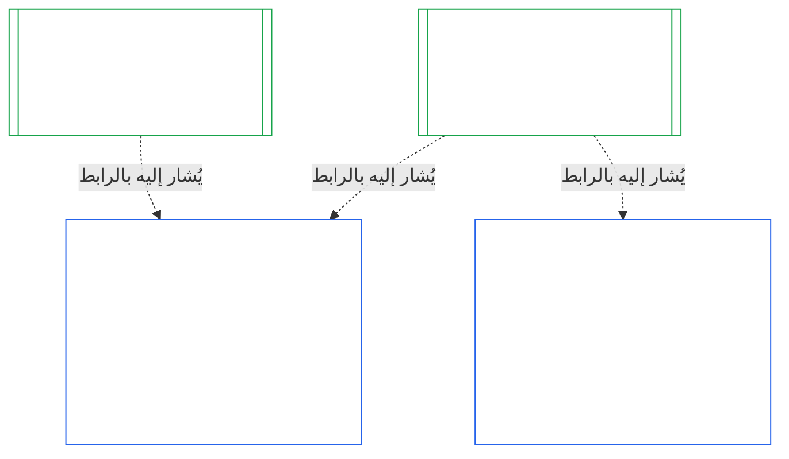
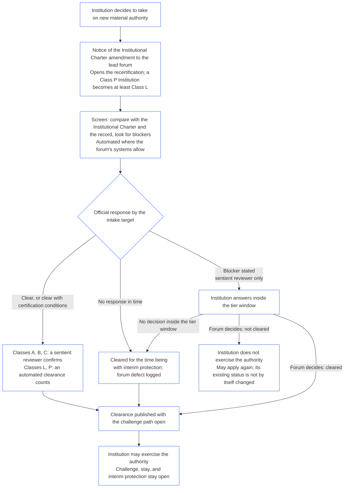

<!-- AI-assisted translation draft; unreviewed; English controls.
Source: core_10.000_institutional_alignment_certification.md
Source snapshot: 247e2180509e5e029c1106878cf225067339e010
Source SHA-256: a163a782114e584d09e295db66fe8b1b10a005b0f00116c8360396a0535ff221 -->

# الفصل العاشر: اعتماد المواءمة المؤسسية

<strong>موضع الملف في المتن (غير تشغيلي): بنية الملف وقواعد القراءة</strong>

> هذا الملف **جزء من دستور الكائنات الواعية**، ولا يكون **ملزماً إلا بالاقتران** مع ملفات `core_*` الأخرى ذات الترقيم التي تُقرأ كنص واحد. ويتضمن **الفصل العاشر** — **اعتماد المواءمة المؤسسية**: كيفية تصنيف [المؤسسة](core_05.040_band_continuity.md#institution) وتقييمها ومراجعتها واتخاذ القرار بشأنها وتسجيلها وإبقائها محدثة وإعادة فتحها، تمييزاً لها عن أي نظام تشغله (**§1–§11**). والفصل العاشر هو النظير المؤسسي للفصل [التاسع](core_09.000_system_alignment_certification_evaluation.md#chapter-nine-system-alignment-certification) (*اعتماد مواءمة النظام*)، وتحمل **أقسامه الأرقام نفسها**: فيجيب القسم §N هنا عن القسم §N هناك. ويتضمن [CS-9.320](corpus_systems/cs_09.320_system_alignment_certification_illustrations.md#cs-9320-system-alignment-certification-illustrations) (*أمثلة توضيحية لاعتماد مواءمة النظام*) الأمثلة العملية للأنظمة، وثلاث جولات إرشادية للمؤسسات في [§12 الجولات الإرشادية التوضيحية للمؤسسات](corpus_systems/cs_09.320_system_alignment_certification_illustrations.md#cs-9320-12-illustrative-institution-walkthroughs) فيه. ولا يعيد هذا الفصل ذكرها.
>
> | § | الفصل التاسع (النظام) | الفصل العاشر (المؤسسة) |
> |---|------------------------|----------------------------|
> | 1 | الغرض والدور | العلاقة باعتماد النظام؛ ومن يخضع للاعتماد؛ وعدم وجود إذن أو بوابة على التأسيس أو التشغيل؛ وانتظار سلطة مادية جديدة؛ ونافذة الاعتماد الأول |
> | 2 | تقييم فئة النظام | فئة المؤسسة؛ والتدرج بحسب الفئة |
> | 3 | تقييم اعتماد النظام بأكمله | العناصر المؤسسية الثمانية، دائماً |
> | 4 | التقييمات عند وجود ما يستدعيها | إحالة إلى الفصل التاسع §4 |
> | 5 | تقييمات أرضية الحقوق والمجالات | إحالة إلى الفصل التاسع §5 |
> | 6 | إجراءات المنتدى | المقاعد الأربعة؛ وأدوار المنتدى وتسلسل إجراءاته؛ والمنتديات والجهات المعتمدة ومكاتب السجلات بوصفها مؤسسات |
> | 7 | نتائج الاعتماد | بدء تشغيل المؤسسة وأنظمتها؛ وشروط الاعتماد والآثار الأخرى للنتيجة؛ والإحالة بشأن العيوب؛ والاستعداد للمعالجة؛ والرفض والسحب |
> | 8 | سجل اعتماد النظام | سجل الاعتماد المؤسسي |
> | 9 | إعادة الاعتماد وإعادة الفتح | المراقبة؛ ومحفزات إعادة الفتح؛ والاعتماد المؤقت والكامل؛ ومنع التحايل؛ والتتابع الناشئ عن اعتمادات الأنظمة؛ وإعادة فتح أنظمتها عند وقوع مخالفة حوكمية |
> | 10 | الطعن في اعتماد | مسار الطعن |
> | 11 | العلاقة بالصفة | جسر الصفة |
>
> - **المالك الدستوري (بالاشتراك مع الفصل التاسع):** اعتماد المواءمة والسجلات المرتبطة به تحت إشراف المنتدى. ويضيف الفصل العاشر موضوع المؤسسة. ولا يضيف عائلة منتديات جديدة أو مقعداً جديداً أو مصطلحاً جديداً للنتائج.
> - **إعادة الاستخدام لا التكرار:** تجري المراحل من الثالثة إلى السادسة وفق ما يورده [الفصل التاسع الجزء ب §6](core_09.005_system_alignment_certification_record_process.md#6-forum-process) إلى [الفصل التاسع الجزء ج §11](core_09.010_system_alignment_certification_record_recertification.md#11-relationship-to-standing). ولا يذكر الفصل العاشر إلا ما يتغير حين يكون الموضوع مؤسسة.
> - **قاعدة منع نقل الاختصاص:** لا يعيد الفصل العاشر صياغة آليات تقييم النظام في الفصل التاسع، أو حقول ميثاق النظام والميثاق المؤسسي في الفصل السابع، أو متطلب المقاعد الأربعة في الفصل الثامن، أو واجبات المؤسسات في [corpus_institutions](corpus_institutions.md)، أو قياس الصفة في الفصل الحادي عشر، أو آثار الصفة في الفصل الثاني عشر.
>
> **ما يسبقه:** [مواثيق الفصل السابع](core_07.000_charters.md#chapter-seven-system-and-institutional-charters)؛ والاستقلال الوظيفي في [الفصل الثامن](core_08.000_functional_independence_separation_of_duties.md#chapter-eight-functional-independence-and-separation-of-duties)؛ و[الفصل التاسع](core_09.000_system_alignment_certification_evaluation.md#chapter-nine-system-alignment-certification) (الأجزاء [أ](core_09.000_system_alignment_certification_evaluation.md#chapter-nine-part-a-system-alignment-certification--evaluation) و[ب](core_09.005_system_alignment_certification_record_process.md#chapter-nine-part-b-system-alignment-certification--forum-process-and-outcomes) و[ج](core_09.010_system_alignment_certification_record_recertification.md#chapter-nine-part-c-system-alignment-certification--record-recertification-and-standing))؛ وإشراف المنتدى في الفصل الرابع عشر.
> **ما يليه:** سجلات الصفة والمدخلات المتحققة في الفصل الحادي عشر؛ وآثار الصفة في الفصل الثاني عشر.

<strong>التتبّع</strong>

- ما يسبقه:
  - [الفصل السابع §1 متى تكون مواثيق النظام والمؤسسة مطلوبة](core_07.000_charters.md#1-when-system-and-institutional-charters-are-required) (7.000 §1) (*المؤسسات التي تنشر ميثاق نظام أو ميثاقاً مؤسسياً، وفئة المؤسسة*)؛
  - [الفصل السابع §7 التعديل والمراجعة](core_07.000_charters.md#7-amendment-review-and-scope-misalignment) (7.000 §7) (*ما تختبره مراجعة الميثاق المؤسسي*)؛
  - [الفصل السابع §4 خريطة أدوار الميثاق وحيازة سجلات الصفة](core_07.000_charters.md#4-the-charter-role-map-and-standing-record-custody) (7.000 §4) (*مواضع المقاعد*)؛
  - [الفصل الثامن §2 المتطلب الدستوري للمقاعد الأربعة](core_08.000_functional_independence_separation_of_duties.md#2-four-seat-constitutional-requirement) (8.000 §2) و[§9 العلاقة بالإجراءات اللاحقة](core_08.000_functional_independence_separation_of_duties.md#9-relationship-to-later-processes)؛
  - [الفصل التاسع](core_09.000_system_alignment_certification_evaluation.md#chapter-nine-system-alignment-certification) (9.000 إلى 9.010) (*عملية اعتماد مواءمة النظام التي يعيد هذا الفصل استخدامها*)؛
  - [السؤالان الأساسيان](core_00.000_preamble.md#two-fundamental-questions)؛
  - [الرباعية الدستورية](core_00.000_preamble.md#constitutional-tetrad)؛
  - [المادة XI-E](core_06.005_rights_part_b.md#article-xi-e-institutional-formation-and-business-creation) (*تأسيس المؤسسات وإنشاء الأعمال*).
- ما يليه: [§1](#1-purpose-and-role) إلى [§11](#11-relationship-to-standing)؛ والفصل الحادي عشر ([11.000](core_11.000_standing_assessment.md#chapter-eleven-contribution-violation-and-standing-model--measurement))؛ و[الفصل الرابع عشر](core_14.000_forum.md#chapter-fourteen-forums-and-jurisdiction) (14.000).
- يُقرأ مع:
  - [اعتماد المواءمة المؤسسية](core_05.040_band_continuity.md#institutional-alignment-certification) و
  - [سجل الاعتماد المؤسسي](core_05.040_band_continuity.md#institutional-certification-record) (*معاني الفصل الخامس*)؛
  - **CI-8.205 §6** (*محتويات ميثاق النظام والميثاق المؤسسي ومراجعتهما وقالب التأسيس*)؛
  - **CF-14.425** (*ضمانات النزاهة وعمليات منع الاستحواذ والدعم المضاد للتحكيم الذاتي*).

 

الفصل العاشر هو المالك الدستوري **لاعتماد المواءمة المؤسسية**. وهو يمدد عملية [الفصل التاسع](core_09.000_system_alignment_certification_evaluation.md#chapter-nine-system-alignment-certification) من النظام إلى المؤسسة:

- **المرحلة الأولى، التأطير:** فئة المؤسسة وكيف تدرّج التقييم ([§2 تقييم فئة المؤسسة](#2-institution-class-evaluation))؛
- **المرحلة الثانية، التقييم:** التقييم المؤسسي، بما فيه التقييمات المنطبقة عند وجود ما يستدعيها وتقييمات أرضية الحقوق والمجالات (من [§3 تقييم اعتماد المؤسسة بأكملها](#3-whole-institution-certification-evaluation) إلى [§5 تقييمات أرضية الحقوق والمجالات](#5-rights-floor-and-domain-evaluations))؛
- **المرحلة الثالثة، المراجعة:** أدوار المنتدى وتسلسل إجراءاته ([§6 إجراءات المنتدى](#6-forum-process))؛
- **المرحلة الرابعة، اتخاذ القرار:** النتيجة والاستعداد للمعالجة والرفض والسحب ([§7 نتائج الاعتماد](#7-certification-outcomes))؛
- **المرحلة الخامسة، التوثيق:** سجل الاعتماد المؤسسي ([§8 سجل الاعتماد المؤسسي](#8-institutional-certification-record))؛ و
- **المرحلة السادسة، التشغيل:** إعادة الاعتماد وإعادة الفتح والتتابع الناشئ عن اعتمادات الأنظمة وإعادة فتح الأنظمة ومسار الطعن وجسر الصفة (من [§9 إعادة الاعتماد وإعادة الفتح](#9-recertification-and-reopening) إلى [§11 العلاقة بالصفة](#11-relationship-to-standing)).
*بعبارات مبسطة: يسأل الفصل التاسع عما إذا كان **النظام** متوافقاً. ويسأل الفصل العاشر الأمر نفسه عن **المؤسسة** التي تشغل أنظمة أو تمارس سلطة دون تشغيل نظام. وقد تكون المؤسسة متوافقة فيما لا يكون أحد أنظمتها كذلك، أو العكس. لذلك تُفحص المؤسسة فيما لا تتحكم فيه إلا هي: هل تفعل ما يقوله ميثاقها المؤسسي، ومن يُسأل عن سلطتها، وما الذي تكافئ عليه أعضاءها، وهل يمكن استخدام الضوابط المستقلة عليها فعلاً. وهي تعتمد على اعتماد كل نظام ولا تعيده. والاعتماد ليس ترخيصاً: لا يحتاج أحد إلى إذنها لتأسيس مؤسسة أو تشغيلها.*

### 1. الغرض والدور

<strong>التتبّع</strong>

- ما يسبقه:
  - [الفصل السابع §1 متى تكون مواثيق النظام والمؤسسة مطلوبة](core_07.000_charters.md#1-when-system-and-institutional-charters-are-required) (7.000 §1)؛
  - [الفصل التاسع الجزء أ §1 الغرض والدور](core_09.000_system_alignment_certification_evaluation.md#1-purpose-and-role) (9.000 §1)؛
  - [المادة XI-E](core_06.005_rights_part_b.md#article-xi-e-institutional-formation-and-business-creation) (*تأسيس المؤسسات وإنشاء الأعمال*)؛
  - [المادة XXVIII-A](core_06.020_rights_part_e.md#xxviii-a-existing-instantiations-adoption-transition-window) (*الاعتماد المرحلي واستمرارية أرضية الحقوق*).
- ما يليه: [§2](#2-institution-class-evaluation)؛ و[§6](#6-forum-process)؛ و[§7](#7-certification-outcomes)؛ و[§9](#9-recertification-and-reopening).
- يُقرأ مع:
  - [المؤسسة](core_05.040_band_continuity.md#institution)؛
  - [الميثاق المؤسسي](core_05.040_band_continuity.md#institutional-charter)؛
  - [ميثاق النظام](core_05.040_band_continuity.md#system-charter)؛
  - [إنشاء الأعمال](core_05.055_band_participation.md#business-creation).

 

*بعبارات مبسطة: يخص اعتماد النظام النظام نفسه. ويشير اعتماد المؤسسة إلى تلك الاعتمادات ويضيف ما لا تستطيع الإجابة عنه إلا المؤسسة. وقد يظهر نظام واحد لدى مؤسسات عدة أو لا يظهر لدى أي مؤسسة. ولا يتيح أي شيء هنا للاعتماد أن يعوق تأسيس مؤسسة.*

اعتماد المواءمة المؤسسية واعتماد مواءمة النظام اعتمادان يربط بينهما رابط. والعلاقة هي **تركيب عبر رابط**، لا احتواء. وفي الشكل، يمتد سهم من سجل اعتماد نظام إلى كل سجل اعتماد مؤسسي يشير إليه. والنظام غير التابع لأي مؤسسة لا يحتاج إلى سهم، والمؤسسة التي لا تشغل أي نظام يكون لها سجل منفرد.

للتركيب عبر رابط جانبان، أولهما جانب المؤسسة.

في جانب المؤسسة:

- **يشير سجل الاعتماد المؤسسي إلى سجل النظام ولا يعيد إجراءه:** يشير إلى سجل اعتماد النظام بالرابط ويسمي إصداره. ولا يعيد هذا الفصل إجراء أي تقييم لنظام، أو اتخاذ قرار مجدداً بشأن فئته، أو تغيير نتيجة النظام أو حالته أو شروط اعتماده.
- **لا يستطيع اعتماد المؤسسة رفع اعتماد نظام:** يظل النظام غير المعتمد كذلك مهما كانت حالة المؤسسة. ولا يكتسب النظام الحاصل على اعتماد حمايةً من نتيجة تخص المؤسسة.
- **تُثبت الوقائع المؤسسية مرة واحدة:** عندما يسأل [الفصل التاسع الجزء أ §3.1 انضباط الحوكمة والحوافز وقابلية الاعتراض](core_09.000_system_alignment_certification_evaluation.md#31-governance-incentive-and-contestability-discipline) عن حوكمة المشغّل وحوافزه، يجوز لسجل اعتماد مؤسسي حالي للمشغّل أن يقدم تلك الوقائع بالرابط. وتظل منتديات النظام مسؤولة عن تقرير كفايتها لذلك النظام. ولا يجوز لها أن تجد في الواقعة المؤسسية نفسها خلاف ما وجدته منتديات أخرى دون بيان السبب في سجل اعتماد النظام.

وفي جانب النظام:

- **سجل اعتماد النظام ملك للنظام:** فهو سجل النظام نفسه بموجب [الفصل التاسع](core_09.000_system_alignment_certification_evaluation.md#chapter-nine-system-alignment-certification).
- **يجوز لعدة مؤسسات الإشارة إلى سجل اعتماد النظام نفسه:** قد تشغل أكثر من مؤسسة النظام أو تشرف عليه أو تسيطر عليه جوهرياً بموجب [الفصل السابع §1 متى تكون مواثيق النظام والمؤسسة مطلوبة](core_07.000_charters.md#1-when-system-and-institutional-charters-are-required). وتشير كل منها إلى السجل نفسه.
- **لا يلزم أن يتبع النظام أية مؤسسة:** الكائن الواعي المنفرد ليس مؤسسة، لذلك قد لا يتبع النظام أية مؤسسة. ويُعتمد النظام غير التابع لأي مؤسسة بموجب [الفصل التاسع](core_09.000_system_alignment_certification_evaluation.md#chapter-nine-system-alignment-certification) وحده ولا يحتاج إلى شيء من هذا الفصل. أما النظام التابع لمؤسسة فيُعتمد بالطريقة نفسها: يضيف هذا الفصل سجلاً منفصلاً للمؤسسة ولا يشكل خطوة في اعتماد النظام نفسه.

#### 1.1 من يخضع للاعتماد

تدخل المؤسسة من الفئة L أو أعلى في نطاق هذا الفصل، وتُحدد فئتها بموجب [§2.1 فئة المؤسسة](#21-institution-class). ويشمل ذلك المؤسسة التي لا تشغل أي نظام: إذ ليس لديها سجل اعتماد نظام تحيل إليه، وتُحدد فئتها بحسب أثرها هي. و**محفظة** المؤسسة هي مجموعة الأنظمة التي تشغلها أو تشرف عليها أو تسيطر عليها جوهرياً ([المحفظة](core_05.040_band_continuity.md#portfolio)).

- **الفئات A وB وC وL:** تنطبق العملية، مع تدرجها بحسب الفئة بموجب [§2.2 التدرج بحسب الفئة](#22-scaling-by-class).
- **الفئة P:** يُشجَّع على العملية ويجوز استخدامها طوعاً. وتصبح إلزامية عند إعادة التصنيف إلى الفئة L أو أعلى، أو عندما تؤكد المؤسسة طوعاً امتثالها للدستور. وإذا قررت مؤسسة من الفئة P تولي سلطة مادية جديدة، أعيد تصنيفها إلى الفئة L على الأقل عندما تقدم الإشعار في [§9.2.2 إعادة الاعتماد لسلطة مادية جديدة](#922-recertification-for-new-material-authority)، لأن تلك السلطة مادية بحكم تعريفها ([§9.2.1 ما الذي يعد سلطة مادية جديدة](#921-what-counts-as-new-material-authority))، ولأن المؤسسة المادية في أي مجال لا تقل فئتها عن L ([§2.1 فئة المؤسسة](#21-institution-class)، البند 2). ويظل هذا التصنيف قائماً من الإشعار حتى سحبه قبل الإذن أو عدم الإذن بالسلطة، بشرط ألا يكون قد مورس شيء بموجبها. ثم تعود المؤسسة إلى الفئة P وينتهي الاعتماد الأول المحدود. ويبدأ إشعار جديد الدورة من جديد، أما ممارسة السلطة من دون إذن فتظل نتيجة بموجب [§9.2.2 إعادة الاعتماد لسلطة مادية جديدة](#922-recertification-for-new-material-authority) (*من دون إشعار أو قبل الإذن بها*). وهذا يطابق [الفصل التاسع الجزء أ §1 الغرض والدور](core_09.000_system_alignment_certification_evaluation.md#1-purpose-and-role).
- **نظام واحد:** للمؤسسة التي تشغل نظاماً واحداً بالضبط ويحتاج إلى ميثاق نظام جولة اعتماد واحدة وسجل واحد، ويسمي هذا الفصل ذلك **تقييم النظام الواحد**. ويتضمن سجل اعتماد النظام *كتلة نتائج مؤسسية* تضم البنود الواردة في [§8 سجل الاعتماد المؤسسي](#8-institutional-certification-record)، ويعمل بوصفه سجل الاعتماد المؤسسي. وتكون المنتديات والمقاعد والساعات هي نفسها الخاصة بجولة اعتماد النظام، مع إضافة البنود المؤسسية. وتتبع النتائج أسباب الرفض والسحب الخاصة بها كما يبين [§7.4 الرفض والسحب لمؤسسة](#74-denial-and-revocation-for-an-institution). ولا ينطبق التتابع الوارد في [§9.5 التتابع الناشئ عن اعتمادات الأنظمة](#95-cascade-from-system-certifications) بوصفه تتابعاً، لأن النظام يشكل المحفظة كلها؛ لكن [§7.4 الرفض والسحب لمؤسسة](#74-denial-and-revocation-for-an-institution) يطبق القاعدتين 1 و2 فيه (المؤشر واختبار موضع السبب).
- **أنظمة عدة:** سجل اعتماد مؤسسي واحد للمؤسسة يحيل إلى سجل اعتماد النظام لكل نظام تشغله. ويحتفظ كل نظام بجولة اعتماده وسجله الخاصين.
- **دون نظام:** سجل اعتماد مؤسسي منفرد. ولا يوجد سجل اعتماد نظام يمكن الإحالة إليه لأن المؤسسة لا تشغل أي نظام.

#### 1.2 لا إذن ولا بوابة على التأسيس أو التشغيل

اعتماد المواءمة المؤسسية فحص مستقل لكيفية استعمال المؤسسة سلطتها فعلاً. وتجريه منتديات مستقلة عن المؤسسة، وينتهي بسجل اعتماد مؤسسي لما توصلت إليه.

- **التأسيس والتشغيل:** تؤسس المؤسسة وتنشر ميثاقها المؤسسي وتبدأ ممارسة سلطتها وتواصل التشغيل دون أن تحصل عليه أولاً، ولا تمنح أي نتيجة ذلك الحق أو تحجبه.
- **أثر النتيجة:** للنتيجة الآثار الواردة حصراً في [§7.1 بدء تشغيل مؤسسة](#71-go-live-for-an-institution).
- **البوابات الوحيدة في هذا المجال:** توجد ثلاث بوابات ضيقة، وكلها في **المادة XI-E** (*تأسيس المؤسسات وإنشاء الأعمال*):
  - قيد قائم على كائن واعٍ مسمى، يتعلق بسلطة ذلك الكائن الواعي؛
  - وقف مؤقت على وقائع محددة ومتحققة من اختلال المواءمة، يتعلق كذلك بسلطة كائن واعٍ مسمى؛
  - قيد على الجهة المشغّلة نفسها، لا يتعلق بمؤسسة إلا عندما يقع القيد على تلك المؤسسة، كما في المؤسسة المنحلة بموجب **CI-12.210 §4** (*الحل*).
  ويجوز إحالة نتيجة اعتماد إلى المنتدى الذي يقرر بشأن إحدى هذه البوابات، كدليل بموجب [§7.5 آثار الرفض والسحب لمؤسسة](#75-effects-of-denial-and-revocation-for-an-institution). ونتيجة الاعتماد ليست بحد ذاتها بوابة ولا تفتحها أو تغلقها.
- **انتظار سلطة مادية جديدة:** تنتظر المؤسسة التي تقرر تولي سلطة مادية جديدة حتى تسمح إعادة اعتمادها بممارسة تلك السلطة، وفق شروط [§9.2.2 إعادة الاعتماد لسلطة مادية جديدة](#922-recertification-for-new-material-authority). وتقرر **المادة XI-E** (*تأسيس المؤسسات وإنشاء الأعمال*) هذا الانتظار. وهو ليس إحدى البوابات الضيقة الثلاث، ولا بوابة على التأسيس أو التشغيل. ولا يتعلق إلا بالسلطة الجديدة، ويستمر كل ما تفعله المؤسسة سواها. ويلخص الشكل في [§9.2.2 إعادة الاعتماد لسلطة مادية جديدة](#922-recertification-for-new-material-authority) الخطوات.
- **لا باب خلفي:** لا يجوز للمنتدى أو المعتمد أو شاغل السلطة استخدام أي شيء في هذا الفصل عتبةَ إذن تستبعد المؤسسين أو تحمي شاغلي السلطة. فهذا يهزم [المادة XI-E](core_06.005_rights_part_b.md#article-xi-e-institutional-formation-and-business-creation) (*تأسيس المؤسسات وإنشاء الأعمال*).
  - تنطبق [الأعباء الممكن تجنبها](core_05.040_band_continuity.md#avoidable-burden) على تكلفة العملية.
  - تنطبق [الحوكمة المتدرجة بحسب التصنيف](core_05.050_band_oversight.md#classification-scaled-governance) على عمقها.
  - وينطبق انتظار السلطة المادية الجديدة بالشروط نفسها على كل مؤسسة من فئتها، ولا يخص إلا السلطة المادية بالفعل للآخرين.

بوابة بدء تشغيل الأنظمة منفصلة وتظل خاصة بها. وبموجب [الفصل التاسع الجزء ب §7.1 بوابة بدء التشغيل](core_09.005_system_alignment_certification_record_process.md#71-go-live-gate)، لا يبدأ تشغيل نظام جديد أو توسع مادي في نظام إلا من خلال اعتماده الخاص، مهما كانت حالة المؤسسة.

#### 1.3 نافذة الاعتماد الأول

يستحق أول سجل اعتماد مؤسسي خلال نافذة يحددها مستند الاعتماد لفئة المؤسسة.

- **المؤسسة الجديدة:** تبدأ النافذة من اليوم الذي يصبح لها فيه أول أثر جوهري على الآخرين، وفق حكم [المادية الخاصة بالمجال](core_05.050_band_oversight.md#domain-specific-materiality)، ويكون اعتمادها الأول مؤقتاً.
- **مؤسسة الفئة P التي أعيد تصنيفها عند الإشعار:** تبدأ النافذة من يوم تقديمها الإشعار بموجب [§9.2.2 إعادة الاعتماد لسلطة مادية جديدة](#922-recertification-for-new-material-authority)، كما للمؤسسة الجديدة، ولا تبدأ أبداً من نافذة انتقال اعتماد انتهت بالفعل.
- **المؤسسة القائمة بالفعل:** تكون النافذة هي نافذة انتقال الاعتماد بموجب [المادة XXVIII-A](core_06.020_rights_part_e.md#xxviii-a-existing-instantiations-adoption-transition-window) (*الاعتماد المرحلي واستمرارية أرضية الحقوق*)، بما يتسق مع القاعدة الافتراضية في [الفصل السابع §1.5 موعد استحقاق ميثاق النظام أو الميثاق المؤسسي](core_07.000_charters.md#15-when-a-system-charter-or-institutional-charter-is-due).
- **انقضاء النافذة دون استيفاء:** تُسجل على المؤسسة التي تدع النافذة تنقضي دون جولة أولى، ولم تُعفَ أدناه، مخالفة يجب تصحيحها؛ ويفتح انقضاء النافذة تلك الجولة. وتقع أيضاً على مؤسسة من الفئة L أو أعلى تشغّل بالفعل مخالفة إنجاز المعلم المرحلي أدناه. ولا تُوقف المؤسسة ولا تُمنع من التشغيل إذ لا توجد بوابة ([§1.2 لا إذن ولا بوابة على التأسيس أو التشغيل](#12-no-permission-and-no-gate-on-forming-or-running)).
  - **المؤسسة القائمة بالفعل:** هذه قاعدة هذا الفصل الخاصة بالمؤسسات من الفئة L أو أعلى، ومقررة بالقياس إلى [المادة XXVIII-A](core_06.020_rights_part_e.md#xxviii-a-existing-instantiations-adoption-transition-window) (*الاعتماد المرحلي واستمرارية أرضية الحقوق*) التي تسمي الأنظمة والكيانات المشتقة. وإذا انتهت نافذة انتقال الاعتماد ولم تكتمل جولة الاعتماد الأولى (أي لا يوجد اعتماد مؤقت أو كامل ولا نتيجة مقررة بموجب [§7 نتائج الاعتماد](#7-certification-outcomes))، تكون المؤسسة قد فوّتت الموعد النهائي. ولا تكون المؤسسة التي قدمت طلبها وتعاونت خلال النافذة قد فوّتت الموعد إذا لم تكتمل جولة الاعتماد بسبب تجاوز المنتدى لمهلته ([الفصل الرابع عشر §6 الحل في الوقت المناسب ودرجات الأهمية والانضباط المضاد للتأخير](core_14.000_forum.md#6-timely-resolution-materiality-tiers-and-anti-delay-discipline)، *مراجعة التجاوز*؛ [الفصل التاسع الجزء ج §9.3.4 النوافذ المتدرجة](core_09.010_system_alignment_certification_record_recertification.md#934-tier-windows)) أو بسبب سريان التأجيل الوحيد بموجب [§7.3 الاستعداد للمعالجة لمؤسسة](#73-remediation-readiness-for-an-institution). وما لم يكن لديها إثبات موثق لإعادة الإذن بموجب [المادة XXVIII-B](core_06.020_rights_part_e.md#article-xxviii-b-adoption-transition-authority-limits-and-reauthorization) (*حدود سلطة الانتقال إلى الاعتماد وإعادة الإذن*)، فهذه مخالفة لمعلم انتقالي، ويفتح مسار الامتثال والمخالفة المعتاد في [الفصل الحادي عشر](core_11.000_standing_assessment.md#chapter-eleven-contribution-violation-and-standing-model--measurement). وتسري واجبات التقييد في تلك المادة من تاريخ النفاذ، ولا تصبح الفجوة معياراً جديداً لمجرد استمرارها. وهذا يطابق [الفصل التاسع الجزء ب §7.1.1 الأنظمة القائمة بالفعل](core_09.005_system_alignment_certification_record_process.md#711-systems-already-operating). ولا تشكل هذه بوابة.
  - **جولة الاعتماد:** يُتخذ القرار فيها كأي جولة أخرى. وقد تنتهي بأي نتيجة من نتائج [§7 نتائج الاعتماد](#7-certification-outcomes)، بما فيها «غير معتمد»، وما يترتب على ذلك بموجب [§7.5 آثار الرفض والسحب لمؤسسة](#75-effects-of-denial-and-revocation-for-an-institution).
  - **الجزاءات والحل:** لا ينشئ هذا الفصل أياً منها. وتظل صلاحيات التعليق والحراسة والفصل البنيوي والحل لدى المنتدى ذي الاختصاص بموجب **CI-12.210** (*إخفاق المؤسسة وحلها*) و**CI-12.215** (*مساءلة المؤسسة والجزاءات*). ولا يُحال الأمر إلى ذلك المنتدى إلا لأسباب الإحالة الواردة في [§7.5 آثار الرفض والسحب لمؤسسة](#75-effects-of-denial-and-revocation-for-an-institution) (البند 5، *الإحالة*).

### 2. تقييم فئة المؤسسة

<strong>التتبّع</strong>

- ما يسبقه:
  - [الفصل السابع §1 متى تكون مواثيق النظام والمؤسسة مطلوبة](core_07.000_charters.md#1-when-system-and-institutional-charters-are-required) (7.000 §1)؛
  - [الفصل التاسع الجزء أ §2 تقييم فئة النظام](core_09.000_system_alignment_certification_evaluation.md#2-system-class-evaluation) (9.000 §2) و[§2.2 كيف تدرّج فئة النظام كل تقييم](core_09.000_system_alignment_certification_evaluation.md#22-how-system-class-scales-every-evaluation)؛
  - [الفصل الثالث §2.1 أنماط التحايل الشائعة](core_03.000_definition_integrity.md#21-common-evasion-patterns) (3.000 §2.1).
- ما يليه: [§3](#3-whole-institution-certification-evaluation) (*العناصر التي تتدرج بحسب الفئة*)؛ و[§8](#8-institutional-certification-record) (*بيان الفئة في السجل*)؛ و[§9.2](#92-reopening-triggers) (*المحفزات التي تعيد تقييمها*).
- يُقرأ مع:
  - **CS-9.305 (*آليات تصنيف الأنظمة*) وCS-9.310** (*تصنيفات أثر النظام*) و[corpus_systems/cs_09.310_system_impact_classifications.md](corpus_systems/cs_09.310_system_impact_classifications.md) (*فهرس الفئات*)؛
  - **CI-9.210** (*الواجبات المؤسسية المرتبطة بالتصنيف*)؛
  - **CI-8.205 §6** (*محتويات ميثاق النظام والميثاق المؤسسي ومراجعتهما وقالب التأسيس*).

 

*بعبارات مبسطة: ابدأ بتصنيف المؤسسة بحسب مدى أهميتها للآخرين. واحكم على ذلك من واقع ما تقرره وتمسك به فعلاً، لا مما تسمي به نفسها. ثم تحدد الفئة مدى شمولية التقييم: كلما ارتفعت الفئة، اشتد الإثبات وزادت استقلالية المراجعة وقرب موعد إعادة التحقق.*

هذا القسم هو **المرحلة الأولى: التأطير** للمؤسسة.

#### 2.1 فئة المؤسسة

تُحدد **فئة المؤسسة** بأكبر أثر جوهري للمؤسسة، سواء نشأ ذلك الأثر عبر نظام تشغله أم خارج أي نظام. ويُحكم عليه بحسب ما تقرره المؤسسة وتمسك به وتتحكم فيه فعلاً، لا بحسب تسميتها أو شكلها القانوني أو القائمة الواردة في ميثاقها المؤسسي. وتحدد الفئة عمق التقييم والمواعيد، كما تفعل [الفصل التاسع الجزء أ §2.2 كيف تدرّج فئة النظام كل تقييم](core_09.000_system_alignment_certification_evaluation.md#22-how-system-class-scales-every-evaluation) للنظام. وهي الفئة المستخدمة في هذا الفصل وفي [الفصل السابع §1.2 الفئات المشمولة](core_07.000_charters.md#12-which-classes-are-covered).

1. **الأثر عبر الأنظمة:** لا تقل فئة المؤسسة عن أعلى فئة لأي نظام في محفظتها ([الفصل السابع §1 متى تكون مواثيق النظام والمؤسسة مطلوبة](core_07.000_charters.md#1-when-system-and-institutional-charters-are-required)). وتُحدد الأنظمة من واقع التشغيل الملحوظ. ويُحتسب النظام الذي لم يذكره الميثاق المؤسسي.
2. **الأثر خارج أي نظام:** يُحتسب الأثر الجوهري والاعتماد الخاصان بالمؤسسة سواء كانت تشغل نظاماً أم لا. وتُطبق تعريفات الفئات في **CS-9.305 (*آليات تصنيف الأنظمة*) وCS-9.310** (*تصنيفات أثر النظام*) على قرارات المؤسسة وممتلكاتها هي باستخدام العوامل التالية:
   - **ما تقرره وتمسك به:**
     - ما تقرره بشأن وصول الكائنات الواعية الآخرين إلى ضروريات البقاء أو التعليم أو السلامة أو سبل العيش أو الحقوق أو الصفة؛ و
     - ما تمسك به، مثل الأموال أو السجلات أو العضويات أو حيازة سجلات الصفة أو وظيفة المنتدى أو الجهة المعتمدة أو مكتب السجلات.
   - **مدى ماديتها:**
     - ما إذا كان نشاطها جوهرياً في أي مجال من مجالات [المادية الخاصة بالمجال](core_05.050_band_oversight.md#domain-specific-materiality)، بما في ذلك إصدار [أفعال ملزمة جوهرياً](core_05.035_band_accountability.md#materially-binding-act) يجب على الآخرين اتباعها أو يجوز لهم الاعتماد عليها بوصفها محسومة؛
     - لا تقل فئة المؤسسة المادية في أي مجال واحد عن الفئة L بموجب **CS-9.305 (*آليات تصنيف الأنظمة*) وCS-9.310** (*تصنيفات أثر النظام*)؛ و
     - تقديم المساعدة أو السلع أو العمل أو الخدمات التي يجوز للآخرين أخذها أو تركها بحرية، والتي لا تتحكم في وصول أحد إلى ما يحتاج إليه، لا يُلزم أحداً. فهذا سلوك وليس فعلاً ملزماً جوهرياً، ولا يُحتسب إلا ضمن العوامل الأخرى.
   - **مدى اعتماد الآخرين عليها:**
     - عدد الكائنات الواعية المعتمدين عليها ومدى قابلية استبدالها؛
     - مدى تركّز سلطتها، وفق معنى خط السيطرة المادية؛ و
     - مدى قابلية قراراتها للعكس.
3. **السيطرة المشتركة:** تُصنّف الجهات المشغّلة التي تشكل عملية واحدة بموجب قاعدة التجميع في [المادية الخاصة بالمجال](core_05.050_band_oversight.md#domain-specific-materiality) (سيطرة عملية مشتركة ضمن [خط السيطرة المادية](core_05.035_band_accountability.md#material-control-line)؛ والتمويل وحده لا يُحتسب) معاً حيث تتصرف عملياً كمؤسسة واحدة. ويُعد تقسيم جهة مشغّلة أو محفظتها أو سلطتها بحيث لا يبلغ أي جزء منها الفئة L تحايلاً على النطاق والحدود بموجب [الفصل الثالث §2.1 أنماط التحايل الشائعة](core_03.000_definition_integrity.md#21-common-evasion-patterns).
4. **إعادة التصنيف:** يُعاد تقييم الفئة عند تحقق محفزات [§9.2 محفزات إعادة الفتح](#92-reopening-triggers). وتُذكر الفئة في سجل الاعتماد المؤسسي مع أسبابها.

#### 2.2 التدرج بحسب الفئة

تدرّج فئة المؤسسة عمق الأدلة واستقلال المراجعة وفترة الاعتماد الافتراضية والإفصاح في السجل، على النحو الذي يحدده [الفصل التاسع الجزء أ §2.2 كيف تدرّج فئة النظام كل تقييم](core_09.000_system_alignment_certification_evaluation.md#22-how-system-class-scales-every-evaluation). وترد فترات الاعتماد في [الفصل الرابع عشر §6 الحل في الوقت المناسب ودرجات الأهمية والانضباط المضاد للتأخير](core_14.000_forum.md#review-cadence) (*وتيرة المراجعة*)؛ ويجوز لمستند الاعتماد تحديد فترات أقصر، وهو يحدد عدد إعادات الاعتماد المؤقت النظيفة.

- **الفئات A وB وC:** تُقيّم العناصر الثمانية كلها في [§3 تقييم اعتماد المؤسسة بأكملها](#3-whole-institution-certification-evaluation)، بأدلة واستقلالية تتناسبان مع الفئة.
- **الفئة L:** تُقيّم العناصر الثمانية نفسها بصورة مبسطة، بسجلات أبسط وفترة اعتماد افتراضية أطول حيثما تسمح [الحوكمة المتدرجة بحسب التصنيف](core_05.050_band_oversight.md#classification-scaled-governance). ويتمثل جوهر جولة الفئة L في مقارنة الميثاق المؤسسي بالممارسة وخريطة الأدوار وإفادة فحص التأسيس وحداثة اعتمادات الأنظمة المحال إليها. ولا يجوز إسقاط أي عنصر، ويُذكر في سطر أي عنصر لا توجد فيه نتيجة.
- **الفئة P:** طوعية، كما يبين [§1.1 من يخضع للاعتماد](#11-who-is-certified).

**المضيف في ممارسة مهنية مشتركة.** حين تكون المؤسسة مضيفاً ([**CI-15.205 §7**](corpus_institutions/ci_15.205_appointment_competency_rotation_removal.md#ci-46-seat-advisory) (*ترخيص الممارسة والتصريح بها والممارسة المهنية المشتركة*))، تراجع شهادتها أيضاً عينة من أفعال الأعضاء في ضوء المقاعد التي يحملها المضيف، وتقارن إشعارات اعتماد الأعضاء بما يفعله المضيف. والنتيجة بشأن فعل عضو واحد تخص ذلك العضو، ولا تمتد إلى المضيف إلا إذا أخفق مقعد يحمله المضيف.

### 3. تقييم اعتماد المؤسسة بأكملها

<strong>التتبّع</strong>

- ما يسبقه:
  - [الفصل التاسع الجزء أ §3 تقييم اعتماد النظام بأكمله](core_09.000_system_alignment_certification_evaluation.md#3-whole-system-certification-evaluation) (9.000 §3)؛
  - [الفصل السابع §3 ما يجب أن تنص عليه مواثيق النظام والمؤسسة](core_07.000_charters.md#3-what-system-and-institutional-charters-must-state) (7.000 §3)؛
  - [الفصل السابع §5 فحص التأسيس: صفة شاغل المنصب وأصالته](core_07.000_charters.md#5-formation-check-office-holder-standing-and-authenticity) (7.000 §5)؛
  - [الفصل السابع §7 التعديل والمراجعة](core_07.000_charters.md#7-amendment-review-and-scope-misalignment) (7.000 §7)؛
  - [السؤالان الأساسيان](core_00.000_preamble.md#two-fundamental-questions)؛
  - [الفصل الأول §19.6 الإبقاء على المسؤولية عند تغير الملكية أو البنية](core_01.010_stewardship_capacity_principles.md#196-keeping-responsibility-when-ownership-or-structure-changes) (1.010 §19.6).
- ما يليه: [§6](#6-forum-process) (*النتائج التي تراجعها المنتديات*)؛ و[§9](#9-recertification-and-reopening) (*المحفزات التي تعيد فتحها*)؛ و[§11](#11-relationship-to-standing) (*بوابة المدخلات المتحققة للنتائج المتعلقة بكائن واعٍ مسمى*).
- يُقرأ مع:
  - **CI-8.205 §3** (*سلسلة السلطة وضوابط التفويض*) و**CI-8.205 §6** (*محتويات ميثاق النظام والميثاق المؤسسي ومراجعتهما وقالب التأسيس*)؛
  - **CI-6.215** (*الإشراف على الموارد ونزاهة الحوافز*)؛
  - **CI-8.210** (*نزاهة تضارب المصالح ومنع الاستحواذ ومكافحة الفساد*) و**CI-6.205** (*الشفافية والمشاركة ومسارات الطعن والخدمة الميسرة*) و**CI-12.205** (*أنظمة الإنصاف وقدرة المؤسسة على الانتصاف*)، بالنسبة إلى البند 8.

 

*بعبارات مبسطة: افحص الأمور التي تخص المؤسسة لا أياً من أنظمتها وحده: هل تلتزم بميثاقها المؤسسي، ومن يُسأل عن سلطتها، وما الذي تكافئ عليه، وهل تعمل الضوابط المستقلة عليها.*

هذا القسم هو **المرحلة الثانية: التقييم** للمؤسسة.

تقيّم كل جولة اعتماد العناصر الثمانية التالية، وهي النظير المؤسسي لـ[الفصل التاسع الجزء أ §3 تقييم اعتماد النظام بأكمله](core_09.000_system_alignment_certification_evaluation.md#3-whole-system-certification-evaluation). وتبين كل نتيجة أدلتها ونص الميثاق المؤسسي أو التشغيل الملحوظ الذي تستند إليه.

1. **مقارنة الميثاق المؤسسي بالممارسة:**
   - يُختبر الميثاق المؤسسي في ضوء التشغيل الملحوظ، باستخدام قائمة المراجعة في [الفصل السابع §7 التعديل والمراجعة](core_07.000_charters.md#7-amendment-review-and-scope-misalignment).
   - تُسجل نتيجة عند وجود ممارسة خارج الميثاق المؤسسي، أو حين لا يعود الميثاق المؤسسي يصف الممارسة، أيهما كان خاطئاً.
2. **المحفظة والأثر الإجمالي:**
   - يُختبر مبرر المحفظة: يجب أن يرتبط كل نظام بالغرض المعلن للمؤسسة، ويُسجل غياب سبب معلن لأي نظام كـنتيجة.
   - وينظر التقييم أيضاً عبر الأنظمة فيما لا يمكن لأي اعتماد منفرد إظهاره:
     - الاعتمادات المشتركة؛
     - الاتكال الإجمالي؛
     - الاستخراج التراكمي من الأسس المشتركة؛ و
     - أي ترتيب يقسم وظيفة واحدة إلى أجزاء كي يفلت كل جزء من فئة أو واجب.
3. **السلطة الخاضعة للمساءلة:**
   - يجب إسناد كل سلطة تمارسها المؤسسة على الآخرين إلى مكتب خاضع للمساءلة يمكن تسميته، ويكون ذلك المكتب مسؤولاً بموجب قواعد [الفصل الثامن](core_08.000_functional_independence_separation_of_duties.md#chapter-eight-functional-independence-and-separation-of-duties) و**CI-8.205 §3** (*سلسلة السلطة وضوابط التفويض*).
   - ولا يعفي تغير الملكية أو السيطرة أو البنية من المسؤولية ([الفصل الأول §19.6 الإبقاء على المسؤولية عند تغير الملكية أو البنية](core_01.010_stewardship_capacity_principles.md#196-keeping-responsibility-when-ownership-or-structure-changes)).
4. **المكافآت والحوافز:**
   - تُخضع رواتب المؤسسة وترقياتها وأهدافها ومكافآتها إلى [السؤالين الأساسيين](core_00.000_preamble.md#two-fundamental-questions): ما الذي تكافئ عليه البنية فعلاً، وهل يوجه ذلك نحو غايتي الدستور أو بعيداً عنهما.
   - وتُسجل نتيجة عند وجود بنية مكافآت تدفع إلى اختلال المواءمة أو إخفائه، حتى إذا كان كل نظام معتمداً على حدة.
   - وينطبق [الفصل التاسع الجزء أ §3.3 قيد الاتساق الزمني](core_09.000_system_alignment_certification_evaluation.md#33-time-consistency-constraint). فلا تكفي المقاييس القريبة الأمد أو الامتثال المحلي أو الكفاءة قصيرة الأمد حين يظل ضرر متوقع على الأمد المتوسط أو الطويل بالسلامة أو الحقيقة أو الرفاه دون معالجة؛ وتُسجل نتيجة إذا كافأت بنية الحوافز النتائج قصيرة الأمد على حساب ذلك.
   - وتظل واجبات المؤسسة المتعلقة بنزاهة الحوافز من اختصاص **CI-6.215** (*الإشراف على الموارد ونزاهة الحوافز*)، ويُحال إليه ولا يعاد ذكره.
5. **خريطة الأدوار والحيازة:**
   - تسمي [خريطة أدوار الميثاق](core_05.040_band_continuity.md#charter-role-map) مكاتب موجودة، ومشغولة أو مستبدلة كما تنص الخريطة، و[مستقلة](core_05.035_band_accountability.md#independence) عن المؤسسة في أي سجل تكون فيه المؤسسة هي موضوعه.
   - ويمكن استخدام المسار المستقل فعلاً.
   - ويُسجل كـنتيجة أي مقعد لم يوضع أو مكتب متوقف أو أمين سجل داخل خط المؤسسة نفسها.
6. **حداثة كل اعتماد نظام يُحال إليه:**
   - بالنسبة إلى كل نظام تشغله المؤسسة، يتحقق التقييم من أن سجل اعتماد النظام سارٍ أو داخل نافذة انتقال الاعتماد، ومن قيام المؤسسة بما تفرضه عليها شروط اعتماد ذلك السجل.
   - ويُسجل كـنتيجة أي اعتماد منتهٍ أو مسحوب أو مخفق أو مفقود دون سبب مدون، ثم ينقل [§9.5 التتابع الناشئ عن اعتمادات الأنظمة](#95-cascade-from-system-certifications) ذلك الأثر إلى المؤسسة.
7. **صفة شاغلي المناصب وأصالتهم:**
   - تُختبر إفادة فحص التأسيس المنشورة بموجب [الفصل السابع §5 فحص التأسيس: صفة شاغل المنصب وأصالته](core_07.000_charters.md#5-formation-check-office-holder-standing-and-authenticity) في ضوء التشغيل الملحوظ، ولا تُقبل بمجرد الإقرار.
   - وبالنسبة إلى كل مكتب مشمول، تتحقق المنتديات من وقائع الصفة مقابل السجلات المتحققة، وتحدد الأصالة من أدلة السيطرة والمصالح والمكافآت والسلوك والصوت المحمي. ويشمل ذلك:
     - من يوجه شاغل المنصب فعلاً؛
     - ما الذي يُدفع لشاغل المنصب ويُرقى على أساسه؛
     - ما الذي أنجزه شاغل المنصب في وظيفته على نحو متحقق؛ و
     - ما إذا عوقب أي شخص، بما فيه شاغل المنصب، لأنه قدم [بلاغاً محمياً](core_05.035_band_accountability.md#protected-reporting-whistleblowing) أو رفض توجيهاً غير قانوني أو غير دستوري ([الفصل الأول §17.5 واجب المقاومة](core_01.010_stewardship_capacity_principles.md#175-duty-to-resist)).
   - ولا يُفحص الموظفون الذين لا يشغلون منصباً مشمولاً فرادى. ويغطيهم فحص ضمانات الموظفين ([الفصل السابع §5.6 فحص ضمانات الموظفين](core_07.000_charters.md#56-staff-safeguards-check))، وتختبره المنتديات في ضوء التشغيل الملحوظ بالطريقة نفسها. ويسأل الفحص عما إذا:
     - كانت قواعد التعيين والدفع والترقية والعزل في المؤسسة لا تكافئ العمل ضد غرضها المعلن؛
     - كان هناك مسار للإبلاغ المحمي، ولم يُعاقب أي موظف استخدمه أو رفض توجيهاً غير قانوني أو غير دستوري؛ و
     - ظلت الحقوق الواردة في [المادة III-C](core_06.000_rights_part_a.md#article-iii-c-labor-and-economic-floor) (*أرضية العمل والاقتصاد*) قائمة.
   - يُسجل كل مما يلي كـنتيجة:
     - شاغل منصب مرشح لجهة مسيطرة لم يُفصح عنها؛
     - مكتب مشمول موجود على الورق فقط: يسميه الميثاق المؤسسي أو خريطة أدوار الميثاق لكن لا يشغله أحد فعلياً ولا يؤدي عمله؛
     - بنية مكافآت تدفع لشاغلي المناصب مقابل فعل ما تحظره الحدود المنشورة للميثاق المؤسسي؛ و
     - إفادة كاذبة أو ناقصة.
   - تتعلق النتائج بالمكتب والبنية. ولا تُنسب إلى كائن واعٍ مسمى إلا عبر بوابة المدخلات المتحققة في [§11 العلاقة بالصفة](#11-relationship-to-standing).
   - فحص التأسيس ليس اختباراً للمعتقد، لكن الإفادة المتحققة بأن آخرين يستحقون الضرر أو المعاملة التمييزية هي سلوك يُحتسب على شاغل المنصب، كما يبين [الفصل الأول §7.5 التعبير وخط الضرر](core_01.000_values_principles.md#75-expression-and-the-harm-line).
   - تُقرأ البنود 3 و4 و5 مع هذا البند، ولا يعاد تسجيل الواقعة المثبتة بموجب أحدها تحت بند آخر.
8. **الواجبات المؤسسية الخاصة بالمؤسسة:**
   - يُختبر امتثال المؤسسة للواجبات المؤسسية التي يفرضها النص المعتمد عليها في ضوء التشغيل الملحوظ، ولا يُكتفى بإقرارها. وتلك الواجبات هي **CI-8.210** (*نزاهة تضارب المصالح ومنع الاستحواذ ومكافحة الفساد*) و**CI-6.205** (*الشفافية والمشاركة ومسارات الطعن والخدمة الميسرة*) و**CI-6.215** (*الإشراف على الموارد ونزاهة الحوافز*) و**CI-12.205** (*أنظمة الإنصاف وقدرة المؤسسة على الانتصاف*).
   - ويسأل الاختبار عما إذا كانت مسارات الرقابة والمساءلة والمشاركة والتوقيت المناسب لدى المؤسسة موجودة وقابلة للاستخدام فعلاً وتستجيب ضمن المهل التي تحددها المؤسسة نفسها. ولا يجوز أن تتجاوز تلك المهل الحد الأدنى الزمني لفئة المؤسسة ([المادة XXVI-C](core_06.020_rights_part_e.md#article-xxvi-c-timely-resolution-and-anti-delay-floor) (*أرضية الحل في الوقت المناسب ومكافحة التأخير*) وأهداف الفئة المقابلة في [CF-14.445 §3.1 أهداف المراحل والحدود القصوى](corpus_forum/cf_14.445_performance_backlog_publication_accessibility.md#cf-14445-31-stage-targets-and-outer-bounds))؛ ويُسجل كـنتيجة أي أجل معلن أطول من ذلك.
   - يُسجل كـنتيجة كل مسار موجود على الورق فقط، أو يتعذر الوصول إليه، أو لا يستجيب في الوقت المناسب.
   - وتظل تلك الواجبات من اختصاص النصوص المذكورة ويُحال إليها بدلاً من إعادة ذكرها. ولا يعاد تسجيل واقعة مثبتة بموجب البنود من 3 إلى 5 هنا.
**جزآن إضافيان من الفصل التاسع الجزء أ §3 تقييم اعتماد النظام بأكمله.** يطلب [الفصل التاسع الجزء أ §3 تقييم اعتماد النظام بأكمله](core_09.000_system_alignment_certification_evaluation.md#3-whole-system-certification-evaluation) أيضاً أمرين من النظام ينطبقان على سلوك المؤسسة نفسها. وهما جزء من تقييم المؤسسة، ولا ينطبق أي منهما إلا عند تحقق محفزه الخاص:

- **النطاق المنظومي وعوامل المخاطر:**
  - **ينطبق عندما:** يضع سلوك المؤسسة نفسها خطراً منظومياً ضمن النطاق وفق عوامل [الفصل التاسع الجزء أ §3.2 النطاق المنظومي وعوامل المخاطر](core_09.000_system_alignment_certification_evaluation.md#32-systemic-scope-and-risk-factors): الأضرار على أوسع نطاق؛ وكيفية انتشار الآثار وتراكمها (بما في ذلك ما يتعطل لاحقاً عند إخفاق خدمة المؤسسة نفسها)؛ وكيف يمكن إساءة استخدام نشاط المؤسسة أو تضييق نطاقه على نحو مضلل.
  - **يُقيّم بموجب:** [الفصل التاسع الجزء أ §3.2 النطاق المنظومي وعوامل المخاطر](core_09.000_system_alignment_certification_evaluation.md#32-systemic-scope-and-risk-factors)، بما في ذلك جسر تقييم المخاطر والإفصاح في [§3.2.1 تقييم المخاطر وجسر الإفصاح](core_09.000_system_alignment_certification_evaluation.md#321-risk-evaluation-and-disclosure-bridge) والعيوب في [§3.2.2 العيوب واختلال المواءمة](core_09.000_system_alignment_certification_evaluation.md#322-defects-and-misalignment).
- **أنواع البيانات والتعامل معها:**
  - **ينطبق عندما:** يتعامل سلوك المؤسسة نفسها مع أنواع بيانات داخلة جوهرياً في النطاق، وفق ما يقتضيه [الفصل التاسع الجزء أ §3.4 تقييم أنواع البيانات والتعامل معها](core_09.000_system_alignment_certification_evaluation.md#34-data-types-and-handling-evaluation) لكل سجل اعتماد ذي أثر جوهري.
  - **يُقيّم بموجب:** [الفصل التاسع الجزء أ §3.4 تقييم أنواع البيانات والتعامل معها](core_09.000_system_alignment_certification_evaluation.md#34-data-types-and-handling-evaluation)، مع تدرج ضمان البنية التحتية فيه بحسب فئة المؤسسة.
  - **يُسجل في:** قسم أنواع البيانات في سجل الاعتماد المؤسسي ([§8.1 الحد الأدنى لمحتويات السجل](#81-minimum-record-contents))، بالنسبة إلى البيانات التي تتعامل معها المؤسسة خارج أي نظام. أما البيانات التي تُعالج داخل نظام فتُسجل مرة واحدة في سجل النظام، ويُحال إليها.

وتنطبق على الأمرين قاعدة [§4 التقييمات عند وجود ما يستدعيها](#4-evaluations-where-implicated) التي تمنع تكرار تقييم سبق إجراؤه في سجل اعتماد نظام مشار إليه.

### 4. التقييمات عند وجود ما يستدعيها

<strong>التتبّع</strong>

- ما يسبقه:
  - [الفصل التاسع الجزء أ §4 التقييمات عند وجود ما يستدعيها](core_09.000_system_alignment_certification_evaluation.md#4-evaluations-where-implicated) (9.000 §4).
- ما يليه: [§6](#6-forum-process)؛ و[§8](#8-institutional-certification-record).
- يُقرأ مع:
  - **CI-8.210** (*نزاهة تضارب المصالح ومنع الاستحواذ ومكافحة الفساد*)؛
  - **CI-6.205** (*الشفافية والمشاركة ومسارات الطعن والخدمة الميسرة*)؛
  - **CI-6.215** (*الإشراف على الموارد ونزاهة الحوافز*)؛
  - **CI-12.205** (*أنظمة الإنصاف وقدرة المؤسسة على الانتصاف*).

 

*بعبارات مبسطة: عندما يمس سلوك المؤسسة نفسها مجالاً يفحصه النظام عند وجود ما يستدعيه، يُجرى التقييم نفسه على المؤسسة، مرة واحدة.*

حيث يمس سلوك المؤسسة نفسها مسألة مشمولة في [الفصل التاسع الجزء أ §4 التقييمات عند وجود ما يستدعيها](core_09.000_system_alignment_certification_evaluation.md#4-evaluations-where-implicated)، يُجرى التقييم المقابل على سلوك المؤسسة نفسها بالمحفزات ذاتها. ولا ينطبق كل تقييم إلا عند تحقق محفزه الخاص:

- **الخصوصية (المعلوماتية):** عندما يمس سلوك المؤسسة جوهرياً أكثر من موضع واحد للخصوصية في الفصل السادس، يجب تناول كل موضع، ولا يكفي إغلاق المسألة بالاستناد إلى موضع واحد فقط ([الفصل التاسع الجزء أ §4.1 الاستدعاء المشترك للخصوصية (المعلوماتية)](core_09.000_system_alignment_certification_evaluation.md#41-privacy-informational-joint-invocation)).
- **وقف التشغيل الطوعي والتعديل الذاتي الكبير وحقوق الخروج:** تُختبر الطوعية والموافقة ومناهضة الإكراه وضغط الاعتماد والمعلومات وقابلية العكس قبل إقرار ادعاء الاعتماد؛ ولا تكفي الموافقة الشكلية وحدها ([الفصل التاسع الجزء أ §4.2 وقف التشغيل الطوعي والتعديل الذاتي الكبير وحقوق الخروج](core_09.000_system_alignment_certification_evaluation.md#42-voluntary-discontinuation-major-self-modification-and-exit-rights)).
- **التجمع والتنظيم الجماعي وتشكيل المؤسسات:** تُختبر المسألة على نحو مشترك بموجب مبدأ منع التجزئة، لا عبر إطار واحد فقط ([الفصل التاسع الجزء أ §4.3 التجمع والتنظيم الجماعي وتشكيل المؤسسات](core_09.000_system_alignment_certification_evaluation.md#43-assembly-collective-organization-and-institutional-formation)).
- **المعارضة والاحتجاج السلمي:** لا يجوز للمؤسسة استخدام المعارضة أو العصيان المدني السلمي المحمي مدخلاً سلبياً، مباشرة أو عبر مؤشرات بديلة ([الفصل التاسع الجزء أ §4.3.1 المعارضة والاحتجاج السلمي](core_09.000_system_alignment_certification_evaluation.md#431-dissent-and-peaceful-protest)).

تتولى النصوص المؤسسية المعتمدة الواجبات المؤسسية نفسها، ومنها:

- **CI-8.210** (*نزاهة تضارب المصالح ومنع الاستحواذ ومكافحة الفساد*)؛
- **CI-6.205** (*الشفافية والمشاركة ومسارات الطعن والخدمة الميسرة*)؛
- **CI-6.215** (*الإشراف على الموارد ونزاهة الحوافز*)؛ و
- **CI-12.205** (*أنظمة الإنصاف وقدرة المؤسسة على الانتصاف*).

ويحيل هذا الفصل إليها ولا يعيد ذكرها. ويُختبر التزام المؤسسة بها فعلاً بموجب [§3 تقييم اعتماد المؤسسة بأكملها](#3-whole-institution-certification-evaluation) (البند 8). ولا يعاد إجراء تقييم أُنجز بالفعل في سجل اعتماد نظام مشار إليه.

### 5. تقييمات أرضية الحقوق والمجالات

<strong>التتبّع</strong>

- ما يسبقه:
  - [الفصل التاسع الجزء أ §5 تقييمات أرضية الحقوق والمجالات](core_09.000_system_alignment_certification_evaluation.md#5-rights-floor-and-domain-evaluations) (9.000 §5).
- ما يليه: [§6](#6-forum-process)؛ و[§8](#8-institutional-certification-record).
- يُقرأ مع:
  - [§4](#4-evaluations-where-implicated) (*الواجبات المؤسسية والقاعدة التي تمنع تكرار التقييم*).

 

*بعبارات مبسطة: تنطبق القاعدة نفسها الواردة في القسم السابق: يُجرى تقييم أرضية الحقوق أو المجال على سلوك المؤسسة نفسها عند تحقق محفزه، ولا يُكرر عندما يكون اعتماد نظام مشار إليه قد أجراه بالفعل.*

حيث يمس سلوك المؤسسة نفسها أرضية حقوق أو مجالاً مشمولاً في [الفصل التاسع الجزء أ §5 تقييمات أرضية الحقوق والمجالات](core_09.000_system_alignment_certification_evaluation.md#5-rights-floor-and-domain-evaluations)، يُجرى التقييم المقابل على سلوك المؤسسة نفسها بالمحفزات ذاتها. ولا ينطبق كل تقييم إلا عند تحقق محفزه، ولذلك لا يحمل سجل الاعتماد المؤسسي إلا التقييمات التي تستدعيها المؤسسة. والحمايات وموضع تقييم كل منها هي:

- **المادة I-B** (*البصمة البيئية والشفافية*):
  - **تنطبق عندما:** تتحمل المؤسسة أعباء بيئية جوهرية قابلة للإسناد.
  - **تُقيّم بموجب:** [الفصل التاسع الجزء أ §5.1 تقييم البصمة البيئية](core_09.000_system_alignment_certification_evaluation.md#51-ecological-footprint-evaluation).
- **المادة III-A** (*البقاء*):
  - **تنطبق عندما:** توفر المؤسسة ضروريات البقاء أو تخصصها أو تسعرها أو تستضيفها أو تنهي الوصول إليها.
  - **تُقيّم بموجب:** [§2 تقييم فئة المؤسسة](#2-institution-class-evaluation) و[§3 تقييم اعتماد المؤسسة بأكملها](#3-whole-institution-certification-evaluation).
- **المادة IV** (*الحق في التعليم المتمحور حول الكائنات الواعية*):
  - **تنطبق عندما:** ترتب المؤسسة الكائنات الواعية أو تقيّمهم أو توصي بهم أو تسكنهم أو تتحكم في مؤهلاتهم في سياقات التعليم أو التدريب، أو تتحكم في مسارات إعادة التدريب والتعلم مدى الحياة.
  - **تُقيّم بموجب:** [الفصل التاسع الجزء أ §5.2 تقييم القدرة التعليمية ونزاهة أنظمة التعلم](core_09.000_system_alignment_certification_evaluation.md#52-educational-capability-and-learning-system-integrity-evaluation).
- **المادة IV-A** (*تكافؤ الوصول إلى التعليم*):
  - **تنطبق عندما:** توفر المؤسسة الوصول إلى التعليم أو تخصصه أو تسعره أو تستضيفه أو تنهيه.
  - **تُقيّم بموجب:** [§2 تقييم فئة المؤسسة](#2-institution-class-evaluation) و[§3 تقييم اعتماد المؤسسة بأكملها](#3-whole-institution-certification-evaluation)، وبموجب [الفصل التاسع الجزء أ §5.2 تقييم القدرة التعليمية ونزاهة أنظمة التعلم](core_09.000_system_alignment_certification_evaluation.md#52-educational-capability-and-learning-system-integrity-evaluation) و[الفصل التاسع الجزء أ §5.5 تقييم إمكانية الوصول](core_09.000_system_alignment_certification_evaluation.md#55-accessibility-evaluation) عند تحقق محفزاتهما.
- **المادة V** (*تخصيص الموارد والاعتماد وتمويل النظم البيئية*)، بما فيها **المادة V-A** (*رسم خرائط الاعتماد وشفافية تدفق الموارد*) و**المادة V-B** (*الإنصاف والاستدامة بين الأنظمة*):
  - **تنطبق عندما:** تخصص المؤسسة بنية تحتية مشتركة أو توجهها أو تمولها أو تستخرج منها، وتعتمد عليها أنظمة أخرى أو كائنات واعية.
  - **تُقيّم بموجب:** [الفصل التاسع الجزء أ §5.3 تقييم الدعم المتناسب بين الأنظمة](core_09.000_system_alignment_certification_evaluation.md#53-proportionate-cross-system-support-evaluation).
- **المادة III-F** (*المنتجات الآمنة والمعلومات الصحية*):
  - **تنطبق عندما:** توفر المؤسسة منتجات أو خدمات قد تؤثر في الجسد أو الصحة أو السلامة، أو تدرجها أو توصي بها أو تقدم المشورة بشأنها، أو تحمل معلومات عنها.
  - **تُقيّم بموجب:** [§2 تقييم فئة المؤسسة](#2-institution-class-evaluation) و[§3 تقييم اعتماد المؤسسة بأكملها](#3-whole-institution-certification-evaluation)، وبموجب [الفصل التاسع الجزء أ §5.6 تقييم الجدارة بالثقة ونزاهة الاتكال على النظام](core_09.000_system_alignment_certification_evaluation.md#56-trustworthiness-and-system-reliance-integrity-evaluation) عند تحقق محفزه.
- **المادة VI-C** (*عدم التمييز*):
  - **تنطبق عندما:** تصنف المؤسسة الكائنات الواعية أو ترتبهم أو تسعر لهم أو تتحكم في دخولهم أو تستبعدهم أو توزع الأعباء والمنافع بينهم.
  - **تُقيّم بموجب:** [الفصل التاسع الجزء أ §5.4 تقييم عدم التمييز](core_09.000_system_alignment_certification_evaluation.md#54-nondiscrimination-evaluation).
- **المادة VI-D** (*إمكانية الوصول*):
  - **تنطبق عندما:** تتحكم المؤسسة في المشاركة الجوهرية في مجالات ذات صلة دستورياً.
  - **تُقيّم بموجب:** [الفصل التاسع الجزء أ §5.5 تقييم إمكانية الوصول](core_09.000_system_alignment_certification_evaluation.md#55-accessibility-evaluation).
- **المادة XIII** (*الحق في أنظمة موثوقة وجديرة بالثقة*):
  - **تنطبق عندما:** تشكل المؤسسة اتكال الكائنات الواعية على السلوك أو الحدود أو المخاطر أو مسارات الطعن أو المعالجة المعروضة.
  - **تُقيّم بموجب:** [الفصل التاسع الجزء أ §5.6 تقييم الجدارة بالثقة ونزاهة الاتكال على النظام](core_09.000_system_alignment_certification_evaluation.md#56-trustworthiness-and-system-reliance-integrity-evaluation).
- **المادة XIII-A** (*الحد الأساسي للموثوقية والجدارة بالثقة*) و**الظروف الآمنة**:
  - **تنطبقان عندما:** توفر المؤسسة نشاطاً إنتاجياً أو تتحكم فيه، أو توفر الوصول إلى الظروف الآمنة أو تخصصه أو تسعره أو تستضيفه أو تنهيه.
  - **تُقيّمان بموجب:** [§2 تقييم فئة المؤسسة](#2-institution-class-evaluation) و[§3 تقييم اعتماد المؤسسة بأكملها](#3-whole-institution-certification-evaluation)، وبموجب [الفصل التاسع الجزء أ §5.6 تقييم الجدارة بالثقة ونزاهة الاتكال على النظام](core_09.000_system_alignment_certification_evaluation.md#56-trustworthiness-and-system-reliance-integrity-evaluation) عند تحقق محفزه.
تكون الواجبات المؤسسية والقاعدة التي تمنع تكرار تقييم سبق إجراؤه على سجل اعتماد نظام مستشهد به هي تلك الواردة في [§4 التقييمات عند انطباقها](#4-evaluations-where-implicated). وتنطبق المبادئ والعيوب التي يقررها [الفصل التاسع الجزء أ §5 تقييمات أرضية الحقوق والمجالات](core_09.000_system_alignment_certification_evaluation.md#5-rights-floor-and-domain-evaluations) لكل تقييم مجال على التقييم المطابق لسلوك المؤسسة نفسها.

### 6. إجراءات المنتدى

<strong>التتبع</strong>

- المنبع:
  - [الفصل التاسع الجزء ب §6 إجراءات المنتدى](core_09.005_system_alignment_certification_record_process.md#6-forum-process) (9.005 §6)؛
  - [الفصل الثامن §2 المتطلب الدستوري للمقاعد الأربعة](core_08.000_functional_independence_separation_of_duties.md#2-four-seat-constitutional-requirement) (8.000 §2)، و[§5 التعيين المنشور والشغور والاستبدال](core_08.000_functional_independence_separation_of_duties.md#5-published-placement-vacancy-and-substitution)، و[§6 التوسع النسبي والاستضافة المدمجة](core_08.000_functional_independence_separation_of_duties.md#6-proportional-scaling-and-merged-hosting)، و[§9 العلاقة بالعمليات اللاحقة](core_08.000_functional_independence_separation_of_duties.md#9-relationship-to-later-processes)؛
  - [الفصل الرابع عشر §4.3 منتديات المؤسسات](core_14.000_forum.md#43-institutional-forums) (14.000 §4.3)؛
  - [الفصل الرابع عشر §3 النقل والدمج والتنسيق](core_14.000_forum.md#3-transfer-consolidation-and-coordination--continuity-and-anti-capture) (14.000 §3) (*قاعدة منع الحكم الذاتي بين المنتديات*)؛
  - [سجل الفعل الملزم جوهرياً](core_05.035_band_accountability.md#materially-binding-act-record).
- المصب: [§7](#7-certification-outcomes)؛ [§8](#8-institutional-certification-record)؛ [§9](#9-recertification-and-reopening)؛ [الفصل الرابع عشر](core_14.000_forum.md#chapter-fourteen-forums-and-jurisdiction) (14.000).
- يُقرأ مع:
  - [خريطة أدوار الميثاق](core_05.040_band_continuity.md#charter-role-map)؛
  - **CF-14.415** (*عمليات التوجيه والنقل والأسئلة المطروحة للفصل والمعاملة التمثيلية*)؛
  - **CF-14.425** (*ضمانات النزاهة وعمليات منع الاستحواذ ودعم منع الحكم الذاتي*)؛
  - **CF-14.435 §6** (*عدم التحقيق الذاتي*).

 

*بعبارات بسيطة: تراجع المنتديات المستقلة نفسها المؤسسة بالترتيب نفسه، ولا تختار المؤسسة أبداً الجهة التي تراجعها.*

هذا القسم هو **المرحلة الثالثة، المراجعة** للمؤسسة.

#### 6.1 المقاعد الأربعة في اعتماد مؤسسي

يشرح هذا القسم الفرعي كيفية تطبيق هذا الفصل [المتطلب الدستوري للمقاعد الأربعة §2 في الفصل الثامن](core_08.000_functional_independence_separation_of_duties.md#2-four-seat-constitutional-requirement)، وهو البيان الذي يتطلبه [الفصل الثامن §9 العلاقة بالعمليات اللاحقة](core_08.000_functional_independence_separation_of_duties.md#9-relationship-to-later-processes) من هذه العملية. والاعتماد المؤسسي [فعل ملزم جوهرياً](core_05.035_band_accountability.md#materially-binding-act)، لذلك تتضمن كل جولة اعتماد المقاعد الأربعة. لا يضيف هذا الفصل مقعداً ولا يخفف أي قاعدة من قواعد الفصل الثامن. وينطبق [الفصل التاسع الجزء ب §6.1.1 المقاعد الأربعة في الاعتماد](core_09.005_system_alignment_certification_record_process.md#611-four-seats-in-a-certification) مع الاستبدالات الآتية:

- **[مقعد المبادرة](core_05.035_band_accountability.md#initiating-seat):** سلطة الحوكمة في المؤسسة.
  - **الدور:** تطلب الاعتماد أو تكون صاحبة الاقتراح التي يتعين عليها تقديم الأدلة.
  - **جولة اعتماد تُفتح بسبب محفز:** يفتحها أمر المنتدى الرئيسي، وتظل سلطة الحوكمة صاحبة الاقتراح.
- **[مقعد التحقق أو الإذن](core_05.035_band_accountability.md#verify-or-authorize-seat):** المنتدى الرئيسي للنتيجة، وكل سلطة مكونة فيما يتعلق باستنتاجها، على النحو المحدد بموجب [§6.2 أدوار المنتدى وتسلسله](#62-forum-roles-and-sequence) والفصل الرابع عشر.
  - **تحديد موضع المقعد:** لا تحدد [خريطة أدوار الميثاق](core_05.040_band_continuity.md#charter-role-map) موضع هذا المقعد.
  - **ما لا يجوز للمؤسسة فعله:** اختيار سلطة التحقق الخاصة بها أو تعيينها أو تمويلها عبر قناة تسيطر عليها أو عزلها.
  - **من يجوز له شغله:** لا يجوز لمن يعمل لدى المؤسسة أو تملكه أو يخضع لها شغل هذا المقعد في اعتمادها، ويجب ألا تكون لأي شاغل مصلحة في الأمر الذي تحسمه النتيجة.
  - **الأنظمة:** تنطبق القاعدة نفسها على اعتماد النظام ([الفصل التاسع الجزء ب §6.1.1 المقاعد الأربعة في الاعتماد](core_09.005_system_alignment_certification_record_process.md#611-four-seats-in-a-certification)، *خارج المشغّل*).
- **[مقعد السجل](core_05.035_band_accountability.md#record-seat):** المكتب الذي تضعه خريطة أدوار الميثاق في الميثاق المؤسسي.
  - **الدور:** فتح سجل الاعتماد المؤسسي وتعديله وحفظه ونشره.
  - **الموضع:** يقع خارج [خط السيطرة المادية](core_05.035_band_accountability.md#material-control-line) للمؤسسة.
- **[مقعد الاعتراض](core_05.035_band_accountability.md#contest-seat):** مسار الطعن المنشور في السجل مع منتدى المراجعة المختص أو الاحتياطي.
  - **الموضع:** يحدد بالطريقة نفسها وخارج الخط نفسه.
**التحديد الذاتي للموضع.** تنشر المؤسسة الخريطة التي تحدد موضع مقعد السجل ومقعد الاعتراض في اعتمادها هي.

- **موضع غير صالح:** لا يعد وضع أي من المقعدين داخل خط السيطرة المادية الخاص بالمؤسسة موضعاً صالحاً لسجل تكون المؤسسة موضوعه، أياً كان ما تقوله الخريطة ([الفصل الثامن §3 الاستقلال وتضارب المصالح وخطوط السيطرة](core_08.000_functional_independence_separation_of_duties.md#3-independence-conflict-and-control-lines)).
- **التوجيه:** تُوجّه جولة الاعتماد بعد ذلك وفق [الفصل الثامن §5 التعيين المنشور والشغور والاستبدال](core_08.000_functional_independence_separation_of_duties.md#5-published-placement-vacancy-and-substitution). ينتقل عمل المقعد إلى المسار المستقل الذي تسميه خريطة أدوار الميثاق، ولا ينتقل المقعد إلى المؤسسة أو إلى أي شخص ضمن خط سيطرتها.
- **الاستنتاج:** يشكل التعيين المعيب لموضع المقعد نفسه استنتاجاً بموجب [§3 تقييم اعتماد المؤسسة بأكملها](#3-whole-institution-certification-evaluation).

**الاستضافة المدمجة.** ينطبق [الفصل الثامن §6 التوسع النسبي والاستضافة المدمجة](core_08.000_functional_independence_separation_of_duties.md#6-proportional-scaling-and-merged-hosting) دون تغيير. ولا يضيف هذا الفصل استضافة مدمجة ولا يلغي أياً منها.

#### 6.2 أدوار المنتدى وتسلسله

ينطبق التسلسل الإشرافي الوارد في [الفصل التاسع الجزء ب §6.2 التسلسل الإشرافي](core_09.005_system_alignment_certification_record_process.md#62-supervisory-sequence)، من مسار الطعن أولاً وحتى التسليم إلى المرحلتين الرابعة والخامسة، مع التعديلات الآتية. وينطبق أيضاً [الفصل التاسع الجزء ب §6.1 الإشراف المنتدى وأدوار المكونات](core_09.005_system_alignment_certification_record_process.md#61-forum-supervision-and-component-roles)، إلا حيث يعدله هذا القسم:

- **القيادة:** يقود منتدى **النزاهة** كل جولة اعتماد.
  - **استثناء:** يجوز للفصل الرابع عشر إسناد القيادة القانونية إلى جهة أخرى للمصلحة الأساسية.
  - **مقعد السجل:** يوجّه المنتدى القائد شاغل مقعد السجل ولا يشغل هو مقعد السجل في الفعل نفسه.
- **تتولى منتديات المؤسسات المكونات الأساسية:**
  - **طرف لازم:** المؤسسة طرف لازم دائماً في اعتمادها.
  - **ماهية المكون:** المكون جزء من الاعتماد، ويتحقق المنتدى الذي يملك **سلطة المكون** بشأنه من الأدلة والسلطة في ذلك الجزء وفق المعيار الحاكم، ويصدر استنتاجه الخاص ضمن نطاق تلك السلطة. ويكون جزء جولة الاعتماد الذي يتولاه ذلك المنتدى **تقييماً للمكون** ([الفصل التاسع الجزء ب §6.1 الإشراف المنتدى وأدوار المكونات](core_09.005_system_alignment_certification_record_process.md#61-forum-supervision-and-component-roles)).
  - **تتولاها منتديات المؤسسات:** تتولى منتديات المؤسسات سلطة المكون فيما يتعلق بالتفويض المؤسسي والنطاق الخاضع للإشراف وفئة المؤسسة والامتثال للواجبات المؤسسية ([§3 تقييم اعتماد المؤسسة بأكملها](#3-whole-institution-certification-evaluation)، البند 8)، ومكون أرضية الحقوق لسلوك المؤسسة نفسها ([الفصل الرابع عشر §4.3 منتديات المؤسسات](core_14.000_forum.md#43-institutional-forums)، [الفصل التاسع الجزء ب §6.1.6 منتديات المؤسسات](core_09.005_system_alignment_certification_record_process.md#616-institutional-forums)).
- **المكونات الأخرى:**
  - **المنتديات التقنية:** تقدم معايير الأدلة وأي قياس تحتاج إليه نتائج الحوافز أو النتائج الإجمالية.
  - **منتديات البيئة:** تقدم استنتاجاً مكونياً عندما يكون التعرض البيئي الإجمالي للمؤسسة عبر أنظمتها جوهرياً.
  - **منتديات الكائنات الواعية:** تقدم استنتاج حوكمة المجتمع عندما يؤثر سلوك المؤسسة نفسها جوهرياً في كيفية إدارة المجتمع لشؤونه.
  - **الأعضاء والمجتمعات المتأثرة:** يقدمون الأدلة من خلال المنتديات المسندة إليهم.
  - **المنتديات الدستورية:** تحتفظ بمسائل المعنى والصلاحية والمعالجة الهيكلية.
- **تُحال الأنظمة ولا يُفصل فيها هنا:**
  - **وجهة الإحالة:** يُحال سؤال المكون الذي يخص نظاماً واحداً إلى جولة اعتماد ذلك النظام نفسه، لا إلى جولة اعتماد المؤسسة.
  - **ما يجوز للمنتدى القائد فعله:** يجوز له الإحالة أو إرسال المسألة للفصل أو [وقفها](core_05.035_band_accountability.md#stay)، وفق ما يقرره [الفصل التاسع الجزء ب §6.2 التسلسل الإشرافي](core_09.005_system_alignment_certification_record_process.md#62-supervisory-sequence).
    - **الإحالة:** تسليم السؤال إلى عائلة المنتدى المختصة به.
    - **الإرسال للفصل:** إرساله إلى منتدى آخر كسؤال للفصل وانتظار الجواب. وتظل المسألة لدى المنتدى القائد.
    - **الوقف:** تعليقها.
  - **ما لا يجوز فعله:** الفصل في سؤال مكون يخص نظاماً ضمن جولة اعتماد المؤسسة. يُفصل في ذلك السؤال في جولة اعتماد النظام نفسه.
- **المشاركة والحماية العاجلة والطعن:** ينطبق الفصل التاسع الجزء ب بالكامل على جولة اعتماد المؤسسة، مع قراءة السجل فيها على أنه سجل الاعتماد المؤسسي.
  - **المشاركة أثناء المراجعة** ([الفصل التاسع الجزء ب §6.2.4 المشاركة أثناء المراجعة](core_09.005_system_alignment_certification_record_process.md#624-participation-during-review)): تتيح المنتديات المسندة إلى الكائنات الواعية المتأثرة وسائل عملية وميسرة لتقديم الأدلة والشواغل أثناء التقييم ومراجعة المنتدى. ويُدرج كل تقديم في سجل التقديمات للمراجعة الذي يحفظه شاغل مقعد السجل.
  - **من يمكنه التقديم:** يشمل الكائنات الواعية المتأثرة التي يجب أن تتاح لها وسيلة ميسرة لتقديم الأدلة أعضاء المؤسسة وعمالها ومستخدميها ومجتمعاتها، الحاليين ومن يُتوقع تأثرهم بشكل معقول. ويحددهم الفصل التاسع الجزء ب بناء على الآثار الفعلية والمتوقعة بشكل معقول والاعتماد، بما في ذلك ما قبل النشر.
  - **العاملون والسرية:** العاملون هم الأرجح معرفةً بالمشكلات في المؤسسة. ويجوز لمقدم الطلب، بمن فيهم العاملون، طلب عدم الكشف عن هويته أو سريتها. وحتى يبت المنتدى القائد، تُحجب هوية مقدم الطلب عن الجميع، بما في ذلك المؤسسة، وفق ما يقرره [الفصل التاسع الجزء ب §6.2.4 المشاركة أثناء المراجعة](core_09.005_system_alignment_certification_record_process.md#624-participation-during-review).
  - **الحماية العاجلة** ([الفصل التاسع الجزء ب §6.2.3 الحماية العاجلة](core_09.005_system_alignment_certification_record_process.md#623-urgent-protection)): يجوز إصدار وقف أو حماية مؤقتة أو حد للاعتماد قبل اكتمال التسلسل. ويستمر التسلسل، ويُثبت التدبير في السجل.
  - **الطعن** ([الفصل التاسع الجزء ب §6.3 سلسلة قابلية الطعن](core_09.005_system_alignment_certification_record_process.md#63-contestability-chain)): يجوز للأطراف المتأثرة الطعن في السجل، ويوجه الطعن إلى المستوى الذي يقع فيه النزاع فعلياً.
  - **منع التجاوز** ([الفصل التاسع الجزء ب §6.4 منع التجاوز](core_09.005_system_alignment_certification_record_process.md#64-anti-bypass)): لا يجوز إحباط التسلسل الإشرافي وسلسلة قابلية الطعن بسجلات فرعية مخفية، أو بتوجيه الطعون حصراً إلى هيئات داخلية مستولى عليها، أو بالسماح بانتهاء الطعن عند أدنى مستوى إداري، أو باعتبار صمت أحد المكونات موافقة.

#### 6.3 المنتديات وجهات الاعتماد ومكاتب السجلات بوصفها مؤسسات

*بعبارات بسيطة: الهيئات التي تنفذ الاعتماد هي أيضاً مؤسسات، لذلك لا يجوز لها اعتماد بعضها بعضاً في حلقة. والهيئة غير المعتمدة نفسها تتخلى عن مقاعدها في عمليات اعتماد الهيئات الأخرى.*

يُعد مضيف المنتدى أو جهة الاعتماد أو مكتب السجل أو سلطة التحقق أو أي هيئة أخرى تشارك في الاعتماد [مؤسسة](core_05.040_band_continuity.md#institution) متى استوفت ذلك التعريف، وينطبق عليها هذا الفصل كما ينطبق على أي مؤسسة أخرى من فئتها.

- **لا حكم ذاتياً:** يقود جولتها الخاصة ويراجعها منتدى من خارجها وخارج [خط السيطرة المادية](core_05.035_band_accountability.md#material-control-line) الخاص بها. وعندما يتعلق السؤال بتحيز عائلة المنتدى نفسها أو الاستحواذ عليها أو تضارب المصالح فيها أو إساءة استخدامها للعملية، ينطبق التوجيه الاحتياطي الوارد في قاعدة منع الحكم الذاتي بين المنتديات في [الفصل الرابع عشر §3 النقل والدمج والتنسيق](core_14.000_forum.md#3-transfer-consolidation-and-coordination--continuity-and-anti-capture) و**CF-14.435 §6** (*عدم التحقيق الذاتي*).
- **لا حلقات:** لا تشغل هيئة مقعداً في اعتماد هيئة تشغل مقعداً في اعتمادها هي، مباشرة أو عبر سلسلة هيئات تعود إلى الهيئة الأولى خلال دورة إعادة اعتماد واحدة. وتُوجّه جولة الاعتماد التي من شأنها إغلاق حلقة إلى هيئة من خارجها.
- **تبقى المقاعد منفصلة:** لا تمنح المشاركة في اعتماد هيئة أخرى، بما فيها شغل مقعد فيها، الهيئة أي ميزة تخصها.
  - **لا سيطرة على الهيئة الأخرى:** لا تمنحها سلطة على كيفية استجابة تلك الهيئة لاعتمادها، مثل ردها على الاستنتاجات أو شروط الاعتماد أو الطعون.
  - **لا أفضلية في اعتمادها هي:** لا تمنحها معاملة تفضيلية في اعتماد الهيئة نفسها.
- **لا مقعد عند عدم الاعتماد:** ما دامت المؤسسة غير معتمدة ([§7 نتائج الاعتماد](#7-certification-outcomes))، لا يجوز لها شغل مقعد التحقق أو الإذن أو السجل أو الاعتراض في اعتماد هيئة أخرى، ولا يجوز لها استضافة منتدى أو جهة اعتماد. ويعاد إسناد أي مواضع مقاعد تشغلها إلى جهات أخرى في نسخة جديدة مؤرخة من خريطة الأدوار.

### 7. نتائج الاعتماد

<strong>التتبع</strong>

- المنبع:
  - [الفصل التاسع الجزء ب §7 نتائج الاعتماد](core_09.005_system_alignment_certification_record_process.md#7-certification-outcomes) (9.005 §7)، بما في ذلك [§7.2](core_09.005_system_alignment_certification_record_process.md#72-certification-defects-and-correction)، و[§7.3](core_09.005_system_alignment_certification_record_process.md#73-remediation-readiness-willingness-and-capacity-to-correct)، و[§7.4](core_09.005_system_alignment_certification_record_process.md#74-denial-and-revocation)، و[§7.5](core_09.005_system_alignment_certification_record_process.md#75-effects-of-denial-and-revocation)؛
  - [الفصل التاسع الجزء ج §9.3 الاعتماد المؤقت والكامل](core_09.010_system_alignment_certification_record_recertification.md#93-provisional-and-full-certification)؛
  - [الفصل التاسع الجزء أ §3.1 انضباط الحوكمة والحوافز وقابلية الطعن](core_09.000_system_alignment_certification_evaluation.md#31-governance-incentive-and-contestability-discipline)؛
  - [الفصل السابع §6 عندما يخفق الحائز في فحص التكوين](core_07.000_charters.md#6-when-a-holder-fails-the-formation-check) (7.000 §6)؛
  - [الفصل الثاني عشر §5.5 الإيقافات الخاصة](core_12.000_standing_integration.md#55-special-locks) (12.000 §5.5)؛
  - [الفصل الرابع عشر §5 تعليق مؤقت لمسار كائن واعٍ محدد بالاسم](core_14.000_forum.md#interim-hold-on-a-named-sentients-pathway) (14.000 §5).
- المصب: [§8](#8-institutional-certification-record)؛ [§9](#9-recertification-and-reopening)؛ [§11](#11-relationship-to-standing).
- يُقرأ مع:
  - **CI-12.210** (*الإخفاق المؤسسي والحل*) و**CI-12.215** (*المساءلة المؤسسية والجزاءات*)؛
  - **CI-8.205 §3** (*سلسلة السلطة وضوابط التفويض*)؛
  - **CI-15.205 §1** (*التوظيف المشترك ومتطلب الكفاءة*)؛
  - [المادة XI-E](core_06.005_rights_part_b.md#article-xi-e-institutional-formation-and-business-creation) (*التكوين المؤسسي وإنشاء الأعمال*).

 

*بعبارات بسيطة: تنتهي مراجعة الاعتماد بنتيجة منشورة للمؤسسة. ولا تقرر النتيجة أبداً ما إذا كان يجوز للمؤسسة الوجود أو التشغيل. بل تقرر ما يجوز للمؤسسة قوله عن نفسها، ومن يجب تحذيره، ومقدار ما تحتسبه النتيجة عند مراجعة أنظمة المؤسسة. ويمكن للمنتديات أيضاً تقييد الممارسة المحددة أو السلطة التي وجدت المراجعة أنها خاطئة، ولا يجوز للمؤسسة غير المعتمدة شغل مقعد في اعتماد هيئة أخرى. ولا يجوز لها منع المؤسسة من التشغيل أو من إنشاء الأنظمة.*
هذا القسم هو **المرحلة الرابعة، الفصل** للمؤسسة: تصل المنتديات هنا إلى النتيجة، بعد المراجعة في [§6 إجراءات المنتدى](#6-forum-process).

يمكن أن تحصل المؤسسة على النتائج نفسها التي يمكن أن يحصل عليها النظام. ويحددها [الفصل التاسع الجزء ب §7 نتائج الاعتماد](core_09.005_system_alignment_certification_record_process.md#7-certification-outcomes):

- الاعتماد المؤقت والاعتماد الكامل، وهما **الحالتان** (ويعاد النظر في الاعتماد المؤقت قبل حلول موعد الاعتماد الكامل)؛
- الاعتماد المشروط (اعتماد تصاحبه شروط اعتماد)؛
- الاعتماد المؤجل (يؤجل القرار)؛
- عدم الاعتماد، وهو **الرفض** (يُرفض الاعتماد)؛
- السحب، وهو **الإلغاء** (تُسحب شهادة اعتماد قائمة)؛
- انتهاء الصلاحية (تنقضي مدة الاعتماد)؛
- استيفاء شروط الاعتماد (تحقق شروط الاعتماد)؛ و
- الإعفاء من شروط الاعتماد (لا تعود شروط الاعتماد منطبقة، فتُرفع دون استيفائها).

تكون المؤسسة التي لا تحمل اعتماداً مؤقتاً ولا كاملاً **غير معتمدة**. وترد قواعد الحالات وشروط الاعتماد في الفصل التاسع الجزء ب §7 نتائج الاعتماد و[§9.3 الاعتماد المؤقت والكامل](core_09.010_system_alignment_certification_record_recertification.md#93-provisional-and-full-certification). وبموجبها لا ينتهي شرط الاعتماد، بالاستيفاء أو بالإعفاء، إلا بعد تحقق مستقل.

#### 7.1 بدء التشغيل للمؤسسة

*بعبارات بسيطة: لا يجوز لنظام بدء التشغيل حتى يُعتمد. ويمكن للمؤسسة أن تتكون وتعمل دون شهادة، لكنها تنتظر إعادة اعتمادها قبل ممارسة سلطة مادية جديدة. وتؤدي نتيجة المؤسسة ثلاثة أمور أضيق نطاقاً: تحدد الحالة العامة للمؤسسة، وتربط شروط الاعتماد بالمشكلة المحددة التي كُشفت، وتُحتسب دليلاً عند مراجعة أنظمة المؤسسة.*

ينص [الفصل التاسع الجزء ب §7.1 بوابة بدء التشغيل](core_09.005_system_alignment_certification_record_process.md#71-go-live-gate) على ألا يبدأ النظام التشغيل حتى يُعتمد، وتُنشر النتيجة مع فتح مسار الطعن، وانقضاء مهلة الإخطار، والتحقق المستقل من كل شرط اعتماد مطلوب.

لا توجد بوابة مماثلة للمؤسسة عند تكوينها أو تشغيلها ([§1.2 لا إذن ولا بوابة للتكوين أو التشغيل](#12-no-permission-and-no-gate-on-forming-or-running)). فهي تتكون وتنشر ميثاقها المؤسسي وتبدأ ممارسة سلطتها وتواصل التشغيل دون حمل اعتماد، ولا تمنح أي نتيجة ذلك الحق أو تحجبه. والاستثناء الوحيد هو السلطة المادية الجديدة. تنتظر المؤسسة إعادة اعتمادها لتصفية تلك السلطة قبل ممارستها ([§9.2.2 إعادة الاعتماد للسلطة المادية الجديدة](#922-recertification-for-new-material-authority)). ويستمر كل ما عدا ذلك من أنشطتها، ويُتحقق أولاً من أي شروط اعتماد مطلوبة قبل ممارسة السلطة الجديدة ([§7.1.1 شروط الاعتماد](#711-certification-conditions)).

**تظل الأنظمة خاضعة لبوابة بدء التشغيل.** لا يبدأ نظام جديد أو توسع مادي في نظام التشغيل إلا من خلال اعتماده الخاص، أياً كانت حالة المؤسسة. وقد تسترشد بذلك القرار حالة المؤسسة، لكنها لا تحسمه أبداً:

- **دليل، لا نتيجة للنظام:** عندما يُنظر في اعتماد أحد أنظمة المؤسسة، تكون حالة المؤسسة جزءاً من الأدلة على كيفية تشغيل ذلك النظام وما يحركه وما إذا كان بوسع الكائنات الواعية الطعن فيه ([الفصل التاسع الجزء أ §3.1 انضباط الحوكمة والحوافز وقابلية الطعن](core_09.000_system_alignment_certification_evaluation.md#31-governance-incentive-and-contestability-discipline)). ولا تعتمده الحالة وحدها مطلقاً ولا تحظر اعتماده.
- **معيار أعلى بعد الرفض أو الإلغاء:** إذا رُفض اعتماد المؤسسة أو فقدته، فعلى من يطلب إطلاق نظام جديد أو إجراء توسع كبير يعتمد عليها إثبات المزيد. وعليهم إظهار أن ما يعتمدون عليه بشأن المؤسسة يظل متيناً بما يكفي رغم ذلك الاستنتاج المثبت في السجل ([§7.5 آثار الرفض والإلغاء على المؤسسة](#75-effects-of-denial-and-revocation-for-an-institution)، الأثر 3).

##### 7.1.1 شروط الاعتماد

يُصاغ الاعتماد المشروط للمؤسسة وفق ما يتطلبه [الفصل التاسع الجزء ب §7.1 بوابة بدء التشغيل](core_09.005_system_alignment_certification_record_process.md#71-go-live-gate) (*شروط الاعتماد والإذن المحدود*)، مع القيود الآتية:

- **ترتبط بالمشكلة المكتشفة:** يرتبط شرط الاعتماد أو حد الاعتماد بالسلطة أو الممارسة أو البنية التي يتناولها الاستنتاج.
- **تحديد كامل:** يوضح كل شرط اعتماد خمسة أمور:
  - من المسؤول عنه.
  - موعد استحقاقه أو وتيرة تكراره إن كان مستمراً.
  - الدليل الذي يثبت استيفاءه.
  - من يتحقق من ذلك الدليل بصورة مستقلة.
  - ما يحدث إذا لم يُستوفَ.
- **لا يتجاوز المشكلة:** لا يجوز أن يطلب من المؤسسة التوقف عن إنشاء الأنظمة، أو طلب الإذن لمواصلة التشغيل، أو تغيير أي أمر لم تتناوله الاستنتاجات.
- **شروط الاعتماد قبل السلطة الجديدة:** لا تنطبق شروط الاعتماد التي يوجب [الفصل التاسع الجزء ب §7.1 بوابة بدء التشغيل](core_09.005_system_alignment_certification_record_process.md#71-go-live-gate) استيفاءها قبل بدء التشغيل على المؤسسة إلا فيما يتعلق بالسلطة المادية الجديدة. ويجب التحقق منها بصورة مستقلة قبل أن تمارس المؤسسة تلك السلطة. ولا تؤخر تشغيلها القائم أبداً.
- **كيفية انتهائه:** ينتهي شرط الاعتماد بالاستيفاء أو بالإعفاء وفق ما يحدده الفصل التاسع الجزء ب §7.1 بوابة بدء التشغيل (*كيفية انتهاء شرط الاعتماد*)، وبعد تحقق مستقل فقط.

##### 7.1.2 آثار أخرى للنتيجة

بصرف النظر عن الأنظمة وشروط الاعتماد، تقتصر آثار النتيجة على ما يأتي:

- **الحالة في السجل:** تُنشر حالة المؤسسة، ويجوز لكل متأثر الطعن فيها. ولا يجوز لمؤسسة غير معتمدة وصف نفسها بأنها معتمدة.
- **تحذير من يعتمدون على المؤسسة:** يُخطرون عندما يعني أحد الاستنتاجات أن اعتمادهم عليها غير مأمون.
- **موعد المراجعة التالية:** تكون فترة الاعتماد المؤقت أقصر من فترة الاعتماد الكامل.
- **الرفض والإلغاء:** ترد آثارهما في [§7.5 آثار الرفض والإلغاء على المؤسسة](#75-effects-of-denial-and-revocation-for-an-institution).
- **إعادة الفتح والتتابع:** يجوز إعادة فتح المراجعة، وقد يؤثر فشل اعتماد نظام في المؤسسة. انظر [§9 إعادة الاعتماد وإعادة الفتح](#9-recertification-and-reopening).
- **الصفة:** لا تمس النتيجة صفة كائن واعٍ إلا من خلال [§11 العلاقة بالصفة](#11-relationship-to-standing).

تظل العقوبات والحل وعواقب الإخفاق المؤسسي من اختصاص **CI-12.210** (*الإخفاق المؤسسي والحل*) و**CI-12.215** (*المساءلة المؤسسية والجزاءات*). ولا ينشئ هذا الفصل أياً منها.

#### 7.2 عيوب الاعتماد وتصحيحها

*بعبارات بسيطة: عيب الاعتماد مشكلة حقيقية يكشفها التقييم، وليس هفوة في الأوراق. وعند اكتشاف عيب في مؤسسة، تكون قواعد الإصلاح هي نفسها المطبقة على النظام.*

ينطبق [الفصل التاسع الجزء ب §7.2 عيوب الاعتماد وتصحيحها](core_09.005_system_alignment_certification_record_process.md#72-certification-defects-and-correction) عندما تكشف جولة الاعتماد عيباً في مؤسسة. وتحل الاستنتاجات بموجب [§2 تقييم فئة المؤسسة](#2-institution-class-evaluation)، و[§3 تقييم اعتماد المؤسسة بأكملها](#3-whole-institution-certification-evaluation)، و[§4 التقييمات عند انطباقها](#4-evaluations-where-implicated)، و[§5 تقييمات أرضية الحقوق والمجالات](#5-rights-floor-and-domain-evaluations) محل تقييمات الفصل التاسع الجزء أ التي يسردها الفصل التاسع الجزء ب. ويحدد الفصل التاسع الجزء ب §7.2 عيوب الاعتماد وتصحيحها ما يلي:

- الخيارات المتاحة للمنتديات؛
- بيان ما تأثر والحماية المؤقتة وحدود الاعتماد والعمل التصحيحي المطلوب؛ و
- قاعدة التحقق المستقل من التصحيح قبل الاستناد إليه لإثبات استيفاء شروط الاعتماد.

هناك نقطتان خاصتان بالمؤسسة:

- **عدم تجاوز العيب:** لا يجوز لشرط الاعتماد تجاوز العيب ([§7.1 بدء التشغيل للمؤسسة](#71-go-live-for-an-institution)).
- **لا حظر للتشغيل:** تنص الفقرة الأخيرة من الفصل التاسع الجزء ب §7.2 عيوب الاعتماد وتصحيحها على أن النظام غير المعتمد لا يجوز له بدء تشغيل جديد. وهذه قاعدة للأنظمة، ولا تنطبق على المؤسسة ([§1.2 لا إذن ولا بوابة للتكوين أو التشغيل](#12-no-permission-and-no-gate-on-forming-or-running)).

#### 7.3 جاهزية المؤسسة للمعالجة

*بعبارات بسيطة: عندما تكشف المراجعة مشكلة في مؤسسة، تسأل المنتديات السؤال نفسه الذي تطرحه عن النظام: هل هي راغبة وقادرة معاً على إصلاح المشكلة؟ إذا كانت الإجابة الصادقة لا، يُرفض اعتمادها أو يُسحب. وهذا وحده لا يوقف وجود المؤسسة أو تشغيلها. لكنه يسلبها حق الادعاء بأنها معتمدة، ويحذر من يعتمدون عليها، ويضعف الدعم الذي يمكن لأنظمتها استمداده من حالتها الجيدة، ويمنعها من شغل المقاعد التي تعتمد الهيئات الأخرى.*

ينطبق [الفصل التاسع الجزء ب §7.3 جاهزية المعالجة: الرغبة والقدرة على التصحيح](core_09.005_system_alignment_certification_record_process.md#73-remediation-readiness-willingness-and-capacity-to-correct) على المؤسسة مع التعديلات الآتية:

- **من يفعل ماذا:**
  - **سلطة الحوكمة في المؤسسة** هي صاحبة الاقتراح: الطرف الذي يتحمل عبء إثبات جاهزية المؤسسة. وهي تقدم الأدلة، ولا تحكم على جاهزيتها بنفسها.
  - **منتدى النزاهة القائد** يبت في الاستنتاج: هل المؤسسة راغبة وقادرة معاً على إصلاح المشكلة ([الفصل التاسع الجزء ب §7.3.4 الاستنتاجات](core_09.005_system_alignment_certification_record_process.md#734-findings) يسرد الاستنتاجات الممكنة).
  - **منتديات المؤسسات** تتولى أدلة الحوكمة والسلطة والحوافز وتقدمها إلى المنتدى القائد.
  - **المنتديات التقنية** تتولى أي أدلة قدرة تحتاج إلى القياس وتقدمها إلى المنتدى القائد ([§6.2 أدوار المنتدى وتسلسله](#62-forum-roles-and-sequence)).
- **الرغبة:** إضافة إلى العوامل الواردة في [الفصل التاسع الجزء ب §7.3.1 الرغبة](core_09.005_system_alignment_certification_record_process.md#731-willingness)، تنظر المنتديات فيما إذا كانت المؤسسة:
  - تغير هيكل المكافآت الخاص بها عندما يكون ذلك الهيكل سبب الاستنتاج؛
  - تستبدل شاغل المنصب الذي ثبت عدم أصالته أو تكشفه (مثل شاغل يتستر لمصلحة جهة مسيطرة غير معلنة)، بموجب [§3 تقييم اعتماد المؤسسة بأكملها](#3-whole-institution-certification-evaluation) (البند 7)؛
  - تعيد موضع المقعد المستقل في [خريطة أدوار الميثاق](core_05.040_band_continuity.md#charter-role-map) الخاصة بها؛
  - تصحح ميثاقها المؤسسي أو محفظة أنظمتها؛ و
  - تجيب عن أي نظام يُرجع استنتاج السبب فيه إلى المؤسسة ([§9.5 التتابع الناشئ عن اعتمادات الأنظمة](#95-cascade-from-system-certifications)).
- **القدرة:** إضافة إلى العوامل في [الفصل التاسع الجزء ب §7.3.2 القدرة](core_09.005_system_alignment_certification_record_process.md#732-capacity)، تنظر المنتديات فيما إذا:
  - كانت للمكاتب التي يلزمها التصرف السلطة اللازمة (**CI-8.205 §3** (*سلسلة السلطة وضوابط التفويض*))؛
  - كانت لدى المؤسسة الأموال والعاملون وخطة التعاقب اللازمة للعمل (**CI-15.205 §1** (*التوظيف المشترك ومتطلب الكفاءة*)؛ **CI-12.205** (*أنظمة المعالجة والقدرة المؤسسية على الإنصاف*))؛ و
  - كانت سلطة تحقق مستقلة تستطيع اختبار التصحيح، مع إتاحة الوصول والوقت اللذين مُنحتهما فعلياً ([الفصل التاسع الجزء ب §7.3.2 القدرة](core_09.005_system_alignment_certification_record_process.md#732-capacity)، *قابلية التحقق*). فالتصحيح الذي لا يستطيع أحد التحقق منه لا يثبت القدرة.
- **نظام واحد:** تحصل المؤسسة التي تشغل نظاماً واحداً بالضبط على فحص جاهزية واحد ضمن تقييم النظام الواحد. ويحدد فحص الجاهزية أسباب الرفض للنظام وللمؤسسة كلٌّ على حدة، كما يوجب [§7.4 الرفض والإلغاء على المؤسسة](#74-denial-and-revocation-for-an-institution).

#### 7.4 الرفض والإلغاء للمؤسسة

*بعبارات بسيطة: يعني الرفض رفض الاعتماد، ويعني الإلغاء سحب اعتماد قائم. وكلاهما عاقبة فعلية، لكن أياً منهما لا يغلق المؤسسة.*

ينطبق [الفصل التاسع الجزء ب §7.4 الرفض والإلغاء](core_09.005_system_alignment_certification_record_process.md#74-denial-and-revocation) على المؤسسة مع التعديلات الآتية:

- **الأسباب والإجراءات:** يحددها الفصل التاسع الجزء ب §7.4 الرفض والإلغاء دون تغيير:
  - **الأسباب** ([الفصل التاسع الجزء ب §7.4.2 متى يلزم الرفض أو الإلغاء](core_09.005_system_alignment_certification_record_process.md#742-when-denial-or-revocation-is-required)):
    - **الرفض،** عند عدم وجود اعتماد: يخلص فحص الجاهزية إلى أن المؤسسة غير راغبة، أو غير راغبة وغير قادرة معاً؛ أو راغبة لكنها غير قادرة ولا يوجد نطاق أضيق أو دعم أو تسليم يسد الفجوة في الوقت المناسب؛ أو انقضى التأجيل الوحيد دون إثبات الجاهزية.
    - **الإلغاء،** عند وجود اعتماد: نتائج الجاهزية نفسها، بعد الإخطار وإتاحة فرصة للرد. ويشمل ذلك أيضاً الإخفاق في شرط اعتماد مرتين أو انتهاكه انتهاكاً جوهرياً، أو ثبوت كذب الأدلة أو تلفيقها أو إخفائها، أو عدم إنجاز خطوة إثبات مطلوبة ضمن مهلتها.
    - **لا اعتماد مشروط بدلاً من ذلك:** متى تحقق أحد أسباب الرفض أو الإلغاء هذه، يجب على المنتدى الرفض أو الإلغاء. ولا يجوز له معالجة السبب بمنح الاعتماد أو مواصلته مع إرفاق شروط اعتماد.
  - **الحماية أولاً** ([الفصل التاسع الجزء ب §7.4.3 الحماية أولاً](core_09.005_system_alignment_certification_record_process.md#743-protection-first)):
    - **ما الذي يتأثر:** يؤثر الرفض والإلغاء في حالة الاعتماد. ولا يغلقان المؤسسة بحد ذاتهما.
    - **قبل نفاذ أي منهما:** يحدد المنتدى الحماية المؤقتة وحدود الاعتماد.
  - **الإجراءات** ([الفصل التاسع الجزء ب §7.4.4 الإجراءات](core_09.005_system_alignment_certification_record_process.md#744-process)):
    - **إخطار مسبق:** قبل الرفض أو الإلغاء، تُخطر المؤسسة بالاستنتاج والأدلة، وتُمنح مهلة قصيرة للرد أو لإظهار خطوة الإثبات، وفرصة الطعن في الاستنتاج عبر سلسلة قابلية الطعن.
    - **الأسباب:** يثبت القرار أسبابه في السجل.
    - **الحماية العاجلة** ([الفصل التاسع الجزء ب §6.2.3 الحماية العاجلة](core_09.005_system_alignment_certification_record_process.md#623-urgent-protection)): يجوز إصدار وقف أو حماية مؤقتة أو حد للاعتماد فوراً، دون انتظار الإخطار أو الرد أو القرار. وتستمر الإجراءات بعد ذلك ويثبت التدبير في السجل.
  - **ليس حظراً دائماً:** يجوز للمشغّل الذي رُفض أو أُلغي اعتماده التقدم مجدداً.
- **من يحل محل من:**
  - **المشغّل:** تُقرأ سلطة الحوكمة في المؤسسة حيثما ذكر الفصل التاسع الجزء ب §7.4 الرفض والإلغاء «المشغّل».
  - **استنتاجات النظام:** تُقرأ الاستنتاجات المؤسسية حيثما ورد «استنتاجات النظام».
- **الآثار:** ترد في [§7.5 آثار الرفض والإلغاء على المؤسسة](#75-effects-of-denial-and-revocation-for-an-institution)، لا في [الفصل التاسع الجزء ب §7.5 آثار الرفض والإلغاء](core_09.005_system_alignment_certification_record_process.md#75-effects-of-denial-and-revocation).
- **نظام واحد:** تخضع المؤسسة التي تشغل نظاماً واحداً بالضبط لتقييم النظام الواحد ([§1.1 من الذي يُعتمد](#11-who-is-certified)). وتتبع كل نتيجة سببها الخاص للرفض أو الإلغاء، فلا تعامل المؤسسة ذات النظام الواحد معاملة أسوأ من مؤسسة لها عدة أنظمة:
  - **النظام:** يُرفض أو يُلغى بموجب الفصل التاسع الجزء ب §7.4 الرفض والإلغاء بناءً على سبب يخص النظام، مستند إلى استنتاجاته الخاصة. ولا يرفضه أو يلغي اعتماده سبب مؤسسي يستند فقط إلى البنود المؤسسية (البنود 1 إلى 5 و7 و8 من [§3 تقييم اعتماد المؤسسة بأكملها](#3-whole-institution-certification-evaluation)، وتقييمات المؤسسة نفسها بموجب [§4 التقييمات عند انطباقها](#4-evaluations-where-implicated) و[§5 تقييمات أرضية الحقوق والمجالات](#5-rights-floor-and-domain-evaluations)).
  - **المؤسسة:** تُعلن غير معتمدة، وتترتب عليها آثار [§7.5 آثار الرفض والإلغاء على المؤسسة](#75-effects-of-denial-and-revocation-for-an-institution)، بناءً على سبب مؤسسي مستند إلى الاستنتاجات المؤسسية. ولا يغير سبب يخص النظام حالة المؤسسة، إلا إذا نسب استنتاج السبب مصدره إلى المؤسسة ([الفصل التاسع الجزء ج §9.3.3 سبب عدم المواءمة](core_09.010_system_alignment_certification_record_recertification.md#933-cause-of-misalignment)). ويطبق الاختبار الوارد في [§9.5 التتابع الناشئ عن اعتمادات الأنظمة](#95-cascade-from-system-certifications)، القاعدة 2، التي تسمي هذا السبب *سبباً مؤسسياً*. وتطبق القاعدتان 1 و2 من §9.5 على تقييم النظام الواحد كما يقرر هذا القسم؛ ولا ينطبق باقي §9.5 عليه.
  - **كلاهما:** يؤدي السبب المشترك، المستند إلى كليهما، إلى النتيجتين. ويكون سبب الرفض أو الإلغاء مشتركاً إذا تعلق بسلوك سلطة الحوكمة بالمؤسسة (عدم الرغبة، أو ثبوت كذب الأدلة أو تلفيقها أو إخفائها، أو الإخفاق في شرط اعتماد مرتين أو انتهاكه جوهرياً، أو عدم إنجاز خطوة إثبات مطلوبة)، أو استند إلى واقعة ينسبها [الفصل التاسع الجزء أ §3.1 انضباط الحوكمة والحوافز وقابلية الطعن](core_09.000_system_alignment_certification_evaluation.md#31-governance-incentive-and-contestability-discipline) إلى النظام نفسه، لا إلى واقعة يأخذها النظام بالإحالة من سجل المؤسسة. ويبين سجل الاعتماد المؤسسي سبب الرفض أو الإلغاء الذي يسند كل نتيجة.
  - **سجلان للحالة:** يتضمن السجل الواحد سطراً لحالة النظام وآخر لحالة المؤسسة. إذا لم تكن المؤسسة تحمل اعتماداً بعد وكان سبب الرفض الوحيد يخص النظام، تنتهي جولة المؤسسة بناءً على استنتاجاتها المؤسسية وحدها، وفق [§9.3.1 الحالتان](#931-the-two-statuses) (اعتماد مؤقت مع بيان حدود الاعتماد في السجل). ولا تعد المؤسسة غير معتمدة، ولا ينطبق عليها حظر المقاعد الوارد في [§6.3 المنتديات وجهات الاعتماد ومكاتب السجلات بوصفها مؤسسات](#63-forums-certifiers-and-record-offices-as-institutions) ولا آثار [§7.5 آثار الرفض والإلغاء على المؤسسة](#75-effects-of-denial-and-revocation-for-an-institution). ويعد رفض النظام أو إلغاء اعتماده مؤشراً للمؤسسة بموجب القاعدة 1 من §9.5 التتابع الناشئ عن اعتمادات الأنظمة، كما هو الحال لمؤسسة ذات أنظمة متعددة.

#### 7.5 آثار الرفض والإلغاء على المؤسسة

*بعبارات بسيطة: يغير الرفض أو الإلغاء ما يجوز للمؤسسة قوله عن نفسها، ومن يتم إخطاره، ومقدار ما تحتسبه حالتها في مراجعات أنظمتها، والجهة التي تنتقل إليها المسألة تالياً. ولا يغلق المؤسسة بحد ذاته.*

**الآثار:** لعدم وجود بوابة ([§1.2 لا إذن ولا بوابة للتكوين أو التشغيل](#12-no-permission-and-no-gate-on-forming-or-running))، تقتصر آثار الرفض أو الإلغاء على ما يأتي:

1. **الحالة:** تُعلن المؤسسة غير معتمدة، ولا يجوز لها وصف نفسها بأنها معتمدة.
2. **الإخطار:** يُخطر من يعتمدون على المؤسسة، وكذلك منتديات كل نظام في محفظتها. ويتأكد المنتدى القائد الذي ينشر النتيجة من ذلك. وحيث ينطبق [§9.6 إعادة فتح أنظمة المؤسسة](#96-reopening-the-institutions-systems)، يتضمن الإخطار نفسه طلب إعادة الفتح، ويسري وفق الجهة المُخطرة والمهلة والقواعد الافتراضية في §9.6، ويشمل بند *الأنظمة التي أُخطرت* في السجل كليهما.
3. **الوزن في اعتمادات أنظمتها:**
   - تعد الحالة دليلاً سلبياً بموجب [الفصل التاسع الجزء أ §3.1 انضباط الحوكمة والحوافز وقابلية الطعن](core_09.000_system_alignment_certification_evaluation.md#31-governance-incentive-and-contestability-discipline) عند اعتماد كل نظام في محفظتها.
   - عند بدء تشغيل نظام جديد أو إجراء توسع مادي، يتعين على صاحب الاقتراح إثبات كفاية الوقائع المؤسسية التي يستند إليها رغم الاستنتاج.
   - لا تعتمد الحالة أي نظام ولا تحظره بحد ذاتها. وتفصل جولة اعتماد النظام نفسه في أمره.
4. **المقاعد في اعتمادات الهيئات الأخرى:** تتخلى عنها المؤسسة ما دامت غير معتمدة، وفق [§6.3 المنتديات وجهات الاعتماد ومكاتب السجلات بوصفها مؤسسات](#63-forums-certifiers-and-record-offices-as-institutions).
5. **الإحالة:** يحيل المنتدى القائد المسألة إلى المنتدى ذي الاختصاص بنوع مشكلة الاعتماد المحددة. والمسارات ثلاثة:
   - **إلى المنتدى الذي يفصل في الإخفاق والعقوبات:** يحيل المنتدى القائد المسألة إلى المنتدى المختص بموجب **CI-12.210** (*الإخفاق المؤسسي والحل*) و**CI-12.215** (*المساءلة المؤسسية والجزاءات*) إذا:
     - خلص الاستنتاج إلى القدرة مع انعدام الرغبة؛
     - استند الإلغاء إلى إخفاء أو أدلة احتيالية؛ أو
     - لم يُحل إخفاق فحص التكوين خلال مهلة التسوية الواردة في [الفصل السابع §6 عندما يخفق الحائز في فحص التكوين](core_07.000_charters.md#6-when-a-holder-fails-the-formation-check) (*مهلة التسوية*).

     ويقرر ذلك المنتدى وحده أي تعليق أو حراسة قضائية أو فصل هيكلي أو حل. ولا ينشئ هذا الفصل أياً منها.
   - **إلى المنتدى المختص بكائن واعٍ مسمى:** إذا استند استنتاج الاعتماد إلى شاغل منصب غير أصيل، أو إلى استخدام كائن واعٍ المؤسسة وسيلةً لارتكاب مخالفة، يحيل المنتدى القائد الوقائع أيضاً إلى المنتدى المختص بذلك الكائن الواعي.
   - **إلى قفل أو تعليق مؤقت:** عند ثبوت مخالفة، تحال المسألة إلى قفل الصفة للسلطة المؤسسية بموجب [الفصل الثاني عشر §5.5 الأقفال الخاصة](core_12.000_standing_integration.md#55-special-locks). وإذا تحققت فقط أسباب [التعليق المؤقت](core_05.035_band_accountability.md#interim-hold)، تحال إلى تعليق مؤقت بموجب [الفصل الرابع عشر §5 تعليق مؤقت لمسار كائن واعٍ محدد بالاسم](core_14.000_forum.md#interim-hold-on-a-named-sentients-pathway). ويستند التعليق إلى سلطة ذلك الكائن الواعي، لا إلى المؤسسة مطلقاً.
6. **الصفة:** لا تمس إلا عبر [§11 العلاقة بالصفة](#11-relationship-to-standing). وينطبق ذلك أيضاً على رفض الاعتماد الأول؛ فقد توفر الاستنتاجات التي يستند إليها مدخلات بموجب [§11.2 كل نتيجة اعتماد](#112-every-certification-outcome)، بالشروط نفسها المطبقة على أي نتيجة أخرى.

يجوز للمؤسسة غير المعتمدة مواصلة الوجود ونشر ميثاقها المؤسسي والتشغيل والتقدم مجدداً وفق شروط الفصل التاسع الجزء ب §7.4 (*ليس حظراً دائماً*). ولا يجوز لها ممارسة سلطة مادية جديدة حتى تصفي إعادة الاعتماد تلك السلطة ([§9.2.2 إعادة الاعتماد للسلطة المادية الجديدة](#922-recertification-for-new-material-authority)).

لا تفتح حالة عدم الاعتماد أياً من البوابات الثلاثة الضيقة في **المادة XI-E** (*التكوين المؤسسي وإنشاء الأعمال*):

- قفل على سلطة كائن واعٍ محدد بالاسم؛
- تعليق مؤقت على سلطة كائن واعٍ محدد بالاسم؛ و
- قفل على طرف تشغيل نفسه. ولا يلزم المؤسسة إلا إذا وقع عليها قفل فعلي، مثل قفل إعادة التكوين بعد الحل بموجب **CI-12.210 §4** (*الحل*). وحالة عدم الاعتماد ليست قفلاً كهذا.

وتفصل المنتديات، وفق شروط [المادة XI-E](core_06.005_rights_part_b.md#article-xi-e-institutional-formation-and-business-creation) (*التكوين المؤسسي وإنشاء الأعمال*)، فيما إذا كان طرف التشغيل مستثنى من حق التكوين. ولا يحسم هذا الفصل ذلك.

### 8. سجل الاعتماد المؤسسي

<strong>التتبع</strong>

- المنبع:
  - [الفصل التاسع الجزء ج §8 سجل اعتماد النظام](core_09.010_system_alignment_certification_record_recertification.md#8-system-certification-record) (9.010 §8)، بما في ذلك [§8.1 الحد الأدنى لمحتويات السجل](core_09.010_system_alignment_certification_record_recertification.md#81-minimum-record-contents) و[§8.2 شفافية السجل وقابليته للتدقيق](core_09.010_system_alignment_certification_record_recertification.md#82-transparency-and-auditability-of-the-record)؛
  - [الفصل الثامن §8 سجلات الأفعال وعمليات التسليم المنسوبة](core_08.000_functional_independence_separation_of_duties.md#8-act-records-and-attributable-handoffs) (8.000 §8)؛
  - [سجل الفعل الملزم جوهرياً](core_05.035_band_accountability.md#materially-binding-act-record)؛
  - [CS-6.310 الجزء ب §9.3 النوع O](corpus_systems/cs_06.310_data_classifications.md#93-type-o-open-public-oversight-baseline-disclosure-data).
- المصب: [§9](#9-recertification-and-reopening)؛ [§10](#10-challenging-a-certification)؛ [§11](#11-relationship-to-standing).
- يُقرأ مع:
  - [سجل الاعتماد المؤسسي](core_05.040_band_continuity.md#institutional-certification-record)؛
  - [خريطة أدوار الميثاق](core_05.040_band_continuity.md#charter-role-map).

 

*بعبارات بسيطة: تحفظ النتيجة المعلنة في سجل يمسك به مكتب لا تسيطر عليه المؤسسة، ويمكن الطعن في السجل.*

هذا القسم هو **المرحلة الخامسة، السجل** للمؤسسة.

**سجل الاعتماد المؤسسي** سجل محدد الحدود وقابل للمراجعة بشأن مؤسسة واحدة ونسخة واحدة من ميثاقها ونطاق واحد ومدة سجل واحدة وسياق قرار واحد. وهو يستوفي [سجل الفعل الملزم جوهرياً](core_05.035_band_accountability.md#materially-binding-act-record) ويوسعه، وكذلك [الفصل الثامن §8 سجلات الأفعال وعمليات التسليم المنسوبة](core_08.000_functional_independence_separation_of_duties.md#8-act-records-and-attributable-handoffs). ويفتحه شاغل مقعد السجل في الخطوة 1 من التسلسل، ويُستكمل بالنتيجة. ولا يُفتح سجل ثانٍ للقرار. وتنطبق عليه قواعد حفظ السجلات في [الفصل التاسع الجزء ج §8 سجل اعتماد النظام](core_09.010_system_alignment_certification_record_recertification.md#8-system-certification-record) (نسخ السجل، وعدم تغيير سجل مكتمل في موضعه، وتسجيل طلبات التغيير، والطعن الذي لا يجمد سجل الاعتماد المؤسسي)، مع حلول نسخة الميثاق المؤسسي محل نسخة النظام.

#### 8.1 الحد الأدنى لمحتويات السجل

يجب أن يحدد السجل، كحد أدنى:

- **هوية المؤسسة ونطاقها وحالتها:** المؤسسة وسلطة حوكمتها ونسخة ميثاقها المؤسسي (أو ميثاق النظام القائم مقامه) وحالة مراجعتها؛
- **السجل السابق:** سجل الاعتماد المؤسسي المكتمل الذي تليه جولة الاعتماد هذه، إن وجد؛
- **تصنيف المؤسسة:** الفئة بموجب [§2.1 فئة المؤسسة](#21-institution-class)، مع الأسباب؛
- **المحفظة وسجلات الأنظمة المستشهد بها:** كل نظام في المحفظة ونسخة ميثاقه وسجل اعتماد النظام المستشهد به، مع نسخته وحالته وانتهاء صلاحيته ونتائج اختبار الانحدار التي يتضمنها. ويُدرج النظام الذي لا يسري عليه سجل مع بيان السبب؛
- **أنواع البيانات ومعالجتها:** بالنسبة للبيانات التي تعالجها المؤسسة خارج أي نظام، أنواع البيانات الداخلة جوهرياً في النطاق وكيفية معالجة كل منها وفق أشد تصنيف منطبق، ويقوم هذا التصنيف مقام سجل أنواع بيانات النظام في سجل الاعتماد المؤسسي. ويعاد تقييمها وفق الجدول الوارد في [الفصل التاسع الجزء أ §3.4.4 إعادة تقييم أنواع البيانات المقررة](core_09.000_system_alignment_certification_evaluation.md#344-scheduled-data-type-re-evaluation). أما البيانات المعالجة داخل نظام فترد مرة واحدة في سجل ذلك النظام ويُستشهد بها؛
- **الاستنتاجات المؤسسية:** الاستنتاجات المتعلقة بالبنود الثمانية في [§3 تقييم اعتماد المؤسسة بأكملها](#3-whole-institution-certification-evaluation)، والجزأين الإضافيين من تقييم اعتماد النظام بأكمله في الفصل التاسع الجزء أ المنطبقين على المؤسسة (المخاطر النظامية، وأنواع البيانات ومعالجتها)، وأي تقييم بموجب [§4 التقييمات عند انطباقها](#4-evaluations-where-implicated) أو [§5 تقييمات أرضية الحقوق والمجالات](#5-rights-floor-and-domain-evaluations)، مع أدلة كل منها؛
- **نسخة خريطة أدوار الميثاق السارية** وموضع كل واحد من المقاعد الأربعة في جولة الاعتماد هذه، مع المسار المستقل؛
- **إشراف المنتدى وسجل الاستقلال الوظيفي:** المنتدى القائد وكل سلطة مكون، وكيفية إبقاء المقاعد منفصلة؛
- **مسارات الطعن:** مسار الطعن المنشور في السجل والجهة المستلمة وكيفية تقديمه ومهله، وفق ما يحدده [الفصل التاسع الجزء ج §10.2 مسارات قابلية الطعن](core_09.010_system_alignment_certification_record_recertification.md#102-contestability-paths)؛
- **الشواغل المثارة أثناء المراجعة والقرار؛**
- **سجل التقديمات للمراجعة:** السجل الذي يحفظه شاغل مقعد السجل بموجب [الفصل التاسع الجزء ب §6.2.4 المشاركة أثناء المراجعة](core_09.005_system_alignment_certification_record_process.md#624-participation-during-review)، وينشر مع السجل؛
- **استنتاج السبب** لأي عدم مواءمة، كما يقرره [الفصل التاسع الجزء ج §9.3.3 سبب عدم المواءمة](core_09.010_system_alignment_certification_record_recertification.md#933-cause-of-misalignment)، بما في ذلك تحديد ما إذا كان السبب في المؤسسة أو النظام؛
- **الجاهزية للمعالجة:** عند اكتشاف عدم مواءمة، الاستنتاجات والأدلة التي يتطلبها [الفصل التاسع الجزء ج §8.1 الحد الأدنى لمحتويات السجل](core_09.010_system_alignment_certification_record_recertification.md#81-minimum-record-contents)، بصياغتها للمؤسسة وفق [§7.4 الرفض والإلغاء للمؤسسة](#74-denial-and-revocation-for-an-institution)؛
- **النتيجة والحالة وحدود الاعتماد** (وفي تقييم النظام الواحد، سطر للنظام وسطر للمؤسسة)؛
- **الأنظمة التي أُخطرت:** كل نظام أُخطر بموجب [§9.6 إعادة فتح أنظمة المؤسسة](#96-reopening-the-institutions-systems) وتاريخ الإخطار؛ و
- **خطة التشغيل:** المسؤولون والمواعيد والرصد والمؤشرات وشروط الاعتماد ومعايير التحقق.

يكون السجل غير مكتمل إذا أغفل استنتاجات أي تقييم انطبق، أو أي شاغل أو اعتراض أو رأي مخالف أثير أثناء المراجعة أو عند التوصل إلى النتيجة، وفق ما يقرره [الفصل التاسع الجزء ج §8.1.10 الاكتمال](core_09.010_system_alignment_certification_record_recertification.md#8110-completeness).

ولا يستوفي هذا القسم سجل اعتماد النظام وحده، ولا تقرير المؤسسة أو إقرارها الخاص المقدم بديلاً عن سجل الاعتماد المؤسسي.

#### 8.2 شفافية السجل وقابليته للتدقيق

تنطبق قواعد النزاهة في [الفصل التاسع الجزء ج §8.2 شفافية السجل وقابليته للتدقيق](core_09.010_system_alignment_certification_record_recertification.md#82-transparency-and-auditability-of-the-record) على سجل الاعتماد المؤسسي.

**النوع O.** سجل الاعتماد المؤسسي المكتمل هو بيانات اعتماد من **النوع O**. ويُنشر بدقة خط الأساس العام، مع البدائل المشروعة، بموجب [CS-6.310 الجزء ب §9.3 النوع O](corpus_systems/cs_06.310_data_classifications.md#93-type-o-open-public-oversight-baseline-disclosure-data).

### 9. إعادة الاعتماد وإعادة الفتح

<strong>التتبع</strong>

- المنبع:
  - [الفصل التاسع الجزء ج §9 إعادة الاعتماد وإعادة الفتح](core_09.010_system_alignment_certification_record_recertification.md#9-recertification-and-reopening) (9.010 §9)، بما في ذلك [§9.3 الاعتماد المؤقت والكامل](core_09.010_system_alignment_certification_record_recertification.md#93-provisional-and-full-certification) و[§9.4 عدم التحايل](core_09.010_system_alignment_certification_record_recertification.md#94-non-evasion)؛
  - [الفصل التاسع الجزء ب §6.2.3 الحماية العاجلة](core_09.005_system_alignment_certification_record_process.md#623-urgent-protection) (9.005 §6.2.3) و[الفصل التاسع الجزء أ §3.1 انضباط الحوكمة والحوافز وقابلية الطعن](core_09.000_system_alignment_certification_evaluation.md#31-governance-incentive-and-contestability-discipline) (9.000 §3.1)؛
  - **CF-14.445 §3.1** (*الأهداف المرحلية والحدود القصوى*)؛
  - [الفصل السابع §7 التعديل والمراجعة](core_07.000_charters.md#7-amendment-review-and-scope-misalignment) (7.000 §7)؛
  - [الفصل الثالث §1 نزاهة التعريف وقيود منع التحايل](core_03.000_definition_integrity.md#1-definition-integrity-and-anti-evasion-constraints) (3.000 §1) و[§2.1 أنماط التحايل الشائعة](core_03.000_definition_integrity.md#21-common-evasion-patterns)؛
  - [الفصل الرابع عشر §3 النقل والدمج والتنسيق](core_14.000_forum.md#3-transfer-consolidation-and-coordination--continuity-and-anti-capture) (14.000 §3) و[§2.1 حدود الافتراضات المتعلقة بالقيادة](core_14.000_forum.md#21-lead-default-limits)؛
  - [الفصل الأول §19.6 استمرار المسؤولية عند تغير الملكية أو البنية](core_01.010_stewardship_capacity_principles.md#196-keeping-responsibility-when-ownership-or-structure-changes) (1.010 §19.6).
- المصب: [§10](#10-challenging-a-certification)؛ [§11](#11-relationship-to-standing)؛ [الفصل الرابع عشر](core_14.000_forum.md#chapter-fourteen-forums-and-jurisdiction) (14.000).
- يُقرأ مع:
  - [إعادة الاعتماد](core_05.040_band_continuity.md#recertification)؛
  - [الاعتماد المؤقت](core_05.040_band_continuity.md#provisional-certification)؛
  - [الاعتماد الكامل](core_05.040_band_continuity.md#full-certification)؛
  - **CF-14.435 §6** (*عدم التحقيق الذاتي*).

 

*بعبارات بسيطة: يُعاد فحص اعتماد المؤسسة وفق جدول زمني وكلما طرأ تغير جوهري. وإذا فقد أحد أنظمتها اعتماده، فتجيب المؤسسة عن دلالة ذلك بشأنها هي، ولا شيء يتجاوز ذلك. وإذا تبين أن حوكمة المؤسسة سيئة، يعاد النظر في أنظمتها.*

هذا القسم هو **المرحلة السادسة، التشغيل** للمؤسسة.

#### 9.1 الرصد وإعادة الاعتماد والحالة

ينطبق [الفصل التاسع الجزء ج §9 إعادة الاعتماد وإعادة الفتح](core_09.010_system_alignment_certification_record_recertification.md#9-recertification-and-reopening) (*الرصد والاستجابة؛ سجل جديد لكل جولة اعتماد؛ التحقق*) و[§9.3 الاعتماد المؤقت والكامل](core_09.010_system_alignment_certification_record_recertification.md#93-provisional-and-full-certification) على سجل الاعتماد المؤسسي مع الاستبدالات الآتية:

- سلطة الحوكمة في المؤسسة هي صاحبة الاقتراح؛
- تُضبط الوتيرة بحسب فئة المؤسسة؛ و
- تفتح كل جولة اعتماد سجلاً جديداً مرتبطاً بالسجل الذي يليها.

يُحفظ السجل المكتمل على حاله ويظل مفتوحاً للطعن.

#### 9.2 محفزات إعادة الفتح

يعاد اعتماد سجل الاعتماد المؤسسي وفق الوتيرة المحددة لفئة المؤسسة في [الفصل الرابع عشر §6 التسوية في الوقت المناسب ودرجات الجوهرية والانضباط المضاد للتأخير](core_14.000_forum.md#review-cadence) (*وتيرة المراجعة*)، وتخضع المؤسسة للتدقيق في منتصف تلك الوتيرة. كما يعاد فتح المراجعة إذا كان أي مما يلي جوهرياً:

- **محفزات الفصل التاسع الجزء ج،** كما يسردها [الفصل التاسع الجزء ج §9.2 محفزات إعادة الفتح](core_09.010_system_alignment_certification_record_recertification.md#92-reopening-triggers)، وتطبق على المؤسسة:
  - تغير جوهري في نشاطها أو سياقها؛
  - سلوك مخفي؛
  - نمو الاعتماد، بما في ذلك الانخفاض الكبير فيما تقدمه للمقومات المشتركة؛
  - خطر جديد؛
  - سجل الحوادث؛
  - أدلة أصحاب المصلحة؛
  - اعتراض بيئي؛
  - طعن موثوق؛
  - تصنيف خاطئ لفئتها أو تأخر إعادة تقييمها؛
  - عدم مواءمة في نوع البيانات أو معالجتها، أو تأخر إعادة تقييم أنواع بياناتها أو تخطيها؛ و
  - عدم مواءمة أو عيب يكشفه أي تقييم منطبق؛
- **أحداث الميثاق المؤسسي:**
  - تعديل الميثاق المؤسسي؛
  - اختلاف بين الميثاق المؤسسي والتشغيل المرصود؛
  - تشغيل يتجاوز النطاق المحدد في الميثاق تجاوزاً جوهرياً؛ أو
  - تأخر مراجعة الميثاق المؤسسي المقررة؛
- **تغير المحفظة:**
  - إضافة نظام أو تقاعده أو دمجه أو تقسيمه أو نقله إلى المؤسسة أو منها؛ أو
  - تغير الجهة المسيطرة على نظام؛
- **سلطة مادية جديدة:** تتولى المؤسسة سلطة على آخرين تكون جوهرية وفق [الجوهرية الخاصة بالمجال](core_05.050_band_oversight.md#domain-specific-materiality)، ولا يغطيها ميثاقها المؤسسي وسجلها الحالي (تعريفها في [§9.2.1 ما الذي يعد سلطة مادية جديدة](#921-what-counts-as-new-material-authority)، وإعادة الاعتماد المطلوبة لها في [§9.2.2 إعادة الاعتماد للسلطة المادية الجديدة](#922-recertification-for-new-material-authority))؛
- **تغير الملكية أو السيطرة أو البنية،** بما يشمل أي تغير ينقل السلطة إلى خارج الخط الذي جرى تقييمه ([الفصل الأول §19.6 استمرار المسؤولية عند تغير الملكية أو البنية](core_01.010_stewardship_capacity_principles.md#196-keeping-responsibility-when-ownership-or-structure-changes))؛
- **تغير المكافآت والحوافز:** تغير جوهري في الأجر أو الترقية أو الأهداف أو هيكل المكافآت بالمؤسسة؛
- **خلل في خريطة الأدوار أو الحفظ:**
  - مقعد غير محدد الموضع؛
  - شغور منصب دون بديل؛ أو
  - إدخال أمين حفظ ضمن خط سيطرة المؤسسة؛
- **أحداث شاغلي المناصب:**
  - تغير شاغل منصب مشمول؛
  - تغير الجهة المسيطرة عليه؛
  - قفل صفة موثق أو [تعليق مؤقت](core_05.035_band_accountability.md#interim-hold) على شاغل المنصب؛ أو
  - استنتاج أن بيان فحص التكوين كاذب أو ناقص؛
- **أحداث الجاهزية،** وفق [الفصل التاسع الجزء ب §7.3 جاهزية المعالجة: الرغبة والقدرة على التصحيح](core_09.005_system_alignment_certification_record_process.md#73-remediation-readiness-willingness-and-capacity-to-correct):
  - إغفال خطوة إثبات أو تجاوز الموعد النهائي لشرط اعتماد؛ أو
  - أدلة جاهزية كاذبة؛ و
- **أحداث النظام المستشهد به:** إخفاق سجل اعتماد نظام مستشهد به أو سحبه أو انتهاء صلاحيته، وهو ما يحفز أيضاً [§9.5 التتابع الناشئ عن اعتمادات الأنظمة](#95-cascade-from-system-certifications)؛ أو إعادة فتحه لسبب غير [§9.6 إعادة فتح أنظمة المؤسسة](#96-reopening-the-institutions-systems). وتنبع إعادة الفتح بموجب §9.6 من قرار المؤسسة نفسها، ولا تعيد فتح مراجعة المؤسسة مرة أخرى.

يستلزم المحفز الجوهري في حينه مراجعة المنتدى في الوقت المناسب، ولا ينتظر جولة المراجعة المقررة التالية. وتنطبق نوافذ الفئات ودرجات الجوهرية في [الفصل التاسع الجزء ج §9.3.4 نوافذ الفئات](core_09.010_system_alignment_certification_record_recertification.md#934-tier-windows)، مع افتراض مطابقة الفئة لفئة المؤسسة.

##### 9.2.1 ما الذي يعد سلطة مادية جديدة

تكون السلطة **سلطة مادية جديدة** إذا تحقق الأمران التاليان:

- **جوهرية:** هي سلطة لاتخاذ قرار أو توجيه أو تخصيص أو تقييد أو السيطرة على أمر يتعلق بالآخرين، وتكون جوهرية لهم بموجب [الجوهرية الخاصة بالمجال](core_05.050_band_oversight.md#domain-specific-materiality).
- **غير مشمولة:** لا يغطيها ميثاق المؤسسة المؤسسي ولا سجل اعتمادها المؤسسي الحالي.

وتشمل:

- وظيفة جديدة أو نوعاً جديداً من القرارات بشأن الآخرين؛
- مجموعة جديدة من الكائنات الواعية التي تحكمها المؤسسة أو تؤثر فيها؛
- مجالاً أو مورداً أو نظاماً مشتركاً جديداً تسيطر عليه المؤسسة؛
- امتداداً لا يكون جوهرياً إلا عند احتسابه مع أطراف تشغيل تحت سيطرة مشتركة أو مع جهات أخرى على النظام المشترك نفسه ([قيد نزاهة الجوهرية](core_05.050_band_oversight.md#materiality-integrity-constraint)؛ [الجوهرية النظامية](core_05.040_band_continuity.md#systemic-materiality))؛ و
- تجربة أو مشروعاً تجريبياً لأي مما سبق يكون هو نفسه جوهرياً، ويُحكم عليه بموجب [الجوهرية الخاصة بالمجال](core_05.050_band_oversight.md#domain-specific-materiality) استناداً إلى نطاقه الفعلي وفئته السكانية ومدته. وتمارس هذه التجربة السلطة، ولذلك تنتظر إعادة الاعتماد مثل السلطة الكاملة، إذ يعامل [الفصل التاسع الجزء أ §2.3 اعتماد التجارب](core_09.000_system_alignment_certification_evaluation.md#23-pilot-certification) تجربة النظام على أنها بدء تشغيل. وتتناسب إعادة الاعتماد مع النطاق الفعلي للتجربة وفئتها السكانية ومدتها. أما التجربة غير الجوهرية وفق هذه الشروط فلا تعد سلطة مادية جديدة.

ولا تشمل:

- **سلطة محددة عند التكوين:** السلطة التي تحددها المؤسسة في أول ميثاق مؤسسي لها، إذ لا توجد بوابة للتكوين ([§1.2 لا إذن ولا بوابة للتكوين أو التشغيل](#12-no-permission-and-no-gate-on-forming-or-running))؛
- **مزيداً مما هو مشمول:** النمو ضمن نطاق سبق أن قيّمه السجل، وهو ما تتناوله محفزات نمو الاعتماد والتغير الجوهري المذكورة أعلاه؛ و
- **نظاماً جديداً:** يبدأ النظام الجديد التشغيل وفق اعتماده الخاص ([الفصل التاسع الجزء ب §7.1 بوابة بدء التشغيل](core_09.005_system_alignment_certification_record_process.md#71-go-live-gate)). وإذا منح النظام المؤسسة أيضاً سلطة لا يغطيها سجلها، فتكون تلك السلطة مادية جديدة.

ولا يلتف تجزئة السلطة أو تنفيذها على مراحل بحيث لا يكون أي جزء جديداً أو جوهرياً على شرط الانتظار ([الفصل التاسع الجزء ج §9.4 عدم التحايل](core_09.010_system_alignment_certification_record_recertification.md#94-non-evasion)). وإذا لم يتضح ما إذا كانت السلطة مادية جديدة، تقدم المؤسسة إخطاراً ويقرر المنتدى القائد.

##### 9.2.2 إعادة الاعتماد للسلطة المادية الجديدة

يجب إعادة اعتماد المؤسسة التي تقرر تولي سلطة مادية جديدة، وعليها انتظار النتيجة قبل ممارسة تلك السلطة. وهذا هو الانتظار الذي تقرره **المادة XI-E** (*التكوين المؤسسي وإنشاء الأعمال*). ويجري على النحو الآتي:

- **الإخطار أولاً:** تقدم المؤسسة إخطار تعديل الميثاق المؤسسي الذي يوجبه أصلاً [الفصل السابع §7.1 تغيير الوثيقة](core_07.000_charters.md#71-changing-the-document)، وترسله إلى المنتدى القائد. ويفتح الإخطار إعادة الاعتماد.
- **لا يوجد سجل بعد:** تقدم المؤسسة التي ليس لها سجل اعتماد مؤسسي الإخطار نفسه. ويفتح الإخطار اعتماداً أولياً يقتصر على السلطة الجديدة، ويُحكم عليها في ضوء الميثاق المؤسسي والتقييمات من [§3 تقييم اعتماد المؤسسة بأكملها](#3-whole-institution-certification-evaluation) إلى [§5 تقييمات أرضية الحقوق والمجالات](#5-rights-floor-and-domain-evaluations) بقدر انطباقها على تلك السلطة. وتستمر بقية إجراءات الاعتماد الأول ضمن المهلة الواردة في [§1.3 مهلة الاعتماد الأول](#13-window-for-the-first-certification) (وبالنسبة لمؤسسة من الفئة P يعاد تصنيفها بسبب الإخطار، تبدأ المهلة من الإخطار)، ولا يتوقف الانتظار المتعلق بالسلطة الجديدة على تلك الإجراءات.
- **ضمن نوافذ الفئات:** تجري إعادة الاعتماد ضمن نوافذ الفئات الواردة في [الفصل التاسع الجزء ج §9.3.4 نوافذ الفئات](core_09.010_system_alignment_certification_record_recertification.md#934-tier-windows)، مع افتراض مطابقة الفئة لفئة المؤسسة. ويعالج تجاوز المهلة بموجب [المادة XXVI-C](core_06.020_rights_part_e.md#article-xxvi-c-timely-resolution-and-anti-delay-floor) (*أرضية التسوية في الوقت المناسب ومناهضة التأخير*)، ولا يجوز أن تصبح الرسوم والانتظار عائقاً ([العبء الممكن تجنبه](core_05.040_band_continuity.md#avoidable-burden)).
- **الأتمتة حيثما أمكن:** تؤتمت عملية الإخطار ومقارنة السلطة الجديدة بالميثاق المؤسسي والسجل الحالي وفحص العوائق والتصفية كلما سمحت أنظمة المنتدى. ويجعل [الفصل الأول §13.3 تقليل العبء الممكن تجنبه](core_01.005_interaction_interpretation.md#133-minimization-of-avoidable-burden) الأتمتة العلاج المفضل لعبء يمكن تجنبه، ويحمل [الفصل الأول §16.4 التوثيق عند الفعل](core_01.010_stewardship_capacity_principles.md#164-document-at-action) النظام عبء الأتمتة لا الأمين.
  - **تصفية لا رفض:** يجوز للفحص المؤتمت تصفية السلطة الجديدة، إما دون شروط أو بشروط الاعتماد التي يسندها السجل الحالي. ولا يجوز له وحده إثبات عائق (من العوائق الواردة في [§9.2.3 العوائق أمام تصفية السلطة المادية الجديدة](#923-blockers-to-clearing-new-material-authority)) أو رفض التصفية. ويجوز للفحص الإشارة إلى عائق محتمل، لكن لا يثبته إلا مراجع واعٍ في المنتدى القائد بعد فحص ما أشار إليه الفحص.
  - **الفئات A وB وC:** يؤكد مراجع واعٍ في المنتدى القائد كل تصفية قبل أن تصبح الرد الرسمي. وينطبق ذلك على مؤسسة من إحدى هذه الفئات، وكذلك على مؤسسة تجعلها السلطة الجديدة ضمن إحداها. ويظل هدف الاستقبال منطبقاً على التأكيد. ويكون المراجع في المنتدى القائد الذي يشغل بالفعل مقعد التحقق أو الإذن ويلزم أن يكون مستقلاً عن المؤسسة ([§6.1 المقاعد الأربعة في اعتماد مؤسسي](#61-four-seats-in-an-institutional-certification)).
  - **الفئتان L وP:** تعد التصفية المؤتمتة الرد الرسمي دون تأكيد. ويعاد تصنيف مؤسسة الفئة P إلى الفئة L على الأقل عند تقديم الإخطار ([§1.1 من الذي يُعتمد](#11-who-is-certified))، لذلك تسري عليها قاعدة الفئة L.
  - **الظروف الاستثنائية:** يتولى مراجع واعٍ المسألة بدلاً من ذلك، في أي فئة، إذا أشار الفحص إلى عائق محتمل، أو تعذر عليه تحديد ما إذا كانت السلطة مشمولة أو جوهرية، أو طلبت المؤسسة أو كائن واعٍ متأثر مراجعة. ويُجاب عن طلب المراجعة ضمن [هدف الاستقبال المطابق](core_05.040_band_continuity.md#tier-window)، محسوباً من الطلب. ولا يمدد ذلك نافذة الفئة.
  - **السجل نفسه والمواعيد نفسها:** يبين السجل الفحوص التي أجريت، ولذلك يجوز الطعن في التصفية المؤتمتة مثل أي قرار آخر. ولا تمدد الأتمتة هدف الاستقبال أو نافذة الفئة، ويعد تعطل الفحص أو عدم رده إخفاقاً في الرد بموجب البند أدناه. ويكون المنتدى مسؤولاً عن الفحص كما يكون مسؤولاً عن أي نظام يستخدمه ([§6.3 المنتديات وجهات الاعتماد ومكاتب السجلات بوصفها مؤسسات](#63-forums-certifiers-and-record-offices-as-institutions)).
- **الانتظار:** لا تمارس المؤسسة السلطة الجديدة حتى تصفيها إعادة الاعتماد.
  - **تنتظر كل الفئات:** لا تستثنى أي فئة، ولا ترفع حالة الطوارئ أو الاستعجال الانتظار.
  - **يستمر كل ما عدا ذلك:** تواصل المؤسسة أنشطتها القائمة ([§1.2 لا إذن ولا بوابة للتكوين أو التشغيل](#12-no-permission-and-no-gate-on-forming-or-running)).
  - **الحماية لا تنتظر:** لا تنتظر حماية المنتديات العاجلة للكائنات الواعية المتأثرة إتمام إعادة الاعتماد ([الفصل التاسع الجزء ب §6.2 التسلسل الإشرافي](core_09.005_system_alignment_certification_record_process.md#62-supervisory-sequence)). وهي تحمي الكائنات الواعية ولا تشكل سبباً يجيز للمؤسسة ممارسة السلطة مبكراً.
- **النشر عند التصفية:** ينشر المنتدى القائد كل تصفية فور إصدارها، بما فيها التصفية المؤقتة، مع فتح مسار الطعن الوارد في [§10 الطعن في الاعتماد](#10-challenging-a-certification). ويجوز للمؤسسة ممارسة السلطة من وقت التصفية. ولا تنتظر مهلة إخطار أو البت في الطعن. ويجوز للكائن الواعي المتأثر الطعن في التصفية كأي قرار آخر وطلب وقف أو حماية مؤقتة، ولا ينتظر ذلك ([§9.2.2 إعادة الاعتماد للسلطة المادية الجديدة](#922-recertification-for-new-material-authority)، *الحماية لا تنتظر*). وعند النشر، يخطر المنتدى القائد أيضاً الكائنات الواعية المتأثرة التي يعلم بها ومنتديات الأنظمة المعنية بالتصفية. ويجاب عن طلب الوقف أو الحماية المؤقتة ضمن هدف الاستقبال المطابق ([CF-14.445 §3.1 الأهداف المرحلية والحدود القصوى](corpus_forum/cf_14.445_performance_backlog_publication_accessibility.md#cf-14445-31-stage-targets-and-outer-bounds))، أو ضمن الحد المقرر لوضع الطوارئ إذا انطبق.
- **افتراض التصفية:** يفترض أن السلطة قد صُفيت. ولا يرفض المنتدى القائد تصفيتها إلا إذا أثبت، بأدلة مسجلة، وجود عائق وارد في [§9.2.3 العوائق أمام تصفية السلطة المادية الجديدة](#923-blockers-to-clearing-new-material-authority). وإذا أمكن احتواء العائق بشروط اعتماد مرتبطة به، تصفى السلطة مع تلك الشروط ولا ترفض.
- **معنى التصفية:** تنتهي إعادة الاعتماد باعتماد مؤقت أو كامل، مع شروط اعتماد أو بدونها، ويكون قد تم التحقق المستقل من كل شرط اعتماد واجب قبل ممارسة السلطة.
- **إذا لم يرد المنتدى في الوقت المحدد:** يلتزم المنتدى القائد بإصدار رد رسمي بحلول هدف الاستقبال المطابق ([CF-14.445 §3.1 الأهداف المرحلية والحدود القصوى](corpus_forum/cf_14.445_performance_backlog_publication_accessibility.md#cf-14445-31-stage-targets-and-outer-bounds)). ويصفي الرد السلطة، أو يصفيها بشروط اعتماد، أو يثبت عائقاً مع أدلته. ويتيح الرد الذي يثبت عائقاً للمؤسسة فرصة للجواب، ويبت المنتدى ضمن نافذة الفئة المذكورة أعلاه.
  - **تصفية مؤقتة:** إذا لم يصدر رد رسمي بحلول هدف الاستقبال، أو لم يُبت في عائق مثبت خلال نافذة الفئة، تصفى السلطة مؤقتاً مع الحماية المؤقتة وحدود الاعتماد المنصوص عليها في [الفصل التاسع الجزء ب §7.2 عيوب الاعتماد وتصحيحها](core_09.005_system_alignment_certification_record_process.md#72-certification-defects-and-correction).
  - **خلل في المنتدى:** يعد تجاوز الهدف أو النافذة خللاً في المنتدى لا خطأً من المؤسسة. ويسجل ويصحح ويراجع كتجاوز بموجب [الفصل الرابع عشر §6 التسوية في الوقت المناسب ودرجات الجوهرية والانضباط المضاد للتأخير](core_14.000_forum.md#6-timely-resolution-materiality-tiers-and-anti-delay-discipline) (*مراجعة التجاوز*).
  - **إحالة إلى منتدى آخر:** ينقل طلب إعادة الاعتماد إلى منتدى آخر من العائلة نفسها ([الفصل الرابع عشر §3 النقل والدمج والتنسيق](core_14.000_forum.md#3-transfer-consolidation-and-coordination--continuity-and-anti-capture)). ويتولى ذلك المنتدى إعادة الاعتماد ضمن المهل المعتادة لفئة المؤسسة، محسوبة من تاريخ النقل.
- **إذا لم تُصفَّ السلطة:** لا تمارس المؤسسة السلطة، ويجوز لها إعادة التقدم وفق شروط الفصل التاسع الجزء ب §7.4 (*ليس حظراً دائماً*). ولا يشكل عدم تصفية السلطة الجديدة وحده رفضاً أو إلغاءً لحالة الاعتماد التي تحملها المؤسسة فيما تفعله حالياً. ولا تتغير تلك الحالة إلا باستنتاج بموجب [§7.3 جاهزية المؤسسة للمعالجة](#73-remediation-readiness-for-an-institution) و[§7.4 الرفض والإلغاء للمؤسسة](#74-denial-and-revocation-for-an-institution).
- **دون إخطار أو قبل التصفية:** ممارسة سلطة مادية جديدة دون إخطار أو قبل تصفيتها تعد ممارسة خارج الميثاق المؤسسي. وتشكل استنتاجاً بموجب [§3 تقييم اعتماد المؤسسة بأكملها](#3-whole-institution-certification-evaluation) (البند 1)، وتعيد فتح المراجعة بوصفها حدثاً في الميثاق المؤسسي.

<strong>دليل القارئ (غير تشغيلي): الانتظار قبل ممارسة سلطة مادية جديدة</strong>

يلخص هذا الشكل §9.2.2 إعادة الاعتماد للسلطة المادية الجديدة. وعند اختلافه عن النص، تكون الأولوية للنص. وتستمر جميع أنشطة المؤسسة القائمة طوال الوقت، ولا تنتظر الحماية العاجلة للكائنات الواعية المتأثرة أبداً. وترد أمثلة تطبيقية للمؤسسات في [CS-9.320 §12 أمثلة إيضاحية للمؤسسات](corpus_systems/cs_09.320_system_alignment_certification_illustrations.md#cs-9320-12-illustrative-institution-walkthroughs).

 

##### 9.2.3 العوائق أمام تصفية السلطة المادية الجديدة

لا يجوز للمنتدى القائد رفض تصفية السلطة المادية الجديدة إلا بسبب أحد العوائق التالية. والعائق 2 مسألة وقائع واضحة في معظمها، تُستخلص من خريطة أدوار الميثاق وسلسلة السلطة، ويمكن لفحص مؤتمت تنفيذها ([§9.2.2 إعادة الاعتماد للسلطة المادية الجديدة](#922-recertification-for-new-material-authority)). أما العوائق 1 و3 و4 و5 فتتطلب حكماً؛ لذا يمكن للفحص الإشارة إليها ولا يثبتها إلا مراجع واعٍ. ويجب إثبات كل عائق بأدلة تتعلق بالسلطة الجديدة أو بجاهزية المؤسسة لتوليها، ويبين المنتدى في السجل ما الذي يزيله:

1. **سلطة غير متوائمة:** تنتهك السلطة الجديدة [قيداً دستورياً](core_05.045_band_integrative.md#constitutional-constraint) أو حماية من أرضية الحقوق، أو تكشف التقييمات في [§3 تقييم اعتماد المؤسسة بأكملها](#3-whole-institution-certification-evaluation) إلى [§5 تقييمات أرضية الحقوق والمجالات](#5-rights-floor-and-domain-evaluations) عيب اعتماد فيها، ولا يمكن لأي شرط اعتماد احتواء المشكلة.
2. **انعدام المساءلة عنها:** لا يمكن تسمية مكتب مسؤول عن السلطة الجديدة، أو لا يوجد مسار مستقل يصل إليها، وفق ما يوجبه [§3 تقييم اعتماد المؤسسة بأكملها](#3-whole-institution-certification-evaluation) (البندان 3 و5).
3. **عدم مواءمة لم تُحل وانعدام الجاهزية لمعالجتها:** توجد حالياً حالة عدم مواءمة للمؤسسة تؤثر في السلطة الجديدة ولم تُحل، ويخلص فحص الجاهزية بموجب [§7.3 جاهزية المؤسسة للمعالجة](#73-remediation-readiness-for-an-institution) إلى أن المؤسسة غير راغبة أو غير قادرة على تصحيحها ضمن نوافذ الفئات.
4. **الإخفاء:** الإخطار أو ما تقدمه المؤسسة كاذب أو ملفق أو محجوب جوهرياً.
5. **تركيز السلطة:** تؤدي السلطة الجديدة إلى تركيز السلطة خلافاً لـ[الفصل الأول §11 بنية السوق](core_01.000_values_principles.md#11-market-structure).

وليست مما يعد عائقاً:

- حجم المؤسسة أو عمرها أو ثروتها أو عدم وجود سجل سابق لها؛
- المنافسة مع مؤسسات أخرى أو حماية مؤسسة قائمة؛
- تكلفة إعادة الاعتماد أو عبء العمل الملقى على المنتدى؛ أو
- خلاف حسن النية مع استنتاج، سلك مساره المنشور ([الفصل التاسع الجزء ب §7.3.1 الرغبة](core_09.005_system_alignment_certification_record_process.md#731-willingness)).

**تظل حالات التعليق والأقفال سارية.** تنطبق البوابات الثلاثة الضيقة في **المادة XI-E** (*التكوين المؤسسي وإنشاء الأعمال*) وفق شروطها. ويمنع [التعليق المؤقت](core_05.035_band_accountability.md#interim-hold) أو قفل الصفة على كائن واعٍ محدد ذلك الكائن، ضمن مساره المحدد، من تولي السلطة الجديدة أو ممارستها. ويقيد ذلك الكائن الواعي لا المؤسسة، ولا يشكل عائقاً أمام المؤسسة؛ لذلك يمكن تصفية السلطة لشاغل آخر.

قبل أن يقرر المنتدى عدم التصفية، يُبلّغ المؤسسة بالعائق وأدلته وتتاح لها فرصة للرد ضمن نافذة الفئة. ويثبت القرار أسبابه في السجل ([الفصل التاسع الجزء ج §8.1 الحد الأدنى لمحتويات السجل](core_09.010_system_alignment_certification_record_recertification.md#81-minimum-record-contents)).

#### 9.3 الاعتماد المؤقت والكامل

*بعبارات بسيطة: تكتسب المؤسسة الثقة على مراحل كما يفعل النظام. وتبدأ المؤسسة الجديدة أو التي أخفقت في مراجعة بمهلة قصيرة، وتخضع لإعادة الفحص مراراً. ولا تنتقل إلى الاعتماد الكامل وفترة أطول إلا المؤسسة التي لا يوجد فيها خلل حالياً ولا مؤشرات إلى اتجاهها نحو الخلل. والإخفاق في المراجعة يعيدها إلى المهلة القصيرة.*

تنطبق قواعد الحالة في [الفصل التاسع الجزء ج §9.3 الاعتماد المؤقت والكامل](core_09.010_system_alignment_certification_record_recertification.md#93-provisional-and-full-certification) على سجل الاعتماد المؤسسي، مع الاستبدالات الواردة في [§9.1 الرصد وإعادة الاعتماد والحالة](#91-monitoring-recertification-and-status). ويلخص هذا القسم الفرعي تلك القواعد ويبين ما يخص المؤسسة.

##### 9.3.1 الحالتان

ينطبق [الفصل التاسع الجزء ج §9.3.1 الحالتان](core_09.010_system_alignment_certification_record_recertification.md#931-the-two-statuses)، مع قراءة «المؤسسة» بدلاً من «النظام» و«فئة المؤسسة» بدلاً من «فئة النظام». وخلاصته:

- **الاعتماد المؤقت** هو حالة اعتماد المؤسسة لأول مرة، بما في ذلك المؤسسة الجديدة ([§1.3 مهلة الاعتماد الأول](#13-window-for-the-first-certification))، وكذلك المؤسسة المعتمدة بعد إخفاق إعادة الاعتماد أو بعد مراجعة معاد فتحها كشفت عدم مواءمة. ويسري لفترة اعتماد مؤقتة أقصر من فترة الاعتماد الكامل للفئة المؤسسية نفسها، مع بيان حدود الاعتماد في السجل ([§8.1 الحد الأدنى لمحتويات السجل](#81-minimum-record-contents)، *النتيجة والحالة وحدود الاعتماد*).
- **الاعتماد الكامل** لا يُكتسب إلا عند إعادة اعتماد مؤسسة تحمل اعتماداً مؤقتاً، وفقط إذا أتمت العدد المطلوب من عمليات إعادة الاعتماد المؤقتة النظيفة المتتالية (عملية واحدة على الأقل، والمزيد للفئات المؤسسية الأعلى، وفق ما تحدده الوثيقة المعتمدة)، ولم تكن هناك حالة عدم مواءمة قائمة (أي لا يظهر في السجل عدم مواءمة مفتوح أو عيب غير معالج أو فحص متأخر)، ولم يدل أي مؤشر رصد على عدم مواءمة وشيكة. ويسري لفترة اعتماد تتناسب مع الفئة، ويظل محدد المدة وليس إقراراً دائماً.
- **النظافة:** تكون إعادة الاعتماد نظيفة إذا استوفت الشرطين الأخيرين.

يعني **اختبار الانحدار** في شرط عدم وجود عدم مواءمة حالية اختبار الانحدار للأنظمة التي يستشهد بها سجل الاعتماد المؤسسي، وتحمل نتائجها سجلات اعتماد الأنظمة ([الفصل التاسع الجزء ج §8.1 الحد الأدنى لمحتويات السجل](core_09.010_system_alignment_certification_record_recertification.md#81-minimum-record-contents)). ولا يوجد اختبار انحدار منفصل للمؤسسة نفسها. ويعامل إخفاق اختبار الانحدار لنظام مستشهد به أو غيابه بوصفه الحدث الوارد في [§9.5 التتابع الناشئ عن اعتمادات الأنظمة](#95-cascade-from-system-certifications)، القاعدة 1، ولذلك يعد مؤشراً: يمنع المؤسسة من الاعتماد الكامل ومن إعادة اعتماد نظيفة. ولا يعد عدم مواءمة حالياً للمؤسسة إلا إذا نسبت القاعدة 2 من §9.5 السبب إلى المؤسسة.

##### 9.3.2 الإخفاق والهبوط في الحالة

ينطبق [الفصل التاسع الجزء ج §9.3.2 الإخفاق والهبوط في الحالة](core_09.010_system_alignment_certification_record_recertification.md#932-failure-and-step-down)، مع قراءة «المؤسسة» بدلاً من «النظام». وخلاصته أن ما تكشفه إعادة الاعتماد أو المراجعة المعاد فتحها يحدد ما يحدث لحالة المؤسسة:

- **عدم مواءمة حالية:** إعادة اعتماد أو مراجعة معاد فتحها تكشفها تعد إعادة اعتماد **فاشلة**. وتنطبق عواقب [الفصل التاسع الجزء ب §7 نتائج الاعتماد](core_09.005_system_alignment_certification_record_process.md#7-certification-outcomes)، كما يقررها [§7 نتائج الاعتماد](#7-certification-outcomes) للمؤسسة. ويكون الاعتماد التالي الذي يمكن للمؤسسة اكتسابه مؤقتاً، حتى لو كان الفحص التالي نظيفاً، ويعاد عداد عمليات إعادة الاعتماد النظيفة إلى الصفر.
- **مؤشر فقط:** إعادة الاعتماد التي لا تكشف عدم مواءمة حالياً لكنها تظهر مؤشراً إلى عدم مواءمة وشيكة لا تعد إخفاقاً ولا تكون نظيفة. وتظل المؤسسة الحاملة للاعتماد المؤقت على حالتها، ولا يتقدم عدادها. أما الحاملة للاعتماد الكامل فتهبط إلى الاعتماد المؤقت.

وفيما يخص المؤسسة تحديداً، لا تعد شهادة اعتماد نظام مستشهد بها أخفقت أو سُحبت أو انتهت إعادة اعتماد للمؤسسة، ولا تتسبب في إخفاقها بحد ذاتها. ويحدد [§9.5 التتابع الناشئ عن اعتمادات الأنظمة](#95-cascade-from-system-certifications) أثرها على مرحلتين:

- تكون دائماً مؤشراً إلى عدم مواءمة وشيكة للمؤسسة، ويترتب عليها الأثر الوارد في البند أعلاه.
- ولا تحتسب إخفاقاً للمؤسسة نفسها (أي عدم مواءمة حالياً، وبالتالي إعادة اعتماد فاشلة) إلا إذا أظهرت مراجعة النظام أن المؤسسة تسببت في المشكلة من خلال طريقة حوكمتها أو الحوافز التي تحددها أو الموارد التي توفرها للنظام أو ميثاقها المؤسسي أو محفظة الأنظمة التي تشغلها. وإذا كان السبب من جهة أخرى، فلا تعد المؤسسة مخفقة بسببه، وينطبق فقط التحذير الوارد في المرحلة الأولى.

##### 9.3.3 سبب عدم المواءمة

ينطبق [الفصل التاسع الجزء ج §9.3.3 سبب عدم المواءمة](core_09.010_system_alignment_certification_record_recertification.md#933-cause-of-misalignment)، مع قراءة «المؤسسة» بدلاً من «النظام». وخلاصته:

- **السبب:** إذا كشف تقييم أو إعادة اعتماد أو مراجعة معاد فتحها عدم مواءمة المؤسسة، يحدد السجل سببها على أنه **ناجم عن التصميم** (صُممت بحيث تنتج نتائج غير متوائمة حتى عند تشغيلها حسب المقصود)، أو **ناجم عن التشغيل** (تبدو سليمة، لكن طريقة تشغيلها أو تزويدها بالموارد أو صيانتها تؤدي إلى نتائج غير متوائمة)، أو **لم يحدد بعد** (تظل سبل المعالجة لكلا الاحتمالين مفتوحة إلى أن يحدد المنتدى السبب).
- **الحدود:** تكون المؤسسة غير متوائمة إذا استمرت في إنتاج نتائج غير متوائمة، حتى لو بدا تصميمها سليماً على الورق. ويشكل التصميم الذي من شأنه إنتاج نتائج غير متوائمة حالة عدم مواءمة قبل ظهور أي نتيجة منها. ويحدد استنتاج السبب المعالجة المطلوبة ونطاق أي مراجعة معاد فتحها، لكنه لا يقرر مطلقاً ما إذا كانت المؤسسة غير متوائمة.
- **إذا كان السبب التصميم:** يبقى عدد عمليات إعادة الاعتماد النظيفة صفراً حتى يطبق التصميم الجديد ويتم التحقق منه. ولا يحتسب تقييم مكون أُجري قبل ذلك في العدد النظيف، مهما كان نظيفاً، كما أن تغيير طريقة تشغيل المؤسسة لا يستوفي هذا الشرط. وهذا يضاف إلى قواعد الهبوط في [§9.3.2 الإخفاق والهبوط في الحالة](#932-failure-and-step-down) ولا يحل محلها.

وفيما يخص المؤسسة تحديداً:

- **من يتحقق:** يتحقق المنتدى الذي حدد السبب من إعادة التصميم، أو المنتدى التالي المسند إليه الأمر بموجب [§6.2 أدوار المنتدى وتسلسله](#62-forum-roles-and-sequence)، ضمن هدف الاستقبال المطابق؛ ويجوز التحقق عند أول إعادة اعتماد مؤقتة. وتقييم المكون هو الجزء الذي يتولاه مكون واحد من جولة الاعتماد، وفق تعريف [الفصل التاسع الجزء ب §6.1 الإشراف المنتدى وأدوار المكونات](core_09.005_system_alignment_certification_record_process.md#61-forum-supervision-and-component-roles).
- **مراجعة السبب:** يجوز للمؤسسة أو لأي كائن واعٍ متأثر أن يطلب من المنتدى مراجعة استنتاج السبب؛ وإذا تغير السبب توقفت هذه القواعد عن الانطباق.

##### 9.3.4 نوافذ الفئات

ينطبق [الفصل التاسع الجزء ج §9.3.4 نوافذ الفئات](core_09.010_system_alignment_certification_record_recertification.md#934-tier-windows). وتوضع المسألة التي يكشف فيها تقييم أولي أو إعادة اعتماد أو مراجعة معاد فتحها عدم مواءمة للمؤسسة، افتراضياً، ضمن درجة الجوهرية المطابقة لفئة المؤسسة (فعدم مواءمة مؤسسة من الفئة A توضع افتراضياً في الفئة A). ويسير الاستقبال وحفظ الأدلة والحماية المؤقتة والقرار ضمن نوافذ تلك الفئة وحدودها القصوى، بموجب [الفصل الرابع عشر §6 التسوية في الوقت المناسب ودرجات الجوهرية والانضباط المضاد للتأخير](core_14.000_forum.md#6-timely-resolution-materiality-tiers-and-anti-delay-discipline). وتراجع حالات التجاوز وفق ما يوجبه ذلك القسم.

##### 9.3.5 الاعتماد على المؤسسة من الفئة A

ينطبق [الفصل التاسع الجزء ج §9.3.5 الاعتماد على الفئة A](core_09.010_system_alignment_certification_record_recertification.md#935-class-a-reliance)، مع قراءة «المؤسسة» بدلاً من «النظام». يعني الاعتماد المؤقت فترة اعتماد أقصر وحدود اعتماد مبينة في السجل ([§9.3.1 الحالتان](#931-the-two-statuses)؛ [§8.1 الحد الأدنى لمحتويات السجل](#81-minimum-record-contents))، ولا يوجب بحد ذاته تعطيل مؤسسة يؤدي تعطيلها إلى قطع ضروريات البقاء قبل وصول البدائل. وتعالج الحماية المؤقتة وشروط الاعتماد بموجب [الفصل التاسع الجزء ب §7 نتائج الاعتماد](core_09.005_system_alignment_certification_record_process.md#7-certification-outcomes) تلك الحالة. وينطبق الأمر نفسه عند تجميد العدد بعد استنتاج عدم مواءمة ناجم عن التصميم: فلا يؤدي التجميد بحد ذاته أبداً إلى تعطيل مؤسسة تعتمد عليها الكائنات الواعية، ويحدد المنتدى طوال مدة التجميد الحماية المؤقتة وشروط الاعتماد على الاتكال والإخطار للمعتمدين عليها.

وفيما يخص المؤسسة تحديداً، لا يمنعها الاعتماد المؤقت أبداً من التشغيل ([§1.2 لا إذن ولا بوابة للتكوين أو التشغيل](#12-no-permission-and-no-gate-on-forming-or-running)).

##### 9.3.6 التحقق لا مجرد الادعاء

ينطبق [الفصل التاسع الجزء ج §9.3.6 التحقق لا مجرد الادعاء](core_09.010_system_alignment_certification_record_recertification.md#936-verification-not-assertion)، مع قراءة «المؤسسة» بدلاً من «النظام». ويجب التحقق من حالة المؤسسة وعدد عمليات إعادة الاعتماد النظيفة ومؤشرات الرصد، وأن يكون التحقق مفتوحاً لمراجعة مستقلة. ولا يكفي تأكيد المؤسسة. ولا يجوز اختيار المؤشرات أو تحديدها بطريقة تمنع ظهور عدم المواءمة، ويُتحقق من إعادة التصميم بالطريقة نفسها، استناداً إلى أدلة يستطيع الآخرون التحقق منها. ولا يوقف الاعتماد الكامل أي سبب لإعادة فتح المراجعة: تظل كل المحفزات الواردة في [§9.2 محفزات إعادة الفتح](#92-reopening-triggers) سارية، ويعالج التحايل بموجب [§9.4 عدم التحايل](#94-non-evasion).

#### 9.4 عدم التحايل

*بعبارات بسيطة: لا يستطيع أحد التهرب من هذا الفصل بتقسيم مؤسسة أو تغيير اسمها أو إعادة تشكيلها.*

يخضع التحايل على هذا الفصل للفصل الثالث ([الفصل الثالث §1 نزاهة التعريف وقيود منع التحايل](core_03.000_definition_integrity.md#1-definition-integrity-and-anti-evasion-constraints)، بما في ذلك التحايل على النطاق والحدود في [§2.1 أنماط التحايل الشائعة](core_03.000_definition_integrity.md#21-common-evasion-patterns)) و[الفصل التاسع الجزء ج §9.4 عدم التحايل](core_09.010_system_alignment_certification_record_recertification.md#94-non-evasion). ومن أمثلة التحايل على هذا الفصل، دون حصرها:

- تقسيم مؤسسة أو محفظتها أو سلطاتها بحيث لا يبلغ أي جزء الفئة التي توجب الاعتماد؛
- نقل نظام أو مكتب أو سجل بين أطراف تشغيل خاضعة لسيطرة مشتركة لتجنب استنتاج أو محفز؛
- وضع مقعد السجل أو الاعتراض أو المسار المستقل داخل خط سيطرة المؤسسة نفسها؛
- تعيين مرشح أو وكيل في منصب مشمول أو إخفاء الجهة المسيطرة عليه حتى يجتاز فحص التكوين أو بند شاغل المنصب، بما في ذلك تعيين كائن واعٍ عبر مرشح وهو خاضع لقفل صفة للسلطة المؤسسية أو تعليق مؤقت؛
- اختيار مراجع أو دفع أجره عبر قناة تسيطر عليها المؤسسة؛ و
- استخدام هذا الفصل، في أي من الاتجاهين، بوصفه ترخيصاً أو درعاً: كعتبة تستبعد مؤسساً أو تحمي مؤسسة قائمة، أو كشهادة تقدم بديلاً عن اعتماد النظام الخاص به.

#### 9.5 التتابع الناشئ عن اعتمادات الأنظمة

*بعبارات بسيطة: إخفاق اعتماد نظام بمثابة ضوء تحذير للمؤسسة، وقد يكون إنذاراً. ولا يكون إنذاراً إلا إذا تسببت حوكمة المؤسسة نفسها في الإخفاق.*

إذا **أخفق** سجل اعتماد نظام تستشهد به المؤسسة (أي كشفت إعادة اعتماد أو مراجعة معاد فتحها أو مراجعة جديدة عدم مواءمة حالياً)، أو **سُحب**، أو **انتهت صلاحيته**، كان أثر ذلك على المؤسسة كما يلي:

1. **مؤشر دائماً:** يشكل الحدث مؤشراً إلى عدم مواءمة وشيكة للمؤسسة. وتظل المؤسسة التي تحمل اعتماداً مؤقتاً مؤقتةً ولا يتقدم عدد عمليات إعادة الاعتماد النظيفة. وتهبط المؤسسة ذات الاعتماد الكامل إلى الاعتماد المؤقت. ولا تترتب على المؤسسة عقوبة أخرى بسبب الحدث وحده.
2. **عدم مواءمة حالية إذا كان السبب مؤسسياً:** إذا أرجع استنتاج سبب النظام ([الفصل التاسع الجزء ج §9.3.3 سبب عدم المواءمة](core_09.010_system_alignment_certification_record_recertification.md#933-cause-of-misalignment)) عدم المواءمة إلى حوكمة المؤسسة نفسها أو حوافزها أو مواردها أو ميثاقها المؤسسي أو محفظتها، كان السبب **مؤسسياً**. وعندها تكون لدى المؤسسة حالة عدم مواءمة حالية وتكون جولة الاعتماد فاشلة، مع عواقب الفصل التاسع الجزء ب §7 نتائج الاعتماد. ويستشهد المنتدى القائد باستنتاج سبب النظام، ولا ينشئ استنتاجاً جديداً بشأن النظام، بل يقرر فقط ما إذا كان السبب في المؤسسة.
3. **انتهاء الصلاحية دون سبب:** يعد انتهاء صلاحية اعتماد مستشهد به دون سبب مسجل ودون سريان مهلة انتقال الاعتماد، فحصاً متأخراً للمؤسسة بموجب [§3 تقييم اعتماد المؤسسة بأكملها](#3-whole-institution-certification-evaluation) (البند 6)، ويحتسب مؤشراً بموجب القاعدة 1.
4. **لا إعادة للفصل في النظام:** يسري التتابع من اعتمادات الأنظمة باتجاه واحد. ولا يغير أبداً نتيجة النظام أو حالته أو شروط اعتماده أو مواعيده، ويُبقي استنتاج أن السبب غير مؤسسي حالة المؤسسة كما تحددها القاعدة 1. ولا تغير إعادة الفتح الواردة في [§9.6 إعادة فتح أنظمة المؤسسة](#96-reopening-the-institutions-systems) أياً من ذلك أيضاً؛ فهي لا تفتح إلا مراجعة النظام نفسه.
5. **السجل:** يحدد السجل الحدث المستشهد به واستنتاج سبب النظام بالإحالة، واستنتاج المنتدى القائد بشأن موضع السبب.

#### 9.6 إعادة فتح أنظمة المؤسسة

*بعبارات بسيطة: عندما يثبت أن حوكمة المؤسسة سيئة على نحو مهم، يعاد فتح مراجعة كل نظام من أنظمتها فور الإخطار، إلا إذا كانت مراجعة النظام نفسه جارية بالفعل. وهذه مراجعة جديدة وليست نتيجة. ويحتفظ كل نظام بحالته إلى أن يبت في أمره ضمن مراجعته الخاصة.*

إذا ثبت وقوع **مخالفة حوكمة** من المؤسسة، أعيد فتح مراجعة كل نظام في محفظتها. ولا يعني الاسم أن المخالفة متعلقة بالصفة؛ فهو يشير إلى أسباب إعادة الفتح الواردة أدناه. ومخالفة الحوكمة هي واحدة من الحالات التالية، ولا يعاد الفتح إلا للمخالفة الجوهرية (انظر *الجوهري فقط* أدناه):

- **تقرير إخفاق حوكمتها:** تقرير بإخفاق حوكمة المؤسسة نفسها في أحد بنود [§3 تقييم اعتماد المؤسسة بأكملها](#3-whole-institution-certification-evaluation): الميثاق المؤسسي بالمقارنة مع الممارسة (البند 1)، والمحفظة والأثر الإجمالي (البند 2)، والسلطة الخاضعة للمساءلة (البند 3)، والمكافآت والحوافز (البند 4)، وخريطة الأدوار والحفظ (البند 5)، وصفة شاغل المنصب وأصالته (البند 7)، أو الواجبات المؤسسية للمؤسسة نفسها (البند 8). ويشمل ذلك أيضاً عيباً في سلوك المؤسسة نفسها بموجب تقييم في [§4 التقييمات عند انطباقها](#4-evaluations-where-implicated) أو [§5 تقييمات أرضية الحقوق والمجالات](#5-rights-floor-and-domain-evaluations)، أو بموجب جزأي المخاطر النظامية وأنواع البيانات ومعالجتها المنطبقين على المؤسسة في تقييم اعتماد النظام بأكمله في الفصل التاسع الجزء أ. وقد يصدر التقرير أثناء جولة اعتماد المؤسسة أو إعادة اعتماد أو مراجعة معاد فتحها أو قضية أمام منتدى. وإذا صدر في تقييم اعتماد، فيُحتسب حتى لو كانت النتيجة مجرد أن المؤسسة لم تحقق المواءمة بعد، وهذا لا يعد مخالفة متعلقة بالصفة ([الفصل التاسع الجزء ج §11.2 كل نتيجة اعتماد](core_09.010_system_alignment_certification_record_recertification.md#112-every-certification-outcome)).
- **رفض اعتماد المؤسسة أو إلغاؤه** استناداً إلى سبب من أسباب الرفض أو الإلغاء يتصل بالمسائل أعلاه أو بسلوك سلطة الحوكمة فيها (أسباب الرفض أو الإلغاء المتعلقة بذلك السلوك هي المذكورة في بند *كلاهما* من [§7.4 الرفض والإلغاء للمؤسسة](#74-denial-and-revocation-for-an-institution)).
- **سبب مؤسسي:** استنتاج سبب بموجب القاعدة 2 من [§9.5 التتابع الناشئ عن اعتمادات الأنظمة](#95-cascade-from-system-certifications) ينسب سبب عدم مواءمة نظام مستشهد به إلى المؤسسة. ويكون ذلك النظام قيد المراجعة بالفعل؛ وتُعاد فتح مراجعة كل نظام آخر في محفظتها.

لا يشكل البند 6 (سريان اعتماد كل نظام مستشهد به) مخالفة حوكمة مستقلة؛ فهو مستمد من سجلات الأنظمة نفسها، ويتناوله §9.5 التتابع الناشئ عن اعتمادات الأنظمة.

- **الجوهري فقط:** لا يعاد فتح مراجعة الأنظمة بسبب تقرير إلا إذا كان جوهرياً، بالنظر إلى صلته بأنظمة المؤسسة وبما يتناسب مع فئة المؤسسة. أما التقرير الطفيف الذي يسجل ويصحح في أول تقديم فلا يؤدي إلى ذلك.
- **مرة واحدة لكل تقرير:** يعاد فتح مراجعة كل نظام مرة واحدة بسبب كل تقرير. ولا يشكل استنتاج سبب أو عيب في مراجعة أُعيد فتحها بموجب هذا القسم محفزاً جديداً بموجب هذا القسم استناداً إلى التقرير نفسه. كما أن عدم إرسال الإخطار أدناه عيب بموجب البند 3، وليس محفزاً جديداً بسبب التقرير ذاته. ويظل إخفاق نظام أو سحب اعتماده بسبب مراجعة أعيد فتحها حدثاً لنظام مستشهد به بموجب [§9.2 محفزات إعادة الفتح](#92-reopening-triggers) و[§9.5 التتابع الناشئ عن اعتمادات الأنظمة](#95-cascade-from-system-certifications).
- **الإخطار فوراً:** إذا رُفض اعتماد المؤسسة أو أُلغي، فهذا هو الإخطار نفسه الوارد في [§7.5 آثار الرفض والإلغاء على المؤسسة](#75-effects-of-denial-and-revocation-for-an-institution) (البند 2). وتخطر سلطة الحوكمة بالمؤسسة المنتدى القائد لكل جولة اعتماد نظام من هذا النوع بالمخالفة، وتطلب إعادة فتح مراجعة النظام. ويرسل الإخطار فوراً. وإذا لم يصدر، أرسله المنتدى الذي أصدر التقرير إلى تلك المنتديات القائدة وإلى المنتدى القائد لجولة المؤسسة، ضمن هدف الاستقبال المطابق لفئة المؤسسة ([CF-14.445 §3.1 الأهداف المرحلية والحدود القصوى](corpus_forum/cf_14.445_performance_backlog_publication_accessibility.md#cf-14445-31-stage-targets-and-outer-bounds))، محسوباً من تاريخ التقرير. وإذا لم يوجد منتدى قائد من هذا القبيل (مؤسسة من الفئة P، أو مؤسسة أو نظام لا يزال ضمن مهلته الأولى، أو جولة انتهت صلاحيتها)، أحال المنتدى الذي أصدر التقرير المراجعة المعاد فتحها إلى المنتدى الذي سيتولى تلك الجولة بموجب [§6.2 أدوار المنتدى وتسلسله](#62-forum-roles-and-sequence). ويكون عدم إرسال سلطة الحوكمة الإخطار عيباً بموجب البند 3 (السلطة الخاضعة للمساءلة)، وينطبق [§9.4 عدم التحايل](#94-non-evasion).
- **إغلاق إعادة الفتح:** يجوز للمنتدى القائد لنظام إغلاق إعادة فتح مراجعته بمذكرة موجزة في السجل، ضمن هدف الاستقبال المطابق، إذا لم يكن للتقرير أي أثر في ذلك النظام.
- **مراجعة معاد فتحها لكل نظام:** يفتح المنتدى القائد لجولة اعتماد كل نظام المراجعة بوصفها مراجعة معاد فتحها بموجب [الفصل التاسع الجزء ج §9.1 جدول إعادة الاعتماد والسجل الجديد](core_09.010_system_alignment_certification_record_recertification.md#91-recertification-schedule-and-the-new-record)، مع سجل جديد مرتبط بالسجل السابق. ويعد تقرير المؤسسة دليلاً بموجب [الفصل التاسع الجزء أ §3.1 انضباط الحوكمة والحوافز وقابلية الطعن](core_09.000_system_alignment_certification_evaluation.md#31-governance-incentive-and-contestability-discipline)، وتنظر المراجعة فيما يتصل به من آثار في النظام. وتجري ضمن نوافذ الفئات الواردة في [الفصل التاسع الجزء ج §9.3.4 نوافذ الفئات](core_09.010_system_alignment_certification_record_recertification.md#934-tier-windows)، مع افتراض مطابقة الفئة لفئة النظام.
- **مراجعة لا نتيجة:** لا تغير إعادة الفتح نتيجة أي نظام أو حالته أو شرط اعتماده. وتقرر جولة اعتماد النظام نفسه ما يترتب على ذلك، استناداً إلى استنتاجاتها.
- **استمرار التشغيل:** لا توقف إعادة الفتح المؤسسة ولا أياً من أنظمتها ([§1.2 لا إذن ولا بوابة للتكوين أو التشغيل](#12-no-permission-and-no-gate-on-forming-or-running)). ولا تنتظر الحماية العاجلة للكائنات الواعية المتأثرة ([الفصل التاسع الجزء ب §6.2.3 الحماية العاجلة](core_09.005_system_alignment_certification_record_process.md#623-urgent-protection)).
- **نظام قيد جولة اعتماد:** يدرج التقرير في تلك الجولة ولا تفتح جولة اعتماد ثانية.
- **نظام واحد:** يكون التقرير الصادر في تقييم النظام الواحد معروضاً عليه بالفعل، فلا يفتح إجراء منفصل. أما التقرير الصادر في قضية أمام منتدى أو في إعادة اعتماد، فيعيد فتح ذلك التقييم بموجب الفصل التاسع الجزء ج §9.1 جدول إعادة الاعتماد والسجل الجديد.
- **السجل:** يسمي سجل الاعتماد المؤسسي كل نظام أُخطر وتاريخ الإخطار ([§8.1 الحد الأدنى لمحتويات السجل](#81-minimum-record-contents)، *الأنظمة التي أُخطرت*).

### 10. الطعن في الاعتماد

<strong>التتبع</strong>

- المنبع:
  - [الفصل التاسع الجزء ج §10 الطعن في الاعتماد](core_09.010_system_alignment_certification_record_recertification.md#10-challenging-a-certification) (9.010 §10)، بما في ذلك [§10.1 متى يفتح المسار](core_09.010_system_alignment_certification_record_recertification.md#101-when-the-path-opens) و[§10.2 مسارات قابلية الطعن](core_09.010_system_alignment_certification_record_recertification.md#102-contestability-paths)؛
  - [الفصل التاسع الجزء ب §6.3 سلسلة قابلية الطعن](core_09.005_system_alignment_certification_record_process.md#63-contestability-chain) (*ترتيب سير مسارات الطعن*)؛
  - [المادة XXVI-C](core_06.020_rights_part_e.md#article-xxvi-c-timely-resolution-and-anti-delay-floor) (*أرضية التسوية في الوقت المناسب ومناهضة التأخير*)؛
  - [الجوهرية الخاصة بالمجال](core_05.050_band_oversight.md#domain-specific-materiality).
- المصب: [§11](#11-relationship-to-standing).
- يُقرأ مع:
  - [سجل الاعتماد المؤسسي](core_05.040_band_continuity.md#institutional-certification-record)؛
  - [قابلية الطعن](core_05.035_band_accountability.md#contestability).

 

*بعبارات بسيطة: لا يكون سجل الاعتماد المؤسسي فعالاً إلا إذا استطاعت الكائنات الواعية الاعتراض حين يكون خاطئاً. ويجب أن يكون الطعن حقيقياً: قادراً على إعادة فتح المراجعة، وتعليق الاعتماد، والوصول إلى المنتدى ذي السلطة على النقطة المتنازع عليها. ولا يعد صندوق الشكاوى الذي لا يغير شيئاً مساراً للطعن.*

هذا القسم هو **المرحلة السادسة، التشغيل** للمؤسسة، ويتناول كيفية طعن الأطراف المتأثرة في سجل الاعتماد المؤسسي. وينطبق [الفصل التاسع الجزء ج §10 الطعن في الاعتماد](core_09.010_system_alignment_certification_record_recertification.md#10-challenging-a-certification)، مع [§10.1 متى يفتح المسار](core_09.010_system_alignment_certification_record_recertification.md#101-when-the-path-opens) و[§10.2 مسارات قابلية الطعن](core_09.010_system_alignment_certification_record_recertification.md#102-contestability-paths)، على سجل الاعتماد المؤسسي، مع قراءة «المؤسسة» بدلاً من «النظام» و«سلطة الحوكمة في المؤسسة» بدلاً من «المشغّل». ويحافظ هذا القسم على ما يخص المؤسسة ويلخص الباقي.

وخلاصة ما يقرره الفصل التاسع الجزء ج §10 الطعن في الاعتماد:

- **وسائل طعن حقيقية:** يجب أن يحدد السجل مسارات قابلية الطعن الواردة في [§10.2 مسارات قابلية الطعن](#102-contestability-paths)، بما يكفي للطعن في محتواه ونطاقه وافتراضات تصنيفه والاستناد إلى أدلته ونزاهة الإشراف والنتيجة واستمرار الاعتماد. ويجب أن تكون المسارات عملية وسهلة الاستخدام، لا شكلية.
- **ما الذي يمكن للطعن فعله:** يجب أن يتمكن من إعادة فتح المراجعة و[وقف](core_05.035_band_accountability.md#stay) الاعتماد أو تقييده عند إثبات خطأ جوهري أو خطر على النزاهة بوجه موثوق، وإحالة الأمر إلى عائلة المنتديات ذات الاختصاص القانوني بنقطة الطعن.
- **التناسب:** تتناسب هذه الواجبات مع فئة المؤسسة والأثر الجوهري، ولا تزول بسبب التسمية التي تطلقها المؤسسة أو على نشاطها متى وجد أثر جوهري.

#### 10.1 متى يفتح المسار

*بعبارات بسيطة: يجب فتح مسار الطعن قبل مطالبة أي جهة بالاعتماد على شهادة. ويكون مفتوحاً بالفعل للمؤسسة التي لديها أصحاب مصلحة، أو يفتح عند فتح السجل. أما المؤسسة التي ليس لديها أصحاب مصلحة بعد فيفتح مسارها مع النتيجة الأولى.*

ينطبق [الفصل التاسع الجزء ج §10.1 متى يفتح المسار](core_09.010_system_alignment_certification_record_recertification.md#101-when-the-path-opens)، مع قراءة «المؤسسة» بدلاً من «النظام». وبيان موعد فتح المسار ومدة بقائه مفتوحاً:

- **مؤسسة لها أصحاب مصلحة بالفعل:** يكون مسارها مفتوحاً، أو يفتح عند فتح سجلها. وتسري القاعدة على المؤسسة الواقعة ضمن مهلة انتقال الاعتماد بموجب [المادة XXVIII-A](core_06.020_rights_part_e.md#xxviii-a-existing-instantiations-adoption-transition-window) (*التبني المرحلي واستمرارية أرضية الحقوق*)، وكذلك المؤسسة ضمن [جولة اعتماد لاحقة](core_05.040_band_continuity.md#certification-pass).
- **مؤسسة ليس لديها أصحاب مصلحة بعد:** يفتح مسار الطعن المنشور في السجل عند نشر نتيجة اعتمادها الأولى، أياً كانت النتيجة. وهذا يتيح تقديم الطعن وتعليق الاعتماد منذ البداية. وحتى ذلك الحين، يحدد السجل المسار ([§6.2 أدوار المنتدى وتسلسله](#62-forum-roles-and-sequence))، وتتاح المسارات الأخرى الواردة في [§10.2 مسارات قابلية الطعن](#102-contestability-paths) طوال المراجعة.

يحل هذان البندان محل البنود في الفصل التاسع الجزء ج §10.1 متى يفتح المسار التي تعتمد على بدء تشغيل النظام. ويسري باقي ما يقرره الفصل التاسع الجزء ج §10.1 كما هو. وأصحاب المصلحة هم الكائنات الواعية التي تؤثر فيها المؤسسة تأثيراً جوهرياً أو تعتمد عليها اعتماداً جوهرياً؛ ويحددهم التقييم لا المؤسسة. ويبقى المسار مفتوحاً ما دامت للمؤسسة جهات أصحاب مصلحة، وتعيد المؤسسة التي تكتسب أصحاب مصلحة بعد الاعتماد فتح المراجعة بموجب [§9 إعادة الاعتماد وإعادة الفتح](#9-recertification-and-reopening). ويكون ادعاء مواءمة المؤسسة غير مسنود إذا كان لها أصحاب مصلحة لكن لا يوجد مسار مفتوح للطعن في سجلها.

#### 10.2 مسارات قابلية الطعن

*بعبارات بسيطة: يجب أن يبين السجل أين يمكن الاعتراض. وتوجد خطوة أولى عادية، ثم مسارات إلى المنتدى المختص بالاستنتاج المتنازع عليه، ومسار احتياطي عندما يكون المنتدى القائد نفسه موضع السؤال، ومسار تصعيد. وإذا كان الانتظار سيسبب ضرراً، يستطيع الطاعن التوجه مباشرة إلى منتدى.*

يجب أن يسمي سجل الاعتماد المؤسسي مسارات الطعن الأربعة الواردة في [الفصل التاسع الجزء ج §10.2 مسارات قابلية الطعن](core_09.010_system_alignment_certification_record_recertification.md#102-contestability-paths)، لكي يعرف كل متأثر أين يطرح النزاع. وتطبق المسارات على سجلات الاعتماد المؤسسي [تسلسل النزاعات](core_14.000_forum.md#dispute-sequencing) في الفصل الرابع عشر. وهي طرق للوصول إلى المنتديات، وليست منتدى جديداً؛ ويظل الفصل الرابع عشر محدداً للمنتدى صاحب السلطة. ويرد ترتيب سيرها في [الفصل التاسع الجزء ب §6.3 سلسلة قابلية الطعن](core_09.005_system_alignment_certification_record_process.md#63-contestability-chain). وخلاصتها:

- **مسار الطعن المنشور في السجل** — الخطوة الأولى المعتادة للنزاع العادي بشأن سجل الاعتماد المؤسسي. ويسمي السجل مقعد الاعتراض ([§6.1 المقاعد الأربعة في اعتماد مؤسسي](#61-four-seats-in-an-institutional-certification))، ويكون خارج خط سيطرة المؤسسة، ويحدد متلقي الطعن وكيفية تقديمه، وأن المهل بموجب [المادة XXVI-C](core_06.020_rights_part_e.md#article-xxvi-c-timely-resolution-and-anti-delay-floor) (*أرضية التسوية في الوقت المناسب ومناهضة التأخير*) تبدأ من وقت استلامه. ولا تعد المراجعة الداخلية التي تجريها المؤسسة أو تقريرها أو إقرارها الخاص هذا المسار.
- **مسار منتدى المكون** — يوجه الطعن في استنتاج معين إلى عائلة منتديات الفصل الرابع عشر صاحبة السلطة عليه.
- **مسار نزاهة القيادة** — يوجه الطعن في كيفية إدارة المنتدى القائد للعملية، مثل الاستحواذ أو إخفاء المعلومات أو مراجعة عمله بنفسه أو إعلان انتهاء الاعتماد قبل الأوان، عبر توجيه النزاهة مع منتدى احتياطي يمنع المنتدى القائد من الحكم على نفسه.
- **مسار التصعيد** — ينتقل النزاع الذي يتطلب إحالته إلى منتدى مختلف أو أعلى بموجب الفصل الرابع عشر عن طريق النقل أو سؤال للفصل أو التوجيه الاحتياطي أو التصعيد بين عائلات المنتديات. وينطبق إذا كانت المصالح الأساسية لدى عائلة منتديات أخرى، أو كان الصلاحية الدستورية موضع تساؤل، أو لزم إصلاح هيكلي، أو وصلت عائلتان إلى طريق مسدود، أو كان المنتدى سيحكم على نفسه.

يظل الوصول المباشر إلى مسار المنتدى متاحاً عندما يؤدي التأخير إلى تهديد جوهري للحقوق أو الأدلة أو الاستقلال أو الاستعادة العملية، ولا يجوز أن يؤدي عدم استكمال استخدام مسار الطعن المنشور في السجل إلى تعطيله أو استنفاد مهل [المادة XXVI-C](core_06.020_rights_part_e.md#article-xxvi-c-timely-resolution-and-anti-delay-floor) (*أرضية التسوية في الوقت المناسب ومناهضة التأخير*).

هناك نقطتان خاصتان بالمؤسسة:

- يوجه الطعن في اعتماد نظام إلى سجل ذلك النظام، ولا يُنظر فيه ضمن جولة اعتماد المؤسسة.
- يوجه الطعن في فئة المؤسسة عبر مسار الطعن في [الجوهرية الخاصة بالمجال](core_05.050_band_oversight.md#domain-specific-materiality). وتُنظر الطعون في النقاط المرتبطة معاً كمسألة واحدة.

### 11. العلاقة بالصفة

<strong>التتبع</strong>

- المنبع:
  - [§6](#6-forum-process) حتى [§9](#9-recertification-and-reopening)؛
  - [الفصل التاسع الجزء ج §11 العلاقة بالصفة](core_09.010_system_alignment_certification_record_recertification.md#11-relationship-to-standing) (9.010 §11)؛
  - [الغايتان الدستوريتان](core_00.000_preamble.md#two-constitutional-aims)؛
  - [المدخلات المتحقق منها للصفة](core_05.035_band_accountability.md#verified-inputs-for-standing).
- المصب: [الفصل الحادي عشر](core_11.000_standing_assessment.md#chapter-eleven-contribution-violation-and-standing-model--measurement) (11.000) (*سجلات الصفة وبوابة المدخلات المتحقق منها*)؛ [الفصل الثاني عشر](core_12.000_standing_integration.md#chapter-twelve-standing-effects-and-integration) (12.000) (*آثار الصفة وإدماجها*).
- يُقرأ مع:
  - **المادة III-A** (*البقاء*)؛
  - [الرباعية الدستورية](core_00.000_preamble.md#constitutional-tetrad).

 

*بعبارات بسيطة: يمكن للاعتماد أن يمد الصفة بمدخلات، لكنه ليس الصفة نفسها. وقد يقدم سجل الاعتماد المؤسسي، سواء كان جيداً أو سيئاً وأياً كانت نتيجته، وقائع متحققاً منها إلى الفصل الحادي عشر، لكن عبر بوابة صارمة فقط. ويختص الفصلان الحادي عشر والثاني عشر وحدهما بتقرير سجلات الصفة وآثارها.*

هذا القسم هو **المرحلة السادسة، التشغيل** للمؤسسة، وهو جسر الصفة. وينطبق [الفصل التاسع الجزء ج §11 العلاقة بالصفة](core_09.010_system_alignment_certification_record_recertification.md#11-relationship-to-standing) على سجل الاعتماد المؤسسي، مع إسناد الوقائع إلى المؤسسة بوصفها الجهة الفاعلة. ويحافظ هذا القسم على ما يخص المؤسسة ويلخص الباقي.

#### 11.1 ما يجوز تمريره إلى الصفة

لا يجوز تمرير الوقائع إلى الصفة إلا من [سجل الاعتماد المؤسسي](core_05.040_band_continuity.md#institutional-certification-record)، ويتحدد الجانب الذي تندرج فيه وفق [الغايتين الدستوريتين](core_00.000_preamble.md#two-constitutional-aims). ولا يحتسب شيء حتى يجتاز بوابة المدخلات المتحقق منها في الفصل الحادي عشر ([الفصل الحادي عشر §3 متطلبات التحقق والسجل](core_11.000_standing_assessment.md#verified-inputs-for-standing))، كما يوضح [§11.3 بوابة المدخلات المتحقق منها](#113-verified-input-gate) أدناه:

- قد يقدم سجل اعتماد مؤسسي يثبت مواءمة سلوك المؤسسة نفسها فعلاً مع أرضية الحقوق مدخلات متحققاً منها في جانب **الازدهار**، لسجل **صفة الإسهام** ([§11.4 سجل صفة الإسهام](#114-contribution-standing-record)).
- وقد يقدم سجل اعتماد مؤسسي يوثق أن المؤسسة صُنفت خطأً أو أخفت عيوباً أو مارست أعمالاً تقوض أرضية الحقوق مدخلات متحققاً منها في جانب **المساءلة**، لسجل **صفة المخالفة** ([§11.5 سجل صفة المخالفة](#115-violation-standing-record)).

لا يغطي هذا الجسر إلا ما يمكن لسجل الاعتماد المؤسسي تمريره. أما أي مدخل آخر متحقق منه بشأن المؤسسة، مثل استنتاج صفة صادر في قضية أمام منتدى، فيصل إلى الصفة عبر مساره الخاص بموجب الفصل الحادي عشر. ويقرر الفصل الحادي عشر المدخلات الأخرى التي يقبلها، ولا يضيف هذا الجسر إليها ولا يقيدها.

**ما يحمله الجسر وما لا يحمله:** يحمل وقائع سجل الاعتماد المؤسسي ولا شيء سواها. أما التشغيل الذي يمرر معلومات أخرى إلى عملية الصفة، سواء أدارته المؤسسة مباشرة أم عبر نظام، فلا يشمله هذا الجسر ولا سجل الاعتماد المؤسسي. ويكون ذلك التشغيل [نظاماً](core_05.040_band_continuity.md#system) مستقلاً، لأن النظام يتحدد بما يفعله فعلياً لا بالتسمية أو بشهادة الاعتماد المجاورة له، ويقيّم ويصنف ويعتمد كنظام مستقل، وفق ما يقرره [الفصل التاسع الجزء ج §11.1 ما يمكن لسجل اعتماد النظام تمريره إلى الصفة](core_09.010_system_alignment_certification_record_recertification.md#111-what-a-system-certification-record-can-pass-on-to-standing). وتظل المعلومات التي يمررها خاضعة لاجتياز بوابة المدخلات المتحقق منها الواردة في [§11.3 بوابة المدخلات المتحقق منها](#113-verified-input-gate).

#### 11.2 كل نتيجة اعتماد

ينطبق [الفصل التاسع الجزء ج §11.2 كل نتيجة اعتماد](core_09.010_system_alignment_certification_record_recertification.md#112-every-certification-outcome) على سجل الاعتماد المؤسسي، مع اعتبار المؤسسة هي الجهة الفاعلة. وخلاصته:

- **تحتسب كل نتيجة:** يوفر الاعتماد (المؤقت أو الكامل، مع شروط الاعتماد أو بدونها)، أو الاعتماد المشروط أو المؤجل، أو الرفض أو السحب أو انتهاء الصلاحية أو أي نتيجة أخرى مدخلات للصفة وفق الشروط نفسها، بما في ذلك للمؤسسة في اعتمادها الأول وللمؤسسة التي لم تحمل اعتماداً قط. ولا يمنع فقدان الاعتماد احتساب الوقائع المتحقق منها التي نشأت أثناء حمل المؤسسة له. وتظل جميع هذه المدخلات خاضعة لبوابة المدخلات المتحقق منها أدناه.
- **عدم تحقق المواءمة بعد ليس مخالفة:** لا يشكل استنتاج اعتماد بأن المؤسسة لم تحقق المواءمة بعد مخالفة بحد ذاته، لأن الغرض من جولة الاعتماد هو اكتشاف المشكلات وإصلاحها. وإذا بذلت المؤسسة جهوداً متسقة وصادقة ولم تكن مهملة، فمن غير المرجح استنتاج وقوع مخالفة. وتتطلب مدخلات الصفة وقائع تسند تصنيفاً سلبياً وإسناده إلى المؤسسة بصفتها الجهة الفاعلة ([§11.5 سجل صفة المخالفة](#115-violation-standing-record))، ولا يقدم استنتاج الجاهزية بأن المؤسسة كانت راغبة لكنها غير قادرة على إصلاح المشكلة أيّاً منها ([الفصل التاسع الجزء ب §7.5 آثار الرفض والإلغاء](core_09.005_system_alignment_certification_record_process.md#75-effects-of-denial-and-revocation)). ولا يشمل أي مما سبق الإهمال أو الإخفاء أو الأدلة الكاذبة.

#### 11.3 بوابة المدخلات المتحقق منها

لا يجوز لسجل الاعتماد المؤسسي أن يقدم مدخلات للصفة في الفصل الحادي عشر إلا إذا كان محدد الحدود وقابلاً للتتبع والطعن (عبر مسارات الطعن في [§10 الطعن في الاعتماد](#10-challenging-a-certification))، وتم التحقق منه وفق جميع ما يلي:

- تقييم فئة المؤسسة ([§2 تقييم فئة المؤسسة](#2-institution-class-evaluation)) الذي يحسم فئة المؤسسة، وتقييم المؤسسة بأكملها ([§3 تقييم اعتماد المؤسسة بأكملها](#3-whole-institution-certification-evaluation))، وتقييم أنواع البيانات ومعالجتها ([الفصل التاسع الجزء أ §3.4 تقييم أنواع البيانات ومعالجتها](core_09.000_system_alignment_certification_evaluation.md#34-data-types-and-handling-evaluation)) الذي يحسم البيانات التي تعالجها المؤسسة وكيفية معالجتها؛
- كل تقييم في [§4 التقييمات عند انطباقها](#4-evaluations-where-implicated) و[§5 تقييمات أرضية الحقوق والمجالات](#5-rights-floor-and-domain-evaluations) ينطبق على سلوك المؤسسة نفسها، أي كل تقييم تحقق محفزه؛
- قواعد الشفافية وقابلية التدقيق الخاصة بالسجل ([§8.2 شفافية السجل وقابليته للتدقيق](#82-transparency-and-auditability-of-the-record)) وقواعد مراجعة المنتدى ([§6 إجراءات المنتدى](#6-forum-process))؛ و
- الفصول من الثاني إلى الرابع، وأي عملية من عمليات الفصل الرابع عشر تنطبق.

#### 11.4 سجل صفة الإسهام

وفق شروط [الفصل التاسع الجزء ج §11.4 سجل صفة الإسهام](core_09.010_system_alignment_certification_record_recertification.md#114-contribution-standing-record)، قد يوفر الاعتماد الإيجابي أو التحقق أو إعادة الاعتماد أو إكمال المعالجة أو استيفاء شرط اعتماد أو الإعفاء منه مدخلات متحققاً منها لسجل **صفة الإسهام** إذا أثبت منفعة دستورية أو وصاية كفؤة أو استعداداً آمناً للتفويض أو تحسين النظام أو الاجتهاد أو المواءمة الدستورية.

#### 11.5 سجل صفة المخالفة

قد توفر البنود التالية في سجل الاعتماد المؤسسي مدخلات متحققاً منها لسجل **صفة المخالفة** إذا أيدت الوقائع تصنيفاً سلبياً وإسنادها إلى المؤسسة بصفتها الجهة الفاعلة:

- سحب الاعتماد؛
- إخفاء التصنيف الخاطئ؛
- إخفاق إعادة الاعتماد؛
- إخفاق اختبار الانحدار لنظام مستشهد به عند إعادة الاعتماد أو غيابه، حيث يكون مطلوباً وحيث تنسب [§9.5 التتابع الناشئ عن اعتمادات الأنظمة](#95-cascade-from-system-certifications)، القاعدة 2، السبب إلى المؤسسة؛
- أدلة اعتماد احتيالية، بما فيها بيان فحص تكوين يخفي الجهة المسيطرة على منصب مشمول؛
- انتهاك جوهري لشرط اعتماد؛
- تشغيل موثق خارج النطاق المعتمد؛
- هشاشة البنية التحتية التي لا تتناسب مع فئة المؤسسة؛ و
- عيب جوهري كشفه تقييم مطلوب لسلوك المؤسسة نفسها بموجب [§3 تقييم اعتماد المؤسسة بأكملها](#3-whole-institution-certification-evaluation) أو [§4 التقييمات عند انطباقها](#4-evaluations-where-implicated) أو [§5 تقييمات أرضية الحقوق والمجالات](#5-rights-floor-and-domain-evaluations)، بما في ذلك كل نوع من العيوب التي يسردها [الفصل التاسع الجزء ج §11.5 سجل صفة المخالفة](core_09.010_system_alignment_certification_record_recertification.md#115-violation-standing-record): معالجة البيانات، أو تقييم المخاطر أو الإفصاح عنها عندما تكون المخاطر النظامية ضمن النطاق، أو التحريف في بيان البصمة البيئية حيث يكون الإفصاح مطلوباً، أو عدم التمييز أو التمييز بالوكالة، أو إمكانية الوصول أو المشاركة الجوهرية، أو القدرة التعليمية، أو الجدارة بالثقة.

---

**الملف السابق:** [core_09.010_system_alignment_certification_record_recertification.md](core_09.010_system_alignment_certification_record_recertification.md#chapter-nine-part-c-certification-record-recertification-and-standing)

**الملف التالي:** [core_11.000_standing_assessment.md](core_11.000_standing_assessment.md)
