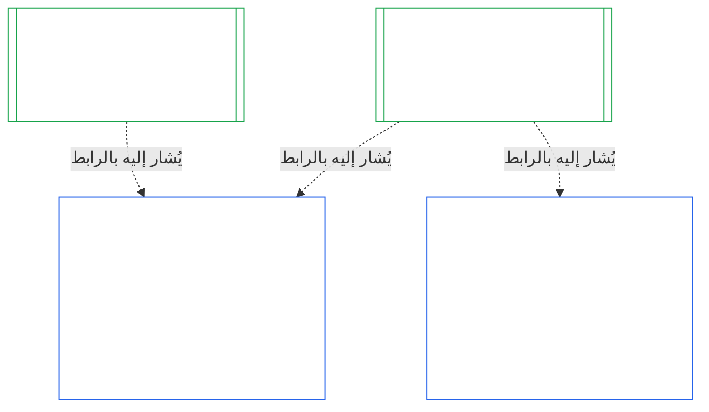

# الفصل العاشر: اعتماد المواءمة المؤسسية

<strong>موضع الملف في المتن (غير تشغيلي): بنية الملف وقواعد القراءة</strong>

> هذا الملف **جزء من دستور الكائنات الواعية**، ولا يكون **ملزماً إلا بالاقتران** مع ملفات `core_*` الأخرى ذات الترقيم التي تُقرأ كنص واحد. ويتضمن **الفصل العاشر** — **اعتماد المواءمة المؤسسية**: كيفية تصنيف [المؤسسة](core_05.040_band_continuity.md#institution) وتقييمها ومراجعتها واتخاذ القرار بشأنها وتسجيلها وإبقائها محدثة وإعادة فتحها، تمييزاً لها عن أي نظام تشغله (**§1–§11**). والفصل العاشر هو النظير المؤسسي للفصل [التاسع](core_09.000_system_alignment_certification_evaluation.md#chapter-nine-system-alignment-certification) (*اعتماد مواءمة النظام*)، وتحمل **أقسامه الأرقام نفسها**: فيجيب القسم §N هنا عن القسم §N هناك. ويتضمن [CS-9.320](corpus_systems/cs_09.320_system_alignment_certification_illustrations.md#cs-9320-system-alignment-certification-illustrations) (*أمثلة توضيحية لاعتماد مواءمة النظام*) الأمثلة العملية للأنظمة، وثلاث جولات إرشادية للمؤسسات في [§12 الجولات الإرشادية التوضيحية للمؤسسات](corpus_systems/cs_09.320_system_alignment_certification_illustrations.md#cs-9320-12-illustrative-institution-walkthroughs) فيه. ولا يعيد هذا الفصل ذكرها.
>
> | § | الفصل التاسع (النظام) | الفصل العاشر (المؤسسة) |
> |---|------------------------|----------------------------|
> | 1 | الغرض والدور | العلاقة باعتماد النظام؛ ومن يخضع للاعتماد؛ وعدم وجود إذن أو بوابة على التأسيس أو التشغيل؛ وانتظار سلطة مادية جديدة؛ ونافذة الاعتماد الأول |
> | 2 | تقييم فئة النظام | فئة المؤسسة؛ والتدرج بحسب الفئة |
> | 3 | تقييم اعتماد النظام بأكمله | العناصر المؤسسية الثمانية، دائماً |
> | 4 | التقييمات عند وجود ما يستدعيها | إحالة إلى الفصل التاسع §4 |
> | 5 | تقييمات أرضية الحقوق والمجالات | إحالة إلى الفصل التاسع §5 |
> | 6 | إجراءات المنتدى | المقاعد الأربعة؛ وأدوار المنتدى وتسلسل إجراءاته؛ والمنتديات والجهات المعتمدة ومكاتب السجلات بوصفها مؤسسات |
> | 7 | نتائج الاعتماد | بدء تشغيل المؤسسة وأنظمتها؛ وشروط الاعتماد والآثار الأخرى للنتيجة؛ والإحالة بشأن العيوب؛ والاستعداد للمعالجة؛ والرفض والسحب |
> | 8 | سجل اعتماد النظام | سجل الاعتماد المؤسسي |
> | 9 | إعادة الاعتماد وإعادة الفتح | المراقبة؛ ومحفزات إعادة الفتح؛ والاعتماد المؤقت والكامل؛ ومنع التحايل؛ والتتابع الناشئ عن اعتمادات الأنظمة؛ وإعادة فتح أنظمتها عند وقوع مخالفة حوكمية |
> | 10 | الطعن في اعتماد | مسار الطعن |
> | 11 | العلاقة بالصفة | جسر الصفة |
>
> - **المالك الدستوري (بالاشتراك مع الفصل التاسع):** اعتماد المواءمة والسجلات المرتبطة به تحت إشراف المنتدى. ويضيف الفصل العاشر موضوع المؤسسة. ولا يضيف عائلة منتديات جديدة أو مقعداً جديداً أو مصطلحاً جديداً للنتائج.
> - **إعادة الاستخدام لا التكرار:** تجري المراحل من الثالثة إلى السادسة وفق ما يورده [الفصل التاسع الجزء ب §6](core_09.005_system_alignment_certification_record_process.md#6-forum-process) إلى [الفصل التاسع الجزء ج §11](core_09.010_system_alignment_certification_record_recertification.md#11-relationship-to-standing). ولا يذكر الفصل العاشر إلا ما يتغير حين يكون الموضوع مؤسسة.
> - **قاعدة منع نقل الاختصاص:** لا يعيد الفصل العاشر صياغة آليات تقييم النظام في الفصل التاسع، أو حقول ميثاق النظام والميثاق المؤسسي في الفصل السابع، أو متطلب المقاعد الأربعة في الفصل الثامن، أو واجبات المؤسسات في [corpus_institutions](corpus_institutions.md)، أو قياس الصفة في الفصل الحادي عشر، أو آثار الصفة في الفصل الثاني عشر.
>
> **ما يسبقه:** [مواثيق الفصل السابع](core_07.000_charters.md#chapter-seven-system-and-institutional-charters)؛ والاستقلال الوظيفي في [الفصل الثامن](core_08.000_functional_independence_separation_of_duties.md#chapter-eight-functional-independence-and-separation-of-duties)؛ و[الفصل التاسع](core_09.000_system_alignment_certification_evaluation.md#chapter-nine-system-alignment-certification) (الأجزاء [أ](core_09.000_system_alignment_certification_evaluation.md#chapter-nine-part-a-system-alignment-certification--evaluation) و[ب](core_09.005_system_alignment_certification_record_process.md#chapter-nine-part-b-system-alignment-certification--forum-process-and-outcomes) و[ج](core_09.010_system_alignment_certification_record_recertification.md#chapter-nine-part-c-system-alignment-certification--record-recertification-and-standing))؛ وإشراف المنتدى في الفصل الرابع عشر.
> **ما يليه:** سجلات الصفة والمدخلات المتحققة في الفصل الحادي عشر؛ وآثار الصفة في الفصل الثاني عشر.

<strong>التتبّع</strong>

- ما يسبقه:
  - [الفصل السابع §1 متى تكون مواثيق النظام والمؤسسة مطلوبة](core_07.000_charters.md#1-when-system-and-institutional-charters-are-required) (7.000 §1) (*المؤسسات التي تنشر ميثاق نظام أو ميثاقاً مؤسسياً، وفئة المؤسسة*)؛
  - [الفصل السابع §7 التعديل والمراجعة](core_07.000_charters.md#7-amendment-review-and-scope-misalignment) (7.000 §7) (*ما تختبره مراجعة الميثاق المؤسسي*)؛
  - [الفصل السابع §4 خريطة أدوار الميثاق وحيازة سجلات الصفة](core_07.000_charters.md#4-the-charter-role-map-and-standing-record-custody) (7.000 §4) (*مواضع المقاعد*)؛
  - [الفصل الثامن §2 المتطلب الدستوري للمقاعد الأربعة](core_08.000_functional_independence_separation_of_duties.md#2-four-seat-constitutional-requirement) (8.000 §2) و[§9 العلاقة بالإجراءات اللاحقة](core_08.000_functional_independence_separation_of_duties.md#9-relationship-to-later-processes)؛
  - [الفصل التاسع](core_09.000_system_alignment_certification_evaluation.md#chapter-nine-system-alignment-certification) (9.000 إلى 9.010) (*عملية اعتماد مواءمة النظام التي يعيد هذا الفصل استخدامها*)؛
  - [السؤالان الأساسيان](core_00.000_preamble.md#two-fundamental-questions)؛
  - [الرباعية الدستورية](core_00.000_preamble.md#constitutional-tetrad)؛
  - [المادة XI-E](core_06.005_rights_part_b.md#article-xi-e-institutional-formation-and-business-creation) (*تأسيس المؤسسات وإنشاء الأعمال*).
- ما يليه: [§1](#1-purpose-and-role) إلى [§11](#11-relationship-to-standing)؛ والفصل الحادي عشر ([11.000](core_11.000_standing_assessment.md#chapter-eleven-contribution-violation-and-standing-model--measurement))؛ و[الفصل الرابع عشر](core_14.000_forum.md#chapter-fourteen-forums-and-jurisdiction) (14.000).
- يُقرأ مع:
  - [اعتماد المواءمة المؤسسية](core_05.040_band_continuity.md#institutional-alignment-certification) و
  - [سجل الاعتماد المؤسسي](core_05.040_band_continuity.md#institutional-certification-record) (*معاني الفصل الخامس*)؛
  - **CI-8.205 §6** (*محتويات ميثاق النظام والميثاق المؤسسي ومراجعتهما وقالب التأسيس*)؛
  - **CF-14.425** (*ضمانات النزاهة وعمليات منع الاستحواذ والدعم المضاد للتحكيم الذاتي*).

 

الفصل العاشر هو المالك الدستوري **لاعتماد المواءمة المؤسسية**. وهو يمدد عملية [الفصل التاسع](core_09.000_system_alignment_certification_evaluation.md#chapter-nine-system-alignment-certification) من النظام إلى المؤسسة:

- **المرحلة الأولى، التأطير:** فئة المؤسسة وكيف تدرّج التقييم ([§2 تقييم فئة المؤسسة](#2-institution-class-evaluation))؛
- **المرحلة الثانية، التقييم:** التقييم المؤسسي، بما فيه التقييمات المنطبقة عند وجود ما يستدعيها وتقييمات أرضية الحقوق والمجالات (من [§3 تقييم اعتماد المؤسسة بأكملها](#3-whole-institution-certification-evaluation) إلى [§5 تقييمات أرضية الحقوق والمجالات](#5-rights-floor-and-domain-evaluations))؛
- **المرحلة الثالثة، المراجعة:** أدوار المنتدى وتسلسل إجراءاته ([§6 إجراءات المنتدى](#6-forum-process))؛
- **المرحلة الرابعة، اتخاذ القرار:** النتيجة والاستعداد للمعالجة والرفض والسحب ([§7 نتائج الاعتماد](#7-certification-outcomes))؛
- **المرحلة الخامسة، التوثيق:** سجل الاعتماد المؤسسي ([§8 سجل الاعتماد المؤسسي](#8-institutional-certification-record))؛ و
- **المرحلة السادسة، التشغيل:** إعادة الاعتماد وإعادة الفتح والتتابع الناشئ عن اعتمادات الأنظمة وإعادة فتح الأنظمة ومسار الطعن وجسر الصفة (من [§9 إعادة الاعتماد وإعادة الفتح](#9-recertification-and-reopening) إلى [§11 العلاقة بالصفة](#11-relationship-to-standing)).
*بعبارات مبسطة: يسأل الفصل التاسع عما إذا كان **النظام** متوافقاً. ويسأل الفصل العاشر الأمر نفسه عن **المؤسسة** التي تشغل أنظمة أو تمارس سلطة دون تشغيل نظام. وقد تكون المؤسسة متوافقة فيما لا يكون أحد أنظمتها كذلك، أو العكس. لذلك تُفحص المؤسسة فيما لا تتحكم فيه إلا هي: هل تفعل ما يقوله ميثاقها المؤسسي، ومن يُسأل عن سلطتها، وما الذي تكافئ عليه أعضاءها، وهل يمكن استخدام الضوابط المستقلة عليها فعلاً. وهي تعتمد على اعتماد كل نظام ولا تعيده. والاعتماد ليس ترخيصاً: لا يحتاج أحد إلى إذنها لتأسيس مؤسسة أو تشغيلها.*

### 1. الغرض والدور

<strong>التتبّع</strong>

- ما يسبقه:
  - [الفصل السابع §1 متى تكون مواثيق النظام والمؤسسة مطلوبة](core_07.000_charters.md#1-when-system-and-institutional-charters-are-required) (7.000 §1)؛
  - [الفصل التاسع الجزء أ §1 الغرض والدور](core_09.000_system_alignment_certification_evaluation.md#1-purpose-and-role) (9.000 §1)؛
  - [المادة XI-E](core_06.005_rights_part_b.md#article-xi-e-institutional-formation-and-business-creation) (*تأسيس المؤسسات وإنشاء الأعمال*)؛
  - [المادة XXVIII-A](core_06.020_rights_part_e.md#xxviii-a-existing-instantiations-adoption-transition-window) (*الاعتماد المرحلي واستمرارية أرضية الحقوق*).
- ما يليه: [§2](#2-institution-class-evaluation)؛ و[§6](#6-forum-process)؛ و[§7](#7-certification-outcomes)؛ و[§9](#9-recertification-and-reopening).
- يُقرأ مع:
  - [المؤسسة](core_05.040_band_continuity.md#institution)؛
  - [الميثاق المؤسسي](core_05.040_band_continuity.md#institutional-charter)؛
  - [ميثاق النظام](core_05.040_band_continuity.md#system-charter)؛
  - [إنشاء الأعمال](core_05.055_band_participation.md#business-creation).

 

*بعبارات مبسطة: يخص اعتماد النظام النظام نفسه. ويشير اعتماد المؤسسة إلى تلك الاعتمادات ويضيف ما لا تستطيع الإجابة عنه إلا المؤسسة. وقد يظهر نظام واحد لدى مؤسسات عدة أو لا يظهر لدى أي مؤسسة. ولا يتيح أي شيء هنا للاعتماد أن يعوق تأسيس مؤسسة.*

اعتماد المواءمة المؤسسية واعتماد مواءمة النظام اعتمادان يربط بينهما رابط. والعلاقة هي **تركيب عبر رابط**، لا احتواء. وفي الشكل، يمتد سهم من سجل اعتماد نظام إلى كل سجل اعتماد مؤسسي يشير إليه. والنظام غير التابع لأي مؤسسة لا يحتاج إلى سهم، والمؤسسة التي لا تشغل أي نظام يكون لها سجل منفرد.

للتركيب عبر رابط جانبان، أولهما جانب المؤسسة.

في جانب المؤسسة:

- **يشير سجل الاعتماد المؤسسي إلى سجل النظام ولا يعيد إجراءه:** يشير إلى سجل اعتماد النظام بالرابط ويسمي إصداره. ولا يعيد هذا الفصل إجراء أي تقييم لنظام، أو اتخاذ قرار مجدداً بشأن فئته، أو تغيير نتيجة النظام أو حالته أو شروط اعتماده.
- **لا يستطيع اعتماد المؤسسة رفع اعتماد نظام:** يظل النظام غير المعتمد كذلك مهما كانت حالة المؤسسة. ولا يكتسب النظام الحاصل على اعتماد حمايةً من نتيجة تخص المؤسسة.
- **تُثبت الوقائع المؤسسية مرة واحدة:** عندما يسأل [الفصل التاسع الجزء أ §3.1 انضباط الحوكمة والحوافز وقابلية الاعتراض](core_09.000_system_alignment_certification_evaluation.md#31-governance-incentive-and-contestability-discipline) عن حوكمة المشغّل وحوافزه، يجوز لسجل اعتماد مؤسسي حالي للمشغّل أن يقدم تلك الوقائع بالرابط. وتظل منتديات النظام مسؤولة عن تقرير كفايتها لذلك النظام. ولا يجوز لها أن تجد في الواقعة المؤسسية نفسها خلاف ما وجدته منتديات أخرى دون بيان السبب في سجل اعتماد النظام.

وفي جانب النظام:

- **سجل اعتماد النظام ملك للنظام:** فهو سجل النظام نفسه بموجب [الفصل التاسع](core_09.000_system_alignment_certification_evaluation.md#chapter-nine-system-alignment-certification).
- **يجوز لعدة مؤسسات الإشارة إلى سجل اعتماد النظام نفسه:** قد تشغل أكثر من مؤسسة النظام أو تشرف عليه أو تسيطر عليه جوهرياً بموجب [الفصل السابع §1 متى تكون مواثيق النظام والمؤسسة مطلوبة](core_07.000_charters.md#1-when-system-and-institutional-charters-are-required). وتشير كل منها إلى السجل نفسه.
- **لا يلزم أن يتبع النظام أية مؤسسة:** الكائن الواعي المنفرد ليس مؤسسة، لذلك قد لا يتبع النظام أية مؤسسة. ويُعتمد النظام غير التابع لأي مؤسسة بموجب [الفصل التاسع](core_09.000_system_alignment_certification_evaluation.md#chapter-nine-system-alignment-certification) وحده ولا يحتاج إلى شيء من هذا الفصل. أما النظام التابع لمؤسسة فيُعتمد بالطريقة نفسها: يضيف هذا الفصل سجلاً منفصلاً للمؤسسة ولا يشكل خطوة في اعتماد النظام نفسه.

#### 1.1 من يخضع للاعتماد

تدخل المؤسسة من الفئة L أو أعلى في نطاق هذا الفصل، وتُحدد فئتها بموجب [§2.1 فئة المؤسسة](#21-institution-class). ويشمل ذلك المؤسسة التي لا تشغل أي نظام: إذ ليس لديها سجل اعتماد نظام تحيل إليه، وتُحدد فئتها بحسب أثرها هي. و**محفظة** المؤسسة هي مجموعة الأنظمة التي تشغلها أو تشرف عليها أو تسيطر عليها جوهرياً ([المحفظة](core_05.040_band_continuity.md#portfolio)).

- **الفئات A وB وC وL:** تنطبق العملية، مع تدرجها بحسب الفئة بموجب [§2.2 التدرج بحسب الفئة](#22-scaling-by-class).
- **الفئة P:** يُشجَّع على العملية ويجوز استخدامها طوعاً. وتصبح إلزامية عند إعادة التصنيف إلى الفئة L أو أعلى، أو عندما تؤكد المؤسسة طوعاً امتثالها للدستور. وإذا قررت مؤسسة من الفئة P تولي سلطة مادية جديدة، أعيد تصنيفها إلى الفئة L على الأقل عندما تقدم الإشعار في [§9.2.2 إعادة الاعتماد لسلطة مادية جديدة](#922-recertification-for-new-material-authority)، لأن تلك السلطة مادية بحكم تعريفها ([§9.2.1 ما الذي يعد سلطة مادية جديدة](#921-what-counts-as-new-material-authority))، ولأن المؤسسة المادية في أي مجال لا تقل فئتها عن L ([§2.1 فئة المؤسسة](#21-institution-class)، البند 2). ويظل هذا التصنيف قائماً من الإشعار حتى سحبه قبل الإذن أو عدم الإذن بالسلطة، بشرط ألا يكون قد مورس شيء بموجبها. ثم تعود المؤسسة إلى الفئة P وينتهي الاعتماد الأول المحدود. ويبدأ إشعار جديد الدورة من جديد، أما ممارسة السلطة من دون إذن فتظل نتيجة بموجب [§9.2.2 إعادة الاعتماد لسلطة مادية جديدة](#922-recertification-for-new-material-authority) (*من دون إشعار أو قبل الإذن بها*). وهذا يطابق [الفصل التاسع الجزء أ §1 الغرض والدور](core_09.000_system_alignment_certification_evaluation.md#1-purpose-and-role).
- **نظام واحد:** للمؤسسة التي تشغل نظاماً واحداً بالضبط ويحتاج إلى ميثاق نظام جولة اعتماد واحدة وسجل واحد، ويسمي هذا الفصل ذلك **تقييم النظام الواحد**. ويتضمن سجل اعتماد النظام *كتلة نتائج مؤسسية* تضم البنود الواردة في [§8 سجل الاعتماد المؤسسي](#8-institutional-certification-record)، ويعمل بوصفه سجل الاعتماد المؤسسي. وتكون المنتديات والمقاعد والساعات هي نفسها الخاصة بجولة اعتماد النظام، مع إضافة البنود المؤسسية. وتتبع النتائج أسباب الرفض والسحب الخاصة بها كما يبين [§7.4 الرفض والسحب لمؤسسة](#74-denial-and-revocation-for-an-institution). ولا ينطبق التتابع الوارد في [§9.5 التتابع الناشئ عن اعتمادات الأنظمة](#95-cascade-from-system-certifications) بوصفه تتابعاً، لأن النظام يشكل المحفظة كلها؛ لكن [§7.4 الرفض والسحب لمؤسسة](#74-denial-and-revocation-for-an-institution) يطبق القاعدتين 1 و2 فيه (المؤشر واختبار موضع السبب).
- **أنظمة عدة:** سجل اعتماد مؤسسي واحد للمؤسسة يحيل إلى سجل اعتماد النظام لكل نظام تشغله. ويحتفظ كل نظام بجولة اعتماده وسجله الخاصين.
- **دون نظام:** سجل اعتماد مؤسسي منفرد. ولا يوجد سجل اعتماد نظام يمكن الإحالة إليه لأن المؤسسة لا تشغل أي نظام.

#### 1.2 لا إذن ولا بوابة على التأسيس أو التشغيل

اعتماد المواءمة المؤسسية فحص مستقل لكيفية استعمال المؤسسة سلطتها فعلاً. وتجريه منتديات مستقلة عن المؤسسة، وينتهي بسجل اعتماد مؤسسي لما توصلت إليه.

- **التأسيس والتشغيل:** تؤسس المؤسسة وتنشر ميثاقها المؤسسي وتبدأ ممارسة سلطتها وتواصل التشغيل دون أن تحصل عليه أولاً، ولا تمنح أي نتيجة ذلك الحق أو تحجبه.
- **أثر النتيجة:** للنتيجة الآثار الواردة حصراً في [§7.1 بدء تشغيل مؤسسة](#71-go-live-for-an-institution).
- **البوابات الوحيدة في هذا المجال:** توجد ثلاث بوابات ضيقة، وكلها في **المادة XI-E** (*تأسيس المؤسسات وإنشاء الأعمال*):
  - قيد قائم على كائن واعٍ مسمى، يتعلق بسلطة ذلك الكائن الواعي؛
  - وقف مؤقت على وقائع محددة ومتحققة من اختلال المواءمة، يتعلق كذلك بسلطة كائن واعٍ مسمى؛
  - قيد على الجهة المشغّلة نفسها، لا يتعلق بمؤسسة إلا عندما يقع القيد على تلك المؤسسة، كما في المؤسسة المنحلة بموجب **CI-12.210 §4** (*الحل*).
  ويجوز إحالة نتيجة اعتماد إلى المنتدى الذي يقرر بشأن إحدى هذه البوابات، كدليل بموجب [§7.5 آثار الرفض والسحب لمؤسسة](#75-effects-of-denial-and-revocation-for-an-institution). ونتيجة الاعتماد ليست بحد ذاتها بوابة ولا تفتحها أو تغلقها.
- **انتظار سلطة مادية جديدة:** تنتظر المؤسسة التي تقرر تولي سلطة مادية جديدة حتى تسمح إعادة اعتمادها بممارسة تلك السلطة، وفق شروط [§9.2.2 إعادة الاعتماد لسلطة مادية جديدة](#922-recertification-for-new-material-authority). وتقرر **المادة XI-E** (*تأسيس المؤسسات وإنشاء الأعمال*) هذا الانتظار. وهو ليس إحدى البوابات الضيقة الثلاث، ولا بوابة على التأسيس أو التشغيل. ولا يتعلق إلا بالسلطة الجديدة، ويستمر كل ما تفعله المؤسسة سواها. ويلخص الشكل في [§9.2.2 إعادة الاعتماد لسلطة مادية جديدة](#922-recertification-for-new-material-authority) الخطوات.
- **لا باب خلفي:** لا يجوز للمنتدى أو المعتمد أو شاغل السلطة استخدام أي شيء في هذا الفصل عتبةَ إذن تستبعد المؤسسين أو تحمي شاغلي السلطة. فهذا يهزم [المادة XI-E](core_06.005_rights_part_b.md#article-xi-e-institutional-formation-and-business-creation) (*تأسيس المؤسسات وإنشاء الأعمال*).
  - تنطبق [الأعباء الممكن تجنبها](core_05.040_band_continuity.md#avoidable-burden) على تكلفة العملية.
  - تنطبق [الحوكمة المتدرجة بحسب التصنيف](core_05.050_band_oversight.md#classification-scaled-governance) على عمقها.
  - وينطبق انتظار السلطة المادية الجديدة بالشروط نفسها على كل مؤسسة من فئتها، ولا يخص إلا السلطة المادية بالفعل للآخرين.

بوابة بدء تشغيل الأنظمة منفصلة وتظل خاصة بها. وبموجب [الفصل التاسع الجزء ب §7.1 بوابة بدء التشغيل](core_09.005_system_alignment_certification_record_process.md#71-go-live-gate)، لا يبدأ تشغيل نظام جديد أو توسع مادي في نظام إلا من خلال اعتماده الخاص، مهما كانت حالة المؤسسة.

#### 1.3 نافذة الاعتماد الأول

يستحق أول سجل اعتماد مؤسسي خلال نافذة يحددها مستند الاعتماد لفئة المؤسسة.

- **المؤسسة الجديدة:** تبدأ النافذة من اليوم الذي يصبح لها فيه أول أثر جوهري على الآخرين، وفق حكم [المادية الخاصة بالمجال](core_05.050_band_oversight.md#domain-specific-materiality)، ويكون اعتمادها الأول مؤقتاً.
- **مؤسسة الفئة P التي أعيد تصنيفها عند الإشعار:** تبدأ النافذة من يوم تقديمها الإشعار بموجب [§9.2.2 إعادة الاعتماد لسلطة مادية جديدة](#922-recertification-for-new-material-authority)، كما للمؤسسة الجديدة، ولا تبدأ أبداً من نافذة انتقال اعتماد انتهت بالفعل.
- **المؤسسة القائمة بالفعل:** تكون النافذة هي نافذة انتقال الاعتماد بموجب [المادة XXVIII-A](core_06.020_rights_part_e.md#xxviii-a-existing-instantiations-adoption-transition-window) (*الاعتماد المرحلي واستمرارية أرضية الحقوق*)، بما يتسق مع القاعدة الافتراضية في [الفصل السابع §1.5 موعد استحقاق ميثاق النظام أو الميثاق المؤسسي](core_07.000_charters.md#15-when-a-system-charter-or-institutional-charter-is-due).
- **انقضاء النافذة دون استيفاء:** تُسجل على المؤسسة التي تدع النافذة تنقضي دون جولة أولى، ولم تُعفَ أدناه، مخالفة يجب تصحيحها؛ ويفتح انقضاء النافذة تلك الجولة. وتقع أيضاً على مؤسسة من الفئة L أو أعلى تشغّل بالفعل مخالفة إنجاز المعلم المرحلي أدناه. ولا تُوقف المؤسسة ولا تُمنع من التشغيل إذ لا توجد بوابة ([§1.2 لا إذن ولا بوابة على التأسيس أو التشغيل](#12-no-permission-and-no-gate-on-forming-or-running)).
  - **المؤسسة القائمة بالفعل:** هذه قاعدة هذا الفصل الخاصة بالمؤسسات من الفئة L أو أعلى، ومقررة بالقياس إلى [المادة XXVIII-A](core_06.020_rights_part_e.md#xxviii-a-existing-instantiations-adoption-transition-window) (*الاعتماد المرحلي واستمرارية أرضية الحقوق*) التي تسمي الأنظمة والكيانات المشتقة. وإذا انتهت نافذة انتقال الاعتماد ولم تكتمل جولة الاعتماد الأولى (أي لا يوجد اعتماد مؤقت أو كامل ولا نتيجة مقررة بموجب [§7 نتائج الاعتماد](#7-certification-outcomes))، تكون المؤسسة قد فوّتت الموعد النهائي. ولا تكون المؤسسة التي قدمت طلبها وتعاونت خلال النافذة قد فوّتت الموعد إذا لم تكتمل جولة الاعتماد بسبب تجاوز المنتدى لمهلته ([الفصل الرابع عشر §6 الحل في الوقت المناسب ودرجات الأهمية والانضباط المضاد للتأخير](core_14.000_forum.md#6-timely-resolution-materiality-tiers-and-anti-delay-discipline)، *مراجعة التجاوز*؛ [الفصل التاسع الجزء ج §9.3.4 النوافذ المتدرجة](core_09.010_system_alignment_certification_record_recertification.md#934-tier-windows)) أو بسبب سريان التأجيل الوحيد بموجب [§7.3 الاستعداد للمعالجة لمؤسسة](#73-remediation-readiness-for-an-institution). وما لم يكن لديها إثبات موثق لإعادة الإذن بموجب [المادة XXVIII-B](core_06.020_rights_part_e.md#article-xxviii-b-adoption-transition-authority-limits-and-reauthorization) (*حدود سلطة الانتقال إلى الاعتماد وإعادة الإذن*)، فهذه مخالفة لمعلم انتقالي، ويفتح مسار الامتثال والمخالفة المعتاد في [الفصل الحادي عشر](core_11.000_standing_assessment.md#chapter-eleven-contribution-violation-and-standing-model--measurement). وتسري واجبات التقييد في تلك المادة من تاريخ النفاذ، ولا تصبح الفجوة معياراً جديداً لمجرد استمرارها. وهذا يطابق [الفصل التاسع الجزء ب §7.1.1 الأنظمة القائمة بالفعل](core_09.005_system_alignment_certification_record_process.md#711-systems-already-operating). ولا تشكل هذه بوابة.
  - **جولة الاعتماد:** يُتخذ القرار فيها كأي جولة أخرى. وقد تنتهي بأي نتيجة من نتائج [§7 نتائج الاعتماد](#7-certification-outcomes)، بما فيها «غير معتمد»، وما يترتب على ذلك بموجب [§7.5 آثار الرفض والسحب لمؤسسة](#75-effects-of-denial-and-revocation-for-an-institution).
  - **الجزاءات والحل:** لا ينشئ هذا الفصل أياً منها. وتظل صلاحيات التعليق والحراسة والفصل البنيوي والحل لدى المنتدى ذي الاختصاص بموجب **CI-12.210** (*إخفاق المؤسسة وحلها*) و**CI-12.215** (*مساءلة المؤسسة والجزاءات*). ولا يُحال الأمر إلى ذلك المنتدى إلا لأسباب الإحالة الواردة في [§7.5 آثار الرفض والسحب لمؤسسة](#75-effects-of-denial-and-revocation-for-an-institution) (البند 5، *الإحالة*).

### 2. تقييم فئة المؤسسة

<strong>التتبّع</strong>

- ما يسبقه:
  - [الفصل السابع §1 متى تكون مواثيق النظام والمؤسسة مطلوبة](core_07.000_charters.md#1-when-system-and-institutional-charters-are-required) (7.000 §1)؛
  - [الفصل التاسع الجزء أ §2 تقييم فئة النظام](core_09.000_system_alignment_certification_evaluation.md#2-system-class-evaluation) (9.000 §2) و[§2.2 كيف تدرّج فئة النظام كل تقييم](core_09.000_system_alignment_certification_evaluation.md#22-how-system-class-scales-every-evaluation)؛
  - [الفصل الثالث §2.1 أنماط التحايل الشائعة](core_03.000_definition_integrity.md#21-common-evasion-patterns) (3.000 §2.1).
- ما يليه: [§3](#3-whole-institution-certification-evaluation) (*العناصر التي تتدرج بحسب الفئة*)؛ و[§8](#8-institutional-certification-record) (*بيان الفئة في السجل*)؛ و[§9.2](#92-reopening-triggers) (*المحفزات التي تعيد تقييمها*).
- يُقرأ مع:
  - **CS-9.305 (*آليات تصنيف الأنظمة*) وCS-9.310** (*تصنيفات أثر النظام*) و[corpus_systems/cs_09.310_system_impact_classifications.md](corpus_systems/cs_09.310_system_impact_classifications.md) (*فهرس الفئات*)؛
  - **CI-9.210** (*الواجبات المؤسسية المرتبطة بالتصنيف*)؛
  - **CI-8.205 §6** (*محتويات ميثاق النظام والميثاق المؤسسي ومراجعتهما وقالب التأسيس*).

 

*بعبارات مبسطة: ابدأ بتصنيف المؤسسة بحسب مدى أهميتها للآخرين. واحكم على ذلك من واقع ما تقرره وتمسك به فعلاً، لا مما تسمي به نفسها. ثم تحدد الفئة مدى شمولية التقييم: كلما ارتفعت الفئة، اشتد الإثبات وزادت استقلالية المراجعة وقرب موعد إعادة التحقق.*

هذا القسم هو **المرحلة الأولى: التأطير** للمؤسسة.

#### 2.1 فئة المؤسسة

تُحدد **فئة المؤسسة** بأكبر أثر جوهري للمؤسسة، سواء نشأ ذلك الأثر عبر نظام تشغله أم خارج أي نظام. ويُحكم عليه بحسب ما تقرره المؤسسة وتمسك به وتتحكم فيه فعلاً، لا بحسب تسميتها أو شكلها القانوني أو القائمة الواردة في ميثاقها المؤسسي. وتحدد الفئة عمق التقييم والمواعيد، كما تفعل [الفصل التاسع الجزء أ §2.2 كيف تدرّج فئة النظام كل تقييم](core_09.000_system_alignment_certification_evaluation.md#22-how-system-class-scales-every-evaluation) للنظام. وهي الفئة المستخدمة في هذا الفصل وفي [الفصل السابع §1.2 الفئات المشمولة](core_07.000_charters.md#12-which-classes-are-covered).

1. **الأثر عبر الأنظمة:** لا تقل فئة المؤسسة عن أعلى فئة لأي نظام في محفظتها ([الفصل السابع §1 متى تكون مواثيق النظام والمؤسسة مطلوبة](core_07.000_charters.md#1-when-system-and-institutional-charters-are-required)). وتُحدد الأنظمة من واقع التشغيل الملحوظ. ويُحتسب النظام الذي لم يذكره الميثاق المؤسسي.
2. **الأثر خارج أي نظام:** يُحتسب الأثر الجوهري والاعتماد الخاصان بالمؤسسة سواء كانت تشغل نظاماً أم لا. وتُطبق تعريفات الفئات في **CS-9.305 (*آليات تصنيف الأنظمة*) وCS-9.310** (*تصنيفات أثر النظام*) على قرارات المؤسسة وممتلكاتها هي باستخدام العوامل التالية:
   - **ما تقرره وتمسك به:**
     - ما تقرره بشأن وصول الكائنات الواعية الآخرين إلى ضروريات البقاء أو التعليم أو السلامة أو سبل العيش أو الحقوق أو الصفة؛ و
     - ما تمسك به، مثل الأموال أو السجلات أو العضويات أو حيازة سجلات الصفة أو وظيفة المنتدى أو الجهة المعتمدة أو مكتب السجلات.
   - **مدى ماديتها:**
     - ما إذا كان نشاطها جوهرياً في أي مجال من مجالات [المادية الخاصة بالمجال](core_05.050_band_oversight.md#domain-specific-materiality)، بما في ذلك إصدار [أفعال ملزمة جوهرياً](core_05.035_band_accountability.md#materially-binding-act) يجب على الآخرين اتباعها أو يجوز لهم الاعتماد عليها بوصفها محسومة؛
     - لا تقل فئة المؤسسة المادية في أي مجال واحد عن الفئة L بموجب **CS-9.305 (*آليات تصنيف الأنظمة*) وCS-9.310** (*تصنيفات أثر النظام*)؛ و
     - تقديم المساعدة أو السلع أو العمل أو الخدمات التي يجوز للآخرين أخذها أو تركها بحرية، والتي لا تتحكم في وصول أحد إلى ما يحتاج إليه، لا يُلزم أحداً. فهذا سلوك وليس فعلاً ملزماً جوهرياً، ولا يُحتسب إلا ضمن العوامل الأخرى.
   - **مدى اعتماد الآخرين عليها:**
     - عدد الكائنات الواعية المعتمدين عليها ومدى قابلية استبدالها؛
     - مدى تركّز سلطتها، وفق معنى خط السيطرة المادية؛ و
     - مدى قابلية قراراتها للعكس.
3. **السيطرة المشتركة:** تُصنّف الجهات المشغّلة التي تشكل عملية واحدة بموجب قاعدة التجميع في [المادية الخاصة بالمجال](core_05.050_band_oversight.md#domain-specific-materiality) (سيطرة عملية مشتركة ضمن [خط السيطرة المادية](core_05.035_band_accountability.md#material-control-line)؛ والتمويل وحده لا يُحتسب) معاً حيث تتصرف عملياً كمؤسسة واحدة. ويُعد تقسيم جهة مشغّلة أو محفظتها أو سلطتها بحيث لا يبلغ أي جزء منها الفئة L تحايلاً على النطاق والحدود بموجب [الفصل الثالث §2.1 أنماط التحايل الشائعة](core_03.000_definition_integrity.md#21-common-evasion-patterns).
4. **إعادة التصنيف:** يُعاد تقييم الفئة عند تحقق محفزات [§9.2 محفزات إعادة الفتح](#92-reopening-triggers). وتُذكر الفئة في سجل الاعتماد المؤسسي مع أسبابها.

#### 2.2 التدرج بحسب الفئة

تدرّج فئة المؤسسة عمق الأدلة واستقلال المراجعة وفترة الاعتماد الافتراضية والإفصاح في السجل، على النحو الذي يحدده [الفصل التاسع الجزء أ §2.2 كيف تدرّج فئة النظام كل تقييم](core_09.000_system_alignment_certification_evaluation.md#22-how-system-class-scales-every-evaluation). وترد فترات الاعتماد في [الفصل الرابع عشر §6 الحل في الوقت المناسب ودرجات الأهمية والانضباط المضاد للتأخير](core_14.000_forum.md#review-cadence) (*وتيرة المراجعة*)؛ ويجوز لمستند الاعتماد تحديد فترات أقصر، وهو يحدد عدد إعادات الاعتماد المؤقت النظيفة.

- **الفئات A وB وC:** تُقيّم العناصر الثمانية كلها في [§3 تقييم اعتماد المؤسسة بأكملها](#3-whole-institution-certification-evaluation)، بأدلة واستقلالية تتناسبان مع الفئة.
- **الفئة L:** تُقيّم العناصر الثمانية نفسها بصورة مبسطة، بسجلات أبسط وفترة اعتماد افتراضية أطول حيثما تسمح [الحوكمة المتدرجة بحسب التصنيف](core_05.050_band_oversight.md#classification-scaled-governance). ويتمثل جوهر جولة الفئة L في مقارنة الميثاق المؤسسي بالممارسة وخريطة الأدوار وإفادة فحص التأسيس وحداثة اعتمادات الأنظمة المحال إليها. ولا يجوز إسقاط أي عنصر، ويُذكر في سطر أي عنصر لا توجد فيه نتيجة.
- **الفئة P:** طوعية، كما يبين [§1.1 من يخضع للاعتماد](#11-who-is-certified).

**المضيف في ممارسة مهنية مشتركة.** حين تكون المؤسسة مضيفاً ([**CI-15.205 §7**](corpus_institutions/ci_15.205_appointment_competency_rotation_removal.md#ci-46-seat-advisory) (*ترخيص الممارسة والتصريح بها والممارسة المهنية المشتركة*))، تراجع شهادتها أيضاً عينة من أفعال الأعضاء في ضوء المقاعد التي يحملها المضيف، وتقارن إشعارات اعتماد الأعضاء بما يفعله المضيف. والنتيجة بشأن فعل عضو واحد تخص ذلك العضو، ولا تمتد إلى المضيف إلا إذا أخفق مقعد يحمله المضيف.

### 3. تقييم اعتماد المؤسسة بأكملها

<strong>التتبّع</strong>

- ما يسبقه:
  - [الفصل التاسع الجزء أ §3 تقييم اعتماد النظام بأكمله](core_09.000_system_alignment_certification_evaluation.md#3-whole-system-certification-evaluation) (9.000 §3)؛
  - [الفصل السابع §3 ما يجب أن تنص عليه مواثيق النظام والمؤسسة](core_07.000_charters.md#3-what-system-and-institutional-charters-must-state) (7.000 §3)؛
  - [الفصل السابع §5 فحص التأسيس: صفة شاغل المنصب وأصالته](core_07.000_charters.md#5-formation-check-office-holder-standing-and-authenticity) (7.000 §5)؛
  - [الفصل السابع §7 التعديل والمراجعة](core_07.000_charters.md#7-amendment-review-and-scope-misalignment) (7.000 §7)؛
  - [السؤالان الأساسيان](core_00.000_preamble.md#two-fundamental-questions)؛
  - [الفصل الأول §19.6 الإبقاء على المسؤولية عند تغير الملكية أو البنية](core_01.010_stewardship_capacity_principles.md#196-keeping-responsibility-when-ownership-or-structure-changes) (1.010 §19.6).
- ما يليه: [§6](#6-forum-process) (*النتائج التي تراجعها المنتديات*)؛ و[§9](#9-recertification-and-reopening) (*المحفزات التي تعيد فتحها*)؛ و[§11](#11-relationship-to-standing) (*بوابة المدخلات المتحققة للنتائج المتعلقة بكائن واعٍ مسمى*).
- يُقرأ مع:
  - **CI-8.205 §3** (*سلسلة السلطة وضوابط التفويض*) و**CI-8.205 §6** (*محتويات ميثاق النظام والميثاق المؤسسي ومراجعتهما وقالب التأسيس*)؛
  - **CI-6.215** (*الإشراف على الموارد ونزاهة الحوافز*)؛
  - **CI-8.210** (*نزاهة تضارب المصالح ومنع الاستحواذ ومكافحة الفساد*) و**CI-6.205** (*الشفافية والمشاركة ومسارات الطعن والخدمة الميسرة*) و**CI-12.205** (*أنظمة الإنصاف وقدرة المؤسسة على الانتصاف*)، بالنسبة إلى البند 8.

 

*بعبارات مبسطة: افحص الأمور التي تخص المؤسسة لا أياً من أنظمتها وحده: هل تلتزم بميثاقها المؤسسي، ومن يُسأل عن سلطتها، وما الذي تكافئ عليه، وهل تعمل الضوابط المستقلة عليها.*

هذا القسم هو **المرحلة الثانية: التقييم** للمؤسسة.

تقيّم كل جولة اعتماد العناصر الثمانية التالية، وهي النظير المؤسسي لـ[الفصل التاسع الجزء أ §3 تقييم اعتماد النظام بأكمله](core_09.000_system_alignment_certification_evaluation.md#3-whole-system-certification-evaluation). وتبين كل نتيجة أدلتها ونص الميثاق المؤسسي أو التشغيل الملحوظ الذي تستند إليه.

1. **مقارنة الميثاق المؤسسي بالممارسة:**
   - يُختبر الميثاق المؤسسي في ضوء التشغيل الملحوظ، باستخدام قائمة المراجعة في [الفصل السابع §7 التعديل والمراجعة](core_07.000_charters.md#7-amendment-review-and-scope-misalignment).
   - تُسجل نتيجة عند وجود ممارسة خارج الميثاق المؤسسي، أو حين لا يعود الميثاق المؤسسي يصف الممارسة، أيهما كان خاطئاً.
2. **المحفظة والأثر الإجمالي:**
   - يُختبر مبرر المحفظة: يجب أن يرتبط كل نظام بالغرض المعلن للمؤسسة، ويُسجل غياب سبب معلن لأي نظام كـنتيجة.
   - وينظر التقييم أيضاً عبر الأنظمة فيما لا يمكن لأي اعتماد منفرد إظهاره:
     - الاعتمادات المشتركة؛
     - الاتكال الإجمالي؛
     - الاستخراج التراكمي من الأسس المشتركة؛ و
     - أي ترتيب يقسم وظيفة واحدة إلى أجزاء كي يفلت كل جزء من فئة أو واجب.
3. **السلطة الخاضعة للمساءلة:**
   - يجب إسناد كل سلطة تمارسها المؤسسة على الآخرين إلى مكتب خاضع للمساءلة يمكن تسميته، ويكون ذلك المكتب مسؤولاً بموجب قواعد [الفصل الثامن](core_08.000_functional_independence_separation_of_duties.md#chapter-eight-functional-independence-and-separation-of-duties) و**CI-8.205 §3** (*سلسلة السلطة وضوابط التفويض*).
   - ولا يعفي تغير الملكية أو السيطرة أو البنية من المسؤولية ([الفصل الأول §19.6 الإبقاء على المسؤولية عند تغير الملكية أو البنية](core_01.010_stewardship_capacity_principles.md#196-keeping-responsibility-when-ownership-or-structure-changes)).
4. **المكافآت والحوافز:**
   - تُخضع رواتب المؤسسة وترقياتها وأهدافها ومكافآتها إلى [السؤالين الأساسيين](core_00.000_preamble.md#two-fundamental-questions): ما الذي تكافئ عليه البنية فعلاً، وهل يوجه ذلك نحو غايتي الدستور أو بعيداً عنهما.
   - وتُسجل نتيجة عند وجود بنية مكافآت تدفع إلى اختلال المواءمة أو إخفائه، حتى إذا كان كل نظام معتمداً على حدة.
   - وينطبق [الفصل التاسع الجزء أ §3.3 قيد الاتساق الزمني](core_09.000_system_alignment_certification_evaluation.md#33-time-consistency-constraint). فلا تكفي المقاييس القريبة الأمد أو الامتثال المحلي أو الكفاءة قصيرة الأمد حين يظل ضرر متوقع على الأمد المتوسط أو الطويل بالسلامة أو الحقيقة أو الرفاه دون معالجة؛ وتُسجل نتيجة إذا كافأت بنية الحوافز النتائج قصيرة الأمد على حساب ذلك.
   - وتظل واجبات المؤسسة المتعلقة بنزاهة الحوافز من اختصاص **CI-6.215** (*الإشراف على الموارد ونزاهة الحوافز*)، ويُحال إليه ولا يعاد ذكره.
5. **خريطة الأدوار والحيازة:**
   - تسمي [خريطة أدوار الميثاق](core_05.040_band_continuity.md#charter-role-map) مكاتب موجودة، ومشغولة أو مستبدلة كما تنص الخريطة، و[مستقلة](core_05.035_band_accountability.md#independence) عن المؤسسة في أي سجل تكون فيه المؤسسة هي موضوعه.
   - ويمكن استخدام المسار المستقل فعلاً.
   - ويُسجل كـنتيجة أي مقعد لم يوضع أو مكتب متوقف أو أمين سجل داخل خط المؤسسة نفسها.
6. **حداثة كل اعتماد نظام يُحال إليه:**
   - بالنسبة إلى كل نظام تشغله المؤسسة، يتحقق التقييم من أن سجل اعتماد النظام سارٍ أو داخل نافذة انتقال الاعتماد، ومن قيام المؤسسة بما تفرضه عليها شروط اعتماد ذلك السجل.
   - ويُسجل كـنتيجة أي اعتماد منتهٍ أو مسحوب أو مخفق أو مفقود دون سبب مدون، ثم ينقل [§9.5 التتابع الناشئ عن اعتمادات الأنظمة](#95-cascade-from-system-certifications) ذلك الأثر إلى المؤسسة.
7. **صفة شاغلي المناصب وأصالتهم:**
   - تُختبر إفادة فحص التأسيس المنشورة بموجب [الفصل السابع §5 فحص التأسيس: صفة شاغل المنصب وأصالته](core_07.000_charters.md#5-formation-check-office-holder-standing-and-authenticity) في ضوء التشغيل الملحوظ، ولا تُقبل بمجرد الإقرار.
   - وبالنسبة إلى كل مكتب مشمول، تتحقق المنتديات من وقائع الصفة مقابل السجلات المتحققة، وتحدد الأصالة من أدلة السيطرة والمصالح والمكافآت والسلوك والصوت المحمي. ويشمل ذلك:
     - من يوجه شاغل المنصب فعلاً؛
     - ما الذي يُدفع لشاغل المنصب ويُرقى على أساسه؛
     - ما الذي أنجزه شاغل المنصب في وظيفته على نحو متحقق؛ و
     - ما إذا عوقب أي شخص، بما فيه شاغل المنصب، لأنه قدم [بلاغاً محمياً](core_05.035_band_accountability.md#protected-reporting-whistleblowing) أو رفض توجيهاً غير قانوني أو غير دستوري ([الفصل الأول §17.5 واجب المقاومة](core_01.010_stewardship_capacity_principles.md#175-duty-to-resist)).
   - ولا يُفحص الموظفون الذين لا يشغلون منصباً مشمولاً فرادى. ويغطيهم فحص ضمانات الموظفين ([الفصل السابع §5.6 فحص ضمانات الموظفين](core_07.000_charters.md#56-staff-safeguards-check))، وتختبره المنتديات في ضوء التشغيل الملحوظ بالطريقة نفسها. ويسأل الفحص عما إذا:
     - كانت قواعد التعيين والدفع والترقية والعزل في المؤسسة لا تكافئ العمل ضد غرضها المعلن؛
     - كان هناك مسار للإبلاغ المحمي، ولم يُعاقب أي موظف استخدمه أو رفض توجيهاً غير قانوني أو غير دستوري؛ و
     - ظلت الحقوق الواردة في [المادة III-C](core_06.000_rights_part_a.md#article-iii-c-labor-and-economic-floor) (*أرضية العمل والاقتصاد*) قائمة.
   - يُسجل كل مما يلي كـنتيجة:
     - شاغل منصب مرشح لجهة مسيطرة لم يُفصح عنها؛
     - مكتب مشمول موجود على الورق فقط: يسميه الميثاق المؤسسي أو خريطة أدوار الميثاق لكن لا يشغله أحد فعلياً ولا يؤدي عمله؛
     - بنية مكافآت تدفع لشاغلي المناصب مقابل فعل ما تحظره الحدود المنشورة للميثاق المؤسسي؛ و
     - إفادة كاذبة أو ناقصة.
   - تتعلق النتائج بالمكتب والبنية. ولا تُنسب إلى كائن واعٍ مسمى إلا عبر بوابة المدخلات المتحققة في [§11 العلاقة بالصفة](#11-relationship-to-standing).
   - فحص التأسيس ليس اختباراً للمعتقد، لكن الإفادة المتحققة بأن آخرين يستحقون الضرر أو المعاملة التمييزية هي سلوك يُحتسب على شاغل المنصب، كما يبين [الفصل الأول §7.5 التعبير وخط الضرر](core_01.000_values_principles.md#75-expression-and-the-harm-line).
   - تُقرأ البنود 3 و4 و5 مع هذا البند، ولا يعاد تسجيل الواقعة المثبتة بموجب أحدها تحت بند آخر.
8. **الواجبات المؤسسية الخاصة بالمؤسسة:**
   - يُختبر امتثال المؤسسة للواجبات المؤسسية التي يفرضها النص المعتمد عليها في ضوء التشغيل الملحوظ، ولا يُكتفى بإقرارها. وتلك الواجبات هي **CI-8.210** (*نزاهة تضارب المصالح ومنع الاستحواذ ومكافحة الفساد*) و**CI-6.205** (*الشفافية والمشاركة ومسارات الطعن والخدمة الميسرة*) و**CI-6.215** (*الإشراف على الموارد ونزاهة الحوافز*) و**CI-12.205** (*أنظمة الإنصاف وقدرة المؤسسة على الانتصاف*).
   - ويسأل الاختبار عما إذا كانت مسارات الرقابة والمساءلة والمشاركة والتوقيت المناسب لدى المؤسسة موجودة وقابلة للاستخدام فعلاً وتستجيب ضمن المهل التي تحددها المؤسسة نفسها. ولا يجوز أن تتجاوز تلك المهل الحد الأدنى الزمني لفئة المؤسسة ([المادة XXVI-C](core_06.020_rights_part_e.md#article-xxvi-c-timely-resolution-and-anti-delay-floor) (*أرضية الحل في الوقت المناسب ومكافحة التأخير*) وأهداف الفئة المقابلة في [CF-14.445 §3.1 أهداف المراحل والحدود القصوى](corpus_forum/cf_14.445_performance_backlog_publication_accessibility.md#cf-14445-31-stage-targets-and-outer-bounds))؛ ويُسجل كـنتيجة أي أجل معلن أطول من ذلك.
   - يُسجل كـنتيجة كل مسار موجود على الورق فقط، أو يتعذر الوصول إليه، أو لا يستجيب في الوقت المناسب.
   - وتظل تلك الواجبات من اختصاص النصوص المذكورة ويُحال إليها بدلاً من إعادة ذكرها. ولا يعاد تسجيل واقعة مثبتة بموجب البنود من 3 إلى 5 هنا.
**جزآن إضافيان من الفصل التاسع الجزء أ §3 تقييم اعتماد النظام بأكمله.** يطلب [الفصل التاسع الجزء أ §3 تقييم اعتماد النظام بأكمله](core_09.000_system_alignment_certification_evaluation.md#3-whole-system-certification-evaluation) أيضاً أمرين من النظام ينطبقان على سلوك المؤسسة نفسها. وهما جزء من تقييم المؤسسة، ولا ينطبق أي منهما إلا عند تحقق محفزه الخاص:

- **النطاق المنظومي وعوامل المخاطر:**
  - **ينطبق عندما:** يضع سلوك المؤسسة نفسها خطراً منظومياً ضمن النطاق وفق عوامل [الفصل التاسع الجزء أ §3.2 النطاق المنظومي وعوامل المخاطر](core_09.000_system_alignment_certification_evaluation.md#32-systemic-scope-and-risk-factors): الأضرار على أوسع نطاق؛ وكيفية انتشار الآثار وتراكمها (بما في ذلك ما يتعطل لاحقاً عند إخفاق خدمة المؤسسة نفسها)؛ وكيف يمكن إساءة استخدام نشاط المؤسسة أو تضييق نطاقه على نحو مضلل.
  - **يُقيّم بموجب:** [الفصل التاسع الجزء أ §3.2 النطاق المنظومي وعوامل المخاطر](core_09.000_system_alignment_certification_evaluation.md#32-systemic-scope-and-risk-factors)، بما في ذلك جسر تقييم المخاطر والإفصاح في [§3.2.1 تقييم المخاطر وجسر الإفصاح](core_09.000_system_alignment_certification_evaluation.md#321-risk-evaluation-and-disclosure-bridge) والعيوب في [§3.2.2 العيوب واختلال المواءمة](core_09.000_system_alignment_certification_evaluation.md#322-defects-and-misalignment).
- **أنواع البيانات والتعامل معها:**
  - **ينطبق عندما:** يتعامل سلوك المؤسسة نفسها مع أنواع بيانات داخلة جوهرياً في النطاق، وفق ما يقتضيه [الفصل التاسع الجزء أ §3.4 تقييم أنواع البيانات والتعامل معها](core_09.000_system_alignment_certification_evaluation.md#34-data-types-and-handling-evaluation) لكل سجل اعتماد ذي أثر جوهري.
  - **يُقيّم بموجب:** [الفصل التاسع الجزء أ §3.4 تقييم أنواع البيانات والتعامل معها](core_09.000_system_alignment_certification_evaluation.md#34-data-types-and-handling-evaluation)، مع تدرج ضمان البنية التحتية فيه بحسب فئة المؤسسة.
  - **يُسجل في:** قسم أنواع البيانات في سجل الاعتماد المؤسسي ([§8.1 الحد الأدنى لمحتويات السجل](#81-minimum-record-contents))، بالنسبة إلى البيانات التي تتعامل معها المؤسسة خارج أي نظام. أما البيانات التي تُعالج داخل نظام فتُسجل مرة واحدة في سجل النظام، ويُحال إليها.

وتنطبق على الأمرين قاعدة [§4 التقييمات عند وجود ما يستدعيها](#4-evaluations-where-implicated) التي تمنع تكرار تقييم سبق إجراؤه في سجل اعتماد نظام مشار إليه.

