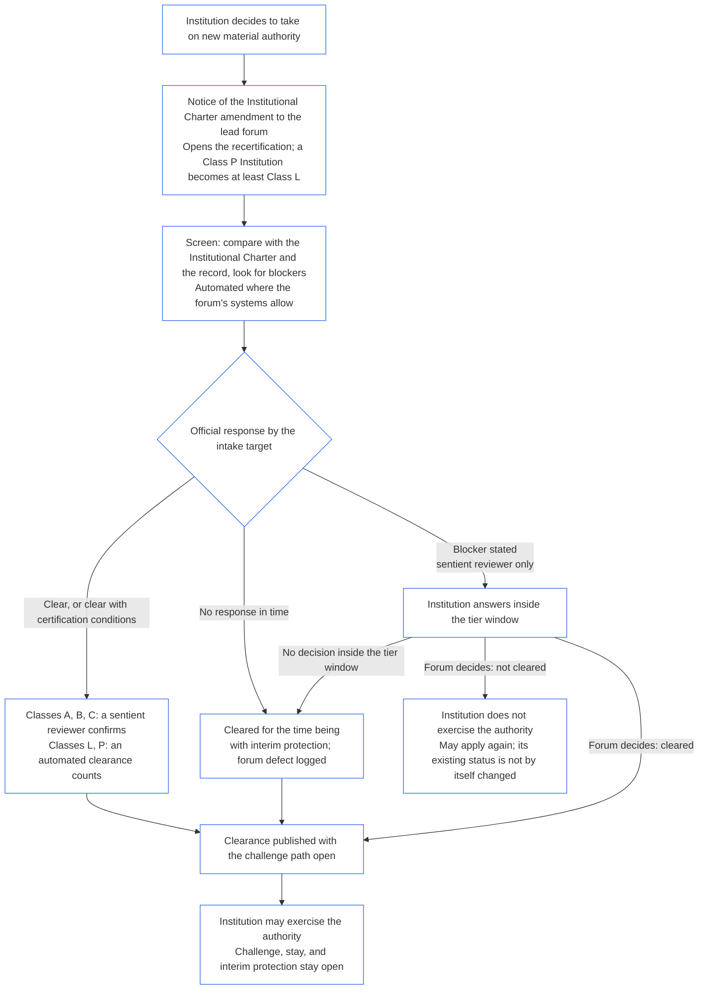

##### 9.2.1 ما الذي يعد سلطة مادية جديدة

تكون السلطة **سلطة مادية جديدة** إذا تحقق الأمران التاليان:

- **جوهرية:** هي سلطة لاتخاذ قرار أو توجيه أو تخصيص أو تقييد أو السيطرة على أمر يتعلق بالآخرين، وتكون جوهرية لهم بموجب [الجوهرية الخاصة بالمجال](core_05.050_band_oversight.md#domain-specific-materiality).
- **غير مشمولة:** لا يغطيها ميثاق المؤسسة المؤسسي ولا سجل اعتمادها المؤسسي الحالي.

وتشمل:

- وظيفة جديدة أو نوعاً جديداً من القرارات بشأن الآخرين؛
- مجموعة جديدة من الكائنات الواعية التي تحكمها المؤسسة أو تؤثر فيها؛
- مجالاً أو مورداً أو نظاماً مشتركاً جديداً تسيطر عليه المؤسسة؛
- امتداداً لا يكون جوهرياً إلا عند احتسابه مع أطراف تشغيل تحت سيطرة مشتركة أو مع جهات أخرى على النظام المشترك نفسه ([قيد نزاهة الجوهرية](core_05.050_band_oversight.md#materiality-integrity-constraint)؛ [الجوهرية النظامية](core_05.040_band_continuity.md#systemic-materiality))؛ و
- تجربة أو مشروعاً تجريبياً لأي مما سبق يكون هو نفسه جوهرياً، ويُحكم عليه بموجب [الجوهرية الخاصة بالمجال](core_05.050_band_oversight.md#domain-specific-materiality) استناداً إلى نطاقه الفعلي وفئته السكانية ومدته. وتمارس هذه التجربة السلطة، ولذلك تنتظر إعادة الاعتماد مثل السلطة الكاملة، إذ يعامل [الفصل التاسع الجزء أ §2.3 اعتماد التجارب](core_09.000_system_alignment_certification_evaluation.md#23-pilot-certification) تجربة النظام على أنها بدء تشغيل. وتتناسب إعادة الاعتماد مع النطاق الفعلي للتجربة وفئتها السكانية ومدتها. أما التجربة غير الجوهرية وفق هذه الشروط فلا تعد سلطة مادية جديدة.

ولا تشمل:

- **سلطة محددة عند التكوين:** السلطة التي تحددها المؤسسة في أول ميثاق مؤسسي لها، إذ لا توجد بوابة للتكوين ([§1.2 لا إذن ولا بوابة للتكوين أو التشغيل](#12-no-permission-and-no-gate-on-forming-or-running))؛
- **مزيداً مما هو مشمول:** النمو ضمن نطاق سبق أن قيّمه السجل، وهو ما تتناوله محفزات نمو الاعتماد والتغير الجوهري المذكورة أعلاه؛ و
- **نظاماً جديداً:** يبدأ النظام الجديد التشغيل وفق اعتماده الخاص ([الفصل التاسع الجزء ب §7.1 بوابة بدء التشغيل](core_09.005_system_alignment_certification_record_process.md#71-go-live-gate)). وإذا منح النظام المؤسسة أيضاً سلطة لا يغطيها سجلها، فتكون تلك السلطة مادية جديدة.

ولا يلتف تجزئة السلطة أو تنفيذها على مراحل بحيث لا يكون أي جزء جديداً أو جوهرياً على شرط الانتظار ([الفصل التاسع الجزء ج §9.4 عدم التحايل](core_09.010_system_alignment_certification_record_recertification.md#94-non-evasion)). وإذا لم يتضح ما إذا كانت السلطة مادية جديدة، تقدم المؤسسة إخطاراً ويقرر المنتدى القائد.

##### 9.2.2 إعادة الاعتماد للسلطة المادية الجديدة

يجب إعادة اعتماد المؤسسة التي تقرر تولي سلطة مادية جديدة، وعليها انتظار النتيجة قبل ممارسة تلك السلطة. وهذا هو الانتظار الذي تقرره **المادة XI-E** (*التكوين المؤسسي وإنشاء الأعمال*). ويجري على النحو الآتي:

- **الإخطار أولاً:** تقدم المؤسسة إخطار تعديل الميثاق المؤسسي الذي يوجبه أصلاً [الفصل السابع §7.1 تغيير الوثيقة](core_07.000_charters.md#71-changing-the-document)، وترسله إلى المنتدى القائد. ويفتح الإخطار إعادة الاعتماد.
- **لا يوجد سجل بعد:** تقدم المؤسسة التي ليس لها سجل اعتماد مؤسسي الإخطار نفسه. ويفتح الإخطار اعتماداً أولياً يقتصر على السلطة الجديدة، ويُحكم عليها في ضوء الميثاق المؤسسي والتقييمات من [§3 تقييم اعتماد المؤسسة بأكملها](#3-whole-institution-certification-evaluation) إلى [§5 تقييمات أرضية الحقوق والمجالات](#5-rights-floor-and-domain-evaluations) بقدر انطباقها على تلك السلطة. وتستمر بقية إجراءات الاعتماد الأول ضمن المهلة الواردة في [§1.3 مهلة الاعتماد الأول](#13-window-for-the-first-certification) (وبالنسبة لمؤسسة من الفئة P يعاد تصنيفها بسبب الإخطار، تبدأ المهلة من الإخطار)، ولا يتوقف الانتظار المتعلق بالسلطة الجديدة على تلك الإجراءات.
- **ضمن نوافذ الفئات:** تجري إعادة الاعتماد ضمن نوافذ الفئات الواردة في [الفصل التاسع الجزء ج §9.3.4 نوافذ الفئات](core_09.010_system_alignment_certification_record_recertification.md#934-tier-windows)، مع افتراض مطابقة الفئة لفئة المؤسسة. ويعالج تجاوز المهلة بموجب [المادة XXVI-C](core_06.020_rights_part_e.md#article-xxvi-c-timely-resolution-and-anti-delay-floor) (*أرضية التسوية في الوقت المناسب ومناهضة التأخير*)، ولا يجوز أن تصبح الرسوم والانتظار عائقاً ([العبء الممكن تجنبه](core_05.040_band_continuity.md#avoidable-burden)).
- **الأتمتة حيثما أمكن:** تؤتمت عملية الإخطار ومقارنة السلطة الجديدة بالميثاق المؤسسي والسجل الحالي وفحص العوائق والتصفية كلما سمحت أنظمة المنتدى. ويجعل [الفصل الأول §13.3 تقليل العبء الممكن تجنبه](core_01.005_interaction_interpretation.md#133-minimization-of-avoidable-burden) الأتمتة العلاج المفضل لعبء يمكن تجنبه، ويحمل [الفصل الأول §16.4 التوثيق عند الفعل](core_01.010_stewardship_capacity_principles.md#164-document-at-action) النظام عبء الأتمتة لا الأمين.
  - **تصفية لا رفض:** يجوز للفحص المؤتمت تصفية السلطة الجديدة، إما دون شروط أو بشروط الاعتماد التي يسندها السجل الحالي. ولا يجوز له وحده إثبات عائق (من العوائق الواردة في [§9.2.3 العوائق أمام تصفية السلطة المادية الجديدة](#923-blockers-to-clearing-new-material-authority)) أو رفض التصفية. ويجوز للفحص الإشارة إلى عائق محتمل، لكن لا يثبته إلا مراجع واعٍ في المنتدى القائد بعد فحص ما أشار إليه الفحص.
  - **الفئات A وB وC:** يؤكد مراجع واعٍ في المنتدى القائد كل تصفية قبل أن تصبح الرد الرسمي. وينطبق ذلك على مؤسسة من إحدى هذه الفئات، وكذلك على مؤسسة تجعلها السلطة الجديدة ضمن إحداها. ويظل هدف الاستقبال منطبقاً على التأكيد. ويكون المراجع في المنتدى القائد الذي يشغل بالفعل مقعد التحقق أو الإذن ويلزم أن يكون مستقلاً عن المؤسسة ([§6.1 المقاعد الأربعة في اعتماد مؤسسي](#61-four-seats-in-an-institutional-certification)).
  - **الفئتان L وP:** تعد التصفية المؤتمتة الرد الرسمي دون تأكيد. ويعاد تصنيف مؤسسة الفئة P إلى الفئة L على الأقل عند تقديم الإخطار ([§1.1 من الذي يُعتمد](#11-who-is-certified))، لذلك تسري عليها قاعدة الفئة L.
  - **الظروف الاستثنائية:** يتولى مراجع واعٍ المسألة بدلاً من ذلك، في أي فئة، إذا أشار الفحص إلى عائق محتمل، أو تعذر عليه تحديد ما إذا كانت السلطة مشمولة أو جوهرية، أو طلبت المؤسسة أو كائن واعٍ متأثر مراجعة. ويُجاب عن طلب المراجعة ضمن [هدف الاستقبال المطابق](core_05.040_band_continuity.md#tier-window)، محسوباً من الطلب. ولا يمدد ذلك نافذة الفئة.
  - **السجل نفسه والمواعيد نفسها:** يبين السجل الفحوص التي أجريت، ولذلك يجوز الطعن في التصفية المؤتمتة مثل أي قرار آخر. ولا تمدد الأتمتة هدف الاستقبال أو نافذة الفئة، ويعد تعطل الفحص أو عدم رده إخفاقاً في الرد بموجب البند أدناه. ويكون المنتدى مسؤولاً عن الفحص كما يكون مسؤولاً عن أي نظام يستخدمه ([§6.3 المنتديات وجهات الاعتماد ومكاتب السجلات بوصفها مؤسسات](#63-forums-certifiers-and-record-offices-as-institutions)).
- **الانتظار:** لا تمارس المؤسسة السلطة الجديدة حتى تصفيها إعادة الاعتماد.
  - **تنتظر كل الفئات:** لا تستثنى أي فئة، ولا ترفع حالة الطوارئ أو الاستعجال الانتظار.
  - **يستمر كل ما عدا ذلك:** تواصل المؤسسة أنشطتها القائمة ([§1.2 لا إذن ولا بوابة للتكوين أو التشغيل](#12-no-permission-and-no-gate-on-forming-or-running)).
  - **الحماية لا تنتظر:** لا تنتظر حماية المنتديات العاجلة للكائنات الواعية المتأثرة إتمام إعادة الاعتماد ([الفصل التاسع الجزء ب §6.2 التسلسل الإشرافي](core_09.005_system_alignment_certification_record_process.md#62-supervisory-sequence)). وهي تحمي الكائنات الواعية ولا تشكل سبباً يجيز للمؤسسة ممارسة السلطة مبكراً.
- **النشر عند التصفية:** ينشر المنتدى القائد كل تصفية فور إصدارها، بما فيها التصفية المؤقتة، مع فتح مسار الطعن الوارد في [§10 الطعن في الاعتماد](#10-challenging-a-certification). ويجوز للمؤسسة ممارسة السلطة من وقت التصفية. ولا تنتظر مهلة إخطار أو البت في الطعن. ويجوز للكائن الواعي المتأثر الطعن في التصفية كأي قرار آخر وطلب وقف أو حماية مؤقتة، ولا ينتظر ذلك ([§9.2.2 إعادة الاعتماد للسلطة المادية الجديدة](#922-recertification-for-new-material-authority)، *الحماية لا تنتظر*). وعند النشر، يخطر المنتدى القائد أيضاً الكائنات الواعية المتأثرة التي يعلم بها ومنتديات الأنظمة المعنية بالتصفية. ويجاب عن طلب الوقف أو الحماية المؤقتة ضمن هدف الاستقبال المطابق ([CF-14.445 §3.1 الأهداف المرحلية والحدود القصوى](corpus_forum/cf_14.445_performance_backlog_publication_accessibility.md#cf-14445-31-stage-targets-and-outer-bounds))، أو ضمن الحد المقرر لوضع الطوارئ إذا انطبق.
- **افتراض التصفية:** يفترض أن السلطة قد صُفيت. ولا يرفض المنتدى القائد تصفيتها إلا إذا أثبت، بأدلة مسجلة، وجود عائق وارد في [§9.2.3 العوائق أمام تصفية السلطة المادية الجديدة](#923-blockers-to-clearing-new-material-authority). وإذا أمكن احتواء العائق بشروط اعتماد مرتبطة به، تصفى السلطة مع تلك الشروط ولا ترفض.
- **معنى التصفية:** تنتهي إعادة الاعتماد باعتماد مؤقت أو كامل، مع شروط اعتماد أو بدونها، ويكون قد تم التحقق المستقل من كل شرط اعتماد واجب قبل ممارسة السلطة.
- **إذا لم يرد المنتدى في الوقت المحدد:** يلتزم المنتدى القائد بإصدار رد رسمي بحلول هدف الاستقبال المطابق ([CF-14.445 §3.1 الأهداف المرحلية والحدود القصوى](corpus_forum/cf_14.445_performance_backlog_publication_accessibility.md#cf-14445-31-stage-targets-and-outer-bounds)). ويصفي الرد السلطة، أو يصفيها بشروط اعتماد، أو يثبت عائقاً مع أدلته. ويتيح الرد الذي يثبت عائقاً للمؤسسة فرصة للجواب، ويبت المنتدى ضمن نافذة الفئة المذكورة أعلاه.
  - **تصفية مؤقتة:** إذا لم يصدر رد رسمي بحلول هدف الاستقبال، أو لم يُبت في عائق مثبت خلال نافذة الفئة، تصفى السلطة مؤقتاً مع الحماية المؤقتة وحدود الاعتماد المنصوص عليها في [الفصل التاسع الجزء ب §7.2 عيوب الاعتماد وتصحيحها](core_09.005_system_alignment_certification_record_process.md#72-certification-defects-and-correction).
  - **خلل في المنتدى:** يعد تجاوز الهدف أو النافذة خللاً في المنتدى لا خطأً من المؤسسة. ويسجل ويصحح ويراجع كتجاوز بموجب [الفصل الرابع عشر §6 التسوية في الوقت المناسب ودرجات الجوهرية والانضباط المضاد للتأخير](core_14.000_forum.md#6-timely-resolution-materiality-tiers-and-anti-delay-discipline) (*مراجعة التجاوز*).
  - **إحالة إلى منتدى آخر:** ينقل طلب إعادة الاعتماد إلى منتدى آخر من العائلة نفسها ([الفصل الرابع عشر §3 النقل والدمج والتنسيق](core_14.000_forum.md#3-transfer-consolidation-and-coordination--continuity-and-anti-capture)). ويتولى ذلك المنتدى إعادة الاعتماد ضمن المهل المعتادة لفئة المؤسسة، محسوبة من تاريخ النقل.
- **إذا لم تُصفَّ السلطة:** لا تمارس المؤسسة السلطة، ويجوز لها إعادة التقدم وفق شروط الفصل التاسع الجزء ب §7.4 (*ليس حظراً دائماً*). ولا يشكل عدم تصفية السلطة الجديدة وحده رفضاً أو إلغاءً لحالة الاعتماد التي تحملها المؤسسة فيما تفعله حالياً. ولا تتغير تلك الحالة إلا باستنتاج بموجب [§7.3 جاهزية المؤسسة للمعالجة](#73-remediation-readiness-for-an-institution) و[§7.4 الرفض والإلغاء للمؤسسة](#74-denial-and-revocation-for-an-institution).
- **دون إخطار أو قبل التصفية:** ممارسة سلطة مادية جديدة دون إخطار أو قبل تصفيتها تعد ممارسة خارج الميثاق المؤسسي. وتشكل استنتاجاً بموجب [§3 تقييم اعتماد المؤسسة بأكملها](#3-whole-institution-certification-evaluation) (البند 1)، وتعيد فتح المراجعة بوصفها حدثاً في الميثاق المؤسسي.

<strong>دليل القارئ (غير تشغيلي): الانتظار قبل ممارسة سلطة مادية جديدة</strong>

يلخص هذا الشكل §9.2.2 إعادة الاعتماد للسلطة المادية الجديدة. وعند اختلافه عن النص، تكون الأولوية للنص. وتستمر جميع أنشطة المؤسسة القائمة طوال الوقت، ولا تنتظر الحماية العاجلة للكائنات الواعية المتأثرة أبداً. وترد أمثلة تطبيقية للمؤسسات في [CS-9.320 §12 أمثلة إيضاحية للمؤسسات](corpus_systems/cs_09.320_system_alignment_certification_illustrations.md#cs-9320-12-illustrative-institution-walkthroughs).

 

##### 9.2.3 العوائق أمام تصفية السلطة المادية الجديدة

لا يجوز للمنتدى القائد رفض تصفية السلطة المادية الجديدة إلا بسبب أحد العوائق التالية. والعائق 2 مسألة وقائع واضحة في معظمها، تُستخلص من خريطة أدوار الميثاق وسلسلة السلطة، ويمكن لفحص مؤتمت تنفيذها ([§9.2.2 إعادة الاعتماد للسلطة المادية الجديدة](#922-recertification-for-new-material-authority)). أما العوائق 1 و3 و4 و5 فتتطلب حكماً؛ لذا يمكن للفحص الإشارة إليها ولا يثبتها إلا مراجع واعٍ. ويجب إثبات كل عائق بأدلة تتعلق بالسلطة الجديدة أو بجاهزية المؤسسة لتوليها، ويبين المنتدى في السجل ما الذي يزيله:

1. **سلطة غير متوائمة:** تنتهك السلطة الجديدة [قيداً دستورياً](core_05.045_band_integrative.md#constitutional-constraint) أو حماية من أرضية الحقوق، أو تكشف التقييمات في [§3 تقييم اعتماد المؤسسة بأكملها](#3-whole-institution-certification-evaluation) إلى [§5 تقييمات أرضية الحقوق والمجالات](#5-rights-floor-and-domain-evaluations) عيب اعتماد فيها، ولا يمكن لأي شرط اعتماد احتواء المشكلة.
2. **انعدام المساءلة عنها:** لا يمكن تسمية مكتب مسؤول عن السلطة الجديدة، أو لا يوجد مسار مستقل يصل إليها، وفق ما يوجبه [§3 تقييم اعتماد المؤسسة بأكملها](#3-whole-institution-certification-evaluation) (البندان 3 و5).
3. **عدم مواءمة لم تُحل وانعدام الجاهزية لمعالجتها:** توجد حالياً حالة عدم مواءمة للمؤسسة تؤثر في السلطة الجديدة ولم تُحل، ويخلص فحص الجاهزية بموجب [§7.3 جاهزية المؤسسة للمعالجة](#73-remediation-readiness-for-an-institution) إلى أن المؤسسة غير راغبة أو غير قادرة على تصحيحها ضمن نوافذ الفئات.
4. **الإخفاء:** الإخطار أو ما تقدمه المؤسسة كاذب أو ملفق أو محجوب جوهرياً.
5. **تركيز السلطة:** تؤدي السلطة الجديدة إلى تركيز السلطة خلافاً لـ[الفصل الأول §11 بنية السوق](core_01.000_values_principles.md#11-market-structure).

وليست مما يعد عائقاً:

- حجم المؤسسة أو عمرها أو ثروتها أو عدم وجود سجل سابق لها؛
- المنافسة مع مؤسسات أخرى أو حماية مؤسسة قائمة؛
- تكلفة إعادة الاعتماد أو عبء العمل الملقى على المنتدى؛ أو
- خلاف حسن النية مع استنتاج، سلك مساره المنشور ([الفصل التاسع الجزء ب §7.3.1 الرغبة](core_09.005_system_alignment_certification_record_process.md#731-willingness)).

**تظل حالات التعليق والأقفال سارية.** تنطبق البوابات الثلاثة الضيقة في **المادة XI-E** (*التكوين المؤسسي وإنشاء الأعمال*) وفق شروطها. ويمنع [التعليق المؤقت](core_05.035_band_accountability.md#interim-hold) أو قفل الصفة على كائن واعٍ محدد ذلك الكائن، ضمن مساره المحدد، من تولي السلطة الجديدة أو ممارستها. ويقيد ذلك الكائن الواعي لا المؤسسة، ولا يشكل عائقاً أمام المؤسسة؛ لذلك يمكن تصفية السلطة لشاغل آخر.

قبل أن يقرر المنتدى عدم التصفية، يُبلّغ المؤسسة بالعائق وأدلته وتتاح لها فرصة للرد ضمن نافذة الفئة. ويثبت القرار أسبابه في السجل ([الفصل التاسع الجزء ج §8.1 الحد الأدنى لمحتويات السجل](core_09.010_system_alignment_certification_record_recertification.md#81-minimum-record-contents)).

