# অধ্যায় নয়, অংশ A: সিস্টেমের সাংবিধানিক সামঞ্জস্যের প্রত্যয়ন — মূল্যায়ন

<strong>কর্পাসে অবস্থান (অপারেটিভ নয়): ফাইলের গঠন ও পাঠের নিয়ম</strong>

> এই ফাইলটি সংবেদনশীল সত্তাদের সংবিধানের অংশ এবং অন্য নম্বরযুক্ত `core_*` ফাইলগুলোর সঙ্গে এক পাঠ্য হিসেবে পড়লেই কেবল বাধ্যতামূলক। এতে রয়েছে **অধ্যায় নয়, অংশ A** — প্রত্যয়নের উদ্দেশ্য, প্রক্রিয়ার সারসংক্ষেপ এবং প্রক্রিয়ার প্রথম দুই ধাপ — **Frame** (সিস্টেম শ্রেণি) ও **Evaluate** (তিনটি উপধাপে সমগ্র-সিস্টেম মূল্যায়ন: সর্বদা প্রযোজ্য মূল্যায়ন, যার মধ্যে §3-এ তথ্যের ধরন ও ব্যবস্থাপনা রয়েছে; §4-এ প্রাসঙ্গিক হলে প্রযোজ্য মূল্যায়ন; এবং §5-এ শর্ত পূরণ হলে প্রযোজ্য Rights-Floor ও ক্ষেত্রভিত্তিক মূল্যায়ন) — **§1–§5**। **Class A / B / C-এর উদাহরণসমূহ** (সিস্টেম শ্রেণির প্রোফাইল এবং §3.4, §5.1, §5.2, §5.3, §5.4, §5.5 ও §5.6-এর প্রয়োগ-ধাপে-ধাপে উদাহরণ), প্রতিটির **Reading across system classes** অনুচ্ছেদসহ, সিস্টেম পরিবারভুক্ত [CS-9.320](corpus_systems/cs_09.320_system_alignment_certification_illustrations.md#cs-9320-system-alignment-certification-illustrations) (*System alignment certification illustrations*)-এ রয়েছে, এই অধ্যায়ে নয়; প্রতিটিতে Part A-এর যে বিভাগটি ব্যাখ্যা করা হয়েছে তা উল্লেখ করা আছে। ওই অনুচ্ছেদগুলো যে বাধ্যতামূলক সিস্টেম-শ্রেণি-অনুযায়ী পরিমাপ ও উচ্চতর শ্রেণিতে উত্তরণের নিয়ম ব্যাখ্যা করে, সেগুলো এই ফাইলেই রয়েছে: §2.2-এ অংশগ্রহণ ও সমানুপাতিকতাসহ সিস্টেম শ্রেণির মাপে মূল্যায়ন; §3.4-এ তথ্য ব্যবস্থাপনার মাপ; এবং §5.1–§5.6-এর প্রত্যেকটির **System class scaling and escalation** অনুচ্ছেদ। পুরো অধ্যায়ের ফাইলগুলো নিচের সারণিতে দেওয়া হয়েছে।
>
> **অধ্যায় নয়ের ফাইলসমূহ।** অধ্যায় নয় তিনটি বাধ্যতামূলক ফাইলে বিভক্ত; একসঙ্গে পড়তে হবে। Part A, এই ফাইলটি, অধ্যায়টি শুরু করে; আলাদা সূচি ফাইল নেই। উদাহরণগুলো অধ্যায়ের অংশ নয়; সেগুলো [CS-9.320](corpus_systems/cs_09.320_system_alignment_certification_illustrations.md#cs-9320-system-alignment-certification-illustrations) (*System alignment certification illustrations*)-এ রয়েছে।
>
> | অংশ | ফাইল | বিষয়বস্তুর দায়িত্ব |
> |------|------|------|
> | **Part A — মূল্যায়ন** | [`core_09.000_system_alignment_certification_evaluation.md`](core_09.000_system_alignment_certification_evaluation.md) | §1–§5: উদ্দেশ্য ও প্রক্রিয়ার সারসংক্ষেপ (ছয় ধাপের পুরো প্রত্যয়ন-প্রক্রিয়ার চিত্রসহ), **Phase I Frame** (সিস্টেম শ্রেণি, কীভাবে সিস্টেম শ্রেণি প্রতিটি মূল্যায়নের মাত্রা নির্ধারণ করে, এবং পাইলট প্রত্যয়ন) ও **Phase II Evaluate** (তিন উপধাপে সমগ্র-সিস্টেম মূল্যায়ন: §3-এ **IIa** সর্বদা প্রযোজ্য, যার মধ্যে চার্টার-নির্ধারিত পরিধি বনাম কার্যকরী সীমানা এবং তথ্যের ধরন ও ব্যবস্থাপনা; §4-এ **IIb** প্রাসঙ্গিক হলে; §5-এ **IIc** শর্ত পূরণ হলে Rights-Floor ও ক্ষেত্রভিত্তিক মূল্যায়ন) |
> | **Part B — ফোরাম প্রক্রিয়া ও ফলাফল** | [`core_09.005_system_alignment_certification_record_process.md`](core_09.005_system_alignment_certification_record_process.md) | §6–§7: **Phase III Review** (ফোরামের ভূমিকা, তত্ত্বাবধানের ক্রম এবং আপত্তি জানানোর ধাপসমূহ) ও **Phase IV Decide** (প্রত্যয়নের ফলাফল, কার্যক্রম শুরুর অনুমতিসহ) — Part A §5 থেকে ধারাবাহিক অধ্যায়-নম্বর |
> | **Part C — নথি, পুনঃপ্রত্যয়ন ও অবস্থান** | [`core_09.010_system_alignment_certification_record_recertification.md`](core_09.010_system_alignment_certification_record_recertification.md) | §8–§11: **Phase V Record** (System Certification Record ও এর অখণ্ডতা, প্রযোজ্য [System Charter](core_05.040_band_continuity.md#system-charter) ক্ষেত্রসহ) এবং **Phase VI Operate** (পুনঃপ্রত্যয়ন ও পুনরায় খোলা; চ্যালেঞ্জের পথ; অবস্থানের সংযোগ) — Part B §7 থেকে ধারাবাহিক অধ্যায়-নম্বর |
>
> **দুই প্রত্যয়নের সম্পর্ক।** System Alignment Certification (এই অধ্যায়) হলো একটি System-এর প্রত্যয়ন। প্রাতিষ্ঠানিক সামঞ্জস্যের প্রত্যয়ন ([Chapter Ten](core_10.000_institutional_alignment_certification.md#chapter-ten-institutional-alignment-certification)) হলো একটি Institution-এর প্রত্যয়ন, যা এক বা একাধিক System চালাতে পারে, অথবা কোনো System নাও চালাতে পারে। Chapter Ten প্রতিটি System-এর System Certification Record-এর লিংক উল্লেখ করে, পুনরায় সেই প্রত্যয়ন করে না; [Chapter Ten §1](core_10.000_institutional_alignment_certification.md#1-purpose-and-role) সম্পর্কটি ব্যাখ্যা করে এবং [Chapter Ten §1.2](core_10.000_institutional_alignment_certification.md#12-no-permission-and-no-gate-on-forming-or-running) বলে যে এটি কোনো লাইসেন্স নয়। দুই অধ্যায়ের সমনামা বিভাগগুলোর নম্বর একই।
>
> অন্য ফাইলের সাধারণ **Chapter Nine** লিংকগুলো বিভাগ-নম্বর অনুযায়ী সঠিক অংশে নিয়ে যায়।
>
> - **সাংবিধানিক বিষয়-দায়িত্ব (Part B ও C-এর সঙ্গে যৌথ):** ফোরামের তত্ত্বাবধানে **সিস্টেমের সাংবিধানিক সামঞ্জস্যের প্রত্যয়ন ও সংশ্লিষ্ট নথি** — মূল্যায়নের ক্ষেত্র (Part A); ফোরাম প্রক্রিয়া, তত্ত্বাবধানের ধারা, এবং কার্যক্রম শুরুর শর্তসহ প্রত্যয়নের ফলাফল (Part B); System Certification Record-এর দায়িত্ব, চ্যালেঞ্জের পথ, পুনঃপ্রত্যয়ন ও পুনরায় খোলা, এবং Chapter Eleven-এ যাচাইকৃত-ইনপুট সংযোগ (সবই Part C)। **oversight** Tetrad অঙ্গের অধীনে SAC হলো অনেক নিরীক্ষা প্রক্রিয়ার মধ্যে একটি বিশেষভাবে বড় ও উচ্চ-ঝুঁকির প্রক্রিয়া; নিরীক্ষার ন্যূনতম মান রয়েছে **Article XVI** (*Audit, Transparency, and Independent Verification*) এবং Chapter Five-এর [Auditability](core_05.050_band_oversight.md#auditability)-তে।
> - **যাচাইয়ের ভিত্তির দায়িত্ব:** [Chapter Four — Burden of Proof, Traceability, and Verification](core_04.000_burden_traceability_verification.md#chapter-four-burden-of-proof-traceability-and-verification) (Chapters Two through Four-এর অংশ) প্রমাণের ভার বণ্টন, নিয়ম-মানার প্রমাণ, সংজ্ঞার অনুসরণযোগ্যতা, পর্যবেক্ষণযোগ্যতা এবং নিরাপত্তা-সীমাবদ্ধ যাচাইয়ের দায়িত্বে রয়েছে। Chapter Nine সেই শৃঙ্খলা System Certification Record-এ **প্রয়োগ** করে; Chapter Four-এর §1–§5 পুনরায় বলে না।
> - **নিরীক্ষার মূল অবস্থান (এখানে স্থানান্তরিত নয়):** **Article XVI** (*Audit, Transparency, and Independent Verification*), **Def.O1** (*Transparency, Auditability, and Verification*), এবং **CJS-5.110 §3 ও CJS-5.115 §3** (*Audit process home*) থেকে **CJS-5.110 §5** নিরীক্ষার ন্যূনতম মান ও কার্যকরী পরিভাষার দায়িত্বে রয়েছে। Chapter Nine একটি বিশেষভাবে বড় SAC নিরীক্ষা প্রক্রিয়া চালায়, যা ওই মানগুলো পূরণ করবে; সব নিরীক্ষার দায়িত্ব তার নয়।
> - **বাস্তবায়নের দায়িত্ব:** সিস্টেম-শ্রেণিভিত্তিক ব্যবস্থাপনা, CS-6.345 (*System lifecycle*), এবং নির্ধারিত বাস্তবায়ন ফাইলে ফোরাম-প্রক্রিয়ার বিবরণ Chapter Nine-এর সঙ্গে সামঞ্জস্যপূর্ণ থাকবে এবং কর্পাসে আগে থেকেই থাকা [Fullest Protective Effect](core_05.045_band_integrative.md#fullest-protective-effect) নিয়ম অনুযায়ী আরও কঠোর হতে পারে।
> - **স্থানান্তর-নিষেধ নিয়ম:** Part A Chapter Five-এর প্রামাণ্য সংজ্ঞা, Chapter Three-এর ফাঁকি-রোধী শৃঙ্খলা (দেখুন [Part C §9.4](core_09.010_system_alignment_certification_record_recertification.md#94-non-evasion)), Chapter Eleven-এর অবদান বা অবস্থান-পরিমাপ, কিংবা Chapter Twelve-এর অবস্থান-প্রভাব পুনরায় বলে না। **[Part C §11](core_09.010_system_alignment_certification_record_recertification.md#11-relationship-to-standing)** অবস্থানের সংযোগটি নির্ধারণ করে।
>
> **পূর্ববর্তী ভিত্তি:** Chapter Five-এর সংজ্ঞা; Chapters Two–Four-এর নথি, যাচাই, প্রমাণের ভার, এবং ফলাফলের সঙ্গে সংজ্ঞার অনুসরণযোগ্যতা; এবং [Chapter Eight](core_08.000_functional_independence_separation_of_duties.md#chapter-eight-functional-independence-and-separation-of-duties), যার দায়িত্ব-বিভাজনের শর্ত প্রতিটি বস্তুগতভাবে বাধ্যতামূলক প্রত্যয়ন-কার্যে প্রযোজ্য।
> **পরবর্তী ধাপ:** [Part B](core_09.005_system_alignment_certification_record_process.md#chapter-nine-part-b-system-alignment-certification--forum-process-and-outcomes) (*ফোরাম প্রক্রিয়া ও ফলাফল*) এবং [Part C](core_09.010_system_alignment_certification_record_recertification.md#chapter-nine-part-c-system-alignment-certification--record-recertification-and-standing) (*নথি, পুনঃপ্রত্যয়ন ও অবস্থানের সংযোগ*); Chapter Eleven-এর অবস্থান-নথি ও যাচাইকৃত ইনপুট; Chapter Twelve-এর অবস্থান-প্রভাব; Chapter Fourteen-এর ফোরাম তত্ত্বাবধান ও সিস্টেম সামঞ্জস্য-প্রত্যয়নের পথ।

 

Chapter Nine-এর **Part A** হলো **সিস্টেমের সাংবিধানিক সামঞ্জস্য-প্রত্যয়ন মূল্যায়নের** সাংবিধানিক বিষয়-দায়িত্বপ্রাপ্ত অংশ।

- ফোরাম তত্ত্বাবধান ও প্রত্যয়নের ফলাফল রয়েছে **[Part B](core_09.005_system_alignment_certification_record_process.md#chapter-nine-part-b-system-alignment-certification--forum-process-and-outcomes)**-এ।
- নথি, পুনঃপ্রত্যয়ন ও পুনরায় খোলা, এবং অবস্থানের সংযোগ রয়েছে **[Part C](core_09.010_system_alignment_certification_record_recertification.md#chapter-nine-part-c-system-alignment-certification--record-recertification-and-standing)**-এ।
- এই মূল্যায়ন-বিভাগগুলোর উদাহরণ রয়েছে [**CS-9.320 System alignment certification illustrations**](corpus_systems/cs_09.320_system_alignment_certification_illustrations.md#cs-9320-system-alignment-certification-illustrations)-এ।
- একই বিভাগ-নম্বরসহ প্রাতিষ্ঠানিক সামঞ্জস্য-প্রত্যয়ন রয়েছে **[Chapter Ten](core_10.000_institutional_alignment_certification.md#chapter-ten-institutional-alignment-certification)**-এ।

### 1. উদ্দেশ্য ও ভূমিকা

<strong>অনুসরণপথ</strong>

- **পূর্ববর্তী ভিত্তি:**
  - [Preamble — constitutional owner register](core_00.000_preamble.md#4-principles-definitions-and-rights) এবং
  - [Authority Stack and Internal Hierarchy](core_05.045_band_integrative.md#authority-stack-and-internal-hierarchy);
  - [Constitutional Tetrad](core_00.000_preamble.md#constitutional-tetrad);
  - [Two Constitutional Aims](core_00.000_preamble.md#two-constitutional-aims);
  - [material stake](core_00.000_preamble.md#material-stake);
  - [Proportionality](core_05.035_band_accountability.md#proportionality) এবং
  - [Substantive Fairness](core_05.055_band_participation.md#substantive-fairness) (Chapter Five); Participation measurement family (*voice, access, and contest paths*);
  - [Chapter One §16 Stewardship In Depth](core_01.010_stewardship_capacity_principles.md#16-stewardship-in-depth) (1.010 §16);
  - [Chapter One §12 Systemic Evaluation Requirement](core_01.000_values_principles.md#12-systemic-evaluation-requirement) (1.000 §12) (*নীতিগত স্তরে সমগ্র-সিস্টেম মূল্যায়নের দৃষ্টিভঙ্গি — কেবল একটি দিক নয়*); Chapters Two–Four;
  - [Chapter Five](core_05.000_definitions_home.md#chapter-five-foundational-definitions) (5.000) (*প্রামাণ্য সংজ্ঞা*);
  - [Chapter Eight §2 Four-Seat Constitutional Requirement](core_08.000_functional_independence_separation_of_duties.md#2-four-seat-constitutional-requirement) (8.000 §2);
  - [System Alignment Certification](core_05.040_band_continuity.md#system-alignment-certification) (Chapter Five-এর প্রামাণ্য পরিভাষা; অ-অপারেটিভ সংক্ষিপ্ত রূপ **SAC**);
  - [System Certification Record](core_05.040_band_continuity.md#system-certification-record) (Chapter Five-এর অর্থ)।
- **পরবর্তী ধাপ:**
  - [§2](#2-system-class-evaluation) (*সিস্টেম শ্রেণির মূল্যায়ন*);
  - [Part C §10](core_09.010_system_alignment_certification_record_recertification.md#10-challenging-a-certification) (9.010 §10) (*প্রত্যয়নকে চ্যালেঞ্জ করা*); এবং
  - [CS-9.320 §2](corpus_systems/cs_09.320_system_alignment_certification_illustrations.md#cs-9320-2-illustrative-system-class-profiles) (*সিস্টেম-শ্রেণির উদাহরণমূলক প্রোফাইল*);
  - [CS-9.320 §4](corpus_systems/cs_09.320_system_alignment_certification_illustrations.md#cs-9320-4-illustrative-whole-system-application-by-system-class) (*সিস্টেম শ্রেণি অনুযায়ী সমগ্র সিস্টেমে উদাহরণমূলক প্রয়োগ*);
  - [CS-9.320 §5](corpus_systems/cs_09.320_system_alignment_certification_illustrations.md#cs-9320-5-illustrative-data-handling-application-by-system-class) (*সিস্টেম শ্রেণি অনুযায়ী তথ্য ব্যবস্থাপনার উদাহরণমূলক প্রয়োগ*);
  - [CS-9.320 §6](corpus_systems/cs_09.320_system_alignment_certification_illustrations.md#cs-9320-6-illustrative-ecological-footprint-application-by-system-class) (*সিস্টেম শ্রেণি অনুযায়ী পরিবেশগত পদচিহ্নের উদাহরণমূলক প্রয়োগ*);
  - [CS-9.320 §7](corpus_systems/cs_09.320_system_alignment_certification_illustrations.md#cs-9320-7-illustrative-educational-capability-application-by-system-class) (*সিস্টেম শ্রেণি অনুযায়ী শিক্ষাগত সক্ষমতার উদাহরণমূলক প্রয়োগ*);
  - [CS-9.320 §8](corpus_systems/cs_09.320_system_alignment_certification_illustrations.md#cs-9320-8-illustrative-cross-system-support-application-by-system-class) (*সিস্টেম শ্রেণি অনুযায়ী আন্তঃসিস্টেম সহায়তার উদাহরণমূলক প্রয়োগ*);
  - [CS-9.320 §9](corpus_systems/cs_09.320_system_alignment_certification_illustrations.md#cs-9320-9-illustrative-nondiscrimination-application-by-system-class) (*সিস্টেম শ্রেণি অনুযায়ী বৈষম্যহীনতার উদাহরণমূলক প্রয়োগ*);
  - [CS-9.320 §10](corpus_systems/cs_09.320_system_alignment_certification_illustrations.md#cs-9320-10-illustrative-accessibility-application-by-system-class) (*সিস্টেম শ্রেণি অনুযায়ী প্রবেশগম্যতার উদাহরণমূলক প্রয়োগ*);
  - [CS-9.320 §11](corpus_systems/cs_09.320_system_alignment_certification_illustrations.md#cs-9320-11-illustrative-trustworthiness-application-by-system-class) (*সিস্টেম শ্রেণি অনুযায়ী নির্ভরযোগ্যতার উদাহরণমূলক প্রয়োগ*);
  - [§3](#3-whole-system-certification-evaluation) (*সমগ্র-সিস্টেম প্রত্যয়ন মূল্যায়নের উপাদান*);
  - [§3.4](#34-data-types-and-handling-evaluation) থেকে
  - [§5.6](#56-trustworthiness-and-system-reliance-integrity-evaluation) (*ক্ষেত্রভিত্তিক মূল্যায়ন*);
  - [Part B §6](core_09.005_system_alignment_certification_record_process.md#6-forum-process) (9.005 §6) (*তত্ত্বাবধানের ক্রম ও আপত্তি-জানানোর ধারা*);
  - [Part B §6.1](core_09.005_system_alignment_certification_record_process.md#61-forum-supervision-and-component-roles) (9.005 §6.1) (*ফোরামের উপাদানগুলোর ভূমিকা*);
  - [Part C §8](core_09.010_system_alignment_certification_record_recertification.md#8-system-certification-record) (9.010 §8) (*System Certification Record-এর বিষয়বস্তু*);
  - [Part C §8.2](core_09.010_system_alignment_certification_record_recertification.md#82-transparency-and-auditability-of-the-record) (9.010 §8.2) (*নথির অখণ্ডতার শর্ত*);
  - [Part B §7](core_09.005_system_alignment_certification_record_process.md#7-certification-outcomes) (9.005 §7) (*প্রত্যয়নের ফলাফল*);
  - [Part C §11](core_09.010_system_alignment_certification_record_recertification.md#11-relationship-to-standing) (9.010 §11) (*অবস্থান-নথির সংযোগ*);
  - [Chapter Eleven](core_11.000_standing_assessment.md#chapter-eleven-contribution-violation-and-standing-model--measurement) (11.000) (*অবস্থান-নথি ও যাচাইকৃত-ইনপুট গেট*);
  - [Chapter Twelve](core_12.000_standing_integration.md#chapter-twelve-standing-effects-and-integration) (12.000) (*অবস্থানের প্রভাব ও সমন্বয়*);
  - [Chapter Fourteen](core_14.000_forum.md#chapter-fourteen-forums-and-jurisdiction) (14.000) (*ফোরাম তত্ত্বাবধান, প্রত্যয়ন, সামঞ্জস্য-প্রত্যয়ন ও পর্যালোচনা*)।
- **এগুলোর সঙ্গে পড়ুন:**
  - **[CS-9.305](corpus_systems/cs_09.305_system_classification_machinery.md#cs-9305-part-a-system-classification-machinery) (*System classification machinery*) এবং [CS-9.310 — System impact classifications](corpus_systems/cs_09.310_system_impact_classifications.md#cs-9310-part-b-system-impact-classifications)**, **[CS-6.305](corpus_systems/cs_06.305_information_types_and_handling.md#cs-6305-part-a-information-types-and-handling) (*Information types and handling*) এবং [CS-6.310 — Data classifications](corpus_systems/cs_06.310_data_classifications.md#cs-6310-part-b-data-classifications)**, এবং
  - **CS-6.345** (*System lifecycle*);
  - **CF-14.415** (*Routing operations, transfer, questions for ruling, and representative treatment*) এবং
  - **CF-14.425** (*Integrity safeguards, anti-capture operations, and anti-self-judging support*); **Article XVI** (*Audit, Transparency, and Independent Verification*) এবং
  - [Auditability](core_05.050_band_oversight.md#auditability) (*নিরীক্ষার ন্যূনতম মান — SAC তত্ত্বাবধানের অধীনে একটি বিশেষভাবে বড় নিরীক্ষা প্রক্রিয়া, একমাত্র নিরীক্ষার স্থান নয়*); **CJS-5.110 §3 (*Oversight: auditability and reconstructability terms (annex)*) এবং CJS-5.115 §3** (*Audit process home*) থেকে
  - **CJS-5.110 §5** (*Oversight: independent verification and claim-integrity terms*)।

 

*সহজ ভাষায়: কোনো সিস্টেম সংবেদনশীল সত্তাদের জীবনে সত্যিই গুরুত্বপূর্ণ হলে, তার প্রত্যয়ন হতে হবে **সমানুপাতিক** — এক মাপের চেকলিস্ট বা নামমাত্র অনুমোদন নয়; সিস্টেমটির প্রকৃত প্রভাব, নির্ভরতা ও ঝুঁকি যতটা দাবি করে ততটাই কঠোর। এটি হতে হবে **অংশগ্রহণমূলক** — প্রভাবিত সংবেদনশীল সত্তা ও সম্প্রদায়গুলো কী পর্যালোচনা হয়েছে তা দেখতে, সিদ্ধান্ত বুঝতে এবং ভুল হলে আপত্তি জানাতে পারবে। ফোরামগুলো প্রমাণ পর্যালোচনা করে, তা System Certification Record-এ নথিবদ্ধ করে, এবং সিস্টেমের ঝুঁকির সঙ্গে সামঞ্জস্যপূর্ণ সময়সূচিতে পুনঃপ্রত্যয়ন চায়। Class A, B ও C-তে পূর্ণ প্রক্রিয়া চলে; Class L-এ হালকা প্রক্রিয়া। Class P-এর জন্য প্রক্রিয়াটি উৎসাহিত; তবে পুনঃশ্রেণিবিন্যাসে Class L বা তার বেশি হলে (অর্থাৎ প্রভাব ব্যক্তিগত এককের বাইরে পৌঁছালে), অথবা অপারেটর সাংবিধানিক সম্মতির দাবি করলে, এটি বাধ্যতামূলক হয়।*

**System alignment certification** একটি নির্দিষ্ট পরিধি ও পর্যালোচনা-সময়সূচির জন্য এই প্রশ্নের উত্তর দেয়: প্রত্যয়ন, শর্তসাপেক্ষ প্রত্যয়ন, যাচাইকরণ, পুনঃপ্রত্যয়ন, নির্ভরতা অব্যাহত রাখা, স্থাপন, অথবা প্রত্যয়নের শর্ত বস্তুগতভাবে পূরণ বা প্রত্যাহারের পক্ষে সিস্টেমটি কি যথেষ্ট সাংবিধানিক সামঞ্জস্য দেখিয়েছে?

- প্রত্যয়ন জনপ্রিয়তার নম্বর নয়, চিরস্থায়ী অনুমোদন নয়, এবং অধিকার পর্যালোচনা এড়ানোর পথও নয়।
- এটি বর্তমান সময়ে সিস্টেমের সামঞ্জস্য সম্পর্কে যা জানা আছে তার একটি সময়সীমাবদ্ধ ও চ্যালেঞ্জযোগ্য বিবৃতি।
- Tetrad-এর **oversight** অঙ্গের অধীনে তত্ত্বাবধানের জন্য নিরীক্ষা আবশ্যক; সিস্টেমের সামঞ্জস্য-প্রত্যয়ন অনেক নিরীক্ষা প্রক্রিয়ার মধ্যে একটি বড় ও উচ্চ-ঝুঁকির প্রক্রিয়া — নিরীক্ষার একমাত্র ক্ষেত্র নয় (**Article XVI** (*Audit, Transparency, and Independent Verification*), [Auditability](core_05.050_band_oversight.md#auditability))।

প্রত্যয়ন [Constitutional Tetrad](core_00.000_preamble.md#constitutional-tetrad)-এর মাধ্যমে [Two Constitutional Aims](core_00.000_preamble.md#two-constitutional-aims) বাস্তবায়ন করে:

- **[Flourishing](core_00.000_preamble.md#flourishing)** — প্রত্যয়ন যাচাই করে যে প্রত্যয়ন বা নির্ভরতা অব্যাহত রাখার ফলে Rights Floor নীরবে ব্যর্থ হবে না বা সাংবিধানিকভাবে প্রাসঙ্গিক জীবনে ন্যায্য অংশগ্রহণে বাধা হবে না;
- **[Continuity](core_00.000_preamble.md#continuity)** — প্রত্যয়ন যাচাই করে যে সরবরাহ হবে টেকসই ও পশ্চাদমুখী নয়, এবং সুস্থ প্রাকৃতিক ব্যবস্থাকে নিঃশেষ না করে টিকিয়ে রাখবে ([Ecological Integrity](core_05.040_band_continuity.md#ecological-integrity), যার মধ্যে [Ecological Recovery Capacity](core_05.040_band_continuity.md#ecological-recovery-capacity) রয়েছে); ভাগ করা সিস্টেম সরবরাহে বাধা দিলে বা তা টিকিয়ে রাখলে সিস্টেম-শ্রেণি অনুযায়ী পুনঃপ্রত্যয়ন হবে;
- **Participation** — প্রভাবিত সংবেদনশীল সত্তা ও সম্প্রদায়গুলো তাদের জন্য গুরুত্বপূর্ণ পর্যালোচনা-পথ বুঝতে, আপত্তি জানাতে এবং তাতে অংশ নিতে পারে;
- **Oversight** — স্বাধীনভাবে যাচাই করার জন্য নথি, প্রমাণ ও অনুমান যথেষ্ট দৃশ্যমান ও নিরীক্ষাযোগ্য; প্রত্যয়ন নিজেও তত্ত্বাবধানের দায়িত্বের অধীনে একটি বড় নিরীক্ষা প্রক্রিয়া, একমাত্রটি নয়;
- **Accountability** — ত্রুটি, ভুল শ্রেণিবিন্যাস এবং Rights Floor ব্যর্থ করে এমন কার্যক্রম তথ্যের ভিত্তিতে ಪರಿಹার, প্রত্যয়নের શর্ত, প্রত্যাহার, অথবা অবস্থান-ইনপুটের পথে যায়;
- **Timeliness** — পর্যালোচনা ও আপত্তির সময়সীমা নিশ্চিত করে যে ক্ষতি ঠেকানো বা উল্টানো সম্ভব থাকা অবস্থায় প্রত্যয়ন অচল হয়ে না পড়ে।

#### 1.1 সিস্টেম শ্রেণি অনুযায়ী মাপ নির্ধারিত নিরীক্ষা-প্রক্রিয়া হিসেবে প্রত্যয়ন

তত্ত্বাবধানের ব্যবস্থা হিসেবে প্রত্যয়ন [Auditability](core_05.050_band_oversight.md#auditability) এবং **Article XVI** (*Audit, Transparency, and Independent Verification*)-এর অধীন একটি বিশেষভাবে বড় নিরীক্ষা প্রক্রিয়া:

- এটি ফোরামের তত্ত্বাবধানে চলে, একাধিক ক্ষেত্র পরীক্ষা করে, এবং একটি মর্যাদা প্রদান করে।
- এটি একই ধরনের অন্য নিরীক্ষা-পদ্ধতির ফল একত্র করতে পারে, তবে সেগুলোকে নিজের মধ্যে শোষণ বা প্রতিস্থাপন করে না। প্রত্যেকটির নিজস্ব দায়িত্বপ্রাপ্ত ক্ষেত্র রয়েছে, যা নিরীক্ষা-প্রক্রিয়ার মূল অবস্থানের [sibling audit modes map](corpus_joint_structure/cjs_05.115_audit_process.md#sibling-audit-modes-owner-map)-এ নামসহ উল্লেখিত:
  - **CS-6.305 (*Information types and handling*) এবং CS-6.310** (*Data classifications*)-এর অধীনে System Data Types Record নিরীক্ষা;
  - **CS-9.305 (*System classification machinery*) এবং CS-9.310** (*System impact classifications*)-এর অধীনে System Classification Record নিরীক্ষা;
  - **CS-15.305** (*Critical system stewardship*)-এর অধীনে steward assurance review;
  - **CS-6.345** (*System lifecycle*)-এর অধীনে চলমান নিরীক্ষার ACA;
  - **CS-6.315** (*Comprehensibility and complexity stewardship*) এবং **Article XXIII-B** (*Complexity Audit and Modularity Requirements*)-এর অধীনে জটিলতা নিরীক্ষা;
  - **CJS-5.110 §5** (*Oversight: independent verification and claim-integrity terms*)-এর অধীনে দাবির যাচাই।
- প্রত্যয়নের বাইরে, এগুলোর যেকোনো মূল্যায়ন আলাদাভাবে চালানো যায়। প্রত্যয়ন এগুলোর বিকল্প নয়।

প্রত্যয়নের গভীরতা, নথির ভার, প্রত্যয়নের মধ্যবর্তী সময়, অংশীজনের পর্যালোচনা এবং আপত্তির পথ [Proportionality](core_05.035_band_accountability.md#proportionality)-এর অধীনে [material stake](core_00.000_preamble.md#material-stake)-এর সঙ্গে সামঞ্জস্য রেখে বাড়বে বা কমবে:

- বেশি প্রভাব, বেশি নির্ভরতা ও বেশি ঝুঁকির সিস্টেমে আরও শক্ত প্রমাণ, আরও স্পষ্ট নথি এবং আরও বাস্তবসম্মত অংশগ্রহণ লাগবে — এর মধ্যে থাকবে বস্তুগতভাবে কার্যকর প্রবেশগম্যতা, অংশীজনের মতামত, এবং সিস্টেমের ওপর নির্ভরশীলদের উপযোগী চ্যালেঞ্জের পথ।
- নিচের সিস্টেম শ্রেণি ও সীমাবদ্ধ পরিধিতেও সৎ শ্রেণিবিন্যাস ও সমানুপাতিক নিশ্চয়তা লাগবে; বাহ্যিক প্রভাব থাকলে বস্তুগত বাধ্যবাধকতা থেকে অব্যাহতি মিলবে না।

[CS-9.305](corpus_systems/cs_09.305_system_classification_machinery.md#35-reclassification-requirement) (*System classification machinery*)-এর [reclassification requirement](corpus_systems/cs_09.305_system_classification_machinery.md#35-reclassification-requirement) অনুযায়ী প্রক্রিয়াটি প্রভাব-শ্রেণিভেদে প্রযোজ্য:

- **Class A, Class B এবং Class C:** এসব সিস্টেমের প্রভাব, নির্ভরতা ও ঝুঁকি সর্বোচ্চ; [§3 Whole-System Certification Evaluation](#3-whole-system-certification-evaluation), [§4 Evaluations Where Implicated](#4-evaluations-where-implicated), এবং [§5 Rights-Floor and Domain Evaluations](#5-rights-floor-and-domain-evaluations)-এর সমগ্র-সিস্টেম মূল্যায়ন, প্রতিটি নিজস্ব উপধাপ হিসেবে প্রযোজ্য হলে, পূর্ণ গভীরতায় বাধ্যতামূলক;
- **Class L:** একই মূল্যায়ন বাধ্যতামূলক, তবে সমানুপাতিকভাবে; CS-9.305 (*System classification machinery*) এবং CS-9.310 (*System impact classifications*) যেখানে অনুমতি দেয় সেখানে সাধারণ প্রত্যয়ন-সময়সীমা দীর্ঘতর এবং নথি সরলতর হতে পারে; এবং
- **Class P:** সিস্টেম বৈধভাবে Class P থাকা পর্যন্ত প্রক্রিয়াটি উৎসাহিত, এবং Class P সিস্টেম স্বেচ্ছায় এটি ব্যবহার করতে পারে। Class L বা তার বেশি শ্রেণিতে পুনঃশ্রেণিবিন্যাস হলে, অথবা অপারেটর স্বেচ্ছায় সিস্টেমের সাংবিধানিক সম্মতি ঘোষণা করলে, এটি বাধ্যতামূলক হয়।

প্রত্যয়নের সময়সীমা, এবং তার মধ্যবর্তী সময়ে যে আর্থিক, সম্পদভিত্তিক বা বিশেষ নিরীক্ষা হবে, তা [Chapter Fourteen §6 Timely resolution, materiality tiers, and anti-delay discipline](core_14.000_forum.md#review-cadence) (*Review cadence*)-এ সিস্টেম শ্রেণি অনুযায়ী নির্ধারিত। এই অধ্যায় সংখ্যাগুলো পুনরায় বলে না।

#### 1.2 প্রত্যয়নের সংক্ষিপ্ত চিত্র

*সহজ ভাষায়: সিস্টেমকে সৎভাবে শ্রেণিবদ্ধ করুন, প্রযোজ্য মূল্যায়ন চালান, ফোরামকে স্বাধীনভাবে প্রমাণ ও অংশীজনের উদ্বেগ পর্যালোচনা করতে দিন, তারপর ফলাফল নির্ধারণ করুন। ফোরাম-পর্যালোচনার জন্য খোলা একটিমাত্র নথি সম্পূর্ণ করুন এবং খোলা চ্যালেঞ্জের পথসহ প্রকাশ করুন। প্রত্যয়িত সিস্টেম কার্যক্রম শুরু করবে কেবল নোটিশের সময়সীমা ও প্রয়োজনীয় সুরক্ষা পূরণের পর। প্রকৃত ফল পর্যবেক্ষণ করুন, ঘটনা ও চ্যালেঞ্জে সাড়া দিন, এবং নির্ধারিত সময়ে বা তথ্য বদলালে আবার যাচাই করুন। ত্রুটি সংশোধন করুন এবং সংশোধনটি স্বাধীনভাবে যাচাই করান; তারপরই প্রভাবিত পরিধিতে অনুমতি দিন বা প্রত্যয়নের শর্ত প্রত্যাহার করুন। প্রতিটি পর্যালোচনা-পর্বে আগেরটির সঙ্গে যুক্ত একটি নতুন নথি খোলা হয়।*

প্রক্রিয়াটি **ছয় ধাপে** চলে: **I Frame**, **II Evaluate**, **III Review**, **IV Decide**, **V Record** এবং **VI Operate**। Phase II-তে তিনটি উপধাপ রয়েছে, প্রতিটি আলাদা বিভাগ: **IIa** (সর্বদা), **IIb** (প্রাসঙ্গিক হলে) এবং **IIc** (শর্ত পূরণ হলে)। Phase VI-তে দুটি উপধাপ রয়েছে, প্রতিটি আলাদা বিভাগ: **VIa** (পরিচালনা ও পুনঃপ্রত্যয়ন, [§9 Recertification and Reopening](core_09.010_system_alignment_certification_record_recertification.md#9-recertification-and-reopening)) এবং **VIb** (অবস্থানের সংযোগ, [§11 Relationship to Standing](core_09.010_system_alignment_certification_record_recertification.md#11-relationship-to-standing))। চিত্রে পুরো প্রত্যয়ন-প্রক্রিয়া ওই ক্রমে দেখানো হয়েছে। Part A প্রথম দুই ধাপ — কাঠামো নির্ধারণ ও মূল্যায়ন — নিয়ে। [Part B](core_09.005_system_alignment_certification_record_process.md#chapter-nine-part-b-system-alignment-certification--forum-process-and-outcomes) ও [Part C](core_09.010_system_alignment_certification_record_recertification.md#chapter-nine-part-c-system-alignment-certification--record-recertification-and-standing) শেষ চারটি ধাপ নিয়ে: ফোরাম প্রক্রিয়া এবং কার্যক্রম শুরুর শর্তসহ ফলাফল (Part B), তারপর নথি ও পরিচালনা (চ্যালেঞ্জের পথ, পুনঃপ্রত্যয়ন ও পুনরায় খোলা, এবং অবস্থানের সংযোগ) (Part C)।

প্রযোজ্য প্রতিটি মূল্যায়ন প্রত্যয়নের প্রতিটি ধাপে আবার করা হয়: প্রথম প্রত্যয়নে, [§2 System Class Evaluation](#2-system-class-evaluation)-এ নির্ধারিত সময়সূচি অনুযায়ী প্রতিটি পুনঃপ্রত্যয়নে, এবং পুনরায় খোলা বা নতুন পর্যালোচনায়। বস্তুগত তথ্য বদলালে পরবর্তী নির্ধারিত পুনঃপ্রত্যয়নের আগেই পর্যালোচনা আবার খোলা হয়; যেমন সিস্টেমের ওপর নির্ভরতা বৃদ্ধি, ভাগ করা ভিত্তি থেকে আহরণ বৃদ্ধি, ওই ভিত্তিতে সিস্টেমের অবদান উল্লেখযোগ্যভাবে কমে যাওয়া, অথবা বিশ্বাসযোগ্য চ্যালেঞ্জ। [Part C §9.2 Reopening triggers](core_09.010_system_alignment_certification_record_recertification.md#92-reopening-triggers)-এ কারণগুলো তালিকাভুক্ত।

```mermaid
flowchart TB
    T(["বস্তুগত প্রভাবসম্পন্ন সিস্টেম প্রত্যয়ন চায়,<br/>অথবা তার ওপর নির্ভরতা বাড়ে"])
    C["§2 Phase I, Frame<br/>সৎভাবে শ্রেণিবদ্ধ করুন<br/><br/>শ্রেণি নির্ধারণ করে মূল্যায়নের গভীরতা<br/>ও পুনঃপরীক্ষার সময়সূচি"]
    subgraph W["§3–§5 Phase II, Evaluate — সমগ্র-সিস্টেম মূল্যায়ন"]
        direction LR
        Al["§3.1–§3.4 IIa — সর্বদা<br/><br/>শাসন; পদ্ধতিগত ঝুঁকি: মূল্যায়ন,<br/>এবং যাদের জানা প্রয়োজন তাদের কাছে প্রকাশ;<br/>সময়সীমা; তথ্যের ধরন"]
        Im["§4 IIb — প্রাসঙ্গিক হলে<br/><br/>গোপনীয়তার ক্ষেত্র, প্রস্থান অধিকার,<br/>সমাবেশ ও ভিন্নমত"]
        Tr["§5 IIc — শর্ত পূরণ হলে<br/><br/>প্রযোজ্য Rights-Floor যাচাই<br/>এবং ছয়টি ক্ষেত্রভিত্তিক মূল্যায়ন"]
        Al ~~~ Im ~~~ Tr
    end
    F["§6 Phase III, Review<br/>প্রমাণ ও অংশীজনের উদ্বেগের<br/>স্বাধীন পর্যালোচনা<br/><br/>নির্ধারিত ফোরাম সিদ্ধান্ত জানায়;<br/>চ্যালেঞ্জের পথ খোলা থাকে"]
    Rec["§8 Phase V, Record<br/>একটি System Certification Record<br/><br/>ফোরাম-পর্যালোচনার জন্য খোলা হয়; ফলাফল,<br/>সহায়ক সিদ্ধান্ত, প্রত্যয়নের শর্ত ও পরিচালনা-পরিকল্পনাসহ সম্পূর্ণ করা হয়"]
    S[["Chapter Eleven — অবস্থান<br/>নথি<br/><br/>এই অধ্যায়ের বাইরে"]]
    O{"§7 Phase IV, Decide<br/><br/>প্রমাণ কোন ফলাফল ও মর্যাদাকে<br/>সমর্থন করে?"}
    Fc["§7, §9.3 পূর্ণ প্রত্যয়ন<br/><br/>পরপর প্রয়োজনীয় সংখ্যক ত্রুটিমুক্ত অস্থায়ী পুনঃপ্রত্যয়ন;<br/>বর্তমান বা আসন্ন সামঞ্জস্যহীনতার ইঙ্গিত নেই<br/>পূর্ণ প্রত্যয়ন-সময়সীমা; প্রত্যয়নের শর্ত প্রযোজ্য হতে পারে"]
    Pc["§7, §9.3 অস্থায়ী প্রত্যয়ন<br/><br/>প্রথম মঞ্জুরি, সামঞ্জস্যহীনতার পর পুনরুদ্ধার,<br/>অথবা অস্থায়ী মর্যাদা অব্যাহত বা নিম্নধাপে নামানো<br/>অস্থায়ী সময়সীমা, যা ছোট; প্রত্যয়নের শর্ত প্রযোজ্য হতে পারে"]
    Nc["§7 প্রত্যয়িত নয়<br/><br/>স্থগিত, প্রত্যাখ্যাত, প্রত্যাহৃত বা মেয়াদোত্তীর্ণ<br/>কার্যক্রম শুরু নয়; কারণ ও প্রয়োজনীয় সংশোধনী কাজ উল্লেখ করুন"]
    Pub["§7, §10 সম্পূর্ণ নথি প্রকাশ করুন<br/><br/>প্রকাশিত নথির চ্যালেঞ্জের পথ খুলুন;<br/>নতুন বা সম্প্রসারিত পরিধির ক্ষেত্রে কার্যক্রম শুরুর অবস্থা ও নোটিশ জানান"]
    G{"§7 কার্যক্রম শুরুর শর্ত<br/><br/>প্রত্যয়ন ও প্রযোজ্য শুরুর<br/>পূর্বশর্ত পূরণ হয়েছে?"}
    Hold["§7 কার্যক্রম শুরুর পূর্বশর্ত পূরণ করুন<br/><br/>নোটিশ সম্পূর্ণ করুন এবং কার্যক্রম শুরুর আগে<br/>আবশ্যক প্রত্যয়ন-শর্ত স্বাধীনভাবে যাচাই করুন"]
    Rm["§7, §9.3 সুরক্ষা দিন ও সংশোধন করুন<br/><br/>প্রভাবিত পরিধিতে নতুন কার্যক্রম শুরু নয়;<br/>প্রভাবিত সংবেদনশীল সত্তাদের সুরক্ষা দিন,<br/>নকশা বা পরিচালনা সংশোধন করুন,<br/>এবং স্বাধীন যাচাইয়ের জন্য প্রমাণ দিন"]
    Ch["§9–§10 Phase VIa, পরিচালনা ও পুনঃপ্রত্যয়ন<br/>পর্যবেক্ষণ করুন ও চ্যালেঞ্জের পথ খোলা রাখুন<br/><br/>প্রত্যয়িত পরিধি ও প্রত্যয়নের শর্ত মেনে পরিচালনা;<br/>ফল পর্যবেক্ষণ এবং ঘটনা ও চ্যালেঞ্জে সাড়া"]
    S2[["Chapter Eleven — অবস্থান<br/>নথি<br/><br/>এই অধ্যায়ের বাইরে"]]
    Sp["&nbsp;&nbsp;&nbsp;&nbsp;&nbsp;&nbsp;&nbsp;&nbsp;&nbsp;&nbsp;&nbsp;&nbsp;&nbsp;&nbsp;&nbsp;&nbsp;&nbsp;&nbsp;&nbsp;&nbsp;&nbsp;&nbsp;&nbsp;&nbsp;&nbsp;&nbsp;&nbsp;&nbsp;&nbsp;&nbsp;&nbsp;&nbsp;&nbsp;"]
    SpL["&nbsp;&nbsp;&nbsp;&nbsp;&nbsp;&nbsp;&nbsp;&nbsp;&nbsp;&nbsp;&nbsp;&nbsp;&nbsp;&nbsp;&nbsp;&nbsp;&nbsp;&nbsp;&nbsp;&nbsp;&nbsp;&nbsp;&nbsp;&nbsp;&nbsp;&nbsp;&nbsp;&nbsp;&nbsp;&nbsp;&nbsp;&nbsp;&nbsp;&nbsp;&nbsp;"]
    SpA["&nbsp;&nbsp;&nbsp;&nbsp;&nbsp;&nbsp;&nbsp;&nbsp;&nbsp;&nbsp;&nbsp;&nbsp;&nbsp;&nbsp;&nbsp;&nbsp;&nbsp;&nbsp;&nbsp;&nbsp;&nbsp;&nbsp;&nbsp;&nbsp;&nbsp;&nbsp;&nbsp;&nbsp;&nbsp;&nbsp;&nbsp;&nbsp;&nbsp;&nbsp;&nbsp;&nbsp;&nbsp;"]
    Re["§9 পরবর্তী পর্যালোচনা-পর্ব<br/><br/>পুনঃপ্রত্যয়ন, পুনরায় খোলা, অথবা নতুন পর্যালোচনা;<br/>প্রতিটি ধাপে আগেরটির সঙ্গে যুক্ত নতুন নথি খোলে"]
    T --> C
    A1((A)) --> C
    C --> W
    W --> F
    F --> O
    O --> Fc
    O --> Pc
    O --> Nc
    Fc --> Rec
    Pc --> Rec
    Nc --> Rec
    Rec -.->|VIb, §11 —<br/>শুধু যাচাইকৃত ইনপুট;<br/>বর্তমান প্রত্যয়ন বা প্রত্যয়নকালে<br/>উদ্ভূত তথ্য| S
    Rec --> Pub
    Rec ~~~ Sp
    Pub --> G
    G ~~~ SpL
    G -->|প্রত্যয়িত নয়| Rm
    G --->|হ্যাঁ: নথির<br/>পরিধির মধ্যে পরিচালনা| Ch
    G --->|প্রত্যয়িত,<br/>পূর্বশর্ত বাকি| Hold
    Hold --> G
    Ch -->|বস্তুগত ত্রুটি:<br/>সুরক্ষা ও সংশোধন| Rm
    Ch -->|সময়সূচি অনুযায়ী, অথবা<br/>বস্তুগত পরিবর্তন বা<br/>বিশ্বাসযোগ্য চ্যালেঞ্জে<br/>পর্যালোচনা দরকার| Re
    Ch -.->|VIb, §11 —<br/>শুধু যাচাইকৃত ইনপুট;<br/>পরিচালনার তথ্য অবদান ও<br/>লঙ্ঘন নথির তথ্য হতে পারে| S2
    Rm -->|সংশোধনের প্রমাণ<br/>পরবর্তী পর্যালোচনা-পর্বে<br/>যাচাই হয়| Re
    S2 ~~~~ SpA
    SpA ~~~ Re
    Re --> A2((A))
    style Sp fill:none,stroke:none,color:#111111
    style SpL fill:none,stroke:none,color:#111111
    style SpA fill:none,stroke:none,color:#111111
    style T fill:none,stroke:#64748b,color:#ffffff
    style C fill:none,stroke:#16a34a,color:#ffffff
    style Ch fill:none,stroke:#16a34a,color:#ffffff
    style Al fill:none,stroke:#16a34a,color:#ffffff
    style Im fill:none,stroke:#16a34a,color:#ffffff
    style Tr fill:none,stroke:#16a34a,color:#ffffff
    style F fill:none,stroke:#ea580c,color:#ffffff
    style Rec fill:none,stroke:#2563eb,color:#ffffff
    style S fill:none,stroke:#db2777,color:#ffffff
    style S2 fill:none,stroke:#db2777,color:#ffffff
    style O fill:none,stroke:#ea580c,color:#ffffff
    style Fc fill:none,stroke:#9333ea,color:#ffffff
    style Pc fill:none,stroke:#9333ea,color:#ffffff
    style Nc fill:none,stroke:#9333ea,color:#ffffff
    style G fill:none,stroke:#ea580c,color:#ffffff
    style Pub fill:none,stroke:#2563eb,color:#ffffff
    style Rm fill:none,stroke:#9333ea,color:#ffffff
    style Hold fill:none,stroke:#16a34a,color:#ffffff
    style Re fill:none,stroke:#16a34a,color:#ffffff
    style A1 fill:none,stroke:#64748b,color:#ffffff
    style A2 fill:none,stroke:#64748b,color:#ffffff
```

<strong>পাঠক-নির্দেশিকা (অপারেটিভ নয়): উদাহরণ, কাজের ধাপ ও Institutions</strong>

> **Class A**, **Class B** ও **Class C**-এর উদাহরণমূলক প্রোফাইল — এবং এই অধ্যায়ে সিস্টেম শ্রেণি কীভাবে প্রত্যয়নের গভীরতা নির্ধারণ করে — রয়েছে [CS-9.320 §2 Illustrative system class profiles](corpus_systems/cs_09.320_system_alignment_certification_illustrations.md#cs-9320-2-illustrative-system-class-profiles)-এ। [§3 Whole-System Certification Evaluation](#3-whole-system-certification-evaluation) থেকে [§5.6 Trustworthiness and System-Reliance Integrity Evaluation](#56-trustworthiness-and-system-reliance-integrity-evaluation) পর্যন্ত প্রতিটি মূল্যায়ন ক্ষেত্রে একই তিনটি সিস্টেমের বিস্তারিত উদাহরণ রয়েছে [CS-9.320 System alignment certification illustrations](corpus_systems/cs_09.320_system_alignment_certification_illustrations.md#cs-9320-system-alignment-certification-illustrations)-এ; প্রতিটি প্রোফাইল ও উদাহরণে এই Part A-এর সংশ্লিষ্ট বিভাগে লিংক আছে।
>
> ছয়টি ধাপের জন্য ধাপে-ধাপে কাজের তালিকা, প্রতিটি ধাপের নিয়মের বিভাগে লিংকসহ, রয়েছে [CS-9.315 §2 Run sheet](corpus_systems/cs_09.315_system_alignment_certification_run_sheet.md#cs-9315-2-run-sheet) (*System alignment certification run sheet*)-এ। কাজের তালিকা ও কোনো বিভাগের মধ্যে অমিল হলে, বিভাগটিই প্রাধান্য পাবে।
>
> Chapter Ten-এর প্রক্রিয়ার মধ্য দিয়ে তিনটি কাল্পনিক Institution-কে নিয়ে ধাপে-ধাপে উদাহরণ রয়েছে [CS-9.320 §12 Illustrative Institution walkthroughs](corpus_systems/cs_09.320_system_alignment_certification_illustrations.md#cs-9320-12-illustrative-institution-walkthroughs)-এ।
>
> Institution-এর ক্ষেত্রে একই ছয়টি ধাপ চলে [Chapter Ten](core_10.000_institutional_alignment_certification.md#chapter-ten-institutional-alignment-certification)-এ; এর বিভাগগুলোর নম্বর এই অধ্যায়ের সঙ্গে একই: Phase I ও II রয়েছে [Chapter Ten §2 Institution Class Evaluation](core_10.000_institutional_alignment_certification.md#2-institution-class-evaluation) থেকে [§5 Rights-Floor and Domain Evaluations](core_10.000_institutional_alignment_certification.md#5-rights-floor-and-domain-evaluations) পর্যন্ত; Phase III থেকে V রয়েছে [§6 Forum Process](core_10.000_institutional_alignment_certification.md#6-forum-process) থেকে [§8 Institutional Certification Record](core_10.000_institutional_alignment_certification.md#8-institutional-certification-record) পর্যন্ত; আর Phase VI রয়েছে [§9 Recertification and Reopening](core_10.000_institutional_alignment_certification.md#9-recertification-and-reopening) থেকে [§11 Relationship to Standing](core_10.000_institutional_alignment_certification.md#11-relationship-to-standing) পর্যন্ত।

 

### 2. সিস্টেম শ্রেণির মূল্যায়ন

<strong>অনুসরণপথ</strong>

- **পূর্ববর্তী ভিত্তি:**
  - [§1](#1-purpose-and-role) (*উদ্দেশ্য ও ভূমিকা*); Integrative Materiality (
  - [Materiality](core_05.050_band_oversight.md#materiality)) (*বস্তুগততা*);
  - [Constitutional Tetrad](core_00.000_preamble.md#constitutional-tetrad);
  - [Two Constitutional Aims](core_00.000_preamble.md#two-constitutional-aims);
  - [Material Impact](core_05.050_band_oversight.md#material-impact),
  - [Dependency](core_05.040_band_continuity.md#dependency),
  - [Risk](core_05.040_band_continuity.md#risk),
  - [System Boundaries](core_05.040_band_continuity.md#system-boundaries), এবং
  - [System Charter](core_05.040_band_continuity.md#system-charter) (Chapter Five);
  - [Chapter One §12 Systemic Evaluation Requirement](core_01.000_values_principles.md#12-systemic-evaluation-requirement) (1.000 §12); **Article III-A** (*Survival*) এবং **Article IV-A** (*Rights-Floor delivery where classification gates access*); **Article V-A** (*Dependency Mapping and Resource-Flow Transparency*) এবং **Article V-B** (*resource allocation and dependency stewardship where certification gates shared-infrastructure reliance*)।
- **পরবর্তী ধাপ:**
  - [§2.1](#21-certification-recertification-and-defects) (*প্রত্যয়নের মর্যাদা, পুনঃপ্রত্যয়ন ও ত্রুটি*);
  - [§2.2](#22-how-system-class-scales-every-evaluation) (*সিস্টেম-শ্রেণি অনুযায়ী অংশগ্রহণ ও সমানুপাতিকতার মাপ*);
  - [§2.3](#23-pilot-certification) (*পাইলট প্রত্যয়ন*);
  - [CS-9.320 §2](corpus_systems/cs_09.320_system_alignment_certification_illustrations.md#cs-9320-2-illustrative-system-class-profiles) (*সিস্টেম-শ্রেণির উদাহরণমূলক প্রোফাইল*) এবং [CS-9.320 §3](corpus_systems/cs_09.320_system_alignment_certification_illustrations.md#cs-9320-3-reclassification) (*পুনঃশ্রেণিবিন্যাস*);
  - [CS-9.320 §4](corpus_systems/cs_09.320_system_alignment_certification_illustrations.md#cs-9320-4-illustrative-whole-system-application-by-system-class) (*সিস্টেম শ্রেণি অনুযায়ী সমগ্র-সিস্টেমের উদাহরণমূলক প্রয়োগ*);
  - [CS-9.320 §5](corpus_systems/cs_09.320_system_alignment_certification_illustrations.md#cs-9320-5-illustrative-data-handling-application-by-system-class) (*সিস্টেম শ্রেণি অনুযায়ী তথ্য ব্যবস্থাপনার উদাহরণমূলক প্রয়োগ*);
  - [CS-9.320 §6](corpus_systems/cs_09.320_system_alignment_certification_illustrations.md#cs-9320-6-illustrative-ecological-footprint-application-by-system-class) (*সিস্টেম শ্রেণি অনুযায়ী পরিবেশগত পদচিহ্নের উদাহরণমূলক প্রয়োগ*);
  - [CS-9.320 §7](corpus_systems/cs_09.320_system_alignment_certification_illustrations.md#cs-9320-7-illustrative-educational-capability-application-by-system-class) (*সিস্টেম শ্রেণি অনুযায়ী শিক্ষাগত সক্ষমতার উদাহরণমূলক প্রয়োগ*);
  - [CS-9.320 §8](corpus_systems/cs_09.320_system_alignment_certification_illustrations.md#cs-9320-8-illustrative-cross-system-support-application-by-system-class) (*সিস্টেম শ্রেণি অনুযায়ী আন্তঃসিস্টেম সহায়তার উদাহরণমূলক প্রয়োগ*);
  - [CS-9.320 §9](corpus_systems/cs_09.320_system_alignment_certification_illustrations.md#cs-9320-9-illustrative-nondiscrimination-application-by-system-class) (*সিস্টেম শ্রেণি অনুযায়ী বৈষম্যহীনতার উদাহরণমূলক প্রয়োগ*);
  - [CS-9.320 §10](corpus_systems/cs_09.320_system_alignment_certification_illustrations.md#cs-9320-10-illustrative-accessibility-application-by-system-class) (*সিস্টেম শ্রেণি অনুযায়ী প্রবেশগম্যতার উদাহরণমূলক প্রয়োগ*);
  - [CS-9.320 §11](corpus_systems/cs_09.320_system_alignment_certification_illustrations.md#cs-9320-11-illustrative-trustworthiness-application-by-system-class) (*সিস্টেম শ্রেণি অনুযায়ী নির্ভরযোগ্যতার উদাহরণমূলক প্রয়োগ*);
  - [§3.4](#34-data-types-and-handling-evaluation) (*তথ্য ব্যবস্থাপনার যৌথ মূল্যায়ন*);
  - [§5.1](#51-ecological-footprint-evaluation) (*পরিবেশগত পদচিহ্নের মূল্যায়ন*);
  - [§5.3](#53-proportionate-cross-system-support-evaluation) (*আন্তঃসিস্টেম সহায়তার মূল্যায়ন*);
  - [Part C §8.2](core_09.010_system_alignment_certification_record_recertification.md#82-transparency-and-auditability-of-the-record) (9.010 §8.2) (*নথির অখণ্ডতা*);
  - [Part C §11.3](core_09.010_system_alignment_certification_record_recertification.md#113-verified-input-gate) (9.010 §11.3) (*যাচাইকৃত-ইনপুট গেট*);
  - [Part B §7](core_09.005_system_alignment_certification_record_process.md#7-certification-outcomes) (9.005 §7) (*শ্রেণিবিন্যাসের বিচ্যুতি ও পুনঃশ্রেণিবিন্যাসের কারণ*)।
- **এগুলোর সঙ্গে পড়ুন:**
  - [System Classification Record](core_05.040_band_continuity.md#system-classification-record);
  - **[CS-9.305](corpus_systems/cs_09.305_system_classification_machinery.md#cs-9305-part-a-system-classification-machinery) (*System classification machinery*) এবং [CS-9.310 — System impact classifications](corpus_systems/cs_09.310_system_impact_classifications.md#cs-9310-part-b-system-impact-classifications)**, যার মধ্যে রয়েছে **
  - [CS-9.305 §3.5 reclassification requirement](corpus_systems/cs_09.305_system_classification_machinery.md#35-reclassification-requirement)** (*পুনঃশ্রেণিবিন্যাসের শর্ত* — কারণ, সিস্টেম শ্রেণি অনুযায়ী মূল্যায়নের গভীরতা, এবং SAC যাচাই-সংযোগ) এবং **
  - [CS-9.305 §7](corpus_systems/cs_09.305_system_classification_machinery.md#cs-9305-7-classification-governance-disclosure-and-challenge)** (*শ্রেণিবিন্যাসের শাসন, প্রকাশ ও চ্যালেঞ্জ*) — System Classification Record-এর শাসন-দায়িত্ব এবং SAC সংযোগ;
  - [CS-6.345 — System lifecycle](corpus_systems/cs_06.345_design_testing_verification_deployment.md#cs-6345-system-lifecycle);
  - [CJS-5.130 §21 — Adversarial robustness and abuse-resistance terms](corpus_joint_structure/cjs_05.130_continuity_operations.md#cjs-5130-20-continuity-reversibility-and-containment-terms) (*পশ্চাদমুখী পরিবর্তন পরীক্ষা ও শক্তিশালীকরণ চক্রের দায়িত্ব*);
  - **CF-14.425 §2** (*Constitutional alignment certification and review*)।

 

*সহজ ভাষায়: প্রত্যয়নে যাচাই করতে হবে সিস্টেমটি সঠিকভাবে শ্রেণিবদ্ধ হয়েছে কি না — অপারেটর তাকে কী নামে ডাকে তা দিয়ে নয়, বরং বাস্তবে সে কী করে, কারা তার ওপর নির্ভর করে, এবং কী ভুল হতে পারে তার ভিত্তিতে। উচ্চতর সিস্টেম শ্রেণির জন্য শক্ত প্রমাণ, কম সময়ের পুনঃপ্রত্যয়ন-ব্যবধান, এবং আরও শক্তিশালী স্থিতিস্থাপকতার প্রত্যাশা থাকে। প্রতিটি সিস্টেম শ্রেণির একটি উদাহরণ এবং তার মূল্যায়নের প্রয়োগ দেখতে [CS-9.320 System alignment certification illustrations](corpus_systems/cs_09.320_system_alignment_certification_illustrations.md#cs-9320-system-alignment-certification-illustrations) দেখুন।*

বস্তুগত প্রভাবসম্পন্ন প্রতিটি সিস্টেমের System Certification Record-এ সিস্টেমটির **system class** মূল্যায়ন অন্তর্ভুক্ত থাকতে হবে।

বিস্তারিত নিয়ম রয়েছে [CS-9.305 — System classification machinery](corpus_systems/cs_09.305_system_classification_machinery.md#cs-9305-part-a-system-classification-machinery) এবং [CS-6.345 — System lifecycle](corpus_systems/cs_06.345_design_testing_verification_deployment.md#cs-6345-system-lifecycle)-এ। সেগুলোতে রয়েছে:

- সিস্টেম শ্রেণিগুলো কী, কীভাবে শ্রেণি নির্ধারিত হয়, এবং শ্রেণির প্রোফাইল;
- শ্রেণিবিন্যাস কীভাবে পরিচালিত হয়;
- প্রতিটি শ্রেণির জন্য কতটা নিশ্চয়তা দরকার;
- অবকাঠামো কতটা দৃঢ় হতে হবে;
- কোন যাচাই ও নথি পুনঃপ্রত্যয়ন হবে, সিস্টেম-শ্রেণিভেদে কী সময়সূচিতে হবে, এবং অস্থায়ী ও পূর্ণ প্রত্যয়নে সেই সময়সূচি কীভাবে বদলায়।

এই বিভাগে বলা হয়েছে প্রত্যয়নে কী যাচাই করতে হবে:

- **মূল্যায়নের শর্ত:**
  - CS-9.305 (*System classification machinery*) এবং CS-9.310 (*System impact classifications*) অনুযায়ী নির্ধারিত সিস্টেম শ্রেণি পর্যবেক্ষিত ও যুক্তিসঙ্গতভাবে পূর্বানুমেয় **প্রভাব**, **নির্ভরতা** ও **ঝুঁকি** প্রতিফলিত করে কি না, যার মধ্যে রয়েছে:
    - সামগ্রিক প্রভাব;
    - পারস্পরিক ক্রিয়ার প্রভাব;
    - প্রতিপক্ষের কারণে সৃষ্ট প্রভাব;
    - সীমা অতিক্রমের প্রভাব;
  - শ্রেণিবিন্যাসটি সিস্টেমের বাস্তব আচরণ ও প্রভাবের ভিত্তিতে নির্ধারিত হয়েছে কি না, নিচের বিষয়গুলোর একক ভিত্তিতে নয়:
    - ঘোষিত উদ্দেশ্য;
    - নামমাত্র পরিধি;
    - কেবল [System Charter](core_05.040_band_continuity.md#system-charter)-এর ভাষা; অথবা
    - কেবল নিজের বর্ণনা;
  - উল্লেখযোগ্য পরিবর্তন ঘটলে **[CS-9.305 §3.5 পুনঃশ্রেণিবিন্যাসের শর্ত](corpus_systems/cs_09.305_system_classification_machinery.md#35-reclassification-requirement)** অনুযায়ী সিস্টেমের শ্রেণি পুনরায় যাচাই করা হয়েছে কি না; এবং
  - [System Classification Record](core_05.040_band_continuity.md#system-classification-record)-এ বর্তমান পরিস্থিতিতে প্রযোজ্য **সর্বোচ্চ সিস্টেম শ্রেণি** দেখানো হয়েছে কি না।
- **নিশ্চয়তা ও regression testing:**
  - সিস্টেম-শ্রেণি অনুযায়ী নিশ্চয়তা, অবকাঠামোর দৃঢ়তা এবং regression coverage নির্ধারিত সিস্টেম শ্রেণির সঙ্গে মেলে কি না, যা নির্ধারিত হয়েছে:
    - CS-9.305 (*System classification machinery*) এবং CS-9.310 (*System impact classifications*)-এ; এবং
    - CS-6.345 (*System lifecycle*)-এ, বস্তুগতভাবে প্রাসঙ্গিক হলে নিচের যৌথ কার্যকরী শর্তগুলোর সঙ্গে পড়ে:
      - [**CJS-5.130 §19**](corpus_joint_structure/cjs_05.130_continuity_operations.md#right-to-exit-pathway-integrity-c) (*Continuity: graceful degradation and failure-mode integrity terms*);
      - [**CJS-5.130 §20**](corpus_joint_structure/cjs_05.130_continuity_operations.md#transparency-disclosures-and-stakeholder-legibility-c) (*Continuity: reversibility and containment terms*);
      - [**CJS-5.130 §21**](corpus_joint_structure/cjs_05.130_continuity_operations.md#signaling-integrity-and-anti-silent-failure-controls-c) (*Continuity: adversarial robustness and abuse-resistance terms*);
      - [**CJS-5.135 §22**](corpus_joint_structure/cjs_05.135_integrative_operations.md#cjs-5135-22-integrative-constrained-secrecy-and-protected-investigation-terms) (*Integrative: constrained-secrecy and protected-investigation terms*), যেখানে সিস্টেমের শ্রেণি বা কার্যকারিতার কারণে তা বস্তুগতভাবে প্রযোজ্য; এবং
      - [**CJS-5.135 §23**](corpus_joint_structure/cjs_05.135_integrative_operations.md#cjs-5135-23-integrative-intervention-and-override-integrity-terms) (*Integrative: intervention and override integrity terms*), যেখানে সিস্টেমের শ্রেণি বা কার্যকারিতার কারণে তা বস্তুগতভাবে প্রযোজ্য; এবং
  - CS-6.345 (*System lifecycle*) অনুযায়ী প্রতিটি পুনঃপ্রত্যয়নে regression testing হয়েছে কি না, এবং ফলাফল [§8.1 Minimum record contents](core_09.010_system_alignment_certification_record_recertification.md#81-minimum-record-contents)-এর অধীনে নথিতে আছে কি না।

#### 2.1 প্রত্যয়ন, পুনঃপ্রত্যয়ন ও ত্রুটি

এই উপবিভাগে প্রত্যয়নের মর্যাদা, পুনঃপ্রত্যয়ন ও ত্রুটি সম্পর্কে প্রত্যয়নে কী যাচাই করতে হবে তা বলা হয়েছে:

- **প্রত্যয়ন ও পুনঃপ্রত্যয়ন:**
  - CS-6.345 (*System lifecycle*)-এর *Forum certification and lifecycle review* শর্ত অনুযায়ী প্রত্যয়ন-চক্রের জন্য প্রত্যয়ন ও পর্যালোচনার প্রমাণ-সমষ্টি রয়েছে কি না;
  - নথিতে থাকা প্রত্যয়নের মর্যাদা [Part C §9.3 Provisional and full certification](core_09.010_system_alignment_certification_record_recertification.md#93-provisional-and-full-certification)-এর অধীনে সমর্থিত কি না:
    - পূর্ণ প্রত্যয়ন কেবল তখনই হতে পারে যখন পুনঃযাচাইয়ের সময় সিস্টেমটির আগে থেকেই অস্থায়ী প্রত্যয়ন রয়েছে এবং এটি নিচের তিনটি পরীক্ষাই পাস করে:
      - পরপর যথেষ্ট সংখ্যক ত্রুটিমুক্ত অস্থায়ী পুনঃপ্রত্যয়ন পাস করেছে (অন্তত একটি; উচ্চতর সিস্টেম শ্রেণিতে আরও বেশি);
      - বর্তমানে কোনো অসামঞ্জস্য নেই; এবং
      - পর্যবেক্ষিত কোনো বিষয়েই আসন্ন অসামঞ্জস্যের ইঙ্গিত নেই;
    - প্রথমবার প্রত্যয়িত সিস্টেমের ক্ষেত্রে, নতুন স্থাপিত সিস্টেমসহ, এবং ব্যর্থ পুনঃপ্রত্যয়ন বা অসামঞ্জস্য পাওয়া পুনরায় খোলা পর্যালোচনার পর আবার প্রত্যয়িত সিস্টেমের ক্ষেত্রে অস্থায়ী প্রত্যয়ন প্রযোজ্য; এবং
  - যেসব সিস্টেম মৌলিক Rights Floor সুরক্ষা সরবরাহ করে বা তার ওপর নির্ভরশীল:
    - [Two Constitutional Aims](core_00.000_preamble.md#two-constitutional-aims)-এর **Continuity** লক্ষ্য পূরণে সিস্টেমটি যথেষ্ট ঘন ঘন পুনঃযাচাই এবং যথেষ্ট গভীরভাবে পুনঃপরীক্ষিত হয় কি না, যাতে সময়ের সঙ্গে জরুরি উপকরণ সংবেদনশীল সত্তাদের কাছে পৌঁছাতে থাকে; এবং
    - মেয়াদোত্তীর্ণ বা খুব তাড়াতাড়ি দেওয়া প্রত্যয়নকে কখনোই আজ সংবেদনশীল সত্তারা খাদ্য, পানি, আশ্রয়, শিক্ষা বা নিরাপত্তা পাচ্ছে—এর প্রমাণ হিসেবে ধরা হয় না কি না।
- **ভুল শ্রেণিবিন্যাস ও ত্রুটি:**
  - CS-9.305 (*System classification machinery*), CS-9.310 (*System impact classifications*) এবং [Part B §7](core_09.005_system_alignment_certification_record_process.md#7-certification-outcomes)-এর অধীনে প্রত্যয়নের ত্রুটি — সাধারণ কাগজপত্রের ছোটখাটো ভুল নয় — এর মধ্যে রয়েছে:
    - সিস্টেমের প্রাপ্যতার চেয়ে নিচু ঝুঁকি-শ্রেণি দাবি করা;
    - কঠোর নিয়ম এড়াতে সিস্টেমকে টুকরো টুকরো করা; অথবা
    - পরিস্থিতি বদলানোর পরও পুরোনো সিস্টেম-শ্রেণির লেবেল রেখে দেওয়া, যার মধ্যে **[CS-9.305 §3.5 পুনঃশ্রেণিবিন্যাসের শর্ত](corpus_systems/cs_09.305_system_classification_machinery.md#35-reclassification-requirement)** অনুযায়ী পুনর্মূল্যায়ন না করাও রয়েছে;
  - CS-6.345 (*System lifecycle*)-এর অধীনে প্রত্যয়নের ত্রুটির মধ্যে রয়েছে:
    - regression test বাদ দেওয়া;
    - পুরোনো ফলের ওপর নির্ভর করা;
    - পরিচিত ত্রুটি ঠিক না করা; অথবা
    - পুনঃপরীক্ষা সম্ভব থাকা সত্ত্বেও বড় সংশোধন পুনঃপরীক্ষা ছাড়া গ্রহণ করা; এবং
  - সিস্টেমটি প্রত্যয়িত হলে এবং তথ্য তা সমর্থন করলে, একই শ্রেণিবিন্যাস-সমস্যা [Chapter Eleven](core_11.000_standing_assessment.md#chapter-eleven-contribution-violation-and-standing-model--measurement)-এ প্রতিকূল অবস্থান-সিদ্ধান্তের ভিত্তিও হতে পারে।

এই ত্রুটিগুলোর পরিণতি নির্ধারিত হয়েছে [§7 Certification Outcomes](core_09.005_system_alignment_certification_record_process.md#7-certification-outcomes)-এ।

