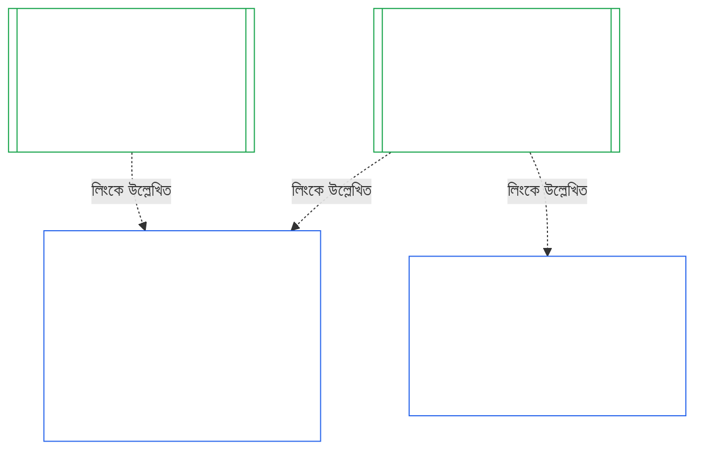

# অধ্যায় দশ: প্রাতিষ্ঠানিক সামঞ্জস্যের প্রত্যয়ন

<strong>কর্পাসে অবস্থান (অপারেটিভ নয়): ফাইলের গঠন ও পাঠের নিয়ম</strong>

> এই ফাইলটি সংবেদনশীল সত্তাদের সংবিধানের অংশ এবং অন্য নম্বরযুক্ত `core_*` ফাইলগুলোর সঙ্গে এক পাঠ্য হিসেবে পড়লেই কেবল বাধ্যতামূলক। এতে রয়েছে **Chapter Ten** — **প্রাতিষ্ঠানিক সামঞ্জস্যের প্রত্যয়ন**: কোনো [Institution](core_05.040_band_continuity.md#institution) তার পরিচালিত System থেকে আলাদা সত্তা হিসেবে কীভাবে শ্রেণিবদ্ধ, মূল্যায়িত, পর্যালোচিত, সিদ্ধান্তপ্রাপ্ত, নথিভুক্ত, হালনাগাদ ও পুনরায় খোলা হয় (**§1–§11**)। Chapter Ten হলো [Chapter Nine](core_09.000_system_alignment_certification_evaluation.md#chapter-nine-system-alignment-certification)-এর (*System Alignment Certification*) প্রাতিষ্ঠানিক প্রতিরূপ, এবং **এর বিভাগগুলোর নম্বর একই**: এখানকার §N, সেখানকার §N-এর উত্তর দেয়। [CS-9.320](corpus_systems/cs_09.320_system_alignment_certification_illustrations.md#cs-9320-system-alignment-certification-illustrations) (*System alignment certification illustrations*)-এ System-এর ব্যবহারিক উদাহরণ এবং তার [§12 Illustrative Institution walkthroughs](corpus_systems/cs_09.320_system_alignment_certification_illustrations.md#cs-9320-12-illustrative-institution-walkthroughs)-এ তিনটি Institution-এর ধাপে-ধাপে উদাহরণ আছে। এই অধ্যায় সেগুলো পুনরাবৃত্তি করে না।
>
> | § | Chapter Nine (System) | Chapter Ten (Institution) |
> |---|------------------------|----------------------------|
> | 1 | উদ্দেশ্য ও ভূমিকা | System-এর প্রত্যয়নের সঙ্গে সম্পর্ক, কার প্রত্যয়ন হয়, গঠন বা পরিচালনার অনুমতি বা প্রবেশ-শর্ত নেই, নতুন বস্তুগত কর্তৃত্বের জন্য অপেক্ষা, প্রথম প্রত্যয়নের সময়সীমা |
> | 2 | System শ্রেণির মূল্যায়ন | Institution-এর শ্রেণি; শ্রেণি অনুযায়ী মাপ |
> | 3 | সমগ্র-System প্রত্যয়ন মূল্যায়ন | আটটি প্রাতিষ্ঠানিক বিষয়, সর্বদা |
> | 4 | প্রাসঙ্গিক হলে প্রযোজ্য মূল্যায়ন | Chapter Nine §4-এর নির্দেশক |
> | 5 | Rights-Floor ও ক্ষেত্রভিত্তিক মূল্যায়ন | Chapter Nine §5-এর নির্দেশক |
> | 6 | ফোরাম প্রক্রিয়া | চারটি আসন; ফোরামের ভূমিকা ও ক্রম; Institution হিসেবে ফোরাম, প্রত্যয়নকারী ও নথি-দপ্তর |
> | 7 | প্রত্যয়নের ফলাফল | Institution ও তার System-এর কার্যক্রম শুরু, প্রত্যয়নের শর্ত এবং ফলাফলের অন্যান্য প্রভাব; ত্রুটির নির্দেশক; প্রতিকার-প্রস্তুতি; অস্বীকৃতি ও প্রত্যাহার |
> | 8 | System Certification Record | Institutional Certification Record |
> | 9 | পুনঃপ্রত্যয়ন ও পুনরায় খোলা | পর্যবেক্ষণ; পুনরায় খোলার কারণ; অস্থায়ী ও পূর্ণ প্রত্যয়ন; ফাঁকি-রোধ; System প্রত্যয়ন থেকে ধারাবাহিক প্রভাব; শাসন-লঙ্ঘনে তার System পুনরায় খোলা |
> | 10 | প্রত্যয়নকে চ্যালেঞ্জ | চ্যালেঞ্জের পথ |
> | 11 | অবস্থানের সঙ্গে সম্পর্ক | অবস্থানের সংযোগ |
>
> - **সাংবিধানিক বিষয়-দায়িত্ব (Chapter Nine-এর সঙ্গে যৌথ):** ফোরামের তত্ত্বাবধানে সামঞ্জস্য-প্রত্যয়ন ও সংশ্লিষ্ট নথি। Chapter Ten-এ প্রাতিষ্ঠানিক বিষয়টি যোগ হয়েছে। এখানে নতুন ফোরাম-পরিবার, নতুন আসন বা নতুন ফলাফল-শব্দ নেই।
> - **পুনরাবৃত্তি নয়, পুনঃব্যবহার:** [Chapter Nine Part B §6](core_09.005_system_alignment_certification_record_process.md#6-forum-process) থেকে [Chapter Nine Part C §11](core_09.010_system_alignment_certification_record_recertification.md#11-relationship-to-standing) পর্যন্ত যে Phase III–VI চালায়, Chapter Ten কেবল Institution বিষয় হলে কী বদলায় তা জানায়।
> - **অন্যত্র স্থানান্তর-রোধী নিয়ম:** Chapter Ten কোনো System-এর জন্য Chapter Nine-এর মূল্যায়ন-প্রক্রিয়া, Chapter Seven-এর System Charter ও Institutional Charter-এর ক্ষেত্র, Chapter Eight-এর Four-Seat Requirement, [corpus_institutions](corpus_institutions.md)-এর প্রাতিষ্ঠানিক দায়িত্ব, Chapter Eleven-এর অবস্থান-পরিমাপ বা Chapter Twelve-এর অবস্থান-প্রভাব পুনরায় বলে না।
>
> **পূর্ববর্তী ভিত্তি:** [Chapter Seven](core_07.000_charters.md#chapter-seven-system-and-institutional-charters) Charters; [Chapter Eight](core_08.000_functional_independence_separation_of_duties.md#chapter-eight-functional-independence-and-separation-of-duties)-এর কার্যগত স্বাধীনতা; [Chapter Nine](core_09.000_system_alignment_certification_evaluation.md#chapter-nine-system-alignment-certification) (Parts [A](core_09.000_system_alignment_certification_evaluation.md#chapter-nine-part-a-system-alignment-certification--evaluation), [B](core_09.005_system_alignment_certification_record_process.md#chapter-nine-part-b-system-alignment-certification--forum-process-and-outcomes), এবং [C](core_09.010_system_alignment_certification_record_recertification.md#chapter-nine-part-c-system-alignment-certification--record-recertification-and-standing)); Chapter Fourteen-এর ফোরাম তত্ত্বাবধান।
> **পরবর্তী ধাপ:** Chapter Eleven-এর অবস্থান-নথি ও যাচাইকৃত ইনপুট; Chapter Twelve-এর অবস্থান-প্রভাব।

<strong>অনুসরণপথ</strong>

- **পূর্ববর্তী ভিত্তি:**
  - [Chapter Seven §1 When System and Institutional Charters Are Required](core_07.000_charters.md#1-when-system-and-institutional-charters-are-required) (7.000 §1) (*কোন Institution System Charter বা Institutional Charter প্রকাশ করে, এবং Institution-এর শ্রেণি*);
  - [Chapter Seven §7 Amendment and Review](core_07.000_charters.md#7-amendment-review-and-scope-misalignment) (7.000 §7) (*Institutional Charter পর্যালোচনায় কী যাচাই হয়*);
  - [Chapter Seven §4 The Charter Role Map and Standing-Record Custody](core_07.000_charters.md#4-the-charter-role-map-and-standing-record-custody) (7.000 §4) (*আসনগুলো কোথায় স্থাপন করা হয়*);
  - [Chapter Eight §2 Four-Seat Constitutional Requirement](core_08.000_functional_independence_separation_of_duties.md#2-four-seat-constitutional-requirement) (8.000 §2) এবং [§9 Relationship to Later Processes](core_08.000_functional_independence_separation_of_duties.md#9-relationship-to-later-processes);
  - [Chapter Nine](core_09.000_system_alignment_certification_evaluation.md#chapter-nine-system-alignment-certification) (9.000 থেকে 9.010) (*এই অধ্যায়ে পুনর্ব্যবহৃত System Alignment Certification প্রক্রিয়া*);
  - [Two Fundamental Questions](core_00.000_preamble.md#two-fundamental-questions);
  - [Constitutional Tetrad](core_00.000_preamble.md#constitutional-tetrad);
  - [Article XI-E](core_06.005_rights_part_b.md#article-xi-e-institutional-formation-and-business-creation) (*প্রতিষ্ঠান গঠন ও ব্যবসা সৃষ্টি*)।
- **পরবর্তী ধাপ:** [§1](#1-purpose-and-role) থেকে [§11](#11-relationship-to-standing) পর্যন্ত; Chapter Eleven ([11.000](core_11.000_standing_assessment.md#chapter-eleven-contribution-violation-and-standing-model--measurement)); [Chapter Fourteen](core_14.000_forum.md#chapter-fourteen-forums-and-jurisdiction) (14.000)।
- **এগুলোর সঙ্গে পড়ুন:**
  - [Institutional Alignment Certification](core_05.040_band_continuity.md#institutional-alignment-certification) এবং
  - [Institutional Certification Record](core_05.040_band_continuity.md#institutional-certification-record) (*Chapter Five-এর অর্থ*);
  - **CI-8.205 §6** (*System ও Institutional Charter-এর বিষয়বস্তু, পর্যালোচনা এবং গঠনের ছক*);
  - **CF-14.425** (*অখণ্ডতার সুরক্ষা, capture-রোধী কার্যক্রম, এবং নিজের বিচার নিজে করা রোধে সহায়তা*)।

 

Chapter Ten হলো **প্রাতিষ্ঠানিক সামঞ্জস্য-প্রত্যয়নের** সাংবিধানিক বিষয়-দায়িত্বপ্রাপ্ত অধ্যায়। এটি [Chapter Nine](core_09.000_system_alignment_certification_evaluation.md#chapter-nine-system-alignment-certification)-এর প্রক্রিয়াকে System থেকে Institution-এ প্রসারিত করে:

- **Phase I, Frame:** Institution-এর শ্রেণি এবং কীভাবে তা মূল্যায়নের মাত্রা নির্ধারণ করে ([§2 Institution Class Evaluation](#2-institution-class-evaluation));
- **Phase II, Evaluate:** প্রাতিষ্ঠানিক মূল্যায়ন, যার মধ্যে প্রাসঙ্গিক হলে প্রযোজ্য মূল্যায়ন ও Rights-Floor এবং ক্ষেত্রভিত্তিক মূল্যায়ন রয়েছে ([§3 Whole-Institution Certification Evaluation](#3-whole-institution-certification-evaluation) থেকে [§5 Rights-Floor and Domain Evaluations](#5-rights-floor-and-domain-evaluations));
- **Phase III, Review:** ফোরামের ভূমিকা ও ক্রম ([§6 Forum Process](#6-forum-process));
- **Phase IV, Decide:** ফলাফল, প্রতিকার-প্রস্তুতি, অস্বীকৃতি ও প্রত্যাহার ([§7 Certification Outcomes](#7-certification-outcomes));
- **Phase V, Record:** Institutional Certification Record ([§8 Institutional Certification Record](#8-institutional-certification-record)); এবং
- **Phase VI, Operate:** পুনঃপ্রত্যয়ন, পুনরায় খোলা, System প্রত্যয়ন থেকে ধারাবাহিক প্রভাব, তার System পুনরায় খোলা, চ্যালেঞ্জের পথ এবং অবস্থানের সংযোগ ([§9 Recertification and Reopening](#9-recertification-and-reopening) থেকে [§11 Relationship to Standing](#11-relationship-to-standing))।

*সহজ ভাষায়: Chapter Nine জিজ্ঞেস করে কোনো **সিস্টেম** সামঞ্জস্যপূর্ণ কি না। Chapter Ten একই প্রশ্ন করে System চালানো, অথবা System না চালিয়েও কর্তৃত্ব ধারণ করা **প্রতিষ্ঠান** সম্পর্কে। কোনো Institution সামঞ্জস্যপূর্ণ হলেও তার কোনো System অসামঞ্জস্যপূর্ণ হতে পারে, বা উল্টোটাও হতে পারে। তাই Institution-এর নিয়ন্ত্রণাধীন বিষয়গুলো পরীক্ষা করা হয়: এটি Institutional Charter মেনে চলে কি না, তার কর্তৃত্বের জন্য কে জবাবদিহি করে, নিজের সদস্যদের কোন কাজে পুরস্কৃত করে, এবং তার ওপর স্বাধীন যাচাই বাস্তবে ব্যবহার করা যায় কি না। এটি প্রতিটি System-এর প্রত্যয়নের ওপর নির্ভর করে, নিজে পুনরায় সেই প্রত্যয়ন করে না। এটি লাইসেন্স নয়: Institution শুরু বা পরিচালনা করতে কারও অনুমতি লাগে না।*

### 1. উদ্দেশ্য ও ভূমিকা

<strong>অনুসরণপথ</strong>

- **পূর্ববর্তী ভিত্তি:**
  - [Chapter Seven §1 When System and Institutional Charters Are Required](core_07.000_charters.md#1-when-system-and-institutional-charters-are-required) (7.000 §1);
  - [Chapter Nine Part A §1 Purpose and Role](core_09.000_system_alignment_certification_evaluation.md#1-purpose-and-role) (9.000 §1);
  - [Article XI-E](core_06.005_rights_part_b.md#article-xi-e-institutional-formation-and-business-creation) (*প্রতিষ্ঠান গঠন ও ব্যবসা সৃষ্টি*);
  - [Article XXVIII-A](core_06.020_rights_part_e.md#xxviii-a-existing-instantiations-adoption-transition-window) (*ধাপে গ্রহণ ও Rights-Floor-এর ধারাবাহিকতা*)।
- **পরবর্তী ধাপ:** [§2](#2-institution-class-evaluation); [§6](#6-forum-process); [§7](#7-certification-outcomes); [§9](#9-recertification-and-reopening)।
- **এগুলোর সঙ্গে পড়ুন:**
  - [Institution](core_05.040_band_continuity.md#institution);
  - [Institutional Charter](core_05.040_band_continuity.md#institutional-charter);
  - [System Charter](core_05.040_band_continuity.md#system-charter);
  - [Business Creation](core_05.055_band_participation.md#business-creation)।

 

*সহজ ভাষায়: কোনো সিস্টেমের প্রত্যয়ন সেই সিস্টেমের। Institution-এর প্রত্যয়ন ওই প্রত্যয়নগুলো উল্লেখ করে এবং কেবল Institution-এর জবাবদিহির বিষয় যোগ করে। একটি System একাধিক Institution-এর অধীনে থাকতে পারে, অথবা কোনো Institution-এর অধীন না-ও থাকতে পারে। Institution শুরু করার পথে প্রত্যয়নকে বাধা বানানোর অনুমতি এখানকার কোনো বিধান দেয় না।*

Institutional alignment certification এবং System Alignment Certification হলো লিংকের মাধ্যমে যুক্ত দুটি প্রত্যয়ন। তাদের সম্পর্ক হলো **লিংকের মাধ্যমে সংযোজন**, অন্তর্ভুক্তি নয়। চিত্রে একটি System Certification Record থেকে সেই রেকর্ড উল্লেখকারী প্রতিটি Institutional Certification Record-এ তীর গেছে। কোনো Institution-এর অধীন নয় এমন System-এর কোনো তীর নেই, এবং দরকারও নেই; কোনো System না-চালানো Institution-এর কেবল তার নিজস্ব নথি থাকে।

লিংকের মাধ্যমে সংযোজনের দুটি দিক আছে; প্রথমে Institution-এর দিক:

Institution-এর দিক থেকে:

- **Institutional Certification Record কোনো System-এর নথি উল্লেখ করে, পুনরায় মূল্যায়ন করে না:** System Certification Record-এর লিংক ও সংস্করণ উল্লেখ করে। এই অধ্যায় কখনো System-এর মূল্যায়ন পুনরায় চালায় না, তার শ্রেণি পুনর্নির্ধারণ করে না, এবং System-এর ফলাফল, মর্যাদা বা প্রত্যয়নের শর্ত বদলায় না।
- **Institution-এর প্রত্যয়ন System-এর প্রত্যয়ন তুলে দিতে পারে না:** কোনো System Not Certified হলে Institution-এর মর্যাদা যা-ই হোক, তা Not Certified-ই থাকে। কোনো System প্রত্যয়িত হলেও Institution-এর সিদ্ধান্ত থেকে কোনো সুরক্ষা পায় না।
- **প্রাতিষ্ঠানিক তথ্য একবারই নির্ধারিত হয়:** [Chapter Nine Part A §3.1 Governance, Incentive, and Contestability Discipline](core_09.000_system_alignment_certification_evaluation.md#31-governance-incentive-and-contestability-discipline)-এ অপারেটরের শাসন ও প্রণোদনা সম্পর্কে প্রশ্ন করা হলে, অপারেটরের বর্তমান Institutional Certification Record লিংকের মাধ্যমে সেই তথ্য দিতে পারে। তবু সিস্টেমটির ফোরামই সিদ্ধান্ত নেয় ওই তথ্য তার জন্য যথেষ্ট কি না। System Certification Record-এ কারণ না জানিয়ে তারা একই প্রাতিষ্ঠানিক তথ্য সম্পর্কে ভিন্ন সিদ্ধান্ত দিতে পারে না।

System-এর দিক থেকে:

- **System Certification Record System-এর নিজস্ব:** এটি [Chapter Nine](core_09.000_system_alignment_certification_evaluation.md#chapter-nine-system-alignment-certification)-এর অধীনে System-এর নিজস্ব নথি।
- **একটি System Certification Record একাধিক Institution উল্লেখ করতে পারে:** [Chapter Seven §1 When System and Institutional Charters Are Required](core_07.000_charters.md#1-when-system-and-institutional-charters-are-required)-এর অধীনে একাধিক Institution কোনো System পরিচালনা, steward করা বা বস্তুগতভাবে নিয়ন্ত্রণ করতে পারে। প্রত্যেকে একই নথি উল্লেখ করে।
- **System-কে কোনো Institution-এর অধীন থাকতেই হবে না:** একজন সংবেদনশীল সত্তা Institution নয়, তাই কোনো System-এর কোনো Institution নাও থাকতে পারে। Institution নেই এমন System কেবল [Chapter Nine](core_09.000_system_alignment_certification_evaluation.md#chapter-nine-system-alignment-certification)-এর অধীনে প্রত্যয়িত হবে এবং এই অধ্যায়ে কিছুই তার দরকার নেই। Institution-এর অধীনে থাকা System-ও একইভাবে প্রত্যয়িত হয়: এই অধ্যায় Institution-এর জন্য আলাদা নথি যোগ করে; System-এর নিজস্ব প্রত্যয়নের ধাপ নয়।

#### 1.1 কার প্রত্যয়ন হয়

[§2.1 Institution class](#21-institution-class)-এর অধীনে শ্রেণি নির্ধারিত Class L বা তার চেয়ে উচ্চতর Institution এই অধ্যায়ের আওতায়। কোনো System একেবারেই না-চালানো Institution-ও এর মধ্যে পড়ে: উল্লেখ করার মতো তার কোনো System Certification Record নেই, এবং তার শ্রেণি নির্ধারিত হয় তার নিজস্ব প্রভাব দিয়ে। Institution-এর **portfolio** হলো তার পরিচালিত, steward করা বা বস্তুগতভাবে নিয়ন্ত্রিত System-গুলোর সমষ্টি ([Portfolio](core_05.040_band_continuity.md#portfolio))।

- **Class A, B, C ও L:** শ্রেণি অনুযায়ী [§2.2 Scaling by class](#22-scaling-by-class)-এর মাপে প্রক্রিয়া প্রযোজ্য।
- **Class P:** প্রক্রিয়াটি উৎসাহিত এবং স্বেচ্ছায় ব্যবহার করা যেতে পারে। Class L বা তার বেশি শ্রেণিতে পুনঃশ্রেণিবিন্যাস হলে, অথবা Institution স্বেচ্ছায় সাংবিধানিক সম্মতির দাবি করলে, এটি বাধ্যতামূলক হয়। নতুন বস্তুগত কর্তৃত্ব নেওয়ার সিদ্ধান্ত নেওয়া Class P Institution [§9.2.2 Recertification for new material authority](#922-recertification-for-new-material-authority)-এ নোটিশ দেওয়ার সময় অন্তত Class L-এ পুনঃশ্রেণিবদ্ধ হয়; কারণ ওই কর্তৃত্ব সংজ্ঞা অনুযায়ী বস্তুগত ([§9.2.1 What counts as new material authority](#921-what-counts-as-new-material-authority)), এবং যেকোনো ক্ষেত্রে বস্তুগত প্রভাব ফেলা Institution অন্তত Class L ([§2.1 Institution class](#21-institution-class), বিষয় 2)। নোটিশ থেকে শুরু করে নোটিশ প্রত্যাহার করে নিষ্পত্তির আগে পর্যন্ত, অথবা কর্তৃত্বটি নিষ্পত্তি না হওয়া পর্যন্ত — তবে তার অধীনে কিছু প্রয়োগ না করা হলে — পুনঃশ্রেণিবিন্যাস বহাল থাকে। এরপর Institution আবার Class P-তে ফেরে এবং সীমিত প্রথম-প্রত্যয়ন পর্ব শেষ হয়। নতুন নোটিশে তা আবার শুরু হয়; আর নিষ্পত্তি ছাড়া কর্তৃত্ব প্রয়োগ করা হলে [§9.2.2 Recertification for new material authority](#922-recertification-for-new-material-authority)-এর (*নোটিশ ছাড়া বা নিষ্পত্তির আগে*) অধীনে সিদ্ধান্ত বহাল থাকে। এটি [Chapter Nine Part A §1 Purpose and Role](core_09.000_system_alignment_certification_evaluation.md#1-purpose-and-role)-এর অনুরূপ।
- **একটি System:** ঠিক একটি System চালানো Institution, যার System Charter প্রয়োজন, তার একটি প্রত্যয়ন-পর্ব ও একটি নথি হয়; এই অধ্যায়ে একে **one-System evaluation** বলা হয়েছে। System Certification Record-এ [§8 Institutional Certification Record](#8-institutional-certification-record)-এর বিষয়গুলোসহ *প্রাতিষ্ঠানিক সিদ্ধান্তের অংশ* থাকবে, এবং সেটিই Institutional Certification Record হিসেবে কাজ করবে। ফোরাম, আসন ও সময়সীমা System-এর নিজস্ব প্রত্যয়ন-পর্বের, সঙ্গে প্রাতিষ্ঠানিক বিষয় যোগ হবে। [§7.4 Denial and revocation for an Institution](#74-denial-and-revocation-for-an-institution)-এ বলা নিজস্ব অস্বীকৃতি ও প্রত্যাহারের কারণ অনুসারে ফলাফল হবে। System-টিই পুরো portfolio হওয়ায় [§9.5 Cascade from System certifications](#95-cascade-from-system-certifications)-এর ধারাবাহিক প্রক্রিয়া প্রযোজ্য নয়; তবে [§7.4 Denial and revocation for an Institution](#74-denial-and-revocation-for-an-institution)-এর নিয়ম 1 ও 2 (সূচক এবং কারণ কোথায় তার পরীক্ষা) প্রযোজ্য।
- **একাধিক System:** Institution-এর একটি Institutional Certification Record থাকবে, যা তার চালানো প্রতিটি System-এর System Certification Record-এর সঙ্গে লিংক করবে। প্রতিটি System-এর নিজস্ব প্রত্যয়ন-পর্ব ও নিজস্ব নথি থাকবে।
- **কোনো System নেই:** শুধু একটি Institutional Certification Record। Institution কোনো System চালায় না বলে লিংক করার মতো কোনো System Certification Record নেই।

#### 1.2 গঠন বা পরিচালনার জন্য অনুমতি বা প্রবেশ-শর্ত নেই

Institutional alignment certification হলো কোনো Institution তার কর্তৃত্ব বাস্তবে কীভাবে ব্যবহার করে তার স্বাধীন যাচাই। Institution-এর বাইরের ফোরাম এই প্রত্যয়ন করে, এবং তাদের সিদ্ধান্তের নথি হলো Institutional Certification Record।

- **শুরু ও পরিচালনা:** কোনো Institution আগে প্রত্যয়ন না নিয়েই গঠিত হতে পারে, তার Institutional Charter প্রকাশ করতে পারে, কর্তৃত্ব প্রয়োগ শুরু করতে পারে এবং পরিচালনা চালিয়ে যেতে পারে; কোনো ফলাফলই সে অধিকার দেয় বা কেড়ে নেয় না।
- **ফলাফলের প্রভাব:** [§7.1 Go-live for an Institution](#71-go-live-for-an-institution)-এ বলা প্রভাবগুলোই কেবল ফলাফলের প্রভাব।
- **এই ক্ষেত্রে কেবল তিনটি প্রবেশ-শর্ত:** **Article XI-E** (*প্রতিষ্ঠান গঠন ও ব্যবসা সৃষ্টি*)-এ তিনটি সংকীর্ণ প্রবেশ-শর্ত রয়েছে:
  - নামযুক্ত সংবেদনশীল সত্তার ওপর বিদ্যমান lock, যা সেই সত্তার কর্তৃত্বের সঙ্গে যুক্ত;
  - অসামঞ্জস্যের নির্দিষ্ট যাচাইকৃত তথ্যের ওপর Interim Hold, যা কোনো নামযুক্ত সংবেদনশীল সত্তার কর্তৃত্বেও যুক্ত;
  - Operating Party-র নিজের ওপর lock, যা Institution-এ যুক্ত হবে কেবল সেই Institution-এর ওপর lock থাকলে; **CI-12.210 §4** (*বিলুপ্তি*) অনুযায়ী বিলুপ্ত Institution-এর ওপর এমন lock থাকতে পারে।

  [§7.5 Effects of denial and revocation for an Institution](#75-effects-of-denial-and-revocation-for-an-institution)-এর অধীনে প্রমাণ হিসেবে প্রত্যয়নের সিদ্ধান্তকে এসব প্রবেশ-শর্তের যেকোনো একটি নির্ধারণকারী ফোরামে পাঠানো যেতে পারে। প্রত্যয়নের ফল নিজে কোনো প্রবেশ-শর্ত নয় এবং তা কোনো শর্ত খোলে বা বন্ধ করে না।
- **নতুন বস্তুগত কর্তৃত্বের জন্য অপেক্ষা:** নতুন বস্তুগত কর্তৃত্ব নেওয়ার সিদ্ধান্ত নেওয়া Institution, তা প্রয়োগের আগে [§9.2.2 Recertification for new material authority](#922-recertification-for-new-material-authority)-এর শর্তে পুনঃপ্রত্যয়নে ওই কর্তৃত্বের নিষ্পত্তির জন্য অপেক্ষা করবে। **Article XI-E** (*প্রতিষ্ঠান গঠন ও ব্যবসা সৃষ্টি*) এই অপেক্ষা নির্ধারণ করে। এটি তিনটি সংকীর্ণ প্রবেশ-শর্তের একটি নয়, এবং গঠন বা পরিচালনার ওপর প্রবেশ-শর্তও নয়। এটি শুধু নতুন কর্তৃত্বের ক্ষেত্রে প্রযোজ্য; Institution-এর অন্য সব কাজ চলতে থাকবে। [§9.2.2 Recertification for new material authority](#922-recertification-for-new-material-authority)-এর চিত্রে ধাপগুলো সংক্ষেপে আছে।
- **পেছনের দরজা নয়:** কোনো ফোরাম, গ্রহণকারী বা ক্ষমতাসীন এই অধ্যায়কে প্রতিষ্ঠাতা ঠেকানো বা ক্ষমতাসীনদের সুরক্ষা দেওয়ার অনুমোদন-সীমা হিসেবে ব্যবহার করতে পারবে না। তা [Article XI-E](core_06.005_rights_part_b.md#article-xi-e-institutional-formation-and-business-creation) (*প্রতিষ্ঠান গঠন ও ব্যবসা সৃষ্টি*) ব্যর্থ করবে।
  - প্রক্রিয়ার খরচে [Avoidable Burden](core_05.040_band_continuity.md#avoidable-burden) প্রযোজ্য।
  - পর্যালোচনার গভীরতায় [Classification-Scaled Governance](core_05.050_band_oversight.md#classification-scaled-governance) প্রযোজ্য।
  - নতুন বস্তুগত কর্তৃত্বের অপেক্ষা একই শ্রেণির প্রতিটি Institution-এর ক্ষেত্রে একই শর্তে, এবং কেবল অন্যদের জন্য আগে থেকেই বস্তুগত এমন কর্তৃত্বে প্রযোজ্য।

System-এর কার্যক্রম শুরু করার শর্ত আলাদা এবং সিস্টেমের সঙ্গেই থাকে। [Chapter Nine Part B §7.1 Go-Live Gate](core_09.005_system_alignment_certification_record_process.md#71-go-live-gate)-এর অধীনে নতুন System বা তার বস্তুগত সম্প্রসারণ কেবল তার নিজস্ব প্রত্যয়নের মাধ্যমে কার্যক্রম শুরু করবে, Institution-এর মর্যাদা যা-ই হোক।

#### 1.3 প্রথম প্রত্যয়নের সময়সীমা

প্রথম Institutional Certification Record Institution-এর শ্রেণির জন্য গ্রহণকারী নথিতে নির্ধারিত সময়সীমার মধ্যে জমা দিতে হবে।

- **নতুন Institution:** [Domain-Specific Materiality](core_05.050_band_oversight.md#domain-specific-materiality)-এর বিচারে অন্যদের ওপর প্রথম বস্তুগত প্রভাবের দিন থেকে সময়সীমা শুরু হবে এবং প্রথম প্রত্যয়ন হবে অস্থায়ী।
- **নোটিশে পুনঃশ্রেণিবদ্ধ Class P Institution:** নতুন Institution-এর মতো [§9.2.2 Recertification for new material authority](#922-recertification-for-new-material-authority)-এর অধীনে নোটিশ দেওয়ার দিন থেকে সময় গণনা হবে; ইতিমধ্যে শেষ হওয়া Adoption Transition সময়সীমা থেকে কখনো নয়।
- **আগে থেকেই পরিচালনায় থাকা:** সময়সীমা হলো [Article XXVIII-A](core_06.020_rights_part_e.md#xxviii-a-existing-instantiations-adoption-transition-window) (*ধাপে গ্রহণ ও Rights-Floor-এর ধারাবাহিকতা*)-এর Adoption Transition সময়সীমা, যা [Chapter Seven §1.5 When a System Charter or Institutional Charter is due](core_07.000_charters.md#15-when-a-system-charter-or-institutional-charter-is-due)-এর ডিফল্টের সঙ্গে সামঞ্জস্যপূর্ণ।
- **সময়সীমা পেরিয়ে যাওয়া:** নিচে ছাড় না থাকলে, প্রথম প্রত্যয়ন-পর্ব না করেই সময়সীমা শেষ হতে দেওয়া Institution-এর এমন ত্রুটি আছে যা নথিতে লিখে সংশোধন করতে হবে; আর মেয়াদ শেষ হলে ওই প্রত্যয়ন-পর্ব শুরু হয়। আগে থেকে পরিচালনায় থাকা Class L বা তার বেশি Institution-এর নিচের milestone failure-ও ঘটে। কোনো gate নেই বলে Institution থামানো বা পরিচালনায় বাধা দেওয়া হয় না ([§1.2 গঠন বা পরিচালনার জন্য অনুমতি বা প্রবেশ-শর্ত নেই](#12-no-permission-and-no-gate-on-forming-or-running))।
  - **আগে থেকেই পরিচালনায় থাকা Institution:** Class L বা তার বেশি Institution-এর জন্য এই অধ্যায়ের নিজস্ব নিয়ম, [Article XXVIII-A](core_06.020_rights_part_e.md#xxviii-a-existing-instantiations-adoption-transition-window) (*ধাপে গ্রহণ ও Rights-Floor-এর ধারাবাহিকতা*)-এর অনুরূপ, যেখানে System ও derived entity-র কথা আছে। Adoption Transition সময়সীমা শেষ হলেও প্রথম প্রত্যয়ন-পর্ব সম্পূর্ণ না হলে (কোনো provisional বা full certification নেই এবং [§7 Certification Outcomes](#7-certification-outcomes)-এর অধীনে কোনো সিদ্ধান্ত হয়নি), Institution-এর deadline পেরিয়েছে। সময়সীমার মধ্যে আবেদন করে সহযোগিতা করা Institution-এর ক্ষেত্রে, ফোরাম নিজের সময়সীমা অতিক্রম করায় ([Chapter Fourteen §6 Timely resolution, materiality tiers, and anti-delay discipline](core_14.000_forum.md#6-timely-resolution-materiality-tiers-and-anti-delay-discipline), *Overrun review*; [Chapter Nine Part C §9.3.4 Tier windows](core_09.010_system_alignment_certification_record_recertification.md#934-tier-windows)) অথবা [§7.3 Remediation readiness for an Institution](#73-remediation-readiness-for-an-institution)-এর অধীনে একবারের deferral চলায় প্রত্যয়ন-পর্ব অসম্পূর্ণ থাকলে সময়সীমা পেরোয়নি। [Article XXVIII-B](core_06.020_rights_part_e.md#article-xxviii-b-adoption-transition-authority-limits-and-reauthorization) (*Adoption Transition Authority Limits and Reauthorization*) অনুযায়ী নথিভুক্ত পুনঃঅনুমোদনের প্রমাণ না থাকলে এটি Adoption Transition milestone failure, এবং [Chapter Eleven](core_11.000_standing_assessment.md#chapter-eleven-contribution-violation-and-standing-model--measurement)-এর সাধারণ compliance ও violation পথ খুলে যায়। ওই Article-এর সংযমের দায়িত্ব কার্যকর হওয়ার দিন থেকে প্রযোজ্য, আর ঘাটতি দীর্ঘস্থায়ী হওয়ায় তা নতুন স্বাভাবিক হয়ে যায় না। এটি [Chapter Nine Part B §7.1.1 Systems already operating](core_09.005_system_alignment_certification_record_process.md#711-systems-already-operating)-এর অনুরূপ। এটি কোনো gate নয়।
  - **প্রত্যয়ন-পর্ব:** অন্য যেকোনো পর্বের মতোই সিদ্ধান্ত হবে। [§7 Certification Outcomes](#7-certification-outcomes)-এর যেকোনো ফল হতে পারে, Not Certified-সহ; এর প্রভাব রয়েছে [§7.5 Effects of denial and revocation for an Institution](#75-effects-of-denial-and-revocation-for-an-institution)-এ।
  - **শাস্তি ও বিলুপ্তি:** এই অধ্যায় কোনোটি তৈরি করে না। স্থগিতকরণ, receivership, কাঠামোগত পৃথকীকরণ ও বিলুপ্তির বিষয় **CI-12.210** (*প্রাতিষ্ঠানিক ব্যর্থতা ও বিলুপ্তি*) এবং **CI-12.215** (*প্রাতিষ্ঠানিক জবাবদিহি ও শাস্তি*) অনুযায়ী এখতিয়ারসম্পন্ন ফোরামের কাছে থাকে। [§7.5 Effects of denial and revocation for an Institution](#75-effects-of-denial-and-revocation-for-an-institution)-এর পাঠানোর কারণেই কেবল (বিষয় 5, *Referral*) সেই ফোরামে পাঠানো হবে।

### 2. Institution শ্রেণির মূল্যায়ন

<strong>অনুসরণপথ</strong>

- **পূর্ববর্তী ভিত্তি:**
  - [Chapter Seven §1 When System and Institutional Charters Are Required](core_07.000_charters.md#1-when-system-and-institutional-charters-are-required) (7.000 §1);
  - [Chapter Nine Part A §2 System Class Evaluation](core_09.000_system_alignment_certification_evaluation.md#2-system-class-evaluation) (9.000 §2) এবং [§2.2 How system class scales every evaluation](core_09.000_system_alignment_certification_evaluation.md#22-how-system-class-scales-every-evaluation);
  - [Chapter Three §2.1 Common Evasion Patterns](core_03.000_definition_integrity.md#21-common-evasion-patterns) (3.000 §2.1)।
- **পরবর্তী ধাপ:** [§3](#3-whole-institution-certification-evaluation) (*শ্রেণি যে বিষয়গুলোর মাত্রা নির্ধারণ করে*); [§8](#8-institutional-certification-record) (*শ্রেণি নথিতে উল্লেখ থাকে*); [§9.2](#92-reopening-triggers) (*শ্রেণি পুনর্মূল্যায়নের কারণ*)।
- **এগুলোর সঙ্গে পড়ুন:**
  - **CS-9.305 (*System classification machinery*) এবং CS-9.310** (*System impact classifications*) ও [corpus_systems/cs_09.310_system_impact_classifications.md](corpus_systems/cs_09.310_system_impact_classifications.md) (*শ্রেণির তালিকা*);
  - **CI-9.210** (*শ্রেণিবিন্যাস-সংযুক্ত প্রাতিষ্ঠানিক দায়িত্ব*);
  - **CI-8.205 §6** (*System ও Institutional Charter-এর বিষয়বস্তু, পর্যালোচনা এবং গঠনের ছক*)।

 

*সহজ ভাষায়: Institution-কে প্রথমে তার শ্রেণিতে ফেলুন, অন্যদের কাছে তার গুরুত্ব কতটা তা দেখে। নিজেকে কী বলে তার ভিত্তিতে নয়, বাস্তবে কী সিদ্ধান্ত নেয় এবং কী ধরে রাখে তার ভিত্তিতে বিচার করুন। এরপর শ্রেণি মূল্যায়নের গভীরতা নির্ধারণ করে: শ্রেণি যত উঁচু, প্রমাণ তত কঠোর, পর্যালোচনা তত স্বাধীন, এবং পুনঃযাচাই তত তাড়াতাড়ি।*

এই বিভাগ Institution-এর জন্য **Phase I, Frame**।

#### 2.1 Institution-এর শ্রেণি

**Institution-এর শ্রেণি** নির্ধারিত হয় Institution-এর সর্বোচ্চ বস্তুগত প্রভাব দিয়ে, সেই প্রভাব তার পরিচালিত System-এর মাধ্যমে হোক বা কোনো System-এর বাইরে হোক। Institution বাস্তবে কী সিদ্ধান্ত নেয়, কী ধারণ করে ও কী নিয়ন্ত্রণ করে তার ভিত্তিতে বিচার হয়; তার label, আইনি রূপ বা Institutional Charter-এর তালিকার ভিত্তিতে নয়। শ্রেণি মূল্যায়নের গভীরতা ও সময়সীমা নির্ধারণ করে, যেমন [Chapter Nine Part A §2.2 How system class scales every evaluation](core_09.000_system_alignment_certification_evaluation.md#22-how-system-class-scales-every-evaluation) System-এর ক্ষেত্রে করে। এই অধ্যায়ে এবং [Chapter Seven §1.2 Which classes are covered](core_07.000_charters.md#12-which-classes-are-covered)-এ ব্যবহৃত শ্রেণি এটিই।

1. **System-এর মাধ্যমে প্রভাব:** Institution-এর শ্রেণি তার portfolio-র যেকোনো System-এর সর্বোচ্চ শ্রেণির সমান বা তার চেয়ে উঁচু ([Chapter Seven §1 When System and Institutional Charters Are Required](core_07.000_charters.md#1-when-system-and-institutional-charters-are-required))। পর্যবেক্ষিত কার্যক্রম থেকে System শনাক্ত করা হয়। Institutional Charter-এ উল্লেখ না থাকা System-ও গণ্য হবে।
2. **কোনো System-এর বাইরে প্রভাব:** Institution System চালাক বা না চালাক, তার নিজস্ব বস্তুগত প্রভাব ও নির্ভরতা গণ্য হয়। **CS-9.305 (*System classification machinery*) এবং CS-9.310** (*System impact classifications*)-এর শ্রেণি-সংজ্ঞা Institution-এর নিজস্ব সিদ্ধান্ত ও ধারণকৃত বিষয়গুলোর ক্ষেত্রে, নিচের উপাদান ব্যবহার করে প্রয়োগ হয়:
   - **এটি কী সিদ্ধান্ত নেয় ও কী ধরে রাখে:**
     - অন্য সংবেদনশীল সত্তাদের জীবনধারণের অপরিহার্য উপকরণ, শিক্ষা, নিরাপত্তা, জীবিকা, অধিকার বা অবস্থান সম্পর্কে কী সিদ্ধান্ত নেয়; এবং
     - কী ধারণ করে; যেমন তহবিল, নথি, সদস্যপদ, অবস্থান-নথির হেফাজত, অথবা ফোরাম, প্রত্যয়নকারী বা নথি-দপ্তরের কাজ।
   - **এটি বস্তুগত কি না:**
     - [Domain-Specific Materiality](core_05.050_band_oversight.md#domain-specific-materiality)-এর যেকোনো ক্ষেত্রে এর নিজস্ব কার্যক্রম বস্তুগত কি না; এর মধ্যে অন্যদের মানতে হয় বা নিষ্পত্তি হয়েছে ধরে যার ওপর নির্ভর করা যায় এমন [Materially Binding Acts](core_05.035_band_accountability.md#materially-binding-act) নেওয়াও রয়েছে;
     - যেকোনো একটি ক্ষেত্রে বস্তুগত প্রভাব ফেলা Institution, **CS-9.305 (*System classification machinery*) ও CS-9.310** (*System impact classifications*)-এর অধীনে, অন্তত Class L; এবং
     - অন্যরা স্বাধীনভাবে নিতে বা ছেড়ে দিতে পারে এমন সহায়তা, দ্রব্য, শ্রম বা সেবা দেওয়া, যা কারও প্রয়োজনীয় বিষয়ে প্রবেশ নিয়ন্ত্রণ করে না, কাউকে বাধ্য করে না। এটি আচরণ, Materially Binding Act নয়; এবং কেবল অন্য উপাদানগুলোর মাধ্যমে গণ্য হয়।
   - **কতজন এর ওপর নির্ভর করে:**
     - কতজন sentient এর ওপর নির্ভরশীল এবং এটি কতটা বিকল্পযোগ্য;
     - Material Control Line-এর অর্থে তার কর্তৃত্ব কতটা কেন্দ্রীভূত; এবং
     - তার সিদ্ধান্ত কতটা প্রত্যাবর্তনযোগ্য।
3. **সাধারণ নিয়ন্ত্রণ:** [Domain-Specific Materiality](core_05.050_band_oversight.md#domain-specific-materiality)-এর একীভূতকরণ-নিয়ম অনুযায়ী (একটি [Material Control Line](core_05.035_band_accountability.md#material-control-line)-এর মধ্যে বাস্তব সাধারণ নিয়ন্ত্রণ; শুধু অর্থায়ন গণ্য নয়) একটিই কার্যক্রম হিসেবে কাজ করা Operating Party-গুলো বাস্তবে একটি Institution হিসেবে কাজ করলে একত্রে শ্রেণিবদ্ধ হবে। কোনো অংশ Class L-এ না পৌঁছায় এমনভাবে Operating Party, তার portfolio বা কর্তৃত্ব ভাগ করা [Chapter Three §2.1 Common Evasion Patterns](core_03.000_definition_integrity.md#21-common-evasion-patterns)-এর অধীনে পরিধি ও সীমানা এড়ানোর ফাঁকি।
4. **পুনঃশ্রেণিবিন্যাস:** [§9.2 Reopening triggers](#92-reopening-triggers)-এর কারণ অনুযায়ী শ্রেণি পুনর্মূল্যায়ন হয়। কারণসহ শ্রেণিটি Institutional Certification Record-এ উল্লেখ থাকবে।

#### 2.2 শ্রেণি অনুযায়ী মাপ নির্ধারণ

Institution-এর শ্রেণি প্রমাণের গভীরতা, পর্যালোচনার স্বাধীনতা, ডিফল্ট প্রত্যয়ন-সময়সীমা এবং নথিতে প্রকাশের মাত্রা নির্ধারণ করে, যেমন [Chapter Nine Part A §2.2 How system class scales every evaluation](core_09.000_system_alignment_certification_evaluation.md#22-how-system-class-scales-every-evaluation) করে। প্রত্যয়নের সময়সীমা [Chapter Fourteen §6 Timely resolution, materiality tiers, and anti-delay discipline](core_14.000_forum.md#review-cadence) (*Review cadence*)-এ রয়েছে; গ্রহণকারী নথি আরও কম সময়সীমা দিতে পারে এবং কতগুলো ত্রুটিমুক্ত provisional recertification দরকার তা নির্ধারণ করে।

- **Class A, B ও C:** [§3 Whole-Institution Certification Evaluation](#3-whole-institution-certification-evaluation)-এর আটটি বিষয়ই; শ্রেণির অনুপাতে প্রমাণ ও স্বাধীনতা থাকবে।
- **Class L:** একই আটটি বিষয় সরলভাবে মূল্যায়িত হবে; [Classification-Scaled Governance](core_05.050_band_oversight.md#classification-scaled-governance) অনুমতি দিলে সরল নথি ও দীর্ঘতর ডিফল্ট প্রত্যয়ন-সময়সীমা হবে। Class L-এর মূল প্রত্যয়ন-পর্বে থাকবে Institutional Charter-এর সঙ্গে বাস্তব চর্চার তুলনা, Role Map, formation check-এর বিবৃতি এবং উল্লেখিত System প্রত্যয়নের বর্তমানতা। কোনো বিষয় বাদ দেওয়া যাবে না; কোনো বিষয়ে কিছু পাওয়ার না থাকলে তা এক লাইনে বলা হবে।
- **Class P:** [§1.1 Who is certified](#11-who-is-certified)-এ বলা অনুযায়ী স্বেচ্ছামূলক।

**যৌথ পেশাগত চর্চায় host।** কোনো Institution host হলে ([**CI-15.205 §7**](corpus_institutions/ci_15.205_appointment_competency_rotation_removal.md#ci-46-seat-advisory) (*চর্চার লাইসেন্স, চর্চার ছাড়পত্র ও যৌথ পেশাগত চর্চা*)), host-এর অধীন আসনগুলোর সঙ্গে সদস্যদের কাজ মিলিয়ে তার প্রত্যয়নে নমুনা পরীক্ষা হবে, এবং সদস্যদের গ্রহণ-নোটিশ host বাস্তবে যা করে তার সঙ্গে মিলিয়ে দেখা হবে। একজন সদস্যের কাজ সম্পর্কে সিদ্ধান্তটি সেই সদস্যের বিষয়ে; host-এর অধীনে থাকা কোনো আসন ব্যর্থ হলেই কেবল তা host-এ পৌঁছায়।

### 3. সমগ্র-Institution প্রত্যয়ন মূল্যায়ন

<strong>অনুসরণপথ</strong>

- **পূর্ববর্তী ভিত্তি:**
  - [Chapter Nine Part A §3 Whole-System Certification Evaluation](core_09.000_system_alignment_certification_evaluation.md#3-whole-system-certification-evaluation) (9.000 §3);
  - [Chapter Seven §3 What System and Institutional Charters Must State](core_07.000_charters.md#3-what-system-and-institutional-charters-must-state) (7.000 §3);
  - [Chapter Seven §5 Formation Check: Office-Holder Standing and Authenticity](core_07.000_charters.md#5-formation-check-office-holder-standing-and-authenticity) (7.000 §5);
  - [Chapter Seven §7 Amendment and Review](core_07.000_charters.md#7-amendment-review-and-scope-misalignment) (7.000 §7);
  - [Two Fundamental Questions](core_00.000_preamble.md#two-fundamental-questions);
  - [Chapter One §19.6 Keeping Responsibility When Ownership or Structure Changes](core_01.010_stewardship_capacity_principles.md#196-keeping-responsibility-when-ownership-or-structure-changes) (1.010 §19.6)।
- **পরবর্তী ধাপ:** [§6](#6-forum-process) (*ফোরাম যে সিদ্ধান্তগুলো পর্যালোচনা করে*); [§9](#9-recertification-and-reopening) (*যে কারণগুলোতে সেগুলো পুনরায় খোলে*); [§11](#11-relationship-to-standing) (*নামযুক্ত sentient সম্পর্কে সিদ্ধান্তের যাচাইকৃত-ইনপুট গেট*)।
- **এগুলোর সঙ্গে পড়ুন:**
  - **CI-8.205 §3** (*কর্তৃত্বের ধারা ও দায়িত্ব অর্পণের নিয়ন্ত্রণ*) এবং **CI-8.205 §6** (*System ও Institutional Charter-এর বিষয়বস্তু, পর্যালোচনা ও গঠনের ছক*);
  - **CI-6.215** (*সম্পদের তত্ত্বাবধান ও প্রণোদনার অখণ্ডতা*);
  - বিষয় 8-এর জন্য **CI-8.210** (*স্বার্থ-সংঘাতের অখণ্ডতা, capture-রোধ ও দুর্নীতি-রোধ*), **CI-6.205** (*স্বচ্ছতা, অংশগ্রহণ, এবং প্রবেশগম্য চ্যালেঞ্জ ও সেবার পথ*), এবং **CI-12.205** (*প্রতিকার-ব্যবস্থা ও প্রাতিষ্ঠানিক প্রতিকার দেওয়ার সক্ষমতা*)।

 

*সহজ ভাষায়: যে বিষয়গুলো Institution-এর, কোনো নির্দিষ্ট System-এর নয়, সেগুলো যাচাই করুন: Institution তার Institutional Charter মেনে চলে কি না, তার কর্তৃত্বের জন্য কে জবাবদিহি করে, কোন কাজে পুরস্কার দেয়, এবং তার ওপর স্বাধীন যাচাই কাজ করে কি না।*

এই বিভাগ Institution-এর জন্য **Phase II, Evaluate**।

প্রতিটি প্রত্যয়ন-পর্বে এই আটটি বিষয় মূল্যায়ন হয়; এগুলো [Chapter Nine Part A §3 Whole-System Certification Evaluation](core_09.000_system_alignment_certification_evaluation.md#3-whole-system-certification-evaluation)-এর প্রাতিষ্ঠানিক প্রতিরূপ। প্রতিটি সিদ্ধান্তে তার প্রমাণ এবং Institutional Charter-এর যে ভাষা বা পর্যবেক্ষিত কার্যক্রমের ওপর তা দাঁড়িয়েছে তা উল্লেখ থাকবে।

1. **বাস্তব চর্চার সঙ্গে Institutional Charter-এর তুলনা:**
   - [Chapter Seven §7 Amendment and Review](core_07.000_charters.md#7-amendment-review-and-scope-misalignment)-এর পর্যালোচনা-তালিকা ব্যবহার করে পর্যবেক্ষিত কার্যক্রমের সঙ্গে Institutional Charter মিলিয়ে দেখা হয়।
   - Institutional Charter-এর বাইরে চর্চা, অথবা বাস্তব চর্চার বর্ণনা আর না-দেওয়া Institutional Charter — যেকোনোটিই ভুল হলে সিদ্ধান্তে উল্লেখ হবে।
2. **Portfolio ও সামগ্রিক প্রভাব:**
   - portfolio-র যুক্তি পরীক্ষা হয়: প্রতিটি System Institution-এর ঘোষিত উদ্দেশ্যের সঙ্গে মেলে কি না, এবং ঘোষিত কারণ নেই এমন System থাকলে তা সিদ্ধান্তে উল্লেখ হয়।
   - প্রতিটি System-এর প্রত্যয়ন একা যা দেখাতে পারে না, সেসব বিষয়ও System-গুলো একত্রে দেখে মূল্যায়ন করা হয়:
     - যৌথ নির্ভরতা;
     - সামগ্রিক নির্ভরতা;
     - ভাগ করা ভিত্তি থেকে ক্রমবর্ধমান আহরণ; এবং
     - এমন কোনো ব্যবস্থা যা একটি কাজকে অংশে ভাগ করে, যাতে প্রতিটি অংশ শ্রেণি বা দায়িত্ব এড়ায়।
3. **জবাবদিহিমূলক কর্তৃত্ব:**
   - Institution অন্যদের ওপর যে কর্তৃত্ব প্রয়োগ করে, তার প্রতিটিই নাম বলা যায় এমন জবাবদিহিমূলক দপ্তরের সঙ্গে যুক্ত থাকবে; এবং ওই দপ্তর [Chapter Eight](core_08.000_functional_independence_separation_of_duties.md#chapter-eight-functional-independence-and-separation-of-duties) ও **CI-8.205 §3** (*কর্তৃত্বের ধারা ও দায়িত্ব অর্পণের নিয়ন্ত্রণ*)-এর নিয়মে জবাবদিহি করবে।
   - মালিকানা, নিয়ন্ত্রণ বা কাঠামো বদলালেও দায়িত্ব শেষ হয় না ([Chapter One §19.6 Keeping Responsibility When Ownership or Structure Changes](core_01.010_stewardship_capacity_principles.md#196-keeping-responsibility-when-ownership-or-structure-changes))।
4. **পুরস্কার ও প্রণোদনা:**
   - Institution-এর নিজস্ব বেতন, পদোন্নতি, লক্ষ্য ও পুরস্কারকে [Two Fundamental Questions](core_00.000_preamble.md#two-fundamental-questions)-এর সামনে পরীক্ষা করা হয়: কাঠামোটি বাস্তবে কী পুরস্কৃত করে, এবং তা সংবিধানের দুই লক্ষ্যের দিকে নাকি বিপরীত দিকে নিয়ে যায়।
   - সামঞ্জস্যহীনতার জন্য বা তা গোপন রাখার জন্য অর্থ দেয় এমন পুরস্কার-কাঠামো সিদ্ধান্তে উল্লেখ হবে, প্রতিটি System আলাদাভাবে প্রত্যয়িত হলেও।
   - [Chapter Nine Part A §3.3 Time-Consistency Constraint](core_09.000_system_alignment_certification_evaluation.md#33-time-consistency-constraint) প্রযোজ্য। নিরাপত্তা, সত্য বা সুস্থতার পূর্বানুমেয় মধ্যম বা দীর্ঘমেয়াদি ক্ষতি অমীমাংসিত থাকলে নিকট-মেয়াদি পরিমাপক, স্থানীয় নিয়ম-মানা ও স্বল্পমেয়াদি দক্ষতা যথেষ্ট নয়; আর ওই ক্ষতির বিনিময়ে স্বল্পমেয়াদি ফল পুরস্কৃত করা সিদ্ধান্তে উল্লেখ হবে।
   - প্রণোদনার অখণ্ডতা-সংক্রান্ত প্রাতিষ্ঠানিক দায়িত্ব **CI-6.215** (*সম্পদের তত্ত্বাবধান ও প্রণোদনার অখণ্ডতা*)-এর অধীনে থাকে; পুনরায় বলা নয়, তা উল্লেখ করা হয়।
5. **Role Map ও হেফাজত:**
   - [Charter Role Map](core_05.040_band_continuity.md#charter-role-map)-এ বাস্তবে থাকা দপ্তরের নাম থাকবে, বলা অনুযায়ী সেগুলো পূরণ বা বিকল্প নিয়োগ হবে, এবং Institution-ই পর্যালোচনার বিষয় হলে রেকর্ডের জন্য সেই দপ্তরগুলো Institution থেকে [স্বাধীন](core_05.035_band_accountability.md#independence) থাকবে।
   - স্বাধীন পথ বাস্তবে ব্যবহারযোগ্য হবে।
   - কোনো আসন নির্ধারিত না থাকা, অকার্যকর দপ্তর, বা Institution-এর নিজস্ব কর্তৃত্বধারার ভেতরে থাকা নথির হেফাজতকারী—প্রতিটি বিষয়ই সিদ্ধান্তে উল্লেখ হবে।
6. **উল্লেখিত System প্রত্যয়নের বর্তমানতা:**
   - Institution চালানো প্রতিটি System-এর জন্য, System Certification Record কার্যকর আছে বা তার Adoption Transition সময়সীমার মধ্যে আছে কি না, এবং ওই নথির প্রত্যয়ন-শর্ত অনুযায়ী Institution যা করার কথা তা করেছে কি না মূল্যায়নে যাচাই হয়।
   - মেয়াদোত্তীর্ণ, প্রত্যাহৃত, ব্যর্থ বা অনুল্লিখিত প্রত্যয়নের কোনো নথিভুক্ত কারণ না থাকলে তা সিদ্ধান্তে উল্লেখ হবে; এরপর [§9.5 Cascade from System certifications](#95-cascade-from-system-certifications)-এর ধারাবাহিক প্রক্রিয়া তা Institution-এ পৌঁছে দেয়।
7. **দপ্তরধারীর অবস্থান ও সত্যতা:**
   - [Chapter Seven §5 Formation Check: Office-Holder Standing and Authenticity](core_07.000_charters.md#5-formation-check-office-holder-standing-and-authenticity)-এর অধীনে প্রকাশিত formation check বিবৃতিকে পর্যবেক্ষিত কার্যক্রমের সঙ্গে মিলিয়ে যাচাই করা হয়; কেবল প্রত্যয়ন-বিবৃতি মেনে নেওয়া হয় না।
   - আওতাভুক্ত প্রতিটি দপ্তরের জন্য ফোরাম যাচাইকৃত নথির সঙ্গে অবস্থান-সংক্রান্ত তথ্য মিলিয়ে দেখে, এবং নিয়ন্ত্রণ, স্বার্থ ও পুরস্কার, আচরণ ও সুরক্ষিত কণ্ঠের প্রমাণ থেকে সত্যতা নির্ধারণ করে। অর্থাৎ:
     - দপ্তরধারীকে বাস্তবে কে নির্দেশ দেয়;
     - দপ্তরধারীকে কীসের জন্য বেতন ও পদোন্নতি দেওয়া হয়;
     - দপ্তরধারী দায়িত্বে যাচাইযোগ্যভাবে কী করেছে; এবং
     - [সুরক্ষিত প্রতিবেদন](core_05.035_band_accountability.md#protected-reporting-whistleblowing) করেছেন বা বেআইনি বা অসাংবিধানিক নির্দেশ প্রত্যাখ্যান করেছেন ([Chapter One §17.5 Duty to Resist](core_01.010_stewardship_capacity_principles.md#175-duty-to-resist)) এমন কাউকে — দপ্তরধারীসহ — এর জন্য শাস্তি দেওয়া হয়েছে কি না।
   - আওতাভুক্ত দপ্তর নেই এমন কর্মীদের একজন একজন করে যাচাই করা হয় না। তাদের জন্য [Chapter Seven §5.6 Staff safeguards check](core_07.000_charters.md#56-staff-safeguards-check)-এর সুরক্ষা-যাচাই আছে, এবং একইভাবে বাস্তব কার্যক্রমের সঙ্গে তা মেলায় ফোরাম। এতে দেখা হয়:
     - Institution-এর নিয়োগ, বেতন, পদোন্নতি ও অপসারণের নিয়ম তার ঘোষিত উদ্দেশ্যের বিরুদ্ধে কাজ করাকে পুরস্কৃত করে না;
     - সুরক্ষিত প্রতিবেদন জানানোর পথ আছে, এবং এটি ব্যবহার করেছে বা বেআইনি বা অসাংবিধানিক নির্দেশ প্রত্যাখ্যান করেছে এমন কোনো কর্মীকে শাস্তি দেওয়া হয়নি; এবং
     - [Article III-C](core_06.000_rights_part_a.md#article-iii-c-labor-and-economic-floor) (*শ্রম ও অর্থনৈতিক ন্যূনতম সুরক্ষা*)-এর অধিকার অক্ষুণ্ণ আছে।
   - নিচের প্রতিটিই সিদ্ধান্তে উল্লেখ হবে:
     - অপ্রকাশিত নিয়ন্ত্রকের প্রতিনিধি হিসেবে থাকা দপ্তরধারী;
     - কেবল কাগজে থাকা আওতাভুক্ত দপ্তর: Institutional Charter বা Charter Role Map-এ নাম আছে, কিন্তু কেউ বাস্তবে সে দায়িত্বে নেই ও কাজটি করে না;
     - Institutional Charter-এর প্রকাশিত সীমা যা নিষিদ্ধ করে তা করার জন্য দপ্তরধারীকে অর্থ দেয় এমন পুরস্কার-কাঠামো; এবং
     - মিথ্যা বা অসম্পূর্ণ বিবৃতি।
   - সিদ্ধান্তগুলো দপ্তর ও কাঠামো সম্পর্কে। [§11 Relationship to Standing](#11-relationship-to-standing)-এর যাচাইকৃত-ইনপুট গেট ছাড়া সেগুলো কোনো নামযুক্ত sentient-এ যুক্ত হবে না।
   - formation check বিশ্বাস যাচাইয়ের পরীক্ষা নয়; তবে অন্যরা ক্ষতির বা বৈষম্যমূলক আচরণের যোগ্য—এমন যাচাইকৃত বিবৃতি দপ্তরধারীর আচরণ হিসেবে গণ্য এবং তার বিরুদ্ধে প্রয়োগ হবে, যেমন [Chapter One §7.5 Expression and the Harm Line](core_01.000_values_principles.md#75-expression-and-the-harm-line)-এ নির্ধারিত।
   - বিষয় 3, 4 ও 5 এই বিষয়ের সঙ্গে একত্রে পড়া হয়; একটির অধীনে পাওয়া তথ্য অন্যটির অধীনে পুনরায় গণ্য হয় না।
8. **Institution-এর নিজস্ব প্রাতিষ্ঠানিক দায়িত্ব:**
   - গৃহীত প্রাতিষ্ঠানিক পাঠ্য Institution-এর ওপর যে প্রাতিষ্ঠানিক দায়িত্ব দেয়, সেগুলো পালনের ক্ষেত্রে বাস্তব কার্যক্রমের সঙ্গে মিলিয়ে যাচাই হয়; কেবল প্রত্যয়ন-বিবৃতি মেনে নেওয়া হয় না। ওই দায়িত্বগুলো হলো **CI-8.210** (*স্বার্থ-সংঘাতের অখণ্ডতা, capture-রোধ ও দুর্নীতি-রোধ*), **CI-6.205** (*স্বচ্ছতা, অংশগ্রহণ, এবং প্রবেশগম্য চ্যালেঞ্জ ও সেবার পথ*), **CI-6.215** (*সম্পদের তত্ত্বাবধান ও প্রণোদনার অখণ্ডতা*), এবং **CI-12.205** (*প্রতিকার-ব্যবস্থা ও প্রাতিষ্ঠানিক প্রতিকার দেওয়ার সক্ষমতা*)।
   - Institution-এর oversight, accountability, participation ও timeliness-এর পথ আছে, বাস্তবে ব্যবহারযোগ্য এবং Institution নিজে যে সময়সীমা জানায় তার মধ্যে সাড়া দেয় কি না পরীক্ষা করা হয়। ওই সময়সীমা Institution-এর শ্রেণির জন্য ন্যূনতম সময়সীমার চেয়ে দীর্ঘ হতে পারে না ([Article XXVI-C](core_06.020_rights_part_e.md#article-xxvi-c-timely-resolution-and-anti-delay-floor) (*সময়মতো নিষ্পত্তি ও বিলম্ব-রোধী ন্যূনতম মান*) এবং সংশ্লিষ্ট tier-এর লক্ষ্য [CF-14.445 §3.1 Stage Targets and Outer Bounds](corpus_forum/cf_14.445_performance_backlog_publication_accessibility.md#cf-14445-31-stage-targets-and-outer-bounds)); ঘোষিত সময় তার চেয়ে দীর্ঘ হলে সেটিও নিজেই সিদ্ধান্তে উল্লেখ হবে।
   - কেবল কাগজে থাকা পথ, যেখানে পৌঁছানো যায় না এমন পথ, এবং সময়মতো উত্তর না-পাওয়া পথ — প্রতিটিই সিদ্ধান্তে উল্লেখ হবে।
   - দায়িত্বগুলো ওই পাঠ্যগুলোর কাছেই থাকে; পুনরায় বলা হয় না, উল্লেখ করা হয়। বিষয় 3–5-এর অধীনে পাওয়া তথ্য এই বিষয়ের অধীনে পুনরায় গণ্য হয় না।

**Chapter Nine Part A §3 Whole-System Certification Evaluation-এর আরও দুটি অংশ।** [Chapter Nine Part A §3 Whole-System Certification Evaluation](core_09.000_system_alignment_certification_evaluation.md#3-whole-system-certification-evaluation)-এ System-কে আরও দুটি প্রশ্ন করা হয়, যা Institution-এর নিজস্ব আচরণের ক্ষেত্রেও প্রযোজ্য। এগুলো Institution-এর মূল্যায়নের অংশ; প্রতিটির নিজস্ব শর্ত পূরণ হলেই কেবল প্রযোজ্য:

- **পদ্ধতিগত পরিধি ও ঝুঁকির উপাদান:**
  - **কখন প্রযোজ্য:** Institution-এর নিজস্ব আচরণে [Chapter Nine Part A §3.2 Systemic Scope and Risk Factors](core_09.000_system_alignment_certification_evaluation.md#32-systemic-scope-and-risk-factors)-এর উপাদান অনুযায়ী পদ্ধতিগত Risk পরিধিতে এলে: বৃহত্তম মাত্রার ক্ষতি, প্রভাব কীভাবে ছড়ায় ও জমে (Institution-এর নিজস্ব সেবা ব্যর্থ হলে নিচের স্তরে কী ব্যর্থ হয় তা-সহ), এবং Institution-এর কার্যক্রম কীভাবে অপব্যবহার বা ভুল পরিধিতে ব্যবহার হতে পারে।
  - **যে বিধানে মূল্যায়ন:** [Chapter Nine Part A §3.2 Systemic Scope and Risk Factors](core_09.000_system_alignment_certification_evaluation.md#32-systemic-scope-and-risk-factors), যার মধ্যে [§3.2.1 Risk Evaluation and Disclosure Bridge](core_09.000_system_alignment_certification_evaluation.md#321-risk-evaluation-and-disclosure-bridge)-এর ঝুঁকি-মূল্যায়ন ও প্রকাশের সংযোগ এবং [§3.2.2 Defects and Misalignment](core_09.000_system_alignment_certification_evaluation.md#322-defects-and-misalignment)-এর ত্রুটিগুলো রয়েছে।
- **তথ্যের ধরন ও ব্যবস্থাপনা:**
  - **কখন প্রযোজ্য:** [Chapter Nine Part A §3.4 Data Types and Handling Evaluation](core_09.000_system_alignment_certification_evaluation.md#34-data-types-and-handling-evaluation)-এর নির্দেশ অনুযায়ী Institution-এর নিজস্ব আচরণে বস্তুগতভাবে পরিধিভুক্ত তথ্যের ধরন ব্যবস্থাপনা করলে, যেমন প্রতিটি বস্তুগত প্রভাবসম্পন্ন প্রত্যয়ন-নথিতে হয়।
  - **যে বিধানে মূল্যায়ন:** [Chapter Nine Part A §3.4 Data Types and Handling Evaluation](core_09.000_system_alignment_certification_evaluation.md#34-data-types-and-handling-evaluation), যার অবকাঠামো-নিশ্চয়তা Institution-এর শ্রেণি অনুযায়ী মাপ নির্ধারণ করে।
  - **যেখানে নথিভুক্ত:** Institution কোনো System-এর বাইরে যে তথ্য পরিচালনা করে তার জন্য Institutional Certification Record-এর তথ্যের ধরন অংশে ([§8.1 Minimum record contents](#81-minimum-record-contents))। System-এর ভেতরে পরিচালিত তথ্য একবারই সেই System-এর নথিতে পাওয়া যায় এবং তা উল্লেখ করা হয়।

উল্লেখিত System Certification Record-এ আগে করা মূল্যায়ন পুনরাবৃত্তি না করার [§4 Evaluations Where Implicated](#4-evaluations-where-implicated)-এর নিয়ম এই দুই ক্ষেত্রেও প্রযোজ্য।

