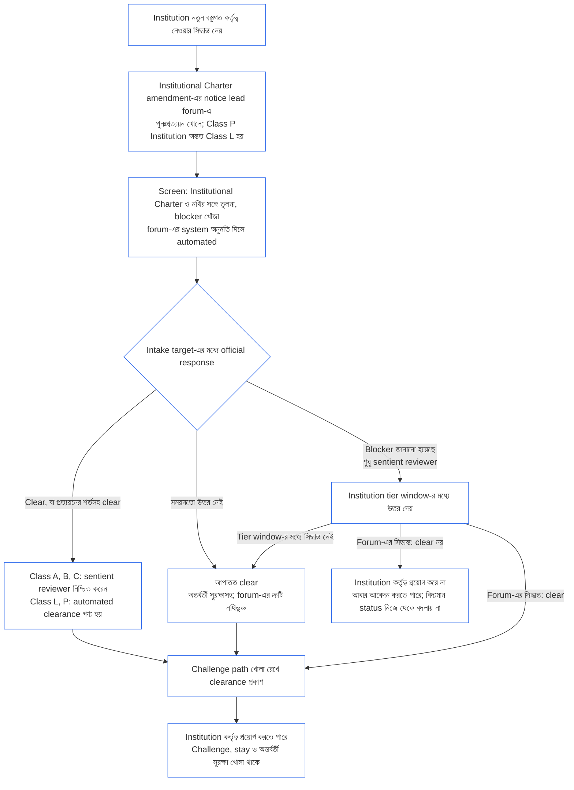

#### 7.4 Institution-এর প্রত্যয়ন অস্বীকার ও প্রত্যাহার

*সহজ ভাষায়: প্রত্যয়ন অস্বীকার মানে প্রত্যয়ন দেওয়া হবে না; প্রত্যাহার মানে আগে থাকা প্রত্যয়ন ফিরিয়ে নেওয়া। দুটিই বাস্তব পরিণতি। কোনোটিই Institution বন্ধ করে দেয় না।*

Institution-এর ক্ষেত্রে [Chapter Nine Part B §7.4 Denial and Revocation](core_09.005_system_alignment_certification_record_process.md#74-denial-and-revocation) নিচের পরিবর্তনসহ প্রযোজ্য:

- **কারণ ও প্রক্রিয়া:** Chapter Nine Part B §7.4 Denial and Revocation অপরিবর্তিতভাবে এগুলো নির্ধারণ করে:
  - **কারণ** ([Chapter Nine Part B §7.4.2 When denial or revocation is required](core_09.005_system_alignment_certification_record_process.md#742-when-denial-or-revocation-is-required)):
    - **অস্বীকৃতি,** যখন কোনো প্রত্যয়ন নেই: প্রস্তুতি-যাচাইয়ে Institution-কে অনিচ্ছুক, অথবা ইচ্ছা ও সক্ষমতা কোনোটিই নেই বলে পাওয়া যায়; অথবা ইচ্ছুক কিন্তু সক্ষম নয়, এবং সময়মতো সীমিততর পরিধি, সহায়তা বা হস্তান্তরে ঘাটতি পূরণ হয় না; অথবা একবারের deferral শেষ হলেও প্রস্তুতি দেখানো যায়নি।
    - **প্রত্যাহার,** যখন প্রত্যয়ন আছে: নোটিশ ও উত্তর দেওয়ার সুযোগের পর একই প্রস্তুতি-সংক্রান্ত সিদ্ধান্ত পাওয়া। আরও রয়েছে: কোনো শর্ত দুইবার পূরণ না করা বা বস্তুগতভাবে লঙ্ঘন, প্রমাণ মিথ্যা/জাল/গোপন প্রমাণিত হওয়া, অথবা আবশ্যক প্রমাণের ধাপ সময়সীমায় সম্পন্ন না করা।
    - **এর বদলে conditional certification নয়:** অস্বীকৃতি বা প্রত্যাহারের এই কারণগুলোর কোনোটি পূরণ হলে forum-কে প্রত্যয়ন অস্বীকার বা প্রত্যাহার করতে হবে। প্রত্যয়নের শর্ত জুড়ে প্রত্যয়ন মঞ্জুর বা চালু রেখে অস্বীকৃতি বা প্রত্যাহারের কারণের উত্তর দেওয়া যাবে না।
  - **আগে সুরক্ষা** ([Chapter Nine Part B §7.4.3 Protection first](core_09.005_system_alignment_certification_record_process.md#743-protection-first)):
    - **কীসে প্রভাব পড়ে:** অস্বীকৃতি ও প্রত্যাহার প্রত্যয়নের status-এ প্রভাব ফেলে। এগুলো একা Institution বন্ধ করে না।
    - **কার্যকর হওয়ার আগে:** forum অন্তর্বর্তী সুরক্ষা ও নির্ভরতার সীমা জানায়।
  - **প্রক্রিয়া** ([Chapter Nine Part B §7.4.4 Process](core_09.005_system_alignment_certification_record_process.md#744-process)):
    - **আগে জানানো:** অস্বীকৃতি বা প্রত্যাহারের আগে Institution-কে সিদ্ধান্ত ও প্রমাণের notice, উত্তর বা প্রমাণের ধাপ দেখানোর সংক্ষিপ্ত সময়সীমা, এবং আপত্তিযোগ্যতার ধারা দিয়ে সিদ্ধান্ত challenge করার সুযোগ দিতে হবে।
    - **কারণ:** সিদ্ধান্তের কারণ নথিতে উল্লেখ থাকবে।
    - **জরুরি সুরক্ষা** ([Chapter Nine Part B §6.2.3 Urgent protection](core_09.005_system_alignment_certification_record_process.md#623-urgent-protection)): notice, উত্তর বা সিদ্ধান্তের অপেক্ষা না করে সঙ্গে সঙ্গে স্থগিতাদেশ, অন্তর্বর্তী সুরক্ষা বা নির্ভরতার সীমা আরোপ হতে পারে। পরে প্রক্রিয়া চলবে এবং ব্যবস্থাটি নথিতে লেখা হবে।
  - **স্থায়ী নিষেধ নয়:** যার প্রত্যয়ন অস্বীকৃত বা প্রত্যাহৃত হয়েছে, সেই operator আবার আবেদন করতে পারে।
- **কার পরিবর্তে শব্দটি পড়তে হবে:**
  - **Operator:** Chapter Nine Part B §7.4 Denial and Revocation-এ যেখানে “operator” বলা হয়েছে, সেখানে Institution-এর শাসনকারী কর্তৃপক্ষ পড়তে হবে।
  - **System-এর সিদ্ধান্ত:** যেখানে “system findings” বলা হয়েছে, সেখানে প্রাতিষ্ঠানিক সিদ্ধান্ত পড়তে হবে।
- **প্রভাব:** প্রভাব রয়েছে [§7.5 Effects of denial and revocation for an Institution](#75-effects-of-denial-and-revocation-for-an-institution)-এ; [Chapter Nine Part B §7.5 Effects of Denial and Revocation](core_09.005_system_alignment_certification_record_process.md#75-effects-of-denial-and-revocation)-এর প্রভাব নয়।
- **একটি System:** ঠিক একটি System চালানো Institution-এর one-System evaluation হয় ([§1.1 Who is certified](#11-who-is-certified))। প্রতিটি ফলাফলের নিজস্ব অস্বীকৃতি বা প্রত্যাহারের কারণ থাকে, তাই একটি System-যুক্ত Institution-কে একাধিক System-যুক্ত Institution-এর চেয়ে খারাপভাবে দেখা হয় না:
  - **System:** কেবল System-এর নিজস্ব সিদ্ধান্তের ওপর দাঁড়ানো System-সংক্রান্ত কারণেই Chapter Nine Part B §7.4 Denial and Revocation অনুযায়ী প্রত্যয়ন অস্বীকৃত বা প্রত্যাহৃত হয়। কেবল প্রাতিষ্ঠানিক বিষয়গুলোর ওপর ( [§3 Whole-Institution Certification Evaluation](#3-whole-institution-certification-evaluation)-এর বিষয় 1–5, 7 ও 8 এবং Institution-এর নিজস্ব [§4 Evaluations Where Implicated](#4-evaluations-where-implicated) ও [§5 Rights-Floor and Domain Evaluations](#5-rights-floor-and-domain-evaluations)-এর মূল্যায়ন) দাঁড়ানো প্রাতিষ্ঠানিক কারণ System-এর প্রত্যয়ন অস্বীকার বা প্রত্যাহার করে না।
  - **Institution:** কেবল প্রাতিষ্ঠানিক সিদ্ধান্তের ওপর দাঁড়ানো প্রাতিষ্ঠানিক কারণ থাকলেই, [§7.5 Effects of denial and revocation for an Institution](#75-effects-of-denial-and-revocation-for-an-institution)-এর প্রভাবসহ Not Certified হিসেবে প্রকাশিত হবে। [Chapter Nine Part C §9.3.3 Cause of misalignment](core_09.010_system_alignment_certification_record_recertification.md#933-cause-of-misalignment)-এর মতো কারণ-সিদ্ধান্ত Institution-এর মধ্যে কারণ স্থাপন না করলে, System-সংক্রান্ত কারণ Institution-এর status যেমন ছিল তেমনই রাখে। পরীক্ষাটি [§9.5 Cascade from System certifications](#95-cascade-from-system-certifications)-এর নিয়ম 2-এ আছে; সেখানে এমন কারণকে *institutional cause* বলা হয়েছে। এ বিভাগে যেমন বলা হয়েছে, §9.5 Cascade from System certifications-এর নিয়ম 1 ও 2 one-System evaluation-এ প্রযোজ্য; §9.5-এর বাকি অংশ প্রযোজ্য নয়।
  - **উভয়:** দুইয়ের ওপর দাঁড়ানো যৌথ কারণ উভয় ফলই তৈরি করে। Institution-এর শাসনকারী কর্তৃপক্ষের আচরণ হলে (অনিচ্ছা, মিথ্যা/জাল/গোপন প্রমাণ, কোনো প্রত্যয়ন-শর্ত দুইবার পূরণ না করা বা বস্তুগত লঙ্ঘন, অথবা আবশ্যক প্রমাণের ধাপ না-করা), অথবা System নিজেই করেছে বলে [Chapter Nine Part A §3.1 Governance, Incentive, and Contestability Discipline](core_09.000_system_alignment_certification_evaluation.md#31-governance-incentive-and-contestability-discipline)-এ কোনো তথ্য নির্ধারিত হলে — এবং System Institution-এর নথি থেকে লিংকে নেওয়া তথ্য না হলে — অস্বীকৃতি বা প্রত্যাহারের কারণ যৌথ। কোন কারণ কোন ফল সমর্থন করে, Institutional Certification Record-এ তা বলা হবে।
  - **দুটি status line:** একটি নথিতে System-এর status line এবং Institution-এর status line থাকবে। Institution-এর এখনও কোনো প্রত্যয়ন না থাকলে, System-সংক্রান্ত কারণই একমাত্র অস্বীকৃতির কারণ হলে, [§9.3.1 The two statuses](#931-the-two-statuses)-এর নিয়মে Institution-এর নিজস্ব প্রাতিষ্ঠানিক সিদ্ধান্ত অনুযায়ী তার পর্ব শেষ হবে (provisional certification, নথিতে নির্ভরতার সীমা উল্লেখসহ)। এটি Not Certified নয়; এবং [§6.3 Forums, certifiers, and record offices as institutions](#63-forums-certifiers-and-record-offices-as-institutions)-এর আসন-নিষেধাজ্ঞা ও [§7.5 Effects of denial and revocation for an Institution](#75-effects-of-denial-and-revocation-for-an-institution)-এর প্রভাব এতে প্রযোজ্য নয়। একাধিক System-যুক্ত Institution-এর মতোই, System-এর অস্বীকৃতি বা প্রত্যাহার [§9.5 Cascade from System certifications](#95-cascade-from-system-certifications)-এর নিয়ম 1-এর অধীনে Institution-এর একটি সূচক।

#### 7.5 Institution-এর অস্বীকৃতি ও প্রত্যাহারের প্রভাব

*সহজ ভাষায়: অস্বীকৃতি বা প্রত্যাহার বদলে দেয় Institution নিজের সম্পর্কে কী বলতে পারে, কাদের জানানো হবে, তার System-গুলোর পর্যালোচনায় তার মর্যাদার ওজন কত, এবং এরপর বিষয়টি কোথায় যাবে। এটি একা Institution বন্ধ করে না।*

**প্রভাব:** কোনো gate নেই বলে ([§1.2 গঠন বা পরিচালনার জন্য অনুমতি বা প্রবেশ-শর্ত নেই](#12-no-permission-and-no-gate-on-forming-or-running)), অস্বীকৃতি বা প্রত্যাহারের কেবল নিচের প্রভাবগুলো রয়েছে:

1. **Status:** Institution-কে Not Certified হিসেবে প্রকাশ করা হয় এবং নিজেকে certified বলে বর্ণনা করতে পারে না।
2. **Notice:** Institution-এর ওপর যারা নির্ভর করে তাদের জানানো হয়, এবং তার portfolio-র প্রতিটি System-এর forum-কেও জানানো হয়। ফলাফল প্রকাশকারী lead forum নিশ্চিত করবে যে তা করা হয়েছে। [§9.6 Reopening the Institution's Systems](#96-reopening-the-institutions-systems) প্রযোজ্য হলে, একই notice-এ পুনরায় খোলার অনুরোধ থাকবে এবং §9.6 অনুযায়ী প্রেরক, সময়সীমা ও ডিফল্ট নিয়মে চলবে; নথির *Systems notified* অংশে দুই ধরনের notice-ই থাকবে।
3. **এর System-গুলোর প্রত্যয়নে ওজন:**
   - portfolio-র প্রতিটি System প্রত্যয়নের সময়, [Chapter Nine Part A §3.1 Governance, Incentive, and Contestability Discipline](core_09.000_system_alignment_certification_evaluation.md#31-governance-incentive-and-contestability-discipline)-এর অধীনে এ status প্রতিকূল প্রমাণ।
   - নতুন System-এর কার্যক্রম শুরু বা বস্তুগত সম্প্রসারণে, প্রস্তাবককে দেখাতে হবে সিদ্ধান্ত সত্ত্বেও যে প্রাতিষ্ঠানিক তথ্যের ওপর সে নির্ভর করে তা যথেষ্ট শক্ত আছে।
   - status নিজে কোনো System প্রত্যয়িত বা অবরুদ্ধ করে না। System-এর নিজস্ব প্রত্যয়ন-পর্ব সিদ্ধান্ত দেয়।
4. **অন্য সংস্থার প্রত্যয়নে আসন:** Not Certified থাকা অবস্থায় Institution [§6.3 Forums, certifiers, and record offices as institutions](#63-forums-certifiers-and-record-offices-as-institutions)-এর নিয়মে আসনগুলো ছেড়ে দেয়।
5. **Referral:** শনাক্ত প্রত্যয়ন-সমস্যার ধরন নিয়ে এখতিয়ারসম্পন্ন forum-এ lead forum বিষয়টি পাঠায়। তিনটি পথ রয়েছে:
   - **ব্যর্থতা ও শাস্তি নির্ধারণকারী forum-এ:** নিচের কোনোটি হলে lead forum **CI-12.210** (*প্রাতিষ্ঠানিক ব্যর্থতা ও বিলুপ্তি*) এবং **CI-12.215** (*প্রাতিষ্ঠানিক জবাবদিহি ও শাস্তি*) অনুযায়ী এখতিয়ারসম্পন্ন forum-এ বিষয় পাঠায়:
     - সিদ্ধান্তে Institution সক্ষম কিন্তু অনিচ্ছুক;
     - গোপনকরণ বা জাল প্রমাণের ওপর প্রত্যাহার দাঁড়ায়; অথবা
     - [Chapter Seven §6 When a Holder Fails the Formation Check](core_07.000_charters.md#6-when-a-holder-fails-the-formation-check) (*নিষ্পত্তির সময়সীমা*)-এ দেওয়া সময়ের মধ্যে ব্যর্থ formation check নিষ্পত্তি হয়নি।

     স্থগিতকরণ, receivership, কাঠামোগত পৃথকীকরণ বা বিলুপ্তির সিদ্ধান্ত কেবল ওই forum নেয়। এই অধ্যায় এগুলোর কোনোটি তৈরি করে না।
   - **নামযুক্ত sentient-এর এখতিয়ারসম্পন্ন forum-এ:** প্রত্যয়নের সিদ্ধান্তে দপ্তরধারী সত্যনিষ্ঠ নয় বলে পাওয়া গেলে, অথবা কোনো লঙ্ঘনের জন্য sentient Institution-কে মাধ্যম হিসেবে ব্যবহার করেছে বলে পাওয়া গেলে, lead forum ওই তথ্য sentient-এর ওপর এখতিয়ারসম্পন্ন forum-এও পাঠায়।
   - **Lock বা Interim Hold-এ:** লঙ্ঘনের যাচাইকৃত সিদ্ধান্তের জন্য বিষয়টি [Chapter Twelve §5.5 Special locks](core_12.000_standing_integration.md#55-special-locks)-এর Institutional Authority Standing Lock-এ যায়। কেবল [Interim Hold](core_05.035_band_accountability.md#interim-hold)-এর কারণ পূরণ হলে বিষয়টি [Chapter Fourteen §5 Interim hold on a named sentient's pathway](core_14.000_forum.md#interim-hold-on-a-named-sentients-pathway)-এর অধীনে Interim Hold-এ যায়। hold ওই sentient-এর কর্তৃত্বে প্রযোজ্য, Institution-এ কখনো নয়।
6. **অবস্থান:** কেবল [§11 Relationship to Standing](#11-relationship-to-standing)-এর মাধ্যমে। প্রথম প্রত্যয়নের অস্বীকৃতির ক্ষেত্রেও এ নিয়ম প্রযোজ্য: তার পেছনের সিদ্ধান্তগুলো [§11.2 Every certification outcome](#112-every-certification-outcome)-এর অধীনে ইনপুট দিতে পারে, অন্য ফলাফলের মতো একই শর্তে।

Not Certified Institution-এর অস্তিত্ব, Institutional Charter প্রকাশ, পরিচালনা এবং Chapter Nine Part B §7.4 (*স্থায়ী নিষেধ নয়*)-এর শর্তে পুনরায় আবেদন চালু থাকতে পারে। নতুন বস্তুগত কর্তৃত্ব প্রয়োগের আগে [§9.2.2 Recertification for new material authority](#922-recertification-for-new-material-authority)-এর অধীনে তার নিষ্পত্তির জন্য অপেক্ষা করতে হবে।

Not Certified status **Article XI-E** (*প্রতিষ্ঠান গঠন ও ব্যবসা সৃষ্টি*)-এর তিনটি সংকীর্ণ gate-এর কোনোটিই খোলে না:

- নামযুক্ত sentient-এর কর্তৃত্বে lock;
- নামযুক্ত sentient-এর কর্তৃত্বে Interim Hold; এবং
- Operating Party-র নিজের ওপর lock। **CI-12.210 §4** (*বিলুপ্তি*)-এর Dissolution Reformation Lock-এর মতো কোনো lock সত্যিই Institution-এর ওপর থাকলেই কেবল তা Institution-কে বাধে। Not Certified status এমন lock নয়।

[Article XI-E](core_06.005_rights_part_b.md#article-xi-e-institutional-formation-and-business-creation) (*প্রতিষ্ঠান গঠন ও ব্যবসা সৃষ্টি*)-এর সীমার অধীনে কোনো Operating Party গঠনের অধিকার থেকে বাদ পড়ে কি না, ওই Article-এর শর্তে forum-গুলো সিদ্ধান্ত নেবে। এই অধ্যায় সে সিদ্ধান্ত দেয় না।

### 8. Institutional Certification Record

<strong>অনুসরণপথ</strong>

- **পূর্ববর্তী ভিত্তি:**
  - [Chapter Nine Part C §8 System Certification Record](core_09.010_system_alignment_certification_record_recertification.md#8-system-certification-record) (9.010 §8), যার মধ্যে [§8.1 Minimum record contents](core_09.010_system_alignment_certification_record_recertification.md#81-minimum-record-contents) এবং [§8.2 Transparency and auditability of the record](core_09.010_system_alignment_certification_record_recertification.md#82-transparency-and-auditability-of-the-record) রয়েছে;
  - [Chapter Eight §8 Act Records and Attributable Handoffs](core_08.000_functional_independence_separation_of_duties.md#8-act-records-and-attributable-handoffs) (8.000 §8);
  - [Materially Binding Act Record](core_05.035_band_accountability.md#materially-binding-act-record);
  - [CS-6.310 Part B §9.3 Type O](corpus_systems/cs_06.310_data_classifications.md#93-type-o-open-public-oversight-baseline-disclosure-data)।
- **পরবর্তী ধাপ:** [§9](#9-recertification-and-reopening); [§10](#10-challenging-a-certification); [§11](#11-relationship-to-standing)।
- **এগুলোর সঙ্গে পড়ুন:**
  - [Institutional Certification Record](core_05.040_band_continuity.md#institutional-certification-record);
  - [Charter Role Map](core_05.040_band_continuity.md#charter-role-map)।

 

*সহজ ভাষায়: ঘোষিত ফল Institution-এর নিয়ন্ত্রণে নেই এমন দপ্তরের রাখা নথিতে থাকে, এবং নথিটিকে challenge করা যায়।*

এই বিভাগ Institution-এর জন্য **Phase V, Record**।

**Institutional Certification Record** হলো একটি নির্দিষ্ট Institution, Institutional Charter-এর একটি সংস্করণ, একটি পরিধি, নথির একটি সময়সীমা এবং একটি সিদ্ধান্ত-প্রেক্ষাপট নিয়ে সীমাবদ্ধ ও পর্যালোচনাযোগ্য নথি। এটি [Materially Binding Act Record](core_05.035_band_accountability.md#materially-binding-act-record) এবং [Chapter Eight §8 Act Records and Attributable Handoffs](core_08.000_functional_independence_separation_of_duties.md#8-act-records-and-attributable-handoffs) পূরণ ও সম্প্রসারিত করে। ক্রমের ধাপ 1-এ record seat ধারক এটি খোলে এবং ফলাফলের সঙ্গে সম্পূর্ণ করে। সিদ্ধান্তের জন্য দ্বিতীয় কোনো নথি খোলা হয় না। [Chapter Nine Part C §8 System Certification Record](core_09.010_system_alignment_certification_record_recertification.md#8-system-certification-record)-এর নথি-রক্ষার নিয়ম (Record Versions, সম্পূর্ণ নথিকে একই স্থানে বদলানো যাবে না, change request log করতে হবে, এবং challenge Institutional Certification Record স্থগিত করে না) এখানে প্রযোজ্য; System Version-এর বদলে Institutional Charter Version হবে।

#### 8.1 নথির ন্যূনতম বিষয়বস্তু

নথিতে অন্তত নিচের তথ্য শনাক্ত করতে হবে:

- **Institution-এর পরিচয়, পরিধি ও status:** Institution, তার শাসনকারী কর্তৃপক্ষ, Institutional Charter-এর সংস্করণ (অথবা সেটির বিকল্প হিসেবে কাজ করা System Charter), এবং পর্যালোচনার status;
- **আগের নথি:** এই প্রত্যয়ন-পর্বের আগের সম্পূর্ণ Institutional Certification Record, যদি থাকে;
- **Institution-এর শ্রেণিবিন্যাস:** কারণসহ [§2.1 Institution class](#21-institution-class)-এর অধীনে শ্রেণি;
- **Portfolio ও উল্লেখিত System নথি:** portfolio-র প্রতিটি System, তার System Charter-এর সংস্করণ এবং উল্লেখিত System Certification Record — সংস্করণ, status, মেয়াদ শেষের তারিখ, ও নথিতে থাকা regression test-এর ফলসহ। কার্যকর কোনো নথি না-থাকা System-এর কারণও লিখতে হবে;
- **তথ্যের ধরন ও ব্যবস্থাপনা:** কোনো System-এর বাইরে Institution যে তথ্য পরিচালনা করে, তার বস্তুগতভাবে পরিধিভুক্ত তথ্যের ধরন এবং প্রযোজ্য সবচেয়ে কঠোর শ্রেণিবিন্যাস অনুযায়ী প্রতিটির ব্যবস্থাপনা। এটি Institutional Certification Record-এ System Data Types Record-এর বিকল্প। [Chapter Nine Part A §3.4.4 Scheduled data-type re-evaluation](core_09.000_system_alignment_certification_evaluation.md#344-scheduled-data-type-re-evaluation)-এর সময়সূচিতে তা পুনর্মূল্যায়িত হবে। System-এর ভেতরে পরিচালিত তথ্য একবারই সেই System-এর নথিতে পাওয়া যায় এবং এখানে উল্লেখ হয়;
- **প্রাতিষ্ঠানিক সিদ্ধান্ত:** [§3 Whole-Institution Certification Evaluation](#3-whole-institution-certification-evaluation)-এর আটটি বিষয়ে, Institution-এর জন্য প্রযোজ্য Chapter Nine Part A §3 Whole-System Certification Evaluation-এর আরও দুটি অংশে (পদ্ধতিগত ঝুঁকি এবং তথ্যের ধরন ও ব্যবস্থাপনা), এবং [§4 Evaluations Where Implicated](#4-evaluations-where-implicated) বা [§5 Rights-Floor and Domain Evaluations](#5-rights-floor-and-domain-evaluations)-এর অধীনে করা যেকোনো মূল্যায়নের সিদ্ধান্ত—প্রতিটির প্রমাণসহ;
- **কার্যকর Charter Role Map সংস্করণ** এবং এই প্রত্যয়ন-পর্বে চারটি আসনের প্রতিটির অবস্থান, স্বাধীন পথসহ;
- **ফোরাম তত্ত্বাবধান ও কার্যগত স্বাধীনতার নথি:** lead forum ও প্রতিটি component authority, এবং আসনগুলো কীভাবে পৃথক রাখা হয়েছে;
- **Challenge path:** প্রকাশিত নথির challenge path, গ্রহণকারী, কীভাবে জমা দিতে হয় এবং তার সময়সীমা, [Chapter Nine Part C §10.2 Contestability paths](core_09.010_system_alignment_certification_record_recertification.md#102-contestability-paths)-এর নিয়মে;
- **পর্যালোচনা ও সিদ্ধান্তের সময় উত্থাপিত উদ্বেগ;**
- **পর্যালোচনায় জমার log:** [Chapter Nine Part B §6.2.4 Participation during review](core_09.005_system_alignment_certification_record_process.md#624-participation-during-review)-এর অধীনে record seat ধারকের রাখা log, নথির সঙ্গে প্রকাশিত;
- **কারণের সিদ্ধান্ত:** অসামঞ্জস্যের প্রতিটি কারণের জন্য [Chapter Nine Part C §9.3.3 Cause of misalignment](core_09.010_system_alignment_certification_record_recertification.md#933-cause-of-misalignment)-এর নিয়মে, কারণ Institution-এ নাকি System-এ তা-সহ;
- **প্রতিকার-প্রস্তুতি:** অসামঞ্জস্য পাওয়া গেলে, [Chapter Nine Part C §8.1 Minimum record contents](core_09.010_system_alignment_certification_record_recertification.md#81-minimum-record-contents)-এর প্রয়োজনীয় সিদ্ধান্ত ও প্রমাণ Institution-এর জন্য [§7.4 Denial and revocation for an Institution](#74-denial-and-revocation-for-an-institution)-এর নিয়মে উল্লেখ করতে হবে;
- **ফলাফল, status ও নির্ভরতার সীমা** (one-System evaluation-এ System-এর এক লাইন এবং Institution-এর এক লাইন);
- **যেসব System-কে notice দেওয়া হয়েছে:** [§9.6 Reopening the Institution's Systems](#96-reopening-the-institutions-systems)-এর অধীনে notice পাওয়া প্রতিটি System এবং notice-এর তারিখ; এবং
- **পরিচালনা-পরিকল্পনা:** দায়িত্বপ্রাপ্ত ব্যক্তি, সময়সীমা, পর্যবেক্ষণ ও সূচক, প্রত্যয়নের শর্ত, এবং যাচাইয়ের মানদণ্ড।

[Chapter Nine Part C §8.1.10 Completeness](core_09.010_system_alignment_certification_record_recertification.md#8110-completeness)-এর নিয়মে, প্রযোজ্য কোনো মূল্যায়নের সিদ্ধান্ত, বা পর্যালোচনা বা ফল নির্ধারণে ওঠা কোনো উদ্বেগ, আপত্তি বা ভিন্নমত বাদ থাকলে নথিটি অসম্পূর্ণ।

Institutional Certification Record-এর বদলে শুধু System Certification Record, Institution-এর নিজের প্রতিবেদন বা নিজের দেওয়া প্রত্যয়ন দিলে এই শর্ত পূরণ হয় না।

#### 8.2 নথির স্বচ্ছতা ও নিরীক্ষাযোগ্যতা

Institutional Certification Record-এর ক্ষেত্রে [Chapter Nine Part C §8.2 Transparency and auditability of the record](core_09.010_system_alignment_certification_record_recertification.md#82-transparency-and-auditability-of-the-record)-এর অখণ্ডতার নিয়ম প্রযোজ্য।

**Type O।** সম্পূর্ণ Institutional Certification Record হলো **Type O** প্রত্যয়ন-তথ্য। [CS-6.310 Part B §9.3 Type O](corpus_systems/cs_06.310_data_classifications.md#93-type-o-open-public-oversight-baseline-disclosure-data)-এর অধীনে আইনসম্মত বিকল্পসহ জনসাধারণের ভিত্তিগত বিশদতার স্তরে তা প্রকাশ করা হবে।

### 9. পুনঃপ্রত্যয়ন ও পুনরায় খোলা

<strong>অনুসরণপথ</strong>

- **পূর্ববর্তী ভিত্তি:**
  - [Chapter Nine Part C §9 Recertification and Reopening](core_09.010_system_alignment_certification_record_recertification.md#9-recertification-and-reopening) (9.010 §9), যার মধ্যে [§9.3 Provisional and full certification](core_09.010_system_alignment_certification_record_recertification.md#93-provisional-and-full-certification) এবং [§9.4 Non-evasion](core_09.010_system_alignment_certification_record_recertification.md#94-non-evasion) রয়েছে;
  - [Chapter Nine Part B §6.2.3 Urgent protection](core_09.005_system_alignment_certification_record_process.md#623-urgent-protection) (9.005 §6.2.3) এবং [Chapter Nine Part A §3.1 Governance, Incentive, and Contestability Discipline](core_09.000_system_alignment_certification_evaluation.md#31-governance-incentive-and-contestability-discipline) (9.000 §3.1);
  - **CF-14.445 §3.1** (*পর্যায়ের লক্ষ্য ও সর্বোচ্চ সীমা*);
  - [Chapter Seven §7 Amendment and Review](core_07.000_charters.md#7-amendment-review-and-scope-misalignment) (7.000 §7);
  - [Chapter Three §1 Definition Integrity and Anti-Evasion Constraints](core_03.000_definition_integrity.md#1-definition-integrity-and-anti-evasion-constraints) (3.000 §1) এবং [§2.1 Common Evasion Patterns](core_03.000_definition_integrity.md#21-common-evasion-patterns);
  - [Chapter Fourteen §3 Transfer, consolidation, and coordination](core_14.000_forum.md#3-transfer-consolidation-and-coordination--continuity-and-anti-capture) (14.000 §3) এবং [§2.1 Lead default limits](core_14.000_forum.md#21-lead-default-limits);
  - [Chapter One §19.6 Keeping Responsibility When Ownership or Structure Changes](core_01.010_stewardship_capacity_principles.md#196-keeping-responsibility-when-ownership-or-structure-changes) (1.010 §19.6)।
- **পরবর্তী ধাপ:** [§10](#10-challenging-a-certification); [§11](#11-relationship-to-standing); [Chapter Fourteen](core_14.000_forum.md#chapter-fourteen-forums-and-jurisdiction) (14.000)।
- **এগুলোর সঙ্গে পড়ুন:**
  - [Recertification](core_05.040_band_continuity.md#recertification);
  - [Provisional Certification](core_05.040_band_continuity.md#provisional-certification);
  - [Full Certification](core_05.040_band_continuity.md#full-certification);
  - **CF-14.435 §6** (*নিজের তদন্ত নিজে নয়*)।

 

*সহজ ভাষায়: Institution-এর প্রত্যয়ন নির্ধারিত সময়সূচিতে এবং বস্তুগত কিছু বদলালে আবার যাচাই হয়। এর কোনো System প্রত্যয়ন হারালে, Institution তার থেকে Institution সম্পর্কে যে তথ্য মেলে তার জবাব দেয়, তার বেশি নয়। Institution-এর শাসনে ত্রুটি পাওয়া গেলে তার System-গুলোও আবার দেখা হয়।*

এই বিভাগ Institution-এর জন্য **Phase VI, Operate**।

#### 9.1 পর্যবেক্ষণ, পুনঃপ্রত্যয়ন ও status

[Chapter Nine Part C §9 Recertification and Reopening](core_09.010_system_alignment_certification_record_recertification.md#9-recertification-and-reopening) (*পর্যবেক্ষণ ও সাড়া; প্রতিটি প্রত্যয়ন-পর্বের জন্য নতুন নথি; validation*) এবং [§9.3 Provisional and full certification](core_09.010_system_alignment_certification_record_recertification.md#93-provisional-and-full-certification) নিচের প্রতিস্থাপনসহ Institutional Certification Record-এর ক্ষেত্রে প্রযোজ্য:

- Institution-এর শাসনকারী কর্তৃপক্ষ প্রস্তাবক;
- সময়সূচি Institution-এর শ্রেণির সঙ্গে মাপ নির্ধারণ করে; এবং
- প্রতিটি প্রত্যয়ন-পর্বে আগেরটির সঙ্গে লিংক করা নতুন নথি খোলে।

সম্পূর্ণ নথি যেমন ছিল তেমন সংরক্ষিত থাকবে এবং challenge-এর জন্য উন্মুক্ত থাকবে।

#### 9.2 পুনরায় খোলার কারণ

Institution-এর শ্রেণির জন্য [Chapter Fourteen §6 Timely resolution, materiality tiers, and anti-delay discipline](core_14.000_forum.md#review-cadence) (*Review cadence*)-এ নির্ধারিত সময়সূচিতে Institutional Certification Record পুনঃপ্রত্যয়িত হবে; এবং ওই সময়সূচির মধ্যবিন্দুতে Institution-এর নিরীক্ষা হবে। নিচের যেকোনো বিষয় বস্তুগত হলে পর্যালোচনা আবারও খোলে:

- **Chapter Nine Part C-এর কারণ**, Institution-এর ক্ষেত্রে প্রযোজ্য [Chapter Nine Part C §9.2 Reopening triggers](core_09.010_system_alignment_certification_record_recertification.md#92-reopening-triggers)-এর তালিকা অনুযায়ী:
  - তার কার্যক্রম বা প্রেক্ষাপটে বস্তুগত পরিবর্তন;
  - গোপন আচরণ;
  - নির্ভরতা বৃদ্ধি, এর মধ্যে ভাগ করা ভিত্তিতে তার ফিরিয়ে দেওয়া অংশে উল্লেখযোগ্য হ্রাস;
  - নতুন ঝুঁকি;
  - ঘটনার ইতিহাস;
  - অংশীজনের প্রমাণ;
  - পরিবেশগত আপত্তি;
  - বিশ্বাসযোগ্য challenge;
  - ভুল শ্রেণিবিন্যাস বা সময়মতো শ্রেণি পুনর্মূল্যায়ন না হওয়া;
  - তথ্যের ধরন বা ব্যবস্থাপনার অসামঞ্জস্য, অথবা তথ্যের ধরন পুনর্মূল্যায়নে বিলম্ব বা বাদ পড়া; এবং
  - প্রযোজ্য কোনো মূল্যায়নে অসামঞ্জস্য বা ত্রুটি পাওয়া;
- **Institutional Charter-এর ঘটনা:**
  - Institutional Charter সংশোধন;
  - Institutional Charter ও পর্যবেক্ষিত কার্যক্রমের অমিল;
  - চার্টারে নির্ধারিত পরিধির বস্তুগত বাইরে কার্যক্রম; অথবা
  - নির্ধারিত Institutional Charter পর্যালোচনা সময়মতো না হওয়া;
- **Portfolio-র পরিবর্তন:**
  - Institution-এর portfolio-তে System যোগ, অবসর, একীভূত, বিভক্ত, বা Institution-এর কাছে/কাছ থেকে হস্তান্তর; অথবা
  - কোনো System কে নিয়ন্ত্রণ করে তার পরিবর্তন;
- **নতুন বস্তুগত কর্তৃত্ব:** Institution [Domain-Specific Materiality](core_05.050_band_oversight.md#domain-specific-materiality)-এর অধীনে অন্যদের ওপর বস্তুগত কর্তৃত্ব নেয়, যা তার Institutional Charter ও বর্তমান নথিতে নেই ([§9.2.1 What counts as new material authority](#921-what-counts-as-new-material-authority)-এ সংজ্ঞায়িত; প্রয়োজনীয় পুনঃপ্রত্যয়ন [§9.2.2 Recertification for new material authority](#922-recertification-for-new-material-authority)-এ);
- **মালিকানা, নিয়ন্ত্রণ বা কাঠামোর পরিবর্তন,** যার মধ্যে মূল্যায়িত কর্তৃত্ব-ধারার বাইরে কোনো পরিবর্তন ([Chapter One §19.6 Keeping Responsibility When Ownership or Structure Changes](core_01.010_stewardship_capacity_principles.md#196-keeping-responsibility-when-ownership-or-structure-changes));
- **পুরস্কার ও প্রণোদনার পরিবর্তন:** Institution-এর বেতন, পদোন্নতি, লক্ষ্য বা পুরস্কার-কাঠামোতে বস্তুগত পরিবর্তন;
- **Role Map বা হেফাজতের ত্রুটি:**
  - কোনো আসন নির্ধারিত নয়;
  - বিকল্প নিয়োগ ছাড়া কোনো দপ্তর শূন্য; অথবা
  - নথির হেফাজতকারীকে Institution-এর নিয়ন্ত্রণরেখার ভেতরে আনা;
- **দপ্তরধারীর ঘটনা:**
  - আওতাভুক্ত দপ্তরের দপ্তরধারী বদল;
  - কে তা নিয়ন্ত্রণ করে তার পরিবর্তন;
  - দপ্তরধারীর ওপর যাচাইকৃত standing lock বা [Interim Hold](core_05.035_band_accountability.md#interim-hold); অথবা
  - formation check-এর বিবৃতি মিথ্যা বা অসম্পূর্ণ বলে সিদ্ধান্ত;
- **প্রস্তুতি-সংক্রান্ত ঘটনা**, [Chapter Nine Part B §7.3 Remediation Readiness: Willingness and Capacity to Correct](core_09.005_system_alignment_certification_record_process.md#73-remediation-readiness-willingness-and-capacity-to-correct)-এর অধীনে:
  - প্রমাণের ধাপ বা প্রত্যয়নের শর্তের সময়সীমা পেরিয়ে যাওয়া; অথবা
  - প্রস্তুতি-সংক্রান্ত মিথ্যা প্রমাণ; এবং
- **উল্লেখিত System-এর ঘটনা:** উল্লেখিত System Certification Record ব্যর্থ, প্রত্যাহৃত বা মেয়াদোত্তীর্ণ হয়েছে, যা §9.5 Cascade from System certifications-ও চালু করে; অথবা [§9.6 Reopening the Institution's Systems](#96-reopening-the-institutions-systems) ছাড়া অন্য কারণে আবার খোলা হয়েছে। §9.6-এর অধীনে Reopening the Institution's Systems ঘটলে, তা Institution-এর নিজস্ব সিদ্ধান্ত থেকে আসে এবং Institution-এর পর্যালোচনা আবার খোলে না।

বস্তুগত ও সময়োপযোগী কোনো কারণ দেখা দিলে ফোরামে সময়মতো পর্যালোচনা করতে হবে; পরবর্তী নির্ধারিত প্রত্যয়ন-পর্ব পর্যন্ত অপেক্ষা নয়। [Chapter Nine Part C §9.3.4 Tier windows](core_09.010_system_alignment_certification_record_recertification.md#934-tier-windows)-এর সময়সীমা ও বস্তুগততার tier প্রযোজ্য; presumptively tier Institution-এর শ্রেণির সঙ্গে মেলে।

##### 9.2.1 নতুন বস্তুগত কর্তৃত্ব হিসেবে কী গণ্য

নিচের দুই শর্তই পূরণ হলে কোনো কর্তৃত্ব **নতুন বস্তুগত কর্তৃত্ব**:

- **বস্তুগত:** এটি অন্যদের জন্য কিছু সিদ্ধান্ত, নির্দেশ, বণ্টন, সীমাবদ্ধ বা নিয়ন্ত্রণ করার কর্তৃত্ব, এবং [Domain-Specific Materiality](core_05.050_band_oversight.md#domain-specific-materiality)-এর অধীনে তাদের জন্য বস্তুগত।
- **আওতাভুক্ত নয়:** Institution-এর Institutional Charter বা বর্তমান Institutional Certification Record—কোনোটিতেই তা অন্তর্ভুক্ত নেই।

এর মধ্যে রয়েছে:

- অন্যদের ওপর নতুন কাজ, অথবা নতুন ধরনের সিদ্ধান্ত;
- Institution যে নতুন গোষ্ঠীর sentient-দের শাসন বা প্রভাবিত করে;
- Institution যে নতুন ক্ষেত্র, সম্পদ বা ভাগ করা System নিয়ন্ত্রণ করে;
- এমন পৌঁছ, যা কেবল সাধারণ নিয়ন্ত্রণাধীন Operating Party-গুলোর সঙ্গে বা একই ভাগ করা System-এ থাকা অন্যদের সঙ্গে একত্রে হিসাব করলে বস্তুগত ([Materiality Integrity Constraint](core_05.050_band_oversight.md#materiality-integrity-constraint); [Systemic Materiality](core_05.040_band_continuity.md#systemic-materiality)); এবং
- উপরের যেকোনোটির বস্তুগত পাইলট বা trial, যা [Domain-Specific Materiality](core_05.050_band_oversight.md#domain-specific-materiality)-এর অধীনে প্রকৃত পরিধি, জনগোষ্ঠী ও সময়কালের ভিত্তিতে বিচার করা হয়। এমন পাইলট ওই কর্তৃত্বই প্রয়োগ করে; তাই পূর্ণ কর্তৃত্বের মতোই পুনঃপ্রত্যয়নের আগে অপেক্ষা করবে, যেমন [Chapter Nine Part A §2.3 Pilot certification](core_09.000_system_alignment_certification_evaluation.md#23-pilot-certification)-এ System pilot-কে go-live ধরা হয়েছে। পাইলটের প্রকৃত পরিধি, জনগোষ্ঠী ও সময়কালের সঙ্গে পুনঃপ্রত্যয়নের মাত্রা মাপা হয়। ওই শর্তগুলোতে বস্তুগত নয় এমন পাইলট নতুন বস্তুগত কর্তৃত্ব নয়।

এর মধ্যে পড়ে না:

- **গঠনের সময় ঘোষিত কর্তৃত্ব:** Institution-এর প্রথম Institutional Charter-এ যে কর্তৃত্ব লেখা আছে; কারণ গঠনে কোনো gate নেই ([§1.2 গঠন বা পরিচালনার জন্য অনুমতি বা প্রবেশ-শর্ত নেই](#12-no-permission-and-no-gate-on-forming-or-running));
- **আওতাভুক্ত কাজের বৃদ্ধি:** নথিতে আগে মূল্যায়িত পরিধির মধ্যে বৃদ্ধি, যা ওপরের নির্ভরতা বৃদ্ধি ও বস্তুগত পরিবর্তনের কারণগুলো সামলায়; এবং
- **নতুন System:** নতুন System তার নিজস্ব প্রত্যয়নে কার্যক্রম শুরু করে ([Chapter Nine Part B §7.1 Go-Live Gate](core_09.005_system_alignment_certification_record_process.md#71-go-live-gate))। System Institution-কে এমন কর্তৃত্বও দিলে যা তার নথিতে নেই, সেই কর্তৃত্ব নতুন বস্তুগত কর্তৃত্ব।

কর্তৃত্বকে ভাগ বা ধাপে সাজিয়ে কোনো অংশই যেন নতুন বা বস্তুগত না হয় এমনভাবে ভাগ করলেও অপেক্ষা এড়ানো যায় না ([Chapter Nine Part C §9.4 Non-evasion](core_09.010_system_alignment_certification_record_recertification.md#94-non-evasion))। কর্তৃত্ব নতুন বস্তুগত কর্তৃত্ব কি না অস্পষ্ট হলে Institution notice দেয় এবং lead forum সিদ্ধান্ত নেয়।

##### 9.2.2 নতুন বস্তুগত কর্তৃত্বের জন্য পুনঃপ্রত্যয়ন

নতুন বস্তুগত কর্তৃত্ব নেওয়ার সিদ্ধান্ত নিলে Institution-কে পুনঃপ্রত্যয়িত হতে হবে এবং কর্তৃত্ব প্রয়োগের আগে ফলের জন্য অপেক্ষা করতে হবে। **Article XI-E** (*প্রতিষ্ঠান গঠন ও ব্যবসা সৃষ্টি*)-এ নির্ধারিত অপেক্ষা এটিই। প্রক্রিয়াটি:

- **আগে notice:** [Chapter Seven §7.1 Changing the document](core_07.000_charters.md#71-changing-the-document)-এ আগে থেকেই প্রয়োজনীয় Institutional Charter amendment-এর notice Institution lead forum-কে দেবে। ওই notice-এ পুনঃপ্রত্যয়ন শুরু হয়।
- **এখনও নথি নেই:** Institutional Certification Record নেই এমন Institution একই notice দেবে। এতে কেবল নতুন কর্তৃত্বে সীমিত প্রথম প্রত্যয়ন খোলে; [§3 Whole-Institution Certification Evaluation](#3-whole-institution-certification-evaluation) থেকে [§5 Rights-Floor and Domain Evaluations](#5-rights-floor-and-domain-evaluations) পর্যন্ত প্রযোজ্য মূল্যায়নে Institutional Charter-এর সঙ্গে মিলিয়ে তা বিচার হয়। প্রথম প্রত্যয়নের বাকি অংশ [§1.3 Window for the first certification](#13-window-for-the-first-certification)-এর সময়সীমায় চলবে (notice-এ পুনঃশ্রেণিবদ্ধ Class P Institution-এর ক্ষেত্রে notice থেকে শুরু হওয়া সময়সীমা), এবং নতুন কর্তৃত্বের জন্য অপেক্ষা ওই প্রথম প্রত্যয়নের ওপর নির্ভর করে না।
- **Tier-এর সময়সীমার মধ্যে:** [Chapter Nine Part C §9.3.4 Tier windows](core_09.010_system_alignment_certification_record_recertification.md#934-tier-windows)-এর সময়সীমায় পুনঃপ্রত্যয়ন চলবে; presumptively tier Institution-এর শ্রেণির সঙ্গে মেলে। সময়সীমা পেরিয়ে গেলে [Article XXVI-C](core_06.020_rights_part_e.md#article-xxvi-c-timely-resolution-and-anti-delay-floor) (*সময়মতো নিষ্পত্তি ও বিলম্ব-রোধী ন্যূনতম মান*) অনুযায়ী ব্যবস্থা; আর ফি ও অপেক্ষা বাধা হয়ে দাঁড়াতে পারবে না ([Avoidable Burden](core_05.040_band_continuity.md#avoidable-burden))।
- **যেখানে সম্ভব automated:** forum-এর System-গুলো অনুমতি দিলে notice, নতুন কর্তৃত্বের সঙ্গে Institutional Charter ও বর্তমান নথির তুলনা, blocker যাচাই, এবং clearance—সব automated হবে। [Chapter One §13.3 Minimization of Avoidable Burden](core_01.005_interaction_interpretation.md#133-minimization-of-avoidable-burden)-এ এড়ানো যায় এমন ভার কমাতে automation-কে অগ্রাধিকারমূলক প্রতিকার বলা হয়েছে; [Chapter One §16.4 Document at Action](core_01.010_stewardship_capacity_principles.md#164-document-at-action)-এ automation-এর ভার steward-এর নয়, System-এর ওপর দেওয়া হয়েছে।
  - **Clear করে, প্রত্যাখ্যান করে না:** automated screen নতুন কর্তৃত্ব clear করতে পারে, সরাসরি বা বর্তমান নথি সমর্থন করে এমন প্রত্যয়ন-শর্তসহ। কিন্তু নিজে blocker জানাতে ( [§9.2.3 Blockers to clearing new material authority](#923-blockers-to-clearing-new-material-authority)-এর একটি) বা clearance প্রত্যাখ্যান করতে পারে না। screen সম্ভাব্য blocker চিহ্নিত করতে পারে; কিন্তু screen-এর দেখানো বিষয় পর্যালোচনার পর lead forum-এর sentient reviewer-ই কেবল blocker জানাতে পারে।
  - **Class A, B ও C:** প্রতিটি clearance official response হওয়ার আগে lead forum-এর sentient reviewer নিশ্চিত করবেন। ওই শ্রেণির Institution এবং নতুন কর্তৃত্বের কারণে ওই শ্রেণিতে উঠবে এমন Institution—উভয়ের ক্ষেত্রে প্রযোজ্য। নিশ্চিতকরণের ক্ষেত্রেও intake target প্রযোজ্য। Reviewer lead forum-এর আসনে থাকেন; সেটি ইতিমধ্যে verify-or-authorize seat ধারণ করে এবং Institution থেকে স্বাধীন হতে হবে ([§6.1 Four seats in an institutional certification](#61-four-seats-in-an-institutional-certification))।
  - **Class L ও P:** নিশ্চিতকরণ ছাড়াই automated clearance official response হিসেবে গণ্য। Class P Institution notice দেওয়ার সঙ্গে অন্তত Class L-এ পুনঃশ্রেণিবদ্ধ হয় ([§1.1 Who is certified](#11-who-is-certified)); তাই তার জন্য Class L-এর নিয়ম প্রযোজ্য।
  - **ব্যতিক্রমী অবস্থা:** screen সম্ভাব্য blocker দেখালে, কর্তৃত্ব আওতাভুক্ত বা বস্তুগত কি না screen বুঝতে না পারলে, অথবা Institution বা প্রভাবিত sentient পর্যালোচনা চাইলে—যে কোনো শ্রেণিতে sentient reviewer বিষয়টি নেবেন। পর্যালোচনার অনুরোধের উত্তর [matching intake target](core_05.040_band_continuity.md#tier-window)-এর মধ্যে দিতে হবে, অনুরোধ থেকে গণনা করে। এতে tier window বাড়ে না।
  - **একই নথি ও একই সময়সীমা:** চালানো যাচাইগুলো নথিতে থাকবে, তাই অন্য সিদ্ধান্তের মতো automated clearance-ও challenge করা যায়। Automation intake target বা tier window বাড়ায় না; screen বন্ধ থাকলে বা উত্তর না দিলে নিচের bullet অনুযায়ী সাড়া মিস। forum তার ব্যবহৃত অন্য যেকোনো System-এর মতোই screen-এর জন্য জবাবদিহি করে ([§6.3 Forums, certifiers, and record offices as institutions](#63-forums-certifiers-and-record-offices-as-institutions))।
- **অপেক্ষা:** কর্তৃত্বের পুনঃপ্রত্যয়নে clearance না পাওয়া পর্যন্ত Institution নতুন কর্তৃত্ব প্রয়োগ করবে না।
  - **প্রতিটি শ্রেণির অপেক্ষা:** কোনো শ্রেণি ছাড় পায় না; জরুরি অবস্থা বা তাড়াহুড়োও অপেক্ষার নিয়ম তুলে দেয় না।
  - **বাকি সব কাজ চলবে:** Institution যা আগে থেকেই করে তা চলতে থাকবে ([§1.2 গঠন বা পরিচালনার জন্য অনুমতি বা প্রবেশ-শর্ত নেই](#12-no-permission-and-no-gate-on-forming-or-running))।
  - **সুরক্ষার জন্য অপেক্ষা নয়:** প্রভাবিত sentient-দের জরুরি সুরক্ষার জন্য ফোরামগুলো পুনঃপ্রত্যয়নের অপেক্ষা করে না ([Chapter Nine Part B §6.2 Supervisory sequence](core_09.005_system_alignment_certification_record_process.md#62-supervisory-sequence))। এতে sentient-দের সুরক্ষা হয়; Institution-এর আগেভাগে কর্তৃত্ব প্রয়োগের কারণ হয় না।
- **Clear হলে প্রকাশ:** clearance দেওয়ার সঙ্গে সঙ্গে lead forum তা প্রকাশ করবে, আপাতত মঞ্জুর clearance-সহ; [§10 Challenging a Certification](#10-challenging-a-certification)-এর challenge path খোলা থাকবে। Institution clearance পাওয়া থেকেই কর্তৃত্ব প্রয়োগ করতে পারে। notice interval বা challenge-এর সিদ্ধান্ত পর্যন্ত অপেক্ষা করবে না। প্রভাবিত sentient অন্য সিদ্ধান্তের মতো clearance-ও challenge করতে পারে, এবং স্থগিতাদেশ বা অন্তর্বর্তী সুরক্ষা চাইতে পারে; তার জন্য অপেক্ষা হবে না ([§9.2.2 Recertification for new material authority](#922-recertification-for-new-material-authority), *সুরক্ষার জন্য অপেক্ষা নয়*)। প্রকাশের সময় lead forum clearance-এর notice পরিচিত প্রভাবিত sentient এবং সংশ্লিষ্ট System-এর forum-গুলোকে দেবে। স্থগিতাদেশ বা অন্তর্বর্তী সুরক্ষার অনুরোধের উত্তর matching intake target-এর মধ্যে ([CF-14.445 §3.1 Stage Targets and Outer Bounds](corpus_forum/cf_14.445_performance_backlog_publication_accessibility.md#cf-14445-31-stage-targets-and-outer-bounds)), অথবা Emergency setting প্রযোজ্য হলে তার সীমার মধ্যে দিতে হবে।
- **Clear হয়েছে বলে ধরে নেওয়া:** নতুন কর্তৃত্ব clear হয়েছে বলে ধরে নেওয়া হবে। lead forum কেবল [§9.2.3 Blockers to clearing new material authority](#923-blockers-to-clearing-new-material-authority)-এ তালিকাভুক্ত blocker, নথিতে উল্লেখিত প্রমাণে দেখাতে পারলে, clearance প্রত্যাখ্যান করবে। blocker-সংশ্লিষ্ট প্রত্যয়নের শর্তে সমস্যা নিয়ন্ত্রণ করা গেলে কর্তৃত্ব শর্তসহ clear হবে, প্রত্যাখ্যাত নয়।
- **Clearance-এর অর্থ:** পুনঃপ্রত্যয়ন provisional বা full certification-এ শেষ হবে, প্রত্যয়নের শর্তসহ বা ছাড়া; এবং কর্তৃত্ব প্রয়োগের আগে আবশ্যক প্রতিটি প্রত্যয়ন-শর্ত স্বাধীনভাবে যাচাই হবে।
- **Forum সময়মতো সাড়া না দিলে:** lead forum-কে matching intake target-এর মধ্যে official response দিতে হবে ([CF-14.445 §3.1 Stage Targets and Outer Bounds](corpus_forum/cf_14.445_performance_backlog_publication_accessibility.md#cf-14445-31-stage-targets-and-outer-bounds))। উত্তরে কর্তৃত্ব clear, শর্তসহ clear, অথবা যে প্রমাণে দাঁড়িয়ে blocker জানানো—এর একটি হবে। blocker-সহ উত্তর Institution-কে জবাবের সুযোগ দেবে; forum ওপরের tier window-র মধ্যে সিদ্ধান্ত দেবে।
  - **আপাতত clearance:** intake target-এ official response না এলে, অথবা ঘোষিত blocker tier window-র মধ্যে নিষ্পত্তি না হলে, [Chapter Nine Part B §7.2 Certification Defects and Correction](core_09.005_system_alignment_certification_record_process.md#72-certification-defects-and-correction)-এর অন্তর্বর্তী সুরক্ষা ও নির্ভরতার সীমাসহ, আপাতত কর্তৃত্ব clear হবে।
  - **Forum-এর ত্রুটি:** target বা window মিস করা forum-এর ত্রুটি, Institution-এর নয়। [Chapter Fourteen §6 Timely resolution, materiality tiers, and anti-delay discipline](core_14.000_forum.md#6-timely-resolution-materiality-tiers-and-anti-delay-discipline) (*Overrun review*) অনুযায়ী তা নথিভুক্ত, সংশোধিত ও বিলম্ব হিসেবে পর্যালোচিত হবে।
  - **অন্য forum-এ হস্তান্তর:** পুনঃপ্রত্যয়নের অনুরোধ একই forum পরিবারের অন্য forum-এ স্থানান্তরিত হবে ([Chapter Fourteen §3 Transfer, consolidation, and coordination](core_14.000_forum.md#3-transfer-consolidation-and-coordination--continuity-and-anti-capture))। স্থানান্তরের দিন থেকে Institution-এর শ্রেণির নিয়মিত সময়সীমায় ওই forum পুনঃপ্রত্যয়ন চালাবে।
- **Clear না হলে:** Institution কর্তৃত্ব প্রয়োগ করবে না এবং Chapter Nine Part B §7.4 (*স্থায়ী নিষেধ নয়*)-এর শর্তে আবার আবেদন করতে পারে। নতুন কর্তৃত্ব clear না হওয়াই Institution ইতিমধ্যে যা করে তার জন্য থাকা status-কে অস্বীকার বা প্রত্যাহার করে না। [§7.3 Remediation readiness for an Institution](#73-remediation-readiness-for-an-institution) এবং [§7.4 Denial and revocation for an Institution](#74-denial-and-revocation-for-an-institution)-এর অধীনে সিদ্ধান্ত হলেই কেবল ওই status বদলায়।
- **Notice ছাড়া বা clearance-এর আগে:** notice ছাড়া বা clearance-এর আগে নতুন বস্তুগত কর্তৃত্ব প্রয়োগ করা Institutional Charter-এর বাইরের চর্চা। [§3 Whole-Institution Certification Evaluation](#3-whole-institution-certification-evaluation)-এর (বিষয় 1) অধীনে তা সিদ্ধান্তে উল্লেখ হবে এবং Institutional Charter-সংক্রান্ত ঘটনা হিসেবে পর্যালোচনা আবার খুলবে।

<strong>পাঠক-নির্দেশিকা (অপারেটিভ নয়): নতুন বস্তুগত কর্তৃত্বের জন্য অপেক্ষা</strong>

চিত্রটি §9.2.2 Recertification for new material authority সংক্ষেপ করে। চিত্র ও পাঠ্যের মধ্যে অমিল হলে পাঠ্যই প্রাধান্য পাবে। Institution আগে থেকে যা করে সব চালু থাকবে; প্রভাবিত sentient-দের জরুরি সুরক্ষায় কখনো অপেক্ষা নয়। Institution-গুলোর কাজের উদাহরণ রয়েছে [CS-9.320 §12 Illustrative Institution walkthroughs](corpus_systems/cs_09.320_system_alignment_certification_illustrations.md#cs-9320-12-illustrative-institution-walkthroughs)-এ।

 

##### 9.2.3 নতুন বস্তুগত কর্তৃত্ব clear করতে বাধা

নিচের blocker-গুলোর একটির ক্ষেত্রেই কেবল lead forum নতুন বস্তুগত কর্তৃত্ব clear না করতে পারে। blocker 2 বেশিরভাগই সরল তথ্যের বিষয়; Charter Role Map ও কর্তৃত্বের ধারা দেখে তা নির্ধারণ করা যায়, এবং automated screen-ও তা চালাতে পারে ([§9.2.2 Recertification for new material authority](#922-recertification-for-new-material-authority))। blocker 1, 3, 4 ও 5-এ বিচারবোধ দরকার; screen এগুলো দেখাতে পারে, কিন্তু কেবল sentient reviewer তা blocker হিসেবে জানাতে পারে। প্রতিটি blocker-এর প্রমাণ নতুন কর্তৃত্ব বা তা ধারণের Institution-এর প্রস্তুতি সম্পর্কে হতে হবে; কী করলে বাধা দূর হবে তা-সহ forum-কে নথিতে উল্লেখ করতে হবে:

1. **অসামঞ্জস্যপূর্ণ কর্তৃত্ব:** নতুন কর্তৃত্বে [Constitutional Constraint](core_05.045_band_integrative.md#constitutional-constraint) বা Rights Floor-এর সুরক্ষা লঙ্ঘিত হবে, অথবা [§3 Whole-Institution Certification Evaluation](#3-whole-institution-certification-evaluation) থেকে [§5 Rights-Floor and Domain Evaluations](#5-rights-floor-and-domain-evaluations)-এর মূল্যায়নে প্রত্যয়নের ত্রুটি পাওয়া যাবে, এবং কোনো প্রত্যয়ন-শর্তে সমস্যাটি নিয়ন্ত্রণ করা সম্ভব হবে না।
2. **জবাবদিহির ব্যবস্থা নেই:** নতুন কর্তৃত্বের জন্য কোনো জবাবদিহিমূলক দপ্তরের নাম বলা যায় না, অথবা স্বাধীন পথ তাতে পৌঁছাতে পারে না, যেমন [§3 Whole-Institution Certification Evaluation](#3-whole-institution-certification-evaluation)-এর (বিষয় 3 ও 5) শর্তে দরকার।
3. **অমীমাংসিত অসামঞ্জস্য, আর তা সংশোধনের প্রস্তুতি নেই:** নতুন কর্তৃত্ব-সংশ্লিষ্ট Institution-এর বর্তমান অসামঞ্জস্য অমীমাংসিত, এবং [§7.3 Remediation readiness for an Institution](#73-remediation-readiness-for-an-institution)-এর প্রস্তুতি-যাচাইয়ে দেখা গেছে, tier window-র মধ্যে তা সংশোধনে Institution ইচ্ছুক নয় বা সক্ষম নয়।
4. **গোপনকরণ:** notice বা Institution-এর দেওয়া ব্যাখ্যা মিথ্যা, জাল বা বস্তুগতভাবে গোপন।
5. **ক্ষমতার কেন্দ্রীভবন:** নতুন কর্তৃত্ব [Chapter One §11 Market Structure](core_01.000_values_principles.md#11-market-structure)-এর পরিপন্থীভাবে ক্ষমতা কেন্দ্রীভূত করবে।

এগুলো blocker নয়:

- Institution-এর আকার, বয়স বা সম্পদ, অথবা তার আগের নথি নেই;
- অন্য Institution-এর সঙ্গে প্রতিযোগিতা, অথবা ক্ষমতাসীনকে সুরক্ষা;
- forum-এর পুনঃপ্রত্যয়নের খরচ বা কাজের চাপ; অথবা
- প্রকাশিত পথ দিয়ে জানানো সৎ মতবিরোধ ([Chapter Nine Part B §7.3.1 Willingness](core_09.005_system_alignment_certification_record_process.md#731-willingness))।

**Hold ও lock তবু প্রযোজ্য।** **Article XI-E** (*প্রতিষ্ঠান গঠন ও ব্যবসা সৃষ্টি*)-এর তিনটি সংকীর্ণ gate নিজস্ব শর্তে প্রযোজ্য। কোনো নামযুক্ত sentient-এর ওপর [Interim Hold](core_05.035_band_accountability.md#interim-hold) বা standing lock, তার নির্দিষ্ট পথে, ওই sentient-কে নতুন কর্তৃত্ব নেওয়া বা প্রয়োগ থেকে বিরত রাখে। এটি sentient-কে বাধে, Institution-কে নয়; Institution-এর জন্য blocker নয়। তাই অন্য কোনো দপ্তরধারীর জন্য কর্তৃত্ব তবুও clear হতে পারে।

Clear না করার সিদ্ধান্তের আগে Institution-কে blocker ও প্রমাণ জানাতে হবে এবং tier window-র মধ্যে উত্তর দেওয়ার সুযোগ দিতে হবে। সিদ্ধান্তের কারণ [Chapter Nine Part C §8.1 Minimum record contents](core_09.010_system_alignment_certification_record_recertification.md#81-minimum-record-contents) অনুযায়ী নথিতে থাকবে।

