# CAPÍTULO NUEVE, PARTE A: CERTIFICACIÓN DE ALINEACIÓN DEL SISTEMA — EVALUACIÓN

<strong>Ubicación en el corpus (no operativa): estructura del archivo y reglas de lectura</strong>

> Este archivo **forma parte de la Constitución de los Seres Sintientes** y **solo es vinculante conjuntamente** con los demás archivos numerados `core_*`, leídos como un solo texto. Contiene el **Capítulo Nueve, Parte A**: el propósito de la certificación, la descripción general del proceso y las dos primeras fases del proceso: **Enmarcar** (clase del sistema) y **Evaluar** (evaluación de todo el sistema en tres subfases: las evaluaciones siempre aplicables, incluidos los tipos y el tratamiento de datos, en **§3**; las evaluaciones aplicables cuando el asunto esté implicado en **§4**; y las evaluaciones del Piso de Derechos y por ámbito que se aplican cuando se activan en **§5**) — **§1–§5**. Las **ilustraciones de las Clases A / B / C** (los perfiles de clase del sistema y los recorridos explicativos de §3.4, §5.1, §5.2, §5.3, §5.4, §5.5 y §5.6), incluido el párrafo **Lectura entre clases de sistemas** de cada una, se encuentran en [CS-9.320](corpus_systems/cs_09.320_system_alignment_certification_illustrations.md#cs-9320-system-alignment-certification-illustrations) (*Ilustraciones de certificación de alineación del sistema*), dentro de la familia de sistemas, no en este capítulo; cada una identifica la sección de la Parte A que ilustra. Las reglas vinculantes de escalamiento por clase del sistema y de escalada que ilustran esos párrafos permanecen en este archivo: el escalamiento por clase del sistema, incluida la participación y la proporcionalidad, en §2.2; el escalamiento del tratamiento de datos en §3.4; y el párrafo **Escalamiento y escalada por clase del sistema** en cada una de §5.1–§5.6. Los archivos de todo el capítulo se enumeran en la tabla siguiente.
>
> **Archivos del Capítulo Nueve.** El Capítulo Nueve se divide en tres archivos vinculantes que se leen como un solo texto. La Parte A, este archivo, abre el capítulo; no hay un archivo de índice aparte. Las ilustraciones prácticas no forman parte del capítulo; están en [CS-9.320](corpus_systems/cs_09.320_system_alignment_certification_illustrations.md#cs-9320-system-alignment-certification-illustrations) (*Ilustraciones de certificación de alineación del sistema*).
>
> | Parte | Archivo | Ámbito |
> |------|------|------|
> | **Parte A — Evaluación** | [`core_09.000_system_alignment_certification_evaluation.md`](core_09.000_system_alignment_certification_evaluation.md) | §1–§5: propósito y descripción general del proceso (con un diagrama de todo el proceso de certificación en sus seis fases), **Fase I Enmarcar** (clase del sistema, cómo la clase del sistema escala cada evaluación y certificación piloto) y **Fase II Evaluar** (evaluación de todo el sistema en tres subfases: **IIa**, siempre, en §3, incluidos el alcance establecido en la carta constitutiva frente a los límites funcionales y los tipos y el tratamiento de datos; **IIb**, cuando haya implicación, en §4; y **IIc**, cuando se active, las evaluaciones del Piso de Derechos y por ámbito, en §5) |
> | **Parte B — Proceso del foro y resultados** | [`core_09.005_system_alignment_certification_record_process.md`](core_09.005_system_alignment_certification_record_process.md) | §6–§7: **Fase III Revisar** (funciones del foro, secuencia de supervisión y cadena de impugnabilidad) y **Fase IV Decidir** (resultados de la certificación, incluida la condición de autorización para entrar en operación) — numeración continua del capítulo desde la Parte A §5 |
> | **Parte C — Registro, recertificación y posición** | [`core_09.010_system_alignment_certification_record_recertification.md`](core_09.010_system_alignment_certification_record_recertification.md) | §8–§11: **Fase V Registrar** (el Registro de Certificación del Sistema y su integridad, incluidos los campos rectores de la [Carta Constitutiva del Sistema](core_05.040_band_continuity.md#system-charter)) y **Fase VI Operar** (recertificación y reapertura; la vía de impugnación; el puente hacia la posición) — numeración continua del capítulo desde la Parte B §7 |
>
> **Relación entre las dos certificaciones.** La Certificación de Alineación del Sistema (este capítulo) es la certificación de un Sistema. La certificación de alineación institucional ([Capítulo Diez](core_10.000_institutional_alignment_certification.md#chapter-ten-institutional-alignment-certification)) es la certificación de una Institución, que puede operar Sistemas o ninguno. El Capítulo Diez cita mediante enlace el Registro de Certificación de cada Sistema y no lo vuelve a realizar; [Capítulo Diez §1](core_10.000_institutional_alignment_certification.md#1-purpose-and-role) establece la relación y [Capítulo Diez §1.2](core_10.000_institutional_alignment_certification.md#12-no-permission-and-no-gate-on-forming-or-running) establece que no es una licencia. Sus secciones tienen los mismos números que las de este capítulo, con títulos paralelos.
>
> Los enlaces genéricos al **Capítulo Nueve** en otros archivos dirigen a la parte correspondiente según el número de sección.
>
> - **Titular constitucional (conjuntamente con las Partes B y C):** **certificación de alineación del sistema y registros relacionados** supervisados por el foro — ámbitos de evaluación (Parte A); proceso del foro, secuencia de supervisión y resultados de certificación con la condición de autorización de puesta en operación (Parte B); deberes del Registro de Certificación del Sistema, vía de impugnación, recertificación y reapertura, y puente de entradas verificadas al Capítulo Once (todo en la Parte C). Bajo el pilar de **supervisión** de la Tétrada, SAC es uno de varios procesos de auditoría especialmente amplios y de gran importancia; los mínimos de auditoría siguen bajo el **Artículo XVI** (*Auditoría, transparencia y verificación independiente*) y la [Auditabilidad](core_05.050_band_oversight.md#auditability) del Capítulo Cinco.
> - **Titular de la base de verificación:** el [Capítulo Cuatro — Carga de la prueba, trazabilidad y verificación](core_04.000_burden_traceability_verification.md#chapter-four-burden-of-proof-traceability-and-verification) (dentro de los Capítulos Dos a Cuatro) es titular de la asignación de la carga, las pruebas de cumplimiento, la trazabilidad de las definiciones, la observabilidad y la verificación limitada por la seguridad. El Capítulo Nueve **aplica** esa disciplina a los Registros de Certificación del Sistema; **no** vuelve a enunciar las secciones **1** a **5** del Capítulo Cuatro.
> - **Sede de auditoría (no se traslada aquí):** el **Artículo XVI** (*Auditoría, transparencia y verificación independiente*), **Def.O1** (*Transparencia, auditabilidad y verificación*) y **CJS-5.110 §3 y CJS-5.115 §3** (*Sede del proceso de auditoría*)–**CJS-5.110 §5** son titulares de los mínimos de auditoría y los términos operativos. El Capítulo Nueve lleva a cabo un proceso de auditoría SAC especialmente amplio que debe satisfacer esos mínimos; no es titular de todas las auditorías.
> - **Titular de implementación:** el tratamiento por clase del sistema, CS-6.345 (*Ciclo de vida del sistema*) y los detalles del proceso del foro en los archivos de implementación designados deben ser coherentes con el Capítulo Nueve y pueden ser más estrictos cuando el corpus ya incluya una regla de [Máximo efecto protector](core_05.045_band_integrative.md#fullest-protective-effect).
> - **Regla contra el traslado:** la Parte A no vuelve a enunciar las definiciones canónicas del Capítulo Cinco, la disciplina contra la evasión del Capítulo Tres (véase [Parte C §9.4](core_09.010_system_alignment_certification_record_recertification.md#94-non-evasion)), la contribución del Capítulo Once ni la medición de posición, ni los efectos de posición del Capítulo Doce. **[Parte C §11](core_09.010_system_alignment_certification_record_recertification.md#11-relationship-to-standing)** establece el puente hacia la posición.
>
> **Fuentes previas:** definiciones del Capítulo Cinco; registro, verificación, carga y trazabilidad de definiciones a resultados de los Capítulos Dos a Cuatro; y el [Capítulo Ocho](core_08.000_functional_independence_separation_of_duties.md#chapter-eight-functional-independence-and-separation-of-duties), cuyo requisito de separación de funciones rige cada acto de certificación materialmente vinculante.
> **Desarrollos posteriores:** [Parte B](core_09.005_system_alignment_certification_record_process.md#chapter-nine-part-b-system-alignment-certification--forum-process-and-outcomes) (*proceso del foro y resultados*) y [Parte C](core_09.010_system_alignment_certification_record_recertification.md#chapter-nine-part-c-system-alignment-certification--record-recertification-and-standing) (*registro, recertificación y puente hacia la posición*); registros de posición y entradas verificadas del Capítulo Once; efectos de posición del Capítulo Doce; supervisión del foro y vías de certificación de alineación del Capítulo Catorce.

 

El **Capítulo Nueve, Parte A**, es el titular constitucional de la **evaluación de certificación de alineación del sistema**.

- La supervisión del foro y los resultados de certificación se encuentran en la **[Parte B](core_09.005_system_alignment_certification_record_process.md#chapter-nine-part-b-system-alignment-certification--forum-process-and-outcomes)**.
- El registro, la recertificación y la reapertura, y el puente hacia la posición se encuentran en la **[Parte C](core_09.010_system_alignment_certification_record_recertification.md#chapter-nine-part-c-system-alignment-certification--record-recertification-and-standing)**.
- Las ilustraciones prácticas de estas secciones de evaluación se encuentran en **[CS-9.320 Ilustraciones de certificación de alineación del sistema](corpus_systems/cs_09.320_system_alignment_certification_illustrations.md#cs-9320-system-alignment-certification-illustrations)**.
- La certificación de alineación institucional, con los mismos números de sección, se encuentra en el **[Capítulo Diez](core_10.000_institutional_alignment_certification.md#chapter-ten-institutional-alignment-certification)**.

### 1. Propósito y función

<strong>Trazabilidad</strong>

- Fuentes previas:
  - [Preámbulo — registro de titulares constitucionales](core_00.000_preamble.md#4-principles-definitions-and-rights) y
  - [Jerarquía interna y pila de autoridad](core_05.045_band_integrative.md#authority-stack-and-internal-hierarchy);
  - [Tétrada Constitucional](core_00.000_preamble.md#constitutional-tetrad);
  - [Dos Fines Constitucionales](core_00.000_preamble.md#two-constitutional-aims);
  - [interés material](core_00.000_preamble.md#material-stake);
  - [Proporcionalidad](core_05.035_band_accountability.md#proportionality) y
  - [Equidad sustantiva](core_05.055_band_participation.md#substantive-fairness) (Capítulo Cinco); familia de medición de Participación (*voz, acceso y vías de impugnación*);
  - [Capítulo Uno §16 Mayordomía en profundidad](core_01.010_stewardship_capacity_principles.md#16-stewardship-in-depth) (1.010 §16);
  - [Capítulo Uno §12 Requisito de evaluación sistémica](core_01.000_values_principles.md#12-systemic-evaluation-requirement) (1.000 §12) (*enfoque de evaluación integral del sistema en la capa de principios, no de un solo aspecto*); Capítulos Dos a Cuatro;
  - [Capítulo Cinco](core_05.000_definitions_home.md#chapter-five-foundational-definitions) (5.000) (*definiciones canónicas*);
  - [Capítulo Ocho §2 Requisito constitucional de cuatro puestos](core_08.000_functional_independence_separation_of_duties.md#2-four-seat-constitutional-requirement) (8.000 §2);
  - [Certificación de Alineación del Sistema](core_05.040_band_continuity.md#system-alignment-certification) (término canónico del Capítulo Cinco; sigla abreviada no operativa **SAC**);
  - [Registro de Certificación del Sistema](core_05.040_band_continuity.md#system-certification-record) (significado del Capítulo Cinco).
- Desarrollos posteriores:
  - [§2](#2-system-class-evaluation) (*evaluación de la clase del sistema*);
  - [Parte C §10](core_09.010_system_alignment_certification_record_recertification.md#10-challenging-a-certification) (9.010 §10) (*impugnar una certificación*); y
  - [CS-9.320 §2](corpus_systems/cs_09.320_system_alignment_certification_illustrations.md#cs-9320-2-illustrative-system-class-profiles) (*Perfiles ilustrativos de clases de sistemas*);
  - [CS-9.320 §4](corpus_systems/cs_09.320_system_alignment_certification_illustrations.md#cs-9320-4-illustrative-whole-system-application-by-system-class) (*Aplicación ilustrativa de todo el sistema según la clase del sistema*);
  - [CS-9.320 §5](corpus_systems/cs_09.320_system_alignment_certification_illustrations.md#cs-9320-5-illustrative-data-handling-application-by-system-class) (*Aplicación ilustrativa del tratamiento de datos según la clase del sistema*);
  - [CS-9.320 §6](corpus_systems/cs_09.320_system_alignment_certification_illustrations.md#cs-9320-6-illustrative-ecological-footprint-application-by-system-class) (*Aplicación ilustrativa de la huella ecológica según la clase del sistema*);
  - [CS-9.320 §7](corpus_systems/cs_09.320_system_alignment_certification_illustrations.md#cs-9320-7-illustrative-educational-capability-application-by-system-class) (*Aplicación ilustrativa de la capacidad educativa según la clase del sistema*);
  - [CS-9.320 §8](corpus_systems/cs_09.320_system_alignment_certification_illustrations.md#cs-9320-8-illustrative-cross-system-support-application-by-system-class) (*Aplicación ilustrativa del apoyo entre sistemas según la clase del sistema*);
  - [CS-9.320 §9](corpus_systems/cs_09.320_system_alignment_certification_illustrations.md#cs-9320-9-illustrative-nondiscrimination-application-by-system-class) (*Aplicación ilustrativa de la no discriminación según la clase del sistema*);
  - [CS-9.320 §10](corpus_systems/cs_09.320_system_alignment_certification_illustrations.md#cs-9320-10-illustrative-accessibility-application-by-system-class) (*Aplicación ilustrativa de accesibilidad según la clase del sistema*);
  - [CS-9.320 §11](corpus_systems/cs_09.320_system_alignment_certification_illustrations.md#cs-9320-11-illustrative-trustworthiness-application-by-system-class) (*Aplicación ilustrativa de confiabilidad según la clase del sistema*);
  - [§3](#3-whole-system-certification-evaluation) (*factores de evaluación de todo el sistema*);
  - [§3.4](#34-data-types-and-handling-evaluation) hasta
  - [§5.6](#56-trustworthiness-and-system-reliance-integrity-evaluation) (*evaluaciones por ámbito*);
  - [Parte B §6](core_09.005_system_alignment_certification_record_process.md#6-forum-process) (9.005 §6) (*secuencia de supervisión y cadena de impugnabilidad*);
  - [Parte B §6.1](core_09.005_system_alignment_certification_record_process.md#61-forum-supervision-and-component-roles) (9.005 §6.1) (*funciones de los componentes del foro*);
  - [Parte C §8](core_09.010_system_alignment_certification_record_recertification.md#8-system-certification-record) (9.010 §8) (*contenido del Registro de Certificación del Sistema*);
  - [Parte C §8.2](core_09.010_system_alignment_certification_record_recertification.md#82-transparency-and-auditability-of-the-record) (9.010 §8.2) (*requisitos de integridad del registro*);
  - [Parte B §7](core_09.005_system_alignment_certification_record_process.md#7-certification-outcomes) (9.005 §7) (*resultados de certificación*);
  - [Parte C §11](core_09.010_system_alignment_certification_record_recertification.md#11-relationship-to-standing) (9.010 §11) (*puente hacia el registro de posición*);
  - [Capítulo Once](core_11.000_standing_assessment.md#chapter-eleven-contribution-violation-and-standing-model--measurement) (11.000) (*registros de posición y compuerta de entradas verificadas*);
  - [Capítulo Doce](core_12.000_standing_integration.md#chapter-twelve-standing-effects-and-integration) (12.000) (*efectos e integración de la posición*);
  - [Capítulo Catorce](core_14.000_forum.md#chapter-fourteen-forums-and-jurisdiction) (14.000) (*supervisión del foro, certificación, certificación de alineación y revisión*).
- Leer junto con:
  - **[CS-9.305](corpus_systems/cs_09.305_system_classification_machinery.md#cs-9305-part-a-system-classification-machinery) (*Mecanismo de clasificación de sistemas*) y [CS-9.310 — Clasificaciones de impacto de sistemas](corpus_systems/cs_09.310_system_impact_classifications.md#cs-9310-part-b-system-impact-classifications)**, **[CS-6.305](corpus_systems/cs_06.305_information_types_and_handling.md#cs-6305-part-a-information-types-and-handling) (*Tipos y tratamiento de información*) y [CS-6.310 — Clasificaciones de datos](corpus_systems/cs_06.310_data_classifications.md#cs-6310-part-b-data-classifications)**, y
  - **CS-6.345** (*Ciclo de vida del sistema*);
  - **CF-14.415** (*Operaciones de enrutamiento, transferencia, preguntas para resolución y tratamiento de representantes*) y
  - **CF-14.425** (*Salvaguardias de integridad, operaciones contra la captura y apoyo contra la autoevaluación*); **Artículo XVI** (*Auditoría, transparencia y verificación independiente*) y
  - [Auditabilidad](core_05.050_band_oversight.md#auditability) (*mínimos de auditoría: SAC es uno de varios procesos de auditoría especialmente amplios bajo la supervisión, no la única sede de auditoría*); **CJS-5.110 §3 (*Supervisión: términos de auditabilidad y reconstruibilidad (anexo)*) y CJS-5.115 §3** (*Sede del proceso de auditoría*)–
  - **CJS-5.110 §5** (*Supervisión: términos de verificación independiente e integridad de las afirmaciones*).

 

*En términos sencillos: cuando un sistema afecta de verdad la vida de seres sintientes, la certificación debe ser **proporcional**: tan exigente como requieran su impacto real, dependencia y riesgo; no una lista de verificación uniforme ni un sello automático. También debe ser **participativa**: los seres sintientes y comunidades afectados deben poder ver qué se revisó, entender qué se decidió e impugnarlo cuando algo esté mal. Los foros revisan las pruebas, las consignan en un Registro de Certificación del Sistema y exigen recertificación con una periodicidad acorde con el riesgo del sistema. Las Clases A, B y C siguen el proceso completo y la Clase L uno más ligero. Se alienta a la Clase P a utilizarlo, y debe hacerlo cuando se reclasifique como Clase L o superior (es decir, cuando sus efectos rebasen una unidad privada) o cuando su operador afirme que cumple con la Constitución.*

**La certificación de alineación del sistema** existe para responder una pregunta para un alcance y calendario de revisión determinados: ¿El sistema ha demostrado suficiente alineación constitucional para obtener certificación, certificación condicional, validación, recertificación, confianza continuada, despliegue o cumplimiento material de las condiciones de certificación, o para quedar exento de ellas?

- Una certificación no es un índice de popularidad, un pase permanente ni una forma de eludir la revisión de derechos.
- Es una declaración sujeta a plazo e impugnación sobre lo que se sabe ahora acerca de la alineación del sistema.
- Bajo el pilar de **supervisión** de la Tétrada, la supervisión exige auditorías; la certificación de alineación del sistema es uno de varios procesos de auditoría especialmente amplios y de gran importancia, no la única sede de auditoría (**Artículo XVI** (*Auditoría, transparencia y verificación independiente*), [Auditabilidad](core_05.050_band_oversight.md#auditability)).

La certificación implementa los [Dos Fines Constitucionales](core_00.000_preamble.md#two-constitutional-aims) mediante la [Tétrada Constitucional](core_00.000_preamble.md#constitutional-tetrad):

- **[Florecimiento](core_00.000_preamble.md#flourishing)** — la certificación verifica que certificar o mantener la confianza no anule inadvertidamente los Pisos de Derechos ni impida la participación justa en la vida pertinente para la Constitución;
- **[Continuidad](core_00.000_preamble.md#continuity)** — la certificación verifica un suministro duradero y no regresivo que sostenga, en vez de agotar, los sistemas naturales saludables ([Integridad Ecológica](core_05.040_band_continuity.md#ecological-integrity), incluida la [Capacidad de Recuperación Ecológica](core_05.040_band_continuity.md#ecological-recovery-capacity)), y una recertificación escalada por clase del sistema cuando sistemas compartidos condicionen o sostengan el suministro;
- **Participación** — los seres sintientes y las comunidades afectados pueden entender, impugnar y participar en las vías de revisión que les importan;
- **Supervisión** — los registros, pruebas y supuestos son suficientemente visibles y auditables para una comprobación independiente; la propia certificación es uno de varios procesos de auditoría especialmente amplios bajo ese deber de supervisión;
- **Rendición de cuentas** — los defectos, la clasificación errónea y las operaciones que anulan los pisos se remiten a reparación, condiciones de certificación, retirada o aportaciones a la posición cuando los hechos lo justifiquen;
- **Oportunidad** — los plazos de revisión e impugnación evitan que la certificación quede obsoleta mientras aún pueda prevenirse o revertirse el daño.

#### 1.1 La certificación como proceso de auditoría, escalado por clase del sistema

Como mecanismo de supervisión, la certificación es uno de varios procesos de auditoría especialmente amplios bajo [Auditabilidad](core_05.050_band_oversight.md#auditability) y el **Artículo XVI** (*Auditoría, transparencia y verificación independiente*):

- Está supervisada por un foro, abarca varios ámbitos y concede una condición.
- Puede integrar los resultados de modos de auditoría relacionados, pero no los absorbe ni los sustituye. Cada uno conserva su titular, identificado en el [mapa de modos de auditoría relacionados](corpus_joint_structure/cjs_05.115_audit_process.md#sibling-audit-modes-owner-map) de la sede del proceso de auditoría:
  - auditorías del Registro de Tipos de Datos del Sistema bajo **CS-6.305 (*Tipos y tratamiento de información*) y CS-6.310** (*Clasificaciones de datos*);
  - auditorías del Registro de Clasificación del Sistema bajo **CS-9.305 (*Mecanismo de clasificación de sistemas*) y CS-9.310** (*Clasificaciones de impacto de sistemas*);
  - revisiones de garantía por parte de responsables bajo **CS-15.305** (*Mayordomía de sistemas críticos*);
  - auditoría continua bajo **CS-6.345** (*Ciclo de vida del sistema*) ACA;
  - auditorías de complejidad bajo **CS-6.315** (*Comprensibilidad y mayordomía de la complejidad*) y **Artículo XXIII-B** (*Requisitos de auditoría de complejidad y modularidad*);
  - verificación de afirmaciones bajo **CJS-5.110 §5** (*Supervisión: términos de verificación independiente e integridad de las afirmaciones*).
- Cualquiera de estas evaluaciones puede realizarse por separado, sin pasar por la certificación. La certificación no las sustituye.

La profundidad de la certificación, la carga de registro, el intervalo de certificación, la revisión por las partes interesadas y las vías de impugnación deben escalar con el [interés material](core_00.000_preamble.md#material-stake), conforme a la [Proporcionalidad](core_05.035_band_accountability.md#proportionality):

- Los sistemas de mayor impacto, dependencia y riesgo requieren pruebas más sólidas, registros más claros y una participación más viable, incluida la accesibilidad sustantiva, aportaciones de las partes interesadas y vías de impugnación acordes con quienes dependen del sistema.
- Las clases inferiores de sistemas y los alcances acotados siguen requiriendo clasificación honesta y garantías proporcionales; no quedan exentos de obligaciones materiales cuando existen efectos externos.

El proceso se aplica según la clase de impacto, tal como establece el [requisito de reclasificación](corpus_systems/cs_09.305_system_classification_machinery.md#35-reclassification-requirement) de **CS-9.305** (*Mecanismo de clasificación de sistemas*):

- **Clase A, Clase B y Clase C:** estos sistemas conllevan el mayor impacto, dependencia y riesgo; la evaluación integral del sistema en [§3 Evaluación de certificación de todo el sistema](#3-whole-system-certification-evaluation), [§4 Evaluaciones cuando haya implicación](#4-evaluations-where-implicated) y [§5 Evaluaciones del Piso de Derechos y por ámbito](#5-rights-floor-and-domain-evaluations), cada una en la subfase que le corresponda, es obligatoria con toda su profundidad;
- **Clase L:** la misma evaluación es obligatoria, pero proporcional, con un intervalo de certificación predeterminado más largo y registros más sencillos cuando CS-9.305 (*Mecanismo de clasificación de sistemas*) y CS-9.310 (*Clasificaciones de impacto de sistemas*) lo permitan; y
- **Clase P:** se recomienda el proceso mientras el sistema pertenezca válidamente a la Clase P, y el sistema puede utilizarlo de forma voluntaria. Pasa a ser obligatorio al reclasificarse como Clase L o superior, o cuando el operador afirme voluntariamente que el sistema cumple con la Constitución.

El intervalo de certificación y la auditoría financiera, de recursos o especial que corresponda en su punto medio se fijan según la clase del sistema en [Capítulo Catorce §6 Resolución oportuna, niveles de materialidad y disciplina contra las demoras](core_14.000_forum.md#review-cadence) (*Periodicidad de revisión*). Este capítulo no repite las cifras.

#### 1.2 La certificación de un vistazo

*En términos sencillos: clasifique el sistema con honestidad, realice las evaluaciones aplicables, haga que los foros revisen de forma independiente las pruebas y las inquietudes de las partes interesadas, y decida un resultado. Complete el único registro abierto para la revisión del foro y publíquelo con una vía de impugnación abierta. Un sistema certificado solo entra en operación una vez satisfechos el plazo de notificación y las protecciones exigidas. Supervise los resultados reales, responda a incidentes e impugnaciones y vuelva a revisar según el calendario o cuando cambien los hechos. Corrija los defectos y obtenga una verificación independiente de la corrección antes de autorizar el alcance afectado o liberar las condiciones de certificación. Cada ciclo de revisión utiliza un registro nuevo enlazado con el anterior.*

El proceso consta de **seis fases**: **I Enmarcar**, **II Evaluar**, **III Revisar**, **IV Decidir**, **V Registrar** y **VI Operar**. La Fase II consta de tres subfases, cada una en su propia sección: **IIa** (siempre), **IIb** (cuando haya implicación) y **IIc** (cuando se active). La Fase VI consta de dos subfases, cada una en su propia sección: **VIa** (operación y recertificación, [§9 Recertificación y reapertura](core_09.010_system_alignment_certification_record_recertification.md#9-recertification-and-reopening)) y **VIb** (el puente hacia la posición, [§11 Relación con la posición](core_09.010_system_alignment_certification_record_recertification.md#11-relationship-to-standing)). El diagrama muestra todo el proceso de certificación en ese orden. La Parte A abarca las dos primeras fases, de definición y evaluación; la [Parte B](core_09.005_system_alignment_certification_record_process.md#chapter-nine-part-b-system-alignment-certification--forum-process-and-outcomes) y la [Parte C](core_09.010_system_alignment_certification_record_recertification.md#chapter-nine-part-c-system-alignment-certification--record-recertification-and-standing) abarcan las cuatro últimas: el proceso del foro y el resultado con la condición de autorización para entrar en operación (Parte B), y después el registro y la operación (la vía de impugnación, la recertificación y reapertura, y el puente hacia la posición) (Parte C).

Cada evaluación aplicable se repite en cada ciclo de certificación: en la primera certificación, en cada recertificación conforme al calendario de [§2 Evaluación de la clase del sistema](#2-system-class-evaluation), y en cada revisión reabierta o nueva. La revisión se reabre antes de la siguiente recertificación programada si cambian hechos materiales, como el aumento de la dependencia del sistema, el aumento de la extracción de fundamentos compartidos, una disminución significativa de lo que el sistema aporta a esos fundamentos o una impugnación creíble. [Parte C §9.2 Desencadenantes de reapertura](core_09.010_system_alignment_certification_record_recertification.md#92-reopening-triggers) enumera los desencadenantes.

```mermaid
flowchart TB
    T(["Un sistema con impacto material solicita certificación<br/>o aumenta la dependencia de él"])
    C["§2 Fase I, Enmarcar<br/>Clasificar con honestidad<br/><br/>La clase determina la profundidad y el calendario de revisión"]
    subgraph W["§3–§5 Fase II, Evaluar — Evaluación integral del sistema"]
        direction LR
        Al["§3.1–§3.4 IIa — Siempre<br/><br/>Gobernanza; riesgo sistémico: evaluación<br/>y divulgación a quienes la necesitan;<br/>horizonte temporal; tipos de datos"]
        Im["§4 IIb — Cuando haya implicación<br/><br/>Ámbitos de privacidad, derechos de salida,<br/>reunión y disenso"]
        Tr["§5 IIc — Cuando se active<br/><br/>Revisiones aplicables del Piso de Derechos<br/>y seis evaluaciones por ámbito"]
        Al ~~~ Im ~~~ Tr
    end
    F["§6 Fase III, Revisar<br/>Revisión independiente de las pruebas<br/>y las inquietudes de las partes interesadas<br/><br/>Los foros asignados emiten conclusiones;<br/>las vías de impugnación siguen abiertas"]
    Rec["§8 Fase V, Registrar<br/>Un Registro de Certificación del Sistema<br/><br/>Abierto para la revisión del foro; completado con el resultado,<br/>las conclusiones de respaldo, las condiciones de certificación y el plan operativo"]
    S[["Capítulo Once — Registros<br/>de posición<br/><br/>Fuera de este capítulo"]]
    O{"§7 Fase IV, Decidir<br/><br/>¿Qué resultado y condición<br/>respaldan las pruebas?"}
    Fc["§7, §9.3 Certificación plena<br/><br/>Recertificaciones provisionales limpias consecutivas exigidas;<br/>sin desalineación actual ni indicada como inminente<br/>Intervalo de certificación plena; pueden aplicarse condiciones de certificación"]
    Pc["§7, §9.3 Certificación provisional<br/><br/>Primera concesión, recuperación tras desalineación,<br/>o condición provisional continuada o reducida<br/>Intervalo provisional más corto; pueden aplicarse condiciones de certificación"]
    Nc["§7 No certificado<br/><br/>Aplazado, denegado, retirado o vencido<br/>Sin entrada en operación; indicar los motivos y el trabajo correctivo exigido"]
    Pub["§7, §10 Publicar el registro completado<br/><br/>Abrir la vía de impugnación del registro publicado;<br/>para un alcance nuevo o ampliado, indicar la entrada en operación y la notificación"]
    G{"§7 Condición de entrada en operación<br/><br/>¿Se satisfacen la certificación y los requisitos<br/>aplicables para entrar en operación?"}
    Hold["§7 Satisfacer los requisitos previos a la entrada en operación<br/><br/>Completar la notificación y verificar de forma independiente<br/>las condiciones de certificación exigidas antes de operar"]
    Rm["§7, §9.3 Proteger y corregir<br/><br/>No permitir nuevas operaciones en el alcance afectado;<br/>proteger a los seres sintientes afectados, corregir el diseño o la operación,<br/>y presentar pruebas para verificación independiente"]
    Ch["§9–§10 Fase VIa, Operar y recertificar<br/>Supervisar y mantener abiertas las impugnaciones<br/><br/>Operar dentro del alcance certificado y conforme a las condiciones de certificación;<br/>supervisar los resultados y responder a incidentes e impugnaciones"]
    S2[["Capítulo Once — Registros<br/>de posición<br/><br/>Fuera de este capítulo"]]
    Sp["&nbsp;&nbsp;&nbsp;&nbsp;&nbsp;&nbsp;&nbsp;&nbsp;&nbsp;&nbsp;&nbsp;&nbsp;&nbsp;&nbsp;&nbsp;&nbsp;&nbsp;&nbsp;&nbsp;&nbsp;&nbsp;&nbsp;&nbsp;&nbsp;&nbsp;&nbsp;&nbsp;&nbsp;&nbsp;&nbsp;&nbsp;&nbsp;&nbsp;"]
    SpL["&nbsp;&nbsp;&nbsp;&nbsp;&nbsp;&nbsp;&nbsp;&nbsp;&nbsp;&nbsp;&nbsp;&nbsp;&nbsp;&nbsp;&nbsp;&nbsp;&nbsp;&nbsp;&nbsp;&nbsp;&nbsp;&nbsp;&nbsp;&nbsp;&nbsp;&nbsp;&nbsp;&nbsp;&nbsp;&nbsp;&nbsp;&nbsp;&nbsp;&nbsp;&nbsp;"]
    SpA["&nbsp;&nbsp;&nbsp;&nbsp;&nbsp;&nbsp;&nbsp;&nbsp;&nbsp;&nbsp;&nbsp;&nbsp;&nbsp;&nbsp;&nbsp;&nbsp;&nbsp;&nbsp;&nbsp;&nbsp;&nbsp;&nbsp;&nbsp;&nbsp;&nbsp;&nbsp;&nbsp;&nbsp;&nbsp;&nbsp;&nbsp;&nbsp;&nbsp;&nbsp;&nbsp;&nbsp;&nbsp;&nbsp;&nbsp;&nbsp;&nbsp;&nbsp;&nbsp;&nbsp;&nbsp;"]
    Re["§9 Siguiente ciclo de revisión<br/><br/>Recertificación, reapertura o revisión nueva;<br/>cada ciclo abre un nuevo registro enlazado con el anterior"]
    T --> C
    A1((A)) --> C
    C --> W
    W --> F
    F --> O
    O --> Fc
    O --> Pc
    O --> Nc
    Fc --> Rec
    Pc --> Rec
    Nc --> Rec
    Rec -.->|VIb, §11 —<br/>solo entradas verificadas;<br/>certificación actual o hechos<br/>surgidos durante la certificación| S
    Rec --> Pub
    Rec ~~~ Sp
    Pub --> G
    G ~~~ SpL
    G -->|No certificado| Rm
    G --->|Sí: operar<br/>dentro del registro| Ch
    G --->|Certificado,<br/>requisitos previos pendientes| Hold
    Hold --> G
    Ch -->|Defecto material:<br/>proteger y corregir| Rm
    Ch -->|Según calendario, o<br/>un cambio material o<br/>una impugnación creíble<br/>exige revisión| Re
    Ch -.->|VIb, §11 —<br/>solo entradas verificadas;<br/>la operación puede aportar hechos<br/>a los Registros de Contribución<br/>y de Infracción| S2
    Rm -->|Las pruebas de corrección<br/>se revisan en el<br/>siguiente ciclo de revisión| Re
    S2 ~~~~ SpA
    SpA ~~~ Re
    Re --> A2((A))
    style Sp fill:none,stroke:none,color:#111111
    style SpL fill:none,stroke:none,color:#111111
    style SpA fill:none,stroke:none,color:#111111
    style T fill:none,stroke:#64748b,color:#ffffff
    style C fill:none,stroke:#16a34a,color:#ffffff
    style Ch fill:none,stroke:#16a34a,color:#ffffff
    style Al fill:none,stroke:#16a34a,color:#ffffff
    style Im fill:none,stroke:#16a34a,color:#ffffff
    style Tr fill:none,stroke:#16a34a,color:#ffffff
    style F fill:none,stroke:#ea580c,color:#ffffff
    style Rec fill:none,stroke:#2563eb,color:#ffffff
    style S fill:none,stroke:#db2777,color:#ffffff
    style S2 fill:none,stroke:#db2777,color:#ffffff
    style O fill:none,stroke:#ea580c,color:#ffffff
    style Fc fill:none,stroke:#9333ea,color:#ffffff
    style Pc fill:none,stroke:#9333ea,color:#ffffff
    style Nc fill:none,stroke:#9333ea,color:#ffffff
    style G fill:none,stroke:#ea580c,color:#ffffff
    style Pub fill:none,stroke:#2563eb,color:#ffffff
    style Rm fill:none,stroke:#9333ea,color:#ffffff
    style Hold fill:none,stroke:#16a34a,color:#ffffff
    style Re fill:none,stroke:#16a34a,color:#ffffff
    style A1 fill:none,stroke:#64748b,color:#ffffff
    style A2 fill:none,stroke:#64748b,color:#ffffff
```

<strong>Guía de lectura (no operativa): ilustraciones, hoja de ruta e Instituciones</strong>

> Los perfiles ilustrativos de las **Clases A**, **B** y **C**, y la forma en que la clase del sistema escala la profundidad de la certificación a lo largo de este capítulo, se encuentran en [CS-9.320 §2 Perfiles ilustrativos de clases de sistemas](corpus_systems/cs_09.320_system_alignment_certification_illustrations.md#cs-9320-2-illustrative-system-class-profiles). Los recorridos prácticos de esos mismos tres sistemas para cada ámbito de evaluación de [§3 Evaluación de certificación de todo el sistema](#3-whole-system-certification-evaluation) a [§5.6 Evaluación de confiabilidad e integridad de la confianza en el sistema](#56-trustworthiness-and-system-reliance-integrity-evaluation) aparecen allí, en [CS-9.320 Ilustraciones de certificación de alineación del sistema](corpus_systems/cs_09.320_system_alignment_certification_illustrations.md#cs-9320-system-alignment-certification-illustrations), que enlaza cada perfil y recorrido práctico con la sección de la Parte A que ilustra.
>
> Una hoja de ruta paso a paso de las seis fases, con un enlace de cada paso a la sección que contiene la regla, está en [CS-9.315 §2 Hoja de ruta](corpus_systems/cs_09.315_system_alignment_certification_run_sheet.md#cs-9315-2-run-sheet) (*Hoja de ruta de certificación de alineación del sistema*). Si la hoja de ruta difiere de una sección, prevalece la sección.
>
> Tres Instituciones ficticias, analizadas mediante el proceso del Capítulo Diez, aparecen en [CS-9.320 §12 Recorridos ilustrativos de Instituciones](corpus_systems/cs_09.320_system_alignment_certification_illustrations.md#cs-9320-12-illustrative-institution-walkthroughs).
>
> Para una Institución, las mismas seis fases se desarrollan en el [Capítulo Diez](core_10.000_institutional_alignment_certification.md#chapter-ten-institutional-alignment-certification), cuyas secciones tienen los mismos números que las de este capítulo: las Fases I y II en [Capítulo Diez §2 Evaluación de la clase institucional](core_10.000_institutional_alignment_certification.md#2-institution-class-evaluation) a [§5 Evaluaciones del Piso de Derechos y por ámbito](core_10.000_institutional_alignment_certification.md#5-rights-floor-and-domain-evaluations), las Fases III a V en [§6 Proceso del foro](core_10.000_institutional_alignment_certification.md#6-forum-process) a [§8 Registro de Certificación Institucional](core_10.000_institutional_alignment_certification.md#8-institutional-certification-record), y la Fase VI en [§9 Recertificación y reapertura](core_10.000_institutional_alignment_certification.md#9-recertification-and-reopening) a [§11 Relación con la posición](core_10.000_institutional_alignment_certification.md#11-relationship-to-standing).

 

### 2. Evaluación de la clase del sistema

<strong>Trazabilidad</strong>

- Fuentes previas:
  - [§1](#1-purpose-and-role) (*propósito y función*); Materialidad integrativa (
  - [Materialidad](core_05.050_band_oversight.md#materiality)) (*Materialidad*);
  - [Tétrada Constitucional](core_00.000_preamble.md#constitutional-tetrad);
  - [Dos Fines Constitucionales](core_00.000_preamble.md#two-constitutional-aims);
  - [Impacto material](core_05.050_band_oversight.md#material-impact),
  - [Dependencia](core_05.040_band_continuity.md#dependency),
  - [Riesgo](core_05.040_band_continuity.md#risk),
  - [Límites del sistema](core_05.040_band_continuity.md#system-boundaries), y
  - [Carta Constitutiva del Sistema](core_05.040_band_continuity.md#system-charter) (Capítulo Cinco);
  - [Capítulo Uno §12 Requisito de evaluación sistémica](core_01.000_values_principles.md#12-systemic-evaluation-requirement) (1.000 §12); **Artículo III-A** (*Supervivencia*) y **Artículo IV-A** (*Suministro del Piso de Derechos cuando la clasificación condiciona el acceso*); **Artículo V-A** (*Transparencia del mapeo de dependencias y de los flujos de recursos*) y **Artículo V-B** (*asignación de recursos y mayordomía de dependencias cuando la certificación condiciona la dependencia de infraestructuras compartidas*).
- Desarrollos posteriores:
  - [§2.1](#21-certification-recertification-and-defects) (*condición de certificación, recertificación y defectos*);
  - [§2.2](#22-how-system-class-scales-every-evaluation) (*participación y proporcionalidad escaladas por clase del sistema*);
  - [§2.3](#23-pilot-certification) (*certificación piloto*);
  - [CS-9.320 §2](corpus_systems/cs_09.320_system_alignment_certification_illustrations.md#cs-9320-2-illustrative-system-class-profiles) (*Perfiles ilustrativos de clases de sistemas*) y [CS-9.320 §3](corpus_systems/cs_09.320_system_alignment_certification_illustrations.md#cs-9320-3-reclassification) (*Reclasificación*);
  - [CS-9.320 §4](corpus_systems/cs_09.320_system_alignment_certification_illustrations.md#cs-9320-4-illustrative-whole-system-application-by-system-class) (*Aplicación ilustrativa de todo el sistema según la clase del sistema*);
  - [CS-9.320 §5](corpus_systems/cs_09.320_system_alignment_certification_illustrations.md#cs-9320-5-illustrative-data-handling-application-by-system-class) (*Aplicación ilustrativa del tratamiento de datos según la clase del sistema*);
  - [CS-9.320 §6](corpus_systems/cs_09.320_system_alignment_certification_illustrations.md#cs-9320-6-illustrative-ecological-footprint-application-by-system-class) (*Aplicación ilustrativa de la huella ecológica según la clase del sistema*);
  - [CS-9.320 §7](corpus_systems/cs_09.320_system_alignment_certification_illustrations.md#cs-9320-7-illustrative-educational-capability-application-by-system-class) (*Aplicación ilustrativa de la capacidad educativa según la clase del sistema*);
  - [CS-9.320 §8](corpus_systems/cs_09.320_system_alignment_certification_illustrations.md#cs-9320-8-illustrative-cross-system-support-application-by-system-class) (*Aplicación ilustrativa del apoyo entre sistemas según la clase del sistema*);
  - [CS-9.320 §9](corpus_systems/cs_09.320_system_alignment_certification_illustrations.md#cs-9320-9-illustrative-nondiscrimination-application-by-system-class) (*Aplicación ilustrativa de la no discriminación según la clase del sistema*);
  - [CS-9.320 §10](corpus_systems/cs_09.320_system_alignment_certification_illustrations.md#cs-9320-10-illustrative-accessibility-application-by-system-class) (*Aplicación ilustrativa de accesibilidad según la clase del sistema*);
  - [CS-9.320 §11](corpus_systems/cs_09.320_system_alignment_certification_illustrations.md#cs-9320-11-illustrative-trustworthiness-application-by-system-class) (*Aplicación ilustrativa de confiabilidad según la clase del sistema*);
  - [§3.4](#34-data-types-and-handling-evaluation) (*evaluación conjunta del tratamiento de datos*);
  - [§5.1](#51-ecological-footprint-evaluation) (*evaluación de huella ecológica*);
  - [§5.3](#53-proportionate-cross-system-support-evaluation) (*evaluación del apoyo proporcional entre sistemas*);
  - [Parte C §8.2](core_09.010_system_alignment_certification_record_recertification.md#82-transparency-and-auditability-of-the-record) (9.010 §8.2) (*integridad del registro*);
  - [Parte C §11.3](core_09.010_system_alignment_certification_record_recertification.md#113-verified-input-gate) (9.010 §11.3) (*compuerta de entradas verificadas*);
  - [Parte B §7](core_09.005_system_alignment_certification_record_process.md#7-certification-outcomes) (9.005 §7) (*desviación de clasificación y desencadenantes de reclasificación*).
- Leer junto con:
  - [Registro de Clasificación del Sistema](core_05.040_band_continuity.md#system-classification-record);
  - **[CS-9.305](corpus_systems/cs_09.305_system_classification_machinery.md#cs-9305-part-a-system-classification-machinery) (*Mecanismo de clasificación de sistemas*) y [CS-9.310 — Clasificaciones de impacto de sistemas](corpus_systems/cs_09.310_system_impact_classifications.md#cs-9310-part-b-system-impact-classifications)**, incluido **
  - [CS-9.305 §3.5 requisito de reclasificación](corpus_systems/cs_09.305_system_classification_machinery.md#35-reclassification-requirement)** (*requisito de reclasificación*: desencadenantes, profundidad de evaluación escalada por clase del sistema y puente de verificación SAC) e **
  - [CS-9.305 §7](corpus_systems/cs_09.305_system_classification_machinery.md#cs-9305-7-classification-governance-disclosure-and-challenge)** (*Gobernanza, divulgación e impugnación de la clasificación*: deberes de gobernanza del Registro de Clasificación del Sistema y el puente SAC);
  - [CS-6.345 — Ciclo de vida del sistema](corpus_systems/cs_06.345_design_testing_verification_deployment.md#cs-6345-system-lifecycle);
  - [CJS-5.130 §21 — Términos de robustez adversarial y resistencia al abuso](corpus_joint_structure/cjs_05.130_continuity_operations.md#cjs-5130-20-continuity-reversibility-and-containment-terms) (*obligaciones del ciclo de regresión y fortalecimiento*);
  - **CF-14.425 §2** (*Certificación y revisión de alineación constitucional*).

 

*En términos sencillos: la certificación debe comprobar que la clasificación del sistema sea honesta: basada en lo que el sistema hace realmente, de qué depende y qué podría salir mal, no en cómo lo denomina el operador. Las clases superiores de sistemas exigen pruebas más estrictas, intervalos de recertificación más cortos y expectativas más fuertes de resiliencia. Consulte [CS-9.320 Ilustraciones de certificación de alineación del sistema](corpus_systems/cs_09.320_system_alignment_certification_illustrations.md#cs-9320-system-alignment-certification-illustrations) para ver un ejemplo de cada clase de sistema y cómo se aplica a cada una la evaluación.*

Todo Registro de Certificación del Sistema correspondiente a un sistema de impacto material debe incluir una evaluación de su **clase del sistema**.

Las reglas detalladas se encuentran en [CS-9.305 — Mecanismo de clasificación de sistemas](corpus_systems/cs_09.305_system_classification_machinery.md#cs-9305-part-a-system-classification-machinery) y [CS-6.345 — Ciclo de vida del sistema](corpus_systems/cs_06.345_design_testing_verification_deployment.md#cs-6345-system-lifecycle). Abarcan:

- cuáles son las clases de sistemas, cómo se asigna una clase y los perfiles de cada clase;
- cómo se gobierna la clasificación;
- qué nivel de garantía necesita cada clase;
- cuánta robustez debe tener la infraestructura;
- qué comprobaciones y registros se recertifican, con qué calendario escalado por clase del sistema, y cómo cambian ese calendario la certificación provisional y la plena.

Esta sección establece lo que la certificación debe verificar:

- **Requisito de evaluación:**
  - si la clase asignada refleja el **impacto**, la **dependencia** y el **riesgo** observados y razonablemente previsibles conforme a CS-9.305 (*Mecanismo de clasificación de sistemas*) y CS-9.310 (*Clasificaciones de impacto de sistemas*), incluidos:
    - los efectos agregados;
    - los efectos de interacción;
    - los efectos adversariales;
    - los efectos de umbral;
  - que la clasificación se determine por el comportamiento e impacto reales del sistema, y no por:
    - la intención declarada;
    - el alcance nominal;
    - solo el texto de la [Carta Constitutiva del Sistema](core_05.040_band_continuity.md#system-charter); o
    - solo la autodescripción;
  - que se haya vuelto a comprobar la clase del sistema conforme al **[requisito de reclasificación de CS-9.305 §3.5](corpus_systems/cs_09.305_system_classification_machinery.md#35-reclassification-requirement)** siempre que un cambio importante lo haya requerido; y
  - que el [Registro de Clasificación del Sistema](core_05.040_band_continuity.md#system-classification-record) muestre la **clase más alta aplicable** en las condiciones actuales.
- **Pruebas de garantía y regresión:**
  - que el nivel de garantía escalado por clase del sistema, la robustez de la infraestructura y la cobertura de regresión correspondan a la clase asignada conforme a:
    - CS-9.305 (*Mecanismo de clasificación de sistemas*) y CS-9.310 (*Clasificaciones de impacto de sistemas*); y
    - CS-6.345 (*Ciclo de vida del sistema*), leído junto con estos términos operativos compartidos cuando sean materialmente aplicables:
      - [**CJS-5.130 §19**](corpus_joint_structure/cjs_05.130_continuity_operations.md#right-to-exit-pathway-integrity-c) (*Continuidad: términos de degradación gradual y de integridad del modo de fallo*);
      - [**CJS-5.130 §20**](corpus_joint_structure/cjs_05.130_continuity_operations.md#transparency-disclosures-and-stakeholder-legibility-c) (*Continuidad: términos de reversibilidad y contención*);
      - [**CJS-5.130 §21**](corpus_joint_structure/cjs_05.130_continuity_operations.md#signaling-integrity-and-anti-silent-failure-controls-c) (*Continuidad: términos de robustez adversarial y resistencia al abuso*);
      - [**CJS-5.135 §22**](corpus_joint_structure/cjs_05.135_integrative_operations.md#cjs-5135-22-integrative-constrained-secrecy-and-protected-investigation-terms) (*Integración: términos de confidencialidad limitada e investigación protegida*), cuando la clase o función del sistema lo hagan materialmente aplicable; y
      - [**CJS-5.135 §23**](corpus_joint_structure/cjs_05.135_integrative_operations.md#cjs-5135-23-integrative-intervention-and-override-integrity-terms) (*Integración: términos de intervención e integridad de anulación*), cuando la clase o función del sistema lo hagan materialmente aplicable; y
  - que las pruebas de regresión se hayan ejecutado en cada recertificación, como exige CS-6.345 (*Ciclo de vida del sistema*), y que sus resultados consten en el registro conforme a [§8.1 Contenido mínimo del registro](core_09.010_system_alignment_certification_record_recertification.md#81-minimum-record-contents).

#### 2.1 Certificación, recertificación y defectos

Esta subsección establece qué debe verificar la certificación respecto a la condición de certificación, la recertificación y los defectos:

- **Certificación y recertificación:**
  - que exista un paquete de pruebas para el ciclo de certificación y revisión, como exige *Certificación del foro y revisión del ciclo de vida* de CS-6.345 (*Ciclo de vida del sistema*);
  - que la condición de certificación consignada en el registro esté respaldada conforme a [Parte C §9.3 Certificación provisional y plena](core_09.010_system_alignment_certification_record_recertification.md#93-provisional-and-full-certification):
    - la certificación plena solo resulta de un sistema que ya tenía certificación provisional al volver a revisarse y que cumple estas tres pruebas:
      - ha superado suficientes recertificaciones provisionales limpias consecutivas (al menos una, y más para las clases superiores de sistemas);
      - no presenta desalineación actual; y
      - nada de lo que se está supervisando indica una desalineación inminente;
    - la certificación provisional se aplica a un sistema certificado por primera vez, incluido un sistema recién desplegado, y a un sistema que vuelve a certificarse tras una recertificación fallida o después de una revisión reabierta que constató desalineación; y
  - para los sistemas que proporcionan protecciones básicas del Piso de Derechos o dependen de ellas:
    - que el sistema se vuelva a comprobar con suficiente frecuencia y se someta a pruebas suficientemente profundas para servir al fin de **Continuidad** de los [Dos Fines Constitucionales](core_00.000_preamble.md#two-constitutional-aims), de modo que los elementos esenciales sigan llegando a los seres sintientes a lo largo del tiempo; y
    - que una certificación caducada o emitida demasiado pronto nunca se trate como prueba de que hoy los seres sintientes reciben alimentos, agua, refugio, educación o seguridad.
- **Clasificación errónea y defectos:**
  - los defectos de certificación conforme a CS-9.305 (*Mecanismo de clasificación de sistemas*), CS-9.310 (*Clasificaciones de impacto de sistemas*) y [Parte B §7](core_09.005_system_alignment_certification_record_process.md#7-certification-outcomes), que no son errores menores de papeleo, incluyen:
    - atribuir al sistema una clase de riesgo inferior a la que merece;
    - dividir el sistema en partes para eludir reglas más estrictas; o
    - conservar una etiqueta antigua de clase del sistema tras cambiar las condiciones, incluso si no se vuelve a evaluar conforme al **[requisito de reclasificación de CS-9.305 §3.5](corpus_systems/cs_09.305_system_classification_machinery.md#35-reclassification-requirement)**;
  - los defectos de certificación conforme a CS-6.345 (*Ciclo de vida del sistema*) incluyen:
    - omitir pruebas de regresión;
    - depender de resultados obsoletos;
    - dejar sin corregir fallos conocidos; o
    - aceptar correcciones importantes sin repetir las pruebas cuando era viable hacerlo; y
  - cuando el sistema está certificado y los hechos lo justifican, los mismos problemas de clasificación también pueden contribuir a conclusiones adversas sobre la posición en el [Capítulo Once](core_11.000_standing_assessment.md#chapter-eleven-contribution-violation-and-standing-model--measurement).

Las consecuencias de estos defectos se establecen en [§7 Resultados de certificación](core_09.005_system_alignment_certification_record_process.md#7-certification-outcomes).

