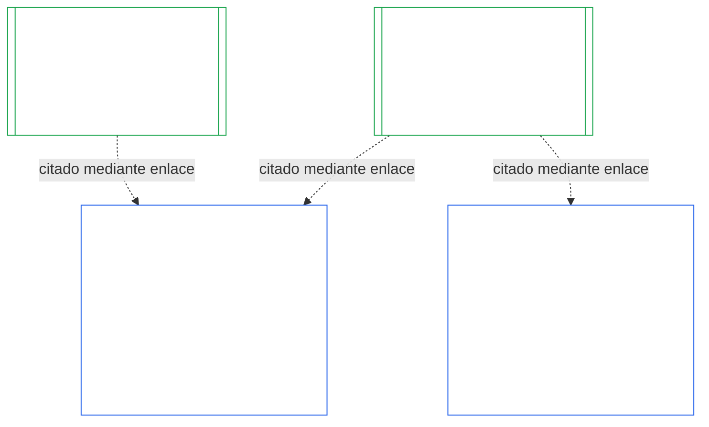
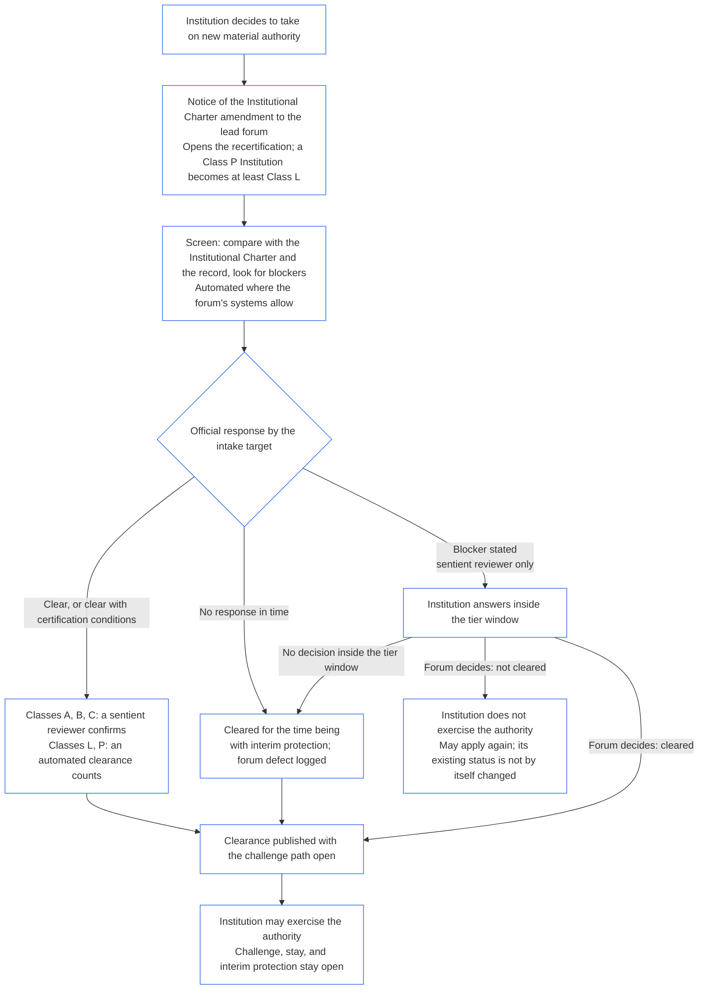

<!-- AI-assisted translation draft; unreviewed; English controls.
Source: core_10.000_institutional_alignment_certification.md
Source snapshot: 247e2180509e5e029c1106878cf225067339e010
Source SHA-256: a163a782114e584d09e295db66fe8b1b10a005b0f00116c8360396a0535ff221 -->

# CAPÍTULO DIEZ: CERTIFICACIÓN DE ALINEACIÓN INSTITUCIONAL

<strong>Ubicación en el corpus (no operativa): estructura del archivo y reglas de lectura</strong>

> Este archivo **forma parte de la Constitución de los Seres Sintientes** y **solo es vinculante conjuntamente** con los demás archivos numerados `core_*`, leídos como un solo texto. Contiene el **Capítulo Diez** — **certificación de alineación institucional**: cómo se clasifica, evalúa, revisa, decide, registra, mantiene vigente y reabre una [Institución](core_05.040_band_continuity.md#institution), a diferencia de cualquier Sistema que esta opere (**§1–§11**). El Capítulo Diez es la contraparte institucional del [Capítulo Nueve](core_09.000_system_alignment_certification_evaluation.md#chapter-nine-system-alignment-certification) (*Certificación de Alineación del Sistema*), y **sus secciones llevan los mismos números**: aquí §N responde a §N allí. [CS-9.320](corpus_systems/cs_09.320_system_alignment_certification_illustrations.md#cs-9320-system-alignment-certification-illustrations) (*Ilustraciones de certificación de alineación del sistema*) contiene las ilustraciones prácticas para Sistemas y, en su [§12 Recorridos ilustrativos de Instituciones](corpus_systems/cs_09.320_system_alignment_certification_illustrations.md#cs-9320-12-illustrative-institution-walkthroughs), tres recorridos de Instituciones. Este capítulo no los repite.
>
> | § | Capítulo Nueve (Sistema) | Capítulo Diez (Institución) |
> |---|------------------------|----------------------------|
> | 1 | Propósito y función | relación con la certificación del Sistema, quién se certifica, ausencia de permiso o condición para constituirse u operar, espera por nueva autoridad material y plazo de la primera certificación |
> | 2 | Evaluación de la clase del sistema | clase de la Institución; escalamiento por clase |
> | 3 | Evaluación de certificación de todo el sistema | los ocho elementos institucionales, siempre |
> | 4 | Evaluaciones cuando haya implicación | referencia al Capítulo Nueve §4 |
> | 5 | Evaluaciones del Piso de Derechos y por ámbito | referencia al Capítulo Nueve §5 |
> | 6 | Proceso del foro | cuatro puestos; funciones y secuencia del foro; foros, certificadores y oficinas de registro como Instituciones |
> | 7 | Resultados de certificación | entrada en operación de una Institución y sus Sistemas, condiciones de certificación y otros efectos de un resultado; referencia a defectos; preparación para la reparación; denegación y revocación |
> | 8 | Registro de Certificación del Sistema | Registro de Certificación Institucional |
> | 9 | Recertificación y reapertura | supervisión; desencadenantes de reapertura; certificación provisional y plena; medidas contra la evasión; cascada desde las certificaciones de Sistemas; reapertura de sus Sistemas ante una infracción de gobernanza |
> | 10 | Impugnación de una certificación | vía de impugnación |
> | 11 | Relación con la posición | puente hacia la posición |
>
> - **Titular constitucional (conjuntamente con el Capítulo Nueve):** certificación de alineación y registros relacionados bajo supervisión del foro. El Capítulo Diez añade el sujeto institucional. No añade una familia nueva de foros, un puesto nuevo ni una nueva denominación de resultado.
> - **Reutilización, no repetición:** las Fases III a VI funcionan conforme a lo dispuesto en [Capítulo Nueve Parte B §6](core_09.005_system_alignment_certification_record_process.md#6-forum-process) a [Capítulo Nueve Parte C §11](core_09.010_system_alignment_certification_record_recertification.md#11-relationship-to-standing). El Capítulo Diez solo establece qué cambia cuando el sujeto es una Institución.
> - **Regla contra el traslado:** el Capítulo Diez no vuelve a enunciar la mecánica de evaluación del Capítulo Nueve para un Sistema, los campos de la Carta Constitutiva del Sistema y la Carta Constitutiva Institucional del Capítulo Siete, el Requisito de Cuatro Puestos del Capítulo Ocho, los deberes institucionales de [corpus_institutions](corpus_institutions.md), la medición de posición del Capítulo Once ni los efectos de posición del Capítulo Doce.
>
> **Fuentes previas:** [Cartas Constitutivas del Capítulo Siete](core_07.000_charters.md#chapter-seven-system-and-institutional-charters); independencia funcional del [Capítulo Ocho](core_08.000_functional_independence_separation_of_duties.md#chapter-eight-functional-independence-and-separation-of-duties); [Capítulo Nueve](core_09.000_system_alignment_certification_evaluation.md#chapter-nine-system-alignment-certification) (Partes [A](core_09.000_system_alignment_certification_evaluation.md#chapter-nine-part-a-system-alignment-certification--evaluation), [B](core_09.005_system_alignment_certification_record_process.md#chapter-nine-part-b-system-alignment-certification--forum-process-and-outcomes) y [C](core_09.010_system_alignment_certification_record_recertification.md#chapter-nine-part-c-system-alignment-certification--record-recertification-and-standing)); supervisión del foro del Capítulo Catorce.
> **Desarrollos posteriores:** registros de posición y entradas verificadas del Capítulo Once; efectos de posición del Capítulo Doce.

<strong>Trazabilidad</strong>

- Fuentes previas:
  - [Capítulo Siete §1 Cuándo se requieren Cartas Constitutivas de Sistemas e Instituciones](core_07.000_charters.md#1-when-system-and-institutional-charters-are-required) (7.000 §1) (*qué Instituciones publican una Carta Constitutiva del Sistema o Institucional, y la clase de una Institución*);
  - [Capítulo Siete §7 Enmienda y revisión](core_07.000_charters.md#7-amendment-review-and-scope-misalignment) (7.000 §7) (*qué verifica una revisión de Carta Constitutiva Institucional*);
  - [Capítulo Siete §4 Mapa de funciones de la Carta Constitutiva y custodia de registros de posición](core_07.000_charters.md#4-the-charter-role-map-and-standing-record-custody) (7.000 §4) (*dónde se ubican los puestos*);
  - [Capítulo Ocho §2 Requisito constitucional de cuatro puestos](core_08.000_functional_independence_separation_of_duties.md#2-four-seat-constitutional-requirement) (8.000 §2) y [§9 Relación con procesos posteriores](core_08.000_functional_independence_separation_of_duties.md#9-relationship-to-later-processes);
  - [Capítulo Nueve](core_09.000_system_alignment_certification_evaluation.md#chapter-nine-system-alignment-certification) (9.000 a 9.010) (*el proceso de Certificación de Alineación del Sistema que reutiliza este capítulo*);
  - [Dos Preguntas Fundamentales](core_00.000_preamble.md#two-fundamental-questions);
  - [Tétrada Constitucional](core_00.000_preamble.md#constitutional-tetrad);
  - [Artículo XI-E](core_06.005_rights_part_b.md#article-xi-e-institutional-formation-and-business-creation) (*Formación institucional y creación de empresas*).
- Desarrollos posteriores: [§1](#1-purpose-and-role) a [§11](#11-relationship-to-standing); Capítulo Once ([11.000](core_11.000_standing_assessment.md#chapter-eleven-contribution-violation-and-standing-model--measurement)); [Capítulo Catorce](core_14.000_forum.md#chapter-fourteen-forums-and-jurisdiction) (14.000).
- Leer junto con:
  - [Certificación de Alineación Institucional](core_05.040_band_continuity.md#institutional-alignment-certification) y
  - [Registro de Certificación Institucional](core_05.040_band_continuity.md#institutional-certification-record) (*significados del Capítulo Cinco*);
  - **CI-8.205 §6** (*Contenido, revisión y plantilla de formación de las Cartas Constitutivas de Sistemas e Instituciones*);
  - **CF-14.425** (*Salvaguardias de integridad, operaciones contra la captura y apoyo contra la autoevaluación*).

 

El Capítulo Diez es titular constitucional de la **certificación de alineación institucional**. Extiende el proceso del [Capítulo Nueve](core_09.000_system_alignment_certification_evaluation.md#chapter-nine-system-alignment-certification) de un Sistema a una Institución:

- **Fase I, Enmarcar:** la clase de la Institución y cómo escala la evaluación ([§2 Evaluación de la clase institucional](#2-institution-class-evaluation));
- **Fase II, Evaluar:** la evaluación institucional, incluidas las evaluaciones aplicables cuando haya implicación y las evaluaciones del Piso de Derechos y por ámbito ([§3 Evaluación de certificación de toda la Institución](#3-whole-institution-certification-evaluation) a [§5 Evaluaciones del Piso de Derechos y por ámbito](#5-rights-floor-and-domain-evaluations));
- **Fase III, Revisar:** las funciones y secuencia del foro ([§6 Proceso del foro](#6-forum-process));
- **Fase IV, Decidir:** el resultado, la preparación para la reparación, la denegación y la revocación ([§7 Resultados de certificación](#7-certification-outcomes));
- **Fase V, Registrar:** el Registro de Certificación Institucional ([§8 Registro de Certificación Institucional](#8-institutional-certification-record)); y
- **Fase VI, Operar:** recertificación, reapertura, cascada desde las certificaciones de Sistemas, reapertura de sus Sistemas, vía de impugnación y puente hacia la posición ([§9 Recertificación y reapertura](#9-recertification-and-reopening) a [§11 Relación con la posición](#11-relationship-to-standing)).

*En términos sencillos: el Capítulo Nueve pregunta si un **sistema** está alineado. El Capítulo Diez pregunta lo mismo de la **institución** que opera sistemas o ejerce autoridad sin operar ninguno. Una institución puede estar alineada aunque uno de sus sistemas no lo esté, y viceversa. Por eso se revisa aquello que solo la institución controla: si hace lo dispuesto en su Carta Constitutiva Institucional, quién responde por su autoridad, qué recompensa entre sus propios miembros y si realmente pueden utilizarse los controles independientes. Se basa en la certificación de cada sistema y no la repite. No es una licencia: nadie necesita su permiso para iniciar u operar una institución.*

### 1. Propósito y función

<strong>Trazabilidad</strong>

- Fuentes previas:
  - [Capítulo Siete §1 Cuándo se requieren Cartas Constitutivas de Sistemas e Instituciones](core_07.000_charters.md#1-when-system-and-institutional-charters-are-required) (7.000 §1);
  - [Capítulo Nueve Parte A §1 Propósito y función](core_09.000_system_alignment_certification_evaluation.md#1-purpose-and-role) (9.000 §1);
  - [Artículo XI-E](core_06.005_rights_part_b.md#article-xi-e-institutional-formation-and-business-creation) (*Formación institucional y creación de empresas*);
  - [Artículo XXVIII-A](core_06.020_rights_part_e.md#xxviii-a-existing-instantiations-adoption-transition-window) (*Adopción por fases y continuidad del Piso de Derechos*).
- Desarrollos posteriores: [§2](#2-institution-class-evaluation); [§6](#6-forum-process); [§7](#7-certification-outcomes); [§9](#9-recertification-and-reopening).
- Leer junto con:
  - [Institución](core_05.040_band_continuity.md#institution);
  - [Carta Constitutiva Institucional](core_05.040_band_continuity.md#institutional-charter);
  - [Carta Constitutiva del Sistema](core_05.040_band_continuity.md#system-charter);
  - [Creación de empresas](core_05.055_band_participation.md#business-creation).

 

*En términos sencillos: la certificación de un sistema pertenece al sistema. La certificación de una institución cita esas certificaciones y añade lo que solo la institución puede responder. Un sistema puede aparecer bajo varias instituciones o bajo ninguna. Nada de lo dispuesto aquí permite que una certificación impida la creación de una institución.*

La certificación de alineación institucional y la Certificación de Alineación del Sistema son dos certificaciones unidas por un enlace. La relación es una **composición mediante enlace**, no una relación de contención. En la figura, una flecha va desde un Registro de Certificación del Sistema hasta cada Registro de Certificación Institucional que lo cita. Un Sistema que no pertenezca a ninguna Institución no tiene flecha ni la necesita; una Institución que no opere ningún Sistema tiene un registro independiente.

La composición mediante enlace tiene dos lados; primero, el de la Institución.

Del lado de la Institución:

- **El Registro de Certificación Institucional cita el del Sistema y no lo repite:** cita mediante enlace el Registro de Certificación del Sistema e identifica su versión. Este capítulo nunca vuelve a ejecutar una evaluación de Sistema, nunca vuelve a decidir su clase ni modifica su resultado, condición o condiciones de certificación.
- **La certificación de la Institución no puede levantar la del Sistema:** un Sistema No Certificado sigue No Certificado, cualquiera que sea la condición de la Institución. La certificación de un Sistema no lo protege frente a una conclusión adversa sobre la Institución.
- **Los hechos institucionales se determinan una sola vez:** cuando [Capítulo Nueve Parte A §3.1 Disciplina de gobernanza, incentivos e impugnabilidad](core_09.000_system_alignment_certification_evaluation.md#31-governance-incentive-and-contestability-discipline) pregunta por la gobernanza e incentivos del operador, un Registro de Certificación Institucional vigente de este puede aportar esos hechos mediante enlace. Los foros del Sistema siguen decidiendo si esos hechos bastan para ese Sistema. No pueden llegar a conclusiones distintas sobre el mismo hecho institucional sin explicar el motivo en el Registro de Certificación del Sistema.

Del lado del Sistema:

- **El Registro de Certificación del Sistema pertenece al Sistema:** es el registro propio del Sistema conforme al [Capítulo Nueve](core_09.000_system_alignment_certification_evaluation.md#chapter-nine-system-alignment-certification).
- **Varias Instituciones pueden citar un mismo Registro de Certificación del Sistema:** un Sistema puede ser operado, administrado o controlado materialmente por más de una Institución conforme a [Capítulo Siete §1 Cuándo se requieren Cartas Constitutivas de Sistemas e Instituciones](core_07.000_charters.md#1-when-system-and-institutional-charters-are-required). Cada una cita el mismo registro.
- **Un Sistema no tiene que pertenecer a una Institución:** un ser sintiente individual no es una Institución, por lo que un Sistema puede no tener ninguna. Un Sistema sin Institución se certifica solo conforme al [Capítulo Nueve](core_09.000_system_alignment_certification_evaluation.md#chapter-nine-system-alignment-certification) y no necesita nada de este capítulo. Un Sistema que sí pertenezca a una Institución se certifica del mismo modo: este capítulo agrega un registro aparte para la Institución y no es una etapa de la propia certificación del Sistema.

#### 1.1 Quién se certifica

Este capítulo abarca a las Instituciones de Clase L o superior, cuya clase se determina conforme a [§2.1 Clase institucional](#21-institution-class). Incluye una Institución que no opere ningún Sistema: no tiene un Registro de Certificación del Sistema que citar, y su clase se determina por su propio impacto. El **portafolio** de una Institución es el conjunto de Sistemas que opera, administra o controla materialmente ([Portafolio](core_05.040_band_continuity.md#portfolio)).

- **Clase A, B, C y L:** se aplica el proceso, escalado por clase conforme a [§2.2 Escalamiento por clase](#22-scaling-by-class).
- **Clase P:** se recomienda el proceso y puede utilizarse de forma voluntaria. Pasa a ser obligatorio cuando la Institución se reclasifique como Clase L o superior o cuando afirme voluntariamente cumplir con la Constitución. Una Institución de Clase P que decida asumir nueva autoridad material se reclasifica al menos como Clase L cuando notifica esa decisión conforme a [§9.2.2 Recertificación para nueva autoridad material](#922-recertification-for-new-material-authority), porque esa autoridad es material por definición ([§9.2.1 Qué cuenta como nueva autoridad material](#921-what-counts-as-new-material-authority)) y una Institución material en cualquier ámbito es, como mínimo, de Clase L ([§2.1 Clase institucional](#21-institution-class), punto 2). La reclasificación dura desde la notificación hasta que esta se retire antes de la autorización o no se autorice la autoridad, siempre que no se haya ejercido ninguna facultad conforme a ella. Entonces la Institución vuelve a la Clase P y termina la primera certificación limitada. Una nueva notificación reinicia el proceso, y ejercer la autoridad sin autorización sigue siendo una conclusión conforme a [§9.2.2 Recertificación para nueva autoridad material](#922-recertification-for-new-material-authority) (*Sin notificación o antes de que se autorice*). Esto refleja [Capítulo Nueve Parte A §1 Propósito y función](core_09.000_system_alignment_certification_evaluation.md#1-purpose-and-role).
- **Un Sistema:** una Institución que opere exactamente un Sistema que requiera Carta Constitutiva del Sistema tiene un ciclo de certificación y un registro, que este capítulo denomina **evaluación de un solo Sistema**. El Registro de Certificación del Sistema incluye un *bloque de conclusiones institucionales* con los elementos de [§8 Registro de Certificación Institucional](#8-institutional-certification-record) y sirve como Registro de Certificación Institucional. Los foros, puestos y plazos son los del ciclo de certificación propio del Sistema, con los elementos institucionales añadidos. Sus resultados siguen sus propios motivos de denegación y revocación, según establece [§7.4 Denegación y revocación para una Institución](#74-denial-and-revocation-for-an-institution). La cascada de [§9.5 Cascada desde las certificaciones de Sistemas](#95-cascade-from-system-certifications) no se aplica como cascada, porque el Sistema es todo el portafolio; pero [§7.4 Denegación y revocación para una Institución](#74-denial-and-revocation-for-an-institution) aplica sus reglas 1 y 2 (el indicador y la prueba para localizar la causa).
- **Varios Sistemas:** se prepara un Registro de Certificación Institucional para la Institución, enlazado con el Registro de Certificación de cada Sistema que opera. Cada Sistema conserva su propio ciclo y registro.
- **Ningún Sistema:** un Registro de Certificación Institucional independiente. No tiene Registro de Certificación del Sistema al que enlazar, porque la Institución no opera ningún Sistema.

#### 1.2 Sin permiso ni condición para constituirse u operar

La certificación de alineación institucional es una comprobación independiente de cómo una Institución ejerce realmente su autoridad. La realizan foros independientes de la Institución y concluye en un Registro de Certificación Institucional con sus hallazgos.

- **Constitución y operación:** una Institución se constituye, publica su Carta Constitutiva Institucional, comienza a ejercer autoridad y sigue operando sin tener antes la certificación; ningún resultado concede ni retira ese derecho.
- **Efecto de un resultado:** un resultado solo tiene los efectos previstos en [§7.1 Entrada en operación de una Institución](#71-go-live-for-an-institution).
- **Únicas condiciones en este ámbito:** existen tres condiciones acotadas, todas en el **Artículo XI-E** (*Formación institucional y creación de empresas*):
  - una restricción vigente impuesta a un ser sintiente identificado, que se aplica a la autoridad de ese ser sintiente;
  - una Retención Provisional sobre hechos específicos y verificados de desalineación, que también se aplica a la autoridad de un ser sintiente identificado;
  - una restricción a una Parte Operativa en sí, que se aplica a una Institución solo cuando la restricción recae sobre esa Institución, como ocurre con una Institución disuelta conforme a **CI-12.210 §4** (*Disolución*).

  Un hallazgo de certificación puede remitirse al foro que decida una de estas condiciones como prueba conforme a [§7.5 Efectos de la denegación y revocación para una Institución](#75-effects-of-denial-and-revocation-for-an-institution). Un resultado de certificación no es una condición en sí ni abre ni cierra una.
- **Espera por nueva autoridad material:** una Institución que decida asumir nueva autoridad material espera a que su recertificación la autorice antes de ejercerla, conforme a los términos de [§9.2.2 Recertificación para nueva autoridad material](#922-recertification-for-new-material-authority). El **Artículo XI-E** (*Formación institucional y creación de empresas*) establece esta espera. No es una de las tres condiciones acotadas ni una condición para constituirse u operar. Se aplica solo a la autoridad nueva, y todo lo demás que hace la Institución continúa. La figura de [§9.2.2 Recertificación para nueva autoridad material](#922-recertification-for-new-material-authority) resume los pasos.
- **Sin vías indirectas:** ningún foro, entidad adoptante o titular actual puede utilizar este capítulo como un umbral de autorización que excluya a fundadores o proteja a quienes ya ocupan el puesto. Eso contravendría el [Artículo XI-E](core_06.005_rights_part_b.md#article-xi-e-institutional-formation-and-business-creation) (*Formación institucional y creación de empresas*).
  - [Carga evitable](core_05.040_band_continuity.md#avoidable-burden) se aplica al costo del proceso.
  - [Gobernanza escalada por clasificación](core_05.050_band_oversight.md#classification-scaled-governance) se aplica a su profundidad.
  - La espera por nueva autoridad material se aplica en los mismos términos a todas las Instituciones de su clase, y solo a autoridad que ya sea material para otras personas.

La condición para que un Sistema entre en operación es distinta y sigue aplicándose a los Sistemas. Conforme a [Capítulo Nueve Parte B §7.1 Condición de entrada en operación](core_09.005_system_alignment_certification_record_process.md#71-go-live-gate), un Sistema nuevo o una ampliación material solo entra en operación mediante su propia certificación, cualquiera que sea la condición de la Institución.

#### 1.3 Plazo para la primera certificación

El primer Registro de Certificación Institucional debe completarse dentro del plazo que el documento de adopción establezca para la clase de la Institución.

- **Institución nueva:** el plazo comienza el día en que tiene por primera vez un impacto material en otras personas, según [Materialidad específica de cada ámbito](core_05.050_band_oversight.md#domain-specific-materiality), y su primera certificación es provisional.
- **Institución de Clase P reclasificada mediante notificación:** el plazo comienza el día en que presenta la notificación conforme a [§9.2.2 Recertificación para nueva autoridad material](#922-recertification-for-new-material-authority), como en el caso de una Institución nueva, y nunca comienza en un período de Transición de Adopción que ya haya terminado.
- **Institución que ya opera:** el plazo es el Período de Transición de Adopción conforme al [Artículo XXVIII-A](core_06.020_rights_part_e.md#xxviii-a-existing-instantiations-adoption-transition-window) (*Adopción por fases y continuidad del Piso de Derechos*), de acuerdo con la regla predeterminada de [Capítulo Siete §1.5 Cuándo vence una Carta Constitutiva del Sistema o Institucional](core_07.000_charters.md#15-when-a-system-charter-or-institutional-charter-is-due).
- **Plazo incumplido:** una Institución que deje vencer el plazo sin un primer ciclo y sin estar excusada más abajo tiene un defecto que debe registrar y corregir; el vencimiento abre ese ciclo. Una Institución de Clase L o superior que ya esté operando también incurre en el incumplimiento de hito que se indica a continuación. No se detiene ni se le prohíbe operar, pues no existe tal condición ([§1.2 Sin permiso ni condición para constituirse u operar](#12-no-permission-and-no-gate-on-forming-or-running)).
  - **Institución que ya opera:** esta es la regla propia del capítulo para Instituciones de Clase L o superior, establecida por analogía con el [Artículo XXVIII-A](core_06.020_rights_part_e.md#xxviii-a-existing-instantiations-adoption-transition-window) (*Adopción por fases y continuidad del Piso de Derechos*), que menciona Sistemas y entidades derivadas. Si termina su Período de Transición de Adopción sin completar un primer ciclo de certificación (sin certificación provisional o plena ni resultado decidido conforme a [§7 Resultados de certificación](#7-certification-outcomes)), ha incumplido el plazo. Una Institución que presentó la solicitud y cooperó dentro del plazo no lo ha incumplido cuando el ciclo quede incompleto porque el foro excedió su propio plazo ([Capítulo Catorce §6 Resolución oportuna, niveles de materialidad y disciplina contra demoras](core_14.000_forum.md#6-timely-resolution-materiality-tiers-and-anti-delay-discipline), *Revisión del exceso de plazo*; [Capítulo Nueve Parte C §9.3.4 Plazos por nivel](core_09.010_system_alignment_certification_record_recertification.md#934-tier-windows)) o porque esté transcurriendo el único aplazamiento conforme a [§7.3 Preparación para la reparación de una Institución](#73-remediation-readiness-for-an-institution). Si no existe una demostración documentada de nueva autorización conforme al [Artículo XXVIII-B](core_06.020_rights_part_e.md#article-xxviii-b-adoption-transition-authority-limits-and-reauthorization) (*Límites de autoridad durante la Transición de Adopción y nueva autorización*), se trata de un incumplimiento de hito de la Transición de Adopción y se abre la vía ordinaria de cumplimiento e infracciones del [Capítulo Once](core_11.000_standing_assessment.md#chapter-eleven-contribution-violation-and-standing-model--measurement). Los deberes de restricción de ese Artículo se aplican desde la fecha de entrada en vigor, y la persistencia de la deficiencia no la convierte en la nueva normalidad. Esto refleja [Capítulo Nueve Parte B §7.1.1 Sistemas que ya operan](core_09.005_system_alignment_certification_record_process.md#711-systems-already-operating). No es una condición.
  - **El ciclo de certificación:** se decide como cualquier otro. Puede concluir con cualquier resultado de [§7 Resultados de certificación](#7-certification-outcomes), incluido No Certificada, con los efectos de [§7.5 Efectos de la denegación y revocación para una Institución](#75-effects-of-denial-and-revocation-for-an-institution).
  - **Sanciones y disolución:** este capítulo no las crea. La suspensión, administración judicial, separación estructural y disolución siguen bajo la competencia del foro con jurisdicción conforme a **CI-12.210** (*Infracción y disolución institucional*) y **CI-12.215** (*Responsabilidad institucional y sanciones*). Ese foro solo recibe una remisión por los motivos de remisión de [§7.5 Efectos de la denegación y revocación para una Institución](#75-effects-of-denial-and-revocation-for-an-institution) (punto 5, *Remisión*).

### 2. Evaluación de la clase institucional

<strong>Trazabilidad</strong>

- Fuentes previas:
  - [Capítulo Siete §1 Cuándo se requieren Cartas Constitutivas de Sistemas e Instituciones](core_07.000_charters.md#1-when-system-and-institutional-charters-are-required) (7.000 §1);
  - [Capítulo Nueve Parte A §2 Evaluación de la clase del sistema](core_09.000_system_alignment_certification_evaluation.md#2-system-class-evaluation) (9.000 §2) y [§2.2 Cómo la clase del sistema escala cada evaluación](core_09.000_system_alignment_certification_evaluation.md#22-how-system-class-scales-every-evaluation);
  - [Capítulo Tres §2.1 Patrones comunes de evasión](core_03.000_definition_integrity.md#21-common-evasion-patterns) (3.000 §2.1).
- Desarrollos posteriores: [§3](#3-whole-institution-certification-evaluation) (*elementos que escala la clase*); [§8](#8-institutional-certification-record) (*la clase consta en el registro*); [§9.2](#92-reopening-triggers) (*desencadenantes que vuelven a evaluarla*).
- Leer junto con:
  - **CS-9.305 (*Mecanismo de clasificación de sistemas*) y CS-9.310** (*Clasificaciones de impacto de sistemas*) y [corpus_systems/cs_09.310_system_impact_classifications.md](corpus_systems/cs_09.310_system_impact_classifications.md) (*el catálogo de clases*);
  - **CI-9.210** (*Obligaciones institucionales vinculadas con la clasificación*);
  - **CI-8.205 §6** (*Contenido, revisión y plantilla de formación de las Cartas Constitutivas de Sistemas e Instituciones*).

 

*En términos sencillos: primero, clasifique la institución según cuánto afecta a otras personas. Júzguela por lo que realmente decide y controla, no por cómo se denomina. La clase determina la profundidad de la evaluación: cuanto más alta, más estrictas las pruebas, más independiente la revisión y más pronta la siguiente comprobación.*

Esta sección es la **Fase I, Enmarcar**, para una Institución.

#### 2.1 Clase institucional

La **clase institucional** se determina por el mayor impacto material que tenga la Institución, ya sea a través de un Sistema que opere o al margen de cualquier Sistema. Se juzga por lo que la Institución decide, mantiene y controla realmente, no por su etiqueta, forma jurídica o la lista de su Carta Constitutiva Institucional. La clase determina la profundidad de la evaluación y los plazos, como hace para un Sistema [Capítulo Nueve Parte A §2.2 Cómo la clase del sistema escala cada evaluación](core_09.000_system_alignment_certification_evaluation.md#22-how-system-class-scales-every-evaluation). Es la clase utilizada en este capítulo y en [Capítulo Siete §1.2 Qué clases están cubiertas](core_07.000_charters.md#12-which-classes-are-covered).

1. **Impacto a través de Sistemas:** la clase de una Institución es al menos la clase más alta de cualquier Sistema de su portafolio ([Capítulo Siete §1 Cuándo se requieren Cartas Constitutivas de Sistemas e Instituciones](core_07.000_charters.md#1-when-system-and-institutional-charters-are-required)). Los Sistemas se identifican a partir de la operación observada. También cuenta un Sistema que no figure en la Carta Constitutiva Institucional.
2. **Impacto fuera de cualquier Sistema:** se tienen en cuenta el impacto material y la dependencia propios de una Institución, opere o no un Sistema. Se aplican las definiciones de clase de **CS-9.305 (*Mecanismo de clasificación de sistemas*) y CS-9.310** (*Clasificaciones de impacto de sistemas*) a las decisiones y activos de la Institución, con estos factores:
   - **Qué decide y controla:**
     - qué decide sobre el acceso de otros seres sintientes a elementos esenciales para sobrevivir, educación, seguridad, medios de vida, derechos o posición; y
     - qué controla, como fondos, registros, membresías, custodia de registros de posición o la función de un foro, certificador u oficina de registro.
   - **Si es material:**
     - si su propia actividad es material en algún ámbito de [Materialidad específica de cada ámbito](core_05.050_band_oversight.md#domain-specific-materiality), incluidos los [Actos Materialmente Vinculantes](core_05.035_band_accountability.md#materially-binding-act) que otras personas deban cumplir o puedan considerar establecidos;
     - una Institución material en un ámbito cualquiera es, como mínimo, de Clase L conforme a **CS-9.305 (*Mecanismo de clasificación de sistemas*) y CS-9.310** (*Clasificaciones de impacto de sistemas*); y
     - proporcionar ayuda, bienes, trabajo o servicios que otras personas puedan aceptar o rechazar libremente, sin condicionar su acceso a lo que necesitan, no obliga a nadie. Es una conducta, no un Acto Materialmente Vinculante, y solo cuenta mediante los otros factores.
   - **Cuánto dependen de ella:**
     - cuántos seres sintientes dependen de ella y cuán sustituible es;
     - cuán concentrada está su autoridad, según el significado de la Línea de Control Material; y
     - cuán reversibles son sus decisiones.
3. **Control común:** las Partes Operativas que constituyan una sola operación conforme a la regla de agregación de [Materialidad específica de cada ámbito](core_05.050_band_oversight.md#domain-specific-materiality) (control práctico común dentro de una [Línea de Control Material](core_05.035_band_accountability.md#material-control-line); la financiación por sí sola no cuenta) se clasifican conjuntamente cuando en la práctica actúan como una Institución. Dividir una Parte Operativa, su portafolio o su autoridad para que ninguna parte alcance la Clase L constituye una evasión de alcance y límites conforme a [Capítulo Tres §2.1 Patrones comunes de evasión](core_03.000_definition_integrity.md#21-common-evasion-patterns).
4. **Reclasificación:** la clase se vuelve a evaluar cuando se activen los desencadenantes de [§9.2 Desencadenantes de reapertura](#92-reopening-triggers). La clasificación, con sus motivos, consta en el Registro de Certificación Institucional.

#### 2.2 Escalamiento por clase

La clase institucional escala la profundidad de las pruebas, la independencia de la revisión, el intervalo predeterminado de certificación y la divulgación del registro, del mismo modo que [Capítulo Nueve Parte A §2.2 Cómo la clase del sistema escala cada evaluación](core_09.000_system_alignment_certification_evaluation.md#22-how-system-class-scales-every-evaluation). Los intervalos de certificación figuran en [Capítulo Catorce §6 Resolución oportuna, niveles de materialidad y disciplina contra demoras](core_14.000_forum.md#review-cadence) (*Periodicidad de revisión*); el documento de adopción puede establecer intervalos más breves y fija el número de recertificaciones provisionales limpias.

- **Clase A, B y C:** los ocho elementos de [§3 Evaluación de certificación de toda la Institución](#3-whole-institution-certification-evaluation), con pruebas e independencia proporcionales a la clase.
- **Clase L:** los mismos ocho elementos, simplificados, con registros más sencillos e intervalo predeterminado más largo donde lo permita la [Gobernanza escalada por clasificación](core_05.050_band_oversight.md#classification-scaled-governance). El núcleo de un ciclo de Clase L es contrastar la Carta Constitutiva Institucional con la práctica, el Mapa de funciones, la declaración de comprobación de constitución y la vigencia de las certificaciones de Sistemas citadas. No se omite ningún elemento, y se indica en una línea cuando no haya nada que señalar.
- **Clase P:** voluntaria, como se establece en [§1.1 Quién se certifica](#11-who-is-certified).

**Entidad anfitriona de una práctica profesional conjunta.** Cuando una Institución sea entidad anfitriona ([**CI-15.205 §7**](corpus_institutions/ci_15.205_appointment_competency_rotation_removal.md#ci-46-seat-advisory) (*Licencia para ejercer, habilitación profesional y práctica profesional conjunta*)), su certificación también toma muestras de los actos de sus miembros frente a los puestos que ocupa la entidad anfitriona y contrasta las notificaciones de adopción de los miembros con lo que hace la anfitriona. Una conclusión sobre el acto de un miembro corresponde a ese miembro y solo alcanza a la anfitriona cuando haya fallado un puesto que esta ocupe.

### 3. Evaluación de certificación de toda la Institución

<strong>Trazabilidad</strong>

- Fuentes previas:
  - [Capítulo Nueve Parte A §3 Evaluación de certificación de todo el sistema](core_09.000_system_alignment_certification_evaluation.md#3-whole-system-certification-evaluation) (9.000 §3);
  - [Capítulo Siete §3 Qué deben declarar las Cartas Constitutivas de Sistemas e Instituciones](core_07.000_charters.md#3-what-system-and-institutional-charters-must-state) (7.000 §3);
  - [Capítulo Siete §5 Comprobación de constitución: posición y autenticidad de titulares de cargos](core_07.000_charters.md#5-formation-check-office-holder-standing-and-authenticity) (7.000 §5);
  - [Capítulo Siete §7 Enmienda y revisión](core_07.000_charters.md#7-amendment-review-and-scope-misalignment) (7.000 §7);
  - [Dos Preguntas Fundamentales](core_00.000_preamble.md#two-fundamental-questions);
  - [Capítulo Uno §19.6 Mantener la responsabilidad cuando cambia la titularidad o estructura](core_01.010_stewardship_capacity_principles.md#196-keeping-responsibility-when-ownership-or-structure-changes) (1.010 §19.6).
- Desarrollos posteriores: [§6](#6-forum-process) (*conclusiones que revisan los foros*); [§9](#9-recertification-and-reopening) (*desencadenantes que vuelven a abrirlas*); [§11](#11-relationship-to-standing) (*compuerta de entradas verificadas para conclusiones sobre un ser sintiente identificado*).
- Leer junto con:
  - **CI-8.205 §3** (*Cadena de autoridad y controles de delegación*) y **CI-8.205 §6** (*Contenido, revisión y plantilla de formación de las Cartas Constitutivas de Sistemas e Instituciones*);
  - **CI-6.215** (*Mayordomía de recursos e integridad de incentivos*);
  - **CI-8.210** (*Integridad ante conflictos, captura y corrupción*), **CI-6.205** (*Transparencia, participación y vías accesibles de impugnación y servicio*) y **CI-12.205** (*Sistemas de reparación y capacidad institucional de resarcimiento*), para el punto 8.

 

*En términos sencillos: compruebe lo que corresponde a la institución y no a uno de sus sistemas: si cumple su Carta Constitutiva Institucional, quién responde por su autoridad, qué recompensa y si funcionan sus controles independientes.*

Esta sección es la **Fase II, Evaluar**, para una Institución.

Cada ciclo de certificación evalúa estos ocho elementos, que son la contraparte institucional de [Capítulo Nueve Parte A §3 Evaluación de certificación de todo el sistema](core_09.000_system_alignment_certification_evaluation.md#3-whole-system-certification-evaluation). Cada hallazgo indica las pruebas y el texto de la Carta Constitutiva Institucional o la operación observada que lo fundamentan.

1. **Carta Constitutiva Institucional frente a la práctica:**
   - La Carta Constitutiva Institucional se contrasta con la operación observada mediante la lista de revisión de [Capítulo Siete §7 Enmienda y revisión](core_07.000_charters.md#7-amendment-review-and-scope-misalignment).
   - La práctica que exceda la Carta Constitutiva Institucional, o una Carta Constitutiva Institucional que ya no describa la práctica, constituyen un hallazgo, sea cual sea la discrepancia.
2. **Portafolio y efecto agregado:**
   - Se comprueba la justificación del portafolio: cada Sistema debe corresponder al propósito declarado de la Institución, y la falta de una razón declarada para un Sistema constituye un hallazgo.
   - La evaluación también examina conjuntamente los Sistemas en busca de aquello que ninguna certificación individual puede mostrar por sí sola:
     - dependencias compartidas;
     - dependencia agregada;
     - extracción acumulada de fundamentos compartidos; y
     - cualquier arreglo que divida una función en partes para que cada una eluda una clase o un deber.
3. **Autoridad sujeta a rendición de cuentas:**
   - Toda autoridad que ejerza la Institución sobre otras personas debe atribuirse a una oficina responsable identificable, que responda conforme a las reglas del [Capítulo Ocho](core_08.000_functional_independence_separation_of_duties.md#chapter-eight-functional-independence-and-separation-of-duties) y **CI-8.205 §3** (*cadena de autoridad y controles de delegación*).
   - Un cambio de titularidad, control o estructura no libera de responsabilidad ([Capítulo Uno §19.6 Mantener la responsabilidad cuando cambia la titularidad o estructura](core_01.010_stewardship_capacity_principles.md#196-keeping-responsibility-when-ownership-or-structure-changes)).
4. **Recompensas e incentivos:**
   - La remuneración, los ascensos, los objetivos y las recompensas propios de la Institución se someten a las [Dos Preguntas Fundamentales](core_00.000_preamble.md#two-fundamental-questions): qué recompensa realmente la estructura y si eso la acerca a los dos fines de la Constitución o la aleja de ellos.
   - Una estructura de recompensas que pague por la desalineación o por ocultarla constituye un hallazgo aunque cada Sistema tenga su propia certificación.
   - Se aplica la [Restricción de coherencia temporal del Capítulo Nueve Parte A §3.3](core_09.000_system_alignment_certification_evaluation.md#33-time-consistency-constraint). Las métricas inmediatas, el cumplimiento local y la eficiencia a corto plazo no bastan cuando sigue sin atenderse un daño previsible a mediano o largo plazo para la Seguridad, la Verdad o el bienestar; también constituye un hallazgo una estructura de recompensas que premie resultados a corto plazo a ese costo.
   - Los deberes institucionales sobre la integridad de los incentivos siguen bajo **CI-6.215** (*Mayordomía de recursos e integridad de incentivos*) y se citan, no se vuelven a enunciar.
5. **Mapa de funciones y custodia:**
   - El [Mapa de funciones de la Carta Constitutiva](core_05.040_band_continuity.md#charter-role-map) identifica oficinas que existen, están ocupadas o se sustituyen según lo previsto, y son [independientes](core_05.035_band_accountability.md#independence) de la Institución en todo registro donde esta sea el sujeto.
   - La vía independiente debe poder utilizarse de hecho.
   - Una plaza sin asignar, una oficina inactiva o una persona custodio de registros dentro de la propia línea jerárquica de la Institución constituyen hallazgos.
6. **Vigencia de cada certificación de Sistema citada:**
   - Para cada Sistema que opere la Institución, la evaluación comprueba que haya un Registro de Certificación del Sistema vigente o dentro de su Período de Transición de Adopción, y que la Institución haya cumplido las condiciones de certificación de ese registro que le correspondan.
   - Una certificación vencida, retirada, fallida o inexistente, sin una razón registrada, constituye un hallazgo que [§9.5 Cascada desde las certificaciones de Sistemas](#95-cascade-from-system-certifications) traslada luego a la Institución.
7. **Posición y autenticidad de titulares de cargos:**
   - La declaración de comprobación de constitución publicada conforme a [Capítulo Siete §5 Comprobación de constitución: posición y autenticidad de titulares de cargos](core_07.000_charters.md#5-formation-check-office-holder-standing-and-authenticity) se contrasta con la operación observada y no se acepta solo por atestación.
   - Para cada cargo sujeto a revisión, los foros contrastan los hechos sobre la posición con registros verificados y determinan la autenticidad mediante pruebas de control, intereses y recompensas, conducta y voz protegida. Esto incluye:
     - quién dirige realmente al titular;
     - por qué se remunera y asciende al titular;
     - qué ha hecho el titular de forma verificable en esa función; y
     - si se sancionó a alguien —incluido el propio titular— por presentar un [informe protegido](core_05.035_band_accountability.md#protected-reporting-whistleblowing) o rechazar una instrucción ilegal o inconstitucional ([Capítulo Uno §17.5 Deber de resistir](core_01.010_stewardship_capacity_principles.md#175-duty-to-resist)).
   - El personal que no ocupe un cargo sujeto a revisión no se comprueba persona por persona. Se contempla en la comprobación de salvaguardias del personal ([Capítulo Siete §5.6 Comprobación de salvaguardias del personal](core_07.000_charters.md#56-staff-safeguards-check)), que los foros contrastan del mismo modo con la operación observada. Se pregunta si:
     - las reglas de nombramiento, remuneración, ascenso y cese de la Institución no recompensan trabajar contra su propósito declarado;
     - existe una vía de denuncia protegida, y ningún miembro del personal que la utilizó o rechazó una instrucción ilegal o inconstitucional fue sancionado; y
     - se respetan los derechos del [Artículo III-C](core_06.000_rights_part_a.md#article-iii-c-labor-and-economic-floor) (*Piso Laboral y Económico*).
   - Cada una de las siguientes situaciones constituye un hallazgo:
     - un titular que actúe como testaferro de una persona controladora no revelada;
     - un cargo sujeto a revisión que solo exista en el papel: la Carta Constitutiva Institucional o el Mapa de funciones lo nombra, pero nadie lo ocupa realmente ni realiza su trabajo;
     - una estructura de recompensas que pague a titulares por hacer lo que prohíben los límites publicados de la Carta Constitutiva Institucional; y
     - una declaración falsa o incompleta.
   - Los hallazgos corresponden al cargo y la estructura. Solo se atribuyen a un ser sintiente identificado mediante la compuerta de entradas verificadas de [§11 Relación con la posición](#11-relationship-to-standing).
   - La comprobación de constitución no evalúa creencias; sin embargo, una declaración verificada de que otras personas merecen sufrir daño o recibir trato discriminatorio constituye conducta que cuenta en contra del titular, como establece [Capítulo Uno §7.5 Expresión y línea de daño](core_01.000_values_principles.md#75-expression-and-the-harm-line).
   - Este elemento se lee junto con los puntos 3, 4 y 5; un hecho constatado conforme a uno de ellos no vuelve a constatarse conforme a otro.
8. **Deberes institucionales propios de la Institución:**
   - El cumplimiento por la Institución de los deberes institucionales que el texto adoptado le imponga se contrasta con la operación observada, sin aceptar una mera atestación. Esos deberes son **CI-8.210** (*Integridad ante conflictos, captura y corrupción*), **CI-6.205** (*Transparencia, participación y vías accesibles de impugnación y servicio*), **CI-6.215** (*Mayordomía de recursos e integridad de incentivos*) y **CI-12.205** (*Sistemas de reparación y capacidad institucional de resarcimiento*).
   - La comprobación pregunta si existen vías institucionales de supervisión, rendición de cuentas, participación y oportunidad, si pueden usarse de hecho y si responden dentro de los plazos que la propia Institución declara. Esos plazos no pueden superar los mínimos aplicables a la clase de la Institución ([Artículo XXVI-C](core_06.020_rights_part_e.md#article-xxvi-c-timely-resolution-and-anti-delay-floor) (*Resolución oportuna y piso contra demoras*) y los objetivos del nivel correspondiente en [CF-14.445 §3.1 Objetivos por etapa y límites máximos](corpus_forum/cf_14.445_performance_backlog_publication_accessibility.md#cf-14445-31-stage-targets-and-outer-bounds)); un plazo declarado que sea más largo constituye por sí mismo un hallazgo.
   - Constituyen cada uno un hallazgo una vía que solo exista en el papel, una vía inaccesible y una vía que no reciba respuesta a tiempo.
   - Los deberes siguen bajo esos textos y se citan, no se vuelven a enunciar. Un hecho constatado conforme a los puntos 3 a 5 no vuelve a constatarse en este punto.

**Dos elementos adicionales de Capítulo Nueve Parte A §3 Evaluación de certificación de todo el sistema.** [Capítulo Nueve Parte A §3 Evaluación de certificación de todo el sistema](core_09.000_system_alignment_certification_evaluation.md#3-whole-system-certification-evaluation) también plantea dos aspectos de un Sistema que se aplican a la conducta propia de una Institución. Forman parte de la evaluación de la Institución, cada uno solo cuando se active su propio desencadenante:

- **Alcance sistémico y factores de riesgo:**
  - **Se aplica cuando:** la propia conducta de la Institución incluye riesgo sistémico dentro del alcance según los factores de [Capítulo Nueve Parte A §3.2 Alcance sistémico y factores de riesgo](core_09.000_system_alignment_certification_evaluation.md#32-systemic-scope-and-risk-factors): daños a gran escala, cómo se propagan y acumulan los efectos (incluido lo que falla después cuando falla un servicio propio de la Institución) y cómo podría usarse indebidamente o delimitarse mal la actividad institucional.
  - **Se evalúa conforme a:** [Capítulo Nueve Parte A §3.2 Alcance sistémico y factores de riesgo](core_09.000_system_alignment_certification_evaluation.md#32-systemic-scope-and-risk-factors), incluido el puente de evaluación y divulgación de riesgos de [§3.2.1 Puente de evaluación y divulgación de riesgos](core_09.000_system_alignment_certification_evaluation.md#321-risk-evaluation-and-disclosure-bridge) y los defectos de [§3.2.2 Defectos y desalineación](core_09.000_system_alignment_certification_evaluation.md#322-defects-and-misalignment).
- **Tipos y tratamiento de datos:**
  - **Se aplica cuando:** la conducta propia de la Institución trate tipos de datos materialmente dentro del alcance, como exige [Capítulo Nueve Parte A §3.4 Evaluación de tipos y tratamiento de datos](core_09.000_system_alignment_certification_evaluation.md#34-data-types-and-handling-evaluation) para cada registro de certificación con impacto material.
  - **Se evalúa conforme a:** [Capítulo Nueve Parte A §3.4 Evaluación de tipos y tratamiento de datos](core_09.000_system_alignment_certification_evaluation.md#34-data-types-and-handling-evaluation), con la garantía de infraestructura allí prevista escalada según la clase institucional.
  - **Se registra en:** la sección de tipos de datos del Registro de Certificación Institucional ([§8.1 Contenido mínimo del registro](#81-minimum-record-contents)), para los datos que la Institución trate fuera de cualquier Sistema. Los datos tratados dentro de un Sistema se evalúan una sola vez en el registro de ese Sistema y se citan.

La regla de [§4 Evaluaciones cuando haya implicación](#4-evaluations-where-implicated) contra la repetición de una evaluación ya realizada en un Registro de Certificación del Sistema citado se aplica a ambos aspectos.

### 4. Evaluaciones cuando haya implicación

<strong>Trazabilidad</strong>

- Fuente previa:
  - [Capítulo Nueve Parte A §4 Evaluaciones cuando haya implicación](core_09.000_system_alignment_certification_evaluation.md#4-evaluations-where-implicated) (9.000 §4).
- Desarrollos posteriores: [§6](#6-forum-process); [§8](#8-institutional-certification-record).
- Leer junto con:
  - **CI-8.210** (*Integridad ante conflictos, captura y corrupción*);
  - **CI-6.205** (*Transparencia, participación y vías accesibles de impugnación y servicio*);
  - **CI-6.215** (*Mayordomía de recursos e integridad de incentivos*);
  - **CI-12.205** (*Sistemas de reparación y capacidad institucional de resarcimiento*).

 

*En términos sencillos: cuando la conducta propia de una institución afecta uno de los ámbitos que se evalúan para un sistema cuando haya implicación, se realiza la misma evaluación para la institución, una sola vez.*

Cuando la conducta propia de una Institución implique un asunto cubierto por [Capítulo Nueve Parte A §4 Evaluaciones cuando haya implicación](core_09.000_system_alignment_certification_evaluation.md#4-evaluations-where-implicated), la evaluación correspondiente también se realiza sobre la conducta de la Institución y con los mismos desencadenantes. Cada evaluación se aplica solo cuando se cumple su propio desencadenante:

- **Privacidad (informacional):** cuando la conducta de la Institución implique materialmente más de un ámbito de privacidad del Capítulo Seis, se aborda cada ámbito y no basta con cerrar el asunto bajo uno solo ([Capítulo Nueve Parte A §4.1 Invocación conjunta de la privacidad (informacional)](core_09.000_system_alignment_certification_evaluation.md#41-privacy-informational-joint-invocation)).
- **Descontinuación voluntaria, automodificación importante y derechos de salida:** antes de validar la afirmación de certificación se evalúan la voluntariedad, el consentimiento, la protección contra la coacción, la presión de la dependencia, la información y la reversibilidad; el asentimiento formal por sí solo no basta ([Capítulo Nueve Parte A §4.2 Descontinuación voluntaria, automodificación importante y derechos de salida](core_09.000_system_alignment_certification_evaluation.md#42-voluntary-discontinuation-major-self-modification-and-exit-rights)).
- **Reunión, organización colectiva y formación institucional:** el asunto se evalúa conjuntamente conforme al Principio contra la segmentación, no mediante una sola interpretación ([Capítulo Nueve Parte A §4.3 Reunión, organización colectiva y formación institucional](core_09.000_system_alignment_certification_evaluation.md#43-assembly-collective-organization-and-institutional-formation)).
- **Disenso y protesta pacífica:** la Institución no puede usar el disenso o la desobediencia civil no violenta protegida como dato adverso, directamente o mediante indicadores indirectos ([Capítulo Nueve Parte A §4.3.1 Disenso y protesta pacífica](core_09.000_system_alignment_certification_evaluation.md#431-dissent-and-peaceful-protest)).

Los deberes institucionales propiamente dichos son titulares del texto institucional adoptado, incluidos:

- **CI-8.210** (*Integridad ante conflictos, captura y corrupción*);
- **CI-6.205** (*Transparencia, participación y vías accesibles de impugnación y servicio*);
- **CI-6.215** (*Mayordomía de recursos e integridad de incentivos*); y
- **CI-12.205** (*Sistemas de reparación y capacidad institucional de resarcimiento*).

Este capítulo los cita, no los vuelve a enunciar. El cumplimiento real de esos deberes por parte de la Institución se evalúa conforme a [§3 Evaluación de certificación de toda la Institución](#3-whole-institution-certification-evaluation) (punto 8). No se repite una evaluación ya realizada en un Registro de Certificación del Sistema citado.

### 5. Evaluaciones del Piso de Derechos y por ámbito

<strong>Trazabilidad</strong>

- Fuente previa:
  - [Capítulo Nueve Parte A §5 Evaluaciones del Piso de Derechos y por ámbito](core_09.000_system_alignment_certification_evaluation.md#5-rights-floor-and-domain-evaluations) (9.000 §5).
- Desarrollos posteriores: [§6](#6-forum-process); [§8](#8-institutional-certification-record).
- Leer junto con:
  - [§4](#4-evaluations-where-implicated) (*los deberes institucionales y la regla contra repetir evaluaciones*).

 

*En términos sencillos: rige la misma regla que en la sección anterior: una comprobación del Piso de Derechos o por ámbito se realiza respecto de la conducta propia de la institución cuando se active, y no se repite si ya se hizo en una certificación citada de un Sistema.*

Cuando la conducta propia de una Institución implique un Piso de Derechos o ámbito cubierto por [Capítulo Nueve Parte A §5 Evaluaciones del Piso de Derechos y por ámbito](core_09.000_system_alignment_certification_evaluation.md#5-rights-floor-and-domain-evaluations), la evaluación correspondiente se realiza sobre la conducta de la Institución con los mismos desencadenantes. Cada evaluación se aplica solo cuando se cumpla su propio desencadenante, de modo que un Registro de Certificación Institucional incluya únicamente las evaluaciones que active la Institución. Las protecciones y el lugar de evaluación son:

- **Artículo I-B** (*Huella ecológica y transparencia*):
  - **Se aplica cuando:** la Institución conlleve cargas ambientales materiales atribuibles.
  - **Se evalúa conforme a:** [Capítulo Nueve Parte A §5.1 Evaluación de huella ecológica](core_09.000_system_alignment_certification_evaluation.md#51-ecological-footprint-evaluation).
- **Artículo III-A** (*Supervivencia*):
  - **Se aplica cuando:** la Institución suministre, asigne, fije el precio, aloje o termine el acceso a elementos esenciales para sobrevivir.
  - **Se evalúa conforme a:** [§2 Evaluación de la clase institucional](#2-institution-class-evaluation) y [§3 Evaluación de certificación de toda la Institución](#3-whole-institution-certification-evaluation).
- **Artículo IV** (*Derecho a una educación centrada en los seres sintientes*):
  - **Se aplica cuando:** la Institución clasifique, evalúe, recomiende, asigne o condicione credenciales de seres sintientes en contextos educativos o de capacitación, o condicione vías de recapacitación y aprendizaje permanente.
  - **Se evalúa conforme a:** [Capítulo Nueve Parte A §5.2 Evaluación de capacidad educativa e integridad del sistema de aprendizaje](core_09.000_system_alignment_certification_evaluation.md#52-educational-capability-and-learning-system-integrity-evaluation).
- **Artículo IV-A** (*Igualdad de acceso a la educación*):
  - **Se aplica cuando:** la Institución suministre, asigne, fije el precio, aloje o termine el acceso a la educación.
  - **Se evalúa conforme a:** [§2 Evaluación de la clase institucional](#2-institution-class-evaluation) y [§3 Evaluación de certificación de toda la Institución](#3-whole-institution-certification-evaluation), y conforme a [Capítulo Nueve Parte A §5.2 Evaluación de capacidad educativa e integridad del sistema de aprendizaje](core_09.000_system_alignment_certification_evaluation.md#52-educational-capability-and-learning-system-integrity-evaluation) y [Capítulo Nueve Parte A §5.5 Evaluación de accesibilidad](core_09.000_system_alignment_certification_evaluation.md#55-accessibility-evaluation) cuando se activen sus desencadenantes.
- **Artículo V** (*Asignación de recursos, dependencias y financiación de ecosistemas*), incluidos **Artículo V-A** (*Mapeo de dependencias y transparencia de flujos de recursos*) y **Artículo V-B** (*Equidad y sostenibilidad entre sistemas*):
  - **Se aplica cuando:** la Institución asigne, encamine, financie o extraiga recursos de infraestructuras o dependencias fundamentales compartidas de las que dependan otros sistemas o seres sintientes.
  - **Se evalúa conforme a:** [Capítulo Nueve Parte A §5.3 Evaluación del apoyo proporcional entre sistemas](core_09.000_system_alignment_certification_evaluation.md#53-proportionate-cross-system-support-evaluation).
- **Artículo III-F** (*Productos seguros e información de salud*):
  - **Se aplica cuando:** la Institución suministre, incluya, recomiende o aconseje sobre productos o servicios que puedan afectar al cuerpo, la salud o la seguridad, o transmita información sobre ellos.
  - **Se evalúa conforme a:** [§2 Evaluación de la clase institucional](#2-institution-class-evaluation) y [§3 Evaluación de certificación de toda la Institución](#3-whole-institution-certification-evaluation), y conforme a [Capítulo Nueve Parte A §5.6 Evaluación de confiabilidad e integridad de la confianza en el sistema](core_09.000_system_alignment_certification_evaluation.md#56-trustworthiness-and-system-reliance-integrity-evaluation) cuando se active su desencadenante.
- **Artículo VI-C** (*No discriminación*):
  - **Se aplica cuando:** la Institución clasifique, ordene, fije precios, condicione el acceso, excluya o distribuya cargas y beneficios entre seres sintientes.
  - **Se evalúa conforme a:** [Capítulo Nueve Parte A §5.4 Evaluación de no discriminación](core_09.000_system_alignment_certification_evaluation.md#54-nondiscrimination-evaluation).
- **Artículo VI-D** (*Accesibilidad*):
  - **Se aplica cuando:** la Institución condicione la participación sustantiva en ámbitos pertinentes para la Constitución.
  - **Se evalúa conforme a:** [Capítulo Nueve Parte A §5.5 Evaluación de accesibilidad](core_09.000_system_alignment_certification_evaluation.md#55-accessibility-evaluation).
- **Artículo XIII** (*Derecho a sistemas fiables y dignos de confianza*):
  - **Se aplica cuando:** la Institución influya en la confianza de seres sintientes en el comportamiento representado, los límites, riesgos, vías de impugnación o reparación.
  - **Se evalúa conforme a:** [Capítulo Nueve Parte A §5.6 Evaluación de confiabilidad e integridad de la confianza en el sistema](core_09.000_system_alignment_certification_evaluation.md#56-trustworthiness-and-system-reliance-integrity-evaluation).
- **Artículo XIII-A** (*Nivel de referencia de fiabilidad y confianza*) y **Condiciones Seguras**:
  - **Se aplica cuando:** la Institución suministre o condicione el acceso a actividades productivas, o suministre, asigne, fije el precio, aloje o termine el acceso a Condiciones Seguras.
  - **Se evalúa conforme a:** [§2 Evaluación de la clase institucional](#2-institution-class-evaluation) y [§3 Evaluación de certificación de toda la Institución](#3-whole-institution-certification-evaluation), y conforme a [Capítulo Nueve Parte A §5.6 Evaluación de confiabilidad e integridad de la confianza en el sistema](core_09.000_system_alignment_certification_evaluation.md#56-trustworthiness-and-system-reliance-integrity-evaluation) cuando se active su desencadenante.

Los deberes institucionales y la regla contra repetir una evaluación ya realizada en un Registro de Certificación del Sistema citado son los establecidos en [§4 Evaluaciones cuando haya implicación](#4-evaluations-where-implicated). Los principios y defectos que [Capítulo Nueve Parte A §5 Evaluaciones del Piso de Derechos y por ámbito](core_09.000_system_alignment_certification_evaluation.md#5-rights-floor-and-domain-evaluations) establece para cada evaluación por ámbito se aplican a la evaluación correspondiente de la conducta propia de la Institución.

### 6. Proceso del foro

<strong>Trazabilidad</strong>

- Fuentes previas:
  - [Capítulo Nueve Parte B §6 Proceso del foro](core_09.005_system_alignment_certification_record_process.md#6-forum-process) (9.005 §6);
  - [Capítulo Ocho §2 Requisito constitucional de cuatro puestos](core_08.000_functional_independence_separation_of_duties.md#2-four-seat-constitutional-requirement) (8.000 §2), [§5 Ubicación, vacante y sustitución publicadas](core_08.000_functional_independence_separation_of_duties.md#5-published-placement-vacancy-and-substitution), [§6 Escalamiento proporcional y administración compartida](core_08.000_functional_independence_separation_of_duties.md#6-proportional-scaling-and-merged-hosting), y [§9 Relación con procesos posteriores](core_08.000_functional_independence_separation_of_duties.md#9-relationship-to-later-processes);
  - [Capítulo Catorce §4.3 Foros Institucionales](core_14.000_forum.md#43-institutional-forums) (14.000 §4.3);
  - [Capítulo Catorce §3 Transferencia, consolidación y coordinación](core_14.000_forum.md#3-transfer-consolidation-and-coordination--continuity-and-anti-capture) (14.000 §3) (*regla entre foros contra la autoevaluación*);
  - [Registro de Actos Materialmente Vinculantes](core_05.035_band_accountability.md#materially-binding-act-record).
- Desarrollos posteriores: [§7](#7-certification-outcomes); [§8](#8-institutional-certification-record); [§9](#9-recertification-and-reopening); [Capítulo Catorce](core_14.000_forum.md#chapter-fourteen-forums-and-jurisdiction) (14.000).
- Leer junto con:
  - [Mapa de funciones de la Carta Constitutiva](core_05.040_band_continuity.md#charter-role-map);
  - **CF-14.415** (*Operaciones de enrutamiento, transferencia, preguntas para resolución y tratamiento de representantes*);
  - **CF-14.425** (*Salvaguardias de integridad, operaciones contra la captura y apoyo contra la autoevaluación*);
  - **CF-14.435 §6** (*prohibición de la auto-investigación*).

 

*En términos sencillos: los mismos foros independientes, en el mismo orden, revisan a la institución; esta nunca elige a su propio revisor.*

Esta sección es la **Fase III, Revisar**, para una Institución.

#### 6.1 Cuatro puestos en una certificación institucional

Esta subsección explica cómo aplica este capítulo el [Capítulo Ocho §2 Requisito constitucional de cuatro puestos](core_08.000_functional_independence_separation_of_duties.md#2-four-seat-constitutional-requirement) y constituye la declaración sobre este proceso que exige [Capítulo Ocho §9 Relación con procesos posteriores](core_08.000_functional_independence_separation_of_duties.md#9-relationship-to-later-processes). Una certificación institucional es un [Acto Materialmente Vinculante](core_05.035_band_accountability.md#materially-binding-act), por lo que cada ciclo de certificación tiene los cuatro puestos. Este capítulo no añade ningún puesto ni relaja ninguna regla del Capítulo Ocho. [Capítulo Nueve Parte B §6.1.1 Cuatro puestos en una certificación](core_09.005_system_alignment_certification_record_process.md#611-four-seats-in-a-certification) se aplica con estas sustituciones:

- **[Puesto Iniciador](core_05.035_band_accountability.md#initiating-seat):** la autoridad rectora de la Institución.
  - **Función:** solicita certificación o es la proponente que debe aportar las pruebas.
  - **Ciclo de certificación abierto por un desencadenante:** lo abre una orden del foro principal, y la autoridad rectora sigue siendo la proponente.
- **[Puesto de Verificación o Autorización](core_05.035_band_accountability.md#verify-or-authorize-seat):** el foro principal responsable del resultado y cada autoridad componente responsable de su propia conclusión, asignados conforme a [§6.2 Funciones y secuencia del foro](#62-forum-roles-and-sequence) y al Capítulo Catorce.
  - **Ubicación del puesto:** el [Mapa de funciones de la Carta Constitutiva](core_05.040_band_continuity.md#charter-role-map) no ubica este puesto.
  - **Lo que no puede hacer la Institución:** elegir, nombrar, financiar mediante un canal que controle ni destituir a su propia autoridad verificadora.
  - **Quién puede ocuparlo:** nadie que trabaje para la Institución, sea de su propiedad o responda ante ella puede ocupar este puesto en su certificación; quien lo ocupe no debe tener ningún interés que determine el resultado.
  - **Sistemas:** la misma regla se aplica a una certificación de Sistema ([Capítulo Nueve Parte B §6.1.1 Cuatro puestos en una certificación](core_09.005_system_alignment_certification_record_process.md#611-four-seats-in-a-certification), *Fuera del operador*).
- **[Puesto de Registro](core_05.035_band_accountability.md#record-seat):** la oficina que ubica el Mapa de funciones de la Carta Constitutiva de la Carta Institucional.
  - **Función:** abre, modifica, conserva y publica el Registro de Certificación Institucional.
  - **Ubicación:** se encuentra fuera de la [Línea de Control Material](core_05.035_band_accountability.md#material-control-line) de la Institución.
- **[Puesto de Impugnación](core_05.035_band_accountability.md#contest-seat):** la vía de impugnación del registro publicado, con el foro competente para revisarlo o el foro alternativo.
  - **Ubicación:** se asigna del mismo modo y fuera de la misma línea.

**Ubicación propia.** La Institución publica el mapa que ubica el Puesto de Registro y el Puesto de Impugnación para su propia certificación.

- **Ubicación inválida:** ubicar cualquiera de los dos puestos dentro de la Línea de Control Material de la Institución no es válido para un registro en que esta sea el sujeto, independientemente de lo que indique el mapa ([Capítulo Ocho §3 Independencia, conflictos y líneas de control](core_08.000_functional_independence_separation_of_duties.md#3-independence-conflict-and-control-lines)).
- **Enrutamiento:** el ciclo de certificación se enruta conforme a [Capítulo Ocho §5 Ubicación, vacante y sustitución publicadas](core_08.000_functional_independence_separation_of_duties.md#5-published-placement-vacancy-and-substitution). El trabajo del puesto pasa a la vía independiente que indique el Mapa de funciones de la Carta Constitutiva, no a la Institución ni a nadie de su línea de control.
- **Hallazgo:** la ubicación defectuosa del puesto constituye por sí misma un hallazgo conforme a [§3 Evaluación de certificación de toda la Institución](#3-whole-institution-certification-evaluation).

**Administración compartida.** [Capítulo Ocho §6 Escalamiento proporcional y administración compartida](core_08.000_functional_independence_separation_of_duties.md#6-proportional-scaling-and-merged-hosting) se aplica sin cambios. Este capítulo no añade ni elimina administración compartida.

#### 6.2 Funciones y secuencia del foro

Se aplica la secuencia de supervisión de [Capítulo Nueve Parte B §6.2 Secuencia de supervisión](core_09.005_system_alignment_certification_record_process.md#62-supervisory-sequence), desde la vía de impugnación hasta la entrega a las Fases IV y V, con los cambios siguientes. También se aplica [Capítulo Nueve Parte B §6.1 Supervisión del foro y funciones de los componentes](core_09.005_system_alignment_certification_record_process.md#61-forum-supervision-and-component-roles), salvo cuando esta sección lo modifique:

- **Foro principal:** un foro de **Integridad** encabeza cada ciclo de certificación.
  - **Excepción:** el Capítulo Catorce puede asignar como principal otro foro competente para el interés principal.
  - **Puesto de Registro:** el foro principal dirige a quien ocupe el Puesto de Registro y no ocupa ese puesto en el mismo acto.
- **Los Foros Institucionales ocupan los componentes centrales:**
  - **Parte necesaria:** la Institución siempre es parte necesaria de su propia certificación.
  - **Qué es un componente:** un componente es una parte de la certificación; el foro que tenga **autoridad sobre ese componente** verifica las pruebas y la autoridad de esa parte conforme a la norma rectora y emite su propia conclusión dentro de esa autoridad. Esa parte del ciclo de certificación es una **evaluación por componente** ([Capítulo Nueve Parte B §6.1 Supervisión del foro y funciones de los componentes](core_09.005_system_alignment_certification_record_process.md#61-forum-supervision-and-component-roles)).
  - **A cargo de los Foros Institucionales:** los Foros Institucionales tienen autoridad sobre los componentes del mandato institucional, alcance supervisado, clase institucional, cumplimiento de deberes institucionales ([§3 Evaluación de certificación de toda la Institución](#3-whole-institution-certification-evaluation), punto 8) y Piso de Derechos para la conducta propia de la Institución ([Capítulo Catorce §4.3 Foros Institucionales](core_14.000_forum.md#43-institutional-forums), [Capítulo Nueve Parte B §6.1.6 Foros Institucionales](core_09.005_system_alignment_certification_record_process.md#616-institutional-forums)).
- **Otros componentes:**
  - **Foros Técnicos:** aportan normas probatorias y las mediciones que requieran los hallazgos sobre incentivos o efectos agregados.
  - **Foros Ambientales:** aportan una conclusión de componente cuando la exposición ecológica agregada de la Institución a través de sus Sistemas sea material.
  - **Foros de Seres Sintientes:** aportan la conclusión sobre gobernanza comunitaria cuando la conducta propia de la Institución afecte materialmente la forma en que una comunidad se gobierna.
  - **Miembros y comunidades afectados:** presentan pruebas mediante los foros asignados.
  - **Foros Constitucionales:** conservan las cuestiones de significado, validez y reparación estructural.
- **Los Sistemas se remiten, no se deciden:**
  - **A dónde se remiten:** una cuestión de componente que corresponda a un Sistema se envía al ciclo de certificación propio de ese Sistema, no al de la Institución.
  - **Qué puede hacer el foro principal:** puede remitir la cuestión, enviarla para resolución o [suspenderla](core_05.035_band_accountability.md#stay), conforme a la [secuencia de supervisión de Capítulo Nueve Parte B §6.2](core_09.005_system_alignment_certification_record_process.md#62-supervisory-sequence).
    - **Remitir:** enviar la cuestión a la familia de foros a la que corresponda.
    - **Enviar para resolución:** remitirla a otro foro como cuestión para resolución y esperar la respuesta. El asunto sigue bajo competencia del foro principal.
    - **Suspender:** pausarla.
  - **Lo que no puede hacer:** decidir una cuestión de componente de un Sistema durante la certificación de la Institución. Esa cuestión se decide en el ciclo propio de certificación del Sistema.
- **Participación, protección urgente e impugnación:** el Capítulo Nueve Parte B se aplica íntegramente al ciclo de certificación de una Institución; su registro se interpreta como Registro de Certificación Institucional.
  - **Participación durante la revisión** ([Capítulo Nueve Parte B §6.2.4 Participación durante la revisión](core_09.005_system_alignment_certification_record_process.md#624-participation-during-review)): los foros asignados ofrecen a los seres sintientes afectados formas viables y accesibles de presentar pruebas e inquietudes durante la evaluación y la revisión del foro. Toda presentación se incorpora al registro de presentaciones para revisión que conserva quien ocupe el Puesto de Registro.
  - **Quién puede presentar información:** entre los seres sintientes afectados que deben contar con una vía accesible para presentar pruebas se encuentran los miembros, trabajadores, usuarios y comunidades afectados de la Institución, actuales y razonablemente previsibles. El Capítulo Nueve Parte B los identifica por sus efectos y dependencias reales y razonablemente previsibles, incluso antes del despliegue.
  - **Personal y confidencialidad:** es probable que el personal sea quien más sepa de un problema en una Institución. Quien presente información, incluido un miembro del personal, puede solicitar anonimato o confidencialidad. Hasta que decida el foro principal, la identidad se oculta a todas las personas, incluida la Institución, conforme a [Capítulo Nueve Parte B §6.2.4 Participación durante la revisión](core_09.005_system_alignment_certification_record_process.md#624-participation-during-review).
  - **Protección urgente** ([Capítulo Nueve Parte B §6.2.3 Protección urgente](core_09.005_system_alignment_certification_record_process.md#623-urgent-protection)): puede ordenarse una suspensión, protección provisional o límite de confianza antes de terminar la secuencia. Esta continúa y la medida se anota en el registro.
  - **Impugnación** ([Capítulo Nueve Parte B §6.3 Cadena de impugnabilidad](core_09.005_system_alignment_certification_record_process.md#63-contestability-chain)): las partes afectadas pueden impugnar el registro, y la impugnación pasa al nivel donde realmente reside la controversia.
  - **Medidas contra la elusión** ([Capítulo Nueve Parte B §6.4 Medidas contra la elusión](core_09.005_system_alignment_certification_record_process.md#64-anti-bypass)): no se puede frustrar la secuencia de supervisión ni la cadena de impugnabilidad mediante subregistros ocultos, encaminando impugnaciones solo a organismos internos capturados, permitiendo que terminen en el nivel administrativo más bajo o tratando el silencio de un componente como aprobación.

#### 6.3 Foros, certificadores y oficinas de registro como Instituciones

*En términos sencillos: los organismos que certifican también son instituciones, por lo que no pueden certificarse entre sí en círculo. Un organismo No Certificado pierde los puestos que ocupa en otras certificaciones.*

Una entidad anfitriona de un foro, un organismo certificador, una oficina de registro, una autoridad verificadora o cualquier otro organismo que participe en certificaciones es una [Institución](core_05.040_band_continuity.md#institution) cuando cumpla esa definición; este capítulo se aplica a ella como a cualquier otra Institución de su clase.

- **Sin autoevaluación:** un foro externo a la entidad y a su [Línea de Control Material](core_05.035_band_accountability.md#material-control-line) dirige y revisa su propio ciclo. Cuando la cuestión sea el sesgo, captura, conflicto o abuso de proceso propios de la familia de foros, se aplica la vía alternativa de [Capítulo Catorce §3 Transferencia, consolidación y coordinación](core_14.000_forum.md#3-transfer-consolidation-and-coordination--continuity-and-anti-capture), la regla entre foros contra la autoevaluación y **CF-14.435 §6** (*prohibición de la auto-investigación*).
- **Sin ciclos:** un organismo no puede ocupar un puesto en la certificación de otro organismo que ocupe un puesto en su propia certificación, ya sea directamente o mediante una cadena de organismos que vuelva al primero dentro de un ciclo de recertificación. Todo ciclo de certificación que cerrara un círculo se enruta a un organismo externo a este.
- **Los puestos se mantienen separados:** participar en la certificación de otro organismo, incluso ocupando un puesto, no confiere ninguna ventaja propia.
  - **Sin control sobre el otro organismo:** no otorga autoridad sobre la respuesta de ese organismo a su certificación, por ejemplo, a los hallazgos, condiciones de certificación o impugnaciones.
  - **Sin preferencia en su propia certificación:** no da lugar a trato favorable en la certificación propia del organismo.
- **Sin puesto mientras esté No Certificado:** mientras una Institución esté No Certificada ([§7 Resultados de certificación](#7-certification-outcomes)), no puede ocupar el puesto de verificación o autorización, registro o impugnación en la certificación de otro organismo, ni alojar un foro u organismo certificador. Todo puesto que ocupe debe trasladarse a otro lugar mediante una nueva versión fechada del Mapa de funciones.

### 7. Resultados de certificación

<strong>Trazabilidad</strong>

- Fuentes previas:
  - [Capítulo Nueve Parte B §7 Resultados de certificación](core_09.005_system_alignment_certification_record_process.md#7-certification-outcomes) (9.005 §7), incluidos [§7.2](core_09.005_system_alignment_certification_record_process.md#72-certification-defects-and-correction), [§7.3](core_09.005_system_alignment_certification_record_process.md#73-remediation-readiness-willingness-and-capacity-to-correct), [§7.4](core_09.005_system_alignment_certification_record_process.md#74-denial-and-revocation) y [§7.5](core_09.005_system_alignment_certification_record_process.md#75-effects-of-denial-and-revocation);
  - [Capítulo Nueve Parte C §9.3 Certificación provisional y plena](core_09.010_system_alignment_certification_record_recertification.md#93-provisional-and-full-certification);
  - [Capítulo Nueve Parte A §3.1 Disciplina de gobernanza, incentivos e impugnabilidad](core_09.000_system_alignment_certification_evaluation.md#31-governance-incentive-and-contestability-discipline);
  - [Capítulo Siete §6 Cuando un titular no supera la comprobación de constitución](core_07.000_charters.md#6-when-a-holder-fails-the-formation-check) (7.000 §6);
  - [Capítulo Doce §5.5 Restricciones especiales](core_12.000_standing_integration.md#55-special-locks) (12.000 §5.5);
  - [Capítulo Catorce §5 Retención provisional en la vía de un ser sintiente identificado](core_14.000_forum.md#interim-hold-on-a-named-sentients-pathway) (14.000 §5).
- Desarrollos posteriores: [§8](#8-institutional-certification-record); [§9](#9-recertification-and-reopening); [§11](#11-relationship-to-standing).
- Leer junto con:
  - **CI-12.210** (*Infracción y disolución institucional*) y **CI-12.215** (*Responsabilidad institucional y sanciones*);
  - **CI-8.205 §3** (*Cadena de autoridad y controles de delegación*);
  - **CI-15.205 §1** (*Requisito de competencias y personal compartido*);
  - [Artículo XI-E](core_06.005_rights_part_b.md#article-xi-e-institutional-formation-and-business-creation) (*Formación institucional y creación de empresas*).

 

*En términos sencillos: la revisión de certificación termina con un resultado publicado para la Institución. El resultado nunca decide si la Institución puede existir u operar. Decide qué puede afirmar la Institución sobre sí misma, a quién se advierte y cuánto cuenta el resultado al revisar sus Sistemas. Los foros también pueden limitar la práctica o autoridad específica que consideraron incorrecta, y una Institución No Certificada no puede ocupar un puesto en la certificación de otro organismo. No pueden impedirle operar ni constituir Sistemas.*

Esta sección es la **Fase IV, Decidir**, para una Institución: los foros determinan aquí el resultado después de la revisión de [§6 Proceso del foro](#6-forum-process).

Una Institución puede recibir los mismos resultados que un Sistema. [Capítulo Nueve Parte B §7 Resultados de certificación](core_09.005_system_alignment_certification_record_process.md#7-certification-outcomes) los define:

- certificación provisional y certificación plena, que son las dos **condiciones** (la certificación provisional se vuelve a revisar antes);
- certificación condicional (certificación sujeta a condiciones);
- certificación diferida (se aplaza la decisión);
- no certificación, que constituye una **denegación** (se rechaza la certificación);
- retirada, que constituye una **revocación** (se retira una certificación vigente);
- vencimiento (la certificación caduca);
- cumplimiento de condiciones de certificación (se cumplieron las condiciones); y
- liberación de las condiciones de certificación (las condiciones dejan de aplicarse y se levantan sin haberse cumplido).

Una Institución que no tenga certificación provisional ni plena está **No Certificada**. Las reglas sobre condiciones y condiciones de certificación son las de Capítulo Nueve Parte B §7 Resultados de certificación y [§9.3 Certificación provisional y plena](core_09.010_system_alignment_certification_record_recertification.md#93-provisional-and-full-certification). Conforme a ellas, una condición de certificación termina, por cumplimiento o liberación, solo después de su verificación independiente.

#### 7.1 Entrada en operación de una Institución

*En términos sencillos: un Sistema no puede entrar en operación hasta estar certificado. Una Institución puede constituirse y operar sin certificado, pero espera a que su recertificación autorice la nueva autoridad material antes de ejercerla. Un resultado para la Institución tiene tres efectos más acotados: fija su condición pública, vincula condiciones de certificación al problema específico identificado y cuenta como prueba al revisar los Sistemas de la Institución.*

[Capítulo Nueve Parte B §7.1 Condición de entrada en operación](core_09.005_system_alignment_certification_record_process.md#71-go-live-gate) establece que un Sistema no entra en operación hasta que esté certificado, se haya publicado el resultado con la vía de impugnación abierta, haya transcurrido el plazo de notificación y se hayan verificado independientemente todas las condiciones de certificación exigidas.

Una Institución no tiene una condición de ese tipo para constituirse u operar ([§1.2 Sin permiso ni condición para constituirse u operar](#12-no-permission-and-no-gate-on-forming-or-running)). Se constituye, publica su Carta Constitutiva Institucional, comienza a ejercer autoridad y sigue operando sin tener certificación, y ningún resultado le concede ni retira ese derecho. La nueva autoridad material es la única excepción. La Institución espera a que su recertificación la autorice antes de ejercerla ([§9.2.2 Recertificación para nueva autoridad material](#922-recertification-for-new-material-authority)). Todo lo demás que haga continúa, y las condiciones de certificación exigidas antes de ejercer la nueva autoridad se verifican primero ([§7.1.1 Condiciones de certificación](#711-certification-conditions)).

**La entrada en operación sigue condicionando a los Sistemas.** Todo Sistema nuevo o ampliación material entra en operación solo mediante su propia certificación, cualquiera que sea la condición de la Institución. La condición de la Institución puede informar esa decisión, pero nunca determinarla:

- **Prueba, no resultado para el Sistema:** cuando se certifique un Sistema de la Institución, la condición de esta es una parte de la prueba sobre cómo se administra el Sistema, qué lo impulsa y si los seres sintientes pueden impugnarlo ([Capítulo Nueve Parte A §3.1 Disciplina de gobernanza, incentivos e impugnabilidad](core_09.000_system_alignment_certification_evaluation.md#31-governance-incentive-and-contestability-discipline)). Por sí sola nunca certifica un Sistema ni impide su certificación.
- **Mayor exigencia tras una denegación o revocación:** si se denegó la certificación de la Institución o perdió su certificación, quien solicite poner en operación un Sistema nuevo o hacer una ampliación importante que dependa de ella debe aportar más pruebas. Debe demostrar que la información en que se basa sobre la Institución sigue siendo suficientemente sólida, pese al hallazgo registrado ([§7.5 Efectos de la denegación y revocación para una Institución](#75-effects-of-denial-and-revocation-for-an-institution), efecto 3).

##### 7.1.1 Condiciones de certificación

La certificación condicional de una Institución se redacta como exige [Capítulo Nueve Parte B §7.1 Condición de entrada en operación](core_09.005_system_alignment_certification_record_process.md#71-go-live-gate) (*Condiciones de certificación y autorización limitada*), con estos límites:

- **Vinculada al problema identificado:** una condición de certificación o límite de confianza se vincula a la autoridad, práctica o estructura a la que se refiere el hallazgo.
- **Especificada por completo:** cada condición de certificación establece cinco aspectos:
  - Quién es responsable de cumplirla.
  - Cuándo debe cumplirse o con qué frecuencia se repite si es continua.
  - Qué pruebas demostrarán su cumplimiento.
  - Quién verifica esas pruebas de forma independiente.
  - Qué ocurre si no se cumple.
- **Sin exceder el problema:** no puede exigir que la Institución deje de constituir Sistemas, pida permiso para seguir operando ni cambie nada que no guarden relación con los hallazgos.
- **Condiciones de certificación antes de nueva autoridad:** las condiciones que [Capítulo Nueve Parte B §7.1 Condición de entrada en operación](core_09.005_system_alignment_certification_record_process.md#71-go-live-gate) exige antes de la entrada en operación solo se aplican a una Institución con respecto a nueva autoridad material. Deben verificarse de forma independiente antes de que la Institución ejerza esa autoridad. Nunca detienen sus operaciones existentes.
- **Cómo termina:** una condición de certificación termina por cumplimiento o liberación, conforme a Capítulo Nueve Parte B §7.1 Condición de entrada en operación (*Cómo termina una condición de certificación*) y solo después de verificación independiente.

##### 7.1.2 Otros efectos de un resultado

Aparte de los Sistemas y las condiciones de certificación, un resultado solo tiene estos efectos:

- **Condición inscrita en el registro:** se publica la condición de la Institución y cualquier persona afectada puede impugnarla. Una Institución No Certificada no puede describirse como certificada.
- **Advertencia a quienes dependen de la Institución:** cuando un hallazgo signifique que su dependencia no es segura, se les informa.
- **Plazo hasta la revisión siguiente:** el intervalo de una certificación provisional es más breve que el de una plena.
- **Denegación y revocación:** sus efectos figuran en [§7.5 Efectos de la denegación y revocación para una Institución](#75-effects-of-denial-and-revocation-for-an-institution).
- **Reapertura y cascada:** una revisión puede reabrirse, y una certificación fallida de un Sistema puede afectar a la Institución. Véase [§9 Recertificación y reapertura](#9-recertification-and-reopening).
- **Posición:** un resultado solo puede afectar a la posición de un ser sintiente conforme a [§11 Relación con la posición](#11-relationship-to-standing).

Las sanciones, disolución y consecuencias por infracción institucional siguen bajo **CI-12.210** (*Infracción y disolución institucional*) y **CI-12.215** (*Responsabilidad institucional y sanciones*). Este capítulo no las crea.

#### 7.2 Defectos y corrección de la certificación

*En términos sencillos: un defecto de certificación es un problema real descubierto por la evaluación, no un error de papeleo. Si se encuentra uno en una Institución, se aplican las mismas reglas de reparación que para un Sistema.*

[Capítulo Nueve Parte B §7.2 Defectos y corrección de la certificación](core_09.005_system_alignment_certification_record_process.md#72-certification-defects-and-correction) se aplica cuando un ciclo de certificación encuentra un defecto en una Institución. Las conclusiones de [§2 Evaluación de la clase institucional](#2-institution-class-evaluation), [§3 Evaluación de certificación de toda la Institución](#3-whole-institution-certification-evaluation), [§4 Evaluaciones cuando haya implicación](#4-evaluations-where-implicated) y [§5 Evaluaciones del Piso de Derechos y por ámbito](#5-rights-floor-and-domain-evaluations) reemplazan las evaluaciones de Capítulo Nueve Parte A que enumera Capítulo Nueve Parte B. Capítulo Nueve Parte B §7.2 Defectos y corrección de la certificación establece:

- las opciones disponibles para los foros;
- la declaración de lo afectado, las protecciones provisionales y los límites de confianza, y el trabajo correctivo exigido; y
- la regla de que la corrección debe verificarse de forma independiente antes de que sirva para considerar cumplidas las condiciones de certificación.

Dos puntos son específicos de una Institución:

- **No exceder el defecto:** una condición de certificación no puede exceder el defecto ([§7.1 Entrada en operación de una Institución](#71-go-live-for-an-institution)).
- **No se prohíbe operar:** el último párrafo de Capítulo Nueve Parte B §7.2 Defectos y corrección de la certificación establece que un Sistema No Certificado no puede iniciar nuevas operaciones. Esa regla se aplica a los Sistemas, no a una Institución ([§1.2 Sin permiso ni condición para constituirse u operar](#12-no-permission-and-no-gate-on-forming-or-running)).

#### 7.3 Preparación para la reparación de una Institución

*En términos sencillos: cuando una revisión encuentra un problema en una Institución, los foros hacen la misma pregunta que respecto de un Sistema: ¿está dispuesta y es capaz de corregirlo? Si la respuesta honesta es que no, se deniega o revoca su certificación. Por sí solo, esto no puede impedir que la Institución exista u opere. Le retira la posibilidad de afirmar que está certificada, advierte a quienes dependen de ella, reduce el respaldo que sus Sistemas pueden recibir de su condición favorable y le impide ocupar puestos que certifican a otros.*

[Capítulo Nueve Parte B §7.3 Preparación para la reparación: voluntad y capacidad de corregir](core_09.005_system_alignment_certification_record_process.md#73-remediation-readiness-willingness-and-capacity-to-correct) se aplica a una Institución con estos cambios:

- **Quién hace qué:**
  - **La autoridad rectora de la Institución** es la proponente: la parte que debe demostrar que la Institución está preparada. Aporta las pruebas, pero no juzga su propia preparación.
  - **El Foro de Integridad principal** decide la conclusión: si la Institución está dispuesta y es capaz de corregir el problema ([Capítulo Nueve Parte B §7.3.4 Conclusiones](core_09.005_system_alignment_certification_record_process.md#734-findings) enumera las conclusiones posibles).
  - **Los Foros Institucionales** custodian las pruebas sobre gobernanza, autoridad e incentivos y las presentan al foro principal.
  - **Los Foros Técnicos** custodian las pruebas de capacidad que deban medirse y las presentan al foro principal ([§6.2 Funciones y secuencia del foro](#62-forum-roles-and-sequence)).
- **Voluntad:** además de los factores de [Capítulo Nueve Parte B §7.3.1 Voluntad](core_09.005_system_alignment_certification_record_process.md#731-willingness), los foros examinan si la Institución está:
  - cambiando su propia estructura de recompensas cuando esta causó el hallazgo;
  - sustituyendo o revelando a un titular cuya autenticidad se haya cuestionado (por ejemplo, alguien que actúe como testaferro de un controlador no revelado), conforme a [§3 Evaluación de certificación de toda la Institución](#3-whole-institution-certification-evaluation) (punto 7);
  - restableciendo una ubicación independiente de puestos en su [Mapa de funciones de la Carta Constitutiva](core_05.040_band_continuity.md#charter-role-map);
  - corrigiendo su Carta Constitutiva Institucional o su portafolio de Sistemas; y
  - respondiendo por cualquier Sistema cuya causa se haya atribuido a la Institución ([§9.5 Cascada desde las certificaciones de Sistemas](#95-cascade-from-system-certifications)).
- **Capacidad:** además de los factores de [Capítulo Nueve Parte B §7.3.2 Capacidad](core_09.005_system_alignment_certification_record_process.md#732-capacity), los foros examinan si:
  - las oficinas que deban actuar tienen autoridad para hacerlo (**CI-8.205 §3** (*Cadena de autoridad y controles de delegación*));
  - la Institución cuenta con fondos, personal y un plan de sucesión para el trabajo (**CI-15.205 §1** (*Requisito de competencias y personal compartido*); **CI-12.205** (*Sistemas de reparación y capacidad institucional de resarcimiento*)); y
  - una autoridad verificadora independiente puede comprobar la corrección con el acceso y el tiempo que realmente se le concedan ([Capítulo Nueve Parte B §7.3.2 Capacidad](core_09.005_system_alignment_certification_record_process.md#732-capacity), *Verificabilidad*). Una corrección que nadie puede verificar no demuestra capacidad.
- **Un Sistema:** una Institución que opere exactamente un Sistema tiene una sola comprobación de preparación, dentro de la evaluación de un solo Sistema. La comprobación indica por separado los motivos de denegación del Sistema y de la Institución, como exige [§7.4 Denegación y revocación para una Institución](#74-denial-and-revocation-for-an-institution).

#### 7.4 Denegación y revocación para una Institución

*En términos sencillos: la denegación significa que se rehúsa la certificación, y la revocación significa que se retira una certificación que ya se tenía. Ambas son consecuencias reales. Ninguna clausura la Institución.*

[Capítulo Nueve, Parte B §7.4 Denegación y revocación](core_09.005_system_alignment_certification_record_process.md#74-denial-and-revocation) se aplica a una Institución con estos cambios:

- **Fundamentos y proceso:** El Capítulo Nueve, Parte B §7.4 Denegación y revocación los establece sin cambios:
  - **Fundamentos** ([Capítulo Nueve, Parte B §7.4.2 Cuándo se requiere la denegación o revocación](core_09.005_system_alignment_certification_record_process.md#742-when-denial-or-revocation-is-required)):
    - **Denegación,** cuando no se tiene certificación: la revisión de preparación determina que la Institución no está dispuesta, o que no está dispuesta ni es capaz; o que está dispuesta pero no es capaz, sin un alcance más acotado, apoyo o transferencia que cierre la brecha a tiempo; o ya transcurrió el único aplazamiento y aún no se ha demostrado la preparación.
    - **Revocación,** cuando se tiene certificación: las mismas determinaciones de preparación, después de notificar y dar oportunidad de responder. También, una condición de certificación incumplida dos veces o infringida sustancialmente, evidencia que se demuestre falsa, fabricada u ocultada, o un paso de prueba requerido que no se haya realizado dentro de su plazo.
    - **No corresponde certificación condicional:** cuando se cumple uno de estos fundamentos de denegación o revocación, el foro debe denegar o revocar. No puede responder al fundamento de denegación o revocación otorgando o manteniendo la certificación con condiciones de certificación adjuntas.
  - **La protección primero** ([Capítulo Nueve, Parte B §7.4.3 La protección primero](core_09.005_system_alignment_certification_record_process.md#743-protection-first)):
    - **A qué afecta:** la denegación y la revocación afectan el estado de certificación. Por sí solas, no clausuran la Institución.
    - **Antes de que cualquiera surta efecto:** el foro declara la protección provisional y los límites de confianza.
  - **Proceso** ([Capítulo Nueve, Parte B §7.4.4 Proceso](core_09.005_system_alignment_certification_record_process.md#744-process)):
    - **Notificación previa:** antes de una denegación o revocación, se notifica a la Institución la determinación y la evidencia, se le da un plazo breve para responder o presentar el paso de prueba, y la oportunidad de impugnar la determinación mediante la cadena de impugnabilidad.
    - **Motivos:** la decisión declara sus motivos en el expediente.
    - **Protección urgente** ([Capítulo Nueve, Parte B §6.2.3 Protección urgente](core_09.005_system_alignment_certification_record_process.md#623-urgent-protection)): puede ordenarse de inmediato una suspensión, protección provisional o límite de confianza, sin esperar la notificación, la respuesta o la decisión. El proceso continúa después, y la medida se asienta en el expediente.
  - **No es una prohibición permanente:** un operador cuya solicitud se denegó o cuya certificación se revocó puede volver a solicitarla.
- **Quién ocupa el lugar de quién:**
  - **Operador:** léase la autoridad rectora de la Institución donde el Capítulo Nueve, Parte B §7.4 Denegación y revocación dice «operador».
  - **Determinaciones del Sistema:** léanse las determinaciones institucionales donde dice «determinaciones del Sistema».
- **Efectos:** los efectos constan en [§7.5 Efectos de la denegación y revocación para una Institución](#75-effects-of-denial-and-revocation-for-an-institution), no en los de [Capítulo Nueve, Parte B §7.5 Efectos de la denegación y revocación](core_09.005_system_alignment_certification_record_process.md#75-effects-of-denial-and-revocation).
- **Un solo Sistema:** una Institución que opera exactamente un Sistema se somete a una evaluación de un solo Sistema ([§1.1 Quién recibe certificación](#11-who-is-certified)). Cada resultado sigue su propio fundamento de denegación o revocación, de modo que una Institución con un Sistema no recibe un trato peor que otra con varios:
  - **El Sistema:** se le deniega o revoca conforme al Capítulo Nueve, Parte B §7.4 Denegación y revocación únicamente por un fundamento relativo al Sistema, basado en sus propias determinaciones. Un fundamento institucional, basado solo en los elementos institucionales (elementos 1 a 5, 7 y 8 de [§3 Evaluación de certificación de toda la Institución](#3-whole-institution-certification-evaluation), y las evaluaciones propias de la Institución conforme a [§4 Evaluaciones cuando existe implicación](#4-evaluations-where-implicated) y [§5 Evaluaciones del piso de derechos y de dominio](#5-rights-floor-and-domain-evaluations)), no da lugar a la denegación o revocación del Sistema.
  - **La Institución:** se publica como No certificada, con los efectos de [§7.5 Efectos de la denegación y revocación para una Institución](#75-effects-of-denial-and-revocation-for-an-institution), solo por un fundamento institucional basado en las determinaciones institucionales. Un fundamento relativo al Sistema deja intacto el estado de la Institución, salvo que la determinación de causa ubique la causa en la Institución ([Capítulo Nueve, Parte C §9.3.3 Causa de la desalineación](core_09.010_system_alignment_certification_record_recertification.md#933-cause-of-misalignment)). La prueba es la de [§9.5 Cascada desde las certificaciones de Sistemas](#95-cascade-from-system-certifications), regla 2, que denomina a esa causa *causa institucional*. Las reglas 1 y 2 de §9.5 Cascada desde las certificaciones de Sistemas se aplican a una evaluación de un solo Sistema tal como establece esta sección; el resto de §9.5 Cascada desde las certificaciones de Sistemas no se aplica.
  - **Ambos:** un fundamento conjunto, basado en ambos, produce los dos resultados. Un fundamento de denegación o revocación es conjunto cuando se trata de la conducta de la autoridad rectora de la Institución (falta de disposición, evidencia que se demuestra falsa, fabricada u ocultada, una condición de certificación incumplida dos veces o infringida sustancialmente, o un paso de prueba requerido que no se realizó), o cuando se basa en un hecho que [Capítulo Nueve, Parte A §3.1 Disciplina de gobernanza, incentivos e impugnabilidad](core_09.000_system_alignment_certification_evaluation.md#31-governance-incentive-and-contestability-discipline) atribuye al Sistema mismo, y no en un hecho que el Sistema incorpora por referencia desde el expediente de la Institución. El Registro de Certificación Institucional indica qué fundamento de denegación o revocación respalda cada resultado.
  - **Dos líneas de estado:** el mismo expediente contiene una línea de estado para el Sistema y otra para la Institución. Cuando la Institución aún no tiene certificación y el único fundamento de denegación es relativo al Sistema, la aprobación de la Institución se basa en sus propias determinaciones institucionales, conforme a [§9.3.1 Los dos estados](#931-the-two-statuses) (certificación provisional, con límites de confianza indicados en el expediente). No es No certificada, y no se le aplican la prohibición de ocupar puestos de [§6.3 Foros, certificadores y oficinas de registro como instituciones](#63-forums-certifiers-and-record-offices-as-institutions) ni los efectos de [§7.5 Efectos de la denegación y revocación para una Institución](#75-effects-of-denial-and-revocation-for-an-institution). La denegación o revocación del Sistema es un indicador para la Institución conforme a la regla 1 de §9.5 Cascada desde las certificaciones de Sistemas, igual que para una Institución con varios Sistemas.

#### 7.5 Efectos de la denegación y revocación para una Institución

*En términos sencillos: una denegación o revocación cambia lo que la Institución puede decir de sí misma, a quién se notifica, cuánto cuenta su estado en las revisiones de sus Sistemas y adónde se remite el asunto. Por sí sola, no clausura la Institución.*

**Efectos:** Como no existe una barrera ([§1.2 No se requiere permiso ni hay barrera para constituirse u operar](#12-no-permission-and-no-gate-on-forming-or-running)), una denegación o revocación solo tiene estos efectos:

1. **Estado:** la Institución se publica como No certificada y no puede describirse como certificada.
2. **Notificación:** se informa a quienes confían en la Institución, así como a los foros de cada Sistema de su cartera. El foro principal que publica el resultado se asegura de que esto se haga. Cuando se aplica [§9.6 Reapertura de los Sistemas de la Institución](#96-reopening-the-institutions-systems), la misma notificación incluye la solicitud de reapertura y sigue quién la emite, el plazo y las reglas supletorias de §9.6 Reapertura de los Sistemas de la Institución; la entrada *Sistemas notificados* del expediente cubre ambos aspectos.
3. **Peso en las certificaciones de sus Sistemas:**
   - El estado es evidencia desfavorable conforme a [Capítulo Nueve, Parte A §3.1 Disciplina de gobernanza, incentivos e impugnabilidad](core_09.000_system_alignment_certification_evaluation.md#31-governance-incentive-and-contestability-discipline) cuando se certifica cada Sistema de su cartera.
   - Para la puesta en marcha de un Sistema nuevo o una ampliación sustancial, quien lo propone debe demostrar que los hechos institucionales en los que se apoya son suficientes pese a la determinación.
   - El estado por sí solo no certifica ni bloquea ningún Sistema. La aprobación de certificación propia del Sistema es la que decide.
4. **Puestos en las certificaciones de otros organismos:** la Institución los cede mientras sea No certificada, conforme a [§6.3 Foros, certificadores y oficinas de registro como instituciones](#63-forums-certifiers-and-record-offices-as-institutions).
5. **Remisión:** el foro principal remite el asunto al foro competente para el tipo de problema de certificación identificado. Hay tres vías:
   - **Al foro que decide el incumplimiento y las sanciones:** el foro principal remite el asunto al foro competente conforme a **CI-12.210** (*Incumplimiento y disolución institucional*) y **CI-12.215** (*Rendición de cuentas y sanciones institucionales*) cuando:
     - la determinación establece que la Institución es capaz pero no está dispuesta;
     - una revocación se basa en ocultamiento o evidencia fraudulenta; o
     - una verificación fallida de constitución no se resolvió dentro del plazo de resolución indicado en [Capítulo Siete §6 Cuando un Titular no supera la verificación de constitución](core_07.000_charters.md#6-when-a-holder-fails-the-formation-check) (*Plazo de resolución*).

     Solo ese foro decide cualquier suspensión, administración judicial, separación estructural o disolución. Este Capítulo no crea ninguna de esas medidas.
   - **Al foro competente respecto de una persona sintiente identificada:** cuando la determinación de certificación se basa en que un titular no es auténtico, o en que una persona sintiente usa la Institución como vehículo para una infracción, el foro principal también remite los hechos al foro competente respecto de esa persona sintiente.
   - **A un bloqueo o una Retención Provisional:** si se verifica una determinación de infracción, el asunto se remite al Bloqueo Permanente de Autoridad Institucional conforme a [Capítulo Doce §5.5 Bloqueos especiales](core_12.000_standing_integration.md#55-special-locks). Cuando solo se cumplen los fundamentos de una [Retención Provisional](core_05.035_band_accountability.md#interim-hold), se remite a una Retención Provisional conforme a [Capítulo Catorce §5 Retención provisional en la vía de una persona sintiente identificada](core_14.000_forum.md#interim-hold-on-a-named-sentients-pathway). La retención se basa en la autoridad de esa persona sintiente, nunca en la Institución.
6. **Legitimación:** únicamente mediante [§11 Relación con la legitimación](#11-relationship-to-standing). Esto también se aplica a la denegación de una primera certificación: las determinaciones que la sustentan pueden aportar información conforme a [§11.2 Todo resultado de certificación](#112-every-certification-outcome), bajo los mismos términos que cualquier otro.

Una Institución No certificada puede seguir existiendo, publicar su Carta Institucional, operar y volver a solicitar certificación conforme a los términos del Capítulo Nueve, Parte B §7.4 (*No es una prohibición permanente*). No puede ejercer nueva autoridad sustancial hasta que una recertificación habilite esa autoridad ([§9.2.2 Recertificación para nueva autoridad sustancial](#922-recertification-for-new-material-authority)).

El estado No certificada no abre ninguna de las tres vías estrechas de **Artículo XI-E** (*Constitución institucional y creación de empresas*):

- un bloqueo de la autoridad de una persona sintiente identificada;
- una Retención Provisional de la autoridad de una persona sintiente identificada; y
- un bloqueo de la propia Parte Operadora. Esto vincula a una Institución únicamente cuando efectivamente recae sobre ella un bloqueo, como el Bloqueo de Reforma por Disolución conforme a **CI-12.210 §4** (*Disolución*). El estado No certificada no es tal bloqueo.

Corresponde a los foros decidir, según los términos de ese Artículo, si una Parte Operadora queda fuera del derecho a constituirse conforme a los Límites de [Artículo XI-E](core_06.005_rights_part_b.md#article-xi-e-institutional-formation-and-business-creation) (*Constitución institucional y creación de empresas*). Este Capítulo no lo decide.

### 8. Registro de Certificación Institucional

<strong>Trazabilidad</strong>

- Antecedentes:
  - [Capítulo Nueve, Parte C §8 Registro de Certificación del Sistema](core_09.010_system_alignment_certification_record_recertification.md#8-system-certification-record) (9.010 §8), incluidos [§8.1 Contenido mínimo del expediente](core_09.010_system_alignment_certification_record_recertification.md#81-minimum-record-contents) y [§8.2 Transparencia y auditabilidad del expediente](core_09.010_system_alignment_certification_record_recertification.md#82-transparency-and-auditability-of-the-record);
  - [Capítulo Ocho §8 Registros de actos y transferencias atribuibles](core_08.000_functional_independence_separation_of_duties.md#8-act-records-and-attributable-handoffs) (8.000 §8);
  - [Registro de Acto Materialmente Vinculante](core_05.035_band_accountability.md#materially-binding-act-record);
  - [CS-6.310 Parte B §9.3 Tipo O](corpus_systems/cs_06.310_data_classifications.md#93-type-o-open-public-oversight-baseline-disclosure-data).
- Consecuencias: [§9](#9-recertification-and-reopening); [§10](#10-challenging-a-certification); [§11](#11-relationship-to-standing).
- Consultar junto con:
  - [Registro de Certificación Institucional](core_05.040_band_continuity.md#institutional-certification-record);
  - [Mapa de funciones de la Carta](core_05.040_band_continuity.md#charter-role-map).

 

*En términos sencillos: el resultado declarado se conserva en un expediente custodiado por una oficina que la institución no controla, y el expediente puede impugnarse.*

Esta sección es la **Fase V, Registro** para una Institución.

Un **Registro de Certificación Institucional** es un expediente acotado y revisable sobre una Institución, una versión de la Carta Institucional, un alcance, un período del expediente y un contexto de decisión. Cumple y amplía el [Registro de Acto Materialmente Vinculante](core_05.035_band_accountability.md#materially-binding-act-record) y [Capítulo Ocho §8 Registros de actos y transferencias atribuibles](core_08.000_functional_independence_separation_of_duties.md#8-act-records-and-attributable-handoffs). Lo abre quien ocupa el puesto de registro en el paso 1 de la secuencia y se completa con el resultado. No se abre un segundo expediente para la decisión. Se le aplican las reglas de conservación de registros de [Capítulo Nueve, Parte C §8 Registro de Certificación del Sistema](core_09.010_system_alignment_certification_record_recertification.md#8-system-certification-record) (versiones del registro, prohibición de modificar en el lugar un registro completado, registro de solicitudes de cambio e impugnación que no congela el Registro de Certificación Institucional), sustituyendo la versión de la Carta Institucional por la versión del Sistema.

#### 8.1 Contenido mínimo del expediente

Como mínimo, el expediente debe identificar:

- **Identidad, alcance y estado de la Institución:** la Institución, su autoridad rectora, la versión de su Carta Institucional (o la Carta del Sistema que cumple esa función) y su estado de revisión;
- **Expediente anterior:** el Registro de Certificación Institucional completado al que da seguimiento esta evaluación de certificación, si lo hubiera;
- **Clasificación institucional:** la clase conforme a [§2.1 Clase de institución](#21-institution-class), con los motivos;
- **Cartera y registros de Sistemas citados:** cada Sistema de la cartera, su versión de la Carta del Sistema y el Registro de Certificación del Sistema citado, con su versión, estado, vencimiento y los resultados de las pruebas de regresión que contiene. Se incluye el motivo cuando un Sistema no tenga un registro vigente;
- **Tipos de datos y tratamiento:** para los datos que la Institución maneje fuera de cualquier Sistema, los tipos de datos sustancialmente incluidos en el alcance y la forma de tratar cada uno conforme a la clasificación aplicable más restrictiva, que ocupa el lugar de un Registro de Tipos de Datos del Sistema en el Registro de Certificación Institucional. Se reevalúan según el calendario de [Capítulo Nueve, Parte A §3.4.4 Reevaluación programada de tipos de datos](core_09.000_system_alignment_certification_evaluation.md#344-scheduled-data-type-re-evaluation). Los datos tratados dentro de un Sistema constan una sola vez, en el expediente de ese Sistema, y se citan aquí;
- **Determinaciones institucionales:** las determinaciones sobre los ocho elementos de [§3 Evaluación de certificación de toda la Institución](#3-whole-institution-certification-evaluation), las otras dos partes de la §3 Evaluación de certificación de todo el Sistema del Capítulo Nueve, Parte A que se aplican a la Institución (riesgo sistémico y tipos de datos y tratamiento), y cualquier evaluación efectuada conforme a [§4 Evaluaciones cuando existe implicación](#4-evaluations-where-implicated) o [§5 Evaluaciones del piso de derechos y de dominio](#5-rights-floor-and-domain-evaluations), cada una con su evidencia;
- **La versión vigente del Mapa de funciones de la Carta** y la asignación de cada uno de los cuatro puestos para esta evaluación de certificación, con la vía independiente;
- **Supervisión del foro y registro de independencia funcional:** el foro principal y cada autoridad componente, y cómo se mantuvieron separados los puestos;
- **Vías de impugnación:** la vía publicada para impugnar el expediente, quién la recibe, cómo presentarla y sus plazos, conforme a [Capítulo Nueve, Parte C §10.2 Vías de impugnabilidad](core_09.010_system_alignment_certification_record_recertification.md#102-contestability-paths);
- **Inquietudes planteadas durante la revisión y la decisión;**
- **Registro de presentaciones de la revisión:** el registro que mantiene quien ocupa el puesto de registro conforme a [Capítulo Nueve, Parte B §6.2.4 Participación durante la revisión](core_09.005_system_alignment_certification_record_process.md#624-participation-during-review), publicado con el expediente;
- **Determinación de causa** de cualquier desalineación, conforme a [Capítulo Nueve, Parte C §9.3.3 Causa de la desalineación](core_09.010_system_alignment_certification_record_recertification.md#933-cause-of-misalignment), incluido si la causa reside en la Institución o en un Sistema;
- **Preparación para la remediación:** cuando se detectó una desalineación, las determinaciones y la evidencia que exige [Capítulo Nueve, Parte C §8.1 Contenido mínimo del expediente](core_09.010_system_alignment_certification_record_recertification.md#81-minimum-record-contents), expresadas para la Institución conforme a [§7.4 Denegación y revocación para una Institución](#74-denial-and-revocation-for-an-institution);
- **Resultado, estado y límites de confianza** (en una evaluación de un solo Sistema, una línea para el Sistema y otra para la Institución);
- **Sistemas notificados:** cada Sistema notificado conforme a [§9.6 Reapertura de los Sistemas de la Institución](#96-reopening-the-institutions-systems) y la fecha de notificación; y
- **Plan operativo:** responsables, plazos, seguimiento e indicadores, condiciones de certificación y criterios de verificación.

Un expediente está incompleto si omite las determinaciones de cualquier evaluación aplicable, o cualquier inquietud, objeción o disenso planteado durante la revisión o al llegar al resultado, conforme a [Capítulo Nueve, Parte C §8.1.10 Integridad](core_09.010_system_alignment_certification_record_recertification.md#8110-completeness).

Un Registro de Certificación del Sistema por sí solo, o un informe o declaración de la propia Institución presentado en lugar del Registro de Certificación Institucional, no satisface esta sección.

#### 8.2 Transparencia y auditabilidad del expediente

Las reglas de integridad de [Capítulo Nueve, Parte C §8.2 Transparencia y auditabilidad del expediente](core_09.010_system_alignment_certification_record_recertification.md#82-transparency-and-auditability-of-the-record) se aplican al Registro de Certificación Institucional.

**Tipo O.** El Registro de Certificación Institucional completado es dato de certificación **Tipo O**. Se publica con fidelidad de referencia pública, con sustitutos legales, conforme a [CS-6.310 Parte B §9.3 Tipo O](corpus_systems/cs_06.310_data_classifications.md#93-type-o-open-public-oversight-baseline-disclosure-data).

### 9. Recertificación y reapertura

<strong>Trazabilidad</strong>

- Antecedentes:
  - [Capítulo Nueve, Parte C §9 Recertificación y reapertura](core_09.010_system_alignment_certification_record_recertification.md#9-recertification-and-reopening) (9.010 §9), incluidos [§9.3 Certificación provisional y plena](core_09.010_system_alignment_certification_record_recertification.md#93-provisional-and-full-certification) y [§9.4 No evasión](core_09.010_system_alignment_certification_record_recertification.md#94-non-evasion);
  - [Capítulo Nueve, Parte B §6.2.3 Protección urgente](core_09.005_system_alignment_certification_record_process.md#623-urgent-protection) (9.005 §6.2.3) y [Capítulo Nueve, Parte A §3.1 Disciplina de gobernanza, incentivos e impugnabilidad](core_09.000_system_alignment_certification_evaluation.md#31-governance-incentive-and-contestability-discipline) (9.000 §3.1);
  - **CF-14.445 §3.1** (*Objetivos de etapa y límites máximos*);
  - [Capítulo Siete §7 Modificación y revisión](core_07.000_charters.md#7-amendment-review-and-scope-misalignment) (7.000 §7);
  - [Capítulo Tres §1 Integridad de definiciones y restricciones contra la evasión](core_03.000_definition_integrity.md#1-definition-integrity-and-anti-evasion-constraints) (3.000 §1) y [§2.1 Patrones comunes de evasión](core_03.000_definition_integrity.md#21-common-evasion-patterns);
  - [Capítulo Catorce §3 Transferencia, consolidación y coordinación](core_14.000_forum.md#3-transfer-consolidation-and-coordination--continuity-and-anti-capture) (14.000 §3) y [§2.1 Límites de la regla supletoria del foro principal](core_14.000_forum.md#21-lead-default-limits);
  - [Capítulo Uno §19.6 Mantener la responsabilidad cuando cambia la titularidad o la estructura](core_01.010_stewardship_capacity_principles.md#196-keeping-responsibility-when-ownership-or-structure-changes) (1.010 §19.6).
- Consecuencias: [§10](#10-challenging-a-certification); [§11](#11-relationship-to-standing); [Capítulo Catorce](core_14.000_forum.md#chapter-fourteen-forums-and-jurisdiction) (14.000).
- Consultar junto con:
  - [Recertificación](core_05.040_band_continuity.md#recertification);
  - [Certificación provisional](core_05.040_band_continuity.md#provisional-certification);
  - [Certificación plena](core_05.040_band_continuity.md#full-certification);
  - **CF-14.435 §6** (*sin investigación propia*).

 

*En términos sencillos: la certificación de una institución se vuelve a comprobar según un calendario y cada vez que algo sustancial cambia. Si uno de sus Sistemas pierde su certificación, la institución responde por lo que eso dice de la institución, y nada más. Si se determina que la institución gobernó mal, se vuelven a revisar sus Sistemas.*

Esta sección es la **Fase VI, Operación** para una Institución.

#### 9.1 Seguimiento, recertificación y estado

[Capítulo Nueve, Parte C §9 Recertificación y reapertura](core_09.010_system_alignment_certification_record_recertification.md#9-recertification-and-reopening) (*seguimiento y respuesta; nuevo expediente para cada evaluación de certificación; validación*) y [§9.3 Certificación provisional y plena](core_09.010_system_alignment_certification_record_recertification.md#93-provisional-and-full-certification) se aplican a un Registro de Certificación Institucional con estas sustituciones:

- la autoridad rectora de la Institución es quien propone;
- la periodicidad se ajusta a la clase de institución; y
- cada evaluación de certificación abre un nuevo expediente vinculado al que le precede.

El expediente completado se conserva tal como estaba y sigue abierto a impugnación.

#### 9.2 Motivos de reapertura

El Registro de Certificación Institucional se recertifica con la periodicidad establecida para la clase de la Institución en [Capítulo Catorce §6 Resolución oportuna, niveles de materialidad y disciplina contra las demoras](core_14.000_forum.md#review-cadence) (*Periodicidad de revisión*), y la Institución se audita a mitad de ese ciclo. La revisión también se reabre cuando cualquiera de los siguientes elementos sea sustancial:

- **Motivos del Capítulo Nueve, Parte C,** enumerados en [Capítulo Nueve, Parte C §9.2 Motivos de reapertura](core_09.010_system_alignment_certification_record_recertification.md#92-reopening-triggers), aplicados a la Institución:
  - cambio sustancial en su actividad o contexto;
  - conducta ocultada;
  - crecimiento de dependencias, incluida una disminución significativa de lo que devuelve a las bases compartidas;
  - riesgo nuevo;
  - historial de incidentes;
  - evidencia de partes interesadas;
  - objeción ecológica;
  - impugnación creíble;
  - clasificación errónea o reevaluación atrasada de su clase;
  - desalineación en los tipos o el tratamiento de datos, o reevaluación atrasada u omitida de sus tipos de datos; y
  - desalineación o defecto detectado en cualquier evaluación aplicable;
- **Sucesos de la Carta Institucional:**
  - modificación de la Carta Institucional;
  - discrepancia entre la Carta Institucional y la operación observada;
  - operación sustancialmente fuera del alcance establecido en la Carta; o
  - revisión programada de la Carta Institucional vencida;
- **Cambio en la cartera:**
  - incorporación, retiro, fusión, división o transferencia de un Sistema hacia o desde la Institución; o
  - cambio en quién controla uno;
- **Nueva autoridad sustancial:** la Institución asume autoridad sobre otros que es sustancial conforme a [Materialidad específica del dominio](core_05.050_band_oversight.md#domain-specific-materiality) y que no está cubierta por su Carta Institucional ni por su expediente vigente (definida en [§9.2.1 Qué cuenta como nueva autoridad sustancial](#921-what-counts-as-new-material-authority); la recertificación que requiere consta en [§9.2.2 Recertificación para nueva autoridad sustancial](#922-recertification-for-new-material-authority));
- **Cambio de titularidad, control o estructura,** incluido cualquier cambio que traslade autoridad fuera de la cadena evaluada ([Capítulo Uno §19.6 Mantener la responsabilidad cuando cambia la titularidad o la estructura](core_01.010_stewardship_capacity_principles.md#196-keeping-responsibility-when-ownership-or-structure-changes));
- **Cambio de recompensas e incentivos:** cambio sustancial en la estructura de remuneración, ascensos, objetivos o recompensas de la Institución;
- **Defecto en el Mapa de funciones o la custodia:**
  - un puesto sin asignar;
  - una oficina vacante sin sustitución; o
  - un custodio incorporado a la línea de control de la Institución;
- **Sucesos relativos a titulares de cargos:**
  - cambio de titular en un cargo cubierto;
  - cambio en quién lo controla;
  - bloqueo permanente verificado o [Retención Provisional](core_05.035_band_accountability.md#interim-hold) sobre un titular; o
  - determinación de que la declaración de verificación de constitución era falsa o incompleta;
- **Sucesos relativos a la preparación,** conforme a [Capítulo Nueve, Parte B §7.3 Preparación para la remediación: voluntad y capacidad para corregir](core_09.005_system_alignment_certification_record_process.md#73-remediation-readiness-willingness-and-capacity-to-correct):
  - incumplimiento del plazo de un paso de prueba o condición de certificación; o
  - evidencia falsa de preparación; y
- **Sucesos de Sistemas citados:** un Registro de Certificación del Sistema citado que haya fallado, sido retirado o vencido, lo que también activa [§9.5 Cascada desde las certificaciones de Sistemas](#95-cascade-from-system-certifications); o que se haya reabierto por un motivo distinto de [§9.6 Reapertura de los Sistemas de la Institución](#96-reopening-the-institutions-systems). Una reapertura conforme a §9.6 Reapertura de los Sistemas de la Institución deriva de la determinación propia de la Institución y no vuelve a abrir su revisión.

Un motivo sustancial y oportuno exige una revisión oportuna del foro y no espera a la siguiente evaluación programada. Se aplican los plazos por nivel y los niveles de materialidad de [Capítulo Nueve, Parte C §9.3.4 Plazos por nivel](core_09.010_system_alignment_certification_record_recertification.md#934-tier-windows), y se presume que el nivel corresponde a la clase de la institución.

##### 9.2.1 Qué cuenta como nueva autoridad sustancial

La autoridad es **nueva autoridad sustancial** cuando se cumplen ambas condiciones:

- **Sustancial:** es autoridad para decidir, dirigir, asignar, restringir o controlar algo para otros, y es sustancial para ellos conforme a [Materialidad específica del dominio](core_05.050_band_oversight.md#domain-specific-materiality).
- **No cubierta:** ni la Carta Institucional de la Institución ni su Registro de Certificación Institucional vigente la cubren.

Incluye:

- una función nueva o un nuevo tipo de decisión sobre otros;
- un nuevo grupo de personas sintientes que la Institución gobierna o afecta;
- un nuevo dominio, recurso o sistema compartido que la Institución controla;
- un alcance que solo es sustancial cuando se contabiliza junto con Partes Operadoras bajo control común u otras en el mismo sistema compartido ([Restricción de integridad de la materialidad](core_05.050_band_oversight.md#materiality-integrity-constraint); [Materialidad sistémica](core_05.040_band_continuity.md#systemic-materiality)); y
- un proyecto piloto o ensayo de cualquiera de los anteriores que sea sustancial por sí mismo, evaluado conforme a [Materialidad específica del dominio](core_05.050_band_oversight.md#domain-specific-materiality) según su alcance, población y duración reales. Ese proyecto piloto ejerce la autoridad, por lo que debe esperar a la recertificación igual que la autoridad plena, tal como [Capítulo Nueve, Parte A §2.3 Certificación de proyectos piloto](core_09.000_system_alignment_certification_evaluation.md#23-pilot-certification) considera que un proyecto piloto de Sistema equivale a una puesta en marcha. La recertificación se ajusta al alcance, población y duración reales del proyecto piloto. Un proyecto piloto que no sea sustancial según esos términos no constituye nueva autoridad sustancial.

No incluye:

- **Autoridad declarada al constituirse:** autoridad que la Institución declara en su primera Carta Institucional, ya que no existe una barrera para constituirse ([§1.2 No se requiere permiso ni hay barrera para constituirse u operar](#12-no-permission-and-no-gate-on-forming-or-running));
- **Más de lo que ya está cubierto:** crecimiento dentro de un alcance ya evaluado en el expediente, que abordan los motivos anteriores de crecimiento de dependencias y cambio sustancial; y
- **Un Sistema nuevo:** un Sistema nuevo se pone en marcha con su propia certificación ([Capítulo Nueve, Parte B §7.1 Barrera de puesta en marcha](core_09.005_system_alignment_certification_record_process.md#71-go-live-gate)). Si el Sistema también confiere a la Institución autoridad que su expediente no cubre, esa autoridad es nueva autoridad sustancial.

Dividir o escalonar una autoridad en partes para que ninguna sea nueva o sustancial no permite eludir la espera ([Capítulo Nueve, Parte C §9.4 No evasión](core_09.010_system_alignment_certification_record_recertification.md#94-non-evasion)). Si no está claro si una autoridad es nueva autoridad sustancial, la Institución lo notifica y el foro principal decide.

##### 9.2.2 Recertificación para nueva autoridad sustancial

Una Institución que decide asumir nueva autoridad sustancial debe recertificarse y esperar el resultado antes de ejercer esa autoridad. Esta es la espera establecida por **Artículo XI-E** (*Constitución institucional y creación de empresas*). Se aplica de la siguiente manera:

- **Primero, notificación:** la Institución envía la notificación de la modificación de la Carta Institucional que ya exige [Capítulo Siete §7.1 Modificación del documento](core_07.000_charters.md#71-changing-the-document) y la remite al foro principal. La notificación inicia la recertificación.
- **Aún no hay expediente:** una Institución sin Registro de Certificación Institucional envía la misma notificación. Esta inicia una primera certificación limitada a la nueva autoridad, evaluada frente a la Carta Institucional y las evaluaciones de [§3 Evaluación de certificación de toda la Institución](#3-whole-institution-certification-evaluation) a [§5 Evaluaciones del piso de derechos y de dominio](#5-rights-floor-and-domain-evaluations), en cuanto se relacionen con esa autoridad. El resto de la primera certificación sigue su propio plazo conforme a [§1.3 Plazo para la primera certificación](#13-window-for-the-first-certification) (para una Institución de Clase P reclasificada por la notificación, el plazo comienza con la notificación), y la espera para ejercer la nueva autoridad es independiente de ese plazo.
- **Dentro de los plazos por nivel:** la recertificación se lleva a cabo dentro de los plazos por nivel de [Capítulo Nueve, Parte C §9.3.4 Plazos por nivel](core_09.010_system_alignment_certification_record_recertification.md#934-tier-windows), y se presume que el nivel corresponde a la clase de la institución. Un plazo incumplido se gestiona conforme a [Artículo XXVI-C](core_06.020_rights_part_e.md#article-xxvi-c-timely-resolution-and-anti-delay-floor) (*Piso de resolución oportuna y contra demoras*); las tarifas y esperas no pueden convertirse en una barrera ([Carga evitable](core_05.040_band_continuity.md#avoidable-burden)).
- **Automatizar cuando sea posible:** la notificación, la comparación de la nueva autoridad con la Carta Institucional y el expediente vigente, la búsqueda de impedimentos y la autorización se automatizan siempre que los sistemas del foro lo permitan. [Capítulo Uno §13.3 Minimización de cargas evitables](core_01.005_interaction_interpretation.md#133-minimization-of-avoidable-burden) establece la automatización como solución preferida para una carga evitable, y [Capítulo Uno §16.4 Documentar al actuar](core_01.010_stewardship_capacity_principles.md#164-document-at-action) asigna la carga de automatizar al sistema y no a quien lo custodia.
  - **Autoriza, no rehúsa:** una revisión automatizada puede autorizar la nueva autoridad, ya sea sin condiciones o sujeta a las condiciones de certificación que el expediente vigente ya respalde. Por sí sola no puede declarar un impedimento (uno de los enumerados en [§9.2.3 Impedimentos para autorizar nueva autoridad sustancial](#923-blockers-to-clearing-new-material-authority)) ni rehusar autorizarla. La revisión puede señalar un posible impedimento, pero solo una persona sintiente revisora del foro principal puede declararlo, después de examinar lo señalado por la revisión.
  - **Clases A, B y C:** una persona sintiente revisora del foro principal confirma cada autorización antes de que cuente como respuesta oficial. Esto se aplica a una Institución de cualquiera de esas clases y a una que la nueva autoridad llevaría a una de ellas. Sigue aplicándose el objetivo de recepción a la confirmación. La persona revisora forma parte del foro principal, que ya ocupa el puesto de verificación o autorización y debe ser independiente de la Institución ([§6.1 Cuatro puestos en una certificación institucional](#61-four-seats-in-an-institutional-certification)).
  - **Clases L y P:** una autorización automatizada cuenta como respuesta oficial sin confirmación. Una Institución de Clase P se reclasifica al menos como Clase L al enviar la notificación ([§1.1 Quién recibe certificación](#11-who-is-certified)); por tanto, en su caso se aplica la regla de Clase L.
  - **Circunstancias excepcionales:** una persona sintiente revisora se hace cargo del asunto, cualquiera que sea la clase, cuando la revisión señala un posible impedimento, no puede determinar si la autoridad está cubierta o es sustancial, o la Institución o una persona sintiente afectada solicita revisión. La solicitud de revisión se responde dentro del [objetivo de recepción correspondiente](core_05.040_band_continuity.md#tier-window), contado desde la solicitud. No amplía el plazo por nivel.
  - **Mismo expediente y mismos plazos:** el expediente muestra las verificaciones realizadas, por lo que una autorización automatizada puede impugnarse como cualquier otra decisión. La automatización no amplía el objetivo de recepción ni el plazo por nivel, y si la revisión no está disponible o no responde, se considera respuesta incumplida conforme al punto siguiente. El foro responde por la revisión automatizada igual que por cualquier Sistema que utilice ([§6.3 Foros, certificadores y oficinas de registro como instituciones](#63-forums-certifiers-and-record-offices-as-institutions)).
- **La espera:** la Institución no ejerce la nueva autoridad hasta que la recertificación la autorice.
  - **Todas las clases esperan:** ninguna clase está exenta, y ni las emergencias ni la urgencia levantan la espera.
  - **Todo lo demás continúa:** la Institución sigue haciendo lo que ya hacía ([§1.2 No se requiere permiso ni hay barrera para constituirse u operar](#12-no-permission-and-no-gate-on-forming-or-running)).
  - **La protección no espera:** los foros no demoran la protección urgente de las personas sintientes afectadas hasta que concluya la recertificación ([Capítulo Nueve, Parte B §6.2 Secuencia de supervisión](core_09.005_system_alignment_certification_record_process.md#62-supervisory-sequence)). Esa protección protege a las personas sintientes y no es un fundamento para que la Institución ejerza antes la autoridad.
- **Publicación al autorizarse:** el foro principal publica cada autorización en cuanto se emite, incluida una autorización provisional, y deja abierta la vía de impugnación de [§10 Impugnación de una certificación](#10-challenging-a-certification). La Institución puede ejercer la autoridad desde el momento de la autorización. No espera un período de notificación ni la resolución de una impugnación. Una persona sintiente afectada puede impugnar la autorización como cualquier otra decisión y solicitar una suspensión o protección provisional, sin espera ([§9.2.2 Recertificación para nueva autoridad sustancial](#922-recertification-for-new-material-authority), *La protección no espera*). Al publicar, el foro principal también notifica la autorización a las personas sintientes afectadas que conoce y a los foros de los Sistemas concernidos. Una solicitud de suspensión o protección provisional se responde dentro del objetivo de recepción correspondiente ([CF-14.445 §3.1 Objetivos de etapa y límites máximos](corpus_forum/cf_14.445_performance_backlog_publication_accessibility.md#cf-14445-31-stage-targets-and-outer-bounds)), o dentro del límite de su configuración de Emergencia cuando corresponda.
- **Se presume autorizada:** se presume autorizada la autoridad. El foro principal solo rehúsa autorizarla cuando presenta, con evidencia asentada en el expediente, un impedimento de los enumerados en [§9.2.3 Impedimentos para autorizar nueva autoridad sustancial](#923-blockers-to-clearing-new-material-authority). Si las condiciones de certificación vinculadas al impedimento pueden contener el problema, se autoriza la autoridad con esas condiciones de certificación en vez de rehusarla.
- **Qué significa estar autorizada:** la recertificación concluye con certificación provisional o plena, con o sin condiciones de certificación, y se han verificado independientemente todas las condiciones de certificación que deban cumplirse antes de ejercer la autoridad.
- **Si el foro no responde a tiempo:** el foro principal debe dar una respuesta oficial dentro del objetivo de recepción correspondiente ([CF-14.445 §3.1 Objetivos de etapa y límites máximos](corpus_forum/cf_14.445_performance_backlog_publication_accessibility.md#cf-14445-31-stage-targets-and-outer-bounds)). La respuesta autoriza la autoridad, la autoriza con condiciones de certificación o declara un impedimento junto con la evidencia que lo sustenta. Una respuesta que declara un impedimento da a la Institución la oportunidad de responder, y el foro decide dentro del plazo por nivel indicado arriba.
  - **Autorizada provisionalmente:** si no llega una respuesta oficial antes del objetivo de recepción, o si un impedimento declarado no se resuelve dentro del plazo por nivel, la autoridad queda autorizada provisionalmente, con la protección provisional y los límites de confianza previstos en [Capítulo Nueve, Parte B §7.2 Defectos de certificación y corrección](core_09.005_system_alignment_certification_record_process.md#72-certification-defects-and-correction).
  - **Defecto del foro:** el incumplimiento del objetivo o plazo es un defecto del foro, no una falta de la Institución. Se registra, corrige y revisa como exceso de plazo conforme a [Capítulo Catorce §6 Resolución oportuna, niveles de materialidad y disciplina contra las demoras](core_14.000_forum.md#6-timely-resolution-materiality-tiers-and-anti-delay-discipline) (*Revisión de excesos*).
  - **Transferencia a otro foro:** la solicitud de recertificación se transfiere a otro foro de la misma familia ([Capítulo Catorce §3 Transferencia, consolidación y coordinación](core_14.000_forum.md#3-transfer-consolidation-and-coordination--continuity-and-anti-capture)). Ese foro lleva la recertificación conforme a los plazos regulares de la clase de la Institución, contados desde la transferencia.
- **Si no se autoriza:** la Institución no ejerce la autoridad y puede volver a solicitarla conforme a los términos del Capítulo Nueve, Parte B §7.4 (*No es una prohibición permanente*). No autorizar la nueva autoridad no constituye por sí solo una denegación o revocación del estado que la Institución tiene para sus actividades actuales. Ese estado solo cambia tras una determinación conforme a [§7.3 Preparación para la remediación de una Institución](#73-remediation-readiness-for-an-institution) y [§7.4 Denegación y revocación para una Institución](#74-denial-and-revocation-for-an-institution).
- **Sin notificación o antes de la autorización:** ejercer nueva autoridad sustancial sin notificación o antes de obtener autorización constituye una práctica ajena a la Carta Institucional. Es una determinación conforme a [§3 Evaluación de certificación de toda la Institución](#3-whole-institution-certification-evaluation) (elemento 1) y reabre la revisión como un suceso relativo a la Carta Institucional.

<strong>Guía para el lector (no operativa): la espera para ejercer nueva autoridad sustancial</strong>

Esta figura resume §9.2.2 Recertificación para nueva autoridad sustancial. Si difiere del texto, prevalece el texto. Todo lo que la Institución ya hace continúa durante todo el proceso, y la protección urgente de las personas sintientes afectadas nunca espera. Hay ejemplos prácticos de Instituciones en [CS-9.320 §12 Ejemplos ilustrativos de Instituciones](corpus_systems/cs_09.320_system_alignment_certification_illustrations.md#cs-9320-12-illustrative-institution-walkthroughs).

 

##### 9.2.3 Impedimentos para autorizar nueva autoridad sustancial

El foro principal solo puede rehusar autorizar nueva autoridad sustancial por uno de estos impedimentos. El impedimento 2 es principalmente una cuestión de hecho sencillo, que se lee en el Mapa de funciones de la Carta y la cadena de autoridad, y una revisión automatizada puede comprobarlo ([§9.2.2 Recertificación para nueva autoridad sustancial](#922-recertification-for-new-material-authority)). Los impedimentos 1, 3, 4 y 5 requieren criterio, por lo que una revisión automatizada puede señalarlos, pero solo una persona sintiente revisora puede declararlos. Cada uno debe demostrarse con evidencia sobre la nueva autoridad o la preparación de la Institución para asumirla, y el foro lo hace constar en el expediente junto con lo que permitiría subsanarlo:

1. **Autoridad desalineada:** la nueva autoridad infringiría una [Restricción Constitucional](core_05.045_band_integrative.md#constitutional-constraint) o una protección del Piso de Derechos, o las evaluaciones de [§3 Evaluación de certificación de toda la Institución](#3-whole-institution-certification-evaluation) a [§5 Evaluaciones del piso de derechos y de dominio](#5-rights-floor-and-domain-evaluations) detectan en ella un defecto de certificación, y ninguna condición de certificación podría contener el problema.
2. **Falta de rendición de cuentas:** no se puede designar un cargo responsable de la nueva autoridad, o ninguna vía independiente puede llegar a ella, conforme a lo que exigen [§3 Evaluación de certificación de toda la Institución](#3-whole-institution-certification-evaluation) (elementos 3 y 5).
3. **Desalineación sin resolver y falta de preparación para corregirla:** sigue sin resolverse una desalineación vigente de la Institución que afecta la nueva autoridad, y la revisión de preparación conforme a [§7.3 Preparación para la remediación de una Institución](#73-remediation-readiness-for-an-institution) determina que la Institución no está dispuesta o no es capaz de corregirla dentro de los plazos por nivel.
4. **Ocultamiento:** la notificación o la exposición de la Institución es falsa, fabricada u objeto de ocultamiento sustancial.
5. **Concentración de poder:** la nueva autoridad concentraría poder en contra de [Capítulo Uno §11 Estructura de mercado](core_01.000_values_principles.md#11-market-structure).

Estos no son impedimentos:

- el tamaño, la antigüedad o la riqueza de la Institución, ni el hecho de que no tenga un expediente anterior;
- la competencia con otras Instituciones o la protección de una entidad establecida;
- el costo o la carga de trabajo de la recertificación para el foro; o
- un desacuerdo de buena fe con una determinación, presentado por la vía publicada ([Capítulo Nueve, Parte B §7.3.1 Voluntad](core_09.005_system_alignment_certification_record_process.md#731-willingness)).

**Las retenciones y los bloqueos siguen aplicándose.** Las tres vías estrechas de **Artículo XI-E** (*Constitución institucional y creación de empresas*) se aplican según sus propios términos. Una [Retención Provisional](core_05.035_band_accountability.md#interim-hold) o un bloqueo permanente sobre una persona sintiente identificada impide que esa persona sintiente asuma o ejerza la nueva autoridad dentro de la vía identificada. Restringe a la persona sintiente, no a la Institución, y no es un impedimento para la Institución; por tanto, la autoridad puede autorizarse para otra persona titular.

Antes de decidir que no autoriza, el foro comunica a la Institución el impedimento y la evidencia y le da oportunidad de responder dentro del plazo por nivel. La decisión declara sus motivos en el expediente ([Capítulo Nueve, Parte C §8.1 Contenido mínimo del expediente](core_09.010_system_alignment_certification_record_recertification.md#81-minimum-record-contents)).

#### 9.3 Certificación provisional y plena

*En términos sencillos: una institución se gana la confianza por etapas, igual que un sistema. Una institución nueva, o una que no superó una revisión, empieza con poca libertad y se vuelve a revisar con frecuencia. Solo una institución que no tenga problemas actuales ni señales de que se aproximan obtiene la certificación plena y un intervalo más largo. No superar una revisión la devuelve a la etapa de menor libertad.*

Las reglas de estado de [Capítulo Nueve, Parte C §9.3 Certificación provisional y plena](core_09.010_system_alignment_certification_record_recertification.md#93-provisional-and-full-certification) se aplican a un Registro de Certificación Institucional, con las sustituciones de [§9.1 Seguimiento, recertificación y estado](#91-monitoring-recertification-and-status). Este inciso las resume y establece lo que es específico de una Institución.

##### 9.3.1 Los dos estados

Se aplica [Capítulo Nueve, Parte C §9.3.1 Los dos estados](core_09.010_system_alignment_certification_record_recertification.md#931-the-two-statuses), sustituyendo Sistema por Institución y clase de sistema por clase de institución. En resumen:

- **Certificación provisional** es el estado de la primera certificación de una Institución, incluida una Institución nueva ([§1.3 Plazo para la primera certificación](#13-window-for-the-first-certification)), y de una Institución certificada después de una recertificación fallida o de una revisión reabierta que detectó desalineación. Se aplica durante un intervalo provisional, más corto que el intervalo de certificación plena para la misma clase de institución, con límites de confianza indicados en el expediente ([§8.1 Contenido mínimo del expediente](#81-minimum-record-contents), *Resultado, estado y límites de confianza*).
- **Certificación plena** solo se obtiene en una recertificación de una Institución que tenga certificación provisional, y únicamente si ha completado el número exigido de recertificaciones provisionales limpias consecutivas (al menos una, y más para las clases de institución superiores, según establezca el documento adoptado), no hay desalineación vigente (el expediente no muestra desalineaciones abiertas, defectos sin remediar ni verificaciones vencidas) y ningún indicador de seguimiento apunta a una desalineación inminente. Se aplica durante el intervalo de certificación ajustado a la clase, tiene duración limitada y no constituye una aprobación permanente.
- **Limpia:** una recertificación es limpia cuando cumple los dos últimos requisitos.

Las **pruebas de regresión** dentro del requisito de ausencia de desalineación vigente son las pruebas de regresión de los Sistemas citados en el Registro de Certificación Institucional, cuyos resultados constan en el Registro de Certificación de cada Sistema ([Capítulo Nueve, Parte C §8.1 Contenido mínimo del expediente](core_09.010_system_alignment_certification_record_recertification.md#81-minimum-record-contents)). La Institución no tiene una prueba de regresión propia y separada. Las pruebas de regresión fallidas u omitidas de un Sistema citado se tratan como el suceso de la regla 1 de [§9.5 Cascada desde las certificaciones de Sistemas](#95-cascade-from-system-certifications) y, por ello, son un indicador: impiden que la Institución obtenga certificación plena y una recertificación limpia. Solo constituyen una desalineación vigente de la Institución cuando la regla 2 de §9.5 Cascada desde las certificaciones de Sistemas ubica la causa en la Institución.

##### 9.3.2 Incumplimiento y descenso de nivel

Se aplica [Capítulo Nueve, Parte C §9.3.2 Incumplimiento y descenso de nivel](core_09.010_system_alignment_certification_record_recertification.md#932-failure-and-step-down), sustituyendo Sistema por Institución. En resumen, lo que determine una recertificación o revisión reabierta decide qué ocurre con el estado de la Institución:

- **Desalineación vigente:** una recertificación o revisión reabierta que la detecte es una recertificación **fallida**. Se aplican las consecuencias de [Capítulo Nueve, Parte B §7 Resultados de certificación](core_09.005_system_alignment_certification_record_process.md#7-certification-outcomes), tal como establece para una Institución [§7 Resultados de certificación](#7-certification-outcomes). La siguiente certificación que la Institución puede obtener es provisional, por limpia que resulte la siguiente verificación, y su recuento de recertificaciones limpias vuelve a cero.
- **Solo un indicador:** una recertificación que no detecte una desalineación vigente pero sí muestre un indicador de desalineación inminente no es fallida ni limpia. Una Institución con certificación provisional la conserva y su recuento no avanza. Una que tenga certificación plena baja a certificación provisional.

En particular para una Institución, una certificación de Sistema citada por ella que haya fallado, sido retirada o vencido no es una recertificación de la Institución, y por sí sola no implica que la Institución haya fallado. [§9.5 Cascada desde las certificaciones de Sistemas](#95-cascade-from-system-certifications) establece su efecto en dos pasos:

- Siempre constituye un indicador de desalineación inminente de la Institución, con el efecto descrito en el punto anterior.
- Cuenta como un incumplimiento de la propia Institución (desalineación vigente y, por tanto, recertificación fallida) solo si la revisión del Sistema determinó que la Institución causó el problema: mediante su gobernanza, los incentivos que establece, los recursos que asigna al Sistema, su Carta Institucional o la cartera de Sistemas que opera. Si el problema se originó en otro lugar, la Institución no se considera fallida por ese motivo y solo se aplica la señal de alerta del primer paso.

##### 9.3.3 Causa de la desalineación

Se aplica [Capítulo Nueve, Parte C §9.3.3 Causa de la desalineación](core_09.010_system_alignment_certification_record_recertification.md#933-cause-of-misalignment), sustituyendo Sistema por Institución. En resumen:

- **La causa:** cuando una evaluación, recertificación o revisión reabierta detecte la desalineación de la Institución, el expediente declara su causa como **causada por el diseño** (configurada para producir resultados desalineados incluso al operarse según lo previsto), **causada por la operación** (correcta en apariencia, pero la forma en que se opera, financia o mantiene la Institución hace que sus resultados sean desalineados), o **aún no determinada** (ambas soluciones posibles siguen abiertas hasta que el foro determine la causa).
- **Los límites:** una Institución que sigue produciendo resultados desalineados está desalineada, aunque su diseño parezca correcto en el papel. Un diseño que produciría resultados desalineados constituye desalineación antes de que aparezca resultado alguno. La determinación de causa establece la solución que se busca y el alcance de cualquier revisión reabierta, y nunca decide si la Institución está desalineada.
- **Si la causa es el diseño:** el recuento de recertificaciones limpias permanece en cero hasta que el rediseño esté implementado y verificado. Una evaluación de componente realizada antes de ese momento no cuenta para el total de evaluaciones limpias, por limpia que sea, y cambiar la forma de operar la Institución no satisface este paso. Esto se suma a las reglas de descenso de nivel de [§9.3.2 Incumplimiento y descenso de nivel](#932-failure-and-step-down), y no las sustituye.

En particular para una Institución:

- **Quién verifica:** verifica el rediseño el foro que determinó la causa, o el siguiente foro asignado conforme a [§6.2 Funciones y secuencia de los foros](#62-forum-roles-and-sequence), dentro del objetivo de recepción correspondiente; puede verificarse en la primera recertificación provisional. Una evaluación de componente es la parte de una evaluación de certificación que corresponde a un componente, según la define [Capítulo Nueve, Parte B §6.1 Supervisión del foro y funciones de los componentes](core_09.005_system_alignment_certification_record_process.md#61-forum-supervision-and-component-roles).
- **Revisión de la causa:** la Institución o cualquier persona sintiente afectada puede pedir al foro que revise la determinación de causa; si esta cambia, estas reglas dejan de aplicarse.

##### 9.3.4 Plazos por nivel

Se aplica [Capítulo Nueve, Parte C §9.3.4 Plazos por nivel](core_09.010_system_alignment_certification_record_recertification.md#934-tier-windows). Se presume que un asunto en el que una evaluación inicial, recertificación o revisión reabierta detecta una desalineación de la Institución corresponde al nivel de materialidad que concuerda con su clase (una Institución de Clase A desalineada se asigna, como presunción, al Nivel A); su recepción, conservación de evidencia, protección provisional y decisión se rigen por los plazos y límites máximos de ese nivel conforme a [Capítulo Catorce §6 Resolución oportuna, niveles de materialidad y disciplina contra las demoras](core_14.000_forum.md#6-timely-resolution-materiality-tiers-and-anti-delay-discipline). Todo exceso de plazo se revisa según lo exige esa sección.

##### 9.3.5 Confianza de Clase A

Se aplica [Capítulo Nueve, Parte C §9.3.5 Confianza de Clase A](core_09.010_system_alignment_certification_record_recertification.md#935-class-a-reliance), sustituyendo Sistema por Institución. La certificación provisional implica un intervalo de certificación más corto y límites de confianza indicados en el expediente ([§9.3.1 Los dos estados](#931-the-two-statuses); [§8.1 Contenido mínimo del expediente](#81-minimum-record-contents)); por sí sola, no exige interrumpir a una Institución cuya interrupción cortaría el acceso a elementos esenciales para la supervivencia antes de que llegaran los sustitutos. La protección provisional y las condiciones de certificación de [Capítulo Nueve, Parte B §7 Resultados de certificación](core_09.005_system_alignment_certification_record_process.md#7-certification-outcomes) gestionan ese caso. Lo mismo se aplica mientras el recuento esté detenido a raíz de una determinación de desalineación causada por el diseño: esa pausa nunca interrumpe por sí sola una Institución de la que dependen las personas sintientes y, mientras dure, el foro declara la protección provisional, las condiciones de certificación sobre la confianza y el aviso a las personas dependientes.

En particular para una Institución, la certificación provisional nunca le impide operar ([§1.2 No se requiere permiso ni hay barrera para constituirse u operar](#12-no-permission-and-no-gate-on-forming-or-running)).

##### 9.3.6 Verificación, no afirmación

Se aplica [Capítulo Nueve, Parte C §9.3.6 Verificación, no afirmación](core_09.010_system_alignment_certification_record_recertification.md#936-verification-not-assertion), sustituyendo Sistema por Institución. Deben verificarse el estado de la Institución, su recuento de recertificaciones limpias y sus indicadores de seguimiento, y la verificación debe estar abierta a revisión independiente. No basta con que la Institución lo afirme. No se pueden elegir ni definir indicadores de modo que nunca revelen una desalineación; el rediseño se verifica de la misma forma, con evidencia que otras personas puedan comprobar. La certificación plena no elimina ningún motivo para reabrir la revisión: siguen vigentes todos los motivos de [§9.2 Motivos de reapertura](#92-reopening-triggers), y la evasión se trata conforme a [§9.4 No evasión](#94-non-evasion).

#### 9.4 No evasión

*En términos sencillos: nadie puede eludir este Capítulo dividiendo, cambiando el nombre o reconfigurando una institución.*

La evasión de este Capítulo se rige por el Capítulo Tres ([Capítulo Tres §1 Integridad de definiciones y restricciones contra la evasión](core_03.000_definition_integrity.md#1-definition-integrity-and-anti-evasion-constraints), incluida la evasión del alcance y los límites conforme a [§2.1 Patrones comunes de evasión](core_03.000_definition_integrity.md#21-common-evasion-patterns)) y por [Capítulo Nueve, Parte C §9.4 No evasión](core_09.010_system_alignment_certification_record_recertification.md#94-non-evasion). Sin limitar lo anterior, los siguientes actos constituyen evasión de este Capítulo:

- dividir una Institución, su cartera o su autoridad para que ninguna parte alcance la clase que exige certificación;
- trasladar un Sistema, cargo o expediente entre Partes Operadoras bajo control común para eludir una determinación o un motivo de revisión;
- situar el puesto de registro o impugnación, o la vía independiente, dentro de la propia línea de control de la Institución;
- colocar a una persona designada o apoderada en un cargo cubierto, u ocultar quién controla ese cargo, para que se apruebe la verificación de constitución o el elemento relativo a titulares de cargos, incluso si se asigna mediante una persona designada a una persona sintiente sujeta a un Bloqueo Permanente de Autoridad Institucional o una Retención Provisional;
- elegir o pagar a quien revisa mediante un canal que controla la Institución; y
- usar este Capítulo, en cualquier sentido, como licencia o escudo: como umbral para excluir a quien funda una institución o proteger a una entidad establecida, o como certificado presentado en lugar de la certificación propia de un Sistema.

#### 9.5 Cascada desde las certificaciones de Sistemas

*En términos sencillos: una certificación fallida de un sistema es una señal de alerta para la institución y, a veces, una alarma. Solo es una alarma cuando la causa es la propia gobernanza de la institución.*

Cuando una certificación de Sistema citada por la Institución **falla** (una recertificación, revisión reabierta o revisión nueva detecta una desalineación vigente), se **retira** o **vence**, sus efectos sobre la Institución son los siguientes.

1. **Siempre es un indicador:** el suceso es un indicador de desalineación inminente de la Institución. Una Institución con certificación provisional la conserva y su recuento de recertificaciones limpias no avanza. Una Institución con certificación plena baja a certificación provisional. El suceso por sí solo no acarrea otra sanción para la Institución.
2. **Desalineación vigente cuando la causa es institucional:** si la determinación de causa del Sistema ([Capítulo Nueve, Parte C §9.3.3 Causa de la desalineación](core_09.010_system_alignment_certification_record_recertification.md#933-cause-of-misalignment)) atribuye la desalineación a la gobernanza, los incentivos, los recursos, la Carta Institucional o la cartera propios de la Institución, la causa es una **causa institucional**. Entonces la Institución tiene una desalineación vigente y la evaluación de certificación es fallida, con las consecuencias de Capítulo Nueve, Parte B §7 Resultados de certificación. El foro principal cita la determinación de causa del Sistema. No hace una nueva determinación sobre el Sistema; decide únicamente si la causa reside en la Institución.
3. **Vencimiento sin motivo:** una certificación citada que haya vencido sin que conste un motivo y cuando no esté corriendo un plazo de Transición de Adopción es una verificación vencida de la Institución conforme a [§3 Evaluación de certificación de toda la Institución](#3-whole-institution-certification-evaluation) (elemento 6), y cuenta como indicador según la regla 1.
4. **No se vuelve a juzgar el Sistema:** la cascada desde las certificaciones de Sistemas opera en una sola dirección. Nunca cambia el resultado, estado, condiciones de certificación ni plazos del Sistema; si se determina que la causa no es institucional, el estado de la Institución queda como establece la regla 1. La reapertura de [§9.6 Reapertura de los Sistemas de la Institución](#96-reopening-the-institutions-systems) tampoco cambia esos elementos. Solo abre la revisión propia del Sistema.
5. **Expediente:** el expediente indica el suceso citado, incluye por referencia la determinación de causa del Sistema y recoge la determinación del foro principal sobre dónde reside la causa.

#### 9.6 Reapertura de los Sistemas de la Institución

*En términos sencillos: cuando se determina que una institución gobernó mal de una manera sustancial, se reabre la revisión de cada uno de sus sistemas tan pronto como se notifica, salvo que la revisión propia de ese sistema ya esté en curso. Se trata de una nueva revisión, no de un resultado. Cada sistema conserva su estado hasta que su propia revisión decida.*

Cuando una Institución comete una **infracción de gobernanza**, se reabre la revisión de cada Sistema de su cartera. El nombre no significa una infracción para efectos de legitimación; designa los fundamentos de reapertura que siguen. Una infracción de gobernanza es cualquiera de las siguientes, y solo una infracción sustancial da lugar a la reapertura (véase *Solo las sustanciales* abajo):

- **Determinación de que falló su gobernanza:** determinación de que la propia gobernanza de la Institución falló en uno de estos elementos de [§3 Evaluación de certificación de toda la Institución](#3-whole-institution-certification-evaluation): la Carta Institucional frente a la práctica (elemento 1), la cartera y el efecto agregado (elemento 2), la autoridad responsable (elemento 3), las recompensas e incentivos (elemento 4), el Mapa de funciones y la custodia (elemento 5), la legitimidad y autenticidad de titulares de cargos (elemento 7), o las obligaciones institucionales propias de la Institución (elemento 8). También abarca un defecto en la propia conducta de la Institución conforme a una evaluación de [§4 Evaluaciones cuando existe implicación](#4-evaluations-where-implicated) o [§5 Evaluaciones del piso de derechos y de dominio](#5-rights-floor-and-domain-evaluations), o conforme a las partes sobre riesgo sistémico o tipos y tratamiento de datos de la §3 Evaluación de certificación de todo el Sistema del Capítulo Nueve, Parte A que se apliquen a la Institución. Puede determinarse durante la evaluación de certificación de la Institución, una recertificación o revisión reabierta, o un asunto ante un foro. Si se determina durante una evaluación de certificación, cuenta aunque el único resultado sea que la Institución aún no está alineada, lo cual no constituye una infracción para efectos de legitimación ([Capítulo Nueve, Parte C §11.2 Todo resultado de certificación](core_09.010_system_alignment_certification_record_recertification.md#112-every-certification-outcome)).
- **Denegación o revocación de la Institución** por un fundamento de denegación o revocación relacionado con los asuntos anteriores, o con la conducta de su autoridad rectora (los fundamentos de denegación o revocación que corresponden a esa conducta son los del punto *Ambos* de [§7.4 Denegación y revocación para una Institución](#74-denial-and-revocation-for-an-institution)).
- **Causa institucional:** determinación de causa conforme a la regla 2 de [§9.5 Cascada desde las certificaciones de Sistemas](#95-cascade-from-system-certifications) que ubique en la Institución la causa de la desalineación de un Sistema citado. Ese Sistema ya está en revisión; se reabre la revisión de todos los demás Sistemas de su cartera.

El elemento 6 (vigencia de cada certificación de Sistema citada) no constituye por sí solo una infracción de gobernanza. Proviene de los propios expedientes de los Sistemas, y §9.5 Cascada desde las certificaciones de Sistemas lo aplica.

- **Solo las sustanciales:** la determinación solo reabre la revisión de los Sistemas cuando sea sustancial, según lo que implique para los Sistemas de la Institución y ajustada a la clase de la Institución. Una determinación trivial asentada y corregida en una primera presentación no lo hace.
- **Una vez por determinación:** cada determinación reabre la revisión de cada Sistema una sola vez. Una determinación de causa o defecto efectuada en una revisión reabierta conforme a esta sección no constituye un nuevo motivo para reabrirla por esa misma determinación; la falta de notificación descrita abajo es un defecto del elemento 3, no un nuevo motivo basado en la misma determinación. Un Sistema que falle o cuya certificación se retire como resultado de una revisión reabierta sigue siendo un suceso relativo a un Sistema citado conforme a [§9.2 Motivos de reapertura](#92-reopening-triggers) y [§9.5 Cascada desde las certificaciones de Sistemas](#95-cascade-from-system-certifications).
- **Notificación inmediata:** cuando se denegó o revocó la certificación de la Institución, esta es la misma notificación que la de [§7.5 Efectos de la denegación y revocación para una Institución](#75-effects-of-denial-and-revocation-for-an-institution) (elemento 2). La autoridad rectora de la Institución notifica la infracción al foro principal de la evaluación de certificación de cada Sistema afectado y solicita que se reabra la revisión del Sistema. La notificación se envía de inmediato. Si no se envía, el foro que hizo la determinación la entrega a esos foros principales y al foro principal de la evaluación de la Institución dentro del objetivo de recepción correspondiente a la clase de la Institución ([CF-14.445 §3.1 Objetivos de etapa y límites máximos](corpus_forum/cf_14.445_performance_backlog_publication_accessibility.md#cf-14445-31-stage-targets-and-outer-bounds)), contado desde la determinación. Si no existe tal foro principal (una Institución de Clase P, una Institución o Sistema que todavía esté dentro de su primer plazo, o una evaluación vencida), el foro que hizo la determinación remite la revisión reabierta al foro que llevaría esa evaluación conforme a [§6.2 Funciones y secuencia de los foros](#62-forum-roles-and-sequence). Una autoridad rectora que no envíe la notificación incurre en un defecto del elemento 3 (autoridad responsable), y se aplica [§9.4 No evasión](#94-non-evasion).
- **Cierre de una reapertura:** el foro principal de un Sistema puede cerrar su reapertura mediante una nota breve en el expediente, dentro del objetivo de recepción correspondiente, si la determinación no tiene ninguna consecuencia para ese Sistema.
- **Revisión reabierta de cada Sistema:** el foro principal de la evaluación de certificación de cada Sistema la abre como revisión reabierta conforme a [Capítulo Nueve, Parte C §9.1 Calendario de recertificación y nuevo expediente](core_09.010_system_alignment_certification_record_recertification.md#91-recertification-schedule-and-the-new-record), con un nuevo expediente vinculado al anterior. La determinación relativa a la Institución constituye evidencia conforme a [Capítulo Nueve, Parte A §3.1 Disciplina de gobernanza, incentivos e impugnabilidad](core_09.000_system_alignment_certification_evaluation.md#31-governance-incentive-and-contestability-discipline), y la revisión examina qué consecuencias tiene la infracción para ese Sistema. Se aplica dentro de los plazos por nivel de [Capítulo Nueve, Parte C §9.3.4 Plazos por nivel](core_09.010_system_alignment_certification_record_recertification.md#934-tier-windows), y se presume que el nivel corresponde a la clase del Sistema.
- **Es una revisión, no un resultado:** la reapertura no cambia el resultado, estado ni condiciones de certificación de ningún Sistema. La propia evaluación de certificación del Sistema decide lo que sigue, según sus propias determinaciones.
- **La operación continúa:** ni la Institución ni ninguno de sus Sistemas se detiene por la reapertura ([§1.2 No se requiere permiso ni hay barrera para constituirse u operar](#12-no-permission-and-no-gate-on-forming-or-running)). La protección urgente de las personas sintientes afectadas no espera ([Capítulo Nueve, Parte B §6.2.3 Protección urgente](core_09.005_system_alignment_certification_record_process.md#623-urgent-protection)).
- **Un Sistema que ya esté en una evaluación de certificación:** incorpora la determinación a esa evaluación y no se abre una segunda evaluación de certificación.
- **Un solo Sistema:** la determinación hecha en la evaluación de un solo Sistema ya forma parte de ella, así que no se abre ninguna revisión aparte. Una determinación hecha en un asunto ante un foro o en una recertificación reabre esa evaluación conforme a Capítulo Nueve, Parte C §9.1 Calendario de recertificación y nuevo expediente.
- **Expediente:** el Registro de Certificación Institucional identifica cada Sistema notificado y la fecha de notificación ([§8.1 Contenido mínimo del expediente](#81-minimum-record-contents), *Sistemas notificados*).

### 10. Impugnación de una certificación

<strong>Trazabilidad</strong>

- Antecedentes:
  - [Capítulo Nueve, Parte C §10 Impugnación de una certificación](core_09.010_system_alignment_certification_record_recertification.md#10-challenging-a-certification) (9.010 §10), incluidos [§10.1 Cuándo se abre la vía](core_09.010_system_alignment_certification_record_recertification.md#101-when-the-path-opens) y [§10.2 Vías de impugnabilidad](core_09.010_system_alignment_certification_record_recertification.md#102-contestability-paths);
  - [Capítulo Nueve, Parte B §6.3 Cadena de impugnabilidad](core_09.005_system_alignment_certification_record_process.md#63-contestability-chain) (*el orden de las vías de impugnación*);
  - [Artículo XXVI-C](core_06.020_rights_part_e.md#article-xxvi-c-timely-resolution-and-anti-delay-floor) (*Piso de Resolución Oportuna y Contra Demoras*);
  - [Materialidad específica del dominio](core_05.050_band_oversight.md#domain-specific-materiality).
- Consecuencias: [§11](#11-relationship-to-standing).
- Consultar junto con:
  - [Registro de Certificación Institucional](core_05.040_band_continuity.md#institutional-certification-record);
  - [Impugnabilidad](core_05.035_band_accountability.md#contestability).

 

*En términos sencillos: un Registro de Certificación Institucional solo sirve si las personas sintientes pueden oponerse cuando está equivocado. La impugnación debe ser real: capaz de reabrir la revisión, suspender la confianza en el registro y llegar al foro con autoridad sobre el punto en disputa. Un buzón de quejas que no cambia nada no cuenta.*

Esta sección es la **Fase VI, Operación** para una Institución. Abarca cómo las partes afectadas impugnan un Registro de Certificación Institucional. [Capítulo Nueve, Parte C §10 Impugnación de una certificación](core_09.010_system_alignment_certification_record_recertification.md#10-challenging-a-certification), con [§10.1 Cuándo se abre la vía](core_09.010_system_alignment_certification_record_recertification.md#101-when-the-path-opens) y [§10.2 Vías de impugnabilidad](core_09.010_system_alignment_certification_record_recertification.md#102-contestability-paths), se aplica al Registro de Certificación Institucional, sustituyendo sistema por Institución y operador por autoridad rectora de la Institución. Esta sección conserva lo específico de una Institución y resume el resto.

En resumen, tal como establece Capítulo Nueve, Parte C §10 Impugnación de una certificación:

- **Vías reales de impugnación:** el expediente debe indicar las vías de impugnabilidad de [§10.2 Vías de impugnabilidad](#102-contestability-paths), suficientes para impugnar su contenido, alcance, supuestos de clasificación, dependencia de evidencia, integridad de la supervisión, resultado y confianza continuada. Las vías deben funcionar y ser fáciles de usar; no pueden ser meramente ceremoniales.
- **Qué puede lograr una impugnación:** debe poder reabrir la revisión, [suspender](core_05.035_band_accountability.md#stay) o limitar la confianza cuando se demuestre de forma creíble un error sustancial o un riesgo para la integridad, y remitir el asunto a la familia de foros con jurisdicción legal sobre el punto impugnado.
- **Escala:** estas obligaciones se ajustan a la clase de la institución y al impacto sustancial, y no desaparecen por la forma en que se denomine a la Institución o a su actividad cuando exista impacto sustancial.

#### 10.1 Cuándo se abre la vía

*En términos sencillos: la vía de impugnación debe estar abierta antes de pedirle a alguien que confíe en una certificación. Para una Institución que ya tiene partes interesadas, ya está abierta o se abre cuando se abre el expediente. Para una Institución que aún no tiene partes interesadas, se abre con el primer resultado.*

Se aplica [Capítulo Nueve, Parte C §10.1 Cuándo se abre la vía](core_09.010_system_alignment_certification_record_recertification.md#101-when-the-path-opens), sustituyendo sistema por Institución. Cuándo se abre la vía y cuánto tiempo permanece abierta:

- **Una Institución que ya tiene partes interesadas:** su vía ya está abierta o se abre cuando se abre su expediente. La regla se extiende a una Institución que esté en un plazo de Transición de Adopción conforme a [Artículo XXVIII-A](core_06.020_rights_part_e.md#xxviii-a-existing-instantiations-adoption-transition-window) (*Adopción gradual y continuidad del Piso de Derechos*) y a una que esté en una [evaluación de certificación posterior](core_05.040_band_continuity.md#certification-pass).
- **Una Institución que aún no tiene partes interesadas:** la vía publicada para impugnar el expediente se abre cuando se publica el primer resultado de certificación, sea cual sea. Esto permite presentar una impugnación y suspender la confianza desde el inicio. Hasta entonces, el expediente sigue indicando la vía ([§6.2 Funciones y secuencia de los foros](#62-forum-roles-and-sequence)), y las demás vías de [§10.2 Vías de impugnabilidad](#102-contestability-paths) están disponibles durante toda la revisión.

Estos dos puntos sustituyen los puntos de Capítulo Nueve, Parte C §10.1 Cuándo se abre la vía que dependen de la puesta en marcha de un Sistema. El resto se aplica tal como establece Capítulo Nueve, Parte C §10.1 Cuándo se abre la vía. Las partes interesadas son las personas sintientes a quienes la Institución afecta sustancialmente o que dependen sustancialmente de ella, según se determine en la evaluación y no según las identifique la Institución. La vía permanece abierta mientras la Institución tenga partes interesadas; si las adquiere después de certificarse, se reabre la revisión conforme a [§9 Recertificación y reapertura](#9-recertification-and-reopening). No tiene fundamento afirmar que una Institución está alineada cuando tiene partes interesadas pero carece de una vía abierta para impugnar el expediente.

#### 10.2 Vías de impugnabilidad

*En términos sencillos: un expediente debe indicar dónde presentar una objeción. Hay un primer paso ordinario, seguido de vías al foro responsable de una determinación impugnada, a un foro de respaldo cuando se cuestiona al propio foro principal y a una instancia superior. Cuando esperar causaría daño, quien impugna puede acudir directamente a un foro.*

Un Registro de Certificación Institucional debe identificar las cuatro vías de impugnación de [Capítulo Nueve, Parte C §10.2 Vías de impugnabilidad](core_09.010_system_alignment_certification_record_recertification.md#102-contestability-paths), para que toda persona afectada sepa dónde presentar una disputa. Las vías aplican la [Secuencia de disputas](core_14.000_forum.md#dispute-sequencing) del Capítulo Catorce a los Registros de Certificación Institucionales. Son vías de acceso a los foros, no un foro nuevo; el Capítulo Catorce sigue decidiendo qué foro tiene autoridad. El orden en que se siguen consta en [Capítulo Nueve, Parte B §6.3 Cadena de impugnabilidad](core_09.005_system_alignment_certification_record_process.md#63-contestability-chain). En resumen:

- **Vía publicada para impugnar el expediente** — primer paso ordinario para una disputa ordinaria sobre el Registro de Certificación Institucional. El expediente identifica el puesto de impugnación ([§6.1 Cuatro puestos en una certificación institucional](#61-four-seats-in-an-institutional-certification)), ubicado fuera de la línea de control propia de la Institución; también indica quién recibe la impugnación, cómo presentarla y que los plazos de [Artículo XXVI-C](core_06.020_rights_part_e.md#article-xxvi-c-timely-resolution-and-anti-delay-floor) (*Piso de Resolución Oportuna y Contra Demoras*) comienzan al recibirse. Una revisión interna de la Institución o su propio informe o declaración no constituye esta vía.
- **Vía del foro componente** — una impugnación de una determinación se remite a la familia de foros del Capítulo Catorce que tenga autoridad sobre ella.
- **Vía de integridad del foro principal** — una impugnación de cómo el foro principal llevó el proceso, por ejemplo, captura, información oculta, revisión de su propio trabajo o declarar la certificación concluida prematuramente, se dirige mediante el enrutamiento de Integridad, con un foro de respaldo para que el foro principal no se juzgue a sí mismo.
- **Vía de escalamiento** — una disputa que deba pasar a otro foro o a uno superior conforme al Capítulo Catorce se tramita mediante transferencia, una solicitud de resolución, enrutamiento de respaldo o escalamiento entre familias de foros. Se aplica cuando las principales consecuencias corresponden a otra familia de foros, se cuestiona la validez constitucional, hace falta una solución estructural, hay un estancamiento entre dos familias o un foro tendría que juzgarse a sí mismo.

Sigue disponible el acceso directo a una vía de foro cuando la demora ponga sustancialmente en peligro derechos, evidencia, independencia o restauración práctica; el uso incompleto de la vía publicada para impugnar el expediente no puede retrasarla ni consumir los plazos de [Artículo XXVI-C](core_06.020_rights_part_e.md#article-xxvi-c-timely-resolution-and-anti-delay-floor) (*Piso de Resolución Oportuna y Contra Demoras*).

Dos puntos son específicos de una Institución:

- Una impugnación de la certificación propia de un Sistema se presenta ante el expediente de ese Sistema. No se tramita en la evaluación de certificación de la Institución.
- Una impugnación de la clase de la Institución se tramita por la vía de Impugnación de [Materialidad específica del dominio](core_05.050_band_oversight.md#domain-specific-materiality). Las impugnaciones sobre puntos relacionados se tramitan juntas como un solo asunto.

### 11. Relación con la legitimación

<strong>Trazabilidad</strong>

- Antecedentes:
  - [§6](#6-forum-process) a [§9](#9-recertification-and-reopening);
  - [Capítulo Nueve, Parte C §11 Relación con la legitimación](core_09.010_system_alignment_certification_record_recertification.md#11-relationship-to-standing) (9.010 §11);
  - [Dos objetivos constitucionales](core_00.000_preamble.md#two-constitutional-aims);
  - [Datos verificados para la legitimación](core_05.035_band_accountability.md#verified-inputs-for-standing).
- Consecuencias: [Capítulo Once](core_11.000_standing_assessment.md#chapter-eleven-contribution-violation-and-standing-model--measurement) (11.000) (*registros de legitimación y umbral de datos verificados*); [Capítulo Doce](core_12.000_standing_integration.md#chapter-twelve-standing-effects-and-integration) (12.000) (*efectos e integración de la legitimación*).
- Consultar junto con:
  - **Artículo III-A** (*Supervivencia*);
  - [Tétrada constitucional](core_00.000_preamble.md#constitutional-tetrad).

 

*En términos sencillos: la certificación puede aportar información a la legitimación, pero no es legitimación. Un Registro de Certificación Institucional, favorable o desfavorable y cualquiera que sea el resultado, puede proporcionar datos verificados al Capítulo Once, pero solo a través de un umbral estricto. Solo los Capítulos Once y Doce deciden los registros de legitimación y sus efectos.*

Esta sección es la **Fase VI, Operación** para una Institución. Es el vínculo con la legitimación. [Capítulo Nueve, Parte C §11 Relación con la legitimación](core_09.010_system_alignment_certification_record_recertification.md#11-relationship-to-standing) se aplica al Registro de Certificación Institucional y atribuye los hechos a la Institución como actor. Esta sección conserva lo específico de una Institución y resume el resto.

#### 11.1 Qué puede pasar a la legitimación

Solo el [Registro de Certificación Institucional](core_05.040_band_continuity.md#institutional-certification-record) puede transmitir hechos a la legitimación; el lado al que correspondan depende de los [Dos objetivos constitucionales](core_00.000_preamble.md#two-constitutional-aims). Nada cuenta hasta que supere el umbral de datos verificados del Capítulo Once ([Capítulo Once §3 Verificación y requisitos de los registros](core_11.000_standing_assessment.md#verified-inputs-for-standing)), conforme a [§11.3 Umbral de datos verificados](#113-verified-input-gate):

- Un Registro de Certificación Institucional que demuestre que la propia conducta de la Institución está realmente alineada con el Piso de Derechos puede aportar datos verificados del lado de **Prosperidad**, para un **registro de legitimación por contribución** ([§11.4 Registro de legitimación por contribución](#114-contribution-standing-record)).
- Un Registro de Certificación Institucional que documente que la Institución fue clasificada erróneamente, ocultó defectos u operó de formas que socavan el Piso de Derechos puede aportar datos verificados del lado de **Rendición de cuentas**, para un **registro de legitimación por infracción** ([§11.5 Registro de legitimación por infracción](#115-violation-standing-record)).

Este vínculo abarca solo lo que el Registro de Certificación Institucional puede transmitir. Cualquier otro dato verificado sobre una Institución, como una determinación de legitimación dictada en un asunto ante un foro, llega a la legitimación por su propia vía conforme al Capítulo Once. El Capítulo Once decide qué otros datos acepta, y este vínculo ni los amplía ni los limita.

**Qué transmite el vínculo y qué no:** transmite únicamente hechos del Registro de Certificación Institucional. Una operación que transmite cualquier otra información al proceso de legitimación, ya sea que la Institución la ejecute directamente o mediante un Sistema, no está cubierta por este vínculo ni por el Registro de Certificación Institucional. Es su propio [Sistema](core_05.040_band_continuity.md#system), porque un Sistema se identifica por lo que realmente hace y no por la etiqueta o certificación que lo acompaña, y se evalúa, clasifica y certifica por separado como Sistema, tal como establece [Capítulo Nueve, Parte C §11.1 Qué puede transmitir un Registro de Certificación del Sistema a la legitimación](core_09.010_system_alignment_certification_record_recertification.md#111-what-a-system-certification-record-can-pass-on-to-standing). Lo que transmita también debe superar el umbral de datos verificados de [§11.3 Umbral de datos verificados](#113-verified-input-gate).

#### 11.2 Todo resultado de certificación

Se aplica [Capítulo Nueve, Parte C §11.2 Todo resultado de certificación](core_09.010_system_alignment_certification_record_recertification.md#112-every-certification-outcome) al Registro de Certificación Institucional, atribuyendo el hecho a la Institución como actor. En resumen:

- **Cuenta todo resultado:** la certificación (provisional o plena, con o sin condiciones de certificación), la certificación condicional o aplazada, la denegación, el retiro, el vencimiento o cualquier otro resultado aporta datos para la legitimación, incluso en el caso de una Institución que recibe su primera certificación o nunca ha tenido una, bajo los mismos términos. Perder la certificación no excluye los hechos verificados que surgieron mientras la Institución la tenía. Todos esos datos siguen sujetos al umbral de datos verificados descrito abajo.
- **Aún no estar alineada no es una infracción:** la determinación de certificación de que una Institución aún no está alineada no constituye por sí sola una infracción, porque la evaluación de certificación es el espacio previsto para detectar y corregir problemas. Es poco probable que se determine una infracción cuando la Institución realiza esfuerzos constantes y honestos y no es negligente. Los datos para la legitimación requieren hechos que respalden una clasificación desfavorable y la atribución a la Institución como actor ([§11.5 Registro de legitimación por infracción](#115-violation-standing-record)); una determinación de preparación según la cual la Institución estaba dispuesta pero no era capaz de corregir un problema no aporta ninguno ([Capítulo Nueve, Parte B §7.5 Efectos de la denegación y revocación](core_09.005_system_alignment_certification_record_process.md#75-effects-of-denial-and-revocation)). Nada de esto comprende la negligencia, el ocultamiento ni la evidencia falsa.

#### 11.3 Umbral de datos verificados

Un Registro de Certificación Institucional solo puede aportar datos a la legitimación del Capítulo Once si es acotado, trazable, impugnable (mediante las vías de impugnación de [§10 Impugnación de una certificación](#10-challenging-a-certification)) y se ha verificado conforme a todo lo siguiente:

- la evaluación de la clase de institución ([§2 Evaluación de la clase de institución](#2-institution-class-evaluation)), que determina a qué clase pertenece la Institución; la evaluación de toda la Institución ([§3 Evaluación de certificación de toda la Institución](#3-whole-institution-certification-evaluation)); y la evaluación de los tipos y el tratamiento de datos ([Capítulo Nueve, Parte A §3.4 Evaluación de tipos y tratamiento de datos](core_09.000_system_alignment_certification_evaluation.md#34-data-types-and-handling-evaluation)), que determina qué datos maneja la Institución y cómo;
- todas las evaluaciones de [§4 Evaluaciones cuando existe implicación](#4-evaluations-where-implicated) y [§5 Evaluaciones del piso de derechos y de dominio](#5-rights-floor-and-domain-evaluations) que se apliquen a la propia conducta de la Institución, es decir, cada una cuyo motivo se haya activado;
- las propias reglas de transparencia y auditabilidad del expediente ([§8.2 Transparencia y auditabilidad del expediente](#82-transparency-and-auditability-of-the-record)) y las reglas de revisión del foro ([§6 Proceso del foro](#6-forum-process)); y
- los Capítulos Dos a Cuatro y el proceso aplicable del Capítulo Catorce.

#### 11.4 Registro de legitimación por contribución

Conforme a los términos de [Capítulo Nueve, Parte C §11.4 Registro de legitimación por contribución](core_09.010_system_alignment_certification_record_recertification.md#114-contribution-standing-record), una certificación, validación o recertificación positiva, la conclusión de una remediación, o el cumplimiento o levantamiento de una condición de certificación puede aportar datos verificados a un **registro de legitimación por contribución** cuando demuestre un beneficio constitucional, custodia competente, preparación segura para delegar, optimización del sistema, diligencia o alineación constitucional.

#### 11.5 Registro de legitimación por infracción

Los siguientes elementos del Registro de Certificación Institucional pueden aportar datos verificados a un **registro de legitimación por infracción** cuando los hechos respalden una clasificación desfavorable y su atribución a la Institución como actor:

- retiro de la certificación;
- clasificación errónea ocultada;
- recertificación fallida;
- pruebas de regresión fallidas u omitidas durante la recertificación de un Sistema citado, cuando se requieran y cuando [§9.5 Cascada desde las certificaciones de Sistemas](#95-cascade-from-system-certifications), regla 2, ubique la causa en la Institución;
- evidencia fraudulenta para la certificación, incluida una declaración falsa de verificación de constitución que oculte quién controla un cargo cubierto;
- infracción sustancial de una condición de certificación;
- operación verificada fuera del alcance certificado;
- fragilidad de la infraestructura inadecuada para la clase de institución; y
- defecto sustancial detectado en una evaluación exigida respecto de la propia conducta de la Institución conforme a [§3 Evaluación de certificación de toda la Institución](#3-whole-institution-certification-evaluation), [§4 Evaluaciones cuando existe implicación](#4-evaluations-where-implicated) o [§5 Evaluaciones del piso de derechos y de dominio](#5-rights-floor-and-domain-evaluations), incluidos los tipos de defectos enumerados en [Capítulo Nueve, Parte C §11.5 Registro de legitimación por infracción](core_09.010_system_alignment_certification_record_recertification.md#115-violation-standing-record): tratamiento de datos, evaluación o divulgación de riesgos cuando el riesgo sistémico estuviera incluido en el alcance, declaración engañosa de la huella ecológica cuando se exigiera divulgarla, discriminación o discriminación indirecta, accesibilidad o participación sustantiva, capacidad educativa y confiabilidad.

---

**Archivo anterior:** [core_09.010_system_alignment_certification_record_recertification.md](core_09.010_system_alignment_certification_record_recertification.md#chapter-nine-part-c-certification-record-recertification-and-standing)

**Archivo siguiente:** [core_11.000_standing_assessment.md](core_11.000_standing_assessment.md)
