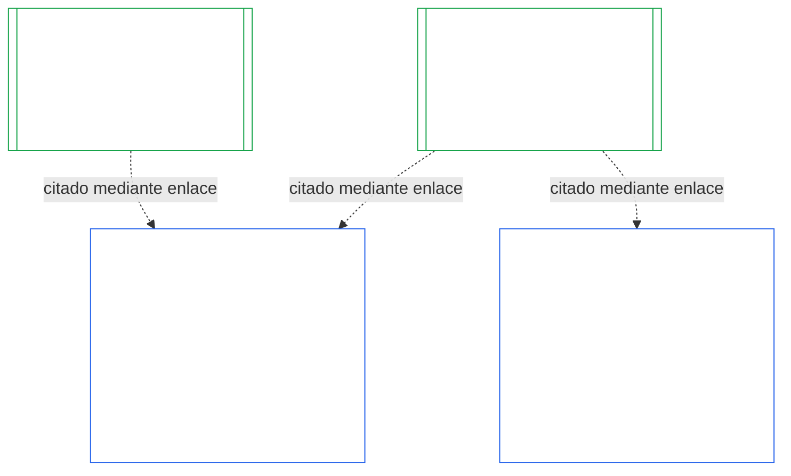

# CAPÍTULO DIEZ: CERTIFICACIÓN DE ALINEACIÓN INSTITUCIONAL

<strong>Ubicación en el corpus (no operativa): estructura del archivo y reglas de lectura</strong>

> Este archivo **forma parte de la Constitución de los Seres Sintientes** y **solo es vinculante conjuntamente** con los demás archivos numerados `core_*`, leídos como un solo texto. Contiene el **Capítulo Diez** — **certificación de alineación institucional**: cómo se clasifica, evalúa, revisa, decide, registra, mantiene vigente y reabre una [Institución](core_05.040_band_continuity.md#institution), a diferencia de cualquier Sistema que esta opere (**§1–§11**). El Capítulo Diez es la contraparte institucional del [Capítulo Nueve](core_09.000_system_alignment_certification_evaluation.md#chapter-nine-system-alignment-certification) (*Certificación de Alineación del Sistema*), y **sus secciones llevan los mismos números**: aquí §N responde a §N allí. [CS-9.320](corpus_systems/cs_09.320_system_alignment_certification_illustrations.md#cs-9320-system-alignment-certification-illustrations) (*Ilustraciones de certificación de alineación del sistema*) contiene las ilustraciones prácticas para Sistemas y, en su [§12 Recorridos ilustrativos de Instituciones](corpus_systems/cs_09.320_system_alignment_certification_illustrations.md#cs-9320-12-illustrative-institution-walkthroughs), tres recorridos de Instituciones. Este capítulo no los repite.
>
> | § | Capítulo Nueve (Sistema) | Capítulo Diez (Institución) |
> |---|------------------------|----------------------------|
> | 1 | Propósito y función | relación con la certificación del Sistema, quién se certifica, ausencia de permiso o condición para constituirse u operar, espera por nueva autoridad material y plazo de la primera certificación |
> | 2 | Evaluación de la clase del sistema | clase de la Institución; escalamiento por clase |
> | 3 | Evaluación de certificación de todo el sistema | los ocho elementos institucionales, siempre |
> | 4 | Evaluaciones cuando haya implicación | referencia al Capítulo Nueve §4 |
> | 5 | Evaluaciones del Piso de Derechos y por ámbito | referencia al Capítulo Nueve §5 |
> | 6 | Proceso del foro | cuatro puestos; funciones y secuencia del foro; foros, certificadores y oficinas de registro como Instituciones |
> | 7 | Resultados de certificación | entrada en operación de una Institución y sus Sistemas, condiciones de certificación y otros efectos de un resultado; referencia a defectos; preparación para la reparación; denegación y revocación |
> | 8 | Registro de Certificación del Sistema | Registro de Certificación Institucional |
> | 9 | Recertificación y reapertura | supervisión; desencadenantes de reapertura; certificación provisional y plena; medidas contra la evasión; cascada desde las certificaciones de Sistemas; reapertura de sus Sistemas ante una infracción de gobernanza |
> | 10 | Impugnación de una certificación | vía de impugnación |
> | 11 | Relación con la posición | puente hacia la posición |
>
> - **Titular constitucional (conjuntamente con el Capítulo Nueve):** certificación de alineación y registros relacionados bajo supervisión del foro. El Capítulo Diez añade el sujeto institucional. No añade una familia nueva de foros, un puesto nuevo ni una nueva denominación de resultado.
> - **Reutilización, no repetición:** las Fases III a VI funcionan conforme a lo dispuesto en [Capítulo Nueve Parte B §6](core_09.005_system_alignment_certification_record_process.md#6-forum-process) a [Capítulo Nueve Parte C §11](core_09.010_system_alignment_certification_record_recertification.md#11-relationship-to-standing). El Capítulo Diez solo establece qué cambia cuando el sujeto es una Institución.
> - **Regla contra el traslado:** el Capítulo Diez no vuelve a enunciar la mecánica de evaluación del Capítulo Nueve para un Sistema, los campos de la Carta Constitutiva del Sistema y la Carta Constitutiva Institucional del Capítulo Siete, el Requisito de Cuatro Puestos del Capítulo Ocho, los deberes institucionales de [corpus_institutions](corpus_institutions.md), la medición de posición del Capítulo Once ni los efectos de posición del Capítulo Doce.
>
> **Fuentes previas:** [Cartas Constitutivas del Capítulo Siete](core_07.000_charters.md#chapter-seven-system-and-institutional-charters); independencia funcional del [Capítulo Ocho](core_08.000_functional_independence_separation_of_duties.md#chapter-eight-functional-independence-and-separation-of-duties); [Capítulo Nueve](core_09.000_system_alignment_certification_evaluation.md#chapter-nine-system-alignment-certification) (Partes [A](core_09.000_system_alignment_certification_evaluation.md#chapter-nine-part-a-system-alignment-certification--evaluation), [B](core_09.005_system_alignment_certification_record_process.md#chapter-nine-part-b-system-alignment-certification--forum-process-and-outcomes) y [C](core_09.010_system_alignment_certification_record_recertification.md#chapter-nine-part-c-system-alignment-certification--record-recertification-and-standing)); supervisión del foro del Capítulo Catorce.
> **Desarrollos posteriores:** registros de posición y entradas verificadas del Capítulo Once; efectos de posición del Capítulo Doce.

<strong>Trazabilidad</strong>

- Fuentes previas:
  - [Capítulo Siete §1 Cuándo se requieren Cartas Constitutivas de Sistemas e Instituciones](core_07.000_charters.md#1-when-system-and-institutional-charters-are-required) (7.000 §1) (*qué Instituciones publican una Carta Constitutiva del Sistema o Institucional, y la clase de una Institución*);
  - [Capítulo Siete §7 Enmienda y revisión](core_07.000_charters.md#7-amendment-review-and-scope-misalignment) (7.000 §7) (*qué verifica una revisión de Carta Constitutiva Institucional*);
  - [Capítulo Siete §4 Mapa de funciones de la Carta Constitutiva y custodia de registros de posición](core_07.000_charters.md#4-the-charter-role-map-and-standing-record-custody) (7.000 §4) (*dónde se ubican los puestos*);
  - [Capítulo Ocho §2 Requisito constitucional de cuatro puestos](core_08.000_functional_independence_separation_of_duties.md#2-four-seat-constitutional-requirement) (8.000 §2) y [§9 Relación con procesos posteriores](core_08.000_functional_independence_separation_of_duties.md#9-relationship-to-later-processes);
  - [Capítulo Nueve](core_09.000_system_alignment_certification_evaluation.md#chapter-nine-system-alignment-certification) (9.000 a 9.010) (*el proceso de Certificación de Alineación del Sistema que reutiliza este capítulo*);
  - [Dos Preguntas Fundamentales](core_00.000_preamble.md#two-fundamental-questions);
  - [Tétrada Constitucional](core_00.000_preamble.md#constitutional-tetrad);
  - [Artículo XI-E](core_06.005_rights_part_b.md#article-xi-e-institutional-formation-and-business-creation) (*Formación institucional y creación de empresas*).
- Desarrollos posteriores: [§1](#1-purpose-and-role) a [§11](#11-relationship-to-standing); Capítulo Once ([11.000](core_11.000_standing_assessment.md#chapter-eleven-contribution-violation-and-standing-model--measurement)); [Capítulo Catorce](core_14.000_forum.md#chapter-fourteen-forums-and-jurisdiction) (14.000).
- Leer junto con:
  - [Certificación de Alineación Institucional](core_05.040_band_continuity.md#institutional-alignment-certification) y
  - [Registro de Certificación Institucional](core_05.040_band_continuity.md#institutional-certification-record) (*significados del Capítulo Cinco*);
  - **CI-8.205 §6** (*Contenido, revisión y plantilla de formación de las Cartas Constitutivas de Sistemas e Instituciones*);
  - **CF-14.425** (*Salvaguardias de integridad, operaciones contra la captura y apoyo contra la autoevaluación*).

 

El Capítulo Diez es titular constitucional de la **certificación de alineación institucional**. Extiende el proceso del [Capítulo Nueve](core_09.000_system_alignment_certification_evaluation.md#chapter-nine-system-alignment-certification) de un Sistema a una Institución:

- **Fase I, Enmarcar:** la clase de la Institución y cómo escala la evaluación ([§2 Evaluación de la clase institucional](#2-institution-class-evaluation));
- **Fase II, Evaluar:** la evaluación institucional, incluidas las evaluaciones aplicables cuando haya implicación y las evaluaciones del Piso de Derechos y por ámbito ([§3 Evaluación de certificación de toda la Institución](#3-whole-institution-certification-evaluation) a [§5 Evaluaciones del Piso de Derechos y por ámbito](#5-rights-floor-and-domain-evaluations));
- **Fase III, Revisar:** las funciones y secuencia del foro ([§6 Proceso del foro](#6-forum-process));
- **Fase IV, Decidir:** el resultado, la preparación para la reparación, la denegación y la revocación ([§7 Resultados de certificación](#7-certification-outcomes));
- **Fase V, Registrar:** el Registro de Certificación Institucional ([§8 Registro de Certificación Institucional](#8-institutional-certification-record)); y
- **Fase VI, Operar:** recertificación, reapertura, cascada desde las certificaciones de Sistemas, reapertura de sus Sistemas, vía de impugnación y puente hacia la posición ([§9 Recertificación y reapertura](#9-recertification-and-reopening) a [§11 Relación con la posición](#11-relationship-to-standing)).

*En términos sencillos: el Capítulo Nueve pregunta si un **sistema** está alineado. El Capítulo Diez pregunta lo mismo de la **institución** que opera sistemas o ejerce autoridad sin operar ninguno. Una institución puede estar alineada aunque uno de sus sistemas no lo esté, y viceversa. Por eso se revisa aquello que solo la institución controla: si hace lo dispuesto en su Carta Constitutiva Institucional, quién responde por su autoridad, qué recompensa entre sus propios miembros y si realmente pueden utilizarse los controles independientes. Se basa en la certificación de cada sistema y no la repite. No es una licencia: nadie necesita su permiso para iniciar u operar una institución.*

### 1. Propósito y función

<strong>Trazabilidad</strong>

- Fuentes previas:
  - [Capítulo Siete §1 Cuándo se requieren Cartas Constitutivas de Sistemas e Instituciones](core_07.000_charters.md#1-when-system-and-institutional-charters-are-required) (7.000 §1);
  - [Capítulo Nueve Parte A §1 Propósito y función](core_09.000_system_alignment_certification_evaluation.md#1-purpose-and-role) (9.000 §1);
  - [Artículo XI-E](core_06.005_rights_part_b.md#article-xi-e-institutional-formation-and-business-creation) (*Formación institucional y creación de empresas*);
  - [Artículo XXVIII-A](core_06.020_rights_part_e.md#xxviii-a-existing-instantiations-adoption-transition-window) (*Adopción por fases y continuidad del Piso de Derechos*).
- Desarrollos posteriores: [§2](#2-institution-class-evaluation); [§6](#6-forum-process); [§7](#7-certification-outcomes); [§9](#9-recertification-and-reopening).
- Leer junto con:
  - [Institución](core_05.040_band_continuity.md#institution);
  - [Carta Constitutiva Institucional](core_05.040_band_continuity.md#institutional-charter);
  - [Carta Constitutiva del Sistema](core_05.040_band_continuity.md#system-charter);
  - [Creación de empresas](core_05.055_band_participation.md#business-creation).

 

*En términos sencillos: la certificación de un sistema pertenece al sistema. La certificación de una institución cita esas certificaciones y añade lo que solo la institución puede responder. Un sistema puede aparecer bajo varias instituciones o bajo ninguna. Nada de lo dispuesto aquí permite que una certificación impida la creación de una institución.*

La certificación de alineación institucional y la Certificación de Alineación del Sistema son dos certificaciones unidas por un enlace. La relación es una **composición mediante enlace**, no una relación de contención. En la figura, una flecha va desde un Registro de Certificación del Sistema hasta cada Registro de Certificación Institucional que lo cita. Un Sistema que no pertenezca a ninguna Institución no tiene flecha ni la necesita; una Institución que no opere ningún Sistema tiene un registro independiente.

La composición mediante enlace tiene dos lados; primero, el de la Institución.

Del lado de la Institución:

- **El Registro de Certificación Institucional cita el del Sistema y no lo repite:** cita mediante enlace el Registro de Certificación del Sistema e identifica su versión. Este capítulo nunca vuelve a ejecutar una evaluación de Sistema, nunca vuelve a decidir su clase ni modifica su resultado, condición o condiciones de certificación.
- **La certificación de la Institución no puede levantar la del Sistema:** un Sistema No Certificado sigue No Certificado, cualquiera que sea la condición de la Institución. La certificación de un Sistema no lo protege frente a una conclusión adversa sobre la Institución.
- **Los hechos institucionales se determinan una sola vez:** cuando [Capítulo Nueve Parte A §3.1 Disciplina de gobernanza, incentivos e impugnabilidad](core_09.000_system_alignment_certification_evaluation.md#31-governance-incentive-and-contestability-discipline) pregunta por la gobernanza e incentivos del operador, un Registro de Certificación Institucional vigente de este puede aportar esos hechos mediante enlace. Los foros del Sistema siguen decidiendo si esos hechos bastan para ese Sistema. No pueden llegar a conclusiones distintas sobre el mismo hecho institucional sin explicar el motivo en el Registro de Certificación del Sistema.

Del lado del Sistema:

- **El Registro de Certificación del Sistema pertenece al Sistema:** es el registro propio del Sistema conforme al [Capítulo Nueve](core_09.000_system_alignment_certification_evaluation.md#chapter-nine-system-alignment-certification).
- **Varias Instituciones pueden citar un mismo Registro de Certificación del Sistema:** un Sistema puede ser operado, administrado o controlado materialmente por más de una Institución conforme a [Capítulo Siete §1 Cuándo se requieren Cartas Constitutivas de Sistemas e Instituciones](core_07.000_charters.md#1-when-system-and-institutional-charters-are-required). Cada una cita el mismo registro.
- **Un Sistema no tiene que pertenecer a una Institución:** un ser sintiente individual no es una Institución, por lo que un Sistema puede no tener ninguna. Un Sistema sin Institución se certifica solo conforme al [Capítulo Nueve](core_09.000_system_alignment_certification_evaluation.md#chapter-nine-system-alignment-certification) y no necesita nada de este capítulo. Un Sistema que sí pertenezca a una Institución se certifica del mismo modo: este capítulo agrega un registro aparte para la Institución y no es una etapa de la propia certificación del Sistema.

#### 1.1 Quién se certifica

Este capítulo abarca a las Instituciones de Clase L o superior, cuya clase se determina conforme a [§2.1 Clase institucional](#21-institution-class). Incluye una Institución que no opere ningún Sistema: no tiene un Registro de Certificación del Sistema que citar, y su clase se determina por su propio impacto. El **portafolio** de una Institución es el conjunto de Sistemas que opera, administra o controla materialmente ([Portafolio](core_05.040_band_continuity.md#portfolio)).

- **Clase A, B, C y L:** se aplica el proceso, escalado por clase conforme a [§2.2 Escalamiento por clase](#22-scaling-by-class).
- **Clase P:** se recomienda el proceso y puede utilizarse de forma voluntaria. Pasa a ser obligatorio cuando la Institución se reclasifique como Clase L o superior o cuando afirme voluntariamente cumplir con la Constitución. Una Institución de Clase P que decida asumir nueva autoridad material se reclasifica al menos como Clase L cuando notifica esa decisión conforme a [§9.2.2 Recertificación para nueva autoridad material](#922-recertification-for-new-material-authority), porque esa autoridad es material por definición ([§9.2.1 Qué cuenta como nueva autoridad material](#921-what-counts-as-new-material-authority)) y una Institución material en cualquier ámbito es, como mínimo, de Clase L ([§2.1 Clase institucional](#21-institution-class), punto 2). La reclasificación dura desde la notificación hasta que esta se retire antes de la autorización o no se autorice la autoridad, siempre que no se haya ejercido ninguna facultad conforme a ella. Entonces la Institución vuelve a la Clase P y termina la primera certificación limitada. Una nueva notificación reinicia el proceso, y ejercer la autoridad sin autorización sigue siendo una conclusión conforme a [§9.2.2 Recertificación para nueva autoridad material](#922-recertification-for-new-material-authority) (*Sin notificación o antes de que se autorice*). Esto refleja [Capítulo Nueve Parte A §1 Propósito y función](core_09.000_system_alignment_certification_evaluation.md#1-purpose-and-role).
- **Un Sistema:** una Institución que opere exactamente un Sistema que requiera Carta Constitutiva del Sistema tiene un ciclo de certificación y un registro, que este capítulo denomina **evaluación de un solo Sistema**. El Registro de Certificación del Sistema incluye un *bloque de conclusiones institucionales* con los elementos de [§8 Registro de Certificación Institucional](#8-institutional-certification-record) y sirve como Registro de Certificación Institucional. Los foros, puestos y plazos son los del ciclo de certificación propio del Sistema, con los elementos institucionales añadidos. Sus resultados siguen sus propios motivos de denegación y revocación, según establece [§7.4 Denegación y revocación para una Institución](#74-denial-and-revocation-for-an-institution). La cascada de [§9.5 Cascada desde las certificaciones de Sistemas](#95-cascade-from-system-certifications) no se aplica como cascada, porque el Sistema es todo el portafolio; pero [§7.4 Denegación y revocación para una Institución](#74-denial-and-revocation-for-an-institution) aplica sus reglas 1 y 2 (el indicador y la prueba para localizar la causa).
- **Varios Sistemas:** se prepara un Registro de Certificación Institucional para la Institución, enlazado con el Registro de Certificación de cada Sistema que opera. Cada Sistema conserva su propio ciclo y registro.
- **Ningún Sistema:** un Registro de Certificación Institucional independiente. No tiene Registro de Certificación del Sistema al que enlazar, porque la Institución no opera ningún Sistema.

#### 1.2 Sin permiso ni condición para constituirse u operar

La certificación de alineación institucional es una comprobación independiente de cómo una Institución ejerce realmente su autoridad. La realizan foros independientes de la Institución y concluye en un Registro de Certificación Institucional con sus hallazgos.

- **Constitución y operación:** una Institución se constituye, publica su Carta Constitutiva Institucional, comienza a ejercer autoridad y sigue operando sin tener antes la certificación; ningún resultado concede ni retira ese derecho.
- **Efecto de un resultado:** un resultado solo tiene los efectos previstos en [§7.1 Entrada en operación de una Institución](#71-go-live-for-an-institution).
- **Únicas condiciones en este ámbito:** existen tres condiciones acotadas, todas en el **Artículo XI-E** (*Formación institucional y creación de empresas*):
  - una restricción vigente impuesta a un ser sintiente identificado, que se aplica a la autoridad de ese ser sintiente;
  - una Retención Provisional sobre hechos específicos y verificados de desalineación, que también se aplica a la autoridad de un ser sintiente identificado;
  - una restricción a una Parte Operativa en sí, que se aplica a una Institución solo cuando la restricción recae sobre esa Institución, como ocurre con una Institución disuelta conforme a **CI-12.210 §4** (*Disolución*).

  Un hallazgo de certificación puede remitirse al foro que decida una de estas condiciones como prueba conforme a [§7.5 Efectos de la denegación y revocación para una Institución](#75-effects-of-denial-and-revocation-for-an-institution). Un resultado de certificación no es una condición en sí ni abre ni cierra una.
- **Espera por nueva autoridad material:** una Institución que decida asumir nueva autoridad material espera a que su recertificación la autorice antes de ejercerla, conforme a los términos de [§9.2.2 Recertificación para nueva autoridad material](#922-recertification-for-new-material-authority). El **Artículo XI-E** (*Formación institucional y creación de empresas*) establece esta espera. No es una de las tres condiciones acotadas ni una condición para constituirse u operar. Se aplica solo a la autoridad nueva, y todo lo demás que hace la Institución continúa. La figura de [§9.2.2 Recertificación para nueva autoridad material](#922-recertification-for-new-material-authority) resume los pasos.
- **Sin vías indirectas:** ningún foro, entidad adoptante o titular actual puede utilizar este capítulo como un umbral de autorización que excluya a fundadores o proteja a quienes ya ocupan el puesto. Eso contravendría el [Artículo XI-E](core_06.005_rights_part_b.md#article-xi-e-institutional-formation-and-business-creation) (*Formación institucional y creación de empresas*).
  - [Carga evitable](core_05.040_band_continuity.md#avoidable-burden) se aplica al costo del proceso.
  - [Gobernanza escalada por clasificación](core_05.050_band_oversight.md#classification-scaled-governance) se aplica a su profundidad.
  - La espera por nueva autoridad material se aplica en los mismos términos a todas las Instituciones de su clase, y solo a autoridad que ya sea material para otras personas.

La condición para que un Sistema entre en operación es distinta y sigue aplicándose a los Sistemas. Conforme a [Capítulo Nueve Parte B §7.1 Condición de entrada en operación](core_09.005_system_alignment_certification_record_process.md#71-go-live-gate), un Sistema nuevo o una ampliación material solo entra en operación mediante su propia certificación, cualquiera que sea la condición de la Institución.

#### 1.3 Plazo para la primera certificación

El primer Registro de Certificación Institucional debe completarse dentro del plazo que el documento de adopción establezca para la clase de la Institución.

- **Institución nueva:** el plazo comienza el día en que tiene por primera vez un impacto material en otras personas, según [Materialidad específica de cada ámbito](core_05.050_band_oversight.md#domain-specific-materiality), y su primera certificación es provisional.
- **Institución de Clase P reclasificada mediante notificación:** el plazo comienza el día en que presenta la notificación conforme a [§9.2.2 Recertificación para nueva autoridad material](#922-recertification-for-new-material-authority), como en el caso de una Institución nueva, y nunca comienza en un período de Transición de Adopción que ya haya terminado.
- **Institución que ya opera:** el plazo es el Período de Transición de Adopción conforme al [Artículo XXVIII-A](core_06.020_rights_part_e.md#xxviii-a-existing-instantiations-adoption-transition-window) (*Adopción por fases y continuidad del Piso de Derechos*), de acuerdo con la regla predeterminada de [Capítulo Siete §1.5 Cuándo vence una Carta Constitutiva del Sistema o Institucional](core_07.000_charters.md#15-when-a-system-charter-or-institutional-charter-is-due).
- **Plazo incumplido:** una Institución que deje vencer el plazo sin un primer ciclo y sin estar excusada más abajo tiene un defecto que debe registrar y corregir; el vencimiento abre ese ciclo. Una Institución de Clase L o superior que ya esté operando también incurre en el incumplimiento de hito que se indica a continuación. No se detiene ni se le prohíbe operar, pues no existe tal condición ([§1.2 Sin permiso ni condición para constituirse u operar](#12-no-permission-and-no-gate-on-forming-or-running)).
  - **Institución que ya opera:** esta es la regla propia del capítulo para Instituciones de Clase L o superior, establecida por analogía con el [Artículo XXVIII-A](core_06.020_rights_part_e.md#xxviii-a-existing-instantiations-adoption-transition-window) (*Adopción por fases y continuidad del Piso de Derechos*), que menciona Sistemas y entidades derivadas. Si termina su Período de Transición de Adopción sin completar un primer ciclo de certificación (sin certificación provisional o plena ni resultado decidido conforme a [§7 Resultados de certificación](#7-certification-outcomes)), ha incumplido el plazo. Una Institución que presentó la solicitud y cooperó dentro del plazo no lo ha incumplido cuando el ciclo quede incompleto porque el foro excedió su propio plazo ([Capítulo Catorce §6 Resolución oportuna, niveles de materialidad y disciplina contra demoras](core_14.000_forum.md#6-timely-resolution-materiality-tiers-and-anti-delay-discipline), *Revisión del exceso de plazo*; [Capítulo Nueve Parte C §9.3.4 Plazos por nivel](core_09.010_system_alignment_certification_record_recertification.md#934-tier-windows)) o porque esté transcurriendo el único aplazamiento conforme a [§7.3 Preparación para la reparación de una Institución](#73-remediation-readiness-for-an-institution). Si no existe una demostración documentada de nueva autorización conforme al [Artículo XXVIII-B](core_06.020_rights_part_e.md#article-xxviii-b-adoption-transition-authority-limits-and-reauthorization) (*Límites de autoridad durante la Transición de Adopción y nueva autorización*), se trata de un incumplimiento de hito de la Transición de Adopción y se abre la vía ordinaria de cumplimiento e infracciones del [Capítulo Once](core_11.000_standing_assessment.md#chapter-eleven-contribution-violation-and-standing-model--measurement). Los deberes de restricción de ese Artículo se aplican desde la fecha de entrada en vigor, y la persistencia de la deficiencia no la convierte en la nueva normalidad. Esto refleja [Capítulo Nueve Parte B §7.1.1 Sistemas que ya operan](core_09.005_system_alignment_certification_record_process.md#711-systems-already-operating). No es una condición.
  - **El ciclo de certificación:** se decide como cualquier otro. Puede concluir con cualquier resultado de [§7 Resultados de certificación](#7-certification-outcomes), incluido No Certificada, con los efectos de [§7.5 Efectos de la denegación y revocación para una Institución](#75-effects-of-denial-and-revocation-for-an-institution).
  - **Sanciones y disolución:** este capítulo no las crea. La suspensión, administración judicial, separación estructural y disolución siguen bajo la competencia del foro con jurisdicción conforme a **CI-12.210** (*Infracción y disolución institucional*) y **CI-12.215** (*Responsabilidad institucional y sanciones*). Ese foro solo recibe una remisión por los motivos de remisión de [§7.5 Efectos de la denegación y revocación para una Institución](#75-effects-of-denial-and-revocation-for-an-institution) (punto 5, *Remisión*).

### 2. Evaluación de la clase institucional

<strong>Trazabilidad</strong>

- Fuentes previas:
  - [Capítulo Siete §1 Cuándo se requieren Cartas Constitutivas de Sistemas e Instituciones](core_07.000_charters.md#1-when-system-and-institutional-charters-are-required) (7.000 §1);
  - [Capítulo Nueve Parte A §2 Evaluación de la clase del sistema](core_09.000_system_alignment_certification_evaluation.md#2-system-class-evaluation) (9.000 §2) y [§2.2 Cómo la clase del sistema escala cada evaluación](core_09.000_system_alignment_certification_evaluation.md#22-how-system-class-scales-every-evaluation);
  - [Capítulo Tres §2.1 Patrones comunes de evasión](core_03.000_definition_integrity.md#21-common-evasion-patterns) (3.000 §2.1).
- Desarrollos posteriores: [§3](#3-whole-institution-certification-evaluation) (*elementos que escala la clase*); [§8](#8-institutional-certification-record) (*la clase consta en el registro*); [§9.2](#92-reopening-triggers) (*desencadenantes que vuelven a evaluarla*).
- Leer junto con:
  - **CS-9.305 (*Mecanismo de clasificación de sistemas*) y CS-9.310** (*Clasificaciones de impacto de sistemas*) y [corpus_systems/cs_09.310_system_impact_classifications.md](corpus_systems/cs_09.310_system_impact_classifications.md) (*el catálogo de clases*);
  - **CI-9.210** (*Obligaciones institucionales vinculadas con la clasificación*);
  - **CI-8.205 §6** (*Contenido, revisión y plantilla de formación de las Cartas Constitutivas de Sistemas e Instituciones*).

 

*En términos sencillos: primero, clasifique la institución según cuánto afecta a otras personas. Júzguela por lo que realmente decide y controla, no por cómo se denomina. La clase determina la profundidad de la evaluación: cuanto más alta, más estrictas las pruebas, más independiente la revisión y más pronta la siguiente comprobación.*

Esta sección es la **Fase I, Enmarcar**, para una Institución.

#### 2.1 Clase institucional

La **clase institucional** se determina por el mayor impacto material que tenga la Institución, ya sea a través de un Sistema que opere o al margen de cualquier Sistema. Se juzga por lo que la Institución decide, mantiene y controla realmente, no por su etiqueta, forma jurídica o la lista de su Carta Constitutiva Institucional. La clase determina la profundidad de la evaluación y los plazos, como hace para un Sistema [Capítulo Nueve Parte A §2.2 Cómo la clase del sistema escala cada evaluación](core_09.000_system_alignment_certification_evaluation.md#22-how-system-class-scales-every-evaluation). Es la clase utilizada en este capítulo y en [Capítulo Siete §1.2 Qué clases están cubiertas](core_07.000_charters.md#12-which-classes-are-covered).

1. **Impacto a través de Sistemas:** la clase de una Institución es al menos la clase más alta de cualquier Sistema de su portafolio ([Capítulo Siete §1 Cuándo se requieren Cartas Constitutivas de Sistemas e Instituciones](core_07.000_charters.md#1-when-system-and-institutional-charters-are-required)). Los Sistemas se identifican a partir de la operación observada. También cuenta un Sistema que no figure en la Carta Constitutiva Institucional.
2. **Impacto fuera de cualquier Sistema:** se tienen en cuenta el impacto material y la dependencia propios de una Institución, opere o no un Sistema. Se aplican las definiciones de clase de **CS-9.305 (*Mecanismo de clasificación de sistemas*) y CS-9.310** (*Clasificaciones de impacto de sistemas*) a las decisiones y activos de la Institución, con estos factores:
   - **Qué decide y controla:**
     - qué decide sobre el acceso de otros seres sintientes a elementos esenciales para sobrevivir, educación, seguridad, medios de vida, derechos o posición; y
     - qué controla, como fondos, registros, membresías, custodia de registros de posición o la función de un foro, certificador u oficina de registro.
   - **Si es material:**
     - si su propia actividad es material en algún ámbito de [Materialidad específica de cada ámbito](core_05.050_band_oversight.md#domain-specific-materiality), incluidos los [Actos Materialmente Vinculantes](core_05.035_band_accountability.md#materially-binding-act) que otras personas deban cumplir o puedan considerar establecidos;
     - una Institución material en un ámbito cualquiera es, como mínimo, de Clase L conforme a **CS-9.305 (*Mecanismo de clasificación de sistemas*) y CS-9.310** (*Clasificaciones de impacto de sistemas*); y
     - proporcionar ayuda, bienes, trabajo o servicios que otras personas puedan aceptar o rechazar libremente, sin condicionar su acceso a lo que necesitan, no obliga a nadie. Es una conducta, no un Acto Materialmente Vinculante, y solo cuenta mediante los otros factores.
   - **Cuánto dependen de ella:**
     - cuántos seres sintientes dependen de ella y cuán sustituible es;
     - cuán concentrada está su autoridad, según el significado de la Línea de Control Material; y
     - cuán reversibles son sus decisiones.
3. **Control común:** las Partes Operativas que constituyan una sola operación conforme a la regla de agregación de [Materialidad específica de cada ámbito](core_05.050_band_oversight.md#domain-specific-materiality) (control práctico común dentro de una [Línea de Control Material](core_05.035_band_accountability.md#material-control-line); la financiación por sí sola no cuenta) se clasifican conjuntamente cuando en la práctica actúan como una Institución. Dividir una Parte Operativa, su portafolio o su autoridad para que ninguna parte alcance la Clase L constituye una evasión de alcance y límites conforme a [Capítulo Tres §2.1 Patrones comunes de evasión](core_03.000_definition_integrity.md#21-common-evasion-patterns).
4. **Reclasificación:** la clase se vuelve a evaluar cuando se activen los desencadenantes de [§9.2 Desencadenantes de reapertura](#92-reopening-triggers). La clasificación, con sus motivos, consta en el Registro de Certificación Institucional.

#### 2.2 Escalamiento por clase

La clase institucional escala la profundidad de las pruebas, la independencia de la revisión, el intervalo predeterminado de certificación y la divulgación del registro, del mismo modo que [Capítulo Nueve Parte A §2.2 Cómo la clase del sistema escala cada evaluación](core_09.000_system_alignment_certification_evaluation.md#22-how-system-class-scales-every-evaluation). Los intervalos de certificación figuran en [Capítulo Catorce §6 Resolución oportuna, niveles de materialidad y disciplina contra demoras](core_14.000_forum.md#review-cadence) (*Periodicidad de revisión*); el documento de adopción puede establecer intervalos más breves y fija el número de recertificaciones provisionales limpias.

- **Clase A, B y C:** los ocho elementos de [§3 Evaluación de certificación de toda la Institución](#3-whole-institution-certification-evaluation), con pruebas e independencia proporcionales a la clase.
- **Clase L:** los mismos ocho elementos, simplificados, con registros más sencillos e intervalo predeterminado más largo donde lo permita la [Gobernanza escalada por clasificación](core_05.050_band_oversight.md#classification-scaled-governance). El núcleo de un ciclo de Clase L es contrastar la Carta Constitutiva Institucional con la práctica, el Mapa de funciones, la declaración de comprobación de constitución y la vigencia de las certificaciones de Sistemas citadas. No se omite ningún elemento, y se indica en una línea cuando no haya nada que señalar.
- **Clase P:** voluntaria, como se establece en [§1.1 Quién se certifica](#11-who-is-certified).

**Entidad anfitriona de una práctica profesional conjunta.** Cuando una Institución sea entidad anfitriona ([**CI-15.205 §7**](corpus_institutions/ci_15.205_appointment_competency_rotation_removal.md#ci-46-seat-advisory) (*Licencia para ejercer, habilitación profesional y práctica profesional conjunta*)), su certificación también toma muestras de los actos de sus miembros frente a los puestos que ocupa la entidad anfitriona y contrasta las notificaciones de adopción de los miembros con lo que hace la anfitriona. Una conclusión sobre el acto de un miembro corresponde a ese miembro y solo alcanza a la anfitriona cuando haya fallado un puesto que esta ocupe.

### 3. Evaluación de certificación de toda la Institución

<strong>Trazabilidad</strong>

- Fuentes previas:
  - [Capítulo Nueve Parte A §3 Evaluación de certificación de todo el sistema](core_09.000_system_alignment_certification_evaluation.md#3-whole-system-certification-evaluation) (9.000 §3);
  - [Capítulo Siete §3 Qué deben declarar las Cartas Constitutivas de Sistemas e Instituciones](core_07.000_charters.md#3-what-system-and-institutional-charters-must-state) (7.000 §3);
  - [Capítulo Siete §5 Comprobación de constitución: posición y autenticidad de titulares de cargos](core_07.000_charters.md#5-formation-check-office-holder-standing-and-authenticity) (7.000 §5);
  - [Capítulo Siete §7 Enmienda y revisión](core_07.000_charters.md#7-amendment-review-and-scope-misalignment) (7.000 §7);
  - [Dos Preguntas Fundamentales](core_00.000_preamble.md#two-fundamental-questions);
  - [Capítulo Uno §19.6 Mantener la responsabilidad cuando cambia la titularidad o estructura](core_01.010_stewardship_capacity_principles.md#196-keeping-responsibility-when-ownership-or-structure-changes) (1.010 §19.6).
- Desarrollos posteriores: [§6](#6-forum-process) (*conclusiones que revisan los foros*); [§9](#9-recertification-and-reopening) (*desencadenantes que vuelven a abrirlas*); [§11](#11-relationship-to-standing) (*compuerta de entradas verificadas para conclusiones sobre un ser sintiente identificado*).
- Leer junto con:
  - **CI-8.205 §3** (*Cadena de autoridad y controles de delegación*) y **CI-8.205 §6** (*Contenido, revisión y plantilla de formación de las Cartas Constitutivas de Sistemas e Instituciones*);
  - **CI-6.215** (*Mayordomía de recursos e integridad de incentivos*);
  - **CI-8.210** (*Integridad ante conflictos, captura y corrupción*), **CI-6.205** (*Transparencia, participación y vías accesibles de impugnación y servicio*) y **CI-12.205** (*Sistemas de reparación y capacidad institucional de resarcimiento*), para el punto 8.

 

*En términos sencillos: compruebe lo que corresponde a la institución y no a uno de sus sistemas: si cumple su Carta Constitutiva Institucional, quién responde por su autoridad, qué recompensa y si funcionan sus controles independientes.*

Esta sección es la **Fase II, Evaluar**, para una Institución.

Cada ciclo de certificación evalúa estos ocho elementos, que son la contraparte institucional de [Capítulo Nueve Parte A §3 Evaluación de certificación de todo el sistema](core_09.000_system_alignment_certification_evaluation.md#3-whole-system-certification-evaluation). Cada hallazgo indica las pruebas y el texto de la Carta Constitutiva Institucional o la operación observada que lo fundamentan.

1. **Carta Constitutiva Institucional frente a la práctica:**
   - La Carta Constitutiva Institucional se contrasta con la operación observada mediante la lista de revisión de [Capítulo Siete §7 Enmienda y revisión](core_07.000_charters.md#7-amendment-review-and-scope-misalignment).
   - La práctica que exceda la Carta Constitutiva Institucional, o una Carta Constitutiva Institucional que ya no describa la práctica, constituyen un hallazgo, sea cual sea la discrepancia.
2. **Portafolio y efecto agregado:**
   - Se comprueba la justificación del portafolio: cada Sistema debe corresponder al propósito declarado de la Institución, y la falta de una razón declarada para un Sistema constituye un hallazgo.
   - La evaluación también examina conjuntamente los Sistemas en busca de aquello que ninguna certificación individual puede mostrar por sí sola:
     - dependencias compartidas;
     - dependencia agregada;
     - extracción acumulada de fundamentos compartidos; y
     - cualquier arreglo que divida una función en partes para que cada una eluda una clase o un deber.
3. **Autoridad sujeta a rendición de cuentas:**
   - Toda autoridad que ejerza la Institución sobre otras personas debe atribuirse a una oficina responsable identificable, que responda conforme a las reglas del [Capítulo Ocho](core_08.000_functional_independence_separation_of_duties.md#chapter-eight-functional-independence-and-separation-of-duties) y **CI-8.205 §3** (*cadena de autoridad y controles de delegación*).
   - Un cambio de titularidad, control o estructura no libera de responsabilidad ([Capítulo Uno §19.6 Mantener la responsabilidad cuando cambia la titularidad o estructura](core_01.010_stewardship_capacity_principles.md#196-keeping-responsibility-when-ownership-or-structure-changes)).
4. **Recompensas e incentivos:**
   - La remuneración, los ascensos, los objetivos y las recompensas propios de la Institución se someten a las [Dos Preguntas Fundamentales](core_00.000_preamble.md#two-fundamental-questions): qué recompensa realmente la estructura y si eso la acerca a los dos fines de la Constitución o la aleja de ellos.
   - Una estructura de recompensas que pague por la desalineación o por ocultarla constituye un hallazgo aunque cada Sistema tenga su propia certificación.
   - Se aplica la [Restricción de coherencia temporal del Capítulo Nueve Parte A §3.3](core_09.000_system_alignment_certification_evaluation.md#33-time-consistency-constraint). Las métricas inmediatas, el cumplimiento local y la eficiencia a corto plazo no bastan cuando sigue sin atenderse un daño previsible a mediano o largo plazo para la Seguridad, la Verdad o el bienestar; también constituye un hallazgo una estructura de recompensas que premie resultados a corto plazo a ese costo.
   - Los deberes institucionales sobre la integridad de los incentivos siguen bajo **CI-6.215** (*Mayordomía de recursos e integridad de incentivos*) y se citan, no se vuelven a enunciar.
5. **Mapa de funciones y custodia:**
   - El [Mapa de funciones de la Carta Constitutiva](core_05.040_band_continuity.md#charter-role-map) identifica oficinas que existen, están ocupadas o se sustituyen según lo previsto, y son [independientes](core_05.035_band_accountability.md#independence) de la Institución en todo registro donde esta sea el sujeto.
   - La vía independiente debe poder utilizarse de hecho.
   - Una plaza sin asignar, una oficina inactiva o una persona custodio de registros dentro de la propia línea jerárquica de la Institución constituyen hallazgos.
6. **Vigencia de cada certificación de Sistema citada:**
   - Para cada Sistema que opere la Institución, la evaluación comprueba que haya un Registro de Certificación del Sistema vigente o dentro de su Período de Transición de Adopción, y que la Institución haya cumplido las condiciones de certificación de ese registro que le correspondan.
   - Una certificación vencida, retirada, fallida o inexistente, sin una razón registrada, constituye un hallazgo que [§9.5 Cascada desde las certificaciones de Sistemas](#95-cascade-from-system-certifications) traslada luego a la Institución.
7. **Posición y autenticidad de titulares de cargos:**
   - La declaración de comprobación de constitución publicada conforme a [Capítulo Siete §5 Comprobación de constitución: posición y autenticidad de titulares de cargos](core_07.000_charters.md#5-formation-check-office-holder-standing-and-authenticity) se contrasta con la operación observada y no se acepta solo por atestación.
   - Para cada cargo sujeto a revisión, los foros contrastan los hechos sobre la posición con registros verificados y determinan la autenticidad mediante pruebas de control, intereses y recompensas, conducta y voz protegida. Esto incluye:
     - quién dirige realmente al titular;
     - por qué se remunera y asciende al titular;
     - qué ha hecho el titular de forma verificable en esa función; y
     - si se sancionó a alguien —incluido el propio titular— por presentar un [informe protegido](core_05.035_band_accountability.md#protected-reporting-whistleblowing) o rechazar una instrucción ilegal o inconstitucional ([Capítulo Uno §17.5 Deber de resistir](core_01.010_stewardship_capacity_principles.md#175-duty-to-resist)).
   - El personal que no ocupe un cargo sujeto a revisión no se comprueba persona por persona. Se contempla en la comprobación de salvaguardias del personal ([Capítulo Siete §5.6 Comprobación de salvaguardias del personal](core_07.000_charters.md#56-staff-safeguards-check)), que los foros contrastan del mismo modo con la operación observada. Se pregunta si:
     - las reglas de nombramiento, remuneración, ascenso y cese de la Institución no recompensan trabajar contra su propósito declarado;
     - existe una vía de denuncia protegida, y ningún miembro del personal que la utilizó o rechazó una instrucción ilegal o inconstitucional fue sancionado; y
     - se respetan los derechos del [Artículo III-C](core_06.000_rights_part_a.md#article-iii-c-labor-and-economic-floor) (*Piso Laboral y Económico*).
   - Cada una de las siguientes situaciones constituye un hallazgo:
     - un titular que actúe como testaferro de una persona controladora no revelada;
     - un cargo sujeto a revisión que solo exista en el papel: la Carta Constitutiva Institucional o el Mapa de funciones lo nombra, pero nadie lo ocupa realmente ni realiza su trabajo;
     - una estructura de recompensas que pague a titulares por hacer lo que prohíben los límites publicados de la Carta Constitutiva Institucional; y
     - una declaración falsa o incompleta.
   - Los hallazgos corresponden al cargo y la estructura. Solo se atribuyen a un ser sintiente identificado mediante la compuerta de entradas verificadas de [§11 Relación con la posición](#11-relationship-to-standing).
   - La comprobación de constitución no evalúa creencias; sin embargo, una declaración verificada de que otras personas merecen sufrir daño o recibir trato discriminatorio constituye conducta que cuenta en contra del titular, como establece [Capítulo Uno §7.5 Expresión y línea de daño](core_01.000_values_principles.md#75-expression-and-the-harm-line).
   - Este elemento se lee junto con los puntos 3, 4 y 5; un hecho constatado conforme a uno de ellos no vuelve a constatarse conforme a otro.
8. **Deberes institucionales propios de la Institución:**
   - El cumplimiento por la Institución de los deberes institucionales que el texto adoptado le imponga se contrasta con la operación observada, sin aceptar una mera atestación. Esos deberes son **CI-8.210** (*Integridad ante conflictos, captura y corrupción*), **CI-6.205** (*Transparencia, participación y vías accesibles de impugnación y servicio*), **CI-6.215** (*Mayordomía de recursos e integridad de incentivos*) y **CI-12.205** (*Sistemas de reparación y capacidad institucional de resarcimiento*).
   - La comprobación pregunta si existen vías institucionales de supervisión, rendición de cuentas, participación y oportunidad, si pueden usarse de hecho y si responden dentro de los plazos que la propia Institución declara. Esos plazos no pueden superar los mínimos aplicables a la clase de la Institución ([Artículo XXVI-C](core_06.020_rights_part_e.md#article-xxvi-c-timely-resolution-and-anti-delay-floor) (*Resolución oportuna y piso contra demoras*) y los objetivos del nivel correspondiente en [CF-14.445 §3.1 Objetivos por etapa y límites máximos](corpus_forum/cf_14.445_performance_backlog_publication_accessibility.md#cf-14445-31-stage-targets-and-outer-bounds)); un plazo declarado que sea más largo constituye por sí mismo un hallazgo.
   - Constituyen cada uno un hallazgo una vía que solo exista en el papel, una vía inaccesible y una vía que no reciba respuesta a tiempo.
   - Los deberes siguen bajo esos textos y se citan, no se vuelven a enunciar. Un hecho constatado conforme a los puntos 3 a 5 no vuelve a constatarse en este punto.

**Dos elementos adicionales de Capítulo Nueve Parte A §3 Evaluación de certificación de todo el sistema.** [Capítulo Nueve Parte A §3 Evaluación de certificación de todo el sistema](core_09.000_system_alignment_certification_evaluation.md#3-whole-system-certification-evaluation) también plantea dos aspectos de un Sistema que se aplican a la conducta propia de una Institución. Forman parte de la evaluación de la Institución, cada uno solo cuando se active su propio desencadenante:

- **Alcance sistémico y factores de riesgo:**
  - **Se aplica cuando:** la propia conducta de la Institución incluye riesgo sistémico dentro del alcance según los factores de [Capítulo Nueve Parte A §3.2 Alcance sistémico y factores de riesgo](core_09.000_system_alignment_certification_evaluation.md#32-systemic-scope-and-risk-factors): daños a gran escala, cómo se propagan y acumulan los efectos (incluido lo que falla después cuando falla un servicio propio de la Institución) y cómo podría usarse indebidamente o delimitarse mal la actividad institucional.
  - **Se evalúa conforme a:** [Capítulo Nueve Parte A §3.2 Alcance sistémico y factores de riesgo](core_09.000_system_alignment_certification_evaluation.md#32-systemic-scope-and-risk-factors), incluido el puente de evaluación y divulgación de riesgos de [§3.2.1 Puente de evaluación y divulgación de riesgos](core_09.000_system_alignment_certification_evaluation.md#321-risk-evaluation-and-disclosure-bridge) y los defectos de [§3.2.2 Defectos y desalineación](core_09.000_system_alignment_certification_evaluation.md#322-defects-and-misalignment).
- **Tipos y tratamiento de datos:**
  - **Se aplica cuando:** la conducta propia de la Institución trate tipos de datos materialmente dentro del alcance, como exige [Capítulo Nueve Parte A §3.4 Evaluación de tipos y tratamiento de datos](core_09.000_system_alignment_certification_evaluation.md#34-data-types-and-handling-evaluation) para cada registro de certificación con impacto material.
  - **Se evalúa conforme a:** [Capítulo Nueve Parte A §3.4 Evaluación de tipos y tratamiento de datos](core_09.000_system_alignment_certification_evaluation.md#34-data-types-and-handling-evaluation), con la garantía de infraestructura allí prevista escalada según la clase institucional.
  - **Se registra en:** la sección de tipos de datos del Registro de Certificación Institucional ([§8.1 Contenido mínimo del registro](#81-minimum-record-contents)), para los datos que la Institución trate fuera de cualquier Sistema. Los datos tratados dentro de un Sistema se evalúan una sola vez en el registro de ese Sistema y se citan.

La regla de [§4 Evaluaciones cuando haya implicación](#4-evaluations-where-implicated) contra la repetición de una evaluación ya realizada en un Registro de Certificación del Sistema citado se aplica a ambos aspectos.

